## 1. Fundamentos de la fatiga

**MSc. Ing. Edén A. Capcha — Universidad Nacional de Ingeniería, FIM.**

Los criterios de falla estática se desarrollan en la Unidad 2.

### Fundamentos de fatiga

### Naturaleza cíclica de las cargas

La figura siguiente muestra una probeta sometida a una carga cíclica y la variación del esfuerzo entre sus valores extremos.

<em>Naturaleza cíclica de las cargas.</em>

### Fallas por fatiga

Las figuras siguientes muestran las zonas de iniciación de la grieta, propagación progresiva y rotura final.

<!-- IMAGEN PDF: pág. 31, figura 2. Guardar en imagenes_pdf/fig-p31-02.png. Sustituir el bloque reservado por:  -->

<strong>Espacio reservado — PDF, página 31, figura 2</strong>
Marcas de playa y zonas de rotura súbita

<code>imagenes_pdf/fig-p31-02.png</code>

<!-- IMAGEN PDF: pág. 32, figura 1. Guardar en imagenes_pdf/fig-p32-01.png. Sustituir el bloque reservado por:  -->

<strong>Espacio reservado — PDF, página 32, figura 1</strong>
Inicio y propagación de grieta; zona de falla final

<code>imagenes_pdf/fig-p32-01.png</code>

<!-- IMAGEN PDF: pág. 32, figura 2. Guardar en imagenes_pdf/fig-p32-02.png. Sustituir el bloque reservado por:  -->

<strong>Espacio reservado — PDF, página 32, figura 2</strong>
Iniciación, propagación y rotura final de una barra

<code>imagenes_pdf/fig-p32-02.png</code>

<!-- IMAGEN PDF: pág. 32, figura 3. Guardar en imagenes_pdf/fig-p32-03.png. Sustituir el bloque reservado por:  -->

<strong>Espacio reservado — PDF, página 32, figura 3</strong>
Fotografía de una superficie de fractura por fatiga

<code>imagenes_pdf/fig-p32-03.png</code>

<input type="radio" name="fmc-group" id="tab1" class="fmc-radio" checked>
<input type="radio" name="fmc-group" id="tab2" class="fmc-radio">
<input type="radio" name="fmc-group" id="tab3" class="fmc-radio">
<input type="radio" name="fmc-group" id="tab4" class="fmc-radio">
<input type="radio" name="fmc-group" id="tab5" class="fmc-radio">

<h4 class="fmc-title">Fases de la Falla por Fatiga en Elementos Mecánicos</h4>

Haz clic en las pestañas para inspeccionar cada etapa del proceso

<label class="fmc-tab-label" for="tab1">1. Iniciación</label>
<label class="fmc-tab-label" for="tab2">2. Propagación</label>
<label class="fmc-tab-label" for="tab3">3. Rotura Súbita</label>
<label class="fmc-tab-label" for="tab4">4. Cara de Fractura</label>
<label class="fmc-tab-label" for="tab5">5. Evidencia Real</label>

<!-- SLIDE 1: INICIACIÓN -->

<svg class="fmc-svg-box" viewBox="0 0 500 150" width="100%" height="auto">
<rect x="100" y="35" width="300" height="80" rx="6" fill="#94a3b8" stroke="#334155" stroke-width="2"/>
<line x1="100" y1="75" x2="400" y2="75" stroke="#475569" stroke-width="1" stroke-dasharray="6,4"/>
<path d="M 150,12 L 150,30 M 143,24 L 150,31 L 157,24" stroke="#dc2626" stroke-width="2.5" fill="none"/>
<path d="M 150,138 L 150,120 M 143,126 L 150,119 L 157,126" stroke="#2563eb" stroke-width="2.5" fill="none"/>
<path d="M 350,12 L 350,30 M 343,24 L 350,31 L 357,24" stroke="#dc2626" stroke-width="2.5" fill="none"/>
<path d="M 350,138 L 350,120 M 343,126 L 350,119 L 357,126" stroke="#2563eb" stroke-width="2.5" fill="none"/>
<path d="M 250,35 L 250,48" stroke="#dc2626" stroke-width="3" stroke-linecap="round"/>
<circle cx="250" cy="35" r="4.5" fill="#ef4444"/>
<text x="250" y="24" font-size="10" font-weight="bold" fill="#dc2626" text-anchor="middle">Defecto / Rayadura Superficial</text>
</svg>

<!-- SLIDE 2: PROPAGACIÓN -->

<svg class="fmc-svg-box" viewBox="0 0 500 150" width="100%" height="auto">
<rect x="100" y="35" width="300" height="80" rx="6" fill="#94a3b8" stroke="#334155" stroke-width="2"/>
<line x1="100" y1="75" x2="400" y2="75" stroke="#475569" stroke-width="1" stroke-dasharray="6,4"/>
<path d="M 241,35 Q 250,46 259,35 M 237,35 Q 250,55 263,35 M 233,35 Q 250,65 267,35 M 229,35 Q 250,78 271,35" fill="none" stroke="#1e293b" stroke-width="1.5"/>
<path d="M 250,35 L 250,82" stroke="#dc2626" stroke-width="3" stroke-linecap="round"/>
<circle cx="250" cy="35" r="4.5" fill="#ef4444"/>
<text x="250" y="24" font-size="10" font-weight="bold" fill="#1e293b" text-anchor="middle">Propagación con arcos concéntricos ("Playas de fatiga")</text>
</svg>

<!-- SLIDE 3: ROTURA SÚBITA -->

<svg class="fmc-svg-box" viewBox="0 0 500 150" width="100%" height="auto">
<rect x="70" y="35" width="200" height="80" rx="6" fill="#94a3b8" stroke="#334155" stroke-width="2"/>
<rect x="290" y="38" width="200" height="80" rx="6" fill="#94a3b8" stroke="#334155" stroke-width="2" transform="rotate(3 290 75)"/>
<polyline points="275,70 268,79 280,88 270,98 277,108" fill="none" stroke="#7f1d1d" stroke-width="3"/>
<text x="250" y="20" font-size="11" font-weight="bold" fill="#991b1b" text-anchor="middle">¡Colapso Catastrófico Final!</text>
</svg>

<!-- SLIDE 4: CARA DE FRACTURA TRANSVERSAL -->

<svg class="fmc-svg-box" viewBox="0 0 500 180" width="100%" height="auto">
<circle cx="250" cy="90" r="55" fill="#cbd5e1" stroke="#334155" stroke-width="2.5"/>
<path d="M 205,65 Q 250,45 295,65 Q 295,85 250,85 Q 205,85 205,65 Z" fill="#64748b" stroke="#334155" stroke-width="1.5"/>
<path d="M 230,135 Q 250,125 270,135" fill="none" stroke="#2563eb" stroke-width="2"/>
<path d="M 215,125 Q 250,110 285,125" fill="none" stroke="#2563eb" stroke-width="2"/>
<path d="M 200,112 Q 250,95 300,112" fill="none" stroke="#2563eb" stroke-width="2"/>
<circle cx="250" cy="142" r="4" fill="#dc2626"/>
<line x1="250" y1="142" x2="250" y2="165" stroke="#dc2626" stroke-width="1.5"/>
<text x="250" y="175" font-size="10" font-weight="bold" fill="#dc2626" text-anchor="middle">1. Origen / Muesca superficial</text>
<line x1="285" y1="115" x2="355" y2="115" stroke="#2563eb" stroke-width="1.5"/>
<text x="360" y="118" font-size="10" font-weight="bold" fill="#2563eb" text-anchor="start">2. Playas de Fatiga</text>
<line x1="250" y1="55" x2="155" y2="55" stroke="#475569" stroke-width="1.5"/>
<text x="150" y="58" font-size="10" font-weight="bold" fill="#475569" text-anchor="end">3. Rotura Súbita</text>
</svg>

<!-- SLIDE 5: FOTO REAL DE LABORATORIO CON PINES -->

<strong style="color:#dc2626;">● 1. Origen:</strong> Concentrador de tensiones donde inicia la microfisura.

<strong style="color:#2563eb;">● 2. Playas de Fatiga:</strong> Marcas concéntricas de avance progresivo.

<strong style="color:#475569;">● 3. Rotura Rápida:</strong> Zona rugosa final por sobrecarga.

### Ensayos para evaluar la fatiga

La máquina de flexión rotativa de alta velocidad R.R. Moore funciona con velocidades de 500 a 10 000 rpm y permite aplicar un momento flector de hasta 200 lb·in. Otras máquinas utilizan motores de velocidad constante de 1750 rpm. En una probeta pulida se requiere aproximadamente medio día para alcanzar $10^6$ ciclos y unos 40 días para $10^8$ ciclos. Una serie de ensayos con distintos pesos y probetas semejantes proporciona los datos de fatiga.

<em>máquina, probeta y ciclo de esfuerzo.</em>

Video demostrativo: https://www.youtube.com/watch?v=K2pUIuu1CxM

## 2. Métodos para evaluar la vida a fatiga

### Método del esfuerzo–vida

Las curvas esfuerzo–vida relacionan la resistencia a fatiga con el número de ciclos hasta la falla. Se presentan los datos típicos y las curvas para diferentes materiales.

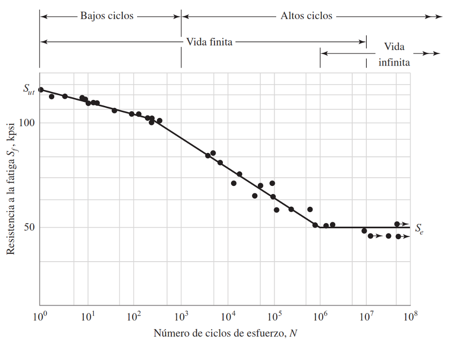

<em>Curva esfuerzo–vida y regiones de vida.</em>

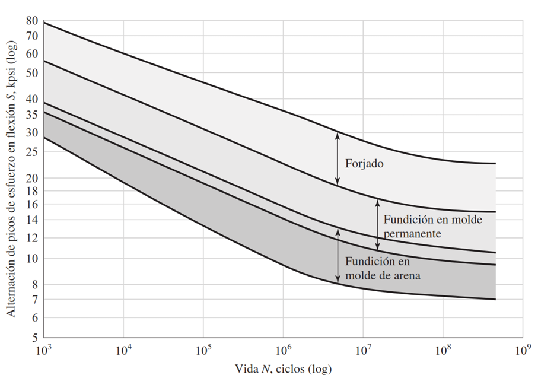

<em>Bandas esfuerzo–vida de aleaciones de aluminio.</em>

<!-- PDF, pág. 35, figura 2 -->

<strong>Espacio reservado — PDF, página 35, figura 2</strong>
Curvas esfuerzo–vida de acero y aleación de aluminio

<code>imagenes_pdf/fig-p35-02.png</code>

### Método deformación–vida

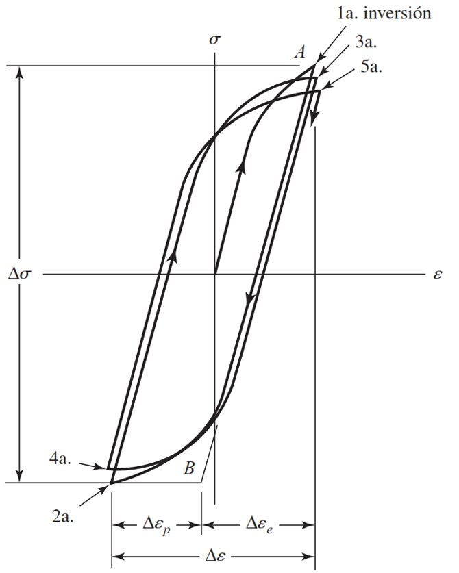

<em>Bucle de histéresis y componentes de deformación.</em>

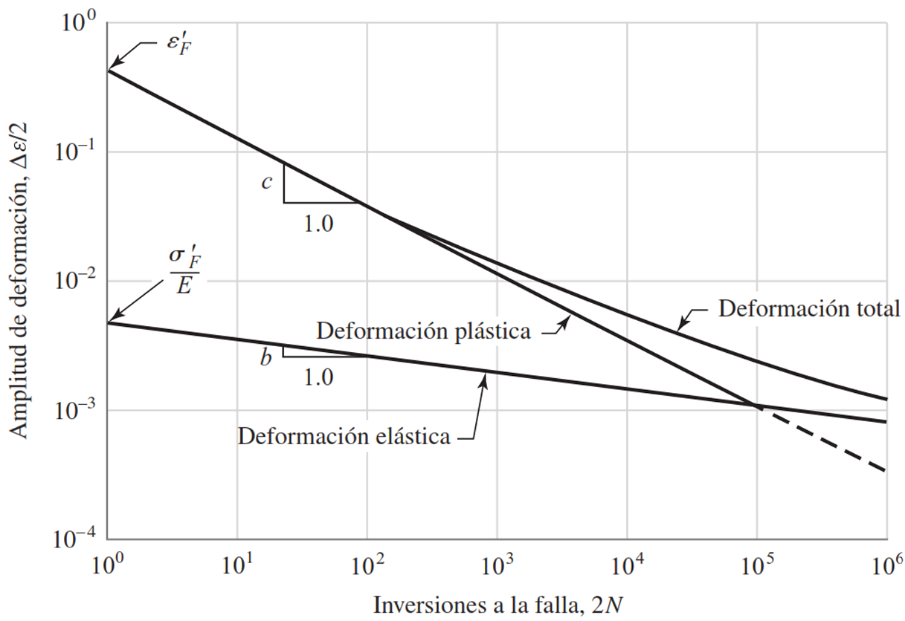

<em>Curvas de deformación elástica, plástica y total.</em>

La amplitud total se descompone en sus contribuciones elástica y plástica:

$$
\frac{\Delta\varepsilon}{2}=\frac{\Delta\varepsilon_e}{2}+\frac{\Delta\varepsilon_p}{2}
$$

$$
\frac{\Delta\varepsilon_p}{2}=\varepsilon_f'(2N)^c,
\qquad \frac{\Delta\varepsilon_e}{2}=\frac{\sigma_f'}{E}(2N)^b
$$

**Ecuación de Manson–Coffin**

$$
\frac{\Delta\varepsilon}{2}=\frac{\sigma_f'}{E}(2N)^b+\varepsilon_f'(2N)^c
$$

## 3. Límite de resistencia a la fatiga

### Datos experimentales y relación empírica

La gráfica siguiente muestra los datos experimentales que sustentan la estimación del límite de resistencia a fatiga de una probeta de acero en función de su resistencia última a la tensión.

<!-- IMAGEN PDF: pág. 37, figura 1. Guardar en imagenes_pdf/fig-p37-01.png. Sustituir el bloque reservado por:  -->

<strong>Espacio reservado — PDF, página 37, figura 1</strong>
Datos experimentales del límite de fatiga frente a la resistencia última

<code>imagenes_pdf/fig-p37-01.png</code>

$$
S'_e=\begin{cases}
0.5S_{ut}, & S_{ut}\leq 200\ \text{ksi}\ (1400\ \text{MPa}),\\
100\ \text{ksi}, & S_{ut}>200\ \text{ksi}\ (1400\ \text{MPa}).
\end{cases}
$$

### Límites de resistencia a la fatiga de otros materiales

<!-- IMAGEN PDF: pág. 38, figura 1. Guardar en imagenes_pdf/fig-p38-01.png. Sustituir el bloque reservado por:  -->

<strong>Espacio reservado — PDF, página 38, figura 1</strong>
Tabla de límites aproximados de resistencia a fatiga de materiales

<code>imagenes_pdf/fig-p38-01.png</code>

La tabla siguiente presenta las siguientes estimaciones para probetas con cargas completamente invertidas. En la tabla ($S_u$ corresponde a la resistencia última).

| Carga | Material | Resistencia a la fatiga | Condición de $S_u$ |
| --- | --- | --- | --- |
| Flexión invertida | Aceros | $S'_e=0.5S_u$ | Menor que 1400 MPa (200 ksi) |
| Flexión invertida | Aceros | $S'_e=700$ MPa (100 ksi) | Mayor o igual a 1400 MPa (200 ksi) |
| Flexión invertida | Hierros | $S'_e=0.4S_u$ | Menor que 400 MPa (60 ksi) |
| Flexión invertida | Hierros | $S'_e=160$ MPa (24 ksi) | Mayor o igual a 400 MPa (60 ksi) |
| Flexión invertida | Aluminios | $S'_n=0.4S_u$ | Menor que 330 MPa (48 ksi) |
| Flexión invertida | Aluminios | $S'_n=130$ MPa (19 ksi) | Mayor o igual a 330 MPa (48 ksi) |
| Flexión invertida | Aleaciones de cobre | $S'_n=0.4S_u$ | Menor que 280 MPa (40 ksi) |
| Flexión invertida | Aleaciones de cobre | $S'_n=100$ MPa (14 ksi) | Mayor o igual a 280 MPa (40 ksi) |
| Axial | Aceros | $S'_e=0.45S_u$ | — |
| Torsión | Aceros | $S'_{es}=0.29S_u$ | — |
| Torsión | Hierros | $S'_{es}=0.32S_u$ | — |
| Torsión | Aleaciones de cobre | $S'_{es}=0.22S_u$ | — |

Para aceros, la misma tabla indica $S_{us}=0.67S_u$ y $S_{ys}=0.577S_y$.

### Resistencia a la fatiga del hierro fundido gris

La tabla presenta las resistencias de los materiales. El número ASTM identifica la resistencia mínima a tracción expresada en ksi. $S_{su}$ se presenta como módulo de rotura por cortante.

| ASTM | $S_{ut}$ (ksi) | $S_{uc}$ (ksi) | $S_{su}$ (ksi) | $E$ (Mpsi) | Torsión (ksi) | $S_e$ (ksi) |
| ---: | ---: | ---: | ---: | ---: | ---: | ---: |
| 20 | 22 | 83 | 26 | 9.6--14 | 3.9--5.6 | 10 |
| 25 | 26 | 97 | 32 | 11.5--14.8 | 4.6--6.0 | 11.5 |
| 30 | 31 | 109 | 40 | 13--16.4 | 5.2--6.6 | 14 |
| 35 | 36.5 | 124 | 48.5 | 14.5--17.2 | 5.8--6.9 | 16 |
| 40 | 42.5 | 140 | 57 | 16--20 | 6.4--7.8 | 18.5 |
| 50 | 52.5 | 164 | 73 | 18.8--22.8 | 7.2--8.0 | 21.5 |
| 60 | 62.5 | 187.5 | 88.5 | 20.4--23.5 | 7.8--8.5 | 24.5 |

## 4. Estimación de la resistencia a la fatiga y curvas S–N

<em>curva esfuerzo–vida empleada en la deducción.</em>

A partir de la ecuación de Manson–Coffin:

$$
\frac{\Delta\varepsilon_e}{2}=\frac{\sigma_f'}{E}(2N)^b
\quad\Longrightarrow\quad
\frac{\Delta\varepsilon_e E}{2}=\sigma_f'(2N)^b
$$

Identificando $S_f'=\Delta\varepsilon_e E/2$:

$$
S_f'=\sigma_f'(2N)^b.
$$

Para aceros con dureza Brinell $H_B<500$:

$$
\sigma_f'=S_{ut}+50\ \text{ksi}
\qquad\text{o}\qquad
\sigma_f'=S_{ut}+345\ \text{MPa}.
$$

### Deducción del exponente b

Si se conoce $S'_e$ y el número de ciclos $N_e$:

$$
S'_e=\sigma_f'(2N_e)^b
\quad\Longrightarrow\quad (2N_e)^b=\frac{S'_e}{\sigma_f'}
$$

$$
b=\frac{\log(S'_e/\sigma_f')}{\log(2N_e)}=-\frac{\log(\sigma_f'/S'_e)}{\log(2N_e)}.
$$

Para el caso de acero con $N_e=10^6$ y $S'_e=0.5S_{ut}$, usando ksi:

$$
b=-\frac{\log[(S_{ut}+50)/(0.50S_{ut})]}{\log(2N_e)}.
$$

### Factor de reducción f

Para $N=10^3$ ciclos:

$$
fS_{ut}=\sigma_f'(2000)^b
\quad\Longrightarrow\quad f=\frac{\sigma_f'(2000)^b}{S_{ut}}.
$$

<!-- IMAGEN PDF: pág. 41, figura 1. Guardar en imagenes_pdf/fig-p41-01.png. Sustituir el bloque reservado por:  -->

<strong>Espacio reservado — PDF, página 41, figura 1</strong>
Factor f en función de la resistencia última del acero

<code>imagenes_pdf/fig-p41-01.png</code>

### Ecuación de la curva esfuerzo–vida

Conocido el factor $f$, se plantean $S_f=aN^b$ y las condiciones:

$$
fS_{ut}=a(10^3)^b,\qquad S_e=a(10^6)^b.
$$

Resolviendo el sistema:

$$
a=\frac{(fS_{ut})^2}{S_e},\qquad b=-\frac13\log\left(\frac{fS_{ut}}{S_e}\right).
$$

Para esfuerzos completamente invertidos:

$$
N=\left(\frac{\sigma_{inv}}{a}\right)^{1/b}.
$$

### Ejercicio de aplicación

Acero rolado en caliente de $S_{ut}=90\ \text{ksi}$. Estimar el límite de resistencia a fatiga en viga rotatoria a $10^6$ ciclos, la resistencia a fatiga para $10^4$ ciclos y la vida esperada de una probeta pulida sometida a un esfuerzo completamente invertido de 55 ksi.

## 5. Factores de modificación del límite de resistencia a la fatiga

### Relación de Marin

El límite de fatiga de probeta se corrige para representar las condiciones del componente mediante la relación de Marin:

$$
S_e=k_a k_b k_c k_d k_e k_f S_e'.
$$

Los factores representan acabado superficial ($k_a$), tamaño ($k_b$), tipo de carga ($k_c$), temperatura ($k_d$), confiabilidad ($k_e$) y efectos varios ($k_f$). Se multiplican por el límite de probeta $S_e'$ para obtener el límite corregido $S_e$. El uso de cada factor y sus correlaciones depende del material y de las condiciones de diseño.

### Acabado superficial

Una correlación empírica es $k_a=aS_{ut}^{b}$. Los coeficientes dependen del acabado y de las unidades de $S_{ut}$:

| Acabado | $a$ ($S_{ut}$ en ksi) | $a$ ($S_{ut}$ en MPa) | $b$ |
| --- | ---: | ---: | ---: |
| Esmerilado | 1.34 | 1.58 | $-0.085$ |
| Maquinado o laminado en frío | 2.70 | 4.51 | $-0.265$ |
| Laminado en caliente | 14.4 | 57.7 | $-0.718$ |
| Como sale de forja | 39.9 | 272 | $-0.995$ |

Se debe usar el par de coeficientes correspondiente a un solo sistema de unidades; no se combinan coeficientes de ksi con valores de resistencia en MPa ni a la inversa.

### Tamaño

Para flexión y torsión, usando el diámetro equivalente $d$:

$$
k_b=\begin{cases}
0.879d^{-0.107},&0.11\leq d\leq2\ \text{pulg},\\
0.91d^{-0.157},&2<d\leq10\ \text{pulg},\\
1.24d^{-0.107},&2.79\leq d\leq51\ \text{mm},\\
1.51d^{-0.157},&51<d\leq254\ \text{mm}.
\end{cases}
$$

Para carga axial se toma $k_b=1$. Las expresiones son correlaciones aproximadas y válidas en los intervalos indicados. 

<!-- IMAGEN PDF: pág. 44, figura 1. Guardar en imagenes_pdf/fig-p44-01.png. Sustituir el bloque reservado por:  -->

<strong>Espacio reservado — PDF, página 44, figura 1</strong>
Geometrías y diámetros equivalentes para el factor de tamaño

<code>imagenes_pdf/fig-p44-01.png</code>

### Tipo de carga

Los valores tabulados para el factor de carga son:

| Tipo de carga | $k_c$ |
| --- | ---: |
| Flexión | 1.00 |
| Carga axial | 0.85 |
| Torsión | 0.59 |

Estos valores forman parte del método empírico presentado y no sustituyen resultados de ensayos de fatiga cuando el material o el modo de carga difieren de las hipótesis.

<!-- IMAGEN PDF: pág. 45, figura 1. Guardar en imagenes_pdf/fig-p45-01.png. Sustituir el bloque reservado por:  -->

<strong>Espacio reservado — PDF, página 45, figura 1</strong>
Expresión original del factor de carga; datos ya digitalizados arriba

<code>imagenes_pdf/fig-p45-01.png</code>

### Temperatura

En unidades inglesas, una estimación polinómica del factor de temperatura es:

$$
\begin{aligned}
k_d={}&0.975+0.432(10^{-3})T_F-0.115(10^{-5})T_F^2+0.104(10^{-8})T_F^3\\
&-0.595(10^{-12})T_F^4,\qquad70\leq T_F\leq1000\ ^\circ\mathrm{F}.
\end{aligned}
$$

Otra estimación usa la razón entre resistencia a la temperatura de operación y a temperatura ambiente, $k_d=S_T/S_{RT}$:

| $T$ ($^\circ$C) | $S_T/S_{RT}$ | $T$ ($^\circ$F) | $S_T/S_{RT}$ |
| ---: | ---: | ---: | ---: |
| 20 | 1.000 | 70 | 1.000 |
| 50 | 1.010 | 100 | 1.008 |
| 100 | 1.020 | 200 | 1.020 |
| 150 | 1.025 | 300 | 1.024 |
| 200 | 1.020 | 400 | 1.018 |
| 250 | 1.000 | 500 | 0.995 |
| 300 | 0.975 | 600 | 0.963 |
| 350 | 0.943 | 700 | 0.927 |
| 400 | 0.900 | 800 | 0.872 |
| 450 | 0.843 | 900 | 0.797 |
| 500 | 0.768 | 1000 | 0.698 |
| 550 | 0.672 | 1100 | 0.567 |
| 600 | 0.549 |  |  |

El polinomio solo se indica para hasta $1000\ ^\circ$F; los valores de la tabla hasta $1100\ ^\circ$F no amplían automáticamente su intervalo de validez. 

<!-- IMAGEN PDF: pág. 45, figura 2. Guardar en imagenes_pdf/fig-p45-02.png. Sustituir el bloque reservado por:  -->

<strong>Espacio reservado — PDF, página 45, figura 2</strong>
Tabla original de temperatura; datos ya digitalizados arriba

<code>imagenes_pdf/fig-p45-02.png</code>

### Confiabilidad y efectos varios

La aproximación para el factor de confiabilidad es $k_e=1-0.08z_a$. Los valores tabulados son:

| Confiabilidad (%) | $z_a$ | $k_e$ |
| ---: | ---: | ---: |
| 50 | 0 | 1.000 |
| 90 | 1.288 | 0.897 |
| 95 | 1.645 | 0.868 |
| 99 | 2.326 | 0.814 |
| 99.9 | 3.091 | 0.753 |
| 99.99 | 3.719 | 0.702 |
| 99.999 | 4.265 | 0.659 |
| 99.9999 | 4.753 | 0.620 |

El factor $k_f$ agrupa efectos no considerados en los otros factores, por ejemplo, condiciones ambientales. Depende del ambiente y de datos experimentales; si no se dispone de información adicional, se adopta $k_f=1$. 

## 6. Factor geométrico de concentración de esfuerzos (Kt)

Los cambios geométricos perturban el flujo de esfuerzos y generan valores locales superiores al esfuerzo nominal. Para carga estática o para caracterizar la solución elástica de la geometría se definen:

$$
K_t=\frac{\sigma_{\max}}{\sigma_{\mathrm{nom}}},\qquad
K_{ts}=\frac{\tau_{\max}}{\tau_{\mathrm{nom}}}.
$$

Los factores teóricos dependen de la geometría y de la forma de carga; se obtienen de análisis elástico, tablas o gráficas. 

<input type="radio" name="kimg-group" id="kimg3" class="kt-img-radio" checked>
<input type="radio" name="kimg-group" id="kimg4" class="kt-img-radio">
<input type="radio" name="kimg-group" id="kimg5" class="kt-img-radio">
<input type="radio" name="kimg-group" id="kimg6" class="kt-img-radio">
<input type="radio" name="kimg-group" id="kimg7" class="kt-img-radio">
<input type="radio" name="kimg-group" id="kimg8" class="kt-img-radio">
<input type="radio" name="kimg-group" id="kimg9" class="kt-img-radio">
<input type="radio" name="kimg-group" id="kimg10" class="kt-img-radio">
<input type="radio" name="kimg-group" id="kimg11" class="kt-img-radio">
<input type="radio" name="kimg-group" id="kimg12" class="kt-img-radio">
<input type="radio" name="kimg-group" id="kimg13" class="kt-img-radio">
<input type="radio" name="kimg-group" id="kimg14" class="kt-img-radio">

<h4 class="kt-img-title">Ábacos y Geometrías de Concentración de Esfuerzos ($K_t, K_{ts}$)</h4>

Gráficas oficiales de referencia para discontinuidades geométricas

<label class="kt-img-tab" for="kimg3" title="Agujero Tracción">Aguj. Trac.</label>
<label class="kt-img-tab" for="kimg4" title="Agujero Flexión">Aguj. Flex.</label>
<label class="kt-img-tab" for="kimg5" title="Entalla Tracción">Ent. Trac.</label>
<label class="kt-img-tab" for="kimg6" title="Entalla Flexión">Ent. Flex.</label>
<label class="kt-img-tab" for="kimg7" title="Hombro Tracción">Hom. Trac.</label>
<label class="kt-img-tab" for="kimg8" title="Hombro Flexión">Hom. Flex.</label>
<label class="kt-img-tab" for="kimg9" title="Eje Tracción">Eje Trac.</label>
<label class="kt-img-tab" for="kimg10" title="Eje Torsión">Eje Tors.</label>
<label class="kt-img-tab" for="kimg11" title="Eje Flexión">Eje Flex.</label>
<label class="kt-img-tab" for="kimg12" title="Cilindro Agujero">Cil. Aguj.</label>
<label class="kt-img-tab" for="kimg13" title="Redonda Tracción">Red. Trac.</label>
<label class="kt-img-tab" for="kimg14" title="Redonda Flexión">Red. Flex.</label>

3. Barra en tensión o compresión simple con un agujero transversal

4. Barra rectangular con un agujero transversal en flexión

5. Barra rectangular con entallas en tensión o compresión simple

6. Barra rectangular con entallas en flexión

7. Barra rectangular con radio de acuerdo en tensión o compresión simple

8. Barra rectangular con radio de acuerdo en flexión

9. Eje redondo con radio de acuerdo en tensión

10. Eje redondo con radio de acuerdo en torsión

11. Eje redondo con radio de acuerdo en flexión

12. Eje redondo en flexión con un agujero transversal

13. Barra redonda ranurada en tensión

14. Barra redonda ranurada en flexión

## 7. Factor de concentración de esfuerzos por fatiga (Kf) y sensibilidad a la entalla

Se define:

$$
\sigma_{max}=K_f\sigma_0,\qquad \tau_{max}=K_{fs}\tau_0
$$

$$
K_f=\frac{\text{esfuerzo máximo en la pieza de prueba con muesca}}{\text{esfuerzo en la pieza de prueba sin muesca}}.
$$

$$
\begin{aligned}
q&=\frac{K_f-1}{K_t-1}, & K_f&=1+q(K_t-1),\\
q_s&=\frac{K_{fs}-1}{K_{ts}-1}, & K_{fs}&=1+q_s(K_{ts}-1).
\end{aligned}
$$

En general, $0\leq q\leq1$: $q=0$ representa material insensible a la entalla, mientras que $q=1$ implica $K_f=K_t$. De manera análoga se interpreta $q_s$ para cortante. 

Una estimación de Neuber presentada para aceros es:

$$
K_f=1+\frac{K_t-1}{1+\sqrt{a/r}},
$$

donde $r$ es el radio de la raíz y $\sqrt a$ es una constante del material. Para $S_{ut}$ en ksi y $\sqrt a$ en $\sqrt{\mathrm{pulg}}$:

$$
\begin{aligned}
\sqrt{a}_{\text{axial/flexión}}={}&0.246-3.08(10^{-3})S_{ut}+1.51(10^{-5})S_{ut}^2-2.67(10^{-8})S_{ut}^3,\\
\sqrt{a}_{\text{torsión}}={}&0.190-2.51(10^{-3})S_{ut}+1.35(10^{-5})S_{ut}^2-2.67(10^{-8})S_{ut}^3.
\end{aligned}
$$

Estas correlaciones requieren las unidades indicadas y no deben usarse directamente con MPa o mm sin una conversión válida.

<input type="radio" name="qimg-group" id="qimg1" class="q-img-radio" checked>
<input type="radio" name="qimg-group" id="qimg2" class="q-img-radio">

<h4 class="q-img-title">Factor de sensibilidad a la muesca</h4>

Indica qué tan susceptible es el material a ciertos factores de concentración de esfuerzos

<label class="q-img-tab" for="qimg1" title="Factor q Axial">1. Factor $q$ axial o flexionante</label>
<label class="q-img-tab" for="qimg2" title="Factor q Torsión">2. Factor $q$ torsión</label>

1. Factor $q$ para esfuerzo axial o flexionante

2. Factor $q$ para esfuerzos de torsión

## 8. Esfuerzo medio y esfuerzo alternante

<!-- IMAGEN PDF: pág. 53, figura 1. Guardar en imagenes_pdf/fig-p53-01.png. Sustituir el bloque reservado por:  -->

<strong>Espacio reservado — PDF, página 53, figura 1</strong>
Ejemplo de esfuerzo fluctuante irregular

<code>imagenes_pdf/fig-p53-01.png</code>

<!-- IMAGEN PDF: pág. 53, figura 2. Guardar en imagenes_pdf/fig-p53-02.png. Sustituir el bloque reservado por:  -->

<strong>Espacio reservado — PDF, página 53, figura 2</strong>
Ejemplo de esfuerzo fluctuante sinusoidal

<code>imagenes_pdf/fig-p53-02.png</code>

<!-- IMAGEN PDF: pág. 53, figura 3. Guardar en imagenes_pdf/fig-p53-03.png. Sustituir el bloque reservado por:  -->

<strong>Espacio reservado — PDF, página 53, figura 3</strong>
Esfuerzo fluctuante no sinusoidal

<code>imagenes_pdf/fig-p53-03.png</code>

<!-- IMAGEN PDF: pág. 53, figura 4. Guardar en imagenes_pdf/fig-p53-04.png. Sustituir el bloque reservado por:  -->

<strong>Espacio reservado — PDF, página 53, figura 4</strong>
Ciclo fluctuante con esfuerzo medio positivo

<code>imagenes_pdf/fig-p53-04.png</code>

<!-- IMAGEN PDF: pág. 53, figura 5. Guardar en imagenes_pdf/fig-p53-05.png. Sustituir el bloque reservado por:  -->

<strong>Espacio reservado — PDF, página 53, figura 5</strong>
Ciclo con esfuerzo mínimo igual a cero

<code>imagenes_pdf/fig-p53-05.png</code>

<!-- IMAGEN PDF: pág. 54, figura 1. Guardar en imagenes_pdf/fig-p54-01.png. Sustituir el bloque reservado por:  -->

<strong>Espacio reservado — PDF, página 54, figura 1</strong>
Ciclo con esfuerzo medio nulo

<code>imagenes_pdf/fig-p54-01.png</code>

### Definiciones y ecuaciones de los esfuerzos

$$
\sigma_m=\frac{\sigma_{max}+\sigma_{min}}2,\qquad
\sigma_a=\frac{\sigma_{max}-\sigma_{min}}2,
\qquad \sigma_r=\sigma_{max}-\sigma_{min}=2\sigma_a.
$$

$$
R=\frac{\sigma_{min}}{\sigma_{max}},\qquad A=\frac{\sigma_a}{\sigma_m}.
$$

<h4 style="font-size: 1.1rem; font-weight: 700; color: #5c1d1d; margin: 0 0 4px 0;">Tipos de Ciclos de Esfuerzo en Fatiga</h4>

Representación temporal de las condiciones cíclicas fundamentales

<!-- GRÁFICO 1: Esfuerzo Fluctuante General -->

1. Esfuerzo Fluctuante General

<svg viewBox="0 0 500 180" width="100%" height="auto" style="display: block;">
<!-- Ejes Coordenados -->
<line x1="60" y1="15" x2="60" y2="150" stroke="#1e293b" stroke-width="1.5"/>
<line x1="50" y1="150" x2="475" y2="150" stroke="#1e293b" stroke-width="1.5"/>
<text x="24" y="85" font-size="11" font-weight="bold" fill="#1e293b" text-anchor="middle" transform="rotate(-90 24,85)">Esfuerzo</text>
<text x="45" y="158" font-size="11" font-style="italic" fill="#1e293b">O</text>
<text x="435" y="165" font-size="11" fill="#1e293b">Tiempo</text>

<!-- Línea de Esfuerzo Medio (Sigma_m) en y = 75 -->
<line x1="70" y1="75" x2="420" y2="75" stroke="#1e293b" stroke-width="1" stroke-dasharray="5,4"/>

<!-- Onda Sinusoidal con cierre final suave y natural -->
<path d="M 70,75 Q 87,35 105,35 Q 122,35 140,75 Q 157.5,115 175,115 Q 192.5,115 210,75 Q 227,35 245,35 Q 262,35 280,75 Q 297.5,115 315,115 Q 332.5,115 350,75 Q 367.5,35 385,35 Q 402.5,35 420,75" fill="none" stroke="#1e293b" stroke-width="2"/>

<!-- Líneas de referencia horizontales -->
<line x1="70" y1="35" x2="120" y2="35" stroke="#94a3b8" stroke-width="0.8"/>
<line x1="140" y1="115" x2="280" y2="115" stroke="#94a3b8" stroke-width="0.8"/>

<!-- Cota Sigma Máx reubicada a la altura de la referencia celeste (x = 105) -->
<line x1="105" y1="35" x2="105" y2="150" stroke="#1e293b" stroke-width="1"/>
<polygon points="105,35 102,41 108,41" fill="#1e293b"/>
<polygon points="105,150 102,144 108,144" fill="#1e293b"/>
<text x="99" y="96" font-size="11" font-weight="bold" fill="#1e293b" text-anchor="end">σmáx</text>

<!-- Cota Sigma Mín (desde valle y=115 hasta y=150) -->
<line x1="325" y1="115" x2="325" y2="150" stroke="#1e293b" stroke-width="1"/>
<polygon points="325,115 322,121 328,121" fill="#1e293b"/>
<polygon points="325,150 322,144 328,144" fill="#1e293b"/>
<text x="319" y="136" font-size="11" font-weight="bold" fill="#1e293b" text-anchor="end">σmín</text>

<!-- Cota Sigma Amplitud superior (de línea media y=75 a cresta y=35) -->
<line x1="175" y1="35" x2="175" y2="75" stroke="#1e293b" stroke-width="1"/>
<polygon points="175,35 172,41 178,41" fill="#1e293b"/>
<polygon points="175,75 172,69 178,69" fill="#1e293b"/>
<text x="182" y="58" font-size="11" font-weight="bold" fill="#1e293b">σa</text>

<!-- Cota Sigma Amplitud inferior (de línea media y=75 a valle y=115) -->
<line x1="245" y1="75" x2="245" y2="115" stroke="#1e293b" stroke-width="1"/>
<polygon points="245,75 242,81 248,81" fill="#1e293b"/>
<polygon points="245,115 242,109 248,109" fill="#1e293b"/>
<text x="252" y="98" font-size="11" font-weight="bold" fill="#1e293b">σa</text>

<!-- Cota Sigma Medio (σm) en el lado derecho (desde y=75 hasta y=150) -->
<line x1="365" y1="75" x2="365" y2="150" stroke="#1e293b" stroke-width="1"/>
<polygon points="365,75 362,81 368,81" fill="#1e293b"/>
<polygon points="365,150 362,144 368,144" fill="#1e293b"/>
<text x="359" y="116" font-size="11" font-weight="bold" fill="#1e293b" text-anchor="end">σm</text>

<!-- Cota Rango / Delta Sigma (σr) desplazada a la derecha -->
<line x1="440" y1="35" x2="440" y2="115" stroke="#1e293b" stroke-width="1"/>
<polygon points="440,35 437,41 443,41" fill="#1e293b"/>
<polygon points="440,115 437,109 443,109" fill="#1e293b"/>
<text x="447" y="78" font-size="11" font-weight="bold" fill="#1e293b">σr</text>
</svg>

<!-- GRÁFICO 2: Esfuerzo Pulsante desde Cero (σmín = 0) -->

2. Esfuerzo Pulsante desde Cero (σmín = 0)

<svg viewBox="0 0 500 180" width="100%" height="auto" style="display: block;">
<!-- Ejes Coordenados -->
<line x1="60" y1="15" x2="60" y2="150" stroke="#1e293b" stroke-width="1.5"/>
<line x1="50" y1="150" x2="475" y2="150" stroke="#1e293b" stroke-width="1.5"/>
<text x="24" y="85" font-size="11" font-weight="bold" fill="#1e293b" text-anchor="middle" transform="rotate(-90 24,85)">Esfuerzo</text>
<text x="45" y="158" font-size="11" font-style="italic" fill="#1e293b">O</text>
<text x="435" y="165" font-size="11" fill="#1e293b">Tiempo</text>
<text x="145" y="165" font-size="11" font-weight="bold" fill="#1e293b">σmín = 0</text>

<!-- Línea de Esfuerzo Medio (Sigma_m) en y = 92.5 -->
<line x1="70" y1="92.5" x2="420" y2="92.5" stroke="#1e293b" stroke-width="1" stroke-dasharray="5,4"/>

<!-- Onda Sinusoidal con valles tangentes al eje de tiempo en y=150 y cierre final suave -->
<path d="M 70,92.5 Q 87,35 105,35 Q 122,35 140,92.5 Q 157.5,150 175,150 Q 192.5,150 210,92.5 Q 227,35 245,35 Q 262,35 280,92.5 Q 297.5,150 315,150 Q 332.5,150 350,92.5 Q 367.5,35 385,35 Q 402.5,35 420,92.5" fill="none" stroke="#1e293b" stroke-width="2"/>

<!-- Líneas de referencia horizontales -->
<line x1="70" y1="35" x2="120" y2="35" stroke="#94a3b8" stroke-width="0.8"/>

<!-- Cota Sigma Máx reubicada a la altura de la referencia celeste (x = 105) -->
<line x1="105" y1="35" x2="105" y2="150" stroke="#1e293b" stroke-width="1"/>
<polygon points="105,35 102,41 108,41" fill="#1e293b"/>
<polygon points="105,150 102,144 108,144" fill="#1e293b"/>
<text x="99" y="96" font-size="11" font-weight="bold" fill="#1e293b" text-anchor="end">σmáx</text>

<!-- Cota Sigma Amplitud superior (de línea media y=92.5 a cresta y=35) -->
<line x1="175" y1="35" x2="175" y2="92.5" stroke="#1e293b" stroke-width="1"/>
<polygon points="175,35 172,41 178,41" fill="#1e293b"/>
<polygon points="175,92.5 172,86.5 178,86.5" fill="#1e293b"/>
<text x="182" y="66" font-size="11" font-weight="bold" fill="#1e293b">σa</text>

<!-- Cota Sigma Amplitud inferior (de línea media y=92.5 al eje en y=150) -->
<line x1="245" y1="92.5" x2="245" y2="150" stroke="#1e293b" stroke-width="1"/>
<polygon points="245,92.5 242,98.5 248,98.5" fill="#1e293b"/>
<polygon points="245,150 242,144 248,144" fill="#1e293b"/>
<text x="252" y="124" font-size="11" font-weight="bold" fill="#1e293b">σa</text>

<!-- Cota Sigma Medio (σm) en el lado derecho (desde y=92.5 hasta y=150) -->
<line x1="365" y1="92.5" x2="365" y2="150" stroke="#1e293b" stroke-width="1"/>
<polygon points="365,92.5 362,98.5 368,98.5" fill="#1e293b"/>
<polygon points="365,150 362,144 368,144" fill="#1e293b"/>
<text x="359" y="124" font-size="11" font-weight="bold" fill="#1e293b" text-anchor="end">σm</text>

<!-- Cota Rango / Delta Sigma (σr) desplazada a la derecha -->
<line x1="440" y1="35" x2="440" y2="150" stroke="#1e293b" stroke-width="1"/>
<polygon points="440,35 437,41 443,41" fill="#1e293b"/>
<polygon points="440,150 437,144 443,144" fill="#1e293b"/>
<text x="447" y="96" font-size="11" font-weight="bold" fill="#1e293b">σr</text>
</svg>

<!-- GRÁFICO 3: Esfuerzo Completamente Invertido (σm = 0) -->

3. Esfuerzo Completamente Invertido (σm = 0)

<svg viewBox="0 0 500 180" width="100%" height="auto" style="display: block;">
<!-- Ejes Coordenados -->
<line x1="60" y1="15" x2="60" y2="165" stroke="#1e293b" stroke-width="1.5"/>
<line x1="50" y1="90" x2="475" y2="90" stroke="#1e293b" stroke-width="1.5"/>
<text x="53" y="25" font-size="12" font-weight="bold" fill="#1e293b">+</text>
<text x="53" y="155" font-size="12" font-weight="bold" fill="#1e293b">−</text>
<text x="24" y="93" font-size="11" font-weight="bold" fill="#1e293b" text-anchor="middle" transform="rotate(-90 24,93)">Esfuerzo</text>
<text x="45" y="93" font-size="11" font-style="italic" fill="#1e293b" text-anchor="middle">O</text>
<text x="435" y="82" font-size="11" fill="#1e293b">Tiempo</text>
<text x="220" y="165" font-size="11" font-weight="bold" fill="#1e293b">σm = 0</text>

<!-- Onda Sinusoidal simétrica centrada en el eje O (y = 90) con cierre final suave -->
<path d="M 70,90 Q 87,30 105,30 Q 122,30 140,90 Q 157.5,150 175,150 Q 192.5,150 210,90 Q 227,30 245,30 Q 262,30 280,90 Q 297.5,150 315,150 Q 332.5,150 350,90 Q 367.5,30 385,30 Q 402.5,30 420,90" fill="none" stroke="#1e293b" stroke-width="2"/>

<!-- Líneas de referencia horizontales -->
<line x1="70" y1="30" x2="120" y2="30" stroke="#94a3b8" stroke-width="0.8"/>
<line x1="140" y1="150" x2="280" y2="150" stroke="#94a3b8" stroke-width="0.8"/>

<!-- Cota Sigma Amplitud superior (de línea central y=90 a cresta y=30) -->
<line x1="175" y1="30" x2="175" y2="90" stroke="#1e293b" stroke-width="1"/>
<polygon points="175,30 172,36 178,36" fill="#1e293b"/>
<polygon points="175,90 172,84 178,84" fill="#1e293b"/>
<text x="182" y="63" font-size="11" font-weight="bold" fill="#1e293b">σa</text>

<!-- Cota Sigma Amplitud inferior (de línea central y=90 a valle y=150) -->
<line x1="245" y1="90" x2="245" y2="150" stroke="#1e293b" stroke-width="1"/>
<polygon points="245,90 242,96 248,96" fill="#1e293b"/>
<polygon points="245,150 242,144 248,144" fill="#1e293b"/>
<text x="252" y="123" font-size="11" font-weight="bold" fill="#1e293b">σa</text>

<!-- Cota Rango / Delta Sigma (σr) desplazada a la derecha -->
<line x1="440" y1="30" x2="440" y2="150" stroke="#1e293b" stroke-width="1"/>
<polygon points="440,30 437,36 443,36" fill="#1e293b"/>
<polygon points="440,150 437,144 443,144" fill="#1e293b"/>
<text x="447" y="93" font-size="11" font-weight="bold" fill="#1e293b">σr</text>
</svg>

## 9. Curvas esfuerzo–vida y curvas de vida constante

### Curvas esfuerzo–vida para esfuerzos alternantes

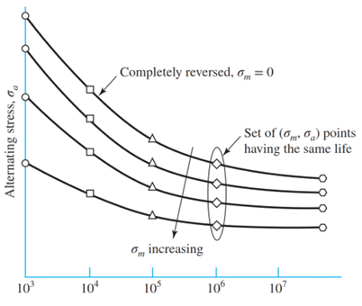

<em>familia de curvas esfuerzo–vida para diferentes esfuerzos medios.</em>

### Curvas de vida constante

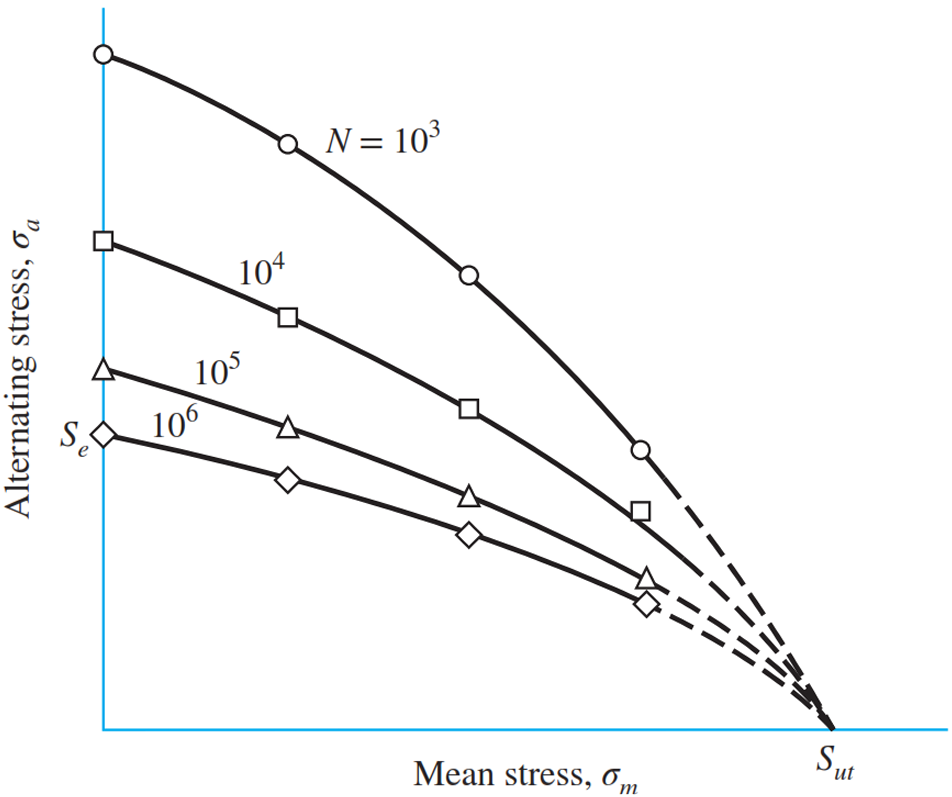

<em>Curvas de vida constante para diferentes números de ciclos.</em>

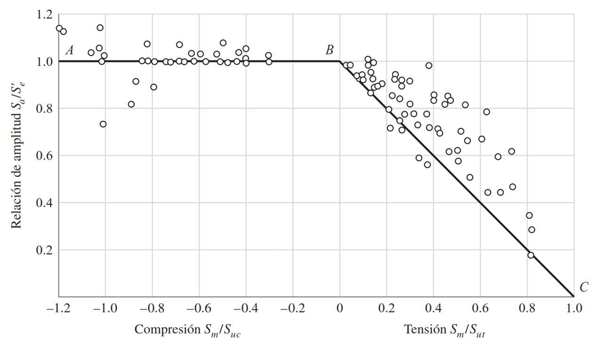

<em>Datos normalizados de esfuerzo alternante y medio.</em>

## 10. Diagramas y criterios de falla por fatiga

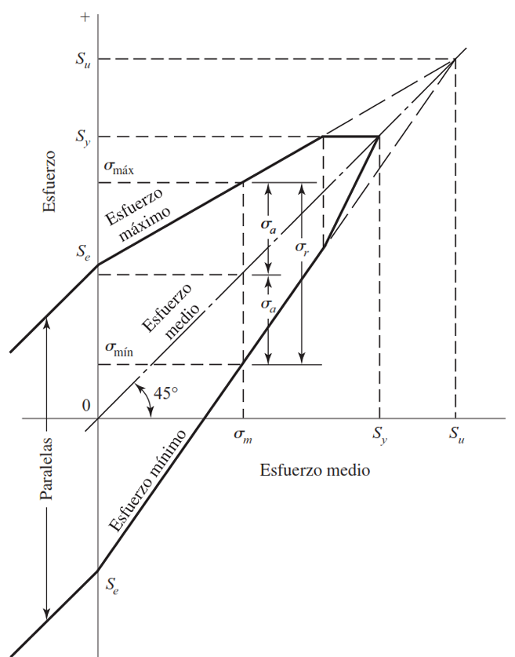

<em>Diagrama de Goodman con esfuerzos máximo y mínimo.</em>

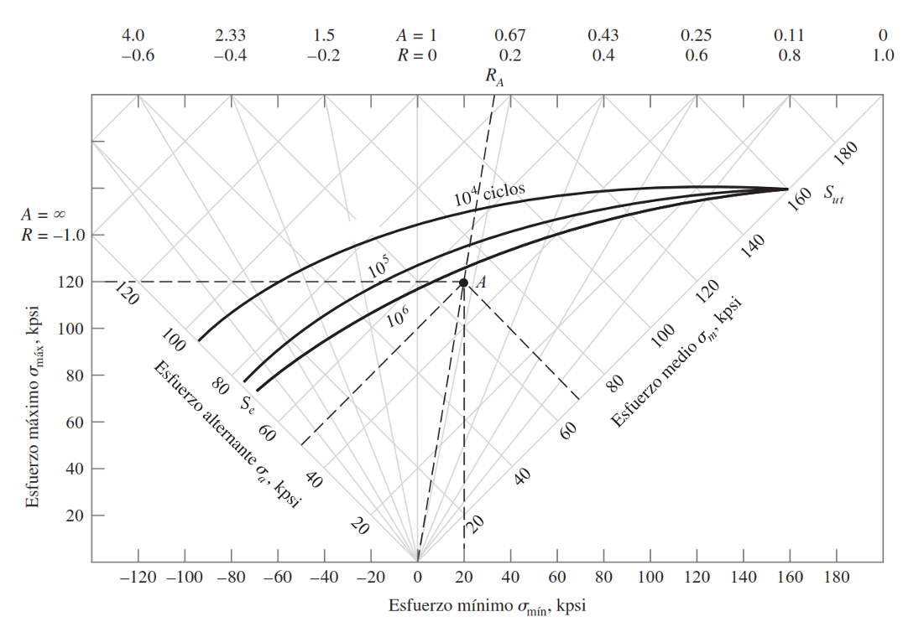

<em>Diagrama de Goodman con curvas de vida y razones de carga.</em>

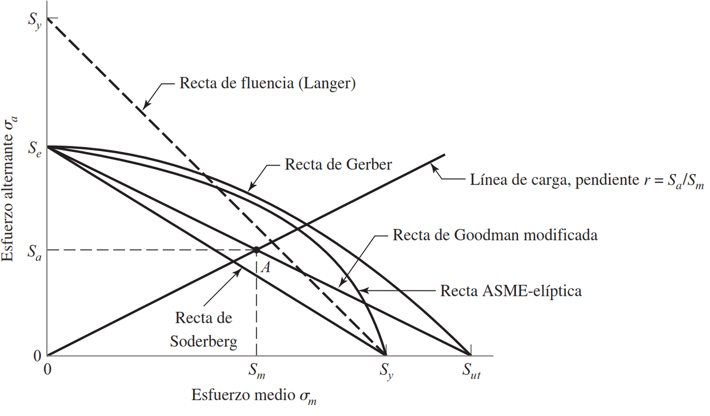

<em>Comparación general de los criterios y línea de Langer.</em>

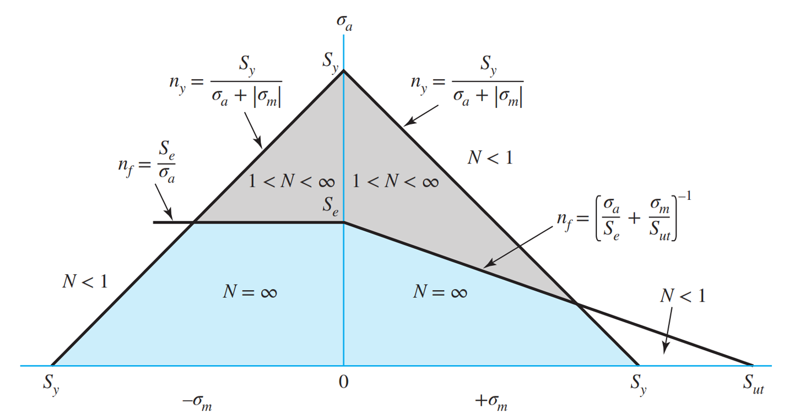

<em>Regiones de seguridad, vida y fluencia.</em>

### Línea de Langer y criterio de Soderberg

En el primer cuadrante del diagrama, la línea de carga se escribe como $S_a=rS_m$, con $r=\sigma_a/\sigma_m$. La recta de Langer corresponde a $S_a+S_m=S_y$. Soderberg une $S_e$ con $S_y$ en los ejes respectivos; su ecuación se obtiene de esa recta del gráfico.

$$
\frac{S_a}{S_e}+\frac{S_m}{S_y}=1,
\qquad n_y=\frac{S_y}{\sigma_a+\sigma_m}.
$$

<em>Gráfico esquemático de las fronteras de falla. Proporciones ilustrativas, no a escala de un material específico.</em>

<em>Gráfico esquemático de las fronteras de falla. Proporciones ilustrativas, no a escala de un material específico.</em>

### Cuadros de fórmulas de criterios de falla por fatiga

Los cuadros presentan tres combinaciones. Primera combinación: intersección con la frontera de fatiga. Segunda: intersección con Langer. Tercera: intersección entre ambas fronteras, que determina $r_{crit}=S_a/S_m$. Para el primer cuadrante, cuando existe una intersección interior y $0<S_e<S_y<S_{ut}$, las desigualdades se deducen de las ecuaciones de los cuadros: con $r<r_{crit}$ gobierna Langer y con $r>r_{crit}$ gobierna la frontera de fatiga. En igualdad ambas coinciden. Para evitar ambigüedad, se comparan los factores de seguridad y se adopta el menor.

#### Goodman modificado

<img src="" alt="Diagrama individual de Goodman modificado" style="width:100%;height:auto;">

<em>Gráfico esquemático de las fronteras de falla. Proporciones ilustrativas, no a escala de un material específico.</em>

<h4 class="crit-box-title">1. Criterio de Goodman</h4>

<table class="crit-table">
<thead>
<tr>
<th style="width: 24%;">Combinación</th>
<th style="width: 34%;">Sistema de ecuaciones</th>
<th style="width: 42%;">Solución analítica ($S_a, S_m, r_{\mathrm{crit}}$)</th>
</tr>
</thead>
<tbody>
<tr>
<td><strong>Primera combinación</strong> (Frontera Goodman + Línea de carga)</td>
<td>$$\frac{S_a}{S_e} + \frac{S_m}{S_{ut}} = 1$$ $$r = \frac{S_a}{S_m}$$</td>
<td>$$S_a = \frac{r\,S_e\,S_{ut}}{r\,S_{ut} + S_e}$$ $$S_m = \frac{S_a}{r}$$</td>
</tr>
<tr>
<td><strong>Segunda combinación</strong> (Recta de fluencia + Línea de carga)</td>
<td>$$\frac{S_a}{S_y} + \frac{S_m}{S_y} = 1$$ $$r = \frac{S_a}{S_m}$$</td>
<td>$$S_a = \frac{r\,S_y}{1 + r}$$ $$S_m = \frac{S_y}{1 + r}$$</td>
</tr>
<tr>
<td><strong>Tercera combinación</strong> (Intersección Goodman + Fluencia)</td>
<td>$$\frac{S_a}{S_e} + \frac{S_m}{S_{ut}} = 1$$ $$\frac{S_a}{S_y} + \frac{S_m}{S_y} = 1$$</td>
<td>$$S_m = \frac{(S_y - S_e)\,S_{ut}}{S_{ut} - S_e}$$ $$S_a = S_y - S_m, \qquad r_{\mathrm{crit}} = \frac{S_a}{S_m}$$</td>
</tr>
<tr class="crit-sf-row">
<td><strong>Factor de seguridad</strong></td>
<td colspan="2">$$n_f = \frac{1}{\dfrac{\sigma_a}{S_e} + \dfrac{\sigma_m}{S_{ut}}}$$</td>
</tr>
</tbody>
</table>

**Condiciones de aplicación** (primer cuadrante, intersección interior):

- $r<r_{crit}$: segunda combinación (Langer), $n=n_y$.
- $r=r_{crit}$: ambas fronteras coinciden sobre la línea de carga.
- $r>r_{crit}$: primera combinación (criterio de fatiga), $n=n_f$.

#### Gerber

<img src="" alt="Diagrama individual de Gerber" style="width:100%;height:auto;">

<em>Gráfico esquemático de las fronteras de falla. Proporciones ilustrativas, no a escala de un material específico.</em>

<h4 class="crit-box-title">2. Criterio de falla Gerber</h4>

<table class="crit-table">
<thead>
<tr>
<th style="width: 24%;">Combinación</th>
<th style="width: 34%;">Sistema de ecuaciones</th>
<th style="width: 42%;">Solución analítica ($S_a, S_m, r_{\mathrm{crit}}$)</th>
</tr>
</thead>
<tbody>
<tr>
<td><strong>Primera combinación</strong> (Parábola Gerber + Línea de carga)</td>
<td>$$\frac{S_a}{S_e} + \left(\frac{S_m}{S_{ut}}\right)^2 = 1$$ $$r = \frac{S_a}{S_m}$$</td>
<td>$$S_a = \frac{r^2 S_{ut}^2}{2S_e}\left[-1 + \sqrt{1 + \left(\frac{2S_e}{r\,S_{ut}}\right)^2}\right]$$ $$S_m = \frac{S_a}{r}$$</td>
</tr>
<tr>
<td><strong>Segunda combinación</strong> (Recta de fluencia + Línea de carga)</td>
<td>$$\frac{S_a}{S_y} + \frac{S_m}{S_y} = 1$$ $$r = \frac{S_a}{S_m}$$</td>
<td>$$S_a = \frac{r\,S_y}{1 + r}$$ $$S_m = \frac{S_y}{1 + r}$$</td>
</tr>
<tr>
<td><strong>Tercera combinación</strong> (Intersección Gerber + Fluencia)</td>
<td>$$\frac{S_a}{S_e} + \left(\frac{S_m}{S_{ut}}\right)^2 = 1$$ $$\frac{S_a}{S_y} + \frac{S_m}{S_y} = 1$$</td>
<td>$$S_m = \frac{S_{ut}^2}{2S_e}\left[1 - \sqrt{1 + \left(\frac{2S_e}{S_{ut}}\right)^2\left(1 - \frac{S_y}{S_e}\right)}\right]$$ $$S_a = S_y - S_m, \qquad r_{\mathrm{crit}} = \frac{S_a}{S_m}$$</td>
</tr>
<tr class="crit-sf-row">
<td><strong>Factor de seguridad</strong></td>
<td colspan="2">$$n_f = \frac{1}{2}\left(\frac{S_{ut}}{\sigma_m}\right)^2\frac{\sigma_a}{S_e}\left[-1 + \sqrt{1 + \left(\frac{2\sigma_m S_e}{S_{ut}\sigma_a}\right)^2}\right]$$</td>
</tr>
</tbody>
</table>

**Condiciones de aplicación** (primer cuadrante, intersección interior):

- $r<r_{crit}$: segunda combinación (Langer), $n=n_y$.
- $r=r_{crit}$: ambas fronteras coinciden sobre la línea de carga.
- $r>r_{crit}$: primera combinación (criterio de fatiga), $n=n_f$.

#### ASME elíptico

<img src="" alt="Diagrama individual de ASME elíptico" style="width:100%;height:auto;">

<em>Gráfico esquemático de las fronteras de falla. Proporciones ilustrativas, no a escala de un material específico.</em>

<h4 class="crit-box-title">3. Criterio de falla de ASME (ASME-elíptica)</h4>

<table class="crit-table">
<thead>
<tr>
<th style="width: 24%;">Combinación</th>
<th style="width: 34%;">Sistema de ecuaciones</th>
<th style="width: 42%;">Solución analítica ($S_a, S_m, r_{\mathrm{crit}}$)</th>
</tr>
</thead>
<tbody>
<tr>
<td><strong>Primera combinación</strong> (Elipse ASME + Línea de carga)</td>
<td>$$\left(\frac{S_a}{S_e}\right)^2 + \left(\frac{S_m}{S_y}\right)^2 = 1$$ $$r = \frac{S_a}{S_m}$$</td>
<td>$$S_a = \sqrt{\frac{r^2 S_e^2 S_y^2}{S_e^2 + r^2 S_y^2}}$$ $$S_m = \frac{S_a}{r}$$</td>
</tr>
<tr>
<td><strong>Segunda combinación</strong> (Recta de fluencia + Línea de carga)</td>
<td>$$\frac{S_a}{S_y} + \frac{S_m}{S_y} = 1$$ $$r = \frac{S_a}{S_m}$$</td>
<td>$$S_a = \frac{r\,S_y}{1 + r}$$ $$S_m = \frac{S_y}{1 + r}$$</td>
</tr>
<tr>
<td><strong>Tercera combinación</strong> (Intersección ASME + Fluencia)</td>
<td>$$\left(\frac{S_a}{S_e}\right)^2 + \left(\frac{S_m}{S_y}\right)^2 = 1$$ $$\frac{S_a}{S_y} + \frac{S_m}{S_y} = 1$$</td>
<td>$$S_a = \frac{2\,S_y\,S_e^2}{S_e^2 + S_y^2}$$ $$S_m = S_y - S_a, \qquad r_{\mathrm{crit}} = \frac{S_a}{S_m}$$</td>
</tr>
<tr class="crit-sf-row">
<td><strong>Factor de seguridad</strong></td>
<td colspan="2">$$n_f = \sqrt{\frac{1}{\left(\dfrac{\sigma_a}{S_e}\right)^2 + \left(\dfrac{\sigma_m}{S_y}\right)^2}}$$</td>
</tr>
</tbody>
</table>

**Condiciones de aplicación** (primer cuadrante, intersección interior):

- $r<r_{crit}$: segunda combinación (Langer), $n=n_y$.
- $r=r_{crit}$: ambas fronteras coinciden sobre la línea de carga.
- $r>r_{crit}$: primera combinación (criterio de fatiga), $n=n_f$.

## 11. Torsión y combinación de esfuerzos fluctuantes

### Criterios de falla por fatiga para cargas de torsión

$$
S_u=0.67S_{ut},\qquad S_{sy}=0.577S_y.
$$

<!-- IMAGEN PDF: pág. 60, figura 1. Guardar en imagenes_pdf/fig-p60-01.png. Sustituir el bloque reservado por:  -->

<strong>Espacio reservado — PDF, página 60, figura 1</strong>
Curvas de vida constante

<code>imagenes_pdf/fig-p60-01.png</code>

El esfuerzo completamente reversible a partir del esfuerzo medio y variable:

$$
\sigma_{ar}=\frac{\sigma_a}{1-\sigma_m/S_{ut}}.
$$

### Combinación de flexión, carga axial y torsión

Para combinar flexión, carga axial y torsión mediante energía de distorsión, se estiman las amplitudes y esfuerzos medios equivalentes:

$$
\begin{aligned}
\sigma_a'&=\sqrt{\left[K_{f,b}\sigma_{a0,b}+K_{f,x}\sigma_{a0,x}\right]^2
+3\left[K_{fs}\tau_{a0}\right]^2},\\
\sigma_m'&=\sqrt{\left[K_{f,b}\sigma_{m0,b}+K_{f,x}\sigma_{m0,x}\right]^2
+3\left[K_{fs}\tau_{m0}\right]^2}.
\end{aligned}
$$

## 12. Figuras de ejercicios y datos de materiales

### Figuras de los ejercicios

Los ejercicios resueltos se encuentran en su módulo independiente.

<!-- IMAGEN PDF: pág. 61, figura 1. Guardar en imagenes_pdf/fig-p61-01.png. Sustituir el bloque reservado por:  -->

<strong>Espacio reservado — PDF, página 61, figura 1</strong>
Problema 1: eje AISI 1020 estirado en frío

<code>imagenes_pdf/fig-p61-01.png</code>

<!-- IMAGEN PDF: pág. 61, figura 2. Guardar en imagenes_pdf/fig-p61-02.png. Sustituir el bloque reservado por:  -->

<strong>Espacio reservado — PDF, página 61, figura 2</strong>
Problema 2: eje AISI 1040 con fuerzas F1 y F2

<code>imagenes_pdf/fig-p61-02.png</code>

<!-- IMAGEN PDF: pág. 62, figura 1. Guardar en imagenes_pdf/fig-p62-01.png. Sustituir el bloque reservado por:  -->

<strong>Espacio reservado — PDF, página 62, figura 1</strong>
Problema 3: eje AISI 1095

<code>imagenes_pdf/fig-p62-01.png</code>

<!-- IMAGEN PDF: pág. 62, figura 2. Guardar en imagenes_pdf/fig-p62-02.png. Sustituir el bloque reservado por:  -->

<strong>Espacio reservado — PDF, página 62, figura 2</strong>
Problema 4: barra con agujero y carga axial

<code>imagenes_pdf/fig-p62-02.png</code>

<!-- IMAGEN PDF: pág. 63, figura 1. Guardar en imagenes_pdf/fig-p63-01.png. Sustituir el bloque reservado por:  -->

<strong>Espacio reservado — PDF, página 63, figura 1</strong>
Problema 5: eslabón con concentradores de esfuerzos

<code>imagenes_pdf/fig-p63-01.png</code>

<!-- IMAGEN PDF: pág. 63, figura 2. Guardar en imagenes_pdf/fig-p63-02.png. Sustituir el bloque reservado por:  -->

<strong>Espacio reservado — PDF, página 63, figura 2</strong>
Problema 6: eje A sometido a fuerzas a través del eje B

<code>imagenes_pdf/fig-p63-02.png</code>

### Datos de materiales para consulta

#### Aceros al carbono

HR significa laminado en caliente y CD, estirado en frío. Las resistencias últimas y de fluencia son datos útiles para las estimaciones de probeta y los criterios de fatiga incluidos en este apunte.

| UNS | AISI/SAE | Proceso | $S_{ut}$ (MPa) | $S_y$ (MPa) | Elongación en 2 pulg. (%) | Reducción de área (%) | HB |
| --- | ---: | --- | ---: | ---: | ---: | ---: | ---: |
| G10060 | 1006 | HR | 300 | 170 | 30 | 55 | 86 |
| G10060 | 1006 | CD | 330 | 280 | 20 | 45 | 95 |
| G10100 | 1010 | HR | 320 | 180 | 28 | 50 | 95 |
| G10100 | 1010 | CD | 370 | 300 | 20 | 40 | 105 |
| G10150 | 1015 | HR | 340 | 190 | 28 | 50 | 101 |
| G10150 | 1015 | CD | 390 | 320 | 20 | 50 | 105 |
| G10180 | 1018 | HR | 400 | 220 | 25 | 50 | 116 |
| G10180 | 1018 | CD | 440 | 370 | 15 | 40 | 126 |
| G10200 | 1020 | HR | 380 | 210 | 25 | 50 | 111 |
| G10200 | 1020 | CD | 470 | 390 | 15 | 40 | 132 |
| G10300 | 1030 | HR | 470 | 260 | 20 | 42 | 137 |
| G10300 | 1030 | CD | 520 | 440 | 12 | 35 | 149 |
| G10350 | 1035 | HR | 500 | 270 | 18 | 40 | 143 |
| G10350 | 1035 | CD | 550 | 460 | 12 | 35 | 163 |
| G10400 | 1040 | HR | 520 | 290 | 18 | 40 | 153 |
| G10400 | 1040 | CD | 590 | 490 | 12 | 35 | 170 |
| G10450 | 1045 | HR | 570 | 310 | 16 | 40 | 163 |
| G10450 | 1045 | CD | 630 | 530 | 12 | 35 | 179 |
| G10500 | 1050 | HR | 620 | 340 | 15 | 35 | 173 |
| G10500 | 1050 | CD | 690 | 580 | 10 | 30 | 185 |
| G10600 | 1060 | HR | 680 | 370 | 12 | 30 | 201 |
| G10800 | 1080 | HR | 770 | 420 | 10 | 25 | 229 |
| G10950 | 1095 | HR | 830 | 460 | 10 | 25 | 248 |

<!-- IMAGEN PDF: pág. 65, figura 1. Guardar en imagenes_pdf/fig-p65-01.png. Sustituir el bloque reservado por:  -->

<strong>Espacio reservado — PDF, página 65, figura 1</strong>
Tabla de propiedades de aceros

<code>imagenes_pdf/fig-p65-01.png</code>

<!-- IMAGEN PDF: pág. 65, figura 2. Guardar en imagenes_pdf/fig-p65-02.png. Sustituir el bloque reservado por:  -->

<strong>Espacio reservado — PDF, página 65, figura 2</strong>
Tabla de propiedades de aceros (continuación)

<code>imagenes_pdf/fig-p65-02.png</code>

<!-- IMAGEN PDF: pág. 66, figura 1. Guardar en imagenes_pdf/fig-p66-01.png. Sustituir el bloque reservado por:  -->

<strong>Espacio reservado — PDF, página 66, figura 1</strong>
Tabla adicional de propiedades de aceros

<code>imagenes_pdf/fig-p66-01.png</code>

## 13. Formulario general de fatiga

Esta sección reúne las relaciones principales en formato de consulta. $\sigma_a$ y $\sigma_m$ son la amplitud y el esfuerzo medio aplicados; $S_a$ y $S_m$ son coordenadas de una frontera de diseño. Para carga proporcional se define $r=\sigma_a/\sigma_m=S_a/S_m$, de modo que $S_a=rS_m$. Se supone esfuerzo medio de tracción y se verifica por separado la fluencia estática.

### 1. Esfuerzo medio y esfuerzo alternante

$$
\begin{aligned}
\sigma_m&=\frac{\sigma_{\max}+\sigma_{\min}}{2}, &
\sigma_a&=\frac{\sigma_{\max}-\sigma_{\min}}{2},\\
\Delta\sigma&=\sigma_{\max}-\sigma_{\min}=2\sigma_a, &
R&=\frac{\sigma_{\min}}{\sigma_{\max}}.
\end{aligned}
$$

### 2. Curvas de vida, resistencia de probeta y Manson–Coffin

$$
S_e'\approx0.5S_{ut}\quad(S_{ut}\leq200\ \text{ksi, para muchos aceros}),\qquad
S_f=aN^b.
$$

Manson–Coffin:

$$
\frac{\Delta\varepsilon}{2}
=\frac{\sigma_f'}{E}(2N)^b+\varepsilon_f'(2N)^c,
\qquad
S_f'=\frac{\Delta\varepsilon_e E}{2}=\sigma_f'(2N)^b.
$$

Estimación de $\sigma_f'$ ($H_B < 500$), exponente $b$ y factor $f$ ($N=10^3$):

$$
\sigma_f'=S_{ut}+50\ \text{ksi}\;(S_{ut}+345\ \text{MPa}),\qquad
b=-\frac{\log(\sigma_f'/S_e')}{\log(2N_e)},\qquad
f=\frac{\sigma_f'(2000)^b}{S_{ut}}.
$$

Con los puntos $(10^3,fS_{ut})$ y $(10^6,S_e)$:

$$
a=\frac{(fS_{ut})^2}{S_e},\qquad
b=-\frac{1}{3}\log_{10}\left(\frac{fS_{ut}}{S_e}\right),\qquad
N=\left(\frac{\sigma_{\mathrm{inv}}}{a}\right)^{\frac{1}{b}}.
$$

### 3. Límite corregido del componente

$$
S_e=k_a k_b k_c k_d k_e k_f S_e'.
$$

$$
k_a=aS_{ut}^{b},\qquad
k_e=1-0.08z_a,\qquad
k_d=\frac{S_T}{S_{RT}}\ \text{(cuando se use la razón tabulada)}.
$$

Para flexión/torsión, el factor $k_b$ depende del diámetro equivalente y del intervalo de unidades; para carga axial, $k_b=1$. Factores de carga tabulados: flexión $k_c=1.00$, axial $k_c=0.85$, torsión $k_c=0.59$.

### 4. Entallas y concentración por fatiga

$$
\begin{aligned}
K_t&=\frac{\sigma_{\max}}{\sigma_{\mathrm{nom}}}, &
K_{ts}&=\frac{\tau_{\max}}{\tau_{\mathrm{nom}}},\\
q&=\frac{K_f-1}{K_t-1}, &
K_f&=1+q(K_t-1),\\
q_s&=\frac{K_{fs}-1}{K_{ts}-1}, &
K_{fs}&=1+q_s(K_{ts}-1).
\end{aligned}
$$

Estimación de Neuber para aceros:

$$
K_f=1+\frac{K_t-1}{1+\sqrt{a/r}}.
$$

### 5. Criterios de fatiga

Para una intersección interior en el primer cuadrante, $r<r_{crit}$ corresponde a Langer y $r>r_{crit}$ al criterio de fatiga. En la intersección coinciden. Se adopta el menor entre $n_f$ y $n_y$.

$$
n_y=\frac{S_y}{\sigma_a+\sigma_m}.
$$

**Goodman:**

$$
\frac{S_a}{S_e}+\frac{S_m}{S_{ut}}=1,\qquad
n_f=\frac{1}{\dfrac{\sigma_a}{S_e}+\dfrac{\sigma_m}{S_{ut}}}.
$$

Intersección de Goodman con la línea de carga $r=S_a/S_m$ (1.ª combinación):

$$
S_a=\frac{rS_eS_{ut}}{rS_{ut}+S_e},\qquad
S_m=\frac{S_a}{r}.
$$

Intersección de Goodman con fluencia (3.ª combinación):

$$
S_m=\frac{(S_y-S_e)S_{ut}}{S_{ut}-S_e},\qquad
S_a=S_y-S_m,\qquad r_{\mathrm{crit}}=\frac{S_a}{S_m}.
$$

**Gerber:**

$$
\frac{S_a}{S_e}+\left(\frac{S_m}{S_{ut}}\right)^2=1,
\qquad
n_f=\frac{1}{2}\left(\frac{S_{ut}}{\sigma_m}\right)^2\frac{\sigma_a}{S_e}\left[-1+\sqrt{1+\left(\frac{2\sigma_m S_e}{S_{ut}\sigma_a}\right)^2}\right].
$$

Intersección de Gerber con la línea de carga $r=S_a/S_m$ (1.ª combinación):

$$
S_a=\frac{r^2S_{ut}^2}{2S_e}
\left[-1+\sqrt{1+\left(\frac{2S_e}{rS_{ut}}\right)^2}\right],
\qquad S_m=\frac{S_a}{r}.
$$

Intersección de Gerber con fluencia (3.ª combinación):

$$
S_m=\frac{S_{ut}^2}{2S_e}
\left[1-\sqrt{1+\left(\frac{2S_e}{S_{ut}}\right)^2
\left(1-\frac{S_y}{S_e}\right)}\right],
\qquad S_a=S_y-S_m,\qquad r_{\mathrm{crit}}=\frac{S_a}{S_m}.
$$

**ASME (ASME-elíptica):**

$$
\left(\frac{S_a}{S_e}\right)^2+\left(\frac{S_m}{S_y}\right)^2=1,
\qquad
n_f=\sqrt{\frac{1}{\left(\dfrac{\sigma_a}{S_e}\right)^2+\left(\dfrac{\sigma_m}{S_y}\right)^2}}.
$$

Intersección de ASME con la línea de carga $r=S_a/S_m$ (1.ª combinación):

$$
S_a=\sqrt{\frac{r^2S_e^2S_y^2}{S_e^2+r^2S_y^2}},\qquad
S_m=\frac{S_a}{r}.
$$

Intersección de ASME con fluencia (3.ª combinación):

$$
S_a=\frac{2S_yS_e^2}{S_e^2+S_y^2},\qquad
S_m=S_y-S_a,\qquad r_{\mathrm{crit}}=\frac{S_a}{S_m}.
$$

**Línea de fluencia con carga proporcional (2.ª combinación común):**

$$
\frac{S_a}{S_y}+\frac{S_m}{S_y}=1 \quad\Longrightarrow\quad S_a=\frac{rS_y}{1+r},\qquad S_m=\frac{S_y}{1+r}.
$$

### 6. Torsión y combinación de modos

$$
S_{su}\approx0.67S_{ut},\qquad S_{sy}\approx0.577S_y.
$$

Amplitud completamente reversible equivalente según Goodman:

$$
\sigma_{ar}=\frac{\sigma_a}{1-\sigma_m/S_{ut}},
\qquad 1-\frac{\sigma_m}{S_{ut}}>0.
$$

Esfuerzos equivalentes combinados:

$$
\begin{aligned}
\sigma_a' &= \sqrt{\left[(K_f)_{\text{flexión}}(\sigma_{a0})_{\text{flexión}} + (K_f)_{\text{axial}}(\sigma_{a0})_{\text{axial}}\right]^2 + 3\left[(K_{fs})_{\text{torsión}}(\tau_{a0})_{\text{torsión}}\right]^2},\\[6pt]
\sigma_m' &= \sqrt{\left[(K_f)_{\text{flexión}}(\sigma_{m0})_{\text{flexión}} + (K_f)_{\text{axial}}(\sigma_{m0})_{\text{axial}}\right]^2 + 3\left[(K_{fs})_{\text{torsión}}(\tau_{m0})_{\text{torsión}}\right]^2}.
\end{aligned}
$$

Se sustituyen $\sigma_a'$ y $\sigma_m'$ en el criterio de fatiga escogido y se comprueba por separado la fluencia bajo el máximo instantáneo.