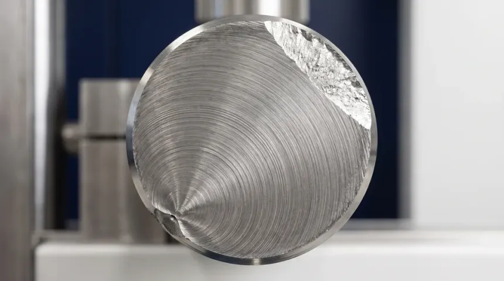

## Teoría de fatiga, fórmulas y datos de referencia

**Compendio basado en los apuntes de clase de MSc. Ing. Edén A. Capcha**  
**Universidad Nacional de Ingeniería**  
**Fecha:** 13 de noviembre de 2026

Este documento reúne únicamente los contenidos relacionados con fatiga: teoría, parámetros de carga cíclica, concentración de esfuerzos, métodos de predicción de vida, correcciones para componentes, criterios de diseño y datos de materiales útiles para el análisis. No incluye problemas ni ejercicios.

## Símbolos y nomenclatura

Se adopta tracción positiva y compresión negativa. Los esfuerzos y resistencias deben expresarse en unidades compatibles. Las letras con prima ($'$) identifican generalmente propiedades de probeta de laboratorio o coeficientes experimentales; las magnitudes sin prima corresponden al componente o al estado aplicado, según se defina.

| Símbolo | Nombre y significado |
| --- | --- |
| $E$ | Módulo elástico o módulo de Young. |
| $S_{ut}$ | Resistencia última a la tracción. |
| $S_{uc}$ | Resistencia última a la compresión. |
| $S_y$ | Resistencia de fluencia a tracción. |
| $S_{su}$ | Resistencia última al cortante; en las notas se usa también como estimación basada en $S_{ut}$. |
| $S_{sy}$ | Resistencia de fluencia al cortante. |
| $S_e'$ | Límite de resistencia a la fatiga de una probeta estándar de laboratorio. |
| $S_e$ | Límite de fatiga corregido para el componente real. |
| $S_f$ | Resistencia a la fatiga correspondiente a una vida finita. |
| $S_a$ | Coordenada de amplitud de esfuerzo sobre una frontera de diseño. |
| $S_m$ | Coordenada de esfuerzo medio sobre una frontera de diseño. |
| $S_T$ | Resistencia del material a la temperatura de operación. |
| $S_{RT}$ | Resistencia del material a temperatura ambiente. |
| $\sigma_{\max}$ | Esfuerzo máximo de un ciclo. |
| $\sigma_{\min}$ | Esfuerzo mínimo de un ciclo. |
| $\sigma_m$ | Esfuerzo medio del ciclo. |
| $\sigma_a$ | Amplitud de esfuerzo del ciclo. |
| $\Delta\sigma$ | Rango de esfuerzo; diferencia entre máximo y mínimo. |
| $\sigma_{a0,b},\sigma_{m0,b}$ | Amplitud y medio nominales de esfuerzo normal por flexión, antes de aplicar concentración. |
| $\sigma_{a0,x},\sigma_{m0,x}$ | Amplitud y medio nominales de esfuerzo normal por carga axial, antes de aplicar concentración. |
| $\tau_{a0},\tau_{m0}$ | Amplitud y medio nominales de esfuerzo cortante por torsión, antes de aplicar concentración. |
| $\sigma_a',\sigma_m'$ | Amplitud y esfuerzo medio equivalentes para combinación de modos de carga. |
| $\sigma_{ar}$ | Amplitud completamente reversible equivalente según Goodman. |
| $R$ | Razón de esfuerzos del ciclo, $R=\sigma_{\min}/\sigma_{\max}$. |
| $N$ | Número de ciclos hasta la falla o vida considerada. |
| $2N$ | Número de reversiones; aparece en las relaciones deformación--vida. |
| $n_i$ | Ciclos aplicados al nivel de carga $i$. |
| $N_i$ | Vida estimada al nivel de carga $i$. |
| $D$ | Daño acumulado estimado por la regla lineal de Miner. |
| $a,b$ | Constantes empíricas de la curva esfuerzo--vida $S_f=aN^b$. En la correlación superficial, $a$ y $b$ son constantes distintas, propias de esa ecuación. |
| $f$ | Factor que define el punto de resistencia a $10^3$ ciclos como $fS_{ut}$. |
| $\varepsilon$ | Deformación unitaria. |
| $\Delta\varepsilon/2$ | Amplitud de deformación total. |
| $\Delta\varepsilon_e/2$ | Amplitud de deformación elástica. |
| $\Delta\varepsilon_p/2$ | Amplitud de deformación plástica. |
| $\sigma_f'$ | Coeficiente de resistencia a fatiga de la relación deformación--vida. |
| $\varepsilon_f'$ | Coeficiente de ductilidad a fatiga. |
| $b$ (Basquin) | Exponente de resistencia a fatiga en la relación deformación--vida. |
| $c$ | Exponente de ductilidad a fatiga en la relación deformación--vida. |
| $K_t,K_{ts}$ | Factores teóricos de concentración de esfuerzos normal y cortante. |
| $K_f,K_{fs}$ | Factores efectivos de concentración para fatiga normal y cortante. |
| $q,q_s$ | Sensibilidades a la entalla para esfuerzos normal y cortante. |
| $r$ (entalla) | Radio en la raíz de una entalla. |
| $\sqrt a$ (Neuber) | Constante de material para la correlación de sensibilidad a la entalla; no es el coeficiente $a$ de la curva $S$--$N$. |
| $k_a$ | Factor de Marin por acabado superficial. |
| $k_b$ | Factor de Marin por tamaño. |
| $k_c$ | Factor de Marin por tipo de carga. |
| $k_d$ | Factor de Marin por temperatura. |
| $k_e$ | Factor de Marin por confiabilidad. |
| $k_f$ (Marin) | Factor de Marin por efectos varios. Se distingue de $K_f$, factor de concentración por fatiga. |
| $z_a$ | Variable normal estándar asociada al nivel de confiabilidad. |
| $T_F,T$ | Temperatura expresada en grados Fahrenheit o Celsius, según se indique. |
| $A,B$ | Variables auxiliares para calcular el factor de seguridad de Gerber. |
| $n_f$ | Factor de seguridad respecto al criterio de falla por fatiga. |
| $r$ (línea de carga) | Razón de carga proporcional, $r=\sigma_a/\sigma_m=S_a/S_m$; el significado se distingue del radio de entalla por el contexto. |
| $b,x,\tau$ (subíndices) | Identifican flexión, carga axial y torsión, respectivamente. |
| HR | Acero laminado en caliente (*hot rolled*). |
| CD | Acero estirado en frío (*cold drawn*). |
| HB | Dureza Brinell. |
| ksi, MPa | Unidades de esfuerzo: kilolibra por pulgada cuadrada y megapascal. |
| Mpsi | Millones de libras por pulgada cuadrada, unidad de módulo elástico. |
| ASTM, UNS, AISI/SAE | Sistemas de designación o identificación de materiales. |

## Fundamentos de fatiga

### Naturaleza del daño por fatiga

La fatiga es el daño progresivo que aparece cuando un material se somete a cargas repetidas o fluctuantes. Una pieza puede fracturarse después de numerosos ciclos aun cuando el esfuerzo nominal sea menor que la resistencia estática del material. La falla suele desarrollarse en tres etapas: iniciación de una grieta, propagación gradual de la grieta y fractura final cuando la sección remanente ya no soporta la carga.

La iniciación suele verse favorecida por entallas, agujeros, chaveteros, roscas, cambios de sección, defectos metalúrgicos y rugosidad superficial. La vida también depende de la amplitud y el valor medio de la carga, el tipo de material y tratamiento, el tamaño, la temperatura, la corrosión, el desgaste y los esfuerzos residuales. Por esa razón, los resultados de una probeta de laboratorio no describen automáticamente la vida del componente completo.

Los ensayos de fatiga presentan dispersión: probetas nominalmente idénticas pueden fallar después de distintos números de ciclos. Las curvas de vida son por ello relaciones experimentales y estadísticas, no predicciones exactas para cada pieza individual. Muchos aceros muestran una meseta aproximada de resistencia a larga vida; numerosas aleaciones no ferrosas no presentan un límite de fatiga claramente definido y se caracterizan mediante una resistencia asociada a una vida finita especificada.

<input type="radio" name="fmc-group" id="tab1" class="fmc-radio" checked>
<input type="radio" name="fmc-group" id="tab2" class="fmc-radio">
<input type="radio" name="fmc-group" id="tab3" class="fmc-radio">
<input type="radio" name="fmc-group" id="tab4" class="fmc-radio">
<input type="radio" name="fmc-group" id="tab5" class="fmc-radio">

<h4 class="fmc-title">Fases de la Falla por Fatiga en Elementos Mecánicos</h4>

Haz clic en las pestañas para inspeccionar cada etapa del proceso

<label class="fmc-tab-label" for="tab1">1. Iniciación</label>
<label class="fmc-tab-label" for="tab2">2. Propagación</label>
<label class="fmc-tab-label" for="tab3">3. Rotura Súbita</label>
<label class="fmc-tab-label" for="tab4">4. Cara de Fractura</label>
<label class="fmc-tab-label" for="tab5">5. Evidencia Real</label>

<!-- SLIDE 1: INICIACIÓN -->

<svg class="fmc-svg-box" viewBox="0 0 500 150" width="100%" height="auto">
<rect x="100" y="35" width="300" height="80" rx="6" fill="#94a3b8" stroke="#334155" stroke-width="2"/>
<line x1="100" y1="75" x2="400" y2="75" stroke="#475569" stroke-width="1" stroke-dasharray="6,4"/>
<path d="M 150,12 L 150,30 M 143,24 L 150,31 L 157,24" stroke="#dc2626" stroke-width="2.5" fill="none"/>
<path d="M 150,138 L 150,120 M 143,126 L 150,119 L 157,126" stroke="#2563eb" stroke-width="2.5" fill="none"/>
<path d="M 350,12 L 350,30 M 343,24 L 350,31 L 357,24" stroke="#dc2626" stroke-width="2.5" fill="none"/>
<path d="M 350,138 L 350,120 M 343,126 L 350,119 L 357,126" stroke="#2563eb" stroke-width="2.5" fill="none"/>
<path d="M 250,35 L 250,48" stroke="#dc2626" stroke-width="3" stroke-linecap="round"/>
<circle cx="250" cy="35" r="4.5" fill="#ef4444"/>
<text x="250" y="24" font-size="10" font-weight="bold" fill="#dc2626" text-anchor="middle">Defecto / Rayadura Superficial</text>
</svg>

<!-- SLIDE 2: PROPAGACIÓN -->

<svg class="fmc-svg-box" viewBox="0 0 500 150" width="100%" height="auto">
<rect x="100" y="35" width="300" height="80" rx="6" fill="#94a3b8" stroke="#334155" stroke-width="2"/>
<line x1="100" y1="75" x2="400" y2="75" stroke="#475569" stroke-width="1" stroke-dasharray="6,4"/>
<path d="M 241,35 Q 250,46 259,35 M 237,35 Q 250,55 263,35 M 233,35 Q 250,65 267,35 M 229,35 Q 250,78 271,35" fill="none" stroke="#1e293b" stroke-width="1.5"/>
<path d="M 250,35 L 250,82" stroke="#dc2626" stroke-width="3" stroke-linecap="round"/>
<circle cx="250" cy="35" r="4.5" fill="#ef4444"/>
<text x="250" y="24" font-size="10" font-weight="bold" fill="#1e293b" text-anchor="middle">Propagación con arcos concéntricos ("Playas de fatiga")</text>
</svg>

<!-- SLIDE 3: ROTURA SÚBITA -->

<svg class="fmc-svg-box" viewBox="0 0 500 150" width="100%" height="auto">
<rect x="70" y="35" width="200" height="80" rx="6" fill="#94a3b8" stroke="#334155" stroke-width="2"/>
<rect x="290" y="38" width="200" height="80" rx="6" fill="#94a3b8" stroke="#334155" stroke-width="2" transform="rotate(3 290 75)"/>
<polyline points="275,70 268,79 280,88 270,98 277,108" fill="none" stroke="#7f1d1d" stroke-width="3"/>
<text x="250" y="20" font-size="11" font-weight="bold" fill="#991b1b" text-anchor="middle">¡Colapso Catastrófico Final!</text>
</svg>

<!-- SLIDE 4: CARA DE FRACTURA TRANSVERSAL -->

<svg class="fmc-svg-box" viewBox="0 0 500 180" width="100%" height="auto">
<circle cx="250" cy="90" r="55" fill="#cbd5e1" stroke="#334155" stroke-width="2.5"/>
<path d="M 205,65 Q 250,45 295,65 Q 295,85 250,85 Q 205,85 205,65 Z" fill="#64748b" stroke="#334155" stroke-width="1.5"/>
<path d="M 230,135 Q 250,125 270,135" fill="none" stroke="#2563eb" stroke-width="2"/>
<path d="M 215,125 Q 250,110 285,125" fill="none" stroke="#2563eb" stroke-width="2"/>
<path d="M 200,112 Q 250,95 300,112" fill="none" stroke="#2563eb" stroke-width="2"/>
<circle cx="250" cy="142" r="4" fill="#dc2626"/>
<line x1="250" y1="142" x2="250" y2="165" stroke="#dc2626" stroke-width="1.5"/>
<text x="250" y="175" font-size="10" font-weight="bold" fill="#dc2626" text-anchor="middle">1. Origen / Muesca superficial</text>
<line x1="285" y1="115" x2="355" y2="115" stroke="#2563eb" stroke-width="1.5"/>
<text x="360" y="118" font-size="10" font-weight="bold" fill="#2563eb" text-anchor="start">2. Playas de Fatiga</text>
<line x1="250" y1="55" x2="155" y2="55" stroke="#475569" stroke-width="1.5"/>
<text x="150" y="58" font-size="10" font-weight="bold" fill="#475569" text-anchor="end">3. Rotura Súbita</text>
</svg>

<!-- SLIDE 5: FOTO REAL DE LABORATORIO CON PINES -->

<strong style="color:#dc2626;">● 1. Origen:</strong> Concentrador de tensiones donde inicia la microfisura.

<strong style="color:#2563eb;">● 2. Playas de Fatiga:</strong> Marcas concéntricas de avance progresivo.

<strong style="color:#475569;">● 3. Rotura Rápida:</strong> Zona rugosa final por sobrecarga.

### Ciclo de esfuerzo

Para un ciclo identificado por sus esfuerzos extremos, el medio, la amplitud, el rango y la razón de esfuerzos son:

$$
\begin{aligned}
\sigma_m&=\frac{\sigma_{\max}+\sigma_{\min}}{2}, &
\sigma_a&=\frac{\sigma_{\max}-\sigma_{\min}}{2},\\
\Delta\sigma&=\sigma_{\max}-\sigma_{\min}=2\sigma_a, &
R&=\frac{\sigma_{\min}}{\sigma_{\max}}.
\end{aligned}
$$

- **Esfuerzo medio:** componente constante que desplaza el ciclo respecto del origen.
- **Amplitud:** mitad de la diferencia entre máximo y mínimo; representa la parte alternante.
- **Rango:** variación total del esfuerzo durante el ciclo.
- **Razón $R$:** relaciona el extremo mínimo con el máximo y ayuda a identificar el tipo de ciclo.

En carga completamente invertida, $\sigma_m=0$ y $R=-1$. En carga pulsante desde cero hasta tracción, $R=0$. En carga constante, $R=1$ y $\sigma_a=0$. Los ciclos reales pueden no ser sinusoidales; las definiciones anteriores se obtienen de los extremos del ciclo.

<h4 style="font-size: 1.1rem; font-weight: 700; color: #5c1d1d; margin: 0 0 4px 0;">Tipos de Ciclos de Esfuerzo en Fatiga</h4>

Representación temporal según el estándar del documento de referencia

<!-- GRÁFICO 1: Esfuerzo Fluctuante General -->

1. Esfuerzo Fluctuante General

<svg viewBox="0 0 500 180" width="100%" height="auto" style="display: block;">
<!-- Ejes Coordenados -->
<line x1="60" y1="15" x2="60" y2="150" stroke="#1e293b" stroke-width="1.5"/>
<line x1="50" y1="150" x2="475" y2="150" stroke="#1e293b" stroke-width="1.5"/>
<text x="24" y="85" font-size="11" font-weight="bold" fill="#1e293b" text-anchor="middle" transform="rotate(-90 24,85)">Esfuerzo</text>
<text x="45" y="158" font-size="11" font-style="italic" fill="#1e293b">O</text>
<text x="435" y="165" font-size="11" fill="#1e293b">Tiempo</text>

<!-- Línea de Esfuerzo Medio (Sigma_m) en y = 75 -->
<line x1="70" y1="75" x2="420" y2="75" stroke="#1e293b" stroke-width="1" stroke-dasharray="5,4"/>

<!-- Onda Sinusoidal con cierre final suave y natural -->
<path d="M 70,75 Q 87,35 105,35 Q 122,35 140,75 Q 157.5,115 175,115 Q 192.5,115 210,75 Q 227,35 245,35 Q 262,35 280,75 Q 297.5,115 315,115 Q 332.5,115 350,75 Q 367.5,35 385,35 Q 402.5,35 420,75" fill="none" stroke="#1e293b" stroke-width="2"/>

<!-- Líneas de referencia horizontales -->
<line x1="70" y1="35" x2="120" y2="35" stroke="#94a3b8" stroke-width="0.8"/>
<line x1="140" y1="115" x2="280" y2="115" stroke="#94a3b8" stroke-width="0.8"/>

<!-- Cota Sigma Máx reubicada a la altura de la referencia celeste (x = 105) -->
<line x1="105" y1="35" x2="105" y2="150" stroke="#1e293b" stroke-width="1"/>
<polygon points="105,35 102,41 108,41" fill="#1e293b"/>
<polygon points="105,150 102,144 108,144" fill="#1e293b"/>
<text x="99" y="96" font-size="11" font-weight="bold" fill="#1e293b" text-anchor="end">σmáx</text>

<!-- Cota Sigma Mín (desde valle y=115 hasta y=150) -->
<line x1="325" y1="115" x2="325" y2="150" stroke="#1e293b" stroke-width="1"/>
<polygon points="325,115 322,121 328,121" fill="#1e293b"/>
<polygon points="325,150 322,144 328,144" fill="#1e293b"/>
<text x="319" y="136" font-size="11" font-weight="bold" fill="#1e293b" text-anchor="end">σmín</text>

<!-- Cota Sigma Amplitud superior (de línea media y=75 a cresta y=35) -->
<line x1="175" y1="35" x2="175" y2="75" stroke="#1e293b" stroke-width="1"/>
<polygon points="175,35 172,41 178,41" fill="#1e293b"/>
<polygon points="175,75 172,69 178,69" fill="#1e293b"/>
<text x="182" y="58" font-size="11" font-weight="bold" fill="#1e293b">σa</text>

<!-- Cota Sigma Amplitud inferior (de línea media y=75 a valle y=115) -->
<line x1="245" y1="75" x2="245" y2="115" stroke="#1e293b" stroke-width="1"/>
<polygon points="245,75 242,81 248,81" fill="#1e293b"/>
<polygon points="245,115 242,109 248,109" fill="#1e293b"/>
<text x="252" y="98" font-size="11" font-weight="bold" fill="#1e293b">σa</text>

<!-- Cota Sigma Medio (σm) en el lado derecho (desde y=75 hasta y=150) -->
<line x1="365" y1="75" x2="365" y2="150" stroke="#1e293b" stroke-width="1"/>
<polygon points="365,75 362,81 368,81" fill="#1e293b"/>
<polygon points="365,150 362,144 368,144" fill="#1e293b"/>
<text x="359" y="116" font-size="11" font-weight="bold" fill="#1e293b" text-anchor="end">σm</text>

<!-- Cota Rango / Delta Sigma (σr) desplazada a la derecha -->
<line x1="440" y1="35" x2="440" y2="115" stroke="#1e293b" stroke-width="1"/>
<polygon points="440,35 437,41 443,41" fill="#1e293b"/>
<polygon points="440,115 437,109 443,109" fill="#1e293b"/>
<text x="447" y="78" font-size="11" font-weight="bold" fill="#1e293b">σr</text>
</svg>

<!-- GRÁFICO 2: Esfuerzo Pulsante desde Cero (σmín = 0) -->

2. Esfuerzo Pulsante desde Cero (σmín = 0)

<svg viewBox="0 0 500 180" width="100%" height="auto" style="display: block;">
<!-- Ejes Coordenados -->
<line x1="60" y1="15" x2="60" y2="150" stroke="#1e293b" stroke-width="1.5"/>
<line x1="50" y1="150" x2="475" y2="150" stroke="#1e293b" stroke-width="1.5"/>
<text x="24" y="85" font-size="11" font-weight="bold" fill="#1e293b" text-anchor="middle" transform="rotate(-90 24,85)">Esfuerzo</text>
<text x="45" y="158" font-size="11" font-style="italic" fill="#1e293b">O</text>
<text x="435" y="165" font-size="11" fill="#1e293b">Tiempo</text>
<text x="145" y="165" font-size="11" font-weight="bold" fill="#1e293b">σmín = 0</text>

<!-- Línea de Esfuerzo Medio (Sigma_m) en y = 92.5 -->
<line x1="70" y1="92.5" x2="420" y2="92.5" stroke="#1e293b" stroke-width="1" stroke-dasharray="5,4"/>

<!-- Onda Sinusoidal con valles tangentes al eje de tiempo en y=150 y cierre final suave -->
<path d="M 70,92.5 Q 87,35 105,35 Q 122,35 140,92.5 Q 157.5,150 175,150 Q 192.5,150 210,92.5 Q 227,35 245,35 Q 262,35 280,92.5 Q 297.5,150 315,150 Q 332.5,150 350,92.5 Q 367.5,35 385,35 Q 402.5,35 420,92.5" fill="none" stroke="#1e293b" stroke-width="2"/>

<!-- Líneas de referencia horizontales -->
<line x1="70" y1="35" x2="120" y2="35" stroke="#94a3b8" stroke-width="0.8"/>

<!-- Cota Sigma Máx reubicada a la altura de la referencia celeste (x = 105) -->
<line x1="105" y1="35" x2="105" y2="150" stroke="#1e293b" stroke-width="1"/>
<polygon points="105,35 102,41 108,41" fill="#1e293b"/>
<polygon points="105,150 102,144 108,144" fill="#1e293b"/>
<text x="99" y="96" font-size="11" font-weight="bold" fill="#1e293b" text-anchor="end">σmáx</text>

<!-- Cota Sigma Amplitud superior (de línea media y=92.5 a cresta y=35) -->
<line x1="175" y1="35" x2="175" y2="92.5" stroke="#1e293b" stroke-width="1"/>
<polygon points="175,35 172,41 178,41" fill="#1e293b"/>
<polygon points="175,92.5 172,86.5 178,86.5" fill="#1e293b"/>
<text x="182" y="66" font-size="11" font-weight="bold" fill="#1e293b">σa</text>

<!-- Cota Sigma Amplitud inferior (de línea media y=92.5 al eje en y=150) -->
<line x1="245" y1="92.5" x2="245" y2="150" stroke="#1e293b" stroke-width="1"/>
<polygon points="245,92.5 242,98.5 248,98.5" fill="#1e293b"/>
<polygon points="245,150 242,144 248,144" fill="#1e293b"/>
<text x="252" y="124" font-size="11" font-weight="bold" fill="#1e293b">σa</text>

<!-- Cota Sigma Medio (σm) en el lado derecho (desde y=92.5 hasta y=150) -->
<line x1="365" y1="92.5" x2="365" y2="150" stroke="#1e293b" stroke-width="1"/>
<polygon points="365,92.5 362,98.5 368,98.5" fill="#1e293b"/>
<polygon points="365,150 362,144 368,144" fill="#1e293b"/>
<text x="359" y="124" font-size="11" font-weight="bold" fill="#1e293b" text-anchor="end">σm</text>

<!-- Cota Rango / Delta Sigma (σr) desplazada a la derecha -->
<line x1="440" y1="35" x2="440" y2="150" stroke="#1e293b" stroke-width="1"/>
<polygon points="440,35 437,41 443,41" fill="#1e293b"/>
<polygon points="440,150 437,144 443,144" fill="#1e293b"/>
<text x="447" y="96" font-size="11" font-weight="bold" fill="#1e293b">σr</text>
</svg>

<!-- GRÁFICO 3: Esfuerzo Completamente Invertido (σm = 0) -->

3. Esfuerzo Completamente Invertido (σm = 0)

<svg viewBox="0 0 500 180" width="100%" height="auto" style="display: block;">
<!-- Ejes Coordenados -->
<line x1="60" y1="15" x2="60" y2="165" stroke="#1e293b" stroke-width="1.5"/>
<line x1="50" y1="90" x2="475" y2="90" stroke="#1e293b" stroke-width="1.5"/>
<text x="53" y="25" font-size="12" font-weight="bold" fill="#1e293b">+</text>
<text x="53" y="155" font-size="12" font-weight="bold" fill="#1e293b">−</text>
<text x="24" y="93" font-size="11" font-weight="bold" fill="#1e293b" text-anchor="middle" transform="rotate(-90 24,93)">Esfuerzo</text>
<text x="45" y="93" font-size="11" font-style="italic" fill="#1e293b" text-anchor="middle">O</text>
<text x="435" y="82" font-size="11" fill="#1e293b">Tiempo</text>
<text x="220" y="165" font-size="11" font-weight="bold" fill="#1e293b">σm = 0</text>

<!-- Onda Sinusoidal simétrica centrada en el eje O (y = 90) con cierre final suave -->
<path d="M 70,90 Q 87,30 105,30 Q 122,30 140,90 Q 157.5,150 175,150 Q 192.5,150 210,90 Q 227,30 245,30 Q 262,30 280,90 Q 297.5,150 315,150 Q 332.5,150 350,90 Q 367.5,30 385,30 Q 402.5,30 420,90" fill="none" stroke="#1e293b" stroke-width="2"/>

<!-- Líneas de referencia horizontales -->
<line x1="70" y1="30" x2="120" y2="30" stroke="#94a3b8" stroke-width="0.8"/>
<line x1="140" y1="150" x2="280" y2="150" stroke="#94a3b8" stroke-width="0.8"/>

<!-- Cota Sigma Amplitud superior (de línea central y=90 a cresta y=30) -->
<line x1="175" y1="30" x2="175" y2="90" stroke="#1e293b" stroke-width="1"/>
<polygon points="175,30 172,36 178,36" fill="#1e293b"/>
<polygon points="175,90 172,84 178,84" fill="#1e293b"/>
<text x="182" y="63" font-size="11" font-weight="bold" fill="#1e293b">σa</text>

<!-- Cota Sigma Amplitud inferior (de línea central y=90 a valle y=150) -->
<line x1="245" y1="90" x2="245" y2="150" stroke="#1e293b" stroke-width="1"/>
<polygon points="245,90 242,96 248,96" fill="#1e293b"/>
<polygon points="245,150 242,144 248,144" fill="#1e293b"/>
<text x="252" y="123" font-size="11" font-weight="bold" fill="#1e293b">σa</text>

<!-- Cota Rango / Delta Sigma (σr) desplazada a la derecha -->
<line x1="440" y1="30" x2="440" y2="150" stroke="#1e293b" stroke-width="1"/>
<polygon points="440,30 437,36 443,36" fill="#1e293b"/>
<polygon points="440,150 437,144 443,144" fill="#1e293b"/>
<text x="447" y="93" font-size="11" font-weight="bold" fill="#1e293b">σr</text>
</svg>

### Concentración de esfuerzos y entallas

Los cambios geométricos perturban el flujo de esfuerzos y generan valores locales superiores al esfuerzo nominal. Para carga estática o para caracterizar la solución elástica de la geometría se definen:

$$
K_t=\frac{\sigma_{\max}}{\sigma_{\mathrm{nom}}},\qquad
K_{ts}=\frac{\tau_{\max}}{\tau_{\mathrm{nom}}}.
$$

Los factores teóricos dependen de la geometría y de la forma de carga; se obtienen de análisis elástico, tablas o gráficas. No son propiedades universales del material.

En fatiga, el efecto efectivo de una entalla se representa con la sensibilidad a la entalla $q$ y los factores $K_f$ y $K_{fs}$:

$$
\begin{aligned}
q&=\frac{K_f-1}{K_t-1}, & K_f&=1+q(K_t-1),\\
q_s&=\frac{K_{fs}-1}{K_{ts}-1}, & K_{fs}&=1+q_s(K_{ts}-1).
\end{aligned}
$$

En general, $0\leq q\leq1$: $q=0$ representa material insensible a la entalla, mientras que $q=1$ implica $K_f=K_t$. De manera análoga se interpreta $q_s$ para cortante. La sensibilidad depende del material, del radio de la raíz y de las condiciones del ensayo.

Una estimación de Neuber presentada para aceros es:

$$
K_f=1+\frac{K_t-1}{1+\sqrt{a/r}},
$$

donde $r$ es el radio de la raíz y $\sqrt a$ es una constante del material. Para $S_{ut}$ en ksi y $\sqrt a$ en $\sqrt{\mathrm{pulg}}$:

$$
\begin{aligned}
\sqrt{a}_{\text{axial/flexión}}={}&0.246-3.08(10^{-3})S_{ut}+1.51(10^{-5})S_{ut}^2-2.67(10^{-8})S_{ut}^3,\\
\sqrt{a}_{\text{torsión}}={}&0.190-2.51(10^{-3})S_{ut}+1.35(10^{-5})S_{ut}^2-2.67(10^{-8})S_{ut}^3.
\end{aligned}
$$

Estas correlaciones requieren las unidades indicadas y no deben usarse directamente con MPa o mm sin una conversión válida. Para fatiga, $K_f$ y $K_{fs}$ se aplican a las componentes cíclicas según el modelo usado. Para revisar fluencia estática local suele comprobarse la concentración elástica con $K_t$ y $K_{ts}$; si hay plastificación local, el análisis elástico lineal puede ser insuficiente.

<input type="radio" name="kimg-group" id="kimg1" class="kt-img-radio" checked>
<input type="radio" name="kimg-group" id="kimg2" class="kt-img-radio">
<input type="radio" name="kimg-group" id="kimg3" class="kt-img-radio">
<input type="radio" name="kimg-group" id="kimg4" class="kt-img-radio">
<input type="radio" name="kimg-group" id="kimg5" class="kt-img-radio">
<input type="radio" name="kimg-group" id="kimg6" class="kt-img-radio">
<input type="radio" name="kimg-group" id="kimg7" class="kt-img-radio">
<input type="radio" name="kimg-group" id="kimg8" class="kt-img-radio">
<input type="radio" name="kimg-group" id="kimg9" class="kt-img-radio">
<input type="radio" name="kimg-group" id="kimg10" class="kt-img-radio">
<input type="radio" name="kimg-group" id="kimg11" class="kt-img-radio">
<input type="radio" name="kimg-group" id="kimg12" class="kt-img-radio">
<input type="radio" name="kimg-group" id="kimg13" class="kt-img-radio">
<input type="radio" name="kimg-group" id="kimg14" class="kt-img-radio">

<h4 class="kt-img-title">Ábacos y Geometrías de Concentración de Esfuerzos ($K_t, K_{ts}, q$)</h4>

Gráficas oficiales de referencia (Páginas 47–52)

<label class="kt-img-tab" for="kimg1" title="Factor q Axial">Fac. q Axial</label>
<label class="kt-img-tab" for="kimg2" title="Factor q Torsión">Fac. q Tors.</label>
<label class="kt-img-tab" for="kimg3" title="Agujero Tracción">Aguj. Trac.</label>
<label class="kt-img-tab" for="kimg4" title="Agujero Flexión">Aguj. Flex.</label>
<label class="kt-img-tab" for="kimg5" title="Entalla Tracción">Ent. Trac.</label>
<label class="kt-img-tab" for="kimg6" title="Entalla Flexión">Ent. Flex.</label>
<label class="kt-img-tab" for="kimg7" title="Hombro Tracción">Hom. Trac.</label>
<label class="kt-img-tab" for="kimg8" title="Hombro Flexión">Hom. Flex.</label>
<label class="kt-img-tab" for="kimg9" title="Eje Tracción">Eje Trac.</label>
<label class="kt-img-tab" for="kimg10" title="Eje Torsión">Eje Tors.</label>
<label class="kt-img-tab" for="kimg11" title="Eje Flexión">Eje Flex.</label>
<label class="kt-img-tab" for="kimg12" title="Cilindro Agujero">Cil. Aguj.</label>
<label class="kt-img-tab" for="kimg13" title="Redonda Tracción">Red. Trac.</label>
<label class="kt-img-tab" for="kimg14" title="Redonda Flexión">Red. Flex.</label>

1. Factor $q$ para esfuerzo axial o flexionante

2. Factor $q$ para esfuerzos de torsión

3. Barra en tensión o compresión simple con un agujero transversal

4. Barra rectangular con un agujero transversal en flexión

5. Barra rectangular con entallas en tensión o compresión simple

6. Barra rectangular con entallas en flexión

7. Barra rectangular con radio de acuerdo en tensión o compresión simple

8. Barra rectangular con radio de acuerdo en flexión

9. Eje redondo con radio de acuerdo en tensión

10. Eje redondo con radio de acuerdo en torsión

11. Eje redondo con radio de acuerdo en flexión

12. Eje redondo en flexión con un agujero transversal

13. Barra redonda ranurada en tensión

14. Barra redonda ranurada en flexión

## Predicción de vida a fatiga

### Método esfuerzo--vida

El método esfuerzo--vida, también llamado método $S$--$N$, relaciona el esfuerzo alternante con el número de ciclos hasta la falla. En el ensayo de viga rotatoria, una probeta gira bajo un momento flector constante; un punto de su superficie alterna aproximadamente entre tracción y compresión. Se registra el número de ciclos hasta la rotura para distintos niveles de esfuerzo y se construye la curva experimental.

Este método se emplea principalmente para fatiga de alto número de ciclos, cuando la deformación global y local se considera esencialmente elástica. La curva representa resultados de probetas con preparación y condiciones definidas; para diseñar un componente deben aplicarse correcciones por geometría, acabado, tamaño, temperatura, confiabilidad y ambiente.

  
  <!-- Gráfica 1 -->
  

    <h3 style="font-size: 1.05rem; font-weight: 700; color: #5c1d1d; text-align: left; margin-bottom: 8px;">
      1. Curva S–N típica de datos de ensayos de fatiga ($S_f$ vs. $N$)
    </h3>
    
    

      Muestra el comportamiento de la resistencia a la fatiga en función del número de ciclos, delimitando las regiones de bajo y alto ciclo, así como los umbrales de vida finita e infinita hasta alcanzar el límite de resistencia $S_e$.
    

  

  <!-- Gráfica 2 -->
  

    <h3 style="font-size: 1.05rem; font-weight: 700; color: #5c1d1d; text-align: left; margin-bottom: 8px;">
      2. Bandas S–N de aleaciones representativas de aluminio
    </h3>
    
    

      Compara las dispersiones y bandas de resistencia a la fatiga para aleaciones de aluminio clasificadas según su método de manufactura (forjado, fundición en molde permanente y fundición en molde de arena).
    

  

  <!-- Gráfica 3 -->
  

    <h3 style="font-size: 1.05rem; font-weight: 700; color: #5c1d1d; text-align: left; margin-bottom: 8px;">
      3. Familias de curvas S–N para diferentes niveles de esfuerzo medio
    </h3>
    
    

      Ilustra cómo la presencia de un esfuerzo medio de tensión ($\sigma_m$ creciente) desplaza las curvas S–N hacia abajo, reduciendo la vida a fatiga del componente para cualquier nivel de esfuerzo alternante.
    

  

### Resistencia y límite de fatiga de probeta

Para muchos aceros con $S_{ut}\leq200\ \text{ksi}$ (aproximadamente $1400\ \text{MPa}$), se usa como estimación del límite de fatiga de probeta rotatoria:

$$
S_e'=0.5S_{ut}.
$$

Para resistencias mayores se adopta, como aproximación, $S_e'=100\ \text{ksi}$ (aproximadamente $700\ \text{MPa}$). Estas reglas son empíricas y no valores garantizados; se debe revisar su aplicabilidad al material, tratamiento, tamaño de probeta y norma pertinente. El límite de fatiga de probeta $S_e'$ no es necesariamente el límite de fatiga del componente real $S_e$.

En la región finita de vida se suele representar la curva mediante una ley de potencia:

$$
S_f=aN^b.
$$

Si se toman como puntos de referencia $10^3$ ciclos con resistencia $fS_{ut}$ y $10^6$ ciclos con resistencia $S_e'$, las constantes del modelo son:

$$
a=\frac{(fS_{ut})^2}{S_e'},\qquad
b=-\frac{1}{3}\log_{10}\left(\frac{fS_{ut}}{S_e'}\right).
$$

Se debe mantener una misma convención de ciclos en todos los puntos de ajuste. Las relaciones de deformación--vida pueden expresar la vida en reversiones $2N$, por lo que no deben mezclarse sus convenciones sin conversión.

### Método deformación--vida

Cuando la deformación plástica local es importante, en particular en fatiga de bajo número de ciclos, se emplea el método deformación--vida. La amplitud total de deformación se descompone en partes elástica y plástica:

$$
\begin{aligned}
\frac{\Delta\varepsilon}{2}&=\frac{\Delta\varepsilon_e}{2}+\frac{\Delta\varepsilon_p}{2},\\
\frac{\Delta\varepsilon_e}{2}&=\frac{\sigma_f'}{E}(2N)^b,\\
\frac{\Delta\varepsilon_p}{2}&=\varepsilon_f'(2N)^c.
\end{aligned}
$$

La relación de Manson--Coffin--Basquin combina las contribuciones:

$$
\frac{\Delta\varepsilon}{2}
=\frac{\sigma_f'}{E}(2N)^b+\varepsilon_f'(2N)^c.
$$

$\sigma_f'$ es el coeficiente de resistencia a fatiga, $\varepsilon_f'$ el coeficiente de ductilidad a fatiga, $b$ el exponente de resistencia y $c$ el exponente de ductilidad. Estos parámetros se determinan mediante ensayos. Para estimaciones de aceros con dureza Brinell menor que 500 se emplea a veces $\sigma_f'\approx S_{ut}+50\ \text{ksi}$ o $\sigma_f'\approx S_{ut}+345\ \text{MPa}$, usando unidades compatibles.

  
  

    Bucle de histéresis cíclica que muestra las componentes de deformación elástica ($\Delta\varepsilon_e$) y plástica ($\Delta\varepsilon_p$)
  

  
  

    Curva deformación–vida que muestra las ramas elástica, plástica y total
  

### Cargas de amplitud variable

Una curva $S$--$N$ de amplitud constante no describe por sí sola una historia de carga variable. Una aproximación de daño acumulado lineal es la regla de Miner:

$$
D=\sum_i\frac{n_i}{N_i}.
$$

Aquí $n_i$ es el número de ciclos realmente aplicado al nivel $i$ y $N_i$ es la vida estimada si se aplicara ese nivel de manera constante. El valor $D\approx1$ se usa como indicador empírico de falla. No es una ley exacta: el orden de aplicación, las interacciones entre cargas y otros mecanismos pueden cambiar la vida observada.

## Corrección para componentes reales

### Relación de Marin

El límite de fatiga de probeta se corrige para representar las condiciones del componente mediante la relación de Marin:

$$
S_e=k_a k_b k_c k_d k_e k_f S_e'.
$$

Los factores representan acabado superficial ($k_a$), tamaño ($k_b$), tipo de carga ($k_c$), temperatura ($k_d$), confiabilidad ($k_e$) y efectos varios ($k_f$). Se multiplican por el límite de probeta $S_e'$ para obtener el límite corregido $S_e$. El uso de cada factor y sus correlaciones depende del material y de las condiciones de diseño.

### Acabado superficial

Una correlación empírica es $k_a=aS_{ut}^{b}$. Los coeficientes dependen del acabado y de las unidades de $S_{ut}$:

| Acabado | $a$ ($S_{ut}$ en ksi) | $a$ ($S_{ut}$ en MPa) | $b$ |
| --- | ---: | ---: | ---: |
| Esmerilado | 1.34 | 1.58 | $-0.085$ |
| Maquinado o laminado en frío | 2.70 | 4.51 | $-0.265$ |
| Laminado en caliente | 14.4 | 57.7 | $-0.718$ |
| Como sale de forja | 39.9 | 272 | $-0.995$ |

Se debe usar el par de coeficientes correspondiente a un solo sistema de unidades; no se combinan coeficientes de ksi con valores de resistencia en MPa ni a la inversa.

### Tamaño

Para flexión y torsión, usando el diámetro equivalente $d$:

$$
k_b=\begin{cases}
0.879d^{-0.107},&0.11\leq d\leq2\ \text{pulg},\\
0.91d^{-0.157},&2<d\leq10\ \text{pulg},\\
1.24d^{-0.107},&2.79\leq d\leq51\ \text{mm},\\
1.51d^{-0.157},&51<d\leq254\ \text{mm}.
\end{cases}
$$

Para carga axial se toma $k_b=1$. Las expresiones son correlaciones aproximadas y válidas en los intervalos indicados. En secciones no circulares, el diámetro equivalente debe determinarse mediante el método de diseño que se adopte.

### Tipo de carga

Los valores tabulados para el factor de carga son:

| Tipo de carga | $k_c$ |
| --- | ---: |
| Flexión | 1.00 |
| Carga axial | 0.85 |
| Torsión | 0.59 |

Estos valores forman parte del método empírico presentado y no sustituyen resultados de ensayos de fatiga cuando el material o el modo de carga difieren de las hipótesis.

### Temperatura

En unidades inglesas, una estimación polinómica del factor de temperatura es:

$$
\begin{aligned}
k_d={}&0.975+0.432(10^{-3})T_F-0.115(10^{-5})T_F^2+0.104(10^{-8})T_F^3\\
&-0.595(10^{-12})T_F^4,\qquad70\leq T_F\leq1000\ ^\circ\mathrm{F}.
\end{aligned}
$$

Otra estimación usa la razón entre resistencia a la temperatura de operación y a temperatura ambiente, $k_d=S_T/S_{RT}$:

| $T$ ($^\circ$C) | $S_T/S_{RT}$ | $T$ ($^\circ$F) | $S_T/S_{RT}$ |
| ---: | ---: | ---: | ---: |
| 20 | 1.000 | 70 | 1.000 |
| 50 | 1.010 | 100 | 1.008 |
| 100 | 1.020 | 200 | 1.020 |
| 150 | 1.025 | 300 | 1.024 |
| 200 | 1.020 | 400 | 1.018 |
| 250 | 1.000 | 500 | 0.995 |
| 300 | 0.975 | 600 | 0.963 |
| 350 | 0.943 | 700 | 0.927 |
| 400 | 0.900 | 800 | 0.872 |
| 450 | 0.843 | 900 | 0.797 |
| 500 | 0.768 | 1000 | 0.698 |
| 550 | 0.672 | 1100 | 0.567 |
| 600 | 0.549 |  |  |

El polinomio solo se indica para hasta $1000\ ^\circ$F; los valores de la tabla hasta $1100\ ^\circ$F no amplían automáticamente su intervalo de validez. A temperaturas elevadas pueden gobernar fluencia lenta, oxidación u otros mecanismos que requieren una evaluación adicional.

### Confiabilidad y efectos varios

La aproximación para el factor de confiabilidad es $k_e=1-0.08z_a$. Los valores tabulados son:

| Confiabilidad (%) | $z_a$ | $k_e$ |
| ---: | ---: | ---: |
| 50 | 0 | 1.000 |
| 90 | 1.288 | 0.897 |
| 95 | 1.645 | 0.868 |
| 99 | 2.326 | 0.814 |
| 99.9 | 3.091 | 0.753 |
| 99.99 | 3.719 | 0.702 |
| 99.999 | 4.265 | 0.659 |
| 99.9999 | 4.753 | 0.620 |

El factor $k_f$ agrupa efectos no considerados en los otros factores, por ejemplo, condiciones ambientales. Depende del ambiente y de datos experimentales; si no se dispone de información adicional, los apuntes adoptan $k_f=1$. Corrosión, desgaste o tratamientos superficiales pueden justificar una selección distinta.

## Criterios de falla por fatiga

### Diagramas de esfuerzo medio y amplitud

Los criterios de fatiga relacionan el esfuerzo alternante $\sigma_a$ con el esfuerzo medio $\sigma_m$. En estos diagramas, la amplitud suele ubicarse en el eje vertical y el esfuerzo medio en el horizontal. La frontera de diseño depende del criterio seleccionado; el estado debe quedar en la región segura. El límite de fatiga $S_e$ establece el intercepto de amplitud idealizado para vida larga, mientras que $S_{ut}$ o $S_y$ intervienen en la influencia del esfuerzo medio.

La línea de carga representa la razón entre amplitud y esfuerzo medio del estado aplicado. El factor de seguridad proporcional se obtiene comparando cuánto se puede escalar el estado desde el origen antes de alcanzar la frontera. Además del criterio de fatiga, se debe comprobar por separado que el esfuerzo máximo instantáneo no ocasione fluencia.

<input type="radio" name="sn6-group" id="sn6_1" class="sn-img-radio" checked>
<input type="radio" name="sn6-group" id="sn6_2" class="sn-img-radio">
<input type="radio" name="sn6-group" id="sn6_3" class="sn-img-radio">
<input type="radio" name="sn6-group" id="sn6_4" class="sn-img-radio">
<input type="radio" name="sn6-group" id="sn6_5" class="sn-img-radio">
<input type="radio" name="sn6-group" id="sn6_6" class="sn-img-radio">

<h4 class="sn-img-title">Diagramas de Esfuerzo Medio y Amplitud ($\sigma_a$ vs $\sigma_m$)</h4>

Criterios de fatiga, líneas de carga y factores de seguridad (Páginas 55–57)

<label class="sn-img-tab" for="sn6_1" title="Familias S-N">1. Familias S–N</label>
<label class="sn-img-tab" for="sn6_2" title="Datos Normalizados">2. Datos Normalizados</label>
<label class="sn-img-tab" for="sn6_3" title="Ciclo Variable">3. Ciclo Variable</label>
<label class="sn-img-tab" for="sn6_4" title="Diagrama Goodman">4. Goodman y Razón</label>
<label class="sn-img-tab" for="sn6_5" title="Criterios de Falla">5. Criterios de Falla</label>
<label class="sn-img-tab" for="sn6_6" title="Factores de Seguridad">6. Factores y Regiones</label>

<!-- SLIDE 1 -->

1. Familias de curvas de fatiga ($\sigma_a$ vs. $\sigma_m$) para vidas específicas

Muestra cómo disminuye el esfuerzo alternante admisible conforme aumenta el esfuerzo medio para un número determinado de ciclos ($10^3$, $10^4$, $10^5$, $10^6$), convergiendo en el eje horizontal hacia la resistencia última a la tensión ($S_{ut}$)[cite: 14].

<!-- SLIDE 2 -->

2. Datos experimentales normalizados de fatiga en compresión y tensión

Relaciona la amplitud de esfuerzo normalizada ($S_a/S_e'$) frente a los cocientes de esfuerzo medio en compresión ($S_m/S_{uc}$) y tensión ($S_m/S_{ut}$), contrastando los resultados empíricos con la línea límite teórica[cite: 15].

<!-- SLIDE 3 -->

3. Componentes geométricas del ciclo de esfuerzo variable

Ilustra la relación geométrica entre el esfuerzo medio ($\sigma_m$), el esfuerzo alternante ($\sigma_a$), el rango ($\sigma_r$) y los límites máximo y mínimo respecto a las propiedades estáticas y de fatiga del material ($S_e$, $S_y$, $S_u$)[cite: 16].

<!-- SLIDE 4 -->

4. Diagrama de Goodman con líneas de razón de carga ($R$ y $A$)

Integra las familias de curvas de vida en un diagrama completo de esfuerzos máximos y mínimos, incorporando líneas radiales de razón de carga ($R$ y $A$) para determinar directamente la vida estimada bajo cualquier combinación de cargas[cite: 17].

<!-- SLIDE 5 -->

5. Criterios teóricos de falla por fatiga y fluencia

Compara las líneas de diseño tradicionales para fatiga (Goodman modificada, Gerber, Soderberg y ASME-elíptica) junto con la recta de fluencia de Langer, delimitando con precisión la región segura de operación mecánica[cite: 18].

<!-- SLIDE 6 -->

6. Factores de seguridad y regiones de vida para esfuerzos medios positivos y negativos

Muestra las zonas de diseño para vida infinita ($N = \infty$) y finita ($1 < N < \infty$), detallando las fórmulas analíticas para calcular de manera independiente el factor de seguridad frente a fatiga ($n_f$) y frente a fluencia ($n_y$)[cite: 20].

### Goodman modificado

La frontera lineal une $S_e$ en el eje de amplitud con $S_{ut}$ en el eje de esfuerzo medio:

$$
\frac{\sigma_a}{S_e}+\frac{\sigma_m}{S_{ut}}=1.
$$

El factor de seguridad proporcional respecto al origen es:

$$
n_f=\frac{1}{\sigma_a/S_e+\sigma_m/S_{ut}}.
$$

Goodman modificado se usa por su sencillez y suele ser más conservador que Gerber para muchos metales dúctiles. Esta tendencia no implica que sea universalmente válida o conservadora en todo material. También debe revisarse la fluencia estática.

### Gerber

La frontera parabólica empírica usada para muchos metales dúctiles es:

$$
\frac{\sigma_a}{S_e}+\left(\frac{\sigma_m}{S_{ut}}\right)^2=1.
$$

Para el factor de seguridad proporcional, se definen $A=\sigma_a/S_e$ y $B=(\sigma_m/S_{ut})^2$. Al escalar simultáneamente amplitud y medio por $n_f$, se obtiene:

$$
A n_f+B n_f^2=1,
\qquad
n_f=\frac{-A+\sqrt{A^2+4B}}{2B}\quad(B>0).
$$

Si $B=0$, $n_f=1/A$. Gerber puede ajustarse mejor a ciertos datos experimentales de metales dúctiles, pero su uso no sustituye ensayos ni la revisión independiente de fluencia.

### Elíptico de ASME

La frontera elíptica para esfuerzos normales se expresa como:

$$
\left(\frac{\sigma_a}{S_e}\right)^2+
\left(\frac{\sigma_m}{S_y}\right)^2=1.
$$

El factor de seguridad proporcional es:

$$
n_f=\frac{1}{\sqrt{(\sigma_a/S_e)^2+(\sigma_m/S_y)^2}}.
$$

La curva combina la resistencia a fatiga asociada a la amplitud con la fluencia bajo esfuerzo medio.

### Combinación de flexión, carga axial y torsión

Como aproximaciones para carga cortante, se usan:

$$
S_{su}\approx0.67S_{ut},\qquad S_{sy}\approx0.577S_y.
$$

La segunda relación corresponde a la conversión de von Mises para fluencia en cortante; la primera es empírica y no sustituye ensayos torsionales.

Para combinar flexión, carga axial y torsión mediante energía de distorsión, se estiman las amplitudes y esfuerzos medios equivalentes:

$$
\begin{aligned}
\sigma_a'&=\sqrt{\left[K_{f,b}\sigma_{a0,b}+K_{f,x}\sigma_{a0,x}\right]^2
+3\left[K_{fs}\tau_{a0}\right]^2},\\
\sigma_m'&=\sqrt{\left[K_{f,b}\sigma_{m0,b}+K_{f,x}\sigma_{m0,x}\right]^2
+3\left[K_{fs}\tau_{m0}\right]^2}.
\end{aligned}
$$

Los subíndices $b$, $x$ y $\tau$ identifican flexión, carga axial y torsión. El subíndice $0$ indica esfuerzo nominal previo a aplicar concentraciones. Las magnitudes equivalentes se sustituyen por $\sigma_a$ y $\sigma_m$ en el criterio escogido. Es una aproximación de diseño; cargas multiaxiales no proporcionales o materiales sensibles a la trayectoria pueden requerir métodos específicos.

Una amplitud completamente reversible equivalente según Goodman puede calcularse mediante:

$$
\sigma_{ar}=\frac{\sigma_a}{1-\sigma_m/S_{ut}},
$$

si el denominador es positivo y se cumplen las hipótesis de Goodman. No se debe extrapolar a $\sigma_m\geq S_{ut}$.

## Datos de materiales para consulta

Las propiedades siguientes se conservan como referencia de los apuntes y pueden servir para obtener valores de resistencia requeridos por las estimaciones de fatiga. Son datos tabulados/típicos, no una especificación de compra ni garantía para todo producto, proceso o tratamiento. Para diseño real se deben verificar la condición del material y su ficha técnica.

### Hierro fundido gris

La tabla presenta las resistencias indicadas en los apuntes. El número ASTM identifica la resistencia mínima a tracción expresada en ksi. $S_{su}$ se presenta como módulo de rotura por cortante.

| ASTM | $S_{ut}$ (ksi) | $S_{uc}$ (ksi) | $S_{su}$ (ksi) | $E$ (Mpsi) | Torsión (ksi) | $S_e$ (ksi) |
| ---: | ---: | ---: | ---: | ---: | ---: | ---: |
| 20 | 22 | 83 | 26 | 9.6--14 | 3.9--5.6 | 10 |
| 25 | 26 | 97 | 32 | 11.5--14.8 | 4.6--6.0 | 11.5 |
| 30 | 31 | 109 | 40 | 13--16.4 | 5.2--6.6 | 14 |
| 35 | 36.5 | 124 | 48.5 | 14.5--17.2 | 5.8--6.9 | 16 |
| 40 | 42.5 | 140 | 57 | 16--20 | 6.4--7.8 | 18.5 |
| 50 | 52.5 | 164 | 73 | 18.8--22.8 | 7.2--8.0 | 21.5 |
| 60 | 62.5 | 187.5 | 88.5 | 20.4--23.5 | 7.8--8.5 | 24.5 |

### Aceros al carbono

HR significa laminado en caliente y CD, estirado en frío. Las resistencias últimas y de fluencia son datos útiles para las estimaciones de probeta y los criterios de fatiga incluidos en este apunte.

| UNS | AISI/SAE | Proceso | $S_{ut}$ (MPa) | $S_y$ (MPa) | Elongación en 2 pulg. (%) | Reducción de área (%) | HB |
| --- | ---: | --- | ---: | ---: | ---: | ---: | ---: |
| G10060 | 1006 | HR | 300 | 170 | 30 | 55 | 86 |
| G10060 | 1006 | CD | 330 | 280 | 20 | 45 | 95 |
| G10100 | 1010 | HR | 320 | 180 | 28 | 50 | 95 |
| G10100 | 1010 | CD | 370 | 300 | 20 | 40 | 105 |
| G10150 | 1015 | HR | 340 | 190 | 28 | 50 | 101 |
| G10150 | 1015 | CD | 390 | 320 | 20 | 50 | 105 |
| G10180 | 1018 | HR | 400 | 220 | 25 | 50 | 116 |
| G10180 | 1018 | CD | 440 | 370 | 15 | 40 | 126 |
| G10200 | 1020 | HR | 380 | 210 | 25 | 50 | 111 |
| G10200 | 1020 | CD | 470 | 390 | 15 | 40 | 132 |
| G10300 | 1030 | HR | 470 | 260 | 20 | 42 | 137 |
| G10300 | 1030 | CD | 520 | 440 | 12 | 35 | 149 |
| G10350 | 1035 | HR | 500 | 270 | 18 | 40 | 143 |
| G10350 | 1035 | CD | 550 | 460 | 12 | 35 | 163 |
| G10400 | 1040 | HR | 520 | 290 | 18 | 40 | 153 |
| G10400 | 1040 | CD | 590 | 490 | 12 | 35 | 170 |
| G10450 | 1045 | HR | 570 | 310 | 16 | 40 | 163 |
| G10450 | 1045 | CD | 630 | 530 | 12 | 35 | 179 |
| G10500 | 1050 | HR | 620 | 340 | 15 | 35 | 173 |
| G10500 | 1050 | CD | 690 | 580 | 10 | 30 | 185 |
| G10600 | 1060 | HR | 680 | 370 | 12 | 30 | 201 |
| G10800 | 1080 | HR | 770 | 420 | 10 | 25 | 229 |
| G10950 | 1095 | HR | 830 | 460 | 10 | 25 | 248 |

## Formulario final de fatiga

Esta sección reúne las relaciones principales en formato de consulta. $\sigma_a$ y $\sigma_m$ son la amplitud y el esfuerzo medio aplicados; $S_a$ y $S_m$ son coordenadas de una frontera de diseño. Para carga proporcional se define $r=\sigma_a/\sigma_m=S_a/S_m$, de modo que $S_a=rS_m$. Se supone esfuerzo medio de tracción y se verifica por separado la fluencia estática.

### 1. Parámetros del ciclo

$$
\begin{aligned}
\sigma_m&=\frac{\sigma_{\max}+\sigma_{\min}}{2}, &
\sigma_a&=\frac{\sigma_{\max}-\sigma_{\min}}{2},\\
\Delta\sigma&=\sigma_{\max}-\sigma_{\min}=2\sigma_a, &
R&=\frac{\sigma_{\min}}{\sigma_{\max}}.
\end{aligned}
$$

### 2. Entallas y concentración por fatiga

$$
\begin{aligned}
K_t&=\frac{\sigma_{\max}}{\sigma_{\mathrm{nom}}}, &
K_{ts}&=\frac{\tau_{\max}}{\tau_{\mathrm{nom}}},\\
q&=\frac{K_f-1}{K_t-1}, &
K_f&=1+q(K_t-1),\\
q_s&=\frac{K_{fs}-1}{K_{ts}-1}, &
K_{fs}&=1+q_s(K_{ts}-1).
\end{aligned}
$$

Estimación de Neuber para aceros:

$$
K_f=1+\frac{K_t-1}{1+\sqrt{a/r}}.
$$

### 3. Curvas de vida y resistencia de probeta

$$
S_e'\approx0.5S_{ut}\quad(S_{ut}\leq200\ \text{ksi, para muchos aceros}),\qquad
S_f=aN^b.
$$

Con los puntos $(10^3,fS_{ut})$ y $(10^6,S_e')$:

$$
a=\frac{(fS_{ut})^2}{S_e'},\qquad
b=-\frac{1}{3}\log_{10}\left(\frac{fS_{ut}}{S_e'}\right).
$$

Manson--Coffin--Basquin:

$$
\frac{\Delta\varepsilon}{2}
=\frac{\sigma_f'}{E}(2N)^b+\varepsilon_f'(2N)^c.
$$

Daño lineal de Miner:

$$
D=\sum_i\frac{n_i}{N_i}.
$$

### 4. Límite corregido del componente

$$
S_e=k_a k_b k_c k_d k_e k_f S_e'.
$$

$$
k_a=aS_{ut}^{b},\qquad
k_e=1-0.08z_a,\qquad
k_d=\frac{S_T}{S_{RT}}\ \text{(cuando se use la razón tabulada)}.
$$

Para flexión/torsión, el factor $k_b$ depende del diámetro equivalente y del intervalo de unidades; para carga axial, $k_b=1$. Factores de carga tabulados: flexión $k_c=1.00$, axial $k_c=0.85$, torsión $k_c=0.59$.

### 5. Criterios de fatiga

**Goodman modificado:**

$$
\frac{S_a}{S_e}+\frac{S_m}{S_{ut}}=1,\qquad
n_f=\frac{1}{\sigma_a/S_e+\sigma_m/S_{ut}}.
$$

Intersección de Goodman con la línea de carga $r=\sigma_a/\sigma_m$:

$$
S_a=\frac{rS_eS_{ut}}{rS_{ut}+S_e},\qquad
S_m=\frac{S_a}{r}.
$$

**Gerber:**

$$
\frac{S_a}{S_e}+\left(\frac{S_m}{S_{ut}}\right)^2=1,
\qquad A=\frac{\sigma_a}{S_e},\quad B=\left(\frac{\sigma_m}{S_{ut}}\right)^2,
$$

$$
n_f=\frac{-A+\sqrt{A^2+4B}}{2B}\quad(B>0),\qquad
n_f=\frac{1}{A}\quad(B=0).
$$

Intersección de Gerber con la línea de carga:

$$
S_a=\frac{r^2S_{ut}^2}{2S_e}
\left[-1+\sqrt{1+\left(\frac{2S_e}{rS_{ut}}\right)^2}\right],
\qquad S_m=\frac{S_a}{r}.
$$

**Elíptico de ASME:**

$$
\left(\frac{S_a}{S_e}\right)^2+\left(\frac{S_m}{S_y}\right)^2=1,
\qquad
n_f=\frac{1}{\sqrt{(\sigma_a/S_e)^2+(\sigma_m/S_y)^2}}.
$$

Intersección de ASME con la línea de carga:

$$
S_a=\frac{rS_eS_y}{\sqrt{S_e^2+r^2S_y^2}},\qquad
S_m=\frac{S_a}{r}.
$$

Intersección de la carga proporcional con la línea de fluencia $S_a+S_m=S_y$:

$$
S_a=\frac{rS_y}{1+r},\qquad S_m=\frac{S_y}{1+r}.
$$

Intersección de Goodman con fluencia:

$$
S_m=\frac{(S_y-S_e)S_{ut}}{S_{ut}-S_e},\qquad
S_a=S_y-S_m,\qquad r_{\mathrm{crit}}=\frac{S_a}{S_m}.
$$

Intersección de Gerber con fluencia:

$$
S_m=\frac{S_{ut}^2}{2S_e}
\left[1-\sqrt{1+\left(\frac{2S_e}{S_{ut}}\right)^2
\left(1-\frac{S_y}{S_e}\right)}\right],
\qquad S_a=S_y-S_m,\qquad r_{\mathrm{crit}}=\frac{S_a}{S_m}.
$$

Intersección de ASME con fluencia:

$$
S_a=\frac{2S_yS_e^2}{S_e^2+S_y^2},\qquad
S_m=S_y-S_a,\qquad r_{\mathrm{crit}}=\frac{S_a}{S_m}.
$$

### 6. Torsión y combinación de modos

$$
S_{su}\approx0.67S_{ut},\qquad S_{sy}\approx0.577S_y.
$$

Amplitud completamente reversible equivalente según Goodman:

$$
\sigma_{ar}=\frac{\sigma_a}{1-\sigma_m/S_{ut}},
\qquad 1-\frac{\sigma_m}{S_{ut}}>0.
$$

Esfuerzos equivalentes combinados:

$$
\begin{aligned}
\sigma_a'&=\sqrt{\left[K_{f,b}\sigma_{a0,b}+K_{f,x}\sigma_{a0,x}\right]^2
+3\left[K_{fs}\tau_{a0}\right]^2},\\
\sigma_m'&=\sqrt{\left[K_{f,b}\sigma_{m0,b}+K_{f,x}\sigma_{m0,x}\right]^2
+3\left[K_{fs}\tau_{m0}\right]^2}.
\end{aligned}
$$

Se sustituyen $\sigma_a'$ y $\sigma_m'$ en el criterio de fatiga escogido y se comprueba por separado la fluencia bajo el máximo instantáneo.