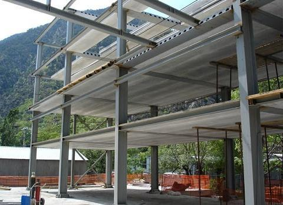

## 1. Presencia de Placas en Aplicaciones de Ingeniería

Las placas planas son elementos de área sin curvatura usadas para la transmisión de cargas transversales actuantes en su plano a otros elementos de soporte como pórticos o columnas. Su uso es universal apareciendo en casi todas las aplicaciones de ingeniería tales como, en la construcción de plataformas petroleras, especialmente usadas para la fabricación de cubiertas de grandes luces que soportan grandes cargas.

<script type="text/tikz">
\begin{tikzpicture}[x=0.02428cm,y=-0.02428cm,line join=round,line cap=round]
\fill[white] (0,0) rectangle (415,346);
\definecolor{p0c0}{RGB}{247,247,247}
\path[fill=p0c0,draw=p0c0,line width=0.19pt,even odd rule] (14,91)--(14,93)--(15,93)--(15,91)--cycle
(20,92)--(20,93)--(21,93)--(21,92)--cycle
(25,94)--(25,95)--(26,95)--(26,94)--cycle
(28,97)--(28,98)--(29,98)--(29,97)--cycle
(23,98)--(23,99)--(24,99)--(24,98)--cycle
(16,97)--(16,100)--(17,100)--(17,97)--cycle
(32,99)--(32,100)--(34,100)--(34,99)--cycle
(171,11)--(171,12)--(173,12)--(173,11)--cycle;
\path[fill=p0c0,draw=p0c0,line width=0.19pt,even odd rule] (176,11)--(176,12)--(177,12)--(177,13)--(178,13)--(178,12)--(179,12)--(179,11)--cycle
(182,12)--(182,13)--(183,13)--(183,12)--cycle
(161,14)--(161,18)--(162,18)--(162,14)--cycle
(178,19)--(178,20)--(179,20)--(179,19)--cycle
(181,20)--(181,21)--(182,21)--(182,20)--cycle
(162,25)--(162,26)--(163,26)--(163,25)--cycle
(177,25)--(177,26)--(178,26)--(178,25)--cycle
(182,29)--(182,30)--(183,30)--(183,29)--cycle;
\path[fill=p0c0,draw=p0c0,line width=0.19pt,even odd rule] (179,32)--(179,33)--(180,33)--(180,32)--cycle
(167,38)--(167,39)--(168,39)--(168,38)--cycle
(183,39)--(183,40)--(184,40)--(184,39)--cycle
(161,39)--(161,42)--(162,42)--(162,39)--cycle
(181,49)--(181,50)--(182,50)--(182,49)--cycle
(169,50)--(169,51)--(170,51)--(170,52)--(171,52)--(171,50)--cycle
(166,50)--(166,53)--(167,53)--(167,50)--cycle
(168,52)--(168,53)--(169,53)--(169,52)--cycle;
\path[fill=p0c0,draw=p0c0,line width=0.19pt,even odd rule] (170,55)--(170,56)--(171,56)--(171,55)--cycle
(160,56)--(160,57)--(161,57)--(161,56)--cycle
(182,58)--(182,59)--(183,59)--(183,58)--cycle
(180,60)--(180,69)--(181,69)--(181,68)--(182,68)--(182,67)--(181,67)--(181,66)--(182,66)--(182,65)--(184,65)--(184,64)--(183,64)--(183,62)--(182,62)--(182,61)--(181,61)--(181,60)--cycle
(159,69)--(159,70)--(160,70)--(160,69)--cycle
(161,69)--(161,71)--(162,71)--(162,69)--cycle
(186,70)--(186,71)--(187,71)--(187,70)--cycle
(184,71)--(184,72)--(185,72)--(185,71)--cycle;
\path[fill=p0c0,draw=p0c0,line width=0.19pt,even odd rule] (157,73)--(157,74)--(158,74)--(158,73)--cycle
(194,79)--(194,80)--(195,80)--(195,79)--cycle
(195,87)--(195,88)--(196,88)--(196,87)--cycle
(160,91)--(160,92)--(161,92)--(161,91)--cycle
(157,92)--(157,93)--(158,93)--(158,92)--cycle
(189,93)--(189,94)--(190,94)--(190,93)--cycle
(184,96)--(184,97)--(185,97)--(185,96)--cycle
(168,98)--(168,99)--(169,99)--(169,98)--cycle;
\path[fill=p0c0,draw=p0c0,line width=0.19pt,even odd rule] (175,98)--(175,99)--(176,99)--(176,98)--cycle
(183,99)--(183,100)--(185,100)--(185,99)--cycle
(395,32)--(395,33)--(396,33)--(396,32)--cycle
(395,34)--(395,35)--(396,35)--(396,34)--cycle
(398,35)--(398,36)--(399,36)--(399,35)--cycle
(389,35)--(389,36)--(391,36)--(391,37)--(392,37)--(392,35)--cycle
(394,35)--(394,36)--(393,36)--(393,37)--(395,37)--(395,35)--cycle
(386,38)--(386,39)--(387,39)--(387,38)--cycle;
\path[fill=p0c0,draw=p0c0,line width=0.19pt,even odd rule] (385,39)--(385,40)--(386,40)--(386,39)--cycle
(388,39)--(388,40)--(389,40)--(389,39)--cycle
(384,40)--(384,41)--(385,41)--(385,40)--cycle
(385,41)--(385,43)--(386,43)--(386,41)--cycle
(382,42)--(382,43)--(383,43)--(383,42)--cycle
(381,45)--(381,46)--(382,46)--(382,45)--cycle
(393,45)--(393,46)--(396,46)--(396,45)--cycle
(387,46)--(387,47)--(388,47)--(388,46)--cycle;
\path[fill=p0c0,draw=p0c0,line width=0.19pt,even odd rule] (375,48)--(375,49)--(376,49)--(376,48)--cycle
(374,49)--(374,50)--(375,50)--(375,49)--cycle
(388,50)--(388,51)--(389,51)--(389,50)--cycle
(375,50)--(375,52)--(376,52)--(376,51)--(377,51)--(377,50)--cycle
(387,51)--(387,52)--(388,52)--(388,51)--cycle
(382,52)--(382,53)--(383,53)--(383,52)--cycle
(370,55)--(370,56)--(371,56)--(371,55)--cycle
(376,56)--(376,57)--(377,57)--(377,56)--cycle;
\path[fill=p0c0,draw=p0c0,line width=0.19pt,even odd rule] (365,57)--(365,58)--(366,58)--(366,57)--cycle
(368,57)--(368,58)--(369,58)--(369,57)--cycle
(382,57)--(382,58)--(383,58)--(383,57)--cycle
(364,58)--(364,59)--(365,59)--(365,58)--cycle
(366,58)--(366,59)--(367,59)--(367,58)--cycle
(377,58)--(377,59)--(378,59)--(378,58)--cycle
(373,59)--(373,60)--(374,60)--(374,59)--cycle
(363,61)--(363,62)--(364,62)--(364,61)--cycle;
\path[fill=p0c0,draw=p0c0,line width=0.19pt,even odd rule] (362,62)--(362,63)--(363,63)--(363,62)--cycle
(377,63)--(377,64)--(378,64)--(378,63)--cycle
(372,63)--(372,65)--(373,65)--(373,64)--(374,64)--(374,63)--cycle
(356,65)--(356,66)--(357,66)--(357,65)--cycle
(359,65)--(359,66)--(360,66)--(360,65)--cycle
(371,65)--(371,66)--(372,66)--(372,65)--cycle
(355,66)--(355,67)--(356,67)--(356,66)--cycle
(356,67)--(356,68)--(357,68)--(357,67)--cycle;
\path[fill=p0c0,draw=p0c0,line width=0.19pt,even odd rule] (365,68)--(365,69)--(366,69)--(366,68)--cycle
(372,69)--(372,70)--(373,70)--(373,69)--cycle
(360,71)--(360,72)--(361,72)--(361,71)--cycle
(348,72)--(348,73)--(349,73)--(349,72)--cycle
(350,72)--(350,73)--(351,73)--(351,72)--cycle
(359,72)--(359,73)--(360,73)--(360,72)--cycle
(347,73)--(347,74)--(348,74)--(348,73)--cycle
(358,73)--(358,74)--(359,74)--(359,73)--cycle;
\path[fill=p0c0,draw=p0c0,line width=0.19pt,even odd rule] (362,73)--(362,74)--(363,74)--(363,73)--cycle
(346,74)--(346,75)--(347,75)--(347,74)--cycle
(345,75)--(345,76)--(346,76)--(346,75)--cycle
(347,75)--(347,76)--(348,76)--(348,75)--cycle
(367,75)--(367,76)--(368,76)--(368,75)--cycle
(357,79)--(357,80)--(358,80)--(358,79)--cycle
(339,80)--(339,81)--(340,81)--(340,80)--cycle
(341,80)--(341,81)--(342,81)--(342,80)--cycle;
\path[fill=p0c0,draw=p0c0,line width=0.19pt,even odd rule] (338,81)--(338,82)--(339,82)--(339,81)--cycle
(356,81)--(356,82)--(357,82)--(357,81)--cycle
(362,81)--(362,82)--(363,82)--(363,81)--cycle
(337,82)--(337,83)--(338,83)--(338,82)--cycle
(357,82)--(357,83)--(358,83)--(358,82)--cycle
(336,83)--(336,84)--(337,84)--(337,83)--cycle
(335,84)--(335,85)--(336,85)--(336,84)--cycle
(357,87)--(357,88)--(358,88)--(358,87)--cycle;
\path[fill=p0c0,draw=p0c0,line width=0.19pt,even odd rule] (328,90)--(328,91)--(329,91)--(329,90)--cycle
(348,91)--(348,93)--(349,93)--(349,91)--cycle
(326,92)--(326,93)--(327,93)--(327,92)--cycle
(324,94)--(324,95)--(325,95)--(325,94)--cycle
(351,94)--(351,95)--(352,95)--(352,94)--cycle
(323,95)--(323,96)--(324,96)--(324,95)--cycle
(330,95)--(330,96)--(331,96)--(331,95)--cycle
(322,96)--(322,97)--(323,97)--(323,96)--cycle;
\path[fill=p0c0,draw=p0c0,line width=0.19pt,even odd rule] (329,96)--(329,97)--(330,97)--(330,96)--cycle
(335,96)--(335,98)--(336,98)--(336,96)--cycle
(331,98)--(331,99)--(332,99)--(332,98)--cycle
(403,37)--(403,40)--(404,40)--(404,37)--cycle
(35,100)--(35,101)--(37,101)--(37,100)--cycle
(37,101)--(37,102)--(38,102)--(38,101)--cycle
(43,101)--(43,102)--(44,102)--(44,101)--cycle
(35,102)--(35,103)--(36,103)--(36,102)--cycle;
\path[fill=p0c0,draw=p0c0,line width=0.19pt,even odd rule] (39,102)--(39,103)--(40,103)--(40,102)--cycle
(46,102)--(46,103)--(47,103)--(47,102)--cycle
(41,102)--(41,104)--(42,104)--(42,102)--cycle
(23,103)--(23,104)--(24,104)--(24,103)--cycle
(36,103)--(36,104)--(38,104)--(38,103)--cycle
(20,100)--(20,105)--(21,105)--(21,100)--cycle
(24,104)--(24,105)--(25,105)--(25,104)--cycle
(39,104)--(39,105)--(40,105)--(40,104)--cycle;
\path[fill=p0c0,draw=p0c0,line width=0.19pt,even odd rule] (46,104)--(46,105)--(47,105)--(47,104)--cycle
(25,105)--(25,106)--(26,106)--(26,105)--cycle
(41,105)--(41,106)--(42,106)--(42,105)--cycle
(26,106)--(26,107)--(27,107)--(27,106)--cycle
(44,106)--(44,107)--(45,107)--(45,106)--cycle
(51,106)--(51,107)--(52,107)--(52,106)--cycle
(56,106)--(56,107)--(57,107)--(57,106)--cycle
(46,107)--(46,108)--(47,108)--(47,107)--cycle;
\path[fill=p0c0,draw=p0c0,line width=0.19pt,even odd rule] (54,107)--(54,108)--(55,108)--(55,107)--cycle
(36,109)--(36,110)--(37,110)--(37,109)--cycle
(59,109)--(59,110)--(60,110)--(60,109)--cycle
(64,109)--(64,110)--(65,110)--(65,109)--cycle
(17,107)--(17,111)--(18,111)--(18,107)--cycle
(30,110)--(30,111)--(31,111)--(31,110)--cycle
(57,110)--(57,111)--(58,111)--(58,110)--cycle
(31,111)--(31,112)--(32,112)--(32,111)--cycle;
\path[fill=p0c0,draw=p0c0,line width=0.19pt,even odd rule] (38,111)--(38,112)--(40,112)--(40,111)--cycle
(59,111)--(59,112)--(60,112)--(60,111)--cycle
(64,111)--(64,112)--(65,112)--(65,111)--cycle
(69,111)--(69,112)--(70,112)--(70,111)--cycle
(32,112)--(32,113)--(33,113)--(33,112)--cycle
(57,112)--(57,113)--(58,113)--(58,112)--cycle
(61,112)--(61,113)--(62,113)--(62,112)--cycle
(33,113)--(33,114)--(34,114)--(34,113)--cycle;
\path[fill=p0c0,draw=p0c0,line width=0.19pt,even odd rule] (40,113)--(40,114)--(42,114)--(42,113)--cycle
(59,113)--(59,114)--(60,114)--(60,113)--cycle
(69,113)--(69,114)--(70,114)--(70,113)--cycle
(43,114)--(43,115)--(44,115)--(44,114)--cycle
(47,115)--(47,116)--(48,116)--(48,115)--cycle
(74,115)--(74,116)--(75,116)--(75,115)--cycle
(49,116)--(49,117)--(50,117)--(50,116)--cycle
(52,116)--(52,117)--(53,117)--(53,116)--cycle;
\path[fill=p0c0,draw=p0c0,line width=0.19pt,even odd rule] (70,116)--(70,117)--(71,117)--(71,116)--cycle
(82,116)--(82,117)--(83,117)--(83,116)--cycle
(53,117)--(53,118)--(54,118)--(54,117)--cycle
(68,117)--(68,118)--(69,118)--(69,117)--cycle
(39,118)--(39,119)--(40,119)--(40,118)--cycle
(46,118)--(46,119)--(48,119)--(48,118)--cycle
(87,118)--(87,119)--(88,119)--(88,118)--cycle
(49,119)--(49,120)--(50,120)--(50,119)--cycle;
\path[fill=p0c0,draw=p0c0,line width=0.19pt,even odd rule] (90,119)--(90,120)--(91,120)--(91,119)--cycle
(21,114)--(21,121)--(22,121)--(22,114)--cycle
(87,120)--(87,121)--(88,121)--(88,120)--cycle
(92,120)--(92,121)--(93,121)--(93,120)--cycle
(18,120)--(18,122)--(19,122)--(19,120)--cycle
(79,122)--(79,123)--(80,123)--(80,122)--cycle
(83,122)--(83,123)--(84,123)--(84,122)--cycle
(92,122)--(92,123)--(93,123)--(93,122)--cycle;
\path[fill=p0c0,draw=p0c0,line width=0.19pt,even odd rule] (45,123)--(45,124)--(46,124)--(46,123)--cycle
(48,123)--(48,124)--(49,124)--(49,123)--cycle
(57,123)--(57,124)--(58,124)--(58,123)--cycle
(56,126)--(56,127)--(57,127)--(57,126)--cycle
(92,126)--(92,127)--(93,127)--(93,126)--cycle
(94,127)--(94,128)--(95,128)--(95,127)--cycle
(58,128)--(58,129)--(59,129)--(59,128)--cycle
(66,128)--(66,129)--(67,129)--(67,128)--cycle;
\path[fill=p0c0,draw=p0c0,line width=0.19pt,even odd rule] (92,128)--(92,129)--(93,129)--(93,128)--cycle
(52,129)--(52,130)--(53,130)--(53,129)--cycle
(94,129)--(94,130)--(95,130)--(95,129)--cycle
(60,130)--(60,131)--(61,131)--(61,130)--cycle
(65,130)--(65,131)--(66,131)--(66,130)--cycle
(19,131)--(19,133)--(20,133)--(20,131)--cycle
(22,131)--(22,134)--(23,134)--(23,131)--cycle
(60,133)--(60,134)--(61,134)--(61,133)--cycle;
\path[fill=p0c0,draw=p0c0,line width=0.19pt,even odd rule] (64,133)--(64,134)--(65,134)--(65,133)--cycle
(58,134)--(58,135)--(59,135)--(59,134)--cycle
(61,134)--(61,135)--(62,135)--(62,134)--cycle
(59,135)--(59,136)--(60,136)--(60,135)--cycle
(72,136)--(72,137)--(73,137)--(73,136)--cycle
(70,138)--(70,139)--(71,139)--(71,138)--cycle
(72,139)--(72,140)--(73,140)--(73,139)--cycle
(76,139)--(76,140)--(77,140)--(77,139)--cycle;
\path[fill=p0c0,draw=p0c0,line width=0.19pt,even odd rule] (79,139)--(79,140)--(80,140)--(80,139)--cycle
(74,141)--(74,142)--(75,142)--(75,141)--cycle
(20,142)--(20,143)--(21,143)--(21,142)--cycle
(80,143)--(80,144)--(81,144)--(81,143)--cycle
(23,144)--(23,145)--(24,145)--(24,144)--cycle
(73,144)--(73,145)--(74,145)--(74,144)--cycle
(97,144)--(97,145)--(99,145)--(99,144)--cycle
(86,145)--(86,146)--(87,146)--(87,145)--cycle;
\path[fill=p0c0,draw=p0c0,line width=0.19pt,even odd rule] (94,145)--(94,146)--(95,146)--(95,145)--cycle
(87,146)--(87,147)--(88,147)--(88,146)--cycle
(98,146)--(98,147)--(99,147)--(99,146)--cycle
(89,147)--(89,148)--(90,148)--(90,147)--cycle
(94,147)--(94,148)--(97,148)--(97,147)--cycle
(90,148)--(90,149)--(92,149)--(92,148)--cycle
(93,148)--(93,149)--(94,149)--(94,148)--cycle
(79,149)--(79,150)--(80,150)--(80,149)--cycle;
\path[fill=p0c0,draw=p0c0,line width=0.19pt,even odd rule] (78,151)--(78,152)--(79,152)--(79,151)--cycle
(85,151)--(85,152)--(86,152)--(86,151)--cycle
(21,152)--(21,153)--(22,153)--(22,152)--cycle
(24,155)--(24,156)--(25,156)--(25,155)--cycle
(98,167)--(98,168)--(99,168)--(99,169)--(100,169)--(100,167)--cycle
(99,170)--(99,171)--(100,171)--(100,170)--cycle
(95,171)--(95,173)--(96,173)--(96,171)--cycle
(89,176)--(89,177)--(90,177)--(90,176)--cycle;
\path[fill=p0c0,draw=p0c0,line width=0.19pt,even odd rule] (93,176)--(93,177)--(94,177)--(94,176)--cycle
(90,177)--(90,178)--(91,178)--(91,177)--cycle
(87,178)--(87,179)--(88,179)--(88,178)--cycle
(85,181)--(85,182)--(86,182)--(86,181)--cycle
(80,183)--(80,184)--(81,184)--(81,183)--cycle
(159,100)--(159,101)--(160,101)--(160,100)--cycle
(159,102)--(159,103)--(160,103)--(160,102)--cycle
(148,106)--(148,107)--(149,107)--(149,106)--cycle;
\path[fill=p0c0,draw=p0c0,line width=0.19pt,even odd rule] (150,106)--(150,107)--(151,107)--(151,106)--cycle
(153,108)--(153,109)--(154,109)--(154,108)--cycle
(182,108)--(182,109)--(183,109)--(183,108)--cycle
(187,109)--(187,110)--(188,110)--(188,109)--cycle
(148,108)--(148,112)--(149,112)--(149,108)--cycle
(151,111)--(151,112)--(152,112)--(152,111)--cycle
(153,113)--(153,114)--(154,114)--(154,113)--cycle
(147,115)--(147,116)--(148,116)--(148,115)--cycle;
\path[fill=p0c0,draw=p0c0,line width=0.19pt,even odd rule] (146,121)--(146,122)--(147,122)--(147,121)--cycle
(196,121)--(196,122)--(197,122)--(197,121)--cycle
(198,121)--(198,122)--(199,122)--(199,121)--cycle
(143,122)--(143,123)--(144,123)--(144,122)--cycle
(148,122)--(148,123)--(149,123)--(149,122)--cycle
(100,123)--(100,124)--(101,124)--(101,123)--cycle
(131,123)--(131,124)--(132,124)--(132,123)--cycle
(151,123)--(151,124)--(152,124)--(152,123)--cycle;
\path[fill=p0c0,draw=p0c0,line width=0.19pt,even odd rule] (102,124)--(102,125)--(103,125)--(103,124)--cycle
(136,124)--(136,125)--(137,125)--(137,124)--cycle
(145,124)--(145,125)--(146,125)--(146,124)--cycle
(148,124)--(148,125)--(149,125)--(149,124)--cycle
(196,124)--(196,125)--(197,125)--(197,124)--cycle
(100,125)--(100,126)--(101,126)--(101,125)--cycle
(106,125)--(106,126)--(107,126)--(107,125)--cycle
(122,125)--(122,126)--(123,126)--(123,125)--cycle;
\path[fill=p0c0,draw=p0c0,line width=0.19pt,even odd rule] (198,125)--(198,126)--(199,126)--(199,125)--cycle
(102,126)--(102,127)--(104,127)--(104,126)--cycle
(141,127)--(141,128)--(142,128)--(142,127)--cycle
(137,128)--(137,129)--(138,129)--(138,128)--cycle
(147,185)--(147,186)--(148,186)--(148,185)--cycle
(144,186)--(144,187)--(146,187)--(146,186)--cycle
(139,188)--(139,189)--(140,189)--(140,188)--cycle
(147,188)--(147,189)--(148,189)--(148,188)--cycle;
\path[fill=p0c0,draw=p0c0,line width=0.19pt,even odd rule] (154,188)--(154,189)--(155,189)--(155,188)--cycle
(152,189)--(152,190)--(153,190)--(153,189)--cycle
(149,189)--(149,191)--(150,191)--(150,189)--cycle
(146,191)--(146,192)--(148,192)--(148,191)--cycle
(145,192)--(145,193)--(146,193)--(146,192)--cycle
(224,117)--(224,118)--(225,118)--(225,117)--cycle
(298,117)--(298,118)--(299,118)--(299,117)--cycle
(202,120)--(202,121)--(203,121)--(203,120)--cycle;
\path[fill=p0c0,draw=p0c0,line width=0.19pt,even odd rule] (216,120)--(216,121)--(217,121)--(217,120)--cycle
(226,120)--(226,121)--(227,121)--(227,120)--cycle
(209,121)--(209,122)--(210,122)--(210,121)--cycle
(232,123)--(232,124)--(233,124)--(233,123)--cycle
(291,123)--(291,124)--(292,124)--(292,123)--cycle
(222,125)--(222,126)--(223,126)--(223,125)--cycle
(293,125)--(293,126)--(294,126)--(294,125)--cycle
(292,126)--(292,127)--(293,127)--(293,126)--cycle;
\path[fill=p0c0,draw=p0c0,line width=0.19pt,even odd rule] (222,128)--(222,129)--(223,129)--(223,128)--cycle
(233,128)--(233,129)--(234,129)--(234,128)--cycle
(293,128)--(293,129)--(294,129)--(294,128)--cycle
(284,129)--(284,130)--(285,130)--(285,129)--cycle
(287,130)--(287,131)--(288,131)--(288,130)--cycle
(288,133)--(288,134)--(289,134)--(289,133)--cycle
(278,134)--(278,135)--(279,135)--(279,134)--cycle
(283,134)--(283,135)--(284,135)--(284,134)--cycle;
\path[fill=p0c0,draw=p0c0,line width=0.19pt,even odd rule] (232,137)--(232,138)--(233,138)--(233,137)--cycle
(283,137)--(283,138)--(284,138)--(284,137)--cycle
(296,137)--(296,138)--(297,138)--(297,137)--cycle
(298,138)--(298,139)--(299,139)--(299,138)--cycle
(237,139)--(237,140)--(238,140)--(238,139)--cycle
(287,139)--(287,140)--(288,140)--(288,139)--cycle
(271,140)--(271,141)--(272,141)--(272,140)--cycle
(286,140)--(286,141)--(287,141)--(287,140)--cycle;
\path[fill=p0c0,draw=p0c0,line width=0.19pt,even odd rule] (291,142)--(291,143)--(292,143)--(292,142)--cycle
(265,145)--(265,146)--(266,146)--(266,145)--cycle
(238,146)--(238,147)--(239,147)--(239,146)--cycle
(273,146)--(273,147)--(274,147)--(274,146)--cycle
(268,147)--(268,148)--(269,148)--(269,147)--cycle
(281,147)--(281,148)--(282,148)--(282,147)--cycle
(271,148)--(271,149)--(272,149)--(272,148)--cycle
(292,148)--(292,149)--(293,149)--(293,148)--cycle;
\path[fill=p0c0,draw=p0c0,line width=0.19pt,even odd rule] (266,148)--(266,150)--(267,150)--(267,149)--(268,149)--(268,148)--cycle
(264,150)--(264,151)--(265,151)--(265,150)--cycle
(258,151)--(258,152)--(259,152)--(259,151)--cycle
(281,151)--(281,152)--(282,152)--(282,151)--cycle
(289,151)--(289,152)--(290,152)--(290,151)--cycle
(290,152)--(290,153)--(291,153)--(291,152)--cycle
(272,153)--(272,154)--(273,154)--(273,153)--cycle
(277,153)--(277,154)--(278,154)--(278,153)--cycle;
\path[fill=p0c0,draw=p0c0,line width=0.19pt,even odd rule] (291,153)--(291,154)--(292,154)--(292,153)--cycle
(240,154)--(240,155)--(241,155)--(241,154)--cycle
(247,154)--(247,155)--(248,155)--(248,154)--cycle
(271,154)--(271,155)--(272,155)--(272,154)--cycle
(245,155)--(245,156)--(246,156)--(246,155)--cycle
(250,155)--(250,156)--(252,156)--(252,155)--cycle
(248,156)--(248,157)--(249,157)--(249,156)--cycle
(262,156)--(262,157)--(263,157)--(263,156)--cycle;
\path[fill=p0c0,draw=p0c0,line width=0.19pt,even odd rule] (257,156)--(257,158)--(258,158)--(258,156)--cycle
(291,157)--(291,158)--(292,158)--(292,157)--cycle
(266,159)--(266,160)--(267,160)--(267,159)--cycle
(278,159)--(278,160)--(279,160)--(279,159)--cycle
(292,160)--(292,161)--(293,161)--(293,160)--cycle
(270,161)--(270,162)--(271,162)--(271,161)--cycle
(281,161)--(281,162)--(282,162)--(282,161)--cycle
(291,161)--(291,162)--(292,162)--(292,161)--cycle;
\path[fill=p0c0,draw=p0c0,line width=0.19pt,even odd rule] (274,166)--(274,167)--(275,167)--(275,166)--cycle
(272,167)--(272,168)--(273,168)--(273,167)--cycle
(286,167)--(286,168)--(287,168)--(287,167)--cycle
(267,170)--(267,171)--(268,171)--(268,170)--cycle
(280,170)--(280,171)--(281,171)--(281,170)--cycle
(265,173)--(265,174)--(266,174)--(266,173)--cycle
(260,175)--(260,176)--(261,176)--(261,175)--cycle
(268,176)--(268,177)--(269,177)--(269,176)--cycle;
\path[fill=p0c0,draw=p0c0,line width=0.19pt,even odd rule] (262,178)--(262,179)--(263,179)--(263,178)--cycle
(253,178)--(253,180)--(254,180)--(254,178)--cycle
(276,179)--(276,180)--(277,180)--(277,179)--cycle
(280,179)--(280,180)--(281,180)--(281,179)--cycle
(265,180)--(265,181)--(266,181)--(266,180)--cycle
(275,180)--(275,181)--(276,181)--(276,180)--cycle
(251,181)--(251,182)--(252,182)--(252,181)--cycle
(267,184)--(267,185)--(268,185)--(268,184)--cycle;
\path[fill=p0c0,draw=p0c0,line width=0.19pt,even odd rule] (247,186)--(247,187)--(248,187)--(248,186)--cycle
(251,186)--(251,187)--(252,187)--(252,186)--cycle
(274,186)--(274,187)--(275,187)--(275,186)--cycle
(265,192)--(265,193)--(266,193)--(266,192)--cycle
(257,194)--(257,195)--(258,195)--(258,194)--cycle
(342,100)--(342,101)--(343,101)--(343,100)--cycle
(315,102)--(315,103)--(316,103)--(316,102)--cycle
(314,103)--(314,104)--(315,104)--(315,103)--cycle;
\path[fill=p0c0,draw=p0c0,line width=0.19pt,even odd rule] (313,104)--(313,105)--(314,105)--(314,104)--cycle
(336,104)--(336,105)--(337,105)--(337,104)--cycle
(323,106)--(323,107)--(324,107)--(324,106)--cycle
(341,106)--(341,107)--(342,107)--(342,106)--cycle
(317,107)--(317,108)--(318,108)--(318,107)--cycle
(306,110)--(306,111)--(307,111)--(307,110)--cycle
(317,111)--(317,112)--(318,112)--(318,111)--cycle
(333,111)--(333,112)--(334,112)--(334,111)--cycle;
\path[fill=p0c0,draw=p0c0,line width=0.19pt,even odd rule] (321,111)--(321,113)--(322,113)--(322,111)--cycle
(311,112)--(311,113)--(312,113)--(312,112)--cycle
(316,112)--(316,113)--(317,113)--(317,112)--cycle
(332,112)--(332,113)--(333,113)--(333,112)--cycle
(336,112)--(336,113)--(337,113)--(337,112)--cycle
(307,116)--(307,117)--(308,117)--(308,116)--cycle
(327,118)--(327,119)--(328,119)--(328,118)--cycle
(331,118)--(331,119)--(332,119)--(332,118)--cycle;
\path[fill=p0c0,draw=p0c0,line width=0.19pt,even odd rule] (326,119)--(326,120)--(327,120)--(327,119)--cycle
(322,119)--(322,121)--(323,121)--(323,119)--cycle
(302,120)--(302,121)--(301,121)--(301,122)--(303,122)--(303,121)--(304,121)--(304,120)--cycle
(315,121)--(315,122)--(316,122)--(316,121)--cycle
(307,122)--(307,123)--(308,123)--(308,122)--cycle
(310,123)--(310,124)--(311,124)--(311,123)--cycle
(318,123)--(318,124)--(319,124)--(319,123)--cycle
(323,123)--(323,124)--(324,124)--(324,123)--cycle;
\path[fill=p0c0,draw=p0c0,line width=0.19pt,even odd rule] (315,125)--(315,126)--(316,126)--(316,125)--cycle
(301,126)--(301,127)--(302,127)--(302,126)--cycle
(307,126)--(307,127)--(308,127)--(308,126)--cycle
(317,130)--(317,131)--(318,131)--(318,130)--cycle
(306,136)--(306,137)--(307,137)--(307,136)--cycle
(312,136)--(312,137)--(313,137)--(313,136)--cycle
(303,137)--(303,138)--(304,138)--(304,137)--cycle
(311,137)--(311,138)--(312,138)--(312,137)--cycle;
\path[fill=p0c0,draw=p0c0,line width=0.19pt,even odd rule] (315,137)--(315,138)--(316,138)--(316,137)--cycle
(311,142)--(311,143)--(312,143)--(312,142)--cycle
(310,143)--(310,144)--(311,144)--(311,143)--cycle
(301,149)--(301,150)--(302,150)--(302,149)--cycle
(305,149)--(305,150)--(306,150)--(306,149)--cycle
(73,202)--(73,204)--(74,204)--(74,202)--cycle
(74,206)--(74,207)--(75,207)--(75,206)--cycle
(81,210)--(81,211)--(82,211)--(82,210)--cycle;
\path[fill=p0c0,draw=p0c0,line width=0.19pt,even odd rule] (84,214)--(84,215)--(85,215)--(85,214)--cycle
(93,216)--(93,217)--(94,217)--(94,216)--cycle
(90,222)--(90,223)--(91,223)--(91,222)--cycle
(90,224)--(90,225)--(91,225)--(91,224)--cycle
(89,226)--(89,227)--(90,227)--(90,226)--cycle
(98,273)--(98,274)--(99,274)--(99,273)--cycle
(99,240)--(99,241)--(98,241)--(98,242)--(96,242)--(96,243)--(94,243)--(94,244)--(93,244)--(93,246)--(92,246)--(92,247)--(91,247)--(91,248)--(89,248)--(89,249)--(88,249)--(88,250)--(87,250)--(87,251)--(86,251)--(86,252)--(85,252)--(85,253)--(84,253)--(84,254)--(83,254)--(83,256)--(82,256)--(82,257)--(81,257)--(81,258)--(80,258)--(80,259)--(79,259)--(79,263)--(78,263)--(78,264)--(76,264)--(76,266)--(75,266)--(75,267)--(74,267)--(74,269)--(73,269)--(73,275)--(72,275)--(72,277)--(71,277)--(71,280)--(70,280)--(70,283)--(71,283)--(71,285)--(72,285)--(72,288)--(71,288)--(71,292)--(72,292)--(72,297)--(73,297)--(73,300)--(100,300)--(100,284)--(99,284)--(99,283)--(98,283)--(98,281)--(97,281)--(97,276)--(96,276)--(96,273)--(97,273)--(97,272)--(96,272)--(96,271)--(95,271)--(95,266)--(96,266)--(96,262)--(97,262)--(97,261)--(99,261)--(99,260)--(100,260)--(100,240)--cycle
(101,230)--(101,231)--(102,231)--(102,230)--cycle;
\path[fill=p0c0,draw=p0c0,line width=0.19pt,even odd rule] (103,231)--(103,232)--(104,232)--(104,231)--cycle
(102,233)--(102,234)--(103,234)--(103,233)--cycle
(102,235)--(102,236)--(104,236)--(104,235)--cycle
(109,239)--(109,241)--(110,241)--(110,239)--cycle
(103,237)--(103,239)--(101,239)--(101,240)--(100,240)--(100,260)--(102,260)--(102,258)--(103,258)--(103,259)--(104,259)--(104,257)--(105,257)--(105,256)--(106,256)--(106,255)--(107,255)--(107,253)--(108,253)--(108,246)--(107,246)--(107,244)--(106,244)--(106,237)--cycle
(101,275)--(101,276)--(102,276)--(102,275)--cycle
(103,276)--(103,277)--(104,277)--(104,276)--cycle
(105,277)--(105,278)--(106,278)--(106,277)--cycle;
\path[fill=p0c0,draw=p0c0,line width=0.19pt,even odd rule] (106,278)--(106,279)--(107,279)--(107,278)--cycle
(108,281)--(108,282)--(109,282)--(109,281)--cycle
(112,281)--(112,282)--(113,282)--(113,281)--cycle
(112,284)--(112,285)--(113,285)--(113,284)--cycle
(118,285)--(118,286)--(119,286)--(119,285)--cycle
(120,288)--(120,289)--(121,289)--(121,288)--cycle
(123,288)--(123,289)--(124,289)--(124,288)--cycle
(133,294)--(133,295)--(134,295)--(134,294)--cycle;
\path[fill=p0c0,draw=p0c0,line width=0.19pt,even odd rule] (136,296)--(136,297)--(137,297)--(137,296)--cycle
(100,285)--(100,300)--(113,300)--(113,299)--(112,299)--(112,298)--(111,298)--(111,297)--(110,297)--(110,296)--(109,296)--(109,295)--(108,295)--(108,294)--(107,294)--(107,292)--(106,292)--(106,291)--(105,291)--(105,289)--(104,289)--(104,288)--(103,288)--(103,287)--(102,287)--(102,286)--(101,286)--(101,285)--cycle
(273,200)--(273,201)--(274,201)--(274,200)--cycle
(257,226)--(257,227)--(258,227)--(258,226)--cycle
(245,231)--(245,232)--(246,232)--(246,231)--cycle
(236,233)--(236,234)--(237,234)--(237,233)--cycle
(243,233)--(243,234)--(244,234)--(244,233)--cycle
(242,234)--(242,236)--(243,236)--(243,234)--cycle;
\path[fill=p0c0,draw=p0c0,line width=0.19pt,even odd rule] (235,236)--(235,237)--(236,237)--(236,236)--cycle
(241,236)--(241,237)--(242,237)--(242,236)--cycle
(240,238)--(240,239)--(241,239)--(241,238)--cycle
(255,227)--(255,228)--(253,228)--(253,229)--(252,229)--(252,228)--(251,228)--(251,230)--(250,230)--(250,229)--(249,229)--(249,231)--(248,231)--(248,230)--(247,230)--(247,233)--(250,233)--(250,234)--(252,234)--(252,235)--(254,235)--(254,236)--(256,236)--(256,237)--(258,237)--(258,238)--(260,238)--(260,239)--(262,239)--(262,240)--(264,240)--(264,241)--(266,241)--(266,242)--(267,242)--(267,243)--(270,243)--(270,244)--(272,244)--(272,245)--(273,245)--(273,246)--(276,246)--(276,247)--(277,247)--(277,248)--(279,248)--(279,249)--(281,249)--(281,250)--(284,250)--(284,251)--(285,251)--(285,252)--(286,252)--(286,253)--(289,253)--(289,254)--(290,254)--(290,255)--(291,255)--(291,256)--(293,256)--(293,257)--(294,257)--(294,258)--(295,258)--(295,259)--(296,259)--(296,260)--(298,260)--(298,262)--(300,262)--(300,249)--(297,249)--(297,248)--(296,248)--(296,247)--(294,247)--(294,246)--(293,246)--(293,243)--(290,243)--(290,244)--(289,244)--(289,243)--(286,243)--(286,242)--(285,242)--(285,241)--(284,241)--(284,240)--(283,240)--(283,239)--(281,239)--(281,238)--(279,238)--(279,240)--(278,240)--(278,239)--(277,239)--(277,238)--(268,238)--(268,237)--(266,237)--(266,236)--(262,236)--(262,235)--(260,235)--(260,234)--(259,234)--(259,233)--(258,233)--(258,232)--(257,232)--(257,231)--(258,231)--(258,230)--(259,230)--(259,229)--(258,229)--(258,228)--(257,228)--(257,227)--cycle
(298,286)--(298,287)--(299,287)--(299,286)--cycle
(297,287)--(297,288)--(298,288)--(298,287)--cycle
(295,288)--(295,289)--(292,289)--(292,292)--(290,292)--(290,291)--(287,291)--(287,292)--(284,292)--(284,293)--(282,293)--(282,294)--(280,294)--(280,295)--(278,295)--(278,296)--(277,296)--(277,297)--(279,297)--(279,296)--(284,296)--(284,297)--(285,297)--(285,298)--(286,298)--(286,299)--(287,299)--(287,300)--(295,300)--(295,298)--(294,298)--(294,296)--(295,296)--(295,294)--(296,294)--(296,293)--(297,293)--(297,288)--cycle
(300,249)--(300,263)--(301,263)--(301,264)--(302,264)--(302,266)--(303,266)--(303,267)--(305,267)--(305,269)--(306,269)--(306,270)--(307,270)--(307,271)--(308,271)--(308,272)--(309,272)--(309,273)--(310,273)--(310,274)--(311,274)--(311,276)--(312,276)--(312,277)--(311,277)--(311,278)--(310,278)--(310,279)--(312,279)--(312,278)--(314,278)--(314,277)--(316,277)--(316,276)--(317,276)--(317,275)--(318,275)--(318,274)--(320,274)--(320,273)--(321,273)--(321,272)--(324,272)--(324,271)--(327,271)--(327,270)--(329,270)--(329,269)--(328,269)--(328,265)--(322,265)--(322,264)--(320,264)--(320,263)--(319,263)--(319,262)--(318,262)--(318,261)--(317,261)--(317,260)--(316,260)--(316,258)--(313,258)--(313,257)--(311,257)--(311,256)--(309,256)--(309,255)--(307,255)--(307,254)--(306,254)--(306,253)--(304,253)--(304,252)--(303,252)--(303,251)--(302,251)--(302,250)--(301,250)--(301,249)--cycle;
\path[fill=p0c0,draw=p0c0,line width=0.19pt,even odd rule] (309,279)--(309,280)--(310,280)--(310,279)--cycle
(308,280)--(308,281)--(309,281)--(309,280)--cycle
(307,281)--(307,282)--(308,282)--(308,281)--cycle
(304,282)--(304,283)--(305,283)--(305,282)--cycle
(303,283)--(303,284)--(304,284)--(304,283)--cycle
(302,284)--(302,285)--(303,285)--(303,284)--cycle
(300,285)--(300,286)--(301,286)--(301,285)--cycle
(74,300)--(74,302)--(75,302)--(75,303)--(76,303)--(76,307)--(77,307)--(77,309)--(78,309)--(78,311)--(79,311)--(79,312)--(80,312)--(80,313)--(81,313)--(81,315)--(82,315)--(82,317)--(83,317)--(83,318)--(84,318)--(84,319)--(85,319)--(85,321)--(86,321)--(86,322)--(87,322)--(87,324)--(88,324)--(88,325)--(89,325)--(89,326)--(90,326)--(90,328)--(93,328)--(93,329)--(94,329)--(94,333)--(95,333)--(95,334)--(100,334)--(100,300)--cycle;
\path[fill=p0c0,draw=p0c0,line width=0.19pt,even odd rule] (143,300)--(143,301)--(144,301)--(144,300)--cycle
(145,301)--(145,302)--(146,302)--(146,301)--cycle
(146,302)--(146,303)--(147,303)--(147,302)--cycle
(159,310)--(159,311)--(160,311)--(160,310)--cycle
(173,318)--(173,319)--(174,319)--(174,318)--cycle
(175,319)--(175,320)--(176,320)--(176,319)--cycle
(183,324)--(183,325)--(184,325)--(184,324)--cycle
(188,324)--(188,325)--(190,325)--(190,324)--cycle;
\path[fill=p0c0,draw=p0c0,line width=0.19pt,even odd rule] (186,325)--(186,326)--(187,326)--(187,325)--cycle
(100,300)--(100,334)--(102,334)--(102,335)--(103,335)--(103,336)--(104,336)--(104,338)--(105,338)--(105,339)--(107,339)--(107,340)--(109,340)--(109,341)--(111,341)--(111,342)--(113,342)--(113,343)--(116,343)--(116,344)--(119,344)--(119,346)--(200,346)--(200,328)--(187,328)--(187,327)--(186,327)--(186,328)--(185,328)--(185,327)--(184,327)--(184,328)--(183,328)--(183,327)--(182,327)--(182,328)--(177,328)--(177,329)--(166,329)--(166,328)--(162,328)--(162,327)--(157,327)--(157,326)--(153,326)--(153,325)--(151,325)--(151,324)--(149,324)--(149,323)--(148,323)--(148,322)--(144,322)--(144,321)--(140,321)--(140,320)--(139,320)--(139,319)--(137,319)--(137,318)--(135,318)--(135,317)--(134,317)--(134,316)--(132,316)--(132,315)--(130,315)--(130,314)--(129,314)--(129,313)--(127,313)--(127,312)--(124,312)--(124,311)--(123,311)--(123,310)--(122,310)--(122,309)--(121,309)--(121,308)--(120,308)--(120,306)--(118,306)--(118,305)--(117,305)--(117,304)--(116,304)--(116,303)--(115,303)--(115,302)--(114,302)--(114,300)--cycle
(286,300)--(286,301)--(284,301)--(284,302)--(285,302)--(285,303)--(284,303)--(284,304)--(285,304)--(285,306)--(284,306)--(284,307)--(278,307)--(278,308)--(276,308)--(276,310)--(275,310)--(275,312)--(276,312)--(276,313)--(278,313)--(278,314)--(280,314)--(280,315)--(283,315)--(283,316)--(285,316)--(285,315)--(286,315)--(286,314)--(287,314)--(287,312)--(290,312)--(290,313)--(292,313)--(292,314)--(294,314)--(294,315)--(296,315)--(296,316)--(297,316)--(297,317)--(300,317)--(300,313)--(298,313)--(298,311)--(297,311)--(297,310)--(296,310)--(296,309)--(295,309)--(295,307)--(294,307)--(294,306)--(293,306)--(293,305)--(292,305)--(292,303)--(293,303)--(293,302)--(294,302)--(294,301)--(296,301)--(296,300)--cycle
(273,316)--(273,317)--(274,317)--(274,316)--cycle
(279,316)--(279,317)--(280,317)--(280,316)--cycle
(285,316)--(285,317)--(286,317)--(286,316)--cycle
(276,318)--(276,319)--(277,319)--(277,318)--cycle
(277,321)--(277,322)--(278,322)--(278,321)--cycle;
\path[fill=p0c0,draw=p0c0,line width=0.19pt,even odd rule] (278,322)--(278,323)--(280,323)--(280,322)--cycle
(281,323)--(281,324)--(282,324)--(282,323)--cycle
(200,325)--(200,326)--(201,326)--(201,325)--cycle
(201,326)--(201,327)--(203,327)--(203,326)--cycle
(282,317)--(282,318)--(283,318)--(283,319)--(285,319)--(285,320)--(286,320)--(286,321)--(288,321)--(288,322)--(290,322)--(290,323)--(291,323)--(291,324)--(289,324)--(289,323)--(287,323)--(287,322)--(285,322)--(285,321)--(282,321)--(282,320)--(280,320)--(280,321)--(281,321)--(281,322)--(283,322)--(283,323)--(285,323)--(285,324)--(284,324)--(284,325)--(285,325)--(285,326)--(288,326)--(288,327)--(290,327)--(290,328)--(292,328)--(292,329)--(294,329)--(294,330)--(297,330)--(297,331)--(300,331)--(300,323)--(298,323)--(298,322)--(296,322)--(296,321)--(294,321)--(294,320)--(292,320)--(292,319)--(290,319)--(290,318)--(289,318)--(289,317)--(287,317)--(287,318)--(288,318)--(288,319)--(286,319)--(286,318)--(284,318)--(284,317)--cycle
(266,317)--(266,318)--(264,318)--(264,319)--(263,319)--(263,320)--(261,320)--(261,321)--(260,321)--(260,322)--(258,322)--(258,323)--(257,323)--(257,324)--(255,324)--(255,325)--(253,325)--(253,326)--(252,326)--(252,327)--(248,327)--(248,328)--(228,328)--(228,329)--(227,329)--(227,328)--(226,328)--(226,329)--(208,329)--(208,328)--(204,328)--(204,327)--(203,327)--(203,328)--(200,328)--(200,346)--(234,346)--(234,343)--(240,343)--(240,342)--(242,342)--(242,341)--(247,341)--(247,340)--(249,340)--(249,339)--(250,339)--(250,338)--(251,338)--(251,337)--(252,337)--(252,336)--(256,336)--(256,335)--(257,335)--(257,334)--(258,334)--(258,333)--(261,333)--(261,334)--(263,334)--(263,333)--(264,333)--(264,331)--(265,331)--(265,330)--(266,330)--(266,329)--(269,329)--(269,328)--(270,328)--(270,327)--(271,327)--(271,326)--(273,326)--(273,325)--(274,325)--(274,322)--(275,322)--(275,321)--(276,321)--(276,320)--(274,320)--(274,319)--(272,319)--(272,318)--(270,318)--(270,317)--cycle
(300,317)--(300,318)--(301,318)--(301,317)--cycle
(307,328)--(307,329)--(308,329)--(308,328)--cycle;
\path[fill=p0c0,draw=p0c0,line width=0.19pt,even odd rule] (300,324)--(300,332)--(302,332)--(302,331)--(307,331)--(307,330)--(306,330)--(306,329)--(305,329)--(305,328)--(307,328)--(307,327)--(306,327)--(306,326)--(304,326)--(304,325)--(302,325)--(302,324)--cycle
(307,331)--(307,332)--(308,332)--(308,331)--cycle;
\definecolor{p0c1}{RGB}{237,237,237}
\path[fill=p0c1,draw=p0c1,line width=0.19pt,even odd rule] (15,90)--(15,91)--(16,91)--(16,90)--cycle
(18,91)--(18,92)--(19,92)--(19,91)--cycle
(22,93)--(22,94)--(23,94)--(23,93)--cycle
(26,95)--(26,96)--(27,96)--(27,95)--cycle
(27,96)--(27,97)--(28,97)--(28,96)--cycle
(30,96)--(30,97)--(31,97)--(31,96)--cycle
(17,97)--(17,98)--(18,98)--(18,97)--cycle
(29,97)--(29,99)--(30,99)--(30,97)--cycle;
\path[fill=p0c1,draw=p0c1,line width=0.19pt,even odd rule] (35,98)--(35,99)--(36,99)--(36,98)--cycle
(18,98)--(18,100)--(20,100)--(20,99)--(19,99)--(19,98)--cycle
(31,98)--(31,100)--(32,100)--(32,98)--cycle
(24,99)--(24,100)--(25,100)--(25,99)--cycle
(34,99)--(34,100)--(35,100)--(35,99)--cycle
(178,12)--(178,13)--(182,13)--(182,12)--cycle
(173,11)--(173,12)--(172,12)--(172,13)--(175,13)--(175,14)--(177,14)--(177,12)--(176,12)--(176,11)--cycle
(165,12)--(165,13)--(164,13)--(164,14)--(167,14)--(167,15)--(168,15)--(168,13)--(169,13)--(169,12)--cycle;
\path[fill=p0c1,draw=p0c1,line width=0.19pt,even odd rule] (182,13)--(182,17)--(183,17)--(183,13)--cycle
(167,21)--(167,22)--(169,22)--(169,21)--cycle
(181,21)--(181,22)--(182,22)--(182,21)--cycle
(168,23)--(168,24)--(169,24)--(169,23)--cycle
(176,23)--(176,24)--(177,24)--(177,23)--cycle
(168,25)--(168,26)--(169,26)--(169,25)--cycle
(175,25)--(175,26)--(176,26)--(176,25)--cycle
(162,26)--(162,29)--(163,29)--(163,26)--cycle;
\path[fill=p0c1,draw=p0c1,line width=0.19pt,even odd rule] (182,30)--(182,32)--(183,32)--(183,30)--cycle
(180,38)--(180,39)--(181,39)--(181,38)--cycle
(183,40)--(183,43)--(184,43)--(184,40)--cycle
(161,42)--(161,43)--(162,43)--(162,42)--cycle
(170,47)--(170,48)--(171,48)--(171,47)--cycle
(169,49)--(169,50)--(170,50)--(170,49)--cycle
(184,51)--(184,53)--(185,53)--(185,51)--cycle
(180,53)--(180,54)--(181,54)--(181,53)--cycle;
\path[fill=p0c1,draw=p0c1,line width=0.19pt,even odd rule] (168,56)--(168,58)--(166,58)--(166,59)--(169,59)--(169,58)--(170,58)--(170,57)--(169,57)--(169,56)--cycle
(160,57)--(160,60)--(161,60)--(161,57)--cycle
(162,58)--(162,60)--(163,60)--(163,58)--cycle
(170,58)--(170,60)--(169,60)--(169,61)--(170,61)--(170,62)--(171,62)--(171,58)--cycle
(185,61)--(185,63)--(186,63)--(186,61)--cycle
(169,62)--(169,63)--(170,63)--(170,62)--cycle
(183,63)--(183,64)--(184,64)--(184,63)--cycle
(182,66)--(182,67)--(183,67)--(183,66)--cycle;
\path[fill=p0c1,draw=p0c1,line width=0.19pt,even odd rule] (168,67)--(168,68)--(169,68)--(169,67)--cycle
(161,68)--(161,69)--(162,69)--(162,68)--cycle
(169,68)--(169,69)--(171,69)--(171,68)--cycle
(167,69)--(167,70)--(168,70)--(168,69)--cycle
(176,69)--(176,70)--(177,70)--(177,69)--cycle
(164,70)--(164,71)--(165,71)--(165,70)--cycle
(159,70)--(159,72)--(160,72)--(160,70)--cycle
(182,70)--(182,72)--(183,72)--(183,70)--cycle;
\path[fill=p0c1,draw=p0c1,line width=0.19pt,even odd rule] (158,75)--(158,76)--(159,76)--(159,75)--cycle
(157,76)--(157,77)--(158,77)--(158,76)--cycle
(167,76)--(167,77)--(168,77)--(168,76)--cycle
(195,88)--(195,90)--(196,90)--(196,88)--cycle
(183,93)--(183,94)--(184,94)--(184,93)--cycle
(161,94)--(161,95)--(162,95)--(162,94)--cycle
(184,94)--(184,95)--(185,95)--(185,94)--cycle
(189,94)--(189,95)--(190,95)--(190,94)--cycle;
\path[fill=p0c1,draw=p0c1,line width=0.19pt,even odd rule] (168,95)--(168,96)--(169,96)--(169,95)--cycle
(182,96)--(182,97)--(183,97)--(183,96)--cycle
(189,96)--(189,97)--(190,97)--(190,96)--cycle
(185,98)--(185,99)--(186,99)--(186,98)--cycle
(163,99)--(163,100)--(164,100)--(164,99)--cycle
(395,33)--(395,34)--(396,34)--(396,33)--cycle
(392,35)--(392,36)--(394,36)--(394,35)--cycle
(395,35)--(395,36)--(396,36)--(396,35)--cycle;
\path[fill=p0c1,draw=p0c1,line width=0.19pt,even odd rule] (399,35)--(399,36)--(397,36)--(397,37)--(400,37)--(400,35)--cycle
(393,37)--(393,38)--(395,38)--(395,37)--cycle
(388,37)--(388,38)--(387,38)--(387,40)--(385,40)--(385,41)--(386,41)--(386,42)--(387,42)--(387,41)--(388,41)--(388,39)--(389,39)--(389,37)--cycle
(383,41)--(383,42)--(384,42)--(384,43)--(381,43)--(381,44)--(380,44)--(380,45)--(382,45)--(382,44)--(385,44)--(385,41)--cycle
(382,45)--(382,46)--(383,46)--(383,45)--cycle
(388,45)--(388,46)--(389,46)--(389,45)--cycle
(392,45)--(392,46)--(393,46)--(393,45)--cycle
(379,45)--(379,46)--(378,46)--(378,48)--(379,48)--(379,47)--(381,47)--(381,46)--(380,46)--(380,45)--cycle;
\path[fill=p0c1,draw=p0c1,line width=0.19pt,even odd rule] (376,49)--(376,50)--(378,50)--(378,49)--cycle
(373,50)--(373,51)--(374,51)--(374,50)--cycle
(383,51)--(383,52)--(384,52)--(384,51)--cycle
(372,51)--(372,52)--(371,52)--(371,53)--(373,53)--(373,54)--(374,54)--(374,52)--(373,52)--(373,51)--cycle
(370,53)--(370,54)--(371,54)--(371,53)--cycle
(371,54)--(371,55)--(373,55)--(373,54)--cycle
(369,54)--(369,55)--(368,55)--(368,57)--(369,57)--(369,56)--(370,56)--(370,54)--cycle
(366,57)--(366,58)--(367,58)--(367,57)--cycle;
\path[fill=p0c1,draw=p0c1,line width=0.19pt,even odd rule] (375,57)--(375,58)--(376,58)--(376,57)--cycle
(367,58)--(367,59)--(368,59)--(368,58)--cycle
(374,58)--(374,59)--(375,59)--(375,58)--cycle
(375,59)--(375,60)--(376,60)--(376,59)--cycle
(365,58)--(365,60)--(364,60)--(364,59)--(363,59)--(363,60)--(362,60)--(362,61)--(361,61)--(361,62)--(363,62)--(363,61)--(366,61)--(366,58)--cycle
(363,62)--(363,63)--(364,63)--(364,62)--cycle
(360,62)--(360,63)--(359,63)--(359,65)--(360,65)--(360,64)--(362,64)--(362,63)--(361,63)--(361,62)--cycle
(370,64)--(370,65)--(371,65)--(371,64)--cycle;
\path[fill=p0c1,draw=p0c1,line width=0.19pt,even odd rule] (376,64)--(376,65)--(377,65)--(377,64)--cycle
(368,65)--(368,66)--(369,66)--(369,65)--cycle
(366,66)--(366,67)--(367,67)--(367,66)--cycle
(356,66)--(356,67)--(357,67)--(357,68)--(358,68)--(358,66)--cycle
(354,67)--(354,68)--(355,68)--(355,67)--cycle
(356,68)--(356,69)--(357,69)--(357,68)--cycle
(353,68)--(353,69)--(352,69)--(352,70)--(355,70)--(355,69)--(354,69)--(354,68)--cycle
(368,69)--(368,70)--(369,70)--(369,69)--cycle;
\path[fill=p0c1,draw=p0c1,line width=0.19pt,even odd rule] (371,70)--(371,71)--(372,71)--(372,70)--cycle
(350,71)--(350,72)--(351,72)--(351,71)--cycle
(351,72)--(351,73)--(352,73)--(352,72)--cycle
(349,73)--(349,74)--(351,74)--(351,73)--cycle
(347,74)--(347,75)--(349,75)--(349,74)--cycle
(346,75)--(346,77)--(347,77)--(347,75)--cycle
(366,76)--(366,77)--(367,77)--(367,76)--cycle
(344,76)--(344,77)--(343,77)--(343,78)--(342,78)--(342,79)--(345,79)--(345,76)--cycle;
\path[fill=p0c1,draw=p0c1,line width=0.19pt,even odd rule] (360,78)--(360,79)--(361,79)--(361,78)--cycle
(341,79)--(341,80)--(342,80)--(342,79)--cycle
(353,80)--(353,81)--(354,81)--(354,80)--cycle
(340,80)--(340,82)--(341,82)--(341,80)--cycle
(358,81)--(358,82)--(359,82)--(359,81)--cycle
(349,82)--(349,83)--(350,83)--(350,82)--cycle
(361,82)--(361,83)--(362,83)--(362,82)--cycle
(338,82)--(338,83)--(337,83)--(337,84)--(339,84)--(339,82)--cycle;
\path[fill=p0c1,draw=p0c1,line width=0.19pt,even odd rule] (334,85)--(334,86)--(333,86)--(333,87)--(335,87)--(335,86)--(336,86)--(336,85)--cycle
(347,86)--(347,87)--(348,87)--(348,86)--cycle
(339,87)--(339,88)--(340,88)--(340,87)--cycle
(353,87)--(353,88)--(354,88)--(354,87)--cycle
(338,88)--(338,89)--(339,89)--(339,88)--cycle
(350,88)--(350,89)--(351,89)--(351,88)--cycle
(352,88)--(352,89)--(353,89)--(353,88)--cycle
(356,88)--(356,89)--(357,89)--(357,88)--cycle;
\path[fill=p0c1,draw=p0c1,line width=0.19pt,even odd rule] (332,87)--(332,88)--(331,88)--(331,89)--(330,89)--(330,90)--(332,90)--(332,89)--(333,89)--(333,87)--cycle
(337,89)--(337,90)--(338,90)--(338,89)--cycle
(355,89)--(355,90)--(356,90)--(356,89)--cycle
(329,90)--(329,91)--(330,91)--(330,90)--cycle
(336,90)--(336,91)--(337,91)--(337,90)--cycle
(328,91)--(328,92)--(329,92)--(329,91)--cycle
(342,91)--(342,92)--(343,92)--(343,91)--cycle
(326,93)--(326,94)--(327,94)--(327,93)--cycle;
\path[fill=p0c1,draw=p0c1,line width=0.19pt,even odd rule] (325,94)--(325,95)--(326,95)--(326,94)--cycle
(331,94)--(331,95)--(332,95)--(332,94)--cycle
(321,97)--(321,98)--(322,98)--(322,97)--cycle
(328,97)--(328,98)--(329,98)--(329,97)--cycle
(320,98)--(320,99)--(321,99)--(321,98)--cycle
(335,98)--(335,99)--(336,99)--(336,98)--cycle
(319,99)--(319,100)--(320,100)--(320,99)--cycle
(343,99)--(343,100)--(344,100)--(344,99)--cycle;
\path[fill=p0c1,draw=p0c1,line width=0.19pt,even odd rule] (400,35)--(400,36)--(401,36)--(401,35)--cycle
(401,36)--(401,37)--(402,37)--(402,36)--cycle
(25,100)--(25,101)--(26,101)--(26,100)--cycle
(40,100)--(40,101)--(41,101)--(41,100)--cycle
(34,100)--(34,102)--(35,102)--(35,100)--cycle
(39,101)--(39,102)--(40,102)--(40,101)--cycle
(45,102)--(45,103)--(46,103)--(46,102)--cycle
(44,103)--(44,104)--(45,104)--(45,103)--cycle;
\path[fill=p0c1,draw=p0c1,line width=0.19pt,even odd rule] (48,103)--(48,104)--(49,104)--(49,103)--cycle
(30,104)--(30,105)--(31,105)--(31,104)--cycle
(40,104)--(40,105)--(41,105)--(41,104)--cycle
(43,104)--(43,105)--(44,105)--(44,104)--cycle
(51,104)--(51,105)--(52,105)--(52,104)--cycle
(35,105)--(35,106)--(36,106)--(36,105)--cycle
(42,105)--(42,106)--(43,106)--(43,105)--cycle
(49,105)--(49,106)--(50,106)--(50,105)--cycle;
\path[fill=p0c1,draw=p0c1,line width=0.19pt,even odd rule] (53,105)--(53,106)--(54,106)--(54,105)--cycle
(32,106)--(32,107)--(33,107)--(33,106)--cycle
(40,106)--(40,107)--(41,107)--(41,106)--cycle
(47,106)--(47,107)--(48,107)--(48,106)--cycle
(52,106)--(52,107)--(53,107)--(53,106)--cycle
(33,107)--(33,108)--(34,108)--(34,107)--cycle
(38,107)--(38,108)--(39,108)--(39,107)--cycle
(58,107)--(58,108)--(59,108)--(59,107)--cycle;
\path[fill=p0c1,draw=p0c1,line width=0.19pt,even odd rule] (34,108)--(34,109)--(36,109)--(36,108)--cycle
(39,108)--(39,109)--(40,109)--(40,108)--cycle
(52,108)--(52,109)--(53,109)--(53,108)--cycle
(57,108)--(57,109)--(58,109)--(58,108)--cycle
(61,108)--(61,109)--(62,109)--(62,108)--cycle
(32,109)--(32,110)--(33,110)--(33,109)--cycle
(54,109)--(54,110)--(55,110)--(55,109)--cycle
(53,110)--(53,111)--(54,111)--(54,110)--cycle;
\path[fill=p0c1,draw=p0c1,line width=0.19pt,even odd rule] (56,110)--(56,111)--(57,111)--(57,110)--cycle
(62,110)--(62,111)--(63,111)--(63,110)--cycle
(66,110)--(66,111)--(67,111)--(67,110)--cycle
(34,111)--(34,112)--(35,112)--(35,111)--cycle
(46,111)--(46,112)--(47,112)--(47,111)--cycle
(55,111)--(55,112)--(56,112)--(56,111)--cycle
(47,112)--(47,113)--(48,113)--(48,112)--cycle
(67,112)--(67,113)--(68,113)--(68,112)--cycle;
\path[fill=p0c1,draw=p0c1,line width=0.19pt,even odd rule] (71,112)--(71,113)--(72,113)--(72,112)--cycle
(63,113)--(63,114)--(64,114)--(64,113)--cycle
(70,113)--(70,114)--(71,114)--(71,113)--cycle
(74,113)--(74,114)--(75,114)--(75,113)--cycle
(62,114)--(62,115)--(63,115)--(63,114)--cycle
(65,114)--(65,115)--(66,115)--(66,114)--cycle
(72,114)--(72,115)--(73,115)--(73,114)--cycle
(42,115)--(42,116)--(44,116)--(44,115)--cycle;
\path[fill=p0c1,draw=p0c1,line width=0.19pt,even odd rule] (64,115)--(64,116)--(65,116)--(65,115)--cycle
(79,115)--(79,116)--(80,116)--(80,115)--cycle
(40,116)--(40,117)--(41,117)--(41,116)--cycle
(44,116)--(44,117)--(45,117)--(45,116)--cycle
(66,116)--(66,117)--(67,117)--(67,116)--cycle
(77,116)--(77,117)--(78,117)--(78,116)--cycle
(81,116)--(81,117)--(82,117)--(82,116)--cycle
(38,117)--(38,118)--(39,118)--(39,117)--cycle;
\path[fill=p0c1,draw=p0c1,line width=0.19pt,even odd rule] (41,117)--(41,118)--(42,118)--(42,117)--cycle
(45,117)--(45,118)--(46,118)--(46,117)--cycle
(72,117)--(72,118)--(73,118)--(73,117)--cycle
(80,117)--(80,118)--(81,118)--(81,117)--cycle
(84,117)--(84,118)--(85,118)--(85,117)--cycle
(42,118)--(42,119)--(43,119)--(43,118)--cycle
(74,118)--(74,119)--(75,119)--(75,118)--cycle
(82,118)--(82,119)--(83,119)--(83,118)--cycle;
\path[fill=p0c1,draw=p0c1,line width=0.19pt,even odd rule] (17,100)--(17,107)--(18,107)--(18,109)--(19,109)--(19,108)--(20,108)--(20,110)--(18,110)--(18,120)--(19,120)--(19,117)--(20,117)--(20,116)--(19,116)--(19,115)--(21,115)--(21,105)--(20,105)--(20,102)--(19,102)--(19,101)--(20,101)--(20,100)--cycle (18,104)--(19,104)--(19,107)--(18,107)--cycle (19,112)--(20,112)--(20,113)--(19,113)--cycle
(73,119)--(73,120)--(74,120)--(74,119)--cycle
(76,119)--(76,120)--(77,120)--(77,119)--cycle
(85,119)--(85,120)--(86,120)--(86,119)--cycle
(89,119)--(89,120)--(90,120)--(90,119)--cycle
(48,120)--(48,121)--(50,121)--(50,120)--cycle
(75,120)--(75,121)--(76,121)--(76,120)--cycle
(88,120)--(88,121)--(89,121)--(89,120)--cycle;
\path[fill=p0c1,draw=p0c1,line width=0.19pt,even odd rule] (46,121)--(46,122)--(47,122)--(47,121)--cycle
(50,121)--(50,122)--(52,122)--(52,121)--cycle
(77,121)--(77,122)--(78,122)--(78,121)--cycle
(90,121)--(90,122)--(91,122)--(91,121)--cycle
(94,121)--(94,122)--(96,122)--(96,121)--cycle
(19,122)--(19,123)--(20,123)--(20,122)--cycle
(47,122)--(47,123)--(48,123)--(48,122)--cycle
(97,122)--(97,123)--(98,123)--(98,122)--cycle;
\path[fill=p0c1,draw=p0c1,line width=0.19pt,even odd rule] (52,122)--(52,124)--(53,124)--(53,122)--cycle
(60,123)--(60,124)--(61,124)--(61,123)--cycle
(85,123)--(85,124)--(86,124)--(86,123)--cycle
(95,123)--(95,124)--(96,124)--(96,123)--cycle
(99,123)--(99,124)--(100,124)--(100,123)--cycle
(87,124)--(87,125)--(88,125)--(88,124)--cycle
(98,124)--(98,125)--(99,125)--(99,124)--cycle
(21,121)--(21,126)--(22,126)--(22,121)--cycle;
\path[fill=p0c1,draw=p0c1,line width=0.19pt,even odd rule] (54,124)--(54,126)--(55,126)--(55,125)--(56,125)--(56,124)--cycle
(19,125)--(19,126)--(20,126)--(20,125)--cycle
(59,125)--(59,126)--(60,126)--(60,125)--cycle
(86,125)--(86,126)--(87,126)--(87,125)--cycle
(89,125)--(89,126)--(90,126)--(90,125)--cycle
(52,126)--(52,127)--(53,127)--(53,126)--cycle
(88,126)--(88,127)--(89,127)--(89,126)--cycle
(53,127)--(53,128)--(54,128)--(54,127)--cycle;
\path[fill=p0c1,draw=p0c1,line width=0.19pt,even odd rule] (90,127)--(90,128)--(91,128)--(91,127)--cycle
(51,128)--(51,129)--(52,129)--(52,128)--cycle
(54,128)--(54,129)--(55,129)--(55,128)--cycle
(96,128)--(96,129)--(97,129)--(97,128)--cycle
(55,129)--(55,130)--(56,130)--(56,129)--cycle
(67,129)--(67,130)--(68,130)--(68,129)--cycle
(19,127)--(19,131)--(20,131)--(20,127)--cycle
(59,128)--(59,130)--(61,130)--(61,131)--(62,131)--(62,129)--(60,129)--(60,128)--cycle;
\path[fill=p0c1,draw=p0c1,line width=0.19pt,even odd rule] (20,131)--(20,132)--(21,132)--(21,131)--cycle
(62,131)--(62,132)--(64,132)--(64,131)--cycle
(65,133)--(65,134)--(66,134)--(66,133)--cycle
(73,134)--(73,135)--(74,135)--(74,134)--cycle
(66,134)--(66,136)--(67,136)--(67,134)--cycle
(74,135)--(74,136)--(75,136)--(75,135)--cycle
(22,134)--(22,137)--(23,137)--(23,134)--cycle
(70,137)--(70,138)--(71,138)--(71,137)--cycle;
\path[fill=p0c1,draw=p0c1,line width=0.19pt,even odd rule] (66,138)--(66,139)--(67,139)--(67,138)--cycle
(67,139)--(67,140)--(68,140)--(68,139)--cycle
(71,139)--(71,140)--(72,140)--(72,139)--cycle
(65,140)--(65,141)--(66,141)--(66,140)--cycle
(72,140)--(72,141)--(73,141)--(73,140)--cycle
(80,140)--(80,141)--(81,141)--(81,140)--cycle
(20,135)--(20,142)--(21,142)--(21,135)--cycle
(73,141)--(73,142)--(74,142)--(74,141)--cycle;
\path[fill=p0c1,draw=p0c1,line width=0.19pt,even odd rule] (74,142)--(74,143)--(75,143)--(75,142)--cycle
(98,142)--(98,143)--(99,143)--(99,142)--cycle
(76,142)--(76,144)--(77,144)--(77,142)--cycle
(70,144)--(70,145)--(71,145)--(71,144)--cycle
(82,144)--(82,145)--(83,145)--(83,144)--cycle
(71,145)--(71,146)--(72,146)--(72,145)--cycle
(74,145)--(74,146)--(75,146)--(75,145)--cycle
(78,145)--(78,146)--(79,146)--(79,145)--cycle;
\path[fill=p0c1,draw=p0c1,line width=0.19pt,even odd rule] (98,145)--(98,146)--(99,146)--(99,145)--cycle
(95,145)--(95,146)--(96,146)--(96,147)--(98,147)--(98,146)--(97,146)--(97,145)--cycle
(79,146)--(79,147)--(80,147)--(80,146)--cycle
(23,145)--(23,148)--(24,148)--(24,145)--cycle
(92,146)--(92,147)--(93,147)--(93,148)--(94,148)--(94,147)--(95,147)--(95,146)--cycle
(88,147)--(88,148)--(89,148)--(89,147)--cycle
(90,147)--(90,148)--(91,148)--(91,147)--cycle
(82,148)--(82,149)--(83,149)--(83,148)--cycle;
\path[fill=p0c1,draw=p0c1,line width=0.19pt,even odd rule] (92,148)--(92,149)--(93,149)--(93,148)--cycle
(23,149)--(23,150)--(24,150)--(24,149)--cycle
(83,149)--(83,150)--(84,150)--(84,149)--cycle
(77,150)--(77,151)--(78,151)--(78,150)--cycle
(21,148)--(21,152)--(22,152)--(22,148)--cycle
(84,153)--(84,154)--(85,154)--(85,153)--cycle
(82,154)--(82,155)--(83,155)--(83,154)--cycle
(85,154)--(85,155)--(86,155)--(86,154)--cycle;
\path[fill=p0c1,draw=p0c1,line width=0.19pt,even odd rule] (91,156)--(91,157)--(92,157)--(92,156)--cycle
(94,158)--(94,159)--(95,159)--(95,158)--cycle
(95,159)--(95,160)--(96,160)--(96,159)--cycle
(90,160)--(90,161)--(91,161)--(91,160)--cycle
(23,161)--(23,162)--(24,162)--(24,161)--cycle
(97,165)--(97,166)--(98,166)--(98,165)--cycle
(99,166)--(99,167)--(100,167)--(100,166)--cycle
(93,173)--(93,174)--(94,174)--(94,173)--cycle;
\path[fill=p0c1,draw=p0c1,line width=0.19pt,even odd rule] (90,174)--(90,175)--(91,175)--(91,174)--cycle
(92,175)--(92,176)--(93,176)--(93,175)--cycle
(86,179)--(86,180)--(87,180)--(87,179)--cycle
(81,183)--(81,184)--(82,184)--(82,183)--cycle
(80,186)--(80,188)--(81,188)--(81,186)--cycle
(187,102)--(187,103)--(188,103)--(188,102)--cycle
(155,103)--(155,104)--(156,104)--(156,103)--cycle
(154,104)--(154,106)--(155,106)--(155,104)--cycle;
\path[fill=p0c1,draw=p0c1,line width=0.19pt,even odd rule] (164,105)--(164,106)--(165,106)--(165,105)--cycle
(186,105)--(186,107)--(187,107)--(187,105)--cycle
(148,107)--(148,108)--(149,108)--(149,107)--cycle
(185,107)--(185,108)--(186,108)--(186,107)--cycle
(181,109)--(181,110)--(182,110)--(182,109)--cycle
(188,109)--(188,110)--(189,110)--(189,109)--cycle
(187,110)--(187,111)--(188,111)--(188,110)--cycle
(151,112)--(151,113)--(152,113)--(152,112)--cycle;
\path[fill=p0c1,draw=p0c1,line width=0.19pt,even odd rule] (152,114)--(152,115)--(153,115)--(153,114)--cycle
(124,121)--(124,122)--(125,122)--(125,121)--cycle
(152,121)--(152,122)--(153,122)--(153,121)--cycle
(140,123)--(140,124)--(141,124)--(141,123)--cycle
(146,123)--(146,124)--(147,124)--(147,123)--cycle
(127,124)--(127,125)--(128,125)--(128,124)--cycle
(137,124)--(137,125)--(139,125)--(139,124)--cycle
(142,124)--(142,125)--(143,125)--(143,124)--cycle;
\path[fill=p0c1,draw=p0c1,line width=0.19pt,even odd rule] (101,125)--(101,126)--(102,126)--(102,125)--cycle
(105,125)--(105,126)--(106,126)--(106,125)--cycle
(109,125)--(109,126)--(111,126)--(111,125)--cycle
(114,125)--(114,126)--(115,126)--(115,125)--cycle
(106,126)--(106,127)--(108,127)--(108,126)--cycle
(136,126)--(136,127)--(137,127)--(137,126)--cycle
(198,126)--(198,127)--(199,127)--(199,126)--cycle
(140,125)--(140,128)--(141,128)--(141,125)--cycle;
\path[fill=p0c1,draw=p0c1,line width=0.19pt,even odd rule] (102,127)--(102,128)--(103,128)--(103,127)--cycle
(103,131)--(103,132)--(104,132)--(104,131)--cycle
(146,185)--(146,186)--(147,186)--(147,185)--cycle
(141,187)--(141,188)--(143,188)--(143,187)--cycle
(145,187)--(145,188)--(146,188)--(146,187)--cycle
(146,188)--(146,189)--(147,189)--(147,188)--cycle
(155,188)--(155,189)--(156,189)--(156,188)--cycle
(151,189)--(151,190)--(152,190)--(152,189)--cycle;
\path[fill=p0c1,draw=p0c1,line width=0.19pt,even odd rule] (150,190)--(150,191)--(151,191)--(151,190)--cycle
(144,192)--(144,193)--(145,193)--(145,192)--cycle
(209,112)--(209,113)--(210,113)--(210,112)--cycle
(214,114)--(214,115)--(215,115)--(215,114)--cycle
(216,114)--(216,115)--(217,115)--(217,114)--cycle
(204,115)--(204,116)--(205,116)--(205,115)--cycle
(217,116)--(217,117)--(218,117)--(218,116)--cycle
(222,116)--(222,117)--(224,117)--(224,116)--cycle;
\path[fill=p0c1,draw=p0c1,line width=0.19pt,even odd rule] (217,118)--(217,119)--(218,119)--(218,118)--cycle
(220,118)--(220,119)--(221,119)--(221,118)--cycle
(297,118)--(297,119)--(298,119)--(298,118)--cycle
(219,119)--(219,120)--(220,120)--(220,119)--cycle
(227,121)--(227,122)--(228,122)--(228,121)--cycle
(232,121)--(232,122)--(233,122)--(233,121)--cycle
(201,123)--(201,124)--(202,124)--(202,123)--cycle
(215,123)--(215,124)--(216,124)--(216,123)--cycle;
\path[fill=p0c1,draw=p0c1,line width=0.19pt,even odd rule] (217,123)--(217,124)--(218,124)--(218,123)--cycle
(225,124)--(225,125)--(226,125)--(226,124)--cycle
(290,124)--(290,125)--(291,125)--(291,124)--cycle
(298,124)--(298,125)--(300,125)--(300,124)--cycle
(230,126)--(230,127)--(231,127)--(231,126)--cycle
(230,128)--(230,129)--(231,129)--(231,128)--cycle
(235,128)--(235,129)--(236,129)--(236,128)--cycle
(283,130)--(283,131)--(284,131)--(284,130)--cycle;
\path[fill=p0c1,draw=p0c1,line width=0.19pt,even odd rule] (292,130)--(292,131)--(293,131)--(293,130)--cycle
(296,131)--(296,132)--(297,132)--(297,131)--cycle
(232,132)--(232,133)--(233,133)--(233,132)--cycle
(285,132)--(285,133)--(286,133)--(286,132)--cycle
(297,132)--(297,133)--(298,133)--(298,132)--cycle
(295,134)--(295,135)--(296,135)--(296,134)--cycle
(277,135)--(277,136)--(278,136)--(278,135)--cycle
(281,135)--(281,136)--(282,136)--(282,135)--cycle;
\path[fill=p0c1,draw=p0c1,line width=0.19pt,even odd rule] (285,136)--(285,137)--(286,137)--(286,136)--cycle
(299,136)--(299,137)--(300,137)--(300,136)--cycle
(235,130)--(235,138)--(236,138)--(236,130)--cycle
(289,137)--(289,138)--(290,138)--(290,137)--cycle
(278,138)--(278,139)--(279,139)--(279,138)--cycle
(288,138)--(288,139)--(289,139)--(289,138)--cycle
(293,138)--(293,139)--(294,139)--(294,138)--cycle
(237,140)--(237,141)--(238,141)--(238,140)--cycle;
\path[fill=p0c1,draw=p0c1,line width=0.19pt,even odd rule] (270,141)--(270,142)--(271,142)--(271,141)--cycle
(275,141)--(275,142)--(276,142)--(276,141)--cycle
(280,141)--(280,142)--(281,142)--(281,141)--cycle
(278,142)--(278,144)--(279,144)--(279,142)--cycle
(236,143)--(236,144)--(237,144)--(237,143)--cycle
(271,144)--(271,145)--(272,145)--(272,144)--cycle
(275,144)--(275,145)--(276,145)--(276,144)--cycle
(274,145)--(274,146)--(275,146)--(275,145)--cycle;
\path[fill=p0c1,draw=p0c1,line width=0.19pt,even odd rule] (294,145)--(294,146)--(295,146)--(295,145)--cycle
(264,146)--(264,147)--(265,147)--(265,146)--cycle
(236,147)--(236,148)--(237,148)--(237,147)--cycle
(263,147)--(263,148)--(264,148)--(264,147)--cycle
(267,147)--(267,148)--(268,148)--(268,147)--cycle
(279,148)--(279,150)--(280,150)--(280,148)--cycle
(235,149)--(235,150)--(236,150)--(236,149)--cycle
(287,149)--(287,150)--(288,150)--(288,149)--cycle;
\path[fill=p0c1,draw=p0c1,line width=0.19pt,even odd rule] (265,149)--(265,151)--(266,151)--(266,149)--cycle
(288,150)--(288,151)--(289,151)--(289,150)--cycle
(239,147)--(239,152)--(240,152)--(240,147)--cycle
(236,151)--(236,152)--(238,152)--(238,151)--cycle
(274,151)--(274,152)--(275,152)--(275,151)--cycle
(283,151)--(283,152)--(284,152)--(284,151)--cycle
(286,151)--(286,152)--(287,152)--(287,151)--cycle
(257,152)--(257,153)--(258,153)--(258,152)--cycle;
\path[fill=p0c1,draw=p0c1,line width=0.19pt,even odd rule] (261,152)--(261,153)--(262,153)--(262,152)--cycle
(266,152)--(266,153)--(267,153)--(267,152)--cycle
(273,152)--(273,153)--(274,153)--(274,152)--cycle
(277,152)--(277,153)--(278,153)--(278,152)--cycle
(295,152)--(295,153)--(296,153)--(296,152)--cycle
(240,152)--(240,153)--(239,153)--(239,154)--(241,154)--(241,153)--(242,153)--(242,152)--cycle
(260,153)--(260,154)--(261,154)--(261,153)--cycle
(298,153)--(298,154)--(299,154)--(299,153)--cycle;
\path[fill=p0c1,draw=p0c1,line width=0.19pt,even odd rule] (264,154)--(264,155)--(265,155)--(265,154)--cycle
(287,154)--(287,155)--(288,155)--(288,154)--cycle
(293,154)--(293,155)--(294,155)--(294,154)--cycle
(297,154)--(297,155)--(298,155)--(298,154)--cycle
(242,153)--(242,154)--(241,154)--(241,155)--(242,155)--(242,156)--(245,156)--(245,155)--(244,155)--(244,154)--(245,154)--(245,153)--cycle
(248,155)--(248,156)--(250,156)--(250,155)--cycle
(259,155)--(259,156)--(260,156)--(260,155)--cycle
(265,155)--(265,156)--(266,156)--(266,155)--cycle;
\path[fill=p0c1,draw=p0c1,line width=0.19pt,even odd rule] (280,155)--(280,156)--(281,156)--(281,155)--cycle
(245,154)--(245,155)--(246,155)--(246,156)--(245,156)--(245,157)--(248,157)--(248,156)--(247,156)--(247,154)--cycle
(299,156)--(299,157)--(300,157)--(300,156)--cycle
(251,156)--(251,157)--(248,157)--(248,158)--(252,158)--(252,157)--(253,157)--(253,156)--cycle
(255,158)--(255,159)--(256,159)--(256,158)--cycle
(270,158)--(270,159)--(271,159)--(271,158)--cycle
(278,158)--(278,159)--(279,159)--(279,158)--cycle
(293,159)--(293,160)--(294,160)--(294,159)--cycle;
\path[fill=p0c1,draw=p0c1,line width=0.19pt,even odd rule] (267,160)--(267,161)--(268,161)--(268,160)--cycle
(294,162)--(294,163)--(295,163)--(295,162)--cycle
(274,163)--(274,164)--(275,164)--(275,163)--cycle
(268,164)--(268,165)--(269,165)--(269,164)--cycle
(279,164)--(279,165)--(280,165)--(280,164)--cycle
(288,165)--(288,166)--(289,166)--(289,165)--cycle
(271,166)--(271,167)--(272,167)--(272,166)--cycle
(287,166)--(287,167)--(288,167)--(288,166)--cycle;
\path[fill=p0c1,draw=p0c1,line width=0.19pt,even odd rule] (270,167)--(270,168)--(271,168)--(271,167)--cycle
(268,168)--(268,169)--(269,169)--(269,168)--cycle
(278,168)--(278,169)--(279,169)--(279,168)--cycle
(282,168)--(282,169)--(283,169)--(283,168)--cycle
(289,168)--(289,169)--(290,169)--(290,168)--cycle
(263,171)--(263,172)--(264,172)--(264,171)--cycle
(267,171)--(267,172)--(268,172)--(268,171)--cycle
(283,171)--(283,172)--(284,172)--(284,171)--cycle;
\path[fill=p0c1,draw=p0c1,line width=0.19pt,even odd rule] (279,173)--(279,174)--(280,174)--(280,173)--cycle
(256,174)--(256,175)--(257,175)--(257,174)--cycle
(280,174)--(280,175)--(281,175)--(281,174)--cycle
(284,174)--(284,175)--(285,175)--(285,174)--cycle
(283,175)--(283,176)--(284,176)--(284,175)--cycle
(254,176)--(254,177)--(255,177)--(255,176)--cycle
(255,177)--(255,178)--(256,178)--(256,177)--cycle
(259,177)--(259,178)--(260,178)--(260,177)--cycle;
\path[fill=p0c1,draw=p0c1,line width=0.19pt,even odd rule] (268,177)--(268,179)--(269,179)--(269,177)--cycle
(256,178)--(256,179)--(257,179)--(257,178)--cycle
(277,178)--(277,179)--(278,179)--(278,178)--cycle
(257,179)--(257,180)--(258,180)--(258,179)--cycle
(253,180)--(253,181)--(254,181)--(254,180)--cycle
(258,180)--(258,181)--(259,181)--(259,180)--cycle
(279,180)--(279,181)--(280,181)--(280,180)--cycle
(259,181)--(259,182)--(260,182)--(260,181)--cycle;
\path[fill=p0c1,draw=p0c1,line width=0.19pt,even odd rule] (278,181)--(278,182)--(279,182)--(279,181)--cycle
(260,182)--(260,183)--(261,183)--(261,182)--cycle
(261,183)--(261,184)--(262,184)--(262,183)--cycle
(246,184)--(246,185)--(247,185)--(247,184)--cycle
(262,184)--(262,185)--(263,185)--(263,184)--cycle
(269,184)--(269,185)--(270,185)--(270,184)--cycle
(247,185)--(247,186)--(248,186)--(248,185)--cycle
(263,185)--(263,186)--(264,186)--(264,185)--cycle;
\path[fill=p0c1,draw=p0c1,line width=0.19pt,even odd rule] (271,185)--(271,186)--(272,186)--(272,185)--cycle
(252,186)--(252,187)--(253,187)--(253,186)--cycle
(264,186)--(264,187)--(265,187)--(265,186)--cycle
(251,187)--(251,188)--(252,188)--(252,187)--cycle
(265,187)--(265,188)--(266,188)--(266,187)--cycle
(252,188)--(252,189)--(253,189)--(253,188)--cycle
(255,188)--(255,189)--(256,189)--(256,188)--cycle
(266,188)--(266,189)--(267,189)--(267,188)--cycle;
\path[fill=p0c1,draw=p0c1,line width=0.19pt,even odd rule] (267,189)--(267,190)--(268,190)--(268,189)--cycle
(266,191)--(266,192)--(267,192)--(267,191)--cycle
(268,193)--(268,194)--(269,194)--(269,193)--cycle
(259,195)--(259,196)--(260,196)--(260,195)--cycle
(273,199)--(273,200)--(274,200)--(274,199)--cycle
(345,101)--(345,102)--(346,102)--(346,101)--cycle
(333,102)--(333,103)--(334,103)--(334,102)--cycle
(321,103)--(321,104)--(322,104)--(322,103)--cycle;
\path[fill=p0c1,draw=p0c1,line width=0.19pt,even odd rule] (312,105)--(312,106)--(313,106)--(313,105)--cycle
(336,105)--(336,106)--(337,106)--(337,105)--cycle
(338,105)--(338,106)--(339,106)--(339,105)--cycle
(328,106)--(328,107)--(329,107)--(329,106)--cycle
(325,107)--(325,108)--(326,108)--(326,107)--cycle
(334,107)--(334,108)--(335,108)--(335,107)--cycle
(340,107)--(340,108)--(341,108)--(341,107)--cycle
(333,108)--(333,109)--(334,109)--(334,108)--cycle;
\path[fill=p0c1,draw=p0c1,line width=0.19pt,even odd rule] (325,109)--(325,110)--(326,110)--(326,109)--cycle
(330,110)--(330,111)--(331,111)--(331,110)--cycle
(305,111)--(305,112)--(306,112)--(306,111)--cycle
(318,111)--(318,113)--(319,113)--(319,111)--cycle
(312,112)--(312,113)--(313,113)--(313,112)--cycle
(321,113)--(321,114)--(322,114)--(322,113)--cycle
(335,113)--(335,114)--(336,114)--(336,113)--cycle
(319,117)--(319,118)--(320,118)--(320,117)--cycle;
\path[fill=p0c1,draw=p0c1,line width=0.19pt,even odd rule] (310,118)--(310,119)--(311,119)--(311,118)--cycle
(330,119)--(330,120)--(331,120)--(331,119)--cycle
(322,121)--(322,122)--(323,122)--(323,121)--cycle
(301,122)--(301,123)--(302,123)--(302,122)--cycle
(313,122)--(313,123)--(314,123)--(314,122)--cycle
(320,122)--(320,123)--(321,123)--(321,122)--cycle
(300,123)--(300,124)--(301,124)--(301,123)--cycle
(303,124)--(303,125)--(304,125)--(304,126)--(305,126)--(305,124)--cycle;
\path[fill=p0c1,draw=p0c1,line width=0.19pt,even odd rule] (302,125)--(302,126)--(303,126)--(303,125)--cycle
(325,125)--(325,126)--(326,126)--(326,125)--cycle
(318,129)--(318,130)--(319,130)--(319,129)--cycle
(305,130)--(305,131)--(306,131)--(306,130)--cycle
(320,131)--(320,132)--(321,132)--(321,131)--cycle
(308,134)--(308,135)--(309,135)--(309,134)--cycle
(313,135)--(313,136)--(314,136)--(314,135)--cycle
(300,137)--(300,138)--(301,138)--(301,137)--cycle;
\path[fill=p0c1,draw=p0c1,line width=0.19pt,even odd rule] (314,138)--(314,139)--(315,139)--(315,138)--cycle
(300,139)--(300,140)--(301,140)--(301,139)--cycle
(305,139)--(305,140)--(306,140)--(306,139)--cycle
(306,140)--(306,141)--(307,141)--(307,140)--cycle
(305,142)--(305,143)--(306,143)--(306,142)--cycle
(309,144)--(309,145)--(310,145)--(310,144)--cycle
(302,148)--(302,149)--(303,149)--(303,148)--cycle
(304,150)--(304,151)--(305,151)--(305,150)--cycle;
\path[fill=p0c1,draw=p0c1,line width=0.19pt,even odd rule] (75,203)--(75,204)--(76,204)--(76,203)--cycle
(82,211)--(82,212)--(83,212)--(83,211)--cycle
(85,215)--(85,216)--(86,216)--(86,215)--cycle
(92,216)--(92,217)--(93,217)--(93,216)--cycle
(87,218)--(87,219)--(88,219)--(88,218)--cycle
(91,227)--(91,228)--(92,228)--(92,227)--cycle
(93,228)--(93,229)--(94,229)--(94,228)--cycle
(97,228)--(97,229)--(98,229)--(98,228)--cycle;
\path[fill=p0c1,draw=p0c1,line width=0.19pt,even odd rule] (99,229)--(99,230)--(100,230)--(100,229)--cycle
(99,260)--(99,261)--(100,261)--(100,260)--cycle
(96,271)--(96,272)--(97,272)--(97,271)--cycle
(97,272)--(97,273)--(96,273)--(96,276)--(97,276)--(97,281)--(98,281)--(98,283)--(99,283)--(99,284)--(100,284)--(100,274)--(98,274)--(98,272)--cycle
(102,230)--(102,231)--(103,231)--(103,230)--cycle
(109,241)--(109,244)--(110,244)--(110,241)--cycle
(107,243)--(107,246)--(108,246)--(108,243)--cycle
(111,251)--(111,253)--(112,253)--(112,251)--cycle;
\path[fill=p0c1,draw=p0c1,line width=0.19pt,even odd rule] (110,254)--(110,255)--(111,255)--(111,254)--cycle
(106,255)--(106,256)--(107,256)--(107,257)--(108,257)--(108,255)--cycle
(105,256)--(105,258)--(106,258)--(106,256)--cycle
(111,281)--(111,282)--(112,282)--(112,281)--cycle
(115,284)--(115,285)--(116,285)--(116,284)--cycle
(100,274)--(100,285)--(101,285)--(101,286)--(102,286)--(102,287)--(103,287)--(103,288)--(104,288)--(104,289)--(105,289)--(105,291)--(106,291)--(106,292)--(107,292)--(107,294)--(108,294)--(108,295)--(109,295)--(109,296)--(110,296)--(110,297)--(111,297)--(111,298)--(112,298)--(112,299)--(113,299)--(113,300)--(143,300)--(143,299)--(141,299)--(141,298)--(139,298)--(139,297)--(138,297)--(138,296)--(137,296)--(137,297)--(136,297)--(136,295)--(133,295)--(133,293)--(131,293)--(131,292)--(129,292)--(129,291)--(128,291)--(128,290)--(126,290)--(126,289)--(123,289)--(123,287)--(121,287)--(121,289)--(120,289)--(120,288)--(119,288)--(119,289)--(118,289)--(118,288)--(117,288)--(117,287)--(116,287)--(116,286)--(114,286)--(114,285)--(112,285)--(112,284)--(111,284)--(111,283)--(110,283)--(110,282)--(108,282)--(108,281)--(109,281)--(109,280)--(108,280)--(108,278)--(107,278)--(107,279)--(106,279)--(106,278)--(105,278)--(105,277)--(103,277)--(103,275)--(102,275)--(102,276)--(101,276)--(101,274)--cycle
(274,201)--(274,202)--(275,202)--(275,201)--cycle
(275,202)--(275,204)--(276,204)--(276,202)--cycle;
\path[fill=p0c1,draw=p0c1,line width=0.19pt,even odd rule] (273,209)--(273,210)--(274,210)--(274,209)--cycle
(275,209)--(275,210)--(276,210)--(276,209)--cycle
(236,232)--(236,233)--(237,233)--(237,232)--cycle
(233,236)--(233,238)--(234,238)--(234,237)--(235,237)--(235,236)--cycle
(241,237)--(241,238)--(242,238)--(242,237)--cycle
(234,238)--(234,239)--(235,239)--(235,238)--cycle
(240,239)--(240,240)--(241,240)--(241,239)--cycle
(233,239)--(233,241)--(234,241)--(234,239)--cycle;
\path[fill=p0c1,draw=p0c1,line width=0.19pt,even odd rule] (245,232)--(245,233)--(244,233)--(244,234)--(243,234)--(243,236)--(242,236)--(242,237)--(243,237)--(243,238)--(242,238)--(242,239)--(244,239)--(244,240)--(246,240)--(246,241)--(248,241)--(248,242)--(251,242)--(251,243)--(252,243)--(252,244)--(254,244)--(254,245)--(257,245)--(257,246)--(258,246)--(258,247)--(259,247)--(259,248)--(261,248)--(261,249)--(263,249)--(263,250)--(264,250)--(264,251)--(266,251)--(266,252)--(268,252)--(268,253)--(269,253)--(269,254)--(270,254)--(270,255)--(273,255)--(273,256)--(274,256)--(274,257)--(275,257)--(275,258)--(277,258)--(277,259)--(279,259)--(279,260)--(280,260)--(280,262)--(281,262)--(281,263)--(283,263)--(283,264)--(284,264)--(284,265)--(285,265)--(285,267)--(286,267)--(286,268)--(287,268)--(287,269)--(288,269)--(288,271)--(289,271)--(289,272)--(290,272)--(290,273)--(291,273)--(291,274)--(292,274)--(292,277)--(293,277)--(293,278)--(294,278)--(294,281)--(295,281)--(295,282)--(296,282)--(296,287)--(295,287)--(295,288)--(297,288)--(297,287)--(298,287)--(298,286)--(300,286)--(300,262)--(298,262)--(298,260)--(296,260)--(296,259)--(295,259)--(295,258)--(294,258)--(294,257)--(293,257)--(293,256)--(291,256)--(291,255)--(290,255)--(290,254)--(289,254)--(289,253)--(286,253)--(286,252)--(285,252)--(285,251)--(284,251)--(284,250)--(281,250)--(281,249)--(279,249)--(279,248)--(277,248)--(277,247)--(276,247)--(276,246)--(273,246)--(273,245)--(272,245)--(272,244)--(270,244)--(270,243)--(267,243)--(267,242)--(266,242)--(266,241)--(264,241)--(264,240)--(262,240)--(262,239)--(260,239)--(260,238)--(258,238)--(258,237)--(256,237)--(256,236)--(254,236)--(254,235)--(252,235)--(252,234)--(250,234)--(250,233)--(247,233)--(247,232)--cycle
(294,288)--(294,289)--(295,289)--(295,288)--cycle
(288,290)--(288,291)--(290,291)--(290,290)--cycle
(286,291)--(286,292)--(287,292)--(287,291)--cycle
(290,289)--(290,290)--(291,290)--(291,291)--(290,291)--(290,292)--(292,292)--(292,289)--cycle
(283,292)--(283,293)--(284,293)--(284,292)--cycle
(281,293)--(281,294)--(282,294)--(282,293)--cycle
(279,294)--(279,295)--(280,295)--(280,294)--cycle;
\path[fill=p0c1,draw=p0c1,line width=0.19pt,even odd rule] (276,296)--(276,297)--(277,297)--(277,296)--cycle
(279,296)--(279,297)--(282,297)--(282,296)--cycle
(286,299)--(286,300)--(287,300)--(287,299)--cycle
(300,263)--(300,285)--(302,285)--(302,284)--(303,284)--(303,283)--(304,283)--(304,282)--(307,282)--(307,281)--(308,281)--(308,280)--(309,280)--(309,279)--(310,279)--(310,278)--(311,278)--(311,277)--(312,277)--(312,276)--(311,276)--(311,274)--(310,274)--(310,273)--(309,273)--(309,272)--(308,272)--(308,271)--(307,271)--(307,270)--(306,270)--(306,269)--(305,269)--(305,267)--(303,267)--(303,266)--(302,266)--(302,264)--(301,264)--(301,263)--cycle
(155,308)--(155,309)--(156,309)--(156,308)--cycle
(159,309)--(159,310)--(160,310)--(160,309)--cycle
(114,300)--(114,302)--(115,302)--(115,303)--(116,303)--(116,304)--(117,304)--(117,305)--(118,305)--(118,306)--(120,306)--(120,308)--(121,308)--(121,309)--(122,309)--(122,310)--(123,310)--(123,311)--(124,311)--(124,312)--(127,312)--(127,313)--(129,313)--(129,314)--(130,314)--(130,315)--(132,315)--(132,316)--(134,316)--(134,317)--(135,317)--(135,318)--(137,318)--(137,319)--(139,319)--(139,320)--(140,320)--(140,321)--(144,321)--(144,322)--(148,322)--(148,323)--(149,323)--(149,324)--(151,324)--(151,325)--(153,325)--(153,326)--(157,326)--(157,327)--(162,327)--(162,328)--(166,328)--(166,329)--(177,329)--(177,328)--(182,328)--(182,327)--(183,327)--(183,328)--(184,328)--(184,327)--(185,327)--(185,328)--(186,328)--(186,327)--(187,327)--(187,328)--(200,328)--(200,324)--(198,324)--(198,323)--(196,323)--(196,322)--(193,322)--(193,323)--(191,323)--(191,324)--(190,324)--(190,325)--(188,325)--(188,324)--(187,324)--(187,326)--(185,326)--(185,324)--(184,324)--(184,325)--(183,325)--(183,323)--(181,323)--(181,322)--(179,322)--(179,321)--(178,321)--(178,320)--(175,320)--(175,319)--(173,319)--(173,317)--(171,317)--(171,316)--(169,316)--(169,315)--(168,315)--(168,314)--(165,314)--(165,315)--(162,315)--(162,314)--(161,314)--(161,313)--(158,313)--(158,312)--(157,312)--(157,310)--(154,310)--(154,309)--(153,309)--(153,305)--(151,305)--(151,304)--(149,304)--(149,303)--(148,303)--(148,302)--(147,302)--(147,303)--(146,303)--(146,302)--(145,302)--(145,301)--(143,301)--(143,300)--cycle
(284,300)--(284,301)--(286,301)--(286,300)--cycle;
\path[fill=p0c1,draw=p0c1,line width=0.19pt,even odd rule] (282,301)--(282,302)--(283,302)--(283,304)--(284,304)--(284,303)--(285,303)--(285,302)--(284,302)--(284,301)--cycle
(284,304)--(284,305)--(285,305)--(285,304)--cycle
(281,306)--(281,307)--(284,307)--(284,306)--cycle
(276,307)--(276,308)--(278,308)--(278,307)--cycle
(275,308)--(275,309)--(274,309)--(274,310)--(273,310)--(273,311)--(274,311)--(274,312)--(275,312)--(275,310)--(276,310)--(276,308)--cycle
(267,316)--(267,317)--(269,317)--(269,316)--cycle
(265,317)--(265,318)--(266,318)--(266,317)--cycle
(262,319)--(262,320)--(263,320)--(263,319)--cycle;
\path[fill=p0c1,draw=p0c1,line width=0.19pt,even odd rule] (259,321)--(259,322)--(260,322)--(260,321)--cycle
(257,322)--(257,323)--(258,323)--(258,322)--cycle
(275,312)--(275,313)--(272,313)--(272,314)--(273,314)--(273,315)--(269,315)--(269,316)--(271,316)--(271,317)--(270,317)--(270,318)--(272,318)--(272,319)--(274,319)--(274,320)--(276,320)--(276,321)--(278,321)--(278,322)--(280,322)--(280,323)--(282,323)--(282,324)--(285,324)--(285,323)--(283,323)--(283,322)--(281,322)--(281,321)--(280,321)--(280,320)--(282,320)--(282,321)--(285,321)--(285,322)--(287,322)--(287,323)--(289,323)--(289,324)--(291,324)--(291,323)--(290,323)--(290,322)--(288,322)--(288,321)--(286,321)--(286,320)--(285,320)--(285,319)--(283,319)--(283,318)--(282,318)--(282,317)--(284,317)--(284,318)--(286,318)--(286,319)--(288,319)--(288,318)--(287,318)--(287,317)--(285,317)--(285,316)--(283,316)--(283,315)--(280,315)--(280,314)--(278,314)--(278,313)--(276,313)--(276,312)--cycle (273,315)--(275,315)--(275,316)--(274,316)--(274,317)--(273,317)--cycle (275,316)--(277,316)--(277,317)--(275,317)--cycle (279,316)--(280,316)--(280,317)--(279,317)--cycle (277,317)--(278,317)--(278,318)--(277,318)--cycle (276,318)--(277,318)--(277,319)--(276,319)--cycle
(256,323)--(256,324)--(257,324)--(257,323)--cycle
(254,324)--(254,325)--(255,325)--(255,324)--cycle
(248,326)--(248,327)--(249,327)--(249,326)--cycle
(251,326)--(251,327)--(252,327)--(252,326)--cycle
(200,326)--(200,328)--(203,328)--(203,327)--(201,327)--(201,326)--cycle;
\path[fill=p0c1,draw=p0c1,line width=0.19pt,even odd rule] (204,327)--(204,328)--(205,328)--(205,327)--cycle
(206,327)--(206,328)--(208,328)--(208,327)--cycle
(247,327)--(247,328)--(248,328)--(248,327)--cycle
(208,328)--(208,329)--(226,329)--(226,328)--cycle
(227,328)--(227,329)--(228,329)--(228,328)--cycle;
\definecolor{p0c2}{RGB}{224,221,219}
\path[fill=p0c2,draw=p0c2,line width=0.19pt,even odd rule] (16,90)--(16,91)--(17,91)--(17,90)--cycle
(15,93)--(15,94)--(16,94)--(16,93)--cycle
(25,95)--(25,96)--(26,96)--(26,95)--cycle
(27,95)--(27,96)--(28,96)--(28,95)--cycle
(26,96)--(26,97)--(27,97)--(27,96)--cycle
(28,96)--(28,97)--(30,97)--(30,96)--cycle
(30,97)--(30,98)--(32,98)--(32,99)--(35,99)--(35,98)--(33,98)--(33,97)--cycle
(17,98)--(17,100)--(18,100)--(18,98)--cycle;
\path[fill=p0c2,draw=p0c2,line width=0.19pt,even odd rule] (25,99)--(25,100)--(26,100)--(26,99)--cycle
(36,99)--(36,100)--(38,100)--(38,99)--cycle
(169,12)--(169,13)--(170,13)--(170,12)--cycle
(171,12)--(171,13)--(172,13)--(172,12)--cycle
(168,13)--(168,14)--(169,14)--(169,13)--cycle
(177,13)--(177,14)--(176,14)--(176,15)--(182,15)--(182,14)--(181,14)--(181,13)--cycle
(162,13)--(162,16)--(168,16)--(168,15)--(167,15)--(167,14)--(164,14)--(164,13)--cycle (163,14)--(164,14)--(164,15)--(163,15)--cycle
(174,18)--(174,19)--(175,19)--(175,18)--cycle;
\path[fill=p0c2,draw=p0c2,line width=0.19pt,even odd rule] (177,18)--(177,19)--(178,19)--(178,18)--cycle
(173,20)--(173,21)--(174,21)--(174,20)--cycle
(178,20)--(178,21)--(179,21)--(179,20)--cycle
(181,22)--(181,23)--(182,23)--(182,22)--cycle
(175,23)--(175,24)--(176,24)--(176,23)--cycle
(165,25)--(165,26)--(166,26)--(166,25)--cycle
(169,26)--(169,27)--(170,27)--(170,26)--cycle
(174,27)--(174,28)--(175,28)--(175,27)--cycle;
\path[fill=p0c2,draw=p0c2,line width=0.19pt,even odd rule] (178,27)--(178,28)--(179,28)--(179,27)--cycle
(179,30)--(179,31)--(180,31)--(180,30)--cycle
(165,28)--(165,32)--(166,32)--(166,28)--cycle
(162,29)--(162,32)--(163,32)--(163,29)--cycle
(167,30)--(167,34)--(168,34)--(168,30)--cycle
(182,32)--(182,34)--(183,34)--(183,32)--cycle
(166,39)--(166,40)--(167,40)--(167,39)--cycle
(166,42)--(166,43)--(167,43)--(167,42)--cycle;
\path[fill=p0c2,draw=p0c2,line width=0.19pt,even odd rule] (168,42)--(168,43)--(169,43)--(169,42)--cycle
(161,43)--(161,45)--(162,45)--(162,43)--cycle
(161,49)--(161,50)--(162,50)--(162,49)--cycle
(166,49)--(166,50)--(167,50)--(167,49)--cycle
(181,50)--(181,51)--(183,51)--(183,50)--cycle
(168,51)--(168,52)--(170,52)--(170,51)--cycle
(184,53)--(184,54)--(185,54)--(185,53)--cycle
(170,54)--(170,55)--(171,55)--(171,54)--cycle;
\path[fill=p0c2,draw=p0c2,line width=0.19pt,even odd rule] (169,55)--(169,56)--(170,56)--(170,55)--cycle
(167,56)--(167,57)--(168,57)--(168,56)--cycle
(170,56)--(170,57)--(171,57)--(171,56)--cycle
(162,56)--(162,58)--(163,58)--(163,56)--cycle
(166,57)--(166,58)--(167,58)--(167,57)--cycle
(181,56)--(181,57)--(180,57)--(180,58)--(182,58)--(182,56)--cycle
(182,59)--(182,60)--(183,60)--(183,59)--cycle
(162,60)--(162,61)--(163,61)--(163,60)--cycle;
\path[fill=p0c2,draw=p0c2,line width=0.19pt,even odd rule] (168,60)--(168,61)--(169,61)--(169,60)--cycle
(183,60)--(183,61)--(184,61)--(184,60)--cycle
(160,60)--(160,62)--(161,62)--(161,60)--cycle
(169,61)--(169,62)--(170,62)--(170,61)--cycle
(166,59)--(166,64)--(167,64)--(167,59)--cycle
(185,63)--(185,64)--(186,64)--(186,63)--cycle
(176,61)--(176,65)--(177,65)--(177,61)--cycle
(162,63)--(162,65)--(163,65)--(163,63)--cycle;
\path[fill=p0c2,draw=p0c2,line width=0.19pt,even odd rule] (170,64)--(170,65)--(171,65)--(171,64)--cycle
(183,65)--(183,66)--(184,66)--(184,65)--cycle
(169,66)--(169,67)--(170,67)--(170,66)--cycle
(161,67)--(161,68)--(162,68)--(162,67)--cycle
(164,67)--(164,68)--(165,68)--(165,67)--cycle
(170,67)--(170,68)--(171,68)--(171,67)--cycle
(183,67)--(183,68)--(184,68)--(184,67)--cycle
(162,68)--(162,69)--(163,69)--(163,68)--cycle;
\path[fill=p0c2,draw=p0c2,line width=0.19pt,even odd rule] (176,68)--(176,69)--(177,69)--(177,68)--cycle
(166,69)--(166,70)--(167,70)--(167,69)--cycle
(180,69)--(180,70)--(181,70)--(181,69)--cycle
(184,69)--(184,71)--(185,71)--(185,69)--cycle
(186,71)--(186,73)--(187,73)--(187,71)--cycle
(159,72)--(159,73)--(158,73)--(158,74)--(159,74)--(159,76)--(161,76)--(161,75)--(163,75)--(163,74)--(160,74)--(160,72)--cycle
(154,75)--(154,76)--(155,76)--(155,75)--cycle
(191,75)--(191,76)--(192,76)--(192,75)--cycle;
\path[fill=p0c2,draw=p0c2,line width=0.19pt,even odd rule] (158,76)--(158,77)--(159,77)--(159,76)--cycle
(168,76)--(168,77)--(166,77)--(166,79)--(165,79)--(165,80)--(167,80)--(167,79)--(168,79)--(168,78)--(169,78)--(169,79)--(170,79)--(170,78)--(171,78)--(171,77)--(170,77)--(170,76)--cycle
(194,81)--(194,82)--(195,82)--(195,81)--cycle
(153,85)--(153,86)--(154,86)--(154,85)--cycle
(164,89)--(164,90)--(165,90)--(165,89)--cycle
(195,90)--(195,92)--(196,92)--(196,90)--cycle
(186,91)--(186,93)--(187,93)--(187,91)--cycle
(164,93)--(164,94)--(165,94)--(165,93)--cycle;
\path[fill=p0c2,draw=p0c2,line width=0.19pt,even odd rule] (184,93)--(184,94)--(185,94)--(185,93)--cycle
(185,94)--(185,95)--(186,95)--(186,94)--cycle
(157,93)--(157,96)--(158,96)--(158,93)--cycle
(160,95)--(160,96)--(161,96)--(161,95)--cycle
(189,95)--(189,96)--(190,96)--(190,95)--cycle
(163,96)--(163,97)--(164,97)--(164,96)--cycle
(169,96)--(169,97)--(170,97)--(170,96)--cycle
(160,97)--(160,98)--(161,98)--(161,97)--cycle;
\path[fill=p0c2,draw=p0c2,line width=0.19pt,even odd rule] (189,97)--(189,98)--(190,98)--(190,97)--cycle
(184,98)--(184,99)--(185,99)--(185,98)--cycle
(396,32)--(396,33)--(398,33)--(398,32)--cycle
(397,35)--(397,36)--(398,36)--(398,35)--cycle
(395,36)--(395,37)--(396,37)--(396,36)--cycle
(392,36)--(392,37)--(391,37)--(391,39)--(395,39)--(395,38)--(393,38)--(393,36)--cycle
(397,37)--(397,39)--(400,39)--(400,37)--cycle
(386,39)--(386,40)--(387,40)--(387,39)--cycle;
\path[fill=p0c2,draw=p0c2,line width=0.19pt,even odd rule] (383,42)--(383,43)--(384,43)--(384,42)--cycle
(396,43)--(396,44)--(397,44)--(397,43)--cycle
(383,44)--(383,45)--(384,45)--(384,44)--cycle
(381,46)--(381,47)--(382,47)--(382,46)--cycle
(391,46)--(391,47)--(392,47)--(392,46)--cycle
(377,47)--(377,48)--(376,48)--(376,49)--(378,49)--(378,47)--cycle
(375,49)--(375,50)--(376,50)--(376,49)--cycle
(384,50)--(384,51)--(385,51)--(385,50)--cycle;
\path[fill=p0c2,draw=p0c2,line width=0.19pt,even odd rule] (374,50)--(374,51)--(373,51)--(373,52)--(374,52)--(374,53)--(375,53)--(375,50)--cycle
(380,52)--(380,53)--(381,53)--(381,52)--cycle
(386,52)--(386,53)--(387,53)--(387,52)--cycle
(371,53)--(371,54)--(372,54)--(372,53)--cycle
(379,53)--(379,54)--(380,54)--(380,53)--cycle
(370,54)--(370,55)--(371,55)--(371,54)--cycle
(371,55)--(371,56)--(372,56)--(372,55)--cycle
(379,56)--(379,57)--(380,57)--(380,56)--cycle;
\path[fill=p0c2,draw=p0c2,line width=0.19pt,even odd rule] (367,56)--(367,58)--(368,58)--(368,56)--cycle
(377,57)--(377,58)--(378,58)--(378,57)--cycle
(381,58)--(381,59)--(382,59)--(382,58)--cycle
(364,59)--(364,60)--(365,60)--(365,59)--cycle
(364,61)--(364,62)--(365,62)--(365,61)--cycle
(374,62)--(374,63)--(375,63)--(375,62)--cycle
(362,63)--(362,64)--(363,64)--(363,63)--cycle
(358,64)--(358,65)--(357,65)--(357,66)--(358,66)--(358,67)--(359,67)--(359,64)--cycle;
\path[fill=p0c2,draw=p0c2,line width=0.19pt,even odd rule] (364,67)--(364,68)--(365,68)--(365,67)--cycle
(355,67)--(355,68)--(354,68)--(354,69)--(356,69)--(356,67)--cycle
(369,68)--(369,69)--(370,69)--(370,68)--cycle
(351,70)--(351,72)--(353,72)--(353,70)--cycle
(364,71)--(364,72)--(365,72)--(365,71)--cycle
(370,71)--(370,72)--(371,72)--(371,71)--cycle
(349,72)--(349,73)--(350,73)--(350,72)--cycle
(362,72)--(362,73)--(363,73)--(363,72)--cycle;
\path[fill=p0c2,draw=p0c2,line width=0.19pt,even odd rule] (348,73)--(348,74)--(349,74)--(349,73)--cycle
(356,76)--(356,77)--(358,77)--(358,76)--cycle
(345,76)--(345,78)--(346,78)--(346,76)--cycle
(365,77)--(365,78)--(366,78)--(366,77)--cycle
(342,79)--(342,80)--(344,80)--(344,79)--cycle
(348,79)--(348,80)--(349,80)--(349,79)--cycle
(359,80)--(359,81)--(360,81)--(360,80)--cycle
(346,81)--(346,82)--(347,82)--(347,81)--cycle;
\path[fill=p0c2,draw=p0c2,line width=0.19pt,even odd rule] (339,81)--(339,83)--(340,83)--(340,81)--cycle
(360,83)--(360,84)--(361,84)--(361,83)--cycle
(336,84)--(336,85)--(338,85)--(338,84)--cycle
(347,85)--(347,86)--(348,86)--(348,85)--cycle
(354,86)--(354,87)--(355,87)--(355,86)--cycle
(333,87)--(333,88)--(334,88)--(334,87)--cycle
(350,89)--(350,90)--(351,90)--(351,89)--cycle
(348,90)--(348,91)--(349,91)--(349,90)--cycle;
\path[fill=p0c2,draw=p0c2,line width=0.19pt,even odd rule] (341,91)--(341,92)--(342,92)--(342,91)--cycle
(327,92)--(327,93)--(328,93)--(328,92)--cycle
(334,92)--(334,93)--(335,93)--(335,92)--cycle
(338,92)--(338,93)--(339,93)--(339,92)--cycle
(346,92)--(346,93)--(348,93)--(348,92)--cycle
(324,95)--(324,96)--(325,96)--(325,95)--cycle
(350,95)--(350,96)--(351,96)--(351,95)--cycle
(323,96)--(323,97)--(324,97)--(324,96)--cycle;
\path[fill=p0c2,draw=p0c2,line width=0.19pt,even odd rule] (332,97)--(332,98)--(333,98)--(333,97)--cycle
(327,98)--(327,99)--(328,99)--(328,98)--cycle
(344,98)--(344,99)--(345,99)--(345,98)--cycle
(335,99)--(335,100)--(336,100)--(336,99)--cycle
(400,36)--(400,38)--(403,38)--(403,37)--(401,37)--(401,36)--cycle
(37,100)--(37,101)--(40,101)--(40,100)--cycle
(32,100)--(32,101)--(33,101)--(33,102)--(34,102)--(34,100)--cycle
(19,101)--(19,102)--(20,102)--(20,101)--cycle;
\path[fill=p0c2,draw=p0c2,line width=0.19pt,even odd rule] (26,101)--(26,102)--(27,102)--(27,101)--cycle
(35,101)--(35,102)--(36,102)--(36,103)--(37,103)--(37,101)--cycle
(40,101)--(40,102)--(42,102)--(42,103)--(45,103)--(45,102)--(43,102)--(43,101)--cycle
(28,102)--(28,103)--(29,103)--(29,102)--cycle
(38,102)--(38,104)--(41,104)--(41,103)--(39,103)--(39,102)--cycle
(33,103)--(33,104)--(34,104)--(34,103)--cycle
(31,104)--(31,105)--(32,105)--(32,104)--cycle
(37,104)--(37,105)--(38,105)--(38,104)--cycle;
\path[fill=p0c2,draw=p0c2,line width=0.19pt,even odd rule] (41,104)--(41,105)--(43,105)--(43,104)--cycle
(45,103)--(45,104)--(47,104)--(47,105)--(50,105)--(50,106)--(51,106)--(51,104)--(48,104)--(48,103)--cycle
(52,105)--(52,106)--(53,106)--(53,105)--cycle
(18,104)--(18,107)--(19,107)--(19,104)--cycle
(43,105)--(43,106)--(45,106)--(45,107)--(46,107)--(46,105)--cycle
(53,106)--(53,107)--(54,107)--(54,106)--cycle
(55,106)--(55,108)--(58,108)--(58,107)--(56,107)--(56,106)--cycle
(30,107)--(30,108)--(31,108)--(31,107)--cycle;
\path[fill=p0c2,draw=p0c2,line width=0.19pt,even odd rule] (35,107)--(35,108)--(36,108)--(36,107)--cycle
(41,107)--(41,108)--(42,108)--(42,107)--cycle
(58,108)--(58,109)--(59,109)--(59,108)--cycle
(47,107)--(47,108)--(49,108)--(49,109)--(51,109)--(51,110)--(52,110)--(52,108)--(50,108)--(50,107)--cycle
(60,108)--(60,110)--(61,110)--(61,108)--cycle
(19,108)--(19,109)--(18,109)--(18,110)--(20,110)--(20,108)--cycle
(53,109)--(53,110)--(54,110)--(54,109)--cycle
(54,110)--(54,111)--(56,111)--(56,110)--cycle;
\path[fill=p0c2,draw=p0c2,line width=0.19pt,even odd rule] (63,109)--(63,111)--(65,111)--(65,112)--(66,112)--(66,110)--(64,110)--(64,109)--cycle
(56,111)--(56,112)--(58,112)--(58,113)--(59,113)--(59,111)--cycle
(68,111)--(68,113)--(69,113)--(69,111)--cycle
(19,112)--(19,113)--(20,113)--(20,112)--cycle
(35,112)--(35,113)--(36,113)--(36,112)--cycle
(39,112)--(39,113)--(42,113)--(42,112)--cycle
(70,112)--(70,113)--(71,113)--(71,112)--cycle
(60,112)--(60,114)--(63,114)--(63,113)--(61,113)--(61,112)--cycle;
\path[fill=p0c2,draw=p0c2,line width=0.19pt,even odd rule] (36,113)--(36,114)--(37,114)--(37,113)--cycle
(48,113)--(48,114)--(49,114)--(49,113)--cycle
(71,113)--(71,114)--(72,114)--(72,113)--cycle
(73,113)--(73,115)--(74,115)--(74,113)--cycle
(37,114)--(37,115)--(39,115)--(39,114)--cycle
(41,114)--(41,115)--(43,115)--(43,114)--cycle
(64,114)--(64,115)--(65,115)--(65,114)--cycle
(76,114)--(76,115)--(77,115)--(77,114)--cycle;
\path[fill=p0c2,draw=p0c2,line width=0.19pt,even odd rule] (39,115)--(39,116)--(40,116)--(40,115)--cycle
(65,115)--(65,116)--(66,116)--(66,115)--cycle
(67,115)--(67,116)--(68,116)--(68,115)--cycle
(75,115)--(75,116)--(76,116)--(76,115)--cycle
(77,115)--(77,116)--(78,116)--(78,117)--(81,117)--(81,116)--(79,116)--(79,115)--cycle
(50,117)--(50,118)--(51,118)--(51,117)--cycle
(81,117)--(81,118)--(82,118)--(82,117)--cycle
(69,116)--(69,118)--(71,118)--(71,119)--(72,119)--(72,117)--(70,117)--(70,116)--cycle;
\path[fill=p0c2,draw=p0c2,line width=0.19pt,even odd rule] (54,118)--(54,119)--(55,119)--(55,118)--cycle
(73,118)--(73,119)--(74,119)--(74,118)--cycle
(83,118)--(83,119)--(85,119)--(85,118)--cycle
(86,118)--(86,119)--(87,119)--(87,118)--cycle
(43,119)--(43,120)--(44,120)--(44,119)--cycle
(47,119)--(47,120)--(49,120)--(49,119)--cycle
(74,119)--(74,120)--(76,120)--(76,119)--cycle
(88,119)--(88,120)--(89,120)--(89,119)--cycle;
\path[fill=p0c2,draw=p0c2,line width=0.19pt,even odd rule] (45,120)--(45,121)--(46,121)--(46,120)--cycle
(76,120)--(76,121)--(77,121)--(77,120)--cycle
(78,120)--(78,122)--(79,122)--(79,120)--cycle
(80,121)--(80,123)--(81,123)--(81,121)--cycle
(44,122)--(44,123)--(45,123)--(45,122)--cycle
(89,120)--(89,121)--(91,121)--(91,122)--(93,122)--(93,123)--(96,123)--(96,124)--(99,124)--(99,123)--(97,123)--(97,122)--(94,122)--(94,121)--(92,121)--(92,120)--cycle
(82,122)--(82,124)--(83,124)--(83,122)--cycle
(84,123)--(84,125)--(85,125)--(85,123)--cycle;
\path[fill=p0c2,draw=p0c2,line width=0.19pt,even odd rule] (58,124)--(58,125)--(59,125)--(59,124)--cycle
(61,124)--(61,125)--(62,125)--(62,124)--cycle
(86,124)--(86,125)--(87,125)--(87,124)--cycle
(99,124)--(99,125)--(100,125)--(100,124)--cycle
(50,125)--(50,126)--(51,126)--(51,125)--cycle
(62,125)--(62,126)--(63,126)--(63,125)--cycle
(55,125)--(55,127)--(56,127)--(56,125)--cycle
(61,126)--(61,127)--(62,127)--(62,126)--cycle;
\path[fill=p0c2,draw=p0c2,line width=0.19pt,even odd rule] (89,126)--(89,127)--(91,127)--(91,128)--(92,128)--(92,126)--cycle
(50,127)--(50,128)--(51,128)--(51,127)--cycle
(56,127)--(56,128)--(59,128)--(59,127)--cycle
(93,127)--(93,129)--(94,129)--(94,127)--cycle
(95,129)--(95,130)--(96,130)--(96,129)--cycle
(98,129)--(98,130)--(99,130)--(99,129)--cycle
(56,130)--(56,131)--(57,131)--(57,130)--cycle
(68,130)--(68,131)--(69,131)--(69,130)--cycle;
\path[fill=p0c2,draw=p0c2,line width=0.19pt,even odd rule] (58,131)--(58,132)--(59,132)--(59,131)--cycle
(66,131)--(66,132)--(68,132)--(68,131)--cycle
(59,132)--(59,133)--(60,133)--(60,132)--cycle
(62,132)--(62,133)--(63,133)--(63,134)--(64,134)--(64,133)--(65,133)--(65,132)--cycle
(57,133)--(57,134)--(58,134)--(58,133)--cycle
(65,134)--(65,135)--(66,135)--(66,134)--cycle
(70,134)--(70,135)--(71,135)--(71,134)--cycle
(62,135)--(62,136)--(63,136)--(63,135)--cycle;
\path[fill=p0c2,draw=p0c2,line width=0.19pt,even odd rule] (71,135)--(71,136)--(72,136)--(72,135)--cycle
(67,135)--(67,137)--(69,137)--(69,136)--(68,136)--(68,135)--cycle
(63,136)--(63,137)--(65,137)--(65,136)--cycle
(98,136)--(98,138)--(99,138)--(99,136)--cycle
(69,137)--(69,139)--(70,139)--(70,137)--cycle
(63,138)--(63,139)--(64,139)--(64,138)--cycle
(71,138)--(71,139)--(72,139)--(72,138)--cycle
(74,138)--(74,139)--(76,139)--(76,138)--cycle;
\path[fill=p0c2,draw=p0c2,line width=0.19pt,even odd rule] (64,139)--(64,140)--(65,140)--(65,139)--cycle
(68,140)--(68,141)--(69,141)--(69,140)--cycle
(73,140)--(73,141)--(74,141)--(74,140)--cycle
(77,140)--(77,141)--(78,141)--(78,140)--cycle
(69,141)--(69,142)--(70,142)--(70,141)--cycle
(81,141)--(81,142)--(82,142)--(82,141)--cycle
(71,142)--(71,143)--(72,143)--(72,142)--cycle
(75,142)--(75,143)--(76,143)--(76,142)--cycle;
\path[fill=p0c2,draw=p0c2,line width=0.19pt,even odd rule] (79,142)--(79,143)--(80,143)--(80,142)--cycle
(72,143)--(72,144)--(73,144)--(73,143)--cycle
(76,144)--(76,145)--(78,145)--(78,144)--cycle
(79,145)--(79,146)--(80,146)--(80,145)--cycle
(83,145)--(83,146)--(84,146)--(84,145)--cycle
(97,145)--(97,146)--(98,146)--(98,145)--cycle
(75,146)--(75,147)--(76,147)--(76,146)--cycle
(95,146)--(95,147)--(96,147)--(96,146)--cycle;
\path[fill=p0c2,draw=p0c2,line width=0.19pt,even odd rule] (77,147)--(77,148)--(78,148)--(78,147)--cycle
(85,147)--(85,148)--(86,148)--(86,147)--cycle
(91,147)--(91,148)--(93,148)--(93,147)--cycle
(97,147)--(97,148)--(98,148)--(98,147)--cycle
(80,147)--(80,148)--(81,148)--(81,149)--(82,149)--(82,148)--(83,148)--(83,147)--cycle
(78,148)--(78,149)--(79,149)--(79,148)--cycle
(83,148)--(83,149)--(84,149)--(84,148)--cycle
(86,148)--(86,149)--(87,149)--(87,148)--cycle;
\path[fill=p0c2,draw=p0c2,line width=0.19pt,even odd rule] (94,148)--(94,149)--(95,149)--(95,148)--cycle
(76,149)--(76,150)--(77,150)--(77,149)--cycle
(90,149)--(90,150)--(92,150)--(92,149)--cycle
(84,150)--(84,151)--(85,151)--(85,150)--cycle
(81,151)--(81,152)--(82,152)--(82,151)--cycle
(83,152)--(83,153)--(84,153)--(84,152)--cycle
(19,115)--(19,116)--(20,116)--(20,117)--(19,117)--(19,122)--(20,122)--(20,123)--(19,123)--(19,125)--(20,125)--(20,126)--(19,126)--(19,127)--(20,127)--(20,131)--(21,131)--(21,132)--(20,132)--(20,135)--(21,135)--(21,148)--(22,148)--(22,156)--(23,156)--(23,155)--(24,155)--(24,150)--(23,150)--(23,149)--(24,149)--(24,148)--(23,148)--(23,137)--(22,137)--(22,126)--(21,126)--(21,115)--cycle
(88,156)--(88,157)--(89,157)--(89,156)--cycle;
\path[fill=p0c2,draw=p0c2,line width=0.19pt,even odd rule] (86,157)--(86,158)--(87,158)--(87,157)--cycle
(89,157)--(89,158)--(90,158)--(90,157)--cycle
(22,159)--(22,160)--(23,160)--(23,159)--cycle
(24,159)--(24,160)--(25,160)--(25,159)--cycle
(93,160)--(93,161)--(94,161)--(94,160)--cycle
(94,163)--(94,164)--(95,164)--(95,163)--cycle
(97,168)--(97,169)--(99,169)--(99,168)--cycle
(89,175)--(89,176)--(90,176)--(90,175)--cycle;
\path[fill=p0c2,draw=p0c2,line width=0.19pt,even odd rule] (93,175)--(93,176)--(94,176)--(94,175)--cycle
(92,176)--(92,177)--(93,177)--(93,176)--cycle
(91,177)--(91,178)--(92,178)--(92,177)--cycle
(88,178)--(88,179)--(89,179)--(89,178)--cycle
(83,182)--(83,183)--(84,183)--(84,182)--cycle
(86,184)--(86,185)--(87,185)--(87,184)--cycle
(80,184)--(80,186)--(81,186)--(81,184)--cycle
(187,100)--(187,102)--(188,102)--(188,100)--cycle;
\path[fill=p0c2,draw=p0c2,line width=0.19pt,even odd rule] (175,101)--(175,102)--(176,102)--(176,101)--cycle
(184,101)--(184,102)--(185,102)--(185,101)--cycle
(160,101)--(160,103)--(161,103)--(161,101)--cycle
(169,101)--(169,103)--(170,103)--(170,101)--cycle
(186,102)--(186,103)--(187,103)--(187,102)--cycle
(185,103)--(185,105)--(186,105)--(186,103)--cycle
(175,104)--(175,105)--(176,105)--(176,104)--cycle
(165,103)--(165,106)--(166,106)--(166,103)--cycle;
\path[fill=p0c2,draw=p0c2,line width=0.19pt,even odd rule] (149,106)--(149,107)--(150,107)--(150,106)--cycle
(175,106)--(175,108)--(176,108)--(176,106)--cycle
(151,107)--(151,108)--(152,108)--(152,107)--cycle
(180,104)--(180,109)--(181,109)--(181,105)--(182,105)--(182,104)--cycle
(175,109)--(175,110)--(176,110)--(176,109)--cycle
(152,110)--(152,111)--(153,111)--(153,110)--cycle
(182,110)--(182,111)--(184,111)--(184,110)--cycle
(188,110)--(188,111)--(189,111)--(189,110)--cycle;
\path[fill=p0c2,draw=p0c2,line width=0.19pt,even odd rule] (186,111)--(186,112)--(187,112)--(187,113)--(188,113)--(188,111)--cycle
(153,112)--(153,113)--(155,113)--(155,112)--cycle
(183,112)--(183,113)--(184,113)--(184,112)--cycle
(153,114)--(153,115)--(154,115)--(154,114)--cycle
(183,114)--(183,116)--(184,116)--(184,115)--(185,115)--(185,114)--cycle
(151,115)--(151,116)--(152,116)--(152,115)--cycle
(184,117)--(184,118)--(185,118)--(185,117)--cycle
(147,118)--(147,119)--(148,119)--(148,118)--cycle;
\path[fill=p0c2,draw=p0c2,line width=0.19pt,even odd rule] (127,121)--(127,122)--(128,122)--(128,121)--cycle
(147,121)--(147,122)--(148,122)--(148,121)--cycle
(119,122)--(119,123)--(120,123)--(120,122)--cycle
(144,122)--(144,123)--(145,123)--(145,122)--cycle
(196,122)--(196,124)--(197,124)--(197,122)--cycle
(116,123)--(116,124)--(117,124)--(117,123)--cycle
(122,123)--(122,124)--(123,124)--(123,123)--cycle
(130,123)--(130,124)--(131,124)--(131,123)--cycle;
\path[fill=p0c2,draw=p0c2,line width=0.19pt,even odd rule] (132,123)--(132,124)--(133,124)--(133,123)--cycle
(141,123)--(141,124)--(142,124)--(142,123)--cycle
(100,124)--(100,125)--(102,125)--(102,124)--cycle
(143,124)--(143,125)--(145,125)--(145,124)--cycle
(147,124)--(147,125)--(148,125)--(148,124)--cycle
(151,124)--(151,125)--(152,125)--(152,124)--cycle
(123,125)--(123,126)--(124,126)--(124,125)--cycle
(128,125)--(128,126)--(129,126)--(129,125)--cycle;
\path[fill=p0c2,draw=p0c2,line width=0.19pt,even odd rule] (134,125)--(134,126)--(135,126)--(135,125)--cycle
(102,125)--(102,126)--(104,126)--(104,127)--(106,127)--(106,126)--(105,126)--(105,125)--cycle
(142,126)--(142,127)--(143,127)--(143,126)--cycle
(117,127)--(117,128)--(118,128)--(118,127)--cycle
(134,127)--(134,128)--(135,128)--(135,127)--cycle
(112,128)--(112,129)--(114,129)--(114,128)--cycle
(136,128)--(136,129)--(137,129)--(137,128)--cycle
(140,128)--(140,129)--(141,129)--(141,128)--cycle;
\path[fill=p0c2,draw=p0c2,line width=0.19pt,even odd rule] (146,128)--(146,129)--(147,129)--(147,128)--cycle
(102,131)--(102,132)--(103,132)--(103,131)--cycle
(134,131)--(134,132)--(135,132)--(135,131)--cycle
(100,169)--(100,170)--(101,170)--(101,169)--cycle
(148,184)--(148,186)--(149,186)--(149,184)--cycle
(144,187)--(144,188)--(145,188)--(145,187)--cycle
(138,188)--(138,189)--(139,189)--(139,188)--cycle
(140,188)--(140,189)--(141,189)--(141,188)--cycle;
\path[fill=p0c2,draw=p0c2,line width=0.19pt,even odd rule] (137,189)--(137,190)--(138,190)--(138,189)--cycle
(150,189)--(150,190)--(151,190)--(151,189)--cycle
(148,190)--(148,191)--(149,191)--(149,190)--cycle
(203,117)--(203,118)--(204,118)--(204,117)--cycle
(209,117)--(209,118)--(210,118)--(210,117)--cycle
(221,117)--(221,118)--(222,118)--(222,117)--cycle
(229,119)--(229,120)--(230,120)--(230,119)--cycle
(231,119)--(231,120)--(232,120)--(232,119)--cycle;
\path[fill=p0c2,draw=p0c2,line width=0.19pt,even odd rule] (296,119)--(296,120)--(297,120)--(297,119)--cycle
(210,120)--(210,121)--(211,121)--(211,120)--cycle
(228,120)--(228,121)--(229,121)--(229,120)--cycle
(295,120)--(295,121)--(296,121)--(296,120)--cycle
(215,121)--(215,122)--(216,122)--(216,121)--cycle
(298,121)--(298,122)--(299,122)--(299,121)--cycle
(232,122)--(232,123)--(233,123)--(233,122)--cycle
(207,123)--(207,124)--(208,124)--(208,123)--cycle;
\path[fill=p0c2,draw=p0c2,line width=0.19pt,even odd rule] (295,123)--(295,124)--(296,124)--(296,123)--cycle
(294,124)--(294,125)--(295,125)--(295,124)--cycle
(214,125)--(214,126)--(215,126)--(215,125)--cycle
(289,125)--(289,126)--(290,126)--(290,125)--cycle
(298,125)--(298,126)--(299,126)--(299,125)--cycle
(288,126)--(288,127)--(289,127)--(289,126)--cycle
(294,127)--(294,128)--(295,128)--(295,127)--cycle
(216,128)--(216,129)--(217,129)--(217,128)--cycle;
\path[fill=p0c2,draw=p0c2,line width=0.19pt,even odd rule] (233,129)--(233,130)--(234,130)--(234,129)--cycle
(235,129)--(235,130)--(236,130)--(236,129)--cycle
(288,129)--(288,130)--(289,130)--(289,129)--cycle
(229,130)--(229,131)--(230,131)--(230,130)--cycle
(291,130)--(291,131)--(292,131)--(292,130)--cycle
(282,131)--(282,132)--(283,132)--(283,131)--cycle
(233,132)--(233,133)--(232,133)--(232,134)--(234,134)--(234,132)--cycle
(287,133)--(287,134)--(288,134)--(288,133)--cycle;
\path[fill=p0c2,draw=p0c2,line width=0.19pt,even odd rule] (289,133)--(289,134)--(290,134)--(290,133)--cycle
(298,133)--(298,134)--(299,134)--(299,133)--cycle
(225,134)--(225,135)--(226,135)--(226,134)--cycle
(282,135)--(282,136)--(283,136)--(283,135)--cycle
(293,135)--(293,136)--(294,136)--(294,135)--cycle
(298,135)--(298,136)--(299,136)--(299,135)--cycle
(225,136)--(225,137)--(226,137)--(226,136)--cycle
(276,136)--(276,137)--(277,137)--(277,136)--cycle;
\path[fill=p0c2,draw=p0c2,line width=0.19pt,even odd rule] (286,136)--(286,137)--(287,137)--(287,136)--cycle
(285,137)--(285,138)--(286,138)--(286,137)--cycle
(278,139)--(278,140)--(279,140)--(279,139)--cycle
(293,139)--(293,140)--(294,140)--(294,139)--cycle
(291,141)--(291,142)--(292,142)--(292,141)--cycle
(236,142)--(236,143)--(237,143)--(237,142)--cycle
(269,142)--(269,143)--(270,143)--(270,142)--cycle
(269,145)--(269,146)--(270,146)--(270,145)--cycle;
\path[fill=p0c2,draw=p0c2,line width=0.19pt,even odd rule] (276,145)--(276,146)--(277,146)--(277,145)--cycle
(281,145)--(281,146)--(282,146)--(282,145)--cycle
(268,146)--(268,147)--(269,147)--(269,146)--cycle
(275,146)--(275,147)--(276,147)--(276,146)--cycle
(284,146)--(284,147)--(285,147)--(285,146)--cycle
(294,146)--(294,147)--(295,147)--(295,146)--cycle
(269,147)--(269,148)--(270,148)--(270,147)--cycle
(274,147)--(274,148)--(275,148)--(275,147)--cycle;
\path[fill=p0c2,draw=p0c2,line width=0.19pt,even odd rule] (285,147)--(285,148)--(286,148)--(286,147)--cycle
(292,147)--(292,148)--(293,148)--(293,147)--cycle
(273,148)--(273,149)--(274,149)--(274,148)--cycle
(282,148)--(282,149)--(283,149)--(283,148)--cycle
(286,148)--(286,149)--(287,149)--(287,148)--cycle
(276,149)--(276,150)--(277,150)--(277,149)--cycle
(237,150)--(237,151)--(238,151)--(238,150)--cycle
(275,150)--(275,151)--(276,151)--(276,150)--cycle;
\path[fill=p0c2,draw=p0c2,line width=0.19pt,even odd rule] (267,151)--(267,152)--(268,152)--(268,151)--cycle
(269,151)--(269,152)--(270,152)--(270,151)--cycle
(277,151)--(277,152)--(278,152)--(278,151)--cycle
(239,152)--(239,153)--(240,153)--(240,152)--cycle
(299,152)--(299,153)--(300,153)--(300,152)--cycle
(241,153)--(241,154)--(242,154)--(242,153)--cycle
(256,153)--(256,154)--(257,154)--(257,153)--cycle
(266,153)--(266,154)--(267,154)--(267,153)--cycle;
\path[fill=p0c2,draw=p0c2,line width=0.19pt,even odd rule] (293,153)--(293,154)--(294,154)--(294,153)--cycle
(239,154)--(239,155)--(240,155)--(240,154)--cycle
(244,154)--(244,155)--(245,155)--(245,154)--cycle
(259,154)--(259,155)--(260,155)--(260,154)--cycle
(261,154)--(261,155)--(262,155)--(262,154)--cycle
(247,155)--(247,156)--(248,156)--(248,155)--cycle
(264,155)--(264,156)--(265,156)--(265,155)--cycle
(249,156)--(249,157)--(251,157)--(251,156)--cycle;
\path[fill=p0c2,draw=p0c2,line width=0.19pt,even odd rule] (280,156)--(280,157)--(281,157)--(281,156)--cycle
(290,156)--(290,157)--(291,157)--(291,156)--cycle
(256,157)--(256,158)--(257,158)--(257,157)--cycle
(269,157)--(269,158)--(270,158)--(270,157)--cycle
(278,157)--(278,158)--(279,158)--(279,157)--cycle
(298,157)--(298,158)--(299,158)--(299,157)--cycle
(261,158)--(261,159)--(262,159)--(262,158)--cycle
(254,158)--(254,160)--(255,160)--(255,158)--cycle;
\path[fill=p0c2,draw=p0c2,line width=0.19pt,even odd rule] (258,161)--(258,162)--(259,162)--(259,161)--cycle
(268,161)--(268,162)--(269,162)--(269,161)--cycle
(271,162)--(271,163)--(272,163)--(272,162)--cycle
(273,162)--(273,163)--(274,163)--(274,162)--cycle
(281,162)--(281,164)--(282,164)--(282,162)--cycle
(205,163)--(205,164)--(206,164)--(206,163)--cycle
(263,163)--(263,164)--(264,164)--(264,163)--cycle
(279,163)--(279,164)--(280,164)--(280,163)--cycle;
\path[fill=p0c2,draw=p0c2,line width=0.19pt,even odd rule] (293,163)--(293,164)--(294,164)--(294,163)--cycle
(206,164)--(206,165)--(207,165)--(207,164)--cycle
(275,167)--(275,168)--(276,168)--(276,167)--cycle
(277,167)--(277,168)--(278,168)--(278,167)--cycle
(280,169)--(280,170)--(281,170)--(281,169)--cycle
(282,169)--(282,170)--(283,170)--(283,169)--cycle
(288,169)--(288,170)--(289,170)--(289,169)--cycle
(284,170)--(284,171)--(285,171)--(285,170)--cycle;
\path[fill=p0c2,draw=p0c2,line width=0.19pt,even odd rule] (277,171)--(277,172)--(278,172)--(278,171)--cycle
(280,171)--(280,172)--(281,172)--(281,171)--cycle
(265,172)--(265,173)--(266,173)--(266,172)--cycle
(267,172)--(267,173)--(268,173)--(268,172)--cycle
(278,172)--(278,173)--(279,173)--(279,172)--cycle
(257,174)--(257,175)--(258,175)--(258,174)--cycle
(278,177)--(278,178)--(279,178)--(279,177)--cycle
(266,178)--(266,179)--(267,179)--(267,178)--cycle;
\path[fill=p0c2,draw=p0c2,line width=0.19pt,even odd rule] (262,181)--(262,182)--(263,182)--(263,181)--cycle
(264,181)--(264,182)--(265,182)--(265,181)--cycle
(248,183)--(248,184)--(249,184)--(249,183)--cycle
(273,183)--(273,184)--(274,184)--(274,183)--cycle
(266,184)--(266,185)--(267,185)--(267,184)--cycle
(272,184)--(272,185)--(273,185)--(273,184)--cycle
(252,185)--(252,186)--(253,186)--(253,185)--cycle
(254,186)--(254,187)--(255,187)--(255,186)--cycle;
\path[fill=p0c2,draw=p0c2,line width=0.19pt,even odd rule] (252,187)--(252,188)--(253,188)--(253,187)--cycle
(273,187)--(273,188)--(274,188)--(274,187)--cycle
(272,188)--(272,189)--(273,189)--(273,188)--cycle
(255,189)--(255,191)--(256,191)--(256,189)--cycle
(267,190)--(267,191)--(268,191)--(268,190)--cycle
(267,194)--(267,195)--(268,195)--(268,194)--cycle
(261,196)--(261,197)--(262,197)--(262,196)--cycle
(267,196)--(267,197)--(268,197)--(268,196)--cycle;
\path[fill=p0c2,draw=p0c2,line width=0.19pt,even odd rule] (318,100)--(318,101)--(319,101)--(319,100)--cycle
(317,101)--(317,102)--(318,102)--(318,101)--cycle
(316,102)--(316,103)--(317,103)--(317,102)--cycle
(322,102)--(322,103)--(323,103)--(323,102)--cycle
(339,104)--(339,105)--(340,105)--(340,104)--cycle
(311,106)--(311,107)--(312,107)--(312,106)--cycle
(322,106)--(322,107)--(323,107)--(323,106)--cycle
(336,106)--(336,107)--(337,107)--(337,106)--cycle;
\path[fill=p0c2,draw=p0c2,line width=0.19pt,even odd rule] (310,107)--(310,108)--(311,108)--(311,107)--cycle
(324,107)--(324,108)--(325,108)--(325,107)--cycle
(326,107)--(326,108)--(327,108)--(327,107)--cycle
(330,107)--(330,108)--(331,108)--(331,107)--cycle
(316,107)--(316,109)--(317,109)--(317,107)--cycle
(321,108)--(321,109)--(322,109)--(322,108)--cycle
(339,108)--(339,109)--(340,109)--(340,108)--cycle
(331,110)--(331,111)--(332,111)--(332,110)--cycle;
\path[fill=p0c2,draw=p0c2,line width=0.19pt,even odd rule] (313,111)--(313,112)--(314,112)--(314,111)--cycle
(304,112)--(304,113)--(305,113)--(305,112)--cycle
(303,113)--(303,114)--(304,114)--(304,113)--cycle
(311,113)--(311,114)--(312,114)--(312,113)--cycle
(310,114)--(310,115)--(311,115)--(311,114)--cycle
(321,114)--(321,115)--(322,115)--(322,114)--cycle
(334,114)--(334,115)--(335,115)--(335,114)--cycle
(309,115)--(309,116)--(310,116)--(310,115)--cycle;
\path[fill=p0c2,draw=p0c2,line width=0.19pt,even odd rule] (308,116)--(308,117)--(309,117)--(309,116)--cycle
(319,116)--(319,117)--(320,117)--(320,116)--cycle
(329,116)--(329,117)--(330,117)--(330,116)--cycle
(328,117)--(328,118)--(329,118)--(329,117)--cycle
(305,118)--(305,119)--(306,119)--(306,118)--cycle
(313,120)--(313,121)--(314,121)--(314,120)--cycle
(329,120)--(329,121)--(330,121)--(330,120)--cycle
(310,120)--(310,122)--(311,122)--(311,120)--cycle;
\path[fill=p0c2,draw=p0c2,line width=0.19pt,even odd rule] (308,122)--(308,123)--(309,123)--(309,122)--cycle
(316,122)--(316,123)--(317,123)--(317,122)--cycle
(324,122)--(324,123)--(325,123)--(325,122)--cycle
(313,124)--(313,125)--(314,125)--(314,124)--cycle
(319,124)--(319,125)--(320,125)--(320,124)--cycle
(318,126)--(318,127)--(319,127)--(319,126)--cycle
(324,126)--(324,127)--(325,127)--(325,126)--cycle
(307,127)--(307,128)--(308,128)--(308,127)--cycle;
\path[fill=p0c2,draw=p0c2,line width=0.19pt,even odd rule] (319,128)--(319,129)--(320,129)--(320,128)--cycle
(319,132)--(319,133)--(320,133)--(320,132)--cycle
(315,133)--(315,134)--(316,134)--(316,133)--cycle
(314,134)--(314,135)--(315,135)--(315,134)--cycle
(306,135)--(306,136)--(307,136)--(307,135)--cycle
(304,138)--(304,139)--(305,139)--(305,138)--cycle
(313,139)--(313,140)--(314,140)--(314,139)--cycle
(307,140)--(307,141)--(308,141)--(308,140)--cycle;
\path[fill=p0c2,draw=p0c2,line width=0.19pt,even odd rule] (309,140)--(309,141)--(310,141)--(310,140)--cycle
(308,145)--(308,146)--(309,146)--(309,145)--cycle
(304,146)--(304,147)--(305,147)--(305,146)--cycle
(303,147)--(303,148)--(304,148)--(304,147)--cycle
(303,151)--(303,152)--(304,152)--(304,151)--cycle
(75,201)--(75,202)--(76,202)--(76,201)--cycle
(81,201)--(81,202)--(82,202)--(82,201)--cycle
(78,202)--(78,203)--(79,203)--(79,202)--cycle;
\path[fill=p0c2,draw=p0c2,line width=0.19pt,even odd rule] (74,202)--(74,204)--(75,204)--(75,202)--cycle
(92,215)--(92,216)--(93,216)--(93,215)--cycle
(88,219)--(88,220)--(89,220)--(89,219)--cycle
(85,222)--(85,223)--(86,223)--(86,222)--cycle
(89,222)--(89,223)--(90,223)--(90,222)--cycle
(86,224)--(86,225)--(87,225)--(87,224)--cycle
(93,226)--(93,227)--(94,227)--(94,226)--cycle
(95,227)--(95,228)--(96,228)--(96,227)--cycle;
\path[fill=p0c2,draw=p0c2,line width=0.19pt,even odd rule] (95,229)--(95,230)--(96,230)--(96,229)--cycle
(97,230)--(97,231)--(98,231)--(98,230)--cycle
(99,231)--(99,232)--(100,232)--(100,231)--cycle
(97,261)--(97,262)--(98,262)--(98,261)--cycle
(99,273)--(99,274)--(100,274)--(100,273)--cycle
(104,231)--(104,232)--(105,232)--(105,231)--cycle
(104,234)--(104,235)--(105,235)--(105,234)--cycle
(106,236)--(106,237)--(107,237)--(107,236)--cycle;
\path[fill=p0c2,draw=p0c2,line width=0.19pt,even odd rule] (110,237)--(110,238)--(111,238)--(111,237)--cycle
(107,241)--(107,243)--(108,243)--(108,241)--cycle
(109,244)--(109,247)--(110,247)--(110,244)--cycle
(111,248)--(111,251)--(112,251)--(112,248)--cycle
(110,255)--(110,256)--(111,256)--(111,255)--cycle
(106,256)--(106,257)--(107,257)--(107,256)--cycle
(104,276)--(104,277)--(105,277)--(105,276)--cycle
(112,282)--(112,283)--(113,283)--(113,282)--cycle;
\path[fill=p0c2,draw=p0c2,line width=0.19pt,even odd rule] (116,286)--(116,287)--(117,287)--(117,286)--cycle
(119,285)--(119,286)--(118,286)--(118,287)--(120,287)--(120,285)--cycle
(118,288)--(118,289)--(119,289)--(119,288)--cycle
(129,291)--(129,292)--(130,292)--(130,291)--cycle
(134,294)--(134,295)--(135,295)--(135,294)--cycle
(139,297)--(139,298)--(140,298)--(140,297)--cycle
(273,204)--(273,205)--(274,205)--(274,204)--cycle
(274,209)--(274,211)--(273,211)--(273,212)--(276,212)--(276,213)--(278,213)--(278,212)--(277,212)--(277,211)--(278,211)--(278,210)--(275,210)--(275,209)--cycle;
\path[fill=p0c2,draw=p0c2,line width=0.19pt,even odd rule] (237,232)--(237,233)--(238,233)--(238,232)--cycle
(242,233)--(242,234)--(243,234)--(243,233)--cycle
(235,235)--(235,236)--(237,236)--(237,235)--cycle
(241,235)--(241,236)--(242,236)--(242,235)--cycle
(234,237)--(234,238)--(235,238)--(235,237)--cycle
(242,237)--(242,238)--(243,238)--(243,237)--cycle
(233,238)--(233,239)--(234,239)--(234,238)--cycle
(230,240)--(230,242)--(231,242)--(231,240)--cycle;
\path[fill=p0c2,draw=p0c2,line width=0.19pt,even odd rule] (229,242)--(229,243)--(230,243)--(230,242)--cycle
(290,290)--(290,291)--(291,291)--(291,290)--cycle
(241,238)--(241,240)--(239,240)--(239,241)--(240,241)--(240,246)--(244,246)--(244,247)--(246,247)--(246,248)--(247,248)--(247,249)--(249,249)--(249,250)--(251,250)--(251,251)--(252,251)--(252,252)--(254,252)--(254,253)--(256,253)--(256,254)--(257,254)--(257,255)--(259,255)--(259,256)--(260,256)--(260,257)--(261,257)--(261,258)--(263,258)--(263,259)--(264,259)--(264,260)--(266,260)--(266,261)--(268,261)--(268,262)--(269,262)--(269,263)--(270,263)--(270,264)--(272,264)--(272,265)--(273,265)--(273,267)--(274,267)--(274,269)--(275,269)--(275,270)--(276,270)--(276,271)--(277,271)--(277,272)--(278,272)--(278,274)--(279,274)--(279,275)--(280,275)--(280,277)--(281,277)--(281,280)--(282,280)--(282,281)--(283,281)--(283,285)--(284,285)--(284,288)--(285,288)--(285,291)--(284,291)--(284,292)--(286,292)--(286,291)--(288,291)--(288,290)--(290,290)--(290,289)--(294,289)--(294,288)--(295,288)--(295,287)--(296,287)--(296,282)--(295,282)--(295,281)--(294,281)--(294,278)--(293,278)--(293,277)--(292,277)--(292,274)--(291,274)--(291,273)--(290,273)--(290,272)--(289,272)--(289,271)--(288,271)--(288,269)--(287,269)--(287,268)--(286,268)--(286,267)--(285,267)--(285,265)--(284,265)--(284,264)--(283,264)--(283,263)--(281,263)--(281,262)--(280,262)--(280,260)--(279,260)--(279,259)--(277,259)--(277,258)--(275,258)--(275,257)--(274,257)--(274,256)--(273,256)--(273,255)--(270,255)--(270,254)--(269,254)--(269,253)--(268,253)--(268,252)--(266,252)--(266,251)--(264,251)--(264,250)--(263,250)--(263,249)--(261,249)--(261,248)--(259,248)--(259,247)--(258,247)--(258,246)--(257,246)--(257,245)--(254,245)--(254,244)--(252,244)--(252,243)--(251,243)--(251,242)--(248,242)--(248,241)--(246,241)--(246,240)--(244,240)--(244,239)--(242,239)--(242,238)--cycle
(282,292)--(282,293)--(283,293)--(283,292)--cycle
(280,293)--(280,294)--(281,294)--(281,293)--cycle
(277,295)--(277,296)--(278,296)--(278,295)--cycle
(282,296)--(282,297)--(284,297)--(284,296)--cycle
(275,296)--(275,298)--(278,298)--(278,297)--(276,297)--(276,296)--cycle;
\path[fill=p0c2,draw=p0c2,line width=0.19pt,even odd rule] (284,297)--(284,300)--(286,300)--(286,298)--(285,298)--(285,297)--cycle
(144,300)--(144,301)--(145,301)--(145,300)--cycle
(149,303)--(149,304)--(150,304)--(150,303)--cycle
(160,312)--(160,313)--(161,313)--(161,312)--cycle
(162,312)--(162,313)--(163,313)--(163,312)--cycle
(164,312)--(164,313)--(165,313)--(165,312)--cycle
(164,314)--(164,315)--(165,315)--(165,314)--cycle
(169,315)--(169,316)--(170,316)--(170,315)--cycle;
\path[fill=p0c2,draw=p0c2,line width=0.19pt,even odd rule] (174,318)--(174,319)--(175,319)--(175,318)--cycle
(179,321)--(179,322)--(180,322)--(180,321)--cycle
(190,323)--(190,324)--(191,324)--(191,323)--cycle
(282,300)--(282,301)--(284,301)--(284,300)--cycle
(282,302)--(282,303)--(281,303)--(281,306)--(285,306)--(285,305)--(284,305)--(284,304)--(283,304)--(283,302)--cycle
(279,306)--(279,307)--(281,307)--(281,306)--cycle
(275,307)--(275,308)--(276,308)--(276,307)--cycle
(273,309)--(273,310)--(274,310)--(274,309)--cycle;
\path[fill=p0c2,draw=p0c2,line width=0.19pt,even odd rule] (273,315)--(273,316)--(275,316)--(275,315)--cycle
(269,316)--(269,317)--(271,317)--(271,316)--cycle
(275,316)--(275,317)--(277,317)--(277,316)--cycle
(277,317)--(277,318)--(278,318)--(278,317)--cycle
(201,325)--(201,326)--(202,326)--(202,325)--cycle
(272,310)--(272,312)--(270,312)--(270,313)--(271,313)--(271,314)--(268,314)--(268,315)--(264,315)--(264,316)--(263,316)--(263,317)--(261,317)--(261,318)--(260,318)--(260,319)--(258,319)--(258,320)--(257,320)--(257,321)--(255,321)--(255,322)--(253,322)--(253,323)--(252,323)--(252,324)--(250,324)--(250,325)--(249,325)--(249,327)--(251,327)--(251,326)--(253,326)--(253,325)--(254,325)--(254,324)--(256,324)--(256,323)--(257,323)--(257,322)--(259,322)--(259,321)--(261,321)--(261,320)--(262,320)--(262,319)--(264,319)--(264,318)--(265,318)--(265,317)--(267,317)--(267,316)--(269,316)--(269,315)--(273,315)--(273,314)--(272,314)--(272,313)--(275,313)--(275,312)--(274,312)--(274,311)--(273,311)--(273,310)--cycle
(247,326)--(247,327)--(248,327)--(248,326)--cycle
(205,327)--(205,328)--(206,328)--(206,327)--cycle;
\path[fill=p0c2,draw=p0c2,line width=0.19pt,even odd rule] (239,327)--(239,328)--(247,328)--(247,327)--cycle;
\definecolor{p0c3}{RGB}{209,204,201}
\path[fill=p0c3,draw=p0c3,line width=0.19pt,even odd rule] (21,93)--(21,94)--(22,94)--(22,93)--cycle
(23,94)--(23,95)--(24,95)--(24,94)--cycle
(17,96)--(17,97)--(18,97)--(18,96)--cycle
(18,97)--(18,98)--(19,98)--(19,97)--cycle
(22,97)--(22,98)--(23,98)--(23,97)--cycle
(27,97)--(27,98)--(28,98)--(28,97)--cycle
(35,99)--(35,100)--(36,100)--(36,99)--cycle
(181,13)--(181,14)--(182,14)--(182,13)--cycle;
\path[fill=p0c3,draw=p0c3,line width=0.19pt,even odd rule] (163,14)--(163,15)--(164,15)--(164,14)--cycle
(168,14)--(168,15)--(169,15)--(169,14)--cycle
(179,15)--(179,16)--(182,16)--(182,15)--cycle
(162,16)--(162,17)--(163,17)--(163,16)--cycle
(178,17)--(178,18)--(179,18)--(179,17)--cycle
(166,18)--(166,19)--(167,19)--(167,18)--cycle
(163,18)--(163,20)--(164,20)--(164,18)--cycle
(170,19)--(170,20)--(171,20)--(171,19)--cycle;
\path[fill=p0c3,draw=p0c3,line width=0.19pt,even odd rule] (174,19)--(174,20)--(175,20)--(175,19)--cycle
(176,20)--(176,21)--(177,21)--(177,20)--cycle
(179,22)--(179,23)--(180,23)--(180,22)--cycle
(181,23)--(181,24)--(182,24)--(182,23)--cycle
(167,23)--(167,25)--(168,25)--(168,23)--cycle
(165,24)--(165,25)--(166,25)--(166,24)--cycle
(179,24)--(179,26)--(180,26)--(180,24)--cycle
(174,26)--(174,27)--(175,27)--(175,26)--cycle;
\path[fill=p0c3,draw=p0c3,line width=0.19pt,even odd rule] (165,26)--(165,28)--(166,28)--(166,26)--cycle
(177,27)--(177,28)--(178,28)--(178,27)--cycle
(169,27)--(169,29)--(170,29)--(170,27)--cycle
(178,28)--(178,29)--(179,29)--(179,28)--cycle
(179,29)--(179,30)--(180,30)--(180,29)--cycle
(178,31)--(178,32)--(179,32)--(179,31)--cycle
(162,32)--(162,33)--(163,33)--(163,32)--cycle
(164,32)--(164,33)--(165,33)--(165,32)--cycle;
\path[fill=p0c3,draw=p0c3,line width=0.19pt,even odd rule] (179,33)--(179,34)--(180,34)--(180,33)--cycle
(167,34)--(167,35)--(168,35)--(168,34)--cycle
(182,34)--(182,35)--(183,35)--(183,34)--cycle
(180,34)--(180,36)--(181,36)--(181,34)--cycle
(180,37)--(180,38)--(181,38)--(181,37)--cycle
(168,38)--(168,39)--(169,39)--(169,38)--cycle
(169,40)--(169,41)--(170,41)--(170,40)--cycle
(183,43)--(183,45)--(184,45)--(184,43)--cycle;
\path[fill=p0c3,draw=p0c3,line width=0.19pt,even odd rule] (180,44)--(180,45)--(181,45)--(181,44)--cycle
(161,45)--(161,46)--(162,46)--(162,45)--cycle
(181,45)--(181,46)--(182,46)--(182,45)--cycle
(170,46)--(170,47)--(171,47)--(171,46)--cycle
(168,47)--(168,48)--(169,48)--(169,47)--cycle
(173,47)--(173,48)--(175,48)--(175,47)--cycle
(180,48)--(180,50)--(181,50)--(181,48)--cycle
(182,49)--(182,50)--(183,50)--(183,49)--cycle;
\path[fill=p0c3,draw=p0c3,line width=0.19pt,even odd rule] (167,49)--(167,50)--(168,50)--(168,51)--(169,51)--(169,49)--cycle
(161,50)--(161,51)--(162,51)--(162,50)--cycle
(180,51)--(180,52)--(181,52)--(181,51)--cycle
(182,51)--(182,52)--(183,52)--(183,51)--cycle
(169,52)--(169,54)--(170,54)--(170,53)--(171,53)--(171,52)--cycle
(176,54)--(176,55)--(177,55)--(177,54)--cycle
(180,54)--(180,56)--(181,56)--(181,54)--cycle
(184,54)--(184,56)--(185,56)--(185,54)--cycle;
\path[fill=p0c3,draw=p0c3,line width=0.19pt,even odd rule] (166,55)--(166,57)--(167,57)--(167,55)--cycle
(171,56)--(171,57)--(172,57)--(172,56)--cycle
(167,57)--(167,58)--(168,58)--(168,57)--cycle
(170,57)--(170,58)--(171,58)--(171,57)--cycle
(176,58)--(176,59)--(177,59)--(177,58)--cycle
(168,59)--(168,60)--(169,60)--(169,59)--cycle
(180,59)--(180,60)--(181,60)--(181,59)--cycle
(183,59)--(183,60)--(184,60)--(184,59)--cycle;
\path[fill=p0c3,draw=p0c3,line width=0.19pt,even odd rule] (170,62)--(170,64)--(171,64)--(171,62)--cycle
(160,62)--(160,65)--(161,65)--(161,62)--cycle
(185,64)--(185,65)--(186,65)--(186,64)--cycle
(176,65)--(176,66)--(177,66)--(177,65)--cycle
(164,62)--(164,67)--(165,67)--(165,62)--cycle
(169,67)--(169,68)--(170,68)--(170,67)--cycle
(176,67)--(176,68)--(177,68)--(177,67)--cycle
(166,64)--(166,69)--(167,69)--(167,64)--cycle;
\path[fill=p0c3,draw=p0c3,line width=0.19pt,even odd rule] (184,67)--(184,69)--(185,69)--(185,67)--cycle
(181,68)--(181,69)--(182,69)--(182,68)--cycle
(170,69)--(170,70)--(171,70)--(171,69)--cycle
(182,69)--(182,70)--(183,70)--(183,69)--cycle
(168,68)--(168,70)--(167,70)--(167,71)--(170,71)--(170,70)--(169,70)--(169,68)--cycle
(162,69)--(162,72)--(163,72)--(163,69)--cycle
(181,70)--(181,72)--(182,72)--(182,70)--cycle
(164,71)--(164,72)--(165,72)--(165,71)--cycle;
\path[fill=p0c3,draw=p0c3,line width=0.19pt,even odd rule] (184,72)--(184,73)--(185,73)--(185,72)--cycle
(156,74)--(156,75)--(157,75)--(157,74)--cycle
(189,74)--(189,75)--(190,75)--(190,74)--cycle
(161,75)--(161,77)--(163,77)--(163,76)--(162,76)--(162,75)--cycle
(170,76)--(170,77)--(171,77)--(171,78)--(172,78)--(172,76)--cycle
(157,77)--(157,78)--(158,78)--(158,77)--cycle
(163,78)--(163,79)--(164,79)--(164,78)--cycle
(165,78)--(165,79)--(166,79)--(166,78)--cycle;
\path[fill=p0c3,draw=p0c3,line width=0.19pt,even odd rule] (168,78)--(168,79)--(169,79)--(169,78)--cycle
(164,79)--(164,80)--(165,80)--(165,79)--cycle
(167,79)--(167,80)--(168,80)--(168,79)--cycle
(166,80)--(166,81)--(167,81)--(167,80)--cycle
(154,86)--(154,87)--(155,87)--(155,86)--cycle
(155,87)--(155,88)--(156,88)--(156,87)--cycle
(164,90)--(164,91)--(165,91)--(165,90)--cycle
(188,90)--(188,92)--(189,92)--(189,90)--cycle;
\path[fill=p0c3,draw=p0c3,line width=0.19pt,even odd rule] (159,92)--(159,93)--(161,93)--(161,92)--cycle
(195,92)--(195,94)--(196,94)--(196,92)--cycle
(160,94)--(160,95)--(161,95)--(161,94)--cycle
(183,94)--(183,95)--(184,95)--(184,94)--cycle
(191,94)--(191,95)--(192,95)--(192,94)--cycle
(174,95)--(174,96)--(175,96)--(175,95)--cycle
(185,95)--(185,96)--(186,96)--(186,95)--cycle
(157,96)--(157,98)--(158,98)--(158,96)--cycle;
\path[fill=p0c3,draw=p0c3,line width=0.19pt,even odd rule] (163,97)--(163,98)--(164,98)--(164,97)--cycle
(169,97)--(169,98)--(170,98)--(170,97)--cycle
(175,97)--(175,98)--(176,98)--(176,97)--cycle
(160,98)--(160,99)--(162,99)--(162,98)--cycle
(183,98)--(183,99)--(184,99)--(184,98)--cycle
(189,98)--(189,99)--(190,99)--(190,98)--cycle
(191,97)--(191,100)--(192,100)--(192,97)--cycle
(159,99)--(159,100)--(160,100)--(160,99)--cycle;
\path[fill=p0c3,draw=p0c3,line width=0.19pt,even odd rule] (193,99)--(193,100)--(194,100)--(194,99)--cycle
(395,37)--(395,38)--(396,38)--(396,37)--cycle
(390,36)--(390,38)--(389,38)--(389,39)--(391,39)--(391,36)--cycle
(380,45)--(380,46)--(381,46)--(381,45)--cycle
(380,47)--(380,48)--(381,48)--(381,47)--cycle
(390,47)--(390,48)--(391,48)--(391,47)--cycle
(379,48)--(379,49)--(380,49)--(380,48)--cycle
(383,49)--(383,50)--(384,50)--(384,49)--cycle;
\path[fill=p0c3,draw=p0c3,line width=0.19pt,even odd rule] (385,49)--(385,50)--(386,50)--(386,49)--cycle
(382,50)--(382,51)--(383,51)--(383,50)--cycle
(381,51)--(381,52)--(382,52)--(382,51)--cycle
(385,53)--(385,54)--(386,54)--(386,53)--cycle
(378,54)--(378,55)--(379,55)--(379,54)--cycle
(370,56)--(370,57)--(371,57)--(371,56)--cycle
(369,57)--(369,58)--(370,58)--(370,57)--cycle
(380,59)--(380,60)--(381,60)--(381,59)--cycle;
\path[fill=p0c3,draw=p0c3,line width=0.19pt,even odd rule] (373,60)--(373,61)--(374,61)--(374,60)--cycle
(361,62)--(361,63)--(362,63)--(362,62)--cycle
(365,64)--(365,65)--(366,65)--(366,64)--cycle
(364,65)--(364,66)--(365,66)--(365,65)--cycle
(375,65)--(375,66)--(376,66)--(376,65)--cycle
(370,67)--(370,68)--(371,68)--(371,67)--cycle
(356,72)--(356,73)--(357,73)--(357,72)--cycle
(369,72)--(369,73)--(370,73)--(370,72)--cycle;
\path[fill=p0c3,draw=p0c3,line width=0.19pt,even odd rule] (355,73)--(355,74)--(356,74)--(356,73)--cycle
(365,73)--(365,74)--(366,74)--(366,73)--cycle
(349,74)--(349,75)--(350,75)--(350,74)--cycle
(354,74)--(354,75)--(355,75)--(355,74)--cycle
(363,75)--(363,76)--(364,76)--(364,75)--cycle
(358,76)--(358,77)--(360,77)--(360,76)--cycle
(364,78)--(364,79)--(365,79)--(365,78)--cycle
(356,79)--(356,80)--(357,80)--(357,79)--cycle;
\path[fill=p0c3,draw=p0c3,line width=0.19pt,even odd rule] (360,79)--(360,80)--(361,80)--(361,79)--cycle
(342,80)--(342,81)--(343,81)--(343,80)--cycle
(349,81)--(349,82)--(350,82)--(350,81)--cycle
(349,83)--(349,84)--(350,84)--(350,83)--cycle
(343,84)--(343,85)--(344,85)--(344,84)--cycle
(359,84)--(359,85)--(360,85)--(360,84)--cycle
(355,85)--(355,86)--(356,86)--(356,85)--cycle
(335,86)--(335,87)--(336,87)--(336,86)--cycle;
\path[fill=p0c3,draw=p0c3,line width=0.19pt,even odd rule] (341,86)--(341,87)--(342,87)--(342,86)--cycle
(336,89)--(336,90)--(337,90)--(337,89)--cycle
(330,90)--(330,91)--(331,91)--(331,90)--cycle
(339,90)--(339,91)--(340,91)--(340,90)--cycle
(350,90)--(350,91)--(351,91)--(351,90)--cycle
(354,90)--(354,91)--(355,91)--(355,90)--cycle
(329,91)--(329,92)--(330,92)--(330,91)--cycle
(337,92)--(337,93)--(338,93)--(338,92)--cycle;
\path[fill=p0c3,draw=p0c3,line width=0.19pt,even odd rule] (332,94)--(332,95)--(333,95)--(333,94)--cycle
(331,95)--(331,96)--(332,96)--(332,95)--cycle
(330,96)--(330,97)--(331,97)--(331,96)--cycle
(349,96)--(349,97)--(350,97)--(350,96)--cycle
(322,97)--(322,98)--(323,98)--(323,97)--cycle
(329,97)--(329,98)--(330,98)--(330,97)--cycle
(345,97)--(345,98)--(346,98)--(346,97)--cycle
(400,38)--(400,39)--(401,39)--(401,40)--(402,40)--(402,42)--(403,42)--(403,38)--cycle;
\path[fill=p0c3,draw=p0c3,line width=0.19pt,even odd rule] (27,102)--(27,103)--(28,103)--(28,102)--cycle
(31,102)--(31,103)--(32,103)--(32,102)--cycle
(34,102)--(34,103)--(35,103)--(35,102)--cycle
(37,102)--(37,103)--(38,103)--(38,102)--cycle
(28,103)--(28,104)--(29,104)--(29,103)--cycle
(28,105)--(28,106)--(29,106)--(29,105)--cycle
(51,105)--(51,106)--(52,106)--(52,105)--cycle
(29,106)--(29,107)--(30,107)--(30,106)--cycle;
\path[fill=p0c3,draw=p0c3,line width=0.19pt,even odd rule] (46,106)--(46,107)--(47,107)--(47,106)--cycle
(54,106)--(54,107)--(55,107)--(55,106)--cycle
(34,107)--(34,108)--(35,108)--(35,107)--cycle
(31,108)--(31,109)--(32,109)--(32,108)--cycle
(42,108)--(42,109)--(43,109)--(43,108)--cycle
(59,108)--(59,109)--(60,109)--(60,108)--cycle
(37,109)--(37,110)--(38,110)--(38,109)--cycle
(52,109)--(52,110)--(53,110)--(53,109)--cycle;
\path[fill=p0c3,draw=p0c3,line width=0.19pt,even odd rule] (61,109)--(61,110)--(63,110)--(63,109)--cycle
(41,109)--(41,111)--(43,111)--(43,110)--(42,110)--(42,109)--cycle
(33,110)--(33,111)--(34,111)--(34,110)--cycle
(38,110)--(38,111)--(39,111)--(39,110)--cycle
(37,111)--(37,112)--(38,112)--(38,111)--cycle
(66,111)--(66,112)--(68,112)--(68,111)--cycle
(44,112)--(44,113)--(45,113)--(45,112)--cycle
(59,112)--(59,113)--(60,113)--(60,112)--cycle;
\path[fill=p0c3,draw=p0c3,line width=0.19pt,even odd rule] (69,112)--(69,113)--(70,113)--(70,112)--cycle
(72,113)--(72,114)--(73,114)--(73,113)--cycle
(46,114)--(46,115)--(48,115)--(48,114)--cycle
(49,114)--(49,115)--(50,115)--(50,114)--cycle
(63,114)--(63,115)--(64,115)--(64,114)--cycle
(74,114)--(74,115)--(76,115)--(76,114)--cycle
(36,115)--(36,116)--(37,116)--(37,115)--cycle
(44,115)--(44,116)--(45,116)--(45,115)--cycle;
\path[fill=p0c3,draw=p0c3,line width=0.19pt,even odd rule] (48,115)--(48,116)--(49,116)--(49,115)--cycle
(66,115)--(66,116)--(67,116)--(67,115)--cycle
(76,115)--(76,116)--(77,116)--(77,115)--cycle
(37,116)--(37,117)--(38,117)--(38,116)--cycle
(43,116)--(43,117)--(44,117)--(44,116)--cycle
(67,116)--(67,117)--(69,117)--(69,116)--cycle
(44,117)--(44,118)--(45,118)--(45,117)--cycle
(46,117)--(46,118)--(48,118)--(48,117)--cycle;
\path[fill=p0c3,draw=p0c3,line width=0.19pt,even odd rule] (82,117)--(82,118)--(84,118)--(84,117)--cycle
(72,118)--(72,119)--(73,119)--(73,118)--cycle
(85,118)--(85,119)--(86,119)--(86,118)--cycle
(52,119)--(52,120)--(53,120)--(53,119)--cycle
(55,119)--(55,120)--(56,120)--(56,119)--cycle
(86,119)--(86,120)--(88,120)--(88,119)--cycle
(44,119)--(44,121)--(45,121)--(45,119)--cycle
(53,120)--(53,121)--(54,121)--(54,120)--cycle;
\path[fill=p0c3,draw=p0c3,line width=0.19pt,even odd rule] (77,120)--(77,121)--(78,121)--(78,120)--cycle
(43,121)--(43,122)--(44,122)--(44,121)--cycle
(49,121)--(49,122)--(50,122)--(50,121)--cycle
(55,121)--(55,122)--(56,122)--(56,121)--cycle
(79,121)--(79,122)--(80,122)--(80,121)--cycle
(50,122)--(50,123)--(52,123)--(52,122)--cycle
(56,122)--(56,123)--(57,123)--(57,122)--cycle
(81,122)--(81,123)--(82,123)--(82,122)--cycle;
\path[fill=p0c3,draw=p0c3,line width=0.19pt,even odd rule] (83,123)--(83,124)--(84,124)--(84,123)--cycle
(53,124)--(53,125)--(54,125)--(54,124)--cycle
(85,124)--(85,125)--(86,125)--(86,124)--cycle
(56,125)--(56,126)--(57,126)--(57,125)--cycle
(87,125)--(87,126)--(89,126)--(89,125)--cycle
(60,126)--(60,127)--(61,127)--(61,126)--cycle
(59,127)--(59,128)--(60,128)--(60,127)--cycle
(62,127)--(62,128)--(63,128)--(63,127)--cycle;
\path[fill=p0c3,draw=p0c3,line width=0.19pt,even odd rule] (92,127)--(92,128)--(93,128)--(93,127)--cycle
(94,128)--(94,129)--(96,129)--(96,128)--cycle
(64,129)--(64,130)--(65,130)--(65,129)--cycle
(96,129)--(96,130)--(98,130)--(98,129)--cycle
(99,129)--(99,130)--(100,130)--(100,129)--cycle
(57,130)--(57,132)--(58,132)--(58,130)--cycle
(61,131)--(61,132)--(62,132)--(62,131)--cycle
(69,131)--(69,132)--(70,132)--(70,131)--cycle;
\path[fill=p0c3,draw=p0c3,line width=0.19pt,even odd rule] (56,132)--(56,133)--(57,133)--(57,132)--cycle
(67,132)--(67,133)--(69,133)--(69,132)--cycle
(69,133)--(69,134)--(70,134)--(70,133)--cycle
(67,134)--(67,135)--(68,135)--(68,134)--cycle
(98,134)--(98,136)--(99,136)--(99,134)--cycle
(68,135)--(68,136)--(69,136)--(69,135)--cycle
(75,136)--(75,137)--(76,137)--(76,136)--cycle
(62,137)--(62,138)--(63,138)--(63,137)--cycle;
\path[fill=p0c3,draw=p0c3,line width=0.19pt,even odd rule] (68,137)--(68,138)--(69,138)--(69,137)--cycle
(73,137)--(73,138)--(75,138)--(75,137)--cycle
(70,139)--(70,140)--(71,140)--(71,139)--cycle
(73,139)--(73,140)--(74,140)--(74,139)--cycle
(74,140)--(74,141)--(75,141)--(75,140)--cycle
(98,138)--(98,142)--(99,142)--(99,138)--cycle
(70,141)--(70,142)--(71,142)--(71,141)--cycle
(75,141)--(75,142)--(76,142)--(76,141)--cycle;
\path[fill=p0c3,draw=p0c3,line width=0.19pt,even odd rule] (82,142)--(82,143)--(83,143)--(83,142)--cycle
(69,143)--(69,144)--(70,144)--(70,143)--cycle
(75,143)--(75,144)--(76,144)--(76,143)--cycle
(77,143)--(77,144)--(78,144)--(78,143)--cycle
(81,143)--(81,144)--(82,144)--(82,143)--cycle
(80,145)--(80,146)--(81,146)--(81,145)--cycle
(82,145)--(82,146)--(83,146)--(83,145)--cycle
(81,146)--(81,147)--(82,147)--(82,146)--cycle;
\path[fill=p0c3,draw=p0c3,line width=0.19pt,even odd rule] (84,146)--(84,147)--(85,147)--(85,146)--cycle
(76,146)--(76,148)--(77,148)--(77,146)--cycle
(98,147)--(98,148)--(99,148)--(99,147)--cycle
(77,148)--(77,149)--(78,149)--(78,148)--cycle
(89,148)--(89,149)--(90,149)--(90,148)--cycle
(84,149)--(84,150)--(85,150)--(85,149)--cycle
(80,150)--(80,151)--(81,151)--(81,150)--cycle
(85,150)--(85,151)--(86,151)--(86,150)--cycle;
\path[fill=p0c3,draw=p0c3,line width=0.19pt,even odd rule] (86,155)--(86,156)--(88,156)--(88,155)--cycle
(92,156)--(92,157)--(93,157)--(93,156)--cycle
(24,158)--(24,159)--(25,159)--(25,158)--cycle
(90,158)--(90,159)--(91,159)--(91,158)--cycle
(89,159)--(89,160)--(90,160)--(90,159)--cycle
(92,159)--(92,160)--(93,160)--(93,159)--cycle
(24,160)--(24,161)--(25,161)--(25,160)--cycle
(94,161)--(94,162)--(95,162)--(95,161)--cycle;
\path[fill=p0c3,draw=p0c3,line width=0.19pt,even odd rule] (93,162)--(93,163)--(94,163)--(94,162)--cycle
(96,169)--(96,172)--(97,172)--(97,171)--(98,171)--(98,170)--(97,170)--(97,169)--cycle
(94,173)--(94,174)--(95,174)--(95,173)--cycle
(94,176)--(94,177)--(95,177)--(95,176)--cycle
(86,180)--(86,181)--(87,181)--(87,180)--cycle
(86,185)--(86,186)--(87,186)--(87,185)--cycle
(81,197)--(81,199)--(82,199)--(82,197)--cycle
(163,100)--(163,101)--(164,101)--(164,100)--cycle;
\path[fill=p0c3,draw=p0c3,line width=0.19pt,even odd rule] (183,100)--(183,101)--(184,101)--(184,100)--cycle
(186,100)--(186,101)--(187,101)--(187,100)--cycle
(193,101)--(193,102)--(194,102)--(194,101)--cycle
(156,103)--(156,104)--(157,104)--(157,103)--cycle
(169,103)--(169,104)--(170,104)--(170,103)--cycle
(180,103)--(180,104)--(181,104)--(181,103)--cycle
(186,103)--(186,104)--(187,104)--(187,103)--cycle
(184,104)--(184,105)--(185,105)--(185,104)--cycle;
\path[fill=p0c3,draw=p0c3,line width=0.19pt,even odd rule] (171,105)--(171,106)--(172,106)--(172,105)--cycle
(174,105)--(174,106)--(175,106)--(175,105)--cycle
(185,105)--(185,106)--(186,106)--(186,105)--cycle
(187,105)--(187,106)--(188,106)--(188,105)--cycle
(154,106)--(154,107)--(155,107)--(155,106)--cycle
(164,106)--(164,107)--(165,107)--(165,106)--cycle
(150,107)--(150,108)--(151,108)--(151,107)--cycle
(182,107)--(182,108)--(183,108)--(183,107)--cycle;
\path[fill=p0c3,draw=p0c3,line width=0.19pt,even odd rule] (193,107)--(193,108)--(194,108)--(194,107)--cycle
(152,108)--(152,109)--(153,109)--(153,108)--cycle
(154,108)--(154,109)--(155,109)--(155,108)--cycle
(175,108)--(175,109)--(176,109)--(176,108)--cycle
(187,108)--(187,109)--(189,109)--(189,108)--cycle
(191,100)--(191,110)--(192,110)--(192,100)--cycle
(150,110)--(150,111)--(151,111)--(151,110)--cycle
(152,111)--(152,112)--(153,112)--(153,111)--cycle;
\path[fill=p0c3,draw=p0c3,line width=0.19pt,even odd rule] (182,111)--(182,112)--(183,112)--(183,111)--cycle
(184,112)--(184,113)--(185,113)--(185,112)--cycle
(188,112)--(188,113)--(189,113)--(189,112)--cycle
(195,113)--(195,114)--(196,114)--(196,113)--cycle
(193,114)--(193,115)--(194,115)--(194,114)--cycle
(148,115)--(148,116)--(149,116)--(149,115)--cycle
(152,115)--(152,116)--(153,116)--(153,115)--cycle
(182,115)--(182,116)--(183,116)--(183,115)--cycle;
\path[fill=p0c3,draw=p0c3,line width=0.19pt,even odd rule] (193,116)--(193,117)--(194,117)--(194,116)--cycle
(155,116)--(155,118)--(156,118)--(156,116)--cycle
(188,116)--(188,117)--(189,117)--(189,118)--(190,118)--(190,116)--cycle
(150,118)--(150,119)--(151,119)--(151,118)--cycle
(191,111)--(191,120)--(192,120)--(192,111)--cycle
(164,119)--(164,121)--(165,121)--(165,119)--cycle
(189,120)--(189,121)--(190,121)--(190,120)--cycle
(148,121)--(148,122)--(149,122)--(149,121)--cycle;
\path[fill=p0c3,draw=p0c3,line width=0.19pt,even odd rule] (195,115)--(195,123)--(196,123)--(196,115)--cycle
(120,122)--(120,123)--(121,123)--(121,122)--cycle
(124,122)--(124,123)--(125,123)--(125,122)--cycle
(129,122)--(129,123)--(130,123)--(130,122)--cycle
(147,122)--(147,123)--(148,123)--(148,122)--cycle
(198,122)--(198,123)--(199,123)--(199,122)--cycle
(123,124)--(123,125)--(124,125)--(124,124)--cycle
(139,124)--(139,125)--(140,125)--(140,124)--cycle;
\path[fill=p0c3,draw=p0c3,line width=0.19pt,even odd rule] (141,124)--(141,125)--(142,125)--(142,124)--cycle
(127,125)--(127,126)--(128,126)--(128,125)--cycle
(143,125)--(143,126)--(145,126)--(145,125)--cycle
(135,125)--(135,127)--(136,127)--(136,125)--cycle
(111,126)--(111,127)--(113,127)--(113,126)--cycle
(133,127)--(133,128)--(134,128)--(134,127)--cycle
(144,127)--(144,128)--(145,128)--(145,127)--cycle
(100,128)--(100,129)--(101,129)--(101,128)--cycle;
\path[fill=p0c3,draw=p0c3,line width=0.19pt,even odd rule] (141,128)--(141,129)--(142,129)--(142,128)--cycle
(145,128)--(145,129)--(146,129)--(146,128)--cycle
(147,128)--(147,129)--(148,129)--(148,128)--cycle
(140,129)--(140,130)--(141,130)--(141,129)--cycle
(199,129)--(199,130)--(200,130)--(200,129)--cycle
(164,131)--(164,132)--(165,132)--(165,131)--cycle
(134,132)--(134,133)--(138,133)--(138,132)--cycle
(138,133)--(138,134)--(139,134)--(139,133)--cycle;
\path[fill=p0c3,draw=p0c3,line width=0.19pt,even odd rule] (140,134)--(140,135)--(141,135)--(141,134)--cycle
(143,186)--(143,188)--(144,188)--(144,186)--cycle
(148,188)--(148,190)--(149,190)--(149,188)--cycle
(153,188)--(153,190)--(154,190)--(154,188)--cycle
(138,189)--(138,190)--(139,190)--(139,189)--cycle
(148,191)--(148,192)--(149,192)--(149,191)--cycle
(205,114)--(205,115)--(206,115)--(206,114)--cycle
(217,117)--(217,118)--(218,118)--(218,117)--cycle;
\path[fill=p0c3,draw=p0c3,line width=0.19pt,even odd rule] (211,118)--(211,119)--(212,119)--(212,118)--cycle
(207,120)--(207,121)--(208,121)--(208,120)--cycle
(299,120)--(299,121)--(300,121)--(300,120)--cycle
(201,121)--(201,122)--(202,122)--(202,121)--cycle
(218,121)--(218,122)--(219,122)--(219,121)--cycle
(224,121)--(224,122)--(225,122)--(225,121)--cycle
(207,122)--(207,123)--(208,123)--(208,122)--cycle
(296,122)--(296,124)--(297,124)--(297,122)--cycle;
\path[fill=p0c3,draw=p0c3,line width=0.19pt,even odd rule] (200,123)--(200,124)--(201,124)--(201,123)--cycle
(202,123)--(202,124)--(203,124)--(203,123)--cycle
(208,123)--(208,124)--(209,124)--(209,123)--cycle
(222,124)--(222,125)--(223,125)--(223,124)--cycle
(209,125)--(209,126)--(210,126)--(210,125)--cycle
(215,125)--(215,126)--(216,126)--(216,125)--cycle
(225,125)--(225,126)--(226,126)--(226,125)--cycle
(224,126)--(224,127)--(225,127)--(225,126)--cycle;
\path[fill=p0c3,draw=p0c3,line width=0.19pt,even odd rule] (297,126)--(297,127)--(298,127)--(298,126)--cycle
(200,127)--(200,128)--(201,128)--(201,127)--cycle
(223,128)--(223,129)--(224,129)--(224,128)--cycle
(234,128)--(234,129)--(235,129)--(235,128)--cycle
(223,130)--(223,131)--(224,131)--(224,130)--cycle
(230,130)--(230,132)--(231,132)--(231,130)--cycle
(281,132)--(281,133)--(282,133)--(282,132)--cycle
(288,132)--(288,133)--(289,133)--(289,132)--cycle;
\path[fill=p0c3,draw=p0c3,line width=0.19pt,even odd rule] (283,133)--(283,134)--(284,134)--(284,133)--cycle
(233,134)--(233,135)--(234,135)--(234,134)--cycle
(282,134)--(282,135)--(283,135)--(283,134)--cycle
(231,135)--(231,136)--(232,136)--(232,135)--cycle
(232,136)--(232,137)--(233,137)--(233,136)--cycle
(284,136)--(284,137)--(285,137)--(285,136)--cycle
(290,136)--(290,137)--(291,137)--(291,136)--cycle
(295,136)--(295,137)--(296,137)--(296,136)--cycle;
\path[fill=p0c3,draw=p0c3,line width=0.19pt,even odd rule] (298,136)--(298,137)--(299,137)--(299,136)--cycle
(275,137)--(275,138)--(276,138)--(276,137)--cycle
(279,138)--(279,139)--(280,139)--(280,138)--cycle
(284,138)--(284,139)--(285,139)--(285,138)--cycle
(283,139)--(283,140)--(284,140)--(284,139)--cycle
(274,142)--(274,143)--(275,143)--(275,142)--cycle
(268,143)--(268,144)--(269,144)--(269,143)--cycle
(282,144)--(282,145)--(283,145)--(283,144)--cycle;
\path[fill=p0c3,draw=p0c3,line width=0.19pt,even odd rule] (280,145)--(280,146)--(281,146)--(281,145)--cycle
(283,145)--(283,146)--(284,146)--(284,145)--cycle
(270,146)--(270,147)--(271,147)--(271,146)--cycle
(282,146)--(282,147)--(283,147)--(283,146)--cycle
(292,146)--(292,147)--(293,147)--(293,146)--cycle
(235,147)--(235,148)--(236,148)--(236,147)--cycle
(283,147)--(283,148)--(284,148)--(284,147)--cycle
(262,148)--(262,149)--(263,149)--(263,148)--cycle;
\path[fill=p0c3,draw=p0c3,line width=0.19pt,even odd rule] (261,149)--(261,150)--(262,150)--(262,149)--cycle
(270,149)--(270,150)--(271,150)--(271,149)--cycle
(272,149)--(272,150)--(273,150)--(273,149)--cycle
(271,150)--(271,151)--(272,151)--(272,150)--cycle
(279,150)--(279,151)--(280,151)--(280,150)--cycle
(282,150)--(282,151)--(283,151)--(283,150)--cycle
(270,151)--(270,152)--(271,152)--(271,151)--cycle
(236,152)--(236,153)--(238,153)--(238,152)--cycle;
\path[fill=p0c3,draw=p0c3,line width=0.19pt,even odd rule] (287,152)--(287,153)--(288,153)--(288,152)--cycle
(293,152)--(293,153)--(294,153)--(294,152)--cycle
(286,153)--(286,154)--(287,154)--(287,153)--cycle
(295,153)--(295,154)--(296,154)--(296,153)--cycle
(255,154)--(255,155)--(256,155)--(256,154)--cycle
(260,155)--(260,156)--(261,156)--(261,155)--cycle
(244,156)--(244,157)--(245,157)--(245,156)--cycle
(247,157)--(247,158)--(248,158)--(248,157)--cycle;
\path[fill=p0c3,draw=p0c3,line width=0.19pt,even odd rule] (255,157)--(255,158)--(256,158)--(256,157)--cycle
(280,157)--(280,158)--(281,158)--(281,157)--cycle
(250,158)--(250,159)--(251,159)--(251,158)--cycle
(256,158)--(256,159)--(257,159)--(257,158)--cycle
(262,158)--(262,159)--(263,159)--(263,158)--cycle
(268,158)--(268,159)--(269,159)--(269,158)--cycle
(253,159)--(253,160)--(254,160)--(254,159)--cycle
(255,159)--(255,160)--(256,160)--(256,159)--cycle;
\path[fill=p0c3,draw=p0c3,line width=0.19pt,even odd rule] (258,160)--(258,161)--(260,161)--(260,160)--cycle
(205,161)--(205,162)--(206,162)--(206,161)--cycle
(262,162)--(262,163)--(263,163)--(263,162)--cycle
(269,162)--(269,163)--(270,163)--(270,162)--cycle
(204,163)--(204,164)--(205,164)--(205,163)--cycle
(267,164)--(267,165)--(268,165)--(268,164)--cycle
(289,164)--(289,165)--(290,165)--(290,164)--cycle
(292,164)--(292,165)--(293,165)--(293,164)--cycle;
\path[fill=p0c3,draw=p0c3,line width=0.19pt,even odd rule] (269,164)--(269,166)--(270,166)--(270,167)--(271,167)--(271,165)--(270,165)--(270,164)--cycle
(269,167)--(269,168)--(270,168)--(270,167)--cycle
(267,169)--(267,170)--(268,170)--(268,169)--cycle
(282,170)--(282,171)--(283,171)--(283,170)--cycle
(287,170)--(287,171)--(288,171)--(288,170)--cycle
(260,172)--(260,173)--(261,173)--(261,172)--cycle
(267,173)--(267,174)--(268,174)--(268,173)--cycle
(259,174)--(259,175)--(260,175)--(260,174)--cycle;
\path[fill=p0c3,draw=p0c3,line width=0.19pt,even odd rule] (253,175)--(253,176)--(254,176)--(254,175)--cycle
(279,176)--(279,177)--(280,177)--(280,176)--cycle
(282,176)--(282,177)--(283,177)--(283,176)--cycle
(261,177)--(261,178)--(262,178)--(262,177)--cycle
(266,177)--(266,178)--(267,178)--(267,177)--cycle
(260,178)--(260,179)--(261,179)--(261,178)--cycle
(268,179)--(268,180)--(269,180)--(269,179)--cycle
(253,181)--(253,182)--(254,182)--(254,181)--cycle;
\path[fill=p0c3,draw=p0c3,line width=0.19pt,even odd rule] (274,182)--(274,183)--(275,183)--(275,182)--cycle
(277,182)--(277,183)--(278,183)--(278,182)--cycle
(246,183)--(246,184)--(247,184)--(247,183)--cycle
(267,183)--(267,184)--(268,184)--(268,183)--cycle
(248,184)--(248,185)--(249,185)--(249,184)--cycle
(241,185)--(241,186)--(242,186)--(242,185)--cycle
(269,185)--(269,186)--(270,186)--(270,185)--cycle
(242,186)--(242,187)--(243,187)--(243,186)--cycle;
\path[fill=p0c3,draw=p0c3,line width=0.19pt,even odd rule] (241,187)--(241,188)--(242,188)--(242,187)--cycle
(245,187)--(245,188)--(246,188)--(246,187)--cycle
(247,187)--(247,188)--(249,188)--(249,187)--cycle
(252,189)--(252,190)--(253,190)--(253,189)--cycle
(255,192)--(255,193)--(256,193)--(256,192)--cycle
(256,194)--(256,195)--(257,195)--(257,194)--cycle
(266,195)--(266,196)--(267,196)--(267,195)--cycle
(262,196)--(262,197)--(263,197)--(263,196)--cycle;
\path[fill=p0c3,draw=p0c3,line width=0.19pt,even odd rule] (335,100)--(335,101)--(336,101)--(336,100)--cycle
(333,101)--(333,102)--(334,102)--(334,101)--cycle
(344,102)--(344,103)--(345,103)--(345,102)--cycle
(322,103)--(322,104)--(323,104)--(323,103)--cycle
(340,103)--(340,104)--(341,104)--(341,103)--cycle
(324,104)--(324,105)--(325,105)--(325,104)--cycle
(319,105)--(319,106)--(321,106)--(321,105)--cycle
(324,106)--(324,107)--(325,107)--(325,106)--cycle;
\path[fill=p0c3,draw=p0c3,line width=0.19pt,even odd rule] (334,106)--(334,107)--(335,107)--(335,106)--cycle
(336,107)--(336,108)--(337,108)--(337,107)--cycle
(309,108)--(309,109)--(310,109)--(310,108)--cycle
(326,109)--(326,110)--(327,110)--(327,109)--cycle
(312,111)--(312,112)--(313,112)--(313,111)--cycle
(302,114)--(302,115)--(303,115)--(303,114)--cycle
(307,115)--(307,116)--(308,116)--(308,115)--cycle
(321,115)--(321,116)--(322,116)--(322,115)--cycle;
\path[fill=p0c3,draw=p0c3,line width=0.19pt,even odd rule] (330,115)--(330,116)--(331,116)--(331,115)--cycle
(333,115)--(333,116)--(334,116)--(334,115)--cycle
(305,117)--(305,118)--(306,118)--(306,117)--cycle
(306,118)--(306,119)--(307,119)--(307,118)--cycle
(303,119)--(303,120)--(304,120)--(304,119)--cycle
(308,119)--(308,120)--(309,120)--(309,119)--cycle
(320,121)--(320,122)--(321,122)--(321,121)--cycle
(325,121)--(325,122)--(326,122)--(326,121)--cycle;
\path[fill=p0c3,draw=p0c3,line width=0.19pt,even odd rule] (328,121)--(328,122)--(329,122)--(329,121)--cycle
(312,121)--(312,123)--(313,123)--(313,121)--cycle
(322,122)--(322,124)--(323,124)--(323,122)--cycle
(311,123)--(311,124)--(312,124)--(312,123)--cycle
(320,127)--(320,128)--(321,128)--(321,127)--cycle
(323,127)--(323,128)--(324,128)--(324,127)--cycle
(307,128)--(307,129)--(308,129)--(308,128)--cycle
(305,129)--(305,130)--(306,130)--(306,129)--cycle;
\path[fill=p0c3,draw=p0c3,line width=0.19pt,even odd rule] (318,133)--(318,134)--(319,134)--(319,133)--cycle
(308,135)--(308,136)--(309,136)--(309,135)--cycle
(302,140)--(302,141)--(303,141)--(303,140)--cycle
(305,145)--(305,146)--(306,146)--(306,145)--cycle
(76,200)--(76,201)--(77,201)--(77,200)--cycle
(75,202)--(75,203)--(76,203)--(76,202)--cycle
(79,202)--(79,203)--(80,203)--(80,202)--cycle
(74,204)--(74,205)--(75,205)--(75,204)--cycle;
\path[fill=p0c3,draw=p0c3,line width=0.19pt,even odd rule] (75,206)--(75,207)--(76,207)--(76,206)--cycle
(77,207)--(77,208)--(78,208)--(78,207)--cycle
(88,213)--(88,214)--(89,214)--(89,213)--cycle
(87,221)--(87,222)--(88,222)--(88,221)--cycle
(87,223)--(87,224)--(88,224)--(88,223)--cycle
(91,223)--(91,224)--(92,224)--(92,223)--cycle
(89,224)--(89,225)--(90,225)--(90,224)--cycle
(88,225)--(88,226)--(89,226)--(89,225)--cycle;
\path[fill=p0c3,draw=p0c3,line width=0.19pt,even odd rule] (91,225)--(91,226)--(92,226)--(92,225)--cycle
(93,225)--(93,226)--(94,226)--(94,225)--cycle
(98,227)--(98,228)--(99,228)--(99,227)--cycle
(96,262)--(96,263)--(97,263)--(97,262)--cycle
(96,270)--(96,271)--(97,271)--(97,270)--cycle
(100,228)--(100,229)--(101,229)--(101,228)--cycle
(102,231)--(102,232)--(103,232)--(103,231)--cycle
(101,232)--(101,233)--(102,233)--(102,232)--cycle;
\path[fill=p0c3,draw=p0c3,line width=0.19pt,even odd rule] (104,232)--(104,233)--(106,233)--(106,232)--cycle
(106,233)--(106,234)--(107,234)--(107,233)--cycle
(107,237)--(107,241)--(108,241)--(108,237)--cycle
(111,243)--(111,244)--(112,244)--(112,243)--cycle
(111,245)--(111,248)--(112,248)--(112,245)--cycle
(109,247)--(109,250)--(110,250)--(110,247)--cycle
(111,253)--(111,255)--(112,255)--(112,253)--cycle
(104,258)--(104,259)--(105,259)--(105,258)--cycle;
\path[fill=p0c3,draw=p0c3,line width=0.19pt,even odd rule] (109,280)--(109,282)--(110,282)--(110,280)--cycle
(111,282)--(111,283)--(112,283)--(112,282)--cycle
(112,283)--(112,284)--(113,284)--(113,283)--cycle
(113,284)--(113,285)--(114,285)--(114,284)--cycle
(114,285)--(114,286)--(115,286)--(115,285)--cycle
(117,287)--(117,288)--(118,288)--(118,287)--cycle
(124,288)--(124,289)--(125,289)--(125,288)--cycle
(277,211)--(277,212)--(278,212)--(278,211)--cycle;
\path[fill=p0c3,draw=p0c3,line width=0.19pt,even odd rule] (277,214)--(277,215)--(278,215)--(278,214)--cycle
(274,216)--(274,217)--(275,217)--(275,216)--cycle
(272,217)--(272,218)--(273,218)--(273,217)--cycle
(270,218)--(270,219)--(271,219)--(271,218)--cycle
(268,219)--(268,220)--(269,220)--(269,219)--cycle
(266,220)--(266,221)--(267,221)--(267,220)--cycle
(264,221)--(264,222)--(265,222)--(265,221)--cycle
(262,222)--(262,223)--(263,223)--(263,222)--cycle;
\path[fill=p0c3,draw=p0c3,line width=0.19pt,even odd rule] (260,223)--(260,224)--(261,224)--(261,223)--cycle
(258,224)--(258,225)--(259,225)--(259,224)--cycle
(256,225)--(256,226)--(257,226)--(257,225)--cycle
(252,227)--(252,228)--(253,228)--(253,227)--cycle
(250,228)--(250,229)--(251,229)--(251,228)--cycle
(248,229)--(248,230)--(249,230)--(249,229)--cycle
(235,233)--(235,234)--(236,234)--(236,233)--cycle
(235,237)--(235,238)--(236,238)--(236,237)--cycle;
\path[fill=p0c3,draw=p0c3,line width=0.19pt,even odd rule] (240,237)--(240,238)--(241,238)--(241,237)--cycle
(233,241)--(233,242)--(234,242)--(234,241)--cycle
(230,242)--(230,243)--(229,243)--(229,245)--(231,245)--(231,242)--cycle
(236,246)--(236,247)--(234,247)--(234,248)--(236,248)--(236,249)--(237,249)--(237,246)--cycle
(233,248)--(233,249)--(234,249)--(234,248)--cycle
(239,241)--(239,249)--(240,249)--(240,251)--(242,251)--(242,252)--(244,252)--(244,253)--(245,253)--(245,254)--(247,254)--(247,255)--(249,255)--(249,256)--(250,256)--(250,257)--(252,257)--(252,258)--(253,258)--(253,259)--(255,259)--(255,260)--(257,260)--(257,261)--(258,261)--(258,262)--(259,262)--(259,263)--(261,263)--(261,264)--(262,264)--(262,265)--(263,265)--(263,266)--(265,266)--(265,268)--(266,268)--(266,269)--(267,269)--(267,270)--(268,270)--(268,271)--(269,271)--(269,272)--(270,272)--(270,273)--(271,273)--(271,275)--(272,275)--(272,276)--(273,276)--(273,278)--(274,278)--(274,279)--(275,279)--(275,282)--(276,282)--(276,294)--(277,294)--(277,295)--(279,295)--(279,294)--(280,294)--(280,293)--(282,293)--(282,292)--(284,292)--(284,291)--(285,291)--(285,288)--(284,288)--(284,285)--(283,285)--(283,281)--(282,281)--(282,280)--(281,280)--(281,277)--(280,277)--(280,275)--(279,275)--(279,274)--(278,274)--(278,272)--(277,272)--(277,271)--(276,271)--(276,270)--(275,270)--(275,269)--(274,269)--(274,267)--(273,267)--(273,265)--(272,265)--(272,264)--(270,264)--(270,263)--(269,263)--(269,262)--(268,262)--(268,261)--(266,261)--(266,260)--(264,260)--(264,259)--(263,259)--(263,258)--(261,258)--(261,257)--(260,257)--(260,256)--(259,256)--(259,255)--(257,255)--(257,254)--(256,254)--(256,253)--(254,253)--(254,252)--(252,252)--(252,251)--(251,251)--(251,250)--(249,250)--(249,249)--(247,249)--(247,248)--(246,248)--(246,247)--(244,247)--(244,246)--(240,246)--(240,241)--cycle
(276,295)--(276,296)--(277,296)--(277,295)--cycle
(274,297)--(274,300)--(284,300)--(284,297)--(278,297)--(278,298)--(275,298)--(275,297)--cycle;
\path[fill=p0c3,draw=p0c3,line width=0.19pt,even odd rule] (146,301)--(146,302)--(147,302)--(147,301)--cycle
(157,311)--(157,312)--(158,312)--(158,311)--cycle
(158,312)--(158,313)--(160,313)--(160,312)--cycle
(171,316)--(171,317)--(172,317)--(172,316)--cycle
(176,319)--(176,320)--(177,320)--(177,319)--cycle
(194,321)--(194,322)--(195,322)--(195,321)--cycle
(181,322)--(181,323)--(182,323)--(182,322)--cycle
(192,322)--(192,323)--(193,323)--(193,322)--cycle;
\path[fill=p0c3,draw=p0c3,line width=0.19pt,even odd rule] (196,322)--(196,323)--(197,323)--(197,322)--cycle
(185,324)--(185,325)--(187,325)--(187,324)--cycle
(273,300)--(273,301)--(272,301)--(272,303)--(271,303)--(271,304)--(270,304)--(270,306)--(269,306)--(269,307)--(268,307)--(268,308)--(267,308)--(267,309)--(266,309)--(266,310)--(265,310)--(265,311)--(264,311)--(264,312)--(263,312)--(263,313)--(262,313)--(262,315)--(260,315)--(260,316)--(258,316)--(258,317)--(257,317)--(257,318)--(256,318)--(256,319)--(255,319)--(255,320)--(253,320)--(253,321)--(252,321)--(252,322)--(251,322)--(251,323)--(250,323)--(250,324)--(252,324)--(252,323)--(253,323)--(253,322)--(255,322)--(255,321)--(257,321)--(257,320)--(258,320)--(258,319)--(260,319)--(260,318)--(261,318)--(261,317)--(263,317)--(263,316)--(264,316)--(264,315)--(268,315)--(268,314)--(271,314)--(271,313)--(270,313)--(270,312)--(272,312)--(272,310)--(273,310)--(273,309)--(275,309)--(275,307)--(279,307)--(279,306)--(281,306)--(281,303)--(282,303)--(282,300)--cycle
(249,324)--(249,325)--(250,325)--(250,324)--cycle
(203,326)--(203,327)--(204,327)--(204,326)--cycle
(245,325)--(245,326)--(243,326)--(243,327)--(247,327)--(247,326)--(249,326)--(249,325)--cycle
(223,327)--(223,328)--(239,328)--(239,327)--cycle;
\definecolor{p0c4}{RGB}{191,188,187}
\path[fill=p0c4,draw=p0c4,line width=0.19pt,even odd rule] (26,98)--(26,99)--(27,99)--(27,98)--cycle
(30,99)--(30,100)--(31,100)--(31,99)--cycle
(170,12)--(170,13)--(171,13)--(171,12)--cycle
(173,13)--(173,14)--(174,14)--(174,13)--cycle
(175,14)--(175,15)--(176,15)--(176,14)--cycle
(163,16)--(163,17)--(165,17)--(165,16)--cycle
(162,17)--(162,18)--(163,18)--(163,17)--cycle
(165,18)--(165,19)--(166,19)--(166,18)--cycle;
\path[fill=p0c4,draw=p0c4,line width=0.19pt,even odd rule] (163,20)--(163,21)--(164,21)--(164,20)--cycle
(167,20)--(167,21)--(169,21)--(169,20)--cycle
(175,19)--(175,22)--(176,22)--(176,19)--cycle
(179,21)--(179,22)--(180,22)--(180,21)--cycle
(165,22)--(165,23)--(166,23)--(166,22)--cycle
(173,23)--(173,24)--(174,24)--(174,23)--cycle
(181,24)--(181,25)--(182,25)--(182,24)--cycle
(166,25)--(166,26)--(168,26)--(168,25)--cycle;
\path[fill=p0c4,draw=p0c4,line width=0.19pt,even odd rule] (176,27)--(176,28)--(177,28)--(177,27)--cycle
(178,30)--(178,31)--(179,31)--(179,30)--cycle
(164,31)--(164,32)--(165,32)--(165,31)--cycle
(165,32)--(165,33)--(166,33)--(166,32)--cycle
(164,33)--(164,35)--(165,35)--(165,33)--cycle
(166,34)--(166,35)--(167,35)--(167,34)--cycle
(179,34)--(179,35)--(180,35)--(180,34)--cycle
(166,38)--(166,39)--(167,39)--(167,38)--cycle;
\path[fill=p0c4,draw=p0c4,line width=0.19pt,even odd rule] (177,39)--(177,40)--(178,40)--(178,39)--cycle
(173,40)--(173,41)--(174,41)--(174,40)--cycle
(168,43)--(168,44)--(169,44)--(169,43)--cycle
(174,46)--(174,47)--(175,47)--(175,46)--cycle
(169,47)--(169,48)--(170,48)--(170,47)--cycle
(161,48)--(161,49)--(162,49)--(162,48)--cycle
(170,49)--(170,50)--(171,50)--(171,49)--cycle
(177,50)--(177,51)--(178,51)--(178,50)--cycle;
\path[fill=p0c4,draw=p0c4,line width=0.19pt,even odd rule] (176,51)--(176,53)--(177,53)--(177,51)--cycle
(179,51)--(179,53)--(180,53)--(180,51)--cycle
(181,52)--(181,53)--(182,53)--(182,52)--cycle
(166,53)--(166,54)--(167,54)--(167,53)--cycle
(163,48)--(163,49)--(162,49)--(162,51)--(161,51)--(161,56)--(165,56)--(165,55)--(162,55)--(162,52)--(164,52)--(164,48)--cycle
(168,53)--(168,56)--(169,56)--(169,53)--cycle
(170,53)--(170,54)--(171,54)--(171,56)--(172,56)--(172,53)--cycle
(181,54)--(181,56)--(182,56)--(182,55)--(183,55)--(183,54)--cycle;
\path[fill=p0c4,draw=p0c4,line width=0.19pt,even odd rule] (169,56)--(169,57)--(170,57)--(170,56)--cycle
(171,57)--(171,58)--(172,58)--(172,57)--cycle
(180,58)--(180,59)--(182,59)--(182,58)--cycle
(183,58)--(183,59)--(184,59)--(184,58)--cycle
(176,60)--(176,61)--(177,61)--(177,60)--cycle
(181,60)--(181,61)--(182,61)--(182,62)--(184,62)--(184,61)--(183,61)--(183,60)--cycle
(164,61)--(164,62)--(165,62)--(165,61)--cycle
(179,59)--(179,63)--(180,63)--(180,59)--cycle;
\path[fill=p0c4,draw=p0c4,line width=0.19pt,even odd rule] (162,62)--(162,63)--(163,63)--(163,62)--cycle
(161,63)--(161,65)--(162,65)--(162,63)--cycle
(162,65)--(162,66)--(163,66)--(163,65)--cycle
(185,65)--(185,66)--(186,66)--(186,65)--cycle
(160,65)--(160,67)--(162,67)--(162,66)--(161,66)--(161,65)--cycle
(170,65)--(170,67)--(171,67)--(171,66)--(172,66)--(172,65)--cycle
(162,67)--(162,68)--(163,68)--(163,67)--cycle
(175,67)--(175,70)--(176,70)--(176,67)--cycle;
\path[fill=p0c4,draw=p0c4,line width=0.19pt,even odd rule] (179,69)--(179,70)--(180,70)--(180,69)--cycle
(180,70)--(180,71)--(181,71)--(181,70)--cycle
(161,72)--(161,73)--(162,73)--(162,72)--cycle
(160,73)--(160,74)--(161,74)--(161,73)--cycle
(187,73)--(187,74)--(188,74)--(188,73)--cycle
(166,74)--(166,75)--(167,75)--(167,74)--cycle
(163,74)--(163,75)--(162,75)--(162,76)--(164,76)--(164,74)--cycle
(167,75)--(167,76)--(168,76)--(168,75)--cycle;
\path[fill=p0c4,draw=p0c4,line width=0.19pt,even odd rule] (159,76)--(159,77)--(160,77)--(160,78)--(163,78)--(163,77)--(161,77)--(161,76)--cycle
(170,78)--(170,79)--(171,79)--(171,78)--cycle
(169,79)--(169,80)--(170,80)--(170,79)--cycle
(158,79)--(158,81)--(157,81)--(157,85)--(158,85)--(158,83)--(159,83)--(159,86)--(161,86)--(161,87)--(165,87)--(165,88)--(166,88)--(166,87)--(167,87)--(167,86)--(168,86)--(168,89)--(169,89)--(169,82)--(167,82)--(167,84)--(165,84)--(165,82)--(164,82)--(164,79)--(163,79)--(163,80)--(162,80)--(162,82)--(161,82)--(161,80)--(159,80)--(159,79)--cycle
(156,88)--(156,89)--(157,89)--(157,88)--cycle
(165,90)--(165,91)--(166,91)--(166,90)--cycle
(185,91)--(185,92)--(184,92)--(184,93)--(186,93)--(186,91)--cycle
(191,91)--(191,94)--(192,94)--(192,91)--cycle;
\path[fill=p0c4,draw=p0c4,line width=0.19pt,even odd rule] (161,93)--(161,94)--(162,94)--(162,93)--cycle
(175,94)--(175,95)--(176,95)--(176,94)--cycle
(169,95)--(169,96)--(170,96)--(170,95)--cycle
(179,95)--(179,96)--(180,96)--(180,95)--cycle
(183,95)--(183,96)--(184,96)--(184,95)--cycle
(186,95)--(186,96)--(187,96)--(187,95)--cycle
(191,95)--(191,96)--(192,96)--(192,95)--cycle
(161,96)--(161,97)--(162,97)--(162,96)--cycle;
\path[fill=p0c4,draw=p0c4,line width=0.19pt,even odd rule] (193,89)--(193,98)--(194,98)--(194,89)--cycle
(185,96)--(185,98)--(187,98)--(187,97)--(186,97)--(186,96)--cycle
(183,97)--(183,98)--(184,98)--(184,97)--cycle
(157,98)--(157,99)--(158,99)--(158,98)--cycle
(160,99)--(160,100)--(161,100)--(161,99)--cycle
(187,99)--(187,100)--(188,100)--(188,99)--cycle
(392,39)--(392,40)--(393,40)--(393,39)--cycle
(395,41)--(395,42)--(400,42)--(400,41)--cycle;
\path[fill=p0c4,draw=p0c4,line width=0.19pt,even odd rule] (390,43)--(390,44)--(391,44)--(391,43)--cycle
(396,44)--(396,45)--(397,45)--(397,44)--cycle
(384,48)--(384,49)--(385,49)--(385,48)--cycle
(386,48)--(386,49)--(387,49)--(387,48)--cycle
(378,49)--(378,50)--(379,50)--(379,49)--cycle
(376,54)--(376,55)--(377,55)--(377,54)--cycle
(381,54)--(381,55)--(382,55)--(382,54)--cycle
(380,55)--(380,56)--(381,56)--(381,55)--cycle;
\path[fill=p0c4,draw=p0c4,line width=0.19pt,even odd rule] (363,66)--(363,67)--(364,67)--(364,66)--cycle
(371,66)--(371,67)--(372,67)--(372,66)--cycle
(362,67)--(362,68)--(363,68)--(363,67)--cycle
(352,76)--(352,77)--(353,77)--(353,76)--cycle
(351,77)--(351,78)--(352,78)--(352,77)--cycle
(350,78)--(350,79)--(351,79)--(351,78)--cycle
(361,78)--(361,79)--(362,79)--(362,78)--cycle
(349,84)--(349,85)--(350,85)--(350,84)--cycle;
\path[fill=p0c4,draw=p0c4,line width=0.19pt,even odd rule] (356,84)--(356,85)--(357,85)--(357,84)--cycle
(340,87)--(340,88)--(341,88)--(341,87)--cycle
(337,88)--(337,89)--(338,89)--(338,88)--cycle
(351,90)--(351,91)--(352,91)--(352,90)--cycle
(337,93)--(337,94)--(338,94)--(338,93)--cycle
(346,94)--(346,95)--(347,95)--(347,94)--cycle
(400,41)--(400,42)--(402,42)--(402,41)--cycle
(29,100)--(29,101)--(30,101)--(30,100)--cycle;
\path[fill=p0c4,draw=p0c4,line width=0.19pt,even odd rule] (30,101)--(30,102)--(31,102)--(31,101)--cycle
(26,103)--(26,104)--(27,104)--(27,103)--cycle
(34,104)--(34,105)--(35,105)--(35,104)--cycle
(32,105)--(32,106)--(33,106)--(33,105)--cycle
(36,105)--(36,107)--(38,107)--(38,106)--(37,106)--(37,105)--cycle
(35,109)--(35,110)--(36,110)--(36,109)--cycle
(40,109)--(40,110)--(41,110)--(41,109)--cycle
(36,110)--(36,111)--(38,111)--(38,110)--cycle;
\path[fill=p0c4,draw=p0c4,line width=0.19pt,even odd rule] (38,112)--(38,113)--(39,113)--(39,112)--cycle
(37,113)--(37,114)--(38,114)--(38,113)--cycle
(50,120)--(50,121)--(51,121)--(51,120)--cycle
(54,120)--(54,121)--(55,121)--(55,120)--cycle
(56,120)--(56,121)--(57,121)--(57,120)--cycle
(55,122)--(55,123)--(56,123)--(56,122)--cycle
(53,123)--(53,124)--(54,124)--(54,123)--cycle
(57,128)--(57,129)--(58,129)--(58,128)--cycle;
\path[fill=p0c4,draw=p0c4,line width=0.19pt,even odd rule] (62,128)--(62,129)--(63,129)--(63,128)--cycle
(56,129)--(56,130)--(57,130)--(57,129)--cycle
(98,133)--(98,134)--(99,134)--(99,133)--cycle
(62,134)--(62,135)--(63,135)--(63,134)--cycle
(64,134)--(64,135)--(65,135)--(65,134)--cycle
(63,135)--(63,136)--(64,136)--(64,135)--cycle
(76,137)--(76,138)--(77,138)--(77,137)--cycle
(78,146)--(78,147)--(79,147)--(79,146)--cycle;
\path[fill=p0c4,draw=p0c4,line width=0.19pt,even odd rule] (95,148)--(95,149)--(96,149)--(96,148)--cycle
(87,149)--(87,150)--(88,150)--(88,149)--cycle
(86,151)--(86,152)--(87,152)--(87,151)--cycle
(87,153)--(87,154)--(88,154)--(88,153)--cycle
(23,155)--(23,156)--(24,156)--(24,155)--cycle
(90,155)--(90,156)--(91,156)--(91,155)--cycle
(91,158)--(91,159)--(92,159)--(92,158)--cycle
(23,160)--(23,161)--(24,161)--(24,160)--cycle;
\path[fill=p0c4,draw=p0c4,line width=0.19pt,even odd rule] (97,169)--(97,170)--(98,170)--(98,169)--cycle
(98,171)--(98,172)--(99,172)--(99,171)--cycle
(91,174)--(91,175)--(92,175)--(92,174)--cycle
(90,176)--(90,177)--(92,177)--(92,176)--cycle
(89,178)--(89,179)--(90,179)--(90,178)--cycle
(84,186)--(84,187)--(85,187)--(85,186)--cycle
(92,187)--(92,188)--(93,188)--(93,187)--cycle
(81,192)--(81,193)--(82,193)--(82,192)--cycle;
\path[fill=p0c4,draw=p0c4,line width=0.19pt,even odd rule] (81,195)--(81,197)--(82,197)--(82,195)--cycle
(161,100)--(161,101)--(162,101)--(162,100)--cycle
(184,100)--(184,101)--(185,101)--(185,100)--cycle
(193,100)--(193,101)--(194,101)--(194,100)--cycle
(165,102)--(165,103)--(166,103)--(166,102)--cycle
(164,104)--(164,105)--(165,105)--(165,104)--cycle
(167,104)--(167,105)--(168,105)--(168,104)--cycle
(174,104)--(174,105)--(175,105)--(175,104)--cycle;
\path[fill=p0c4,draw=p0c4,line width=0.19pt,even odd rule] (186,104)--(186,105)--(187,105)--(187,104)--cycle
(193,102)--(193,107)--(194,107)--(194,102)--cycle
(165,106)--(165,107)--(166,107)--(166,106)--cycle
(188,107)--(188,108)--(189,108)--(189,107)--cycle
(164,107)--(164,109)--(165,109)--(165,107)--cycle
(185,108)--(185,109)--(186,109)--(186,108)--cycle
(154,109)--(154,110)--(155,110)--(155,109)--cycle
(180,109)--(180,110)--(181,110)--(181,109)--cycle;
\path[fill=p0c4,draw=p0c4,line width=0.19pt,even odd rule] (193,108)--(193,112)--(194,112)--(194,108)--cycle
(150,111)--(150,112)--(151,112)--(151,111)--cycle
(154,111)--(154,112)--(155,112)--(155,111)--cycle
(150,113)--(150,114)--(151,114)--(151,113)--cycle
(187,113)--(187,114)--(188,114)--(188,113)--cycle
(193,113)--(193,114)--(194,114)--(194,113)--cycle
(151,114)--(151,115)--(152,115)--(152,114)--cycle
(189,115)--(189,116)--(190,116)--(190,115)--cycle;
\path[fill=p0c4,draw=p0c4,line width=0.19pt,even odd rule] (193,115)--(193,116)--(194,116)--(194,115)--cycle
(147,116)--(147,117)--(148,117)--(148,116)--cycle
(185,116)--(185,118)--(186,118)--(186,116)--cycle
(188,117)--(188,118)--(189,118)--(189,117)--cycle
(155,115)--(155,116)--(156,116)--(156,119)--(157,119)--(157,115)--cycle
(152,118)--(152,119)--(153,119)--(153,118)--cycle
(164,118)--(164,119)--(165,119)--(165,118)--cycle
(165,119)--(165,120)--(166,120)--(166,119)--cycle;
\path[fill=p0c4,draw=p0c4,line width=0.19pt,even odd rule] (156,120)--(156,121)--(157,121)--(157,120)--cycle
(193,117)--(193,122)--(194,122)--(194,117)--cycle
(126,121)--(126,122)--(127,122)--(127,121)--cycle
(197,121)--(197,122)--(198,122)--(198,121)--cycle
(145,122)--(145,123)--(147,123)--(147,122)--cycle
(152,122)--(152,123)--(153,123)--(153,122)--cycle
(121,123)--(121,124)--(122,124)--(122,123)--cycle
(142,123)--(142,124)--(144,124)--(144,123)--cycle;
\path[fill=p0c4,draw=p0c4,line width=0.19pt,even odd rule] (193,123)--(193,124)--(194,124)--(194,123)--cycle
(149,123)--(149,125)--(150,125)--(150,123)--cycle
(146,124)--(146,125)--(147,125)--(147,124)--cycle
(152,124)--(152,125)--(154,125)--(154,124)--cycle
(198,124)--(198,125)--(199,125)--(199,124)--cycle
(136,125)--(136,126)--(138,126)--(138,125)--cycle
(145,125)--(145,126)--(146,126)--(146,125)--cycle
(133,126)--(133,127)--(135,127)--(135,126)--cycle;
\path[fill=p0c4,draw=p0c4,line width=0.19pt,even odd rule] (199,126)--(199,127)--(200,127)--(200,126)--cycle
(103,127)--(103,128)--(104,128)--(104,127)--cycle
(145,127)--(145,128)--(147,128)--(147,127)--cycle
(198,127)--(198,128)--(199,128)--(199,127)--cycle
(139,125)--(139,126)--(138,126)--(138,129)--(139,129)--(139,128)--(140,128)--(140,125)--cycle
(117,128)--(117,129)--(118,129)--(118,128)--cycle
(130,128)--(130,129)--(131,129)--(131,128)--cycle
(134,128)--(134,129)--(136,129)--(136,128)--cycle;
\path[fill=p0c4,draw=p0c4,line width=0.19pt,even odd rule] (143,128)--(143,129)--(144,129)--(144,128)--cycle
(199,128)--(199,129)--(200,129)--(200,128)--cycle
(133,131)--(133,132)--(134,132)--(134,131)--cycle
(135,131)--(135,132)--(137,132)--(137,131)--cycle
(138,132)--(138,133)--(139,133)--(139,132)--cycle
(166,132)--(166,133)--(168,133)--(168,132)--cycle
(137,133)--(137,134)--(138,134)--(138,133)--cycle
(139,133)--(139,134)--(141,134)--(141,133)--cycle;
\path[fill=p0c4,draw=p0c4,line width=0.19pt,even odd rule] (170,133)--(170,134)--(171,134)--(171,133)--cycle
(133,133)--(133,135)--(134,135)--(134,133)--cycle
(141,134)--(141,135)--(142,135)--(142,134)--cycle
(150,128)--(150,132)--(151,132)--(151,133)--(152,133)--(152,134)--(153,134)--(153,135)--(155,135)--(155,136)--(156,136)--(156,134)--(157,134)--(157,135)--(160,135)--(160,136)--(161,136)--(161,138)--(163,138)--(163,139)--(165,139)--(165,137)--(166,137)--(166,138)--(167,138)--(167,139)--(169,139)--(169,140)--(170,140)--(170,141)--(172,141)--(172,135)--(170,135)--(170,134)--(169,134)--(169,133)--(168,133)--(168,135)--(166,135)--(166,133)--(164,133)--(164,132)--(162,132)--(162,131)--(160,131)--(160,130)--(159,130)--(159,132)--(157,132)--(157,129)--(153,129)--(153,128)--cycle (169,135)--(170,135)--(170,136)--(169,136)--cycle
(157,143)--(157,144)--(158,144)--(158,143)--cycle
(149,143)--(149,145)--(150,145)--(150,143)--cycle
(144,143)--(144,146)--(145,146)--(145,147)--(148,147)--(148,148)--(150,148)--(150,146)--(149,146)--(149,145)--(146,145)--(146,143)--cycle
(151,145)--(151,149)--(153,149)--(153,145)--cycle;
\path[fill=p0c4,draw=p0c4,line width=0.19pt,even odd rule] (156,148)--(156,149)--(157,149)--(157,148)--cycle
(155,149)--(155,150)--(156,150)--(156,149)--cycle
(165,153)--(165,154)--(166,154)--(166,153)--cycle
(167,152)--(167,155)--(168,155)--(168,154)--(169,154)--(169,152)--cycle
(100,167)--(100,169)--(101,169)--(101,167)--cycle
(100,170)--(100,171)--(101,171)--(101,170)--cycle
(149,184)--(149,185)--(150,185)--(150,184)--cycle
(145,185)--(145,186)--(146,186)--(146,185)--cycle;
\path[fill=p0c4,draw=p0c4,line width=0.19pt,even odd rule] (140,187)--(140,188)--(141,188)--(141,187)--cycle
(155,187)--(155,188)--(156,188)--(156,189)--(157,189)--(157,187)--cycle
(141,188)--(141,189)--(142,189)--(142,188)--cycle
(151,190)--(151,191)--(152,191)--(152,190)--cycle
(145,191)--(145,192)--(146,192)--(146,191)--cycle
(146,192)--(146,193)--(147,193)--(147,192)--cycle
(206,113)--(206,114)--(207,114)--(207,113)--cycle
(208,118)--(208,119)--(209,119)--(209,118)--cycle;
\path[fill=p0c4,draw=p0c4,line width=0.19pt,even odd rule] (224,118)--(224,119)--(225,119)--(225,118)--cycle
(208,121)--(208,122)--(209,122)--(209,121)--cycle
(210,121)--(210,122)--(211,122)--(211,121)--cycle
(209,123)--(209,124)--(210,124)--(210,123)--cycle
(226,123)--(226,124)--(227,124)--(227,123)--cycle
(295,124)--(295,125)--(296,125)--(296,124)--cycle
(208,125)--(208,126)--(209,126)--(209,125)--cycle
(200,126)--(200,127)--(201,127)--(201,126)--cycle;
\path[fill=p0c4,draw=p0c4,line width=0.19pt,even odd rule] (215,126)--(215,127)--(216,127)--(216,126)--cycle
(232,129)--(232,130)--(233,130)--(233,129)--cycle
(231,130)--(231,131)--(232,131)--(232,130)--cycle
(223,131)--(223,132)--(224,132)--(224,131)--cycle
(225,133)--(225,134)--(226,134)--(226,133)--cycle
(230,133)--(230,134)--(231,134)--(231,135)--(232,135)--(232,136)--(233,136)--(233,134)--(232,134)--(232,133)--cycle
(225,135)--(225,136)--(226,136)--(226,135)--cycle
(224,136)--(224,137)--(225,137)--(225,136)--cycle;
\path[fill=p0c4,draw=p0c4,line width=0.19pt,even odd rule] (231,136)--(231,138)--(232,138)--(232,136)--cycle
(231,139)--(231,140)--(232,140)--(232,139)--cycle
(279,140)--(279,141)--(280,141)--(280,140)--cycle
(282,140)--(282,141)--(283,141)--(283,140)--cycle
(293,140)--(293,141)--(294,141)--(294,140)--cycle
(281,141)--(281,142)--(282,142)--(282,141)--cycle
(269,152)--(269,153)--(270,153)--(270,152)--cycle
(237,153)--(237,154)--(238,154)--(238,153)--cycle;
\path[fill=p0c4,draw=p0c4,line width=0.19pt,even odd rule] (241,155)--(241,156)--(242,156)--(242,155)--cycle
(243,156)--(243,157)--(244,157)--(244,156)--cycle
(246,157)--(246,158)--(247,158)--(247,157)--cycle
(258,157)--(258,158)--(259,158)--(259,157)--cycle
(260,157)--(260,158)--(261,158)--(261,157)--cycle
(249,158)--(249,159)--(250,159)--(250,158)--cycle
(259,158)--(259,159)--(260,159)--(260,158)--cycle
(257,161)--(257,162)--(258,162)--(258,161)--cycle;
\path[fill=p0c4,draw=p0c4,line width=0.19pt,even odd rule] (259,161)--(259,162)--(260,162)--(260,161)--cycle
(206,161)--(206,162)--(205,162)--(205,163)--(206,163)--(206,164)--(207,164)--(207,161)--cycle
(268,163)--(268,164)--(269,164)--(269,163)--cycle
(204,164)--(204,165)--(206,165)--(206,164)--cycle
(266,164)--(266,165)--(267,165)--(267,164)--cycle
(255,174)--(255,175)--(256,175)--(256,174)--cycle
(263,180)--(263,181)--(264,181)--(264,180)--cycle
(248,182)--(248,183)--(249,183)--(249,182)--cycle;
\path[fill=p0c4,draw=p0c4,line width=0.19pt,even odd rule] (263,182)--(263,183)--(264,183)--(264,182)--cycle
(252,184)--(252,185)--(253,185)--(253,184)--cycle
(244,185)--(244,186)--(245,186)--(245,185)--cycle
(246,185)--(246,186)--(247,186)--(247,185)--cycle
(248,185)--(248,187)--(249,187)--(249,185)--cycle
(239,186)--(239,187)--(240,187)--(240,186)--cycle
(267,186)--(267,187)--(268,187)--(268,186)--cycle
(253,193)--(253,194)--(254,194)--(254,193)--cycle;
\path[fill=p0c4,draw=p0c4,line width=0.19pt,even odd rule] (258,195)--(258,196)--(259,196)--(259,195)--cycle
(263,195)--(263,196)--(264,196)--(264,195)--cycle
(272,198)--(272,199)--(273,199)--(273,198)--cycle
(268,199)--(268,200)--(270,200)--(270,199)--cycle
(317,108)--(317,109)--(318,109)--(318,108)--cycle
(332,110)--(332,111)--(333,111)--(333,110)--cycle
(314,111)--(314,112)--(315,112)--(315,111)--cycle
(308,114)--(308,115)--(309,115)--(309,114)--cycle;
\path[fill=p0c4,draw=p0c4,line width=0.19pt,even odd rule] (304,141)--(304,142)--(305,142)--(305,141)--cycle
(79,208)--(79,209)--(80,209)--(80,208)--cycle
(88,212)--(88,213)--(89,213)--(89,212)--cycle
(90,226)--(90,227)--(91,227)--(91,226)--cycle
(95,226)--(95,227)--(96,227)--(96,226)--cycle
(92,227)--(92,228)--(93,228)--(93,227)--cycle
(98,229)--(98,230)--(99,230)--(99,229)--cycle
(101,229)--(101,230)--(102,230)--(102,229)--cycle;
\path[fill=p0c4,draw=p0c4,line width=0.19pt,even odd rule] (100,230)--(100,231)--(101,231)--(101,230)--cycle
(103,233)--(103,234)--(104,234)--(104,233)--cycle
(109,236)--(109,237)--(110,237)--(110,236)--cycle
(111,240)--(111,243)--(112,243)--(112,240)--cycle
(111,244)--(111,245)--(112,245)--(112,244)--cycle
(109,250)--(109,252)--(110,252)--(110,250)--cycle
(108,255)--(108,256)--(109,256)--(109,255)--cycle
(102,259)--(102,260)--(103,260)--(103,259)--cycle;
\path[fill=p0c4,draw=p0c4,line width=0.19pt,even odd rule] (100,260)--(100,261)--(101,261)--(101,260)--cycle
(101,274)--(101,275)--(102,275)--(102,274)--cycle
(106,277)--(106,278)--(107,278)--(107,277)--cycle
(109,279)--(109,280)--(110,280)--(110,279)--cycle
(115,285)--(115,286)--(116,286)--(116,285)--cycle
(120,286)--(120,288)--(121,288)--(121,286)--cycle
(126,289)--(126,290)--(127,290)--(127,289)--cycle
(131,292)--(131,293)--(132,293)--(132,292)--cycle;
\path[fill=p0c4,draw=p0c4,line width=0.19pt,even odd rule] (136,295)--(136,296)--(137,296)--(137,295)--cycle
(141,298)--(141,299)--(142,299)--(142,298)--cycle
(254,226)--(254,227)--(255,227)--(255,226)--cycle
(246,230)--(246,231)--(247,231)--(247,230)--cycle
(244,231)--(244,232)--(245,232)--(245,231)--cycle
(232,237)--(232,239)--(233,239)--(233,237)--cycle
(234,239)--(234,240)--(235,240)--(235,239)--cycle
(239,239)--(239,240)--(240,240)--(240,239)--cycle;
\path[fill=p0c4,draw=p0c4,line width=0.19pt,even odd rule] (229,241)--(229,242)--(230,242)--(230,241)--cycle
(232,241)--(232,243)--(233,243)--(233,241)--cycle
(229,250)--(229,251)--(230,251)--(230,250)--cycle
(234,248)--(234,249)--(233,249)--(233,252)--(234,252)--(234,251)--(235,251)--(235,253)--(237,253)--(237,249)--(236,249)--(236,248)--cycle
(239,249)--(239,255)--(241,255)--(241,256)--(243,256)--(243,257)--(244,257)--(244,258)--(245,258)--(245,259)--(248,259)--(248,260)--(249,260)--(249,261)--(250,261)--(250,262)--(252,262)--(252,263)--(253,263)--(253,264)--(255,264)--(255,265)--(256,265)--(256,266)--(257,266)--(257,267)--(258,267)--(258,268)--(260,268)--(260,269)--(261,269)--(261,271)--(263,271)--(263,272)--(264,272)--(264,273)--(265,273)--(265,274)--(266,274)--(266,276)--(267,276)--(267,277)--(268,277)--(268,279)--(269,279)--(269,281)--(270,281)--(270,293)--(269,293)--(269,295)--(268,295)--(268,298)--(267,298)--(267,299)--(266,299)--(266,300)--(274,300)--(274,297)--(275,297)--(275,296)--(276,296)--(276,295)--(277,295)--(277,294)--(276,294)--(276,282)--(275,282)--(275,279)--(274,279)--(274,278)--(273,278)--(273,276)--(272,276)--(272,275)--(271,275)--(271,273)--(270,273)--(270,272)--(269,272)--(269,271)--(268,271)--(268,270)--(267,270)--(267,269)--(266,269)--(266,268)--(265,268)--(265,266)--(263,266)--(263,265)--(262,265)--(262,264)--(261,264)--(261,263)--(259,263)--(259,262)--(258,262)--(258,261)--(257,261)--(257,260)--(255,260)--(255,259)--(253,259)--(253,258)--(252,258)--(252,257)--(250,257)--(250,256)--(249,256)--(249,255)--(247,255)--(247,254)--(245,254)--(245,253)--(244,253)--(244,252)--(242,252)--(242,251)--(240,251)--(240,249)--cycle
(151,304)--(151,305)--(152,305)--(152,304)--cycle
(156,307)--(156,309)--(157,309)--(157,307)--cycle
(158,309)--(158,311)--(159,311)--(159,309)--cycle;
\path[fill=p0c4,draw=p0c4,line width=0.19pt,even odd rule] (160,310)--(160,311)--(161,311)--(161,310)--cycle
(162,311)--(162,312)--(163,312)--(163,311)--cycle
(162,313)--(162,315)--(164,315)--(164,314)--(163,314)--(163,313)--cycle
(189,323)--(189,324)--(190,324)--(190,323)--cycle
(198,323)--(198,324)--(199,324)--(199,323)--cycle
(265,300)--(265,302)--(264,302)--(264,303)--(263,303)--(263,304)--(262,304)--(262,305)--(261,305)--(261,307)--(260,307)--(260,308)--(258,308)--(258,309)--(257,309)--(257,310)--(256,310)--(256,311)--(255,311)--(255,312)--(254,312)--(254,313)--(253,313)--(253,314)--(251,314)--(251,315)--(250,315)--(250,317)--(247,317)--(247,318)--(245,318)--(245,319)--(244,319)--(244,320)--(242,320)--(242,321)--(241,321)--(241,322)--(240,322)--(240,323)--(238,323)--(238,324)--(236,324)--(236,325)--(235,325)--(235,326)--(231,326)--(231,327)--(243,327)--(243,326)--(245,326)--(245,325)--(249,325)--(249,324)--(250,324)--(250,323)--(251,323)--(251,322)--(252,322)--(252,321)--(253,321)--(253,320)--(255,320)--(255,319)--(256,319)--(256,318)--(257,318)--(257,317)--(258,317)--(258,316)--(260,316)--(260,315)--(262,315)--(262,313)--(263,313)--(263,312)--(264,312)--(264,311)--(265,311)--(265,310)--(266,310)--(266,309)--(267,309)--(267,308)--(268,308)--(268,307)--(269,307)--(269,306)--(270,306)--(270,304)--(271,304)--(271,303)--(272,303)--(272,301)--(273,301)--(273,300)--cycle
(208,327)--(208,328)--(223,328)--(223,327)--cycle;
\definecolor{p0c5}{RGB}{215,184,159}
\path[fill=p0c5,draw=p0c5,line width=0.19pt,even odd rule] (16,94)--(16,95)--(17,95)--(17,94)--cycle
(168,24)--(168,25)--(169,25)--(169,24)--cycle
(162,33)--(162,34)--(163,34)--(163,33)--cycle
(161,46)--(161,47)--(162,47)--(162,46)--cycle
(168,48)--(168,49)--(169,49)--(169,48)--cycle
(158,74)--(158,75)--(159,75)--(159,74)--cycle
(193,77)--(193,78)--(194,78)--(194,77)--cycle
(194,82)--(194,88)--(195,88)--(195,82)--cycle;
\path[fill=p0c5,draw=p0c5,line width=0.19pt,even odd rule] (190,88)--(190,89)--(191,89)--(191,88)--cycle
(195,94)--(195,95)--(194,95)--(194,100)--(196,100)--(196,94)--cycle
(190,98)--(190,99)--(189,99)--(189,100)--(191,100)--(191,98)--cycle
(397,34)--(397,35)--(398,35)--(398,34)--cycle
(389,36)--(389,38)--(390,38)--(390,36)--cycle
(395,38)--(395,39)--(396,39)--(396,38)--cycle
(388,40)--(388,41)--(389,41)--(389,40)--cycle
(390,42)--(390,43)--(391,43)--(391,42)--cycle;
\path[fill=p0c5,draw=p0c5,line width=0.19pt,even odd rule] (394,42)--(394,43)--(395,43)--(395,42)--cycle
(382,48)--(382,49)--(383,49)--(383,48)--cycle
(389,48)--(389,49)--(390,49)--(390,48)--cycle
(381,49)--(381,50)--(382,50)--(382,49)--cycle
(380,50)--(380,51)--(381,51)--(381,50)--cycle
(379,51)--(379,52)--(380,52)--(380,51)--cycle
(378,52)--(378,53)--(379,53)--(379,52)--cycle
(377,53)--(377,54)--(378,54)--(378,53)--cycle;
\path[fill=p0c5,draw=p0c5,line width=0.19pt,even odd rule] (384,54)--(384,55)--(385,55)--(385,54)--cycle
(372,57)--(372,58)--(373,58)--(373,57)--cycle
(368,58)--(368,59)--(369,59)--(369,58)--cycle
(371,58)--(371,59)--(372,59)--(372,58)--cycle
(370,59)--(370,60)--(371,60)--(371,59)--cycle
(369,60)--(369,61)--(370,61)--(370,60)--cycle
(379,60)--(379,61)--(380,61)--(380,60)--cycle
(368,61)--(368,62)--(369,62)--(369,61)--cycle;
\path[fill=p0c5,draw=p0c5,line width=0.19pt,even odd rule] (371,61)--(371,62)--(372,62)--(372,61)--cycle
(367,62)--(367,63)--(368,63)--(368,62)--cycle
(373,62)--(373,63)--(374,63)--(374,62)--cycle
(366,63)--(366,64)--(367,64)--(367,63)--cycle
(371,63)--(371,64)--(372,64)--(372,63)--cycle
(361,64)--(361,65)--(362,65)--(362,64)--cycle
(369,64)--(369,65)--(370,65)--(370,64)--cycle
(360,65)--(360,66)--(361,66)--(361,65)--cycle;
\path[fill=p0c5,draw=p0c5,line width=0.19pt,even odd rule] (367,65)--(367,66)--(368,66)--(368,65)--cycle
(359,66)--(359,67)--(360,67)--(360,66)--cycle
(362,66)--(362,67)--(363,67)--(363,66)--cycle
(365,66)--(365,67)--(366,67)--(366,66)--cycle
(374,66)--(374,67)--(375,67)--(375,66)--cycle
(361,67)--(361,68)--(362,68)--(362,67)--cycle
(373,67)--(373,68)--(374,68)--(374,67)--cycle
(360,68)--(360,69)--(361,69)--(361,68)--cycle;
\path[fill=p0c5,draw=p0c5,line width=0.19pt,even odd rule] (355,69)--(355,70)--(356,70)--(356,69)--cycle
(359,69)--(359,70)--(360,70)--(360,69)--cycle
(354,70)--(354,71)--(355,71)--(355,70)--cycle
(358,70)--(358,71)--(359,71)--(359,70)--cycle
(353,71)--(353,72)--(354,72)--(354,71)--cycle
(357,71)--(357,72)--(358,72)--(358,71)--cycle
(362,71)--(362,72)--(363,72)--(363,71)--cycle
(364,72)--(364,73)--(365,73)--(365,72)--cycle;
\path[fill=p0c5,draw=p0c5,line width=0.19pt,even odd rule] (368,73)--(368,74)--(369,74)--(369,73)--cycle
(348,75)--(348,76)--(349,76)--(349,75)--cycle
(353,74)--(353,75)--(352,75)--(352,76)--(354,76)--(354,74)--cycle
(347,76)--(347,77)--(348,77)--(348,76)--cycle
(351,76)--(351,77)--(352,77)--(352,76)--cycle
(354,76)--(354,77)--(355,77)--(355,76)--cycle
(360,76)--(360,77)--(362,77)--(362,76)--cycle
(350,77)--(350,78)--(351,78)--(351,77)--cycle;
\path[fill=p0c5,draw=p0c5,line width=0.19pt,even odd rule] (349,78)--(349,79)--(350,79)--(350,78)--cycle
(352,78)--(352,79)--(354,79)--(354,78)--cycle
(359,78)--(359,79)--(360,79)--(360,78)--cycle
(355,79)--(355,80)--(356,80)--(356,79)--cycle
(363,79)--(363,80)--(364,80)--(364,79)--cycle
(347,80)--(347,81)--(348,81)--(348,80)--cycle
(351,80)--(351,81)--(353,81)--(353,80)--cycle
(341,81)--(341,82)--(342,82)--(342,81)--cycle;
\path[fill=p0c5,draw=p0c5,line width=0.19pt,even odd rule] (340,82)--(340,83)--(341,83)--(341,82)--cycle
(345,81)--(345,82)--(344,82)--(344,84)--(345,84)--(345,83)--(346,83)--(346,81)--cycle
(347,84)--(347,85)--(348,85)--(348,84)--cycle
(336,85)--(336,86)--(337,86)--(337,85)--cycle
(342,85)--(342,86)--(343,86)--(343,85)--cycle
(358,85)--(358,86)--(359,86)--(359,85)--cycle
(340,86)--(340,87)--(341,87)--(341,86)--cycle
(334,87)--(334,88)--(335,88)--(335,87)--cycle;
\path[fill=p0c5,draw=p0c5,line width=0.19pt,even odd rule] (333,88)--(333,89)--(334,89)--(334,88)--cycle
(340,89)--(340,90)--(341,90)--(341,89)--cycle
(348,89)--(348,90)--(349,90)--(349,89)--cycle
(335,90)--(335,92)--(336,92)--(336,90)--cycle
(353,91)--(353,92)--(354,92)--(354,91)--cycle
(328,92)--(328,93)--(329,93)--(329,92)--cycle
(345,92)--(345,93)--(346,93)--(346,92)--cycle
(333,92)--(333,94)--(334,94)--(334,92)--cycle;
\path[fill=p0c5,draw=p0c5,line width=0.19pt,even odd rule] (327,93)--(327,94)--(328,94)--(328,93)--cycle
(339,91)--(339,93)--(338,93)--(338,94)--(341,94)--(341,93)--(340,93)--(340,92)--(341,92)--(341,91)--cycle
(326,94)--(326,95)--(327,95)--(327,94)--cycle
(343,94)--(343,95)--(346,95)--(346,94)--cycle
(347,94)--(347,96)--(348,96)--(348,94)--cycle
(346,96)--(346,97)--(347,97)--(347,96)--cycle
(348,97)--(348,98)--(349,98)--(349,97)--cycle
(321,98)--(321,99)--(322,99)--(322,98)--cycle;
\path[fill=p0c5,draw=p0c5,line width=0.19pt,even odd rule] (320,99)--(320,100)--(321,100)--(321,99)--cycle
(326,99)--(326,100)--(327,100)--(327,99)--cycle
(26,100)--(26,101)--(27,101)--(27,100)--cycle
(28,100)--(28,101)--(29,101)--(29,100)--cycle
(32,103)--(32,104)--(33,104)--(33,103)--cycle
(30,105)--(30,106)--(31,106)--(31,105)--cycle
(36,108)--(36,109)--(37,109)--(37,108)--cycle
(40,108)--(40,109)--(41,109)--(41,108)--cycle;
\path[fill=p0c5,draw=p0c5,line width=0.19pt,even odd rule] (43,109)--(43,110)--(44,110)--(44,109)--cycle
(42,111)--(42,112)--(43,112)--(43,111)--cycle
(42,113)--(42,114)--(43,114)--(43,113)--cycle
(35,114)--(35,115)--(36,115)--(36,114)--cycle
(38,115)--(38,116)--(39,116)--(39,115)--cycle
(50,115)--(50,116)--(51,116)--(51,115)--cycle
(39,116)--(39,117)--(40,117)--(40,116)--cycle
(48,116)--(48,117)--(49,117)--(49,116)--cycle;
\path[fill=p0c5,draw=p0c5,line width=0.19pt,even odd rule] (49,117)--(49,118)--(50,118)--(50,117)--cycle
(43,118)--(43,119)--(44,119)--(44,118)--cycle
(48,118)--(48,119)--(49,119)--(49,118)--cycle
(42,120)--(42,121)--(43,121)--(43,120)--cycle
(45,121)--(45,122)--(46,122)--(46,121)--cycle
(54,121)--(54,122)--(55,122)--(55,121)--cycle
(51,123)--(51,124)--(52,124)--(52,123)--cycle
(56,123)--(56,124)--(57,124)--(57,123)--cycle;
\path[fill=p0c5,draw=p0c5,line width=0.19pt,even odd rule] (49,124)--(49,125)--(50,125)--(50,124)--cycle
(59,124)--(59,125)--(60,125)--(60,124)--cycle
(51,125)--(51,127)--(52,127)--(52,125)--cycle
(49,126)--(49,127)--(50,127)--(50,126)--cycle
(63,126)--(63,127)--(64,127)--(64,126)--cycle
(61,127)--(61,128)--(62,128)--(62,127)--cycle
(64,127)--(64,128)--(65,128)--(65,127)--cycle
(58,129)--(58,130)--(59,130)--(59,129)--cycle;
\path[fill=p0c5,draw=p0c5,line width=0.19pt,even odd rule] (62,130)--(62,131)--(63,131)--(63,130)--cycle
(55,131)--(55,132)--(56,132)--(56,131)--cycle
(58,132)--(58,133)--(59,133)--(59,132)--cycle
(65,132)--(65,133)--(66,133)--(66,132)--cycle
(59,133)--(59,134)--(60,134)--(60,133)--cycle
(68,133)--(68,134)--(69,134)--(69,133)--cycle
(69,134)--(69,135)--(70,135)--(70,134)--cycle
(65,135)--(65,136)--(66,136)--(66,135)--cycle;
\path[fill=p0c5,draw=p0c5,line width=0.19pt,even odd rule] (61,136)--(61,137)--(62,137)--(62,136)--cycle
(73,136)--(73,137)--(74,137)--(74,136)--cycle
(64,137)--(64,138)--(66,138)--(66,137)--cycle
(71,137)--(71,138)--(72,138)--(72,137)--cycle
(76,140)--(76,141)--(77,141)--(77,140)--cycle
(79,141)--(79,142)--(80,142)--(80,141)--cycle
(68,142)--(68,143)--(69,143)--(69,142)--cycle
(70,142)--(70,143)--(71,143)--(71,142)--cycle;
\path[fill=p0c5,draw=p0c5,line width=0.19pt,even odd rule] (80,142)--(80,143)--(81,143)--(81,142)--cycle
(71,143)--(71,144)--(72,144)--(72,143)--cycle
(83,143)--(83,144)--(84,144)--(84,143)--cycle
(79,144)--(79,145)--(80,145)--(80,144)--cycle
(81,144)--(81,145)--(82,145)--(82,144)--cycle
(84,144)--(84,145)--(85,145)--(85,144)--cycle
(77,145)--(77,146)--(78,146)--(78,145)--cycle
(75,148)--(75,149)--(76,149)--(76,148)--cycle;
\path[fill=p0c5,draw=p0c5,line width=0.19pt,even odd rule] (82,149)--(82,150)--(83,150)--(83,149)--cycle
(88,149)--(88,150)--(89,150)--(89,149)--cycle
(83,150)--(83,151)--(84,151)--(84,150)--cycle
(86,150)--(86,151)--(87,151)--(87,150)--cycle
(82,152)--(82,153)--(83,153)--(83,152)--cycle
(81,153)--(81,154)--(82,154)--(82,153)--cycle
(83,153)--(83,154)--(84,154)--(84,153)--cycle
(86,154)--(86,155)--(87,155)--(87,154)--cycle;
\path[fill=p0c5,draw=p0c5,line width=0.19pt,even odd rule] (22,156)--(22,157)--(23,157)--(23,156)--cycle
(85,156)--(85,157)--(86,157)--(86,156)--cycle
(87,156)--(87,157)--(88,157)--(88,156)--cycle
(92,157)--(92,158)--(93,158)--(93,157)--cycle
(94,157)--(94,158)--(95,158)--(95,157)--cycle
(93,158)--(93,159)--(94,159)--(94,158)--cycle
(91,159)--(91,160)--(92,160)--(92,159)--cycle
(96,160)--(96,161)--(97,161)--(97,160)--cycle;
\path[fill=p0c5,draw=p0c5,line width=0.19pt,even odd rule] (95,162)--(95,163)--(97,163)--(97,162)--cycle
(96,164)--(96,165)--(97,165)--(97,164)--cycle
(98,165)--(98,166)--(99,166)--(99,165)--cycle
(94,182)--(94,183)--(95,183)--(95,182)--cycle
(93,186)--(93,187)--(94,187)--(94,186)--cycle
(92,188)--(92,190)--(93,190)--(93,188)--cycle
(91,192)--(91,193)--(92,193)--(92,192)--cycle
(79,199)--(79,200)--(81,200)--(81,199)--cycle;
\path[fill=p0c5,draw=p0c5,line width=0.19pt,even odd rule] (160,100)--(160,101)--(161,101)--(161,100)--cycle
(190,100)--(190,107)--(191,107)--(191,100)--cycle
(191,110)--(191,111)--(192,111)--(192,110)--cycle
(194,100)--(194,109)--(195,109)--(195,110)--(194,110)--(194,112)--(195,112)--(195,113)--(196,113)--(196,100)--cycle
(194,113)--(194,123)--(195,123)--(195,115)--(196,115)--(196,114)--(195,114)--(195,113)--cycle
(195,123)--(195,125)--(196,125)--(196,123)--cycle
(116,153)--(116,154)--(117,154)--(117,155)--(118,155)--(118,153)--cycle
(299,117)--(299,118)--(300,118)--(300,117)--cycle;
\path[fill=p0c5,draw=p0c5,line width=0.19pt,even odd rule] (298,120)--(298,121)--(299,121)--(299,120)--cycle
(294,121)--(294,122)--(295,122)--(295,121)--cycle
(297,121)--(297,123)--(298,123)--(298,121)--cycle
(293,122)--(293,123)--(294,123)--(294,122)--cycle
(297,125)--(297,126)--(298,126)--(298,125)--cycle
(295,126)--(295,127)--(296,127)--(296,126)--cycle
(287,127)--(287,128)--(288,128)--(288,127)--cycle
(291,127)--(291,128)--(292,128)--(292,127)--cycle;
\path[fill=p0c5,draw=p0c5,line width=0.19pt,even odd rule] (286,128)--(286,129)--(287,129)--(287,128)--cycle
(294,128)--(294,129)--(295,129)--(295,128)--cycle
(289,129)--(289,130)--(290,130)--(290,129)--cycle
(293,129)--(293,130)--(294,130)--(294,129)--cycle
(297,129)--(297,130)--(298,130)--(298,129)--cycle
(288,130)--(288,131)--(289,131)--(289,130)--cycle
(296,130)--(296,131)--(297,131)--(297,130)--cycle
(287,131)--(287,132)--(288,132)--(288,131)--cycle;
\path[fill=p0c5,draw=p0c5,line width=0.19pt,even odd rule] (291,131)--(291,132)--(292,132)--(292,131)--cycle
(284,132)--(284,133)--(285,133)--(285,132)--cycle
(286,132)--(286,133)--(287,133)--(287,132)--cycle
(294,132)--(294,133)--(296,133)--(296,132)--cycle
(280,133)--(280,134)--(281,134)--(281,133)--cycle
(296,133)--(296,134)--(297,134)--(297,133)--cycle
(279,134)--(279,135)--(280,135)--(280,134)--cycle
(287,134)--(287,135)--(288,135)--(288,134)--cycle;
\path[fill=p0c5,draw=p0c5,line width=0.19pt,even odd rule] (297,134)--(297,135)--(298,135)--(298,134)--cycle
(299,134)--(299,135)--(300,135)--(300,134)--cycle
(286,135)--(286,136)--(287,136)--(287,135)--cycle
(280,136)--(280,137)--(282,137)--(282,136)--cycle
(297,137)--(297,138)--(298,138)--(298,137)--cycle
(274,138)--(274,139)--(275,139)--(275,138)--cycle
(277,138)--(277,140)--(278,140)--(278,138)--cycle
(273,139)--(273,140)--(274,140)--(274,139)--cycle;
\path[fill=p0c5,draw=p0c5,line width=0.19pt,even odd rule] (291,139)--(291,141)--(292,141)--(292,139)--cycle
(279,141)--(279,142)--(280,142)--(280,141)--cycle
(277,142)--(277,143)--(278,143)--(278,142)--cycle
(271,143)--(271,144)--(273,144)--(273,143)--cycle
(282,143)--(282,144)--(283,144)--(283,143)--cycle
(267,144)--(267,145)--(268,145)--(268,144)--cycle
(270,144)--(270,145)--(271,145)--(271,144)--cycle
(276,144)--(276,145)--(277,145)--(277,144)--cycle;
\path[fill=p0c5,draw=p0c5,line width=0.19pt,even odd rule] (266,145)--(266,146)--(267,146)--(267,145)--cycle
(271,145)--(271,146)--(272,146)--(272,145)--cycle
(294,147)--(294,148)--(295,148)--(295,147)--cycle
(268,148)--(268,149)--(269,149)--(269,148)--cycle
(284,148)--(284,149)--(285,149)--(285,148)--cycle
(267,149)--(267,150)--(268,150)--(268,149)--cycle
(283,149)--(283,150)--(284,150)--(284,149)--cycle
(285,149)--(285,150)--(286,150)--(286,149)--cycle;
\path[fill=p0c5,draw=p0c5,line width=0.19pt,even odd rule] (277,149)--(277,151)--(278,151)--(278,149)--cycle
(260,150)--(260,151)--(261,151)--(261,150)--cycle
(286,150)--(286,151)--(287,151)--(287,150)--cycle
(264,151)--(264,152)--(265,152)--(265,151)--cycle
(279,151)--(279,152)--(280,152)--(280,151)--cycle
(287,151)--(287,152)--(288,152)--(288,151)--cycle
(293,151)--(293,152)--(294,152)--(294,151)--cycle
(267,152)--(267,153)--(268,153)--(268,152)--cycle;
\path[fill=p0c5,draw=p0c5,line width=0.19pt,even odd rule] (288,152)--(288,153)--(289,153)--(289,152)--cycle
(262,152)--(262,154)--(263,154)--(263,152)--cycle
(265,154)--(265,155)--(266,155)--(266,154)--cycle
(295,154)--(295,155)--(296,155)--(296,154)--cycle
(254,155)--(254,156)--(255,156)--(255,155)--cycle
(257,155)--(257,156)--(258,156)--(258,155)--cycle
(289,155)--(289,156)--(290,156)--(290,155)--cycle
(292,155)--(292,156)--(293,156)--(293,155)--cycle;
\path[fill=p0c5,draw=p0c5,line width=0.19pt,even odd rule] (253,156)--(253,157)--(254,157)--(254,156)--cycle
(256,156)--(256,157)--(257,157)--(257,156)--cycle
(259,156)--(259,157)--(260,157)--(260,156)--cycle
(264,156)--(264,157)--(265,157)--(265,156)--cycle
(278,156)--(278,157)--(279,157)--(279,156)--cycle
(293,156)--(293,157)--(294,157)--(294,156)--cycle
(296,156)--(296,157)--(297,157)--(297,156)--cycle
(263,157)--(263,158)--(264,158)--(264,157)--cycle;
\path[fill=p0c5,draw=p0c5,line width=0.19pt,even odd rule] (267,157)--(267,158)--(268,158)--(268,157)--cycle
(266,158)--(266,159)--(267,159)--(267,158)--cycle
(280,158)--(280,159)--(281,159)--(281,158)--cycle
(293,158)--(293,159)--(294,159)--(294,158)--cycle
(297,158)--(297,159)--(298,159)--(298,158)--cycle
(269,159)--(269,160)--(270,160)--(270,159)--cycle
(296,159)--(296,160)--(297,160)--(297,159)--cycle
(257,160)--(257,161)--(258,161)--(258,160)--cycle;
\path[fill=p0c5,draw=p0c5,line width=0.19pt,even odd rule] (271,160)--(271,161)--(272,161)--(272,160)--cycle
(263,161)--(263,162)--(264,162)--(264,161)--cycle
(265,161)--(265,162)--(266,162)--(266,161)--cycle
(272,161)--(272,162)--(273,162)--(273,161)--cycle
(279,161)--(279,163)--(280,163)--(280,161)--cycle
(291,162)--(291,163)--(292,163)--(292,162)--cycle
(272,163)--(272,164)--(273,164)--(273,163)--cycle
(290,163)--(290,164)--(291,164)--(291,163)--cycle;
\path[fill=p0c5,draw=p0c5,line width=0.19pt,even odd rule] (281,164)--(281,166)--(282,166)--(282,164)--cycle
(291,165)--(291,166)--(292,166)--(292,165)--cycle
(276,166)--(276,167)--(277,167)--(277,166)--cycle
(280,167)--(280,169)--(281,169)--(281,167)--cycle
(276,168)--(276,169)--(277,169)--(277,168)--cycle
(286,168)--(286,169)--(287,169)--(287,168)--cycle
(285,169)--(285,170)--(286,170)--(286,169)--cycle
(276,170)--(276,171)--(277,171)--(277,170)--cycle;
\path[fill=p0c5,draw=p0c5,line width=0.19pt,even odd rule] (279,170)--(279,171)--(280,171)--(280,170)--cycle
(265,171)--(265,172)--(266,172)--(266,171)--cycle
(282,171)--(282,172)--(283,172)--(283,171)--cycle
(286,171)--(286,172)--(287,172)--(287,171)--cycle
(280,175)--(280,176)--(281,176)--(281,175)--cycle
(281,177)--(281,178)--(282,178)--(282,177)--cycle
(251,178)--(251,179)--(252,179)--(252,178)--cycle
(268,180)--(268,181)--(269,181)--(269,180)--cycle;
\path[fill=p0c5,draw=p0c5,line width=0.19pt,even odd rule] (275,181)--(275,182)--(276,182)--(276,181)--cycle
(276,183)--(276,184)--(277,184)--(277,183)--cycle
(275,184)--(275,185)--(276,185)--(276,184)--cycle
(269,186)--(269,187)--(270,187)--(270,186)--cycle
(254,187)--(254,188)--(255,188)--(255,187)--cycle
(271,189)--(271,190)--(272,190)--(272,189)--cycle
(255,193)--(255,194)--(256,194)--(256,193)--cycle
(319,100)--(319,101)--(320,101)--(320,100)--cycle;
\path[fill=p0c5,draw=p0c5,line width=0.19pt,even odd rule] (333,100)--(333,101)--(334,101)--(334,100)--cycle
(335,101)--(335,102)--(336,102)--(336,101)--cycle
(342,101)--(342,102)--(343,102)--(343,101)--cycle
(323,101)--(323,103)--(324,103)--(324,102)--(325,102)--(325,101)--cycle
(326,102)--(326,103)--(327,103)--(327,102)--cycle
(341,102)--(341,103)--(342,103)--(342,102)--cycle
(315,103)--(315,104)--(316,104)--(316,103)--cycle
(325,103)--(325,104)--(326,104)--(326,103)--cycle;
\path[fill=p0c5,draw=p0c5,line width=0.19pt,even odd rule] (343,103)--(343,104)--(344,104)--(344,103)--cycle
(314,104)--(314,105)--(315,105)--(315,104)--cycle
(321,104)--(321,105)--(322,105)--(322,104)--cycle
(342,104)--(342,105)--(343,105)--(343,104)--cycle
(313,105)--(313,106)--(314,106)--(314,105)--cycle
(325,105)--(325,106)--(326,106)--(326,105)--cycle
(334,105)--(334,106)--(335,106)--(335,105)--cycle
(323,107)--(323,108)--(324,108)--(324,107)--cycle;
\path[fill=p0c5,draw=p0c5,line width=0.19pt,even odd rule] (337,107)--(337,108)--(338,108)--(338,107)--cycle
(315,108)--(315,109)--(316,109)--(316,108)--cycle
(320,108)--(320,109)--(321,109)--(321,108)--cycle
(332,108)--(332,109)--(333,109)--(333,108)--cycle
(308,109)--(308,110)--(309,110)--(309,109)--cycle
(334,109)--(334,110)--(335,110)--(335,109)--cycle
(338,109)--(338,110)--(339,110)--(339,109)--cycle
(307,110)--(307,111)--(308,111)--(308,110)--cycle;
\path[fill=p0c5,draw=p0c5,line width=0.19pt,even odd rule] (314,110)--(314,111)--(315,111)--(315,110)--cycle
(318,110)--(318,111)--(319,111)--(319,110)--cycle
(337,110)--(337,111)--(338,111)--(338,110)--cycle
(332,113)--(332,114)--(333,114)--(333,113)--cycle
(331,114)--(331,115)--(332,115)--(332,114)--cycle
(301,115)--(301,116)--(302,116)--(302,115)--cycle
(312,115)--(312,116)--(313,116)--(313,115)--cycle
(319,115)--(319,116)--(320,116)--(320,115)--cycle;
\path[fill=p0c5,draw=p0c5,line width=0.19pt,even odd rule] (300,116)--(300,117)--(301,117)--(301,116)--cycle
(311,116)--(311,117)--(312,117)--(312,116)--cycle
(321,116)--(321,117)--(322,117)--(322,116)--cycle
(332,116)--(332,117)--(333,117)--(333,116)--cycle
(302,117)--(302,118)--(303,118)--(303,117)--cycle
(306,117)--(306,118)--(307,118)--(307,117)--cycle
(310,117)--(310,118)--(311,118)--(311,117)--cycle
(309,119)--(309,120)--(310,120)--(310,119)--cycle;
\path[fill=p0c5,draw=p0c5,line width=0.19pt,even odd rule] (311,119)--(311,120)--(312,120)--(312,119)--cycle
(326,120)--(326,121)--(327,121)--(327,120)--cycle
(327,122)--(327,123)--(328,123)--(328,122)--cycle
(304,123)--(304,124)--(305,124)--(305,123)--cycle
(317,123)--(317,124)--(318,124)--(318,123)--cycle
(316,125)--(316,126)--(317,126)--(317,125)--cycle
(320,125)--(320,126)--(321,126)--(321,125)--cycle
(305,128)--(305,129)--(306,129)--(306,128)--cycle;
\path[fill=p0c5,draw=p0c5,line width=0.19pt,even odd rule] (322,128)--(322,129)--(323,129)--(323,128)--cycle
(307,129)--(307,130)--(308,130)--(308,129)--cycle
(317,131)--(317,132)--(318,132)--(318,131)--cycle
(316,132)--(316,133)--(317,133)--(317,132)--cycle
(306,133)--(306,135)--(307,135)--(307,133)--cycle
(317,134)--(317,135)--(318,135)--(318,134)--cycle
(308,136)--(308,137)--(309,137)--(309,136)--cycle
(312,137)--(312,138)--(313,138)--(313,137)--cycle;
\path[fill=p0c5,draw=p0c5,line width=0.19pt,even odd rule] (301,138)--(301,139)--(302,139)--(302,138)--cycle
(311,138)--(311,139)--(312,139)--(312,138)--cycle
(307,139)--(307,140)--(308,140)--(308,139)--cycle
(310,139)--(310,140)--(311,140)--(311,139)--cycle
(312,140)--(312,141)--(313,141)--(313,140)--cycle
(307,141)--(307,142)--(308,142)--(308,141)--cycle
(306,144)--(306,145)--(307,145)--(307,144)--cycle
(307,146)--(307,147)--(308,147)--(308,146)--cycle;
\path[fill=p0c5,draw=p0c5,line width=0.19pt,even odd rule] (301,150)--(301,151)--(302,151)--(302,150)--cycle
(300,151)--(300,152)--(301,152)--(301,151)--cycle
(302,152)--(302,153)--(303,153)--(303,152)--cycle
(301,153)--(301,154)--(302,154)--(302,153)--cycle
(78,200)--(78,201)--(79,201)--(79,200)--cycle
(76,203)--(76,204)--(77,204)--(77,203)--cycle
(83,212)--(83,213)--(84,213)--(84,212)--cycle
(86,216)--(86,217)--(87,217)--(87,216)--cycle;
\path[fill=p0c5,draw=p0c5,line width=0.19pt,even odd rule] (93,217)--(93,218)--(94,218)--(94,217)--cycle;
\definecolor{p0c6}{RGB}{175,172,171}
\path[fill=p0c6,draw=p0c6,line width=0.19pt,even odd rule] (19,92)--(19,93)--(20,93)--(20,92)--cycle
(172,13)--(172,14)--(173,14)--(173,13)--cycle
(174,13)--(174,14)--(175,14)--(175,13)--cycle
(168,15)--(168,16)--(169,16)--(169,15)--cycle
(177,15)--(177,16)--(179,16)--(179,15)--cycle
(165,16)--(165,17)--(166,17)--(166,16)--cycle
(181,16)--(181,17)--(182,17)--(182,16)--cycle
(177,17)--(177,18)--(178,18)--(178,17)--cycle;
\path[fill=p0c6,draw=p0c6,line width=0.19pt,even odd rule] (165,19)--(165,20)--(166,20)--(166,19)--cycle
(167,19)--(167,20)--(168,20)--(168,19)--cycle
(173,19)--(173,20)--(174,20)--(174,19)--cycle
(166,20)--(166,21)--(167,21)--(167,20)--cycle
(170,20)--(170,21)--(171,21)--(171,20)--cycle
(165,21)--(165,22)--(166,22)--(166,21)--cycle
(173,21)--(173,22)--(174,22)--(174,21)--cycle
(167,22)--(167,23)--(168,23)--(168,22)--cycle;
\path[fill=p0c6,draw=p0c6,line width=0.19pt,even odd rule] (176,22)--(176,23)--(177,23)--(177,22)--cycle
(170,23)--(170,24)--(171,24)--(171,23)--cycle
(176,24)--(176,25)--(177,25)--(177,24)--cycle
(164,25)--(164,26)--(165,26)--(165,25)--cycle
(169,25)--(169,26)--(170,26)--(170,25)--cycle
(181,25)--(181,26)--(182,26)--(182,25)--cycle
(178,26)--(178,27)--(179,27)--(179,26)--cycle
(170,26)--(170,29)--(171,29)--(171,26)--cycle;
\path[fill=p0c6,draw=p0c6,line width=0.19pt,even odd rule] (175,28)--(175,29)--(176,29)--(176,28)--cycle
(179,28)--(179,29)--(180,29)--(180,28)--cycle
(178,29)--(178,30)--(179,30)--(179,29)--cycle
(164,30)--(164,31)--(165,31)--(165,30)--cycle
(168,31)--(168,32)--(169,32)--(169,33)--(170,33)--(170,31)--cycle
(166,29)--(166,34)--(167,34)--(167,30)--(168,30)--(168,29)--cycle
(178,32)--(178,35)--(179,35)--(179,32)--cycle
(162,34)--(162,35)--(163,35)--(163,34)--cycle;
\path[fill=p0c6,draw=p0c6,line width=0.19pt,even odd rule] (164,35)--(164,36)--(165,36)--(165,35)--cycle
(182,35)--(182,36)--(183,36)--(183,35)--cycle
(169,38)--(169,39)--(170,39)--(170,38)--cycle
(177,38)--(177,39)--(178,39)--(178,38)--cycle
(179,39)--(179,40)--(180,40)--(180,39)--cycle
(174,40)--(174,41)--(175,41)--(175,40)--cycle
(177,40)--(177,41)--(179,41)--(179,40)--cycle
(169,41)--(169,43)--(171,43)--(171,42)--(170,42)--(170,41)--cycle;
\path[fill=p0c6,draw=p0c6,line width=0.19pt,even odd rule] (177,42)--(177,44)--(178,44)--(178,42)--cycle
(163,43)--(163,44)--(164,44)--(164,43)--cycle
(166,43)--(166,45)--(167,45)--(167,43)--cycle
(169,45)--(169,46)--(170,46)--(170,45)--cycle
(183,45)--(183,46)--(184,46)--(184,45)--cycle
(180,47)--(180,48)--(182,48)--(182,47)--cycle
(170,48)--(170,49)--(171,49)--(171,48)--cycle
(181,51)--(181,52)--(182,52)--(182,51)--cycle;
\path[fill=p0c6,draw=p0c6,line width=0.19pt,even odd rule] (171,51)--(171,53)--(172,53)--(172,51)--cycle
(178,50)--(178,51)--(177,51)--(177,53)--(179,53)--(179,51)--(181,51)--(181,50)--cycle
(173,50)--(173,54)--(174,54)--(174,50)--cycle
(176,53)--(176,54)--(177,54)--(177,53)--cycle
(179,53)--(179,54)--(180,54)--(180,53)--cycle
(182,53)--(182,54)--(183,54)--(183,53)--cycle
(162,54)--(162,55)--(164,55)--(164,54)--cycle
(176,55)--(176,56)--(177,56)--(177,55)--cycle;
\path[fill=p0c6,draw=p0c6,line width=0.19pt,even odd rule] (178,55)--(178,56)--(179,56)--(179,55)--cycle
(173,55)--(173,57)--(174,57)--(174,55)--cycle
(164,56)--(164,57)--(165,57)--(165,56)--cycle
(180,56)--(180,57)--(181,57)--(181,56)--cycle
(183,56)--(183,58)--(185,58)--(185,56)--cycle
(176,57)--(176,58)--(177,58)--(177,57)--cycle
(179,57)--(179,58)--(180,58)--(180,57)--cycle
(181,59)--(181,60)--(182,60)--(182,59)--cycle;
\path[fill=p0c6,draw=p0c6,line width=0.19pt,even odd rule] (164,59)--(164,61)--(165,61)--(165,59)--cycle
(161,56)--(161,62)--(163,62)--(163,61)--(162,61)--(162,56)--cycle
(171,58)--(171,63)--(172,63)--(172,58)--cycle
(183,62)--(183,63)--(184,63)--(184,62)--cycle
(171,64)--(171,65)--(172,65)--(172,64)--cycle
(183,66)--(183,67)--(184,67)--(184,66)--cycle
(185,66)--(185,67)--(186,67)--(186,66)--cycle
(171,66)--(171,69)--(173,69)--(173,67)--(172,67)--(172,66)--cycle;
\path[fill=p0c6,draw=p0c6,line width=0.19pt,even odd rule] (178,58)--(178,59)--(176,59)--(176,60)--(177,60)--(177,66)--(176,66)--(176,67)--(178,67)--(178,69)--(180,69)--(180,63)--(179,63)--(179,58)--cycle
(182,67)--(182,69)--(183,69)--(183,67)--cycle
(181,69)--(181,70)--(182,70)--(182,69)--cycle
(164,68)--(164,69)--(163,69)--(163,71)--(164,71)--(164,70)--(165,70)--(165,68)--cycle
(166,70)--(166,71)--(167,71)--(167,70)--cycle
(180,71)--(180,72)--(181,72)--(181,71)--cycle
(160,67)--(160,73)--(161,73)--(161,67)--cycle
(181,72)--(181,73)--(182,73)--(182,72)--cycle;
\path[fill=p0c6,draw=p0c6,line width=0.19pt,even odd rule] (183,72)--(183,73)--(184,73)--(184,72)--cycle
(164,74)--(164,75)--(166,75)--(166,74)--cycle
(171,74)--(171,75)--(172,75)--(172,74)--cycle
(166,75)--(166,76)--(167,76)--(167,75)--cycle
(156,77)--(156,78)--(157,78)--(157,77)--cycle
(158,77)--(158,78)--(159,78)--(159,77)--cycle
(164,78)--(164,79)--(165,79)--(165,78)--cycle
(162,78)--(162,80)--(163,80)--(163,78)--cycle;
\path[fill=p0c6,draw=p0c6,line width=0.19pt,even odd rule] (160,78)--(160,79)--(159,79)--(159,80)--(161,80)--(161,78)--cycle
(168,79)--(168,80)--(169,80)--(169,79)--cycle
(157,78)--(157,81)--(158,81)--(158,78)--cycle
(161,80)--(161,82)--(162,82)--(162,80)--cycle
(164,80)--(164,82)--(166,82)--(166,83)--(165,83)--(165,84)--(167,84)--(167,82)--(168,82)--(168,80)--(167,80)--(167,81)--(166,81)--(166,80)--cycle
(158,83)--(158,85)--(157,85)--(157,86)--(159,86)--(159,83)--cycle
(160,86)--(160,87)--(161,87)--(161,86)--cycle
(191,87)--(191,88)--(192,88)--(192,87)--cycle;
\path[fill=p0c6,draw=p0c6,line width=0.19pt,even odd rule] (193,85)--(193,86)--(192,86)--(192,87)--(193,87)--(193,89)--(194,89)--(194,85)--cycle
(167,86)--(167,87)--(166,87)--(166,88)--(167,88)--(167,89)--(168,89)--(168,86)--cycle
(157,89)--(157,90)--(158,90)--(158,89)--cycle
(191,89)--(191,91)--(193,91)--(193,90)--(192,90)--(192,89)--cycle
(159,91)--(159,92)--(160,92)--(160,91)--cycle
(192,92)--(192,93)--(193,93)--(193,92)--cycle
(188,92)--(188,95)--(189,95)--(189,92)--cycle
(161,95)--(161,96)--(162,96)--(162,95)--cycle;
\path[fill=p0c6,draw=p0c6,line width=0.19pt,even odd rule] (184,95)--(184,96)--(185,96)--(185,95)--cycle
(160,96)--(160,97)--(161,97)--(161,96)--cycle
(191,96)--(191,97)--(192,97)--(192,96)--cycle
(178,97)--(178,98)--(179,98)--(179,97)--cycle
(182,97)--(182,98)--(183,98)--(183,97)--cycle
(192,97)--(192,98)--(193,98)--(193,97)--cycle
(163,98)--(163,99)--(164,99)--(164,98)--cycle
(174,98)--(174,99)--(175,99)--(175,98)--cycle;
\path[fill=p0c6,draw=p0c6,line width=0.19pt,even odd rule] (193,98)--(193,99)--(194,99)--(194,98)--cycle
(175,99)--(175,100)--(176,100)--(176,99)--cycle
(192,99)--(192,100)--(193,100)--(193,99)--cycle
(390,39)--(390,40)--(392,40)--(392,39)--cycle
(393,39)--(393,40)--(394,40)--(394,39)--cycle
(398,39)--(398,40)--(399,40)--(399,39)--cycle
(394,43)--(394,44)--(395,44)--(395,43)--cycle
(387,44)--(387,46)--(388,46)--(388,44)--cycle;
\path[fill=p0c6,draw=p0c6,line width=0.19pt,even odd rule] (385,46)--(385,47)--(384,47)--(384,48)--(386,48)--(386,47)--(387,47)--(387,46)--cycle
(387,47)--(387,48)--(388,48)--(388,47)--cycle
(383,48)--(383,49)--(384,49)--(384,48)--cycle
(382,49)--(382,50)--(383,50)--(383,49)--cycle
(375,55)--(375,56)--(376,56)--(376,55)--cycle
(374,56)--(374,57)--(375,57)--(375,56)--cycle
(377,56)--(377,57)--(378,57)--(378,56)--cycle
(373,57)--(373,58)--(374,58)--(374,57)--cycle;
\path[fill=p0c6,draw=p0c6,line width=0.19pt,even odd rule] (376,59)--(376,60)--(377,60)--(377,59)--cycle
(371,60)--(371,61)--(372,61)--(372,60)--cycle
(361,68)--(361,69)--(362,69)--(362,68)--cycle
(366,72)--(366,73)--(367,73)--(367,72)--cycle
(355,75)--(355,76)--(356,76)--(356,75)--cycle
(349,79)--(349,80)--(350,80)--(350,79)--cycle
(338,87)--(338,88)--(339,88)--(339,87)--cycle
(339,88)--(339,89)--(340,89)--(340,88)--cycle;
\path[fill=p0c6,draw=p0c6,line width=0.19pt,even odd rule] (329,95)--(329,96)--(330,96)--(330,95)--cycle
(328,96)--(328,97)--(329,97)--(329,96)--cycle
(328,98)--(328,99)--(329,99)--(329,98)--cycle
(327,99)--(327,100)--(328,100)--(328,99)--cycle
(27,104)--(27,105)--(28,105)--(28,104)--cycle
(39,110)--(39,111)--(40,111)--(40,110)--cycle
(36,112)--(36,113)--(37,113)--(37,112)--cycle
(46,113)--(46,114)--(47,114)--(47,113)--cycle;
\path[fill=p0c6,draw=p0c6,line width=0.19pt,even odd rule] (42,117)--(42,118)--(43,118)--(43,117)--cycle
(45,118)--(45,119)--(46,119)--(46,118)--cycle
(49,123)--(49,124)--(50,124)--(50,123)--cycle
(50,124)--(50,125)--(51,125)--(51,124)--cycle
(60,125)--(60,126)--(61,126)--(61,125)--cycle
(98,131)--(98,133)--(99,133)--(99,131)--cycle
(69,136)--(69,137)--(70,137)--(70,136)--cycle
(68,139)--(68,140)--(69,140)--(69,139)--cycle;
\path[fill=p0c6,draw=p0c6,line width=0.19pt,even odd rule] (69,140)--(69,141)--(70,141)--(70,140)--cycle
(71,140)--(71,141)--(72,141)--(72,140)--cycle
(72,141)--(72,142)--(73,142)--(73,141)--cycle
(75,145)--(75,146)--(76,146)--(76,145)--cycle
(74,147)--(74,148)--(75,148)--(75,147)--cycle
(92,149)--(92,150)--(93,150)--(93,149)--cycle
(98,149)--(98,150)--(99,150)--(99,149)--cycle
(82,151)--(82,152)--(83,152)--(83,151)--cycle;
\path[fill=p0c6,draw=p0c6,line width=0.19pt,even odd rule] (93,151)--(93,152)--(94,152)--(94,151)--cycle
(86,152)--(86,153)--(87,153)--(87,152)--cycle
(24,156)--(24,157)--(25,157)--(25,156)--cycle
(97,158)--(97,159)--(98,159)--(98,158)--cycle
(98,159)--(98,160)--(99,160)--(99,159)--cycle
(97,171)--(97,172)--(98,172)--(98,171)--cycle
(96,172)--(96,173)--(97,173)--(97,172)--cycle
(92,174)--(92,175)--(93,175)--(93,174)--cycle;
\path[fill=p0c6,draw=p0c6,line width=0.19pt,even odd rule] (97,174)--(97,175)--(98,175)--(98,174)--cycle
(91,175)--(91,176)--(92,176)--(92,175)--cycle
(94,175)--(94,176)--(95,176)--(95,175)--cycle
(90,180)--(90,181)--(92,181)--(92,180)--cycle
(86,181)--(86,182)--(87,182)--(87,181)--cycle
(92,181)--(92,182)--(95,182)--(95,181)--cycle
(84,182)--(84,183)--(85,183)--(85,182)--cycle
(82,183)--(82,184)--(83,184)--(83,183)--cycle;
\path[fill=p0c6,draw=p0c6,line width=0.19pt,even odd rule] (89,185)--(89,186)--(90,186)--(90,190)--(91,190)--(91,191)--(92,191)--(92,187)--(93,187)--(93,186)--(91,186)--(91,185)--cycle
(81,191)--(81,192)--(82,192)--(82,191)--cycle
(81,194)--(81,195)--(82,195)--(82,194)--cycle
(189,100)--(189,101)--(190,101)--(190,100)--cycle
(168,101)--(168,102)--(169,102)--(169,101)--cycle
(171,101)--(171,102)--(172,102)--(172,101)--cycle
(185,100)--(185,103)--(186,103)--(186,100)--cycle
(175,102)--(175,103)--(176,103)--(176,102)--cycle;
\path[fill=p0c6,draw=p0c6,line width=0.19pt,even odd rule] (180,102)--(180,103)--(181,103)--(181,102)--cycle
(181,103)--(181,104)--(182,104)--(182,103)--cycle
(187,103)--(187,104)--(188,104)--(188,103)--cycle
(155,104)--(155,105)--(156,105)--(156,104)--cycle
(156,105)--(156,106)--(157,106)--(157,105)--cycle
(174,107)--(174,108)--(175,108)--(175,107)--cycle
(192,107)--(192,108)--(193,108)--(193,107)--cycle
(151,109)--(151,110)--(154,110)--(154,109)--cycle;
\path[fill=p0c6,draw=p0c6,line width=0.19pt,even odd rule] (185,109)--(185,110)--(186,110)--(186,109)--cycle
(192,109)--(192,110)--(193,110)--(193,109)--cycle
(186,110)--(186,111)--(187,111)--(187,110)--cycle
(153,111)--(153,112)--(154,112)--(154,111)--cycle
(188,111)--(188,112)--(189,112)--(189,111)--cycle
(192,111)--(192,112)--(193,112)--(193,111)--cycle
(161,111)--(161,113)--(162,113)--(162,111)--cycle
(193,112)--(193,113)--(194,113)--(194,112)--cycle;
\path[fill=p0c6,draw=p0c6,line width=0.19pt,even odd rule] (186,112)--(186,114)--(187,114)--(187,112)--cycle
(151,113)--(151,114)--(152,114)--(152,113)--cycle
(154,113)--(154,114)--(155,114)--(155,113)--cycle
(157,111)--(157,112)--(156,112)--(156,115)--(157,115)--(157,113)--(158,113)--(158,111)--cycle
(150,114)--(150,115)--(151,115)--(151,114)--cycle
(182,114)--(182,115)--(183,115)--(183,114)--cycle
(185,114)--(185,115)--(186,115)--(186,114)--cycle
(192,114)--(192,115)--(193,115)--(193,114)--cycle;
\path[fill=p0c6,draw=p0c6,line width=0.19pt,even odd rule] (190,112)--(190,116)--(191,116)--(191,112)--cycle
(160,113)--(160,116)--(161,116)--(161,113)--cycle
(168,114)--(168,116)--(169,116)--(169,114)--cycle
(154,116)--(154,117)--(155,117)--(155,116)--cycle
(192,116)--(192,117)--(193,117)--(193,116)--cycle
(152,116)--(152,118)--(153,118)--(153,116)--cycle
(147,117)--(147,118)--(148,118)--(148,117)--cycle
(164,117)--(164,118)--(165,118)--(165,117)--cycle;
\path[fill=p0c6,draw=p0c6,line width=0.19pt,even odd rule] (172,116)--(172,119)--(173,119)--(173,116)--cycle
(159,118)--(159,119)--(160,119)--(160,118)--cycle
(185,118)--(185,119)--(186,119)--(186,118)--cycle
(156,119)--(156,120)--(157,120)--(157,119)--cycle
(189,119)--(189,120)--(190,120)--(190,119)--cycle
(163,119)--(163,121)--(164,121)--(164,119)--cycle
(165,120)--(165,121)--(166,121)--(166,120)--cycle
(188,120)--(188,121)--(189,121)--(189,120)--cycle;
\path[fill=p0c6,draw=p0c6,line width=0.19pt,even odd rule] (149,119)--(149,121)--(150,121)--(150,122)--(151,122)--(151,119)--cycle
(125,121)--(125,122)--(126,122)--(126,121)--cycle
(156,121)--(156,122)--(157,122)--(157,121)--cycle
(189,121)--(189,122)--(190,122)--(190,121)--cycle
(192,118)--(192,120)--(191,120)--(191,123)--(192,123)--(192,122)--(193,122)--(193,118)--cycle
(128,122)--(128,123)--(129,123)--(129,122)--cycle
(149,122)--(149,123)--(150,123)--(150,122)--cycle
(193,122)--(193,123)--(194,123)--(194,122)--cycle;
\path[fill=p0c6,draw=p0c6,line width=0.19pt,even odd rule] (199,122)--(199,123)--(200,123)--(200,122)--cycle
(155,122)--(155,124)--(156,124)--(156,122)--cycle
(169,122)--(169,124)--(170,124)--(170,122)--cycle
(123,123)--(123,124)--(124,124)--(124,123)--cycle
(145,123)--(145,124)--(146,124)--(146,123)--cycle
(115,124)--(115,125)--(116,125)--(116,124)--cycle
(124,124)--(124,125)--(125,125)--(125,124)--cycle
(128,124)--(128,125)--(129,125)--(129,124)--cycle;
\path[fill=p0c6,draw=p0c6,line width=0.19pt,even odd rule] (140,124)--(140,125)--(141,125)--(141,124)--cycle
(172,124)--(172,125)--(173,125)--(173,124)--cycle
(199,124)--(199,125)--(200,125)--(200,124)--cycle
(118,125)--(118,126)--(119,126)--(119,125)--cycle
(138,125)--(138,126)--(139,126)--(139,125)--cycle
(149,125)--(149,126)--(152,126)--(152,125)--cycle
(117,126)--(117,127)--(118,127)--(118,126)--cycle
(156,126)--(156,127)--(157,127)--(157,126)--cycle;
\path[fill=p0c6,draw=p0c6,line width=0.19pt,even odd rule] (130,126)--(130,128)--(131,128)--(131,126)--cycle
(143,126)--(143,128)--(144,128)--(144,127)--(145,127)--(145,126)--cycle
(106,127)--(106,128)--(107,128)--(107,127)--cycle
(147,127)--(147,128)--(148,128)--(148,127)--cycle
(150,127)--(150,128)--(152,128)--(152,127)--cycle
(199,127)--(199,128)--(200,128)--(200,127)--cycle
(131,128)--(131,129)--(132,129)--(132,128)--cycle
(144,128)--(144,129)--(145,129)--(145,128)--cycle;
\path[fill=p0c6,draw=p0c6,line width=0.19pt,even odd rule] (153,128)--(153,129)--(154,129)--(154,128)--cycle
(155,128)--(155,129)--(156,129)--(156,128)--cycle
(198,128)--(198,129)--(199,129)--(199,128)--cycle
(139,128)--(139,130)--(140,130)--(140,128)--cycle
(172,128)--(172,130)--(173,130)--(173,128)--cycle
(102,129)--(102,130)--(103,130)--(103,129)--cycle
(112,129)--(112,130)--(113,130)--(113,129)--cycle
(133,129)--(133,130)--(134,130)--(134,129)--cycle;
\path[fill=p0c6,draw=p0c6,line width=0.19pt,even odd rule] (145,129)--(145,130)--(146,130)--(146,129)--cycle
(141,129)--(141,130)--(140,130)--(140,131)--(142,131)--(142,129)--cycle
(160,130)--(160,131)--(161,131)--(161,130)--cycle
(164,130)--(164,131)--(165,131)--(165,130)--cycle
(199,130)--(199,131)--(200,131)--(200,130)--cycle
(157,129)--(157,132)--(159,132)--(159,130)--(158,130)--(158,129)--cycle
(103,130)--(103,131)--(104,131)--(104,132)--(105,132)--(105,130)--cycle
(162,131)--(162,132)--(164,132)--(164,131)--cycle;
\path[fill=p0c6,draw=p0c6,line width=0.19pt,even odd rule] (172,131)--(172,133)--(173,133)--(173,131)--cycle
(133,132)--(133,133)--(134,133)--(134,132)--cycle
(165,131)--(165,132)--(164,132)--(164,133)--(166,133)--(166,132)--(168,132)--(168,131)--cycle
(150,132)--(150,134)--(152,134)--(152,133)--(151,133)--(151,132)--cycle
(101,133)--(101,134)--(102,134)--(102,133)--cycle
(136,133)--(136,134)--(137,134)--(137,133)--cycle
(141,133)--(141,134)--(142,134)--(142,133)--cycle
(139,134)--(139,135)--(140,135)--(140,134)--cycle;
\path[fill=p0c6,draw=p0c6,line width=0.19pt,even odd rule] (152,134)--(152,135)--(153,135)--(153,134)--cycle
(167,133)--(167,134)--(166,134)--(166,135)--(168,135)--(168,133)--cycle
(170,134)--(170,135)--(172,135)--(172,134)--cycle
(154,135)--(154,136)--(155,136)--(155,135)--cycle
(169,135)--(169,136)--(170,136)--(170,135)--cycle
(156,134)--(156,136)--(155,136)--(155,137)--(158,137)--(158,138)--(161,138)--(161,136)--(160,136)--(160,135)--(157,135)--(157,134)--cycle
(165,137)--(165,139)--(164,139)--(164,140)--(166,140)--(166,141)--(168,141)--(168,142)--(172,142)--(172,141)--(170,141)--(170,140)--(169,140)--(169,139)--(167,139)--(167,138)--(166,138)--(166,137)--cycle
(103,138)--(103,139)--(102,139)--(102,140)--(101,140)--(101,141)--(102,141)--(102,142)--(103,142)--(103,140)--(104,140)--(104,138)--cycle;
\path[fill=p0c6,draw=p0c6,line width=0.19pt,even odd rule] (139,139)--(139,143)--(140,143)--(140,144)--(141,144)--(141,142)--(140,142)--(140,141)--(141,141)--(141,140)--(140,140)--(140,139)--cycle
(102,144)--(102,145)--(103,145)--(103,144)--cycle
(146,144)--(146,145)--(147,145)--(147,144)--cycle
(160,145)--(160,146)--(161,146)--(161,145)--cycle
(144,146)--(144,147)--(145,147)--(145,146)--cycle
(146,147)--(146,148)--(148,148)--(148,147)--cycle
(150,144)--(150,145)--(149,145)--(149,146)--(150,146)--(150,148)--(148,148)--(148,149)--(151,149)--(151,144)--cycle
(142,134)--(142,135)--(141,135)--(141,136)--(142,136)--(142,137)--(143,137)--(143,146)--(144,146)--(144,143)--(146,143)--(146,140)--(148,140)--(148,141)--(149,141)--(149,143)--(150,143)--(150,142)--(151,142)--(151,143)--(152,143)--(152,145)--(153,145)--(153,149)--(152,149)--(152,150)--(154,150)--(154,151)--(155,151)--(155,149)--(156,149)--(156,148)--(157,148)--(157,143)--(158,143)--(158,145)--(160,145)--(160,140)--(158,140)--(158,139)--(153,139)--(153,138)--(152,138)--(152,137)--(149,137)--(149,136)--(147,136)--(147,135)--(144,135)--(144,134)--cycle;
\path[fill=p0c6,draw=p0c6,line width=0.19pt,even odd rule] (167,151)--(167,152)--(169,152)--(169,151)--cycle
(165,152)--(165,153)--(166,153)--(166,152)--cycle
(164,153)--(164,154)--(165,154)--(165,153)--cycle
(166,153)--(166,154)--(167,154)--(167,153)--cycle
(168,154)--(168,155)--(169,155)--(169,154)--cycle
(176,154)--(176,155)--(178,155)--(178,154)--cycle
(148,159)--(148,160)--(147,160)--(147,161)--(149,161)--(149,159)--cycle
(153,159)--(153,162)--(155,162)--(155,161)--(156,161)--(156,159)--cycle;
\path[fill=p0c6,draw=p0c6,line width=0.19pt,even odd rule] (150,161)--(150,162)--(151,162)--(151,161)--cycle
(100,174)--(100,176)--(101,176)--(101,174)--cycle
(146,186)--(146,188)--(147,188)--(147,186)--cycle
(137,188)--(137,189)--(138,189)--(138,188)--cycle
(145,188)--(145,189)--(146,189)--(146,188)--cycle
(207,112)--(207,113)--(208,113)--(208,112)--cycle
(215,114)--(215,115)--(216,115)--(216,114)--cycle
(203,118)--(203,119)--(204,119)--(204,118)--cycle;
\path[fill=p0c6,draw=p0c6,line width=0.19pt,even odd rule] (219,120)--(219,121)--(220,121)--(220,120)--cycle
(202,122)--(202,123)--(203,123)--(203,122)--cycle
(299,122)--(299,123)--(300,123)--(300,122)--cycle
(217,124)--(217,125)--(218,125)--(218,124)--cycle
(231,124)--(231,125)--(232,125)--(232,124)--cycle
(200,125)--(200,126)--(201,126)--(201,125)--cycle
(216,125)--(216,126)--(217,126)--(217,125)--cycle
(208,126)--(208,127)--(209,127)--(209,126)--cycle;
\path[fill=p0c6,draw=p0c6,line width=0.19pt,even odd rule] (223,126)--(223,127)--(224,127)--(224,126)--cycle
(216,127)--(216,128)--(217,128)--(217,127)--cycle
(222,127)--(222,128)--(223,128)--(223,127)--cycle
(296,127)--(296,128)--(297,128)--(297,127)--cycle
(200,128)--(200,129)--(201,129)--(201,128)--cycle
(215,128)--(215,129)--(216,129)--(216,128)--cycle
(294,129)--(294,130)--(295,130)--(295,129)--cycle
(224,130)--(224,131)--(225,131)--(225,130)--cycle;
\path[fill=p0c6,draw=p0c6,line width=0.19pt,even odd rule] (232,130)--(232,131)--(233,131)--(233,130)--cycle
(218,131)--(218,132)--(219,132)--(219,131)--cycle
(229,131)--(229,132)--(230,132)--(230,131)--cycle
(292,131)--(292,132)--(293,132)--(293,131)--cycle
(217,133)--(217,134)--(218,134)--(218,133)--cycle
(230,134)--(230,135)--(231,135)--(231,134)--cycle
(233,135)--(233,136)--(234,136)--(234,135)--cycle
(232,138)--(232,139)--(233,139)--(233,138)--cycle;
\path[fill=p0c6,draw=p0c6,line width=0.19pt,even odd rule] (236,138)--(236,139)--(237,139)--(237,138)--cycle
(281,138)--(281,139)--(282,139)--(282,138)--cycle
(280,139)--(280,140)--(281,140)--(281,139)--cycle
(275,142)--(275,143)--(276,143)--(276,142)--cycle
(280,142)--(280,143)--(281,143)--(281,142)--cycle
(279,143)--(279,144)--(280,144)--(280,143)--cycle
(235,144)--(235,145)--(236,145)--(236,144)--cycle
(234,146)--(234,147)--(235,147)--(235,146)--cycle;
\path[fill=p0c6,draw=p0c6,line width=0.19pt,even odd rule] (236,150)--(236,151)--(237,151)--(237,150)--cycle
(285,152)--(285,153)--(286,153)--(286,152)--cycle
(236,153)--(236,154)--(237,154)--(237,153)--cycle
(261,156)--(261,157)--(262,157)--(262,156)--cycle
(245,157)--(245,158)--(246,158)--(246,157)--cycle
(248,158)--(248,159)--(249,159)--(249,158)--cycle
(257,158)--(257,159)--(258,159)--(258,158)--cycle
(204,161)--(204,163)--(205,163)--(205,161)--cycle;
\path[fill=p0c6,draw=p0c6,line width=0.19pt,even odd rule] (262,163)--(262,164)--(263,164)--(263,163)--cycle
(203,163)--(203,165)--(204,165)--(204,163)--cycle
(268,165)--(268,166)--(269,166)--(269,165)--cycle
(204,167)--(204,168)--(206,168)--(206,167)--cycle
(260,169)--(260,170)--(261,170)--(261,169)--cycle
(264,170)--(264,171)--(265,171)--(265,170)--cycle
(262,171)--(262,172)--(263,172)--(263,171)--cycle
(258,175)--(258,176)--(259,176)--(259,175)--cycle;
\path[fill=p0c6,draw=p0c6,line width=0.19pt,even odd rule] (247,182)--(247,183)--(248,183)--(248,182)--cycle
(253,182)--(253,183)--(254,183)--(254,182)--cycle
(267,182)--(267,183)--(268,183)--(268,182)--cycle
(265,183)--(265,184)--(266,184)--(266,183)--cycle
(243,184)--(243,185)--(244,185)--(244,184)--cycle
(244,186)--(244,187)--(245,187)--(245,186)--cycle
(270,187)--(270,188)--(271,188)--(271,187)--cycle
(251,189)--(251,190)--(252,190)--(252,189)--cycle;
\path[fill=p0c6,draw=p0c6,line width=0.19pt,even odd rule] (264,194)--(264,195)--(265,195)--(265,194)--cycle
(267,198)--(267,199)--(268,199)--(268,198)--cycle
(271,198)--(271,199)--(272,199)--(272,198)--cycle
(326,100)--(326,101)--(327,101)--(327,100)--cycle
(325,101)--(325,102)--(326,102)--(326,101)--cycle
(318,107)--(318,108)--(319,108)--(319,107)--cycle
(316,109)--(316,110)--(317,110)--(317,109)--cycle
(320,109)--(320,110)--(321,110)--(321,109)--cycle;
\path[fill=p0c6,draw=p0c6,line width=0.19pt,even odd rule] (315,110)--(315,111)--(316,111)--(316,110)--cycle
(309,113)--(309,114)--(310,114)--(310,113)--cycle
(306,122)--(306,123)--(307,123)--(307,122)--cycle
(319,126)--(319,127)--(320,127)--(320,126)--cycle
(306,142)--(306,143)--(307,143)--(307,142)--cycle
(80,201)--(80,203)--(81,203)--(81,201)--cycle
(77,203)--(77,204)--(79,204)--(79,203)--cycle
(75,204)--(75,205)--(76,205)--(76,204)--cycle;
\path[fill=p0c6,draw=p0c6,line width=0.19pt,even odd rule] (74,205)--(74,206)--(75,206)--(75,205)--cycle
(89,213)--(89,214)--(88,214)--(88,215)--(89,215)--(89,216)--(90,216)--(90,213)--cycle
(92,217)--(92,218)--(93,218)--(93,217)--cycle
(85,223)--(85,224)--(86,224)--(86,223)--cycle
(94,227)--(94,229)--(95,229)--(95,227)--cycle
(96,228)--(96,230)--(97,230)--(97,228)--cycle
(98,261)--(98,262)--(99,262)--(99,261)--cycle
(96,266)--(96,270)--(97,270)--(97,266)--cycle;
\path[fill=p0c6,draw=p0c6,line width=0.19pt,even odd rule] (98,272)--(98,273)--(99,273)--(99,272)--cycle
(106,232)--(106,233)--(107,233)--(107,232)--cycle
(105,235)--(105,236)--(106,236)--(106,235)--cycle
(110,235)--(110,236)--(111,236)--(111,235)--cycle
(111,238)--(111,240)--(112,240)--(112,238)--cycle
(176,248)--(176,249)--(177,249)--(177,250)--(178,250)--(178,248)--cycle
(108,249)--(108,255)--(109,255)--(109,254)--(110,254)--(110,252)--(109,252)--(109,249)--cycle
(111,255)--(111,256)--(112,256)--(112,255)--cycle;
\path[fill=p0c6,draw=p0c6,line width=0.19pt,even odd rule] (108,256)--(108,257)--(109,257)--(109,256)--cycle
(106,257)--(106,258)--(107,258)--(107,257)--cycle
(103,275)--(103,276)--(104,276)--(104,275)--cycle
(108,278)--(108,279)--(109,279)--(109,278)--cycle
(111,280)--(111,281)--(112,281)--(112,280)--cycle
(111,283)--(111,284)--(112,284)--(112,283)--cycle
(116,283)--(116,284)--(117,284)--(117,283)--cycle
(118,287)--(118,288)--(120,288)--(120,287)--cycle;
\path[fill=p0c6,draw=p0c6,line width=0.19pt,even odd rule] (128,290)--(128,291)--(129,291)--(129,290)--cycle
(133,293)--(133,294)--(134,294)--(134,293)--cycle
(138,296)--(138,297)--(139,297)--(139,296)--cycle
(143,299)--(143,300)--(144,300)--(144,299)--cycle
(273,201)--(273,202)--(274,202)--(274,201)--cycle
(210,210)--(210,211)--(216,211)--(216,210)--cycle
(272,210)--(272,211)--(273,211)--(273,210)--cycle
(277,213)--(277,214)--(278,214)--(278,213)--cycle;
\path[fill=p0c6,draw=p0c6,line width=0.19pt,even odd rule] (275,215)--(275,216)--(276,216)--(276,215)--cycle
(235,232)--(235,233)--(236,233)--(236,232)--cycle
(240,232)--(240,233)--(241,233)--(241,232)--cycle
(237,233)--(237,234)--(238,234)--(238,233)--cycle
(232,239)--(232,241)--(233,241)--(233,239)--cycle
(238,242)--(238,243)--(239,243)--(239,242)--cycle
(232,243)--(232,244)--(233,244)--(233,243)--cycle
(229,245)--(229,246)--(230,246)--(230,245)--cycle;
\path[fill=p0c6,draw=p0c6,line width=0.19pt,even odd rule] (237,244)--(237,245)--(236,245)--(236,246)--(238,246)--(238,244)--cycle
(230,249)--(230,251)--(231,251)--(231,249)--cycle
(229,251)--(229,253)--(230,253)--(230,251)--cycle
(232,248)--(232,254)--(233,254)--(233,255)--(235,255)--(235,256)--(236,256)--(236,257)--(237,257)--(237,253)--(235,253)--(235,251)--(234,251)--(234,252)--(233,252)--(233,248)--cycle
(239,255)--(239,258)--(240,258)--(240,259)--(241,259)--(241,260)--(243,260)--(243,261)--(245,261)--(245,262)--(247,262)--(247,263)--(248,263)--(248,264)--(250,264)--(250,265)--(251,265)--(251,266)--(253,266)--(253,267)--(254,267)--(254,268)--(255,268)--(255,269)--(256,269)--(256,270)--(257,270)--(257,271)--(258,271)--(258,272)--(259,272)--(259,273)--(261,273)--(261,275)--(262,275)--(262,276)--(263,276)--(263,278)--(264,278)--(264,280)--(265,280)--(265,283)--(266,283)--(266,290)--(265,290)--(265,292)--(264,292)--(264,294)--(263,294)--(263,296)--(262,296)--(262,297)--(261,297)--(261,299)--(260,299)--(260,300)--(266,300)--(266,299)--(267,299)--(267,298)--(268,298)--(268,295)--(269,295)--(269,293)--(270,293)--(270,281)--(269,281)--(269,279)--(268,279)--(268,277)--(267,277)--(267,276)--(266,276)--(266,274)--(265,274)--(265,273)--(264,273)--(264,272)--(263,272)--(263,271)--(261,271)--(261,269)--(260,269)--(260,268)--(258,268)--(258,267)--(257,267)--(257,266)--(256,266)--(256,265)--(255,265)--(255,264)--(253,264)--(253,263)--(252,263)--(252,262)--(250,262)--(250,261)--(249,261)--(249,260)--(248,260)--(248,259)--(245,259)--(245,258)--(244,258)--(244,257)--(243,257)--(243,256)--(241,256)--(241,255)--cycle
(148,302)--(148,303)--(149,303)--(149,302)--cycle
(155,306)--(155,307)--(156,307)--(156,306)--cycle
(154,307)--(154,310)--(156,310)--(156,309)--(155,309)--(155,307)--cycle;
\path[fill=p0c6,draw=p0c6,line width=0.19pt,even odd rule] (158,311)--(158,312)--(160,312)--(160,311)--cycle
(163,311)--(163,312)--(164,312)--(164,311)--cycle
(161,313)--(161,314)--(162,314)--(162,313)--cycle
(163,313)--(163,314)--(164,314)--(164,313)--cycle
(168,314)--(168,315)--(169,315)--(169,314)--cycle
(173,317)--(173,318)--(174,318)--(174,317)--cycle
(178,320)--(178,321)--(179,321)--(179,320)--cycle
(183,323)--(183,324)--(184,324)--(184,323)--cycle;
\path[fill=p0c6,draw=p0c6,line width=0.19pt,even odd rule] (200,324)--(200,325)--(201,325)--(201,324)--cycle
(202,325)--(202,326)--(203,326)--(203,325)--cycle
(204,326)--(204,327)--(205,327)--(205,326)--cycle
(206,326)--(206,327)--(208,327)--(208,326)--cycle
(259,300)--(259,301)--(258,301)--(258,303)--(257,303)--(257,305)--(256,305)--(256,306)--(255,306)--(255,307)--(253,307)--(253,308)--(252,308)--(252,309)--(250,309)--(250,310)--(249,310)--(249,311)--(248,311)--(248,312)--(246,312)--(246,313)--(245,313)--(245,314)--(243,314)--(243,315)--(242,315)--(242,316)--(241,316)--(241,317)--(239,317)--(239,318)--(238,318)--(238,319)--(235,319)--(235,320)--(234,320)--(234,321)--(232,321)--(232,322)--(230,322)--(230,323)--(229,323)--(229,324)--(226,324)--(226,325)--(224,325)--(224,326)--(220,326)--(220,327)--(231,327)--(231,326)--(235,326)--(235,325)--(236,325)--(236,324)--(238,324)--(238,323)--(240,323)--(240,322)--(241,322)--(241,321)--(242,321)--(242,320)--(244,320)--(244,319)--(245,319)--(245,318)--(247,318)--(247,317)--(250,317)--(250,315)--(251,315)--(251,314)--(253,314)--(253,313)--(254,313)--(254,312)--(255,312)--(255,311)--(256,311)--(256,310)--(257,310)--(257,309)--(258,309)--(258,308)--(260,308)--(260,307)--(261,307)--(261,305)--(262,305)--(262,304)--(263,304)--(263,303)--(264,303)--(264,302)--(265,302)--(265,300)--cycle;
\definecolor{p0c7}{RGB}{241,181,85}
\path[fill=p0c7,draw=p0c7,line width=0.19pt,even odd rule] (373,56)--(373,57)--(374,57)--(374,56)--cycle
(95,181)--(95,184)--(94,184)--(94,187)--(93,187)--(93,190)--(92,190)--(92,193)--(91,193)--(91,196)--(90,196)--(90,197)--(93,197)--(93,193)--(94,193)--(94,189)--(95,189)--(95,185)--(96,185)--(96,183)--(97,183)--(97,181)--cycle
(92,198)--(92,199)--(91,199)--(91,200)--(95,200)--(95,199)--(93,199)--(93,198)--cycle
(194,198)--(194,199)--(192,199)--(192,200)--(195,200)--(195,198)--cycle
(94,200)--(94,201)--(96,201)--(96,202)--(98,202)--(98,203)--(100,203)--(100,202)--(99,202)--(99,201)--(98,201)--(98,200)--cycle
(87,217)--(87,218)--(88,218)--(88,217)--cycle
(189,200)--(189,201)--(187,201)--(187,202)--(185,202)--(185,203)--(188,203)--(188,202)--(190,202)--(190,201)--(192,201)--(192,200)--cycle
(183,203)--(183,204)--(185,204)--(185,203)--cycle;
\path[fill=p0c7,draw=p0c7,line width=0.19pt,even odd rule] (180,204)--(180,205)--(178,205)--(178,206)--(181,206)--(181,205)--(183,205)--(183,204)--cycle
(176,206)--(176,207)--(178,207)--(178,206)--cycle
(173,207)--(173,208)--(171,208)--(171,209)--(174,209)--(174,208)--(176,208)--(176,207)--cycle
(100,202)--(100,204)--(101,204)--(101,205)--(103,205)--(103,206)--(105,206)--(105,207)--(108,207)--(108,208)--(110,208)--(110,209)--(112,209)--(112,210)--(113,210)--(113,211)--(116,211)--(116,212)--(118,212)--(118,210)--(115,210)--(115,209)--(114,209)--(114,208)--(111,208)--(111,207)--(110,207)--(110,206)--(107,206)--(107,205)--(106,205)--(106,204)--(103,204)--(103,203)--(102,203)--(102,202)--cycle
(168,209)--(168,210)--(166,210)--(166,211)--(165,211)--(165,212)--(167,212)--(167,211)--(169,211)--(169,210)--(171,210)--(171,209)--cycle
(120,211)--(120,213)--(163,213)--(163,212)--(162,212)--(162,211)--(140,211)--(140,212)--(138,212)--(138,211)--cycle
(120,236)--(120,237)--(121,237)--(121,236)--cycle
(123,237)--(123,238)--(124,238)--(124,237)--cycle;
\path[fill=p0c7,draw=p0c7,line width=0.19pt,even odd rule] (124,238)--(124,239)--(125,239)--(125,238)--cycle
(114,250)--(114,251)--(115,251)--(115,250)--cycle
(117,249)--(117,253)--(118,253)--(118,249)--cycle
(121,254)--(121,255)--(122,255)--(122,254)--cycle
(114,254)--(114,259)--(115,259)--(115,254)--cycle
(117,255)--(117,261)--(118,261)--(118,255)--cycle
(121,258)--(121,261)--(122,261)--(122,258)--cycle
(158,278)--(158,284)--(159,284)--(159,278)--cycle;
\definecolor{p0c8}{RGB}{190,157,128}
\path[fill=p0c8,draw=p0c8,line width=0.19pt,even odd rule] (17,91)--(17,92)--(18,92)--(18,91)--cycle
(21,96)--(21,97)--(22,97)--(22,96)--cycle
(23,97)--(23,98)--(25,98)--(25,97)--cycle
(20,99)--(20,100)--(21,100)--(21,99)--cycle
(27,99)--(27,100)--(28,100)--(28,99)--cycle
(163,21)--(163,22)--(164,22)--(164,21)--cycle
(171,23)--(171,24)--(172,24)--(172,23)--cycle
(166,24)--(166,25)--(167,25)--(167,24)--cycle;
\path[fill=p0c8,draw=p0c8,line width=0.19pt,even odd rule] (162,35)--(162,36)--(163,36)--(163,35)--cycle
(169,43)--(169,44)--(171,44)--(171,43)--cycle
(161,47)--(161,48)--(162,48)--(162,47)--cycle
(157,74)--(157,76)--(158,76)--(158,74)--cycle
(155,75)--(155,76)--(156,76)--(156,75)--cycle
(153,76)--(153,77)--(154,77)--(154,76)--cycle
(156,76)--(156,77)--(157,77)--(157,76)--cycle
(193,84)--(193,85)--(194,85)--(194,84)--cycle;
\path[fill=p0c8,draw=p0c8,line width=0.19pt,even odd rule] (191,88)--(191,89)--(192,89)--(192,88)--cycle
(190,89)--(190,92)--(191,92)--(191,89)--cycle
(190,93)--(190,94)--(191,94)--(191,93)--cycle
(194,88)--(194,95)--(195,95)--(195,88)--cycle
(161,97)--(161,98)--(162,98)--(162,97)--cycle
(164,97)--(164,98)--(165,98)--(165,97)--cycle
(190,97)--(190,98)--(191,98)--(191,97)--cycle
(157,99)--(157,100)--(158,100)--(158,99)--cycle;
\path[fill=p0c8,draw=p0c8,line width=0.19pt,even odd rule] (396,35)--(396,39)--(397,39)--(397,35)--cycle
(389,39)--(389,40)--(390,40)--(390,39)--cycle
(394,39)--(394,40)--(395,40)--(395,39)--cycle
(387,41)--(387,42)--(388,42)--(388,41)--cycle
(386,42)--(386,43)--(387,43)--(387,42)--cycle
(385,43)--(385,44)--(386,44)--(386,43)--cycle
(384,46)--(384,47)--(385,47)--(385,46)--cycle
(383,47)--(383,48)--(384,48)--(384,47)--cycle;
\path[fill=p0c8,draw=p0c8,line width=0.19pt,even odd rule] (388,49)--(388,50)--(389,50)--(389,49)--cycle
(377,50)--(377,51)--(378,51)--(378,50)--cycle
(376,51)--(376,52)--(377,52)--(377,51)--cycle
(375,52)--(375,53)--(376,53)--(376,52)--cycle
(378,55)--(378,56)--(379,56)--(379,55)--cycle
(383,55)--(383,56)--(384,56)--(384,55)--cycle
(382,56)--(382,57)--(383,57)--(383,56)--cycle
(367,59)--(367,60)--(368,60)--(368,59)--cycle;
\path[fill=p0c8,draw=p0c8,line width=0.19pt,even odd rule] (366,60)--(366,61)--(367,61)--(367,60)--cycle
(378,61)--(378,62)--(379,62)--(379,61)--cycle
(363,68)--(363,69)--(364,69)--(364,68)--cycle
(372,68)--(372,69)--(373,69)--(373,68)--cycle
(364,73)--(364,74)--(365,74)--(365,73)--cycle
(356,74)--(356,75)--(357,75)--(357,74)--cycle
(363,74)--(363,75)--(364,75)--(364,74)--cycle
(367,74)--(367,75)--(368,75)--(368,74)--cycle;
\path[fill=p0c8,draw=p0c8,line width=0.19pt,even odd rule] (362,76)--(362,77)--(363,77)--(363,76)--cycle
(358,78)--(358,79)--(359,79)--(359,78)--cycle
(354,77)--(354,80)--(355,80)--(355,77)--cycle
(346,80)--(346,81)--(347,81)--(347,80)--cycle
(362,80)--(362,81)--(363,81)--(363,80)--cycle
(357,83)--(357,84)--(358,84)--(358,83)--cycle
(349,85)--(349,86)--(350,86)--(350,85)--cycle
(357,86)--(357,87)--(358,87)--(358,86)--cycle;
\path[fill=p0c8,draw=p0c8,line width=0.19pt,even odd rule] (342,87)--(342,88)--(343,88)--(343,87)--cycle
(341,88)--(341,89)--(342,89)--(342,88)--cycle
(348,88)--(348,89)--(349,89)--(349,88)--cycle
(352,89)--(352,90)--(353,90)--(353,89)--cycle
(334,91)--(334,92)--(335,92)--(335,91)--cycle
(340,92)--(340,93)--(341,93)--(341,92)--cycle
(344,92)--(344,93)--(345,93)--(345,92)--cycle
(349,92)--(349,93)--(350,93)--(350,92)--cycle;
\path[fill=p0c8,draw=p0c8,line width=0.19pt,even odd rule] (352,92)--(352,93)--(353,93)--(353,92)--cycle
(351,93)--(351,94)--(352,94)--(352,93)--cycle
(341,93)--(341,94)--(335,94)--(335,95)--(343,95)--(343,94)--(342,94)--(342,93)--cycle
(334,95)--(334,96)--(335,96)--(335,95)--cycle
(347,98)--(347,99)--(348,99)--(348,98)--cycle
(329,99)--(329,100)--(330,100)--(330,99)--cycle
(333,99)--(333,100)--(334,100)--(334,99)--cycle
(31,100)--(31,102)--(32,102)--(32,100)--cycle;
\path[fill=p0c8,draw=p0c8,line width=0.19pt,even odd rule] (29,102)--(29,103)--(30,103)--(30,104)--(31,104)--(31,102)--cycle
(21,100)--(21,101)--(22,101)--(22,102)--(23,102)--(23,103)--(24,103)--(24,104)--(25,104)--(25,105)--(27,105)--(27,104)--(26,104)--(26,103)--(25,103)--(25,102)--(24,102)--(24,101)--(23,101)--(23,100)--cycle
(29,104)--(29,105)--(30,105)--(30,104)--cycle
(33,104)--(33,105)--(34,105)--(34,104)--cycle
(35,104)--(35,105)--(36,105)--(36,104)--cycle
(27,105)--(27,106)--(28,106)--(28,105)--cycle
(38,105)--(38,106)--(39,106)--(39,105)--cycle
(28,106)--(28,107)--(29,107)--(29,106)--cycle;
\path[fill=p0c8,draw=p0c8,line width=0.19pt,even odd rule] (34,106)--(34,107)--(35,107)--(35,106)--cycle
(29,107)--(29,108)--(30,108)--(30,107)--cycle
(32,107)--(32,108)--(33,108)--(33,107)--cycle
(37,107)--(37,108)--(38,108)--(38,107)--cycle
(30,108)--(30,109)--(31,109)--(31,108)--cycle
(31,109)--(31,111)--(33,111)--(33,110)--(32,110)--(32,109)--cycle
(44,110)--(44,111)--(45,111)--(45,110)--cycle
(40,111)--(40,112)--(41,112)--(41,111)--cycle;
\path[fill=p0c8,draw=p0c8,line width=0.19pt,even odd rule] (43,112)--(43,113)--(44,113)--(44,112)--cycle
(39,113)--(39,114)--(40,114)--(40,113)--cycle
(45,115)--(45,116)--(46,116)--(46,115)--cycle
(46,116)--(46,117)--(47,117)--(47,116)--cycle
(51,116)--(51,117)--(52,117)--(52,116)--cycle
(52,117)--(52,119)--(53,119)--(53,117)--cycle
(40,117)--(40,119)--(41,119)--(41,120)--(42,120)--(42,118)--(41,118)--(41,117)--cycle
(50,118)--(50,120)--(51,120)--(51,118)--cycle;
\path[fill=p0c8,draw=p0c8,line width=0.19pt,even odd rule] (46,119)--(46,120)--(47,120)--(47,119)--cycle
(51,120)--(51,121)--(52,121)--(52,120)--cycle
(52,121)--(52,122)--(53,122)--(53,121)--cycle
(57,121)--(57,122)--(58,122)--(58,121)--cycle
(46,122)--(46,123)--(47,123)--(47,122)--cycle
(53,122)--(53,123)--(54,123)--(54,122)--cycle
(58,122)--(58,123)--(59,123)--(59,122)--cycle
(54,123)--(54,124)--(55,124)--(55,123)--cycle;
\path[fill=p0c8,draw=p0c8,line width=0.19pt,even odd rule] (47,123)--(47,125)--(48,125)--(48,123)--cycle
(48,125)--(48,126)--(49,126)--(49,125)--cycle
(53,125)--(53,126)--(54,126)--(54,125)--cycle
(57,125)--(57,126)--(59,126)--(59,125)--cycle
(52,127)--(52,128)--(53,128)--(53,127)--cycle
(53,128)--(53,129)--(54,129)--(54,128)--cycle
(55,128)--(55,129)--(56,129)--(56,128)--cycle
(60,128)--(60,129)--(61,129)--(61,128)--cycle;
\path[fill=p0c8,draw=p0c8,line width=0.19pt,even odd rule] (63,129)--(63,130)--(64,130)--(64,129)--cycle
(65,129)--(65,130)--(66,130)--(66,129)--cycle
(54,130)--(54,131)--(55,131)--(55,130)--cycle
(59,130)--(59,131)--(60,131)--(60,130)--cycle
(64,130)--(64,131)--(65,131)--(65,130)--cycle
(66,130)--(66,131)--(67,131)--(67,130)--cycle
(70,132)--(70,133)--(71,133)--(71,132)--cycle
(66,133)--(66,134)--(67,134)--(67,133)--cycle;
\path[fill=p0c8,draw=p0c8,line width=0.19pt,even odd rule] (60,135)--(60,136)--(61,136)--(61,135)--cycle
(65,138)--(65,139)--(66,139)--(66,138)--cycle
(72,138)--(72,139)--(73,139)--(73,138)--cycle
(77,138)--(77,140)--(79,140)--(79,139)--(78,139)--(78,138)--cycle
(75,139)--(75,140)--(76,140)--(76,139)--cycle
(67,141)--(67,142)--(68,142)--(68,141)--cycle
(77,142)--(77,143)--(78,143)--(78,142)--cycle
(72,144)--(72,145)--(73,145)--(73,144)--cycle;
\path[fill=p0c8,draw=p0c8,line width=0.19pt,even odd rule] (83,144)--(83,145)--(84,145)--(84,144)--cycle
(73,146)--(73,147)--(74,147)--(74,146)--cycle
(78,149)--(78,150)--(79,150)--(79,149)--cycle
(88,150)--(88,151)--(89,151)--(89,150)--cycle
(79,150)--(79,152)--(80,152)--(80,150)--cycle
(84,151)--(84,152)--(85,152)--(85,151)--cycle
(80,152)--(80,153)--(81,153)--(81,152)--cycle
(84,154)--(84,156)--(85,156)--(85,154)--cycle;
\path[fill=p0c8,draw=p0c8,line width=0.19pt,even odd rule] (89,155)--(89,156)--(90,156)--(90,155)--cycle
(90,157)--(90,158)--(91,158)--(91,157)--cycle
(88,157)--(88,159)--(89,159)--(89,157)--cycle
(22,158)--(22,159)--(23,159)--(23,158)--cycle
(92,160)--(92,162)--(93,162)--(93,160)--cycle
(95,161)--(95,162)--(96,162)--(96,161)--cycle
(96,163)--(96,164)--(97,164)--(97,163)--cycle
(97,176)--(97,177)--(98,177)--(98,176)--cycle;
\path[fill=p0c8,draw=p0c8,line width=0.19pt,even odd rule] (93,185)--(93,186)--(94,186)--(94,185)--cycle
(84,188)--(84,189)--(85,189)--(85,188)--cycle
(91,191)--(91,192)--(92,192)--(92,191)--cycle
(94,192)--(94,193)--(95,193)--(95,192)--cycle
(90,195)--(90,196)--(91,196)--(91,195)--cycle
(81,199)--(81,200)--(82,200)--(82,199)--cycle
(189,101)--(189,102)--(190,102)--(190,101)--cycle
(164,103)--(164,104)--(165,104)--(165,103)--cycle;
\path[fill=p0c8,draw=p0c8,line width=0.19pt,even odd rule] (190,107)--(190,110)--(191,110)--(191,107)--cycle
(194,109)--(194,110)--(195,110)--(195,109)--cycle
(194,112)--(194,113)--(195,113)--(195,112)--cycle
(194,123)--(194,124)--(195,124)--(195,123)--cycle
(108,126)--(108,127)--(109,127)--(109,126)--cycle
(107,128)--(107,129)--(108,129)--(108,128)--cycle
(167,141)--(167,142)--(168,142)--(168,141)--cycle
(153,150)--(153,151)--(154,151)--(154,150)--cycle;
\path[fill=p0c8,draw=p0c8,line width=0.19pt,even odd rule] (116,154)--(116,155)--(117,155)--(117,154)--cycle
(156,163)--(156,164)--(157,164)--(157,163)--cycle
(100,166)--(100,167)--(101,167)--(101,166)--cycle
(130,168)--(130,169)--(141,169)--(141,168)--cycle
(165,168)--(165,169)--(167,169)--(167,168)--cycle
(194,184)--(194,185)--(195,185)--(195,184)--cycle
(197,181)--(197,186)--(198,186)--(198,181)--cycle
(292,125)--(292,126)--(293,126)--(293,125)--cycle;
\path[fill=p0c8,draw=p0c8,line width=0.19pt,even odd rule] (291,126)--(291,127)--(292,127)--(292,126)--cycle
(299,127)--(299,128)--(300,128)--(300,127)--cycle
(289,128)--(289,129)--(290,129)--(290,128)--cycle
(298,128)--(298,129)--(299,129)--(299,128)--cycle
(286,130)--(286,131)--(287,131)--(287,130)--cycle
(285,131)--(285,132)--(286,132)--(286,131)--cycle
(289,131)--(289,132)--(290,132)--(290,131)--cycle
(290,132)--(290,133)--(291,133)--(291,132)--cycle;
\path[fill=p0c8,draw=p0c8,line width=0.19pt,even odd rule] (285,133)--(285,134)--(286,134)--(286,133)--cycle
(293,133)--(293,134)--(294,134)--(294,133)--cycle
(284,134)--(284,135)--(285,135)--(285,134)--cycle
(286,134)--(286,135)--(287,135)--(287,134)--cycle
(288,134)--(288,135)--(289,135)--(289,134)--cycle
(280,135)--(280,136)--(281,136)--(281,135)--cycle
(287,135)--(287,136)--(288,136)--(288,135)--cycle
(296,135)--(296,136)--(297,136)--(297,135)--cycle;
\path[fill=p0c8,draw=p0c8,line width=0.19pt,even odd rule] (279,137)--(279,138)--(281,138)--(281,137)--cycle
(299,138)--(299,139)--(300,139)--(300,138)--cycle
(275,140)--(275,141)--(276,141)--(276,140)--cycle
(285,140)--(285,141)--(286,141)--(286,140)--cycle
(274,141)--(274,142)--(275,142)--(275,141)--cycle
(284,141)--(284,142)--(285,142)--(285,141)--cycle
(293,141)--(293,142)--(294,142)--(294,141)--cycle
(272,142)--(272,143)--(273,143)--(273,142)--cycle;
\path[fill=p0c8,draw=p0c8,line width=0.19pt,even odd rule] (279,142)--(279,143)--(280,143)--(280,142)--cycle
(283,142)--(283,143)--(284,143)--(284,142)--cycle
(292,145)--(292,146)--(293,146)--(293,145)--cycle
(279,146)--(279,147)--(280,147)--(280,146)--cycle
(266,147)--(266,148)--(267,148)--(267,147)--cycle
(280,147)--(280,148)--(281,148)--(281,147)--cycle
(265,148)--(265,149)--(266,149)--(266,148)--cycle
(294,148)--(294,149)--(295,149)--(295,148)--cycle;
\path[fill=p0c8,draw=p0c8,line width=0.19pt,even odd rule] (264,149)--(264,150)--(265,150)--(265,149)--cycle
(281,149)--(281,150)--(282,150)--(282,149)--cycle
(263,150)--(263,151)--(264,151)--(264,150)--cycle
(266,150)--(266,151)--(267,151)--(267,150)--cycle
(268,150)--(268,151)--(269,151)--(269,150)--cycle
(284,150)--(284,151)--(285,151)--(285,150)--cycle
(293,150)--(293,151)--(294,151)--(294,150)--cycle
(259,151)--(259,152)--(260,152)--(260,151)--cycle;
\path[fill=p0c8,draw=p0c8,line width=0.19pt,even odd rule] (262,151)--(262,152)--(263,152)--(263,151)--cycle
(263,152)--(263,153)--(264,153)--(264,152)--cycle
(268,152)--(268,153)--(269,153)--(269,152)--cycle
(279,152)--(279,153)--(280,153)--(280,152)--cycle
(288,153)--(288,154)--(290,154)--(290,153)--cycle
(258,154)--(258,155)--(259,155)--(259,154)--cycle
(270,154)--(270,155)--(271,155)--(271,154)--cycle
(291,154)--(291,155)--(292,155)--(292,154)--cycle;
\path[fill=p0c8,draw=p0c8,line width=0.19pt,even odd rule] (269,155)--(269,156)--(270,156)--(270,155)--cycle
(278,155)--(278,156)--(279,156)--(279,155)--cycle
(295,155)--(295,156)--(296,156)--(296,155)--cycle
(268,156)--(268,157)--(269,157)--(269,156)--cycle
(294,156)--(294,157)--(295,157)--(295,156)--cycle
(292,157)--(292,158)--(293,158)--(293,157)--cycle
(249,159)--(249,160)--(250,160)--(250,159)--cycle
(259,159)--(259,160)--(260,160)--(260,159)--cycle;
\path[fill=p0c8,draw=p0c8,line width=0.19pt,even odd rule] (261,159)--(261,160)--(262,160)--(262,159)--cycle
(280,159)--(280,160)--(281,160)--(281,159)--cycle
(295,160)--(295,161)--(296,161)--(296,160)--cycle
(266,161)--(266,162)--(267,162)--(267,161)--cycle
(267,162)--(267,163)--(268,163)--(268,162)--cycle
(270,163)--(270,164)--(271,164)--(271,163)--cycle
(271,164)--(271,165)--(272,165)--(272,164)--cycle
(273,164)--(273,165)--(274,165)--(274,164)--cycle;
\path[fill=p0c8,draw=p0c8,line width=0.19pt,even odd rule] (272,165)--(272,166)--(273,166)--(273,165)--cycle
(275,165)--(275,166)--(276,166)--(276,165)--cycle
(280,166)--(280,167)--(282,167)--(282,166)--cycle
(290,166)--(290,167)--(291,167)--(291,166)--cycle
(274,168)--(274,169)--(275,169)--(275,168)--cycle
(275,169)--(275,170)--(276,170)--(276,169)--cycle
(278,169)--(278,170)--(279,170)--(279,169)--cycle
(282,172)--(282,173)--(283,173)--(283,172)--cycle;
\path[fill=p0c8,draw=p0c8,line width=0.19pt,even odd rule] (285,172)--(285,173)--(286,173)--(286,172)--cycle
(267,174)--(267,175)--(268,175)--(268,174)--cycle
(255,175)--(255,176)--(256,176)--(256,175)--cycle
(266,176)--(266,177)--(267,177)--(267,176)--cycle
(252,177)--(252,178)--(253,178)--(253,177)--cycle
(280,178)--(280,179)--(281,179)--(281,178)--cycle
(259,179)--(259,180)--(260,180)--(260,179)--cycle
(261,179)--(261,180)--(262,180)--(262,179)--cycle;
\path[fill=p0c8,draw=p0c8,line width=0.19pt,even odd rule] (260,180)--(260,181)--(261,181)--(261,180)--cycle
(276,180)--(276,181)--(277,181)--(277,180)--cycle
(261,181)--(261,182)--(262,182)--(262,181)--cycle
(268,181)--(268,182)--(269,182)--(269,181)--cycle
(262,182)--(262,183)--(263,183)--(263,182)--cycle
(252,183)--(252,184)--(253,184)--(253,183)--cycle
(263,183)--(263,184)--(264,184)--(264,183)--cycle
(239,184)--(239,185)--(240,185)--(240,184)--cycle;
\path[fill=p0c8,draw=p0c8,line width=0.19pt,even odd rule] (274,185)--(274,186)--(275,186)--(275,185)--cycle
(269,187)--(269,188)--(270,188)--(270,187)--cycle
(250,188)--(250,189)--(251,189)--(251,188)--cycle
(270,190)--(270,191)--(271,191)--(271,190)--cycle
(269,191)--(269,192)--(270,192)--(270,191)--cycle
(325,100)--(325,101)--(326,101)--(326,100)--cycle
(328,100)--(328,101)--(329,101)--(329,100)--cycle
(343,100)--(343,101)--(344,101)--(344,100)--cycle;
\path[fill=p0c8,draw=p0c8,line width=0.19pt,even odd rule] (327,101)--(327,102)--(328,102)--(328,101)--cycle
(335,102)--(335,103)--(336,103)--(336,102)--cycle
(319,104)--(319,105)--(320,105)--(320,104)--cycle
(334,104)--(334,105)--(335,105)--(335,104)--cycle
(341,105)--(341,106)--(342,106)--(342,105)--cycle
(317,106)--(317,107)--(318,107)--(318,106)--cycle
(319,106)--(319,107)--(320,107)--(320,106)--cycle
(325,106)--(325,107)--(326,107)--(326,106)--cycle;
\path[fill=p0c8,draw=p0c8,line width=0.19pt,even odd rule] (338,106)--(338,107)--(339,107)--(339,106)--cycle
(322,107)--(322,109)--(323,109)--(323,107)--cycle
(313,108)--(313,109)--(314,109)--(314,108)--cycle
(327,106)--(327,110)--(329,110)--(329,108)--(328,108)--(328,106)--cycle
(311,109)--(311,110)--(312,110)--(312,109)--cycle
(310,110)--(310,111)--(311,111)--(311,110)--cycle
(333,110)--(333,111)--(334,111)--(334,110)--cycle
(309,111)--(309,112)--(310,112)--(310,111)--cycle;
\path[fill=p0c8,draw=p0c8,line width=0.19pt,even odd rule] (336,111)--(336,112)--(337,112)--(337,111)--cycle
(333,112)--(333,113)--(334,113)--(334,112)--cycle
(314,113)--(314,114)--(315,114)--(315,113)--cycle
(313,114)--(313,115)--(314,115)--(314,114)--cycle
(319,114)--(319,115)--(320,115)--(320,114)--cycle
(305,114)--(305,116)--(306,116)--(306,115)--(307,115)--(307,114)--cycle
(303,116)--(303,117)--(304,117)--(304,116)--cycle
(306,116)--(306,117)--(307,117)--(307,116)--cycle;
\path[fill=p0c8,draw=p0c8,line width=0.19pt,even odd rule] (307,117)--(307,118)--(308,118)--(308,117)--cycle
(321,117)--(321,118)--(322,118)--(322,117)--cycle
(331,117)--(331,118)--(332,118)--(332,117)--cycle
(327,119)--(327,120)--(328,120)--(328,119)--cycle
(307,120)--(307,121)--(308,121)--(308,120)--cycle
(311,120)--(311,121)--(312,121)--(312,120)--cycle
(320,120)--(320,121)--(321,121)--(321,120)--cycle
(306,121)--(306,122)--(307,122)--(307,121)--cycle;
\path[fill=p0c8,draw=p0c8,line width=0.19pt,even odd rule] (309,121)--(309,123)--(310,123)--(310,121)--cycle
(306,123)--(306,124)--(307,124)--(307,123)--cycle
(326,123)--(326,124)--(327,124)--(327,123)--cycle
(314,121)--(314,125)--(315,125)--(315,124)--(316,124)--(316,123)--(315,123)--(315,121)--cycle
(322,124)--(322,125)--(324,125)--(324,124)--cycle
(321,125)--(321,126)--(322,126)--(322,125)--cycle
(300,126)--(300,127)--(301,127)--(301,126)--cycle
(305,127)--(305,128)--(306,128)--(306,127)--cycle;
\path[fill=p0c8,draw=p0c8,line width=0.19pt,even odd rule] (321,129)--(321,130)--(322,130)--(322,129)--cycle
(307,130)--(307,131)--(308,131)--(308,130)--cycle
(318,130)--(318,131)--(319,131)--(319,130)--cycle
(300,135)--(300,136)--(301,136)--(301,135)--cycle
(316,135)--(316,136)--(317,136)--(317,135)--cycle
(301,136)--(301,138)--(302,138)--(302,136)--cycle
(302,138)--(302,139)--(303,139)--(303,138)--cycle
(308,137)--(308,138)--(307,138)--(307,139)--(309,139)--(309,137)--cycle;
\path[fill=p0c8,draw=p0c8,line width=0.19pt,even odd rule] (311,141)--(311,142)--(312,142)--(312,141)--cycle
(310,142)--(310,143)--(311,143)--(311,142)--cycle
(306,147)--(306,148)--(307,148)--(307,147)--cycle
(305,148)--(305,149)--(306,149)--(306,148)--cycle
(302,149)--(302,150)--(303,150)--(303,149)--cycle
(300,154)--(300,155)--(301,155)--(301,154)--cycle
(77,200)--(77,201)--(78,201)--(78,200)--cycle
(79,200)--(79,201)--(80,201)--(80,200)--cycle;
\path[fill=p0c8,draw=p0c8,line width=0.19pt,even odd rule] (76,201)--(76,202)--(77,202)--(77,201)--cycle
(85,212)--(85,213)--(86,213)--(86,212)--cycle
(87,212)--(87,213)--(88,213)--(88,212)--cycle
(84,213)--(84,214)--(85,214)--(85,213)--cycle
(98,224)--(98,225)--(100,225)--(100,224)--cycle
(96,263)--(96,264)--(97,264)--(97,263)--cycle
(102,202)--(102,203)--(103,203)--(103,202)--cycle
(174,208)--(174,209)--(175,209)--(175,208)--cycle;
\path[fill=p0c8,draw=p0c8,line width=0.19pt,even odd rule] (108,220)--(108,221)--(109,221)--(109,220)--cycle
(124,237)--(124,238)--(125,238)--(125,237)--cycle
(121,238)--(121,239)--(122,239)--(122,238)--cycle
(137,267)--(137,268)--(139,268)--(139,267)--cycle
(143,270)--(143,271)--(145,271)--(145,270)--cycle
(145,271)--(145,272)--(146,272)--(146,271)--cycle
(147,272)--(147,273)--(148,273)--(148,272)--cycle
(149,273)--(149,274)--(150,274)--(150,273)--cycle;
\path[fill=p0c8,draw=p0c8,line width=0.19pt,even odd rule] (151,274)--(151,275)--(152,275)--(152,274)--cycle
(154,276)--(154,277)--(155,277)--(155,276)--cycle;
\definecolor{p0c9}{RGB}{161,157,154}
\path[fill=p0c9,draw=p0c9,line width=0.19pt,even odd rule] (24,95)--(24,96)--(25,96)--(25,95)--cycle
(22,98)--(22,99)--(23,99)--(23,98)--cycle
(169,13)--(169,14)--(170,14)--(170,13)--cycle
(176,15)--(176,16)--(177,16)--(177,15)--cycle
(166,16)--(166,17)--(168,17)--(168,16)--cycle
(163,17)--(163,18)--(164,18)--(164,17)--cycle
(168,19)--(168,20)--(169,20)--(169,19)--cycle
(177,19)--(177,20)--(178,20)--(178,19)--cycle;
\path[fill=p0c9,draw=p0c9,line width=0.19pt,even odd rule] (165,20)--(165,21)--(166,21)--(166,20)--cycle
(168,22)--(168,23)--(169,23)--(169,22)--cycle
(164,24)--(164,25)--(165,25)--(165,24)--cycle
(175,24)--(175,25)--(176,25)--(176,24)--cycle
(177,24)--(177,25)--(178,25)--(178,24)--cycle
(174,25)--(174,26)--(175,26)--(175,25)--cycle
(173,26)--(173,27)--(174,27)--(174,26)--cycle
(179,26)--(179,27)--(180,27)--(180,26)--cycle;
\path[fill=p0c9,draw=p0c9,line width=0.19pt,even odd rule] (181,26)--(181,27)--(182,27)--(182,26)--cycle
(166,28)--(166,29)--(167,29)--(167,28)--cycle
(164,26)--(164,30)--(165,30)--(165,26)--cycle
(168,30)--(168,31)--(169,31)--(169,30)--cycle
(177,32)--(177,33)--(178,33)--(178,32)--cycle
(177,34)--(177,35)--(178,35)--(178,34)--cycle
(170,31)--(170,33)--(169,33)--(169,32)--(168,32)--(168,34)--(169,34)--(169,36)--(171,36)--(171,31)--cycle
(166,35)--(166,36)--(167,36)--(167,35)--cycle;
\path[fill=p0c9,draw=p0c9,line width=0.19pt,even odd rule] (182,36)--(182,37)--(183,37)--(183,36)--cycle
(173,39)--(173,40)--(174,40)--(174,39)--cycle
(178,39)--(178,40)--(179,40)--(179,39)--cycle
(180,39)--(180,40)--(181,40)--(181,39)--cycle
(173,41)--(173,42)--(175,42)--(175,41)--cycle
(178,43)--(178,44)--(179,44)--(179,43)--cycle
(168,44)--(168,45)--(169,45)--(169,44)--cycle
(180,46)--(180,47)--(181,47)--(181,46)--cycle;
\path[fill=p0c9,draw=p0c9,line width=0.19pt,even odd rule] (183,46)--(183,47)--(184,47)--(184,46)--cycle
(169,48)--(169,49)--(170,49)--(170,48)--cycle
(173,48)--(173,49)--(175,49)--(175,48)--cycle
(182,48)--(182,49)--(183,49)--(183,48)--cycle
(177,49)--(177,50)--(180,50)--(180,49)--cycle
(174,50)--(174,52)--(175,52)--(175,50)--cycle
(167,53)--(167,54)--(166,54)--(166,55)--(168,55)--(168,53)--cycle
(179,54)--(179,56)--(180,56)--(180,54)--cycle;
\path[fill=p0c9,draw=p0c9,line width=0.19pt,even odd rule] (177,55)--(177,56)--(178,56)--(178,55)--cycle
(182,55)--(182,56)--(183,56)--(183,55)--cycle
(165,56)--(165,57)--(166,57)--(166,56)--cycle
(163,56)--(163,58)--(164,58)--(164,56)--cycle
(164,58)--(164,59)--(166,59)--(166,58)--cycle
(177,58)--(177,59)--(178,59)--(178,58)--cycle
(179,58)--(179,59)--(180,59)--(180,58)--cycle
(184,58)--(184,59)--(185,59)--(185,58)--cycle;
\path[fill=p0c9,draw=p0c9,line width=0.19pt,even odd rule] (173,58)--(173,61)--(174,61)--(174,58)--cycle
(163,59)--(163,61)--(164,61)--(164,59)--cycle
(184,61)--(184,62)--(185,62)--(185,61)--cycle
(161,62)--(161,63)--(162,63)--(162,62)--cycle
(175,62)--(175,65)--(176,65)--(176,62)--cycle
(161,65)--(161,66)--(162,66)--(162,65)--cycle
(172,62)--(172,63)--(171,63)--(171,64)--(172,64)--(172,67)--(173,67)--(173,66)--(174,66)--(174,65)--(173,65)--(173,62)--cycle
(175,66)--(175,67)--(176,67)--(176,66)--cycle;
\path[fill=p0c9,draw=p0c9,line width=0.19pt,even odd rule] (184,66)--(184,67)--(185,67)--(185,66)--cycle
(185,67)--(185,69)--(186,69)--(186,67)--cycle
(177,69)--(177,70)--(176,70)--(176,71)--(178,71)--(178,69)--cycle
(182,72)--(182,73)--(183,73)--(183,72)--cycle
(161,73)--(161,74)--(163,74)--(163,73)--cycle
(168,75)--(168,76)--(169,76)--(169,75)--cycle
(172,69)--(172,71)--(171,71)--(171,74)--(172,74)--(172,75)--(171,75)--(171,76)--(172,76)--(172,77)--(173,77)--(173,69)--cycle
(156,78)--(156,79)--(157,79)--(157,78)--cycle;
\path[fill=p0c9,draw=p0c9,line width=0.19pt,even odd rule] (159,77)--(159,78)--(158,78)--(158,79)--(160,79)--(160,77)--cycle
(161,78)--(161,80)--(162,80)--(162,78)--cycle
(168,80)--(168,82)--(169,82)--(169,80)--cycle
(156,81)--(156,82)--(157,82)--(157,81)--cycle
(165,82)--(165,83)--(166,83)--(166,82)--cycle
(159,86)--(159,87)--(160,87)--(160,86)--cycle
(163,87)--(163,88)--(165,88)--(165,87)--cycle
(166,88)--(166,89)--(167,89)--(167,88)--cycle;
\path[fill=p0c9,draw=p0c9,line width=0.19pt,even odd rule] (192,87)--(192,90)--(193,90)--(193,87)--cycle
(165,91)--(165,92)--(166,92)--(166,91)--cycle
(192,91)--(192,92)--(193,92)--(193,91)--cycle
(163,92)--(163,93)--(165,93)--(165,92)--cycle
(159,93)--(159,94)--(160,94)--(160,93)--cycle
(167,93)--(167,94)--(168,94)--(168,93)--cycle
(186,93)--(186,94)--(187,94)--(187,93)--cycle
(164,94)--(164,95)--(165,95)--(165,94)--cycle;
\path[fill=p0c9,draw=p0c9,line width=0.19pt,even odd rule] (169,94)--(169,95)--(170,95)--(170,94)--cycle
(182,95)--(182,96)--(183,96)--(183,95)--cycle
(188,95)--(188,96)--(189,96)--(189,95)--cycle
(192,93)--(192,97)--(193,97)--(193,93)--cycle
(174,96)--(174,97)--(176,97)--(176,96)--cycle
(167,97)--(167,98)--(168,98)--(168,97)--cycle
(184,97)--(184,98)--(185,98)--(185,97)--cycle
(178,98)--(178,99)--(179,99)--(179,98)--cycle;
\path[fill=p0c9,draw=p0c9,line width=0.19pt,even odd rule] (192,98)--(192,99)--(193,99)--(193,98)--cycle
(161,99)--(161,100)--(162,100)--(162,99)--cycle
(169,99)--(169,100)--(170,100)--(170,99)--cycle
(186,98)--(186,99)--(185,99)--(185,100)--(187,100)--(187,98)--cycle
(399,39)--(399,40)--(400,40)--(400,39)--cycle
(391,40)--(391,41)--(394,41)--(394,40)--cycle
(395,43)--(395,44)--(396,44)--(396,43)--cycle
(386,45)--(386,46)--(387,46)--(387,45)--cycle;
\path[fill=p0c9,draw=p0c9,line width=0.19pt,even odd rule] (388,46)--(388,47)--(389,47)--(389,46)--cycle
(381,50)--(381,51)--(382,51)--(382,50)--cycle
(380,51)--(380,52)--(381,52)--(381,51)--cycle
(379,52)--(379,53)--(380,53)--(380,52)--cycle
(382,53)--(382,54)--(383,54)--(383,53)--cycle
(376,55)--(376,56)--(377,56)--(377,55)--cycle
(374,57)--(374,58)--(375,58)--(375,57)--cycle
(372,58)--(372,59)--(371,59)--(371,60)--(373,60)--(373,59)--(374,59)--(374,58)--cycle;
\path[fill=p0c9,draw=p0c9,line width=0.19pt,even odd rule] (370,60)--(370,61)--(371,61)--(371,60)--cycle
(372,65)--(372,66)--(373,66)--(373,65)--cycle
(360,69)--(360,70)--(361,70)--(361,69)--cycle
(367,71)--(367,72)--(368,72)--(368,71)--cycle
(351,75)--(351,76)--(352,76)--(352,75)--cycle
(350,76)--(350,77)--(351,77)--(351,76)--cycle
(348,80)--(348,81)--(349,81)--(349,80)--cycle
(338,89)--(338,90)--(339,90)--(339,89)--cycle;
\path[fill=p0c9,draw=p0c9,line width=0.19pt,even odd rule] (337,90)--(337,91)--(338,91)--(338,90)--cycle
(336,91)--(336,92)--(337,92)--(337,91)--cycle
(330,94)--(330,95)--(331,95)--(331,94)--cycle
(400,39)--(400,40)--(401,40)--(401,39)--cycle
(401,40)--(401,41)--(402,41)--(402,40)--cycle
(24,101)--(24,102)--(25,102)--(25,101)--cycle
(25,102)--(25,103)--(26,103)--(26,102)--cycle
(99,140)--(99,142)--(100,142)--(100,140)--cycle;
\path[fill=p0c9,draw=p0c9,line width=0.19pt,even odd rule] (74,144)--(74,145)--(75,145)--(75,144)--cycle
(96,148)--(96,149)--(97,149)--(97,148)--cycle
(93,149)--(93,150)--(94,150)--(94,149)--cycle
(95,150)--(95,151)--(94,151)--(94,153)--(96,153)--(96,154)--(100,154)--(100,151)--(99,151)--(99,150)--cycle
(91,155)--(91,156)--(92,156)--(92,155)--cycle
(97,155)--(97,156)--(98,156)--(98,155)--cycle
(98,156)--(98,157)--(99,157)--(99,156)--cycle
(97,175)--(97,176)--(98,176)--(98,175)--cycle;
\path[fill=p0c9,draw=p0c9,line width=0.19pt,even odd rule] (97,173)--(97,174)--(98,174)--(98,175)--(99,175)--(99,176)--(98,176)--(98,177)--(100,177)--(100,173)--cycle
(87,179)--(87,180)--(88,180)--(88,179)--cycle
(89,180)--(89,181)--(90,181)--(90,180)--cycle
(92,180)--(92,181)--(93,181)--(93,180)--cycle
(91,181)--(91,182)--(92,182)--(92,181)--cycle
(85,184)--(85,185)--(86,185)--(86,184)--cycle
(83,185)--(83,186)--(84,186)--(84,185)--cycle
(85,186)--(85,187)--(86,187)--(86,186)--cycle;
\path[fill=p0c9,draw=p0c9,line width=0.19pt,even odd rule] (89,186)--(89,187)--(90,187)--(90,186)--cycle
(89,189)--(89,190)--(90,190)--(90,189)--cycle
(90,190)--(90,192)--(91,192)--(91,190)--cycle
(86,191)--(86,192)--(88,192)--(88,191)--cycle
(84,192)--(84,193)--(85,193)--(85,192)--cycle
(88,192)--(88,193)--(89,193)--(89,192)--cycle
(81,193)--(81,194)--(82,194)--(82,193)--cycle
(84,197)--(84,198)--(85,198)--(85,197)--cycle;
\path[fill=p0c9,draw=p0c9,line width=0.19pt,even odd rule] (161,101)--(161,102)--(162,102)--(162,101)--cycle
(181,100)--(181,103)--(182,103)--(182,100)--cycle
(166,101)--(166,103)--(167,103)--(167,101)--cycle
(178,101)--(178,103)--(179,103)--(179,101)--cycle
(158,102)--(158,103)--(159,103)--(159,102)--cycle
(159,103)--(159,104)--(160,104)--(160,103)--cycle
(167,103)--(167,104)--(168,104)--(168,103)--cycle
(184,103)--(184,104)--(185,104)--(185,103)--cycle;
\path[fill=p0c9,draw=p0c9,line width=0.19pt,even odd rule] (187,104)--(187,105)--(188,105)--(188,104)--cycle
(159,105)--(159,106)--(160,106)--(160,105)--cycle
(167,105)--(167,106)--(168,106)--(168,105)--cycle
(192,100)--(192,107)--(193,107)--(193,100)--cycle
(170,105)--(170,107)--(172,107)--(172,106)--(171,106)--(171,105)--cycle
(174,106)--(174,107)--(175,107)--(175,106)--cycle
(182,106)--(182,107)--(183,107)--(183,106)--cycle
(152,107)--(152,108)--(153,108)--(153,107)--cycle;
\path[fill=p0c9,draw=p0c9,line width=0.19pt,even odd rule] (168,108)--(168,109)--(169,109)--(169,108)--cycle
(192,108)--(192,109)--(193,109)--(193,108)--cycle
(186,107)--(186,110)--(187,110)--(187,107)--cycle
(164,109)--(164,110)--(165,110)--(165,109)--cycle
(183,109)--(183,110)--(184,110)--(184,109)--cycle
(157,110)--(157,111)--(158,111)--(158,110)--cycle
(185,110)--(185,111)--(186,111)--(186,110)--cycle
(192,110)--(192,111)--(193,111)--(193,110)--cycle;
\path[fill=p0c9,draw=p0c9,line width=0.19pt,even odd rule] (190,110)--(190,112)--(191,112)--(191,110)--cycle
(156,111)--(156,112)--(157,112)--(157,111)--cycle
(164,111)--(164,112)--(165,112)--(165,111)--cycle
(175,111)--(175,112)--(176,112)--(176,111)--cycle
(184,111)--(184,112)--(185,112)--(185,111)--cycle
(150,112)--(150,113)--(151,113)--(151,112)--cycle
(160,112)--(160,113)--(161,113)--(161,112)--cycle
(182,112)--(182,113)--(183,113)--(183,112)--cycle;
\path[fill=p0c9,draw=p0c9,line width=0.19pt,even odd rule] (192,112)--(192,114)--(193,114)--(193,112)--cycle
(152,113)--(152,114)--(153,114)--(153,113)--cycle
(149,114)--(149,115)--(150,115)--(150,114)--cycle
(189,114)--(189,115)--(190,115)--(190,114)--cycle
(153,115)--(153,116)--(154,116)--(154,115)--cycle
(172,115)--(172,116)--(173,116)--(173,115)--cycle
(188,115)--(188,116)--(189,116)--(189,115)--cycle
(192,115)--(192,116)--(193,116)--(193,115)--cycle;
\path[fill=p0c9,draw=p0c9,line width=0.19pt,even odd rule] (157,113)--(157,117)--(158,117)--(158,113)--cycle
(184,116)--(184,117)--(185,117)--(185,116)--cycle
(154,117)--(154,118)--(155,118)--(155,117)--cycle
(159,117)--(159,118)--(160,118)--(160,117)--cycle
(192,117)--(192,118)--(193,118)--(193,117)--cycle
(186,117)--(186,119)--(187,119)--(187,117)--cycle
(189,118)--(189,119)--(190,119)--(190,118)--cycle
(153,119)--(153,120)--(154,120)--(154,119)--cycle;
\path[fill=p0c9,draw=p0c9,line width=0.19pt,even odd rule] (184,119)--(184,120)--(185,120)--(185,119)--cycle
(188,119)--(188,120)--(189,120)--(189,119)--cycle
(168,119)--(168,121)--(169,121)--(169,122)--(170,122)--(170,119)--cycle
(172,119)--(172,122)--(173,122)--(173,119)--cycle
(158,120)--(158,123)--(159,123)--(159,120)--cycle
(117,123)--(117,124)--(118,124)--(118,123)--cycle
(144,123)--(144,124)--(145,124)--(145,123)--cycle
(170,123)--(170,124)--(171,124)--(171,123)--cycle;
\path[fill=p0c9,draw=p0c9,line width=0.19pt,even odd rule] (172,123)--(172,124)--(173,124)--(173,123)--cycle
(192,122)--(192,123)--(191,123)--(191,124)--(193,124)--(193,122)--cycle
(199,123)--(199,124)--(200,124)--(200,123)--cycle
(150,122)--(150,125)--(151,125)--(151,122)--cycle
(122,124)--(122,125)--(123,125)--(123,124)--cycle
(155,124)--(155,125)--(156,125)--(156,124)--cycle
(169,124)--(169,125)--(170,125)--(170,124)--cycle
(132,124)--(132,126)--(133,126)--(133,124)--cycle;
\path[fill=p0c9,draw=p0c9,line width=0.19pt,even odd rule] (121,125)--(121,126)--(122,126)--(122,125)--cycle
(148,125)--(148,126)--(149,126)--(149,125)--cycle
(152,125)--(152,126)--(153,126)--(153,125)--cycle
(156,122)--(156,124)--(157,124)--(157,125)--(156,125)--(156,126)--(158,126)--(158,123)--(157,123)--(157,122)--cycle
(196,125)--(196,126)--(197,126)--(197,125)--cycle
(170,126)--(170,127)--(171,127)--(171,126)--cycle
(107,127)--(107,128)--(108,128)--(108,127)--cycle
(172,127)--(172,128)--(173,128)--(173,127)--cycle;
\path[fill=p0c9,draw=p0c9,line width=0.19pt,even odd rule] (113,126)--(113,128)--(114,128)--(114,129)--(115,129)--(115,127)--(114,127)--(114,126)--cycle
(155,127)--(155,128)--(156,128)--(156,129)--(157,129)--(157,127)--cycle
(118,128)--(118,129)--(119,129)--(119,128)--cycle
(148,128)--(148,129)--(149,129)--(149,128)--cycle
(154,128)--(154,129)--(155,129)--(155,128)--cycle
(160,128)--(160,129)--(161,129)--(161,128)--cycle
(142,127)--(142,130)--(145,130)--(145,129)--(143,129)--(143,127)--cycle
(103,129)--(103,130)--(104,130)--(104,129)--cycle;
\path[fill=p0c9,draw=p0c9,line width=0.19pt,even odd rule] (137,129)--(137,130)--(139,130)--(139,129)--cycle
(146,129)--(146,130)--(147,130)--(147,129)--cycle
(149,129)--(149,130)--(150,130)--(150,129)--cycle
(196,129)--(196,130)--(198,130)--(198,129)--cycle
(163,128)--(163,129)--(162,129)--(162,131)--(164,131)--(164,128)--cycle
(133,130)--(133,131)--(134,131)--(134,130)--cycle
(135,130)--(135,131)--(137,131)--(137,130)--cycle
(165,130)--(165,131)--(166,131)--(166,130)--cycle;
\path[fill=p0c9,draw=p0c9,line width=0.19pt,even odd rule] (194,130)--(194,131)--(195,131)--(195,130)--cycle
(137,131)--(137,132)--(139,132)--(139,131)--cycle
(139,132)--(139,133)--(140,133)--(140,132)--cycle
(168,132)--(168,133)--(169,133)--(169,132)--cycle
(113,132)--(113,133)--(112,133)--(112,134)--(114,134)--(114,132)--cycle
(166,133)--(166,134)--(167,134)--(167,133)--cycle
(169,133)--(169,134)--(170,134)--(170,133)--cycle
(171,129)--(171,132)--(170,132)--(170,133)--(171,133)--(171,134)--(172,134)--(172,135)--(173,135)--(173,133)--(172,133)--(172,131)--(173,131)--(173,130)--(172,130)--(172,129)--cycle;
\path[fill=p0c9,draw=p0c9,line width=0.19pt,even odd rule] (134,133)--(134,135)--(135,135)--(135,134)--(136,134)--(136,133)--cycle
(139,135)--(139,136)--(141,136)--(141,135)--cycle
(137,136)--(137,137)--(138,137)--(138,136)--cycle
(199,137)--(199,138)--(200,138)--(200,137)--cycle
(191,137)--(191,138)--(187,138)--(187,139)--(192,139)--(192,138)--(193,138)--(193,137)--cycle
(197,138)--(197,139)--(199,139)--(199,138)--cycle
(194,139)--(194,140)--(196,140)--(196,139)--cycle
(147,140)--(147,141)--(148,141)--(148,140)--cycle;
\path[fill=p0c9,draw=p0c9,line width=0.19pt,even odd rule] (191,140)--(191,141)--(193,141)--(193,140)--cycle
(101,137)--(101,138)--(100,138)--(100,142)--(102,142)--(102,141)--(101,141)--(101,140)--(102,140)--(102,139)--(103,139)--(103,138)--(104,138)--(104,139)--(105,139)--(105,137)--cycle
(103,140)--(103,142)--(112,142)--(112,141)--(104,141)--(104,140)--cycle
(189,141)--(189,142)--(190,142)--(190,141)--cycle
(185,142)--(185,143)--(187,143)--(187,142)--cycle
(150,142)--(150,144)--(151,144)--(151,142)--cycle
(182,143)--(182,144)--(184,144)--(184,143)--cycle
(147,132)--(147,133)--(144,133)--(144,135)--(147,135)--(147,136)--(149,136)--(149,137)--(152,137)--(152,138)--(153,138)--(153,139)--(158,139)--(158,140)--(160,140)--(160,145)--(163,145)--(163,144)--(164,144)--(164,143)--(166,143)--(166,144)--(168,144)--(168,143)--(167,143)--(167,141)--(166,141)--(166,140)--(164,140)--(164,139)--(163,139)--(163,138)--(158,138)--(158,137)--(155,137)--(155,136)--(154,136)--(154,135)--(152,135)--(152,134)--(150,134)--(150,133)--(148,133)--(148,132)--cycle (162,139)--(163,139)--(163,140)--(162,140)--cycle;
\path[fill=p0c9,draw=p0c9,line width=0.19pt,even odd rule] (169,142)--(169,143)--(171,143)--(171,144)--(173,144)--(173,145)--(175,145)--(175,144)--(176,144)--(176,143)--(172,143)--(172,142)--cycle
(151,144)--(151,145)--(152,145)--(152,144)--cycle
(157,144)--(157,145)--(158,145)--(158,144)--cycle
(169,144)--(169,145)--(171,145)--(171,144)--cycle
(180,144)--(180,145)--(182,145)--(182,144)--cycle
(172,145)--(172,146)--(173,146)--(173,145)--cycle
(177,145)--(177,146)--(179,146)--(179,145)--cycle
(115,146)--(115,148)--(116,148)--(116,146)--cycle;
\path[fill=p0c9,draw=p0c9,line width=0.19pt,even odd rule] (102,148)--(102,149)--(103,149)--(103,148)--cycle
(138,137)--(138,138)--(139,138)--(139,139)--(140,139)--(140,140)--(141,140)--(141,141)--(140,141)--(140,142)--(141,142)--(141,144)--(140,144)--(140,143)--(139,143)--(139,144)--(137,144)--(137,142)--(139,142)--(139,141)--(136,141)--(136,142)--(132,142)--(132,145)--(134,145)--(134,146)--(137,146)--(137,147)--(140,147)--(140,148)--(142,148)--(142,149)--(144,149)--(144,150)--(146,150)--(146,151)--(149,151)--(149,152)--(151,152)--(151,153)--(153,153)--(153,150)--(152,150)--(152,149)--(148,149)--(148,148)--(146,148)--(146,147)--(144,147)--(144,146)--(143,146)--(143,137)--(142,137)--(142,138)--(140,138)--(140,137)--cycle
(164,152)--(164,153)--(165,153)--(165,152)--cycle
(166,152)--(166,153)--(167,153)--(167,152)--cycle
(181,152)--(181,153)--(182,153)--(182,152)--cycle
(100,152)--(100,154)--(102,154)--(102,153)--(101,153)--(101,152)--cycle
(154,153)--(154,154)--(156,154)--(156,153)--cycle
(179,153)--(179,154)--(180,154)--(180,153)--cycle;
\path[fill=p0c9,draw=p0c9,line width=0.19pt,even odd rule] (175,153)--(175,155)--(176,155)--(176,154)--(178,154)--(178,153)--cycle
(130,154)--(130,155)--(131,155)--(131,154)--cycle
(127,151)--(127,153)--(123,153)--(123,154)--(127,154)--(127,156)--(128,156)--(128,151)--cycle
(154,155)--(154,156)--(155,156)--(155,155)--cycle
(177,155)--(177,156)--(179,156)--(179,155)--cycle
(146,155)--(146,157)--(148,157)--(148,156)--(147,156)--(147,155)--cycle
(197,156)--(197,157)--(198,157)--(198,156)--cycle
(160,154)--(160,156)--(162,156)--(162,157)--(165,157)--(165,158)--(167,158)--(167,157)--(166,157)--(166,156)--(167,156)--(167,154)--cycle;
\path[fill=p0c9,draw=p0c9,line width=0.19pt,even odd rule] (145,157)--(145,158)--(146,158)--(146,157)--cycle
(144,158)--(144,159)--(145,159)--(145,158)--cycle
(154,158)--(154,159)--(155,159)--(155,158)--cycle
(131,159)--(131,160)--(134,160)--(134,159)--cycle
(147,159)--(147,160)--(148,160)--(148,159)--cycle
(156,159)--(156,160)--(157,160)--(157,159)--cycle
(164,159)--(164,160)--(166,160)--(166,159)--cycle
(127,160)--(127,161)--(131,161)--(131,160)--cycle;
\path[fill=p0c9,draw=p0c9,line width=0.19pt,even odd rule] (141,160)--(141,161)--(142,161)--(142,160)--cycle
(192,161)--(192,162)--(194,162)--(194,161)--cycle
(149,158)--(149,161)--(147,161)--(147,160)--(146,160)--(146,161)--(145,161)--(145,162)--(150,162)--(150,163)--(154,163)--(154,162)--(153,162)--(153,159)--(152,159)--(152,158)--cycle (150,161)--(151,161)--(151,162)--(150,162)--cycle
(190,162)--(190,163)--(191,163)--(191,162)--cycle
(173,159)--(173,160)--(172,160)--(172,161)--(174,161)--(174,162)--(177,162)--(177,163)--(179,163)--(179,164)--(181,164)--(181,163)--(184,163)--(184,162)--(186,162)--(186,161)--(187,161)--(187,160)--(184,160)--(184,161)--(180,161)--(180,160)--(178,160)--(178,159)--cycle
(187,163)--(187,164)--(188,164)--(188,163)--cycle
(184,164)--(184,165)--(186,165)--(186,164)--cycle
(182,165)--(182,166)--(183,166)--(183,165)--cycle;
\path[fill=p0c9,draw=p0c9,line width=0.19pt,even odd rule] (165,167)--(165,168)--(166,168)--(166,167)--cycle
(100,173)--(100,174)--(101,174)--(101,173)--cycle
(108,175)--(108,176)--(109,176)--(109,175)--cycle
(101,174)--(101,176)--(100,176)--(100,178)--(101,178)--(101,177)--(102,177)--(102,174)--cycle
(197,177)--(197,181)--(198,181)--(198,177)--cycle
(147,184)--(147,185)--(148,185)--(148,184)--cycle
(149,185)--(149,186)--(150,186)--(150,185)--cycle
(142,186)--(142,187)--(143,187)--(143,186)--cycle;
\path[fill=p0c9,draw=p0c9,line width=0.19pt,even odd rule] (149,188)--(149,189)--(150,189)--(150,188)--cycle
(152,188)--(152,189)--(153,189)--(153,188)--cycle
(139,189)--(139,190)--(140,190)--(140,189)--cycle
(154,189)--(154,190)--(155,190)--(155,189)--cycle
(212,117)--(212,118)--(213,118)--(213,117)--cycle
(220,121)--(220,122)--(221,122)--(221,121)--cycle
(218,122)--(218,123)--(219,123)--(219,122)--cycle
(223,122)--(223,123)--(224,123)--(224,122)--cycle;
\path[fill=p0c9,draw=p0c9,line width=0.19pt,even odd rule] (227,122)--(227,125)--(228,125)--(228,122)--cycle
(201,124)--(201,125)--(202,125)--(202,124)--cycle
(201,126)--(201,127)--(202,127)--(202,126)--cycle
(209,126)--(209,127)--(210,127)--(210,126)--cycle
(214,126)--(214,127)--(215,127)--(215,126)--cycle
(225,126)--(225,127)--(226,127)--(226,126)--cycle
(224,127)--(224,129)--(225,129)--(225,127)--cycle
(221,128)--(221,129)--(222,129)--(222,128)--cycle;
\path[fill=p0c9,draw=p0c9,line width=0.19pt,even odd rule] (229,129)--(229,130)--(230,130)--(230,129)--cycle
(291,129)--(291,130)--(292,130)--(292,129)--cycle
(293,130)--(293,131)--(294,131)--(294,130)--cycle
(217,131)--(217,132)--(218,132)--(218,131)--cycle
(232,131)--(232,132)--(233,132)--(233,131)--cycle
(231,132)--(231,133)--(232,133)--(232,132)--cycle
(224,133)--(224,134)--(225,134)--(225,133)--cycle
(290,133)--(290,134)--(291,134)--(291,133)--cycle;
\path[fill=p0c9,draw=p0c9,line width=0.19pt,even odd rule] (218,132)--(218,134)--(217,134)--(217,135)--(219,135)--(219,132)--cycle
(224,135)--(224,136)--(225,136)--(225,135)--cycle
(202,136)--(202,137)--(204,137)--(204,136)--cycle
(233,136)--(233,137)--(235,137)--(235,136)--cycle
(200,137)--(200,138)--(201,138)--(201,137)--cycle
(225,137)--(225,138)--(226,138)--(226,137)--cycle
(232,139)--(232,140)--(233,140)--(233,139)--cycle
(236,141)--(236,142)--(237,142)--(237,141)--cycle;
\path[fill=p0c9,draw=p0c9,line width=0.19pt,even odd rule] (212,142)--(212,143)--(214,143)--(214,142)--cycle
(212,144)--(212,145)--(213,145)--(213,144)--cycle
(278,144)--(278,145)--(279,145)--(279,144)--cycle
(272,146)--(272,147)--(273,147)--(273,146)--cycle
(276,146)--(276,147)--(277,147)--(277,146)--cycle
(211,147)--(211,148)--(213,148)--(213,147)--cycle
(271,147)--(271,148)--(272,148)--(272,147)--cycle
(235,148)--(235,149)--(236,149)--(236,148)--cycle;
\path[fill=p0c9,draw=p0c9,line width=0.19pt,even odd rule] (235,151)--(235,152)--(234,152)--(234,153)--(236,153)--(236,151)--cycle
(242,156)--(242,157)--(243,157)--(243,156)--cycle
(244,157)--(244,158)--(245,158)--(245,157)--cycle
(247,158)--(247,159)--(248,159)--(248,158)--cycle
(248,159)--(248,160)--(249,160)--(249,159)--cycle
(236,160)--(236,161)--(237,161)--(237,160)--cycle
(260,160)--(260,161)--(261,161)--(261,160)--cycle
(203,162)--(203,163)--(204,163)--(204,162)--cycle;
\path[fill=p0c9,draw=p0c9,line width=0.19pt,even odd rule] (209,163)--(209,164)--(210,164)--(210,163)--cycle
(242,159)--(242,161)--(244,161)--(244,162)--(245,162)--(245,163)--(246,163)--(246,162)--(248,162)--(248,163)--(249,163)--(249,165)--(250,165)--(250,164)--(251,164)--(251,163)--(250,163)--(250,162)--(249,162)--(249,161)--(246,161)--(246,160)--(243,160)--(243,159)--cycle
(241,164)--(241,165)--(243,165)--(243,164)--cycle
(263,164)--(263,165)--(264,165)--(264,164)--cycle
(253,164)--(253,165)--(254,165)--(254,166)--(255,166)--(255,164)--cycle
(252,165)--(252,166)--(253,166)--(253,165)--cycle
(204,165)--(204,166)--(203,166)--(203,167)--(206,167)--(206,166)--(207,166)--(207,165)--cycle
(267,166)--(267,167)--(268,167)--(268,166)--cycle;
\path[fill=p0c9,draw=p0c9,line width=0.19pt,even odd rule] (257,167)--(257,168)--(260,168)--(260,167)--cycle
(204,168)--(204,169)--(206,169)--(206,168)--cycle
(256,168)--(256,169)--(257,169)--(257,168)--cycle
(262,168)--(262,169)--(264,169)--(264,168)--cycle
(259,169)--(259,170)--(260,170)--(260,169)--cycle
(261,169)--(261,170)--(262,170)--(262,169)--cycle
(258,173)--(258,174)--(259,174)--(259,173)--cycle
(204,173)--(204,179)--(205,179)--(205,173)--cycle;
\path[fill=p0c9,draw=p0c9,line width=0.19pt,even odd rule] (201,178)--(201,180)--(202,180)--(202,178)--cycle
(200,180)--(200,181)--(201,181)--(201,180)--cycle
(246,181)--(246,182)--(247,182)--(247,181)--cycle
(243,187)--(243,188)--(244,188)--(244,187)--cycle
(205,190)--(205,191)--(207,191)--(207,190)--cycle
(255,191)--(255,192)--(256,192)--(256,191)--cycle
(202,188)--(202,193)--(203,193)--(203,192)--(205,192)--(205,191)--(203,191)--(203,188)--cycle
(267,197)--(267,198)--(268,198)--(268,197)--cycle;
\path[fill=p0c9,draw=p0c9,line width=0.19pt,even odd rule] (321,102)--(321,103)--(322,103)--(322,102)--cycle
(324,102)--(324,103)--(325,103)--(325,102)--cycle
(310,112)--(310,113)--(311,113)--(311,112)--cycle
(302,119)--(302,120)--(303,120)--(303,119)--cycle
(305,119)--(305,120)--(306,120)--(306,119)--cycle
(301,120)--(301,121)--(302,121)--(302,120)--cycle
(304,120)--(304,121)--(305,121)--(305,120)--cycle
(300,121)--(300,122)--(301,122)--(301,121)--cycle;
\path[fill=p0c9,draw=p0c9,line width=0.19pt,even odd rule] (303,121)--(303,122)--(304,122)--(304,121)--cycle
(302,122)--(302,123)--(303,123)--(303,122)--cycle
(301,123)--(301,124)--(302,124)--(302,123)--cycle
(77,202)--(77,203)--(78,203)--(78,202)--cycle
(85,202)--(85,203)--(86,203)--(86,202)--cycle
(76,204)--(76,205)--(77,205)--(77,204)--cycle
(85,204)--(85,205)--(87,205)--(87,204)--cycle
(77,205)--(77,206)--(79,206)--(79,205)--cycle;
\path[fill=p0c9,draw=p0c9,line width=0.19pt,even odd rule] (82,205)--(82,206)--(83,206)--(83,205)--cycle
(79,206)--(79,207)--(81,207)--(81,206)--cycle
(83,206)--(83,207)--(84,207)--(84,206)--cycle
(81,207)--(81,208)--(82,208)--(82,207)--cycle
(86,207)--(86,208)--(87,208)--(87,207)--cycle
(83,208)--(83,209)--(84,209)--(84,208)--cycle
(88,208)--(88,209)--(89,209)--(89,208)--cycle
(81,209)--(81,210)--(82,210)--(82,209)--cycle;
\path[fill=p0c9,draw=p0c9,line width=0.19pt,even odd rule] (84,209)--(84,210)--(85,210)--(85,209)--cycle
(85,211)--(85,212)--(86,212)--(86,211)--cycle
(93,211)--(93,212)--(94,212)--(94,211)--cycle
(86,212)--(86,213)--(87,213)--(87,212)--cycle
(87,213)--(87,214)--(88,214)--(88,213)--cycle
(88,215)--(88,216)--(89,216)--(89,215)--cycle
(89,216)--(89,218)--(90,218)--(90,216)--cycle
(88,222)--(88,223)--(89,223)--(89,222)--cycle;
\path[fill=p0c9,draw=p0c9,line width=0.19pt,even odd rule] (87,224)--(87,225)--(89,225)--(89,224)--cycle
(92,224)--(92,225)--(93,225)--(93,224)--cycle
(89,225)--(89,226)--(91,226)--(91,225)--cycle
(91,226)--(91,227)--(93,227)--(93,226)--cycle
(96,226)--(96,227)--(98,227)--(98,226)--cycle
(98,230)--(98,231)--(99,231)--(99,230)--cycle
(96,264)--(96,266)--(97,266)--(97,264)--cycle
(115,223)--(115,224)--(118,224)--(118,223)--cycle;
\path[fill=p0c9,draw=p0c9,line width=0.19pt,even odd rule] (128,225)--(128,226)--(129,226)--(129,225)--cycle
(118,226)--(118,227)--(119,227)--(119,226)--cycle
(124,226)--(124,227)--(127,227)--(127,226)--cycle
(105,229)--(105,230)--(106,230)--(106,229)--cycle
(103,230)--(103,231)--(104,231)--(104,230)--cycle
(106,230)--(106,231)--(108,231)--(108,230)--cycle
(100,231)--(100,232)--(102,232)--(102,231)--cycle
(102,232)--(102,233)--(104,233)--(104,232)--cycle;
\path[fill=p0c9,draw=p0c9,line width=0.19pt,even odd rule] (105,233)--(105,234)--(106,234)--(106,233)--cycle
(109,233)--(109,234)--(110,234)--(110,233)--cycle
(110,236)--(110,237)--(111,237)--(111,236)--cycle
(107,236)--(107,237)--(108,237)--(108,243)--(109,243)--(109,236)--cycle
(108,245)--(108,249)--(109,249)--(109,245)--cycle
(136,250)--(136,251)--(137,251)--(137,250)--cycle
(112,252)--(112,253)--(113,253)--(113,252)--cycle
(112,254)--(112,255)--(113,255)--(113,254)--cycle;
\path[fill=p0c9,draw=p0c9,line width=0.19pt,even odd rule] (109,254)--(109,256)--(110,256)--(110,254)--cycle
(110,258)--(110,259)--(111,259)--(111,258)--cycle
(126,265)--(126,266)--(128,266)--(128,265)--cycle
(124,266)--(124,267)--(125,267)--(125,266)--cycle
(110,282)--(110,283)--(111,283)--(111,282)--cycle
(155,282)--(155,283)--(156,283)--(156,282)--cycle
(154,283)--(154,284)--(155,284)--(155,283)--cycle
(114,284)--(114,285)--(115,285)--(115,284)--cycle;
\path[fill=p0c9,draw=p0c9,line width=0.19pt,even odd rule] (116,284)--(116,285)--(117,285)--(117,284)--cycle
(123,287)--(123,288)--(124,288)--(124,287)--cycle
(274,203)--(274,204)--(275,204)--(275,203)--cycle
(272,205)--(272,210)--(273,210)--(273,205)--cycle
(214,209)--(214,210)--(215,210)--(215,209)--cycle
(217,209)--(217,210)--(216,210)--(216,211)--(219,211)--(219,210)--(218,210)--(218,209)--cycle
(209,210)--(209,212)--(211,212)--(211,211)--(210,211)--(210,210)--cycle
(275,212)--(275,213)--(276,213)--(276,212)--cycle;
\path[fill=p0c9,draw=p0c9,line width=0.19pt,even odd rule] (240,231)--(240,232)--(241,232)--(241,231)--cycle
(242,232)--(242,233)--(243,233)--(243,232)--cycle
(239,233)--(239,234)--(240,234)--(240,233)--cycle
(235,234)--(235,235)--(236,235)--(236,234)--cycle
(241,234)--(241,235)--(242,235)--(242,234)--cycle
(234,235)--(234,236)--(235,236)--(235,235)--cycle
(240,236)--(240,237)--(241,237)--(241,236)--cycle
(236,240)--(236,241)--(237,241)--(237,240)--cycle;
\path[fill=p0c9,draw=p0c9,line width=0.19pt,even odd rule] (233,242)--(233,243)--(234,243)--(234,242)--cycle
(234,244)--(234,245)--(235,245)--(235,244)--cycle
(238,243)--(238,246)--(239,246)--(239,243)--cycle
(235,246)--(235,247)--(236,247)--(236,246)--cycle
(237,246)--(237,250)--(238,250)--(238,246)--cycle
(230,251)--(230,253)--(231,253)--(231,251)--cycle
(229,253)--(229,254)--(230,254)--(230,253)--cycle
(232,254)--(232,255)--(233,255)--(233,254)--cycle;
\path[fill=p0c9,draw=p0c9,line width=0.19pt,even odd rule] (234,255)--(234,256)--(235,256)--(235,255)--cycle
(236,257)--(236,258)--(237,258)--(237,257)--cycle
(239,258)--(239,261)--(240,261)--(240,262)--(243,262)--(243,263)--(245,263)--(245,264)--(246,264)--(246,265)--(247,265)--(247,266)--(248,266)--(248,267)--(250,267)--(250,268)--(252,268)--(252,269)--(253,269)--(253,271)--(255,271)--(255,272)--(256,272)--(256,273)--(257,273)--(257,275)--(259,275)--(259,277)--(260,277)--(260,279)--(261,279)--(261,281)--(262,281)--(262,291)--(261,291)--(261,292)--(260,292)--(260,295)--(259,295)--(259,296)--(258,296)--(258,298)--(257,298)--(257,299)--(256,299)--(256,300)--(260,300)--(260,299)--(261,299)--(261,297)--(262,297)--(262,296)--(263,296)--(263,294)--(264,294)--(264,292)--(265,292)--(265,290)--(266,290)--(266,283)--(265,283)--(265,280)--(264,280)--(264,278)--(263,278)--(263,276)--(262,276)--(262,275)--(261,275)--(261,273)--(259,273)--(259,272)--(258,272)--(258,271)--(257,271)--(257,270)--(256,270)--(256,269)--(255,269)--(255,268)--(254,268)--(254,267)--(253,267)--(253,266)--(251,266)--(251,265)--(250,265)--(250,264)--(248,264)--(248,263)--(247,263)--(247,262)--(245,262)--(245,261)--(243,261)--(243,260)--(241,260)--(241,259)--(240,259)--(240,258)--cycle
(155,303)--(155,304)--(156,304)--(156,303)--cycle
(154,306)--(154,307)--(155,307)--(155,306)--cycle
(153,308)--(153,309)--(154,309)--(154,308)--cycle
(156,309)--(156,310)--(157,310)--(157,309)--cycle
(160,309)--(160,310)--(161,310)--(161,309)--cycle;
\path[fill=p0c9,draw=p0c9,line width=0.19pt,even odd rule] (165,313)--(165,314)--(167,314)--(167,313)--cycle
(180,321)--(180,322)--(181,322)--(181,321)--cycle
(193,321)--(193,322)--(194,322)--(194,321)--cycle
(195,321)--(195,322)--(196,322)--(196,321)--cycle
(255,300)--(255,302)--(253,302)--(253,303)--(252,303)--(252,304)--(251,304)--(251,305)--(250,305)--(250,306)--(249,306)--(249,307)--(247,307)--(247,308)--(246,308)--(246,309)--(245,309)--(245,310)--(243,310)--(243,311)--(242,311)--(242,312)--(241,312)--(241,313)--(239,313)--(239,314)--(237,314)--(237,315)--(236,315)--(236,316)--(234,316)--(234,317)--(233,317)--(233,318)--(231,318)--(231,319)--(229,319)--(229,320)--(227,320)--(227,321)--(226,321)--(226,322)--(223,322)--(223,323)--(221,323)--(221,324)--(220,324)--(220,325)--(217,325)--(217,326)--(212,326)--(212,327)--(220,327)--(220,326)--(224,326)--(224,325)--(226,325)--(226,324)--(229,324)--(229,323)--(230,323)--(230,322)--(232,322)--(232,321)--(234,321)--(234,320)--(235,320)--(235,319)--(238,319)--(238,318)--(239,318)--(239,317)--(241,317)--(241,316)--(242,316)--(242,315)--(243,315)--(243,314)--(245,314)--(245,313)--(246,313)--(246,312)--(248,312)--(248,311)--(249,311)--(249,310)--(250,310)--(250,309)--(252,309)--(252,308)--(253,308)--(253,307)--(255,307)--(255,306)--(256,306)--(256,305)--(257,305)--(257,303)--(258,303)--(258,301)--(259,301)--(259,300)--cycle;
\definecolor{p0c10}{RGB}{219,152,81}
\path[fill=p0c10,draw=p0c10,line width=0.19pt,even odd rule] (385,45)--(385,46)--(386,46)--(386,45)--cycle
(376,53)--(376,54)--(377,54)--(377,53)--cycle
(375,54)--(375,55)--(376,55)--(376,54)--cycle
(374,55)--(374,56)--(375,56)--(375,55)--cycle
(365,63)--(365,64)--(366,64)--(366,63)--cycle
(364,64)--(364,65)--(365,65)--(365,64)--cycle
(363,65)--(363,66)--(364,66)--(364,65)--cycle
(358,67)--(358,68)--(359,68)--(359,67)--cycle;
\path[fill=p0c10,draw=p0c10,line width=0.19pt,even odd rule] (357,68)--(357,69)--(358,69)--(358,68)--cycle
(356,69)--(356,70)--(357,70)--(357,69)--cycle
(352,72)--(352,73)--(353,73)--(353,72)--cycle
(351,73)--(351,74)--(352,74)--(352,73)--cycle
(354,73)--(354,74)--(355,74)--(355,73)--cycle
(350,74)--(350,75)--(351,75)--(351,74)--cycle
(346,77)--(346,78)--(347,78)--(347,77)--cycle
(345,78)--(345,79)--(346,79)--(346,78)--cycle;
\path[fill=p0c10,draw=p0c10,line width=0.19pt,even odd rule] (344,79)--(344,80)--(345,80)--(345,79)--cycle
(339,83)--(339,84)--(340,84)--(340,83)--cycle
(343,83)--(343,84)--(344,84)--(344,83)--cycle
(338,84)--(338,85)--(339,85)--(339,84)--cycle
(337,85)--(337,86)--(338,86)--(338,85)--cycle
(332,89)--(332,90)--(333,90)--(333,89)--cycle
(331,90)--(331,91)--(332,91)--(332,90)--cycle
(330,91)--(330,92)--(331,92)--(331,91)--cycle;
\path[fill=p0c10,draw=p0c10,line width=0.19pt,even odd rule] (332,93)--(332,94)--(333,94)--(333,93)--cycle
(325,95)--(325,96)--(326,96)--(326,95)--cycle
(97,180)--(97,183)--(98,183)--(98,180)--cycle
(94,183)--(94,184)--(95,184)--(95,183)--cycle
(96,183)--(96,185)--(97,185)--(97,183)--cycle
(95,185)--(95,189)--(96,189)--(96,185)--cycle
(94,189)--(94,192)--(95,192)--(95,189)--cycle
(93,193)--(93,196)--(94,196)--(94,193)--cycle;
\path[fill=p0c10,draw=p0c10,line width=0.19pt,even odd rule] (90,197)--(90,198)--(93,198)--(93,197)--cycle
(93,198)--(93,199)--(94,199)--(94,198)--cycle
(95,199)--(95,200)--(96,200)--(96,199)--cycle
(114,148)--(114,149)--(115,149)--(115,148)--cycle
(100,154)--(100,155)--(103,155)--(103,154)--cycle
(106,160)--(106,161)--(107,161)--(107,160)--cycle
(105,161)--(105,163)--(106,163)--(106,161)--cycle
(104,163)--(104,164)--(105,164)--(105,163)--cycle;
\path[fill=p0c10,draw=p0c10,line width=0.19pt,even odd rule] (129,168)--(129,169)--(130,169)--(130,168)--cycle
(127,169)--(127,170)--(128,170)--(128,169)--cycle
(125,188)--(125,191)--(126,191)--(126,188)--cycle
(126,192)--(126,193)--(127,193)--(127,192)--cycle
(194,181)--(194,182)--(195,182)--(195,197)--(196,197)--(196,198)--(197,198)--(197,181)--cycle
(193,198)--(193,199)--(194,199)--(194,198)--cycle
(191,199)--(191,200)--(192,200)--(192,199)--cycle
(298,118)--(298,119)--(299,119)--(299,118)--cycle;
\path[fill=p0c10,draw=p0c10,line width=0.19pt,even odd rule] (297,119)--(297,120)--(298,120)--(298,119)--cycle
(292,123)--(292,124)--(293,124)--(293,123)--cycle
(291,124)--(291,125)--(292,125)--(292,124)--cycle
(296,126)--(296,127)--(297,127)--(297,126)--cycle
(295,127)--(295,128)--(296,128)--(296,127)--cycle
(290,128)--(290,129)--(291,129)--(291,128)--cycle
(285,129)--(285,130)--(286,130)--(286,129)--cycle
(292,129)--(292,130)--(293,130)--(293,129)--cycle;
\path[fill=p0c10,draw=p0c10,line width=0.19pt,even odd rule] (284,130)--(284,131)--(285,131)--(285,130)--cycle
(290,131)--(290,132)--(291,132)--(291,131)--cycle
(295,131)--(295,132)--(296,132)--(296,131)--cycle
(296,132)--(296,133)--(297,133)--(297,132)--cycle
(297,133)--(297,134)--(298,134)--(298,133)--cycle
(278,135)--(278,136)--(279,136)--(279,135)--cycle
(277,136)--(277,137)--(278,137)--(278,136)--cycle
(276,137)--(276,138)--(277,138)--(277,137)--cycle;
\path[fill=p0c10,draw=p0c10,line width=0.19pt,even odd rule] (275,138)--(275,139)--(276,139)--(276,138)--cycle
(291,138)--(291,139)--(292,139)--(292,138)--cycle
(286,139)--(286,140)--(287,140)--(287,139)--cycle
(272,140)--(272,141)--(273,141)--(273,140)--cycle
(276,140)--(276,141)--(277,141)--(277,140)--cycle
(271,141)--(271,142)--(272,142)--(272,141)--cycle
(277,143)--(277,145)--(278,145)--(278,143)--cycle
(272,144)--(272,145)--(273,145)--(273,144)--cycle;
\path[fill=p0c10,draw=p0c10,line width=0.19pt,even odd rule] (265,146)--(265,147)--(266,147)--(266,146)--cycle
(264,147)--(264,148)--(265,148)--(265,147)--cycle
(269,150)--(269,151)--(270,151)--(270,150)--cycle
(268,151)--(268,152)--(269,152)--(269,151)--cycle
(258,152)--(258,153)--(259,153)--(259,152)--cycle
(289,152)--(289,153)--(290,153)--(290,152)--cycle
(265,153)--(265,154)--(266,154)--(266,153)--cycle
(267,153)--(267,154)--(268,154)--(268,153)--cycle;
\path[fill=p0c10,draw=p0c10,line width=0.19pt,even odd rule] (271,153)--(271,154)--(272,154)--(272,153)--cycle
(290,153)--(290,154)--(291,154)--(291,153)--cycle
(299,153)--(299,154)--(300,154)--(300,153)--cycle
(266,154)--(266,155)--(267,155)--(267,154)--cycle
(298,154)--(298,155)--(299,155)--(299,154)--cycle
(297,155)--(297,156)--(298,156)--(298,155)--cycle
(263,155)--(263,157)--(264,157)--(264,155)--cycle
(252,157)--(252,158)--(253,158)--(253,157)--cycle;
\path[fill=p0c10,draw=p0c10,line width=0.19pt,even odd rule] (268,157)--(268,158)--(269,158)--(269,157)--cycle
(251,158)--(251,159)--(252,159)--(252,158)--cycle
(270,159)--(270,161)--(271,161)--(271,159)--cycle
(271,161)--(271,162)--(272,162)--(272,161)--cycle
(292,161)--(292,162)--(293,162)--(293,161)--cycle
(288,166)--(288,167)--(289,167)--(289,166)--cycle
(287,167)--(287,168)--(288,168)--(288,167)--cycle
(277,168)--(277,169)--(278,169)--(278,168)--cycle;
\path[fill=p0c10,draw=p0c10,line width=0.19pt,even odd rule] (324,100)--(324,101)--(325,101)--(325,100)--cycle
(318,101)--(318,102)--(319,102)--(319,101)--cycle
(317,102)--(317,103)--(318,103)--(318,102)--cycle
(320,104)--(320,105)--(321,105)--(321,104)--cycle
(324,105)--(324,106)--(325,106)--(325,105)--cycle
(312,106)--(312,107)--(313,107)--(313,106)--cycle
(318,106)--(318,107)--(319,107)--(319,106)--cycle
(311,107)--(311,108)--(312,108)--(312,107)--cycle;
\path[fill=p0c10,draw=p0c10,line width=0.19pt,even odd rule] (331,108)--(331,109)--(332,109)--(332,108)--cycle
(314,109)--(314,110)--(316,110)--(316,109)--cycle
(313,110)--(313,111)--(314,111)--(314,110)--cycle
(306,111)--(306,112)--(307,112)--(307,111)--cycle
(305,112)--(305,113)--(306,113)--(306,112)--cycle
(308,112)--(308,113)--(309,113)--(309,112)--cycle
(304,113)--(304,114)--(305,114)--(305,113)--cycle
(303,114)--(303,115)--(304,115)--(304,114)--cycle;
\path[fill=p0c10,draw=p0c10,line width=0.19pt,even odd rule] (302,115)--(302,116)--(303,116)--(303,115)--cycle
(301,118)--(301,119)--(302,119)--(302,118)--cycle
(300,119)--(300,120)--(301,120)--(301,119)--cycle
(304,119)--(304,120)--(305,120)--(305,119)--cycle
(316,123)--(316,124)--(317,124)--(317,123)--cycle
(301,125)--(301,126)--(302,126)--(302,125)--cycle
(313,136)--(313,137)--(314,137)--(314,136)--cycle
(302,137)--(302,138)--(303,138)--(303,137)--cycle;
\path[fill=p0c10,draw=p0c10,line width=0.19pt,even odd rule] (93,200)--(93,201)--(94,201)--(94,200)--cycle
(95,201)--(95,202)--(96,202)--(96,201)--cycle
(99,201)--(99,202)--(100,202)--(100,201)--cycle
(97,202)--(97,203)--(98,203)--(98,202)--cycle
(99,203)--(99,204)--(100,204)--(100,203)--cycle
(92,212)--(92,213)--(93,213)--(93,212)--cycle
(88,218)--(88,219)--(89,219)--(89,218)--cycle
(89,220)--(89,221)--(90,221)--(90,220)--cycle;
\path[fill=p0c10,draw=p0c10,line width=0.19pt,even odd rule] (97,223)--(97,224)--(98,224)--(98,223)--cycle
(192,200)--(192,201)--(193,201)--(193,200)--cycle
(190,201)--(190,202)--(191,202)--(191,201)--cycle
(184,202)--(184,203)--(185,203)--(185,202)--cycle
(103,203)--(103,204)--(104,204)--(104,203)--cycle
(182,203)--(182,204)--(183,204)--(183,203)--cycle
(185,203)--(185,204)--(186,204)--(186,203)--cycle
(107,205)--(107,206)--(108,206)--(108,205)--cycle;
\path[fill=p0c10,draw=p0c10,line width=0.19pt,even odd rule] (177,205)--(177,206)--(178,206)--(178,205)--cycle
(175,206)--(175,207)--(176,207)--(176,206)--cycle
(178,206)--(178,207)--(179,207)--(179,206)--cycle
(107,207)--(107,208)--(108,208)--(108,207)--cycle
(111,207)--(111,208)--(112,208)--(112,207)--cycle
(172,207)--(172,208)--(173,208)--(173,207)--cycle
(176,207)--(176,208)--(177,208)--(177,207)--cycle
(109,208)--(109,209)--(110,209)--(110,208)--cycle;
\path[fill=p0c10,draw=p0c10,line width=0.19pt,even odd rule] (170,208)--(170,209)--(171,209)--(171,208)--cycle
(111,209)--(111,210)--(112,210)--(112,209)--cycle
(115,209)--(115,210)--(116,210)--(116,209)--cycle
(171,209)--(171,210)--(172,210)--(172,209)--cycle
(169,210)--(169,211)--(170,211)--(170,210)--cycle
(115,211)--(115,212)--(116,212)--(116,211)--cycle
(138,211)--(138,212)--(140,212)--(140,211)--cycle
(162,211)--(162,212)--(163,212)--(163,211)--cycle;
\path[fill=p0c10,draw=p0c10,line width=0.19pt,even odd rule] (164,211)--(164,212)--(165,212)--(165,211)--cycle
(167,211)--(167,212)--(168,212)--(168,211)--cycle
(107,220)--(107,221)--(108,221)--(108,220)--cycle
(108,221)--(108,222)--(110,222)--(110,221)--cycle
(111,222)--(111,223)--(112,223)--(112,222)--cycle
(112,223)--(112,224)--(113,224)--(113,223)--cycle
(110,225)--(110,226)--(111,226)--(111,225)--cycle
(117,235)--(117,236)--(119,236)--(119,237)--(120,237)--(120,235)--cycle;
\path[fill=p0c10,draw=p0c10,line width=0.19pt,even odd rule] (121,236)--(121,238)--(122,238)--(122,239)--(124,239)--(124,238)--(123,238)--(123,237)--(122,237)--(122,236)--cycle
(125,238)--(125,240)--(126,240)--(126,238)--cycle
(128,240)--(128,241)--(129,241)--(129,242)--(130,242)--(130,243)--(131,243)--(131,244)--(133,244)--(133,242)--(132,242)--(132,241)--(130,241)--(130,240)--cycle
(113,249)--(113,251)--(114,251)--(114,249)--cycle
(116,248)--(116,252)--(117,252)--(117,249)--(118,249)--(118,248)--cycle
(114,251)--(114,252)--(115,252)--(115,251)--cycle
(118,249)--(118,254)--(120,254)--(120,255)--(121,255)--(121,253)--(119,253)--(119,249)--cycle
(113,253)--(113,257)--(114,257)--(114,254)--(115,254)--(115,253)--cycle;
\path[fill=p0c10,draw=p0c10,line width=0.19pt,even odd rule] (114,259)--(114,261)--(115,261)--(115,259)--cycle
(118,256)--(118,261)--(117,261)--(117,262)--(120,262)--(120,263)--(121,263)--(121,264)--(123,264)--(123,258)--(122,258)--(122,257)--(120,257)--(120,258)--(119,258)--(119,256)--cycle (121,258)--(122,258)--(122,261)--(121,261)--cycle (119,259)--(120,259)--(120,261)--(119,261)--cycle
(158,275)--(158,276)--(159,276)--(159,275)--cycle
(158,277)--(158,278)--(159,278)--(159,277)--cycle
(157,278)--(157,279)--(158,279)--(158,278)--cycle
(159,278)--(159,284)--(158,284)--(158,286)--(160,286)--(160,278)--cycle
(162,285)--(162,288)--(163,288)--(163,285)--cycle;
\definecolor{p0c11}{RGB}{147,144,143}
\path[fill=p0c11,draw=p0c11,line width=0.19pt,even odd rule] (169,15)--(169,16)--(168,16)--(168,17)--(169,17)--(169,18)--(170,18)--(170,15)--cycle
(172,14)--(172,17)--(171,17)--(171,18)--(173,18)--(173,14)--cycle
(180,17)--(180,18)--(181,18)--(181,17)--cycle
(167,18)--(167,19)--(168,19)--(168,18)--cycle
(170,18)--(170,19)--(171,19)--(171,18)--cycle
(173,18)--(173,19)--(174,19)--(174,18)--cycle
(175,18)--(175,19)--(176,19)--(176,18)--cycle
(169,19)--(169,20)--(170,20)--(170,19)--cycle;
\path[fill=p0c11,draw=p0c11,line width=0.19pt,even odd rule] (176,19)--(176,20)--(177,20)--(177,19)--cycle
(174,20)--(174,21)--(175,21)--(175,20)--cycle
(178,21)--(178,22)--(179,22)--(179,21)--cycle
(173,24)--(173,25)--(174,25)--(174,24)--cycle
(179,27)--(179,28)--(180,28)--(180,27)--cycle
(181,27)--(181,28)--(182,28)--(182,27)--cycle
(174,28)--(174,29)--(175,29)--(175,28)--cycle
(168,29)--(168,30)--(169,30)--(169,31)--(170,31)--(170,29)--cycle;
\path[fill=p0c11,draw=p0c11,line width=0.19pt,even odd rule] (177,33)--(177,34)--(178,34)--(178,33)--cycle
(180,33)--(180,34)--(181,34)--(181,33)--cycle
(168,34)--(168,36)--(169,36)--(169,34)--cycle
(179,35)--(179,36)--(180,36)--(180,35)--cycle
(170,36)--(170,37)--(171,37)--(171,36)--cycle
(178,38)--(178,39)--(180,39)--(180,38)--cycle
(170,39)--(170,40)--(171,40)--(171,39)--cycle
(176,39)--(176,40)--(177,40)--(177,39)--cycle;
\path[fill=p0c11,draw=p0c11,line width=0.19pt,even odd rule] (165,40)--(165,41)--(166,41)--(166,40)--cycle
(179,40)--(179,41)--(180,41)--(180,40)--cycle
(181,40)--(181,41)--(182,41)--(182,40)--cycle
(177,41)--(177,42)--(179,42)--(179,41)--cycle
(167,44)--(167,45)--(168,45)--(168,44)--cycle
(176,44)--(176,45)--(177,45)--(177,44)--cycle
(170,45)--(170,46)--(171,46)--(171,45)--cycle
(174,45)--(174,46)--(175,46)--(175,45)--cycle;
\path[fill=p0c11,draw=p0c11,line width=0.19pt,even odd rule] (163,45)--(163,47)--(164,47)--(164,45)--cycle
(179,45)--(179,47)--(180,47)--(180,45)--cycle
(181,46)--(181,47)--(182,47)--(182,46)--cycle
(162,48)--(162,49)--(163,49)--(163,48)--cycle
(179,48)--(179,49)--(180,49)--(180,48)--cycle
(173,49)--(173,50)--(174,50)--(174,49)--cycle
(176,50)--(176,51)--(177,51)--(177,50)--cycle
(165,50)--(165,53)--(166,53)--(166,50)--cycle;
\path[fill=p0c11,draw=p0c11,line width=0.19pt,even odd rule] (183,49)--(183,52)--(182,52)--(182,53)--(184,53)--(184,49)--cycle
(162,52)--(162,54)--(164,54)--(164,52)--cycle
(177,53)--(177,55)--(179,55)--(179,54)--(178,54)--(178,53)--cycle
(165,55)--(165,56)--(166,56)--(166,55)--cycle
(174,55)--(174,56)--(175,56)--(175,55)--cycle
(176,56)--(176,57)--(177,57)--(177,56)--cycle
(179,56)--(179,57)--(180,57)--(180,56)--cycle
(164,57)--(164,58)--(166,58)--(166,57)--cycle;
\path[fill=p0c11,draw=p0c11,line width=0.19pt,even odd rule] (178,57)--(178,58)--(179,58)--(179,57)--cycle
(163,58)--(163,59)--(164,59)--(164,58)--cycle
(175,58)--(175,59)--(176,59)--(176,58)--cycle
(184,59)--(184,61)--(185,61)--(185,59)--cycle
(172,52)--(172,62)--(173,62)--(173,64)--(174,64)--(174,61)--(173,61)--(173,58)--(174,58)--(174,57)--(173,57)--(173,55)--(174,55)--(174,54)--(173,54)--(173,52)--cycle
(173,66)--(173,68)--(174,68)--(174,66)--cycle
(177,67)--(177,68)--(178,68)--(178,67)--cycle
(163,62)--(163,66)--(162,66)--(162,67)--(163,67)--(163,69)--(164,69)--(164,62)--cycle;
\path[fill=p0c11,draw=p0c11,line width=0.19pt,even odd rule] (171,69)--(171,71)--(172,71)--(172,69)--cycle
(178,69)--(178,71)--(180,71)--(180,70)--(179,70)--(179,69)--cycle
(185,69)--(185,71)--(186,71)--(186,69)--cycle
(163,71)--(163,72)--(164,72)--(164,71)--cycle
(162,72)--(162,73)--(163,73)--(163,72)--cycle
(163,73)--(163,74)--(164,74)--(164,73)--cycle
(163,76)--(163,77)--(164,77)--(164,76)--cycle
(162,87)--(162,88)--(163,88)--(163,87)--cycle;
\path[fill=p0c11,draw=p0c11,line width=0.19pt,even odd rule] (189,88)--(189,89)--(190,89)--(190,88)--cycle
(163,89)--(163,90)--(164,90)--(164,89)--cycle
(168,89)--(168,90)--(169,90)--(169,89)--cycle
(180,92)--(180,93)--(181,93)--(181,92)--cycle
(185,93)--(185,94)--(186,94)--(186,93)--cycle
(179,94)--(179,95)--(180,95)--(180,94)--cycle
(162,95)--(162,97)--(163,97)--(163,95)--cycle
(186,96)--(186,97)--(187,97)--(187,96)--cycle;
\path[fill=p0c11,draw=p0c11,line width=0.19pt,even odd rule] (169,98)--(169,99)--(170,99)--(170,100)--(171,100)--(171,98)--cycle
(162,99)--(162,100)--(163,100)--(163,99)--cycle
(388,44)--(388,45)--(389,45)--(389,44)--cycle
(393,44)--(393,45)--(394,45)--(394,44)--cycle
(378,53)--(378,54)--(379,54)--(379,53)--cycle
(375,56)--(375,57)--(376,57)--(376,56)--cycle
(359,70)--(359,71)--(360,71)--(360,70)--cycle
(358,71)--(358,72)--(359,72)--(359,71)--cycle;
\path[fill=p0c11,draw=p0c11,line width=0.19pt,even odd rule] (357,72)--(357,73)--(358,73)--(358,72)--cycle
(347,81)--(347,82)--(348,82)--(348,81)--cycle
(346,82)--(346,83)--(347,83)--(347,82)--cycle
(334,93)--(334,94)--(335,94)--(335,93)--cycle
(333,94)--(333,95)--(334,95)--(334,94)--cycle
(400,40)--(400,41)--(401,41)--(401,40)--cycle
(99,146)--(99,147)--(100,147)--(100,146)--cycle
(97,149)--(97,150)--(98,150)--(98,149)--cycle;
\path[fill=p0c11,draw=p0c11,line width=0.19pt,even odd rule] (94,150)--(94,151)--(95,151)--(95,150)--cycle
(89,154)--(89,155)--(90,155)--(90,154)--cycle
(99,171)--(99,172)--(100,172)--(100,171)--cycle
(98,175)--(98,176)--(99,176)--(99,175)--cycle
(88,179)--(88,181)--(89,181)--(89,180)--(91,180)--(91,179)--cycle
(93,180)--(93,181)--(95,181)--(95,180)--cycle
(93,182)--(93,183)--(94,183)--(94,182)--cycle
(89,184)--(89,185)--(90,185)--(90,184)--cycle;
\path[fill=p0c11,draw=p0c11,line width=0.19pt,even odd rule] (91,185)--(91,186)--(92,186)--(92,185)--cycle
(84,187)--(84,188)--(85,188)--(85,187)--cycle
(89,187)--(89,189)--(90,189)--(90,187)--cycle
(81,190)--(81,191)--(82,191)--(82,190)--cycle
(89,190)--(89,191)--(90,191)--(90,190)--cycle
(83,192)--(83,193)--(84,193)--(84,192)--cycle
(84,193)--(84,194)--(85,194)--(85,193)--cycle
(84,195)--(84,197)--(85,197)--(85,195)--cycle;
\path[fill=p0c11,draw=p0c11,line width=0.19pt,even odd rule] (84,198)--(84,199)--(85,199)--(85,198)--cycle
(166,100)--(166,101)--(167,101)--(167,100)--cycle
(162,101)--(162,102)--(163,102)--(163,101)--cycle
(174,102)--(174,103)--(175,103)--(175,102)--cycle
(175,103)--(175,104)--(176,104)--(176,103)--cycle
(160,103)--(160,104)--(161,104)--(161,105)--(162,105)--(162,103)--cycle
(156,104)--(156,105)--(157,105)--(157,104)--cycle
(171,104)--(171,105)--(172,105)--(172,104)--cycle;
\path[fill=p0c11,draw=p0c11,line width=0.19pt,even odd rule] (155,105)--(155,106)--(156,106)--(156,105)--cycle
(160,105)--(160,106)--(161,106)--(161,105)--cycle
(168,106)--(168,107)--(169,107)--(169,106)--cycle
(153,107)--(153,108)--(154,108)--(154,107)--cycle
(165,108)--(165,109)--(166,109)--(166,108)--cycle
(179,108)--(179,109)--(180,109)--(180,108)--cycle
(150,109)--(150,110)--(151,110)--(151,109)--cycle
(174,109)--(174,110)--(175,110)--(175,109)--cycle;
\path[fill=p0c11,draw=p0c11,line width=0.19pt,even odd rule] (149,110)--(149,111)--(150,111)--(150,110)--cycle
(156,110)--(156,111)--(157,111)--(157,110)--cycle
(175,110)--(175,111)--(176,111)--(176,110)--cycle
(181,110)--(181,111)--(182,111)--(182,110)--cycle
(152,112)--(152,113)--(153,113)--(153,112)--cycle
(164,112)--(164,113)--(165,113)--(165,112)--cycle
(161,113)--(161,114)--(162,114)--(162,113)--cycle
(182,113)--(182,114)--(183,114)--(183,113)--cycle;
\path[fill=p0c11,draw=p0c11,line width=0.19pt,even odd rule] (184,113)--(184,114)--(185,114)--(185,113)--cycle
(154,114)--(154,116)--(155,116)--(155,115)--(156,115)--(156,114)--cycle
(150,115)--(150,116)--(151,116)--(151,115)--cycle
(169,115)--(169,116)--(171,116)--(171,115)--cycle
(158,116)--(158,117)--(159,117)--(159,116)--cycle
(171,116)--(171,117)--(172,117)--(172,116)--cycle
(186,116)--(186,117)--(187,117)--(187,116)--cycle
(153,116)--(153,118)--(154,118)--(154,116)--cycle;
\path[fill=p0c11,draw=p0c11,line width=0.19pt,even odd rule] (168,116)--(168,118)--(169,118)--(169,116)--cycle
(190,116)--(190,118)--(191,118)--(191,116)--cycle
(151,117)--(151,118)--(152,118)--(152,117)--cycle
(183,117)--(183,118)--(184,118)--(184,117)--cycle
(164,116)--(164,117)--(165,117)--(165,119)--(166,119)--(166,116)--cycle
(173,117)--(173,119)--(174,119)--(174,117)--cycle
(148,118)--(148,119)--(149,119)--(149,118)--cycle
(157,118)--(157,119)--(158,119)--(158,118)--cycle;
\path[fill=p0c11,draw=p0c11,line width=0.19pt,even odd rule] (163,118)--(163,119)--(164,119)--(164,118)--cycle
(184,118)--(184,119)--(185,119)--(185,118)--cycle
(188,118)--(188,119)--(189,119)--(189,118)--cycle
(158,119)--(158,120)--(160,120)--(160,119)--cycle
(162,119)--(162,120)--(163,120)--(163,119)--cycle
(183,119)--(183,120)--(184,120)--(184,119)--cycle
(167,119)--(167,121)--(168,121)--(168,119)--cycle
(153,120)--(153,121)--(154,121)--(154,120)--cycle;
\path[fill=p0c11,draw=p0c11,line width=0.19pt,even odd rule] (185,119)--(185,120)--(184,120)--(184,121)--(186,121)--(186,120)--(187,120)--(187,119)--cycle
(155,120)--(155,122)--(156,122)--(156,120)--cycle
(186,121)--(186,122)--(187,122)--(187,121)--cycle
(188,121)--(188,122)--(189,122)--(189,121)--cycle
(127,122)--(127,123)--(128,123)--(128,122)--cycle
(157,122)--(157,123)--(158,123)--(158,122)--cycle
(172,122)--(172,123)--(173,123)--(173,122)--cycle
(126,124)--(126,125)--(127,125)--(127,124)--cycle;
\path[fill=p0c11,draw=p0c11,line width=0.19pt,even odd rule] (130,124)--(130,125)--(131,125)--(131,124)--cycle
(154,124)--(154,125)--(155,125)--(155,124)--cycle
(156,124)--(156,125)--(157,125)--(157,124)--cycle
(193,124)--(193,125)--(194,125)--(194,124)--cycle
(124,125)--(124,126)--(125,126)--(125,125)--cycle
(162,125)--(162,126)--(164,126)--(164,125)--cycle
(146,125)--(146,126)--(145,126)--(145,127)--(148,127)--(148,126)--(147,126)--(147,125)--cycle
(149,126)--(149,127)--(151,127)--(151,126)--cycle;
\path[fill=p0c11,draw=p0c11,line width=0.19pt,even odd rule] (155,126)--(155,127)--(156,127)--(156,126)--cycle
(157,126)--(157,127)--(158,127)--(158,126)--cycle
(159,126)--(159,127)--(161,127)--(161,126)--cycle
(131,126)--(131,128)--(132,128)--(132,126)--cycle
(118,127)--(118,128)--(119,128)--(119,127)--cycle
(148,127)--(148,128)--(149,128)--(149,127)--cycle
(152,127)--(152,128)--(153,128)--(153,127)--cycle
(154,127)--(154,128)--(155,128)--(155,127)--cycle;
\path[fill=p0c11,draw=p0c11,line width=0.19pt,even odd rule] (170,124)--(170,125)--(169,125)--(169,129)--(170,129)--(170,128)--(171,128)--(171,127)--(170,127)--(170,126)--(171,126)--(171,124)--cycle
(162,127)--(162,129)--(163,129)--(163,128)--(164,128)--(164,127)--cycle
(159,128)--(159,129)--(160,129)--(160,128)--cycle
(171,128)--(171,129)--(172,129)--(172,128)--cycle
(197,128)--(197,129)--(198,129)--(198,128)--cycle
(113,129)--(113,130)--(114,130)--(114,129)--cycle
(130,129)--(130,130)--(131,130)--(131,129)--cycle
(147,129)--(147,130)--(148,130)--(148,129)--cycle;
\path[fill=p0c11,draw=p0c11,line width=0.19pt,even odd rule] (158,129)--(158,130)--(159,130)--(159,129)--cycle
(195,129)--(195,130)--(196,130)--(196,129)--cycle
(134,130)--(134,131)--(135,131)--(135,130)--cycle
(146,130)--(146,131)--(147,131)--(147,130)--cycle
(161,130)--(161,131)--(162,131)--(162,130)--cycle
(193,130)--(193,131)--(194,131)--(194,130)--cycle
(172,125)--(172,127)--(173,127)--(173,132)--(174,132)--(174,126)--(173,126)--(173,125)--cycle
(137,130)--(137,131)--(139,131)--(139,132)--(140,132)--(140,130)--cycle;
\path[fill=p0c11,draw=p0c11,line width=0.19pt,even odd rule] (168,130)--(168,132)--(169,132)--(169,130)--cycle
(143,131)--(143,132)--(144,132)--(144,131)--cycle
(170,131)--(170,132)--(171,132)--(171,131)--cycle
(101,132)--(101,133)--(102,133)--(102,132)--cycle
(120,132)--(120,133)--(121,133)--(121,132)--cycle
(140,132)--(140,133)--(142,133)--(142,132)--cycle
(146,132)--(146,133)--(147,133)--(147,132)--cycle
(102,133)--(102,134)--(103,134)--(103,133)--cycle;
\path[fill=p0c11,draw=p0c11,line width=0.19pt,even odd rule] (142,133)--(142,134)--(144,134)--(144,133)--cycle
(135,134)--(135,135)--(136,135)--(136,134)--cycle
(179,135)--(179,136)--(180,136)--(180,135)--cycle
(101,136)--(101,137)--(103,137)--(103,136)--cycle
(141,136)--(141,137)--(142,137)--(142,136)--cycle
(100,137)--(100,138)--(101,138)--(101,137)--cycle
(190,137)--(190,138)--(191,138)--(191,137)--cycle
(198,137)--(198,138)--(199,138)--(199,137)--cycle;
\path[fill=p0c11,draw=p0c11,line width=0.19pt,even odd rule] (196,138)--(196,139)--(197,139)--(197,138)--cycle
(184,138)--(184,139)--(185,139)--(185,140)--(190,140)--(190,139)--(187,139)--(187,138)--cycle
(177,139)--(177,140)--(178,140)--(178,139)--cycle
(193,137)--(193,138)--(192,138)--(192,139)--(193,139)--(193,141)--(194,141)--(194,137)--cycle
(138,139)--(138,141)--(139,141)--(139,139)--cycle
(146,140)--(146,141)--(147,141)--(147,140)--cycle
(190,140)--(190,142)--(191,142)--(191,140)--cycle
(130,141)--(130,142)--(131,142)--(131,141)--cycle;
\path[fill=p0c11,draw=p0c11,line width=0.19pt,even odd rule] (172,136)--(172,143)--(173,143)--(173,136)--cycle
(148,141)--(148,143)--(149,143)--(149,141)--cycle
(187,141)--(187,143)--(188,143)--(188,142)--(189,142)--(189,141)--cycle
(138,142)--(138,143)--(139,143)--(139,142)--cycle
(184,142)--(184,144)--(185,144)--(185,142)--cycle
(102,143)--(102,144)--(103,144)--(103,143)--cycle
(151,143)--(151,144)--(152,144)--(152,143)--cycle
(164,143)--(164,144)--(165,144)--(165,143)--cycle;
\path[fill=p0c11,draw=p0c11,line width=0.19pt,even odd rule] (118,143)--(118,145)--(119,145)--(119,143)--cycle
(131,142)--(131,143)--(129,143)--(129,144)--(131,144)--(131,145)--(132,145)--(132,142)--cycle
(168,144)--(168,145)--(169,145)--(169,144)--cycle
(179,144)--(179,145)--(180,145)--(180,144)--cycle
(171,144)--(171,146)--(172,146)--(172,145)--(173,145)--(173,144)--cycle
(159,145)--(159,146)--(160,146)--(160,145)--cycle
(161,145)--(161,146)--(162,146)--(162,145)--cycle
(176,143)--(176,144)--(175,144)--(175,145)--(176,145)--(176,146)--(174,146)--(174,145)--(173,145)--(173,147)--(177,147)--(177,143)--cycle;
\path[fill=p0c11,draw=p0c11,line width=0.19pt,even odd rule] (114,146)--(114,147)--(115,147)--(115,146)--cycle
(136,146)--(136,147)--(137,147)--(137,146)--cycle
(160,146)--(160,147)--(161,147)--(161,146)--cycle
(116,147)--(116,148)--(117,148)--(117,147)--cycle
(138,147)--(138,148)--(140,148)--(140,147)--cycle
(141,148)--(141,149)--(142,149)--(142,148)--cycle
(102,149)--(102,150)--(103,150)--(103,149)--cycle
(124,149)--(124,150)--(125,150)--(125,149)--cycle;
\path[fill=p0c11,draw=p0c11,line width=0.19pt,even odd rule] (143,149)--(143,150)--(144,150)--(144,149)--cycle
(156,149)--(156,150)--(157,150)--(157,149)--cycle
(168,150)--(168,151)--(172,151)--(172,150)--cycle
(102,151)--(102,152)--(103,152)--(103,151)--cycle
(148,151)--(148,152)--(149,152)--(149,151)--cycle
(183,151)--(183,152)--(186,152)--(186,151)--cycle
(124,142)--(124,148)--(125,148)--(125,149)--(126,149)--(126,152)--(124,152)--(124,153)--(127,153)--(127,143)--(125,143)--(125,142)--cycle
(179,152)--(179,153)--(180,153)--(180,152)--cycle;
\path[fill=p0c11,draw=p0c11,line width=0.19pt,even odd rule] (161,151)--(161,152)--(162,152)--(162,153)--(163,153)--(163,154)--(164,154)--(164,151)--cycle
(174,152)--(174,154)--(175,154)--(175,153)--(177,153)--(177,152)--cycle
(180,153)--(180,154)--(181,154)--(181,153)--cycle
(178,153)--(178,155)--(179,155)--(179,153)--cycle
(125,154)--(125,155)--(127,155)--(127,154)--cycle
(142,154)--(142,155)--(143,155)--(143,154)--cycle
(159,154)--(159,155)--(160,155)--(160,154)--cycle
(199,154)--(199,155)--(200,155)--(200,154)--cycle;
\path[fill=p0c11,draw=p0c11,line width=0.19pt,even odd rule] (167,155)--(167,156)--(168,156)--(168,155)--cycle
(176,155)--(176,156)--(177,156)--(177,155)--cycle
(127,156)--(127,157)--(128,157)--(128,156)--cycle
(166,156)--(166,157)--(167,157)--(167,156)--cycle
(144,157)--(144,158)--(145,158)--(145,157)--cycle
(146,157)--(146,158)--(147,158)--(147,157)--cycle
(150,157)--(150,158)--(152,158)--(152,157)--cycle
(159,157)--(159,158)--(161,158)--(161,157)--cycle;
\path[fill=p0c11,draw=p0c11,line width=0.19pt,even odd rule] (164,157)--(164,158)--(165,158)--(165,157)--cycle
(101,158)--(101,159)--(102,159)--(102,158)--cycle
(148,158)--(148,159)--(149,159)--(149,158)--cycle
(152,158)--(152,159)--(153,159)--(153,158)--cycle
(162,158)--(162,159)--(163,159)--(163,158)--cycle
(175,158)--(175,159)--(176,159)--(176,158)--cycle
(130,157)--(130,160)--(131,160)--(131,157)--cycle
(121,159)--(121,160)--(122,160)--(122,159)--cycle;
\path[fill=p0c11,draw=p0c11,line width=0.19pt,even odd rule] (123,159)--(123,160)--(125,160)--(125,159)--cycle
(134,159)--(134,160)--(135,160)--(135,159)--cycle
(157,159)--(157,160)--(158,160)--(158,159)--cycle
(195,155)--(195,156)--(194,156)--(194,157)--(190,157)--(190,159)--(186,159)--(186,160)--(187,160)--(187,161)--(189,161)--(189,160)--(192,160)--(192,159)--(195,159)--(195,158)--(198,158)--(198,157)--(197,157)--(197,156)--(198,156)--(198,155)--cycle
(117,160)--(117,161)--(118,161)--(118,160)--cycle
(126,160)--(126,161)--(127,161)--(127,160)--cycle
(131,160)--(131,161)--(132,161)--(132,160)--cycle
(156,160)--(156,161)--(157,161)--(157,160)--cycle;
\path[fill=p0c11,draw=p0c11,line width=0.19pt,even odd rule] (180,160)--(180,161)--(181,161)--(181,160)--cycle
(182,160)--(182,161)--(184,161)--(184,160)--cycle
(194,160)--(194,161)--(196,161)--(196,160)--cycle
(155,161)--(155,162)--(156,162)--(156,161)--cycle
(169,161)--(169,162)--(171,162)--(171,161)--cycle
(186,161)--(186,162)--(187,162)--(187,161)--cycle
(149,162)--(149,163)--(150,163)--(150,162)--cycle
(171,162)--(171,163)--(173,163)--(173,162)--cycle;
\path[fill=p0c11,draw=p0c11,line width=0.19pt,even odd rule] (176,162)--(176,163)--(177,163)--(177,162)--cycle
(184,162)--(184,163)--(185,163)--(185,162)--cycle
(189,162)--(189,163)--(190,163)--(190,162)--cycle
(173,163)--(173,164)--(174,164)--(174,163)--cycle
(175,163)--(175,164)--(176,164)--(176,163)--cycle
(181,163)--(181,164)--(182,164)--(182,163)--cycle
(186,163)--(186,164)--(187,164)--(187,163)--cycle
(188,163)--(188,164)--(189,164)--(189,163)--cycle;
\path[fill=p0c11,draw=p0c11,line width=0.19pt,even odd rule] (146,164)--(146,165)--(147,165)--(147,164)--cycle
(176,164)--(176,165)--(178,165)--(178,164)--cycle
(150,165)--(150,166)--(151,166)--(151,165)--cycle
(178,165)--(178,166)--(180,166)--(180,165)--cycle
(181,165)--(181,166)--(182,166)--(182,165)--cycle
(183,165)--(183,166)--(184,166)--(184,165)--cycle
(165,165)--(165,166)--(164,166)--(164,168)--(165,168)--(165,167)--(166,167)--(166,168)--(167,168)--(167,167)--(168,167)--(168,166)--(166,166)--(166,165)--cycle
(101,173)--(101,174)--(102,174)--(102,173)--cycle;
\path[fill=p0c11,draw=p0c11,line width=0.19pt,even odd rule] (111,173)--(111,174)--(113,174)--(113,173)--cycle
(108,174)--(108,175)--(110,175)--(110,174)--cycle
(108,176)--(108,178)--(109,178)--(109,176)--cycle
(197,175)--(197,176)--(194,176)--(194,177)--(192,177)--(192,178)--(190,178)--(190,179)--(192,179)--(192,180)--(197,180)--(197,177)--(198,177)--(198,175)--cycle
(139,187)--(139,188)--(140,188)--(140,187)--cycle
(154,187)--(154,188)--(155,188)--(155,187)--cycle
(136,189)--(136,190)--(137,190)--(137,189)--cycle
(147,189)--(147,191)--(148,191)--(148,189)--cycle;
\path[fill=p0c11,draw=p0c11,line width=0.19pt,even odd rule] (152,190)--(152,191)--(153,191)--(153,190)--cycle
(144,191)--(144,192)--(145,192)--(145,191)--cycle
(149,191)--(149,192)--(150,192)--(150,191)--cycle
(143,192)--(143,193)--(144,193)--(144,192)--cycle
(209,113)--(209,114)--(210,114)--(210,113)--cycle
(204,116)--(204,117)--(205,117)--(205,116)--cycle
(203,119)--(203,120)--(204,120)--(204,119)--cycle
(216,119)--(216,120)--(217,120)--(217,119)--cycle;
\path[fill=p0c11,draw=p0c11,line width=0.19pt,even odd rule] (220,119)--(220,121)--(221,121)--(221,119)--cycle
(224,119)--(224,121)--(225,121)--(225,119)--cycle
(202,121)--(202,122)--(203,122)--(203,121)--cycle
(219,121)--(219,122)--(220,122)--(220,121)--cycle
(228,123)--(228,124)--(229,124)--(229,123)--cycle
(216,124)--(216,125)--(217,125)--(217,124)--cycle
(226,124)--(226,125)--(227,125)--(227,124)--cycle
(216,126)--(216,127)--(217,127)--(217,126)--cycle;
\path[fill=p0c11,draw=p0c11,line width=0.19pt,even odd rule] (222,126)--(222,127)--(223,127)--(223,126)--cycle
(221,127)--(221,128)--(222,128)--(222,127)--cycle
(229,127)--(229,129)--(230,129)--(230,127)--cycle
(200,129)--(200,130)--(201,130)--(201,129)--cycle
(210,129)--(210,130)--(211,130)--(211,129)--cycle
(224,131)--(224,132)--(225,132)--(225,131)--cycle
(231,131)--(231,132)--(232,132)--(232,131)--cycle
(233,131)--(233,132)--(234,132)--(234,131)--cycle;
\path[fill=p0c11,draw=p0c11,line width=0.19pt,even odd rule] (291,132)--(291,133)--(292,133)--(292,132)--cycle
(220,133)--(220,134)--(222,134)--(222,133)--cycle
(224,134)--(224,135)--(225,135)--(225,134)--cycle
(226,134)--(226,135)--(227,135)--(227,134)--cycle
(289,134)--(289,135)--(290,135)--(290,134)--cycle
(234,132)--(234,136)--(235,136)--(235,132)--cycle
(228,134)--(228,137)--(229,137)--(229,136)--(231,136)--(231,135)--(229,135)--(229,134)--cycle
(204,135)--(204,137)--(205,137)--(205,136)--(206,136)--(206,135)--cycle;
\path[fill=p0c11,draw=p0c11,line width=0.19pt,even odd rule] (223,135)--(223,137)--(224,137)--(224,135)--cycle
(287,136)--(287,137)--(288,137)--(288,136)--cycle
(201,136)--(201,138)--(202,138)--(202,136)--cycle
(226,136)--(226,138)--(227,138)--(227,136)--cycle
(224,137)--(224,138)--(225,138)--(225,137)--cycle
(233,137)--(233,139)--(234,139)--(234,137)--cycle
(225,138)--(225,140)--(226,140)--(226,138)--cycle
(214,142)--(214,143)--(215,143)--(215,142)--cycle;
\path[fill=p0c11,draw=p0c11,line width=0.19pt,even odd rule] (212,143)--(212,144)--(213,144)--(213,143)--cycle
(273,145)--(273,146)--(274,146)--(274,145)--cycle
(277,145)--(277,146)--(278,146)--(278,145)--cycle
(210,142)--(210,148)--(211,148)--(211,147)--(213,147)--(213,145)--(212,145)--(212,144)--(211,144)--(211,143)--(212,143)--(212,142)--cycle
(233,148)--(233,149)--(234,149)--(234,148)--cycle
(236,148)--(236,150)--(237,150)--(237,149)--(238,149)--(238,148)--cycle
(234,149)--(234,150)--(235,150)--(235,149)--cycle
(206,151)--(206,152)--(207,152)--(207,151)--cycle;
\path[fill=p0c11,draw=p0c11,line width=0.19pt,even odd rule] (228,152)--(228,153)--(229,153)--(229,152)--cycle
(234,153)--(234,154)--(236,154)--(236,153)--cycle
(268,153)--(268,154)--(269,154)--(269,153)--cycle
(232,153)--(232,155)--(233,155)--(233,153)--cycle
(267,154)--(267,155)--(268,155)--(268,154)--cycle
(240,155)--(240,156)--(241,156)--(241,155)--cycle
(266,155)--(266,156)--(267,156)--(267,155)--cycle
(204,152)--(204,153)--(201,153)--(201,154)--(200,154)--(200,157)--(201,157)--(201,156)--(203,156)--(203,155)--(205,155)--(205,153)--(206,153)--(206,152)--cycle;
\path[fill=p0c11,draw=p0c11,line width=0.19pt,even odd rule] (265,156)--(265,157)--(266,157)--(266,156)--cycle
(224,156)--(224,158)--(226,158)--(226,156)--cycle
(242,157)--(242,158)--(244,158)--(244,157)--cycle
(212,158)--(212,159)--(213,159)--(213,158)--cycle
(245,158)--(245,159)--(247,159)--(247,158)--cycle
(243,159)--(243,160)--(244,160)--(244,159)--cycle
(206,159)--(206,160)--(204,160)--(204,161)--(207,161)--(207,159)--cycle
(246,160)--(246,161)--(247,161)--(247,160)--cycle;
\path[fill=p0c11,draw=p0c11,line width=0.19pt,even odd rule] (239,161)--(239,162)--(242,162)--(242,161)--cycle
(243,161)--(243,162)--(244,162)--(244,161)--cycle
(244,162)--(244,163)--(245,163)--(245,162)--cycle
(246,162)--(246,163)--(248,163)--(248,162)--cycle
(256,161)--(256,163)--(257,163)--(257,164)--(258,164)--(258,163)--(259,163)--(259,162)--(257,162)--(257,161)--cycle
(209,162)--(209,163)--(210,163)--(210,164)--(211,164)--(211,162)--cycle
(208,163)--(208,164)--(209,164)--(209,163)--cycle
(236,163)--(236,164)--(237,164)--(237,163)--cycle;
\path[fill=p0c11,draw=p0c11,line width=0.19pt,even odd rule] (245,163)--(245,164)--(246,164)--(246,163)--cycle
(261,163)--(261,165)--(263,165)--(263,164)--(262,164)--(262,163)--cycle
(209,164)--(209,165)--(210,165)--(210,164)--cycle
(250,164)--(250,165)--(251,165)--(251,164)--cycle
(255,164)--(255,166)--(256,166)--(256,165)--(257,165)--(257,164)--cycle
(203,165)--(203,166)--(204,166)--(204,165)--cycle
(249,165)--(249,166)--(250,166)--(250,165)--cycle
(253,165)--(253,166)--(254,166)--(254,165)--cycle;
\path[fill=p0c11,draw=p0c11,line width=0.19pt,even odd rule] (254,166)--(254,167)--(255,167)--(255,166)--cycle
(250,167)--(250,168)--(254,168)--(254,167)--cycle
(263,167)--(263,168)--(265,168)--(265,167)--cycle
(268,167)--(268,168)--(269,168)--(269,167)--cycle
(206,167)--(206,169)--(207,169)--(207,167)--cycle
(260,167)--(260,168)--(261,168)--(261,169)--(262,169)--(262,167)--cycle
(257,168)--(257,169)--(258,169)--(258,168)--cycle
(255,169)--(255,170)--(256,170)--(256,169)--cycle;
\path[fill=p0c11,draw=p0c11,line width=0.19pt,even odd rule] (203,167)--(203,170)--(204,170)--(204,171)--(207,171)--(207,170)--(206,170)--(206,169)--(204,169)--(204,167)--cycle
(258,169)--(258,170)--(257,170)--(257,171)--(260,171)--(260,170)--(259,170)--(259,169)--cycle
(259,172)--(259,173)--(260,173)--(260,172)--cycle
(205,173)--(205,175)--(206,175)--(206,173)--cycle
(200,174)--(200,176)--(201,176)--(201,174)--cycle
(203,172)--(203,178)--(204,178)--(204,172)--cycle
(205,177)--(205,179)--(206,179)--(206,177)--cycle
(200,179)--(200,180)--(201,180)--(201,179)--cycle;
\path[fill=p0c11,draw=p0c11,line width=0.19pt,even odd rule] (251,179)--(251,180)--(252,180)--(252,179)--cycle
(239,181)--(239,182)--(240,182)--(240,181)--cycle
(245,183)--(245,185)--(246,185)--(246,183)--cycle
(200,184)--(200,185)--(202,185)--(202,184)--cycle
(240,184)--(240,185)--(241,185)--(241,184)--cycle
(242,185)--(242,186)--(244,186)--(244,185)--cycle
(245,186)--(245,187)--(246,187)--(246,186)--cycle
(202,187)--(202,188)--(203,188)--(203,187)--cycle;
\path[fill=p0c11,draw=p0c11,line width=0.19pt,even odd rule] (240,187)--(240,188)--(241,188)--(241,187)--cycle
(244,187)--(244,188)--(245,188)--(245,187)--cycle
(243,188)--(243,189)--(244,189)--(244,188)--cycle
(245,188)--(245,189)--(246,189)--(246,188)--cycle
(204,187)--(204,188)--(203,188)--(203,191)--(205,191)--(205,190)--(206,190)--(206,188)--(205,188)--(205,187)--cycle
(207,190)--(207,191)--(208,191)--(208,190)--cycle
(265,193)--(265,194)--(266,194)--(266,193)--cycle
(260,196)--(260,197)--(261,197)--(261,196)--cycle;
\path[fill=p0c11,draw=p0c11,line width=0.19pt,even odd rule] (266,196)--(266,197)--(267,197)--(267,196)--cycle
(204,198)--(204,200)--(205,200)--(205,198)--cycle
(270,199)--(270,200)--(271,200)--(271,199)--cycle
(323,103)--(323,104)--(324,104)--(324,103)--cycle
(322,104)--(322,105)--(323,105)--(323,104)--cycle
(313,112)--(313,113)--(314,113)--(314,112)--cycle
(300,124)--(300,125)--(301,125)--(301,124)--cycle
(81,202)--(81,203)--(82,203)--(82,202)--cycle;
\path[fill=p0c11,draw=p0c11,line width=0.19pt,even odd rule] (80,204)--(80,205)--(81,205)--(81,206)--(82,206)--(82,204)--cycle
(76,206)--(76,207)--(77,207)--(77,206)--cycle
(78,207)--(78,208)--(79,208)--(79,207)--cycle
(85,207)--(85,208)--(86,208)--(86,207)--cycle
(87,207)--(87,209)--(88,209)--(88,207)--cycle
(92,207)--(92,209)--(93,209)--(93,207)--cycle
(88,209)--(88,210)--(89,210)--(89,209)--cycle
(92,211)--(92,212)--(93,212)--(93,211)--cycle;
\path[fill=p0c11,draw=p0c11,line width=0.19pt,even odd rule] (94,211)--(94,212)--(95,212)--(95,213)--(97,213)--(97,214)--(100,214)--(100,212)--(98,212)--(98,211)--cycle
(93,215)--(93,216)--(94,216)--(94,215)--cycle
(95,224)--(95,225)--(97,225)--(97,224)--cycle
(93,227)--(93,228)--(94,228)--(94,227)--cycle
(99,227)--(99,228)--(100,228)--(100,227)--cycle
(95,228)--(95,229)--(96,229)--(96,228)--cycle
(97,229)--(97,230)--(98,230)--(98,229)--cycle
(99,230)--(99,231)--(100,231)--(100,230)--cycle;
\path[fill=p0c11,draw=p0c11,line width=0.19pt,even odd rule] (99,261)--(99,262)--(100,262)--(100,261)--cycle
(100,213)--(100,214)--(101,214)--(101,213)--cycle
(104,215)--(104,217)--(108,217)--(108,216)--(106,216)--(106,215)--cycle
(109,220)--(109,221)--(111,221)--(111,222)--(113,222)--(113,221)--(112,221)--(112,220)--cycle
(118,223)--(118,224)--(119,224)--(119,225)--(122,225)--(122,223)--cycle
(127,225)--(127,227)--(128,227)--(128,225)--cycle
(123,226)--(123,227)--(124,227)--(124,226)--cycle
(101,228)--(101,229)--(102,229)--(102,228)--cycle;
\path[fill=p0c11,draw=p0c11,line width=0.19pt,even odd rule] (130,230)--(130,231)--(131,231)--(131,230)--cycle
(104,233)--(104,234)--(105,234)--(105,233)--cycle
(111,237)--(111,238)--(112,238)--(112,237)--cycle
(115,239)--(115,240)--(116,240)--(116,239)--cycle
(117,240)--(117,241)--(118,241)--(118,240)--cycle
(119,241)--(119,242)--(120,242)--(120,241)--cycle
(121,242)--(121,243)--(122,243)--(122,242)--cycle
(108,243)--(108,245)--(109,245)--(109,243)--cycle;
\path[fill=p0c11,draw=p0c11,line width=0.19pt,even odd rule] (125,244)--(125,245)--(126,245)--(126,244)--cycle
(127,245)--(127,246)--(128,246)--(128,245)--cycle
(128,246)--(128,247)--(130,247)--(130,246)--cycle
(130,247)--(130,248)--(131,248)--(131,247)--cycle
(135,247)--(135,248)--(136,248)--(136,247)--cycle
(175,247)--(175,249)--(176,249)--(176,247)--cycle
(132,248)--(132,249)--(133,249)--(133,248)--cycle
(134,249)--(134,250)--(135,250)--(135,249)--cycle;
\path[fill=p0c11,draw=p0c11,line width=0.19pt,even odd rule] (176,249)--(176,250)--(177,250)--(177,249)--cycle
(178,249)--(178,250)--(179,250)--(179,249)--cycle
(112,251)--(112,252)--(113,252)--(113,251)--cycle
(138,251)--(138,252)--(139,252)--(139,251)--cycle
(112,253)--(112,254)--(113,254)--(113,253)--cycle
(111,257)--(111,259)--(112,259)--(112,257)--cycle
(105,258)--(105,259)--(106,259)--(106,258)--cycle
(101,260)--(101,261)--(102,261)--(102,260)--cycle;
\path[fill=p0c11,draw=p0c11,line width=0.19pt,even odd rule] (100,273)--(100,274)--(101,274)--(101,273)--cycle
(105,276)--(105,277)--(106,277)--(106,276)--cycle
(114,283)--(114,284)--(115,284)--(115,283)--cycle
(116,285)--(116,286)--(117,286)--(117,285)--cycle
(120,285)--(120,286)--(121,286)--(121,285)--cycle
(117,286)--(117,287)--(118,287)--(118,286)--cycle
(125,288)--(125,289)--(126,289)--(126,288)--cycle
(130,291)--(130,292)--(131,292)--(131,291)--cycle;
\path[fill=p0c11,draw=p0c11,line width=0.19pt,even odd rule] (135,294)--(135,295)--(136,295)--(136,294)--cycle
(140,297)--(140,298)--(141,298)--(141,297)--cycle
(155,297)--(155,298)--(156,298)--(156,297)--cycle
(271,200)--(271,201)--(272,201)--(272,200)--cycle
(257,207)--(257,208)--(258,208)--(258,207)--cycle
(211,209)--(211,210)--(212,210)--(212,209)--cycle
(215,209)--(215,210)--(217,210)--(217,209)--cycle
(237,231)--(237,232)--(239,232)--(239,231)--cycle;
\path[fill=p0c11,draw=p0c11,line width=0.19pt,even odd rule] (234,233)--(234,234)--(235,234)--(235,233)--cycle
(239,234)--(239,235)--(240,235)--(240,234)--cycle
(236,236)--(236,237)--(237,237)--(237,236)--cycle
(235,238)--(235,239)--(236,239)--(236,238)--cycle
(231,239)--(231,240)--(232,240)--(232,239)--cycle
(236,239)--(236,240)--(237,240)--(237,239)--cycle
(234,240)--(234,241)--(235,241)--(235,240)--cycle
(238,241)--(238,242)--(239,242)--(239,241)--cycle;
\path[fill=p0c11,draw=p0c11,line width=0.19pt,even odd rule] (235,241)--(235,244)--(236,244)--(236,242)--(237,242)--(237,241)--cycle
(237,243)--(237,244)--(238,244)--(238,243)--cycle
(233,247)--(233,248)--(234,248)--(234,247)--cycle
(230,253)--(230,254)--(231,254)--(231,253)--cycle
(238,246)--(238,250)--(237,250)--(237,254)--(238,254)--(238,255)--(239,255)--(239,246)--cycle
(229,254)--(229,256)--(230,256)--(230,254)--cycle
(232,255)--(232,257)--(234,257)--(234,255)--cycle
(235,256)--(235,257)--(236,257)--(236,256)--cycle;
\path[fill=p0c11,draw=p0c11,line width=0.19pt,even odd rule] (236,258)--(236,260)--(237,260)--(237,258)--cycle
(239,261)--(239,264)--(240,264)--(240,263)--(241,263)--(241,264)--(242,264)--(242,265)--(243,265)--(243,266)--(244,266)--(244,267)--(246,267)--(246,268)--(248,268)--(248,269)--(249,269)--(249,270)--(250,270)--(250,271)--(251,271)--(251,272)--(252,272)--(252,273)--(253,273)--(253,274)--(255,274)--(255,275)--(256,275)--(256,277)--(257,277)--(257,279)--(258,279)--(258,281)--(259,281)--(259,289)--(258,289)--(258,292)--(257,292)--(257,295)--(256,295)--(256,296)--(255,296)--(255,297)--(254,297)--(254,298)--(253,298)--(253,299)--(252,299)--(252,300)--(256,300)--(256,299)--(257,299)--(257,298)--(258,298)--(258,296)--(259,296)--(259,295)--(260,295)--(260,292)--(261,292)--(261,291)--(262,291)--(262,281)--(261,281)--(261,279)--(260,279)--(260,277)--(259,277)--(259,275)--(257,275)--(257,273)--(256,273)--(256,272)--(255,272)--(255,271)--(253,271)--(253,269)--(252,269)--(252,268)--(250,268)--(250,267)--(248,267)--(248,266)--(247,266)--(247,265)--(246,265)--(246,264)--(245,264)--(245,263)--(243,263)--(243,262)--(240,262)--(240,261)--cycle
(145,300)--(145,301)--(146,301)--(146,300)--cycle
(155,302)--(155,303)--(156,303)--(156,302)--cycle
(150,303)--(150,304)--(151,304)--(151,303)--cycle
(157,310)--(157,311)--(158,311)--(158,310)--cycle
(160,311)--(160,312)--(161,312)--(161,311)--cycle
(179,311)--(179,313)--(180,313)--(180,314)--(182,314)--(182,313)--(181,313)--(181,312)--(180,312)--(180,311)--cycle;
\path[fill=p0c11,draw=p0c11,line width=0.19pt,even odd rule] (164,313)--(164,314)--(165,314)--(165,313)--cycle
(170,315)--(170,316)--(171,316)--(171,315)--cycle
(175,318)--(175,319)--(176,319)--(176,318)--cycle
(191,322)--(191,323)--(192,323)--(192,322)--cycle
(197,322)--(197,323)--(198,323)--(198,322)--cycle
(188,323)--(188,324)--(189,324)--(189,323)--cycle
(205,325)--(205,327)--(206,327)--(206,325)--cycle
(252,300)--(252,301)--(251,301)--(251,302)--(249,302)--(249,303)--(248,303)--(248,304)--(246,304)--(246,305)--(245,305)--(245,306)--(244,306)--(244,307)--(243,307)--(243,308)--(240,308)--(240,309)--(239,309)--(239,310)--(238,310)--(238,311)--(236,311)--(236,312)--(235,312)--(235,313)--(234,313)--(234,314)--(231,314)--(231,315)--(229,315)--(229,316)--(228,316)--(228,317)--(227,317)--(227,318)--(224,318)--(224,319)--(222,319)--(222,320)--(221,320)--(221,321)--(218,321)--(218,322)--(215,322)--(215,323)--(214,323)--(214,324)--(212,324)--(212,325)--(210,325)--(210,326)--(208,326)--(208,327)--(212,327)--(212,326)--(217,326)--(217,325)--(220,325)--(220,324)--(221,324)--(221,323)--(223,323)--(223,322)--(226,322)--(226,321)--(227,321)--(227,320)--(229,320)--(229,319)--(231,319)--(231,318)--(233,318)--(233,317)--(234,317)--(234,316)--(236,316)--(236,315)--(237,315)--(237,314)--(239,314)--(239,313)--(241,313)--(241,312)--(242,312)--(242,311)--(243,311)--(243,310)--(245,310)--(245,309)--(246,309)--(246,308)--(247,308)--(247,307)--(249,307)--(249,306)--(250,306)--(250,305)--(251,305)--(251,304)--(252,304)--(252,303)--(253,303)--(253,302)--(255,302)--(255,300)--cycle;
\definecolor{p0c12}{RGB}{162,138,118}
\path[fill=p0c12,draw=p0c12,line width=0.19pt,even odd rule] (25,96)--(25,97)--(26,97)--(26,96)--cycle
(21,97)--(21,98)--(22,98)--(22,97)--cycle
(19,98)--(19,99)--(21,99)--(21,98)--cycle
(27,98)--(27,99)--(28,99)--(28,100)--(29,100)--(29,98)--cycle
(22,99)--(22,100)--(23,100)--(23,99)--cycle
(169,20)--(169,21)--(170,21)--(170,20)--cycle
(175,22)--(175,23)--(176,23)--(176,22)--cycle
(164,21)--(164,22)--(163,22)--(163,24)--(164,24)--(164,23)--(165,23)--(165,21)--cycle;
\path[fill=p0c12,draw=p0c12,line width=0.19pt,even odd rule] (169,23)--(169,24)--(170,24)--(170,23)--cycle
(174,23)--(174,24)--(175,24)--(175,23)--cycle
(171,24)--(171,25)--(172,25)--(172,24)--cycle
(170,25)--(170,26)--(171,26)--(171,25)--cycle
(178,25)--(178,26)--(179,26)--(179,25)--cycle
(168,26)--(168,27)--(169,27)--(169,26)--cycle
(171,28)--(171,29)--(172,29)--(172,28)--cycle
(181,28)--(181,29)--(182,29)--(182,28)--cycle;
\path[fill=p0c12,draw=p0c12,line width=0.19pt,even odd rule] (180,32)--(180,33)--(181,33)--(181,32)--cycle
(165,33)--(165,35)--(166,35)--(166,33)--cycle
(162,36)--(162,38)--(163,38)--(163,36)--cycle
(182,37)--(182,38)--(183,38)--(183,37)--cycle
(174,39)--(174,40)--(175,40)--(175,39)--cycle
(170,41)--(170,42)--(171,42)--(171,41)--cycle
(181,43)--(181,44)--(182,44)--(182,43)--cycle
(170,44)--(170,45)--(171,45)--(171,44)--cycle;
\path[fill=p0c12,draw=p0c12,line width=0.19pt,even odd rule] (163,47)--(163,48)--(164,48)--(164,47)--cycle
(171,50)--(171,51)--(172,51)--(172,50)--cycle
(192,76)--(192,77)--(193,77)--(193,76)--cycle
(172,77)--(172,78)--(173,78)--(173,77)--cycle
(170,79)--(170,80)--(171,80)--(171,79)--cycle
(156,79)--(156,81)--(157,81)--(157,79)--cycle
(169,80)--(169,81)--(170,81)--(170,80)--cycle
(193,83)--(193,84)--(194,84)--(194,83)--cycle;
\path[fill=p0c12,draw=p0c12,line width=0.19pt,even odd rule] (153,82)--(153,85)--(154,85)--(154,82)--cycle
(156,82)--(156,85)--(157,85)--(157,82)--cycle
(184,91)--(184,92)--(185,92)--(185,91)--cycle
(161,92)--(161,93)--(162,93)--(162,92)--cycle
(181,92)--(181,93)--(182,93)--(182,92)--cycle
(160,93)--(160,94)--(161,94)--(161,93)--cycle
(159,95)--(159,96)--(160,96)--(160,95)--cycle
(175,95)--(175,96)--(176,96)--(176,95)--cycle;
\path[fill=p0c12,draw=p0c12,line width=0.19pt,even odd rule] (190,95)--(190,97)--(191,97)--(191,95)--cycle
(164,96)--(164,97)--(165,97)--(165,96)--cycle
(167,96)--(167,97)--(168,97)--(168,96)--cycle
(159,97)--(159,99)--(160,99)--(160,97)--cycle
(164,98)--(164,100)--(165,100)--(165,98)--cycle
(158,99)--(158,100)--(159,100)--(159,99)--cycle
(168,99)--(168,100)--(169,100)--(169,99)--cycle
(171,99)--(171,100)--(172,100)--(172,99)--cycle;
\path[fill=p0c12,draw=p0c12,line width=0.19pt,even odd rule] (181,99)--(181,100)--(183,100)--(183,99)--cycle
(390,40)--(390,41)--(391,41)--(391,40)--cycle
(394,40)--(394,41)--(395,41)--(395,40)--cycle
(391,42)--(391,43)--(392,43)--(392,42)--cycle
(389,43)--(389,44)--(390,44)--(390,43)--cycle
(384,44)--(384,45)--(385,45)--(385,44)--cycle
(383,45)--(383,46)--(384,46)--(384,45)--cycle
(389,45)--(389,46)--(390,46)--(390,45)--cycle;
\path[fill=p0c12,draw=p0c12,line width=0.19pt,even odd rule] (382,46)--(382,47)--(383,47)--(383,46)--cycle
(383,52)--(383,53)--(384,53)--(384,52)--cycle
(374,53)--(374,54)--(375,54)--(375,53)--cycle
(373,54)--(373,55)--(374,55)--(374,54)--cycle
(372,55)--(372,56)--(373,56)--(373,55)--cycle
(365,61)--(365,62)--(366,62)--(366,61)--cycle
(370,61)--(370,62)--(371,62)--(371,61)--cycle
(373,64)--(373,65)--(374,65)--(374,64)--cycle;
\path[fill=p0c12,draw=p0c12,line width=0.19pt,even odd rule] (362,70)--(362,71)--(363,71)--(363,70)--cycle
(368,70)--(368,71)--(369,71)--(369,70)--cycle
(359,71)--(359,72)--(360,72)--(360,71)--cycle
(358,72)--(358,73)--(359,73)--(359,72)--cycle
(357,73)--(357,74)--(358,74)--(358,73)--cycle
(352,74)--(352,75)--(353,75)--(353,74)--cycle
(352,79)--(352,80)--(353,80)--(353,79)--cycle
(350,80)--(350,81)--(351,81)--(351,80)--cycle;
\path[fill=p0c12,draw=p0c12,line width=0.19pt,even odd rule] (358,82)--(358,83)--(359,83)--(359,82)--cycle
(346,83)--(346,84)--(347,84)--(347,83)--cycle
(345,84)--(345,85)--(346,85)--(346,84)--cycle
(344,85)--(344,86)--(345,86)--(345,85)--cycle
(339,86)--(339,87)--(340,87)--(340,86)--cycle
(343,86)--(343,87)--(344,87)--(344,86)--cycle
(349,86)--(349,87)--(350,87)--(350,86)--cycle
(353,88)--(353,89)--(354,89)--(354,88)--cycle;
\path[fill=p0c12,draw=p0c12,line width=0.19pt,even odd rule] (341,92)--(341,93)--(342,93)--(342,92)--cycle
(331,93)--(331,94)--(332,94)--(332,93)--cycle
(336,93)--(336,94)--(337,94)--(337,93)--cycle
(342,93)--(342,94)--(343,94)--(343,93)--cycle
(332,95)--(332,96)--(333,96)--(333,95)--cycle
(334,96)--(334,97)--(335,97)--(335,96)--cycle
(327,97)--(327,98)--(328,98)--(328,97)--cycle
(346,99)--(346,100)--(347,100)--(347,99)--cycle;
\path[fill=p0c12,draw=p0c12,line width=0.19pt,even odd rule] (32,101)--(32,103)--(33,103)--(33,101)--cycle
(35,103)--(35,104)--(36,104)--(36,103)--cycle
(32,104)--(32,105)--(33,105)--(33,104)--cycle
(36,104)--(36,105)--(37,105)--(37,104)--cycle
(26,105)--(26,106)--(27,106)--(27,105)--cycle
(33,105)--(33,106)--(35,106)--(35,105)--cycle
(27,106)--(27,107)--(28,107)--(28,106)--cycle
(31,106)--(31,107)--(32,107)--(32,106)--cycle;
\path[fill=p0c12,draw=p0c12,line width=0.19pt,even odd rule] (28,107)--(28,108)--(29,108)--(29,107)--cycle
(39,107)--(39,108)--(40,108)--(40,107)--cycle
(29,108)--(29,109)--(30,109)--(30,108)--cycle
(30,109)--(30,110)--(31,110)--(31,109)--cycle
(40,110)--(40,111)--(41,111)--(41,110)--cycle
(35,111)--(35,112)--(36,112)--(36,111)--cycle
(44,111)--(44,112)--(45,112)--(45,113)--(47,113)--(47,112)--(46,112)--(46,111)--cycle
(42,112)--(42,113)--(43,113)--(43,112)--cycle;
\path[fill=p0c12,draw=p0c12,line width=0.19pt,even odd rule] (34,113)--(34,114)--(36,114)--(36,113)--cycle
(44,113)--(44,115)--(45,115)--(45,113)--cycle
(40,114)--(40,115)--(41,115)--(41,114)--cycle
(46,115)--(46,116)--(47,116)--(47,115)--cycle
(41,115)--(41,117)--(42,117)--(42,115)--cycle
(51,117)--(51,118)--(52,118)--(52,117)--cycle
(53,119)--(53,120)--(54,120)--(54,119)--cycle
(47,120)--(47,122)--(48,122)--(48,120)--cycle;
\path[fill=p0c12,draw=p0c12,line width=0.19pt,even odd rule] (56,121)--(56,122)--(57,122)--(57,121)--cycle
(48,122)--(48,123)--(49,123)--(49,122)--cycle
(58,123)--(58,124)--(59,124)--(59,123)--cycle
(52,124)--(52,125)--(53,125)--(53,124)--cycle
(58,126)--(58,127)--(59,127)--(59,126)--cycle
(54,126)--(54,128)--(55,128)--(55,126)--cycle
(63,127)--(63,128)--(64,128)--(64,127)--cycle
(64,128)--(64,129)--(66,129)--(66,128)--cycle;
\path[fill=p0c12,draw=p0c12,line width=0.19pt,even odd rule] (53,129)--(53,130)--(54,130)--(54,129)--cycle
(66,129)--(66,130)--(67,130)--(67,129)--cycle
(63,130)--(63,131)--(64,131)--(64,130)--cycle
(64,131)--(64,132)--(65,132)--(65,131)--cycle
(60,131)--(60,133)--(61,133)--(61,131)--cycle
(66,132)--(66,133)--(67,133)--(67,132)--cycle
(61,133)--(61,134)--(62,134)--(62,133)--cycle
(59,134)--(59,135)--(60,135)--(60,134)--cycle;
\path[fill=p0c12,draw=p0c12,line width=0.19pt,even odd rule] (71,133)--(71,135)--(72,135)--(72,136)--(73,136)--(73,134)--(72,134)--(72,133)--cycle
(70,135)--(70,136)--(71,136)--(71,135)--cycle
(71,136)--(71,137)--(72,137)--(72,136)--cycle
(99,139)--(99,140)--(100,140)--(100,139)--cycle
(66,140)--(66,141)--(68,141)--(68,140)--cycle
(78,140)--(78,141)--(80,141)--(80,140)--cycle
(77,141)--(77,142)--(78,142)--(78,141)--cycle
(73,142)--(73,143)--(74,143)--(74,142)--cycle;
\path[fill=p0c12,draw=p0c12,line width=0.19pt,even odd rule] (78,143)--(78,144)--(79,144)--(79,143)--cycle
(72,145)--(72,146)--(74,146)--(74,145)--cycle
(81,145)--(81,146)--(82,146)--(82,145)--cycle
(83,146)--(83,148)--(85,148)--(85,147)--(84,147)--(84,146)--cycle
(79,147)--(79,148)--(80,148)--(80,147)--cycle
(86,147)--(86,148)--(87,148)--(87,149)--(88,149)--(88,147)--cycle
(80,148)--(80,150)--(81,150)--(81,148)--cycle
(78,150)--(78,151)--(79,151)--(79,150)--cycle;
\path[fill=p0c12,draw=p0c12,line width=0.19pt,even odd rule] (81,150)--(81,151)--(82,151)--(82,150)--cycle
(87,150)--(87,151)--(88,151)--(88,150)--cycle
(92,151)--(92,152)--(93,152)--(93,151)--cycle
(93,152)--(93,153)--(94,153)--(94,152)--cycle
(90,151)--(90,153)--(91,153)--(91,154)--(93,154)--(93,153)--(92,153)--(92,152)--(91,152)--(91,151)--cycle
(85,152)--(85,154)--(87,154)--(87,153)--(86,153)--(86,152)--cycle
(95,153)--(95,154)--(96,154)--(96,153)--cycle
(88,154)--(88,155)--(89,155)--(89,154)--cycle;
\path[fill=p0c12,draw=p0c12,line width=0.19pt,even odd rule] (96,154)--(96,156)--(97,156)--(97,155)--(98,155)--(98,156)--(99,156)--(99,155)--(100,155)--(100,154)--cycle
(90,156)--(90,157)--(91,157)--(91,156)--cycle
(24,157)--(24,158)--(25,158)--(25,157)--cycle
(94,159)--(94,161)--(95,161)--(95,159)--cycle
(95,173)--(95,174)--(96,174)--(96,173)--cycle
(96,174)--(96,175)--(95,175)--(95,177)--(96,177)--(96,176)--(97,176)--(97,174)--cycle
(99,177)--(99,178)--(100,178)--(100,177)--cycle
(97,179)--(97,180)--(98,180)--(98,179)--cycle;
\path[fill=p0c12,draw=p0c12,line width=0.19pt,even odd rule] (96,180)--(96,181)--(97,181)--(97,180)--cycle
(93,184)--(93,185)--(94,185)--(94,184)--cycle
(96,186)--(96,187)--(97,187)--(97,186)--cycle
(84,190)--(84,191)--(85,191)--(85,190)--cycle
(85,191)--(85,192)--(86,192)--(86,191)--cycle
(87,192)--(87,193)--(88,193)--(88,192)--cycle
(87,190)--(87,191)--(88,191)--(88,192)--(89,192)--(89,194)--(90,194)--(90,195)--(91,195)--(91,192)--(90,192)--(90,191)--(89,191)--(89,190)--cycle
(89,196)--(89,197)--(90,197)--(90,196)--cycle;
\path[fill=p0c12,draw=p0c12,line width=0.19pt,even odd rule] (182,100)--(182,101)--(183,101)--(183,100)--cycle
(157,100)--(157,103)--(158,103)--(158,102)--(159,102)--(159,100)--cycle
(168,102)--(168,103)--(169,103)--(169,102)--cycle
(171,102)--(171,103)--(172,103)--(172,102)--cycle
(189,102)--(189,103)--(190,103)--(190,102)--cycle
(182,103)--(182,104)--(183,104)--(183,103)--cycle
(163,107)--(163,108)--(164,108)--(164,107)--cycle
(187,107)--(187,108)--(188,108)--(188,107)--cycle;
\path[fill=p0c12,draw=p0c12,line width=0.19pt,even odd rule] (194,124)--(194,125)--(195,125)--(195,124)--cycle
(114,130)--(114,131)--(115,131)--(115,130)--cycle
(113,131)--(113,132)--(114,132)--(114,131)--cycle
(144,131)--(144,132)--(145,132)--(145,133)--(146,133)--(146,132)--(147,132)--(147,131)--cycle
(148,132)--(148,133)--(149,133)--(149,132)--cycle
(107,133)--(107,134)--(111,134)--(111,135)--(112,135)--(112,133)--cycle
(162,139)--(162,140)--(163,140)--(163,139)--cycle
(167,142)--(167,143)--(168,143)--(168,144)--(171,144)--(171,143)--(169,143)--(169,142)--cycle;
\path[fill=p0c12,draw=p0c12,line width=0.19pt,even odd rule] (155,150)--(155,151)--(156,151)--(156,150)--cycle
(130,151)--(130,152)--(131,152)--(131,151)--cycle
(150,152)--(150,153)--(151,153)--(151,152)--cycle
(102,153)--(102,154)--(103,154)--(103,153)--cycle
(115,153)--(115,154)--(116,154)--(116,153)--cycle
(130,153)--(130,154)--(131,154)--(131,153)--cycle
(199,153)--(199,154)--(200,154)--(200,153)--cycle
(118,154)--(118,155)--(119,155)--(119,154)--cycle;
\path[fill=p0c12,draw=p0c12,line width=0.19pt,even odd rule] (196,154)--(196,155)--(197,155)--(197,154)--cycle
(198,154)--(198,155)--(199,155)--(199,154)--cycle
(128,153)--(128,156)--(129,156)--(129,153)--cycle
(112,156)--(112,157)--(113,157)--(113,156)--cycle
(143,157)--(143,158)--(144,158)--(144,157)--cycle
(102,158)--(102,159)--(103,159)--(103,158)--cycle
(143,159)--(143,160)--(144,160)--(144,159)--cycle
(142,160)--(142,161)--(143,161)--(143,160)--cycle;
\path[fill=p0c12,draw=p0c12,line width=0.19pt,even odd rule] (189,160)--(189,161)--(190,161)--(190,160)--cycle
(153,151)--(153,155)--(155,155)--(155,156)--(156,156)--(156,157)--(161,157)--(161,159)--(162,159)--(162,158)--(163,158)--(163,160)--(164,160)--(164,159)--(166,159)--(166,161)--(168,161)--(168,162)--(169,162)--(169,161)--(171,161)--(171,162)--(172,162)--(172,160)--(170,160)--(170,159)--(167,159)--(167,158)--(164,158)--(164,157)--(162,157)--(162,156)--(160,156)--(160,155)--(159,155)--(159,153)--(156,153)--(156,154)--(154,154)--(154,151)--cycle
(173,161)--(173,163)--(174,163)--(174,164)--(175,164)--(175,163)--(176,163)--(176,162)--(174,162)--(174,161)--cycle
(176,163)--(176,164)--(178,164)--(178,165)--(180,165)--(180,164)--(179,164)--(179,163)--cycle
(158,164)--(158,166)--(159,166)--(159,165)--(160,165)--(160,164)--cycle
(180,165)--(180,166)--(181,166)--(181,165)--cycle
(132,166)--(132,167)--(131,167)--(131,168)--(137,168)--(137,167)--(134,167)--(134,166)--cycle
(141,168)--(141,169)--(144,169)--(144,168)--cycle;
\path[fill=p0c12,draw=p0c12,line width=0.19pt,even odd rule] (164,168)--(164,169)--(165,169)--(165,168)--cycle
(132,169)--(132,170)--(141,170)--(141,169)--cycle
(161,169)--(161,170)--(162,170)--(162,169)--cycle
(110,173)--(110,174)--(111,174)--(111,173)--cycle
(141,180)--(141,181)--(144,181)--(144,180)--cycle
(194,180)--(194,181)--(197,181)--(197,180)--cycle
(135,181)--(135,182)--(138,182)--(138,181)--cycle
(132,195)--(132,196)--(133,196)--(133,195)--cycle;
\path[fill=p0c12,draw=p0c12,line width=0.19pt,even odd rule] (133,196)--(133,197)--(136,197)--(136,196)--cycle
(137,197)--(137,198)--(142,198)--(142,197)--cycle
(147,197)--(147,198)--(151,198)--(151,197)--cycle
(298,123)--(298,124)--(299,124)--(299,123)--cycle
(294,125)--(294,126)--(295,126)--(295,125)--cycle
(293,126)--(293,127)--(294,127)--(294,126)--cycle
(292,127)--(292,128)--(293,128)--(293,127)--cycle
(295,128)--(295,129)--(296,129)--(296,128)--cycle;
\path[fill=p0c12,draw=p0c12,line width=0.19pt,even odd rule] (293,134)--(293,135)--(294,135)--(294,136)--(295,136)--(295,134)--cycle
(292,135)--(292,136)--(293,136)--(293,135)--cycle
(283,135)--(283,137)--(284,137)--(284,135)--cycle
(296,136)--(296,137)--(297,137)--(297,136)--cycle
(282,137)--(282,138)--(283,138)--(283,137)--cycle
(299,137)--(299,138)--(300,138)--(300,137)--cycle
(293,142)--(293,143)--(294,143)--(294,142)--cycle
(274,143)--(274,144)--(275,144)--(275,143)--cycle;
\path[fill=p0c12,draw=p0c12,line width=0.19pt,even odd rule] (281,148)--(281,149)--(282,149)--(282,148)--cycle
(294,149)--(294,150)--(295,150)--(295,149)--cycle
(265,151)--(265,152)--(266,152)--(266,151)--cycle
(284,151)--(284,152)--(285,152)--(285,151)--cycle
(202,152)--(202,153)--(204,153)--(204,152)--cycle
(279,153)--(279,154)--(280,154)--(280,153)--cycle
(288,154)--(288,155)--(290,155)--(290,154)--cycle
(262,155)--(262,156)--(263,156)--(263,155)--cycle;
\path[fill=p0c12,draw=p0c12,line width=0.19pt,even odd rule] (295,156)--(295,157)--(296,157)--(296,156)--cycle
(241,157)--(241,159)--(244,159)--(244,160)--(245,160)--(245,158)--(242,158)--(242,157)--cycle
(252,159)--(252,160)--(253,160)--(253,159)--cycle
(256,159)--(256,160)--(257,160)--(257,159)--cycle
(247,159)--(247,161)--(249,161)--(249,160)--(248,160)--(248,159)--cycle
(237,160)--(237,161)--(238,161)--(238,160)--cycle
(250,162)--(250,163)--(251,163)--(251,162)--cycle
(265,162)--(265,163)--(266,163)--(266,162)--cycle;
\path[fill=p0c12,draw=p0c12,line width=0.19pt,even odd rule] (251,163)--(251,164)--(252,164)--(252,163)--cycle
(266,166)--(266,167)--(267,167)--(267,166)--cycle
(273,166)--(273,168)--(275,168)--(275,167)--(274,167)--(274,166)--cycle
(265,170)--(265,171)--(266,171)--(266,170)--cycle
(266,175)--(266,176)--(268,176)--(268,175)--cycle
(252,176)--(252,177)--(253,177)--(253,176)--cycle
(256,176)--(256,177)--(257,177)--(257,176)--cycle
(260,176)--(260,177)--(261,177)--(261,176)--cycle;
\path[fill=p0c12,draw=p0c12,line width=0.19pt,even odd rule] (257,177)--(257,178)--(258,178)--(258,177)--cycle
(252,178)--(252,179)--(253,179)--(253,178)--cycle
(258,178)--(258,179)--(259,179)--(259,178)--cycle
(262,179)--(262,180)--(263,180)--(263,179)--cycle
(248,180)--(248,181)--(249,181)--(249,180)--cycle
(267,181)--(267,182)--(268,182)--(268,181)--cycle
(252,182)--(252,183)--(253,183)--(253,182)--cycle
(253,183)--(253,184)--(254,184)--(254,183)--cycle;
\path[fill=p0c12,draw=p0c12,line width=0.19pt,even odd rule] (264,183)--(264,184)--(265,184)--(265,183)--cycle
(266,185)--(266,186)--(267,186)--(267,185)--cycle
(268,186)--(268,187)--(269,187)--(269,186)--cycle
(271,186)--(271,187)--(272,187)--(272,186)--cycle
(250,185)--(250,188)--(251,188)--(251,185)--cycle
(254,188)--(254,189)--(255,189)--(255,188)--cycle
(253,189)--(253,190)--(254,190)--(254,189)--cycle
(255,194)--(255,195)--(256,195)--(256,194)--cycle;
\path[fill=p0c12,draw=p0c12,line width=0.19pt,even odd rule] (323,100)--(323,101)--(324,101)--(324,100)--cycle
(322,101)--(322,102)--(323,102)--(323,101)--cycle
(314,107)--(314,108)--(315,108)--(315,107)--cycle
(329,107)--(329,108)--(330,108)--(330,107)--cycle
(323,108)--(323,109)--(324,109)--(324,108)--cycle
(326,108)--(326,109)--(327,109)--(327,108)--cycle
(312,109)--(312,110)--(313,110)--(313,109)--cycle
(329,109)--(329,110)--(330,110)--(330,109)--cycle;
\path[fill=p0c12,draw=p0c12,line width=0.19pt,even odd rule] (311,110)--(311,111)--(312,111)--(312,110)--cycle
(320,110)--(320,111)--(321,111)--(321,110)--cycle
(310,111)--(310,112)--(311,112)--(311,111)--cycle
(334,111)--(334,112)--(335,112)--(335,111)--cycle
(303,117)--(303,118)--(304,118)--(304,117)--cycle
(302,118)--(302,119)--(303,119)--(303,118)--cycle
(328,118)--(328,119)--(329,119)--(329,118)--cycle
(307,121)--(307,122)--(308,122)--(308,121)--cycle;
\path[fill=p0c12,draw=p0c12,line width=0.19pt,even odd rule] (317,125)--(317,126)--(318,126)--(318,125)--cycle
(301,139)--(301,140)--(302,140)--(302,139)--cycle
(303,140)--(303,141)--(304,141)--(304,140)--cycle
(307,143)--(307,144)--(308,144)--(308,143)--cycle
(80,200)--(80,201)--(82,201)--(82,200)--cycle
(77,201)--(77,202)--(80,202)--(80,201)--cycle
(76,202)--(76,203)--(77,203)--(77,202)--cycle
(77,204)--(77,205)--(78,205)--(78,204)--cycle;
\path[fill=p0c12,draw=p0c12,line width=0.19pt,even odd rule] (79,205)--(79,206)--(80,206)--(80,205)--cycle
(78,206)--(78,207)--(79,207)--(79,206)--cycle
(80,207)--(80,208)--(81,208)--(81,207)--cycle
(89,208)--(89,210)--(90,210)--(90,208)--cycle
(81,206)--(81,207)--(82,207)--(82,209)--(83,209)--(83,208)--(84,208)--(84,209)--(85,209)--(85,210)--(86,210)--(86,212)--(88,212)--(88,211)--(87,211)--(87,209)--(86,209)--(86,208)--(85,208)--(85,207)--(83,207)--(83,206)--cycle
(91,211)--(91,212)--(92,212)--(92,211)--cycle
(93,212)--(93,213)--(95,213)--(95,212)--cycle
(86,213)--(86,214)--(87,214)--(87,213)--cycle;
\path[fill=p0c12,draw=p0c12,line width=0.19pt,even odd rule] (95,213)--(95,214)--(94,214)--(94,215)--(95,215)--(95,216)--(97,216)--(97,217)--(99,217)--(99,216)--(100,216)--(100,214)--(97,214)--(97,213)--cycle
(96,220)--(96,221)--(97,221)--(97,220)--cycle
(91,222)--(91,223)--(92,223)--(92,222)--cycle
(96,222)--(96,223)--(98,223)--(98,222)--cycle
(92,223)--(92,224)--(94,224)--(94,223)--cycle
(95,223)--(95,224)--(96,224)--(96,223)--cycle
(97,224)--(97,225)--(98,225)--(98,224)--cycle
(101,213)--(101,214)--(102,214)--(102,213)--cycle;
\path[fill=p0c12,draw=p0c12,line width=0.19pt,even odd rule] (100,214)--(100,216)--(101,216)--(101,214)--cycle
(110,221)--(110,222)--(111,222)--(111,221)--cycle
(112,222)--(112,223)--(113,223)--(113,222)--cycle
(122,226)--(122,227)--(123,227)--(123,226)--cycle
(117,224)--(117,227)--(118,227)--(118,226)--(119,226)--(119,228)--(120,228)--(120,226)--(121,226)--(121,225)--(119,225)--(119,224)--cycle
(124,227)--(124,228)--(125,228)--(125,227)--cycle
(103,228)--(103,229)--(104,229)--(104,230)--(105,230)--(105,228)--cycle
(106,229)--(106,230)--(107,230)--(107,229)--cycle;
\path[fill=p0c12,draw=p0c12,line width=0.19pt,even odd rule] (128,229)--(128,230)--(129,230)--(129,229)--cycle
(108,230)--(108,231)--(109,231)--(109,230)--cycle
(107,231)--(107,232)--(108,232)--(108,231)--cycle
(116,231)--(116,232)--(117,232)--(117,231)--cycle
(129,231)--(129,233)--(131,233)--(131,232)--(130,232)--(130,231)--cycle
(117,236)--(117,237)--(118,237)--(118,236)--cycle
(119,237)--(119,238)--(120,238)--(120,237)--cycle
(113,238)--(113,239)--(114,239)--(114,238)--cycle;
\path[fill=p0c12,draw=p0c12,line width=0.19pt,even odd rule] (116,239)--(116,240)--(117,240)--(117,239)--cycle
(118,240)--(118,241)--(119,241)--(119,240)--cycle
(124,240)--(124,241)--(125,241)--(125,240)--cycle
(130,240)--(130,241)--(131,241)--(131,240)--cycle
(120,241)--(120,243)--(121,243)--(121,241)--cycle
(128,242)--(128,243)--(129,243)--(129,242)--cycle
(122,243)--(122,244)--(123,244)--(123,243)--cycle
(130,243)--(130,244)--(131,244)--(131,243)--cycle;
\path[fill=p0c12,draw=p0c12,line width=0.19pt,even odd rule] (132,244)--(132,245)--(133,245)--(133,244)--cycle
(137,247)--(137,248)--(138,248)--(138,247)--cycle
(112,247)--(112,251)--(113,251)--(113,247)--cycle
(107,257)--(107,258)--(108,258)--(108,257)--cycle
(107,259)--(107,260)--(109,260)--(109,259)--cycle
(110,259)--(110,261)--(111,261)--(111,262)--(112,262)--(112,260)--(111,260)--(111,259)--cycle
(125,266)--(125,267)--(126,267)--(126,266)--cycle
(135,266)--(135,267)--(137,267)--(137,266)--cycle;
\path[fill=p0c12,draw=p0c12,line width=0.19pt,even odd rule] (118,264)--(118,266)--(120,266)--(120,267)--(121,267)--(121,268)--(124,268)--(124,266)--(123,266)--(123,267)--(122,267)--(122,266)--(121,266)--(121,265)--(120,265)--(120,264)--cycle
(139,267)--(139,268)--(140,268)--(140,267)--cycle
(140,268)--(140,269)--(141,269)--(141,270)--(143,270)--(143,269)--(142,269)--(142,268)--cycle
(144,271)--(144,272)--(145,272)--(145,271)--cycle
(146,271)--(146,273)--(147,273)--(147,271)--cycle
(148,272)--(148,273)--(147,273)--(147,274)--(149,274)--(149,272)--cycle
(150,273)--(150,275)--(151,275)--(151,273)--cycle
(155,276)--(155,278)--(156,278)--(156,276)--cycle;
\path[fill=p0c12,draw=p0c12,line width=0.19pt,even odd rule] (151,284)--(151,285)--(152,285)--(152,284)--cycle
(154,284)--(154,286)--(155,286)--(155,287)--(156,287)--(156,285)--(155,285)--(155,284)--cycle
(159,287)--(159,288)--(158,288)--(158,289)--(160,289)--(160,287)--cycle
(162,290)--(162,291)--(163,291)--(163,290)--cycle
(217,208)--(217,209)--(218,209)--(218,208)--cycle
(210,209)--(210,210)--(211,210)--(211,209)--cycle
(213,209)--(213,210)--(214,210)--(214,209)--cycle
(218,209)--(218,210)--(219,210)--(219,209)--cycle;
\path[fill=p0c12,draw=p0c12,line width=0.19pt,even odd rule] (211,211)--(211,212)--(213,212)--(213,211)--cycle
(228,243)--(228,246)--(229,246)--(229,243)--cycle
(228,250)--(228,253)--(229,253)--(229,250)--cycle;
\definecolor{p0c13}{RGB}{134,131,130}
\path[fill=p0c13,draw=p0c13,line width=0.19pt,even odd rule] (169,14)--(169,15)--(170,15)--(170,14)--cycle
(175,15)--(175,16)--(176,16)--(176,15)--cycle
(171,16)--(171,17)--(172,17)--(172,16)--cycle
(176,16)--(176,17)--(177,17)--(177,16)--cycle
(180,16)--(180,17)--(181,17)--(181,16)--cycle
(165,17)--(165,18)--(166,18)--(166,17)--cycle
(170,17)--(170,18)--(171,18)--(171,17)--cycle
(167,17)--(167,18)--(168,18)--(168,19)--(170,19)--(170,18)--(169,18)--(169,17)--cycle;
\path[fill=p0c13,draw=p0c13,line width=0.19pt,even odd rule] (170,22)--(170,23)--(172,23)--(172,22)--cycle
(173,22)--(173,23)--(174,23)--(174,22)--cycle
(177,23)--(177,24)--(178,24)--(178,23)--cycle
(173,25)--(173,26)--(174,26)--(174,25)--cycle
(173,27)--(173,28)--(174,28)--(174,27)--cycle
(181,29)--(181,30)--(182,30)--(182,29)--cycle
(170,29)--(170,31)--(171,31)--(171,29)--cycle
(177,31)--(177,32)--(178,32)--(178,31)--cycle;
\path[fill=p0c13,draw=p0c13,line width=0.19pt,even odd rule] (167,35)--(167,36)--(168,36)--(168,35)--cycle
(178,35)--(178,36)--(179,36)--(179,35)--cycle
(168,36)--(168,37)--(170,37)--(170,36)--cycle
(164,38)--(164,39)--(165,39)--(165,38)--cycle
(176,40)--(176,41)--(177,41)--(177,40)--cycle
(165,41)--(165,42)--(166,42)--(166,41)--cycle
(163,40)--(163,43)--(164,43)--(164,40)--cycle
(176,42)--(176,43)--(177,43)--(177,42)--cycle;
\path[fill=p0c13,draw=p0c13,line width=0.19pt,even odd rule] (178,42)--(178,43)--(179,43)--(179,42)--cycle
(173,43)--(173,44)--(174,44)--(174,43)--cycle
(163,44)--(163,45)--(164,45)--(164,44)--cycle
(179,44)--(179,45)--(180,45)--(180,44)--cycle
(181,44)--(181,45)--(182,45)--(182,44)--cycle
(173,45)--(173,47)--(174,47)--(174,45)--cycle
(179,47)--(179,48)--(180,48)--(180,47)--cycle
(183,47)--(183,49)--(184,49)--(184,47)--cycle;
\path[fill=p0c13,draw=p0c13,line width=0.19pt,even odd rule] (176,49)--(176,50)--(177,50)--(177,49)--cycle
(174,52)--(174,53)--(175,53)--(175,52)--cycle
(178,53)--(178,54)--(179,54)--(179,53)--cycle
(164,52)--(164,55)--(165,55)--(165,54)--(166,54)--(166,53)--(165,53)--(165,52)--cycle
(183,54)--(183,56)--(184,56)--(184,54)--cycle
(174,56)--(174,57)--(175,57)--(175,56)--cycle
(177,56)--(177,58)--(178,58)--(178,57)--(179,57)--(179,56)--cycle
(163,61)--(163,62)--(164,62)--(164,61)--cycle;
\path[fill=p0c13,draw=p0c13,line width=0.19pt,even odd rule] (175,61)--(175,62)--(176,62)--(176,61)--cycle
(184,62)--(184,65)--(185,65)--(185,62)--cycle
(173,64)--(173,65)--(174,65)--(174,64)--cycle
(175,65)--(175,66)--(176,66)--(176,65)--cycle
(165,59)--(165,69)--(166,69)--(166,59)--cycle
(173,68)--(173,69)--(174,69)--(174,68)--cycle
(177,68)--(177,69)--(178,69)--(178,68)--cycle
(175,70)--(175,71)--(176,71)--(176,70)--cycle;
\path[fill=p0c13,draw=p0c13,line width=0.19pt,even odd rule] (185,71)--(185,73)--(186,73)--(186,71)--cycle
(163,72)--(163,73)--(164,73)--(164,72)--cycle
(180,72)--(180,73)--(181,73)--(181,72)--cycle
(164,75)--(164,76)--(166,76)--(166,75)--cycle
(166,76)--(166,77)--(167,77)--(167,76)--cycle
(156,85)--(156,86)--(157,86)--(157,85)--cycle
(157,86)--(157,87)--(159,87)--(159,86)--cycle
(159,88)--(159,89)--(160,89)--(160,88)--cycle;
\path[fill=p0c13,draw=p0c13,line width=0.19pt,even odd rule] (163,88)--(163,89)--(166,89)--(166,88)--cycle
(161,91)--(161,92)--(162,92)--(162,91)--cycle
(164,91)--(164,92)--(165,92)--(165,91)--cycle
(167,92)--(167,93)--(169,93)--(169,92)--cycle
(179,93)--(179,94)--(180,94)--(180,93)--cycle
(162,94)--(162,95)--(163,95)--(163,94)--cycle
(176,94)--(176,95)--(177,95)--(177,94)--cycle
(186,94)--(186,95)--(187,95)--(187,94)--cycle;
\path[fill=p0c13,draw=p0c13,line width=0.19pt,even odd rule] (171,96)--(171,97)--(172,97)--(172,96)--cycle
(188,96)--(188,97)--(189,97)--(189,96)--cycle
(167,98)--(167,99)--(168,99)--(168,98)--cycle
(399,40)--(399,41)--(400,41)--(400,40)--cycle
(391,43)--(391,44)--(392,44)--(392,43)--cycle
(389,44)--(389,45)--(390,45)--(390,44)--cycle
(394,44)--(394,45)--(395,45)--(395,44)--cycle
(369,61)--(369,62)--(370,62)--(370,61)--cycle;
\path[fill=p0c13,draw=p0c13,line width=0.19pt,even odd rule] (368,62)--(368,63)--(369,63)--(369,62)--cycle
(363,67)--(363,68)--(364,68)--(364,67)--cycle
(356,73)--(356,74)--(357,74)--(357,73)--cycle
(345,80)--(345,81)--(346,81)--(346,80)--cycle
(344,81)--(344,82)--(345,82)--(345,81)--cycle
(335,89)--(335,90)--(336,90)--(336,89)--cycle
(333,91)--(333,92)--(334,92)--(334,91)--cycle
(335,92)--(335,93)--(336,93)--(336,92)--cycle;
\path[fill=p0c13,draw=p0c13,line width=0.19pt,even odd rule] (98,130)--(98,131)--(99,131)--(99,130)--cycle
(99,145)--(99,146)--(100,146)--(100,145)--cycle
(94,149)--(94,150)--(95,150)--(95,149)--cycle
(99,149)--(99,151)--(100,151)--(100,149)--cycle
(91,150)--(91,151)--(92,151)--(92,150)--cycle
(93,150)--(93,151)--(94,151)--(94,150)--cycle
(87,152)--(87,153)--(88,153)--(88,152)--cycle
(88,153)--(88,154)--(89,154)--(89,153)--cycle;
\path[fill=p0c13,draw=p0c13,line width=0.19pt,even odd rule] (93,154)--(93,155)--(94,155)--(94,154)--cycle
(93,174)--(93,175)--(94,175)--(94,174)--cycle
(92,177)--(92,178)--(93,178)--(93,177)--cycle
(90,178)--(90,179)--(91,179)--(91,178)--cycle
(95,178)--(95,179)--(96,179)--(96,178)--cycle
(91,179)--(91,180)--(92,180)--(92,179)--cycle
(96,179)--(96,180)--(97,180)--(97,179)--cycle
(95,180)--(95,181)--(96,181)--(96,180)--cycle;
\path[fill=p0c13,draw=p0c13,line width=0.19pt,even odd rule] (90,181)--(90,182)--(91,182)--(91,181)--cycle
(92,182)--(92,183)--(93,183)--(93,182)--cycle
(93,183)--(93,184)--(94,184)--(94,183)--cycle
(90,184)--(90,185)--(92,185)--(92,184)--cycle
(92,185)--(92,186)--(93,186)--(93,185)--cycle
(83,186)--(83,188)--(84,188)--(84,186)--cycle
(88,187)--(88,188)--(89,188)--(89,187)--cycle
(81,189)--(81,190)--(82,190)--(82,189)--cycle;
\path[fill=p0c13,draw=p0c13,line width=0.19pt,even odd rule] (86,192)--(86,193)--(87,193)--(87,192)--cycle
(85,194)--(85,195)--(87,195)--(87,194)--cycle
(88,195)--(88,196)--(89,196)--(89,195)--cycle
(85,198)--(85,199)--(86,199)--(86,198)--cycle
(162,100)--(162,101)--(163,101)--(163,100)--cycle
(178,100)--(178,101)--(179,101)--(179,100)--cycle
(183,101)--(183,102)--(184,102)--(184,101)--cycle
(170,101)--(170,103)--(171,103)--(171,101)--cycle;
\path[fill=p0c13,draw=p0c13,line width=0.19pt,even odd rule] (162,102)--(162,103)--(163,103)--(163,102)--cycle
(184,102)--(184,103)--(185,103)--(185,102)--cycle
(174,103)--(174,104)--(175,104)--(175,103)--cycle
(177,101)--(177,105)--(178,105)--(178,104)--(179,104)--(179,103)--(178,103)--(178,101)--cycle
(160,104)--(160,105)--(161,105)--(161,104)--cycle
(184,105)--(184,106)--(185,106)--(185,105)--cycle
(187,106)--(187,107)--(188,107)--(188,106)--cycle
(165,107)--(165,108)--(166,108)--(166,107)--cycle;
\path[fill=p0c13,draw=p0c13,line width=0.19pt,even odd rule] (170,107)--(170,108)--(171,108)--(171,107)--cycle
(151,108)--(151,109)--(152,109)--(152,108)--cycle
(184,108)--(184,109)--(185,109)--(185,108)--cycle
(149,107)--(149,110)--(150,110)--(150,107)--cycle
(155,108)--(155,110)--(157,110)--(157,109)--(156,109)--(156,108)--cycle
(163,109)--(163,110)--(164,110)--(164,109)--cycle
(153,110)--(153,111)--(154,111)--(154,110)--cycle
(164,110)--(164,111)--(165,111)--(165,110)--cycle;
\path[fill=p0c13,draw=p0c13,line width=0.19pt,even odd rule] (174,110)--(174,111)--(175,111)--(175,110)--cycle
(180,110)--(180,111)--(181,111)--(181,110)--cycle
(189,110)--(189,111)--(190,111)--(190,110)--cycle
(158,111)--(158,112)--(159,112)--(159,111)--cycle
(179,111)--(179,112)--(180,112)--(180,111)--cycle
(185,111)--(185,112)--(186,112)--(186,111)--cycle
(159,112)--(159,113)--(160,113)--(160,112)--cycle
(149,111)--(149,114)--(150,114)--(150,111)--cycle;
\path[fill=p0c13,draw=p0c13,line width=0.19pt,even odd rule] (174,112)--(174,114)--(175,114)--(175,112)--cycle
(155,113)--(155,114)--(156,114)--(156,113)--cycle
(183,113)--(183,114)--(184,114)--(184,113)--cycle
(189,112)--(189,113)--(188,113)--(188,114)--(190,114)--(190,112)--cycle
(169,109)--(169,113)--(167,113)--(167,114)--(169,114)--(169,115)--(170,115)--(170,111)--(171,111)--(171,109)--cycle
(175,114)--(175,115)--(176,115)--(176,114)--cycle
(158,115)--(158,116)--(159,116)--(159,115)--cycle
(164,115)--(164,116)--(166,116)--(166,115)--cycle;
\path[fill=p0c13,draw=p0c13,line width=0.19pt,even odd rule] (184,115)--(184,116)--(187,116)--(187,115)--cycle
(167,115)--(167,117)--(168,117)--(168,115)--cycle
(173,115)--(173,117)--(174,117)--(174,115)--cycle
(159,116)--(159,117)--(161,117)--(161,116)--cycle
(157,117)--(157,118)--(159,118)--(159,117)--cycle
(169,116)--(169,118)--(168,118)--(168,119)--(170,119)--(170,117)--(171,117)--(171,116)--cycle
(183,118)--(183,119)--(184,119)--(184,118)--cycle
(173,119)--(173,120)--(174,120)--(174,119)--cycle;
\path[fill=p0c13,draw=p0c13,line width=0.19pt,even odd rule] (171,119)--(171,121)--(172,121)--(172,119)--cycle
(159,120)--(159,121)--(160,121)--(160,120)--cycle
(190,118)--(190,122)--(191,122)--(191,118)--cycle
(149,121)--(149,122)--(150,122)--(150,121)--cycle
(157,121)--(157,122)--(158,122)--(158,121)--cycle
(164,121)--(164,122)--(165,122)--(165,121)--cycle
(185,121)--(185,122)--(186,122)--(186,121)--cycle
(170,121)--(170,123)--(171,123)--(171,121)--cycle;
\path[fill=p0c13,draw=p0c13,line width=0.19pt,even odd rule] (124,123)--(124,124)--(125,124)--(125,123)--cycle
(158,123)--(158,124)--(159,124)--(159,123)--cycle
(117,124)--(117,125)--(118,125)--(118,124)--cycle
(131,124)--(131,125)--(132,125)--(132,124)--cycle
(173,122)--(173,126)--(174,126)--(174,122)--cycle
(197,124)--(197,126)--(198,126)--(198,124)--cycle
(155,125)--(155,126)--(156,126)--(156,125)--cycle
(161,120)--(161,127)--(164,127)--(164,126)--(162,126)--(162,121)--(163,121)--(163,120)--cycle;
\path[fill=p0c13,draw=p0c13,line width=0.19pt,even odd rule] (114,126)--(114,127)--(115,127)--(115,126)--cycle
(119,126)--(119,127)--(120,127)--(120,126)--cycle
(190,126)--(190,127)--(191,127)--(191,126)--cycle
(112,127)--(112,128)--(113,128)--(113,127)--cycle
(153,127)--(153,128)--(154,128)--(154,127)--cycle
(159,127)--(159,128)--(160,128)--(160,127)--cycle
(104,127)--(104,129)--(105,129)--(105,128)--(106,128)--(106,127)--cycle
(149,127)--(149,129)--(150,129)--(150,127)--cycle;
\path[fill=p0c13,draw=p0c13,line width=0.19pt,even odd rule] (170,128)--(170,129)--(171,129)--(171,128)--cycle
(101,129)--(101,130)--(102,130)--(102,129)--cycle
(114,129)--(114,130)--(116,130)--(116,129)--cycle
(131,129)--(131,130)--(132,130)--(132,129)--cycle
(134,129)--(134,130)--(135,130)--(135,129)--cycle
(136,129)--(136,130)--(137,130)--(137,129)--cycle
(148,129)--(148,130)--(149,130)--(149,129)--cycle
(159,129)--(159,130)--(161,130)--(161,129)--cycle;
\path[fill=p0c13,draw=p0c13,line width=0.19pt,even odd rule] (164,129)--(164,130)--(165,130)--(165,129)--cycle
(189,129)--(189,130)--(190,130)--(190,129)--cycle
(194,129)--(194,130)--(195,130)--(195,129)--cycle
(169,129)--(169,131)--(171,131)--(171,130)--(170,130)--(170,129)--cycle
(102,130)--(102,131)--(103,131)--(103,130)--cycle
(143,130)--(143,131)--(146,131)--(146,130)--cycle
(147,130)--(147,131)--(148,131)--(148,130)--cycle
(149,130)--(149,131)--(150,131)--(150,130)--cycle;
\path[fill=p0c13,draw=p0c13,line width=0.19pt,even odd rule] (167,130)--(167,131)--(168,131)--(168,130)--cycle
(195,130)--(195,131)--(196,131)--(196,130)--cycle
(101,131)--(101,132)--(102,132)--(102,131)--cycle
(116,131)--(116,132)--(117,132)--(117,131)--cycle
(142,131)--(142,133)--(144,133)--(144,132)--(143,132)--(143,131)--cycle
(102,132)--(102,133)--(103,133)--(103,132)--cycle
(119,132)--(119,133)--(120,133)--(120,132)--cycle
(199,132)--(199,133)--(200,133)--(200,132)--cycle;
\path[fill=p0c13,draw=p0c13,line width=0.19pt,even odd rule] (120,133)--(120,134)--(121,134)--(121,133)--cycle
(173,132)--(173,135)--(174,135)--(174,132)--cycle
(101,134)--(101,135)--(103,135)--(103,134)--cycle
(136,134)--(136,135)--(139,135)--(139,134)--cycle
(180,134)--(180,136)--(181,136)--(181,135)--(182,135)--(182,134)--cycle
(133,135)--(133,136)--(135,136)--(135,135)--cycle
(172,135)--(172,136)--(173,136)--(173,135)--cycle
(176,135)--(176,136)--(177,136)--(177,135)--cycle;
\path[fill=p0c13,draw=p0c13,line width=0.19pt,even odd rule] (178,135)--(178,136)--(179,136)--(179,135)--cycle
(183,136)--(183,137)--(184,137)--(184,136)--cycle
(138,136)--(138,137)--(140,137)--(140,138)--(142,138)--(142,137)--(141,137)--(141,136)--cycle
(186,136)--(186,138)--(187,138)--(187,136)--cycle
(111,137)--(111,138)--(112,138)--(112,137)--cycle
(137,137)--(137,138)--(138,138)--(138,137)--cycle
(189,137)--(189,138)--(190,138)--(190,137)--cycle
(194,137)--(194,139)--(196,139)--(196,137)--cycle;
\path[fill=p0c13,draw=p0c13,line width=0.19pt,even odd rule] (138,138)--(138,139)--(139,139)--(139,138)--cycle
(183,138)--(183,139)--(184,139)--(184,138)--cycle
(199,138)--(199,139)--(200,139)--(200,138)--cycle
(190,139)--(190,140)--(193,140)--(193,139)--cycle
(196,139)--(196,140)--(197,140)--(197,139)--cycle
(110,140)--(110,141)--(112,141)--(112,140)--cycle
(128,140)--(128,141)--(129,141)--(129,140)--cycle
(176,140)--(176,141)--(178,141)--(178,140)--cycle;
\path[fill=p0c13,draw=p0c13,line width=0.19pt,even odd rule] (187,140)--(187,141)--(190,141)--(190,140)--cycle
(112,141)--(112,142)--(113,142)--(113,141)--cycle
(131,141)--(131,142)--(132,142)--(132,141)--cycle
(135,141)--(135,142)--(136,142)--(136,141)--cycle
(102,142)--(102,143)--(103,143)--(103,142)--cycle
(123,142)--(123,143)--(124,143)--(124,142)--cycle
(125,142)--(125,143)--(126,143)--(126,142)--cycle
(130,142)--(130,143)--(131,143)--(131,142)--cycle;
\path[fill=p0c13,draw=p0c13,line width=0.19pt,even odd rule] (128,142)--(128,144)--(129,144)--(129,142)--cycle
(137,142)--(137,144)--(139,144)--(139,143)--(138,143)--(138,142)--cycle
(165,143)--(165,144)--(166,144)--(166,143)--cycle
(177,143)--(177,145)--(179,145)--(179,144)--(182,144)--(182,143)--cycle
(130,144)--(130,145)--(131,145)--(131,144)--cycle
(148,143)--(148,144)--(147,144)--(147,145)--(149,145)--(149,143)--cycle
(182,144)--(182,145)--(183,145)--(183,144)--cycle
(102,145)--(102,146)--(103,146)--(103,145)--cycle;
\path[fill=p0c13,draw=p0c13,line width=0.19pt,even odd rule] (133,145)--(133,146)--(134,146)--(134,145)--cycle
(170,145)--(170,146)--(171,146)--(171,145)--cycle
(174,145)--(174,146)--(176,146)--(176,145)--cycle
(179,145)--(179,146)--(180,146)--(180,145)--cycle
(116,146)--(116,147)--(117,147)--(117,146)--cycle
(135,146)--(135,147)--(136,147)--(136,146)--cycle
(159,146)--(159,147)--(160,147)--(160,146)--cycle
(102,147)--(102,148)--(103,148)--(103,147)--cycle;
\path[fill=p0c13,draw=p0c13,line width=0.19pt,even odd rule] (124,148)--(124,149)--(125,149)--(125,148)--cycle
(140,148)--(140,149)--(141,149)--(141,148)--cycle
(157,148)--(157,149)--(158,149)--(158,148)--cycle
(142,149)--(142,150)--(143,150)--(143,149)--cycle
(123,149)--(123,151)--(126,151)--(126,149)--(125,149)--(125,150)--(124,150)--(124,149)--cycle
(102,150)--(102,151)--(103,151)--(103,150)--cycle
(145,150)--(145,151)--(146,151)--(146,150)--cycle
(100,151)--(100,152)--(101,152)--(101,151)--cycle;
\path[fill=p0c13,draw=p0c13,line width=0.19pt,even odd rule] (147,151)--(147,152)--(148,152)--(148,151)--cycle
(166,146)--(166,147)--(163,147)--(163,148)--(162,148)--(162,149)--(161,149)--(161,150)--(160,150)--(160,151)--(158,151)--(158,152)--(161,152)--(161,151)--(164,151)--(164,152)--(167,152)--(167,150)--(172,150)--(172,151)--(171,151)--(171,152)--(175,152)--(175,149)--(174,149)--(174,148)--(172,148)--(172,147)--(169,147)--(169,146)--cycle (166,148)--(167,148)--(167,149)--(166,149)--cycle (173,150)--(174,150)--(174,151)--(173,151)--cycle
(128,151)--(128,153)--(129,153)--(129,151)--cycle
(177,152)--(177,153)--(179,153)--(179,152)--cycle
(180,152)--(180,153)--(181,153)--(181,152)--cycle
(182,152)--(182,153)--(183,153)--(183,152)--cycle
(161,152)--(161,153)--(159,153)--(159,154)--(163,154)--(163,153)--(162,153)--(162,152)--cycle
(141,153)--(141,155)--(142,155)--(142,153)--cycle;
\path[fill=p0c13,draw=p0c13,line width=0.19pt,even odd rule] (152,153)--(152,155)--(153,155)--(153,153)--cycle
(123,154)--(123,155)--(125,155)--(125,154)--cycle
(174,154)--(174,155)--(175,155)--(175,154)--cycle
(147,155)--(147,156)--(148,156)--(148,155)--cycle
(153,155)--(153,156)--(154,156)--(154,155)--cycle
(175,155)--(175,156)--(176,156)--(176,155)--cycle
(179,155)--(179,156)--(180,156)--(180,155)--cycle
(198,155)--(198,156)--(200,156)--(200,155)--cycle;
\path[fill=p0c13,draw=p0c13,line width=0.19pt,even odd rule] (126,155)--(126,157)--(127,157)--(127,155)--cycle
(145,155)--(145,157)--(146,157)--(146,155)--cycle
(113,156)--(113,157)--(114,157)--(114,156)--cycle
(143,156)--(143,157)--(144,157)--(144,156)--cycle
(155,156)--(155,157)--(156,157)--(156,156)--cycle
(178,156)--(178,157)--(179,157)--(179,156)--cycle
(193,156)--(193,157)--(194,157)--(194,156)--cycle
(128,156)--(128,157)--(129,157)--(129,158)--(130,158)--(130,156)--cycle;
\path[fill=p0c13,draw=p0c13,line width=0.19pt,even odd rule] (158,157)--(158,158)--(159,158)--(159,157)--cycle
(100,157)--(100,159)--(101,159)--(101,158)--(102,158)--(102,157)--cycle
(131,158)--(131,159)--(132,159)--(132,158)--cycle
(143,158)--(143,159)--(144,159)--(144,158)--cycle
(145,158)--(145,159)--(146,159)--(146,158)--cycle
(153,158)--(153,159)--(154,159)--(154,158)--cycle
(155,158)--(155,159)--(156,159)--(156,158)--cycle
(174,158)--(174,159)--(175,159)--(175,158)--cycle;
\path[fill=p0c13,draw=p0c13,line width=0.19pt,even odd rule] (188,158)--(188,159)--(190,159)--(190,158)--cycle
(117,159)--(117,160)--(118,160)--(118,159)--cycle
(142,159)--(142,160)--(143,160)--(143,159)--cycle
(178,159)--(178,160)--(179,160)--(179,159)--cycle
(192,159)--(192,160)--(193,160)--(193,159)--cycle
(118,160)--(118,161)--(121,161)--(121,160)--cycle
(132,160)--(132,161)--(137,161)--(137,160)--cycle
(196,160)--(196,161)--(197,161)--(197,160)--cycle;
\path[fill=p0c13,draw=p0c13,line width=0.19pt,even odd rule] (127,157)--(127,158)--(124,158)--(124,159)--(125,159)--(125,160)--(123,160)--(123,161)--(125,161)--(125,162)--(128,162)--(128,161)--(126,161)--(126,160)--(130,160)--(130,159)--(128,159)--(128,157)--cycle
(172,161)--(172,162)--(173,162)--(173,161)--cycle
(187,161)--(187,162)--(188,162)--(188,161)--cycle
(117,161)--(117,163)--(118,163)--(118,161)--cycle
(191,161)--(191,163)--(192,163)--(192,161)--cycle
(148,162)--(148,163)--(149,163)--(149,162)--cycle
(154,162)--(154,163)--(155,163)--(155,162)--cycle
(157,160)--(157,162)--(156,162)--(156,163)--(158,163)--(158,162)--(159,162)--(159,161)--(161,161)--(161,160)--cycle;
\path[fill=p0c13,draw=p0c13,line width=0.19pt,even odd rule] (170,162)--(170,163)--(171,163)--(171,162)--cycle
(188,162)--(188,163)--(189,163)--(189,162)--cycle
(138,161)--(138,164)--(140,164)--(140,161)--cycle
(185,162)--(185,164)--(186,164)--(186,162)--cycle
(182,163)--(182,164)--(183,164)--(183,163)--cycle
(175,164)--(175,165)--(176,165)--(176,164)--cycle
(183,164)--(183,165)--(184,165)--(184,164)--cycle
(149,165)--(149,166)--(150,166)--(150,165)--cycle;
\path[fill=p0c13,draw=p0c13,line width=0.19pt,even odd rule] (164,165)--(164,166)--(165,166)--(165,165)--cycle
(166,165)--(166,166)--(167,166)--(167,165)--cycle
(139,166)--(139,167)--(140,167)--(140,166)--cycle
(196,166)--(196,167)--(197,167)--(197,166)--cycle
(129,167)--(129,168)--(131,168)--(131,167)--cycle
(147,164)--(147,165)--(146,165)--(146,166)--(145,166)--(145,167)--(143,167)--(143,168)--(146,168)--(146,167)--(148,167)--(148,164)--cycle
(167,167)--(167,169)--(168,169)--(168,167)--cycle
(172,171)--(172,172)--(173,172)--(173,171)--cycle;
\path[fill=p0c13,draw=p0c13,line width=0.19pt,even odd rule] (100,172)--(100,173)--(102,173)--(102,172)--cycle
(196,175)--(196,176)--(197,176)--(197,175)--cycle
(101,177)--(101,178)--(102,178)--(102,177)--cycle
(191,177)--(191,178)--(192,178)--(192,177)--cycle
(189,178)--(189,179)--(190,179)--(190,178)--cycle
(198,175)--(198,180)--(199,180)--(199,177)--(200,177)--(200,176)--(199,176)--(199,175)--cycle
(108,178)--(108,180)--(109,180)--(109,178)--cycle
(191,179)--(191,180)--(192,180)--(192,179)--cycle;
\path[fill=p0c13,draw=p0c13,line width=0.19pt,even odd rule] (144,185)--(144,186)--(145,186)--(145,185)--cycle
(147,187)--(147,188)--(148,188)--(148,187)--cycle
(136,188)--(136,189)--(137,189)--(137,188)--cycle
(142,188)--(142,189)--(143,189)--(143,188)--cycle
(147,192)--(147,193)--(148,193)--(148,192)--cycle
(214,115)--(214,116)--(215,116)--(215,115)--cycle
(216,115)--(216,116)--(217,116)--(217,115)--cycle
(209,116)--(209,117)--(210,117)--(210,116)--cycle;
\path[fill=p0c13,draw=p0c13,line width=0.19pt,even odd rule] (213,116)--(213,117)--(214,117)--(214,116)--cycle
(211,119)--(211,120)--(212,120)--(212,119)--cycle
(230,119)--(230,120)--(231,120)--(231,119)--cycle
(207,121)--(207,122)--(208,122)--(208,121)--cycle
(228,121)--(228,123)--(229,123)--(229,121)--cycle
(201,122)--(201,123)--(202,123)--(202,122)--cycle
(208,122)--(208,123)--(210,123)--(210,122)--cycle
(219,122)--(219,123)--(220,123)--(220,122)--cycle;
\path[fill=p0c13,draw=p0c13,line width=0.19pt,even odd rule] (218,123)--(218,124)--(219,124)--(219,123)--cycle
(214,123)--(214,125)--(215,125)--(215,123)--cycle
(200,124)--(200,125)--(201,125)--(201,124)--cycle
(202,124)--(202,125)--(203,125)--(203,124)--cycle
(207,124)--(207,125)--(209,125)--(209,124)--cycle
(219,124)--(219,126)--(220,126)--(220,124)--cycle
(230,125)--(230,126)--(231,126)--(231,125)--cycle
(299,125)--(299,126)--(300,126)--(300,125)--cycle;
\path[fill=p0c13,draw=p0c13,line width=0.19pt,even odd rule] (226,125)--(226,126)--(227,126)--(227,127)--(228,127)--(228,125)--cycle
(298,126)--(298,127)--(299,127)--(299,126)--cycle
(215,127)--(215,128)--(216,128)--(216,127)--cycle
(293,127)--(293,128)--(294,128)--(294,127)--cycle
(297,127)--(297,128)--(298,128)--(298,127)--cycle
(296,128)--(296,129)--(297,129)--(297,128)--cycle
(216,129)--(216,130)--(217,130)--(217,129)--cycle
(234,129)--(234,130)--(235,130)--(235,129)--cycle;
\path[fill=p0c13,draw=p0c13,line width=0.19pt,even odd rule] (208,130)--(208,131)--(210,131)--(210,130)--cycle
(218,130)--(218,131)--(219,131)--(219,130)--cycle
(222,129)--(222,132)--(223,132)--(223,130)--(225,130)--(225,129)--cycle
(234,131)--(234,132)--(235,132)--(235,131)--cycle
(217,132)--(217,133)--(218,133)--(218,132)--cycle
(220,132)--(220,133)--(221,133)--(221,132)--cycle
(230,132)--(230,133)--(231,133)--(231,132)--cycle
(229,133)--(229,135)--(230,135)--(230,133)--cycle;
\path[fill=p0c13,draw=p0c13,line width=0.19pt,even odd rule] (223,134)--(223,135)--(224,135)--(224,134)--cycle
(203,135)--(203,136)--(204,136)--(204,135)--cycle
(206,135)--(206,136)--(207,136)--(207,135)--cycle
(226,135)--(226,136)--(227,136)--(227,135)--cycle
(288,135)--(288,136)--(289,136)--(289,135)--cycle
(229,136)--(229,137)--(230,137)--(230,136)--cycle
(234,137)--(234,138)--(235,138)--(235,137)--cycle
(286,137)--(286,138)--(287,138)--(287,137)--cycle;
\path[fill=p0c13,draw=p0c13,line width=0.19pt,even odd rule] (285,138)--(285,139)--(286,139)--(286,138)--cycle
(224,139)--(224,140)--(225,140)--(225,139)--cycle
(236,139)--(236,140)--(237,140)--(237,139)--cycle
(225,140)--(225,141)--(226,141)--(226,140)--cycle
(231,140)--(231,141)--(233,141)--(233,140)--cycle
(211,141)--(211,142)--(213,142)--(213,141)--cycle
(277,141)--(277,142)--(278,142)--(278,141)--cycle
(225,142)--(225,143)--(226,143)--(226,142)--cycle;
\path[fill=p0c13,draw=p0c13,line width=0.19pt,even odd rule] (211,143)--(211,144)--(212,144)--(212,143)--cycle
(275,143)--(275,144)--(276,144)--(276,143)--cycle
(274,144)--(274,145)--(275,145)--(275,144)--cycle
(234,145)--(234,146)--(235,146)--(235,145)--cycle
(233,146)--(233,148)--(235,148)--(235,147)--(234,147)--(234,146)--cycle
(275,147)--(275,148)--(276,148)--(276,147)--cycle
(274,148)--(274,149)--(275,149)--(275,148)--cycle
(273,149)--(273,150)--(274,150)--(274,149)--cycle;
\path[fill=p0c13,draw=p0c13,line width=0.19pt,even odd rule] (228,151)--(228,152)--(229,152)--(229,151)--cycle
(227,152)--(227,153)--(228,153)--(228,152)--cycle
(232,152)--(232,153)--(233,153)--(233,152)--cycle
(229,153)--(229,154)--(230,154)--(230,153)--cycle
(205,153)--(205,155)--(206,155)--(206,153)--cycle
(233,153)--(233,155)--(234,155)--(234,153)--cycle
(227,154)--(227,155)--(228,155)--(228,154)--cycle
(237,154)--(237,155)--(238,155)--(238,154)--cycle;
\path[fill=p0c13,draw=p0c13,line width=0.19pt,even odd rule] (203,155)--(203,156)--(204,156)--(204,155)--cycle
(220,155)--(220,156)--(221,156)--(221,155)--cycle
(225,155)--(225,156)--(226,156)--(226,155)--cycle
(264,157)--(264,158)--(265,158)--(265,157)--cycle
(263,158)--(263,159)--(264,159)--(264,158)--cycle
(205,159)--(205,160)--(206,160)--(206,159)--cycle
(214,159)--(214,160)--(215,160)--(215,159)--cycle
(217,158)--(217,159)--(216,159)--(216,160)--(217,160)--(217,161)--(219,161)--(219,158)--cycle;
\path[fill=p0c13,draw=p0c13,line width=0.19pt,even odd rule] (235,160)--(235,161)--(236,161)--(236,160)--cycle
(241,160)--(241,161)--(242,161)--(242,160)--cycle
(256,160)--(256,161)--(257,161)--(257,160)--cycle
(209,161)--(209,162)--(211,162)--(211,161)--cycle
(242,161)--(242,162)--(243,162)--(243,161)--cycle
(208,162)--(208,163)--(209,163)--(209,162)--cycle
(255,162)--(255,163)--(256,163)--(256,162)--cycle
(237,163)--(237,164)--(238,164)--(238,163)--cycle;
\path[fill=p0c13,draw=p0c13,line width=0.19pt,even odd rule] (246,163)--(246,164)--(249,164)--(249,163)--cycle
(254,163)--(254,164)--(255,164)--(255,163)--cycle
(210,164)--(210,165)--(211,165)--(211,164)--cycle
(244,163)--(244,164)--(243,164)--(243,165)--(246,165)--(246,164)--(245,164)--(245,163)--cycle
(252,164)--(252,165)--(253,165)--(253,164)--cycle
(264,164)--(264,165)--(265,165)--(265,164)--cycle
(239,162)--(239,165)--(240,165)--(240,166)--(243,166)--(243,165)--(241,165)--(241,164)--(242,164)--(242,162)--cycle
(207,164)--(207,166)--(208,166)--(208,165)--(209,165)--(209,164)--cycle;
\path[fill=p0c13,draw=p0c13,line width=0.19pt,even odd rule] (251,165)--(251,166)--(252,166)--(252,165)--cycle
(263,165)--(263,166)--(264,166)--(264,165)--cycle
(206,166)--(206,167)--(207,167)--(207,166)--cycle
(253,166)--(253,167)--(254,167)--(254,166)--cycle
(258,166)--(258,167)--(262,167)--(262,166)--cycle
(262,167)--(262,168)--(263,168)--(263,167)--cycle
(249,167)--(249,169)--(253,169)--(253,168)--(250,168)--(250,167)--cycle
(202,168)--(202,169)--(203,169)--(203,168)--cycle;
\path[fill=p0c13,draw=p0c13,line width=0.19pt,even odd rule] (258,168)--(258,169)--(261,169)--(261,168)--cycle
(264,168)--(264,169)--(265,169)--(265,168)--cycle
(206,169)--(206,170)--(207,170)--(207,169)--cycle
(256,169)--(256,170)--(254,170)--(254,171)--(257,171)--(257,170)--(258,170)--(258,169)--cycle
(204,172)--(204,173)--(205,173)--(205,172)--cycle
(205,175)--(205,177)--(206,177)--(206,175)--cycle
(250,178)--(250,179)--(251,179)--(251,178)--cycle
(245,178)--(245,180)--(246,180)--(246,179)--(247,179)--(247,178)--cycle;
\path[fill=p0c13,draw=p0c13,line width=0.19pt,even odd rule] (201,180)--(201,181)--(202,181)--(202,180)--cycle
(201,173)--(201,176)--(200,176)--(200,179)--(201,179)--(201,178)--(202,178)--(202,180)--(204,180)--(204,181)--(205,181)--(205,182)--(206,182)--(206,179)--(204,179)--(204,178)--(203,178)--(203,176)--(202,176)--(202,173)--cycle
(238,181)--(238,182)--(239,182)--(239,181)--cycle
(247,181)--(247,182)--(248,182)--(248,181)--cycle
(201,182)--(201,183)--(202,183)--(202,182)--cycle
(200,183)--(200,184)--(201,184)--(201,183)--cycle
(244,184)--(244,185)--(245,185)--(245,184)--cycle
(238,185)--(238,186)--(239,186)--(239,185)--cycle;
\path[fill=p0c13,draw=p0c13,line width=0.19pt,even odd rule] (246,186)--(246,187)--(247,187)--(247,186)--cycle
(204,186)--(204,187)--(205,187)--(205,188)--(206,188)--(206,186)--cycle
(203,187)--(203,188)--(204,188)--(204,187)--cycle
(242,188)--(242,189)--(243,189)--(243,188)--cycle
(206,188)--(206,190)--(209,190)--(209,189)--(207,189)--(207,188)--cycle
(205,191)--(205,192)--(206,192)--(206,191)--cycle
(201,188)--(201,193)--(202,193)--(202,188)--cycle
(312,113)--(312,114)--(313,114)--(313,113)--cycle;
\path[fill=p0c13,draw=p0c13,line width=0.19pt,even odd rule] (311,114)--(311,115)--(312,115)--(312,114)--cycle
(310,115)--(310,116)--(311,116)--(311,115)--cycle
(84,200)--(84,201)--(85,201)--(85,202)--(86,202)--(86,203)--(87,203)--(87,200)--cycle
(79,203)--(79,205)--(80,205)--(80,204)--(82,204)--(82,203)--cycle
(87,204)--(87,205)--(88,205)--(88,204)--cycle
(80,205)--(80,206)--(81,206)--(81,205)--cycle
(85,205)--(85,206)--(86,206)--(86,205)--cycle
(86,206)--(86,207)--(87,207)--(87,206)--cycle;
\path[fill=p0c13,draw=p0c13,line width=0.19pt,even odd rule] (79,207)--(79,208)--(80,208)--(80,207)--cycle
(88,207)--(88,208)--(89,208)--(89,207)--cycle
(80,208)--(80,209)--(82,209)--(82,208)--cycle
(86,208)--(86,209)--(87,209)--(87,208)--cycle
(83,209)--(83,210)--(84,210)--(84,209)--cycle
(87,209)--(87,210)--(88,210)--(88,209)--cycle
(94,210)--(94,211)--(97,211)--(97,210)--cycle
(98,211)--(98,212)--(99,212)--(99,211)--cycle;
\path[fill=p0c13,draw=p0c13,line width=0.19pt,even odd rule] (87,214)--(87,215)--(88,215)--(88,214)--cycle
(99,216)--(99,217)--(100,217)--(100,216)--cycle
(88,221)--(88,222)--(89,222)--(89,221)--cycle
(94,224)--(94,226)--(95,226)--(95,224)--cycle
(97,225)--(97,226)--(98,226)--(98,225)--cycle
(99,264)--(99,265)--(100,265)--(100,264)--cycle
(97,271)--(97,272)--(98,272)--(98,271)--cycle
(100,212)--(100,213)--(101,213)--(101,212)--cycle;
\path[fill=p0c13,draw=p0c13,line width=0.19pt,even odd rule] (101,214)--(101,215)--(102,215)--(102,214)--cycle
(106,215)--(106,216)--(107,216)--(107,215)--cycle
(103,216)--(103,217)--(104,217)--(104,216)--cycle
(129,216)--(129,217)--(130,217)--(130,216)--cycle
(108,216)--(108,218)--(111,218)--(111,217)--(109,217)--(109,216)--cycle
(125,219)--(125,220)--(127,220)--(127,219)--cycle
(112,220)--(112,221)--(113,221)--(113,220)--cycle
(127,220)--(127,221)--(128,221)--(128,220)--cycle;
\path[fill=p0c13,draw=p0c13,line width=0.19pt,even odd rule] (129,221)--(129,222)--(130,222)--(130,221)--cycle
(118,222)--(118,223)--(120,223)--(120,222)--cycle
(160,223)--(160,224)--(161,224)--(161,223)--cycle
(121,225)--(121,226)--(122,226)--(122,225)--cycle
(126,225)--(126,226)--(127,226)--(127,225)--cycle
(125,227)--(125,228)--(126,228)--(126,227)--cycle
(108,228)--(108,229)--(109,229)--(109,228)--cycle
(127,228)--(127,229)--(129,229)--(129,228)--cycle;
\path[fill=p0c13,draw=p0c13,line width=0.19pt,even odd rule] (129,229)--(129,231)--(130,231)--(130,229)--cycle
(105,230)--(105,232)--(106,232)--(106,230)--cycle
(108,231)--(108,232)--(109,232)--(109,231)--cycle
(131,230)--(131,231)--(130,231)--(130,232)--(133,232)--(133,231)--(132,231)--(132,230)--cycle
(107,234)--(107,235)--(108,235)--(108,234)--cycle
(108,235)--(108,236)--(110,236)--(110,235)--cycle
(111,235)--(111,237)--(112,237)--(112,235)--cycle
(123,236)--(123,237)--(124,237)--(124,236)--cycle;
\path[fill=p0c13,draw=p0c13,line width=0.19pt,even odd rule] (112,237)--(112,238)--(113,238)--(113,237)--cycle
(125,237)--(125,238)--(126,238)--(126,237)--cycle
(114,238)--(114,239)--(115,239)--(115,238)--cycle
(120,238)--(120,239)--(121,239)--(121,238)--cycle
(141,238)--(141,240)--(142,240)--(142,239)--(143,239)--(143,238)--cycle
(122,239)--(122,240)--(123,240)--(123,239)--cycle
(144,241)--(144,242)--(145,242)--(145,241)--cycle
(123,243)--(123,244)--(124,244)--(124,243)--cycle;
\path[fill=p0c13,draw=p0c13,line width=0.19pt,even odd rule] (141,243)--(141,244)--(143,244)--(143,243)--cycle
(124,244)--(124,245)--(125,245)--(125,244)--cycle
(143,244)--(143,245)--(145,245)--(145,244)--cycle
(126,245)--(126,246)--(127,246)--(127,245)--cycle
(147,241)--(147,245)--(145,245)--(145,246)--(147,246)--(147,247)--(148,247)--(148,241)--cycle
(179,249)--(179,251)--(181,251)--(181,249)--cycle
(135,250)--(135,251)--(136,251)--(136,250)--cycle
(137,250)--(137,252)--(138,252)--(138,250)--cycle;
\path[fill=p0c13,draw=p0c13,line width=0.19pt,even odd rule] (138,252)--(138,253)--(139,253)--(139,252)--cycle
(112,257)--(112,258)--(113,258)--(113,257)--cycle
(103,259)--(103,260)--(104,260)--(104,259)--cycle
(159,263)--(159,264)--(160,264)--(160,263)--cycle
(125,265)--(125,266)--(126,266)--(126,265)--cycle
(136,267)--(136,268)--(137,268)--(137,267)--cycle
(105,268)--(105,269)--(106,269)--(106,268)--cycle
(138,268)--(138,269)--(139,269)--(139,268)--cycle;
\path[fill=p0c13,draw=p0c13,line width=0.19pt,even odd rule] (143,269)--(143,270)--(144,270)--(144,269)--cycle
(145,272)--(145,273)--(146,273)--(146,272)--cycle
(152,274)--(152,275)--(153,275)--(153,274)--cycle
(107,275)--(107,276)--(108,276)--(108,275)--cycle
(153,275)--(153,277)--(154,277)--(154,275)--cycle
(108,276)--(108,277)--(109,277)--(109,276)--cycle
(119,276)--(119,277)--(120,277)--(120,276)--cycle
(154,277)--(154,278)--(155,278)--(155,277)--cycle;
\path[fill=p0c13,draw=p0c13,line width=0.19pt,even odd rule] (127,281)--(127,282)--(128,282)--(128,283)--(129,283)--(129,281)--cycle
(115,282)--(115,283)--(116,283)--(116,282)--cycle
(156,282)--(156,283)--(157,283)--(157,282)--cycle
(113,281)--(113,284)--(114,284)--(114,281)--cycle
(129,283)--(129,284)--(130,284)--(130,283)--cycle
(133,284)--(133,285)--(134,285)--(134,284)--cycle
(152,284)--(152,285)--(153,285)--(153,284)--cycle
(156,285)--(156,287)--(157,287)--(157,285)--cycle;
\path[fill=p0c13,draw=p0c13,line width=0.19pt,even odd rule] (121,286)--(121,287)--(122,287)--(122,286)--cycle
(154,286)--(154,287)--(155,287)--(155,286)--cycle
(158,287)--(158,288)--(159,288)--(159,287)--cycle
(160,288)--(160,289)--(161,289)--(161,288)--cycle
(163,290)--(163,291)--(164,291)--(164,290)--cycle
(155,298)--(155,299)--(157,299)--(157,298)--cycle
(158,299)--(158,300)--(159,300)--(159,299)--cycle
(273,203)--(273,204)--(274,204)--(274,203)--cycle;
\path[fill=p0c13,draw=p0c13,line width=0.19pt,even odd rule] (255,206)--(255,207)--(256,207)--(256,206)--cycle
(254,207)--(254,208)--(255,208)--(255,207)--cycle
(272,211)--(272,212)--(273,212)--(273,211)--cycle
(273,216)--(273,217)--(274,217)--(274,216)--cycle
(271,217)--(271,218)--(272,218)--(272,217)--cycle
(234,217)--(234,219)--(235,219)--(235,217)--cycle
(269,218)--(269,219)--(270,219)--(270,218)--cycle
(267,219)--(267,220)--(268,220)--(268,219)--cycle;
\path[fill=p0c13,draw=p0c13,line width=0.19pt,even odd rule] (265,220)--(265,221)--(266,221)--(266,220)--cycle
(234,232)--(234,233)--(235,233)--(235,232)--cycle
(239,232)--(239,233)--(240,233)--(240,232)--cycle
(240,233)--(240,234)--(241,234)--(241,233)--cycle
(239,235)--(239,236)--(240,236)--(240,235)--cycle
(237,237)--(237,238)--(236,238)--(236,239)--(238,239)--(238,237)--cycle
(239,238)--(239,239)--(240,239)--(240,238)--cycle
(230,239)--(230,240)--(231,240)--(231,239)--cycle;
\path[fill=p0c13,draw=p0c13,line width=0.19pt,even odd rule] (231,240)--(231,241)--(232,241)--(232,240)--cycle
(235,240)--(235,241)--(236,241)--(236,240)--cycle
(231,243)--(231,244)--(232,244)--(232,243)--cycle
(229,249)--(229,250)--(230,250)--(230,249)--cycle
(228,254)--(228,255)--(229,255)--(229,254)--cycle
(230,254)--(230,256)--(231,256)--(231,254)--cycle
(237,254)--(237,258)--(239,258)--(239,255)--(238,255)--(238,254)--cycle
(234,256)--(234,257)--(233,257)--(233,258)--(235,258)--(235,259)--(236,259)--(236,257)--(235,257)--(235,256)--cycle;
\path[fill=p0c13,draw=p0c13,line width=0.19pt,even odd rule] (235,260)--(235,261)--(234,261)--(234,262)--(237,262)--(237,260)--cycle
(240,263)--(240,264)--(239,264)--(239,265)--(240,265)--(240,266)--(241,266)--(241,267)--(243,267)--(243,268)--(245,268)--(245,269)--(246,269)--(246,270)--(247,270)--(247,271)--(248,271)--(248,272)--(250,272)--(250,273)--(251,273)--(251,274)--(252,274)--(252,275)--(253,275)--(253,276)--(254,276)--(254,278)--(255,278)--(255,280)--(256,280)--(256,284)--(257,284)--(257,285)--(256,285)--(256,291)--(255,291)--(255,292)--(254,292)--(254,295)--(253,295)--(253,296)--(252,296)--(252,298)--(250,298)--(250,299)--(249,299)--(249,300)--(252,300)--(252,299)--(253,299)--(253,298)--(254,298)--(254,297)--(255,297)--(255,296)--(256,296)--(256,295)--(257,295)--(257,292)--(258,292)--(258,289)--(259,289)--(259,281)--(258,281)--(258,279)--(257,279)--(257,277)--(256,277)--(256,275)--(255,275)--(255,274)--(253,274)--(253,273)--(252,273)--(252,272)--(251,272)--(251,271)--(250,271)--(250,270)--(249,270)--(249,269)--(248,269)--(248,268)--(246,268)--(246,267)--(244,267)--(244,266)--(243,266)--(243,265)--(242,265)--(242,264)--(241,264)--(241,263)--cycle
(159,302)--(159,303)--(160,303)--(160,302)--cycle
(152,304)--(152,305)--(153,305)--(153,304)--cycle
(156,302)--(156,304)--(155,304)--(155,305)--(157,305)--(157,302)--cycle
(159,305)--(159,307)--(160,307)--(160,305)--cycle
(153,306)--(153,307)--(154,307)--(154,306)--cycle
(181,312)--(181,313)--(182,313)--(182,312)--cycle;
\path[fill=p0c13,draw=p0c13,line width=0.19pt,even odd rule] (170,313)--(170,314)--(171,314)--(171,313)--cycle
(178,313)--(178,314)--(180,314)--(180,313)--cycle
(182,313)--(182,314)--(183,314)--(183,313)--cycle
(184,314)--(184,315)--(185,315)--(185,314)--cycle
(199,323)--(199,324)--(200,324)--(200,323)--cycle
(249,300)--(249,301)--(247,301)--(247,302)--(245,302)--(245,303)--(244,303)--(244,304)--(243,304)--(243,305)--(242,305)--(242,306)--(240,306)--(240,307)--(239,307)--(239,308)--(237,308)--(237,309)--(235,309)--(235,310)--(234,310)--(234,311)--(232,311)--(232,312)--(230,312)--(230,313)--(228,313)--(228,314)--(227,314)--(227,315)--(226,315)--(226,316)--(223,316)--(223,317)--(221,317)--(221,318)--(219,318)--(219,319)--(218,319)--(218,320)--(215,320)--(215,321)--(213,321)--(213,322)--(211,322)--(211,323)--(209,323)--(209,324)--(203,324)--(203,326)--(205,326)--(205,325)--(206,325)--(206,326)--(210,326)--(210,325)--(212,325)--(212,324)--(214,324)--(214,323)--(215,323)--(215,322)--(218,322)--(218,321)--(221,321)--(221,320)--(222,320)--(222,319)--(224,319)--(224,318)--(227,318)--(227,317)--(228,317)--(228,316)--(229,316)--(229,315)--(231,315)--(231,314)--(234,314)--(234,313)--(235,313)--(235,312)--(236,312)--(236,311)--(238,311)--(238,310)--(239,310)--(239,309)--(240,309)--(240,308)--(243,308)--(243,307)--(244,307)--(244,306)--(245,306)--(245,305)--(246,305)--(246,304)--(248,304)--(248,303)--(249,303)--(249,302)--(251,302)--(251,301)--(252,301)--(252,300)--cycle;
\definecolor{p0c14}{RGB}{174,129,82}
\path[fill=p0c14,draw=p0c14,line width=0.19pt,even odd rule] (15,91)--(15,92)--(16,92)--(16,91)--cycle
(17,95)--(17,96)--(18,96)--(18,95)--cycle
(22,96)--(22,97)--(23,97)--(23,96)--cycle
(24,98)--(24,99)--(26,99)--(26,98)--cycle
(21,99)--(21,100)--(22,100)--(22,99)--cycle
(26,99)--(26,100)--(27,100)--(27,99)--cycle
(193,78)--(193,79)--(194,79)--(194,78)--cycle
(153,79)--(153,82)--(154,82)--(154,79)--cycle;
\path[fill=p0c14,draw=p0c14,line width=0.19pt,even odd rule] (190,92)--(190,93)--(191,93)--(191,92)--cycle
(190,94)--(190,95)--(191,95)--(191,94)--cycle
(397,33)--(397,34)--(398,34)--(398,33)--cycle
(396,34)--(396,35)--(397,35)--(397,34)--cycle
(397,39)--(397,40)--(398,40)--(398,39)--cycle
(388,43)--(388,44)--(389,44)--(389,43)--cycle
(391,45)--(391,46)--(392,46)--(392,45)--cycle
(387,50)--(387,51)--(388,51)--(388,50)--cycle;
\path[fill=p0c14,draw=p0c14,line width=0.19pt,even odd rule] (386,51)--(386,52)--(387,52)--(387,51)--cycle
(381,57)--(381,58)--(382,58)--(382,57)--cycle
(364,62)--(364,63)--(365,63)--(365,62)--cycle
(377,62)--(377,63)--(378,63)--(378,62)--cycle
(363,63)--(363,64)--(364,64)--(364,63)--cycle
(376,63)--(376,64)--(377,64)--(377,63)--cycle
(371,69)--(371,70)--(372,70)--(372,69)--cycle
(355,70)--(355,71)--(356,71)--(356,70)--cycle;
\path[fill=p0c14,draw=p0c14,line width=0.19pt,even odd rule] (357,70)--(357,71)--(358,71)--(358,70)--cycle
(354,71)--(354,72)--(355,72)--(355,71)--cycle
(356,71)--(356,72)--(357,72)--(357,71)--cycle
(353,72)--(353,73)--(354,73)--(354,72)--cycle
(355,72)--(355,73)--(356,73)--(356,72)--cycle
(366,75)--(366,76)--(367,76)--(367,75)--cycle
(349,77)--(349,78)--(350,78)--(350,77)--cycle
(355,77)--(355,78)--(356,78)--(356,77)--cycle;
\path[fill=p0c14,draw=p0c14,line width=0.19pt,even odd rule] (348,78)--(348,79)--(349,79)--(349,78)--cycle
(347,79)--(347,80)--(348,80)--(348,79)--cycle
(353,79)--(353,80)--(354,80)--(354,79)--cycle
(361,81)--(361,82)--(362,82)--(362,81)--cycle
(347,83)--(347,84)--(348,84)--(348,83)--cycle
(341,85)--(341,86)--(342,86)--(342,85)--cycle
(348,87)--(348,88)--(349,88)--(349,87)--cycle
(356,87)--(356,88)--(357,88)--(357,87)--cycle;
\path[fill=p0c14,draw=p0c14,line width=0.19pt,even odd rule] (355,88)--(355,89)--(356,89)--(356,88)--cycle
(334,89)--(334,90)--(335,90)--(335,89)--cycle
(332,91)--(332,92)--(333,92)--(333,91)--cycle
(342,92)--(342,93)--(344,93)--(344,92)--cycle
(350,94)--(350,95)--(351,95)--(351,94)--cycle
(326,96)--(326,97)--(327,97)--(327,96)--cycle
(325,97)--(325,98)--(326,98)--(326,97)--cycle
(331,97)--(331,98)--(332,98)--(332,97)--cycle;
\path[fill=p0c14,draw=p0c14,line width=0.19pt,even odd rule] (330,98)--(330,99)--(331,99)--(331,98)--cycle
(333,98)--(333,99)--(334,99)--(334,98)--cycle
(345,98)--(345,99)--(346,99)--(346,98)--cycle
(324,98)--(324,99)--(323,99)--(323,100)--(325,100)--(325,98)--cycle
(344,99)--(344,100)--(345,100)--(345,99)--cycle
(27,100)--(27,101)--(28,101)--(28,100)--cycle
(36,107)--(36,108)--(37,108)--(37,107)--cycle
(37,108)--(37,109)--(38,109)--(38,108)--cycle;
\path[fill=p0c14,draw=p0c14,line width=0.19pt,even odd rule] (32,111)--(32,112)--(33,112)--(33,113)--(35,113)--(35,112)--(34,112)--(34,111)--cycle
(37,115)--(37,116)--(38,116)--(38,115)--cycle
(50,116)--(50,117)--(51,117)--(51,116)--cycle
(39,117)--(39,118)--(40,118)--(40,117)--cycle
(48,117)--(48,118)--(49,118)--(49,117)--cycle
(53,118)--(53,119)--(54,119)--(54,118)--cycle
(51,119)--(51,120)--(52,120)--(52,119)--cycle
(43,120)--(43,121)--(44,121)--(44,120)--cycle;
\path[fill=p0c14,draw=p0c14,line width=0.19pt,even odd rule] (52,120)--(52,121)--(53,121)--(53,120)--cycle
(53,121)--(53,122)--(54,122)--(54,121)--cycle
(45,122)--(45,123)--(46,123)--(46,122)--cycle
(46,123)--(46,124)--(47,124)--(47,123)--cycle
(59,123)--(59,124)--(60,124)--(60,123)--cycle
(48,124)--(48,125)--(49,125)--(49,124)--cycle
(56,124)--(56,125)--(58,125)--(58,124)--cycle
(60,124)--(60,125)--(61,125)--(61,124)--cycle;
\path[fill=p0c14,draw=p0c14,line width=0.19pt,even odd rule] (60,127)--(60,128)--(61,128)--(61,127)--cycle
(62,129)--(62,130)--(63,130)--(63,129)--cycle
(55,130)--(55,131)--(56,131)--(56,130)--cycle
(68,131)--(68,132)--(69,132)--(69,131)--cycle
(58,133)--(58,134)--(59,134)--(59,133)--cycle
(60,134)--(60,135)--(61,135)--(61,134)--cycle
(61,135)--(61,136)--(62,136)--(62,135)--cycle
(73,135)--(73,136)--(74,136)--(74,135)--cycle;
\path[fill=p0c14,draw=p0c14,line width=0.19pt,even odd rule] (62,136)--(62,137)--(63,137)--(63,136)--cycle
(63,137)--(63,138)--(64,138)--(64,137)--cycle
(72,137)--(72,138)--(73,138)--(73,137)--cycle
(73,138)--(73,139)--(74,139)--(74,138)--cycle
(68,141)--(68,142)--(69,142)--(69,141)--cycle
(78,142)--(78,143)--(79,143)--(79,142)--cycle
(81,142)--(81,143)--(82,143)--(82,142)--cycle
(71,144)--(71,145)--(72,145)--(72,144)--cycle;
\path[fill=p0c14,draw=p0c14,line width=0.19pt,even odd rule] (85,145)--(85,147)--(86,147)--(86,145)--cycle
(84,148)--(84,149)--(85,149)--(85,148)--cycle
(89,149)--(89,150)--(90,150)--(90,149)--cycle
(89,152)--(89,153)--(90,153)--(90,152)--cycle
(83,154)--(83,155)--(84,155)--(84,154)--cycle
(85,155)--(85,156)--(86,156)--(86,155)--cycle
(88,155)--(88,156)--(89,156)--(89,155)--cycle
(99,155)--(99,156)--(100,156)--(100,155)--cycle;
\path[fill=p0c14,draw=p0c14,line width=0.19pt,even odd rule] (86,156)--(86,157)--(87,157)--(87,156)--cycle
(93,156)--(93,157)--(94,157)--(94,156)--cycle
(22,157)--(22,158)--(23,158)--(23,157)--cycle
(87,157)--(87,158)--(88,158)--(88,157)--cycle
(89,158)--(89,159)--(90,159)--(90,158)--cycle
(23,159)--(23,160)--(24,160)--(24,159)--cycle
(90,159)--(90,160)--(91,160)--(91,159)--cycle
(91,160)--(91,161)--(92,161)--(92,160)--cycle;
\path[fill=p0c14,draw=p0c14,line width=0.19pt,even odd rule] (93,161)--(93,162)--(94,162)--(94,161)--cycle
(97,161)--(97,163)--(98,163)--(98,161)--cycle
(94,162)--(94,163)--(95,163)--(95,162)--cycle
(95,163)--(95,164)--(96,164)--(96,163)--cycle
(97,164)--(97,165)--(98,165)--(98,164)--cycle
(99,165)--(99,166)--(100,166)--(100,165)--cycle
(98,177)--(98,178)--(99,178)--(99,177)--cycle
(98,179)--(98,181)--(99,181)--(99,180)--(100,180)--(100,179)--cycle;
\path[fill=p0c14,draw=p0c14,line width=0.19pt,even odd rule] (97,183)--(97,184)--(98,184)--(98,183)--cycle
(96,185)--(96,186)--(97,186)--(97,185)--cycle
(95,189)--(95,190)--(96,190)--(96,189)--cycle
(93,196)--(93,197)--(94,197)--(94,196)--cycle
(89,197)--(89,198)--(90,198)--(90,197)--cycle
(90,198)--(90,199)--(92,199)--(92,198)--cycle
(94,198)--(94,199)--(95,199)--(95,198)--cycle
(96,199)--(96,200)--(97,200)--(97,199)--cycle;
\path[fill=p0c14,draw=p0c14,line width=0.19pt,even odd rule] (110,126)--(110,127)--(111,127)--(111,126)--cycle
(107,134)--(107,135)--(109,135)--(109,134)--cycle
(115,148)--(115,149)--(114,149)--(114,150)--(115,150)--(115,151)--(116,151)--(116,148)--cycle
(197,154)--(197,155)--(198,155)--(198,154)--cycle
(102,155)--(102,156)--(103,156)--(103,155)--cycle
(127,167)--(127,168)--(129,168)--(129,167)--cycle
(144,168)--(144,169)--(146,169)--(146,168)--cycle
(151,168)--(151,169)--(158,169)--(158,168)--cycle;
\path[fill=p0c14,draw=p0c14,line width=0.19pt,even odd rule] (126,169)--(126,170)--(127,170)--(127,169)--cycle
(128,169)--(128,170)--(129,170)--(129,169)--cycle
(130,169)--(130,170)--(132,170)--(132,169)--cycle
(120,171)--(120,172)--(122,172)--(122,171)--cycle
(118,172)--(118,173)--(120,173)--(120,172)--cycle
(115,173)--(115,174)--(117,174)--(117,173)--cycle
(114,174)--(114,175)--(115,175)--(115,174)--cycle
(158,181)--(158,182)--(161,182)--(161,181)--cycle;
\path[fill=p0c14,draw=p0c14,line width=0.19pt,even odd rule] (132,182)--(132,183)--(134,183)--(134,182)--cycle
(161,182)--(161,183)--(163,183)--(163,182)--cycle
(130,183)--(130,184)--(132,184)--(132,183)--cycle
(163,183)--(163,184)--(165,184)--(165,183)--cycle
(194,183)--(194,184)--(195,184)--(195,183)--cycle
(128,184)--(128,185)--(127,185)--(127,186)--(126,186)--(126,187)--(125,187)--(125,188)--(127,188)--(127,187)--(128,187)--(128,186)--(129,186)--(129,185)--(130,185)--(130,184)--cycle
(167,188)--(167,189)--(169,189)--(169,188)--cycle
(125,191)--(125,192)--(127,192)--(127,191)--cycle;
\path[fill=p0c14,draw=p0c14,line width=0.19pt,even odd rule] (127,192)--(127,193)--(128,193)--(128,192)--cycle
(128,193)--(128,195)--(130,195)--(130,194)--(129,194)--(129,193)--cycle
(163,193)--(163,194)--(162,194)--(162,195)--(164,195)--(164,193)--cycle
(197,186)--(197,196)--(198,196)--(198,186)--cycle
(130,195)--(130,196)--(132,196)--(132,195)--cycle
(159,195)--(159,196)--(162,196)--(162,195)--cycle
(156,196)--(156,197)--(157,197)--(157,196)--cycle
(190,199)--(190,200)--(191,200)--(191,199)--cycle;
\path[fill=p0c14,draw=p0c14,line width=0.19pt,even odd rule] (299,119)--(299,120)--(300,120)--(300,119)--cycle
(293,124)--(293,125)--(294,125)--(294,124)--cycle
(297,124)--(297,125)--(298,125)--(298,124)--cycle
(285,135)--(285,136)--(286,136)--(286,135)--cycle
(299,135)--(299,136)--(300,136)--(300,135)--cycle
(287,138)--(287,139)--(288,139)--(288,138)--cycle
(276,141)--(276,142)--(277,142)--(277,141)--cycle
(278,141)--(278,142)--(279,142)--(279,141)--cycle;
\path[fill=p0c14,draw=p0c14,line width=0.19pt,even odd rule] (276,143)--(276,144)--(277,144)--(277,143)--cycle
(292,144)--(292,145)--(293,145)--(293,144)--cycle
(277,148)--(277,149)--(278,149)--(278,148)--cycle
(293,149)--(293,150)--(294,150)--(294,149)--cycle
(294,150)--(294,151)--(295,151)--(295,150)--cycle
(263,151)--(263,152)--(264,152)--(264,151)--cycle
(288,151)--(288,152)--(289,152)--(289,151)--cycle
(260,152)--(260,153)--(261,153)--(261,152)--cycle;
\path[fill=p0c14,draw=p0c14,line width=0.19pt,even odd rule] (272,152)--(272,153)--(273,153)--(273,152)--cycle
(200,153)--(200,154)--(201,154)--(201,153)--cycle
(259,153)--(259,154)--(260,154)--(260,153)--cycle
(278,153)--(278,155)--(280,155)--(280,154)--(279,154)--(279,153)--cycle
(290,154)--(290,155)--(291,155)--(291,154)--cycle
(294,154)--(294,156)--(295,156)--(295,154)--cycle
(255,156)--(255,157)--(256,157)--(256,156)--cycle
(254,157)--(254,158)--(255,158)--(255,157)--cycle;
\path[fill=p0c14,draw=p0c14,line width=0.19pt,even odd rule] (294,157)--(294,158)--(295,158)--(295,157)--cycle
(253,158)--(253,159)--(254,159)--(254,158)--cycle
(250,159)--(250,160)--(251,160)--(251,159)--cycle
(260,159)--(260,160)--(261,160)--(261,159)--cycle
(249,160)--(249,161)--(250,161)--(250,160)--cycle
(251,160)--(251,161)--(253,161)--(253,160)--cycle
(254,160)--(254,161)--(255,161)--(255,160)--cycle
(293,160)--(293,161)--(294,161)--(294,160)--cycle;
\path[fill=p0c14,draw=p0c14,line width=0.19pt,even odd rule] (279,160)--(279,161)--(280,161)--(280,162)--(281,162)--(281,160)--cycle
(294,161)--(294,162)--(295,162)--(295,161)--cycle
(272,162)--(272,163)--(273,163)--(273,162)--cycle
(264,162)--(264,164)--(266,164)--(266,163)--(265,163)--(265,162)--cycle
(274,164)--(274,166)--(275,166)--(275,164)--cycle
(280,165)--(280,166)--(281,166)--(281,165)--cycle
(289,165)--(289,166)--(290,166)--(290,165)--cycle
(257,166)--(257,167)--(258,167)--(258,166)--cycle;
\path[fill=p0c14,draw=p0c14,line width=0.19pt,even odd rule] (256,167)--(256,168)--(257,168)--(257,167)--cycle
(289,167)--(289,168)--(290,168)--(290,167)--cycle
(255,168)--(255,169)--(256,169)--(256,168)--cycle
(288,168)--(288,169)--(289,169)--(289,168)--cycle
(254,169)--(254,170)--(255,170)--(255,169)--cycle
(277,169)--(277,170)--(278,170)--(278,169)--cycle
(281,167)--(281,173)--(282,173)--(282,167)--cycle
(283,172)--(283,173)--(284,173)--(284,172)--cycle;
\path[fill=p0c14,draw=p0c14,line width=0.19pt,even odd rule] (280,173)--(280,174)--(281,174)--(281,173)--cycle
(284,173)--(284,174)--(285,174)--(285,173)--cycle
(283,174)--(283,175)--(284,175)--(284,174)--cycle
(278,178)--(278,179)--(279,179)--(279,178)--cycle
(277,179)--(277,180)--(278,180)--(278,179)--cycle
(279,179)--(279,180)--(280,180)--(280,179)--cycle
(247,180)--(247,181)--(248,181)--(248,180)--cycle
(245,181)--(245,182)--(246,182)--(246,181)--cycle;
\path[fill=p0c14,draw=p0c14,line width=0.19pt,even odd rule] (240,183)--(240,184)--(241,184)--(241,183)--cycle
(273,184)--(273,185)--(274,185)--(274,184)--cycle
(273,186)--(273,187)--(274,187)--(274,186)--cycle
(268,192)--(268,193)--(269,193)--(269,192)--cycle
(345,100)--(345,101)--(346,101)--(346,100)--cycle
(318,103)--(318,104)--(319,104)--(319,103)--cycle
(320,103)--(320,104)--(321,104)--(321,103)--cycle
(334,103)--(334,104)--(335,104)--(335,105)--(336,105)--(336,103)--cycle;
\path[fill=p0c14,draw=p0c14,line width=0.19pt,even odd rule] (317,104)--(317,105)--(318,105)--(318,104)--cycle
(316,105)--(316,106)--(317,106)--(317,105)--cycle
(339,105)--(339,106)--(340,106)--(340,105)--cycle
(315,106)--(315,107)--(316,107)--(316,106)--cycle
(326,106)--(326,107)--(327,107)--(327,106)--cycle
(340,106)--(340,107)--(341,107)--(341,106)--cycle
(328,107)--(328,108)--(329,108)--(329,107)--cycle
(312,108)--(312,109)--(313,109)--(313,108)--cycle;
\path[fill=p0c14,draw=p0c14,line width=0.19pt,even odd rule] (335,108)--(335,110)--(336,110)--(336,109)--(337,109)--(337,108)--cycle
(317,110)--(317,111)--(318,111)--(318,110)--cycle
(334,110)--(334,111)--(335,111)--(335,110)--cycle
(316,111)--(316,112)--(317,112)--(317,111)--cycle
(315,112)--(315,113)--(316,113)--(316,112)--cycle
(335,112)--(335,113)--(336,113)--(336,112)--cycle
(307,113)--(307,114)--(308,114)--(308,113)--cycle
(319,113)--(319,114)--(320,114)--(320,113)--cycle;
\path[fill=p0c14,draw=p0c14,line width=0.19pt,even odd rule] (304,115)--(304,117)--(305,117)--(305,115)--cycle
(329,117)--(329,118)--(330,118)--(330,117)--cycle
(321,118)--(321,119)--(322,119)--(322,118)--cycle
(330,118)--(330,119)--(331,119)--(331,118)--cycle
(307,119)--(307,120)--(308,120)--(308,119)--cycle
(320,119)--(320,120)--(321,120)--(321,119)--cycle
(312,120)--(312,121)--(313,121)--(313,120)--cycle
(313,121)--(313,122)--(314,122)--(314,121)--cycle;
\path[fill=p0c14,draw=p0c14,line width=0.19pt,even odd rule] (315,122)--(315,123)--(316,123)--(316,122)--cycle
(303,123)--(303,124)--(304,124)--(304,123)--cycle
(324,123)--(324,124)--(325,124)--(325,123)--cycle
(302,124)--(302,125)--(303,125)--(303,124)--cycle
(306,124)--(306,125)--(307,125)--(307,124)--cycle
(321,124)--(321,125)--(322,125)--(322,124)--cycle
(325,124)--(325,125)--(326,125)--(326,124)--cycle
(324,125)--(324,126)--(325,126)--(325,125)--cycle;
\path[fill=p0c14,draw=p0c14,line width=0.19pt,even odd rule] (305,126)--(305,127)--(306,127)--(306,126)--cycle
(320,126)--(320,127)--(321,127)--(321,126)--cycle
(320,128)--(320,129)--(321,129)--(321,128)--cycle
(319,129)--(319,130)--(320,130)--(320,129)--cycle
(320,130)--(320,131)--(321,131)--(321,130)--cycle
(307,131)--(307,132)--(308,132)--(308,131)--cycle
(306,132)--(306,133)--(307,133)--(307,132)--cycle
(314,135)--(314,136)--(315,136)--(315,135)--cycle;
\path[fill=p0c14,draw=p0c14,line width=0.19pt,even odd rule] (300,136)--(300,137)--(301,137)--(301,136)--cycle
(315,136)--(315,137)--(316,137)--(316,136)--cycle
(307,137)--(307,138)--(308,138)--(308,137)--cycle
(303,138)--(303,139)--(304,139)--(304,138)--cycle
(308,139)--(308,141)--(309,141)--(309,139)--cycle
(305,141)--(305,142)--(306,142)--(306,141)--cycle
(309,143)--(309,144)--(310,144)--(310,143)--cycle
(303,148)--(303,149)--(304,149)--(304,148)--cycle;
\path[fill=p0c14,draw=p0c14,line width=0.19pt,even odd rule] (304,149)--(304,150)--(305,150)--(305,149)--cycle
(98,200)--(98,201)--(99,201)--(99,200)--cycle
(94,201)--(94,202)--(95,202)--(95,201)--cycle
(82,210)--(82,211)--(83,211)--(83,210)--cycle
(92,213)--(92,214)--(94,214)--(94,213)--cycle
(88,216)--(88,217)--(89,217)--(89,216)--cycle
(94,216)--(94,217)--(95,217)--(95,216)--cycle
(89,218)--(89,219)--(90,219)--(90,218)--cycle;
\path[fill=p0c14,draw=p0c14,line width=0.19pt,even odd rule] (92,222)--(92,223)--(93,223)--(93,222)--cycle
(98,223)--(98,224)--(99,224)--(99,223)--cycle
(188,200)--(188,201)--(189,201)--(189,200)--cycle
(100,201)--(100,202)--(101,202)--(101,201)--cycle
(104,203)--(104,204)--(105,204)--(105,203)--cycle
(106,204)--(106,205)--(107,205)--(107,204)--cycle
(108,205)--(108,206)--(109,206)--(109,205)--cycle
(176,205)--(176,206)--(177,206)--(177,205)--cycle;
\path[fill=p0c14,draw=p0c14,line width=0.19pt,even odd rule] (110,206)--(110,207)--(111,207)--(111,206)--cycle
(102,207)--(102,208)--(104,208)--(104,207)--cycle
(106,207)--(106,208)--(107,208)--(107,207)--cycle
(112,207)--(112,208)--(113,208)--(113,207)--cycle
(177,207)--(177,208)--(178,208)--(178,207)--cycle
(104,208)--(104,209)--(106,209)--(106,208)--cycle
(108,208)--(108,209)--(109,209)--(109,208)--cycle
(114,208)--(114,209)--(115,209)--(115,208)--cycle;
\path[fill=p0c14,draw=p0c14,line width=0.19pt,even odd rule] (106,209)--(106,210)--(107,210)--(107,209)--cycle
(116,209)--(116,210)--(117,210)--(117,209)--cycle
(172,209)--(172,210)--(173,210)--(173,209)--cycle
(109,210)--(109,211)--(110,211)--(110,210)--cycle
(118,210)--(118,211)--(119,211)--(119,210)--cycle
(170,210)--(170,211)--(171,211)--(171,210)--cycle
(112,212)--(112,213)--(113,213)--(113,212)--cycle
(116,212)--(116,213)--(117,213)--(117,212)--cycle;
\path[fill=p0c14,draw=p0c14,line width=0.19pt,even odd rule] (117,214)--(117,215)--(118,215)--(118,214)--cycle
(149,215)--(149,216)--(150,216)--(150,215)--cycle
(111,223)--(111,224)--(112,224)--(112,223)--cycle
(113,223)--(113,224)--(114,224)--(114,223)--cycle
(116,224)--(116,226)--(117,226)--(117,224)--cycle
(120,226)--(120,229)--(122,229)--(122,226)--cycle
(123,227)--(123,229)--(124,229)--(124,227)--cycle
(105,228)--(105,229)--(107,229)--(107,230)--(108,230)--(108,228)--cycle;
\path[fill=p0c14,draw=p0c14,line width=0.19pt,even odd rule] (125,229)--(125,231)--(127,231)--(127,229)--cycle
(109,230)--(109,231)--(110,231)--(110,230)--cycle
(117,231)--(117,232)--(118,232)--(118,231)--cycle
(120,232)--(120,233)--(121,233)--(121,232)--cycle
(120,235)--(120,236)--(121,236)--(121,235)--cycle
(122,236)--(122,237)--(123,237)--(123,236)--cycle
(158,238)--(158,239)--(159,239)--(159,238)--cycle
(123,239)--(123,240)--(124,240)--(124,239)--cycle;
\path[fill=p0c14,draw=p0c14,line width=0.19pt,even odd rule] (159,239)--(159,241)--(160,241)--(160,239)--cycle
(125,240)--(125,241)--(126,241)--(126,240)--cycle
(121,241)--(121,242)--(122,242)--(122,241)--cycle
(127,241)--(127,242)--(128,242)--(128,241)--cycle
(119,242)--(119,243)--(120,243)--(120,242)--cycle
(129,242)--(129,243)--(130,243)--(130,242)--cycle
(121,243)--(121,244)--(122,244)--(122,243)--cycle
(134,243)--(134,244)--(135,244)--(135,243)--cycle;
\path[fill=p0c14,draw=p0c14,line width=0.19pt,even odd rule] (116,244)--(116,245)--(117,245)--(117,244)--cycle
(133,244)--(133,245)--(134,245)--(134,244)--cycle
(117,245)--(117,248)--(118,248)--(118,245)--cycle
(114,245)--(114,246)--(113,246)--(113,249)--(114,249)--(114,250)--(115,250)--(115,245)--cycle
(113,251)--(113,253)--(115,253)--(115,252)--(114,252)--(114,251)--cycle
(119,248)--(119,250)--(120,250)--(120,253)--(122,253)--(122,254)--(123,254)--(123,250)--(122,250)--(122,248)--(121,248)--(121,249)--(120,249)--(120,248)--cycle
(116,254)--(116,255)--(117,255)--(117,254)--cycle
(118,254)--(118,255)--(119,255)--(119,254)--cycle;
\path[fill=p0c14,draw=p0c14,line width=0.19pt,even odd rule] (119,255)--(119,256)--(121,256)--(121,255)--cycle
(121,256)--(121,257)--(122,257)--(122,258)--(123,258)--(123,256)--cycle
(115,256)--(115,260)--(117,260)--(117,256)--cycle
(113,258)--(113,260)--(114,260)--(114,258)--cycle
(157,259)--(157,261)--(158,261)--(158,260)--(159,260)--(159,259)--cycle
(161,262)--(161,263)--(162,263)--(162,262)--cycle
(119,262)--(119,263)--(118,263)--(118,264)--(120,264)--(120,262)--cycle
(122,265)--(122,266)--(123,266)--(123,265)--cycle;
\path[fill=p0c14,draw=p0c14,line width=0.19pt,even odd rule] (139,268)--(139,269)--(140,269)--(140,268)--cycle
(157,274)--(157,276)--(158,276)--(158,274)--cycle
(151,275)--(151,276)--(152,276)--(152,275)--cycle
(157,263)--(157,271)--(158,271)--(158,274)--(159,274)--(159,276)--(158,276)--(158,277)--(159,277)--(159,278)--(160,278)--(160,264)--(159,264)--(159,263)--cycle
(157,277)--(157,278)--(158,278)--(158,277)--cycle
(157,279)--(157,285)--(158,285)--(158,279)--cycle
(161,265)--(161,273)--(162,273)--(162,283)--(161,283)--(161,287)--(162,287)--(162,284)--(163,284)--(163,286)--(166,286)--(166,287)--(168,287)--(168,280)--(169,280)--(169,269)--(168,269)--(168,268)--(166,268)--(166,267)--(164,267)--(164,266)--(163,266)--(163,265)--cycle
(159,286)--(159,287)--(160,287)--(160,286)--cycle;
\path[fill=p0c14,draw=p0c14,line width=0.19pt,even odd rule] (163,288)--(163,289)--(164,289)--(164,288)--cycle
(209,209)--(209,210)--(210,210)--(210,209)--cycle
(229,211)--(229,213)--(230,213)--(230,211)--cycle
(224,219)--(224,220)--(225,220)--(225,219)--cycle;
\definecolor{p0c15}{RGB}{195,128,58}
\path[fill=p0c15,draw=p0c15,line width=0.19pt,even odd rule] (15,92)--(15,93)--(16,93)--(16,92)--cycle
(17,93)--(17,94)--(18,94)--(18,93)--cycle
(18,94)--(18,95)--(19,95)--(19,94)--cycle
(19,95)--(19,96)--(20,96)--(20,95)--cycle
(18,96)--(18,97)--(19,97)--(19,96)--cycle
(396,33)--(396,34)--(397,34)--(397,33)--cycle
(395,39)--(395,40)--(397,40)--(397,39)--cycle
(389,42)--(389,43)--(390,43)--(390,42)--cycle;
\path[fill=p0c15,draw=p0c15,line width=0.19pt,even odd rule] (387,43)--(387,44)--(388,44)--(388,43)--cycle
(386,44)--(386,45)--(387,45)--(387,44)--cycle
(381,48)--(381,49)--(382,49)--(382,48)--cycle
(380,49)--(380,50)--(381,50)--(381,49)--cycle
(379,50)--(379,51)--(380,51)--(380,50)--cycle
(378,51)--(378,52)--(379,52)--(379,51)--cycle
(377,52)--(377,53)--(378,53)--(378,52)--cycle
(370,58)--(370,59)--(371,59)--(371,58)--cycle;
\path[fill=p0c15,draw=p0c15,line width=0.19pt,even odd rule] (369,59)--(369,60)--(370,60)--(370,59)--cycle
(368,60)--(368,61)--(369,61)--(369,60)--cycle
(367,61)--(367,62)--(368,62)--(368,61)--cycle
(366,62)--(366,63)--(367,63)--(367,62)--cycle
(349,75)--(349,76)--(350,76)--(350,75)--cycle
(348,76)--(348,77)--(349,77)--(349,76)--cycle
(347,77)--(347,78)--(348,78)--(348,77)--cycle
(346,78)--(346,79)--(347,79)--(347,78)--cycle;
\path[fill=p0c15,draw=p0c15,line width=0.19pt,even odd rule] (343,80)--(343,81)--(344,81)--(344,80)--cycle
(342,81)--(342,82)--(343,82)--(343,81)--cycle
(341,82)--(341,83)--(342,83)--(342,82)--cycle
(340,83)--(340,84)--(341,84)--(341,83)--cycle
(342,84)--(342,85)--(343,85)--(343,84)--cycle
(336,86)--(336,87)--(337,87)--(337,86)--cycle
(335,87)--(335,88)--(334,88)--(334,89)--(336,89)--(336,87)--cycle
(333,89)--(333,90)--(334,90)--(334,89)--cycle;
\path[fill=p0c15,draw=p0c15,line width=0.19pt,even odd rule] (332,90)--(332,91)--(333,91)--(333,90)--cycle
(331,91)--(331,92)--(332,92)--(332,91)--cycle
(329,92)--(329,93)--(328,93)--(328,94)--(330,94)--(330,93)--(331,93)--(331,92)--cycle
(324,96)--(324,97)--(325,97)--(325,96)--cycle
(323,97)--(323,98)--(324,98)--(324,97)--cycle
(322,98)--(322,99)--(323,99)--(323,98)--cycle
(325,99)--(325,100)--(326,100)--(326,99)--cycle
(98,162)--(98,163)--(99,163)--(99,162)--cycle;
\path[fill=p0c15,draw=p0c15,line width=0.19pt,even odd rule] (97,163)--(97,164)--(98,164)--(98,163)--cycle
(109,126)--(109,128)--(108,128)--(108,129)--(110,129)--(110,126)--cycle
(107,129)--(107,130)--(108,130)--(108,129)--cycle
(104,133)--(104,134)--(105,134)--(105,133)--cycle
(114,150)--(114,151)--(115,151)--(115,150)--cycle
(100,155)--(100,156)--(102,156)--(102,155)--cycle
(115,156)--(115,157)--(117,157)--(117,156)--cycle
(105,160)--(105,161)--(106,161)--(106,160)--cycle;
\path[fill=p0c15,draw=p0c15,line width=0.19pt,even odd rule] (106,159)--(106,160)--(107,160)--(107,161)--(106,161)--(106,162)--(108,162)--(108,161)--(109,161)--(109,162)--(113,162)--(113,161)--(114,161)--(114,162)--(115,162)--(115,161)--(116,161)--(116,159)--cycle
(104,162)--(104,163)--(105,163)--(105,162)--cycle
(105,163)--(105,164)--(103,164)--(103,166)--(102,166)--(102,168)--(115,168)--(115,166)--(105,166)--(105,165)--(106,165)--(106,163)--cycle
(127,168)--(127,169)--(129,169)--(129,168)--cycle
(123,170)--(123,171)--(125,171)--(125,170)--cycle
(194,182)--(194,183)--(195,183)--(195,182)--cycle
(165,184)--(165,185)--(166,185)--(166,184)--cycle
(166,185)--(166,186)--(167,186)--(167,185)--cycle;
\path[fill=p0c15,draw=p0c15,line width=0.19pt,even odd rule] (167,186)--(167,188)--(168,188)--(168,186)--cycle
(167,189)--(167,191)--(168,191)--(168,189)--cycle
(166,191)--(166,192)--(167,192)--(167,191)--cycle
(165,192)--(165,193)--(166,193)--(166,192)--cycle
(127,193)--(127,194)--(128,194)--(128,193)--cycle
(164,193)--(164,194)--(165,194)--(165,193)--cycle
(197,196)--(197,197)--(198,197)--(198,196)--cycle
(194,185)--(194,198)--(195,198)--(195,200)--(196,200)--(196,197)--(195,197)--(195,185)--cycle;
\path[fill=p0c15,draw=p0c15,line width=0.19pt,even odd rule] (296,120)--(296,121)--(297,121)--(297,120)--cycle
(295,121)--(295,122)--(296,122)--(296,121)--cycle
(290,125)--(290,126)--(291,126)--(291,125)--cycle
(296,125)--(296,126)--(297,126)--(297,125)--cycle
(289,126)--(289,128)--(291,128)--(291,127)--(290,127)--(290,126)--cycle
(283,131)--(283,132)--(284,132)--(284,131)--cycle
(282,132)--(282,133)--(283,133)--(283,132)--cycle
(281,133)--(281,134)--(282,134)--(282,133)--cycle;
\path[fill=p0c15,draw=p0c15,line width=0.19pt,even odd rule] (298,134)--(298,135)--(299,135)--(299,134)--cycle
(290,135)--(290,136)--(291,136)--(291,135)--cycle
(279,136)--(279,137)--(280,137)--(280,136)--cycle
(289,136)--(289,137)--(290,137)--(290,136)--cycle
(277,137)--(277,138)--(279,138)--(279,137)--cycle
(288,137)--(288,138)--(289,138)--(289,137)--cycle
(291,137)--(291,138)--(292,138)--(292,137)--cycle
(276,138)--(276,139)--(274,139)--(274,141)--(275,141)--(275,140)--(277,140)--(277,138)--cycle;
\path[fill=p0c15,draw=p0c15,line width=0.19pt,even odd rule] (270,142)--(270,143)--(271,143)--(271,142)--cycle
(273,142)--(273,144)--(274,144)--(274,142)--cycle
(269,143)--(269,144)--(270,144)--(270,143)--cycle
(282,145)--(282,146)--(283,146)--(283,145)--cycle
(267,146)--(267,147)--(268,147)--(268,146)--cycle
(283,146)--(283,147)--(284,147)--(284,146)--cycle
(284,147)--(284,148)--(285,148)--(285,147)--cycle
(263,148)--(263,149)--(264,149)--(264,148)--cycle;
\path[fill=p0c15,draw=p0c15,line width=0.19pt,even odd rule] (276,148)--(276,149)--(277,149)--(277,148)--cycle
(269,149)--(269,150)--(270,150)--(270,149)--cycle
(275,149)--(275,150)--(276,150)--(276,149)--cycle
(262,149)--(262,151)--(263,151)--(263,149)--cycle
(274,150)--(274,151)--(275,151)--(275,150)--cycle
(273,151)--(273,152)--(274,152)--(274,151)--cycle
(257,153)--(257,154)--(258,154)--(258,153)--cycle
(256,154)--(256,155)--(257,155)--(257,154)--cycle;
\path[fill=p0c15,draw=p0c15,line width=0.19pt,even odd rule] (265,158)--(265,159)--(266,159)--(266,158)--cycle
(269,158)--(269,159)--(270,159)--(270,158)--cycle
(262,161)--(262,162)--(263,162)--(263,161)--cycle
(275,166)--(275,167)--(276,167)--(276,166)--cycle
(276,167)--(276,168)--(277,168)--(277,167)--cycle
(280,172)--(280,173)--(281,173)--(281,172)--cycle
(275,182)--(275,183)--(276,183)--(276,182)--cycle
(274,183)--(274,184)--(275,184)--(275,183)--cycle;
\path[fill=p0c15,draw=p0c15,line width=0.19pt,even odd rule] (213,194)--(213,196)--(214,196)--(214,194)--cycle
(206,195)--(206,197)--(207,197)--(207,195)--cycle
(239,198)--(239,199)--(241,199)--(241,198)--cycle
(210,199)--(210,200)--(212,200)--(212,199)--cycle
(237,199)--(237,200)--(239,200)--(239,199)--cycle
(316,103)--(316,104)--(318,104)--(318,103)--cycle
(323,105)--(323,106)--(324,106)--(324,105)--cycle
(313,107)--(313,108)--(314,108)--(314,107)--cycle;
\path[fill=p0c15,draw=p0c15,line width=0.19pt,even odd rule] (310,108)--(310,109)--(311,109)--(311,108)--cycle
(309,109)--(309,110)--(310,110)--(310,109)--cycle
(306,112)--(306,113)--(305,113)--(305,114)--(307,114)--(307,113)--(308,113)--(308,112)--cycle
(304,114)--(304,115)--(305,115)--(305,114)--cycle
(303,115)--(303,116)--(304,116)--(304,115)--cycle
(301,116)--(301,118)--(302,118)--(302,117)--(303,117)--(303,116)--cycle
(300,118)--(300,119)--(301,119)--(301,118)--cycle
(304,118)--(304,119)--(305,119)--(305,118)--cycle;
\path[fill=p0c15,draw=p0c15,line width=0.19pt,even odd rule] (309,118)--(309,119)--(310,119)--(310,118)--cycle
(320,118)--(320,119)--(321,119)--(321,118)--cycle
(310,119)--(310,120)--(311,120)--(311,119)--cycle
(318,124)--(318,125)--(319,125)--(319,124)--cycle
(305,125)--(305,126)--(306,126)--(306,125)--cycle
(315,134)--(315,135)--(316,135)--(316,134)--cycle
(304,139)--(304,140)--(305,140)--(305,139)--cycle
(305,140)--(305,141)--(306,141)--(306,140)--cycle;
\path[fill=p0c15,draw=p0c15,line width=0.19pt,even odd rule] (305,146)--(305,147)--(306,147)--(306,146)--cycle
(304,147)--(304,148)--(305,148)--(305,147)--cycle
(300,152)--(300,153)--(301,153)--(301,152)--cycle
(98,203)--(98,204)--(99,204)--(99,203)--cycle
(91,212)--(91,213)--(92,213)--(92,212)--cycle
(85,214)--(85,215)--(86,215)--(86,214)--cycle
(86,215)--(86,216)--(87,216)--(87,215)--cycle
(87,216)--(87,217)--(88,217)--(88,216)--cycle;
\path[fill=p0c15,draw=p0c15,line width=0.19pt,even odd rule] (88,217)--(88,218)--(89,218)--(89,217)--cycle
(96,223)--(96,224)--(97,224)--(97,223)--cycle
(99,225)--(99,226)--(100,226)--(100,225)--cycle
(193,200)--(193,201)--(194,201)--(194,200)--cycle
(186,201)--(186,202)--(187,202)--(187,201)--cycle
(188,202)--(188,203)--(189,203)--(189,202)--cycle
(181,203)--(181,204)--(182,204)--(182,203)--cycle
(179,204)--(179,205)--(180,205)--(180,204)--cycle;
\path[fill=p0c15,draw=p0c15,line width=0.19pt,even odd rule] (183,204)--(183,205)--(184,205)--(184,204)--cycle
(181,205)--(181,206)--(182,206)--(182,205)--cycle
(101,206)--(101,207)--(102,207)--(102,206)--cycle
(174,206)--(174,207)--(175,207)--(175,206)--cycle
(179,206)--(179,207)--(180,207)--(180,206)--cycle
(167,209)--(167,210)--(168,210)--(168,209)--cycle
(112,210)--(112,211)--(113,211)--(113,210)--cycle
(165,210)--(165,211)--(166,211)--(166,210)--cycle;
\path[fill=p0c15,draw=p0c15,line width=0.19pt,even odd rule] (122,215)--(122,216)--(123,216)--(123,215)--cycle
(106,220)--(106,221)--(107,221)--(107,220)--cycle
(107,221)--(107,222)--(108,222)--(108,221)--cycle
(109,222)--(109,225)--(111,225)--(111,224)--(110,224)--(110,223)--(111,223)--(111,222)--cycle
(105,224)--(105,225)--(106,225)--(106,224)--cycle
(114,224)--(114,225)--(115,225)--(115,226)--(116,226)--(116,224)--cycle
(110,226)--(110,227)--(111,227)--(111,226)--cycle
(100,225)--(100,227)--(101,227)--(101,228)--(103,228)--(103,227)--(102,227)--(102,226)--(101,226)--(101,225)--cycle;
\path[fill=p0c15,draw=p0c15,line width=0.19pt,even odd rule] (111,227)--(111,228)--(112,228)--(112,227)--cycle
(108,229)--(108,230)--(110,230)--(110,229)--cycle
(123,229)--(123,230)--(124,230)--(124,229)--cycle
(118,232)--(118,233)--(120,233)--(120,232)--cycle
(116,234)--(116,236)--(117,236)--(117,234)--cycle
(118,236)--(118,237)--(119,237)--(119,236)--cycle
(120,237)--(120,238)--(121,238)--(121,237)--cycle
(124,239)--(124,240)--(125,240)--(125,239)--cycle;
\path[fill=p0c15,draw=p0c15,line width=0.19pt,even odd rule] (126,239)--(126,240)--(127,240)--(127,239)--cycle
(127,240)--(127,241)--(128,241)--(128,240)--cycle
(128,241)--(128,242)--(129,242)--(129,241)--cycle
(113,240)--(113,246)--(114,246)--(114,240)--cycle
(116,247)--(116,248)--(117,248)--(117,247)--cycle
(118,248)--(118,249)--(119,249)--(119,248)--cycle
(119,250)--(119,253)--(120,253)--(120,250)--cycle
(116,252)--(116,253)--(117,253)--(117,252)--cycle;
\path[fill=p0c15,draw=p0c15,line width=0.19pt,even odd rule] (121,253)--(121,254)--(122,254)--(122,253)--cycle
(117,253)--(117,255)--(118,255)--(118,253)--cycle
(119,254)--(119,255)--(120,255)--(120,254)--cycle
(116,255)--(116,256)--(117,256)--(117,255)--cycle
(118,255)--(118,256)--(119,256)--(119,255)--cycle
(122,254)--(122,255)--(121,255)--(121,256)--(123,256)--(123,254)--cycle
(119,256)--(119,258)--(120,258)--(120,257)--(121,257)--(121,256)--cycle
(113,257)--(113,258)--(114,258)--(114,257)--cycle;
\path[fill=p0c15,draw=p0c15,line width=0.19pt,even odd rule] (119,259)--(119,261)--(120,261)--(120,259)--cycle
(158,260)--(158,261)--(159,261)--(159,260)--cycle
(117,262)--(117,263)--(119,263)--(119,262)--cycle
(120,263)--(120,265)--(123,265)--(123,264)--(121,264)--(121,263)--cycle
(158,274)--(158,275)--(159,275)--(159,274)--cycle
(162,284)--(162,285)--(163,285)--(163,284)--cycle
(163,286)--(163,288)--(164,288)--(164,286)--cycle
(236,200)--(236,201)--(238,201)--(238,200)--cycle;
\path[fill=p0c15,draw=p0c15,line width=0.19pt,even odd rule] (208,201)--(208,202)--(209,202)--(209,201)--cycle
(212,201)--(212,202)--(213,202)--(213,201)--cycle
(236,202)--(236,203)--(237,203)--(237,202)--cycle
(209,202)--(209,204)--(210,204)--(210,202)--cycle;
\definecolor{p0c16}{RGB}{149,120,93}
\path[fill=p0c16,draw=p0c16,line width=0.19pt,even odd rule] (18,92)--(18,93)--(19,93)--(19,92)--cycle
(22,94)--(22,95)--(21,95)--(21,96)--(23,96)--(23,94)--cycle
(24,96)--(24,97)--(25,97)--(25,96)--cycle
(20,97)--(20,98)--(21,98)--(21,97)--cycle
(25,97)--(25,98)--(27,98)--(27,97)--cycle
(29,99)--(29,100)--(30,100)--(30,99)--cycle
(165,23)--(165,24)--(167,24)--(167,23)--cycle
(170,24)--(170,25)--(171,25)--(171,24)--cycle;
\path[fill=p0c16,draw=p0c16,line width=0.19pt,even odd rule] (163,24)--(163,26)--(164,26)--(164,24)--cycle
(180,26)--(180,28)--(181,28)--(181,26)--cycle
(166,27)--(166,28)--(167,28)--(167,27)--cycle
(171,29)--(171,30)--(172,30)--(172,29)--cycle
(163,35)--(163,36)--(164,36)--(164,35)--cycle
(165,35)--(165,36)--(166,36)--(166,35)--cycle
(171,35)--(171,38)--(172,38)--(172,35)--cycle
(166,37)--(166,38)--(168,38)--(168,37)--cycle;
\path[fill=p0c16,draw=p0c16,line width=0.19pt,even odd rule] (170,38)--(170,39)--(171,39)--(171,38)--cycle
(180,40)--(180,41)--(181,41)--(181,40)--cycle
(168,46)--(168,47)--(169,47)--(169,46)--cycle
(166,45)--(166,47)--(165,47)--(165,48)--(166,48)--(166,49)--(167,49)--(167,48)--(168,48)--(168,47)--(167,47)--(167,45)--cycle
(171,47)--(171,49)--(172,49)--(172,47)--cycle
(193,79)--(193,81)--(194,81)--(194,79)--cycle
(169,82)--(169,83)--(170,83)--(170,82)--cycle
(191,86)--(191,87)--(192,87)--(192,86)--cycle;
\path[fill=p0c16,draw=p0c16,line width=0.19pt,even odd rule] (158,90)--(158,91)--(159,91)--(159,90)--cycle
(163,93)--(163,94)--(164,94)--(164,93)--cycle
(163,95)--(163,96)--(165,96)--(165,95)--cycle
(159,96)--(159,97)--(160,97)--(160,96)--cycle
(171,97)--(171,98)--(172,98)--(172,97)--cycle
(398,40)--(398,41)--(399,41)--(399,40)--cycle
(391,41)--(391,42)--(395,42)--(395,41)--cycle
(381,47)--(381,48)--(382,48)--(382,47)--cycle;
\path[fill=p0c16,draw=p0c16,line width=0.19pt,even odd rule] (380,48)--(380,49)--(381,49)--(381,48)--cycle
(384,51)--(384,52)--(385,52)--(385,51)--cycle
(371,56)--(371,57)--(372,57)--(372,56)--cycle
(370,57)--(370,58)--(371,58)--(371,57)--cycle
(369,58)--(369,59)--(370,59)--(370,58)--cycle
(378,58)--(378,59)--(379,59)--(379,58)--cycle
(377,59)--(377,60)--(378,60)--(378,59)--cycle
(374,60)--(374,61)--(375,61)--(375,60)--cycle;
\path[fill=p0c16,draw=p0c16,line width=0.19pt,even odd rule] (372,61)--(372,62)--(373,62)--(373,61)--cycle
(375,61)--(375,63)--(376,63)--(376,61)--cycle
(374,63)--(374,64)--(375,64)--(375,63)--cycle
(362,64)--(362,65)--(363,65)--(363,64)--cycle
(368,64)--(368,65)--(369,65)--(369,64)--cycle
(361,65)--(361,66)--(362,66)--(362,65)--cycle
(359,68)--(359,69)--(360,69)--(360,68)--cycle
(358,69)--(358,70)--(359,70)--(359,69)--cycle;
\path[fill=p0c16,draw=p0c16,line width=0.19pt,even odd rule] (361,69)--(361,70)--(362,70)--(362,69)--cycle
(363,69)--(363,70)--(364,70)--(364,69)--cycle
(369,69)--(369,70)--(370,70)--(370,69)--cycle
(360,70)--(360,71)--(361,71)--(361,70)--cycle
(365,74)--(365,75)--(366,75)--(366,74)--cycle
(363,76)--(363,77)--(364,77)--(364,76)--cycle
(361,77)--(361,78)--(362,78)--(362,77)--cycle
(347,78)--(347,79)--(348,79)--(348,78)--cycle;
\path[fill=p0c16,draw=p0c16,line width=0.19pt,even odd rule] (351,78)--(351,79)--(352,79)--(352,78)--cycle
(356,77)--(356,78)--(355,78)--(355,79)--(358,79)--(358,78)--(357,78)--(357,77)--cycle
(359,81)--(359,82)--(360,82)--(360,81)--cycle
(343,82)--(343,83)--(344,83)--(344,82)--cycle
(341,83)--(341,84)--(342,84)--(342,83)--cycle
(340,84)--(340,85)--(341,85)--(341,84)--cycle
(339,85)--(339,86)--(340,86)--(340,85)--cycle
(338,86)--(338,87)--(339,87)--(339,86)--cycle;
\path[fill=p0c16,draw=p0c16,line width=0.19pt,even odd rule] (337,87)--(337,88)--(338,88)--(338,87)--cycle
(349,87)--(349,88)--(350,88)--(350,87)--cycle
(354,87)--(354,88)--(355,88)--(355,87)--cycle
(336,88)--(336,89)--(337,89)--(337,88)--cycle
(349,91)--(349,92)--(351,92)--(351,91)--cycle
(331,92)--(331,93)--(332,93)--(332,92)--cycle
(336,92)--(336,93)--(337,93)--(337,92)--cycle
(330,93)--(330,94)--(331,94)--(331,93)--cycle;
\path[fill=p0c16,draw=p0c16,line width=0.19pt,even odd rule] (343,93)--(343,94)--(344,94)--(344,93)--cycle
(329,94)--(329,95)--(330,95)--(330,94)--cycle
(328,95)--(328,96)--(329,96)--(329,95)--cycle
(331,96)--(331,97)--(332,97)--(332,96)--cycle
(23,100)--(23,101)--(25,101)--(25,100)--cycle
(28,101)--(28,102)--(30,102)--(30,101)--cycle
(26,102)--(26,103)--(27,103)--(27,102)--cycle
(33,102)--(33,103)--(34,103)--(34,102)--cycle;
\path[fill=p0c16,draw=p0c16,line width=0.19pt,even odd rule] (31,103)--(31,104)--(32,104)--(32,103)--cycle
(34,103)--(34,104)--(35,104)--(35,103)--cycle
(38,106)--(38,107)--(40,107)--(40,106)--cycle
(40,107)--(40,108)--(41,108)--(41,107)--cycle
(38,108)--(38,109)--(39,109)--(39,108)--cycle
(32,108)--(32,109)--(33,109)--(33,110)--(35,110)--(35,109)--(34,109)--(34,108)--cycle
(42,109)--(42,110)--(43,110)--(43,109)--cycle
(35,110)--(35,111)--(36,111)--(36,110)--cycle;
\path[fill=p0c16,draw=p0c16,line width=0.19pt,even odd rule] (37,112)--(37,113)--(38,113)--(38,112)--cycle
(45,114)--(45,115)--(46,115)--(46,114)--cycle
(48,114)--(48,115)--(49,115)--(49,114)--cycle
(40,115)--(40,116)--(41,116)--(41,115)--cycle
(38,116)--(38,117)--(39,117)--(39,116)--cycle
(42,116)--(42,117)--(43,117)--(43,116)--cycle
(42,119)--(42,120)--(43,120)--(43,119)--cycle
(48,121)--(48,122)--(49,122)--(49,121)--cycle;
\path[fill=p0c16,draw=p0c16,line width=0.19pt,even odd rule] (49,122)--(49,123)--(50,123)--(50,122)--cycle
(57,122)--(57,123)--(58,123)--(58,122)--cycle
(55,123)--(55,124)--(56,124)--(56,123)--cycle
(52,125)--(52,126)--(53,126)--(53,125)--cycle
(53,126)--(53,127)--(54,127)--(54,126)--cycle
(62,126)--(62,127)--(63,127)--(63,126)--cycle
(51,127)--(51,128)--(52,128)--(52,127)--cycle
(55,127)--(55,128)--(56,128)--(56,127)--cycle;
\path[fill=p0c16,draw=p0c16,line width=0.19pt,even odd rule] (52,128)--(52,129)--(53,129)--(53,128)--cycle
(61,128)--(61,129)--(62,129)--(62,128)--cycle
(54,129)--(54,130)--(55,130)--(55,129)--cycle
(58,130)--(58,131)--(59,131)--(59,130)--cycle
(67,130)--(67,131)--(68,131)--(68,130)--cycle
(56,131)--(56,132)--(57,132)--(57,131)--cycle
(59,131)--(59,132)--(60,132)--(60,131)--cycle
(57,132)--(57,133)--(58,133)--(58,132)--cycle;
\path[fill=p0c16,draw=p0c16,line width=0.19pt,even odd rule] (61,132)--(61,133)--(62,133)--(62,132)--cycle
(62,133)--(62,134)--(63,134)--(63,133)--cycle
(67,133)--(67,134)--(68,134)--(68,133)--cycle
(68,134)--(68,135)--(69,135)--(69,134)--cycle
(69,135)--(69,136)--(70,136)--(70,135)--cycle
(70,136)--(70,137)--(71,137)--(71,136)--cycle
(74,136)--(74,137)--(75,137)--(75,136)--cycle
(75,137)--(75,138)--(76,138)--(76,137)--cycle;
\path[fill=p0c16,draw=p0c16,line width=0.19pt,even odd rule] (66,136)--(66,138)--(67,138)--(67,139)--(69,139)--(69,138)--(68,138)--(68,137)--(67,137)--(67,136)--cycle
(99,138)--(99,139)--(100,139)--(100,138)--cycle
(65,139)--(65,140)--(67,140)--(67,139)--cycle
(70,140)--(70,141)--(71,141)--(71,140)--cycle
(75,140)--(75,141)--(76,141)--(76,140)--cycle
(80,141)--(80,142)--(81,142)--(81,141)--cycle
(69,142)--(69,143)--(70,143)--(70,142)--cycle
(72,142)--(72,143)--(73,143)--(73,142)--cycle;
\path[fill=p0c16,draw=p0c16,line width=0.19pt,even odd rule] (99,142)--(99,143)--(100,143)--(100,142)--cycle
(70,143)--(70,144)--(71,144)--(71,143)--cycle
(73,143)--(73,144)--(75,144)--(75,143)--cycle
(79,143)--(79,144)--(80,144)--(80,143)--cycle
(84,145)--(84,146)--(85,146)--(85,145)--cycle
(74,146)--(74,147)--(75,147)--(75,146)--cycle
(82,146)--(82,147)--(83,147)--(83,146)--cycle
(86,146)--(86,147)--(87,147)--(87,146)--cycle;
\path[fill=p0c16,draw=p0c16,line width=0.19pt,even odd rule] (78,147)--(78,148)--(79,148)--(79,147)--cycle
(76,148)--(76,149)--(77,149)--(77,148)--cycle
(77,149)--(77,150)--(78,150)--(78,149)--cycle
(85,149)--(85,150)--(86,150)--(86,149)--cycle
(89,151)--(89,152)--(90,152)--(90,151)--cycle
(84,152)--(84,153)--(85,153)--(85,152)--cycle
(88,152)--(88,153)--(89,153)--(89,152)--cycle
(82,153)--(82,154)--(83,154)--(83,153)--cycle;
\path[fill=p0c16,draw=p0c16,line width=0.19pt,even odd rule] (94,153)--(94,155)--(96,155)--(96,154)--(95,154)--(95,153)--cycle
(92,154)--(92,156)--(93,156)--(93,154)--cycle
(89,156)--(89,157)--(90,157)--(90,156)--cycle
(97,156)--(97,157)--(98,157)--(98,156)--cycle
(95,158)--(95,159)--(96,159)--(96,158)--cycle
(98,158)--(98,159)--(99,159)--(99,158)--cycle
(95,160)--(95,161)--(96,161)--(96,160)--cycle
(96,161)--(96,162)--(97,162)--(97,161)--cycle;
\path[fill=p0c16,draw=p0c16,line width=0.19pt,even odd rule] (96,173)--(96,174)--(97,174)--(97,173)--cycle
(96,176)--(96,177)--(97,177)--(97,176)--cycle
(99,178)--(99,179)--(100,179)--(100,178)--cycle
(98,181)--(98,182)--(99,182)--(99,181)--cycle
(97,184)--(97,185)--(98,185)--(98,184)--cycle
(96,187)--(96,188)--(97,188)--(97,187)--cycle
(83,188)--(83,189)--(84,189)--(84,188)--cycle
(86,190)--(86,191)--(87,191)--(87,190)--cycle;
\path[fill=p0c16,draw=p0c16,line width=0.19pt,even odd rule] (95,190)--(95,191)--(96,191)--(96,190)--cycle
(93,197)--(93,198)--(94,198)--(94,197)--cycle
(89,198)--(89,199)--(90,199)--(90,198)--cycle
(94,193)--(94,196)--(95,196)--(95,197)--(96,197)--(96,198)--(97,198)--(97,199)--(99,199)--(99,200)--(100,200)--(100,197)--(99,197)--(99,196)--(96,196)--(96,195)--(95,195)--(95,193)--cycle
(169,100)--(169,101)--(170,101)--(170,100)--cycle
(165,101)--(165,102)--(166,102)--(166,101)--cycle
(182,101)--(182,102)--(183,102)--(183,101)--cycle
(161,102)--(161,103)--(162,103)--(162,102)--cycle;
\path[fill=p0c16,draw=p0c16,line width=0.19pt,even odd rule] (164,102)--(164,103)--(165,103)--(165,102)--cycle
(162,103)--(162,104)--(163,104)--(163,103)--cycle
(166,103)--(166,104)--(167,104)--(167,103)--cycle
(189,103)--(189,104)--(190,104)--(190,103)--cycle
(168,104)--(168,106)--(169,106)--(169,105)--(170,105)--(170,104)--cycle
(142,130)--(142,131)--(143,131)--(143,130)--cycle
(114,131)--(114,132)--(115,132)--(115,131)--cycle
(149,132)--(149,133)--(150,133)--(150,132)--cycle;
\path[fill=p0c16,draw=p0c16,line width=0.19pt,even odd rule] (109,134)--(109,135)--(111,135)--(111,134)--cycle
(112,134)--(112,135)--(114,135)--(114,134)--cycle
(104,139)--(104,141)--(110,141)--(110,140)--(105,140)--(105,139)--cycle
(129,140)--(129,143)--(130,143)--(130,140)--cycle
(114,147)--(114,148)--(115,148)--(115,147)--cycle
(103,147)--(103,150)--(104,150)--(104,147)--cycle
(130,152)--(130,153)--(131,153)--(131,152)--cycle
(118,153)--(118,154)--(119,154)--(119,153)--cycle;
\path[fill=p0c16,draw=p0c16,line width=0.19pt,even odd rule] (122,153)--(122,154)--(123,154)--(123,153)--cycle
(131,153)--(131,155)--(132,155)--(132,153)--cycle
(112,155)--(112,156)--(113,156)--(113,155)--cycle
(182,154)--(182,155)--(181,155)--(181,157)--(184,157)--(184,154)--cycle
(100,156)--(100,157)--(102,157)--(102,156)--cycle
(167,158)--(167,159)--(168,159)--(168,158)--cycle
(115,158)--(115,159)--(116,159)--(116,160)--(117,160)--(117,158)--cycle
(170,159)--(170,160)--(171,160)--(171,159)--cycle;
\path[fill=p0c16,draw=p0c16,line width=0.19pt,even odd rule] (157,163)--(157,164)--(158,164)--(158,163)--cycle
(180,164)--(180,165)--(181,165)--(181,164)--cycle
(157,165)--(157,167)--(159,167)--(159,166)--(158,166)--(158,165)--cycle
(131,166)--(131,167)--(132,167)--(132,166)--cycle
(134,166)--(134,167)--(135,167)--(135,166)--cycle
(136,166)--(136,167)--(137,167)--(137,166)--cycle
(144,166)--(144,167)--(145,167)--(145,166)--cycle
(137,167)--(137,168)--(138,168)--(138,167)--cycle;
\path[fill=p0c16,draw=p0c16,line width=0.19pt,even odd rule] (129,169)--(129,170)--(130,170)--(130,169)--cycle
(146,168)--(146,169)--(141,169)--(141,170)--(161,170)--(161,169)--(162,169)--(162,168)--(158,168)--(158,169)--(151,169)--(151,168)--cycle
(162,169)--(162,170)--(167,170)--(167,169)--cycle
(125,170)--(125,171)--(127,171)--(127,170)--cycle
(122,171)--(122,172)--(124,172)--(124,171)--cycle
(120,172)--(120,173)--(121,173)--(121,172)--cycle
(117,173)--(117,174)--(118,174)--(118,173)--cycle
(115,174)--(115,175)--(116,175)--(116,174)--cycle;
\path[fill=p0c16,draw=p0c16,line width=0.19pt,even odd rule] (100,178)--(100,179)--(101,179)--(101,178)--cycle
(138,180)--(138,182)--(140,182)--(140,181)--(141,181)--(141,180)--cycle
(148,179)--(148,180)--(144,180)--(144,181)--(156,181)--(156,182)--(158,182)--(158,180)--(152,180)--(152,179)--cycle
(134,181)--(134,183)--(135,183)--(135,181)--cycle
(131,182)--(131,183)--(132,183)--(132,182)--cycle
(160,182)--(160,183)--(161,183)--(161,182)--cycle
(163,182)--(163,183)--(164,183)--(164,182)--cycle
(132,183)--(132,184)--(133,184)--(133,183)--cycle;
\path[fill=p0c16,draw=p0c16,line width=0.19pt,even odd rule] (130,184)--(130,185)--(131,185)--(131,184)--cycle
(166,184)--(166,185)--(167,185)--(167,184)--cycle
(167,185)--(167,186)--(168,186)--(168,185)--cycle
(166,186)--(166,187)--(167,187)--(167,186)--cycle
(168,187)--(168,188)--(169,188)--(169,187)--cycle
(126,188)--(126,189)--(127,189)--(127,188)--cycle
(168,189)--(168,190)--(169,190)--(169,189)--cycle
(126,190)--(126,191)--(127,191)--(127,190)--cycle;
\path[fill=p0c16,draw=p0c16,line width=0.19pt,even odd rule] (166,190)--(166,191)--(167,191)--(167,190)--cycle
(167,191)--(167,192)--(168,192)--(168,191)--cycle
(166,192)--(166,193)--(167,193)--(167,192)--cycle
(193,186)--(193,195)--(194,195)--(194,186)--cycle
(130,194)--(130,195)--(131,195)--(131,194)--cycle
(161,194)--(161,195)--(162,195)--(162,194)--cycle
(132,196)--(132,197)--(133,197)--(133,196)--cycle
(158,195)--(158,196)--(157,196)--(157,197)--(159,197)--(159,195)--cycle;
\path[fill=p0c16,draw=p0c16,line width=0.19pt,even odd rule] (136,196)--(136,197)--(135,197)--(135,198)--(137,198)--(137,197)--(138,197)--(138,196)--cycle
(153,196)--(153,197)--(151,197)--(151,198)--(156,198)--(156,196)--cycle
(142,197)--(142,198)--(144,198)--(144,199)--(148,199)--(148,198)--(147,198)--(147,197)--cycle
(100,197)--(100,199)--(101,199)--(101,200)--(105,200)--(105,199)--(103,199)--(103,198)--(101,198)--(101,197)--cycle
(299,121)--(299,122)--(300,122)--(300,121)--cycle
(298,122)--(298,123)--(299,123)--(299,122)--cycle
(295,125)--(295,126)--(296,126)--(296,125)--cycle
(294,126)--(294,127)--(295,127)--(295,126)--cycle;
\path[fill=p0c16,draw=p0c16,line width=0.19pt,even odd rule] (292,128)--(292,129)--(293,129)--(293,128)--cycle
(290,129)--(290,130)--(291,130)--(291,129)--cycle
(289,130)--(289,131)--(290,131)--(290,130)--cycle
(286,133)--(286,134)--(287,134)--(287,133)--cycle
(292,134)--(292,135)--(293,135)--(293,134)--cycle
(295,135)--(295,136)--(296,136)--(296,135)--cycle
(282,136)--(282,137)--(283,137)--(283,136)--cycle
(292,136)--(292,137)--(293,137)--(293,136)--cycle;
\path[fill=p0c16,draw=p0c16,line width=0.19pt,even odd rule] (297,136)--(297,137)--(298,137)--(298,136)--cycle
(298,137)--(298,138)--(299,138)--(299,137)--cycle
(280,138)--(280,139)--(281,139)--(281,138)--cycle
(293,143)--(293,144)--(294,144)--(294,143)--cycle
(279,147)--(279,148)--(280,148)--(280,147)--cycle
(270,147)--(270,148)--(269,148)--(269,149)--(271,149)--(271,147)--cycle
(278,148)--(278,149)--(279,149)--(279,148)--cycle
(280,148)--(280,149)--(281,149)--(281,148)--cycle;
\path[fill=p0c16,draw=p0c16,line width=0.19pt,even odd rule] (282,149)--(282,150)--(283,150)--(283,149)--cycle
(283,150)--(283,151)--(284,151)--(284,150)--cycle
(285,151)--(285,152)--(286,152)--(286,151)--cycle
(287,153)--(287,154)--(288,154)--(288,153)--cycle
(264,152)--(264,153)--(263,153)--(263,154)--(262,154)--(262,155)--(264,155)--(264,154)--(265,154)--(265,153)--(266,153)--(266,152)--cycle
(261,155)--(261,156)--(262,156)--(262,155)--cycle
(290,155)--(290,156)--(291,156)--(291,155)--cycle
(299,155)--(299,156)--(300,156)--(300,155)--cycle;
\path[fill=p0c16,draw=p0c16,line width=0.19pt,even odd rule] (291,156)--(291,157)--(292,157)--(292,156)--cycle
(237,157)--(237,158)--(238,158)--(238,157)--cycle
(245,159)--(245,160)--(247,160)--(247,159)--cycle
(279,159)--(279,160)--(280,160)--(280,159)--cycle
(265,159)--(265,161)--(267,161)--(267,160)--(266,160)--(266,159)--cycle
(253,160)--(253,161)--(254,161)--(254,160)--cycle
(255,160)--(255,161)--(256,161)--(256,160)--cycle
(252,162)--(252,163)--(254,163)--(254,162)--cycle;
\path[fill=p0c16,draw=p0c16,line width=0.19pt,even odd rule] (256,163)--(256,164)--(257,164)--(257,163)--cycle
(258,163)--(258,164)--(259,164)--(259,163)--cycle
(273,163)--(273,164)--(274,164)--(274,163)--cycle
(257,164)--(257,165)--(258,165)--(258,164)--cycle
(260,164)--(260,165)--(261,165)--(261,164)--cycle
(256,165)--(256,166)--(257,166)--(257,165)--cycle
(271,165)--(271,166)--(272,166)--(272,165)--cycle
(272,166)--(272,167)--(273,167)--(273,166)--cycle;
\path[fill=p0c16,draw=p0c16,line width=0.19pt,even odd rule] (266,167)--(266,168)--(267,168)--(267,167)--cycle
(275,168)--(275,169)--(276,169)--(276,168)--cycle
(276,169)--(276,170)--(277,170)--(277,169)--cycle
(253,170)--(253,171)--(254,171)--(254,170)--cycle
(266,170)--(266,171)--(267,171)--(267,170)--cycle
(266,174)--(266,175)--(267,175)--(267,174)--cycle
(281,174)--(281,175)--(282,175)--(282,174)--cycle
(254,175)--(254,176)--(255,176)--(255,175)--cycle;
\path[fill=p0c16,draw=p0c16,line width=0.19pt,even odd rule] (259,175)--(259,177)--(260,177)--(260,175)--cycle
(255,176)--(255,177)--(256,177)--(256,176)--cycle
(267,176)--(267,177)--(268,177)--(268,176)--cycle
(256,177)--(256,178)--(257,178)--(257,177)--cycle
(257,178)--(257,179)--(258,179)--(258,178)--cycle
(252,179)--(252,180)--(253,180)--(253,179)--cycle
(258,179)--(258,180)--(259,180)--(259,179)--cycle
(259,180)--(259,181)--(260,181)--(260,180)--cycle;
\path[fill=p0c16,draw=p0c16,line width=0.19pt,even odd rule] (262,180)--(262,181)--(263,181)--(263,180)--cycle
(267,180)--(267,181)--(268,181)--(268,180)--cycle
(278,180)--(278,181)--(279,181)--(279,180)--cycle
(252,181)--(252,182)--(253,182)--(253,181)--cycle
(260,181)--(260,182)--(261,182)--(261,181)--cycle
(261,182)--(261,183)--(262,183)--(262,182)--cycle
(264,182)--(264,183)--(265,183)--(265,182)--cycle
(268,182)--(268,183)--(269,183)--(269,182)--cycle;
\path[fill=p0c16,draw=p0c16,line width=0.19pt,even odd rule] (241,183)--(241,184)--(242,184)--(242,183)--cycle
(262,183)--(262,184)--(263,184)--(263,183)--cycle
(250,182)--(250,185)--(251,185)--(251,182)--cycle
(238,184)--(238,185)--(239,185)--(239,184)--cycle
(253,184)--(253,185)--(254,185)--(254,184)--cycle
(263,184)--(263,185)--(264,185)--(264,186)--(265,186)--(265,185)--(266,185)--(266,184)--cycle
(272,185)--(272,186)--(273,186)--(273,185)--cycle
(265,186)--(265,187)--(266,187)--(266,186)--cycle;
\path[fill=p0c16,draw=p0c16,line width=0.19pt,even odd rule] (266,187)--(266,188)--(267,188)--(267,187)--cycle
(268,187)--(268,188)--(269,188)--(269,187)--cycle
(253,188)--(253,189)--(254,189)--(254,188)--cycle
(267,188)--(267,189)--(268,189)--(268,188)--cycle
(254,189)--(254,190)--(255,190)--(255,189)--cycle
(268,189)--(268,190)--(269,190)--(269,189)--cycle
(266,192)--(266,193)--(267,193)--(267,192)--cycle
(254,193)--(254,194)--(255,194)--(255,193)--cycle;
\path[fill=p0c16,draw=p0c16,line width=0.19pt,even odd rule] (205,199)--(205,200)--(206,200)--(206,199)--cycle
(322,100)--(322,101)--(323,101)--(323,100)--cycle
(321,101)--(321,102)--(322,102)--(322,101)--cycle
(320,102)--(320,103)--(321,103)--(321,102)--cycle
(318,104)--(318,105)--(319,105)--(319,104)--cycle
(316,106)--(316,107)--(317,107)--(317,106)--cycle
(315,107)--(315,108)--(316,108)--(316,107)--cycle
(319,107)--(319,108)--(320,108)--(320,107)--cycle;
\path[fill=p0c16,draw=p0c16,line width=0.19pt,even odd rule] (314,108)--(314,109)--(315,109)--(315,108)--cycle
(318,108)--(318,109)--(319,109)--(319,108)--cycle
(324,108)--(324,109)--(326,109)--(326,108)--cycle
(329,108)--(329,109)--(330,109)--(330,108)--cycle
(330,109)--(330,110)--(331,110)--(331,109)--cycle
(311,111)--(311,112)--(312,112)--(312,111)--cycle
(320,111)--(320,112)--(321,112)--(321,111)--cycle
(309,112)--(309,113)--(310,113)--(310,112)--cycle;
\path[fill=p0c16,draw=p0c16,line width=0.19pt,even odd rule] (308,113)--(308,114)--(309,114)--(309,113)--cycle
(306,115)--(306,116)--(307,116)--(307,115)--cycle
(304,117)--(304,118)--(305,118)--(305,117)--cycle
(303,118)--(303,119)--(304,119)--(304,118)--cycle
(305,120)--(305,121)--(306,121)--(306,120)--cycle
(308,121)--(308,122)--(309,122)--(309,121)--cycle
(310,122)--(310,123)--(312,123)--(312,122)--cycle
(312,123)--(312,124)--(314,124)--(314,123)--cycle;
\path[fill=p0c16,draw=p0c16,line width=0.19pt,even odd rule] (315,124)--(315,125)--(317,125)--(317,124)--cycle
(319,131)--(319,132)--(320,132)--(320,131)--cycle
(307,132)--(307,133)--(308,133)--(308,132)--cycle
(302,139)--(302,140)--(304,140)--(304,139)--cycle
(96,202)--(96,203)--(97,203)--(97,202)--cycle
(78,204)--(78,205)--(79,205)--(79,204)--cycle
(98,205)--(98,206)--(99,206)--(99,205)--cycle
(89,207)--(89,208)--(90,208)--(90,207)--cycle;
\path[fill=p0c16,draw=p0c16,line width=0.19pt,even odd rule] (91,207)--(91,209)--(92,209)--(92,207)--cycle
(85,210)--(85,211)--(86,211)--(86,210)--cycle
(87,210)--(87,211)--(88,211)--(88,210)--cycle
(89,210)--(89,211)--(91,211)--(91,210)--cycle
(94,213)--(94,214)--(95,214)--(95,213)--cycle
(91,215)--(91,216)--(92,216)--(92,215)--cycle
(90,217)--(90,219)--(91,219)--(91,217)--cycle
(91,220)--(91,221)--(92,221)--(92,220)--cycle;
\path[fill=p0c16,draw=p0c16,line width=0.19pt,even odd rule] (92,221)--(92,222)--(93,222)--(93,221)--cycle
(93,222)--(93,223)--(94,223)--(94,222)--cycle
(94,223)--(94,224)--(95,224)--(95,223)--cycle
(96,225)--(96,226)--(97,226)--(97,225)--cycle
(97,263)--(97,264)--(98,264)--(98,263)--cycle
(100,204)--(100,205)--(101,205)--(101,204)--cycle
(102,205)--(102,206)--(103,206)--(103,205)--cycle
(100,206)--(100,207)--(101,207)--(101,206)--cycle;
\path[fill=p0c16,draw=p0c16,line width=0.19pt,even odd rule] (111,206)--(111,207)--(112,207)--(112,206)--cycle
(102,200)--(102,201)--(104,201)--(104,202)--(105,202)--(105,203)--(106,203)--(106,202)--(107,202)--(107,205)--(108,205)--(108,204)--(109,204)--(109,205)--(112,205)--(112,206)--(113,206)--(113,207)--(116,207)--(116,208)--(119,208)--(119,209)--(121,209)--(121,207)--(118,207)--(118,206)--(117,206)--(117,205)--(115,205)--(115,204)--(113,204)--(113,203)--(111,203)--(111,202)--(109,202)--(109,201)--(106,201)--(106,200)--cycle
(143,207)--(143,209)--(144,209)--(144,208)--(145,208)--(145,207)--cycle
(148,207)--(148,209)--(149,209)--(149,207)--cycle
(152,207)--(152,209)--(154,209)--(154,208)--(155,208)--(155,207)--cycle
(162,207)--(162,209)--(163,209)--(163,207)--cycle
(103,208)--(103,209)--(104,209)--(104,208)--cycle
(125,207)--(125,208)--(124,208)--(124,209)--(125,209)--(125,210)--(126,210)--(126,207)--cycle;
\path[fill=p0c16,draw=p0c16,line width=0.19pt,even odd rule] (134,208)--(134,210)--(135,210)--(135,209)--(136,209)--(136,208)--cycle
(108,210)--(108,211)--(109,211)--(109,210)--cycle
(119,210)--(119,211)--(120,211)--(120,210)--cycle
(109,211)--(109,212)--(110,212)--(110,211)--cycle
(165,212)--(165,213)--(166,213)--(166,212)--cycle
(152,213)--(152,214)--(153,214)--(153,213)--cycle
(116,214)--(116,215)--(117,215)--(117,214)--cycle
(130,216)--(130,217)--(131,217)--(131,216)--cycle;
\path[fill=p0c16,draw=p0c16,line width=0.19pt,even odd rule] (113,222)--(113,223)--(114,223)--(114,222)--cycle
(114,223)--(114,224)--(115,224)--(115,223)--cycle
(100,227)--(100,228)--(101,228)--(101,227)--cycle
(122,227)--(122,228)--(123,228)--(123,227)--cycle
(102,228)--(102,229)--(103,229)--(103,228)--cycle
(110,228)--(110,230)--(111,230)--(111,228)--cycle
(103,229)--(103,230)--(104,230)--(104,229)--cycle
(115,230)--(115,231)--(116,231)--(116,230)--cycle;
\path[fill=p0c16,draw=p0c16,line width=0.19pt,even odd rule] (127,229)--(127,231)--(128,231)--(128,232)--(129,232)--(129,230)--(128,230)--(128,229)--cycle
(115,235)--(115,236)--(116,236)--(116,235)--cycle
(116,236)--(116,237)--(117,237)--(117,236)--cycle
(152,235)--(152,237)--(153,237)--(153,238)--(154,238)--(154,235)--cycle
(113,237)--(113,238)--(114,238)--(114,237)--cycle
(117,237)--(117,238)--(119,238)--(119,237)--cycle
(158,237)--(158,238)--(159,238)--(159,237)--cycle
(112,238)--(112,239)--(113,239)--(113,238)--cycle;
\path[fill=p0c16,draw=p0c16,line width=0.19pt,even odd rule] (115,238)--(115,239)--(116,239)--(116,238)--cycle
(119,238)--(119,239)--(120,239)--(120,238)--cycle
(159,238)--(159,239)--(160,239)--(160,238)--cycle
(114,239)--(114,240)--(115,240)--(115,239)--cycle
(117,239)--(117,240)--(118,240)--(118,239)--cycle
(121,239)--(121,240)--(122,240)--(122,239)--cycle
(158,239)--(158,240)--(159,240)--(159,239)--cycle
(116,240)--(116,241)--(117,241)--(117,240)--cycle;
\path[fill=p0c16,draw=p0c16,line width=0.19pt,even odd rule] (119,240)--(119,241)--(120,241)--(120,240)--cycle
(118,241)--(118,242)--(119,242)--(119,241)--cycle
(126,241)--(126,242)--(127,242)--(127,241)--cycle
(132,241)--(132,242)--(133,242)--(133,241)--cycle
(122,242)--(122,243)--(123,243)--(123,242)--cycle
(133,242)--(133,243)--(135,243)--(135,242)--cycle
(124,243)--(124,244)--(125,244)--(125,243)--cycle
(114,243)--(114,245)--(115,245)--(115,243)--cycle;
\path[fill=p0c16,draw=p0c16,line width=0.19pt,even odd rule] (126,244)--(126,245)--(127,245)--(127,244)--cycle
(142,244)--(142,245)--(143,245)--(143,244)--cycle
(115,245)--(115,246)--(116,246)--(116,245)--cycle
(112,240)--(112,247)--(113,247)--(113,240)--cycle
(136,246)--(136,248)--(137,248)--(137,246)--cycle
(129,247)--(129,248)--(130,248)--(130,247)--cycle
(131,247)--(131,249)--(132,249)--(132,247)--cycle
(133,248)--(133,250)--(134,250)--(134,248)--cycle;
\path[fill=p0c16,draw=p0c16,line width=0.19pt,even odd rule] (115,247)--(115,256)--(116,256)--(116,254)--(117,254)--(117,253)--(116,253)--(116,247)--cycle
(113,260)--(113,261)--(114,261)--(114,260)--cycle
(159,260)--(159,262)--(160,262)--(160,260)--cycle
(112,261)--(112,262)--(113,262)--(113,261)--cycle
(115,260)--(115,261)--(114,261)--(114,262)--(113,262)--(113,263)--(117,263)--(117,260)--cycle
(157,262)--(157,263)--(158,263)--(158,262)--cycle
(127,264)--(127,265)--(128,265)--(128,264)--cycle
(117,263)--(117,266)--(118,266)--(118,263)--cycle;
\path[fill=p0c16,draw=p0c16,line width=0.19pt,even odd rule] (121,265)--(121,266)--(122,266)--(122,265)--cycle
(134,265)--(134,266)--(135,266)--(135,265)--cycle
(122,266)--(122,267)--(123,267)--(123,266)--cycle
(137,266)--(137,267)--(138,267)--(138,266)--cycle
(164,266)--(164,267)--(165,267)--(165,266)--cycle
(103,266)--(103,268)--(105,268)--(105,267)--(104,267)--(104,266)--cycle
(166,267)--(166,268)--(167,268)--(167,267)--cycle
(142,270)--(142,271)--(143,271)--(143,270)--cycle;
\path[fill=p0c16,draw=p0c16,line width=0.19pt,even odd rule] (157,271)--(157,274)--(158,274)--(158,271)--cycle
(152,275)--(152,276)--(153,276)--(153,275)--cycle
(157,276)--(157,277)--(158,277)--(158,276)--cycle
(152,277)--(152,278)--(153,278)--(153,277)--cycle
(156,277)--(156,278)--(157,278)--(157,277)--cycle
(161,273)--(161,282)--(160,282)--(160,286)--(161,286)--(161,283)--(162,283)--(162,273)--cycle
(157,285)--(157,286)--(158,286)--(158,285)--cycle
(158,286)--(158,287)--(159,287)--(159,286)--cycle;
\path[fill=p0c16,draw=p0c16,line width=0.19pt,even odd rule] (161,287)--(161,288)--(162,288)--(162,287)--cycle
(141,288)--(141,289)--(142,289)--(142,288)--cycle
(162,288)--(162,289)--(163,289)--(163,288)--cycle
(142,289)--(142,290)--(144,290)--(144,289)--cycle
(163,289)--(163,290)--(164,290)--(164,289)--cycle
(146,291)--(146,292)--(147,292)--(147,291)--cycle
(148,292)--(148,293)--(149,293)--(149,292)--cycle
(154,296)--(154,297)--(156,297)--(156,296)--cycle;
\path[fill=p0c16,draw=p0c16,line width=0.19pt,even odd rule] (205,200)--(205,201)--(206,201)--(206,200)--cycle
(212,209)--(212,210)--(213,210)--(213,209)--cycle
(213,211)--(213,212)--(216,212)--(216,211)--cycle
(218,223)--(218,224)--(219,224)--(219,223)--cycle
(219,224)--(219,225)--(220,225)--(220,224)--cycle
(228,253)--(228,254)--(229,254)--(229,253)--cycle
(178,310)--(178,311)--(179,311)--(179,310)--cycle
(180,311)--(180,312)--(181,312)--(181,311)--cycle;
\definecolor{p0c17}{RGB}{121,118,117}
\path[fill=p0c17,draw=p0c17,line width=0.19pt,even odd rule] (171,13)--(171,14)--(172,14)--(172,13)--cycle
(171,15)--(171,16)--(172,16)--(172,15)--cycle
(170,16)--(170,17)--(171,17)--(171,16)--cycle
(177,16)--(177,17)--(180,17)--(180,16)--cycle
(173,16)--(173,18)--(177,18)--(177,17)--(176,17)--(176,16)--(175,16)--(175,17)--(174,17)--(174,16)--cycle
(164,17)--(164,18)--(165,18)--(165,17)--cycle
(166,17)--(166,18)--(167,18)--(167,17)--cycle
(180,18)--(180,21)--(181,21)--(181,18)--cycle;
\path[fill=p0c17,draw=p0c17,line width=0.19pt,even odd rule] (169,21)--(169,22)--(170,22)--(170,21)--cycle
(174,21)--(174,23)--(175,23)--(175,21)--cycle
(178,22)--(178,23)--(179,23)--(179,22)--cycle
(180,25)--(180,26)--(181,26)--(181,25)--cycle
(164,37)--(164,38)--(165,38)--(165,37)--cycle
(170,37)--(170,38)--(171,38)--(171,37)--cycle
(176,38)--(176,39)--(177,39)--(177,38)--cycle
(182,38)--(182,40)--(183,40)--(183,38)--cycle;
\path[fill=p0c17,draw=p0c17,line width=0.19pt,even odd rule] (164,39)--(164,40)--(165,40)--(165,39)--cycle
(176,41)--(176,42)--(177,42)--(177,41)--cycle
(174,42)--(174,43)--(175,43)--(175,42)--cycle
(176,43)--(176,44)--(177,44)--(177,43)--cycle
(173,44)--(173,45)--(174,45)--(174,44)--cycle
(177,44)--(177,45)--(178,45)--(178,44)--cycle
(167,46)--(167,47)--(168,47)--(168,46)--cycle
(176,46)--(176,47)--(178,47)--(178,46)--cycle;
\path[fill=p0c17,draw=p0c17,line width=0.19pt,even odd rule] (174,49)--(174,50)--(175,50)--(175,49)--cycle
(164,48)--(164,52)--(165,52)--(165,50)--(166,50)--(166,49)--(165,49)--(165,48)--cycle
(174,53)--(174,54)--(175,54)--(175,53)--cycle
(183,53)--(183,54)--(184,54)--(184,53)--cycle
(175,54)--(175,56)--(176,56)--(176,54)--cycle
(175,59)--(175,60)--(176,60)--(176,59)--cycle
(184,65)--(184,66)--(185,66)--(185,65)--cycle
(173,69)--(173,70)--(174,70)--(174,69)--cycle;
\path[fill=p0c17,draw=p0c17,line width=0.19pt,even odd rule] (165,70)--(165,71)--(166,71)--(166,70)--cycle
(170,70)--(170,71)--(171,71)--(171,70)--cycle
(179,71)--(179,72)--(180,72)--(180,71)--cycle
(164,72)--(164,73)--(165,73)--(165,72)--cycle
(168,72)--(168,73)--(169,73)--(169,72)--cycle
(165,73)--(165,74)--(166,74)--(166,73)--cycle
(182,73)--(182,74)--(183,74)--(183,73)--cycle
(186,73)--(186,74)--(187,74)--(187,73)--cycle;
\path[fill=p0c17,draw=p0c17,line width=0.19pt,even odd rule] (179,74)--(179,75)--(180,75)--(180,74)--cycle
(188,74)--(188,75)--(189,75)--(189,74)--cycle
(170,75)--(170,76)--(171,76)--(171,75)--cycle
(190,75)--(190,76)--(191,76)--(191,75)--cycle
(192,85)--(192,86)--(193,86)--(193,85)--cycle
(158,87)--(158,89)--(159,89)--(159,88)--(160,88)--(160,89)--(161,89)--(161,88)--(162,88)--(162,87)--cycle
(159,89)--(159,90)--(160,90)--(160,89)--cycle
(161,89)--(161,90)--(162,90)--(162,89)--cycle;
\path[fill=p0c17,draw=p0c17,line width=0.19pt,even odd rule] (165,89)--(165,90)--(166,90)--(166,89)--cycle
(188,89)--(188,90)--(189,90)--(189,89)--cycle
(160,90)--(160,91)--(161,91)--(161,90)--cycle
(167,89)--(167,92)--(169,92)--(169,90)--(168,90)--(168,89)--cycle
(183,92)--(183,93)--(184,93)--(184,92)--cycle
(170,94)--(170,95)--(171,95)--(171,94)--cycle
(178,94)--(178,95)--(179,95)--(179,94)--cycle
(177,96)--(177,98)--(178,98)--(178,96)--cycle;
\path[fill=p0c17,draw=p0c17,line width=0.19pt,even odd rule] (170,97)--(170,98)--(171,98)--(171,97)--cycle
(174,97)--(174,98)--(175,98)--(175,97)--cycle
(188,97)--(188,99)--(189,99)--(189,97)--cycle
(182,98)--(182,99)--(183,99)--(183,98)--cycle
(174,99)--(174,100)--(175,100)--(175,99)--cycle
(392,44)--(392,45)--(393,45)--(393,44)--cycle
(367,63)--(367,64)--(368,64)--(368,63)--cycle
(364,66)--(364,67)--(365,67)--(365,66)--cycle;
\path[fill=p0c17,draw=p0c17,line width=0.19pt,even odd rule] (355,74)--(355,75)--(356,75)--(356,74)--cycle
(354,75)--(354,76)--(355,76)--(355,75)--cycle
(344,84)--(344,85)--(345,85)--(345,84)--cycle
(99,143)--(99,145)--(100,145)--(100,143)--cycle
(99,147)--(99,148)--(100,148)--(100,147)--cycle
(97,148)--(97,149)--(99,149)--(99,148)--cycle
(95,149)--(95,150)--(97,150)--(97,149)--cycle
(92,150)--(92,151)--(93,151)--(93,150)--cycle;
\path[fill=p0c17,draw=p0c17,line width=0.19pt,even odd rule] (97,172)--(97,173)--(98,173)--(98,172)--cycle
(96,177)--(96,178)--(97,178)--(97,177)--cycle
(93,177)--(93,178)--(92,178)--(92,180)--(96,180)--(96,179)--(95,179)--(95,178)--(94,178)--(94,177)--cycle
(87,180)--(87,181)--(88,181)--(88,180)--cycle
(85,182)--(85,183)--(86,183)--(86,182)--cycle
(88,181)--(88,182)--(89,182)--(89,184)--(92,184)--(92,185)--(93,185)--(93,183)--(92,183)--(92,182)--(90,182)--(90,181)--cycle
(81,184)--(81,185)--(82,185)--(82,184)--cycle
(86,186)--(86,187)--(87,187)--(87,186)--cycle;
\path[fill=p0c17,draw=p0c17,line width=0.19pt,even odd rule] (88,186)--(88,187)--(89,187)--(89,186)--cycle
(81,186)--(81,189)--(82,189)--(82,186)--cycle
(84,191)--(84,192)--(85,192)--(85,191)--cycle
(82,192)--(82,193)--(83,193)--(83,192)--cycle
(83,193)--(83,194)--(84,194)--(84,193)--cycle
(85,193)--(85,194)--(86,194)--(86,193)--cycle
(88,193)--(88,194)--(89,194)--(89,193)--cycle
(87,194)--(87,196)--(88,196)--(88,194)--cycle;
\path[fill=p0c17,draw=p0c17,line width=0.19pt,even odd rule] (83,195)--(83,196)--(84,196)--(84,195)--cycle
(89,195)--(89,196)--(90,196)--(90,195)--cycle
(85,195)--(85,198)--(86,198)--(86,195)--cycle
(87,197)--(87,198)--(88,198)--(88,197)--cycle
(175,100)--(175,101)--(176,101)--(176,100)--cycle
(163,101)--(163,102)--(164,102)--(164,101)--cycle
(167,102)--(167,103)--(168,103)--(168,102)--cycle
(182,102)--(182,103)--(184,103)--(184,102)--cycle;
\path[fill=p0c17,draw=p0c17,line width=0.19pt,even odd rule] (188,102)--(188,103)--(189,103)--(189,102)--cycle
(159,104)--(159,105)--(160,105)--(160,104)--cycle
(170,104)--(170,105)--(171,105)--(171,104)--cycle
(178,104)--(178,105)--(179,105)--(179,104)--cycle
(182,104)--(182,106)--(183,106)--(183,104)--cycle
(184,106)--(184,108)--(185,108)--(185,106)--cycle
(171,107)--(171,108)--(172,108)--(172,107)--cycle
(179,107)--(179,108)--(180,108)--(180,107)--cycle;
\path[fill=p0c17,draw=p0c17,line width=0.19pt,even odd rule] (155,106)--(155,107)--(154,107)--(154,108)--(156,108)--(156,109)--(157,109)--(157,106)--cycle
(169,106)--(169,107)--(168,107)--(168,108)--(169,108)--(169,109)--(170,109)--(170,106)--cycle
(158,108)--(158,109)--(159,109)--(159,108)--cycle
(163,108)--(163,109)--(164,109)--(164,108)--cycle
(183,108)--(183,109)--(184,109)--(184,108)--cycle
(157,109)--(157,110)--(158,110)--(158,109)--cycle
(168,109)--(168,110)--(169,110)--(169,109)--cycle
(176,109)--(176,110)--(177,110)--(177,109)--cycle;
\path[fill=p0c17,draw=p0c17,line width=0.19pt,even odd rule] (184,109)--(184,110)--(185,110)--(185,109)--cycle
(179,109)--(179,111)--(180,111)--(180,109)--cycle
(165,110)--(165,111)--(166,111)--(166,110)--cycle
(161,105)--(161,110)--(160,110)--(160,112)--(161,112)--(161,111)--(162,111)--(162,107)--(163,107)--(163,106)--(162,106)--(162,105)--cycle
(170,111)--(170,112)--(171,112)--(171,111)--cycle
(174,111)--(174,112)--(175,112)--(175,111)--cycle
(176,111)--(176,112)--(177,112)--(177,111)--cycle
(180,111)--(180,112)--(181,112)--(181,111)--cycle;
\path[fill=p0c17,draw=p0c17,line width=0.19pt,even odd rule] (189,111)--(189,112)--(190,112)--(190,111)--cycle
(163,111)--(163,113)--(164,113)--(164,111)--cycle
(155,112)--(155,113)--(156,113)--(156,112)--cycle
(165,112)--(165,113)--(166,113)--(166,112)--cycle
(175,112)--(175,114)--(176,114)--(176,112)--cycle
(185,112)--(185,114)--(186,114)--(186,112)--cycle
(170,113)--(170,115)--(171,115)--(171,113)--cycle
(186,114)--(186,115)--(187,115)--(187,114)--cycle;
\path[fill=p0c17,draw=p0c17,line width=0.19pt,even odd rule] (149,115)--(149,116)--(150,116)--(150,115)--cycle
(159,115)--(159,116)--(160,116)--(160,115)--cycle
(171,115)--(171,116)--(172,116)--(172,115)--cycle
(151,116)--(151,117)--(152,117)--(152,116)--cycle
(175,115)--(175,116)--(174,116)--(174,117)--(176,117)--(176,115)--cycle
(167,117)--(167,119)--(168,119)--(168,117)--cycle
(155,118)--(155,119)--(156,119)--(156,118)--cycle
(158,118)--(158,119)--(159,119)--(159,118)--cycle;
\path[fill=p0c17,draw=p0c17,line width=0.19pt,even odd rule] (182,118)--(182,119)--(183,119)--(183,118)--cycle
(187,118)--(187,119)--(188,119)--(188,118)--cycle
(161,114)--(161,117)--(160,117)--(160,119)--(161,119)--(161,120)--(162,120)--(162,119)--(163,119)--(163,118)--(164,118)--(164,116)--(163,116)--(163,114)--cycle
(170,117)--(170,121)--(171,121)--(171,119)--(172,119)--(172,118)--(171,118)--(171,117)--cycle
(157,119)--(157,121)--(158,121)--(158,119)--cycle
(173,120)--(173,122)--(174,122)--(174,120)--cycle
(159,121)--(159,122)--(160,122)--(160,121)--cycle
(165,121)--(165,122)--(166,122)--(166,121)--cycle;
\path[fill=p0c17,draw=p0c17,line width=0.19pt,even odd rule] (126,122)--(126,123)--(127,123)--(127,122)--cycle
(190,122)--(190,123)--(191,123)--(191,122)--cycle
(162,121)--(162,124)--(163,124)--(163,121)--cycle
(182,120)--(182,121)--(181,121)--(181,123)--(182,123)--(182,124)--(183,124)--(183,121)--(184,121)--(184,120)--cycle
(118,123)--(118,124)--(119,124)--(119,123)--cycle
(127,123)--(127,124)--(128,124)--(128,123)--cycle
(154,121)--(154,123)--(152,123)--(152,124)--(155,124)--(155,121)--cycle
(171,123)--(171,125)--(172,125)--(172,123)--cycle;
\path[fill=p0c17,draw=p0c17,line width=0.19pt,even odd rule] (119,124)--(119,125)--(120,125)--(120,124)--cycle
(121,124)--(121,125)--(122,125)--(122,124)--cycle
(158,124)--(158,125)--(159,125)--(159,124)--cycle
(168,121)--(168,126)--(169,126)--(169,121)--cycle
(126,125)--(126,126)--(127,126)--(127,125)--cycle
(147,125)--(147,126)--(148,126)--(148,125)--cycle
(153,125)--(153,126)--(154,126)--(154,125)--cycle
(160,125)--(160,126)--(161,126)--(161,125)--cycle;
\path[fill=p0c17,draw=p0c17,line width=0.19pt,even odd rule] (195,125)--(195,126)--(196,126)--(196,125)--cycle
(189,123)--(189,126)--(191,126)--(191,127)--(192,127)--(192,125)--(190,125)--(190,123)--cycle
(118,126)--(118,127)--(119,127)--(119,126)--cycle
(122,126)--(122,127)--(124,127)--(124,126)--cycle
(148,126)--(148,127)--(149,127)--(149,126)--cycle
(179,126)--(179,127)--(180,127)--(180,126)--cycle
(197,126)--(197,127)--(198,127)--(198,126)--cycle
(119,127)--(119,128)--(121,128)--(121,127)--cycle;
\path[fill=p0c17,draw=p0c17,line width=0.19pt,even odd rule] (157,127)--(157,128)--(158,128)--(158,127)--cycle
(101,128)--(101,129)--(102,129)--(102,128)--cycle
(103,128)--(103,129)--(104,129)--(104,128)--cycle
(132,128)--(132,129)--(133,129)--(133,128)--cycle
(164,128)--(164,129)--(165,129)--(165,128)--cycle
(175,128)--(175,129)--(176,129)--(176,128)--cycle
(189,128)--(189,129)--(190,129)--(190,128)--cycle
(160,127)--(160,128)--(161,128)--(161,130)--(162,130)--(162,127)--cycle;
\path[fill=p0c17,draw=p0c17,line width=0.19pt,even odd rule] (194,127)--(194,128)--(193,128)--(193,130)--(194,130)--(194,129)--(197,129)--(197,127)--cycle
(100,129)--(100,130)--(101,130)--(101,129)--cycle
(104,129)--(104,130)--(105,130)--(105,129)--cycle
(135,129)--(135,130)--(136,130)--(136,129)--cycle
(165,129)--(165,130)--(166,130)--(166,129)--cycle
(168,129)--(168,130)--(169,130)--(169,129)--cycle
(170,129)--(170,130)--(171,130)--(171,129)--cycle
(174,129)--(174,130)--(175,130)--(175,129)--cycle;
\path[fill=p0c17,draw=p0c17,line width=0.19pt,even odd rule] (190,129)--(190,130)--(191,130)--(191,129)--cycle
(198,129)--(198,130)--(199,130)--(199,129)--cycle
(101,130)--(101,131)--(102,131)--(102,130)--cycle
(113,130)--(113,131)--(114,131)--(114,130)--cycle
(166,130)--(166,131)--(167,131)--(167,130)--cycle
(192,130)--(192,131)--(193,131)--(193,130)--cycle
(196,130)--(196,131)--(197,131)--(197,130)--cycle
(140,131)--(140,132)--(142,132)--(142,131)--cycle;
\path[fill=p0c17,draw=p0c17,line width=0.19pt,even odd rule] (147,131)--(147,132)--(148,132)--(148,131)--cycle
(149,131)--(149,132)--(150,132)--(150,131)--cycle
(199,131)--(199,132)--(200,132)--(200,131)--cycle
(169,131)--(169,133)--(170,133)--(170,131)--cycle
(193,131)--(193,133)--(194,133)--(194,132)--(195,132)--(195,131)--cycle
(103,132)--(103,133)--(104,133)--(104,132)--cycle
(116,132)--(116,133)--(117,133)--(117,132)--cycle
(144,132)--(144,133)--(145,133)--(145,132)--cycle;
\path[fill=p0c17,draw=p0c17,line width=0.19pt,even odd rule] (130,133)--(130,134)--(131,134)--(131,133)--cycle
(182,133)--(182,134)--(183,134)--(183,133)--cycle
(180,132)--(180,133)--(179,133)--(179,135)--(180,135)--(180,134)--(181,134)--(181,132)--cycle
(185,134)--(185,135)--(186,135)--(186,134)--cycle
(101,135)--(101,136)--(102,136)--(102,135)--cycle
(135,135)--(135,136)--(139,136)--(139,135)--cycle
(181,135)--(181,136)--(182,136)--(182,135)--cycle
(184,135)--(184,136)--(185,136)--(185,135)--cycle;
\path[fill=p0c17,draw=p0c17,line width=0.19pt,even odd rule] (188,129)--(188,130)--(187,130)--(187,133)--(186,133)--(186,134)--(187,134)--(187,138)--(189,138)--(189,137)--(188,137)--(188,136)--(189,136)--(189,132)--(190,132)--(190,130)--(189,130)--(189,129)--cycle
(183,137)--(183,138)--(184,138)--(184,137)--cycle
(185,137)--(185,138)--(186,138)--(186,137)--cycle
(196,137)--(196,138)--(198,138)--(198,137)--cycle
(181,138)--(181,139)--(183,139)--(183,138)--cycle
(174,134)--(174,136)--(175,136)--(175,137)--(176,137)--(176,140)--(177,140)--(177,139)--(178,139)--(178,137)--(179,137)--(179,136)--(178,136)--(178,134)--cycle (176,135)--(177,135)--(177,136)--(176,136)--cycle
(178,139)--(178,140)--(181,140)--(181,139)--cycle
(124,140)--(124,141)--(125,141)--(125,140)--cycle;
\path[fill=p0c17,draw=p0c17,line width=0.19pt,even odd rule] (137,140)--(137,141)--(138,141)--(138,140)--cycle
(194,140)--(194,141)--(195,141)--(195,140)--cycle
(199,140)--(199,141)--(200,141)--(200,140)--cycle
(134,141)--(134,142)--(135,142)--(135,141)--cycle
(176,141)--(176,142)--(177,142)--(177,141)--cycle
(186,140)--(186,141)--(185,141)--(185,142)--(187,142)--(187,140)--cycle
(191,141)--(191,142)--(192,142)--(192,141)--cycle
(120,142)--(120,143)--(121,143)--(121,142)--cycle;
\path[fill=p0c17,draw=p0c17,line width=0.19pt,even odd rule] (173,142)--(173,143)--(176,143)--(176,142)--cycle
(183,142)--(183,143)--(184,143)--(184,142)--cycle
(188,142)--(188,143)--(189,143)--(189,142)--cycle
(125,141)--(125,142)--(127,142)--(127,144)--(128,144)--(128,141)--cycle
(146,141)--(146,144)--(147,144)--(147,141)--cycle
(101,143)--(101,144)--(102,144)--(102,143)--cycle
(114,143)--(114,144)--(115,144)--(115,143)--cycle
(185,143)--(185,144)--(186,144)--(186,143)--cycle;
\path[fill=p0c17,draw=p0c17,line width=0.19pt,even odd rule] (195,143)--(195,144)--(196,144)--(196,143)--cycle
(117,144)--(117,145)--(118,145)--(118,144)--cycle
(163,144)--(163,145)--(164,145)--(164,144)--cycle
(167,144)--(167,145)--(168,145)--(168,144)--cycle
(101,145)--(101,146)--(102,146)--(102,145)--cycle
(115,145)--(115,146)--(116,146)--(116,145)--cycle
(166,145)--(166,146)--(167,146)--(167,145)--cycle
(190,143)--(190,144)--(188,144)--(188,145)--(189,145)--(189,146)--(190,146)--(190,147)--(192,147)--(192,143)--cycle;
\path[fill=p0c17,draw=p0c17,line width=0.19pt,even odd rule] (119,144)--(119,145)--(118,145)--(118,146)--(117,146)--(117,147)--(119,147)--(119,146)--(122,146)--(122,145)--(121,145)--(121,144)--cycle
(164,146)--(164,147)--(166,147)--(166,146)--cycle
(169,146)--(169,147)--(170,147)--(170,146)--cycle
(177,146)--(177,147)--(178,147)--(178,146)--cycle
(172,146)--(172,148)--(173,148)--(173,146)--cycle
(137,147)--(137,148)--(138,148)--(138,147)--cycle
(179,147)--(179,149)--(180,149)--(180,148)--(181,148)--(181,147)--cycle
(139,148)--(139,149)--(140,149)--(140,148)--cycle;
\path[fill=p0c17,draw=p0c17,line width=0.19pt,even odd rule] (161,148)--(161,149)--(162,149)--(162,148)--cycle
(166,148)--(166,149)--(167,149)--(167,148)--cycle
(174,148)--(174,149)--(175,149)--(175,148)--cycle
(141,149)--(141,150)--(142,150)--(142,149)--cycle
(160,149)--(160,150)--(161,150)--(161,149)--cycle
(135,149)--(135,151)--(136,151)--(136,149)--cycle
(127,150)--(127,151)--(128,151)--(128,150)--cycle
(139,150)--(139,151)--(141,151)--(141,150)--cycle;
\path[fill=p0c17,draw=p0c17,line width=0.19pt,even odd rule] (159,150)--(159,151)--(160,151)--(160,150)--cycle
(167,150)--(167,151)--(168,151)--(168,150)--cycle
(173,150)--(173,151)--(174,151)--(174,150)--cycle
(175,149)--(175,152)--(176,152)--(176,149)--cycle
(125,151)--(125,152)--(126,152)--(126,151)--cycle
(169,151)--(169,152)--(170,152)--(170,151)--cycle
(182,151)--(182,152)--(183,152)--(183,151)--cycle
(101,152)--(101,153)--(103,153)--(103,152)--cycle;
\path[fill=p0c17,draw=p0c17,line width=0.19pt,even odd rule] (123,152)--(123,153)--(124,153)--(124,152)--cycle
(133,152)--(133,153)--(134,153)--(134,152)--cycle
(138,152)--(138,153)--(140,153)--(140,152)--cycle
(154,152)--(154,153)--(156,153)--(156,152)--cycle
(160,152)--(160,153)--(161,153)--(161,152)--cycle
(173,152)--(173,153)--(174,153)--(174,152)--cycle
(183,152)--(183,153)--(185,153)--(185,152)--cycle
(142,153)--(142,154)--(143,154)--(143,153)--cycle;
\path[fill=p0c17,draw=p0c17,line width=0.19pt,even odd rule] (198,153)--(198,154)--(199,154)--(199,153)--cycle
(179,154)--(179,155)--(180,155)--(180,154)--cycle
(130,155)--(130,156)--(131,156)--(131,155)--cycle
(152,155)--(152,156)--(153,156)--(153,155)--cycle
(168,155)--(168,156)--(169,156)--(169,155)--cycle
(143,150)--(143,152)--(144,152)--(144,153)--(145,153)--(145,155)--(148,155)--(148,157)--(149,157)--(149,155)--(152,155)--(152,153)--(150,153)--(150,152)--(147,152)--(147,151)--(145,151)--(145,150)--cycle
(124,155)--(124,156)--(125,156)--(125,157)--(126,157)--(126,155)--cycle
(177,156)--(177,157)--(178,157)--(178,156)--cycle;
\path[fill=p0c17,draw=p0c17,line width=0.19pt,even odd rule] (192,156)--(192,157)--(193,157)--(193,156)--cycle
(198,156)--(198,157)--(200,157)--(200,156)--cycle
(174,155)--(174,158)--(176,158)--(176,157)--(175,157)--(175,155)--cycle
(179,156)--(179,158)--(180,158)--(180,156)--cycle
(102,157)--(102,158)--(103,158)--(103,157)--cycle
(126,157)--(126,158)--(127,158)--(127,157)--cycle
(149,157)--(149,158)--(150,158)--(150,157)--cycle
(157,157)--(157,158)--(158,158)--(158,157)--cycle;
\path[fill=p0c17,draw=p0c17,line width=0.19pt,even odd rule] (128,157)--(128,159)--(130,159)--(130,158)--(129,158)--(129,157)--cycle
(123,158)--(123,159)--(124,159)--(124,158)--cycle
(156,158)--(156,159)--(157,159)--(157,158)--cycle
(160,158)--(160,159)--(161,159)--(161,158)--cycle
(176,158)--(176,159)--(177,159)--(177,158)--cycle
(195,158)--(195,159)--(196,159)--(196,158)--cycle
(120,159)--(120,160)--(121,160)--(121,159)--cycle
(122,159)--(122,160)--(123,160)--(123,159)--cycle;
\path[fill=p0c17,draw=p0c17,line width=0.19pt,even odd rule] (144,159)--(144,160)--(145,160)--(145,159)--cycle
(146,159)--(146,160)--(147,160)--(147,159)--cycle
(158,159)--(158,160)--(160,160)--(160,159)--cycle
(162,159)--(162,160)--(163,160)--(163,159)--cycle
(172,159)--(172,160)--(173,160)--(173,159)--cycle
(185,159)--(185,160)--(186,160)--(186,159)--cycle
(196,159)--(196,160)--(197,160)--(197,159)--cycle
(145,160)--(145,161)--(146,161)--(146,160)--cycle;
\path[fill=p0c17,draw=p0c17,line width=0.19pt,even odd rule] (165,160)--(165,161)--(166,161)--(166,160)--cycle
(181,160)--(181,161)--(182,161)--(182,160)--cycle
(190,160)--(190,161)--(191,161)--(191,160)--cycle
(193,160)--(193,161)--(194,161)--(194,160)--cycle
(140,160)--(140,162)--(142,162)--(142,161)--(141,161)--(141,160)--cycle
(121,160)--(121,161)--(118,161)--(118,162)--(122,162)--(122,160)--cycle
(124,161)--(124,162)--(125,162)--(125,161)--cycle
(128,161)--(128,162)--(131,162)--(131,161)--cycle;
\path[fill=p0c17,draw=p0c17,line width=0.19pt,even odd rule] (144,161)--(144,162)--(145,162)--(145,161)--cycle
(156,161)--(156,162)--(157,162)--(157,161)--cycle
(167,161)--(167,162)--(168,162)--(168,161)--cycle
(188,161)--(188,162)--(189,162)--(189,161)--cycle
(194,161)--(194,162)--(195,162)--(195,161)--cycle
(164,161)--(164,163)--(166,163)--(166,162)--(165,162)--(165,161)--cycle
(146,162)--(146,163)--(148,163)--(148,162)--cycle
(187,162)--(187,163)--(188,163)--(188,162)--cycle;
\path[fill=p0c17,draw=p0c17,line width=0.19pt,even odd rule] (155,162)--(155,164)--(156,164)--(156,162)--cycle
(159,161)--(159,162)--(158,162)--(158,163)--(160,163)--(160,164)--(161,164)--(161,161)--cycle
(152,163)--(152,164)--(154,164)--(154,163)--cycle
(172,163)--(172,164)--(173,164)--(173,163)--cycle
(183,163)--(183,164)--(184,164)--(184,163)--cycle
(189,163)--(189,164)--(190,164)--(190,163)--cycle
(145,164)--(145,165)--(146,165)--(146,164)--cycle
(181,164)--(181,165)--(183,165)--(183,164)--cycle;
\path[fill=p0c17,draw=p0c17,line width=0.19pt,even odd rule] (186,164)--(186,165)--(187,165)--(187,164)--cycle
(151,165)--(151,166)--(152,166)--(152,165)--cycle
(177,165)--(177,166)--(178,166)--(178,165)--cycle
(148,164)--(148,167)--(151,167)--(151,166)--(149,166)--(149,165)--(151,165)--(151,164)--cycle
(119,166)--(119,167)--(121,167)--(121,166)--cycle
(168,166)--(168,167)--(169,167)--(169,166)--cycle
(180,166)--(180,167)--(181,167)--(181,166)--cycle
(197,166)--(197,167)--(199,167)--(199,166)--cycle;
\path[fill=p0c17,draw=p0c17,line width=0.19pt,even odd rule] (138,164)--(138,165)--(139,165)--(139,166)--(140,166)--(140,167)--(139,167)--(139,168)--(143,168)--(143,167)--(144,167)--(144,164)--cycle
(146,167)--(146,168)--(148,168)--(148,167)--cycle
(158,167)--(158,168)--(159,168)--(159,167)--cycle
(196,167)--(196,168)--(197,168)--(197,167)--cycle
(199,167)--(199,168)--(200,168)--(200,167)--cycle
(197,169)--(197,170)--(198,170)--(198,169)--cycle
(102,172)--(102,173)--(103,173)--(103,172)--cycle
(110,174)--(110,175)--(111,175)--(111,174)--cycle;
\path[fill=p0c17,draw=p0c17,line width=0.19pt,even odd rule] (199,174)--(199,176)--(200,176)--(200,174)--cycle
(193,176)--(193,177)--(194,177)--(194,176)--cycle
(199,177)--(199,178)--(200,178)--(200,177)--cycle
(109,175)--(109,180)--(108,180)--(108,181)--(110,181)--(110,180)--(113,180)--(113,177)--(114,177)--(114,176)--(113,176)--(113,175)--(111,175)--(111,176)--(110,176)--(110,175)--cycle
(198,180)--(198,186)--(199,186)--(199,185)--(200,185)--(200,184)--(199,184)--(199,180)--cycle
(184,193)--(184,194)--(185,194)--(185,193)--cycle
(179,196)--(179,197)--(180,197)--(180,196)--cycle
(208,112)--(208,113)--(209,113)--(209,112)--cycle;
\path[fill=p0c17,draw=p0c17,line width=0.19pt,even odd rule] (207,119)--(207,120)--(208,120)--(208,119)--cycle
(221,118)--(221,121)--(222,121)--(222,118)--cycle
(203,120)--(203,121)--(204,121)--(204,120)--cycle
(231,120)--(231,121)--(232,121)--(232,120)--cycle
(200,122)--(200,123)--(201,123)--(201,122)--cycle
(214,122)--(214,123)--(215,123)--(215,122)--cycle
(220,122)--(220,123)--(219,123)--(219,124)--(221,124)--(221,122)--cycle
(215,124)--(215,125)--(216,125)--(216,124)--cycle;
\path[fill=p0c17,draw=p0c17,line width=0.19pt,even odd rule] (218,124)--(218,125)--(219,125)--(219,124)--cycle
(201,125)--(201,126)--(202,126)--(202,125)--cycle
(217,125)--(217,127)--(218,127)--(218,125)--cycle
(219,126)--(219,127)--(220,127)--(220,126)--cycle
(201,127)--(201,128)--(202,128)--(202,127)--cycle
(223,127)--(223,128)--(224,128)--(224,127)--cycle
(206,128)--(206,129)--(207,129)--(207,128)--cycle
(210,128)--(210,129)--(211,129)--(211,128)--cycle;
\path[fill=p0c17,draw=p0c17,line width=0.19pt,even odd rule] (202,128)--(202,129)--(203,129)--(203,130)--(204,130)--(204,128)--cycle
(215,129)--(215,130)--(216,130)--(216,129)--cycle
(230,129)--(230,130)--(232,130)--(232,129)--cycle
(295,129)--(295,130)--(296,130)--(296,129)--cycle
(200,130)--(200,131)--(201,131)--(201,130)--cycle
(217,130)--(217,131)--(218,131)--(218,130)--cycle
(234,130)--(234,131)--(235,131)--(235,130)--cycle
(294,130)--(294,131)--(295,131)--(295,130)--cycle;
\path[fill=p0c17,draw=p0c17,line width=0.19pt,even odd rule] (209,131)--(209,132)--(210,132)--(210,131)--cycle
(200,132)--(200,133)--(201,133)--(201,132)--cycle
(219,132)--(219,133)--(220,133)--(220,132)--cycle
(226,126)--(226,127)--(225,127)--(225,130)--(226,130)--(226,132)--(221,132)--(221,133)--(222,133)--(222,134)--(224,134)--(224,133)--(226,133)--(226,134)--(227,134)--(227,129)--(228,129)--(228,127)--(227,127)--(227,126)--cycle
(216,133)--(216,134)--(217,134)--(217,133)--cycle
(228,133)--(228,134)--(229,134)--(229,133)--cycle
(220,134)--(220,136)--(221,136)--(221,135)--(222,135)--(222,134)--cycle
(201,135)--(201,136)--(203,136)--(203,135)--cycle;
\path[fill=p0c17,draw=p0c17,line width=0.19pt,even odd rule] (200,136)--(200,137)--(201,137)--(201,136)--cycle
(205,136)--(205,137)--(206,137)--(206,136)--cycle
(202,137)--(202,138)--(203,138)--(203,137)--cycle
(224,138)--(224,139)--(225,139)--(225,138)--cycle
(226,138)--(226,139)--(227,139)--(227,138)--cycle
(231,138)--(231,139)--(232,139)--(232,138)--cycle
(235,138)--(235,139)--(236,139)--(236,138)--cycle
(284,139)--(284,140)--(285,140)--(285,139)--cycle;
\path[fill=p0c17,draw=p0c17,line width=0.19pt,even odd rule] (227,134)--(227,138)--(228,138)--(228,141)--(229,141)--(229,140)--(230,140)--(230,137)--(228,137)--(228,134)--cycle
(283,140)--(283,141)--(284,141)--(284,140)--cycle
(224,140)--(224,142)--(226,142)--(226,141)--(225,141)--(225,140)--cycle
(213,143)--(213,144)--(214,144)--(214,143)--cycle
(238,147)--(238,148)--(239,148)--(239,147)--cycle
(210,148)--(210,149)--(211,149)--(211,148)--cycle
(212,148)--(212,149)--(213,149)--(213,148)--cycle
(234,148)--(234,149)--(235,149)--(235,148)--cycle;
\path[fill=p0c17,draw=p0c17,line width=0.19pt,even odd rule] (209,149)--(209,150)--(210,150)--(210,149)--cycle
(208,150)--(208,151)--(209,151)--(209,150)--cycle
(229,150)--(229,151)--(230,151)--(230,150)--cycle
(235,150)--(235,151)--(236,151)--(236,150)--cycle
(238,150)--(238,151)--(239,151)--(239,150)--cycle
(267,150)--(267,151)--(268,151)--(268,150)--cycle
(272,150)--(272,151)--(273,151)--(273,150)--cycle
(213,150)--(213,152)--(214,152)--(214,150)--cycle;
\path[fill=p0c17,draw=p0c17,line width=0.19pt,even odd rule] (205,151)--(205,152)--(206,152)--(206,151)--cycle
(227,151)--(227,152)--(228,152)--(228,151)--cycle
(266,151)--(266,152)--(267,152)--(267,151)--cycle
(201,152)--(201,153)--(202,153)--(202,152)--cycle
(206,152)--(206,153)--(207,153)--(207,152)--cycle
(233,152)--(233,153)--(234,153)--(234,152)--cycle
(230,153)--(230,154)--(231,154)--(231,153)--cycle
(238,152)--(238,155)--(239,155)--(239,152)--cycle;
\path[fill=p0c17,draw=p0c17,line width=0.19pt,even odd rule] (229,154)--(229,155)--(230,155)--(230,154)--cycle
(221,155)--(221,156)--(222,156)--(222,155)--cycle
(224,155)--(224,156)--(225,156)--(225,155)--cycle
(232,155)--(232,156)--(234,156)--(234,155)--cycle
(201,156)--(201,157)--(202,157)--(202,156)--cycle
(214,156)--(214,157)--(215,157)--(215,156)--cycle
(222,156)--(222,157)--(223,157)--(223,156)--cycle
(241,156)--(241,157)--(242,157)--(242,156)--cycle;
\path[fill=p0c17,draw=p0c17,line width=0.19pt,even odd rule] (212,157)--(212,158)--(214,158)--(214,157)--cycle
(219,157)--(219,158)--(220,158)--(220,157)--cycle
(240,157)--(240,158)--(241,158)--(241,157)--cycle
(259,157)--(259,158)--(260,158)--(260,157)--cycle
(205,158)--(205,159)--(206,159)--(206,158)--cycle
(211,158)--(211,159)--(212,159)--(212,158)--cycle
(226,155)--(226,158)--(225,158)--(225,159)--(227,159)--(227,155)--cycle
(258,158)--(258,159)--(259,159)--(259,158)--cycle;
\path[fill=p0c17,draw=p0c17,line width=0.19pt,even odd rule] (241,159)--(241,160)--(242,160)--(242,159)--cycle
(262,159)--(262,160)--(263,160)--(263,159)--cycle
(261,160)--(261,161)--(262,161)--(262,160)--cycle
(201,158)--(201,162)--(202,162)--(202,160)--(203,160)--(203,162)--(204,162)--(204,160)--(205,160)--(205,159)--(203,159)--(203,158)--cycle
(211,160)--(211,162)--(212,162)--(212,161)--(213,161)--(213,160)--cycle
(214,160)--(214,162)--(215,162)--(215,160)--cycle
(216,160)--(216,162)--(219,162)--(219,161)--(217,161)--(217,160)--cycle
(254,161)--(254,162)--(256,162)--(256,161)--cycle;
\path[fill=p0c17,draw=p0c17,line width=0.19pt,even odd rule] (260,161)--(260,162)--(261,162)--(261,161)--cycle
(236,161)--(236,163)--(237,163)--(237,162)--(238,162)--(238,161)--cycle
(242,162)--(242,163)--(243,163)--(243,162)--cycle
(251,162)--(251,163)--(252,163)--(252,162)--cycle
(259,162)--(259,163)--(260,163)--(260,162)--cycle
(207,162)--(207,164)--(208,164)--(208,162)--cycle
(200,163)--(200,164)--(201,164)--(201,163)--cycle
(252,163)--(252,164)--(254,164)--(254,163)--cycle;
\path[fill=p0c17,draw=p0c17,line width=0.19pt,even odd rule] (235,164)--(235,165)--(236,165)--(236,164)--cycle
(246,164)--(246,165)--(247,165)--(247,164)--cycle
(251,164)--(251,165)--(252,165)--(252,164)--cycle
(202,163)--(202,166)--(203,166)--(203,163)--cycle
(239,165)--(239,166)--(240,166)--(240,165)--cycle
(243,165)--(243,166)--(244,166)--(244,165)--cycle
(248,165)--(248,166)--(249,166)--(249,165)--cycle
(250,165)--(250,166)--(251,166)--(251,165)--cycle;
\path[fill=p0c17,draw=p0c17,line width=0.19pt,even odd rule] (259,165)--(259,166)--(260,166)--(260,165)--cycle
(264,165)--(264,166)--(265,166)--(265,165)--cycle
(267,165)--(267,166)--(268,166)--(268,165)--cycle
(251,166)--(251,167)--(253,167)--(253,166)--cycle
(268,166)--(268,167)--(269,167)--(269,166)--cycle
(267,167)--(267,168)--(268,168)--(268,167)--cycle
(201,168)--(201,169)--(202,169)--(202,168)--cycle
(202,169)--(202,170)--(203,170)--(203,169)--cycle;
\path[fill=p0c17,draw=p0c17,line width=0.19pt,even odd rule] (262,169)--(262,170)--(263,170)--(263,169)--cycle
(208,165)--(208,166)--(207,166)--(207,171)--(208,171)--(208,168)--(210,168)--(210,165)--cycle
(203,170)--(203,172)--(204,172)--(204,170)--cycle
(209,171)--(209,172)--(210,172)--(210,171)--cycle
(248,174)--(248,175)--(249,175)--(249,174)--cycle
(202,172)--(202,176)--(203,176)--(203,172)--cycle
(202,180)--(202,181)--(204,181)--(204,180)--cycle
(251,180)--(251,181)--(252,181)--(252,180)--cycle;
\path[fill=p0c17,draw=p0c17,line width=0.19pt,even odd rule] (206,173)--(206,182)--(207,182)--(207,173)--cycle
(200,181)--(200,182)--(201,182)--(201,181)--cycle
(204,181)--(204,182)--(205,182)--(205,181)--cycle
(248,181)--(248,182)--(249,182)--(249,181)--cycle
(250,181)--(250,182)--(251,182)--(251,181)--cycle
(245,182)--(245,183)--(247,183)--(247,182)--cycle
(225,184)--(225,185)--(227,185)--(227,184)--cycle
(240,185)--(240,186)--(241,186)--(241,185)--cycle;
\path[fill=p0c17,draw=p0c17,line width=0.19pt,even odd rule] (202,182)--(202,183)--(201,183)--(201,184)--(204,184)--(204,185)--(205,185)--(205,186)--(206,186)--(206,188)--(207,188)--(207,185)--(206,185)--(206,182)--(205,182)--(205,183)--(203,183)--(203,182)--cycle
(201,186)--(201,188)--(202,188)--(202,187)--(204,187)--(204,186)--cycle
(209,188)--(209,189)--(210,189)--(210,188)--cycle
(203,192)--(203,193)--(204,193)--(204,192)--cycle
(257,195)--(257,196)--(258,196)--(258,195)--cycle
(309,116)--(309,117)--(310,117)--(310,116)--cycle
(308,117)--(308,118)--(309,118)--(309,117)--cycle
(84,201)--(84,203)--(85,203)--(85,201)--cycle;
\path[fill=p0c17,draw=p0c17,line width=0.19pt,even odd rule] (85,203)--(85,204)--(88,204)--(88,203)--cycle
(82,204)--(82,205)--(83,205)--(83,204)--cycle
(84,204)--(84,205)--(85,205)--(85,204)--cycle
(76,205)--(76,206)--(77,206)--(77,205)--cycle
(83,205)--(83,206)--(84,206)--(84,205)--cycle
(86,205)--(86,206)--(87,206)--(87,205)--cycle
(77,206)--(77,207)--(78,207)--(78,206)--cycle
(84,206)--(84,207)--(86,207)--(86,206)--cycle;
\path[fill=p0c17,draw=p0c17,line width=0.19pt,even odd rule] (87,206)--(87,207)--(88,207)--(88,206)--cycle
(92,206)--(92,207)--(94,207)--(94,206)--cycle
(96,207)--(96,208)--(97,208)--(97,207)--cycle
(92,209)--(92,210)--(93,210)--(93,209)--cycle
(84,210)--(84,211)--(85,211)--(85,210)--cycle
(97,210)--(97,211)--(98,211)--(98,210)--cycle
(99,211)--(99,212)--(100,212)--(100,211)--cycle
(89,212)--(89,213)--(90,213)--(90,212)--cycle;
\path[fill=p0c17,draw=p0c17,line width=0.19pt,even odd rule] (94,215)--(94,216)--(95,216)--(95,215)--cycle
(96,216)--(96,217)--(97,217)--(97,216)--cycle
(98,217)--(98,218)--(99,218)--(99,217)--cycle
(97,220)--(97,221)--(98,221)--(98,220)--cycle
(86,222)--(86,224)--(87,224)--(87,223)--(88,223)--(88,222)--cycle
(93,224)--(93,225)--(94,225)--(94,224)--cycle
(95,225)--(95,226)--(96,226)--(96,225)--cycle
(98,225)--(98,226)--(99,226)--(99,225)--cycle;
\path[fill=p0c17,draw=p0c17,line width=0.19pt,even odd rule] (97,262)--(97,263)--(98,263)--(98,262)--cycle
(98,263)--(98,264)--(100,264)--(100,263)--cycle
(106,211)--(106,212)--(107,212)--(107,211)--cycle
(101,212)--(101,213)--(102,213)--(102,212)--cycle
(105,212)--(105,213)--(106,213)--(106,212)--cycle
(111,212)--(111,213)--(112,213)--(112,212)--cycle
(102,213)--(102,214)--(103,214)--(103,213)--cycle
(149,213)--(149,214)--(150,214)--(150,213)--cycle;
\path[fill=p0c17,draw=p0c17,line width=0.19pt,even odd rule] (104,213)--(104,214)--(103,214)--(103,216)--(104,216)--(104,215)--(106,215)--(106,214)--(105,214)--(105,213)--cycle
(107,215)--(107,216)--(108,216)--(108,215)--cycle
(109,216)--(109,217)--(110,217)--(110,216)--cycle
(107,217)--(107,218)--(108,218)--(108,217)--cycle
(111,217)--(111,218)--(112,218)--(112,217)--cycle
(145,218)--(145,219)--(147,219)--(147,218)--cycle
(123,218)--(123,219)--(124,219)--(124,220)--(125,220)--(125,218)--cycle
(154,218)--(154,220)--(155,220)--(155,219)--(156,219)--(156,218)--cycle;
\path[fill=p0c17,draw=p0c17,line width=0.19pt,even odd rule] (107,219)--(107,220)--(109,220)--(109,219)--cycle
(127,219)--(127,220)--(128,220)--(128,221)--(130,221)--(130,222)--(131,222)--(131,219)--cycle
(115,221)--(115,222)--(117,222)--(117,221)--cycle
(117,222)--(117,223)--(118,223)--(118,222)--cycle
(120,222)--(120,223)--(121,223)--(121,222)--cycle
(122,223)--(122,225)--(123,225)--(123,223)--cycle
(125,225)--(125,226)--(126,226)--(126,225)--cycle
(116,226)--(116,227)--(117,227)--(117,226)--cycle;
\path[fill=p0c17,draw=p0c17,line width=0.19pt,even odd rule] (128,226)--(128,227)--(129,227)--(129,226)--cycle
(114,227)--(114,228)--(115,228)--(115,227)--cycle
(118,227)--(118,228)--(119,228)--(119,227)--cycle
(109,228)--(109,229)--(110,229)--(110,228)--cycle
(113,228)--(113,229)--(114,229)--(114,228)--cycle
(160,221)--(160,222)--(154,222)--(154,223)--(153,223)--(153,224)--(154,224)--(154,225)--(158,225)--(158,226)--(159,226)--(159,228)--(160,228)--(160,230)--(161,230)--(161,224)--(160,224)--(160,223)--(161,223)--(161,221)--cycle
(102,229)--(102,230)--(103,230)--(103,229)--cycle
(112,229)--(112,230)--(113,230)--(113,229)--cycle;
\path[fill=p0c17,draw=p0c17,line width=0.19pt,even odd rule] (104,230)--(104,231)--(105,231)--(105,230)--cycle
(116,230)--(116,231)--(117,231)--(117,230)--cycle
(106,231)--(106,232)--(107,232)--(107,231)--cycle
(107,232)--(107,233)--(108,233)--(108,232)--cycle
(109,232)--(109,233)--(110,233)--(110,232)--cycle
(151,232)--(151,233)--(152,233)--(152,232)--cycle
(159,236)--(159,237)--(160,237)--(160,236)--cycle
(141,237)--(141,238)--(142,238)--(142,237)--cycle;
\path[fill=p0c17,draw=p0c17,line width=0.19pt,even odd rule] (131,240)--(131,241)--(132,241)--(132,240)--cycle
(129,243)--(129,244)--(130,244)--(130,243)--cycle
(143,238)--(143,239)--(142,239)--(142,240)--(141,240)--(141,243)--(143,243)--(143,244)--(145,244)--(145,245)--(147,245)--(147,241)--(148,241)--(148,240)--(146,240)--(146,239)--(144,239)--(144,238)--cycle (144,241)--(145,241)--(145,242)--(144,242)--cycle
(131,244)--(131,245)--(132,245)--(132,244)--cycle
(133,245)--(133,246)--(135,246)--(135,245)--cycle
(144,245)--(144,246)--(145,246)--(145,245)--cycle
(148,241)--(148,247)--(149,247)--(149,241)--cycle
(146,246)--(146,247)--(147,247)--(147,246)--cycle;
\path[fill=p0c17,draw=p0c17,line width=0.19pt,even odd rule] (188,246)--(188,247)--(189,247)--(189,246)--cycle
(176,247)--(176,248)--(177,248)--(177,247)--cycle
(178,248)--(178,249)--(179,249)--(179,248)--cycle
(135,249)--(135,250)--(136,250)--(136,249)--cycle
(181,249)--(181,250)--(182,250)--(182,249)--cycle
(177,250)--(177,251)--(179,251)--(179,250)--cycle
(140,251)--(140,252)--(139,252)--(139,253)--(141,253)--(141,251)--cycle
(112,255)--(112,256)--(113,256)--(113,255)--cycle;
\path[fill=p0c17,draw=p0c17,line width=0.19pt,even odd rule] (109,256)--(109,257)--(111,257)--(111,256)--cycle
(108,257)--(108,258)--(109,258)--(109,257)--cycle
(157,258)--(157,259)--(158,259)--(158,258)--cycle
(152,259)--(152,260)--(153,260)--(153,259)--cycle
(159,259)--(159,260)--(160,260)--(160,259)--cycle
(109,258)--(109,260)--(108,260)--(108,261)--(110,261)--(110,258)--cycle
(112,260)--(112,261)--(113,261)--(113,260)--cycle
(100,261)--(100,262)--(101,262)--(101,261)--cycle;
\path[fill=p0c17,draw=p0c17,line width=0.19pt,even odd rule] (110,261)--(110,262)--(111,262)--(111,261)--cycle
(113,261)--(113,262)--(114,262)--(114,261)--cycle
(158,262)--(158,263)--(159,263)--(159,262)--cycle
(116,263)--(116,264)--(117,264)--(117,263)--cycle
(130,264)--(130,265)--(132,265)--(132,264)--cycle
(161,264)--(161,265)--(162,265)--(162,264)--cycle
(128,264)--(128,266)--(129,266)--(129,264)--cycle
(132,265)--(132,266)--(134,266)--(134,265)--cycle;
\path[fill=p0c17,draw=p0c17,line width=0.19pt,even odd rule] (163,265)--(163,266)--(164,266)--(164,265)--cycle
(102,266)--(102,267)--(103,267)--(103,266)--cycle
(126,266)--(126,267)--(127,267)--(127,266)--cycle
(134,266)--(134,267)--(135,267)--(135,266)--cycle
(165,266)--(165,267)--(166,267)--(166,266)--cycle
(100,264)--(100,268)--(101,268)--(101,264)--cycle
(124,267)--(124,268)--(125,268)--(125,267)--cycle
(106,268)--(106,269)--(105,269)--(105,271)--(106,271)--(106,270)--(107,270)--(107,271)--(109,271)--(109,269)--(107,269)--(107,268)--cycle;
\path[fill=p0c17,draw=p0c17,line width=0.19pt,even odd rule] (145,270)--(145,271)--(146,271)--(146,270)--cycle
(122,270)--(122,271)--(119,271)--(119,272)--(121,272)--(121,273)--(123,273)--(123,270)--cycle
(115,273)--(115,275)--(116,275)--(116,273)--cycle
(102,274)--(102,275)--(103,275)--(103,274)--cycle
(106,275)--(106,276)--(107,276)--(107,275)--cycle
(154,275)--(154,276)--(155,276)--(155,275)--cycle
(111,275)--(111,277)--(112,277)--(112,275)--cycle
(118,276)--(118,277)--(119,277)--(119,276)--cycle;
\path[fill=p0c17,draw=p0c17,line width=0.19pt,even odd rule] (107,277)--(107,278)--(108,278)--(108,277)--cycle
(112,280)--(112,281)--(113,281)--(113,280)--cycle
(110,280)--(110,282)--(111,282)--(111,280)--cycle
(156,281)--(156,282)--(157,282)--(157,281)--cycle
(129,282)--(129,283)--(130,283)--(130,282)--cycle
(154,282)--(154,283)--(155,283)--(155,282)--cycle
(128,283)--(128,284)--(129,284)--(129,283)--cycle
(130,283)--(130,284)--(132,284)--(132,283)--cycle;
\path[fill=p0c17,draw=p0c17,line width=0.19pt,even odd rule] (155,283)--(155,284)--(156,284)--(156,283)--cycle
(118,284)--(118,285)--(119,285)--(119,284)--cycle
(129,284)--(129,285)--(130,285)--(130,284)--cycle
(132,284)--(132,285)--(133,285)--(133,284)--cycle
(117,285)--(117,286)--(118,286)--(118,285)--cycle
(152,283)--(152,284)--(153,284)--(153,285)--(152,285)--(152,286)--(154,286)--(154,283)--cycle
(157,286)--(157,287)--(158,287)--(158,286)--cycle
(136,286)--(136,288)--(137,288)--(137,287)--(138,287)--(138,286)--cycle;
\path[fill=p0c17,draw=p0c17,line width=0.19pt,even odd rule] (160,287)--(160,288)--(161,288)--(161,287)--cycle
(127,289)--(127,290)--(128,290)--(128,289)--cycle
(161,288)--(161,291)--(162,291)--(162,290)--(163,290)--(163,289)--(162,289)--(162,288)--cycle
(137,295)--(137,296)--(138,296)--(138,295)--cycle
(152,295)--(152,296)--(153,296)--(153,295)--cycle
(166,295)--(166,296)--(167,296)--(167,295)--cycle
(156,297)--(156,298)--(157,298)--(157,297)--cycle
(142,298)--(142,299)--(143,299)--(143,298)--cycle;
\path[fill=p0c17,draw=p0c17,line width=0.19pt,even odd rule] (154,297)--(154,300)--(157,300)--(157,299)--(155,299)--(155,297)--cycle
(159,299)--(159,300)--(160,300)--(160,299)--cycle
(204,200)--(204,201)--(205,201)--(205,200)--cycle
(272,204)--(272,205)--(273,205)--(273,204)--cycle
(257,205)--(257,206)--(258,206)--(258,205)--cycle
(254,206)--(254,207)--(255,207)--(255,206)--cycle
(256,206)--(256,207)--(257,207)--(257,206)--cycle
(255,207)--(255,208)--(256,208)--(256,207)--cycle;
\path[fill=p0c17,draw=p0c17,line width=0.19pt,even odd rule] (208,210)--(208,212)--(209,212)--(209,210)--cycle
(274,212)--(274,213)--(275,213)--(275,212)--cycle
(243,220)--(243,221)--(244,221)--(244,220)--cycle
(263,221)--(263,222)--(264,222)--(264,221)--cycle
(261,222)--(261,223)--(262,223)--(262,222)--cycle
(259,223)--(259,224)--(260,224)--(260,223)--cycle
(257,224)--(257,225)--(258,225)--(258,224)--cycle
(255,225)--(255,226)--(256,226)--(256,225)--cycle;
\path[fill=p0c17,draw=p0c17,line width=0.19pt,even odd rule] (253,226)--(253,227)--(254,227)--(254,226)--cycle
(251,227)--(251,228)--(252,228)--(252,227)--cycle
(249,228)--(249,229)--(250,229)--(250,228)--cycle
(236,229)--(236,230)--(237,230)--(237,229)--cycle
(247,229)--(247,230)--(248,230)--(248,229)--cycle
(236,231)--(236,232)--(237,232)--(237,231)--cycle
(233,232)--(233,233)--(234,233)--(234,232)--cycle
(241,232)--(241,233)--(242,233)--(242,232)--cycle;
\path[fill=p0c17,draw=p0c17,line width=0.19pt,even odd rule] (237,234)--(237,235)--(238,235)--(238,234)--cycle
(240,234)--(240,236)--(241,236)--(241,234)--cycle
(238,235)--(238,237)--(239,237)--(239,235)--cycle
(232,236)--(232,237)--(233,237)--(233,236)--cycle
(236,237)--(236,238)--(237,238)--(237,237)--cycle
(230,235)--(230,237)--(229,237)--(229,239)--(230,239)--(230,238)--(231,238)--(231,235)--cycle
(235,239)--(235,240)--(236,240)--(236,239)--cycle
(237,239)--(237,240)--(238,240)--(238,239)--cycle;
\path[fill=p0c17,draw=p0c17,line width=0.19pt,even odd rule] (231,241)--(231,243)--(232,243)--(232,241)--cycle
(228,242)--(228,243)--(229,243)--(229,242)--cycle
(234,241)--(234,243)--(233,243)--(233,244)--(235,244)--(235,241)--cycle
(235,244)--(235,245)--(237,245)--(237,244)--cycle
(231,249)--(231,250)--(232,250)--(232,249)--cycle
(235,259)--(235,260)--(236,260)--(236,259)--cycle
(237,258)--(237,261)--(238,261)--(238,262)--(239,262)--(239,258)--cycle
(233,261)--(233,262)--(232,262)--(232,263)--(234,263)--(234,264)--(237,264)--(237,262)--(234,262)--(234,261)--cycle;
\path[fill=p0c17,draw=p0c17,line width=0.19pt,even odd rule] (239,265)--(239,266)--(240,266)--(240,265)--cycle
(240,266)--(240,267)--(241,267)--(241,266)--cycle
(241,267)--(241,268)--(242,268)--(242,269)--(244,269)--(244,271)--(245,271)--(245,272)--(247,272)--(247,273)--(248,273)--(248,274)--(249,274)--(249,275)--(250,275)--(250,276)--(251,276)--(251,277)--(252,277)--(252,279)--(253,279)--(253,280)--(254,280)--(254,286)--(253,286)--(253,291)--(252,291)--(252,295)--(251,295)--(251,296)--(250,296)--(250,297)--(249,297)--(249,298)--(247,298)--(247,299)--(246,299)--(246,300)--(249,300)--(249,299)--(250,299)--(250,298)--(252,298)--(252,296)--(253,296)--(253,295)--(254,295)--(254,292)--(255,292)--(255,291)--(256,291)--(256,285)--(257,285)--(257,284)--(256,284)--(256,280)--(255,280)--(255,278)--(254,278)--(254,276)--(253,276)--(253,275)--(252,275)--(252,274)--(251,274)--(251,273)--(250,273)--(250,272)--(248,272)--(248,271)--(247,271)--(247,270)--(246,270)--(246,269)--(245,269)--(245,268)--(243,268)--(243,267)--cycle
(152,300)--(152,301)--(153,301)--(153,300)--cycle
(155,300)--(155,302)--(157,302)--(157,301)--(156,301)--(156,300)--cycle
(158,300)--(158,301)--(159,301)--(159,302)--(160,302)--(160,300)--cycle
(147,301)--(147,302)--(148,302)--(148,301)--cycle
(152,302)--(152,303)--(153,303)--(153,302)--cycle;
\path[fill=p0c17,draw=p0c17,line width=0.19pt,even odd rule] (162,302)--(162,303)--(163,303)--(163,302)--cycle
(154,302)--(154,304)--(155,304)--(155,302)--cycle
(160,305)--(160,306)--(161,306)--(161,305)--cycle
(168,305)--(168,306)--(170,306)--(170,305)--cycle
(159,303)--(159,304)--(158,304)--(158,307)--(159,307)--(159,305)--(160,305)--(160,303)--cycle
(153,307)--(153,308)--(154,308)--(154,307)--cycle
(172,307)--(172,308)--(173,308)--(173,307)--cycle
(159,308)--(159,309)--(160,309)--(160,308)--cycle;
\path[fill=p0c17,draw=p0c17,line width=0.19pt,even odd rule] (165,312)--(165,313)--(166,313)--(166,312)--cycle
(167,313)--(167,314)--(168,314)--(168,313)--cycle
(176,312)--(176,313)--(177,313)--(177,315)--(178,315)--(178,313)--(179,313)--(179,312)--cycle
(171,313)--(171,315)--(173,315)--(173,314)--(172,314)--(172,313)--cycle
(169,314)--(169,315)--(170,315)--(170,314)--cycle
(180,314)--(180,315)--(183,315)--(183,314)--cycle
(172,316)--(172,317)--(173,317)--(173,316)--cycle
(177,317)--(177,318)--(178,318)--(178,317)--cycle;
\path[fill=p0c17,draw=p0c17,line width=0.19pt,even odd rule] (177,319)--(177,320)--(178,320)--(178,319)--cycle
(182,322)--(182,323)--(183,323)--(183,322)--cycle
(245,300)--(245,301)--(244,301)--(244,302)--(242,302)--(242,303)--(241,303)--(241,304)--(240,304)--(240,305)--(238,305)--(238,306)--(237,306)--(237,307)--(235,307)--(235,308)--(234,308)--(234,309)--(232,309)--(232,310)--(230,310)--(230,311)--(228,311)--(228,312)--(226,312)--(226,313)--(224,313)--(224,314)--(223,314)--(223,315)--(221,315)--(221,316)--(219,316)--(219,317)--(217,317)--(217,318)--(215,318)--(215,319)--(212,319)--(212,320)--(211,320)--(211,321)--(209,321)--(209,322)--(207,322)--(207,323)--(201,323)--(201,325)--(203,325)--(203,324)--(209,324)--(209,323)--(211,323)--(211,322)--(213,322)--(213,321)--(215,321)--(215,320)--(218,320)--(218,319)--(219,319)--(219,318)--(221,318)--(221,317)--(223,317)--(223,316)--(226,316)--(226,315)--(227,315)--(227,314)--(228,314)--(228,313)--(230,313)--(230,312)--(232,312)--(232,311)--(234,311)--(234,310)--(235,310)--(235,309)--(237,309)--(237,308)--(239,308)--(239,307)--(240,307)--(240,306)--(242,306)--(242,305)--(243,305)--(243,304)--(244,304)--(244,303)--(245,303)--(245,302)--(247,302)--(247,301)--(249,301)--(249,300)--cycle;
\definecolor{p0c18}{RGB}{109,124,106}
\path[fill=p0c18,draw=p0c18,line width=0.19pt,even odd rule] (99,180)--(99,182)--(98,182)--(98,185)--(97,185)--(97,188)--(96,188)--(96,191)--(95,191)--(95,193)--(96,193)--(96,194)--(95,194)--(95,195)--(96,195)--(96,196)--(99,196)--(99,197)--(100,197)--(100,180)--cycle (97,188)--(98,188)--(98,189)--(97,189)--cycle (96,191)--(97,191)--(97,192)--(96,192)--cycle
(94,196)--(94,197)--(95,197)--(95,196)--cycle
(95,197)--(95,199)--(97,199)--(97,198)--(96,198)--(96,197)--cycle
(97,199)--(97,200)--(99,200)--(99,199)--cycle
(182,157)--(182,158)--(183,158)--(183,157)--cycle
(140,181)--(140,182)--(135,182)--(135,183)--(133,183)--(133,184)--(131,184)--(131,185)--(129,185)--(129,186)--(128,186)--(128,187)--(127,187)--(127,189)--(126,189)--(126,190)--(127,190)--(127,192)--(128,192)--(128,193)--(129,193)--(129,194)--(131,194)--(131,195)--(133,195)--(133,196)--(138,196)--(138,197)--(153,197)--(153,196)--(158,196)--(158,195)--(161,195)--(161,194)--(163,194)--(163,193)--(165,193)--(165,192)--(166,192)--(166,190)--(167,190)--(167,187)--(166,187)--(166,185)--(165,185)--(165,184)--(163,184)--(163,183)--(160,183)--(160,182)--(156,182)--(156,181)--cycle (147,184)--(150,184)--(150,186)--(147,186)--(147,187)--(148,187)--(148,188)--(150,188)--(150,189)--(152,189)--(152,188)--(154,188)--(154,187)--(157,187)--(157,189)--(155,189)--(155,190)--(153,190)--(153,191)--(150,191)--(150,192)--(148,192)--(148,193)--(143,193)--(143,192)--(144,192)--(144,191)--(147,191)--(147,189)--(145,189)--(145,188)--(143,188)--(143,189)--(140,189)--(140,190)--(136,190)--(136,188)--(139,188)--(139,187)--(142,187)--(142,186)--(144,186)--(144,185)--(147,185)--cycle
(167,169)--(167,170)--(127,170)--(127,171)--(124,171)--(124,172)--(121,172)--(121,173)--(118,173)--(118,174)--(116,174)--(116,175)--(114,175)--(114,179)--(116,179)--(116,178)--(118,178)--(118,180)--(115,180)--(115,181)--(113,181)--(113,182)--(110,182)--(110,181)--(108,181)--(108,182)--(106,182)--(106,183)--(103,183)--(103,182)--(100,182)--(100,197)--(101,197)--(101,198)--(103,198)--(103,199)--(105,199)--(105,200)--(179,200)--(179,196)--(180,196)--(180,195)--(181,195)--(181,191)--(182,191)--(182,190)--(183,190)--(183,191)--(184,191)--(184,190)--(187,190)--(187,188)--(188,188)--(188,189)--(189,189)--(189,193)--(191,193)--(191,194)--(192,194)--(192,195)--(193,195)--(193,186)--(194,186)--(194,180)--(191,180)--(191,179)--(189,179)--(189,178)--(186,178)--(186,177)--(183,177)--(183,176)--(181,176)--(181,175)--(178,175)--(178,174)--(176,174)--(176,173)--(173,173)--(173,172)--(172,172)--(172,171)--(171,171)--(171,170)--(168,170)--(168,169)--cycle (148,179)--(152,179)--(152,180)--(158,180)--(158,181)--(161,181)--(161,182)--(164,182)--(164,183)--(165,183)--(165,184)--(167,184)--(167,185)--(168,185)--(168,187)--(169,187)--(169,190)--(168,190)--(168,192)--(167,192)--(167,193)--(165,193)--(165,194)--(164,194)--(164,195)--(162,195)--(162,196)--(159,196)--(159,197)--(156,197)--(156,198)--(148,198)--(148,199)--(144,199)--(144,198)--(135,198)--(135,197)--(132,197)--(132,196)--(130,196)--(130,195)--(128,195)--(128,194)--(127,194)--(127,193)--(126,193)--(126,192)--(125,192)--(125,187)--(126,187)--(126,186)--(127,186)--(127,185)--(128,185)--(128,184)--(130,184)--(130,183)--(131,183)--(131,182)--(134,182)--(134,181)--(138,181)--(138,180)--(148,180)--cycle
(100,199)--(100,200)--(101,200)--(101,199)--cycle;
\path[fill=p0c18,draw=p0c18,line width=0.19pt,even odd rule] (99,200)--(99,201)--(100,201)--(100,200)--cycle
(100,200)--(100,201)--(101,201)--(101,202)--(103,202)--(103,203)--(105,203)--(105,202)--(104,202)--(104,201)--(102,201)--(102,200)--cycle
(106,202)--(106,203)--(107,203)--(107,202)--cycle
(105,203)--(105,204)--(106,204)--(106,203)--cycle
(109,205)--(109,206)--(112,206)--(112,205)--cycle
(112,206)--(112,207)--(113,207)--(113,206)--cycle
(106,200)--(106,201)--(109,201)--(109,202)--(111,202)--(111,203)--(113,203)--(113,204)--(115,204)--(115,205)--(117,205)--(117,206)--(118,206)--(118,207)--(121,207)--(121,209)--(119,209)--(119,208)--(116,208)--(116,207)--(113,207)--(113,208)--(115,208)--(115,209)--(117,209)--(117,210)--(125,210)--(125,209)--(124,209)--(124,208)--(125,208)--(125,207)--(126,207)--(126,210)--(134,210)--(134,208)--(136,208)--(136,209)--(135,209)--(135,210)--(163,210)--(163,209)--(167,209)--(167,208)--(169,208)--(169,207)--(172,207)--(172,206)--(173,206)--(173,205)--(176,205)--(176,204)--(178,204)--(178,203)--(180,203)--(180,202)--(183,202)--(183,201)--(181,201)--(181,200)--cycle (143,207)--(145,207)--(145,208)--(144,208)--(144,209)--(143,209)--cycle (148,207)--(149,207)--(149,209)--(148,209)--cycle (152,207)--(155,207)--(155,208)--(154,208)--(154,209)--(152,209)--cycle (162,207)--(163,207)--(163,209)--(162,209)--cycle;
\definecolor{p0c19}{RGB}{102,105,110}
\path[fill=p0c19,draw=p0c19,line width=0.19pt,even odd rule] (170,13)--(170,14)--(171,14)--(171,13)--cycle
(173,14)--(173,16)--(174,16)--(174,14)--cycle
(170,15)--(170,16)--(171,16)--(171,15)--cycle
(177,35)--(177,36)--(178,36)--(178,35)--cycle
(176,45)--(176,46)--(177,46)--(177,45)--cycle
(164,45)--(164,47)--(166,47)--(166,46)--(165,46)--(165,45)--cycle
(176,47)--(176,48)--(177,48)--(177,47)--cycle
(172,51)--(172,52)--(173,52)--(173,51)--cycle;
\path[fill=p0c19,draw=p0c19,line width=0.19pt,even odd rule] (165,54)--(165,55)--(166,55)--(166,54)--cycle
(174,54)--(174,55)--(175,55)--(175,54)--cycle
(174,57)--(174,59)--(175,59)--(175,58)--(176,58)--(176,57)--cycle
(174,60)--(174,61)--(175,61)--(175,60)--cycle
(165,69)--(165,70)--(166,70)--(166,69)--cycle
(173,70)--(173,71)--(174,71)--(174,70)--cycle
(165,71)--(165,72)--(166,72)--(166,71)--cycle
(177,73)--(177,74)--(178,74)--(178,73)--cycle;
\path[fill=p0c19,draw=p0c19,line width=0.19pt,even odd rule] (183,73)--(183,74)--(185,74)--(185,73)--cycle
(180,73)--(180,75)--(181,75)--(181,74)--(182,74)--(182,73)--cycle
(178,74)--(178,75)--(179,75)--(179,74)--cycle
(176,75)--(176,76)--(177,76)--(177,75)--cycle
(163,77)--(163,78)--(164,78)--(164,77)--cycle
(162,90)--(162,91)--(163,91)--(163,90)--cycle
(166,89)--(166,92)--(167,92)--(167,89)--cycle
(163,91)--(163,92)--(164,92)--(164,91)--cycle;
\path[fill=p0c19,draw=p0c19,line width=0.19pt,even odd rule] (169,91)--(169,92)--(170,92)--(170,91)--cycle
(395,44)--(395,45)--(396,45)--(396,44)--cycle
(99,172)--(99,173)--(100,173)--(100,172)--cycle
(90,175)--(90,176)--(91,176)--(91,175)--cycle
(94,177)--(94,178)--(96,178)--(96,177)--cycle
(91,178)--(91,179)--(92,179)--(92,178)--cycle
(96,178)--(96,179)--(98,179)--(98,178)--cycle
(87,184)--(87,185)--(88,185)--(88,184)--cycle;
\path[fill=p0c19,draw=p0c19,line width=0.19pt,even odd rule] (87,186)--(87,187)--(88,187)--(88,186)--cycle
(97,188)--(97,189)--(98,189)--(98,188)--cycle
(96,191)--(96,192)--(97,192)--(97,191)--cycle
(86,193)--(86,194)--(88,194)--(88,193)--cycle
(95,193)--(95,194)--(96,194)--(96,193)--cycle
(88,194)--(88,195)--(89,195)--(89,194)--cycle
(88,197)--(88,198)--(89,198)--(89,197)--cycle
(94,197)--(94,198)--(95,198)--(95,197)--cycle;
\path[fill=p0c19,draw=p0c19,line width=0.19pt,even odd rule] (176,105)--(176,107)--(177,107)--(177,105)--cycle
(160,106)--(160,107)--(161,107)--(161,106)--cycle
(174,108)--(174,109)--(175,109)--(175,108)--cycle
(176,108)--(176,109)--(177,109)--(177,108)--cycle
(158,109)--(158,110)--(159,110)--(159,109)--cycle
(165,109)--(165,110)--(166,110)--(166,109)--cycle
(154,110)--(154,111)--(155,111)--(155,110)--cycle
(165,111)--(165,112)--(166,112)--(166,111)--cycle;
\path[fill=p0c19,draw=p0c19,line width=0.19pt,even odd rule] (181,111)--(181,112)--(182,112)--(182,111)--cycle
(158,112)--(158,113)--(159,113)--(159,112)--cycle
(179,112)--(179,113)--(180,113)--(180,112)--cycle
(162,113)--(162,114)--(163,114)--(163,113)--cycle
(171,112)--(171,115)--(172,115)--(172,112)--cycle
(158,114)--(158,115)--(160,115)--(160,114)--cycle
(164,114)--(164,115)--(166,115)--(166,114)--cycle
(167,114)--(167,115)--(168,115)--(168,114)--cycle;
\path[fill=p0c19,draw=p0c19,line width=0.19pt,even odd rule] (174,114)--(174,115)--(175,115)--(175,114)--cycle
(188,114)--(188,115)--(189,115)--(189,114)--cycle
(163,115)--(163,116)--(164,116)--(164,115)--cycle
(148,116)--(148,117)--(149,117)--(149,116)--cycle
(166,116)--(166,117)--(167,117)--(167,116)--cycle
(183,116)--(183,117)--(184,117)--(184,116)--cycle
(187,116)--(187,117)--(188,117)--(188,116)--cycle
(171,117)--(171,118)--(172,118)--(172,117)--cycle;
\path[fill=p0c19,draw=p0c19,line width=0.19pt,even odd rule] (175,117)--(175,118)--(176,118)--(176,117)--cycle
(182,117)--(182,118)--(183,118)--(183,117)--cycle
(155,119)--(155,120)--(156,120)--(156,119)--cycle
(182,119)--(182,120)--(183,120)--(183,119)--cycle
(166,119)--(166,121)--(167,121)--(167,119)--cycle
(154,120)--(154,121)--(155,121)--(155,120)--cycle
(178,119)--(178,120)--(179,120)--(179,122)--(180,122)--(180,121)--(182,121)--(182,120)--(181,120)--(181,119)--cycle
(187,119)--(187,120)--(186,120)--(186,121)--(187,121)--(187,122)--(188,122)--(188,119)--cycle;
\path[fill=p0c19,draw=p0c19,line width=0.19pt,even odd rule] (153,121)--(153,123)--(154,123)--(154,121)--cycle
(184,121)--(184,122)--(183,122)--(183,123)--(185,123)--(185,121)--cycle
(197,122)--(197,123)--(198,123)--(198,122)--cycle
(119,123)--(119,124)--(120,124)--(120,123)--cycle
(128,123)--(128,124)--(130,124)--(130,123)--cycle
(188,122)--(188,125)--(189,125)--(189,123)--(190,123)--(190,122)--cycle
(190,123)--(190,125)--(192,125)--(192,124)--(191,124)--(191,123)--cycle
(116,124)--(116,125)--(117,125)--(117,124)--cycle;
\path[fill=p0c19,draw=p0c19,line width=0.19pt,even odd rule] (118,124)--(118,125)--(119,125)--(119,124)--cycle
(182,124)--(182,125)--(183,125)--(183,124)--cycle
(163,123)--(163,124)--(162,124)--(162,125)--(164,125)--(164,126)--(165,126)--(165,123)--cycle
(129,125)--(129,126)--(130,126)--(130,125)--cycle
(120,126)--(120,127)--(121,127)--(121,126)--cycle
(124,126)--(124,127)--(127,127)--(127,126)--cycle
(132,126)--(132,127)--(133,127)--(133,126)--cycle
(154,125)--(154,126)--(151,126)--(151,127)--(155,127)--(155,125)--cycle;
\path[fill=p0c19,draw=p0c19,line width=0.19pt,even odd rule] (167,126)--(167,127)--(169,127)--(169,126)--cycle
(175,120)--(175,128)--(176,128)--(176,120)--cycle
(128,126)--(128,128)--(129,128)--(129,126)--cycle
(158,126)--(158,128)--(159,128)--(159,126)--cycle
(123,127)--(123,128)--(124,128)--(124,127)--cycle
(164,127)--(164,128)--(165,128)--(165,127)--cycle
(171,127)--(171,128)--(172,128)--(172,127)--cycle
(180,126)--(180,127)--(179,127)--(179,128)--(181,128)--(181,126)--cycle;
\path[fill=p0c19,draw=p0c19,line width=0.19pt,even odd rule] (197,127)--(197,128)--(198,128)--(198,127)--cycle
(102,128)--(102,129)--(103,129)--(103,128)--cycle
(157,128)--(157,129)--(158,129)--(158,128)--cycle
(174,128)--(174,129)--(175,129)--(175,128)--cycle
(119,128)--(119,130)--(120,130)--(120,129)--(121,129)--(121,128)--cycle
(148,130)--(148,131)--(149,131)--(149,130)--cycle
(115,131)--(115,132)--(116,132)--(116,131)--cycle
(117,131)--(117,132)--(118,132)--(118,131)--cycle;
\path[fill=p0c19,draw=p0c19,line width=0.19pt,even odd rule] (119,131)--(119,132)--(120,132)--(120,131)--cycle
(176,131)--(176,132)--(177,132)--(177,131)--cycle
(180,131)--(180,132)--(181,132)--(181,131)--cycle
(130,132)--(130,133)--(131,133)--(131,132)--cycle
(179,132)--(179,133)--(180,133)--(180,132)--cycle
(186,132)--(186,133)--(187,133)--(187,132)--cycle
(174,130)--(174,134)--(175,134)--(175,130)--cycle
(181,132)--(181,134)--(182,134)--(182,132)--cycle;
\path[fill=p0c19,draw=p0c19,line width=0.19pt,even odd rule] (116,133)--(116,134)--(117,134)--(117,133)--cycle
(119,133)--(119,134)--(120,134)--(120,133)--cycle
(177,133)--(177,134)--(178,134)--(178,135)--(179,135)--(179,133)--cycle
(194,132)--(194,133)--(193,133)--(193,134)--(194,134)--(194,135)--(195,135)--(195,132)--cycle
(182,134)--(182,136)--(183,136)--(183,134)--cycle
(186,134)--(186,135)--(185,135)--(185,136)--(187,136)--(187,134)--cycle
(120,136)--(120,137)--(121,137)--(121,136)--cycle
(179,136)--(179,137)--(181,137)--(181,136)--cycle;
\path[fill=p0c19,draw=p0c19,line width=0.19pt,even odd rule] (184,136)--(184,137)--(185,137)--(185,136)--cycle
(189,126)--(189,128)--(190,128)--(190,129)--(191,129)--(191,130)--(190,130)--(190,132)--(189,132)--(189,136)--(188,136)--(188,137)--(190,137)--(190,134)--(191,134)--(191,133)--(193,133)--(193,131)--(192,131)--(192,130)--(193,130)--(193,128)--(194,128)--(194,127)--(192,127)--(192,128)--(191,128)--(191,127)--(190,127)--(190,126)--cycle
(133,136)--(133,138)--(134,138)--(134,136)--cycle
(116,137)--(116,138)--(117,138)--(117,137)--cycle
(117,138)--(117,139)--(118,139)--(118,138)--cycle
(120,138)--(120,139)--(121,139)--(121,138)--cycle
(130,138)--(130,139)--(131,139)--(131,138)--cycle
(184,139)--(184,140)--(185,140)--(185,139)--cycle;
\path[fill=p0c19,draw=p0c19,line width=0.19pt,even odd rule] (197,139)--(197,140)--(198,140)--(198,139)--cycle
(185,140)--(185,141)--(186,141)--(186,140)--cycle
(173,135)--(173,142)--(174,142)--(174,139)--(176,139)--(176,137)--(175,137)--(175,136)--(174,136)--(174,135)--cycle
(123,140)--(123,142)--(125,142)--(125,141)--(124,141)--(124,140)--cycle
(184,141)--(184,142)--(185,142)--(185,141)--cycle
(126,142)--(126,143)--(127,143)--(127,142)--cycle
(176,142)--(176,143)--(177,143)--(177,142)--cycle
(119,143)--(119,144)--(121,144)--(121,143)--cycle;
\path[fill=p0c19,draw=p0c19,line width=0.19pt,even odd rule] (114,144)--(114,145)--(115,145)--(115,144)--cycle
(116,144)--(116,145)--(117,145)--(117,144)--cycle
(183,144)--(183,145)--(184,145)--(184,144)--cycle
(165,145)--(165,146)--(166,146)--(166,145)--cycle
(167,145)--(167,146)--(168,146)--(168,145)--cycle
(119,146)--(119,147)--(120,147)--(120,146)--cycle
(163,146)--(163,147)--(164,147)--(164,146)--cycle
(170,146)--(170,147)--(172,147)--(172,146)--cycle;
\path[fill=p0c19,draw=p0c19,line width=0.19pt,even odd rule] (117,147)--(117,148)--(118,148)--(118,147)--cycle
(162,147)--(162,148)--(163,148)--(163,147)--cycle
(173,147)--(173,148)--(174,148)--(174,147)--cycle
(198,140)--(198,141)--(195,141)--(195,142)--(194,142)--(194,144)--(193,144)--(193,143)--(192,143)--(192,147)--(190,147)--(190,146)--(189,146)--(189,145)--(188,145)--(188,144)--(187,144)--(187,145)--(184,145)--(184,146)--(181,146)--(181,145)--(180,145)--(180,147)--(181,147)--(181,148)--(180,148)--(180,149)--(184,149)--(184,147)--(187,147)--(187,149)--(188,149)--(188,148)--(190,148)--(190,149)--(192,149)--(192,148)--(193,148)--(193,147)--(195,147)--(195,145)--(197,145)--(197,146)--(199,146)--(199,144)--(200,144)--(200,141)--(199,141)--(199,140)--cycle (195,143)--(196,143)--(196,144)--(195,144)--cycle
(178,147)--(178,148)--(175,148)--(175,149)--(176,149)--(176,150)--(179,150)--(179,147)--cycle
(157,149)--(157,150)--(158,150)--(158,149)--cycle
(159,149)--(159,150)--(160,150)--(160,149)--cycle
(158,150)--(158,151)--(159,151)--(159,150)--cycle;
\path[fill=p0c19,draw=p0c19,line width=0.19pt,even odd rule] (101,148)--(101,152)--(102,152)--(102,148)--cycle
(181,151)--(181,152)--(182,152)--(182,151)--cycle
(186,151)--(186,152)--(187,152)--(187,151)--cycle
(159,152)--(159,153)--(160,153)--(160,152)--cycle
(172,152)--(172,153)--(173,153)--(173,152)--cycle
(133,153)--(133,154)--(134,154)--(134,153)--cycle
(135,148)--(135,149)--(136,149)--(136,151)--(137,151)--(137,152)--(140,152)--(140,153)--(139,153)--(139,154)--(141,154)--(141,153)--(144,153)--(144,152)--(143,152)--(143,150)--(141,150)--(141,149)--(139,149)--(139,148)--(138,148)--(138,149)--(137,149)--(137,148)--cycle (137,150)--(138,150)--(138,151)--(137,151)--cycle (139,150)--(141,150)--(141,151)--(139,151)--cycle
(195,154)--(195,155)--(196,155)--(196,154)--cycle;
\path[fill=p0c19,draw=p0c19,line width=0.19pt,even odd rule] (142,155)--(142,156)--(143,156)--(143,155)--cycle
(151,156)--(151,157)--(152,157)--(152,156)--cycle
(175,156)--(175,157)--(176,157)--(176,156)--cycle
(190,156)--(190,157)--(191,157)--(191,156)--cycle
(124,157)--(124,158)--(125,158)--(125,157)--cycle
(153,156)--(153,157)--(152,157)--(152,158)--(157,158)--(157,157)--(155,157)--(155,156)--cycle
(119,158)--(119,159)--(120,159)--(120,158)--cycle
(157,158)--(157,159)--(160,159)--(160,158)--cycle;
\path[fill=p0c19,draw=p0c19,line width=0.19pt,even odd rule] (199,157)--(199,160)--(200,160)--(200,157)--cycle
(160,159)--(160,160)--(161,160)--(161,159)--cycle
(184,159)--(184,160)--(185,160)--(185,159)--cycle
(122,160)--(122,161)--(123,161)--(123,160)--cycle
(192,160)--(192,161)--(193,161)--(193,160)--cycle
(123,161)--(123,162)--(124,162)--(124,161)--cycle
(118,162)--(118,163)--(119,163)--(119,162)--cycle
(145,162)--(145,163)--(146,163)--(146,162)--cycle;
\path[fill=p0c19,draw=p0c19,line width=0.19pt,even odd rule] (140,162)--(140,164)--(141,164)--(141,162)--cycle
(154,163)--(154,164)--(155,164)--(155,163)--cycle
(158,163)--(158,164)--(160,164)--(160,163)--cycle
(160,164)--(160,165)--(161,165)--(161,164)--cycle
(198,162)--(198,163)--(199,163)--(199,166)--(200,166)--(200,162)--cycle
(137,163)--(137,166)--(139,166)--(139,165)--(138,165)--(138,163)--cycle
(151,163)--(151,165)--(152,165)--(152,166)--(154,166)--(154,165)--(153,165)--(153,164)--(152,164)--(152,163)--cycle
(144,164)--(144,166)--(146,166)--(146,165)--(145,165)--(145,164)--cycle;
\path[fill=p0c19,draw=p0c19,line width=0.19pt,even odd rule] (120,165)--(120,166)--(121,166)--(121,165)--cycle
(167,165)--(167,166)--(168,166)--(168,165)--cycle
(163,165)--(163,167)--(164,167)--(164,165)--cycle
(179,166)--(179,168)--(180,168)--(180,166)--cycle
(148,167)--(148,168)--(149,168)--(149,167)--cycle
(198,167)--(198,168)--(199,168)--(199,167)--cycle
(197,168)--(197,169)--(198,169)--(198,168)--cycle
(165,161)--(165,162)--(166,162)--(166,163)--(164,163)--(164,165)--(167,165)--(167,164)--(169,164)--(169,165)--(171,165)--(171,167)--(169,167)--(169,169)--(170,169)--(170,170)--(171,170)--(171,168)--(172,168)--(172,167)--(173,167)--(173,168)--(177,168)--(177,165)--(175,165)--(175,164)--(174,164)--(174,165)--(172,165)--(172,163)--(170,163)--(170,162)--(167,162)--(167,161)--cycle;
\path[fill=p0c19,draw=p0c19,line width=0.19pt,even odd rule] (100,171)--(100,172)--(105,172)--(105,171)--cycle
(176,171)--(176,172)--(177,172)--(177,171)--cycle
(109,173)--(109,174)--(110,174)--(110,173)--cycle
(111,174)--(111,175)--(113,175)--(113,174)--cycle
(198,174)--(198,175)--(199,175)--(199,174)--cycle
(105,175)--(105,176)--(106,176)--(106,175)--cycle
(110,175)--(110,176)--(111,176)--(111,175)--cycle
(113,175)--(113,176)--(114,176)--(114,175)--cycle;
\path[fill=p0c19,draw=p0c19,line width=0.19pt,even odd rule] (195,175)--(195,176)--(196,176)--(196,175)--cycle
(116,178)--(116,179)--(117,179)--(117,178)--cycle
(199,178)--(199,179)--(200,179)--(200,178)--cycle
(113,177)--(113,180)--(114,180)--(114,177)--cycle
(117,179)--(117,180)--(118,180)--(118,179)--cycle
(199,183)--(199,184)--(200,184)--(200,183)--cycle
(187,188)--(187,189)--(188,189)--(188,188)--cycle
(188,189)--(188,190)--(189,190)--(189,189)--cycle;
\path[fill=p0c19,draw=p0c19,line width=0.19pt,even odd rule] (209,114)--(209,115)--(210,115)--(210,114)--cycle
(222,117)--(222,118)--(224,118)--(224,117)--cycle
(205,120)--(205,121)--(206,121)--(206,120)--cycle
(215,120)--(215,121)--(216,121)--(216,120)--cycle
(229,120)--(229,121)--(230,121)--(230,120)--cycle
(212,121)--(212,123)--(213,123)--(213,121)--cycle
(210,122)--(210,124)--(211,124)--(211,122)--cycle
(222,123)--(222,124)--(223,124)--(223,123)--cycle;
\path[fill=p0c19,draw=p0c19,line width=0.19pt,even odd rule] (209,124)--(209,125)--(210,125)--(210,124)--cycle
(228,124)--(228,125)--(229,125)--(229,124)--cycle
(207,126)--(207,127)--(208,127)--(208,126)--cycle
(202,126)--(202,128)--(204,128)--(204,126)--cycle
(218,125)--(218,127)--(217,127)--(217,129)--(218,129)--(218,128)--(219,128)--(219,129)--(220,129)--(220,127)--(219,127)--(219,125)--cycle
(201,128)--(201,129)--(202,129)--(202,128)--cycle
(207,128)--(207,129)--(208,129)--(208,128)--cycle
(205,128)--(205,130)--(207,130)--(207,129)--(206,129)--(206,128)--cycle;
\path[fill=p0c19,draw=p0c19,line width=0.19pt,even odd rule] (202,129)--(202,130)--(203,130)--(203,129)--cycle
(209,128)--(209,129)--(208,129)--(208,130)--(210,130)--(210,128)--cycle
(218,129)--(218,130)--(219,130)--(219,129)--cycle
(221,129)--(221,130)--(222,130)--(222,129)--cycle
(227,129)--(227,131)--(228,131)--(228,129)--cycle
(210,130)--(210,132)--(211,132)--(211,130)--cycle
(225,130)--(225,132)--(226,132)--(226,130)--cycle
(200,131)--(200,132)--(201,132)--(201,131)--cycle;
\path[fill=p0c19,draw=p0c19,line width=0.19pt,even odd rule] (208,131)--(208,132)--(209,132)--(209,131)--cycle
(219,131)--(219,132)--(222,132)--(222,131)--cycle
(216,131)--(216,133)--(217,133)--(217,131)--cycle
(202,134)--(202,135)--(204,135)--(204,134)--cycle
(216,134)--(216,135)--(217,135)--(217,134)--cycle
(200,135)--(200,136)--(201,136)--(201,135)--cycle
(222,135)--(222,137)--(223,137)--(223,135)--cycle
(220,136)--(220,137)--(221,137)--(221,136)--cycle;
\path[fill=p0c19,draw=p0c19,line width=0.19pt,even odd rule] (230,136)--(230,137)--(231,137)--(231,136)--cycle
(223,137)--(223,138)--(224,138)--(224,137)--cycle
(230,138)--(230,139)--(231,139)--(231,138)--cycle
(234,138)--(234,139)--(235,139)--(235,138)--cycle
(219,133)--(219,135)--(217,135)--(217,139)--(218,139)--(218,140)--(219,140)--(219,136)--(220,136)--(220,133)--cycle
(229,140)--(229,141)--(230,141)--(230,140)--cycle
(227,138)--(227,139)--(226,139)--(226,142)--(227,142)--(227,141)--(228,141)--(228,138)--cycle
(223,139)--(223,140)--(222,140)--(222,141)--(223,141)--(223,142)--(224,142)--(224,139)--cycle;
\path[fill=p0c19,draw=p0c19,line width=0.19pt,even odd rule] (210,141)--(210,142)--(211,142)--(211,141)--cycle
(213,141)--(213,142)--(214,142)--(214,141)--cycle
(209,142)--(209,143)--(210,143)--(210,142)--cycle
(201,139)--(201,140)--(200,140)--(200,144)--(202,144)--(202,142)--(203,142)--(203,141)--(204,141)--(204,139)--cycle
(228,141)--(228,143)--(229,143)--(229,145)--(230,145)--(230,143)--(231,143)--(231,142)--(233,142)--(233,141)--(230,141)--(230,142)--(229,142)--(229,141)--cycle
(224,142)--(224,144)--(223,144)--(223,145)--(225,145)--(225,144)--(226,144)--(226,143)--(225,143)--(225,142)--cycle
(217,146)--(217,147)--(218,147)--(218,146)--cycle
(213,144)--(213,148)--(214,148)--(214,144)--cycle;
\path[fill=p0c19,draw=p0c19,line width=0.19pt,even odd rule] (228,147)--(228,148)--(229,148)--(229,147)--cycle
(232,148)--(232,149)--(233,149)--(233,148)--cycle
(215,147)--(215,148)--(214,148)--(214,150)--(215,150)--(215,149)--(216,149)--(216,148)--(217,148)--(217,147)--cycle
(208,149)--(208,150)--(209,150)--(209,149)--cycle
(228,149)--(228,150)--(229,150)--(229,149)--cycle
(226,150)--(226,151)--(227,151)--(227,150)--cycle
(233,149)--(233,151)--(234,151)--(234,152)--(235,152)--(235,150)--(234,150)--(234,149)--cycle
(207,150)--(207,152)--(208,152)--(208,150)--cycle;
\path[fill=p0c19,draw=p0c19,line width=0.19pt,even odd rule] (238,151)--(238,152)--(239,152)--(239,151)--cycle
(229,151)--(229,153)--(230,153)--(230,151)--cycle
(226,152)--(226,153)--(227,153)--(227,152)--cycle
(227,153)--(227,154)--(228,154)--(228,153)--cycle
(226,154)--(226,155)--(227,155)--(227,154)--cycle
(228,154)--(228,155)--(229,155)--(229,154)--cycle
(236,154)--(236,155)--(237,155)--(237,154)--cycle
(234,154)--(234,156)--(235,156)--(235,154)--cycle;
\path[fill=p0c19,draw=p0c19,line width=0.19pt,even odd rule] (221,153)--(221,154)--(219,154)--(219,157)--(220,157)--(220,155)--(222,155)--(222,153)--cycle
(213,155)--(213,157)--(214,157)--(214,155)--cycle
(202,156)--(202,157)--(203,157)--(203,156)--cycle
(211,157)--(211,158)--(212,158)--(212,157)--cycle
(214,157)--(214,158)--(215,158)--(215,157)--cycle
(220,157)--(220,158)--(221,158)--(221,157)--cycle
(238,157)--(238,158)--(239,158)--(239,157)--cycle
(231,152)--(231,154)--(230,154)--(230,155)--(229,155)--(229,157)--(230,157)--(230,156)--(231,156)--(231,157)--(232,157)--(232,159)--(234,159)--(234,158)--(233,158)--(233,157)--(234,157)--(234,156)--(232,156)--(232,152)--cycle;
\path[fill=p0c19,draw=p0c19,line width=0.19pt,even odd rule] (200,157)--(200,159)--(201,159)--(201,157)--cycle
(204,155)--(204,156)--(205,156)--(205,157)--(204,157)--(204,158)--(206,158)--(206,159)--(207,159)--(207,156)--(206,156)--(206,155)--cycle
(222,157)--(222,159)--(223,159)--(223,157)--cycle
(213,158)--(213,159)--(214,159)--(214,158)--cycle
(216,158)--(216,159)--(217,159)--(217,158)--cycle
(219,158)--(219,159)--(220,159)--(220,158)--cycle
(237,158)--(237,159)--(238,159)--(238,158)--cycle
(240,158)--(240,159)--(241,159)--(241,158)--cycle;
\path[fill=p0c19,draw=p0c19,line width=0.19pt,even odd rule] (211,159)--(211,160)--(213,160)--(213,159)--cycle
(215,159)--(215,160)--(216,160)--(216,159)--cycle
(236,159)--(236,160)--(237,160)--(237,159)--cycle
(239,159)--(239,160)--(240,160)--(240,159)--cycle
(224,158)--(224,162)--(226,162)--(226,159)--(225,159)--(225,158)--cycle
(207,160)--(207,162)--(209,162)--(209,161)--(208,161)--(208,160)--cycle
(238,161)--(238,162)--(239,162)--(239,161)--cycle
(214,162)--(214,163)--(215,163)--(215,162)--cycle;
\path[fill=p0c19,draw=p0c19,line width=0.19pt,even odd rule] (216,162)--(216,163)--(218,163)--(218,162)--cycle
(235,162)--(235,164)--(236,164)--(236,162)--cycle
(211,163)--(211,165)--(212,165)--(212,163)--cycle
(236,164)--(236,165)--(237,165)--(237,164)--cycle
(202,166)--(202,167)--(203,167)--(203,166)--cycle
(215,166)--(215,167)--(216,167)--(216,166)--cycle
(250,166)--(250,167)--(251,167)--(251,166)--cycle
(210,165)--(210,168)--(211,168)--(211,165)--cycle;
\path[fill=p0c19,draw=p0c19,line width=0.19pt,even odd rule] (200,167)--(200,168)--(201,168)--(201,167)--cycle
(208,168)--(208,169)--(210,169)--(210,168)--cycle
(247,164)--(247,165)--(244,165)--(244,166)--(245,166)--(245,170)--(247,170)--(247,169)--(249,169)--(249,166)--(248,166)--(248,165)--(249,165)--(249,164)--cycle
(240,166)--(240,167)--(239,167)--(239,170)--(241,170)--(241,167)--(242,167)--(242,166)--cycle
(202,170)--(202,171)--(203,171)--(203,170)--cycle
(260,170)--(260,171)--(261,171)--(261,170)--cycle
(255,171)--(255,172)--(257,172)--(257,171)--cycle
(261,171)--(261,172)--(262,172)--(262,171)--cycle;
\path[fill=p0c19,draw=p0c19,line width=0.19pt,even odd rule] (204,171)--(204,172)--(205,172)--(205,173)--(206,173)--(206,172)--(207,172)--(207,173)--(208,173)--(208,171)--cycle
(200,173)--(200,174)--(201,174)--(201,173)--cycle
(256,173)--(256,174)--(257,174)--(257,173)--cycle
(249,174)--(249,175)--(250,175)--(250,174)--cycle
(252,175)--(252,176)--(253,176)--(253,175)--cycle
(241,177)--(241,178)--(243,178)--(243,177)--cycle
(244,179)--(244,180)--(245,180)--(245,179)--cycle
(201,181)--(201,182)--(202,182)--(202,181)--cycle;
\path[fill=p0c19,draw=p0c19,line width=0.19pt,even odd rule] (232,181)--(232,182)--(233,182)--(233,181)--cycle
(203,181)--(203,183)--(205,183)--(205,182)--(204,182)--(204,181)--cycle
(238,182)--(238,183)--(239,183)--(239,182)--cycle
(209,172)--(209,173)--(208,173)--(208,175)--(209,175)--(209,181)--(207,181)--(207,182)--(208,182)--(208,183)--(209,183)--(209,184)--(210,184)--(210,183)--(211,183)--(211,182)--(210,182)--(210,179)--(211,179)--(211,178)--(210,178)--(210,177)--(211,177)--(211,173)--(210,173)--(210,172)--cycle
(243,183)--(243,184)--(244,184)--(244,183)--cycle
(206,182)--(206,185)--(207,185)--(207,182)--cycle
(233,183)--(233,185)--(234,185)--(234,183)--cycle
(200,185)--(200,186)--(201,186)--(201,185)--cycle;
\path[fill=p0c19,draw=p0c19,line width=0.19pt,even odd rule] (245,185)--(245,186)--(246,186)--(246,185)--cycle
(243,186)--(243,187)--(244,187)--(244,186)--cycle
(213,187)--(213,188)--(215,188)--(215,187)--cycle
(239,187)--(239,188)--(240,188)--(240,187)--cycle
(246,187)--(246,188)--(247,188)--(247,187)--cycle
(200,187)--(200,189)--(201,189)--(201,187)--cycle
(210,188)--(210,189)--(211,189)--(211,188)--cycle
(248,188)--(248,189)--(249,189)--(249,188)--cycle;
\path[fill=p0c19,draw=p0c19,line width=0.19pt,even odd rule] (209,189)--(209,190)--(210,190)--(210,189)--cycle
(228,191)--(228,192)--(229,192)--(229,191)--cycle
(226,192)--(226,193)--(227,193)--(227,192)--cycle
(253,192)--(253,193)--(254,193)--(254,192)--cycle
(200,193)--(200,194)--(201,194)--(201,193)--cycle
(220,194)--(220,195)--(222,195)--(222,194)--cycle
(219,195)--(219,196)--(220,196)--(220,195)--cycle
(265,197)--(265,198)--(266,198)--(266,197)--cycle;
\path[fill=p0c19,draw=p0c19,line width=0.19pt,even odd rule] (259,198)--(259,199)--(260,199)--(260,198)--cycle
(271,199)--(271,200)--(273,200)--(273,199)--cycle
(84,203)--(84,204)--(85,204)--(85,203)--cycle
(84,205)--(84,206)--(85,206)--(85,205)--cycle
(87,205)--(87,206)--(88,206)--(88,205)--cycle
(95,207)--(95,208)--(96,208)--(96,207)--cycle
(97,205)--(97,207)--(98,207)--(98,209)--(99,209)--(99,206)--(98,206)--(98,205)--cycle
(93,207)--(93,211)--(94,211)--(94,209)--(95,209)--(95,208)--(94,208)--(94,207)--cycle;
\path[fill=p0c19,draw=p0c19,line width=0.19pt,even odd rule] (98,210)--(98,211)--(99,211)--(99,210)--cycle
(98,262)--(98,263)--(100,263)--(100,262)--cycle
(164,209)--(164,210)--(165,210)--(165,209)--cycle
(173,209)--(173,210)--(174,210)--(174,209)--cycle
(108,211)--(108,212)--(109,212)--(109,211)--cycle
(109,212)--(109,213)--(111,213)--(111,212)--cycle
(164,212)--(164,213)--(165,213)--(165,212)--cycle
(198,204)--(198,205)--(197,205)--(197,214)--(199,214)--(199,213)--(200,213)--(200,204)--cycle;
\path[fill=p0c19,draw=p0c19,line width=0.19pt,even odd rule] (111,213)--(111,214)--(112,214)--(112,213)--cycle
(134,213)--(134,214)--(135,214)--(135,213)--cycle
(191,213)--(191,214)--(192,214)--(192,213)--cycle
(157,213)--(157,215)--(159,215)--(159,214)--(161,214)--(161,213)--cycle
(106,214)--(106,215)--(107,215)--(107,214)--cycle
(147,214)--(147,215)--(150,215)--(150,214)--cycle
(154,214)--(154,215)--(155,215)--(155,214)--cycle
(108,215)--(108,216)--(109,216)--(109,215)--cycle;
\path[fill=p0c19,draw=p0c19,line width=0.19pt,even odd rule] (193,206)--(193,207)--(191,207)--(191,208)--(189,208)--(189,209)--(187,209)--(187,210)--(184,210)--(184,211)--(183,211)--(183,217)--(185,217)--(185,216)--(187,216)--(187,215)--(189,215)--(189,214)--(190,214)--(190,211)--(192,211)--(192,210)--(193,210)--(193,215)--(194,215)--(194,216)--(195,216)--(195,206)--cycle
(110,216)--(110,217)--(111,217)--(111,216)--cycle
(106,217)--(106,218)--(107,218)--(107,217)--cycle
(154,217)--(154,218)--(159,218)--(159,217)--cycle
(153,218)--(153,219)--(154,219)--(154,218)--cycle
(178,213)--(178,214)--(176,214)--(176,215)--(174,215)--(174,216)--(173,216)--(173,217)--(174,217)--(174,218)--(173,218)--(173,219)--(174,219)--(174,220)--(179,220)--(179,215)--(180,215)--(180,213)--cycle
(109,219)--(109,220)--(110,220)--(110,219)--cycle
(152,219)--(152,220)--(153,220)--(153,219)--cycle;
\path[fill=p0c19,draw=p0c19,line width=0.19pt,even odd rule] (116,220)--(116,221)--(117,221)--(117,220)--cycle
(126,220)--(126,221)--(127,221)--(127,220)--cycle
(128,221)--(128,222)--(129,222)--(129,221)--cycle
(143,221)--(143,222)--(144,222)--(144,221)--cycle
(159,221)--(159,222)--(160,222)--(160,221)--cycle
(173,221)--(173,222)--(174,222)--(174,221)--cycle
(146,221)--(146,222)--(148,222)--(148,223)--(149,223)--(149,221)--cycle
(130,222)--(130,223)--(131,223)--(131,222)--cycle;
\path[fill=p0c19,draw=p0c19,line width=0.19pt,even odd rule] (145,222)--(145,223)--(146,223)--(146,222)--cycle
(153,222)--(153,223)--(154,223)--(154,222)--cycle
(168,217)--(168,218)--(166,218)--(166,221)--(168,221)--(168,220)--(170,220)--(170,224)--(171,224)--(171,218)--(170,218)--(170,217)--cycle
(122,225)--(122,226)--(123,226)--(123,225)--cycle
(164,219)--(164,220)--(162,220)--(162,221)--(161,221)--(161,228)--(162,228)--(162,227)--(165,227)--(165,219)--cycle
(151,223)--(151,224)--(149,224)--(149,225)--(150,225)--(150,226)--(153,226)--(153,227)--(155,227)--(155,228)--(156,228)--(156,229)--(159,229)--(159,230)--(160,230)--(160,228)--(159,228)--(159,226)--(158,226)--(158,225)--(154,225)--(154,224)--(153,224)--(153,223)--cycle
(111,230)--(111,231)--(112,231)--(112,230)--cycle
(148,229)--(148,230)--(149,230)--(149,231)--(150,231)--(150,233)--(151,233)--(151,230)--(150,230)--(150,229)--cycle;
\path[fill=p0c19,draw=p0c19,line width=0.19pt,even odd rule] (108,232)--(108,233)--(109,233)--(109,232)--cycle
(153,233)--(153,234)--(154,234)--(154,233)--cycle
(106,234)--(106,235)--(107,235)--(107,234)--cycle
(155,234)--(155,235)--(156,235)--(156,234)--cycle
(107,235)--(107,236)--(108,236)--(108,235)--cycle
(156,235)--(156,236)--(159,236)--(159,235)--cycle
(160,237)--(160,238)--(162,238)--(162,237)--cycle
(129,239)--(129,240)--(130,240)--(130,239)--cycle;
\path[fill=p0c19,draw=p0c19,line width=0.19pt,even odd rule] (183,243)--(183,245)--(185,245)--(185,244)--(184,244)--(184,243)--cycle
(186,245)--(186,246)--(187,246)--(187,247)--(188,247)--(188,246)--(190,246)--(190,245)--cycle
(181,248)--(181,249)--(182,249)--(182,250)--(183,250)--(183,248)--cycle
(156,249)--(156,250)--(157,250)--(157,249)--cycle
(175,249)--(175,250)--(176,250)--(176,249)--cycle
(179,251)--(179,252)--(180,252)--(180,251)--cycle
(162,252)--(162,253)--(163,253)--(163,252)--cycle
(137,252)--(137,254)--(138,254)--(138,252)--cycle;
\path[fill=p0c19,draw=p0c19,line width=0.19pt,even odd rule] (140,253)--(140,254)--(142,254)--(142,255)--(144,255)--(144,254)--(143,254)--(143,253)--cycle
(165,254)--(165,255)--(166,255)--(166,254)--cycle
(144,255)--(144,256)--(146,256)--(146,255)--cycle
(112,256)--(112,257)--(113,257)--(113,256)--cycle
(146,256)--(146,257)--(148,257)--(148,256)--cycle
(110,257)--(110,258)--(111,258)--(111,257)--cycle
(148,257)--(148,258)--(150,258)--(150,257)--cycle
(112,258)--(112,259)--(113,259)--(113,258)--cycle;
\path[fill=p0c19,draw=p0c19,line width=0.19pt,even odd rule] (150,258)--(150,259)--(152,259)--(152,258)--cycle
(153,259)--(153,260)--(154,260)--(154,259)--cycle
(154,260)--(154,261)--(156,261)--(156,260)--cycle
(161,260)--(161,261)--(162,261)--(162,260)--cycle
(156,261)--(156,262)--(158,262)--(158,261)--cycle
(159,262)--(159,263)--(160,263)--(160,262)--cycle
(104,259)--(104,261)--(103,261)--(103,260)--(102,260)--(102,261)--(101,261)--(101,262)--(100,262)--(100,264)--(104,264)--(104,262)--(106,262)--(106,261)--(107,261)--(107,262)--(108,262)--(108,263)--(109,263)--(109,261)--(108,261)--(108,260)--(106,260)--(106,259)--cycle
(160,263)--(160,264)--(161,264)--(161,263)--cycle;
\path[fill=p0c19,draw=p0c19,line width=0.19pt,even odd rule] (164,265)--(164,266)--(165,266)--(165,265)--cycle
(106,264)--(106,265)--(107,265)--(107,266)--(108,266)--(108,267)--(109,267)--(109,264)--cycle
(140,267)--(140,268)--(141,268)--(141,267)--cycle
(111,263)--(111,264)--(110,264)--(110,265)--(111,265)--(111,268)--(112,268)--(112,269)--(113,269)--(113,264)--(112,264)--(112,263)--cycle
(115,268)--(115,269)--(116,269)--(116,268)--cycle
(118,268)--(118,269)--(119,269)--(119,268)--cycle
(121,269)--(121,270)--(122,270)--(122,269)--cycle
(117,270)--(117,271)--(119,271)--(119,270)--cycle;
\path[fill=p0c19,draw=p0c19,line width=0.19pt,even odd rule] (102,271)--(102,272)--(103,272)--(103,271)--cycle
(112,271)--(112,273)--(113,273)--(113,271)--cycle
(149,272)--(149,273)--(150,273)--(150,272)--cycle
(117,275)--(117,276)--(119,276)--(119,275)--cycle
(120,276)--(120,278)--(122,278)--(122,277)--(121,277)--(121,276)--cycle
(123,278)--(123,279)--(124,279)--(124,278)--cycle
(124,279)--(124,280)--(126,280)--(126,279)--cycle
(126,280)--(126,281)--(128,281)--(128,280)--cycle;
\path[fill=p0c19,draw=p0c19,line width=0.19pt,even odd rule] (132,283)--(132,284)--(133,284)--(133,283)--cycle
(134,284)--(134,286)--(136,286)--(136,285)--(135,285)--(135,284)--cycle
(137,287)--(137,288)--(139,288)--(139,287)--cycle
(132,292)--(132,293)--(133,293)--(133,292)--cycle
(165,294)--(165,296)--(166,296)--(166,294)--cycle
(157,298)--(157,300)--(158,300)--(158,298)--cycle
(270,200)--(270,201)--(271,201)--(271,200)--cycle
(272,200)--(272,201)--(273,201)--(273,200)--cycle;
\path[fill=p0c19,draw=p0c19,line width=0.19pt,even odd rule] (204,202)--(204,203)--(205,203)--(205,202)--cycle
(272,203)--(272,204)--(273,204)--(273,203)--cycle
(200,204)--(200,206)--(201,206)--(201,204)--cycle
(256,205)--(256,206)--(257,206)--(257,205)--cycle
(251,205)--(251,207)--(252,207)--(252,206)--(253,206)--(253,205)--cycle
(257,206)--(257,207)--(258,207)--(258,206)--cycle
(256,207)--(256,208)--(257,208)--(257,207)--cycle
(253,206)--(253,207)--(252,207)--(252,209)--(253,209)--(253,208)--(254,208)--(254,206)--cycle;
\path[fill=p0c19,draw=p0c19,line width=0.19pt,even odd rule] (254,208)--(254,209)--(255,209)--(255,208)--cycle
(203,211)--(203,212)--(204,212)--(204,211)--cycle
(276,214)--(276,215)--(277,215)--(277,214)--cycle
(234,216)--(234,217)--(235,217)--(235,216)--cycle
(233,217)--(233,219)--(234,219)--(234,217)--cycle
(268,205)--(268,206)--(266,206)--(266,207)--(264,207)--(264,208)--(263,208)--(263,209)--(261,209)--(261,210)--(259,210)--(259,211)--(257,211)--(257,212)--(255,212)--(255,213)--(253,213)--(253,214)--(251,214)--(251,215)--(249,215)--(249,216)--(247,216)--(247,217)--(245,217)--(245,218)--(243,218)--(243,219)--(241,219)--(241,220)--(240,220)--(240,229)--(241,229)--(241,228)--(243,228)--(243,227)--(244,227)--(244,226)--(246,226)--(246,224)--(247,224)--(247,225)--(249,225)--(249,224)--(251,224)--(251,223)--(253,223)--(253,222)--(255,222)--(255,221)--(257,221)--(257,220)--(260,220)--(260,219)--(262,219)--(262,218)--(263,218)--(263,217)--(264,217)--(264,216)--(268,216)--(268,215)--(270,215)--(270,214)--(271,214)--(271,213)--(272,213)--(272,212)--(271,212)--(271,205)--cycle (263,212)--(264,212)--(264,214)--(263,214)--cycle (254,216)--(256,216)--(256,220)--(253,220)--(253,217)--(254,217)--cycle (248,219)--(249,219)--(249,222)--(247,222)--(247,220)--(248,220)--cycle (243,220)--(244,220)--(244,221)--(245,221)--(245,225)--(244,225)--(244,226)--(242,226)--(242,222)--(243,222)--cycle
(237,229)--(237,230)--(238,230)--(238,229)--cycle
(245,230)--(245,231)--(246,231)--(246,230)--cycle;
\path[fill=p0c19,draw=p0c19,line width=0.19pt,even odd rule] (239,231)--(239,232)--(240,232)--(240,231)--cycle
(243,231)--(243,232)--(244,232)--(244,231)--cycle
(238,232)--(238,233)--(239,233)--(239,232)--cycle
(238,234)--(238,235)--(239,235)--(239,234)--cycle
(235,222)--(235,223)--(232,223)--(232,224)--(230,224)--(230,225)--(228,225)--(228,226)--(227,226)--(227,236)--(229,236)--(229,235)--(231,235)--(231,234)--(234,234)--(234,233)--(233,233)--(233,232)--(236,232)--(236,231)--(237,231)--(237,230)--(236,230)--(236,229)--(235,229)--(235,225)--(236,225)--(236,224)--(237,224)--(237,222)--cycle
(237,236)--(237,237)--(238,237)--(238,236)--cycle
(229,240)--(229,241)--(230,241)--(230,240)--cycle
(238,240)--(238,241)--(239,241)--(239,240)--cycle;
\path[fill=p0c19,draw=p0c19,line width=0.19pt,even odd rule] (237,242)--(237,243)--(238,243)--(238,242)--cycle
(231,250)--(231,253)--(232,253)--(232,250)--cycle
(230,256)--(230,257)--(231,257)--(231,256)--cycle
(234,258)--(234,259)--(235,259)--(235,258)--cycle
(234,260)--(234,261)--(235,261)--(235,260)--cycle
(237,261)--(237,263)--(238,263)--(238,264)--(239,264)--(239,262)--(238,262)--(238,261)--cycle
(232,263)--(232,264)--(234,264)--(234,263)--cycle
(234,264)--(234,265)--(235,265)--(235,266)--(237,266)--(237,264)--cycle;
\path[fill=p0c19,draw=p0c19,line width=0.19pt,even odd rule] (239,266)--(239,269)--(241,269)--(241,270)--(242,270)--(242,271)--(243,271)--(243,272)--(245,272)--(245,271)--(244,271)--(244,269)--(242,269)--(242,268)--(241,268)--(241,267)--(240,267)--(240,266)--cycle
(237,275)--(237,276)--(238,276)--(238,275)--cycle
(240,283)--(240,284)--(242,284)--(242,283)--cycle
(245,272)--(245,273)--(246,273)--(246,274)--(247,274)--(247,275)--(248,275)--(248,276)--(249,276)--(249,277)--(250,277)--(250,278)--(251,278)--(251,280)--(252,280)--(252,286)--(251,286)--(251,293)--(250,293)--(250,295)--(249,295)--(249,296)--(248,296)--(248,297)--(247,297)--(247,298)--(249,298)--(249,297)--(250,297)--(250,296)--(251,296)--(251,295)--(252,295)--(252,291)--(253,291)--(253,286)--(254,286)--(254,280)--(253,280)--(253,279)--(252,279)--(252,277)--(251,277)--(251,276)--(250,276)--(250,275)--(249,275)--(249,274)--(248,274)--(248,273)--(247,273)--(247,272)--cycle
(246,298)--(246,299)--(247,299)--(247,298)--cycle
(243,299)--(243,300)--(246,300)--(246,299)--cycle
(160,301)--(160,302)--(161,302)--(161,301)--cycle
(163,302)--(163,303)--(164,303)--(164,302)--cycle;
\path[fill=p0c19,draw=p0c19,line width=0.19pt,even odd rule] (153,305)--(153,306)--(154,306)--(154,305)--cycle
(170,306)--(170,307)--(172,307)--(172,306)--cycle
(161,312)--(161,313)--(162,313)--(162,312)--cycle
(197,320)--(197,321)--(198,321)--(198,320)--cycle
(196,321)--(196,322)--(197,322)--(197,321)--cycle
(190,322)--(190,323)--(191,323)--(191,322)--cycle
(242,300)--(242,301)--(241,301)--(241,302)--(240,302)--(240,303)--(238,303)--(238,304)--(236,304)--(236,305)--(235,305)--(235,306)--(233,306)--(233,307)--(232,307)--(232,308)--(230,308)--(230,309)--(228,309)--(228,310)--(226,310)--(226,311)--(225,311)--(225,312)--(223,312)--(223,313)--(220,313)--(220,314)--(219,314)--(219,315)--(217,315)--(217,316)--(215,316)--(215,317)--(214,317)--(214,318)--(211,318)--(211,319)--(208,319)--(208,320)--(206,320)--(206,321)--(205,321)--(205,322)--(200,322)--(200,324)--(201,324)--(201,323)--(207,323)--(207,322)--(209,322)--(209,321)--(211,321)--(211,320)--(212,320)--(212,319)--(215,319)--(215,318)--(217,318)--(217,317)--(219,317)--(219,316)--(221,316)--(221,315)--(223,315)--(223,314)--(224,314)--(224,313)--(226,313)--(226,312)--(228,312)--(228,311)--(230,311)--(230,310)--(232,310)--(232,309)--(234,309)--(234,308)--(235,308)--(235,307)--(237,307)--(237,306)--(238,306)--(238,305)--(240,305)--(240,304)--(241,304)--(241,303)--(242,303)--(242,302)--(244,302)--(244,301)--(245,301)--(245,300)--cycle;
\definecolor{p0c20}{RGB}{165,106,42}
\path[fill=p0c20,draw=p0c20,line width=0.19pt,even odd rule] (16,91)--(16,94)--(17,94)--(17,93)--(18,93)--(18,92)--(17,92)--(17,91)--cycle
(18,93)--(18,94)--(19,94)--(19,93)--cycle
(17,94)--(17,95)--(18,95)--(18,94)--cycle
(19,94)--(19,95)--(20,95)--(20,94)--cycle
(18,95)--(18,96)--(19,96)--(19,95)--cycle
(20,95)--(20,96)--(21,96)--(21,95)--cycle
(19,96)--(19,98)--(20,98)--(20,96)--cycle
(193,81)--(193,82)--(194,82)--(194,81)--cycle;
\path[fill=p0c20,draw=p0c20,line width=0.19pt,even odd rule] (395,40)--(395,41)--(398,41)--(398,40)--cycle
(389,40)--(389,42)--(391,42)--(391,41)--(390,41)--(390,40)--cycle
(387,42)--(387,43)--(389,43)--(389,42)--cycle
(386,43)--(386,44)--(387,44)--(387,43)--cycle
(385,44)--(385,45)--(386,45)--(386,44)--cycle
(384,45)--(384,46)--(385,46)--(385,45)--cycle
(383,46)--(383,47)--(384,47)--(384,46)--cycle
(382,47)--(382,48)--(383,48)--(383,47)--cycle;
\path[fill=p0c20,draw=p0c20,line width=0.19pt,even odd rule] (375,53)--(375,54)--(376,54)--(376,53)--cycle
(374,54)--(374,55)--(375,55)--(375,54)--cycle
(373,55)--(373,56)--(374,56)--(374,55)--cycle
(372,56)--(372,57)--(373,57)--(373,56)--cycle
(371,57)--(371,58)--(372,58)--(372,57)--cycle
(380,58)--(380,59)--(381,59)--(381,58)--cycle
(370,70)--(370,71)--(371,71)--(371,70)--cycle
(365,76)--(365,77)--(366,77)--(366,76)--cycle;
\path[fill=p0c20,draw=p0c20,line width=0.19pt,even odd rule] (360,77)--(360,78)--(361,78)--(361,77)--cycle
(345,79)--(345,80)--(346,80)--(346,79)--cycle
(344,80)--(344,81)--(345,81)--(345,80)--cycle
(360,82)--(360,83)--(361,83)--(361,82)--cycle
(359,83)--(359,84)--(360,84)--(360,83)--cycle
(339,84)--(339,85)--(340,85)--(340,84)--cycle
(338,85)--(338,86)--(339,86)--(339,85)--cycle
(337,86)--(337,87)--(338,87)--(338,86)--cycle;
\path[fill=p0c20,draw=p0c20,line width=0.19pt,even odd rule] (336,87)--(336,88)--(337,88)--(337,87)--cycle
(333,90)--(333,91)--(334,91)--(334,90)--cycle
(338,91)--(338,92)--(339,92)--(339,91)--cycle
(346,93)--(346,94)--(348,94)--(348,95)--(349,95)--(349,94)--(350,94)--(350,93)--cycle
(327,94)--(327,95)--(326,95)--(326,96)--(328,96)--(328,95)--(329,95)--(329,94)--cycle
(349,95)--(349,96)--(350,96)--(350,95)--cycle
(325,96)--(325,97)--(326,97)--(326,96)--cycle
(332,96)--(332,97)--(333,97)--(333,98)--(334,98)--(334,96)--cycle;
\path[fill=p0c20,draw=p0c20,line width=0.19pt,even odd rule] (324,97)--(324,98)--(325,98)--(325,97)--cycle
(323,98)--(323,99)--(324,99)--(324,98)--cycle
(321,99)--(321,100)--(323,100)--(323,99)--cycle
(49,118)--(49,119)--(50,119)--(50,118)--cycle
(44,121)--(44,122)--(45,122)--(45,121)--cycle
(49,125)--(49,126)--(50,126)--(50,125)--cycle
(69,132)--(69,133)--(70,133)--(70,132)--cycle
(64,138)--(64,139)--(65,139)--(65,138)--cycle;
\path[fill=p0c20,draw=p0c20,line width=0.19pt,even odd rule] (23,157)--(23,159)--(24,159)--(24,157)--cycle
(96,159)--(96,160)--(97,160)--(97,159)--cycle
(97,160)--(97,161)--(98,161)--(98,160)--cycle
(98,161)--(98,162)--(99,162)--(99,161)--cycle
(99,162)--(99,163)--(98,163)--(98,165)--(100,165)--(100,162)--cycle
(108,127)--(108,128)--(109,128)--(109,127)--cycle
(108,129)--(108,130)--(107,130)--(107,132)--(105,132)--(105,134)--(103,134)--(103,136)--(104,136)--(104,137)--(106,137)--(106,135)--(107,135)--(107,133)--(110,133)--(110,132)--(111,132)--(111,130)--(110,130)--(110,129)--cycle
(108,135)--(108,136)--(107,136)--(107,138)--(106,138)--(106,140)--(107,140)--(107,139)--(108,139)--(108,137)--(109,137)--(109,135)--cycle;
\path[fill=p0c20,draw=p0c20,line width=0.19pt,even odd rule] (129,146)--(129,147)--(131,147)--(131,146)--cycle
(130,150)--(130,151)--(131,151)--(131,150)--cycle
(197,153)--(197,154)--(198,154)--(198,153)--cycle
(105,153)--(105,155)--(106,155)--(106,153)--cycle
(115,155)--(115,156)--(118,156)--(118,155)--cycle
(107,154)--(107,156)--(105,156)--(105,157)--(108,157)--(108,154)--cycle
(107,158)--(107,159)--(109,159)--(109,158)--cycle
(154,164)--(154,165)--(156,165)--(156,164)--cycle;
\path[fill=p0c20,draw=p0c20,line width=0.19pt,even odd rule] (100,164)--(100,166)--(101,166)--(101,164)--cycle
(102,165)--(102,166)--(103,166)--(103,165)--cycle
(108,161)--(108,162)--(106,162)--(106,165)--(105,165)--(105,166)--(115,166)--(115,168)--(102,168)--(102,171)--(108,171)--(108,170)--(110,170)--(110,171)--(116,171)--(116,161)--(115,161)--(115,162)--(114,162)--(114,161)--(113,161)--(113,162)--(109,162)--(109,161)--cycle
(114,173)--(114,174)--(115,174)--(115,173)--cycle
(197,197)--(197,198)--(198,198)--(198,197)--cycle
(299,118)--(299,119)--(300,119)--(300,118)--cycle
(298,119)--(298,120)--(299,120)--(299,119)--cycle
(297,120)--(297,121)--(298,121)--(298,120)--cycle;
\path[fill=p0c20,draw=p0c20,line width=0.19pt,even odd rule] (296,121)--(296,122)--(297,122)--(297,121)--cycle
(294,122)--(294,123)--(293,123)--(293,124)--(295,124)--(295,123)--(296,123)--(296,122)--cycle
(292,124)--(292,125)--(293,125)--(293,124)--cycle
(291,125)--(291,126)--(292,126)--(292,125)--cycle
(290,126)--(290,127)--(291,127)--(291,126)--cycle
(288,127)--(288,128)--(287,128)--(287,129)--(286,129)--(286,130)--(288,130)--(288,129)--(289,129)--(289,127)--cycle
(285,130)--(285,131)--(286,131)--(286,130)--cycle
(290,130)--(290,131)--(291,131)--(291,130)--cycle;
\path[fill=p0c20,draw=p0c20,line width=0.19pt,even odd rule] (295,130)--(295,131)--(296,131)--(296,130)--cycle
(284,131)--(284,132)--(285,132)--(285,131)--cycle
(294,131)--(294,132)--(295,132)--(295,131)--cycle
(283,132)--(283,133)--(284,133)--(284,132)--cycle
(293,132)--(293,133)--(294,133)--(294,132)--cycle
(282,133)--(282,134)--(283,134)--(283,133)--cycle
(292,133)--(292,134)--(293,134)--(293,133)--cycle
(280,134)--(280,135)--(282,135)--(282,134)--cycle;
\path[fill=p0c20,draw=p0c20,line width=0.19pt,even odd rule] (291,134)--(291,135)--(292,135)--(292,134)--cycle
(279,135)--(279,136)--(280,136)--(280,135)--cycle
(278,136)--(278,137)--(279,137)--(279,136)--cycle
(291,136)--(291,137)--(292,137)--(292,136)--cycle
(277,140)--(277,141)--(278,141)--(278,140)--cycle
(284,140)--(284,141)--(285,141)--(285,140)--cycle
(273,140)--(273,141)--(272,141)--(272,142)--(274,142)--(274,140)--cycle
(283,141)--(283,142)--(284,142)--(284,141)--cycle;
\path[fill=p0c20,draw=p0c20,line width=0.19pt,even odd rule] (271,142)--(271,143)--(272,143)--(272,142)--cycle
(282,142)--(282,143)--(283,143)--(283,142)--cycle
(270,143)--(270,144)--(271,144)--(271,143)--cycle
(292,143)--(292,144)--(293,144)--(293,143)--cycle
(281,143)--(281,144)--(280,144)--(280,145)--(282,145)--(282,143)--cycle
(268,144)--(268,145)--(267,145)--(267,146)--(269,146)--(269,145)--(270,145)--(270,144)--cycle
(279,145)--(279,146)--(280,146)--(280,145)--cycle
(266,146)--(266,147)--(267,147)--(267,146)--cycle;
\path[fill=p0c20,draw=p0c20,line width=0.19pt,even odd rule] (278,146)--(278,147)--(279,147)--(279,146)--cycle
(265,147)--(265,148)--(266,148)--(266,147)--cycle
(277,147)--(277,148)--(278,148)--(278,147)--cycle
(264,148)--(264,149)--(265,149)--(265,148)--cycle
(285,148)--(285,149)--(286,149)--(286,148)--cycle
(293,148)--(293,149)--(294,149)--(294,148)--cycle
(263,149)--(263,150)--(264,150)--(264,149)--cycle
(261,150)--(261,151)--(260,151)--(260,152)--(262,152)--(262,150)--cycle;
\path[fill=p0c20,draw=p0c20,line width=0.19pt,even odd rule] (272,151)--(272,152)--(273,152)--(273,151)--cycle
(278,151)--(278,153)--(279,153)--(279,151)--cycle
(200,152)--(200,153)--(201,153)--(201,152)--cycle
(259,152)--(259,153)--(260,153)--(260,152)--cycle
(271,152)--(271,153)--(272,153)--(272,152)--cycle
(294,151)--(294,154)--(295,154)--(295,151)--cycle
(258,153)--(258,154)--(259,154)--(259,153)--cycle
(270,153)--(270,154)--(271,154)--(271,153)--cycle;
\path[fill=p0c20,draw=p0c20,line width=0.19pt,even odd rule] (257,154)--(257,155)--(258,155)--(258,154)--cycle
(269,154)--(269,155)--(270,155)--(270,154)--cycle
(255,155)--(255,156)--(257,156)--(257,155)--cycle
(268,155)--(268,156)--(269,156)--(269,155)--cycle
(291,155)--(291,156)--(292,156)--(292,155)--cycle
(254,156)--(254,157)--(255,157)--(255,156)--cycle
(267,156)--(267,157)--(268,157)--(268,156)--cycle
(292,156)--(292,157)--(293,157)--(293,156)--cycle;
\path[fill=p0c20,draw=p0c20,line width=0.19pt,even odd rule] (253,157)--(253,158)--(254,158)--(254,157)--cycle
(266,157)--(266,158)--(267,158)--(267,157)--cycle
(293,157)--(293,158)--(294,158)--(294,157)--cycle
(252,158)--(252,159)--(253,159)--(253,158)--cycle
(294,158)--(294,160)--(296,160)--(296,159)--(297,159)--(297,158)--cycle
(258,159)--(258,160)--(259,160)--(259,159)--cycle
(264,159)--(264,160)--(265,160)--(265,159)--cycle
(250,160)--(250,161)--(251,161)--(251,160)--cycle;
\path[fill=p0c20,draw=p0c20,line width=0.19pt,even odd rule] (262,160)--(262,161)--(264,161)--(264,160)--cycle
(280,162)--(280,165)--(281,165)--(281,162)--cycle
(292,162)--(292,163)--(291,163)--(291,164)--(290,164)--(290,165)--(292,165)--(292,164)--(293,164)--(293,162)--cycle
(261,161)--(261,162)--(260,162)--(260,163)--(259,163)--(259,164)--(258,164)--(258,165)--(257,165)--(257,166)--(259,166)--(259,165)--(260,165)--(260,164)--(261,164)--(261,163)--(262,163)--(262,161)--cycle
(256,166)--(256,167)--(257,167)--(257,166)--cycle
(289,166)--(289,167)--(290,167)--(290,166)--cycle
(255,167)--(255,168)--(256,168)--(256,167)--cycle
(288,167)--(288,168)--(289,168)--(289,167)--cycle;
\path[fill=p0c20,draw=p0c20,line width=0.19pt,even odd rule] (254,168)--(254,169)--(255,169)--(255,168)--cycle
(253,169)--(253,170)--(254,170)--(254,169)--cycle
(287,168)--(287,169)--(286,169)--(286,170)--(288,170)--(288,168)--cycle
(252,170)--(252,171)--(253,171)--(253,170)--cycle
(285,170)--(285,171)--(286,171)--(286,170)--cycle
(279,171)--(279,172)--(280,172)--(280,171)--cycle
(284,171)--(284,172)--(285,172)--(285,171)--cycle
(282,175)--(282,176)--(283,176)--(283,175)--cycle;
\path[fill=p0c20,draw=p0c20,line width=0.19pt,even odd rule] (280,176)--(280,177)--(281,177)--(281,176)--cycle
(279,177)--(279,178)--(280,178)--(280,177)--cycle
(276,182)--(276,183)--(277,183)--(277,182)--cycle
(275,183)--(275,184)--(276,184)--(276,183)--cycle
(274,184)--(274,185)--(275,185)--(275,184)--cycle
(214,194)--(214,195)--(215,195)--(215,194)--cycle
(212,194)--(212,195)--(207,195)--(207,197)--(211,197)--(211,196)--(212,196)--(212,197)--(214,197)--(214,196)--(213,196)--(213,194)--cycle
(205,195)--(205,199)--(206,199)--(206,198)--(207,198)--(207,197)--(206,197)--(206,195)--cycle;
\path[fill=p0c20,draw=p0c20,line width=0.19pt,even odd rule] (238,198)--(238,199)--(239,199)--(239,198)--cycle
(209,199)--(209,200)--(210,200)--(210,199)--cycle
(212,199)--(212,200)--(213,200)--(213,199)--cycle
(239,199)--(239,200)--(241,200)--(241,199)--cycle
(320,100)--(320,101)--(319,101)--(319,102)--(318,102)--(318,103)--(320,103)--(320,102)--(321,102)--(321,101)--(322,101)--(322,100)--cycle
(341,103)--(341,104)--(342,104)--(342,103)--cycle
(318,105)--(318,106)--(319,106)--(319,105)--cycle
(315,104)--(315,105)--(314,105)--(314,106)--(313,106)--(313,107)--(315,107)--(315,106)--(316,106)--(316,105)--(317,105)--(317,104)--cycle;
\path[fill=p0c20,draw=p0c20,line width=0.19pt,even odd rule] (335,105)--(335,108)--(336,108)--(336,105)--cycle
(312,107)--(312,108)--(313,108)--(313,107)--cycle
(321,107)--(321,108)--(322,108)--(322,107)--cycle
(311,108)--(311,109)--(312,109)--(312,108)--cycle
(330,108)--(330,109)--(331,109)--(331,108)--cycle
(310,109)--(310,110)--(311,110)--(311,109)--cycle
(318,109)--(318,110)--(319,110)--(319,109)--cycle
(332,109)--(332,110)--(334,110)--(334,109)--cycle;
\path[fill=p0c20,draw=p0c20,line width=0.19pt,even odd rule] (308,110)--(308,111)--(307,111)--(307,112)--(309,112)--(309,111)--(310,111)--(310,110)--cycle
(319,110)--(319,113)--(320,113)--(320,110)--cycle
(334,113)--(334,114)--(335,114)--(335,113)--cycle
(331,115)--(331,116)--(332,116)--(332,115)--cycle
(330,116)--(330,117)--(331,117)--(331,116)--cycle
(300,117)--(300,118)--(301,118)--(301,117)--cycle
(309,117)--(309,118)--(310,118)--(310,117)--cycle
(320,117)--(320,118)--(321,118)--(321,117)--cycle;
\path[fill=p0c20,draw=p0c20,line width=0.19pt,even odd rule] (329,119)--(329,120)--(330,120)--(330,119)--cycle
(305,121)--(305,122)--(306,122)--(306,121)--cycle
(304,122)--(304,123)--(305,123)--(305,122)--cycle
(325,122)--(325,123)--(326,123)--(326,122)--cycle
(321,121)--(321,124)--(322,124)--(322,121)--cycle
(305,124)--(305,125)--(306,125)--(306,124)--cycle
(317,124)--(317,125)--(318,125)--(318,124)--cycle
(319,125)--(319,126)--(320,126)--(320,125)--cycle;
\path[fill=p0c20,draw=p0c20,line width=0.19pt,even odd rule] (321,126)--(321,127)--(322,127)--(322,126)--cycle
(317,132)--(317,133)--(318,133)--(318,132)--cycle
(316,133)--(316,134)--(317,134)--(317,133)--cycle
(307,134)--(307,137)--(308,137)--(308,134)--cycle
(313,137)--(313,138)--(315,138)--(315,137)--cycle
(312,138)--(312,139)--(313,139)--(313,138)--cycle
(311,139)--(311,140)--(312,140)--(312,139)--cycle
(304,140)--(304,141)--(305,141)--(305,140)--cycle;
\path[fill=p0c20,draw=p0c20,line width=0.19pt,even odd rule] (310,140)--(310,141)--(311,141)--(311,140)--cycle
(306,141)--(306,142)--(307,142)--(307,141)--cycle
(308,141)--(308,142)--(307,142)--(307,143)--(309,143)--(309,141)--cycle
(308,144)--(308,145)--(309,145)--(309,144)--cycle
(306,145)--(306,146)--(307,146)--(307,145)--cycle
(303,150)--(303,151)--(304,151)--(304,150)--cycle
(300,153)--(300,154)--(301,154)--(301,153)--cycle
(94,202)--(94,203)--(95,203)--(95,202)--cycle;
\path[fill=p0c20,draw=p0c20,line width=0.19pt,even odd rule] (95,203)--(95,204)--(96,204)--(96,203)--cycle
(97,204)--(97,205)--(99,205)--(99,204)--cycle
(99,205)--(99,206)--(100,206)--(100,205)--cycle
(90,211)--(90,212)--(91,212)--(91,211)--cycle
(87,215)--(87,216)--(88,216)--(88,215)--cycle
(94,217)--(94,218)--(95,218)--(95,217)--cycle
(93,218)--(93,219)--(94,219)--(94,218)--cycle
(89,219)--(89,220)--(90,220)--(90,219)--cycle;
\path[fill=p0c20,draw=p0c20,line width=0.19pt,even odd rule] (99,222)--(99,223)--(100,223)--(100,222)--cycle
(191,201)--(191,202)--(192,202)--(192,201)--cycle
(186,203)--(186,204)--(187,204)--(187,203)--cycle
(184,204)--(184,205)--(185,205)--(185,204)--cycle
(104,207)--(104,208)--(106,208)--(106,207)--cycle
(107,209)--(107,210)--(109,210)--(109,209)--cycle
(110,209)--(110,210)--(111,210)--(111,209)--cycle
(110,211)--(110,212)--(113,212)--(113,211)--cycle;
\path[fill=p0c20,draw=p0c20,line width=0.19pt,even odd rule] (163,211)--(163,212)--(164,212)--(164,211)--cycle
(168,211)--(168,212)--(169,212)--(169,211)--cycle
(118,211)--(118,212)--(119,212)--(119,213)--(120,213)--(120,211)--cycle
(113,212)--(113,213)--(114,213)--(114,212)--cycle
(114,213)--(114,214)--(116,214)--(116,213)--cycle
(120,213)--(120,214)--(121,214)--(121,213)--cycle
(129,213)--(129,214)--(130,214)--(130,213)--cycle
(118,214)--(118,215)--(119,215)--(119,214)--cycle;
\path[fill=p0c20,draw=p0c20,line width=0.19pt,even odd rule] (123,215)--(123,216)--(147,216)--(147,215)--cycle
(148,215)--(148,216)--(149,216)--(149,215)--cycle
(150,215)--(150,216)--(153,216)--(153,215)--cycle
(154,215)--(154,216)--(159,216)--(159,215)--cycle
(119,215)--(119,216)--(121,216)--(121,217)--(122,217)--(122,215)--cycle
(103,218)--(103,219)--(104,219)--(104,218)--cycle
(104,219)--(104,220)--(106,220)--(106,219)--cycle
(106,222)--(106,223)--(105,223)--(105,224)--(107,224)--(107,222)--cycle;
\path[fill=p0c20,draw=p0c20,line width=0.19pt,even odd rule] (113,224)--(113,225)--(114,225)--(114,224)--cycle
(100,222)--(100,225)--(101,225)--(101,226)--(102,226)--(102,225)--(103,225)--(103,224)--(101,224)--(101,222)--cycle
(104,225)--(104,226)--(105,226)--(105,225)--cycle
(114,225)--(114,226)--(115,226)--(115,225)--cycle
(111,226)--(111,227)--(112,227)--(112,226)--cycle
(102,226)--(102,227)--(103,227)--(103,228)--(104,228)--(104,226)--cycle
(111,228)--(111,229)--(112,229)--(112,228)--cycle
(122,228)--(122,229)--(123,229)--(123,228)--cycle;
\path[fill=p0c20,draw=p0c20,line width=0.19pt,even odd rule] (124,228)--(124,230)--(125,230)--(125,228)--cycle
(121,231)--(121,232)--(123,232)--(123,231)--cycle
(117,232)--(117,233)--(116,233)--(116,234)--(117,234)--(117,235)--(118,235)--(118,232)--cycle
(115,234)--(115,235)--(116,235)--(116,234)--cycle
(133,234)--(133,235)--(135,235)--(135,234)--cycle
(135,235)--(135,236)--(137,236)--(137,235)--cycle
(165,235)--(165,236)--(166,236)--(166,235)--cycle
(113,236)--(113,237)--(114,237)--(114,236)--cycle;
\path[fill=p0c20,draw=p0c20,line width=0.19pt,even odd rule] (131,236)--(131,237)--(132,237)--(132,236)--cycle
(126,236)--(126,239)--(127,239)--(127,236)--cycle
(132,238)--(132,239)--(133,239)--(133,238)--cycle
(113,239)--(113,240)--(114,240)--(114,239)--cycle
(127,239)--(127,240)--(128,240)--(128,239)--cycle
(116,237)--(116,239)--(118,239)--(118,240)--(120,240)--(120,241)--(122,241)--(122,240)--(121,240)--(121,239)--(119,239)--(119,238)--(117,238)--(117,237)--cycle
(126,240)--(126,241)--(127,241)--(127,240)--cycle
(133,243)--(133,244)--(134,244)--(134,243)--cycle;
\path[fill=p0c20,draw=p0c20,line width=0.19pt,even odd rule] (136,245)--(136,246)--(137,246)--(137,245)--cycle
(116,245)--(116,247)--(117,247)--(117,245)--cycle
(116,241)--(116,244)--(117,244)--(117,245)--(118,245)--(118,248)--(120,248)--(120,249)--(121,249)--(121,248)--(122,248)--(122,244)--(121,244)--(121,243)--(119,243)--(119,242)--(118,242)--(118,241)--cycle
(122,248)--(122,250)--(123,250)--(123,248)--cycle
(156,250)--(156,251)--(157,251)--(157,250)--cycle
(155,251)--(155,252)--(156,252)--(156,251)--cycle
(163,255)--(163,256)--(164,256)--(164,255)--cycle
(159,257)--(159,258)--(160,258)--(160,257)--cycle;
\path[fill=p0c20,draw=p0c20,line width=0.19pt,even odd rule] (123,261)--(123,262)--(124,262)--(124,261)--cycle
(114,263)--(114,264)--(116,264)--(116,263)--cycle
(168,283)--(168,284)--(169,284)--(169,283)--cycle
(164,286)--(164,288)--(165,288)--(165,289)--(168,289)--(168,287)--(166,287)--(166,286)--cycle
(211,200)--(211,201)--(213,201)--(213,200)--cycle
(208,200)--(208,201)--(209,201)--(209,202)--(210,202)--(210,200)--cycle
(236,201)--(236,202)--(238,202)--(238,201)--cycle
(212,202)--(212,203)--(213,203)--(213,202)--cycle;
\path[fill=p0c20,draw=p0c20,line width=0.19pt,even odd rule] (228,206)--(228,207)--(229,207)--(229,206)--cycle
(208,202)--(208,208)--(209,208)--(209,209)--(210,209)--(210,207)--(209,207)--(209,205)--(210,205)--(210,204)--(209,204)--(209,202)--cycle
(218,226)--(218,228)--(219,228)--(219,227)--(220,227)--(220,226)--cycle
(217,228)--(217,229)--(218,229)--(218,228)--cycle
(216,229)--(216,230)--(217,230)--(217,229)--cycle
(214,228)--(214,231)--(215,231)--(215,228)--cycle;
\definecolor{p0c21}{RGB}{117,104,91}
\path[fill=p0c21,draw=p0c21,line width=0.19pt,even odd rule] (21,98)--(21,99)--(22,99)--(22,98)--cycle
(23,99)--(23,100)--(24,100)--(24,99)--cycle
(179,17)--(179,19)--(180,19)--(180,17)--cycle
(171,18)--(171,19)--(172,19)--(172,18)--cycle
(176,18)--(176,19)--(177,19)--(177,18)--cycle
(177,20)--(177,21)--(178,21)--(178,20)--cycle
(179,20)--(179,21)--(180,21)--(180,20)--cycle
(166,21)--(166,22)--(167,22)--(167,21)--cycle;
\path[fill=p0c21,draw=p0c21,line width=0.19pt,even odd rule] (171,21)--(171,22)--(172,22)--(172,21)--cycle
(169,22)--(169,23)--(170,23)--(170,22)--cycle
(174,24)--(174,25)--(175,25)--(175,24)--cycle
(178,24)--(178,25)--(179,25)--(179,24)--cycle
(180,28)--(180,29)--(181,29)--(181,28)--cycle
(181,30)--(181,31)--(182,31)--(182,30)--cycle
(164,36)--(164,37)--(165,37)--(165,36)--cycle
(166,36)--(166,37)--(168,37)--(168,36)--cycle;
\path[fill=p0c21,draw=p0c21,line width=0.19pt,even odd rule] (168,37)--(168,38)--(170,38)--(170,37)--cycle
(179,37)--(179,38)--(180,38)--(180,37)--cycle
(181,37)--(181,38)--(182,38)--(182,37)--cycle
(173,38)--(173,39)--(174,39)--(174,38)--cycle
(163,39)--(163,40)--(164,40)--(164,39)--cycle
(182,40)--(182,41)--(183,41)--(183,40)--cycle
(181,41)--(181,42)--(182,42)--(182,41)--cycle
(173,42)--(173,43)--(174,43)--(174,42)--cycle;
\path[fill=p0c21,draw=p0c21,line width=0.19pt,even odd rule] (164,43)--(164,44)--(165,44)--(165,45)--(166,45)--(166,43)--cycle
(178,47)--(178,49)--(179,49)--(179,47)--cycle
(165,48)--(165,49)--(166,49)--(166,48)--cycle
(176,48)--(176,49)--(177,49)--(177,48)--cycle
(167,73)--(167,74)--(168,74)--(168,73)--cycle
(169,75)--(169,76)--(170,76)--(170,75)--cycle
(158,89)--(158,90)--(159,90)--(159,89)--cycle
(159,90)--(159,91)--(160,91)--(160,90)--cycle;
\path[fill=p0c21,draw=p0c21,line width=0.19pt,even odd rule] (187,92)--(187,94)--(188,94)--(188,92)--cycle
(162,93)--(162,94)--(163,94)--(163,93)--cycle
(169,93)--(169,94)--(170,94)--(170,93)--cycle
(181,93)--(181,94)--(182,94)--(182,95)--(183,95)--(183,93)--cycle
(170,95)--(170,97)--(171,97)--(171,96)--(172,96)--(172,95)--cycle
(178,95)--(178,97)--(180,97)--(180,96)--(179,96)--(179,95)--cycle
(162,97)--(162,99)--(163,99)--(163,97)--cycle
(177,98)--(177,99)--(178,99)--(178,98)--cycle;
\path[fill=p0c21,draw=p0c21,line width=0.19pt,even odd rule] (179,98)--(179,99)--(180,99)--(180,98)--cycle
(178,99)--(178,100)--(179,100)--(179,99)--cycle
(188,99)--(188,100)--(189,100)--(189,99)--cycle
(393,43)--(393,44)--(394,44)--(394,43)--cycle
(390,44)--(390,45)--(391,45)--(391,44)--cycle
(377,54)--(377,55)--(378,55)--(378,54)--cycle
(380,56)--(380,57)--(381,57)--(381,56)--cycle
(366,64)--(366,65)--(367,65)--(367,64)--cycle;
\path[fill=p0c21,draw=p0c21,line width=0.19pt,even odd rule] (365,65)--(365,66)--(366,66)--(366,65)--cycle
(358,68)--(358,69)--(359,69)--(359,68)--cycle
(357,69)--(357,70)--(358,70)--(358,69)--cycle
(356,70)--(356,71)--(357,71)--(357,70)--cycle
(355,71)--(355,72)--(356,72)--(356,71)--cycle
(354,72)--(354,73)--(355,73)--(355,72)--cycle
(353,73)--(353,74)--(354,74)--(354,73)--cycle
(353,76)--(353,77)--(354,77)--(354,76)--cycle;
\path[fill=p0c21,draw=p0c21,line width=0.19pt,even odd rule] (352,77)--(352,78)--(353,78)--(353,77)--cycle
(345,83)--(345,84)--(346,84)--(346,83)--cycle
(343,85)--(343,86)--(344,86)--(344,85)--cycle
(342,86)--(342,87)--(343,87)--(343,86)--cycle
(341,87)--(341,88)--(342,88)--(342,87)--cycle
(340,88)--(340,89)--(341,89)--(341,88)--cycle
(339,89)--(339,90)--(340,90)--(340,89)--cycle
(334,90)--(334,91)--(335,91)--(335,90)--cycle;
\path[fill=p0c21,draw=p0c21,line width=0.19pt,even odd rule] (330,97)--(330,98)--(331,98)--(331,97)--cycle
(28,104)--(28,105)--(29,105)--(29,104)--cycle
(30,106)--(30,107)--(31,107)--(31,106)--cycle
(39,114)--(39,115)--(40,115)--(40,114)--cycle
(76,145)--(76,146)--(77,146)--(77,145)--cycle
(90,154)--(90,155)--(91,155)--(91,154)--cycle
(94,155)--(94,156)--(95,156)--(95,155)--cycle
(96,157)--(96,158)--(97,158)--(97,157)--cycle;
\path[fill=p0c21,draw=p0c21,line width=0.19pt,even odd rule] (95,174)--(95,175)--(96,175)--(96,174)--cycle
(97,177)--(97,178)--(98,178)--(98,177)--cycle
(98,178)--(98,179)--(99,179)--(99,178)--cycle
(87,181)--(87,182)--(88,182)--(88,181)--cycle
(84,184)--(84,185)--(85,185)--(85,184)--cycle
(81,185)--(81,186)--(82,186)--(82,185)--cycle
(88,189)--(88,190)--(89,190)--(89,189)--cycle
(85,187)--(85,189)--(83,189)--(83,191)--(84,191)--(84,190)--(85,190)--(85,191)--(86,191)--(86,190)--(87,190)--(87,188)--(88,188)--(88,187)--cycle;
\path[fill=p0c21,draw=p0c21,line width=0.19pt,even odd rule] (86,196)--(86,198)--(87,198)--(87,196)--cycle
(86,199)--(86,200)--(87,200)--(87,199)--cycle
(168,100)--(168,101)--(169,101)--(169,100)--cycle
(170,100)--(170,101)--(171,101)--(171,100)--cycle
(188,100)--(188,102)--(189,102)--(189,100)--cycle
(167,101)--(167,102)--(168,102)--(168,101)--cycle
(174,101)--(174,102)--(175,102)--(175,101)--cycle
(180,101)--(180,102)--(181,102)--(181,101)--cycle;
\path[fill=p0c21,draw=p0c21,line width=0.19pt,even odd rule] (158,103)--(158,104)--(159,104)--(159,103)--cycle
(168,103)--(168,104)--(169,104)--(169,103)--cycle
(170,103)--(170,104)--(171,104)--(171,103)--cycle
(183,103)--(183,104)--(184,104)--(184,103)--cycle
(162,104)--(162,106)--(163,106)--(163,104)--cycle
(169,105)--(169,106)--(170,106)--(170,105)--cycle
(159,106)--(159,107)--(160,107)--(160,106)--cycle
(188,106)--(188,107)--(189,107)--(189,106)--cycle;
\path[fill=p0c21,draw=p0c21,line width=0.19pt,even odd rule] (183,106)--(183,108)--(184,108)--(184,106)--cycle
(158,107)--(158,108)--(159,108)--(159,107)--cycle
(162,107)--(162,108)--(163,108)--(163,107)--cycle
(167,108)--(167,109)--(168,109)--(168,108)--cycle
(170,108)--(170,109)--(172,109)--(172,108)--cycle
(159,108)--(159,110)--(160,110)--(160,108)--cycle
(189,109)--(189,110)--(190,110)--(190,109)--cycle
(184,110)--(184,111)--(185,111)--(185,110)--cycle;
\path[fill=p0c21,draw=p0c21,line width=0.19pt,even odd rule] (167,112)--(167,113)--(168,113)--(168,112)--cycle
(170,112)--(170,113)--(171,113)--(171,112)--cycle
(173,112)--(173,113)--(174,113)--(174,112)--cycle
(172,114)--(172,115)--(174,115)--(174,114)--cycle
(150,117)--(150,118)--(151,118)--(151,117)--cycle
(163,121)--(163,122)--(164,122)--(164,121)--cycle
(160,122)--(160,123)--(161,123)--(161,122)--cycle
(181,123)--(181,124)--(182,124)--(182,123)--cycle;
\path[fill=p0c21,draw=p0c21,line width=0.19pt,even odd rule] (115,128)--(115,129)--(116,129)--(116,128)--cycle
(165,128)--(165,129)--(166,129)--(166,128)--cycle
(111,129)--(111,130)--(112,130)--(112,129)--cycle
(197,130)--(197,131)--(198,131)--(198,130)--cycle
(114,132)--(114,133)--(115,133)--(115,132)--cycle
(197,132)--(197,133)--(195,133)--(195,134)--(198,134)--(198,132)--cycle
(100,134)--(100,136)--(101,136)--(101,134)--cycle
(103,136)--(103,137)--(104,137)--(104,136)--cycle;
\path[fill=p0c21,draw=p0c21,line width=0.19pt,even odd rule] (199,136)--(199,137)--(200,137)--(200,136)--cycle
(136,137)--(136,138)--(137,138)--(137,137)--cycle
(133,138)--(133,139)--(135,139)--(135,138)--cycle
(180,138)--(180,139)--(181,139)--(181,138)--cycle
(137,139)--(137,140)--(138,140)--(138,139)--cycle
(112,140)--(112,141)--(113,141)--(113,140)--cycle
(130,140)--(130,141)--(131,141)--(131,140)--cycle
(128,141)--(128,142)--(129,142)--(129,141)--cycle;
\path[fill=p0c21,draw=p0c21,line width=0.19pt,even odd rule] (100,142)--(100,143)--(102,143)--(102,142)--cycle
(111,142)--(111,143)--(112,143)--(112,142)--cycle
(180,142)--(180,143)--(183,143)--(183,142)--cycle
(123,143)--(123,144)--(124,144)--(124,143)--cycle
(101,144)--(101,145)--(102,145)--(102,144)--cycle
(166,144)--(166,145)--(167,145)--(167,144)--cycle
(132,145)--(132,146)--(133,146)--(133,145)--cycle
(162,145)--(162,146)--(163,146)--(163,145)--cycle;
\path[fill=p0c21,draw=p0c21,line width=0.19pt,even odd rule] (169,145)--(169,146)--(170,146)--(170,145)--cycle
(157,145)--(157,148)--(158,148)--(158,145)--cycle
(159,147)--(159,148)--(160,148)--(160,147)--cycle
(174,147)--(174,148)--(175,148)--(175,147)--cycle
(133,149)--(133,150)--(135,150)--(135,149)--cycle
(116,148)--(116,151)--(117,151)--(117,148)--cycle
(128,150)--(128,151)--(129,151)--(129,150)--cycle
(103,150)--(103,152)--(104,152)--(104,150)--cycle;
\path[fill=p0c21,draw=p0c21,line width=0.19pt,even odd rule] (133,151)--(133,152)--(134,152)--(134,151)--cycle
(135,151)--(135,152)--(137,152)--(137,151)--cycle
(170,151)--(170,152)--(171,152)--(171,151)--cycle
(129,151)--(129,153)--(130,153)--(130,151)--cycle
(156,150)--(156,151)--(154,151)--(154,152)--(156,152)--(156,153)--(159,153)--(159,152)--(158,152)--(158,151)--(157,151)--(157,150)--cycle
(116,152)--(116,153)--(117,153)--(117,152)--cycle
(137,152)--(137,153)--(138,153)--(138,152)--cycle
(115,154)--(115,155)--(116,155)--(116,154)--cycle;
\path[fill=p0c21,draw=p0c21,line width=0.19pt,even odd rule] (129,154)--(129,156)--(130,156)--(130,154)--cycle
(111,155)--(111,156)--(112,156)--(112,155)--cycle
(131,155)--(131,156)--(132,156)--(132,155)--cycle
(149,155)--(149,156)--(150,156)--(150,155)--cycle
(194,155)--(194,156)--(195,156)--(195,155)--cycle
(181,153)--(181,154)--(184,154)--(184,157)--(185,157)--(185,153)--cycle
(102,156)--(102,157)--(103,157)--(103,156)--cycle
(130,156)--(130,157)--(131,157)--(131,156)--cycle;
\path[fill=p0c21,draw=p0c21,line width=0.19pt,even odd rule] (150,156)--(150,157)--(151,157)--(151,156)--cycle
(191,156)--(191,157)--(192,157)--(192,156)--cycle
(167,156)--(167,158)--(168,158)--(168,157)--(169,157)--(169,158)--(171,158)--(171,157)--(170,157)--(170,156)--cycle
(125,157)--(125,158)--(126,158)--(126,157)--cycle
(136,157)--(136,158)--(137,158)--(137,157)--cycle
(147,157)--(147,158)--(148,158)--(148,157)--cycle
(183,157)--(183,158)--(184,158)--(184,157)--cycle
(189,157)--(189,158)--(190,158)--(190,157)--cycle;
\path[fill=p0c21,draw=p0c21,line width=0.19pt,even odd rule] (180,154)--(180,158)--(181,158)--(181,159)--(182,159)--(182,157)--(181,157)--(181,154)--cycle
(120,158)--(120,159)--(123,159)--(123,158)--cycle
(132,158)--(132,159)--(133,159)--(133,158)--cycle
(137,158)--(137,159)--(138,159)--(138,158)--cycle
(168,158)--(168,159)--(169,159)--(169,158)--cycle
(187,158)--(187,159)--(188,159)--(188,158)--cycle
(198,157)--(198,158)--(196,158)--(196,159)--(197,159)--(197,160)--(199,160)--(199,157)--cycle
(101,159)--(101,160)--(103,160)--(103,159)--cycle;
\path[fill=p0c21,draw=p0c21,line width=0.19pt,even odd rule] (118,159)--(118,160)--(120,160)--(120,159)--cycle
(135,159)--(135,160)--(136,160)--(136,159)--cycle
(141,159)--(141,160)--(142,160)--(142,159)--cycle
(171,159)--(171,160)--(172,160)--(172,159)--cycle
(193,159)--(193,160)--(194,160)--(194,159)--cycle
(195,159)--(195,160)--(196,160)--(196,159)--cycle
(164,160)--(164,161)--(165,161)--(165,160)--cycle
(191,160)--(191,161)--(192,161)--(192,160)--cycle;
\path[fill=p0c21,draw=p0c21,line width=0.19pt,even odd rule] (116,160)--(116,162)--(117,162)--(117,160)--cycle
(189,161)--(189,162)--(191,162)--(191,161)--cycle
(186,162)--(186,163)--(187,163)--(187,162)--cycle
(184,163)--(184,164)--(185,164)--(185,163)--cycle
(153,164)--(153,165)--(154,165)--(154,164)--cycle
(157,164)--(157,165)--(158,165)--(158,164)--cycle
(131,165)--(131,166)--(132,166)--(132,165)--cycle
(159,165)--(159,166)--(160,166)--(160,165)--cycle;
\path[fill=p0c21,draw=p0c21,line width=0.19pt,even odd rule] (184,165)--(184,166)--(185,166)--(185,165)--cycle
(130,166)--(130,167)--(131,167)--(131,166)--cycle
(135,166)--(135,167)--(136,167)--(136,166)--cycle
(151,166)--(151,167)--(152,167)--(152,166)--cycle
(181,166)--(181,167)--(182,167)--(182,166)--cycle
(137,166)--(137,167)--(138,167)--(138,168)--(139,168)--(139,166)--cycle
(154,166)--(154,168)--(156,168)--(156,167)--(155,167)--(155,166)--cycle
(157,167)--(157,168)--(158,168)--(158,167)--cycle;
\path[fill=p0c21,draw=p0c21,line width=0.19pt,even odd rule] (160,167)--(160,168)--(162,168)--(162,167)--cycle
(171,170)--(171,171)--(172,171)--(172,170)--cycle
(173,171)--(173,173)--(174,173)--(174,171)--cycle
(177,171)--(177,173)--(178,173)--(178,171)--cycle
(112,172)--(112,173)--(113,173)--(113,172)--cycle
(179,171)--(179,174)--(180,174)--(180,171)--cycle
(105,173)--(105,174)--(106,174)--(106,173)--cycle
(113,173)--(113,175)--(114,175)--(114,173)--cycle;
\path[fill=p0c21,draw=p0c21,line width=0.19pt,even odd rule] (102,174)--(102,175)--(103,175)--(103,174)--cycle
(178,174)--(178,175)--(179,175)--(179,174)--cycle
(183,176)--(183,177)--(184,177)--(184,176)--cycle
(190,177)--(190,178)--(191,178)--(191,177)--cycle
(117,178)--(117,179)--(118,179)--(118,178)--cycle
(101,178)--(101,179)--(100,179)--(100,180)--(104,180)--(104,179)--(102,179)--(102,178)--cycle
(100,181)--(100,182)--(101,182)--(101,181)--cycle
(112,181)--(112,182)--(113,182)--(113,181)--cycle;
\path[fill=p0c21,draw=p0c21,line width=0.19pt,even odd rule] (105,182)--(105,183)--(106,183)--(106,182)--cycle
(182,190)--(182,191)--(183,191)--(183,190)--cycle
(184,190)--(184,191)--(186,191)--(186,190)--cycle
(199,190)--(199,191)--(200,191)--(200,190)--cycle
(181,191)--(181,192)--(182,192)--(182,191)--cycle
(189,193)--(189,194)--(191,194)--(191,193)--cycle
(191,194)--(191,195)--(192,195)--(192,194)--cycle
(192,195)--(192,197)--(193,197)--(193,195)--cycle;
\path[fill=p0c21,draw=p0c21,line width=0.19pt,even odd rule] (191,197)--(191,198)--(192,198)--(192,197)--cycle
(193,197)--(193,198)--(194,198)--(194,197)--cycle
(180,195)--(180,197)--(179,197)--(179,198)--(181,198)--(181,199)--(183,199)--(183,197)--(181,197)--(181,195)--cycle
(179,199)--(179,200)--(180,200)--(180,199)--cycle
(186,199)--(186,200)--(188,200)--(188,199)--cycle
(293,131)--(293,132)--(294,132)--(294,131)--cycle
(282,141)--(282,142)--(283,142)--(283,141)--cycle
(281,142)--(281,143)--(282,143)--(282,142)--cycle;
\path[fill=p0c21,draw=p0c21,line width=0.19pt,even odd rule] (271,146)--(271,147)--(272,147)--(272,146)--cycle
(213,148)--(213,150)--(214,150)--(214,148)--cycle
(268,149)--(268,150)--(269,150)--(269,149)--cycle
(271,151)--(271,152)--(272,152)--(272,151)--cycle
(270,152)--(270,153)--(271,153)--(271,152)--cycle
(269,153)--(269,154)--(270,154)--(270,153)--cycle
(238,156)--(238,157)--(239,157)--(239,156)--cycle
(260,156)--(260,157)--(261,157)--(261,156)--cycle;
\path[fill=p0c21,draw=p0c21,line width=0.19pt,even odd rule] (230,160)--(230,161)--(231,161)--(231,160)--cycle
(254,162)--(254,163)--(255,163)--(255,162)--cycle
(255,163)--(255,164)--(256,164)--(256,163)--cycle
(266,165)--(266,166)--(267,166)--(267,165)--cycle
(260,165)--(260,166)--(262,166)--(262,167)--(265,167)--(265,166)--(263,166)--(263,165)--cycle
(249,166)--(249,167)--(250,167)--(250,166)--cycle
(242,167)--(242,168)--(243,168)--(243,167)--cycle
(202,171)--(202,172)--(203,172)--(203,171)--cycle;
\path[fill=p0c21,draw=p0c21,line width=0.19pt,even odd rule] (250,171)--(250,172)--(251,172)--(251,171)--cycle
(257,173)--(257,174)--(258,174)--(258,173)--cycle
(258,174)--(258,175)--(259,175)--(259,174)--cycle
(233,180)--(233,182)--(234,182)--(234,181)--(235,181)--(235,180)--cycle
(200,182)--(200,183)--(201,183)--(201,182)--cycle
(244,182)--(244,183)--(245,183)--(245,182)--cycle
(226,183)--(226,184)--(228,184)--(228,183)--cycle
(202,184)--(202,185)--(201,185)--(201,186)--(205,186)--(205,185)--(204,185)--(204,184)--cycle;
\path[fill=p0c21,draw=p0c21,line width=0.19pt,even odd rule] (224,184)--(224,185)--(223,185)--(223,186)--(225,186)--(225,184)--cycle
(208,186)--(208,187)--(207,187)--(207,189)--(209,189)--(209,188)--(211,188)--(211,187)--(209,187)--(209,186)--cycle
(244,188)--(244,189)--(245,189)--(245,188)--cycle
(208,190)--(208,191)--(209,191)--(209,190)--cycle
(253,190)--(253,191)--(254,191)--(254,190)--cycle
(268,190)--(268,191)--(269,191)--(269,190)--cycle
(206,191)--(206,192)--(207,192)--(207,191)--cycle
(267,191)--(267,192)--(268,192)--(268,191)--cycle;
\path[fill=p0c21,draw=p0c21,line width=0.19pt,even odd rule] (200,189)--(200,193)--(201,193)--(201,189)--cycle
(265,196)--(265,197)--(266,197)--(266,196)--cycle
(215,196)--(215,198)--(216,198)--(216,196)--cycle
(204,197)--(204,198)--(205,198)--(205,197)--cycle
(321,105)--(321,106)--(322,106)--(322,105)--cycle
(320,106)--(320,107)--(321,107)--(321,106)--cycle
(317,109)--(317,110)--(318,110)--(318,109)--cycle
(307,118)--(307,119)--(308,119)--(308,118)--cycle;
\path[fill=p0c21,draw=p0c21,line width=0.19pt,even odd rule] (306,119)--(306,120)--(307,120)--(307,119)--cycle
(304,121)--(304,122)--(305,122)--(305,121)--cycle
(92,200)--(92,201)--(93,201)--(93,200)--cycle
(82,201)--(82,202)--(83,202)--(83,201)--cycle
(87,201)--(87,202)--(88,202)--(88,201)--cycle
(91,205)--(91,207)--(92,207)--(92,205)--cycle
(91,209)--(91,210)--(92,210)--(92,209)--cycle
(88,210)--(88,212)--(89,212)--(89,210)--cycle;
\path[fill=p0c21,draw=p0c21,line width=0.19pt,even odd rule] (92,214)--(92,215)--(94,215)--(94,214)--cycle
(95,216)--(95,217)--(96,217)--(96,216)--cycle
(92,218)--(92,219)--(93,219)--(93,218)--cycle
(93,221)--(93,222)--(94,222)--(94,221)--cycle
(99,223)--(99,224)--(100,224)--(100,223)--cycle
(97,264)--(97,265)--(99,265)--(99,264)--cycle
(99,265)--(99,266)--(100,266)--(100,265)--cycle
(99,270)--(99,271)--(100,271)--(100,270)--cycle;
\path[fill=p0c21,draw=p0c21,line width=0.19pt,even odd rule] (99,272)--(99,273)--(100,273)--(100,272)--cycle
(181,200)--(181,201)--(182,201)--(182,200)--cycle
(183,201)--(183,202)--(184,202)--(184,201)--cycle
(180,202)--(180,203)--(181,203)--(181,202)--cycle
(182,202)--(182,203)--(183,203)--(183,202)--cycle
(106,203)--(106,204)--(107,204)--(107,203)--cycle
(108,204)--(108,205)--(109,205)--(109,204)--cycle
(176,204)--(176,205)--(178,205)--(178,204)--cycle;
\path[fill=p0c21,draw=p0c21,line width=0.19pt,even odd rule] (175,205)--(175,206)--(176,206)--(176,205)--cycle
(173,205)--(173,207)--(174,207)--(174,205)--cycle
(169,207)--(169,208)--(170,208)--(170,207)--cycle
(167,208)--(167,209)--(169,209)--(169,208)--cycle
(163,209)--(163,210)--(164,210)--(164,209)--cycle
(166,209)--(166,210)--(167,210)--(167,209)--cycle
(103,209)--(103,211)--(104,211)--(104,209)--cycle
(107,210)--(107,211)--(108,211)--(108,210)--cycle;
\path[fill=p0c21,draw=p0c21,line width=0.19pt,even odd rule] (120,210)--(120,211)--(163,211)--(163,210)--cycle
(102,212)--(102,213)--(103,213)--(103,212)--cycle
(166,212)--(166,213)--(167,213)--(167,212)--cycle
(112,213)--(112,214)--(113,214)--(113,213)--cycle
(135,213)--(135,214)--(136,214)--(136,213)--cycle
(148,213)--(148,214)--(149,214)--(149,213)--cycle
(151,213)--(151,214)--(152,214)--(152,213)--cycle
(154,213)--(154,214)--(155,214)--(155,215)--(157,215)--(157,214)--(156,214)--(156,213)--cycle;
\path[fill=p0c21,draw=p0c21,line width=0.19pt,even odd rule] (115,214)--(115,215)--(116,215)--(116,214)--cycle
(150,214)--(150,215)--(151,215)--(151,214)--cycle
(162,214)--(162,215)--(163,215)--(163,214)--cycle
(114,215)--(114,216)--(115,216)--(115,215)--cycle
(117,215)--(117,216)--(118,216)--(118,215)--cycle
(102,215)--(102,216)--(101,216)--(101,217)--(103,217)--(103,215)--cycle
(128,216)--(128,217)--(129,217)--(129,216)--cycle
(150,216)--(150,217)--(162,217)--(162,216)--cycle;
\path[fill=p0c21,draw=p0c21,line width=0.19pt,even odd rule] (100,217)--(100,218)--(101,218)--(101,217)--cycle
(125,218)--(125,219)--(127,219)--(127,218)--cycle
(105,220)--(105,221)--(106,221)--(106,220)--cycle
(115,220)--(115,221)--(116,221)--(116,220)--cycle
(125,220)--(125,221)--(126,221)--(126,220)--cycle
(141,220)--(141,221)--(142,221)--(142,220)--cycle
(121,222)--(121,223)--(122,223)--(122,222)--cycle
(132,221)--(132,224)--(133,224)--(133,221)--cycle;
\path[fill=p0c21,draw=p0c21,line width=0.19pt,even odd rule] (123,223)--(123,224)--(124,224)--(124,223)--cycle
(126,228)--(126,229)--(127,229)--(127,228)--cycle
(110,230)--(110,232)--(111,232)--(111,230)--cycle
(127,231)--(127,232)--(128,232)--(128,231)--cycle
(128,232)--(128,233)--(129,233)--(129,232)--cycle
(131,232)--(131,234)--(132,234)--(132,233)--(133,233)--(133,232)--cycle
(107,233)--(107,234)--(109,234)--(109,233)--cycle
(112,234)--(112,235)--(113,235)--(113,234)--cycle;
\path[fill=p0c21,draw=p0c21,line width=0.19pt,even odd rule] (152,234)--(152,235)--(153,235)--(153,234)--cycle
(154,234)--(154,235)--(155,235)--(155,234)--cycle
(136,236)--(136,237)--(137,237)--(137,236)--cycle
(114,235)--(114,238)--(115,238)--(115,237)--(116,237)--(116,236)--(115,236)--(115,235)--cycle
(123,240)--(123,241)--(124,241)--(124,240)--cycle
(138,240)--(138,241)--(139,241)--(139,240)--cycle
(125,241)--(125,242)--(126,242)--(126,241)--cycle
(133,241)--(133,242)--(134,242)--(134,241)--cycle;
\path[fill=p0c21,draw=p0c21,line width=0.19pt,even odd rule] (140,241)--(140,242)--(141,242)--(141,241)--cycle
(127,242)--(127,243)--(128,243)--(128,242)--cycle
(115,240)--(115,245)--(116,245)--(116,240)--cycle
(115,246)--(115,247)--(116,247)--(116,246)--cycle
(134,246)--(134,247)--(136,247)--(136,246)--cycle
(148,247)--(148,248)--(149,248)--(149,247)--cycle
(134,248)--(134,249)--(136,249)--(136,248)--cycle
(138,246)--(138,248)--(137,248)--(137,249)--(139,249)--(139,246)--cycle;
\path[fill=p0c21,draw=p0c21,line width=0.19pt,even odd rule] (153,248)--(153,249)--(154,249)--(154,248)--cycle
(134,250)--(134,251)--(135,251)--(135,250)--cycle
(157,250)--(157,251)--(158,251)--(158,250)--cycle
(161,252)--(161,253)--(162,253)--(162,252)--cycle
(163,253)--(163,254)--(164,254)--(164,253)--cycle
(106,258)--(106,260)--(107,260)--(107,259)--(109,259)--(109,258)--cycle
(111,259)--(111,260)--(112,260)--(112,259)--cycle
(177,260)--(177,261)--(178,261)--(178,260)--cycle;
\path[fill=p0c21,draw=p0c21,line width=0.19pt,even odd rule] (178,261)--(178,262)--(180,262)--(180,261)--cycle
(160,259)--(160,263)--(161,263)--(161,259)--cycle
(112,263)--(112,264)--(113,264)--(113,263)--cycle
(130,263)--(130,264)--(131,264)--(131,263)--cycle
(161,263)--(161,264)--(162,264)--(162,263)--cycle
(137,262)--(137,265)--(138,265)--(138,262)--cycle
(132,264)--(132,265)--(133,265)--(133,264)--cycle
(162,264)--(162,265)--(163,265)--(163,264)--cycle;
\path[fill=p0c21,draw=p0c21,line width=0.19pt,even odd rule] (124,265)--(124,266)--(125,266)--(125,265)--cycle
(135,265)--(135,266)--(136,266)--(136,265)--cycle
(104,266)--(104,267)--(105,267)--(105,266)--cycle
(119,266)--(119,267)--(120,267)--(120,266)--cycle
(138,266)--(138,267)--(139,267)--(139,266)--cycle
(177,266)--(177,267)--(178,267)--(178,266)--cycle
(101,264)--(101,268)--(103,268)--(103,267)--(102,267)--(102,266)--(103,266)--(103,265)--(102,265)--(102,264)--cycle
(105,267)--(105,268)--(107,268)--(107,267)--cycle;
\path[fill=p0c21,draw=p0c21,line width=0.19pt,even odd rule] (115,267)--(115,268)--(116,268)--(116,267)--cycle
(120,267)--(120,268)--(121,268)--(121,267)--cycle
(135,267)--(135,268)--(136,268)--(136,267)--cycle
(137,268)--(137,269)--(138,269)--(138,268)--cycle
(169,268)--(169,269)--(170,269)--(170,268)--cycle
(104,268)--(104,271)--(105,271)--(105,268)--cycle
(106,270)--(106,271)--(107,271)--(107,270)--cycle
(143,271)--(143,272)--(144,272)--(144,271)--cycle;
\path[fill=p0c21,draw=p0c21,line width=0.19pt,even odd rule] (147,271)--(147,272)--(148,272)--(148,271)--cycle
(108,271)--(108,273)--(109,273)--(109,272)--(110,272)--(110,271)--cycle
(102,272)--(102,273)--(103,273)--(103,272)--cycle
(144,272)--(144,273)--(145,273)--(145,272)--cycle
(123,271)--(123,273)--(122,273)--(122,274)--(124,274)--(124,271)--cycle
(146,273)--(146,274)--(147,274)--(147,273)--cycle
(105,274)--(105,275)--(108,275)--(108,274)--cycle
(117,274)--(117,275)--(118,275)--(118,274)--cycle;
\path[fill=p0c21,draw=p0c21,line width=0.19pt,even odd rule] (108,275)--(108,276)--(109,276)--(109,275)--cycle
(150,275)--(150,276)--(151,276)--(151,275)--cycle
(107,276)--(107,277)--(108,277)--(108,276)--cycle
(152,276)--(152,277)--(153,277)--(153,276)--cycle
(156,276)--(156,277)--(157,277)--(157,276)--cycle
(118,277)--(118,278)--(120,278)--(120,277)--cycle
(122,277)--(122,278)--(123,278)--(123,277)--cycle
(112,275)--(112,277)--(111,277)--(111,278)--(112,278)--(112,279)--(113,279)--(113,275)--cycle;
\path[fill=p0c21,draw=p0c21,line width=0.19pt,even odd rule] (115,276)--(115,280)--(116,280)--(116,276)--cycle
(155,278)--(155,279)--(156,279)--(156,280)--(157,280)--(157,278)--cycle
(174,277)--(174,281)--(175,281)--(175,277)--cycle
(152,280)--(152,281)--(153,281)--(153,280)--cycle
(160,264)--(160,282)--(161,282)--(161,264)--cycle
(118,280)--(118,282)--(120,282)--(120,281)--(119,281)--(119,280)--cycle
(151,283)--(151,284)--(152,284)--(152,283)--cycle
(128,284)--(128,285)--(129,285)--(129,284)--cycle;
\path[fill=p0c21,draw=p0c21,line width=0.19pt,even odd rule] (130,284)--(130,285)--(132,285)--(132,284)--cycle
(150,284)--(150,285)--(151,285)--(151,284)--cycle
(151,285)--(151,286)--(152,286)--(152,285)--cycle
(125,282)--(125,286)--(126,286)--(126,287)--(127,287)--(127,283)--(126,283)--(126,282)--cycle
(138,286)--(138,287)--(139,287)--(139,286)--cycle
(160,286)--(160,287)--(161,287)--(161,286)--cycle
(127,287)--(127,288)--(128,288)--(128,287)--cycle
(133,287)--(133,288)--(134,288)--(134,287)--cycle;
\path[fill=p0c21,draw=p0c21,line width=0.19pt,even odd rule] (139,287)--(139,288)--(140,288)--(140,289)--(141,289)--(141,287)--cycle
(155,287)--(155,288)--(157,288)--(157,289)--(158,289)--(158,287)--cycle
(136,288)--(136,289)--(138,289)--(138,290)--(139,290)--(139,288)--cycle
(141,289)--(141,290)--(142,290)--(142,289)--cycle
(159,289)--(159,290)--(161,290)--(161,289)--cycle
(130,286)--(130,288)--(128,288)--(128,289)--(130,289)--(130,290)--(131,290)--(131,291)--(132,291)--(132,288)--(131,288)--(131,286)--cycle
(133,290)--(133,291)--(135,291)--(135,290)--cycle
(143,290)--(143,291)--(145,291)--(145,290)--cycle;
\path[fill=p0c21,draw=p0c21,line width=0.19pt,even odd rule] (145,291)--(145,292)--(146,292)--(146,291)--cycle
(162,291)--(162,292)--(164,292)--(164,291)--cycle
(147,292)--(147,293)--(148,293)--(148,292)--cycle
(149,292)--(149,293)--(148,293)--(148,294)--(151,294)--(151,293)--(150,293)--(150,292)--cycle
(151,294)--(151,295)--(152,295)--(152,294)--cycle
(137,293)--(137,294)--(138,294)--(138,295)--(139,295)--(139,297)--(140,297)--(140,296)--(141,296)--(141,295)--(140,295)--(140,294)--(139,294)--(139,293)--cycle
(142,296)--(142,297)--(143,297)--(143,296)--cycle
(165,296)--(165,297)--(166,297)--(166,296)--cycle;
\path[fill=p0c21,draw=p0c21,line width=0.19pt,even odd rule] (149,297)--(149,298)--(151,298)--(151,297)--cycle
(152,299)--(152,300)--(153,300)--(153,299)--cycle
(160,299)--(160,300)--(161,300)--(161,299)--cycle
(206,200)--(206,201)--(207,201)--(207,200)--cycle
(217,207)--(217,208)--(218,208)--(218,207)--cycle
(208,209)--(208,210)--(209,210)--(209,209)--cycle
(207,210)--(207,212)--(208,212)--(208,210)--cycle
(231,216)--(231,218)--(232,218)--(232,217)--(233,217)--(233,216)--cycle;
\path[fill=p0c21,draw=p0c21,line width=0.19pt,even odd rule] (229,218)--(229,219)--(230,219)--(230,218)--cycle
(241,231)--(241,232)--(242,232)--(242,231)--cycle
(241,233)--(241,234)--(242,234)--(242,233)--cycle
(239,236)--(239,237)--(240,237)--(240,236)--cycle
(238,237)--(238,238)--(239,238)--(239,237)--cycle
(236,242)--(236,243)--(237,243)--(237,242)--cycle
(231,244)--(231,245)--(232,245)--(232,244)--cycle
(230,245)--(230,246)--(231,246)--(231,245)--cycle;
\path[fill=p0c21,draw=p0c21,line width=0.19pt,even odd rule] (228,255)--(228,256)--(229,256)--(229,255)--cycle
(232,257)--(232,258)--(233,258)--(233,257)--cycle
(237,271)--(237,273)--(239,273)--(239,271)--cycle
(236,274)--(236,275)--(237,275)--(237,274)--cycle
(149,300)--(149,301)--(150,301)--(150,300)--cycle
(156,300)--(156,301)--(157,301)--(157,300)--cycle
(154,301)--(154,302)--(155,302)--(155,301)--cycle
(150,301)--(150,302)--(151,302)--(151,303)--(152,303)--(152,302)--(153,302)--(153,301)--cycle;
\path[fill=p0c21,draw=p0c21,line width=0.19pt,even odd rule] (149,302)--(149,303)--(150,303)--(150,302)--cycle
(158,301)--(158,304)--(159,304)--(159,301)--cycle
(152,303)--(152,304)--(153,304)--(153,303)--cycle
(160,302)--(160,305)--(161,305)--(161,302)--cycle
(162,303)--(162,304)--(163,304)--(163,305)--(164,305)--(164,304)--(165,304)--(165,303)--cycle
(156,305)--(156,306)--(157,306)--(157,305)--cycle
(172,306)--(172,307)--(173,307)--(173,306)--cycle
(167,304)--(167,307)--(169,307)--(169,308)--(170,308)--(170,306)--(168,306)--(168,305)--(169,305)--(169,304)--cycle;
\path[fill=p0c21,draw=p0c21,line width=0.19pt,even odd rule] (160,306)--(160,307)--(159,307)--(159,308)--(161,308)--(161,306)--cycle
(173,307)--(173,308)--(174,308)--(174,307)--cycle
(168,309)--(168,310)--(169,310)--(169,309)--cycle
(177,310)--(177,311)--(178,311)--(178,310)--cycle
(179,310)--(179,311)--(180,311)--(180,310)--cycle
(164,311)--(164,312)--(165,312)--(165,311)--cycle
(178,311)--(178,312)--(179,312)--(179,311)--cycle
(170,308)--(170,310)--(169,310)--(169,311)--(171,311)--(171,313)--(172,313)--(172,314)--(173,314)--(173,310)--(172,310)--(172,309)--(171,309)--(171,308)--cycle;
\path[fill=p0c21,draw=p0c21,line width=0.19pt,even odd rule] (169,312)--(169,314)--(170,314)--(170,312)--cycle
(187,313)--(187,314)--(188,314)--(188,313)--cycle
(183,313)--(183,315)--(184,315)--(184,314)--(185,314)--(185,313)--cycle
(178,314)--(178,315)--(180,315)--(180,314)--cycle
(174,311)--(174,314)--(173,314)--(173,316)--(176,316)--(176,314)--(175,314)--(175,313)--(176,313)--(176,312)--(177,312)--(177,311)--cycle
(185,314)--(185,316)--(186,316)--(186,314)--cycle
(180,315)--(180,316)--(181,316)--(181,315)--cycle
(181,316)--(181,317)--(183,317)--(183,316)--cycle;
\path[fill=p0c21,draw=p0c21,line width=0.19pt,even odd rule] (176,316)--(176,318)--(177,318)--(177,317)--(178,317)--(178,316)--cycle
(174,317)--(174,318)--(175,318)--(175,317)--cycle
(178,317)--(178,318)--(179,318)--(179,317)--cycle
(179,318)--(179,319)--(180,319)--(180,318)--cycle
(183,319)--(183,321)--(184,321)--(184,320)--(185,320)--(185,319)--cycle;
\definecolor{p0c22}{RGB}{163,71,67}
\path[fill=p0c22,draw=p0c22,line width=0.19pt,even odd rule] (166,22)--(166,23)--(167,23)--(167,22)--cycle
(164,23)--(164,24)--(165,24)--(165,23)--cycle
(169,24)--(169,25)--(170,25)--(170,24)--cycle
(166,26)--(166,27)--(167,27)--(167,26)--cycle
(171,25)--(171,28)--(172,28)--(172,25)--cycle
(163,26)--(163,31)--(164,31)--(164,26)--cycle
(171,30)--(171,35)--(172,35)--(172,30)--cycle
(163,33)--(163,35)--(164,35)--(164,33)--cycle;
\path[fill=p0c22,draw=p0c22,line width=0.19pt,even odd rule] (171,38)--(171,39)--(172,39)--(172,38)--cycle
(171,40)--(171,41)--(172,41)--(172,40)--cycle
(179,41)--(179,42)--(181,42)--(181,41)--cycle
(164,42)--(164,43)--(165,43)--(165,42)--cycle
(181,42)--(181,43)--(182,43)--(182,42)--cycle
(162,38)--(162,45)--(163,45)--(163,38)--cycle
(171,43)--(171,45)--(172,45)--(172,43)--cycle
(169,44)--(169,45)--(170,45)--(170,44)--cycle;
\path[fill=p0c22,draw=p0c22,line width=0.19pt,even odd rule] (171,46)--(171,47)--(172,47)--(172,46)--cycle
(162,46)--(162,48)--(163,48)--(163,46)--cycle
(164,47)--(164,48)--(165,48)--(165,47)--cycle
(167,48)--(167,49)--(168,49)--(168,48)--cycle
(171,49)--(171,50)--(172,50)--(172,49)--cycle
(156,75)--(156,76)--(157,76)--(157,75)--cycle
(188,76)--(188,77)--(190,77)--(190,76)--cycle
(191,76)--(191,77)--(192,77)--(192,76)--cycle;
\path[fill=p0c22,draw=p0c22,line width=0.19pt,even odd rule] (183,76)--(183,77)--(178,77)--(178,79)--(179,79)--(179,80)--(181,80)--(181,79)--(186,79)--(186,78)--(188,78)--(188,77)--(187,77)--(187,76)--cycle
(154,76)--(154,77)--(153,77)--(153,79)--(154,79)--(154,85)--(156,85)--(156,76)--cycle
(173,77)--(173,78)--(171,78)--(171,80)--(170,80)--(170,81)--(169,81)--(169,82)--(170,82)--(170,83)--(169,83)--(169,90)--(173,90)--(173,82)--(174,82)--(174,81)--(177,81)--(177,79)--(176,79)--(176,78)--(175,78)--(175,77)--cycle
(162,92)--(162,93)--(163,93)--(163,92)--cycle
(163,94)--(163,95)--(164,95)--(164,94)--cycle
(168,93)--(168,94)--(167,94)--(167,96)--(168,96)--(168,95)--(169,95)--(169,93)--cycle
(158,91)--(158,97)--(159,97)--(159,95)--(160,95)--(160,94)--(159,94)--(159,91)--cycle
(158,98)--(158,99)--(159,99)--(159,98)--cycle;
\path[fill=p0c22,draw=p0c22,line width=0.19pt,even odd rule] (165,98)--(165,99)--(166,99)--(166,98)--cycle
(172,97)--(172,98)--(171,98)--(171,99)--(172,99)--(172,100)--(173,100)--(173,97)--cycle
(166,99)--(166,100)--(168,100)--(168,99)--cycle
(164,100)--(164,102)--(165,102)--(165,100)--cycle
(166,104)--(166,105)--(167,105)--(167,104)--cycle
(163,103)--(163,107)--(164,107)--(164,103)--cycle
(189,105)--(189,107)--(190,107)--(190,105)--cycle
(167,106)--(167,108)--(168,108)--(168,106)--cycle;
\path[fill=p0c22,draw=p0c22,line width=0.19pt,even odd rule] (157,103)--(157,109)--(158,109)--(158,105)--(159,105)--(159,104)--(158,104)--(158,103)--cycle
(162,108)--(162,109)--(163,109)--(163,108)--cycle
(171,100)--(171,101)--(172,101)--(172,112)--(173,112)--(173,100)--cycle
(167,109)--(167,112)--(168,112)--(168,109)--cycle
(112,151)--(112,155)--(113,155)--(113,152)--(114,152)--(114,151)--cycle
(117,156)--(117,157)--(118,157)--(118,156)--cycle
(155,165)--(155,166)--(156,166)--(156,165)--cycle
(202,147)--(202,148)--(201,148)--(201,152)--(202,152)--(202,149)--(203,149)--(203,147)--cycle;
\path[fill=p0c22,draw=p0c22,line width=0.19pt,even odd rule] (237,159)--(237,160)--(238,160)--(238,159)--cycle
(139,247)--(139,249)--(143,249)--(143,248)--(140,248)--(140,247)--cycle
(144,249)--(144,250)--(145,250)--(145,249)--cycle
(145,251)--(145,252)--(146,252)--(146,251)--cycle
(112,262)--(112,263)--(113,263)--(113,262)--cycle
(114,264)--(114,265)--(116,265)--(116,264)--cycle
(139,269)--(139,271)--(141,271)--(141,272)--(143,272)--(143,271)--(142,271)--(142,270)--(140,270)--(140,269)--cycle
(148,274)--(148,276)--(150,276)--(150,274)--cycle;
\path[fill=p0c22,draw=p0c22,line width=0.19pt,even odd rule] (151,276)--(151,278)--(152,278)--(152,276)--cycle;
\definecolor{p0c23}{RGB}{139,100,57}
\path[fill=p0c23,draw=p0c23,line width=0.19pt,even odd rule] (20,93)--(20,94)--(21,94)--(21,93)--cycle
(23,95)--(23,97)--(24,97)--(24,95)--cycle
(193,82)--(193,83)--(194,83)--(194,82)--cycle
(388,41)--(388,42)--(389,42)--(389,41)--cycle
(390,46)--(390,47)--(391,47)--(391,46)--cycle
(379,49)--(379,50)--(380,50)--(380,49)--cycle
(386,49)--(386,50)--(387,50)--(387,49)--cycle
(378,50)--(378,51)--(379,51)--(379,50)--cycle;
\path[fill=p0c23,draw=p0c23,line width=0.19pt,even odd rule] (385,50)--(385,51)--(386,51)--(386,50)--cycle
(377,51)--(377,52)--(378,52)--(378,51)--cycle
(376,52)--(376,53)--(377,53)--(377,52)--cycle
(385,52)--(385,53)--(386,53)--(386,52)--cycle
(377,55)--(377,56)--(378,56)--(378,55)--cycle
(381,55)--(381,56)--(382,56)--(382,55)--cycle
(378,56)--(378,58)--(380,58)--(380,57)--(379,57)--(379,56)--cycle
(368,59)--(368,60)--(369,60)--(369,59)--cycle;
\path[fill=p0c23,draw=p0c23,line width=0.19pt,even odd rule] (367,60)--(367,61)--(368,61)--(368,60)--cycle
(375,60)--(375,61)--(376,61)--(376,60)--cycle
(366,61)--(366,62)--(367,62)--(367,61)--cycle
(374,61)--(374,62)--(375,62)--(375,61)--cycle
(365,62)--(365,63)--(366,63)--(366,62)--cycle
(372,62)--(372,63)--(373,63)--(373,62)--cycle
(364,63)--(364,64)--(365,64)--(365,63)--cycle
(370,63)--(370,64)--(371,64)--(371,63)--cycle;
\path[fill=p0c23,draw=p0c23,line width=0.19pt,even odd rule] (363,64)--(363,65)--(364,65)--(364,64)--cycle
(375,64)--(375,65)--(376,65)--(376,64)--cycle
(362,65)--(362,66)--(363,66)--(363,65)--cycle
(366,65)--(366,66)--(367,66)--(367,65)--cycle
(360,66)--(360,67)--(359,67)--(359,68)--(361,68)--(361,67)--(362,67)--(362,66)--cycle
(371,67)--(371,68)--(372,68)--(372,67)--cycle
(370,68)--(370,69)--(371,69)--(371,68)--cycle
(362,69)--(362,70)--(363,70)--(363,69)--cycle;
\path[fill=p0c23,draw=p0c23,line width=0.19pt,even odd rule] (363,70)--(363,71)--(364,71)--(364,70)--cycle
(369,71)--(369,72)--(370,72)--(370,71)--cycle
(352,73)--(352,74)--(353,74)--(353,73)--cycle
(363,73)--(363,74)--(364,74)--(364,73)--cycle
(351,74)--(351,75)--(352,75)--(352,74)--cycle
(364,74)--(364,75)--(365,75)--(365,74)--cycle
(350,75)--(350,76)--(351,76)--(351,75)--cycle
(349,76)--(349,77)--(350,77)--(350,76)--cycle;
\path[fill=p0c23,draw=p0c23,line width=0.19pt,even odd rule] (348,77)--(348,78)--(349,78)--(349,77)--cycle
(353,77)--(353,78)--(354,78)--(354,77)--cycle
(364,77)--(364,78)--(365,78)--(365,77)--cycle
(346,79)--(346,80)--(347,80)--(347,79)--cycle
(351,79)--(351,80)--(352,80)--(352,79)--cycle
(361,79)--(361,80)--(362,80)--(362,79)--cycle
(349,80)--(349,81)--(350,81)--(350,80)--cycle
(360,80)--(360,81)--(361,81)--(361,80)--cycle;
\path[fill=p0c23,draw=p0c23,line width=0.19pt,even odd rule] (343,81)--(343,82)--(344,82)--(344,81)--cycle
(348,81)--(348,83)--(349,83)--(349,81)--cycle
(342,82)--(342,84)--(343,84)--(343,82)--cycle
(340,85)--(340,86)--(341,86)--(341,85)--cycle
(356,85)--(356,86)--(357,86)--(357,85)--cycle
(348,86)--(348,87)--(349,87)--(349,86)--cycle
(355,86)--(355,87)--(356,87)--(356,86)--cycle
(349,88)--(349,89)--(350,89)--(350,88)--cycle;
\path[fill=p0c23,draw=p0c23,line width=0.19pt,even odd rule] (354,89)--(354,90)--(355,90)--(355,89)--cycle
(338,90)--(338,91)--(339,91)--(339,90)--cycle
(349,90)--(349,91)--(350,91)--(350,90)--cycle
(351,91)--(351,92)--(352,92)--(352,91)--cycle
(332,92)--(332,93)--(333,93)--(333,92)--cycle
(344,93)--(344,94)--(345,94)--(345,93)--cycle
(334,94)--(334,95)--(335,95)--(335,94)--cycle
(327,96)--(327,97)--(328,97)--(328,96)--cycle;
\path[fill=p0c23,draw=p0c23,line width=0.19pt,even odd rule] (346,97)--(346,98)--(347,98)--(347,97)--cycle
(334,97)--(334,99)--(335,99)--(335,97)--cycle
(326,97)--(326,98)--(325,98)--(325,99)--(327,99)--(327,97)--cycle
(30,100)--(30,101)--(31,101)--(31,100)--cycle
(29,105)--(29,106)--(30,106)--(30,105)--cycle
(37,105)--(37,106)--(38,106)--(38,105)--cycle
(35,106)--(35,107)--(36,107)--(36,106)--cycle
(31,107)--(31,108)--(32,108)--(32,107)--cycle;
\path[fill=p0c23,draw=p0c23,line width=0.19pt,even odd rule] (41,108)--(41,109)--(42,109)--(42,108)--cycle
(38,109)--(38,110)--(40,110)--(40,109)--cycle
(34,110)--(34,111)--(35,111)--(35,110)--cycle
(43,110)--(43,111)--(44,111)--(44,110)--cycle
(41,111)--(41,112)--(42,112)--(42,111)--cycle
(38,113)--(38,114)--(39,114)--(39,113)--cycle
(43,113)--(43,114)--(44,114)--(44,113)--cycle
(47,113)--(47,114)--(48,114)--(48,113)--cycle;
\path[fill=p0c23,draw=p0c23,line width=0.19pt,even odd rule] (36,114)--(36,115)--(37,115)--(37,114)--cycle
(49,115)--(49,116)--(50,116)--(50,115)--cycle
(47,116)--(47,117)--(48,117)--(48,116)--cycle
(43,117)--(43,118)--(44,118)--(44,117)--cycle
(45,119)--(45,120)--(46,120)--(46,119)--cycle
(54,119)--(54,120)--(55,120)--(55,119)--cycle
(46,120)--(46,121)--(47,121)--(47,120)--cycle
(51,124)--(51,125)--(52,125)--(52,124)--cycle;
\path[fill=p0c23,draw=p0c23,line width=0.19pt,even odd rule] (61,125)--(61,126)--(62,126)--(62,125)--cycle
(50,126)--(50,127)--(51,127)--(51,126)--cycle
(59,126)--(59,127)--(60,127)--(60,126)--cycle
(56,128)--(56,129)--(57,129)--(57,128)--cycle
(57,129)--(57,130)--(58,130)--(58,129)--cycle
(65,131)--(65,132)--(66,132)--(66,131)--cycle
(70,133)--(70,134)--(71,134)--(71,133)--cycle
(63,134)--(63,135)--(64,135)--(64,134)--cycle;
\path[fill=p0c23,draw=p0c23,line width=0.19pt,even odd rule] (64,135)--(64,136)--(65,136)--(65,135)--cycle
(65,136)--(65,137)--(66,137)--(66,136)--cycle
(76,138)--(76,139)--(77,139)--(77,138)--cycle
(69,139)--(69,140)--(70,140)--(70,139)--cycle
(74,139)--(74,140)--(75,140)--(75,139)--cycle
(71,141)--(71,142)--(72,142)--(72,141)--cycle
(76,141)--(76,142)--(77,142)--(77,141)--cycle
(82,143)--(82,144)--(83,144)--(83,143)--cycle;
\path[fill=p0c23,draw=p0c23,line width=0.19pt,even odd rule] (75,144)--(75,145)--(76,145)--(76,144)--cycle
(80,144)--(80,145)--(81,145)--(81,144)--cycle
(77,146)--(77,147)--(78,147)--(78,146)--cycle
(75,147)--(75,148)--(76,148)--(76,147)--cycle
(79,148)--(79,149)--(80,149)--(80,148)--cycle
(85,148)--(85,149)--(86,149)--(86,148)--cycle
(88,148)--(88,149)--(89,149)--(89,148)--cycle
(81,149)--(81,150)--(82,150)--(82,149)--cycle;
\path[fill=p0c23,draw=p0c23,line width=0.19pt,even odd rule] (86,149)--(86,150)--(87,150)--(87,149)--cycle
(82,150)--(82,151)--(83,151)--(83,150)--cycle
(89,150)--(89,151)--(91,151)--(91,150)--cycle
(80,151)--(80,152)--(81,152)--(81,151)--cycle
(83,151)--(83,152)--(84,152)--(84,151)--cycle
(87,151)--(87,152)--(88,152)--(88,151)--cycle
(91,151)--(91,152)--(92,152)--(92,151)--cycle
(81,152)--(81,153)--(82,153)--(82,152)--cycle;
\path[fill=p0c23,draw=p0c23,line width=0.19pt,even odd rule] (92,152)--(92,153)--(93,153)--(93,152)--cycle
(90,153)--(90,154)--(91,154)--(91,153)--cycle
(87,154)--(87,155)--(88,155)--(88,154)--cycle
(93,155)--(93,156)--(94,156)--(94,155)--cycle
(95,155)--(95,156)--(96,156)--(96,155)--cycle
(94,156)--(94,157)--(95,157)--(95,156)--cycle
(96,156)--(96,157)--(97,157)--(97,156)--cycle
(99,156)--(99,157)--(100,157)--(100,156)--cycle;
\path[fill=p0c23,draw=p0c23,line width=0.19pt,even odd rule] (91,157)--(91,158)--(92,158)--(92,157)--cycle
(95,157)--(95,158)--(96,158)--(96,157)--cycle
(97,157)--(97,158)--(99,158)--(99,157)--cycle
(92,158)--(92,159)--(93,159)--(93,158)--cycle
(93,159)--(93,160)--(94,160)--(94,159)--cycle
(97,159)--(97,160)--(98,160)--(98,159)--cycle
(99,159)--(99,160)--(98,160)--(98,161)--(99,161)--(99,162)--(100,162)--(100,159)--cycle
(90,199)--(90,200)--(91,200)--(91,199)--cycle;
\path[fill=p0c23,draw=p0c23,line width=0.19pt,even odd rule] (189,104)--(189,105)--(190,105)--(190,104)--cycle
(110,127)--(110,130)--(111,130)--(111,127)--cycle
(106,131)--(106,132)--(107,132)--(107,131)--cycle
(104,132)--(104,133)--(105,133)--(105,132)--cycle
(103,133)--(103,134)--(104,134)--(104,133)--cycle
(106,135)--(106,136)--(107,136)--(107,135)--cycle
(105,137)--(105,139)--(106,139)--(106,137)--cycle
(131,147)--(131,148)--(132,148)--(132,147)--cycle;
\path[fill=p0c23,draw=p0c23,line width=0.19pt,even odd rule] (129,149)--(129,151)--(130,151)--(130,150)--(131,150)--(131,149)--cycle
(105,151)--(105,152)--(106,152)--(106,151)--cycle
(114,151)--(114,152)--(115,152)--(115,151)--cycle
(131,150)--(131,153)--(132,153)--(132,150)--cycle
(199,152)--(199,153)--(200,153)--(200,152)--cycle
(129,153)--(129,154)--(130,154)--(130,153)--cycle
(181,154)--(181,155)--(182,155)--(182,154)--cycle
(103,153)--(103,156)--(105,156)--(105,155)--(104,155)--(104,153)--cycle;
\path[fill=p0c23,draw=p0c23,line width=0.19pt,even odd rule] (114,156)--(114,157)--(115,157)--(115,156)--cycle
(105,157)--(105,158)--(106,158)--(106,157)--cycle
(115,157)--(115,158)--(117,158)--(117,157)--cycle
(114,158)--(114,159)--(115,159)--(115,158)--cycle
(105,159)--(105,160)--(106,160)--(106,159)--cycle
(104,161)--(104,162)--(105,162)--(105,161)--cycle
(100,163)--(100,164)--(101,164)--(101,163)--cycle
(103,163)--(103,164)--(104,164)--(104,163)--cycle;
\path[fill=p0c23,draw=p0c23,line width=0.19pt,even odd rule] (156,164)--(156,165)--(157,165)--(157,164)--cycle
(154,165)--(154,166)--(155,166)--(155,165)--cycle
(162,168)--(162,169)--(164,169)--(164,168)--cycle
(125,169)--(125,170)--(126,170)--(126,169)--cycle
(108,170)--(108,171)--(110,171)--(110,170)--cycle
(122,170)--(122,171)--(123,171)--(123,170)--cycle
(119,171)--(119,172)--(120,172)--(120,171)--cycle
(105,171)--(105,173)--(106,173)--(106,171)--cycle;
\path[fill=p0c23,draw=p0c23,line width=0.19pt,even odd rule] (180,171)--(180,173)--(181,173)--(181,171)--cycle
(116,172)--(116,173)--(118,173)--(118,172)--cycle
(193,195)--(193,197)--(194,197)--(194,195)--cycle
(192,198)--(192,199)--(193,199)--(193,198)--cycle
(297,123)--(297,124)--(298,124)--(298,123)--cycle
(296,124)--(296,125)--(297,125)--(297,124)--cycle
(291,128)--(291,129)--(292,129)--(292,128)--cycle
(288,131)--(288,132)--(289,132)--(289,131)--cycle;
\path[fill=p0c23,draw=p0c23,line width=0.19pt,even odd rule] (287,132)--(287,133)--(288,133)--(288,132)--cycle
(292,132)--(292,133)--(293,133)--(293,132)--cycle
(291,133)--(291,134)--(292,134)--(292,133)--cycle
(285,134)--(285,135)--(286,135)--(286,134)--cycle
(290,134)--(290,135)--(291,135)--(291,134)--cycle
(289,135)--(289,136)--(290,136)--(290,135)--cycle
(281,137)--(281,138)--(282,138)--(282,137)--cycle
(292,137)--(292,138)--(293,138)--(293,137)--cycle;
\path[fill=p0c23,draw=p0c23,line width=0.19pt,even odd rule] (279,139)--(279,140)--(280,140)--(280,139)--cycle
(278,140)--(278,141)--(279,141)--(279,140)--cycle
(276,142)--(276,143)--(277,143)--(277,142)--cycle
(292,142)--(292,143)--(293,143)--(293,142)--cycle
(280,143)--(280,144)--(281,144)--(281,143)--cycle
(273,144)--(273,145)--(274,145)--(274,144)--cycle
(279,144)--(279,145)--(280,145)--(280,144)--cycle
(293,144)--(293,145)--(294,145)--(294,144)--cycle;
\path[fill=p0c23,draw=p0c23,line width=0.19pt,even odd rule] (272,145)--(272,146)--(273,146)--(273,145)--cycle
(278,145)--(278,146)--(279,146)--(279,145)--cycle
(277,146)--(277,147)--(278,147)--(278,146)--cycle
(278,147)--(278,148)--(279,148)--(279,147)--cycle
(286,149)--(286,150)--(287,150)--(287,149)--cycle
(287,150)--(287,151)--(288,151)--(288,150)--cycle
(286,152)--(286,153)--(287,153)--(287,152)--cycle
(268,154)--(268,155)--(269,155)--(269,154)--cycle;
\path[fill=p0c23,draw=p0c23,line width=0.19pt,even odd rule] (267,155)--(267,156)--(268,156)--(268,155)--cycle
(279,155)--(279,156)--(280,156)--(280,155)--cycle
(266,156)--(266,157)--(267,157)--(267,156)--cycle
(298,156)--(298,157)--(299,157)--(299,156)--cycle
(265,157)--(265,158)--(266,158)--(266,157)--cycle
(295,157)--(295,158)--(296,158)--(296,157)--cycle
(264,158)--(264,159)--(265,159)--(265,158)--cycle
(279,158)--(279,159)--(280,159)--(280,158)--cycle;
\path[fill=p0c23,draw=p0c23,line width=0.19pt,even odd rule] (251,159)--(251,160)--(252,160)--(252,159)--cycle
(263,159)--(263,160)--(264,160)--(264,159)--cycle
(264,160)--(264,162)--(265,162)--(265,160)--cycle
(249,161)--(249,162)--(251,162)--(251,161)--cycle
(267,161)--(267,162)--(268,162)--(268,161)--cycle
(268,162)--(268,163)--(269,163)--(269,162)--cycle
(293,162)--(293,163)--(294,163)--(294,162)--cycle
(265,164)--(265,165)--(266,165)--(266,164)--cycle;
\path[fill=p0c23,draw=p0c23,line width=0.19pt,even odd rule] (270,164)--(270,165)--(271,165)--(271,164)--cycle
(255,166)--(255,167)--(256,167)--(256,166)--cycle
(254,167)--(254,168)--(255,168)--(255,167)--cycle
(265,167)--(265,168)--(266,168)--(266,167)--cycle
(253,168)--(253,169)--(254,169)--(254,168)--cycle
(252,169)--(252,170)--(253,170)--(253,169)--cycle
(266,169)--(266,170)--(267,170)--(267,169)--cycle
(251,170)--(251,171)--(252,171)--(252,170)--cycle;
\path[fill=p0c23,draw=p0c23,line width=0.19pt,even odd rule] (277,170)--(277,171)--(278,171)--(278,170)--cycle
(278,171)--(278,172)--(279,172)--(279,171)--cycle
(279,172)--(279,173)--(280,173)--(280,172)--cycle
(266,171)--(266,174)--(267,174)--(267,171)--cycle
(260,177)--(260,178)--(261,178)--(261,177)--cycle
(261,178)--(261,179)--(262,179)--(262,178)--cycle
(267,177)--(267,180)--(268,180)--(268,177)--cycle
(252,180)--(252,181)--(253,181)--(253,180)--cycle;
\path[fill=p0c23,draw=p0c23,line width=0.19pt,even odd rule] (263,181)--(263,182)--(264,182)--(264,181)--cycle
(277,181)--(277,182)--(278,182)--(278,181)--cycle
(242,182)--(242,183)--(244,183)--(244,182)--cycle
(268,183)--(268,186)--(269,186)--(269,183)--cycle
(253,185)--(253,188)--(254,188)--(254,185)--cycle
(272,187)--(272,188)--(273,188)--(273,187)--cycle
(254,190)--(254,191)--(255,191)--(255,190)--cycle
(254,192)--(254,193)--(255,193)--(255,192)--cycle;
\path[fill=p0c23,draw=p0c23,line width=0.19pt,even odd rule] (267,193)--(267,194)--(268,194)--(268,193)--cycle
(211,196)--(211,197)--(212,197)--(212,196)--cycle
(214,196)--(214,198)--(215,198)--(215,196)--cycle
(207,197)--(207,198)--(208,198)--(208,197)--cycle
(236,199)--(236,200)--(237,200)--(237,199)--cycle
(326,101)--(326,102)--(327,102)--(327,101)--cycle
(344,101)--(344,102)--(345,102)--(345,101)--cycle
(325,102)--(325,103)--(326,103)--(326,102)--cycle;
\path[fill=p0c23,draw=p0c23,line width=0.19pt,even odd rule] (334,102)--(334,103)--(335,103)--(335,102)--cycle
(319,103)--(319,104)--(320,104)--(320,103)--cycle
(324,103)--(324,104)--(325,104)--(325,103)--cycle
(340,104)--(340,105)--(341,105)--(341,104)--cycle
(317,105)--(317,106)--(318,106)--(318,105)--cycle
(322,105)--(322,106)--(323,106)--(323,105)--cycle
(321,106)--(321,107)--(322,107)--(322,106)--cycle
(339,107)--(339,108)--(340,108)--(340,107)--cycle;
\path[fill=p0c23,draw=p0c23,line width=0.19pt,even odd rule] (313,109)--(313,110)--(314,110)--(314,109)--cycle
(319,109)--(319,110)--(320,110)--(320,109)--cycle
(331,109)--(331,110)--(332,110)--(332,109)--cycle
(316,110)--(316,111)--(317,111)--(317,110)--cycle
(315,111)--(315,112)--(316,112)--(316,111)--cycle
(320,112)--(320,113)--(321,113)--(321,112)--cycle
(307,114)--(307,115)--(308,115)--(308,114)--cycle
(333,114)--(333,115)--(334,115)--(334,114)--cycle;
\path[fill=p0c23,draw=p0c23,line width=0.19pt,even odd rule] (305,116)--(305,117)--(306,117)--(306,116)--cycle
(301,119)--(301,120)--(302,120)--(302,119)--cycle
(321,119)--(321,121)--(322,121)--(322,119)--cycle
(300,120)--(300,121)--(301,121)--(301,120)--cycle
(328,120)--(328,121)--(329,121)--(329,120)--cycle
(326,121)--(326,122)--(327,122)--(327,121)--cycle
(305,122)--(305,124)--(306,124)--(306,122)--cycle
(318,125)--(318,126)--(319,126)--(319,125)--cycle;
\path[fill=p0c23,draw=p0c23,line width=0.19pt,even odd rule] (306,125)--(306,127)--(307,127)--(307,125)--cycle
(323,126)--(323,127)--(324,127)--(324,126)--cycle
(306,130)--(306,132)--(307,132)--(307,130)--cycle
(318,132)--(318,133)--(319,133)--(319,132)--cycle
(307,133)--(307,134)--(308,134)--(308,133)--cycle
(300,138)--(300,139)--(301,139)--(301,138)--cycle
(313,138)--(313,139)--(314,139)--(314,138)--cycle
(309,141)--(309,142)--(310,142)--(310,141)--cycle;
\path[fill=p0c23,draw=p0c23,line width=0.19pt,even odd rule] (302,151)--(302,152)--(303,152)--(303,151)--cycle
(93,201)--(93,203)--(94,203)--(94,201)--cycle
(94,203)--(94,204)--(95,204)--(95,203)--cycle
(97,203)--(97,204)--(98,204)--(98,203)--cycle
(96,204)--(96,205)--(97,205)--(97,204)--cycle
(89,204)--(89,207)--(90,207)--(90,204)--cycle
(84,211)--(84,212)--(85,212)--(85,211)--cycle
(90,216)--(90,217)--(91,217)--(91,216)--cycle;
\path[fill=p0c23,draw=p0c23,line width=0.19pt,even odd rule] (91,218)--(91,219)--(90,219)--(90,220)--(92,220)--(92,218)--cycle
(92,220)--(92,221)--(93,221)--(93,220)--cycle
(89,221)--(89,222)--(92,222)--(92,221)--cycle
(94,222)--(94,223)--(96,223)--(96,222)--cycle
(98,222)--(98,223)--(99,223)--(99,222)--cycle
(185,201)--(185,202)--(186,202)--(186,201)--cycle
(183,202)--(183,203)--(184,203)--(184,202)--cycle
(193,202)--(193,203)--(194,203)--(194,202)--cycle;
\path[fill=p0c23,draw=p0c23,line width=0.19pt,even odd rule] (180,203)--(180,204)--(181,204)--(181,203)--cycle
(192,203)--(192,204)--(193,204)--(193,203)--cycle
(178,204)--(178,205)--(179,205)--(179,204)--cycle
(100,205)--(100,206)--(101,206)--(101,205)--cycle
(102,206)--(102,207)--(103,207)--(103,206)--cycle
(104,206)--(104,207)--(105,207)--(105,206)--cycle
(180,206)--(180,207)--(181,207)--(181,206)--cycle
(171,207)--(171,208)--(172,208)--(172,207)--cycle;
\path[fill=p0c23,draw=p0c23,line width=0.19pt,even odd rule] (106,208)--(106,209)--(107,209)--(107,208)--cycle
(169,208)--(169,209)--(170,209)--(170,208)--cycle
(175,208)--(175,209)--(176,209)--(176,208)--cycle
(163,210)--(163,211)--(165,211)--(165,210)--cycle
(171,210)--(171,211)--(172,211)--(172,210)--cycle
(113,211)--(113,212)--(115,212)--(115,211)--cycle
(172,211)--(172,212)--(173,212)--(173,211)--cycle
(113,213)--(113,214)--(114,214)--(114,213)--cycle;
\path[fill=p0c23,draw=p0c23,line width=0.19pt,even odd rule] (116,213)--(116,214)--(117,214)--(117,213)--cycle
(132,213)--(132,214)--(133,214)--(133,213)--cycle
(141,213)--(141,214)--(142,214)--(142,213)--cycle
(150,213)--(150,214)--(151,214)--(151,213)--cycle
(153,213)--(153,214)--(154,214)--(154,213)--cycle
(156,213)--(156,214)--(157,214)--(157,213)--cycle
(168,213)--(168,214)--(169,214)--(169,213)--cycle
(144,213)--(144,215)--(145,215)--(145,214)--(146,214)--(146,213)--cycle;
\path[fill=p0c23,draw=p0c23,line width=0.19pt,even odd rule] (119,214)--(119,215)--(120,215)--(120,214)--cycle
(140,214)--(140,215)--(141,215)--(141,214)--cycle
(151,214)--(151,215)--(153,215)--(153,214)--cycle
(118,215)--(118,216)--(119,216)--(119,215)--cycle
(147,215)--(147,216)--(148,216)--(148,215)--cycle
(153,215)--(153,216)--(154,216)--(154,215)--cycle
(163,212)--(163,213)--(162,213)--(162,214)--(163,214)--(163,215)--(159,215)--(159,216)--(164,216)--(164,212)--cycle
(122,216)--(122,217)--(123,217)--(123,216)--cycle;
\path[fill=p0c23,draw=p0c23,line width=0.19pt,even odd rule] (133,216)--(133,217)--(135,217)--(135,216)--cycle
(138,216)--(138,217)--(140,217)--(140,216)--cycle
(101,217)--(101,218)--(102,218)--(102,217)--cycle
(104,218)--(104,219)--(105,219)--(105,218)--cycle
(106,219)--(106,220)--(107,220)--(107,219)--cycle
(113,215)--(113,222)--(114,222)--(114,215)--cycle
(106,221)--(106,222)--(107,222)--(107,221)--cycle
(108,222)--(108,223)--(109,223)--(109,222)--cycle;
\path[fill=p0c23,draw=p0c23,line width=0.19pt,even odd rule] (114,226)--(114,227)--(115,227)--(115,226)--cycle
(110,227)--(110,228)--(111,228)--(111,227)--cycle
(114,228)--(114,229)--(115,229)--(115,228)--cycle
(125,228)--(125,229)--(126,229)--(126,228)--cycle
(113,229)--(113,230)--(114,230)--(114,229)--cycle
(112,230)--(112,231)--(113,231)--(113,230)--cycle
(111,231)--(111,232)--(112,232)--(112,231)--cycle
(115,231)--(115,232)--(116,232)--(116,231)--cycle;
\path[fill=p0c23,draw=p0c23,line width=0.19pt,even odd rule] (120,231)--(120,232)--(121,232)--(121,231)--cycle
(112,233)--(112,234)--(113,234)--(113,233)--cycle
(118,233)--(118,234)--(119,234)--(119,233)--cycle
(133,233)--(133,234)--(134,234)--(134,233)--cycle
(135,234)--(135,235)--(136,235)--(136,234)--cycle
(129,233)--(129,234)--(130,234)--(130,236)--(132,236)--(132,235)--(131,235)--(131,233)--cycle
(134,235)--(134,236)--(135,236)--(135,235)--cycle
(166,235)--(166,236)--(167,236)--(167,235)--cycle;
\path[fill=p0c23,draw=p0c23,line width=0.19pt,even odd rule] (112,235)--(112,237)--(113,237)--(113,236)--(114,236)--(114,235)--cycle
(154,236)--(154,237)--(155,237)--(155,236)--cycle
(165,236)--(165,237)--(166,237)--(166,236)--cycle
(115,237)--(115,238)--(116,238)--(116,237)--cycle
(131,237)--(131,238)--(133,238)--(133,237)--cycle
(157,238)--(157,239)--(158,239)--(158,238)--cycle
(112,239)--(112,240)--(113,240)--(113,239)--cycle
(160,239)--(160,240)--(161,240)--(161,239)--cycle;
\path[fill=p0c23,draw=p0c23,line width=0.19pt,even odd rule] (158,240)--(158,241)--(159,241)--(159,240)--cycle
(133,238)--(133,239)--(132,239)--(132,240)--(133,240)--(133,241)--(134,241)--(134,242)--(135,242)--(135,240)--(134,240)--(134,238)--cycle
(122,240)--(122,242)--(123,242)--(123,240)--cycle
(114,240)--(114,243)--(115,243)--(115,240)--cycle
(123,242)--(123,243)--(124,243)--(124,242)--cycle
(130,244)--(130,245)--(131,245)--(131,244)--cycle
(135,242)--(135,244)--(134,244)--(134,245)--(135,245)--(135,246)--(136,246)--(136,245)--(137,245)--(137,244)--(136,244)--(136,242)--cycle
(125,245)--(125,246)--(126,246)--(126,245)--cycle;
\path[fill=p0c23,draw=p0c23,line width=0.19pt,even odd rule] (128,245)--(128,246)--(129,246)--(129,245)--cycle
(137,245)--(137,247)--(138,247)--(138,245)--cycle
(127,246)--(127,247)--(128,247)--(128,246)--cycle
(130,246)--(130,247)--(131,247)--(131,246)--cycle
(122,244)--(122,248)--(123,248)--(123,245)--(124,245)--(124,244)--cycle
(132,247)--(132,248)--(133,248)--(133,247)--cycle
(162,253)--(162,254)--(163,254)--(163,253)--cycle
(154,255)--(154,256)--(155,256)--(155,255)--cycle;
\path[fill=p0c23,draw=p0c23,line width=0.19pt,even odd rule] (166,255)--(166,256)--(167,256)--(167,255)--cycle
(156,256)--(156,257)--(158,257)--(158,256)--cycle
(158,257)--(158,258)--(159,258)--(159,257)--cycle
(174,259)--(174,260)--(175,260)--(175,259)--cycle
(163,260)--(163,261)--(164,261)--(164,260)--cycle
(123,250)--(123,261)--(124,261)--(124,262)--(126,262)--(126,259)--(125,259)--(125,255)--(124,255)--(124,253)--(125,253)--(125,251)--(124,251)--(124,250)--cycle
(158,261)--(158,262)--(159,262)--(159,261)--cycle
(161,261)--(161,262)--(162,262)--(162,261)--cycle;
\path[fill=p0c23,draw=p0c23,line width=0.19pt,even odd rule] (177,261)--(177,263)--(179,263)--(179,262)--(178,262)--(178,261)--cycle
(111,262)--(111,263)--(112,263)--(112,262)--cycle
(162,263)--(162,264)--(163,264)--(163,263)--cycle
(123,262)--(123,266)--(124,266)--(124,262)--cycle
(168,268)--(168,269)--(169,269)--(169,268)--cycle
(179,265)--(179,266)--(178,266)--(178,267)--(177,267)--(177,269)--(179,269)--(179,270)--(180,270)--(180,265)--cycle
(140,269)--(140,270)--(141,270)--(141,269)--cycle
(177,272)--(177,284)--(180,284)--(180,273)--(179,273)--(179,272)--cycle;
\path[fill=p0c23,draw=p0c23,line width=0.19pt,even odd rule] (169,269)--(169,280)--(168,280)--(168,283)--(169,283)--(169,284)--(168,284)--(168,289)--(165,289)--(165,288)--(164,288)--(164,290)--(166,290)--(166,291)--(169,291)--(169,290)--(170,290)--(170,289)--(171,289)--(171,288)--(172,288)--(172,285)--(173,285)--(173,284)--(172,284)--(172,269)--cycle
(147,291)--(147,292)--(148,292)--(148,291)--cycle
(210,200)--(210,201)--(211,201)--(211,200)--cycle
(235,200)--(235,201)--(236,201)--(236,200)--cycle
(234,201)--(234,202)--(235,202)--(235,201)--cycle
(206,201)--(206,205)--(207,205)--(207,201)--cycle
(230,204)--(230,205)--(231,205)--(231,204)--cycle
(228,205)--(228,206)--(230,206)--(230,205)--cycle;
\path[fill=p0c23,draw=p0c23,line width=0.19pt,even odd rule] (209,205)--(209,207)--(210,207)--(210,205)--cycle
(208,208)--(208,209)--(209,209)--(209,208)--cycle
(235,208)--(235,209)--(236,209)--(236,208)--cycle
(232,212)--(232,213)--(235,213)--(235,212)--cycle
(223,213)--(223,214)--(224,214)--(224,213)--cycle
(231,213)--(231,214)--(232,214)--(232,213)--cycle
(230,214)--(230,219)--(228,219)--(228,220)--(231,220)--(231,219)--(232,219)--(232,218)--(231,218)--(231,214)--cycle
(224,226)--(224,227)--(225,227)--(225,226)--cycle;
\path[fill=p0c23,draw=p0c23,line width=0.19pt,even odd rule] (213,227)--(213,228)--(214,228)--(214,227)--cycle
(232,202)--(232,203)--(231,203)--(231,204)--(233,204)--(233,205)--(231,205)--(231,206)--(230,206)--(230,207)--(229,207)--(229,208)--(228,208)--(228,210)--(227,210)--(227,211)--(226,211)--(226,213)--(225,213)--(225,214)--(224,214)--(224,215)--(223,215)--(223,216)--(222,216)--(222,217)--(220,217)--(220,220)--(218,220)--(218,222)--(217,222)--(217,225)--(216,225)--(216,226)--(215,226)--(215,228)--(216,228)--(216,229)--(217,229)--(217,228)--(218,228)--(218,226)--(221,226)--(221,225)--(222,225)--(222,223)--(223,223)--(223,222)--(224,222)--(224,221)--(225,221)--(225,220)--(224,220)--(224,219)--(226,219)--(226,218)--(227,218)--(227,217)--(228,217)--(228,215)--(229,215)--(229,214)--(230,214)--(230,213)--(231,213)--(231,211)--(232,211)--(232,210)--(233,210)--(233,208)--(234,208)--(234,207)--(235,207)--(235,206)--(236,206)--(236,204)--(237,204)--(237,203)--(236,203)--(236,202)--(235,202)--(235,203)--(234,203)--(234,202)--cycle (229,211)--(230,211)--(230,213)--(229,213)--cycle (218,223)--(219,223)--(219,224)--(218,224)--cycle (219,224)--(220,224)--(220,225)--(219,225)--cycle
(218,228)--(218,229)--(219,229)--(219,228)--cycle
(220,228)--(220,230)--(221,230)--(221,228)--cycle
(217,229)--(217,230)--(218,230)--(218,229)--cycle
(221,230)--(221,231)--(222,231)--(222,230)--cycle
(220,231)--(220,232)--(221,232)--(221,231)--cycle
(215,229)--(215,231)--(214,231)--(214,233)--(216,233)--(216,231)--(217,231)--(217,230)--(216,230)--(216,229)--cycle;
\path[fill=p0c23,draw=p0c23,line width=0.19pt,even odd rule] (219,232)--(219,233)--(220,233)--(220,232)--cycle
(222,233)--(222,234)--(223,234)--(223,233)--cycle
(227,245)--(227,246)--(228,246)--(228,245)--cycle
(226,246)--(226,247)--(227,247)--(227,246)--cycle
(225,251)--(225,259)--(228,259)--(228,251)--cycle
(222,252)--(222,253)--(221,253)--(221,254)--(220,254)--(220,255)--(218,255)--(218,258)--(217,258)--(217,259)--(218,259)--(218,263)--(220,263)--(220,262)--(221,262)--(221,261)--(222,261)--(222,259)--(223,259)--(223,256)--(222,256)--(222,255)--(223,255)--(223,252)--cycle
(236,271)--(236,274)--(237,274)--(237,271)--cycle;
\definecolor{p0c24}{RGB}{93,93,93}
\path[fill=p0c24,draw=p0c24,line width=0.19pt,even odd rule] (170,14)--(170,15)--(172,15)--(172,14)--cycle
(174,14)--(174,17)--(175,17)--(175,14)--cycle
(172,18)--(172,19)--(173,19)--(173,18)--cycle
(175,34)--(175,35)--(176,35)--(176,34)--cycle
(180,36)--(180,37)--(181,37)--(181,36)--cycle
(177,37)--(177,38)--(179,38)--(179,37)--cycle
(164,40)--(164,41)--(165,41)--(165,40)--cycle
(174,43)--(174,44)--(175,44)--(175,43)--cycle;
\path[fill=p0c24,draw=p0c24,line width=0.19pt,even odd rule] (178,46)--(178,47)--(179,47)--(179,46)--cycle
(175,49)--(175,50)--(176,50)--(176,49)--cycle
(175,52)--(175,54)--(176,54)--(176,52)--cycle
(174,59)--(174,60)--(175,60)--(175,59)--cycle
(175,60)--(175,61)--(176,61)--(176,60)--cycle
(174,61)--(174,62)--(175,62)--(175,61)--cycle
(168,71)--(168,72)--(170,72)--(170,71)--cycle
(178,71)--(178,72)--(179,72)--(179,71)--cycle;
\path[fill=p0c24,draw=p0c24,line width=0.19pt,even odd rule] (177,72)--(177,73)--(178,73)--(178,72)--cycle
(179,72)--(179,73)--(180,73)--(180,72)--cycle
(173,71)--(173,74)--(174,74)--(174,71)--cycle
(185,73)--(185,74)--(186,74)--(186,73)--cycle
(181,74)--(181,75)--(182,75)--(182,74)--cycle
(173,75)--(173,77)--(174,77)--(174,75)--cycle
(157,87)--(157,88)--(158,88)--(158,87)--cycle
(161,88)--(161,89)--(162,89)--(162,90)--(163,90)--(163,88)--cycle;
\path[fill=p0c24,draw=p0c24,line width=0.19pt,even odd rule] (160,89)--(160,90)--(161,90)--(161,89)--cycle
(161,90)--(161,91)--(162,91)--(162,90)--cycle
(169,92)--(169,93)--(170,93)--(170,92)--cycle
(170,93)--(170,94)--(171,94)--(171,93)--cycle
(165,95)--(165,96)--(166,96)--(166,95)--cycle
(176,95)--(176,96)--(177,96)--(177,95)--cycle
(177,99)--(177,100)--(178,100)--(178,99)--cycle
(99,148)--(99,149)--(100,149)--(100,148)--cycle;
\path[fill=p0c24,draw=p0c24,line width=0.19pt,even odd rule] (95,156)--(95,157)--(96,157)--(96,156)--cycle
(98,172)--(98,173)--(99,173)--(99,172)--cycle
(88,182)--(88,183)--(89,183)--(89,182)--cycle
(83,183)--(83,184)--(84,184)--(84,183)--cycle
(82,184)--(82,185)--(83,185)--(83,184)--cycle
(87,185)--(87,186)--(88,186)--(88,185)--cycle
(88,188)--(88,189)--(89,189)--(89,188)--cycle
(82,191)--(82,192)--(84,192)--(84,191)--cycle;
\path[fill=p0c24,draw=p0c24,line width=0.19pt,even odd rule] (85,192)--(85,193)--(86,193)--(86,192)--cycle
(89,194)--(89,195)--(90,195)--(90,194)--cycle
(82,195)--(82,196)--(83,196)--(83,195)--cycle
(86,195)--(86,196)--(87,196)--(87,195)--cycle
(88,196)--(88,197)--(89,197)--(89,196)--cycle
(82,197)--(82,199)--(83,199)--(83,197)--cycle
(87,198)--(87,199)--(89,199)--(89,198)--cycle
(83,199)--(83,200)--(85,200)--(85,199)--cycle;
\path[fill=p0c24,draw=p0c24,line width=0.19pt,even odd rule] (177,100)--(177,101)--(178,101)--(178,100)--cycle
(166,108)--(166,110)--(167,110)--(167,108)--cycle
(160,109)--(160,110)--(161,110)--(161,109)--cycle
(171,109)--(171,111)--(172,111)--(172,109)--cycle
(155,110)--(155,112)--(156,112)--(156,110)--cycle
(159,111)--(159,112)--(160,112)--(160,111)--cycle
(168,110)--(168,113)--(169,113)--(169,110)--cycle
(162,111)--(162,113)--(163,113)--(163,111)--cycle;
\path[fill=p0c24,draw=p0c24,line width=0.19pt,even odd rule] (166,111)--(166,113)--(167,113)--(167,111)--cycle
(176,112)--(176,113)--(177,113)--(177,112)--cycle
(159,113)--(159,114)--(160,114)--(160,113)--cycle
(164,113)--(164,114)--(166,114)--(166,113)--cycle
(163,114)--(163,115)--(164,115)--(164,114)--cycle
(176,114)--(176,116)--(177,116)--(177,114)--cycle
(166,115)--(166,116)--(167,116)--(167,115)--cycle
(174,115)--(174,116)--(175,116)--(175,115)--cycle;
\path[fill=p0c24,draw=p0c24,line width=0.19pt,even odd rule] (187,115)--(187,116)--(188,116)--(188,115)--cycle
(174,117)--(174,118)--(175,118)--(175,117)--cycle
(187,117)--(187,118)--(188,118)--(188,117)--cycle
(166,117)--(166,119)--(167,119)--(167,117)--cycle
(149,118)--(149,119)--(150,119)--(150,118)--cycle
(153,118)--(153,119)--(154,119)--(154,118)--cycle
(178,113)--(178,117)--(179,117)--(179,118)--(178,118)--(178,119)--(181,119)--(181,118)--(182,118)--(182,117)--(183,117)--(183,116)--(180,116)--(180,115)--(181,115)--(181,114)--(180,114)--(180,113)--cycle
(181,119)--(181,120)--(182,120)--(182,119)--cycle;
\path[fill=p0c24,draw=p0c24,line width=0.19pt,even odd rule] (175,118)--(175,119)--(174,119)--(174,121)--(175,121)--(175,120)--(176,120)--(176,118)--cycle
(176,120)--(176,121)--(177,121)--(177,120)--cycle
(178,120)--(178,121)--(179,121)--(179,120)--cycle
(160,121)--(160,122)--(161,122)--(161,121)--cycle
(167,121)--(167,122)--(168,122)--(168,121)--cycle
(171,121)--(171,122)--(172,122)--(172,121)--cycle
(180,121)--(180,122)--(181,122)--(181,121)--cycle
(183,121)--(183,122)--(184,122)--(184,121)--cycle;
\path[fill=p0c24,draw=p0c24,line width=0.19pt,even odd rule] (159,122)--(159,123)--(160,123)--(160,122)--cycle
(163,122)--(163,123)--(166,123)--(166,122)--cycle
(176,122)--(176,124)--(177,124)--(177,122)--cycle
(126,123)--(126,124)--(127,124)--(127,123)--cycle
(197,123)--(197,124)--(198,124)--(198,123)--cycle
(160,123)--(160,125)--(161,125)--(161,123)--cycle
(120,124)--(120,125)--(121,125)--(121,124)--cycle
(129,124)--(129,125)--(130,125)--(130,124)--cycle;
\path[fill=p0c24,draw=p0c24,line width=0.19pt,even odd rule] (192,124)--(192,125)--(193,125)--(193,124)--cycle
(179,122)--(179,126)--(181,126)--(181,125)--(182,125)--(182,124)--(181,124)--(181,123)--(180,123)--(180,122)--cycle
(167,123)--(167,126)--(168,126)--(168,123)--cycle
(119,125)--(119,126)--(120,126)--(120,125)--cycle
(125,125)--(125,126)--(126,126)--(126,125)--cycle
(130,125)--(130,126)--(131,126)--(131,125)--cycle
(158,125)--(158,126)--(159,126)--(159,125)--cycle
(164,126)--(164,127)--(165,127)--(165,126)--cycle;
\path[fill=p0c24,draw=p0c24,line width=0.19pt,even odd rule] (192,126)--(192,127)--(193,127)--(193,126)--cycle
(196,126)--(196,127)--(197,127)--(197,126)--cycle
(183,123)--(183,125)--(182,125)--(182,126)--(181,126)--(181,128)--(182,128)--(182,127)--(185,127)--(185,124)--(184,124)--(184,123)--cycle
(124,127)--(124,128)--(125,128)--(125,127)--cycle
(132,127)--(132,128)--(133,128)--(133,127)--cycle
(165,127)--(165,128)--(166,128)--(166,127)--cycle
(191,127)--(191,128)--(192,128)--(192,127)--cycle
(168,127)--(168,129)--(169,129)--(169,127)--cycle;
\path[fill=p0c24,draw=p0c24,line width=0.19pt,even odd rule] (158,128)--(158,129)--(159,129)--(159,128)--cycle
(188,128)--(188,129)--(189,129)--(189,128)--cycle
(126,128)--(126,130)--(127,130)--(127,128)--cycle
(186,129)--(186,130)--(188,130)--(188,129)--cycle
(132,129)--(132,131)--(133,131)--(133,129)--cycle
(100,130)--(100,131)--(101,131)--(101,130)--cycle
(115,125)--(115,128)--(116,128)--(116,130)--(115,130)--(115,131)--(118,131)--(118,130)--(117,130)--(117,125)--cycle
(179,128)--(179,132)--(180,132)--(180,128)--cycle;
\path[fill=p0c24,draw=p0c24,line width=0.19pt,even odd rule] (120,129)--(120,130)--(119,130)--(119,131)--(120,131)--(120,132)--(121,132)--(121,131)--(122,131)--(122,130)--(121,130)--(121,129)--cycle
(105,131)--(105,132)--(106,132)--(106,131)--cycle
(148,131)--(148,132)--(149,132)--(149,131)--cycle
(196,131)--(196,133)--(197,133)--(197,132)--(198,132)--(198,131)--cycle
(112,132)--(112,133)--(113,133)--(113,132)--cycle
(178,132)--(178,133)--(179,133)--(179,132)--cycle
(182,132)--(182,133)--(183,133)--(183,132)--cycle
(198,132)--(198,133)--(199,133)--(199,132)--cycle;
\path[fill=p0c24,draw=p0c24,line width=0.19pt,even odd rule] (175,131)--(175,134)--(177,134)--(177,132)--(176,132)--(176,131)--cycle
(100,132)--(100,134)--(101,134)--(101,132)--cycle
(117,132)--(117,134)--(118,134)--(118,132)--cycle
(185,133)--(185,134)--(186,134)--(186,133)--cycle
(129,126)--(129,128)--(128,128)--(128,129)--(129,129)--(129,130)--(128,130)--(128,133)--(129,133)--(129,135)--(131,135)--(131,134)--(130,134)--(130,131)--(131,131)--(131,130)--(130,130)--(130,126)--cycle
(132,133)--(132,135)--(133,135)--(133,133)--cycle
(116,134)--(116,135)--(117,135)--(117,134)--cycle
(183,135)--(183,136)--(184,136)--(184,135)--cycle;
\path[fill=p0c24,draw=p0c24,line width=0.19pt,even odd rule] (190,134)--(190,137)--(191,137)--(191,134)--cycle
(111,136)--(111,137)--(112,137)--(112,136)--cycle
(136,136)--(136,137)--(137,137)--(137,136)--cycle
(185,136)--(185,137)--(186,137)--(186,136)--cycle
(192,133)--(192,135)--(193,135)--(193,136)--(192,136)--(192,137)--(195,137)--(195,135)--(194,135)--(194,134)--(193,134)--(193,133)--cycle
(196,136)--(196,137)--(199,137)--(199,136)--cycle
(116,136)--(116,137)--(117,137)--(117,138)--(118,138)--(118,136)--cycle
(130,136)--(130,138)--(131,138)--(131,136)--cycle;
\path[fill=p0c24,draw=p0c24,line width=0.19pt,even odd rule] (134,136)--(134,138)--(135,138)--(135,136)--cycle
(112,137)--(112,138)--(113,138)--(113,137)--cycle
(120,137)--(120,138)--(121,138)--(121,137)--cycle
(180,137)--(180,138)--(181,138)--(181,137)--cycle
(184,137)--(184,138)--(185,138)--(185,137)--cycle
(111,138)--(111,139)--(112,139)--(112,138)--cycle
(116,138)--(116,139)--(117,139)--(117,138)--cycle
(129,139)--(129,140)--(131,140)--(131,139)--cycle;
\path[fill=p0c24,draw=p0c24,line width=0.19pt,even odd rule] (136,138)--(136,141)--(137,141)--(137,139)--(138,139)--(138,138)--cycle
(174,139)--(174,140)--(175,140)--(175,141)--(176,141)--(176,139)--cycle
(127,140)--(127,141)--(128,141)--(128,140)--cycle
(178,140)--(178,141)--(179,141)--(179,140)--cycle
(197,140)--(197,141)--(198,141)--(198,140)--cycle
(120,139)--(120,142)--(121,142)--(121,139)--cycle
(117,141)--(117,142)--(118,142)--(118,141)--cycle
(132,141)--(132,142)--(134,142)--(134,141)--cycle;
\path[fill=p0c24,draw=p0c24,line width=0.19pt,even odd rule] (177,141)--(177,142)--(178,142)--(178,141)--cycle
(183,141)--(183,142)--(184,142)--(184,141)--cycle
(179,142)--(179,143)--(180,143)--(180,142)--cycle
(192,141)--(192,142)--(189,142)--(189,143)--(186,143)--(186,145)--(187,145)--(187,144)--(190,144)--(190,143)--(193,143)--(193,144)--(194,144)--(194,142)--(193,142)--(193,141)--cycle
(115,144)--(115,145)--(116,145)--(116,144)--cycle
(123,144)--(123,145)--(124,145)--(124,144)--cycle
(127,144)--(127,145)--(128,145)--(128,144)--cycle
(199,144)--(199,145)--(200,145)--(200,144)--cycle;
\path[fill=p0c24,draw=p0c24,line width=0.19pt,even odd rule] (114,145)--(114,146)--(115,146)--(115,145)--cycle
(116,145)--(116,146)--(118,146)--(118,145)--cycle
(164,145)--(164,146)--(165,146)--(165,145)--cycle
(168,145)--(168,146)--(169,146)--(169,145)--cycle
(183,145)--(183,146)--(184,146)--(184,145)--cycle
(111,144)--(111,147)--(114,147)--(114,146)--(113,146)--(113,145)--(112,145)--(112,144)--cycle
(195,145)--(195,147)--(199,147)--(199,146)--(197,146)--(197,145)--cycle
(134,146)--(134,147)--(135,147)--(135,146)--cycle;
\path[fill=p0c24,draw=p0c24,line width=0.19pt,even odd rule] (101,146)--(101,148)--(102,148)--(102,146)--cycle
(136,147)--(136,148)--(137,148)--(137,147)--cycle
(184,147)--(184,148)--(185,148)--(185,147)--cycle
(186,147)--(186,148)--(187,148)--(187,147)--cycle
(133,148)--(133,149)--(134,149)--(134,148)--cycle
(137,148)--(137,149)--(138,149)--(138,148)--cycle
(159,148)--(159,149)--(161,149)--(161,148)--cycle
(192,148)--(192,149)--(193,149)--(193,148)--cycle;
\path[fill=p0c24,draw=p0c24,line width=0.19pt,even odd rule] (189,148)--(189,150)--(191,150)--(191,149)--(190,149)--(190,148)--cycle
(158,149)--(158,150)--(159,150)--(159,149)--cycle
(179,149)--(179,150)--(180,150)--(180,149)--cycle
(187,149)--(187,150)--(188,150)--(188,149)--cycle
(120,146)--(120,148)--(119,148)--(119,147)--(118,147)--(118,150)--(119,150)--(119,151)--(123,151)--(123,149)--(122,149)--(122,146)--cycle
(137,150)--(137,151)--(138,151)--(138,150)--cycle
(157,150)--(157,151)--(158,151)--(158,150)--cycle
(124,151)--(124,152)--(125,152)--(125,151)--cycle;
\path[fill=p0c24,draw=p0c24,line width=0.19pt,even odd rule] (176,151)--(176,152)--(177,152)--(177,151)--cycle
(122,152)--(122,153)--(123,153)--(123,152)--cycle
(171,152)--(171,153)--(172,153)--(172,152)--cycle
(185,152)--(185,154)--(186,154)--(186,153)--(187,153)--(187,152)--cycle
(139,154)--(139,155)--(140,155)--(140,154)--cycle
(150,155)--(150,156)--(152,156)--(152,155)--cycle
(124,156)--(124,157)--(125,157)--(125,156)--cycle
(144,156)--(144,157)--(145,157)--(145,156)--cycle;
\path[fill=p0c24,draw=p0c24,line width=0.19pt,even odd rule] (149,156)--(149,157)--(150,157)--(150,156)--cycle
(152,156)--(152,157)--(153,157)--(153,156)--cycle
(123,157)--(123,158)--(124,158)--(124,157)--cycle
(135,157)--(135,158)--(136,158)--(136,157)--cycle
(148,157)--(148,158)--(149,158)--(149,157)--cycle
(178,157)--(178,158)--(179,158)--(179,157)--cycle
(142,156)--(142,159)--(143,159)--(143,156)--cycle
(133,158)--(133,159)--(134,159)--(134,158)--cycle;
\path[fill=p0c24,draw=p0c24,line width=0.19pt,even odd rule] (146,158)--(146,159)--(148,159)--(148,158)--cycle
(182,158)--(182,159)--(183,159)--(183,158)--cycle
(145,159)--(145,160)--(146,160)--(146,159)--cycle
(161,159)--(161,160)--(162,160)--(162,159)--cycle
(180,158)--(180,159)--(179,159)--(179,160)--(182,160)--(182,159)--(181,159)--(181,158)--cycle
(183,159)--(183,160)--(184,160)--(184,159)--cycle
(194,159)--(194,160)--(195,160)--(195,159)--cycle
(139,160)--(139,161)--(140,161)--(140,160)--cycle;
\path[fill=p0c24,draw=p0c24,line width=0.19pt,even odd rule] (137,160)--(137,162)--(138,162)--(138,160)--cycle
(163,160)--(163,162)--(164,162)--(164,160)--cycle
(198,160)--(198,162)--(199,162)--(199,160)--cycle
(122,161)--(122,162)--(123,162)--(123,161)--cycle
(131,161)--(131,162)--(132,162)--(132,161)--cycle
(192,162)--(192,163)--(193,163)--(193,162)--cycle
(118,163)--(118,164)--(119,164)--(119,163)--cycle
(143,160)--(143,161)--(142,161)--(142,163)--(141,163)--(141,164)--(151,164)--(151,163)--(145,163)--(145,162)--(144,162)--(144,161)--(145,161)--(145,160)--cycle (143,162)--(144,162)--(144,163)--(143,163)--cycle;
\path[fill=p0c24,draw=p0c24,line width=0.19pt,even odd rule] (172,164)--(172,165)--(174,165)--(174,164)--cycle
(198,163)--(198,166)--(199,166)--(199,163)--cycle
(119,165)--(119,166)--(120,166)--(120,165)--cycle
(135,164)--(135,165)--(132,165)--(132,166)--(137,166)--(137,165)--(136,165)--(136,164)--cycle
(161,164)--(161,166)--(162,166)--(162,167)--(163,167)--(163,165)--(164,165)--(164,164)--cycle
(167,164)--(167,165)--(168,165)--(168,166)--(169,166)--(169,167)--(171,167)--(171,165)--(169,165)--(169,164)--cycle
(129,164)--(129,166)--(127,166)--(127,167)--(130,167)--(130,166)--(131,166)--(131,165)--(132,165)--(132,164)--cycle
(152,166)--(152,167)--(154,167)--(154,166)--cycle;
\path[fill=p0c24,draw=p0c24,line width=0.19pt,even odd rule] (199,166)--(199,167)--(200,167)--(200,166)--cycle
(149,167)--(149,168)--(150,168)--(150,167)--cycle
(197,167)--(197,168)--(198,168)--(198,167)--cycle
(196,168)--(196,169)--(197,169)--(197,168)--cycle
(172,167)--(172,168)--(171,168)--(171,170)--(172,170)--(172,169)--(173,169)--(173,167)--cycle
(198,168)--(198,170)--(199,170)--(199,168)--cycle
(169,169)--(169,170)--(170,170)--(170,169)--cycle
(172,170)--(172,171)--(173,171)--(173,170)--cycle;
\path[fill=p0c24,draw=p0c24,line width=0.19pt,even odd rule] (107,172)--(107,173)--(108,173)--(108,172)--cycle
(175,171)--(175,172)--(174,172)--(174,173)--(176,173)--(176,174)--(178,174)--(178,173)--(177,173)--(177,172)--(176,172)--(176,171)--cycle
(108,173)--(108,174)--(109,174)--(109,173)--cycle
(105,174)--(105,175)--(106,175)--(106,174)--cycle
(179,174)--(179,175)--(180,175)--(180,174)--cycle
(104,175)--(104,176)--(105,176)--(105,175)--cycle
(181,175)--(181,176)--(182,176)--(182,175)--cycle
(184,176)--(184,177)--(185,177)--(185,176)--cycle;
\path[fill=p0c24,draw=p0c24,line width=0.19pt,even odd rule] (186,177)--(186,178)--(187,178)--(187,177)--cycle
(114,180)--(114,181)--(115,181)--(115,180)--cycle
(199,179)--(199,182)--(200,182)--(200,179)--cycle
(110,180)--(110,182)--(112,182)--(112,180)--cycle
(107,181)--(107,182)--(108,182)--(108,181)--cycle
(103,182)--(103,183)--(105,183)--(105,182)--cycle
(199,185)--(199,186)--(198,186)--(198,187)--(199,187)--(199,190)--(200,190)--(200,185)--cycle
(187,189)--(187,190)--(188,190)--(188,189)--cycle;
\path[fill=p0c24,draw=p0c24,line width=0.19pt,even odd rule] (186,190)--(186,191)--(187,191)--(187,190)--cycle
(182,191)--(182,192)--(185,192)--(185,191)--cycle
(181,192)--(181,193)--(182,193)--(182,192)--cycle
(199,191)--(199,194)--(200,194)--(200,191)--cycle
(192,197)--(192,198)--(193,198)--(193,197)--cycle
(190,198)--(190,199)--(192,199)--(192,198)--cycle
(205,115)--(205,116)--(206,116)--(206,115)--cycle
(209,115)--(209,116)--(210,116)--(210,115)--cycle;
\path[fill=p0c24,draw=p0c24,line width=0.19pt,even odd rule] (204,117)--(204,118)--(205,118)--(205,117)--cycle
(205,119)--(205,120)--(206,120)--(206,119)--cycle
(204,121)--(204,122)--(206,122)--(206,121)--cycle
(229,121)--(229,123)--(230,123)--(230,121)--cycle
(206,123)--(206,124)--(207,124)--(207,123)--cycle
(212,123)--(212,124)--(213,124)--(213,123)--cycle
(220,124)--(220,125)--(221,125)--(221,124)--cycle
(207,125)--(207,126)--(208,126)--(208,125)--cycle;
\path[fill=p0c24,draw=p0c24,line width=0.19pt,even odd rule] (228,125)--(228,126)--(229,126)--(229,125)--cycle
(206,126)--(206,127)--(204,127)--(204,128)--(208,128)--(208,127)--(207,127)--(207,126)--cycle
(208,128)--(208,129)--(209,129)--(209,128)--cycle
(217,129)--(217,130)--(218,130)--(218,129)--cycle
(219,129)--(219,131)--(221,131)--(221,130)--(220,130)--(220,129)--cycle
(233,130)--(233,131)--(234,131)--(234,130)--cycle
(204,129)--(204,131)--(205,131)--(205,132)--(206,132)--(206,130)--(205,130)--(205,129)--cycle
(211,129)--(211,132)--(214,132)--(214,130)--(212,130)--(212,129)--cycle;
\path[fill=p0c24,draw=p0c24,line width=0.19pt,even odd rule] (215,130)--(215,132)--(216,132)--(216,131)--(217,131)--(217,130)--cycle
(207,131)--(207,132)--(208,132)--(208,131)--cycle
(228,130)--(228,131)--(227,131)--(227,134)--(228,134)--(228,133)--(230,133)--(230,132)--(229,132)--(229,130)--cycle
(215,133)--(215,134)--(216,134)--(216,133)--cycle
(200,134)--(200,135)--(202,135)--(202,134)--cycle
(204,134)--(204,135)--(205,135)--(205,134)--cycle
(222,134)--(222,135)--(223,135)--(223,134)--cycle
(207,135)--(207,136)--(208,136)--(208,135)--cycle;
\path[fill=p0c24,draw=p0c24,line width=0.19pt,even odd rule] (219,136)--(219,138)--(220,138)--(220,136)--cycle
(223,138)--(223,139)--(224,139)--(224,138)--cycle
(200,138)--(200,140)--(201,140)--(201,138)--cycle
(217,139)--(217,140)--(218,140)--(218,139)--cycle
(219,139)--(219,140)--(220,140)--(220,139)--cycle
(203,137)--(203,138)--(202,138)--(202,139)--(204,139)--(204,141)--(205,141)--(205,138)--(204,138)--(204,137)--cycle
(230,139)--(230,141)--(231,141)--(231,139)--cycle
(233,139)--(233,141)--(234,141)--(234,140)--(235,140)--(235,139)--cycle;
\path[fill=p0c24,draw=p0c24,line width=0.19pt,even odd rule] (220,140)--(220,141)--(222,141)--(222,140)--cycle
(222,141)--(222,142)--(223,142)--(223,141)--cycle
(227,141)--(227,142)--(228,142)--(228,141)--cycle
(229,141)--(229,142)--(230,142)--(230,141)--cycle
(226,142)--(226,143)--(227,143)--(227,142)--cycle
(231,142)--(231,143)--(232,143)--(232,142)--cycle
(203,141)--(203,142)--(202,142)--(202,144)--(204,144)--(204,141)--cycle
(223,143)--(223,144)--(224,144)--(224,143)--cycle;
\path[fill=p0c24,draw=p0c24,line width=0.19pt,even odd rule] (230,143)--(230,144)--(231,144)--(231,143)--cycle
(215,142)--(215,143)--(214,143)--(214,144)--(215,144)--(215,145)--(216,145)--(216,142)--cycle
(200,144)--(200,145)--(202,145)--(202,144)--cycle
(218,145)--(218,146)--(219,146)--(219,145)--cycle
(209,143)--(209,147)--(210,147)--(210,143)--cycle
(222,144)--(222,147)--(223,147)--(223,146)--(224,146)--(224,145)--(223,145)--(223,144)--cycle
(232,147)--(232,148)--(233,148)--(233,147)--cycle
(238,148)--(238,150)--(239,150)--(239,148)--cycle;
\path[fill=p0c24,draw=p0c24,line width=0.19pt,even odd rule] (229,145)--(229,148)--(227,148)--(227,149)--(226,149)--(226,150)--(227,150)--(227,151)--(229,151)--(229,150)--(230,150)--(230,145)--cycle (228,149)--(229,149)--(229,150)--(228,150)--cycle
(209,150)--(209,151)--(210,151)--(210,150)--cycle
(214,150)--(214,151)--(215,151)--(215,150)--cycle
(230,150)--(230,151)--(231,151)--(231,150)--cycle
(232,150)--(232,152)--(234,152)--(234,151)--(233,151)--(233,150)--cycle
(208,151)--(208,152)--(209,152)--(209,151)--cycle
(225,150)--(225,153)--(226,153)--(226,152)--(227,152)--(227,151)--(226,151)--(226,150)--cycle
(221,147)--(221,152)--(220,152)--(220,153)--(218,153)--(218,154)--(221,154)--(221,153)--(222,153)--(222,147)--cycle;
\path[fill=p0c24,draw=p0c24,line width=0.19pt,even odd rule] (226,153)--(226,154)--(227,154)--(227,153)--cycle
(228,153)--(228,154)--(229,154)--(229,153)--cycle
(213,152)--(213,155)--(214,155)--(214,152)--cycle
(222,153)--(222,155)--(223,155)--(223,153)--cycle
(224,154)--(224,155)--(225,155)--(225,154)--cycle
(206,153)--(206,156)--(207,156)--(207,153)--cycle
(227,155)--(227,156)--(228,156)--(228,155)--cycle
(210,155)--(210,157)--(213,157)--(213,156)--(211,156)--(211,155)--cycle;
\path[fill=p0c24,draw=p0c24,line width=0.19pt,even odd rule] (238,155)--(238,156)--(239,156)--(239,157)--(241,157)--(241,156)--(240,156)--(240,155)--cycle
(217,157)--(217,158)--(219,158)--(219,157)--cycle
(234,156)--(234,157)--(233,157)--(233,158)--(235,158)--(235,156)--cycle
(220,156)--(220,157)--(221,157)--(221,159)--(222,159)--(222,156)--cycle
(202,157)--(202,158)--(203,158)--(203,159)--(205,159)--(205,158)--(204,158)--(204,157)--cycle
(214,158)--(214,159)--(215,159)--(215,158)--cycle
(207,159)--(207,160)--(208,160)--(208,161)--(211,161)--(211,159)--cycle
(226,159)--(226,161)--(227,161)--(227,159)--cycle;
\path[fill=p0c24,draw=p0c24,line width=0.19pt,even odd rule] (238,160)--(238,161)--(240,161)--(240,160)--cycle
(219,160)--(219,162)--(220,162)--(220,160)--cycle
(213,159)--(213,161)--(212,161)--(212,162)--(214,162)--(214,159)--cycle
(253,161)--(253,162)--(254,162)--(254,161)--cycle
(202,160)--(202,163)--(203,163)--(203,160)--cycle
(200,162)--(200,163)--(201,163)--(201,162)--cycle
(211,162)--(211,163)--(212,163)--(212,162)--cycle
(201,163)--(201,164)--(202,164)--(202,163)--cycle;
\path[fill=p0c24,draw=p0c24,line width=0.19pt,even odd rule] (243,162)--(243,163)--(242,163)--(242,164)--(244,164)--(244,162)--cycle
(237,162)--(237,163)--(238,163)--(238,165)--(239,165)--(239,162)--cycle
(215,160)--(215,163)--(213,163)--(213,164)--(214,164)--(214,166)--(217,166)--(217,165)--(219,165)--(219,162)--(218,162)--(218,163)--(216,163)--(216,160)--cycle
(200,164)--(200,166)--(201,166)--(201,164)--cycle
(239,166)--(239,167)--(240,167)--(240,166)--cycle
(242,166)--(242,167)--(244,167)--(244,166)--cycle
(269,166)--(269,167)--(270,167)--(270,166)--cycle
(211,165)--(211,168)--(212,168)--(212,165)--cycle;
\path[fill=p0c24,draw=p0c24,line width=0.19pt,even odd rule] (202,167)--(202,168)--(203,168)--(203,167)--cycle
(241,167)--(241,168)--(242,168)--(242,167)--cycle
(230,156)--(230,157)--(229,157)--(229,159)--(230,159)--(230,160)--(231,160)--(231,161)--(229,161)--(229,162)--(228,162)--(228,163)--(229,163)--(229,165)--(230,165)--(230,164)--(231,164)--(231,168)--(232,168)--(232,169)--(234,169)--(234,166)--(236,166)--(236,165)--(235,165)--(235,162)--(236,162)--(236,161)--(235,161)--(235,160)--(234,160)--(234,161)--(232,161)--(232,157)--(231,157)--(231,156)--cycle
(236,169)--(236,170)--(237,170)--(237,169)--cycle
(247,169)--(247,170)--(248,170)--(248,169)--cycle
(238,169)--(238,171)--(240,171)--(240,170)--(239,170)--(239,169)--cycle
(234,170)--(234,171)--(235,171)--(235,170)--cycle
(223,156)--(223,159)--(222,159)--(222,160)--(221,160)--(221,161)--(222,161)--(222,165)--(221,165)--(221,166)--(222,166)--(222,168)--(224,168)--(224,169)--(225,169)--(225,170)--(224,170)--(224,172)--(225,172)--(225,171)--(226,171)--(226,172)--(227,172)--(227,163)--(226,163)--(226,165)--(225,165)--(225,164)--(224,164)--(224,163)--(225,163)--(225,162)--(224,162)--(224,156)--cycle;
\path[fill=p0c24,draw=p0c24,line width=0.19pt,even odd rule] (253,171)--(253,172)--(255,172)--(255,171)--cycle
(210,168)--(210,169)--(208,169)--(208,173)--(209,173)--(209,171)--(210,171)--(210,173)--(211,173)--(211,171)--(212,171)--(212,169)--(211,169)--(211,168)--cycle
(201,172)--(201,173)--(202,173)--(202,172)--cycle
(206,172)--(206,173)--(207,173)--(207,172)--cycle
(249,169)--(249,171)--(247,171)--(247,172)--(246,172)--(246,173)--(248,173)--(248,172)--(250,172)--(250,171)--(251,171)--(251,170)--(252,170)--(252,169)--cycle
(233,171)--(233,172)--(232,172)--(232,173)--(231,173)--(231,174)--(233,174)--(233,173)--(234,173)--(234,171)--cycle
(250,173)--(250,175)--(251,175)--(251,174)--(252,174)--(252,173)--cycle
(242,174)--(242,175)--(244,175)--(244,174)--cycle;
\path[fill=p0c24,draw=p0c24,line width=0.19pt,even odd rule] (240,175)--(240,176)--(241,176)--(241,175)--cycle
(247,174)--(247,175)--(246,175)--(246,176)--(248,176)--(248,174)--cycle
(224,175)--(224,177)--(226,177)--(226,175)--cycle
(250,176)--(250,177)--(251,177)--(251,176)--cycle
(243,176)--(243,178)--(244,178)--(244,177)--(245,177)--(245,176)--cycle
(210,177)--(210,178)--(211,178)--(211,177)--cycle
(240,177)--(240,178)--(241,178)--(241,177)--cycle
(248,177)--(248,178)--(249,178)--(249,177)--cycle;
\path[fill=p0c24,draw=p0c24,line width=0.19pt,even odd rule] (214,167)--(214,168)--(212,168)--(212,169)--(214,169)--(214,172)--(216,172)--(216,180)--(218,180)--(218,179)--(219,179)--(219,177)--(218,177)--(218,176)--(219,176)--(219,169)--(218,169)--(218,167)--cycle
(207,173)--(207,180)--(208,180)--(208,181)--(209,181)--(209,175)--(208,175)--(208,173)--cycle
(235,180)--(235,181)--(236,181)--(236,180)--cycle
(210,179)--(210,182)--(211,182)--(211,179)--cycle
(240,180)--(240,182)--(241,182)--(241,180)--cycle
(202,181)--(202,182)--(203,182)--(203,181)--cycle
(235,182)--(235,183)--(237,183)--(237,182)--cycle
(228,183)--(228,184)--(229,184)--(229,183)--cycle;
\path[fill=p0c24,draw=p0c24,line width=0.19pt,even odd rule] (242,183)--(242,184)--(243,184)--(243,183)--cycle
(232,184)--(232,185)--(233,185)--(233,184)--cycle
(239,185)--(239,186)--(240,186)--(240,185)--cycle
(207,182)--(207,187)--(208,187)--(208,186)--(209,186)--(209,187)--(211,187)--(211,183)--(210,183)--(210,184)--(209,184)--(209,183)--(208,183)--(208,182)--cycle
(200,186)--(200,187)--(201,187)--(201,186)--cycle
(215,186)--(215,188)--(216,188)--(216,187)--(217,187)--(217,186)--cycle
(211,187)--(211,189)--(213,189)--(213,187)--cycle
(227,191)--(227,193)--(228,193)--(228,191)--cycle;
\path[fill=p0c24,draw=p0c24,line width=0.19pt,even odd rule] (201,193)--(201,194)--(202,194)--(202,193)--cycle
(221,193)--(221,194)--(222,194)--(222,193)--cycle
(219,194)--(219,195)--(220,195)--(220,194)--cycle
(218,195)--(218,196)--(219,196)--(219,195)--cycle
(220,195)--(220,196)--(221,196)--(221,195)--cycle
(259,196)--(259,197)--(260,197)--(260,196)--cycle
(261,197)--(261,198)--(262,198)--(262,197)--cycle
(203,198)--(203,200)--(204,200)--(204,198)--cycle;
\path[fill=p0c24,draw=p0c24,line width=0.19pt,even odd rule] (267,199)--(267,200)--(268,200)--(268,199)--cycle
(82,200)--(82,201)--(83,201)--(83,200)--cycle
(87,200)--(87,201)--(88,201)--(88,200)--cycle
(87,202)--(87,203)--(88,203)--(88,202)--cycle
(82,203)--(82,204)--(83,204)--(83,203)--cycle
(83,204)--(83,205)--(84,205)--(84,204)--cycle
(75,205)--(75,206)--(76,206)--(76,205)--cycle
(92,205)--(92,206)--(93,206)--(93,205)--cycle;
\path[fill=p0c24,draw=p0c24,line width=0.19pt,even odd rule] (96,206)--(96,207)--(97,207)--(97,206)--cycle
(99,206)--(99,207)--(100,207)--(100,206)--cycle
(97,207)--(97,208)--(96,208)--(96,209)--(97,209)--(97,210)--(99,210)--(99,209)--(98,209)--(98,207)--cycle
(92,210)--(92,211)--(93,211)--(93,210)--cycle
(99,217)--(99,218)--(100,218)--(100,217)--cycle
(95,220)--(95,221)--(96,221)--(96,220)--cycle
(96,221)--(96,222)--(99,222)--(99,221)--cycle
(99,266)--(99,267)--(97,267)--(97,269)--(98,269)--(98,271)--(99,271)--(99,269)--(100,269)--(100,266)--cycle;
\path[fill=p0c24,draw=p0c24,line width=0.19pt,even odd rule] (99,271)--(99,272)--(100,272)--(100,271)--cycle
(185,200)--(185,201)--(186,201)--(186,200)--cycle
(184,201)--(184,202)--(185,202)--(185,201)--cycle
(181,202)--(181,203)--(182,203)--(182,202)--cycle
(178,203)--(178,204)--(180,204)--(180,203)--cycle
(199,203)--(199,204)--(200,204)--(200,203)--cycle
(197,204)--(197,205)--(198,205)--(198,204)--cycle
(174,205)--(174,206)--(175,206)--(175,205)--cycle;
\path[fill=p0c24,draw=p0c24,line width=0.19pt,even odd rule] (172,206)--(172,207)--(173,207)--(173,206)--cycle
(190,207)--(190,208)--(191,208)--(191,207)--cycle
(188,208)--(188,209)--(189,209)--(189,208)--cycle
(165,209)--(165,210)--(166,210)--(166,209)--cycle
(185,209)--(185,210)--(187,210)--(187,209)--cycle
(106,210)--(106,211)--(107,211)--(107,210)--cycle
(183,210)--(183,211)--(184,211)--(184,210)--cycle
(100,211)--(100,212)--(101,212)--(101,211)--cycle;
\path[fill=p0c24,draw=p0c24,line width=0.19pt,even odd rule] (105,211)--(105,212)--(106,212)--(106,211)--cycle
(108,212)--(108,213)--(109,213)--(109,212)--cycle
(179,212)--(179,213)--(180,213)--(180,212)--cycle
(192,210)--(192,214)--(193,214)--(193,210)--cycle
(103,213)--(103,214)--(104,214)--(104,213)--cycle
(105,213)--(105,214)--(106,214)--(106,213)--cycle
(110,213)--(110,214)--(111,214)--(111,213)--cycle
(164,213)--(164,214)--(166,214)--(166,213)--cycle;
\path[fill=p0c24,draw=p0c24,line width=0.19pt,even odd rule] (180,213)--(180,215)--(181,215)--(181,213)--cycle
(102,214)--(102,215)--(103,215)--(103,214)--cycle
(112,214)--(112,215)--(113,215)--(113,214)--cycle
(114,214)--(114,215)--(115,215)--(115,214)--cycle
(153,214)--(153,215)--(154,215)--(154,214)--cycle
(161,213)--(161,214)--(159,214)--(159,215)--(162,215)--(162,213)--cycle
(175,214)--(175,215)--(176,215)--(176,214)--cycle
(197,214)--(197,215)--(198,215)--(198,214)--cycle;
\path[fill=p0c24,draw=p0c24,line width=0.19pt,even odd rule] (182,211)--(182,216)--(183,216)--(183,211)--cycle
(101,215)--(101,216)--(102,216)--(102,215)--cycle
(173,215)--(173,216)--(174,216)--(174,215)--cycle
(179,215)--(179,216)--(180,216)--(180,215)--cycle
(193,215)--(193,216)--(194,216)--(194,215)--cycle
(115,215)--(115,217)--(116,217)--(116,216)--(117,216)--(117,215)--cycle
(100,216)--(100,217)--(101,217)--(101,216)--cycle
(103,217)--(103,218)--(104,218)--(104,217)--cycle;
\path[fill=p0c24,draw=p0c24,line width=0.19pt,even odd rule] (105,217)--(105,218)--(106,218)--(106,217)--cycle
(112,217)--(112,218)--(113,218)--(113,217)--cycle
(143,217)--(143,218)--(144,218)--(144,217)--cycle
(117,216)--(117,217)--(116,217)--(116,218)--(117,218)--(117,219)--(118,219)--(118,216)--cycle
(151,217)--(151,218)--(152,218)--(152,219)--(153,219)--(153,218)--(154,218)--(154,217)--cycle
(127,218)--(127,219)--(128,219)--(128,218)--cycle
(142,218)--(142,219)--(143,219)--(143,218)--cycle
(156,218)--(156,219)--(157,219)--(157,218)--cycle;
\path[fill=p0c24,draw=p0c24,line width=0.19pt,even odd rule] (190,213)--(190,214)--(189,214)--(189,215)--(187,215)--(187,216)--(185,216)--(185,217)--(183,217)--(183,220)--(184,220)--(184,219)--(188,219)--(188,218)--(189,218)--(189,217)--(190,217)--(190,215)--(191,215)--(191,216)--(192,216)--(192,214)--(191,214)--(191,213)--cycle
(123,219)--(123,220)--(124,220)--(124,219)--cycle
(151,219)--(151,220)--(152,220)--(152,219)--cycle
(153,219)--(153,220)--(154,220)--(154,219)--cycle
(155,219)--(155,220)--(156,220)--(156,219)--cycle
(163,219)--(163,220)--(164,220)--(164,219)--cycle
(161,220)--(161,221)--(162,221)--(162,220)--cycle
(142,220)--(142,222)--(143,222)--(143,220)--cycle;
\path[fill=p0c24,draw=p0c24,line width=0.19pt,even odd rule] (157,221)--(157,222)--(158,222)--(158,221)--cycle
(144,221)--(144,223)--(145,223)--(145,221)--cycle
(116,222)--(116,223)--(117,223)--(117,222)--cycle
(122,222)--(122,223)--(123,223)--(123,222)--cycle
(149,222)--(149,223)--(150,223)--(150,222)--cycle
(152,222)--(152,223)--(153,223)--(153,222)--cycle
(150,223)--(150,224)--(151,224)--(151,223)--cycle
(146,222)--(146,224)--(148,224)--(148,225)--(149,225)--(149,223)--(148,223)--(148,222)--cycle;
\path[fill=p0c24,draw=p0c24,line width=0.19pt,even odd rule] (112,224)--(112,225)--(113,225)--(113,224)--cycle
(123,224)--(123,226)--(125,226)--(125,225)--(124,225)--(124,224)--cycle
(115,226)--(115,227)--(116,227)--(116,226)--cycle
(152,226)--(152,227)--(153,227)--(153,226)--cycle
(129,225)--(129,228)--(131,228)--(131,226)--(130,226)--(130,225)--cycle
(106,227)--(106,228)--(107,228)--(107,227)--cycle
(117,227)--(117,228)--(118,228)--(118,227)--cycle
(126,227)--(126,228)--(127,228)--(127,227)--cycle;
\path[fill=p0c24,draw=p0c24,line width=0.19pt,even odd rule] (154,227)--(154,228)--(155,228)--(155,227)--cycle
(146,228)--(146,229)--(147,229)--(147,230)--(148,230)--(148,228)--cycle
(170,216)--(170,218)--(171,218)--(171,224)--(169,224)--(169,225)--(167,225)--(167,221)--(166,221)--(166,219)--(165,219)--(165,226)--(166,226)--(166,227)--(162,227)--(162,228)--(161,228)--(161,230)--(164,230)--(164,229)--(165,229)--(165,228)--(168,228)--(168,227)--(169,227)--(169,226)--(171,226)--(171,225)--(172,225)--(172,224)--(173,224)--(173,225)--(174,225)--(174,224)--(175,224)--(175,223)--(176,223)--(176,222)--(177,222)--(177,221)--(178,221)--(178,222)--(180,222)--(180,219)--(179,219)--(179,220)--(174,220)--(174,219)--(173,219)--(173,218)--(174,218)--(174,217)--(173,217)--(173,216)--cycle (172,220)--(173,220)--(173,221)--(172,221)--cycle (173,221)--(174,221)--(174,222)--(173,222)--cycle
(111,229)--(111,230)--(112,230)--(112,229)--cycle
(130,229)--(130,230)--(131,230)--(131,229)--cycle
(158,229)--(158,230)--(159,230)--(159,229)--cycle
(132,230)--(132,231)--(133,231)--(133,230)--cycle
(148,230)--(148,231)--(149,231)--(149,230)--cycle;
\path[fill=p0c24,draw=p0c24,line width=0.19pt,even odd rule] (160,230)--(160,231)--(161,231)--(161,230)--cycle
(109,231)--(109,232)--(110,232)--(110,231)--cycle
(149,231)--(149,232)--(150,232)--(150,231)--cycle
(110,233)--(110,234)--(111,234)--(111,233)--cycle
(152,232)--(152,233)--(151,233)--(151,234)--(153,234)--(153,232)--cycle
(154,233)--(154,234)--(155,234)--(155,233)--cycle
(105,234)--(105,235)--(106,235)--(106,234)--cycle
(131,234)--(131,235)--(133,235)--(133,234)--cycle;
\path[fill=p0c24,draw=p0c24,line width=0.19pt,even odd rule] (136,234)--(136,235)--(137,235)--(137,234)--cycle
(156,234)--(156,235)--(157,235)--(157,234)--cycle
(106,235)--(106,236)--(107,236)--(107,235)--cycle
(155,235)--(155,236)--(156,236)--(156,235)--cycle
(124,236)--(124,237)--(125,237)--(125,236)--cycle
(158,236)--(158,237)--(159,237)--(159,236)--cycle
(160,236)--(160,237)--(161,237)--(161,236)--cycle
(142,237)--(142,238)--(143,238)--(143,237)--cycle;
\path[fill=p0c24,draw=p0c24,line width=0.19pt,even odd rule] (140,237)--(140,239)--(141,239)--(141,237)--cycle
(144,238)--(144,239)--(145,239)--(145,238)--cycle
(161,238)--(161,239)--(162,239)--(162,238)--cycle
(139,240)--(139,241)--(141,241)--(141,240)--cycle
(185,244)--(185,246)--(186,246)--(186,244)--cycle
(177,247)--(177,248)--(178,248)--(178,247)--cycle
(188,247)--(188,248)--(189,248)--(189,247)--cycle
(154,248)--(154,249)--(155,249)--(155,248)--cycle;
\path[fill=p0c24,draw=p0c24,line width=0.19pt,even odd rule] (179,248)--(179,249)--(181,249)--(181,248)--cycle
(183,248)--(183,249)--(184,249)--(184,248)--cycle
(158,250)--(158,251)--(159,251)--(159,250)--cycle
(176,250)--(176,251)--(177,251)--(177,250)--cycle
(181,250)--(181,251)--(182,251)--(182,250)--cycle
(139,251)--(139,252)--(140,252)--(140,251)--cycle
(159,251)--(159,252)--(161,252)--(161,251)--cycle
(178,251)--(178,252)--(179,252)--(179,251)--cycle;
\path[fill=p0c24,draw=p0c24,line width=0.19pt,even odd rule] (180,251)--(180,252)--(181,252)--(181,251)--cycle
(141,251)--(141,253)--(142,253)--(142,251)--cycle
(136,253)--(136,254)--(137,254)--(137,253)--cycle
(164,253)--(164,254)--(165,254)--(165,253)--cycle
(144,254)--(144,255)--(145,255)--(145,254)--cycle
(166,254)--(166,255)--(167,255)--(167,254)--cycle
(138,253)--(138,256)--(139,256)--(139,255)--(141,255)--(141,256)--(142,256)--(142,254)--(140,254)--(140,253)--cycle
(146,255)--(146,256)--(147,256)--(147,255)--cycle;
\path[fill=p0c24,draw=p0c24,line width=0.19pt,even odd rule] (152,255)--(152,256)--(153,256)--(153,255)--cycle
(167,255)--(167,256)--(168,256)--(168,255)--cycle
(111,256)--(111,257)--(112,257)--(112,256)--cycle
(153,256)--(153,257)--(155,257)--(155,256)--cycle
(109,257)--(109,258)--(110,258)--(110,257)--cycle
(150,257)--(150,258)--(151,258)--(151,257)--cycle
(169,257)--(169,258)--(170,258)--(170,257)--cycle
(155,257)--(155,258)--(156,258)--(156,259)--(157,259)--(157,257)--cycle;
\path[fill=p0c24,draw=p0c24,line width=0.19pt,even odd rule] (149,258)--(149,259)--(150,259)--(150,258)--cycle
(158,258)--(158,259)--(159,259)--(159,258)--cycle
(170,258)--(170,259)--(171,259)--(171,258)--cycle
(103,260)--(103,261)--(104,261)--(104,260)--cycle
(162,260)--(162,261)--(163,261)--(163,260)--cycle
(176,260)--(176,261)--(177,261)--(177,260)--cycle
(183,260)--(183,261)--(184,261)--(184,260)--cycle
(155,261)--(155,262)--(156,262)--(156,261)--cycle;
\path[fill=p0c24,draw=p0c24,line width=0.19pt,even odd rule] (163,261)--(163,262)--(164,262)--(164,261)--cycle
(180,261)--(180,262)--(181,262)--(181,261)--cycle
(182,261)--(182,262)--(183,262)--(183,261)--cycle
(156,262)--(156,263)--(157,263)--(157,262)--cycle
(185,262)--(185,263)--(186,263)--(186,262)--cycle
(129,264)--(129,265)--(130,265)--(130,264)--cycle
(136,262)--(136,266)--(137,266)--(137,262)--cycle
(131,265)--(131,266)--(132,266)--(132,265)--cycle;
\path[fill=p0c24,draw=p0c24,line width=0.19pt,even odd rule] (178,265)--(178,266)--(179,266)--(179,265)--cycle
(106,261)--(106,262)--(104,262)--(104,264)--(102,264)--(102,265)--(106,265)--(106,264)--(109,264)--(109,267)--(110,267)--(110,266)--(111,266)--(111,265)--(110,265)--(110,264)--(111,264)--(111,262)--(110,262)--(110,261)--(109,261)--(109,263)--(108,263)--(108,262)--(107,262)--(107,261)--cycle
(133,266)--(133,267)--(134,267)--(134,266)--cycle
(176,266)--(176,267)--(177,267)--(177,266)--cycle
(167,267)--(167,268)--(168,268)--(168,267)--cycle
(174,267)--(174,268)--(175,268)--(175,267)--cycle
(142,268)--(142,269)--(143,269)--(143,268)--cycle
(170,268)--(170,269)--(171,269)--(171,268)--cycle;
\path[fill=p0c24,draw=p0c24,line width=0.19pt,even odd rule] (172,268)--(172,269)--(173,269)--(173,268)--cycle
(121,268)--(121,269)--(122,269)--(122,270)--(123,270)--(123,268)--cycle
(144,269)--(144,270)--(145,270)--(145,269)--cycle
(116,264)--(116,265)--(115,265)--(115,266)--(114,266)--(114,268)--(115,268)--(115,267)--(116,267)--(116,271)--(117,271)--(117,269)--(118,269)--(118,270)--(119,270)--(119,271)--(122,271)--(122,270)--(120,270)--(120,267)--(119,267)--(119,266)--(117,266)--(117,264)--cycle (118,268)--(119,268)--(119,269)--(118,269)--cycle
(109,270)--(109,271)--(110,271)--(110,270)--cycle
(123,270)--(123,271)--(124,271)--(124,270)--cycle
(118,271)--(118,272)--(119,272)--(119,271)--cycle
(106,265)--(106,267)--(107,267)--(107,269)--(111,269)--(111,273)--(112,273)--(112,271)--(113,271)--(113,269)--(112,269)--(112,268)--(111,268)--(111,267)--(110,267)--(110,268)--(109,268)--(109,267)--(108,267)--(108,266)--(107,266)--(107,265)--cycle;
\path[fill=p0c24,draw=p0c24,line width=0.19pt,even odd rule] (100,268)--(100,269)--(101,269)--(101,271)--(100,271)--(100,272)--(101,272)--(101,273)--(102,273)--(102,271)--(103,271)--(103,270)--(104,270)--(104,268)--cycle (102,269)--(103,269)--(103,270)--(102,270)--cycle
(109,272)--(109,273)--(110,273)--(110,272)--cycle
(119,272)--(119,273)--(121,273)--(121,272)--cycle
(152,271)--(152,273)--(151,273)--(151,274)--(153,274)--(153,271)--cycle
(114,273)--(114,275)--(115,275)--(115,273)--cycle
(108,274)--(108,275)--(109,275)--(109,274)--cycle
(112,273)--(112,274)--(111,274)--(111,275)--(113,275)--(113,273)--cycle
(122,274)--(122,275)--(124,275)--(124,274)--cycle;
\path[fill=p0c24,draw=p0c24,line width=0.19pt,even odd rule] (147,274)--(147,275)--(148,275)--(148,274)--cycle
(103,271)--(103,273)--(102,273)--(102,274)--(104,274)--(104,276)--(105,276)--(105,274)--(106,274)--(106,272)--(108,272)--(108,271)--cycle
(116,273)--(116,275)--(115,275)--(115,276)--(117,276)--(117,273)--cycle
(174,269)--(174,277)--(175,277)--(175,269)--cycle
(108,277)--(108,278)--(109,278)--(109,277)--cycle
(123,277)--(123,278)--(124,278)--(124,277)--cycle
(153,277)--(153,278)--(154,278)--(154,277)--cycle
(109,278)--(109,279)--(110,279)--(110,278)--cycle;
\path[fill=p0c24,draw=p0c24,line width=0.19pt,even odd rule] (111,278)--(111,279)--(112,279)--(112,278)--cycle
(114,278)--(114,279)--(115,279)--(115,278)--cycle
(118,278)--(118,279)--(119,279)--(119,278)--cycle
(121,278)--(121,279)--(123,279)--(123,278)--cycle
(124,278)--(124,279)--(125,279)--(125,278)--cycle
(123,279)--(123,280)--(124,280)--(124,279)--cycle
(153,279)--(153,280)--(154,280)--(154,279)--cycle
(115,280)--(115,281)--(116,281)--(116,280)--cycle;
\path[fill=p0c24,draw=p0c24,line width=0.19pt,even odd rule] (119,280)--(119,281)--(120,281)--(120,280)--cycle
(156,280)--(156,281)--(157,281)--(157,280)--cycle
(129,281)--(129,282)--(130,282)--(130,281)--cycle
(114,282)--(114,283)--(115,283)--(115,282)--cycle
(118,282)--(118,283)--(120,283)--(120,282)--cycle
(130,282)--(130,283)--(131,283)--(131,282)--cycle
(153,282)--(153,283)--(154,283)--(154,282)--cycle
(176,274)--(176,285)--(177,285)--(177,274)--cycle;
\path[fill=p0c24,draw=p0c24,line width=0.19pt,even odd rule] (136,285)--(136,286)--(137,286)--(137,285)--cycle
(174,281)--(174,287)--(175,287)--(175,281)--cycle
(121,280)--(121,281)--(120,281)--(120,282)--(121,282)--(121,283)--(120,283)--(120,284)--(122,284)--(122,285)--(123,285)--(123,284)--(124,284)--(124,285)--(125,285)--(125,282)--(126,282)--(126,283)--(127,283)--(127,287)--(128,287)--(128,282)--(127,282)--(127,281)--(126,281)--(126,280)--(124,280)--(124,281)--(123,281)--(123,280)--cycle (123,282)--(124,282)--(124,283)--(123,283)--cycle
(122,286)--(122,287)--(123,287)--(123,286)--cycle
(125,286)--(125,287)--(126,287)--(126,286)--cycle
(152,286)--(152,287)--(154,287)--(154,286)--cycle
(129,285)--(129,288)--(130,288)--(130,286)--(131,286)--(131,288)--(133,288)--(133,287)--(134,287)--(134,288)--(136,288)--(136,286)--(134,286)--(134,285)--cycle
(124,287)--(124,288)--(125,288)--(125,287)--cycle;
\path[fill=p0c24,draw=p0c24,line width=0.19pt,even odd rule] (126,287)--(126,288)--(127,288)--(127,287)--cycle
(137,289)--(137,290)--(138,290)--(138,289)--cycle
(132,289)--(132,291)--(133,291)--(133,290)--(135,290)--(135,289)--cycle
(129,290)--(129,291)--(130,291)--(130,290)--cycle
(160,290)--(160,291)--(161,291)--(161,290)--cycle
(164,290)--(164,292)--(165,292)--(165,293)--(167,293)--(167,292)--(166,292)--(166,290)--cycle
(146,292)--(146,293)--(147,293)--(147,292)--cycle
(135,291)--(135,293)--(136,293)--(136,294)--(137,294)--(137,293)--(138,293)--(138,291)--cycle;
\path[fill=p0c24,draw=p0c24,line width=0.19pt,even odd rule] (134,293)--(134,294)--(135,294)--(135,293)--cycle
(167,293)--(167,294)--(168,294)--(168,293)--cycle
(139,288)--(139,294)--(140,294)--(140,295)--(141,295)--(141,291)--(140,291)--(140,288)--cycle
(137,294)--(137,295)--(138,295)--(138,294)--cycle
(156,294)--(156,295)--(157,295)--(157,294)--cycle
(166,294)--(166,295)--(167,295)--(167,294)--cycle
(147,293)--(147,295)--(148,295)--(148,296)--(149,296)--(149,295)--(151,295)--(151,294)--(148,294)--(148,293)--cycle
(164,294)--(164,296)--(165,296)--(165,294)--cycle;
\path[fill=p0c24,draw=p0c24,line width=0.19pt,even odd rule] (144,291)--(144,292)--(143,292)--(143,293)--(142,293)--(142,295)--(141,295)--(141,296)--(143,296)--(143,294)--(144,294)--(144,293)--(145,293)--(145,291)--cycle
(167,295)--(167,296)--(168,296)--(168,295)--cycle
(153,295)--(153,296)--(152,296)--(152,297)--(153,297)--(153,298)--(154,298)--(154,295)--cycle
(166,296)--(166,297)--(165,297)--(165,299)--(167,299)--(167,296)--cycle
(145,298)--(145,299)--(146,299)--(146,298)--cycle
(149,298)--(149,299)--(150,299)--(150,298)--cycle
(151,298)--(151,299)--(153,299)--(153,298)--cycle
(203,200)--(203,201)--(204,201)--(204,200)--cycle;
\path[fill=p0c24,draw=p0c24,line width=0.19pt,even odd rule] (204,201)--(204,202)--(205,202)--(205,201)--cycle
(265,201)--(265,202)--(268,202)--(268,201)--cycle
(263,202)--(263,203)--(265,203)--(265,202)--cycle
(274,202)--(274,203)--(275,203)--(275,202)--cycle
(261,203)--(261,204)--(263,204)--(263,203)--cycle
(260,204)--(260,205)--(261,205)--(261,204)--cycle
(201,202)--(201,203)--(200,203)--(200,204)--(201,204)--(201,206)--(202,206)--(202,205)--(203,205)--(203,206)--(205,206)--(205,203)--(204,203)--(204,202)--cycle
(258,205)--(258,206)--(259,206)--(259,205)--cycle;
\path[fill=p0c24,draw=p0c24,line width=0.19pt,even odd rule] (243,207)--(243,208)--(244,208)--(244,207)--cycle
(216,208)--(216,209)--(217,209)--(217,208)--cycle
(241,208)--(241,209)--(243,209)--(243,208)--cycle
(253,208)--(253,209)--(254,209)--(254,208)--cycle
(255,208)--(255,209)--(256,209)--(256,208)--cycle
(257,208)--(257,209)--(258,209)--(258,208)--cycle
(272,201)--(272,202)--(269,202)--(269,203)--(267,203)--(267,204)--(266,204)--(266,205)--(264,205)--(264,206)--(262,206)--(262,207)--(261,207)--(261,209)--(263,209)--(263,208)--(264,208)--(264,207)--(266,207)--(266,206)--(268,206)--(268,205)--(271,205)--(271,210)--(272,210)--(272,203)--(273,203)--(273,201)--cycle
(260,209)--(260,210)--(261,210)--(261,209)--cycle;
\path[fill=p0c24,draw=p0c24,line width=0.19pt,even odd rule] (202,210)--(202,212)--(203,212)--(203,211)--(204,211)--(204,210)--cycle
(206,210)--(206,212)--(207,212)--(207,210)--cycle
(218,211)--(218,212)--(219,212)--(219,211)--cycle
(271,211)--(271,212)--(272,212)--(272,211)--cycle
(200,210)--(200,213)--(201,213)--(201,210)--cycle
(255,210)--(255,211)--(254,211)--(254,212)--(253,212)--(253,213)--(255,213)--(255,212)--(257,212)--(257,211)--(259,211)--(259,210)--cycle
(263,212)--(263,213)--(264,213)--(264,212)--cycle
(252,213)--(252,214)--(253,214)--(253,213)--cycle;
\path[fill=p0c24,draw=p0c24,line width=0.19pt,even odd rule] (271,213)--(271,214)--(272,214)--(272,213)--cycle
(250,214)--(250,215)--(251,215)--(251,214)--cycle
(248,215)--(248,216)--(249,216)--(249,215)--cycle
(245,216)--(245,217)--(247,217)--(247,216)--cycle
(264,216)--(264,217)--(266,217)--(266,216)--cycle
(244,217)--(244,218)--(245,218)--(245,217)--cycle
(242,218)--(242,219)--(243,219)--(243,218)--cycle
(240,219)--(240,220)--(241,220)--(241,219)--cycle;
\path[fill=p0c24,draw=p0c24,line width=0.19pt,even odd rule] (255,219)--(255,220)--(256,220)--(256,219)--cycle
(257,220)--(257,221)--(258,221)--(258,220)--cycle
(248,219)--(248,220)--(247,220)--(247,222)--(249,222)--(249,219)--cycle
(255,221)--(255,222)--(256,222)--(256,221)--cycle
(234,222)--(234,223)--(235,223)--(235,222)--cycle
(253,222)--(253,223)--(254,223)--(254,222)--cycle
(235,221)--(235,222)--(237,222)--(237,224)--(238,224)--(238,221)--cycle
(251,223)--(251,224)--(252,224)--(252,223)--cycle;
\path[fill=p0c24,draw=p0c24,line width=0.19pt,even odd rule] (236,224)--(236,225)--(237,225)--(237,224)--cycle
(249,224)--(249,225)--(250,225)--(250,224)--cycle
(242,222)--(242,226)--(244,226)--(244,225)--(243,225)--(243,222)--cycle
(246,224)--(246,226)--(247,226)--(247,224)--cycle
(244,226)--(244,227)--(246,227)--(246,226)--cycle
(243,227)--(243,228)--(244,228)--(244,227)--cycle
(241,228)--(241,229)--(242,229)--(242,228)--cycle
(239,221)--(239,225)--(238,225)--(238,228)--(237,228)--(237,229)--(239,229)--(239,230)--(240,230)--(240,221)--cycle;
\path[fill=p0c24,draw=p0c24,line width=0.19pt,even odd rule] (237,230)--(237,231)--(239,231)--(239,230)--cycle
(231,234)--(231,235)--(232,235)--(232,234)--cycle
(226,231)--(226,236)--(227,236)--(227,231)--cycle
(233,235)--(233,236)--(234,236)--(234,235)--cycle
(237,235)--(237,236)--(238,236)--(238,235)--cycle
(229,235)--(229,237)--(230,237)--(230,235)--cycle
(227,236)--(227,237)--(228,237)--(228,236)--cycle
(239,237)--(239,238)--(240,238)--(240,237)--cycle;
\path[fill=p0c24,draw=p0c24,line width=0.19pt,even odd rule] (230,238)--(230,239)--(232,239)--(232,238)--cycle
(229,239)--(229,240)--(230,240)--(230,239)--cycle
(237,240)--(237,241)--(238,241)--(238,240)--cycle
(236,243)--(236,244)--(237,244)--(237,243)--cycle
(233,244)--(233,245)--(234,245)--(234,244)--cycle
(231,253)--(231,254)--(232,254)--(232,253)--cycle
(228,259)--(228,260)--(229,260)--(229,259)--cycle
(232,261)--(232,262)--(233,262)--(233,261)--cycle;
\path[fill=p0c24,draw=p0c24,line width=0.19pt,even odd rule] (237,263)--(237,264)--(238,264)--(238,263)--cycle
(229,263)--(229,265)--(230,265)--(230,263)--cycle
(232,264)--(232,265)--(233,265)--(233,266)--(235,266)--(235,265)--(234,265)--(234,264)--cycle
(238,264)--(238,267)--(239,267)--(239,264)--cycle
(235,266)--(235,267)--(237,267)--(237,266)--cycle
(239,269)--(239,270)--(240,270)--(240,271)--(241,271)--(241,272)--(243,272)--(243,271)--(242,271)--(242,270)--(241,270)--(241,269)--cycle
(242,282)--(242,283)--(243,283)--(243,282)--cycle
(236,281)--(236,282)--(235,282)--(235,284)--(237,284)--(237,283)--(238,283)--(238,282)--(239,282)--(239,281)--cycle;
\path[fill=p0c24,draw=p0c24,line width=0.19pt,even odd rule] (243,272)--(243,273)--(244,273)--(244,274)--(245,274)--(245,275)--(246,275)--(246,276)--(247,276)--(247,277)--(248,277)--(248,279)--(250,279)--(250,282)--(251,282)--(251,286)--(252,286)--(252,280)--(251,280)--(251,278)--(250,278)--(250,277)--(249,277)--(249,276)--(248,276)--(248,275)--(247,275)--(247,274)--(246,274)--(246,273)--(245,273)--(245,272)--cycle
(250,286)--(250,287)--(249,287)--(249,290)--(250,290)--(250,292)--(249,292)--(249,293)--(248,293)--(248,295)--(247,295)--(247,296)--(245,296)--(245,298)--(243,298)--(243,299)--(246,299)--(246,298)--(247,298)--(247,297)--(248,297)--(248,296)--(249,296)--(249,295)--(250,295)--(250,293)--(251,293)--(251,286)--cycle
(242,299)--(242,300)--(243,300)--(243,299)--cycle
(150,300)--(150,301)--(152,301)--(152,300)--cycle
(160,300)--(160,301)--(161,301)--(161,302)--(163,302)--(163,301)--(162,301)--(162,300)--cycle
(149,301)--(149,302)--(150,302)--(150,301)--cycle
(157,300)--(157,303)--(158,303)--(158,300)--cycle
(150,302)--(150,303)--(151,303)--(151,302)--cycle;
\path[fill=p0c24,draw=p0c24,line width=0.19pt,even odd rule] (164,302)--(164,303)--(165,303)--(165,302)--cycle
(153,300)--(153,304)--(154,304)--(154,301)--(155,301)--(155,300)--cycle
(151,303)--(151,304)--(152,304)--(152,303)--cycle
(165,303)--(165,304)--(166,304)--(166,305)--(167,305)--(167,303)--cycle
(154,304)--(154,305)--(155,305)--(155,304)--cycle
(162,304)--(162,305)--(163,305)--(163,304)--cycle
(169,304)--(169,305)--(170,305)--(170,304)--cycle
(157,304)--(157,306)--(158,306)--(158,304)--cycle;
\path[fill=p0c24,draw=p0c24,line width=0.19pt,even odd rule] (155,305)--(155,306)--(156,306)--(156,305)--cycle
(170,305)--(170,306)--(171,306)--(171,305)--cycle
(164,304)--(164,305)--(163,305)--(163,306)--(164,306)--(164,307)--(165,307)--(165,304)--cycle
(156,306)--(156,307)--(157,307)--(157,306)--cycle
(160,308)--(160,309)--(161,309)--(161,308)--cycle
(157,307)--(157,310)--(158,310)--(158,309)--(159,309)--(159,308)--(158,308)--(158,307)--cycle
(163,310)--(163,311)--(164,311)--(164,310)--cycle
(168,310)--(168,311)--(169,311)--(169,310)--cycle;
\path[fill=p0c24,draw=p0c24,line width=0.19pt,even odd rule] (161,311)--(161,312)--(162,312)--(162,311)--cycle
(166,311)--(166,312)--(167,312)--(167,311)--cycle
(177,311)--(177,312)--(178,312)--(178,311)--cycle
(169,311)--(169,312)--(170,312)--(170,313)--(171,313)--(171,311)--cycle
(168,312)--(168,313)--(169,313)--(169,312)--cycle
(170,307)--(170,308)--(171,308)--(171,309)--(172,309)--(172,310)--(173,310)--(173,314)--(174,314)--(174,310)--(175,310)--(175,311)--(177,311)--(177,309)--(175,309)--(175,308)--(172,308)--(172,307)--cycle
(170,314)--(170,315)--(171,315)--(171,314)--cycle
(171,315)--(171,316)--(173,316)--(173,315)--cycle;
\path[fill=p0c24,draw=p0c24,line width=0.19pt,even odd rule] (175,316)--(175,317)--(176,317)--(176,316)--cycle
(175,313)--(175,314)--(176,314)--(176,316)--(178,316)--(178,317)--(179,317)--(179,318)--(180,318)--(180,315)--(177,315)--(177,313)--cycle
(176,318)--(176,319)--(177,319)--(177,318)--cycle
(181,315)--(181,316)--(183,316)--(183,317)--(181,317)--(181,318)--(180,318)--(180,320)--(181,320)--(181,319)--(182,319)--(182,318)--(183,318)--(183,319)--(185,319)--(185,317)--(184,317)--(184,316)--(185,316)--(185,315)--cycle
(182,319)--(182,320)--(183,320)--(183,319)--cycle
(196,319)--(196,321)--(197,321)--(197,319)--cycle
(179,320)--(179,321)--(180,321)--(180,320)--cycle
(184,320)--(184,321)--(183,321)--(183,322)--(185,322)--(185,320)--cycle;
\path[fill=p0c24,draw=p0c24,line width=0.19pt,even odd rule] (198,320)--(198,321)--(197,321)--(197,322)--(198,322)--(198,323)--(200,323)--(200,321)--(199,321)--(199,320)--cycle
(184,323)--(184,324)--(185,324)--(185,323)--cycle
(187,323)--(187,324)--(188,324)--(188,323)--cycle
(240,300)--(240,301)--(238,301)--(238,302)--(237,302)--(237,303)--(235,303)--(235,304)--(234,304)--(234,305)--(232,305)--(232,306)--(230,306)--(230,307)--(229,307)--(229,308)--(227,308)--(227,309)--(225,309)--(225,310)--(222,310)--(222,311)--(219,311)--(219,312)--(217,312)--(217,313)--(215,313)--(215,314)--(212,314)--(212,315)--(211,315)--(211,316)--(208,316)--(208,317)--(205,317)--(205,318)--(204,318)--(204,319)--(202,319)--(202,320)--(200,320)--(200,322)--(205,322)--(205,321)--(206,321)--(206,320)--(208,320)--(208,319)--(211,319)--(211,318)--(214,318)--(214,317)--(215,317)--(215,316)--(217,316)--(217,315)--(219,315)--(219,314)--(220,314)--(220,313)--(223,313)--(223,312)--(225,312)--(225,311)--(226,311)--(226,310)--(228,310)--(228,309)--(230,309)--(230,308)--(232,308)--(232,307)--(233,307)--(233,306)--(235,306)--(235,305)--(236,305)--(236,304)--(238,304)--(238,303)--(240,303)--(240,302)--(241,302)--(241,301)--(242,301)--(242,300)--cycle;
\definecolor{p0c25}{RGB}{110,82,61}
\path[fill=p0c25,draw=p0c25,line width=0.19pt,even odd rule] (164,20)--(164,21)--(165,21)--(165,20)--cycle
(172,19)--(172,20)--(171,20)--(171,21)--(173,21)--(173,19)--cycle
(170,21)--(170,22)--(171,22)--(171,21)--cycle
(177,21)--(177,23)--(178,23)--(178,21)--cycle
(180,21)--(180,23)--(181,23)--(181,21)--cycle
(179,23)--(179,24)--(180,24)--(180,23)--cycle
(180,24)--(180,25)--(181,25)--(181,24)--cycle
(172,25)--(172,27)--(173,27)--(173,25)--cycle;
\path[fill=p0c25,draw=p0c25,line width=0.19pt,even odd rule] (168,28)--(168,29)--(169,29)--(169,28)--cycle
(177,28)--(177,29)--(178,29)--(178,28)--cycle
(180,29)--(180,30)--(181,30)--(181,29)--cycle
(180,31)--(180,32)--(181,32)--(181,31)--cycle
(181,35)--(181,36)--(182,36)--(182,35)--cycle
(165,36)--(165,38)--(166,38)--(166,36)--cycle
(163,38)--(163,39)--(164,39)--(164,38)--cycle
(174,38)--(174,39)--(175,39)--(175,38)--cycle;
\path[fill=p0c25,draw=p0c25,line width=0.19pt,even odd rule] (181,38)--(181,40)--(182,40)--(182,38)--cycle
(170,40)--(170,41)--(171,41)--(171,40)--cycle
(164,41)--(164,42)--(165,42)--(165,41)--cycle
(165,42)--(165,43)--(166,43)--(166,42)--cycle
(172,39)--(172,42)--(171,42)--(171,43)--(173,43)--(173,39)--cycle
(182,41)--(182,44)--(183,44)--(183,41)--cycle
(168,45)--(168,46)--(169,46)--(169,45)--cycle
(171,45)--(171,46)--(172,46)--(172,45)--cycle;
\path[fill=p0c25,draw=p0c25,line width=0.19pt,even odd rule] (182,47)--(182,48)--(183,48)--(183,47)--cycle
(164,73)--(164,74)--(165,74)--(165,73)--cycle
(174,76)--(174,77)--(175,77)--(175,76)--cycle
(154,85)--(154,86)--(155,86)--(155,85)--cycle
(190,87)--(190,88)--(191,88)--(191,87)--cycle
(157,88)--(157,89)--(158,89)--(158,88)--cycle
(169,90)--(169,91)--(170,91)--(170,90)--cycle
(186,90)--(186,91)--(187,91)--(187,90)--cycle;
\path[fill=p0c25,draw=p0c25,line width=0.19pt,even odd rule] (162,91)--(162,92)--(163,92)--(163,91)--cycle
(187,91)--(187,92)--(188,92)--(188,91)--cycle
(182,92)--(182,93)--(183,93)--(183,92)--cycle
(171,94)--(171,95)--(172,95)--(172,94)--cycle
(174,94)--(174,95)--(175,95)--(175,94)--cycle
(179,97)--(179,98)--(180,98)--(180,97)--cycle
(187,98)--(187,99)--(188,99)--(188,98)--cycle
(391,44)--(391,45)--(392,45)--(392,44)--cycle;
\path[fill=p0c25,draw=p0c25,line width=0.19pt,even odd rule] (367,64)--(367,65)--(368,65)--(368,64)--cycle
(350,79)--(350,80)--(351,80)--(351,79)--cycle
(341,84)--(341,85)--(342,85)--(342,84)--cycle
(329,98)--(329,99)--(330,99)--(330,98)--cycle
(328,99)--(328,100)--(329,100)--(329,99)--cycle
(25,101)--(25,102)--(26,102)--(26,101)--cycle
(36,111)--(36,112)--(37,112)--(37,111)--cycle
(99,135)--(99,138)--(100,138)--(100,135)--cycle;
\path[fill=p0c25,draw=p0c25,line width=0.19pt,even odd rule] (89,153)--(89,154)--(90,154)--(90,153)--cycle
(99,157)--(99,159)--(100,159)--(100,157)--cycle
(82,199)--(82,200)--(83,200)--(83,199)--cycle
(167,100)--(167,101)--(168,101)--(168,100)--cycle
(163,102)--(163,103)--(164,103)--(164,102)--cycle
(171,103)--(171,104)--(172,104)--(172,103)--cycle
(188,103)--(188,104)--(189,104)--(189,103)--cycle
(183,104)--(183,105)--(184,105)--(184,104)--cycle;
\path[fill=p0c25,draw=p0c25,line width=0.19pt,even odd rule] (178,105)--(178,106)--(179,106)--(179,105)--cycle
(158,105)--(158,107)--(159,107)--(159,105)--cycle
(179,106)--(179,107)--(180,107)--(180,106)--cycle
(159,107)--(159,108)--(160,108)--(160,107)--cycle
(162,110)--(162,111)--(163,111)--(163,110)--cycle
(171,111)--(171,112)--(172,112)--(172,111)--cycle
(173,111)--(173,112)--(174,112)--(174,111)--cycle
(173,113)--(173,114)--(174,114)--(174,113)--cycle;
\path[fill=p0c25,draw=p0c25,line width=0.19pt,even odd rule] (111,127)--(111,129)--(112,129)--(112,127)--cycle
(106,129)--(106,131)--(107,131)--(107,129)--cycle
(102,135)--(102,136)--(103,136)--(103,135)--cycle
(111,135)--(111,136)--(112,136)--(112,135)--cycle
(100,136)--(100,137)--(101,137)--(101,136)--cycle
(110,136)--(110,138)--(111,138)--(111,136)--cycle
(103,142)--(103,143)--(105,143)--(105,142)--cycle
(109,142)--(109,143)--(111,143)--(111,142)--cycle;
\path[fill=p0c25,draw=p0c25,line width=0.19pt,even odd rule] (103,144)--(103,146)--(104,146)--(104,144)--cycle
(131,145)--(131,147)--(132,147)--(132,145)--cycle
(109,146)--(109,147)--(110,147)--(110,146)--cycle
(111,147)--(111,148)--(112,148)--(112,147)--cycle
(128,144)--(128,149)--(129,149)--(129,145)--(130,145)--(130,144)--cycle
(113,148)--(113,149)--(114,149)--(114,148)--cycle
(130,148)--(130,149)--(133,149)--(133,148)--cycle
(112,150)--(112,151)--(114,151)--(114,150)--cycle;
\path[fill=p0c25,draw=p0c25,line width=0.19pt,even odd rule] (132,150)--(132,152)--(133,152)--(133,151)--(134,151)--(134,150)--cycle
(115,151)--(115,152)--(116,152)--(116,151)--cycle
(135,152)--(135,153)--(137,153)--(137,152)--cycle
(169,152)--(169,153)--(170,153)--(170,152)--cycle
(105,149)--(105,150)--(104,150)--(104,152)--(103,152)--(103,153)--(104,153)--(104,154)--(105,154)--(105,151)--(106,151)--(106,149)--cycle
(114,153)--(114,154)--(115,154)--(115,153)--cycle
(137,153)--(137,154)--(139,154)--(139,153)--cycle
(122,154)--(122,155)--(123,155)--(123,154)--cycle;
\path[fill=p0c25,draw=p0c25,line width=0.19pt,even odd rule] (169,154)--(169,156)--(170,156)--(170,154)--cycle
(113,155)--(113,156)--(115,156)--(115,155)--cycle
(118,155)--(118,156)--(119,156)--(119,155)--cycle
(132,155)--(132,156)--(133,156)--(133,155)--cycle
(110,156)--(110,157)--(111,157)--(111,156)--cycle
(170,156)--(170,157)--(171,157)--(171,156)--cycle
(113,157)--(113,158)--(115,158)--(115,157)--cycle
(137,157)--(137,158)--(138,158)--(138,157)--cycle;
\path[fill=p0c25,draw=p0c25,line width=0.19pt,even odd rule] (103,156)--(103,159)--(104,159)--(104,156)--cycle
(117,157)--(117,159)--(118,159)--(118,157)--cycle
(138,158)--(138,159)--(139,159)--(139,158)--cycle
(169,158)--(169,159)--(170,159)--(170,158)--cycle
(136,158)--(136,160)--(137,160)--(137,158)--cycle
(100,159)--(100,160)--(101,160)--(101,159)--cycle
(116,162)--(116,163)--(117,163)--(117,162)--cycle
(117,163)--(117,164)--(118,164)--(118,163)--cycle;
\path[fill=p0c25,draw=p0c25,line width=0.19pt,even odd rule] (123,165)--(123,166)--(124,166)--(124,165)--cycle
(121,165)--(121,167)--(122,167)--(122,165)--cycle
(125,166)--(125,167)--(126,167)--(126,166)--cycle
(159,166)--(159,168)--(160,168)--(160,167)--(162,167)--(162,166)--cycle
(150,167)--(150,168)--(151,168)--(151,167)--cycle
(152,167)--(152,168)--(154,168)--(154,167)--cycle
(156,167)--(156,168)--(157,168)--(157,167)--cycle
(162,167)--(162,168)--(163,168)--(163,167)--cycle;
\path[fill=p0c25,draw=p0c25,line width=0.19pt,even odd rule] (180,167)--(180,168)--(178,168)--(178,169)--(181,169)--(181,167)--cycle
(124,169)--(124,170)--(125,170)--(125,169)--cycle
(101,167)--(101,171)--(102,171)--(102,167)--cycle
(116,170)--(116,171)--(117,171)--(117,170)--cycle
(121,170)--(121,171)--(122,171)--(122,170)--cycle
(118,170)--(118,172)--(119,172)--(119,170)--cycle
(108,171)--(108,172)--(109,172)--(109,171)--cycle
(177,170)--(177,171)--(178,171)--(178,173)--(179,173)--(179,171)--(181,171)--(181,170)--cycle;
\path[fill=p0c25,draw=p0c25,line width=0.19pt,even odd rule] (114,171)--(114,172)--(115,172)--(115,173)--(116,173)--(116,171)--cycle
(103,172)--(103,173)--(104,173)--(104,172)--cycle
(106,172)--(106,173)--(107,173)--(107,172)--cycle
(111,172)--(111,173)--(112,173)--(112,172)--cycle
(113,172)--(113,173)--(114,173)--(114,172)--cycle
(102,173)--(102,174)--(103,174)--(103,173)--cycle
(180,173)--(180,175)--(181,175)--(181,173)--cycle
(103,174)--(103,175)--(104,175)--(104,174)--cycle;
\path[fill=p0c25,draw=p0c25,line width=0.19pt,even odd rule] (102,175)--(102,179)--(103,179)--(103,175)--cycle
(102,180)--(102,181)--(104,181)--(104,180)--cycle
(182,192)--(182,193)--(183,193)--(183,192)--cycle
(181,194)--(181,197)--(182,197)--(182,194)--cycle
(190,197)--(190,198)--(191,198)--(191,197)--cycle
(183,198)--(183,199)--(184,199)--(184,198)--cycle
(189,198)--(189,200)--(190,200)--(190,198)--cycle
(180,199)--(180,200)--(183,200)--(183,199)--cycle;
\path[fill=p0c25,draw=p0c25,line width=0.19pt,even odd rule] (205,132)--(205,133)--(204,133)--(204,134)--(205,134)--(205,135)--(208,135)--(208,132)--cycle
(284,135)--(284,136)--(285,136)--(285,135)--cycle
(201,147)--(201,148)--(202,148)--(202,147)--cycle
(202,151)--(202,152)--(203,152)--(203,151)--cycle
(218,152)--(218,153)--(220,153)--(220,152)--cycle
(237,156)--(237,157)--(238,157)--(238,156)--cycle
(257,159)--(257,160)--(258,160)--(258,159)--cycle
(251,161)--(251,162)--(252,162)--(252,161)--cycle;
\path[fill=p0c25,draw=p0c25,line width=0.19pt,even odd rule] (265,165)--(265,167)--(266,167)--(266,165)--cycle
(265,168)--(265,169)--(266,169)--(266,168)--cycle
(252,171)--(252,172)--(253,172)--(253,171)--cycle
(251,176)--(251,178)--(252,178)--(252,176)--cycle
(250,179)--(250,180)--(251,180)--(251,179)--cycle
(216,187)--(216,188)--(217,188)--(217,187)--cycle
(224,189)--(224,190)--(225,190)--(225,189)--cycle
(250,189)--(250,190)--(251,190)--(251,189)--cycle;
\path[fill=p0c25,draw=p0c25,line width=0.19pt,even odd rule] (209,190)--(209,191)--(211,191)--(211,190)--cycle
(204,192)--(204,193)--(205,193)--(205,192)--cycle
(202,193)--(202,194)--(203,194)--(203,193)--cycle
(213,193)--(213,194)--(216,194)--(216,193)--cycle
(211,194)--(211,195)--(212,195)--(212,194)--cycle
(255,196)--(255,197)--(256,197)--(256,196)--cycle
(263,196)--(263,197)--(264,197)--(264,196)--cycle
(216,196)--(216,198)--(217,198)--(217,196)--cycle;
\path[fill=p0c25,draw=p0c25,line width=0.19pt,even odd rule] (262,197)--(262,198)--(263,198)--(263,197)--cycle
(264,197)--(264,198)--(265,198)--(265,197)--cycle
(237,198)--(237,199)--(238,199)--(238,198)--cycle
(201,199)--(201,200)--(203,200)--(203,199)--cycle
(241,199)--(241,200)--(242,200)--(242,199)--cycle
(312,110)--(312,111)--(313,111)--(313,110)--cycle
(95,202)--(95,203)--(96,203)--(96,202)--cycle
(89,202)--(89,204)--(90,204)--(90,202)--cycle;
\path[fill=p0c25,draw=p0c25,line width=0.19pt,even odd rule] (99,204)--(99,205)--(100,205)--(100,204)--cycle
(82,209)--(82,210)--(83,210)--(83,209)--cycle
(91,210)--(91,211)--(92,211)--(92,210)--cycle
(90,213)--(90,216)--(91,216)--(91,215)--(92,215)--(92,214)--(91,214)--(91,213)--cycle
(91,216)--(91,218)--(92,218)--(92,216)--cycle
(95,217)--(95,218)--(96,218)--(96,217)--cycle
(97,217)--(97,218)--(98,218)--(98,217)--cycle
(92,219)--(92,220)--(94,220)--(94,219)--cycle;
\path[fill=p0c25,draw=p0c25,line width=0.19pt,even odd rule] (182,200)--(182,201)--(185,201)--(185,200)--cycle
(186,200)--(186,201)--(188,201)--(188,200)--cycle
(194,202)--(194,203)--(195,203)--(195,202)--cycle
(103,206)--(103,207)--(104,207)--(104,206)--cycle
(107,208)--(107,209)--(108,209)--(108,208)--cycle
(178,207)--(178,210)--(179,210)--(179,207)--cycle
(104,209)--(104,211)--(105,211)--(105,210)--(106,210)--(106,209)--cycle
(176,210)--(176,211)--(177,211)--(177,210)--cycle;
\path[fill=p0c25,draw=p0c25,line width=0.19pt,even odd rule] (103,211)--(103,212)--(104,212)--(104,211)--cycle
(171,212)--(171,213)--(172,213)--(172,212)--cycle
(169,211)--(169,214)--(170,214)--(170,211)--cycle
(117,212)--(117,214)--(118,214)--(118,212)--cycle
(119,213)--(119,214)--(120,214)--(120,213)--cycle
(123,213)--(123,214)--(125,214)--(125,213)--cycle
(133,213)--(133,214)--(134,214)--(134,213)--cycle
(146,213)--(146,214)--(148,214)--(148,213)--cycle;
\path[fill=p0c25,draw=p0c25,line width=0.19pt,even odd rule] (196,205)--(196,215)--(197,215)--(197,205)--cycle
(142,213)--(142,214)--(143,214)--(143,215)--(144,215)--(144,213)--cycle
(141,214)--(141,215)--(142,215)--(142,214)--cycle
(145,214)--(145,215)--(146,215)--(146,214)--cycle
(198,214)--(198,215)--(199,215)--(199,214)--cycle
(164,214)--(164,216)--(166,216)--(166,215)--(165,215)--(165,214)--cycle
(131,216)--(131,217)--(133,217)--(133,216)--cycle
(135,216)--(135,217)--(138,217)--(138,216)--cycle;
\path[fill=p0c25,draw=p0c25,line width=0.19pt,even odd rule] (147,216)--(147,217)--(150,217)--(150,216)--cycle
(162,216)--(162,217)--(163,217)--(163,216)--cycle
(102,217)--(102,218)--(103,218)--(103,217)--cycle
(121,217)--(121,218)--(122,218)--(122,217)--cycle
(142,217)--(142,218)--(143,218)--(143,217)--cycle
(101,218)--(101,219)--(102,219)--(102,218)--cycle
(129,217)--(129,218)--(128,218)--(128,219)--(130,219)--(130,217)--cycle
(135,218)--(135,219)--(137,219)--(137,218)--cycle;
\path[fill=p0c25,draw=p0c25,line width=0.19pt,even odd rule] (139,218)--(139,219)--(142,219)--(142,218)--cycle
(144,217)--(144,218)--(143,218)--(143,219)--(145,219)--(145,218)--(147,218)--(147,217)--cycle
(147,218)--(147,219)--(148,219)--(148,218)--cycle
(110,223)--(110,224)--(111,224)--(111,223)--cycle
(104,224)--(104,225)--(105,225)--(105,224)--cycle
(109,225)--(109,226)--(110,226)--(110,225)--cycle
(112,228)--(112,229)--(113,229)--(113,228)--cycle
(122,229)--(122,231)--(125,231)--(125,230)--(123,230)--(123,229)--cycle;
\path[fill=p0c25,draw=p0c25,line width=0.19pt,even odd rule] (125,231)--(125,232)--(127,232)--(127,231)--cycle
(110,232)--(110,233)--(111,233)--(111,232)--cycle
(121,232)--(121,233)--(122,233)--(122,232)--cycle
(119,233)--(119,234)--(120,234)--(120,233)--cycle
(132,233)--(132,234)--(133,234)--(133,233)--cycle
(113,234)--(113,235)--(114,235)--(114,234)--cycle
(129,234)--(129,235)--(130,235)--(130,234)--cycle
(153,234)--(153,235)--(154,235)--(154,234)--cycle;
\path[fill=p0c25,draw=p0c25,line width=0.19pt,even odd rule] (166,234)--(166,235)--(167,235)--(167,234)--cycle
(151,235)--(151,236)--(152,236)--(152,235)--cycle
(154,235)--(154,236)--(155,236)--(155,235)--cycle
(130,236)--(130,237)--(131,237)--(131,236)--cycle
(132,236)--(132,237)--(133,237)--(133,236)--cycle
(164,236)--(164,237)--(165,237)--(165,236)--cycle
(170,235)--(170,236)--(169,236)--(169,238)--(171,238)--(171,235)--cycle
(133,237)--(133,238)--(134,238)--(134,237)--cycle;
\path[fill=p0c25,draw=p0c25,line width=0.19pt,even odd rule] (152,237)--(152,238)--(153,238)--(153,237)--cycle
(154,237)--(154,238)--(155,238)--(155,237)--cycle
(157,237)--(157,238)--(158,238)--(158,237)--cycle
(159,237)--(159,238)--(160,238)--(160,237)--cycle
(160,238)--(160,239)--(161,239)--(161,238)--cycle
(128,239)--(128,240)--(129,240)--(129,239)--cycle
(134,239)--(134,240)--(135,240)--(135,239)--cycle
(160,240)--(160,241)--(161,241)--(161,240)--cycle;
\path[fill=p0c25,draw=p0c25,line width=0.19pt,even odd rule] (135,240)--(135,242)--(136,242)--(136,240)--cycle
(165,237)--(165,243)--(166,243)--(166,237)--cycle
(126,242)--(126,243)--(127,243)--(127,242)--cycle
(136,242)--(136,244)--(137,244)--(137,242)--cycle
(140,242)--(140,244)--(141,244)--(141,242)--cycle
(128,243)--(128,244)--(129,244)--(129,243)--cycle
(137,244)--(137,245)--(138,245)--(138,244)--cycle
(141,244)--(141,245)--(142,245)--(142,244)--cycle;
\path[fill=p0c25,draw=p0c25,line width=0.19pt,even odd rule] (132,245)--(132,246)--(133,246)--(133,245)--cycle
(134,247)--(134,248)--(135,248)--(135,247)--cycle
(140,247)--(140,248)--(141,248)--(141,247)--cycle
(140,249)--(140,250)--(141,250)--(141,249)--cycle
(142,249)--(142,250)--(143,250)--(143,251)--(146,251)--(146,250)--(144,250)--(144,249)--cycle
(151,254)--(151,255)--(152,255)--(152,254)--cycle
(153,255)--(153,256)--(154,256)--(154,255)--cycle
(155,256)--(155,257)--(156,257)--(156,256)--cycle;
\path[fill=p0c25,draw=p0c25,line width=0.19pt,even odd rule] (193,256)--(193,257)--(194,257)--(194,256)--cycle
(134,251)--(134,258)--(135,258)--(135,251)--cycle
(157,257)--(157,258)--(158,258)--(158,257)--cycle
(159,258)--(159,259)--(160,259)--(160,258)--cycle
(197,258)--(197,259)--(198,259)--(198,258)--cycle
(161,259)--(161,260)--(162,260)--(162,259)--cycle
(171,260)--(171,261)--(172,261)--(172,260)--cycle
(174,260)--(174,261)--(176,261)--(176,260)--cycle;
\path[fill=p0c25,draw=p0c25,line width=0.19pt,even odd rule] (180,260)--(180,261)--(181,261)--(181,260)--cycle
(179,262)--(179,263)--(180,263)--(180,262)--cycle
(176,261)--(176,264)--(177,264)--(177,261)--cycle
(113,263)--(113,264)--(114,264)--(114,263)--cycle
(129,263)--(129,264)--(130,264)--(130,263)--cycle
(131,263)--(131,264)--(132,264)--(132,263)--cycle
(164,261)--(164,262)--(162,262)--(162,263)--(164,263)--(164,265)--(167,265)--(167,263)--(166,263)--(166,262)--(165,262)--(165,261)--cycle
(171,262)--(171,265)--(172,265)--(172,262)--cycle;
\path[fill=p0c25,draw=p0c25,line width=0.19pt,even odd rule] (126,264)--(126,265)--(127,265)--(127,264)--cycle
(133,264)--(133,265)--(134,265)--(134,264)--cycle
(103,265)--(103,266)--(104,266)--(104,265)--cycle
(180,266)--(180,268)--(181,268)--(181,266)--cycle
(175,267)--(175,268)--(177,268)--(177,267)--cycle
(173,268)--(173,269)--(174,269)--(174,268)--cycle
(138,269)--(138,270)--(139,270)--(139,269)--cycle
(141,272)--(141,273)--(143,273)--(143,272)--cycle;
\path[fill=p0c25,draw=p0c25,line width=0.19pt,even odd rule] (179,272)--(179,273)--(180,273)--(180,272)--cycle
(156,272)--(156,275)--(155,275)--(155,276)--(157,276)--(157,272)--cycle
(149,276)--(149,277)--(151,277)--(151,276)--cycle
(154,278)--(154,280)--(156,280)--(156,279)--(155,279)--(155,278)--cycle
(180,275)--(180,282)--(181,282)--(181,275)--cycle
(150,281)--(150,282)--(149,282)--(149,284)--(151,284)--(151,283)--(153,283)--(153,282)--(151,282)--(151,281)--cycle
(180,283)--(180,284)--(181,284)--(181,283)--cycle
(155,284)--(155,285)--(156,285)--(156,284)--cycle;
\path[fill=p0c25,draw=p0c25,line width=0.19pt,even odd rule] (175,270)--(175,286)--(176,286)--(176,274)--(177,274)--(177,271)--(176,271)--(176,270)--cycle
(137,285)--(137,286)--(138,286)--(138,285)--cycle
(177,285)--(177,287)--(178,287)--(178,286)--(180,286)--(180,285)--cycle
(139,286)--(139,287)--(140,287)--(140,286)--cycle
(142,288)--(142,289)--(143,289)--(143,288)--cycle
(144,289)--(144,290)--(145,290)--(145,289)--cycle
(142,290)--(142,291)--(143,291)--(143,290)--cycle
(145,290)--(145,291)--(148,291)--(148,290)--cycle;
\path[fill=p0c25,draw=p0c25,line width=0.19pt,even odd rule] (148,291)--(148,292)--(149,292)--(149,291)--cycle
(168,291)--(168,292)--(169,292)--(169,291)--cycle
(151,293)--(151,294)--(152,294)--(152,293)--cycle
(152,294)--(152,295)--(153,295)--(153,294)--cycle
(155,294)--(155,295)--(154,295)--(154,296)--(156,296)--(156,294)--cycle
(156,296)--(156,297)--(157,297)--(157,296)--cycle
(202,200)--(202,201)--(203,201)--(203,200)--cycle
(234,200)--(234,201)--(235,201)--(235,200)--cycle;
\path[fill=p0c25,draw=p0c25,line width=0.19pt,even odd rule] (203,201)--(203,202)--(204,202)--(204,201)--cycle
(233,201)--(233,202)--(234,202)--(234,201)--cycle
(235,201)--(235,202)--(236,202)--(236,201)--cycle
(207,200)--(207,203)--(208,203)--(208,200)--cycle
(234,202)--(234,203)--(235,203)--(235,202)--cycle
(205,202)--(205,205)--(206,205)--(206,202)--cycle
(206,205)--(206,206)--(207,206)--(207,205)--cycle
(229,206)--(229,207)--(230,207)--(230,206)--cycle;
\path[fill=p0c25,draw=p0c25,line width=0.19pt,even odd rule] (218,207)--(218,209)--(219,209)--(219,207)--cycle
(213,208)--(213,209)--(215,209)--(215,208)--cycle
(207,208)--(207,210)--(208,210)--(208,208)--cycle
(227,206)--(227,208)--(226,208)--(226,209)--(225,209)--(225,210)--(226,210)--(226,211)--(227,211)--(227,210)--(228,210)--(228,208)--(229,208)--(229,207)--(228,207)--(228,206)--cycle
(216,211)--(216,212)--(218,212)--(218,211)--cycle
(203,212)--(203,213)--(204,213)--(204,212)--cycle
(206,212)--(206,213)--(211,213)--(211,212)--cycle
(224,211)--(224,212)--(223,212)--(223,213)--(225,213)--(225,212)--(226,212)--(226,211)--cycle;
\path[fill=p0c25,draw=p0c25,line width=0.19pt,even odd rule] (200,213)--(200,214)--(201,214)--(201,213)--cycle
(230,213)--(230,214)--(231,214)--(231,213)--cycle
(235,206)--(235,207)--(234,207)--(234,208)--(233,208)--(233,210)--(232,210)--(232,211)--(231,211)--(231,213)--(232,213)--(232,212)--(235,212)--(235,213)--(233,213)--(233,214)--(231,214)--(231,216)--(233,216)--(233,217)--(234,217)--(234,216)--(235,216)--(235,214)--(236,214)--(236,213)--(237,213)--(237,208)--(238,208)--(238,206)--cycle (235,208)--(236,208)--(236,209)--(235,209)--cycle (234,210)--(235,210)--(235,211)--(234,211)--cycle
(222,214)--(222,215)--(221,215)--(221,217)--(222,217)--(222,216)--(223,216)--(223,214)--cycle
(232,217)--(232,218)--(233,218)--(233,217)--cycle
(219,218)--(219,219)--(220,219)--(220,218)--cycle
(218,219)--(218,220)--(219,220)--(219,219)--cycle
(231,219)--(231,220)--(232,220)--(232,219)--cycle;
\path[fill=p0c25,draw=p0c25,line width=0.19pt,even odd rule] (229,214)--(229,215)--(228,215)--(228,217)--(227,217)--(227,218)--(226,218)--(226,219)--(225,219)--(225,221)--(224,221)--(224,222)--(223,222)--(223,223)--(222,223)--(222,225)--(221,225)--(221,226)--(220,226)--(220,227)--(219,227)--(219,229)--(220,229)--(220,228)--(221,228)--(221,230)--(224,230)--(224,229)--(225,229)--(225,227)--(226,227)--(226,226)--(227,226)--(227,225)--(228,225)--(228,224)--(229,224)--(229,222)--(230,222)--(230,221)--(231,221)--(231,220)--(228,220)--(228,219)--(229,219)--(229,218)--(230,218)--(230,214)--cycle (224,226)--(225,226)--(225,227)--(224,227)--cycle
(218,229)--(218,230)--(219,230)--(219,229)--cycle
(217,230)--(217,231)--(218,231)--(218,230)--cycle
(216,231)--(216,233)--(217,233)--(217,231)--cycle
(214,234)--(214,235)--(215,235)--(215,234)--cycle
(213,235)--(213,236)--(214,236)--(214,235)--cycle
(224,236)--(224,237)--(225,237)--(225,236)--cycle
(226,236)--(226,237)--(227,237)--(227,236)--cycle;
\path[fill=p0c25,draw=p0c25,line width=0.19pt,even odd rule] (228,238)--(228,240)--(229,240)--(229,238)--cycle
(226,242)--(226,243)--(227,243)--(227,242)--cycle
(228,246)--(228,247)--(229,247)--(229,246)--cycle
(225,247)--(225,248)--(227,248)--(227,247)--cycle
(217,249)--(217,250)--(218,250)--(218,249)--cycle
(205,249)--(205,251)--(206,251)--(206,249)--cycle
(208,250)--(208,251)--(211,251)--(211,250)--cycle
(219,252)--(219,253)--(220,253)--(220,252)--cycle;
\path[fill=p0c25,draw=p0c25,line width=0.19pt,even odd rule] (220,253)--(220,254)--(221,254)--(221,253)--cycle
(219,254)--(219,255)--(220,255)--(220,254)--cycle
(223,251)--(223,260)--(224,260)--(224,261)--(227,261)--(227,260)--(228,260)--(228,259)--(226,259)--(226,260)--(225,260)--(225,251)--cycle
(215,255)--(215,257)--(214,257)--(214,261)--(216,261)--(216,262)--(217,262)--(217,256)--(218,256)--(218,255)--cycle
(207,262)--(207,263)--(208,263)--(208,262)--cycle
(217,264)--(217,265)--(218,265)--(218,264)--cycle
(237,273)--(237,275)--(238,275)--(238,274)--(239,274)--(239,273)--cycle
(167,303)--(167,304)--(168,304)--(168,303)--cycle;
\path[fill=p0c25,draw=p0c25,line width=0.19pt,even odd rule] (175,308)--(175,309)--(176,309)--(176,308)--cycle
(177,309)--(177,310)--(179,310)--(179,309)--cycle
(181,311)--(181,312)--(182,312)--(182,311)--cycle
(182,312)--(182,313)--(183,313)--(183,312)--cycle
(185,313)--(185,314)--(187,314)--(187,313)--cycle;
\definecolor{p0c26}{RGB}{83,83,83}
\path[fill=p0c26,draw=p0c26,line width=0.19pt,even odd rule] (173,28)--(173,29)--(174,29)--(174,28)--cycle
(174,29)--(174,30)--(175,30)--(175,29)--cycle
(176,31)--(176,33)--(175,33)--(175,34)--(176,34)--(176,35)--(177,35)--(177,31)--cycle
(179,36)--(179,37)--(180,37)--(180,36)--cycle
(164,44)--(164,45)--(165,45)--(165,44)--cycle
(178,44)--(178,45)--(179,45)--(179,44)--cycle
(165,45)--(165,46)--(166,46)--(166,45)--cycle
(177,45)--(177,46)--(178,46)--(178,45)--cycle;
\path[fill=p0c26,draw=p0c26,line width=0.19pt,even odd rule] (175,51)--(175,52)--(176,52)--(176,51)--cycle
(175,56)--(175,57)--(176,57)--(176,56)--cycle
(174,65)--(174,67)--(175,67)--(175,65)--cycle
(166,71)--(166,72)--(168,72)--(168,71)--cycle
(176,71)--(176,73)--(177,73)--(177,72)--(178,72)--(178,71)--cycle
(165,72)--(165,73)--(166,73)--(166,72)--cycle
(178,72)--(178,74)--(180,74)--(180,73)--(179,73)--(179,72)--cycle
(168,73)--(168,74)--(169,74)--(169,73)--cycle;
\path[fill=p0c26,draw=p0c26,line width=0.19pt,even odd rule] (173,74)--(173,75)--(174,75)--(174,74)--cycle
(182,74)--(182,75)--(183,75)--(183,74)--cycle
(177,74)--(177,76)--(179,76)--(179,75)--(178,75)--(178,74)--cycle
(175,76)--(175,77)--(176,77)--(176,76)--cycle
(165,77)--(165,78)--(166,78)--(166,77)--cycle
(177,78)--(177,80)--(178,80)--(178,78)--cycle
(163,90)--(163,91)--(164,91)--(164,90)--cycle
(166,92)--(166,93)--(167,93)--(167,92)--cycle;
\path[fill=p0c26,draw=p0c26,line width=0.19pt,even odd rule] (170,92)--(170,93)--(171,93)--(171,92)--cycle
(165,94)--(165,95)--(166,95)--(166,94)--cycle
(173,96)--(173,97)--(174,97)--(174,96)--cycle
(180,96)--(180,97)--(181,97)--(181,96)--cycle
(99,133)--(99,135)--(100,135)--(100,133)--cycle
(94,174)--(94,175)--(95,175)--(95,174)--cycle
(86,182)--(86,183)--(87,183)--(87,182)--cycle
(84,183)--(84,184)--(85,184)--(85,183)--cycle;
\path[fill=p0c26,draw=p0c26,line width=0.19pt,even odd rule] (87,189)--(87,190)--(88,190)--(88,189)--cycle
(82,193)--(82,195)--(83,195)--(83,193)--cycle
(84,194)--(84,195)--(85,195)--(85,194)--cycle
(87,196)--(87,197)--(88,197)--(88,196)--cycle
(82,196)--(82,197)--(83,197)--(83,199)--(84,199)--(84,196)--cycle
(85,199)--(85,200)--(86,200)--(86,199)--cycle
(173,105)--(173,107)--(174,107)--(174,105)--cycle
(176,107)--(176,108)--(177,108)--(177,107)--cycle;
\path[fill=p0c26,draw=p0c26,line width=0.19pt,even odd rule] (160,108)--(160,109)--(161,109)--(161,108)--cycle
(159,110)--(159,111)--(160,111)--(160,110)--cycle
(163,110)--(163,111)--(164,111)--(164,110)--cycle
(166,110)--(166,111)--(167,111)--(167,110)--cycle
(176,110)--(176,111)--(177,111)--(177,110)--cycle
(178,109)--(178,113)--(179,113)--(179,109)--cycle
(180,112)--(180,114)--(182,114)--(182,112)--cycle
(158,113)--(158,114)--(159,114)--(159,113)--cycle;
\path[fill=p0c26,draw=p0c26,line width=0.19pt,even odd rule] (163,113)--(163,114)--(164,114)--(164,113)--cycle
(187,114)--(187,115)--(188,115)--(188,114)--cycle
(180,115)--(180,116)--(181,116)--(181,115)--cycle
(149,116)--(149,117)--(148,117)--(148,118)--(150,118)--(150,116)--cycle
(178,117)--(178,118)--(179,118)--(179,117)--cycle
(174,118)--(174,119)--(175,119)--(175,118)--cycle
(181,118)--(181,119)--(182,119)--(182,118)--cycle
(176,116)--(176,120)--(177,120)--(177,116)--cycle;
\path[fill=p0c26,draw=p0c26,line width=0.19pt,even odd rule] (176,121)--(176,122)--(177,122)--(177,121)--cycle
(167,122)--(167,123)--(168,123)--(168,122)--cycle
(180,122)--(180,123)--(181,123)--(181,122)--cycle
(174,121)--(174,125)--(175,125)--(175,121)--cycle
(125,122)--(125,125)--(126,125)--(126,122)--cycle
(176,124)--(176,125)--(177,125)--(177,124)--cycle
(185,122)--(185,123)--(184,123)--(184,124)--(185,124)--(185,126)--(187,126)--(187,124)--(186,124)--(186,123)--(188,123)--(188,122)--cycle
(120,125)--(120,126)--(121,126)--(121,125)--cycle;
\path[fill=p0c26,draw=p0c26,line width=0.19pt,even odd rule] (131,125)--(131,126)--(132,126)--(132,125)--cycle
(159,125)--(159,126)--(160,126)--(160,125)--cycle
(181,125)--(181,126)--(182,126)--(182,125)--cycle
(188,125)--(188,126)--(189,126)--(189,125)--cycle
(165,123)--(165,127)--(166,127)--(166,123)--cycle
(171,126)--(171,127)--(172,127)--(172,126)--cycle
(193,126)--(193,127)--(194,127)--(194,126)--cycle
(195,126)--(195,127)--(196,127)--(196,126)--cycle;
\path[fill=p0c26,draw=p0c26,line width=0.19pt,even odd rule] (127,126)--(127,127)--(126,127)--(126,128)--(128,128)--(128,126)--cycle
(166,127)--(166,128)--(168,128)--(168,127)--cycle
(174,127)--(174,128)--(175,128)--(175,127)--cycle
(178,121)--(178,129)--(179,129)--(179,121)--cycle
(176,128)--(176,129)--(177,129)--(177,128)--cycle
(180,128)--(180,129)--(181,129)--(181,128)--cycle
(125,128)--(125,130)--(126,130)--(126,128)--cycle
(167,129)--(167,130)--(168,130)--(168,129)--cycle;
\path[fill=p0c26,draw=p0c26,line width=0.19pt,even odd rule] (121,126)--(121,130)--(122,130)--(122,131)--(123,131)--(123,129)--(124,129)--(124,128)--(123,128)--(123,127)--(122,127)--(122,126)--cycle
(105,128)--(105,131)--(106,131)--(106,129)--(107,129)--(107,128)--cycle
(175,129)--(175,131)--(176,131)--(176,129)--cycle
(180,130)--(180,131)--(181,131)--(181,130)--cycle
(111,130)--(111,131)--(112,131)--(112,132)--(113,132)--(113,130)--cycle
(186,130)--(186,132)--(187,132)--(187,130)--cycle
(130,131)--(130,132)--(131,132)--(131,131)--cycle
(182,127)--(182,131)--(181,131)--(181,132)--(183,132)--(183,130)--(184,130)--(184,128)--(185,128)--(185,127)--cycle;
\path[fill=p0c26,draw=p0c26,line width=0.19pt,even odd rule] (115,132)--(115,133)--(116,133)--(116,132)--cycle
(122,132)--(122,133)--(123,133)--(123,132)--cycle
(114,133)--(114,134)--(115,134)--(115,133)--cycle
(198,133)--(198,134)--(200,134)--(200,133)--cycle
(183,132)--(183,135)--(185,135)--(185,134)--(184,134)--(184,132)--cycle
(128,133)--(128,135)--(129,135)--(129,133)--cycle
(191,133)--(191,135)--(192,135)--(192,133)--cycle
(119,134)--(119,135)--(121,135)--(121,134)--cycle;
\path[fill=p0c26,draw=p0c26,line width=0.19pt,even odd rule] (195,134)--(195,135)--(197,135)--(197,134)--cycle
(126,130)--(126,136)--(127,136)--(127,131)--(128,131)--(128,130)--cycle
(132,135)--(132,136)--(133,136)--(133,135)--cycle
(199,135)--(199,136)--(200,136)--(200,135)--cycle
(129,135)--(129,137)--(130,137)--(130,136)--(131,136)--(131,135)--cycle
(119,136)--(119,137)--(120,137)--(120,136)--cycle
(191,136)--(191,137)--(192,137)--(192,136)--cycle
(182,137)--(182,138)--(183,138)--(183,137)--cycle;
\path[fill=p0c26,draw=p0c26,line width=0.19pt,even odd rule] (135,137)--(135,139)--(136,139)--(136,137)--cycle
(178,137)--(178,139)--(180,139)--(180,138)--(179,138)--(179,137)--cycle
(129,138)--(129,139)--(130,139)--(130,138)--cycle
(112,136)--(112,137)--(113,137)--(113,138)--(112,138)--(112,139)--(111,139)--(111,138)--(110,138)--(110,140)--(114,140)--(114,136)--cycle
(116,139)--(116,140)--(117,140)--(117,139)--cycle
(131,139)--(131,140)--(132,140)--(132,139)--cycle
(181,139)--(181,140)--(182,140)--(182,139)--cycle
(183,139)--(183,140)--(184,140)--(184,139)--cycle;
\path[fill=p0c26,draw=p0c26,line width=0.19pt,even odd rule] (198,139)--(198,140)--(200,140)--(200,139)--cycle
(133,139)--(133,141)--(134,141)--(134,140)--(135,140)--(135,139)--cycle
(126,140)--(126,141)--(127,141)--(127,140)--cycle
(180,140)--(180,141)--(181,141)--(181,140)--cycle
(184,140)--(184,141)--(185,141)--(185,140)--cycle
(195,140)--(195,141)--(197,141)--(197,140)--cycle
(174,140)--(174,142)--(176,142)--(176,141)--(175,141)--(175,140)--cycle
(194,141)--(194,142)--(195,142)--(195,141)--cycle;
\path[fill=p0c26,draw=p0c26,line width=0.19pt,even odd rule] (147,141)--(147,143)--(148,143)--(148,141)--cycle
(177,142)--(177,143)--(179,143)--(179,142)--cycle
(117,143)--(117,144)--(118,144)--(118,143)--cycle
(164,144)--(164,145)--(166,145)--(166,144)--cycle
(184,144)--(184,145)--(186,145)--(186,144)--cycle
(158,145)--(158,146)--(159,146)--(159,145)--cycle
(163,145)--(163,146)--(164,146)--(164,145)--cycle
(181,145)--(181,146)--(183,146)--(183,145)--cycle;
\path[fill=p0c26,draw=p0c26,line width=0.19pt,even odd rule] (123,145)--(123,147)--(124,147)--(124,145)--cycle
(199,145)--(199,147)--(200,147)--(200,145)--cycle
(102,146)--(102,147)--(103,147)--(103,146)--cycle
(178,146)--(178,147)--(180,147)--(180,146)--cycle
(119,147)--(119,148)--(120,148)--(120,147)--cycle
(161,146)--(161,147)--(160,147)--(160,148)--(162,148)--(162,147)--(163,147)--(163,146)--cycle
(175,147)--(175,148)--(178,148)--(178,147)--cycle
(185,147)--(185,148)--(186,148)--(186,147)--cycle;
\path[fill=p0c26,draw=p0c26,line width=0.19pt,even odd rule] (193,147)--(193,148)--(194,148)--(194,147)--cycle
(195,147)--(195,148)--(196,148)--(196,147)--cycle
(134,148)--(134,149)--(135,149)--(135,148)--cycle
(158,148)--(158,149)--(159,149)--(159,148)--cycle
(127,145)--(127,150)--(128,150)--(128,145)--cycle
(188,148)--(188,150)--(189,150)--(189,148)--cycle
(100,144)--(100,151)--(101,151)--(101,144)--cycle
(186,148)--(186,150)--(184,150)--(184,149)--(182,149)--(182,150)--(183,150)--(183,151)--(188,151)--(188,150)--(187,150)--(187,148)--cycle;
\path[fill=p0c26,draw=p0c26,line width=0.19pt,even odd rule] (117,148)--(117,151)--(118,151)--(118,152)--(119,152)--(119,150)--(118,150)--(118,148)--cycle
(191,149)--(191,151)--(192,151)--(192,152)--(193,152)--(193,149)--cycle
(176,150)--(176,151)--(177,151)--(177,152)--(178,152)--(178,151)--(179,151)--(179,150)--cycle
(116,151)--(116,152)--(117,152)--(117,151)--cycle
(180,151)--(180,152)--(181,152)--(181,151)--cycle
(115,152)--(115,153)--(116,153)--(116,152)--cycle
(117,152)--(117,153)--(118,153)--(118,152)--cycle
(134,152)--(134,153)--(135,153)--(135,152)--cycle;
\path[fill=p0c26,draw=p0c26,line width=0.19pt,even odd rule] (171,153)--(171,154)--(172,154)--(172,153)--cycle
(186,153)--(186,154)--(187,154)--(187,153)--cycle
(123,155)--(123,156)--(124,156)--(124,155)--cycle
(141,155)--(141,156)--(142,156)--(142,155)--cycle
(176,156)--(176,157)--(177,157)--(177,156)--cycle
(189,156)--(189,157)--(190,157)--(190,156)--cycle
(122,157)--(122,158)--(123,158)--(123,157)--cycle
(188,157)--(188,158)--(189,158)--(189,157)--cycle;
\path[fill=p0c26,draw=p0c26,line width=0.19pt,even odd rule] (173,158)--(173,159)--(174,159)--(174,158)--cycle
(186,158)--(186,159)--(187,159)--(187,158)--cycle
(182,159)--(182,160)--(183,160)--(183,159)--cycle
(138,160)--(138,161)--(139,161)--(139,160)--cycle
(197,160)--(197,161)--(198,161)--(198,160)--cycle
(199,160)--(199,162)--(200,162)--(200,160)--cycle
(195,161)--(195,162)--(196,162)--(196,161)--cycle
(141,162)--(141,163)--(142,163)--(142,162)--cycle;
\path[fill=p0c26,draw=p0c26,line width=0.19pt,even odd rule] (143,162)--(143,163)--(144,163)--(144,162)--cycle
(161,162)--(161,164)--(162,164)--(162,162)--cycle
(163,162)--(163,164)--(164,164)--(164,162)--cycle
(187,164)--(187,165)--(188,165)--(188,164)--cycle
(160,165)--(160,166)--(161,166)--(161,165)--cycle
(189,165)--(189,166)--(190,166)--(190,165)--cycle
(132,161)--(132,162)--(119,162)--(119,164)--(120,164)--(120,165)--(124,165)--(124,166)--(126,166)--(126,167)--(127,167)--(127,166)--(129,166)--(129,164)--(132,164)--(132,165)--(135,165)--(135,164)--(136,164)--(136,165)--(137,165)--(137,163)--(138,163)--(138,162)--(137,162)--(137,161)--cycle
(118,166)--(118,167)--(119,167)--(119,166)--cycle;
\path[fill=p0c26,draw=p0c26,line width=0.19pt,even odd rule] (182,166)--(182,167)--(183,167)--(183,166)--cycle
(196,162)--(196,163)--(193,163)--(193,165)--(194,165)--(194,164)--(195,164)--(195,168)--(196,168)--(196,166)--(198,166)--(198,165)--(196,165)--(196,164)--(198,164)--(198,162)--cycle
(151,167)--(151,168)--(152,168)--(152,167)--cycle
(163,167)--(163,168)--(164,168)--(164,167)--cycle
(168,167)--(168,168)--(169,168)--(169,167)--cycle
(177,166)--(177,168)--(173,168)--(173,169)--(172,169)--(172,170)--(173,170)--(173,171)--(174,171)--(174,172)--(175,172)--(175,171)--(177,171)--(177,170)--(178,170)--(178,168)--(179,168)--(179,166)--cycle
(108,172)--(108,173)--(109,173)--(109,172)--cycle
(198,170)--(198,174)--(200,174)--(200,173)--(199,173)--(199,170)--cycle;
\path[fill=p0c26,draw=p0c26,line width=0.19pt,even odd rule] (106,173)--(106,174)--(107,174)--(107,173)--cycle
(104,174)--(104,175)--(105,175)--(105,174)--cycle
(197,174)--(197,175)--(198,175)--(198,174)--cycle
(192,176)--(192,177)--(193,177)--(193,176)--cycle
(187,177)--(187,178)--(190,178)--(190,177)--cycle
(114,179)--(114,180)--(117,180)--(117,179)--cycle
(100,180)--(100,181)--(101,181)--(101,180)--cycle
(112,180)--(112,181)--(114,181)--(114,180)--cycle;
\path[fill=p0c26,draw=p0c26,line width=0.19pt,even odd rule] (101,181)--(101,182)--(102,182)--(102,181)--cycle
(199,182)--(199,183)--(200,183)--(200,182)--cycle
(185,191)--(185,192)--(186,192)--(186,191)--cycle
(187,190)--(187,191)--(188,191)--(188,193)--(189,193)--(189,190)--cycle
(184,192)--(184,193)--(185,193)--(185,192)--cycle
(181,193)--(181,194)--(182,194)--(182,193)--cycle
(183,193)--(183,194)--(184,194)--(184,193)--cycle
(198,187)--(198,195)--(200,195)--(200,194)--(199,194)--(199,187)--cycle;
\path[fill=p0c26,draw=p0c26,line width=0.19pt,even odd rule] (188,195)--(188,196)--(189,196)--(189,195)--cycle
(183,197)--(183,198)--(184,198)--(184,197)--cycle
(179,198)--(179,199)--(180,199)--(180,198)--cycle
(188,199)--(188,200)--(189,200)--(189,199)--cycle
(205,118)--(205,119)--(206,119)--(206,118)--cycle
(222,119)--(222,120)--(223,120)--(223,119)--cycle
(204,119)--(204,121)--(205,121)--(205,119)--cycle
(211,120)--(211,121)--(212,121)--(212,120)--cycle;
\path[fill=p0c26,draw=p0c26,line width=0.19pt,even odd rule] (213,120)--(213,121)--(214,121)--(214,120)--cycle
(203,121)--(203,122)--(204,122)--(204,121)--cycle
(221,121)--(221,122)--(222,122)--(222,121)--cycle
(204,122)--(204,123)--(205,123)--(205,122)--cycle
(206,122)--(206,123)--(207,123)--(207,122)--cycle
(211,122)--(211,123)--(212,123)--(212,122)--cycle
(206,124)--(206,125)--(207,125)--(207,124)--cycle
(210,124)--(210,125)--(213,125)--(213,124)--cycle;
\path[fill=p0c26,draw=p0c26,line width=0.19pt,even odd rule] (202,125)--(202,126)--(204,126)--(204,125)--cycle
(221,125)--(221,127)--(222,127)--(222,125)--cycle
(204,126)--(204,127)--(205,127)--(205,126)--cycle
(228,126)--(228,127)--(229,127)--(229,126)--cycle
(208,127)--(208,128)--(210,128)--(210,127)--cycle
(204,128)--(204,129)--(205,129)--(205,128)--cycle
(218,128)--(218,129)--(219,129)--(219,128)--cycle
(201,129)--(201,130)--(202,130)--(202,129)--cycle;
\path[fill=p0c26,draw=p0c26,line width=0.19pt,even odd rule] (220,129)--(220,130)--(221,130)--(221,129)--cycle
(228,129)--(228,130)--(229,130)--(229,129)--cycle
(214,127)--(214,129)--(212,129)--(212,130)--(214,130)--(214,131)--(215,131)--(215,127)--cycle
(221,130)--(221,131)--(222,131)--(222,130)--cycle
(215,132)--(215,133)--(216,133)--(216,132)--cycle
(202,130)--(202,133)--(201,133)--(201,134)--(204,134)--(204,133)--(205,133)--(205,131)--(204,131)--(204,130)--cycle
(208,132)--(208,136)--(209,136)--(209,133)--(214,133)--(214,132)--cycle
(221,135)--(221,137)--(222,137)--(222,135)--cycle;
\path[fill=p0c26,draw=p0c26,line width=0.19pt,even odd rule] (206,136)--(206,137)--(207,137)--(207,136)--cycle
(204,137)--(204,138)--(205,138)--(205,137)--cycle
(220,137)--(220,138)--(221,138)--(221,137)--cycle
(230,137)--(230,138)--(231,138)--(231,137)--cycle
(201,138)--(201,139)--(202,139)--(202,138)--cycle
(219,138)--(219,139)--(220,139)--(220,138)--cycle
(222,137)--(222,140)--(223,140)--(223,137)--cycle
(220,139)--(220,140)--(221,140)--(221,139)--cycle;
\path[fill=p0c26,draw=p0c26,line width=0.19pt,even odd rule] (219,140)--(219,141)--(220,141)--(220,140)--cycle
(236,140)--(236,141)--(237,141)--(237,140)--cycle
(223,142)--(223,143)--(224,143)--(224,142)--cycle
(232,142)--(232,143)--(233,143)--(233,142)--cycle
(222,143)--(222,144)--(223,144)--(223,143)--cycle
(204,141)--(204,144)--(202,144)--(202,145)--(205,145)--(205,141)--cycle
(219,144)--(219,145)--(220,145)--(220,144)--cycle
(217,145)--(217,146)--(218,146)--(218,145)--cycle;
\path[fill=p0c26,draw=p0c26,line width=0.19pt,even odd rule] (224,145)--(224,146)--(225,146)--(225,145)--cycle
(200,145)--(200,147)--(202,147)--(202,145)--cycle
(221,146)--(221,147)--(222,147)--(222,146)--cycle
(223,146)--(223,147)--(224,147)--(224,146)--cycle
(228,146)--(228,147)--(229,147)--(229,146)--cycle
(214,145)--(214,148)--(215,148)--(215,147)--(217,147)--(217,146)--(216,146)--(216,145)--cycle
(217,147)--(217,148)--(218,148)--(218,147)--cycle
(222,147)--(222,148)--(223,148)--(223,147)--cycle;
\path[fill=p0c26,draw=p0c26,line width=0.19pt,even odd rule] (209,147)--(209,149)--(210,149)--(210,147)--cycle
(211,148)--(211,149)--(212,149)--(212,148)--cycle
(216,148)--(216,149)--(217,149)--(217,148)--cycle
(215,149)--(215,150)--(216,150)--(216,149)--cycle
(225,149)--(225,150)--(226,150)--(226,149)--cycle
(230,149)--(230,150)--(231,150)--(231,149)--cycle
(232,149)--(232,150)--(233,150)--(233,149)--cycle
(206,150)--(206,151)--(207,151)--(207,150)--cycle;
\path[fill=p0c26,draw=p0c26,line width=0.19pt,even odd rule] (220,150)--(220,152)--(221,152)--(221,150)--cycle
(203,151)--(203,152)--(205,152)--(205,151)--cycle
(222,151)--(222,152)--(223,152)--(223,151)--cycle
(231,150)--(231,151)--(230,151)--(230,153)--(231,153)--(231,152)--(232,152)--(232,150)--cycle
(224,153)--(224,154)--(225,154)--(225,155)--(226,155)--(226,153)--cycle
(214,151)--(214,156)--(215,156)--(215,151)--cycle
(211,155)--(211,156)--(213,156)--(213,155)--cycle
(222,155)--(222,156)--(224,156)--(224,155)--cycle;
\path[fill=p0c26,draw=p0c26,line width=0.19pt,even odd rule] (228,155)--(228,156)--(229,156)--(229,155)--cycle
(235,155)--(235,156)--(236,156)--(236,155)--cycle
(203,156)--(203,157)--(205,157)--(205,156)--cycle
(201,157)--(201,158)--(202,158)--(202,157)--cycle
(207,152)--(207,159)--(208,159)--(208,154)--(209,154)--(209,152)--cycle
(218,155)--(218,156)--(215,156)--(215,159)--(216,159)--(216,158)--(217,158)--(217,157)--(219,157)--(219,155)--cycle
(227,157)--(227,159)--(228,159)--(228,157)--cycle
(210,158)--(210,159)--(211,159)--(211,158)--cycle;
\path[fill=p0c26,draw=p0c26,line width=0.19pt,even odd rule] (220,158)--(220,159)--(221,159)--(221,158)--cycle
(239,157)--(239,158)--(238,158)--(238,160)--(239,160)--(239,159)--(240,159)--(240,157)--cycle
(200,159)--(200,160)--(201,160)--(201,159)--cycle
(221,159)--(221,160)--(222,160)--(222,159)--cycle
(234,158)--(234,159)--(232,159)--(232,161)--(234,161)--(234,160)--(236,160)--(236,159)--(235,159)--(235,158)--cycle
(240,159)--(240,161)--(241,161)--(241,159)--cycle
(200,161)--(200,162)--(201,162)--(201,161)--cycle
(221,161)--(221,162)--(222,162)--(222,161)--cycle;
\path[fill=p0c26,draw=p0c26,line width=0.19pt,even odd rule] (226,161)--(226,162)--(227,162)--(227,161)--cycle
(201,162)--(201,163)--(202,163)--(202,162)--cycle
(213,162)--(213,163)--(214,163)--(214,162)--cycle
(219,162)--(219,164)--(220,164)--(220,162)--cycle
(225,162)--(225,163)--(224,163)--(224,164)--(225,164)--(225,165)--(226,165)--(226,162)--cycle
(227,163)--(227,166)--(228,166)--(228,163)--cycle
(201,164)--(201,166)--(202,166)--(202,164)--cycle
(200,166)--(200,167)--(201,167)--(201,166)--cycle;
\path[fill=p0c26,draw=p0c26,line width=0.19pt,even odd rule] (214,166)--(214,167)--(215,167)--(215,166)--cycle
(234,166)--(234,167)--(235,167)--(235,166)--cycle
(217,165)--(217,166)--(216,166)--(216,167)--(218,167)--(218,169)--(220,169)--(220,166)--(221,166)--(221,165)--cycle
(238,165)--(238,166)--(236,166)--(236,167)--(237,167)--(237,168)--(238,168)--(238,169)--(239,169)--(239,165)--cycle
(211,168)--(211,169)--(212,169)--(212,168)--cycle
(244,166)--(244,167)--(243,167)--(243,168)--(241,168)--(241,170)--(242,170)--(242,169)--(243,169)--(243,170)--(245,170)--(245,166)--cycle
(237,169)--(237,170)--(238,170)--(238,169)--cycle
(248,169)--(248,170)--(249,170)--(249,169)--cycle;
\path[fill=p0c26,draw=p0c26,line width=0.19pt,even odd rule] (235,170)--(235,171)--(236,171)--(236,170)--cycle
(240,170)--(240,171)--(241,171)--(241,170)--cycle
(245,170)--(245,171)--(246,171)--(246,170)--cycle
(263,170)--(263,171)--(264,171)--(264,170)--cycle
(238,171)--(238,172)--(239,172)--(239,171)--cycle
(257,171)--(257,172)--(258,172)--(258,171)--cycle
(230,164)--(230,165)--(229,165)--(229,169)--(230,169)--(230,170)--(231,170)--(231,173)--(232,173)--(232,172)--(233,172)--(233,171)--(234,171)--(234,169)--(232,169)--(232,168)--(231,168)--(231,164)--cycle
(258,172)--(258,173)--(259,173)--(259,172)--cycle;
\path[fill=p0c26,draw=p0c26,line width=0.19pt,even odd rule] (248,172)--(248,174)--(250,174)--(250,173)--(251,173)--(251,172)--cycle
(252,172)--(252,174)--(253,174)--(253,173)--(254,173)--(254,172)--cycle
(233,173)--(233,174)--(234,174)--(234,173)--cycle
(244,173)--(244,174)--(246,174)--(246,173)--cycle
(254,174)--(254,175)--(255,175)--(255,174)--cycle
(245,175)--(245,176)--(246,176)--(246,175)--cycle
(241,175)--(241,177)--(243,177)--(243,176)--(242,176)--(242,175)--cycle
(218,176)--(218,177)--(219,177)--(219,176)--cycle;
\path[fill=p0c26,draw=p0c26,line width=0.19pt,even odd rule] (247,177)--(247,178)--(248,178)--(248,177)--cycle
(249,177)--(249,178)--(251,178)--(251,177)--cycle
(238,178)--(238,179)--(242,179)--(242,178)--cycle
(244,178)--(244,179)--(245,179)--(245,178)--cycle
(248,178)--(248,179)--(249,179)--(249,178)--cycle
(218,179)--(218,180)--(219,180)--(219,179)--cycle
(246,179)--(246,180)--(247,180)--(247,179)--cycle
(231,174)--(231,178)--(232,178)--(232,180)--(236,180)--(236,181)--(237,181)--(237,180)--(238,180)--(238,179)--(236,179)--(236,178)--(234,178)--(234,176)--(232,176)--(232,174)--cycle;
\path[fill=p0c26,draw=p0c26,line width=0.19pt,even odd rule] (207,180)--(207,181)--(208,181)--(208,180)--cycle
(231,181)--(231,182)--(232,182)--(232,181)--cycle
(234,181)--(234,182)--(235,182)--(235,181)--cycle
(237,181)--(237,182)--(238,182)--(238,181)--cycle
(239,182)--(239,183)--(240,183)--(240,182)--cycle
(222,168)--(222,169)--(221,169)--(221,173)--(222,173)--(222,176)--(221,176)--(221,177)--(223,177)--(223,182)--(224,182)--(224,184)--(226,184)--(226,183)--(231,183)--(231,182)--(229,182)--(229,181)--(227,181)--(227,179)--(224,179)--(224,178)--(225,178)--(225,177)--(224,177)--(224,175)--(226,175)--(226,176)--(227,176)--(227,172)--(226,172)--(226,171)--(225,171)--(225,172)--(224,172)--(224,170)--(225,170)--(225,169)--(224,169)--(224,168)--cycle
(236,183)--(236,184)--(237,184)--(237,183)--cycle
(244,183)--(244,184)--(245,184)--(245,183)--cycle;
\path[fill=p0c26,draw=p0c26,line width=0.19pt,even odd rule] (223,184)--(223,185)--(224,185)--(224,184)--cycle
(227,184)--(227,185)--(228,185)--(228,184)--cycle
(225,185)--(225,186)--(226,186)--(226,185)--cycle
(211,171)--(211,187)--(212,187)--(212,184)--(214,184)--(214,185)--(215,185)--(215,186)--(216,186)--(216,185)--(217,185)--(217,187)--(219,187)--(219,185)--(218,185)--(218,184)--(219,184)--(219,182)--(216,182)--(216,181)--(218,181)--(218,180)--(216,180)--(216,172)--(214,172)--(214,173)--(213,173)--(213,171)--cycle (212,173)--(213,173)--(213,177)--(214,177)--(214,180)--(215,180)--(215,183)--(212,183)--cycle
(214,186)--(214,187)--(215,187)--(215,186)--cycle
(238,186)--(238,188)--(239,188)--(239,186)--cycle
(221,187)--(221,188)--(222,188)--(222,187)--cycle
(213,188)--(213,189)--(214,189)--(214,188)--cycle;
\path[fill=p0c26,draw=p0c26,line width=0.19pt,even odd rule] (246,188)--(246,189)--(248,189)--(248,188)--cycle
(210,189)--(210,190)--(211,190)--(211,189)--cycle
(228,190)--(228,191)--(230,191)--(230,190)--cycle
(246,190)--(246,191)--(248,191)--(248,190)--cycle
(226,191)--(226,192)--(227,192)--(227,191)--cycle
(224,192)--(224,193)--(226,193)--(226,192)--cycle
(228,192)--(228,193)--(229,193)--(229,192)--cycle
(246,192)--(246,193)--(248,193)--(248,192)--cycle;
\path[fill=p0c26,draw=p0c26,line width=0.19pt,even odd rule] (226,193)--(226,194)--(227,194)--(227,193)--cycle
(245,193)--(245,194)--(246,194)--(246,193)--cycle
(252,193)--(252,194)--(251,194)--(251,195)--(252,195)--(252,196)--(255,196)--(255,195)--(253,195)--(253,193)--cycle
(216,195)--(216,196)--(217,196)--(217,195)--cycle
(221,195)--(221,196)--(222,196)--(222,195)--cycle
(256,196)--(256,197)--(257,197)--(257,196)--cycle
(250,197)--(250,198)--(251,198)--(251,197)--cycle
(202,198)--(202,199)--(203,199)--(203,198)--cycle;
\path[fill=p0c26,draw=p0c26,line width=0.19pt,even odd rule] (215,198)--(215,199)--(217,199)--(217,198)--cycle
(247,198)--(247,199)--(249,199)--(249,198)--cycle
(260,198)--(260,199)--(261,199)--(261,198)--cycle
(265,198)--(265,199)--(266,199)--(266,198)--cycle
(257,197)--(257,198)--(258,198)--(258,200)--(260,200)--(260,199)--(259,199)--(259,197)--cycle
(246,199)--(246,200)--(247,200)--(247,199)--cycle
(254,199)--(254,200)--(255,200)--(255,199)--cycle
(83,200)--(83,201)--(84,201)--(84,200)--cycle;
\path[fill=p0c26,draw=p0c26,line width=0.19pt,even odd rule] (91,200)--(91,201)--(92,201)--(92,200)--cycle
(82,202)--(82,203)--(83,203)--(83,204)--(84,204)--(84,202)--cycle
(93,203)--(93,204)--(92,204)--(92,205)--(93,205)--(93,206)--(94,206)--(94,203)--cycle
(95,204)--(95,207)--(96,207)--(96,206)--(97,206)--(97,205)--(96,205)--(96,204)--cycle
(88,205)--(88,207)--(89,207)--(89,205)--cycle
(95,208)--(95,209)--(94,209)--(94,210)--(97,210)--(97,209)--(96,209)--(96,208)--cycle
(99,207)--(99,211)--(100,211)--(100,207)--cycle
(93,220)--(93,221)--(94,221)--(94,220)--cycle;
\path[fill=p0c26,draw=p0c26,line width=0.19pt,even odd rule] (98,226)--(98,227)--(99,227)--(99,226)--cycle
(98,265)--(98,266)--(97,266)--(97,267)--(99,267)--(99,265)--cycle
(99,269)--(99,270)--(100,270)--(100,269)--cycle
(97,269)--(97,271)--(98,271)--(98,269)--cycle
(98,271)--(98,272)--(99,272)--(99,271)--cycle
(192,206)--(192,207)--(193,207)--(193,206)--cycle
(101,207)--(101,208)--(102,208)--(102,207)--cycle
(170,207)--(170,208)--(171,208)--(171,207)--cycle;
\path[fill=p0c26,draw=p0c26,line width=0.19pt,even odd rule] (189,207)--(189,208)--(190,208)--(190,207)--cycle
(100,208)--(100,209)--(101,209)--(101,208)--cycle
(187,208)--(187,209)--(188,209)--(188,208)--cycle
(174,209)--(174,210)--(176,210)--(176,209)--cycle
(172,210)--(172,211)--(174,211)--(174,210)--cycle
(182,210)--(182,211)--(183,211)--(183,210)--cycle
(101,211)--(101,212)--(103,212)--(103,211)--cycle
(170,211)--(170,212)--(171,212)--(171,211)--cycle;
\path[fill=p0c26,draw=p0c26,line width=0.19pt,even odd rule] (181,211)--(181,212)--(182,212)--(182,211)--cycle
(190,211)--(190,213)--(192,213)--(192,211)--cycle
(104,211)--(104,212)--(103,212)--(103,213)--(105,213)--(105,211)--cycle
(106,212)--(106,213)--(107,213)--(107,212)--cycle
(180,212)--(180,213)--(181,213)--(181,212)--cycle
(118,213)--(118,214)--(119,214)--(119,213)--cycle
(166,213)--(166,214)--(167,214)--(167,213)--cycle
(177,213)--(177,214)--(178,214)--(178,213)--cycle;
\path[fill=p0c26,draw=p0c26,line width=0.19pt,even odd rule] (199,213)--(199,214)--(200,214)--(200,213)--cycle
(107,214)--(107,215)--(108,215)--(108,214)--cycle
(111,214)--(111,215)--(112,215)--(112,214)--cycle
(146,214)--(146,215)--(147,215)--(147,214)--cycle
(174,214)--(174,215)--(175,215)--(175,214)--cycle
(194,205)--(194,206)--(195,206)--(195,216)--(196,216)--(196,205)--cycle
(192,214)--(192,216)--(193,216)--(193,214)--cycle
(109,215)--(109,216)--(110,216)--(110,215)--cycle;
\path[fill=p0c26,draw=p0c26,line width=0.19pt,even odd rule] (112,215)--(112,216)--(113,216)--(113,215)--cycle
(111,216)--(111,217)--(112,217)--(112,216)--cycle
(116,216)--(116,217)--(117,217)--(117,216)--cycle
(104,217)--(104,218)--(105,218)--(105,217)--cycle
(115,217)--(115,218)--(116,218)--(116,217)--cycle
(135,217)--(135,218)--(136,218)--(136,217)--cycle
(138,217)--(138,218)--(140,218)--(140,217)--cycle
(159,217)--(159,218)--(160,218)--(160,217)--cycle;
\path[fill=p0c26,draw=p0c26,line width=0.19pt,even odd rule] (167,217)--(167,218)--(168,218)--(168,217)--cycle
(190,215)--(190,217)--(189,217)--(189,218)--(191,218)--(191,217)--(192,217)--(192,216)--(191,216)--(191,215)--cycle
(179,216)--(179,219)--(180,219)--(180,216)--cycle
(105,218)--(105,219)--(106,219)--(106,218)--cycle
(150,218)--(150,219)--(152,219)--(152,218)--cycle
(157,218)--(157,219)--(158,219)--(158,218)--cycle
(110,218)--(110,220)--(113,220)--(113,218)--cycle
(148,219)--(148,220)--(149,220)--(149,219)--cycle;
\path[fill=p0c26,draw=p0c26,line width=0.19pt,even odd rule] (184,219)--(184,220)--(186,220)--(186,219)--cycle
(182,216)--(182,221)--(184,221)--(184,220)--(183,220)--(183,216)--cycle
(124,220)--(124,221)--(125,221)--(125,220)--cycle
(140,220)--(140,221)--(141,221)--(141,220)--cycle
(160,220)--(160,221)--(161,221)--(161,220)--cycle
(169,220)--(169,221)--(170,221)--(170,220)--cycle
(117,219)--(117,222)--(118,222)--(118,219)--cycle
(180,219)--(180,222)--(181,222)--(181,219)--cycle;
\path[fill=p0c26,draw=p0c26,line width=0.19pt,even odd rule] (154,220)--(154,222)--(157,222)--(157,221)--(158,221)--(158,220)--cycle
(120,221)--(120,222)--(121,222)--(121,221)--cycle
(145,221)--(145,222)--(146,222)--(146,221)--cycle
(158,221)--(158,222)--(159,222)--(159,221)--cycle
(115,222)--(115,223)--(116,223)--(116,222)--cycle
(129,222)--(129,223)--(130,223)--(130,222)--cycle
(131,222)--(131,223)--(132,223)--(132,222)--cycle
(151,222)--(151,223)--(152,223)--(152,222)--cycle;
\path[fill=p0c26,draw=p0c26,line width=0.19pt,even odd rule] (136,220)--(136,224)--(137,224)--(137,220)--cycle
(124,223)--(124,224)--(125,224)--(125,223)--cycle
(145,223)--(145,224)--(146,224)--(146,223)--cycle
(149,223)--(149,224)--(150,224)--(150,223)--cycle
(177,221)--(177,222)--(176,222)--(176,223)--(175,223)--(175,224)--(177,224)--(177,223)--(180,223)--(180,222)--(178,222)--(178,221)--cycle
(125,224)--(125,225)--(126,225)--(126,224)--cycle
(127,224)--(127,225)--(129,225)--(129,224)--cycle
(132,224)--(132,225)--(133,225)--(133,224)--cycle;
\path[fill=p0c26,draw=p0c26,line width=0.19pt,even odd rule] (172,224)--(172,225)--(173,225)--(173,224)--cycle
(174,224)--(174,225)--(175,225)--(175,224)--cycle
(149,225)--(149,226)--(150,226)--(150,225)--cycle
(171,225)--(171,226)--(172,226)--(172,225)--cycle
(151,226)--(151,227)--(152,227)--(152,226)--cycle
(165,226)--(165,227)--(166,227)--(166,226)--cycle
(169,226)--(169,227)--(171,227)--(171,226)--cycle
(107,227)--(107,228)--(109,228)--(109,227)--cycle;
\path[fill=p0c26,draw=p0c26,line width=0.19pt,even odd rule] (113,227)--(113,228)--(114,228)--(114,227)--cycle
(115,227)--(115,228)--(116,228)--(116,227)--cycle
(127,227)--(127,228)--(128,228)--(128,227)--cycle
(153,227)--(153,228)--(154,228)--(154,227)--cycle
(145,227)--(145,229)--(146,229)--(146,228)--(147,228)--(147,227)--cycle
(119,228)--(119,229)--(120,229)--(120,228)--cycle
(129,228)--(129,229)--(130,229)--(130,228)--cycle
(148,228)--(148,229)--(149,229)--(149,228)--cycle;
\path[fill=p0c26,draw=p0c26,line width=0.19pt,even odd rule] (155,228)--(155,229)--(156,229)--(156,228)--cycle
(165,228)--(165,229)--(166,229)--(166,228)--cycle
(146,229)--(146,230)--(147,230)--(147,229)--cycle
(150,229)--(150,230)--(151,230)--(151,229)--cycle
(157,229)--(157,230)--(158,230)--(158,229)--cycle
(147,230)--(147,231)--(148,231)--(148,230)--cycle
(151,230)--(151,231)--(152,231)--(152,230)--cycle
(161,230)--(161,231)--(162,231)--(162,230)--cycle;
\path[fill=p0c26,draw=p0c26,line width=0.19pt,even odd rule] (133,231)--(133,233)--(134,233)--(134,231)--cycle
(134,233)--(134,234)--(135,234)--(135,233)--cycle
(150,233)--(150,234)--(151,234)--(151,233)--cycle
(165,233)--(165,234)--(166,234)--(166,233)--cycle
(169,233)--(169,234)--(170,234)--(170,233)--cycle
(108,234)--(108,235)--(109,235)--(109,234)--cycle
(111,233)--(111,234)--(110,234)--(110,235)--(112,235)--(112,233)--cycle
(151,234)--(151,235)--(152,235)--(152,234)--cycle;
\path[fill=p0c26,draw=p0c26,line width=0.19pt,even odd rule] (121,235)--(121,236)--(122,236)--(122,235)--cycle
(132,235)--(132,236)--(134,236)--(134,235)--cycle
(159,235)--(159,236)--(160,236)--(160,235)--cycle
(137,236)--(137,237)--(138,237)--(138,236)--cycle
(151,236)--(151,237)--(152,237)--(152,236)--cycle
(155,236)--(155,238)--(156,238)--(156,239)--(157,239)--(157,237)--(158,237)--(158,236)--cycle
(134,238)--(134,239)--(135,239)--(135,238)--cycle
(130,239)--(130,240)--(131,240)--(131,239)--cycle;
\path[fill=p0c26,draw=p0c26,line width=0.19pt,even odd rule] (137,239)--(137,240)--(138,240)--(138,239)--cycle
(140,239)--(140,240)--(141,240)--(141,239)--cycle
(146,239)--(146,240)--(147,240)--(147,239)--cycle
(157,239)--(157,240)--(158,240)--(158,239)--cycle
(132,240)--(132,241)--(133,241)--(133,240)--cycle
(148,240)--(148,241)--(149,241)--(149,240)--cycle
(163,236)--(163,237)--(162,237)--(162,239)--(161,239)--(161,242)--(163,242)--(163,239)--(164,239)--(164,238)--(165,238)--(165,237)--(164,237)--(164,236)--cycle
(184,243)--(184,244)--(185,244)--(185,243)--cycle;
\path[fill=p0c26,draw=p0c26,line width=0.19pt,even odd rule] (189,244)--(189,245)--(190,245)--(190,244)--cycle
(184,245)--(184,246)--(185,246)--(185,245)--cycle
(190,245)--(190,246)--(191,246)--(191,245)--cycle
(156,246)--(156,247)--(157,247)--(157,246)--cycle
(175,246)--(175,247)--(177,247)--(177,246)--cycle
(186,246)--(186,247)--(187,247)--(187,246)--cycle
(189,246)--(189,247)--(190,247)--(190,246)--cycle
(147,247)--(147,248)--(148,248)--(148,247)--cycle;
\path[fill=p0c26,draw=p0c26,line width=0.19pt,even odd rule] (152,247)--(152,248)--(153,248)--(153,247)--cycle
(157,247)--(157,248)--(158,248)--(158,247)--cycle
(181,247)--(181,248)--(182,248)--(182,247)--cycle
(187,247)--(187,248)--(188,248)--(188,247)--cycle
(174,247)--(174,249)--(175,249)--(175,247)--cycle
(159,248)--(159,249)--(160,249)--(160,248)--cycle
(139,249)--(139,250)--(140,250)--(140,249)--cycle
(155,249)--(155,250)--(156,250)--(156,249)--cycle;
\path[fill=p0c26,draw=p0c26,line width=0.19pt,even odd rule] (157,249)--(157,250)--(158,250)--(158,249)--cycle
(183,249)--(183,250)--(184,250)--(184,249)--cycle
(159,250)--(159,251)--(160,251)--(160,250)--cycle
(182,250)--(182,251)--(183,251)--(183,250)--cycle
(165,251)--(165,252)--(166,252)--(166,251)--cycle
(177,251)--(177,252)--(178,252)--(178,251)--cycle
(181,251)--(181,252)--(182,252)--(182,251)--cycle
(142,252)--(142,253)--(143,253)--(143,254)--(145,254)--(145,255)--(147,255)--(147,254)--(146,254)--(146,253)--(144,253)--(144,252)--cycle;
\path[fill=p0c26,draw=p0c26,line width=0.19pt,even odd rule] (171,254)--(171,255)--(172,255)--(172,254)--cycle
(196,254)--(196,255)--(198,255)--(198,254)--cycle
(137,254)--(137,256)--(138,256)--(138,254)--cycle
(149,254)--(149,255)--(147,255)--(147,256)--(148,256)--(148,257)--(149,257)--(149,256)--(152,256)--(152,255)--(151,255)--(151,254)--cycle
(152,256)--(152,257)--(153,257)--(153,256)--cycle
(192,256)--(192,257)--(193,257)--(193,256)--cycle
(171,257)--(171,258)--(172,258)--(172,257)--cycle
(173,255)--(173,256)--(174,256)--(174,257)--(176,257)--(176,258)--(178,258)--(178,259)--(180,259)--(180,256)--(179,256)--(179,257)--(177,257)--(177,256)--(175,256)--(175,255)--cycle;
\path[fill=p0c26,draw=p0c26,line width=0.19pt,even odd rule] (152,258)--(152,259)--(153,259)--(153,258)--cycle
(187,258)--(187,259)--(189,259)--(189,258)--cycle
(112,259)--(112,260)--(113,260)--(113,259)--cycle
(151,259)--(151,260)--(152,260)--(152,259)--cycle
(175,259)--(175,260)--(176,260)--(176,259)--cycle
(185,259)--(185,260)--(187,260)--(187,259)--cycle
(190,259)--(190,260)--(192,260)--(192,259)--cycle
(156,259)--(156,261)--(157,261)--(157,259)--cycle;
\path[fill=p0c26,draw=p0c26,line width=0.19pt,even odd rule] (178,260)--(178,261)--(179,261)--(179,260)--cycle
(184,260)--(184,261)--(185,261)--(185,260)--cycle
(181,260)--(181,262)--(182,262)--(182,260)--cycle
(162,261)--(162,262)--(163,262)--(163,261)--cycle
(180,262)--(180,263)--(181,263)--(181,262)--cycle
(184,262)--(184,263)--(185,263)--(185,262)--cycle
(139,255)--(139,256)--(138,256)--(138,257)--(140,257)--(140,258)--(142,258)--(142,259)--(143,259)--(143,260)--(142,260)--(142,261)--(140,261)--(140,262)--(138,262)--(138,264)--(139,264)--(139,263)--(142,263)--(142,264)--(145,264)--(145,263)--(146,263)--(146,262)--(148,262)--(148,261)--(149,261)--(149,258)--(148,258)--(148,257)--(146,257)--(146,256)--(144,256)--(144,255)--(142,255)--(142,256)--(141,256)--(141,255)--cycle
(174,261)--(174,265)--(175,265)--(175,261)--cycle;
\path[fill=p0c26,draw=p0c26,line width=0.19pt,even odd rule] (163,264)--(163,265)--(164,265)--(164,264)--cycle
(180,264)--(180,265)--(181,265)--(181,264)--cycle
(194,261)--(194,262)--(195,262)--(195,263)--(196,263)--(196,264)--(199,264)--(199,266)--(200,266)--(200,263)--(199,263)--(199,262)--(196,262)--(196,261)--cycle
(137,265)--(137,266)--(138,266)--(138,265)--cycle
(165,265)--(165,266)--(166,266)--(166,265)--cycle
(177,265)--(177,266)--(178,266)--(178,265)--cycle
(105,265)--(105,267)--(106,267)--(106,265)--cycle
(110,266)--(110,267)--(111,267)--(111,266)--cycle;
\path[fill=p0c26,draw=p0c26,line width=0.19pt,even odd rule] (132,266)--(132,267)--(133,267)--(133,266)--cycle
(139,266)--(139,267)--(140,267)--(140,266)--cycle
(170,259)--(170,260)--(169,260)--(169,261)--(168,261)--(168,263)--(167,263)--(167,266)--(166,266)--(166,267)--(168,267)--(168,268)--(171,268)--(171,259)--cycle
(109,267)--(109,268)--(110,268)--(110,267)--cycle
(134,267)--(134,268)--(135,268)--(135,267)--cycle
(173,267)--(173,268)--(174,268)--(174,267)--cycle
(136,268)--(136,269)--(137,269)--(137,268)--cycle
(171,268)--(171,269)--(172,269)--(172,268)--cycle;
\path[fill=p0c26,draw=p0c26,line width=0.19pt,even odd rule] (120,268)--(120,270)--(121,270)--(121,268)--cycle
(102,269)--(102,270)--(103,270)--(103,269)--cycle
(115,269)--(115,270)--(116,270)--(116,269)--cycle
(117,269)--(117,270)--(118,270)--(118,269)--cycle
(123,269)--(123,270)--(124,270)--(124,269)--cycle
(152,260)--(152,271)--(153,271)--(153,261)--(154,261)--(154,260)--cycle
(100,269)--(100,271)--(101,271)--(101,269)--cycle
(103,270)--(103,271)--(104,271)--(104,270)--cycle;
\path[fill=p0c26,draw=p0c26,line width=0.19pt,even odd rule] (138,270)--(138,271)--(139,271)--(139,270)--cycle
(146,270)--(146,271)--(147,271)--(147,270)--cycle
(176,270)--(176,271)--(177,271)--(177,270)--cycle
(156,263)--(156,272)--(157,272)--(157,263)--cycle
(117,271)--(117,272)--(118,272)--(118,271)--cycle
(100,272)--(100,273)--(101,273)--(101,272)--cycle
(113,264)--(113,274)--(114,274)--(114,273)--(115,273)--(115,272)--(114,272)--(114,269)--(115,269)--(115,268)--(114,268)--(114,266)--(115,266)--(115,265)--(114,265)--(114,264)--cycle
(118,272)--(118,274)--(120,274)--(120,273)--(119,273)--(119,272)--cycle;
\path[fill=p0c26,draw=p0c26,line width=0.19pt,even odd rule] (101,273)--(101,274)--(102,274)--(102,273)--cycle
(121,273)--(121,274)--(122,274)--(122,273)--cycle
(145,273)--(145,274)--(146,274)--(146,273)--cycle
(103,274)--(103,275)--(104,275)--(104,274)--cycle
(105,275)--(105,276)--(106,276)--(106,275)--cycle
(119,275)--(119,276)--(120,276)--(120,275)--cycle
(122,275)--(122,276)--(124,276)--(124,275)--cycle
(106,276)--(106,277)--(107,277)--(107,276)--cycle;
\path[fill=p0c26,draw=p0c26,line width=0.19pt,even odd rule] (109,269)--(109,270)--(110,270)--(110,273)--(108,273)--(108,272)--(106,272)--(106,274)--(109,274)--(109,278)--(110,278)--(110,277)--(111,277)--(111,274)--(112,274)--(112,273)--(111,273)--(111,269)--cycle
(132,277)--(132,278)--(133,278)--(133,277)--cycle
(152,278)--(152,280)--(153,280)--(153,279)--(154,279)--(154,278)--cycle
(113,275)--(113,279)--(110,279)--(110,280)--(114,280)--(114,278)--(115,278)--(115,275)--cycle
(126,279)--(126,280)--(127,280)--(127,279)--cycle
(140,281)--(140,282)--(141,282)--(141,281)--cycle
(141,279)--(141,280)--(144,280)--(144,281)--(143,281)--(143,282)--(145,282)--(145,281)--(146,281)--(146,280)--(145,280)--(145,279)--cycle
(153,280)--(153,281)--(152,281)--(152,282)--(154,282)--(154,280)--cycle;
\path[fill=p0c26,draw=p0c26,line width=0.19pt,even odd rule] (155,281)--(155,282)--(156,282)--(156,281)--cycle
(116,276)--(116,283)--(117,283)--(117,282)--(118,282)--(118,280)--(120,280)--(120,281)--(121,281)--(121,280)--(123,280)--(123,279)--(121,279)--(121,278)--(119,278)--(119,279)--(118,279)--(118,276)--cycle
(120,282)--(120,283)--(121,283)--(121,282)--cycle
(123,282)--(123,283)--(124,283)--(124,282)--cycle
(156,283)--(156,284)--(157,284)--(157,283)--cycle
(141,283)--(141,285)--(142,285)--(142,284)--(143,284)--(143,283)--cycle
(117,284)--(117,285)--(118,285)--(118,284)--cycle
(119,284)--(119,285)--(122,285)--(122,284)--cycle;
\path[fill=p0c26,draw=p0c26,line width=0.19pt,even odd rule] (128,285)--(128,286)--(129,286)--(129,285)--cycle
(176,285)--(176,286)--(177,286)--(177,285)--cycle
(123,284)--(123,287)--(125,287)--(125,285)--(124,285)--(124,284)--cycle
(128,287)--(128,288)--(129,288)--(129,287)--cycle
(126,288)--(126,289)--(128,289)--(128,288)--cycle
(128,289)--(128,290)--(130,290)--(130,289)--cycle
(152,287)--(152,288)--(150,288)--(150,289)--(152,289)--(152,290)--(153,290)--(153,292)--(154,292)--(154,287)--cycle
(156,288)--(156,291)--(157,291)--(157,292)--(158,292)--(158,290)--(159,290)--(159,289)--(157,289)--(157,288)--cycle;
\path[fill=p0c26,draw=p0c26,line width=0.19pt,even odd rule] (132,288)--(132,289)--(135,289)--(135,291)--(138,291)--(138,293)--(139,293)--(139,290)--(137,290)--(137,289)--(136,289)--(136,288)--cycle
(131,291)--(131,292)--(133,292)--(133,293)--(135,293)--(135,291)--cycle
(145,292)--(145,293)--(146,293)--(146,292)--cycle
(174,292)--(174,293)--(175,293)--(175,292)--cycle
(156,292)--(156,294)--(158,294)--(158,293)--(157,293)--(157,292)--cycle
(135,293)--(135,294)--(136,294)--(136,293)--cycle
(164,293)--(164,294)--(167,294)--(167,293)--cycle
(140,289)--(140,291)--(141,291)--(141,295)--(142,295)--(142,293)--(143,293)--(143,292)--(144,292)--(144,291)--(142,291)--(142,290)--(141,290)--(141,289)--cycle;
\path[fill=p0c26,draw=p0c26,line width=0.19pt,even odd rule] (161,291)--(161,293)--(160,293)--(160,295)--(161,295)--(161,294)--(162,294)--(162,291)--cycle
(136,294)--(136,295)--(137,295)--(137,294)--cycle
(153,294)--(153,295)--(154,295)--(154,294)--cycle
(173,290)--(173,291)--(171,291)--(171,292)--(168,292)--(168,291)--(166,291)--(166,292)--(167,292)--(167,293)--(168,293)--(168,294)--(167,294)--(167,295)--(169,295)--(169,294)--(170,294)--(170,293)--(172,293)--(172,292)--(174,292)--(174,291)--(175,291)--(175,290)--cycle
(138,295)--(138,296)--(139,296)--(139,295)--cycle
(156,295)--(156,296)--(157,296)--(157,295)--cycle
(163,295)--(163,296)--(164,296)--(164,295)--cycle
(140,296)--(140,297)--(142,297)--(142,296)--cycle;
\path[fill=p0c26,draw=p0c26,line width=0.19pt,even odd rule] (167,296)--(167,297)--(169,297)--(169,296)--cycle
(164,296)--(164,298)--(165,298)--(165,296)--cycle
(150,298)--(150,299)--(151,299)--(151,298)--cycle
(144,293)--(144,294)--(143,294)--(143,298)--(144,298)--(144,297)--(145,297)--(145,298)--(146,298)--(146,300)--(150,300)--(150,299)--(149,299)--(149,297)--(151,297)--(151,298)--(153,298)--(153,297)--(152,297)--(152,295)--(151,295)--(151,296)--(150,296)--(150,295)--(149,295)--(149,296)--(148,296)--(148,295)--(147,295)--(147,294)--(145,294)--(145,293)--cycle (146,296)--(147,296)--(147,297)--(146,297)--cycle (147,298)--(148,298)--(148,299)--(147,299)--cycle
(153,298)--(153,300)--(154,300)--(154,298)--cycle
(144,299)--(144,300)--(145,300)--(145,299)--cycle
(151,299)--(151,300)--(152,300)--(152,299)--cycle
(161,299)--(161,300)--(162,300)--(162,299)--cycle;
\path[fill=p0c26,draw=p0c26,line width=0.19pt,even odd rule] (166,299)--(166,300)--(168,300)--(168,299)--cycle
(258,200)--(258,201)--(260,201)--(260,200)--cycle
(263,200)--(263,202)--(265,202)--(265,201)--(269,201)--(269,200)--cycle
(261,201)--(261,202)--(262,202)--(262,201)--cycle
(262,202)--(262,203)--(263,203)--(263,202)--cycle
(265,202)--(265,203)--(266,203)--(266,202)--cycle
(260,203)--(260,204)--(261,204)--(261,203)--cycle
(263,203)--(263,204)--(264,204)--(264,203)--cycle;
\path[fill=p0c26,draw=p0c26,line width=0.19pt,even odd rule] (266,203)--(266,204)--(267,204)--(267,203)--cycle
(259,204)--(259,205)--(260,205)--(260,204)--cycle
(261,204)--(261,205)--(262,205)--(262,204)--cycle
(265,204)--(265,205)--(266,205)--(266,204)--cycle
(253,203)--(253,204)--(252,204)--(252,205)--(253,205)--(253,206)--(256,206)--(256,205)--(257,205)--(257,204)--(255,204)--(255,203)--cycle
(202,205)--(202,206)--(203,206)--(203,205)--cycle
(262,205)--(262,206)--(264,206)--(264,205)--cycle
(200,206)--(200,207)--(201,207)--(201,206)--cycle;
\path[fill=p0c26,draw=p0c26,line width=0.19pt,even odd rule] (245,206)--(245,207)--(247,207)--(247,206)--cycle
(252,206)--(252,207)--(253,207)--(253,206)--cycle
(261,206)--(261,207)--(262,207)--(262,206)--cycle
(216,207)--(216,208)--(217,208)--(217,207)--cycle
(244,207)--(244,208)--(245,208)--(245,207)--cycle
(251,207)--(251,208)--(252,208)--(252,207)--cycle
(215,208)--(215,209)--(216,209)--(216,208)--cycle
(258,207)--(258,209)--(257,209)--(257,208)--(256,208)--(256,210)--(260,210)--(260,209)--(261,209)--(261,207)--(260,207)--(260,208)--(259,208)--(259,207)--cycle;
\path[fill=p0c26,draw=p0c26,line width=0.19pt,even odd rule] (202,209)--(202,210)--(203,210)--(203,209)--cycle
(240,209)--(240,210)--(241,210)--(241,209)--cycle
(271,210)--(271,211)--(272,211)--(272,210)--cycle
(219,210)--(219,212)--(221,212)--(221,211)--(220,211)--(220,210)--cycle
(201,210)--(201,213)--(203,213)--(203,212)--(202,212)--(202,210)--cycle
(206,208)--(206,209)--(205,209)--(205,211)--(204,211)--(204,212)--(205,212)--(205,213)--(206,213)--(206,210)--(207,210)--(207,208)--cycle
(263,213)--(263,214)--(264,214)--(264,213)--cycle
(275,213)--(275,214)--(277,214)--(277,213)--cycle;
\path[fill=p0c26,draw=p0c26,line width=0.19pt,even odd rule] (272,212)--(272,215)--(274,215)--(274,214)--(273,214)--(273,213)--(274,213)--(274,212)--cycle
(270,214)--(270,215)--(271,215)--(271,214)--cycle
(268,215)--(268,216)--(269,216)--(269,215)--cycle
(266,216)--(266,217)--(267,217)--(267,216)--cycle
(269,216)--(269,217)--(270,217)--(270,216)--cycle
(235,216)--(235,218)--(236,218)--(236,216)--cycle
(263,217)--(263,218)--(264,218)--(264,217)--cycle
(253,210)--(253,211)--(252,211)--(252,212)--(250,212)--(250,213)--(248,213)--(248,214)--(246,214)--(246,215)--(244,215)--(244,216)--(242,216)--(242,217)--(240,217)--(240,219)--(242,219)--(242,218)--(244,218)--(244,217)--(245,217)--(245,216)--(248,216)--(248,215)--(250,215)--(250,214)--(252,214)--(252,213)--(253,213)--(253,212)--(254,212)--(254,211)--(255,211)--(255,210)--cycle;
\path[fill=p0c26,draw=p0c26,line width=0.19pt,even odd rule] (265,218)--(265,219)--(266,219)--(266,218)--cycle
(253,217)--(253,220)--(254,220)--(254,217)--cycle
(260,219)--(260,220)--(261,220)--(261,219)--cycle
(263,219)--(263,220)--(264,220)--(264,219)--cycle
(215,220)--(215,221)--(216,221)--(216,220)--cycle
(217,220)--(217,221)--(218,221)--(218,220)--cycle
(239,220)--(239,221)--(240,221)--(240,220)--cycle
(258,220)--(258,221)--(259,221)--(259,220)--cycle;
\path[fill=p0c26,draw=p0c26,line width=0.19pt,even odd rule] (261,220)--(261,221)--(262,221)--(262,220)--cycle
(243,221)--(243,222)--(244,222)--(244,221)--cycle
(236,219)--(236,220)--(234,220)--(234,221)--(232,221)--(232,222)--(230,222)--(230,223)--(229,223)--(229,224)--(228,224)--(228,225)--(230,225)--(230,224)--(232,224)--(232,223)--(234,223)--(234,222)--(235,222)--(235,221)--(238,221)--(238,220)--(237,220)--(237,219)--cycle
(238,221)--(238,224)--(237,224)--(237,225)--(239,225)--(239,221)--cycle
(250,224)--(250,225)--(251,225)--(251,224)--cycle
(227,225)--(227,226)--(228,226)--(228,225)--cycle
(235,225)--(235,226)--(236,226)--(236,225)--cycle
(247,225)--(247,226)--(248,226)--(248,225)--cycle;
\path[fill=p0c26,draw=p0c26,line width=0.19pt,even odd rule] (246,226)--(246,227)--(247,227)--(247,226)--cycle
(244,227)--(244,228)--(245,228)--(245,227)--cycle
(247,227)--(247,228)--(248,228)--(248,227)--cycle
(238,229)--(238,230)--(239,230)--(239,229)--cycle
(226,227)--(226,228)--(225,228)--(225,229)--(226,229)--(226,231)--(227,231)--(227,227)--cycle
(239,230)--(239,231)--(240,231)--(240,230)--cycle
(238,233)--(238,234)--(239,234)--(239,233)--cycle
(224,229)--(224,231)--(223,231)--(223,232)--(222,232)--(222,233)--(223,233)--(223,235)--(224,235)--(224,236)--(226,236)--(226,231)--(225,231)--(225,229)--cycle;
\path[fill=p0c26,draw=p0c26,line width=0.19pt,even odd rule] (238,238)--(238,240)--(239,240)--(239,238)--cycle
(224,240)--(224,241)--(225,241)--(225,240)--cycle
(222,241)--(222,242)--(224,242)--(224,241)--cycle
(237,241)--(237,242)--(238,242)--(238,241)--cycle
(232,244)--(232,245)--(233,245)--(233,244)--cycle
(235,245)--(235,246)--(236,246)--(236,245)--cycle
(234,246)--(234,247)--(235,247)--(235,246)--cycle
(232,247)--(232,248)--(233,248)--(233,247)--cycle;
\path[fill=p0c26,draw=p0c26,line width=0.19pt,even odd rule] (218,245)--(218,249)--(219,249)--(219,245)--cycle
(203,248)--(203,249)--(204,249)--(204,248)--cycle
(230,248)--(230,249)--(232,249)--(232,248)--cycle
(208,248)--(208,250)--(209,250)--(209,248)--cycle
(206,249)--(206,250)--(207,250)--(207,249)--cycle
(213,247)--(213,249)--(212,249)--(212,250)--(215,250)--(215,248)--(214,248)--(214,247)--cycle
(231,254)--(231,257)--(232,257)--(232,254)--cycle
(229,256)--(229,257)--(230,257)--(230,256)--cycle;
\path[fill=p0c26,draw=p0c26,line width=0.19pt,even odd rule] (233,258)--(233,259)--(234,259)--(234,258)--cycle
(230,263)--(230,264)--(231,264)--(231,263)--cycle
(200,264)--(200,267)--(202,267)--(202,265)--(201,265)--(201,264)--cycle
(237,264)--(237,267)--(238,267)--(238,264)--cycle
(203,265)--(203,267)--(205,267)--(205,266)--(204,266)--(204,265)--cycle
(232,265)--(232,267)--(234,267)--(234,268)--(235,268)--(235,269)--(237,269)--(237,267)--(235,267)--(235,266)--(233,266)--(233,265)--cycle
(238,267)--(238,269)--(239,269)--(239,267)--cycle
(235,274)--(235,275)--(236,275)--(236,274)--cycle;
\path[fill=p0c26,draw=p0c26,line width=0.19pt,even odd rule] (236,275)--(236,276)--(237,276)--(237,275)--cycle
(239,270)--(239,273)--(240,273)--(240,274)--(242,274)--(242,275)--(243,275)--(243,276)--(245,276)--(245,277)--(247,277)--(247,276)--(246,276)--(246,275)--(245,275)--(245,274)--(244,274)--(244,273)--(243,273)--(243,272)--(241,272)--(241,271)--(240,271)--(240,270)--cycle
(231,276)--(231,277)--(232,277)--(232,276)--cycle
(237,276)--(237,277)--(238,277)--(238,276)--cycle
(247,277)--(247,278)--(248,278)--(248,277)--cycle
(234,276)--(234,277)--(235,277)--(235,278)--(236,278)--(236,279)--(239,279)--(239,278)--(237,278)--(237,277)--(236,277)--(236,276)--cycle
(247,279)--(247,280)--(248,280)--(248,279)--cycle
(232,280)--(232,281)--(233,281)--(233,280)--cycle;
\path[fill=p0c26,draw=p0c26,line width=0.19pt,even odd rule] (235,280)--(235,281)--(233,281)--(233,282)--(236,282)--(236,281)--(237,281)--(237,280)--cycle
(243,281)--(243,283)--(244,283)--(244,282)--(245,282)--(245,281)--cycle
(239,281)--(239,282)--(238,282)--(238,283)--(237,283)--(237,284)--(238,284)--(238,285)--(236,285)--(236,286)--(239,286)--(239,285)--(241,285)--(241,284)--(240,284)--(240,283)--(242,283)--(242,282)--(240,282)--(240,281)--cycle
(249,279)--(249,287)--(250,287)--(250,286)--(251,286)--(251,282)--(250,282)--(250,279)--cycle
(235,286)--(235,287)--(236,287)--(236,286)--cycle
(233,287)--(233,288)--(235,288)--(235,287)--cycle
(248,288)--(248,290)--(247,290)--(247,292)--(246,292)--(246,293)--(245,293)--(245,294)--(243,294)--(243,295)--(242,295)--(242,296)--(240,296)--(240,297)--(238,297)--(238,298)--(235,298)--(235,299)--(233,299)--(233,300)--(242,300)--(242,299)--(243,299)--(243,298)--(245,298)--(245,296)--(247,296)--(247,295)--(248,295)--(248,293)--(249,293)--(249,292)--(250,292)--(250,290)--(249,290)--(249,288)--cycle
(148,300)--(148,302)--(149,302)--(149,300)--cycle;
\path[fill=p0c26,draw=p0c26,line width=0.19pt,even odd rule] (163,301)--(163,302)--(164,302)--(164,301)--cycle
(169,301)--(169,302)--(170,302)--(170,301)--cycle
(161,302)--(161,303)--(162,303)--(162,302)--cycle
(157,303)--(157,304)--(158,304)--(158,303)--cycle
(198,307)--(198,308)--(199,308)--(199,307)--cycle
(167,307)--(167,308)--(168,308)--(168,309)--(169,309)--(169,310)--(170,310)--(170,308)--(169,308)--(169,307)--cycle
(165,304)--(165,307)--(164,307)--(164,306)--(162,306)--(162,305)--(161,305)--(161,309)--(162,309)--(162,310)--(161,310)--(161,311)--(163,311)--(163,310)--(164,310)--(164,309)--(165,309)--(165,308)--(166,308)--(166,307)--(167,307)--(167,305)--(166,305)--(166,304)--cycle
(174,310)--(174,311)--(175,311)--(175,310)--cycle;
\path[fill=p0c26,draw=p0c26,line width=0.19pt,even odd rule] (167,309)--(167,310)--(164,310)--(164,311)--(165,311)--(165,312)--(166,312)--(166,311)--(168,311)--(168,309)--cycle
(168,311)--(168,312)--(169,312)--(169,311)--cycle
(188,313)--(188,314)--(189,314)--(189,313)--cycle
(186,314)--(186,315)--(188,315)--(188,314)--cycle
(173,316)--(173,317)--(175,317)--(175,316)--cycle
(180,316)--(180,318)--(181,318)--(181,316)--cycle
(178,318)--(178,319)--(179,319)--(179,318)--cycle
(182,318)--(182,319)--(183,319)--(183,318)--cycle;
\path[fill=p0c26,draw=p0c26,line width=0.19pt,even odd rule] (181,319)--(181,320)--(182,320)--(182,319)--cycle
(184,316)--(184,317)--(185,317)--(185,321)--(186,321)--(186,316)--cycle
(198,317)--(198,318)--(197,318)--(197,320)--(199,320)--(199,321)--(200,321)--(200,317)--cycle
(182,320)--(182,321)--(183,321)--(183,320)--cycle
(195,319)--(195,320)--(194,320)--(194,321)--(196,321)--(196,319)--cycle
(192,321)--(192,322)--(193,322)--(193,321)--cycle
(185,322)--(185,323)--(186,323)--(186,322)--cycle
(232,300)--(232,301)--(230,301)--(230,302)--(227,302)--(227,303)--(225,303)--(225,304)--(222,304)--(222,305)--(220,305)--(220,306)--(217,306)--(217,307)--(215,307)--(215,308)--(213,308)--(213,309)--(211,309)--(211,310)--(210,310)--(210,311)--(209,311)--(209,312)--(208,312)--(208,313)--(205,313)--(205,314)--(203,314)--(203,315)--(202,315)--(202,316)--(200,316)--(200,320)--(202,320)--(202,319)--(204,319)--(204,318)--(205,318)--(205,317)--(208,317)--(208,316)--(211,316)--(211,315)--(212,315)--(212,314)--(215,314)--(215,313)--(217,313)--(217,312)--(219,312)--(219,311)--(222,311)--(222,310)--(225,310)--(225,309)--(227,309)--(227,308)--(229,308)--(229,307)--(230,307)--(230,306)--(232,306)--(232,305)--(234,305)--(234,304)--(235,304)--(235,303)--(237,303)--(237,302)--(238,302)--(238,301)--(240,301)--(240,300)--cycle;
\definecolor{p0c27}{RGB}{125,82,29}
\path[fill=p0c27,draw=p0c27,line width=0.19pt,even odd rule] (20,94)--(20,95)--(22,95)--(22,94)--cycle
(20,96)--(20,97)--(21,97)--(21,96)--cycle
(392,42)--(392,43)--(394,43)--(394,42)--cycle
(390,45)--(390,46)--(391,46)--(391,45)--cycle
(389,46)--(389,47)--(388,47)--(388,48)--(387,48)--(387,50)--(388,50)--(388,49)--(389,49)--(389,48)--(390,48)--(390,46)--cycle
(386,50)--(386,51)--(387,51)--(387,50)--cycle
(385,51)--(385,52)--(386,52)--(386,51)--cycle
(384,52)--(384,53)--(383,53)--(383,54)--(382,54)--(382,56)--(383,56)--(383,55)--(384,55)--(384,54)--(385,54)--(385,52)--cycle;
\path[fill=p0c27,draw=p0c27,line width=0.19pt,even odd rule] (381,56)--(381,57)--(382,57)--(382,56)--cycle
(380,57)--(380,58)--(381,58)--(381,57)--cycle
(379,58)--(379,59)--(378,59)--(378,60)--(376,60)--(376,63)--(377,63)--(377,62)--(378,62)--(378,61)--(379,61)--(379,60)--(380,60)--(380,58)--cycle
(369,62)--(369,63)--(368,63)--(368,64)--(370,64)--(370,63)--(371,63)--(371,62)--cycle
(375,63)--(375,64)--(376,64)--(376,63)--cycle
(374,64)--(374,65)--(373,65)--(373,66)--(372,66)--(372,68)--(373,68)--(373,67)--(374,67)--(374,66)--(375,66)--(375,64)--cycle
(371,68)--(371,69)--(372,69)--(372,68)--cycle
(370,69)--(370,70)--(371,70)--(371,69)--cycle;
\path[fill=p0c27,draw=p0c27,line width=0.19pt,even odd rule] (369,70)--(369,71)--(370,71)--(370,70)--cycle
(363,71)--(363,73)--(364,73)--(364,71)--cycle
(368,71)--(368,72)--(367,72)--(367,73)--(366,73)--(366,75)--(367,75)--(367,74)--(368,74)--(368,73)--(369,73)--(369,71)--cycle
(364,75)--(364,77)--(365,77)--(365,76)--(366,76)--(366,75)--cycle
(357,77)--(357,78)--(360,78)--(360,77)--cycle
(362,77)--(362,80)--(363,80)--(363,79)--(364,79)--(364,77)--cycle
(361,80)--(361,81)--(362,81)--(362,80)--cycle
(360,81)--(360,82)--(361,82)--(361,81)--cycle;
\path[fill=p0c27,draw=p0c27,line width=0.19pt,even odd rule] (347,82)--(347,83)--(348,83)--(348,82)--cycle
(359,82)--(359,83)--(360,83)--(360,82)--cycle
(348,83)--(348,86)--(349,86)--(349,83)--cycle
(358,83)--(358,84)--(357,84)--(357,86)--(358,86)--(358,85)--(359,85)--(359,83)--cycle
(356,86)--(356,87)--(357,87)--(357,86)--cycle
(355,87)--(355,88)--(356,88)--(356,87)--cycle
(354,88)--(354,89)--(355,89)--(355,88)--cycle
(349,89)--(349,90)--(350,90)--(350,89)--cycle;
\path[fill=p0c27,draw=p0c27,line width=0.19pt,even odd rule] (353,89)--(353,90)--(352,90)--(352,92)--(353,92)--(353,91)--(354,91)--(354,89)--cycle
(337,91)--(337,92)--(338,92)--(338,91)--cycle
(350,92)--(350,94)--(351,94)--(351,93)--(352,93)--(352,92)--cycle
(335,93)--(335,94)--(336,94)--(336,93)--cycle
(345,93)--(345,94)--(346,94)--(346,93)--cycle
(349,94)--(349,95)--(350,95)--(350,94)--cycle
(333,95)--(333,96)--(334,96)--(334,95)--cycle
(348,95)--(348,96)--(347,96)--(347,98)--(348,98)--(348,97)--(349,97)--(349,95)--cycle;
\path[fill=p0c27,draw=p0c27,line width=0.19pt,even odd rule] (346,98)--(346,99)--(347,99)--(347,98)--cycle
(334,99)--(334,100)--(335,100)--(335,99)--cycle
(345,99)--(345,100)--(346,100)--(346,99)--cycle
(27,103)--(27,104)--(28,104)--(28,103)--cycle
(44,118)--(44,119)--(45,119)--(45,118)--cycle
(55,120)--(55,121)--(56,121)--(56,120)--cycle
(54,122)--(54,123)--(55,123)--(55,122)--cycle
(50,123)--(50,124)--(51,124)--(51,123)--cycle;
\path[fill=p0c27,draw=p0c27,line width=0.19pt,even odd rule] (88,151)--(88,152)--(89,152)--(89,151)--cycle
(93,153)--(93,154)--(94,154)--(94,153)--cycle
(91,154)--(91,155)--(92,155)--(92,154)--cycle
(23,156)--(23,157)--(24,157)--(24,156)--cycle
(96,158)--(96,159)--(97,159)--(97,158)--cycle
(107,135)--(107,136)--(108,136)--(108,135)--cycle
(106,136)--(106,138)--(107,138)--(107,136)--cycle
(105,139)--(105,140)--(106,140)--(106,139)--cycle;
\path[fill=p0c27,draw=p0c27,line width=0.19pt,even odd rule] (108,137)--(108,139)--(107,139)--(107,140)--(110,140)--(110,138)--(109,138)--(109,137)--cycle
(105,142)--(105,143)--(109,143)--(109,142)--cycle
(129,145)--(129,146)--(131,146)--(131,145)--cycle
(107,147)--(107,148)--(108,148)--(108,147)--cycle
(104,147)--(104,149)--(106,149)--(106,148)--(105,148)--(105,147)--cycle
(131,149)--(131,150)--(132,150)--(132,149)--cycle
(109,151)--(109,152)--(110,152)--(110,151)--cycle
(104,154)--(104,155)--(105,155)--(105,154)--cycle;
\path[fill=p0c27,draw=p0c27,line width=0.19pt,even odd rule] (113,154)--(113,155)--(114,155)--(114,154)--cycle
(106,151)--(106,152)--(105,152)--(105,153)--(106,153)--(106,155)--(105,155)--(105,156)--(107,156)--(107,154)--(108,154)--(108,153)--(107,153)--(107,152)--(108,152)--(108,151)--cycle
(104,156)--(104,158)--(105,158)--(105,156)--cycle
(109,153)--(109,154)--(108,154)--(108,157)--(106,157)--(106,158)--(105,158)--(105,159)--(107,159)--(107,158)--(109,158)--(109,159)--(114,159)--(114,158)--(110,158)--(110,156)--(109,156)--(109,155)--(110,155)--(110,153)--cycle
(104,159)--(104,161)--(105,161)--(105,159)--cycle
(100,160)--(100,163)--(101,163)--(101,167)--(102,167)--(102,165)--(103,165)--(103,163)--(102,163)--(102,161)--(101,161)--(101,160)--cycle
(155,166)--(155,167)--(156,167)--(156,166)--cycle
(122,165)--(122,167)--(124,167)--(124,168)--(126,168)--(126,169)--(127,169)--(127,167)--(125,167)--(125,166)--(123,166)--(123,165)--cycle;
\path[fill=p0c27,draw=p0c27,line width=0.19pt,even odd rule] (122,168)--(122,169)--(123,169)--(123,168)--cycle
(117,170)--(117,171)--(118,171)--(118,170)--cycle
(106,171)--(106,172)--(108,172)--(108,171)--cycle
(104,173)--(104,174)--(105,174)--(105,173)--cycle
(178,173)--(178,174)--(179,174)--(179,173)--cycle
(199,195)--(199,196)--(200,196)--(200,195)--cycle
(198,196)--(198,197)--(199,197)--(199,196)--cycle
(196,198)--(196,199)--(197,199)--(197,198)--cycle;
\path[fill=p0c27,draw=p0c27,line width=0.19pt,even odd rule] (299,126)--(299,127)--(300,127)--(300,126)--cycle
(298,127)--(298,128)--(299,128)--(299,127)--cycle
(297,128)--(297,129)--(298,129)--(298,128)--cycle
(296,129)--(296,130)--(297,130)--(297,129)--cycle
(291,135)--(291,136)--(292,136)--(292,135)--cycle
(288,136)--(288,137)--(289,137)--(289,136)--cycle
(287,137)--(287,138)--(288,138)--(288,137)--cycle
(286,138)--(286,139)--(287,139)--(287,138)--cycle;
\path[fill=p0c27,draw=p0c27,line width=0.19pt,even odd rule] (285,139)--(285,140)--(286,140)--(286,139)--cycle
(292,138)--(292,142)--(293,142)--(293,138)--cycle
(293,145)--(293,148)--(294,148)--(294,145)--cycle
(276,147)--(276,148)--(277,148)--(277,147)--cycle
(275,148)--(275,149)--(276,149)--(276,148)--cycle
(274,149)--(274,150)--(275,150)--(275,149)--cycle
(278,149)--(278,151)--(279,151)--(279,149)--cycle
(273,150)--(273,151)--(274,151)--(274,150)--cycle;
\path[fill=p0c27,draw=p0c27,line width=0.19pt,even odd rule] (299,154)--(299,155)--(300,155)--(300,154)--cycle
(298,155)--(298,156)--(299,156)--(299,155)--cycle
(279,156)--(279,158)--(280,158)--(280,156)--cycle
(297,156)--(297,157)--(296,157)--(296,158)--(298,158)--(298,156)--cycle
(294,160)--(294,161)--(295,161)--(295,160)--cycle
(293,161)--(293,162)--(294,162)--(294,161)--cycle
(269,163)--(269,164)--(270,164)--(270,163)--cycle
(290,165)--(290,166)--(291,166)--(291,165)--cycle;
\path[fill=p0c27,draw=p0c27,line width=0.19pt,even odd rule] (278,170)--(278,171)--(279,171)--(279,170)--cycle
(286,170)--(286,171)--(287,171)--(287,170)--cycle
(251,171)--(251,172)--(252,172)--(252,171)--cycle
(285,171)--(285,172)--(286,172)--(286,171)--cycle
(284,172)--(284,173)--(285,173)--(285,172)--cycle
(281,173)--(281,174)--(282,174)--(282,175)--(283,175)--(283,174)--(284,174)--(284,173)--cycle
(281,175)--(281,177)--(282,177)--(282,175)--cycle
(280,177)--(280,178)--(281,178)--(281,177)--cycle;
\path[fill=p0c27,draw=p0c27,line width=0.19pt,even odd rule] (279,178)--(279,179)--(280,179)--(280,178)--cycle
(248,179)--(248,180)--(249,180)--(249,179)--cycle
(278,179)--(278,180)--(279,180)--(279,179)--cycle
(246,180)--(246,181)--(247,181)--(247,180)--cycle
(277,180)--(277,181)--(278,181)--(278,180)--cycle
(244,181)--(244,182)--(245,182)--(245,181)--cycle
(276,181)--(276,182)--(277,182)--(277,181)--cycle
(235,185)--(235,186)--(236,186)--(236,185)--cycle;
\path[fill=p0c27,draw=p0c27,line width=0.19pt,even odd rule] (265,185)--(265,186)--(266,186)--(266,185)--cycle
(273,185)--(273,186)--(274,186)--(274,185)--cycle
(220,186)--(220,187)--(224,187)--(224,186)--cycle
(218,187)--(218,188)--(220,188)--(220,187)--cycle
(267,187)--(267,188)--(268,188)--(268,187)--cycle
(216,188)--(216,189)--(218,189)--(218,188)--cycle
(227,188)--(227,189)--(229,189)--(229,188)--cycle
(269,188)--(269,189)--(270,189)--(270,190)--(271,190)--(271,189)--(272,189)--(272,188)--cycle;
\path[fill=p0c27,draw=p0c27,line width=0.19pt,even odd rule] (225,189)--(225,190)--(227,190)--(227,189)--cycle
(269,190)--(269,191)--(270,191)--(270,190)--cycle
(213,189)--(213,190)--(211,190)--(211,191)--(213,191)--(213,192)--(214,192)--(214,190)--(216,190)--(216,189)--cycle
(209,191)--(209,192)--(211,192)--(211,191)--cycle
(221,191)--(221,192)--(222,192)--(222,191)--cycle
(219,192)--(219,193)--(220,193)--(220,192)--cycle
(207,193)--(207,194)--(208,194)--(208,193)--cycle
(206,194)--(206,195)--(207,195)--(207,194)--cycle;
\path[fill=p0c27,draw=p0c27,line width=0.19pt,even odd rule] (210,194)--(210,195)--(211,195)--(211,194)--cycle
(215,194)--(215,195)--(216,195)--(216,194)--cycle
(266,194)--(266,195)--(267,195)--(267,194)--cycle
(202,194)--(202,195)--(200,195)--(200,196)--(203,196)--(203,195)--(204,195)--(204,194)--cycle
(214,195)--(214,196)--(215,196)--(215,195)--cycle
(249,195)--(249,196)--(250,196)--(250,195)--cycle
(265,195)--(265,196)--(266,196)--(266,195)--cycle
(264,196)--(264,197)--(265,197)--(265,196)--cycle;
\path[fill=p0c27,draw=p0c27,line width=0.19pt,even odd rule] (208,197)--(208,198)--(209,198)--(209,199)--(212,199)--(212,198)--(214,198)--(214,197)--cycle
(206,198)--(206,199)--(207,199)--(207,198)--cycle
(208,199)--(208,200)--(209,200)--(209,199)--cycle
(263,197)--(263,198)--(262,198)--(262,199)--(261,199)--(261,200)--(263,200)--(263,199)--(264,199)--(264,197)--cycle
(327,100)--(327,101)--(328,101)--(328,100)--cycle
(344,100)--(344,101)--(345,101)--(345,100)--cycle
(334,100)--(334,102)--(335,102)--(335,100)--cycle
(343,101)--(343,102)--(342,102)--(342,104)--(343,104)--(343,103)--(344,103)--(344,101)--cycle;
\path[fill=p0c27,draw=p0c27,line width=0.19pt,even odd rule] (323,104)--(323,105)--(324,105)--(324,104)--cycle
(341,104)--(341,105)--(342,105)--(342,104)--cycle
(340,105)--(340,106)--(341,106)--(341,105)--cycle
(339,106)--(339,107)--(340,107)--(340,106)--cycle
(320,107)--(320,108)--(321,108)--(321,107)--cycle
(319,108)--(319,109)--(320,109)--(320,108)--cycle
(338,107)--(338,108)--(337,108)--(337,109)--(336,109)--(336,110)--(335,110)--(335,112)--(336,112)--(336,111)--(337,111)--(337,110)--(338,110)--(338,109)--(339,109)--(339,107)--cycle
(314,112)--(314,113)--(315,113)--(315,112)--cycle;
\path[fill=p0c27,draw=p0c27,line width=0.19pt,even odd rule] (334,112)--(334,113)--(335,113)--(335,112)--cycle
(313,113)--(313,114)--(314,114)--(314,113)--cycle
(333,113)--(333,114)--(334,114)--(334,113)--cycle
(312,114)--(312,115)--(313,115)--(313,114)--cycle
(332,114)--(332,116)--(333,116)--(333,114)--cycle
(311,115)--(311,116)--(312,116)--(312,115)--cycle
(320,113)--(320,117)--(321,117)--(321,113)--cycle
(310,116)--(310,117)--(311,117)--(311,116)--cycle;
\path[fill=p0c27,draw=p0c27,line width=0.19pt,even odd rule] (331,116)--(331,117)--(332,117)--(332,116)--cycle
(330,117)--(330,118)--(331,118)--(331,117)--cycle
(308,118)--(308,119)--(309,119)--(309,118)--cycle
(329,118)--(329,119)--(330,119)--(330,118)--cycle
(328,119)--(328,120)--(329,120)--(329,119)--cycle
(306,120)--(306,121)--(307,121)--(307,120)--cycle
(327,120)--(327,122)--(328,122)--(328,120)--cycle
(303,122)--(303,123)--(304,123)--(304,122)--cycle;
\path[fill=p0c27,draw=p0c27,line width=0.19pt,even odd rule] (326,122)--(326,123)--(327,123)--(327,122)--cycle
(302,123)--(302,124)--(303,124)--(303,123)--cycle
(325,123)--(325,124)--(326,124)--(326,123)--cycle
(301,124)--(301,125)--(302,125)--(302,124)--cycle
(324,124)--(324,125)--(325,125)--(325,124)--cycle
(300,125)--(300,126)--(301,126)--(301,125)--cycle
(322,125)--(322,127)--(321,127)--(321,129)--(322,129)--(322,128)--(323,128)--(323,126)--(324,126)--(324,125)--cycle
(306,127)--(306,130)--(307,130)--(307,127)--cycle;
\path[fill=p0c27,draw=p0c27,line width=0.19pt,even odd rule] (320,129)--(320,130)--(321,130)--(321,129)--cycle
(319,130)--(319,131)--(320,131)--(320,130)--cycle
(318,131)--(318,132)--(319,132)--(319,131)--cycle
(317,133)--(317,134)--(318,134)--(318,133)--cycle
(316,134)--(316,135)--(317,135)--(317,134)--cycle
(315,135)--(315,136)--(316,136)--(316,135)--cycle
(314,136)--(314,137)--(315,137)--(315,136)--cycle
(312,139)--(312,140)--(313,140)--(313,139)--cycle;
\path[fill=p0c27,draw=p0c27,line width=0.19pt,even odd rule] (311,140)--(311,141)--(312,141)--(312,140)--cycle
(310,141)--(310,142)--(311,142)--(311,141)--cycle
(309,142)--(309,143)--(310,143)--(310,142)--cycle
(308,143)--(308,144)--(309,144)--(309,143)--cycle
(307,144)--(307,146)--(308,146)--(308,144)--cycle
(306,146)--(306,147)--(307,147)--(307,146)--cycle
(305,147)--(305,148)--(306,148)--(306,147)--cycle
(304,148)--(304,149)--(305,149)--(305,148)--cycle;
\path[fill=p0c27,draw=p0c27,line width=0.19pt,even odd rule] (303,149)--(303,150)--(304,150)--(304,149)--cycle
(302,150)--(302,151)--(303,151)--(303,150)--cycle
(301,151)--(301,153)--(302,153)--(302,151)--cycle
(96,203)--(96,204)--(97,204)--(97,203)--cycle
(89,200)--(89,202)--(90,202)--(90,210)--(91,210)--(91,200)--cycle
(83,211)--(83,212)--(84,212)--(84,211)--cycle
(89,211)--(89,212)--(90,212)--(90,211)--cycle
(84,212)--(84,213)--(85,213)--(85,212)--cycle;
\path[fill=p0c27,draw=p0c27,line width=0.19pt,even odd rule] (90,212)--(90,213)--(91,213)--(91,212)--cycle
(85,213)--(85,214)--(86,214)--(86,213)--cycle
(91,213)--(91,214)--(92,214)--(92,213)--cycle
(86,214)--(86,215)--(87,215)--(87,214)--cycle
(94,218)--(94,219)--(95,219)--(95,218)--cycle
(90,220)--(90,221)--(91,221)--(91,220)--cycle
(98,218)--(98,221)--(99,221)--(99,222)--(100,222)--(100,220)--(99,220)--(99,218)--cycle
(193,201)--(193,202)--(194,202)--(194,201)--cycle;
\path[fill=p0c27,draw=p0c27,line width=0.19pt,even odd rule] (193,203)--(193,204)--(194,204)--(194,203)--cycle
(101,205)--(101,206)--(102,206)--(102,205)--cycle
(188,203)--(188,205)--(186,205)--(186,204)--(185,204)--(185,205)--(184,205)--(184,207)--(180,207)--(180,208)--(179,208)--(179,209)--(183,209)--(183,208)--(185,208)--(185,207)--(188,207)--(188,206)--(189,206)--(189,205)--(192,205)--(192,203)--(191,203)--(191,204)--(189,204)--(189,203)--cycle
(176,208)--(176,210)--(178,210)--(178,208)--cycle
(109,209)--(109,210)--(110,210)--(110,209)--cycle
(110,210)--(110,211)--(111,211)--(111,210)--cycle
(174,210)--(174,211)--(176,211)--(176,210)--cycle
(171,211)--(171,212)--(172,212)--(172,211)--cycle;
\path[fill=p0c27,draw=p0c27,line width=0.19pt,even odd rule] (173,211)--(173,212)--(174,212)--(174,211)--cycle
(114,212)--(114,213)--(116,213)--(116,212)--cycle
(170,212)--(170,213)--(171,213)--(171,212)--cycle
(167,212)--(167,214)--(168,214)--(168,213)--(169,213)--(169,212)--cycle
(121,213)--(121,214)--(122,214)--(122,213)--cycle
(126,213)--(126,215)--(129,215)--(129,213)--cycle
(138,213)--(138,214)--(139,214)--(139,215)--(140,215)--(140,214)--(141,214)--(141,213)--cycle
(113,214)--(113,215)--(114,215)--(114,214)--cycle;
\path[fill=p0c27,draw=p0c27,line width=0.19pt,even odd rule] (120,214)--(120,215)--(121,215)--(121,214)--cycle
(132,214)--(132,215)--(133,215)--(133,214)--cycle
(165,214)--(165,215)--(167,215)--(167,214)--cycle
(199,214)--(199,215)--(200,215)--(200,214)--cycle
(197,215)--(197,216)--(198,216)--(198,215)--cycle
(123,216)--(123,217)--(128,217)--(128,216)--cycle
(140,216)--(140,217)--(147,217)--(147,216)--cycle
(114,218)--(114,223)--(115,223)--(115,218)--cycle;
\path[fill=p0c27,draw=p0c27,line width=0.19pt,even odd rule] (102,218)--(102,223)--(101,223)--(101,224)--(103,224)--(103,220)--(104,220)--(104,219)--(103,219)--(103,218)--cycle
(102,225)--(102,226)--(104,226)--(104,225)--cycle
(105,225)--(105,226)--(106,226)--(106,225)--cycle
(113,225)--(113,227)--(114,227)--(114,225)--cycle
(104,226)--(104,228)--(106,228)--(106,227)--(105,227)--(105,226)--cycle
(112,227)--(112,228)--(113,228)--(113,227)--cycle
(185,227)--(185,228)--(186,228)--(186,227)--cycle
(181,228)--(181,229)--(182,229)--(182,228)--cycle;
\path[fill=p0c27,draw=p0c27,line width=0.19pt,even odd rule] (178,230)--(178,231)--(179,231)--(179,230)--cycle
(118,231)--(118,232)--(120,232)--(120,231)--cycle
(175,231)--(175,232)--(178,232)--(178,231)--cycle
(173,232)--(173,233)--(174,233)--(174,232)--cycle
(172,233)--(172,234)--(173,234)--(173,233)--cycle
(181,231)--(181,235)--(182,235)--(182,231)--cycle
(114,229)--(114,230)--(113,230)--(113,231)--(112,231)--(112,232)--(111,232)--(111,233)--(113,233)--(113,234)--(114,234)--(114,235)--(115,235)--(115,234)--(116,234)--(116,233)--(117,233)--(117,232)--(115,232)--(115,229)--cycle (113,231)--(114,231)--(114,232)--(113,232)--cycle
(165,234)--(165,235)--(166,235)--(166,234)--cycle;
\path[fill=p0c27,draw=p0c27,line width=0.19pt,even odd rule] (126,233)--(126,236)--(127,236)--(127,233)--cycle
(161,234)--(161,235)--(163,235)--(163,236)--(165,236)--(165,235)--(164,235)--(164,234)--cycle
(169,234)--(169,235)--(167,235)--(167,236)--(170,236)--(170,235)--(172,235)--(172,234)--cycle
(127,236)--(127,239)--(128,239)--(128,236)--cycle
(139,241)--(139,245)--(140,245)--(140,241)--cycle
(141,245)--(141,246)--(142,246)--(142,245)--cycle
(140,246)--(140,247)--(141,247)--(141,246)--cycle
(166,236)--(166,248)--(167,248)--(167,236)--cycle;
\path[fill=p0c27,draw=p0c27,line width=0.19pt,even odd rule] (123,241)--(123,242)--(124,242)--(124,243)--(125,243)--(125,244)--(127,244)--(127,245)--(129,245)--(129,246)--(131,246)--(131,247)--(133,247)--(133,248)--(134,248)--(134,246)--(132,246)--(132,245)--(130,245)--(130,244)--(128,244)--(128,243)--(126,243)--(126,242)--(125,242)--(125,241)--cycle
(149,247)--(149,249)--(150,249)--(150,247)--cycle
(156,251)--(156,252)--(157,252)--(157,251)--cycle
(152,248)--(152,253)--(151,253)--(151,254)--(152,254)--(152,255)--(155,255)--(155,253)--(156,253)--(156,252)--(154,252)--(154,249)--(153,249)--(153,248)--cycle (153,252)--(154,252)--(154,253)--(153,253)--cycle
(162,254)--(162,255)--(164,255)--(164,254)--cycle
(155,255)--(155,256)--(157,256)--(157,255)--cycle
(158,256)--(158,257)--(159,257)--(159,256)--cycle
(163,256)--(163,257)--(164,257)--(164,256)--cycle;
\path[fill=p0c27,draw=p0c27,line width=0.19pt,even odd rule] (194,257)--(194,258)--(196,258)--(196,257)--cycle
(160,257)--(160,259)--(162,259)--(162,258)--(161,258)--(161,257)--cycle
(198,258)--(198,259)--(200,259)--(200,258)--cycle
(173,259)--(173,260)--(172,260)--(172,261)--(174,261)--(174,259)--cycle
(166,256)--(166,258)--(165,258)--(165,257)--(164,257)--(164,259)--(162,259)--(162,260)--(164,260)--(164,261)--(165,261)--(165,262)--(167,262)--(167,256)--cycle
(123,245)--(123,250)--(124,250)--(124,251)--(125,251)--(125,253)--(124,253)--(124,255)--(125,255)--(125,259)--(126,259)--(126,262)--(124,262)--(124,264)--(125,264)--(125,263)--(127,263)--(127,262)--(129,262)--(129,261)--(132,261)--(132,260)--(133,260)--(133,259)--(134,259)--(134,250)--(133,250)--(133,249)--(131,249)--(131,248)--(129,248)--(129,247)--(127,247)--(127,246)--(125,246)--(125,245)--cycle
(177,263)--(177,264)--(178,264)--(178,263)--cycle
(172,262)--(172,265)--(173,265)--(173,262)--cycle;
\path[fill=p0c27,draw=p0c27,line width=0.19pt,even odd rule] (178,269)--(178,270)--(179,270)--(179,269)--cycle
(179,270)--(179,271)--(180,271)--(180,270)--cycle
(177,271)--(177,272)--(178,272)--(178,271)--cycle
(180,282)--(180,283)--(181,283)--(181,282)--cycle
(177,284)--(177,285)--(180,285)--(180,284)--cycle
(172,269)--(172,284)--(173,284)--(173,285)--(172,285)--(172,288)--(173,288)--(173,287)--(174,287)--(174,269)--cycle
(171,288)--(171,289)--(172,289)--(172,288)--cycle
(170,289)--(170,290)--(171,290)--(171,289)--cycle;
\path[fill=p0c27,draw=p0c27,line width=0.19pt,even odd rule] (169,290)--(169,291)--(170,291)--(170,290)--cycle
(238,200)--(238,201)--(239,201)--(239,200)--cycle
(260,200)--(260,202)--(261,202)--(261,201)--(262,201)--(262,200)--cycle
(211,201)--(211,202)--(212,202)--(212,201)--cycle
(237,202)--(237,203)--(238,203)--(238,202)--cycle
(259,202)--(259,203)--(260,203)--(260,202)--cycle
(213,200)--(213,204)--(214,204)--(214,200)--cycle
(231,204)--(231,205)--(233,205)--(233,204)--cycle;
\path[fill=p0c27,draw=p0c27,line width=0.19pt,even odd rule] (227,205)--(227,206)--(228,206)--(228,205)--cycle
(230,205)--(230,206)--(231,206)--(231,205)--cycle
(212,206)--(212,209)--(213,209)--(213,206)--cycle
(225,210)--(225,211)--(226,211)--(226,210)--cycle
(225,212)--(225,213)--(226,213)--(226,212)--cycle
(224,213)--(224,214)--(225,214)--(225,213)--cycle
(232,213)--(232,214)--(233,214)--(233,213)--cycle
(223,214)--(223,215)--(224,215)--(224,214)--cycle;
\path[fill=p0c27,draw=p0c27,line width=0.19pt,even odd rule] (219,219)--(219,220)--(220,220)--(220,219)--cycle
(216,223)--(216,224)--(215,224)--(215,226)--(216,226)--(216,225)--(217,225)--(217,223)--cycle
(214,226)--(214,228)--(215,228)--(215,226)--cycle
(215,228)--(215,229)--(216,229)--(216,228)--cycle
(221,231)--(221,232)--(222,232)--(222,231)--cycle
(220,232)--(220,233)--(221,233)--(221,232)--cycle
(213,228)--(213,229)--(212,229)--(212,234)--(213,234)--(213,235)--(214,235)--(214,234)--(215,234)--(215,237)--(216,237)--(216,236)--(218,236)--(218,235)--(219,235)--(219,234)--(220,234)--(220,233)--(219,233)--(219,232)--(220,232)--(220,231)--(221,231)--(221,230)--(220,230)--(220,229)--(219,229)--(219,230)--(218,230)--(218,231)--(217,231)--(217,233)--(214,233)--(214,228)--cycle
(212,235)--(212,237)--(213,237)--(213,235)--cycle;
\path[fill=p0c27,draw=p0c27,line width=0.19pt,even odd rule] (221,233)--(221,235)--(220,235)--(220,236)--(218,236)--(218,238)--(219,238)--(219,237)--(220,237)--(220,238)--(221,238)--(221,237)--(223,237)--(223,234)--(222,234)--(222,233)--cycle
(225,236)--(225,238)--(227,238)--(227,237)--(226,237)--(226,236)--cycle
(221,239)--(221,240)--(222,240)--(222,239)--cycle
(207,241)--(207,242)--(208,242)--(208,243)--(211,243)--(211,241)--cycle
(227,244)--(227,245)--(228,245)--(228,244)--cycle
(226,245)--(226,246)--(227,246)--(227,245)--cycle
(227,246)--(227,247)--(228,247)--(228,246)--cycle
(222,251)--(222,252)--(223,252)--(223,251)--cycle;
\path[fill=p0c27,draw=p0c27,line width=0.19pt,even odd rule] (222,255)--(222,256)--(223,256)--(223,255)--cycle
(217,256)--(217,258)--(218,258)--(218,256)--cycle
(200,258)--(200,259)--(201,259)--(201,258)--cycle
(201,259)--(201,260)--(205,260)--(205,259)--cycle
(225,259)--(225,260)--(226,260)--(226,259)--cycle
(222,259)--(222,261)--(223,261)--(223,259)--cycle
(221,261)--(221,262)--(222,262)--(222,261)--cycle
(213,250)--(213,252)--(212,252)--(212,251)--(207,251)--(207,260)--(205,260)--(205,261)--(207,261)--(207,262)--(208,262)--(208,263)--(214,263)--(214,256)--(213,256)--(213,254)--(214,254)--(214,250)--cycle;
\path[fill=p0c27,draw=p0c27,line width=0.19pt,even odd rule] (220,262)--(220,263)--(221,263)--(221,262)--cycle
(217,259)--(217,264)--(220,264)--(220,263)--(218,263)--(218,259)--cycle;
\definecolor{p0c28}{RGB}{70,72,75}
\path[fill=p0c28,draw=p0c28,line width=0.19pt,even odd rule] (175,29)--(175,30)--(176,30)--(176,29)--cycle
(173,29)--(173,31)--(175,31)--(175,30)--(174,30)--(174,29)--cycle
(176,35)--(176,37)--(178,37)--(178,36)--(177,36)--(177,35)--cycle
(175,46)--(175,48)--(176,48)--(176,46)--cycle
(174,62)--(174,65)--(175,65)--(175,62)--cycle
(174,67)--(174,68)--(175,68)--(175,67)--cycle
(178,93)--(178,94)--(179,94)--(179,93)--cycle
(99,130)--(99,133)--(100,133)--(100,130)--cycle;
\path[fill=p0c28,draw=p0c28,line width=0.19pt,even odd rule] (83,184)--(83,185)--(84,185)--(84,184)--cycle
(87,182)--(87,183)--(85,183)--(85,184)--(88,184)--(88,186)--(89,186)--(89,183)--(88,183)--(88,182)--cycle
(82,185)--(82,191)--(83,191)--(83,185)--cycle
(83,194)--(83,195)--(84,195)--(84,194)--cycle
(86,198)--(86,199)--(87,199)--(87,198)--cycle
(87,199)--(87,200)--(88,200)--(88,199)--cycle
(176,101)--(176,103)--(177,103)--(177,101)--cycle
(177,105)--(177,106)--(178,106)--(178,105)--cycle;
\path[fill=p0c28,draw=p0c28,line width=0.19pt,even odd rule] (160,107)--(160,108)--(161,108)--(161,107)--cycle
(150,108)--(150,109)--(151,109)--(151,108)--cycle
(158,110)--(158,111)--(159,111)--(159,110)--cycle
(166,113)--(166,114)--(167,114)--(167,113)--cycle
(176,113)--(176,114)--(177,114)--(177,113)--cycle
(181,114)--(181,116)--(182,116)--(182,114)--cycle
(150,116)--(150,117)--(151,117)--(151,116)--cycle
(160,120)--(160,121)--(161,121)--(161,120)--cycle;
\path[fill=p0c28,draw=p0c28,line width=0.19pt,even odd rule] (166,121)--(166,123)--(167,123)--(167,121)--cycle
(120,123)--(120,124)--(121,124)--(121,123)--cycle
(198,123)--(198,124)--(199,124)--(199,123)--cycle
(171,125)--(171,126)--(172,126)--(172,125)--cycle
(176,125)--(176,126)--(177,126)--(177,125)--cycle
(174,125)--(174,127)--(175,127)--(175,125)--cycle
(192,125)--(192,126)--(194,126)--(194,127)--(195,127)--(195,125)--cycle
(166,126)--(166,127)--(167,127)--(167,126)--cycle;
\path[fill=p0c28,draw=p0c28,line width=0.19pt,even odd rule] (125,127)--(125,128)--(126,128)--(126,127)--cycle
(176,127)--(176,128)--(177,128)--(177,127)--cycle
(186,123)--(186,124)--(187,124)--(187,126)--(185,126)--(185,128)--(186,128)--(186,129)--(188,129)--(188,128)--(189,128)--(189,126)--(188,126)--(188,123)--cycle
(124,128)--(124,129)--(125,129)--(125,128)--cycle
(127,128)--(127,130)--(129,130)--(129,129)--(128,129)--(128,128)--cycle
(166,128)--(166,130)--(167,130)--(167,128)--cycle
(123,129)--(123,130)--(124,130)--(124,129)--cycle
(181,128)--(181,129)--(180,129)--(180,130)--(181,130)--(181,131)--(182,131)--(182,128)--cycle;
\path[fill=p0c28,draw=p0c28,line width=0.19pt,even odd rule] (131,130)--(131,131)--(132,131)--(132,130)--cycle
(117,129)--(117,130)--(118,130)--(118,132)--(119,132)--(119,129)--cycle
(178,129)--(178,132)--(179,132)--(179,129)--cycle
(183,130)--(183,132)--(184,132)--(184,130)--cycle
(100,131)--(100,132)--(101,132)--(101,131)--cycle
(122,131)--(122,132)--(123,132)--(123,131)--cycle
(132,131)--(132,133)--(133,133)--(133,131)--cycle
(177,132)--(177,133)--(178,133)--(178,132)--cycle;
\path[fill=p0c28,draw=p0c28,line width=0.19pt,even odd rule] (125,130)--(125,134)--(126,134)--(126,130)--cycle
(121,132)--(121,134)--(124,134)--(124,133)--(122,133)--(122,132)--cycle
(131,133)--(131,134)--(132,134)--(132,133)--cycle
(197,134)--(197,135)--(198,135)--(198,134)--cycle
(199,134)--(199,135)--(200,135)--(200,134)--cycle
(127,131)--(127,136)--(128,136)--(128,131)--cycle
(121,135)--(121,136)--(123,136)--(123,135)--cycle
(192,135)--(192,136)--(193,136)--(193,135)--cycle;
\path[fill=p0c28,draw=p0c28,line width=0.19pt,even odd rule] (126,136)--(126,137)--(127,137)--(127,136)--cycle
(135,136)--(135,137)--(136,137)--(136,136)--cycle
(181,136)--(181,138)--(182,138)--(182,137)--(183,137)--(183,136)--cycle
(122,137)--(122,138)--(123,138)--(123,137)--cycle
(129,137)--(129,138)--(130,138)--(130,137)--cycle
(131,138)--(131,139)--(132,139)--(132,138)--cycle
(115,133)--(115,134)--(114,134)--(114,139)--(115,139)--(115,140)--(116,140)--(116,136)--(118,136)--(118,139)--(119,139)--(119,140)--(120,140)--(120,137)--(119,137)--(119,135)--(118,135)--(118,134)--(117,134)--(117,135)--(116,135)--(116,133)--cycle
(123,139)--(123,140)--(124,140)--(124,139)--cycle;
\path[fill=p0c28,draw=p0c28,line width=0.19pt,even odd rule] (128,139)--(128,140)--(129,140)--(129,139)--cycle
(183,140)--(183,141)--(184,141)--(184,140)--cycle
(182,141)--(182,142)--(183,142)--(183,141)--cycle
(193,141)--(193,142)--(194,142)--(194,141)--cycle
(117,139)--(117,140)--(116,140)--(116,142)--(117,142)--(117,141)--(118,141)--(118,143)--(120,143)--(120,142)--(119,142)--(119,140)--(118,140)--(118,139)--cycle
(100,143)--(100,144)--(101,144)--(101,143)--cycle
(121,142)--(121,145)--(122,145)--(122,143)--(123,143)--(123,142)--cycle
(135,147)--(135,148)--(136,148)--(136,147)--cycle;
\path[fill=p0c28,draw=p0c28,line width=0.19pt,even odd rule] (194,147)--(194,148)--(195,148)--(195,147)--cycle
(199,147)--(199,148)--(200,148)--(200,147)--cycle
(122,147)--(122,149)--(123,149)--(123,147)--cycle
(193,148)--(193,149)--(194,149)--(194,148)--cycle
(195,148)--(195,149)--(196,149)--(196,148)--cycle
(180,149)--(180,150)--(182,150)--(182,149)--cycle
(179,150)--(179,151)--(180,151)--(180,150)--cycle
(182,150)--(182,151)--(183,151)--(183,150)--cycle;
\path[fill=p0c28,draw=p0c28,line width=0.19pt,even odd rule] (190,150)--(190,151)--(191,151)--(191,150)--cycle
(117,151)--(117,152)--(118,152)--(118,151)--cycle
(119,151)--(119,152)--(120,152)--(120,151)--cycle
(121,151)--(121,152)--(124,152)--(124,151)--cycle
(199,151)--(199,152)--(200,152)--(200,151)--cycle
(118,152)--(118,153)--(119,153)--(119,152)--cycle
(134,153)--(134,154)--(135,154)--(135,153)--cycle
(143,153)--(143,156)--(144,156)--(144,154)--(145,154)--(145,153)--cycle;
\path[fill=p0c28,draw=p0c28,line width=0.19pt,even odd rule] (172,153)--(172,154)--(171,154)--(171,156)--(172,156)--(172,155)--(173,155)--(173,154)--(174,154)--(174,153)--cycle
(193,154)--(193,156)--(194,156)--(194,155)--(195,155)--(195,154)--cycle
(186,155)--(186,156)--(187,156)--(187,155)--cycle
(133,154)--(133,157)--(134,157)--(134,154)--cycle
(139,156)--(139,157)--(140,157)--(140,156)--cycle
(141,156)--(141,158)--(142,158)--(142,156)--cycle
(186,157)--(186,158)--(188,158)--(188,157)--cycle
(134,158)--(134,159)--(135,159)--(135,158)--cycle;
\path[fill=p0c28,draw=p0c28,line width=0.19pt,even odd rule] (184,158)--(184,159)--(186,159)--(186,158)--cycle
(161,160)--(161,162)--(162,162)--(162,161)--(163,161)--(163,160)--cycle
(196,161)--(196,162)--(198,162)--(198,161)--cycle
(193,162)--(193,163)--(194,163)--(194,162)--cycle
(195,162)--(195,163)--(196,163)--(196,162)--cycle
(190,163)--(190,164)--(191,164)--(191,163)--cycle
(196,164)--(196,165)--(198,165)--(198,164)--cycle
(117,164)--(117,165)--(118,165)--(118,166)--(119,166)--(119,165)--(120,165)--(120,164)--cycle;
\path[fill=p0c28,draw=p0c28,line width=0.19pt,even odd rule] (118,167)--(118,168)--(121,168)--(121,167)--cycle
(199,168)--(199,169)--(200,169)--(200,168)--cycle
(168,169)--(168,170)--(169,170)--(169,169)--cycle
(196,169)--(196,170)--(197,170)--(197,169)--cycle
(188,164)--(188,165)--(185,165)--(185,172)--(186,172)--(186,171)--(187,171)--(187,169)--(189,169)--(189,170)--(193,170)--(193,169)--(196,169)--(196,168)--(195,168)--(195,164)--(194,164)--(194,165)--(193,165)--(193,167)--(190,167)--(190,166)--(189,166)--(189,165)--(190,165)--(190,164)--cycle
(199,170)--(199,173)--(200,173)--(200,170)--cycle
(107,173)--(107,174)--(108,174)--(108,173)--cycle
(182,175)--(182,176)--(183,176)--(183,175)--cycle;
\path[fill=p0c28,draw=p0c28,line width=0.19pt,even odd rule] (194,175)--(194,176)--(195,176)--(195,175)--cycle
(104,176)--(104,178)--(105,178)--(105,179)--(106,179)--(106,176)--cycle
(104,179)--(104,180)--(105,180)--(105,179)--cycle
(106,181)--(106,182)--(107,182)--(107,181)--cycle
(183,192)--(183,193)--(184,193)--(184,192)--cycle
(185,192)--(185,194)--(186,194)--(186,192)--cycle
(188,193)--(188,194)--(189,194)--(189,193)--cycle
(190,194)--(190,195)--(191,195)--(191,194)--cycle;
\path[fill=p0c28,draw=p0c28,line width=0.19pt,even odd rule] (184,194)--(184,197)--(185,197)--(185,194)--cycle
(199,199)--(199,200)--(200,200)--(200,199)--cycle
(207,113)--(207,114)--(208,114)--(208,113)--cycle
(206,114)--(206,115)--(207,115)--(207,114)--cycle
(214,116)--(214,117)--(215,117)--(215,116)--cycle
(208,117)--(208,118)--(209,118)--(209,117)--cycle
(216,116)--(216,119)--(217,119)--(217,116)--cycle
(206,117)--(206,119)--(207,119)--(207,117)--cycle;
\path[fill=p0c28,draw=p0c28,line width=0.19pt,even odd rule] (204,118)--(204,119)--(205,119)--(205,118)--cycle
(212,118)--(212,119)--(213,119)--(213,118)--cycle
(222,118)--(222,119)--(223,119)--(223,118)--cycle
(213,119)--(213,120)--(214,120)--(214,119)--cycle
(212,120)--(212,121)--(213,121)--(213,120)--cycle
(222,120)--(222,121)--(223,121)--(223,120)--cycle
(206,121)--(206,122)--(207,122)--(207,121)--cycle
(211,121)--(211,122)--(212,122)--(212,121)--cycle;
\path[fill=p0c28,draw=p0c28,line width=0.19pt,even odd rule] (213,121)--(213,122)--(214,122)--(214,121)--cycle
(221,122)--(221,123)--(222,123)--(222,122)--cycle
(230,121)--(230,123)--(231,123)--(231,124)--(232,124)--(232,121)--cycle
(211,123)--(211,124)--(212,124)--(212,123)--cycle
(229,123)--(229,125)--(230,125)--(230,123)--cycle
(203,122)--(203,125)--(204,125)--(204,126)--(205,126)--(205,127)--(206,127)--(206,126)--(207,126)--(207,125)--(206,125)--(206,122)--(205,122)--(205,123)--(204,123)--(204,122)--cycle
(220,125)--(220,127)--(221,127)--(221,125)--cycle
(229,126)--(229,127)--(230,127)--(230,126)--cycle;
\path[fill=p0c28,draw=p0c28,line width=0.19pt,even odd rule] (210,125)--(210,128)--(211,128)--(211,129)--(212,129)--(212,128)--(213,128)--(213,129)--(214,129)--(214,126)--(213,126)--(213,125)--cycle
(228,127)--(228,129)--(229,129)--(229,127)--cycle
(207,129)--(207,130)--(206,130)--(206,132)--(207,132)--(207,131)--(208,131)--(208,129)--cycle
(214,131)--(214,132)--(215,132)--(215,131)--cycle
(200,133)--(200,134)--(201,134)--(201,133)--cycle
(215,134)--(215,135)--(216,135)--(216,134)--cycle
(209,133)--(209,137)--(212,137)--(212,135)--(213,135)--(213,134)--(214,134)--(214,133)--cycle
(216,135)--(216,139)--(217,139)--(217,135)--cycle;
\path[fill=p0c28,draw=p0c28,line width=0.19pt,even odd rule] (220,138)--(220,139)--(221,139)--(221,138)--cycle
(208,141)--(208,142)--(210,142)--(210,141)--cycle
(214,141)--(214,142)--(215,142)--(215,141)--cycle
(222,142)--(222,143)--(223,143)--(223,142)--cycle
(218,140)--(218,142)--(219,142)--(219,144)--(220,144)--(220,143)--(221,143)--(221,142)--(222,142)--(222,141)--(219,141)--(219,140)--cycle
(228,143)--(228,144)--(229,144)--(229,143)--cycle
(231,143)--(231,144)--(232,144)--(232,143)--cycle
(235,143)--(235,144)--(236,144)--(236,143)--cycle;
\path[fill=p0c28,draw=p0c28,line width=0.19pt,even odd rule] (214,144)--(214,145)--(215,145)--(215,144)--cycle
(220,144)--(220,145)--(221,145)--(221,144)--cycle
(221,145)--(221,146)--(222,146)--(222,145)--cycle
(228,145)--(228,146)--(229,146)--(229,145)--cycle
(232,146)--(232,147)--(233,147)--(233,146)--cycle
(230,144)--(230,149)--(231,149)--(231,144)--cycle
(205,144)--(205,146)--(206,146)--(206,149)--(207,149)--(207,150)--(208,150)--(208,149)--(209,149)--(209,145)--(206,145)--(206,144)--cycle
(216,149)--(216,150)--(217,150)--(217,149)--cycle;
\path[fill=p0c28,draw=p0c28,line width=0.19pt,even odd rule] (231,149)--(231,150)--(232,150)--(232,149)--cycle
(237,149)--(237,150)--(238,150)--(238,149)--cycle
(222,148)--(222,151)--(223,151)--(223,148)--cycle
(215,150)--(215,151)--(216,151)--(216,150)--cycle
(209,151)--(209,152)--(210,152)--(210,151)--cycle
(209,153)--(209,154)--(210,154)--(210,153)--cycle
(223,151)--(223,152)--(222,152)--(222,153)--(223,153)--(223,155)--(224,155)--(224,153)--(225,153)--(225,151)--cycle
(208,154)--(208,155)--(209,155)--(209,154)--cycle;
\path[fill=p0c28,draw=p0c28,line width=0.19pt,even odd rule] (212,153)--(212,154)--(210,154)--(210,155)--(213,155)--(213,153)--cycle
(235,154)--(235,155)--(236,155)--(236,154)--cycle
(217,152)--(217,153)--(215,153)--(215,156)--(218,156)--(218,155)--(219,155)--(219,154)--(218,154)--(218,152)--cycle
(236,155)--(236,156)--(238,156)--(238,155)--cycle
(228,156)--(228,159)--(229,159)--(229,156)--cycle
(209,156)--(209,157)--(208,157)--(208,159)--(210,159)--(210,158)--(211,158)--(211,157)--(210,157)--(210,156)--cycle
(219,159)--(219,160)--(220,160)--(220,159)--cycle
(229,159)--(229,161)--(230,161)--(230,159)--cycle;
\path[fill=p0c28,draw=p0c28,line width=0.19pt,even odd rule] (221,162)--(221,163)--(222,163)--(222,162)--cycle
(227,159)--(227,162)--(226,162)--(226,163)--(228,163)--(228,162)--(229,162)--(229,161)--(228,161)--(228,159)--cycle
(212,163)--(212,165)--(214,165)--(214,164)--(213,164)--(213,163)--cycle
(219,164)--(219,165)--(220,165)--(220,164)--cycle
(221,164)--(221,165)--(222,165)--(222,164)--cycle
(237,164)--(237,165)--(238,165)--(238,164)--cycle
(236,165)--(236,166)--(237,166)--(237,165)--cycle
(201,166)--(201,167)--(202,167)--(202,166)--cycle;
\path[fill=p0c28,draw=p0c28,line width=0.19pt,even odd rule] (235,166)--(235,167)--(236,167)--(236,166)--cycle
(236,167)--(236,168)--(237,168)--(237,167)--cycle
(228,163)--(228,166)--(227,166)--(227,169)--(228,169)--(228,168)--(229,168)--(229,163)--cycle
(200,168)--(200,169)--(201,169)--(201,168)--cycle
(237,168)--(237,169)--(238,169)--(238,168)--cycle
(267,168)--(267,169)--(268,169)--(268,168)--cycle
(234,167)--(234,170)--(236,170)--(236,169)--(235,169)--(235,167)--cycle
(237,170)--(237,171)--(238,171)--(238,170)--cycle;
\path[fill=p0c28,draw=p0c28,line width=0.19pt,even odd rule] (241,170)--(241,171)--(242,171)--(242,170)--cycle
(243,170)--(243,171)--(245,171)--(245,170)--cycle
(201,170)--(201,172)--(202,172)--(202,170)--cycle
(212,169)--(212,171)--(213,171)--(213,173)--(214,173)--(214,169)--cycle
(246,170)--(246,171)--(245,171)--(245,173)--(246,173)--(246,172)--(247,172)--(247,171)--(249,171)--(249,170)--cycle
(254,172)--(254,173)--(256,173)--(256,172)--cycle
(212,173)--(212,174)--(213,174)--(213,173)--cycle
(253,173)--(253,174)--(254,174)--(254,173)--cycle;
\path[fill=p0c28,draw=p0c28,line width=0.19pt,even odd rule] (241,173)--(241,174)--(240,174)--(240,175)--(242,175)--(242,174)--(244,174)--(244,173)--cycle
(221,173)--(221,176)--(222,176)--(222,173)--cycle
(246,173)--(246,174)--(244,174)--(244,176)--(245,176)--(245,175)--(247,175)--(247,174)--(248,174)--(248,173)--cycle
(251,174)--(251,175)--(250,175)--(250,176)--(252,176)--(252,174)--cycle
(248,175)--(248,177)--(250,177)--(250,176)--(249,176)--(249,175)--cycle
(245,176)--(245,177)--(246,177)--(246,176)--cycle
(221,177)--(221,178)--(223,178)--(223,177)--cycle
(246,177)--(246,178)--(247,178)--(247,177)--cycle;
\path[fill=p0c28,draw=p0c28,line width=0.19pt,even odd rule] (221,166)--(221,168)--(220,168)--(220,169)--(219,169)--(219,179)--(220,179)--(220,177)--(221,177)--(221,176)--(220,176)--(220,171)--(221,171)--(221,169)--(222,169)--(222,166)--cycle
(234,171)--(234,174)--(232,174)--(232,176)--(234,176)--(234,178)--(236,178)--(236,179)--(238,179)--(238,178)--(240,178)--(240,177)--(239,177)--(239,176)--(238,176)--(238,175)--(239,175)--(239,174)--(238,174)--(238,173)--(235,173)--(235,171)--cycle (236,174)--(237,174)--(237,175)--(236,175)--cycle (235,175)--(236,175)--(236,176)--(235,176)--cycle
(213,177)--(213,180)--(214,180)--(214,177)--cycle
(238,179)--(238,180)--(239,180)--(239,179)--cycle
(242,178)--(242,179)--(241,179)--(241,181)--(244,181)--(244,180)--(243,180)--(243,178)--cycle
(239,180)--(239,181)--(240,181)--(240,180)--cycle
(250,180)--(250,181)--(251,181)--(251,180)--cycle
(229,169)--(229,173)--(227,173)--(227,174)--(229,174)--(229,175)--(230,175)--(230,176)--(229,176)--(229,177)--(227,177)--(227,176)--(226,176)--(226,177)--(225,177)--(225,178)--(224,178)--(224,179)--(227,179)--(227,181)--(229,181)--(229,182)--(231,182)--(231,181)--(233,181)--(233,180)--(232,180)--(232,178)--(231,178)--(231,170)--(230,170)--(230,169)--cycle;
\path[fill=p0c28,draw=p0c28,line width=0.19pt,even odd rule] (249,181)--(249,182)--(250,182)--(250,181)--cycle
(214,180)--(214,183)--(215,183)--(215,180)--cycle
(231,182)--(231,183)--(232,183)--(232,182)--cycle
(229,183)--(229,184)--(230,184)--(230,183)--cycle
(232,183)--(232,184)--(233,184)--(233,183)--cycle
(230,184)--(230,185)--(232,185)--(232,184)--cycle
(241,184)--(241,185)--(243,185)--(243,184)--cycle
(221,179)--(221,180)--(218,180)--(218,181)--(216,181)--(216,182)--(219,182)--(219,184)--(218,184)--(218,185)--(219,185)--(219,186)--(221,186)--(221,185)--(223,185)--(223,184)--(224,184)--(224,182)--(223,182)--(223,179)--cycle;
\path[fill=p0c28,draw=p0c28,line width=0.19pt,even odd rule] (216,185)--(216,186)--(217,186)--(217,185)--cycle
(229,185)--(229,186)--(230,186)--(230,185)--cycle
(232,185)--(232,186)--(233,186)--(233,185)--cycle
(212,184)--(212,187)--(214,187)--(214,186)--(215,186)--(215,185)--(214,185)--(214,184)--cycle
(225,188)--(225,189)--(226,189)--(226,188)--cycle
(211,189)--(211,190)--(212,190)--(212,189)--cycle
(223,189)--(223,190)--(224,190)--(224,189)--cycle
(220,190)--(220,191)--(222,191)--(222,190)--cycle;
\path[fill=p0c28,draw=p0c28,line width=0.19pt,even odd rule] (252,190)--(252,191)--(253,191)--(253,190)--cycle
(218,191)--(218,192)--(219,192)--(219,191)--cycle
(225,191)--(225,192)--(226,192)--(226,191)--cycle
(229,191)--(229,192)--(230,192)--(230,191)--cycle
(251,191)--(251,192)--(252,192)--(252,191)--cycle
(216,192)--(216,193)--(217,193)--(217,192)--cycle
(223,192)--(223,193)--(224,193)--(224,192)--cycle
(252,192)--(252,193)--(253,193)--(253,192)--cycle;
\path[fill=p0c28,draw=p0c28,line width=0.19pt,even odd rule] (233,187)--(233,188)--(231,188)--(231,189)--(229,189)--(229,190)--(231,190)--(231,191)--(232,191)--(232,193)--(233,193)--(233,194)--(236,194)--(236,187)--cycle
(222,193)--(222,194)--(223,194)--(223,193)--cycle
(225,193)--(225,194)--(226,194)--(226,193)--cycle
(218,194)--(218,195)--(219,195)--(219,194)--cycle
(250,194)--(250,195)--(251,195)--(251,194)--cycle
(253,194)--(253,195)--(254,195)--(254,194)--cycle
(238,188)--(238,196)--(239,196)--(239,195)--(243,195)--(243,194)--(245,194)--(245,193)--(246,193)--(246,192)--(248,192)--(248,191)--(246,191)--(246,190)--(247,190)--(247,189)--(243,189)--(243,190)--(242,190)--(242,188)--(241,188)--(241,189)--(239,189)--(239,188)--cycle
(256,195)--(256,196)--(257,196)--(257,195)--cycle;
\path[fill=p0c28,draw=p0c28,line width=0.19pt,even odd rule] (217,195)--(217,197)--(220,197)--(220,196)--(218,196)--(218,195)--cycle
(257,196)--(257,197)--(259,197)--(259,196)--cycle
(259,197)--(259,198)--(261,198)--(261,197)--cycle
(266,197)--(266,199)--(267,199)--(267,197)--cycle
(201,198)--(201,199)--(202,199)--(202,198)--cycle
(256,197)--(256,199)--(257,199)--(257,200)--(258,200)--(258,198)--(257,198)--(257,197)--cycle
(251,197)--(251,198)--(249,198)--(249,199)--(252,199)--(252,200)--(254,200)--(254,199)--(255,199)--(255,198)--(252,198)--(252,197)--cycle
(200,199)--(200,200)--(201,200)--(201,199)--cycle;
\path[fill=p0c28,draw=p0c28,line width=0.19pt,even odd rule] (245,199)--(245,200)--(246,200)--(246,199)--cycle
(247,199)--(247,200)--(248,200)--(248,199)--cycle
(263,199)--(263,200)--(266,200)--(266,199)--cycle
(83,201)--(83,202)--(84,202)--(84,201)--cycle
(91,201)--(91,202)--(92,202)--(92,201)--cycle
(88,201)--(88,205)--(89,205)--(89,201)--cycle
(92,202)--(92,203)--(91,203)--(91,205)--(92,205)--(92,204)--(93,204)--(93,202)--cycle
(94,205)--(94,208)--(95,208)--(95,205)--cycle;
\path[fill=p0c28,draw=p0c28,line width=0.19pt,even odd rule] (95,219)--(95,220)--(97,220)--(97,219)--cycle
(94,221)--(94,222)--(96,222)--(96,221)--cycle
(197,200)--(197,201)--(199,201)--(199,200)--cycle
(195,201)--(195,202)--(196,202)--(196,201)--cycle
(199,202)--(199,203)--(200,203)--(200,202)--cycle
(197,203)--(197,204)--(199,204)--(199,203)--cycle
(194,204)--(194,205)--(197,205)--(197,204)--cycle
(193,205)--(193,206)--(194,206)--(194,205)--cycle;
\path[fill=p0c28,draw=p0c28,line width=0.19pt,even odd rule] (190,206)--(190,207)--(192,207)--(192,206)--cycle
(100,207)--(100,208)--(101,208)--(101,207)--cycle
(187,207)--(187,208)--(189,208)--(189,207)--cycle
(101,208)--(101,209)--(103,209)--(103,208)--cycle
(185,208)--(185,209)--(187,209)--(187,208)--cycle
(100,209)--(100,210)--(101,210)--(101,209)--cycle
(183,209)--(183,210)--(185,210)--(185,209)--cycle
(102,210)--(102,211)--(103,211)--(103,210)--cycle;
\path[fill=p0c28,draw=p0c28,line width=0.19pt,even odd rule] (181,210)--(181,211)--(182,211)--(182,210)--cycle
(177,211)--(177,212)--(178,212)--(178,211)--cycle
(180,211)--(180,212)--(181,212)--(181,211)--cycle
(178,212)--(178,213)--(179,213)--(179,212)--cycle
(172,213)--(172,214)--(173,214)--(173,213)--cycle
(107,211)--(107,213)--(106,213)--(106,214)--(108,214)--(108,215)--(110,215)--(110,216)--(112,216)--(112,215)--(111,215)--(111,214)--(110,214)--(110,213)--(108,213)--(108,211)--cycle
(169,214)--(169,215)--(171,215)--(171,216)--(173,216)--(173,215)--(172,215)--(172,214)--cycle
(112,216)--(112,217)--(113,217)--(113,216)--cycle;
\path[fill=p0c28,draw=p0c28,line width=0.19pt,even odd rule] (192,216)--(192,217)--(194,217)--(194,216)--cycle
(136,217)--(136,218)--(137,218)--(137,217)--cycle
(150,217)--(150,218)--(151,218)--(151,217)--cycle
(100,218)--(100,219)--(101,219)--(101,218)--cycle
(106,218)--(106,219)--(110,219)--(110,218)--cycle
(188,218)--(188,219)--(189,219)--(189,218)--cycle
(115,218)--(115,220)--(117,220)--(117,218)--cycle
(118,219)--(118,220)--(119,220)--(119,219)--cycle;
\path[fill=p0c28,draw=p0c28,line width=0.19pt,even odd rule] (186,219)--(186,220)--(187,220)--(187,219)--cycle
(198,219)--(198,220)--(199,220)--(199,219)--cycle
(122,219)--(122,221)--(123,221)--(123,219)--cycle
(166,215)--(166,216)--(163,216)--(163,217)--(160,217)--(160,218)--(158,218)--(158,219)--(157,219)--(157,220)--(159,220)--(159,221)--(160,221)--(160,220)--(163,220)--(163,219)--(166,219)--(166,218)--(167,218)--(167,217)--(170,217)--(170,216)--(169,216)--(169,215)--cycle
(168,220)--(168,221)--(169,221)--(169,220)--cycle
(172,220)--(172,221)--(173,221)--(173,220)--cycle
(184,220)--(184,221)--(185,221)--(185,220)--cycle
(135,220)--(135,222)--(136,222)--(136,220)--cycle;
\path[fill=p0c28,draw=p0c28,line width=0.19pt,even odd rule] (194,219)--(194,220)--(193,220)--(193,222)--(195,222)--(195,219)--cycle
(118,221)--(118,222)--(120,222)--(120,221)--cycle
(121,221)--(121,222)--(122,222)--(122,221)--cycle
(124,221)--(124,222)--(125,222)--(125,221)--cycle
(127,221)--(127,222)--(128,222)--(128,221)--cycle
(131,221)--(131,222)--(132,222)--(132,221)--cycle
(123,222)--(123,223)--(124,223)--(124,222)--cycle
(143,222)--(143,223)--(144,223)--(144,222)--cycle;
\path[fill=p0c28,draw=p0c28,line width=0.19pt,even odd rule] (188,222)--(188,223)--(191,223)--(191,222)--cycle
(169,221)--(169,224)--(170,224)--(170,221)--cycle
(177,223)--(177,224)--(178,224)--(178,223)--cycle
(124,224)--(124,225)--(125,225)--(125,224)--cycle
(147,224)--(147,225)--(148,225)--(148,224)--cycle
(168,224)--(168,225)--(169,225)--(169,224)--cycle
(175,224)--(175,225)--(176,225)--(176,224)--cycle
(136,224)--(136,226)--(138,226)--(138,225)--(137,225)--(137,224)--cycle;
\path[fill=p0c28,draw=p0c28,line width=0.19pt,even odd rule] (172,225)--(172,226)--(174,226)--(174,225)--cycle
(107,226)--(107,227)--(108,227)--(108,226)--cycle
(131,226)--(131,227)--(132,227)--(132,226)--cycle
(141,224)--(141,226)--(143,226)--(143,227)--(144,227)--(144,228)--(145,228)--(145,226)--(144,226)--(144,225)--(142,225)--(142,224)--cycle
(109,227)--(109,228)--(110,228)--(110,227)--cycle
(128,227)--(128,228)--(129,228)--(129,227)--cycle
(168,227)--(168,228)--(169,228)--(169,227)--cycle
(166,228)--(166,229)--(167,229)--(167,228)--cycle;
\path[fill=p0c28,draw=p0c28,line width=0.19pt,even odd rule] (145,229)--(145,230)--(146,230)--(146,229)--cycle
(164,229)--(164,230)--(165,230)--(165,231)--(166,231)--(166,229)--cycle
(117,230)--(117,231)--(118,231)--(118,230)--cycle
(146,230)--(146,231)--(147,231)--(147,230)--cycle
(148,231)--(148,232)--(149,232)--(149,231)--cycle
(151,231)--(151,232)--(152,232)--(152,231)--cycle
(159,231)--(159,232)--(160,232)--(160,231)--cycle
(168,231)--(168,232)--(169,232)--(169,231)--cycle;
\path[fill=p0c28,draw=p0c28,line width=0.19pt,even odd rule] (172,231)--(172,232)--(173,232)--(173,231)--cycle
(149,232)--(149,233)--(150,233)--(150,232)--cycle
(153,232)--(153,233)--(154,233)--(154,232)--cycle
(165,232)--(165,233)--(168,233)--(168,232)--cycle
(169,232)--(169,233)--(172,233)--(172,232)--cycle
(154,231)--(154,232)--(155,232)--(155,233)--(157,233)--(157,234)--(158,234)--(158,232)--(157,232)--(157,231)--cycle
(136,228)--(136,231)--(135,231)--(135,232)--(134,232)--(134,233)--(135,233)--(135,234)--(138,234)--(138,232)--(137,232)--(137,228)--cycle
(120,233)--(120,234)--(122,234)--(122,233)--cycle;
\path[fill=p0c28,draw=p0c28,line width=0.19pt,even odd rule] (128,233)--(128,234)--(129,234)--(129,233)--cycle
(168,233)--(168,234)--(169,234)--(169,233)--cycle
(149,234)--(149,236)--(150,236)--(150,237)--(151,237)--(151,234)--cycle
(141,236)--(141,237)--(142,237)--(142,236)--cycle
(162,236)--(162,237)--(163,237)--(163,236)--cycle
(136,237)--(136,238)--(137,238)--(137,239)--(138,239)--(138,238)--(139,238)--(139,237)--cycle
(138,239)--(138,240)--(139,240)--(139,239)--cycle
(164,238)--(164,239)--(163,239)--(163,242)--(165,242)--(165,238)--cycle;
\path[fill=p0c28,draw=p0c28,line width=0.19pt,even odd rule] (180,242)--(180,243)--(181,243)--(181,242)--cycle
(155,243)--(155,244)--(156,244)--(156,243)--cycle
(182,243)--(182,245)--(183,245)--(183,243)--cycle
(186,244)--(186,245)--(189,245)--(189,244)--cycle
(190,244)--(190,245)--(191,245)--(191,244)--cycle
(172,245)--(172,246)--(174,246)--(174,245)--cycle
(183,245)--(183,246)--(184,246)--(184,245)--cycle
(155,245)--(155,247)--(156,247)--(156,245)--cycle;
\path[fill=p0c28,draw=p0c28,line width=0.19pt,even odd rule] (145,246)--(145,247)--(146,247)--(146,246)--cycle
(177,246)--(177,247)--(178,247)--(178,246)--cycle
(153,247)--(153,248)--(154,248)--(154,247)--cycle
(156,247)--(156,248)--(157,248)--(157,247)--cycle
(179,245)--(179,247)--(178,247)--(178,248)--(181,248)--(181,247)--(180,247)--(180,245)--cycle
(182,247)--(182,248)--(183,248)--(183,247)--cycle
(155,248)--(155,249)--(156,249)--(156,248)--cycle
(190,246)--(190,247)--(189,247)--(189,248)--(188,248)--(188,249)--(190,249)--(190,248)--(191,248)--(191,246)--cycle;
\path[fill=p0c28,draw=p0c28,line width=0.19pt,even odd rule] (136,248)--(136,250)--(137,250)--(137,248)--cycle
(140,250)--(140,251)--(142,251)--(142,250)--cycle
(175,250)--(175,251)--(176,251)--(176,250)--cycle
(154,238)--(154,241)--(156,241)--(156,242)--(157,242)--(157,243)--(158,243)--(158,244)--(156,244)--(156,245)--(157,245)--(157,247)--(158,247)--(158,249)--(159,249)--(159,248)--(160,248)--(160,250)--(162,250)--(162,251)--(164,251)--(164,252)--(165,252)--(165,250)--(164,250)--(164,249)--(165,249)--(165,248)--(163,248)--(163,247)--(162,247)--(162,246)--(161,246)--(161,244)--(162,244)--(162,243)--(163,243)--(163,242)--(161,242)--(161,241)--(160,241)--(160,242)--(158,242)--(158,240)--(156,240)--(156,238)--cycle
(136,251)--(136,252)--(137,252)--(137,251)--cycle
(142,251)--(142,252)--(143,252)--(143,251)--cycle
(147,251)--(147,252)--(148,252)--(148,251)--cycle
(161,251)--(161,252)--(162,252)--(162,251)--cycle;
\path[fill=p0c28,draw=p0c28,line width=0.19pt,even odd rule] (176,251)--(176,252)--(177,252)--(177,251)--cycle
(183,250)--(183,251)--(182,251)--(182,252)--(184,252)--(184,250)--cycle
(144,252)--(144,253)--(145,253)--(145,252)--cycle
(163,252)--(163,253)--(164,253)--(164,252)--cycle
(197,252)--(197,253)--(198,253)--(198,252)--cycle
(198,253)--(198,254)--(199,254)--(199,253)--cycle
(148,252)--(148,254)--(147,254)--(147,255)--(149,255)--(149,254)--(150,254)--(150,253)--(149,253)--(149,252)--cycle
(188,253)--(188,254)--(187,254)--(187,255)--(189,255)--(189,253)--cycle;
\path[fill=p0c28,draw=p0c28,line width=0.19pt,even odd rule] (193,255)--(193,256)--(195,256)--(195,255)--cycle
(169,256)--(169,257)--(170,257)--(170,256)--cycle
(173,256)--(173,257)--(174,257)--(174,256)--cycle
(170,257)--(170,258)--(171,258)--(171,257)--cycle
(191,256)--(191,257)--(189,257)--(189,258)--(192,258)--(192,256)--cycle
(166,250)--(166,253)--(168,253)--(168,254)--(170,254)--(170,255)--(171,255)--(171,254)--(172,254)--(172,256)--(173,256)--(173,255)--(174,255)--(174,254)--(175,254)--(175,256)--(177,256)--(177,257)--(179,257)--(179,256)--(180,256)--(180,259)--(181,259)--(181,258)--(184,258)--(184,257)--(186,257)--(186,256)--(187,256)--(187,255)--(186,255)--(186,254)--(181,254)--(181,255)--(180,255)--(180,254)--(179,254)--(179,253)--(182,253)--(182,252)--(178,252)--(178,254)--(177,254)--(177,253)--(174,253)--(174,252)--(173,252)--(173,253)--(172,253)--(172,252)--(171,252)--(171,251)--(169,251)--(169,250)--(168,250)--(168,251)--(167,251)--(167,250)--cycle
(141,258)--(141,259)--(142,259)--(142,258)--cycle
(173,258)--(173,259)--(174,259)--(174,258)--cycle;
\path[fill=p0c28,draw=p0c28,line width=0.19pt,even odd rule] (177,258)--(177,259)--(178,259)--(178,258)--cycle
(149,256)--(149,257)--(151,257)--(151,258)--(153,258)--(153,259)--(154,259)--(154,260)--(155,260)--(155,259)--(156,259)--(156,258)--(155,258)--(155,257)--(152,257)--(152,256)--cycle
(168,257)--(168,259)--(169,259)--(169,260)--(170,260)--(170,258)--(169,258)--(169,257)--cycle
(142,259)--(142,260)--(143,260)--(143,259)--cycle
(179,259)--(179,260)--(180,260)--(180,259)--cycle
(141,260)--(141,261)--(142,261)--(142,260)--cycle
(192,258)--(192,260)--(188,260)--(188,261)--(196,261)--(196,262)--(199,262)--(199,261)--(197,261)--(197,260)--(194,260)--(194,259)--(193,259)--(193,258)--cycle
(139,261)--(139,262)--(140,262)--(140,261)--cycle;
\path[fill=p0c28,draw=p0c28,line width=0.19pt,even odd rule] (183,261)--(183,262)--(184,262)--(184,261)--cycle
(185,261)--(185,262)--(187,262)--(187,261)--cycle
(199,262)--(199,263)--(200,263)--(200,262)--cycle
(186,263)--(186,264)--(187,264)--(187,263)--cycle
(181,263)--(181,265)--(182,265)--(182,264)--(183,264)--(183,263)--cycle
(179,264)--(179,265)--(180,265)--(180,264)--cycle
(104,265)--(104,266)--(105,266)--(105,265)--cycle
(175,266)--(175,267)--(176,267)--(176,266)--cycle;
\path[fill=p0c28,draw=p0c28,line width=0.19pt,even odd rule] (192,266)--(192,267)--(194,267)--(194,266)--cycle
(149,259)--(149,261)--(148,261)--(148,262)--(146,262)--(146,263)--(145,263)--(145,264)--(142,264)--(142,263)--(139,263)--(139,265)--(141,265)--(141,266)--(143,266)--(143,267)--(145,267)--(145,268)--(147,268)--(147,267)--(148,267)--(148,268)--(151,268)--(151,267)--(152,267)--(152,260)--(151,260)--(151,259)--cycle
(141,267)--(141,268)--(142,268)--(142,267)--cycle
(174,268)--(174,269)--(175,269)--(175,268)--cycle
(196,268)--(196,269)--(197,269)--(197,268)--cycle
(153,261)--(153,270)--(154,270)--(154,265)--(156,265)--(156,262)--(155,262)--(155,261)--cycle
(198,269)--(198,270)--(199,270)--(199,269)--cycle
(137,269)--(137,271)--(138,271)--(138,269)--cycle;
\path[fill=p0c28,draw=p0c28,line width=0.19pt,even odd rule] (114,269)--(114,272)--(115,272)--(115,271)--(116,271)--(116,270)--(115,270)--(115,269)--cycle
(138,271)--(138,272)--(140,272)--(140,271)--cycle
(148,271)--(148,272)--(149,272)--(149,271)--cycle
(150,272)--(150,273)--(151,273)--(151,272)--cycle
(116,271)--(116,272)--(115,272)--(115,273)--(117,273)--(117,274)--(118,274)--(118,272)--(117,272)--(117,271)--cycle
(144,273)--(144,274)--(145,274)--(145,273)--cycle
(153,272)--(153,275)--(154,275)--(154,272)--cycle
(113,274)--(113,275)--(114,275)--(114,274)--cycle;
\path[fill=p0c28,draw=p0c28,line width=0.19pt,even odd rule] (145,274)--(145,275)--(147,275)--(147,274)--cycle
(198,272)--(198,273)--(196,273)--(196,274)--(195,274)--(195,275)--(193,275)--(193,276)--(199,276)--(199,275)--(200,275)--(200,272)--cycle
(121,276)--(121,277)--(122,277)--(122,276)--cycle
(123,276)--(123,277)--(124,277)--(124,276)--cycle
(150,277)--(150,278)--(151,278)--(151,277)--cycle
(110,277)--(110,279)--(111,279)--(111,277)--cycle
(114,279)--(114,280)--(115,280)--(115,279)--cycle
(141,281)--(141,282)--(142,282)--(142,281)--cycle;
\path[fill=p0c28,draw=p0c28,line width=0.19pt,even odd rule] (131,282)--(131,283)--(132,283)--(132,282)--cycle
(148,282)--(148,283)--(149,283)--(149,282)--cycle
(170,291)--(170,292)--(171,292)--(171,291)--cycle
(174,291)--(174,292)--(175,292)--(175,291)--cycle
(177,288)--(177,289)--(175,289)--(175,291)--(176,291)--(176,293)--(177,293)--(177,290)--(178,290)--(178,288)--cycle
(160,291)--(160,293)--(161,293)--(161,291)--cycle
(157,292)--(157,293)--(158,293)--(158,292)--cycle
(172,292)--(172,293)--(173,293)--(173,292)--cycle;
\path[fill=p0c28,draw=p0c28,line width=0.19pt,even odd rule] (153,293)--(153,294)--(154,294)--(154,293)--cycle
(170,293)--(170,294)--(171,294)--(171,293)--cycle
(163,292)--(163,295)--(164,295)--(164,293)--(165,293)--(165,292)--cycle
(174,293)--(174,297)--(175,297)--(175,293)--cycle
(163,296)--(163,297)--(164,297)--(164,296)--cycle
(157,294)--(157,298)--(158,298)--(158,294)--cycle
(161,294)--(161,299)--(162,299)--(162,294)--cycle
(167,297)--(167,299)--(168,299)--(168,298)--(169,298)--(169,297)--cycle;
\path[fill=p0c28,draw=p0c28,line width=0.19pt,even odd rule] (244,200)--(244,201)--(245,201)--(245,200)--cycle
(257,200)--(257,202)--(258,202)--(258,200)--cycle
(262,200)--(262,202)--(263,202)--(263,200)--cycle
(201,201)--(201,202)--(203,202)--(203,201)--cycle
(242,201)--(242,202)--(243,202)--(243,201)--cycle
(200,202)--(200,203)--(201,203)--(201,202)--cycle
(248,202)--(248,203)--(250,203)--(250,202)--cycle
(261,202)--(261,203)--(262,203)--(262,202)--cycle;
\path[fill=p0c28,draw=p0c28,line width=0.19pt,even odd rule] (269,200)--(269,201)--(268,201)--(268,202)--(266,202)--(266,203)--(269,203)--(269,202)--(272,202)--(272,201)--(270,201)--(270,200)--cycle
(273,202)--(273,203)--(274,203)--(274,202)--cycle
(251,200)--(251,201)--(250,201)--(250,202)--(252,202)--(252,204)--(253,204)--(253,203)--(255,203)--(255,202)--(256,202)--(256,201)--(255,201)--(255,200)--cycle
(245,204)--(245,205)--(246,205)--(246,204)--cycle
(251,204)--(251,205)--(252,205)--(252,204)--cycle
(264,203)--(264,204)--(262,204)--(262,205)--(265,205)--(265,204)--(266,204)--(266,203)--cycle
(242,205)--(242,206)--(243,206)--(243,205)--cycle
(248,204)--(248,205)--(246,205)--(246,206)--(249,206)--(249,204)--cycle;
\path[fill=p0c28,draw=p0c28,line width=0.19pt,even odd rule] (250,206)--(250,207)--(251,207)--(251,206)--cycle
(215,205)--(215,208)--(216,208)--(216,207)--(217,207)--(217,206)--(216,206)--(216,205)--cycle
(259,205)--(259,206)--(258,206)--(258,207)--(259,207)--(259,208)--(260,208)--(260,207)--(261,207)--(261,206)--(262,206)--(262,205)--cycle
(203,209)--(203,210)--(204,210)--(204,209)--cycle
(224,209)--(224,210)--(225,210)--(225,209)--cycle
(241,209)--(241,210)--(242,210)--(242,209)--cycle
(204,210)--(204,211)--(205,211)--(205,210)--cycle
(222,210)--(222,211)--(223,211)--(223,210)--cycle;
\path[fill=p0c28,draw=p0c28,line width=0.19pt,even odd rule] (216,213)--(216,214)--(217,214)--(217,213)--cycle
(236,213)--(236,214)--(237,214)--(237,213)--cycle
(273,213)--(273,214)--(274,214)--(274,215)--(275,215)--(275,213)--cycle
(235,215)--(235,216)--(236,216)--(236,215)--cycle
(243,208)--(243,210)--(242,210)--(242,211)--(240,211)--(240,217)--(242,217)--(242,216)--(244,216)--(244,215)--(246,215)--(246,214)--(248,214)--(248,213)--(250,213)--(250,212)--(252,212)--(252,211)--(253,211)--(253,210)--(256,210)--(256,209)--(252,209)--(252,208)--(245,208)--(245,209)--(244,209)--(244,208)--cycle
(218,216)--(218,217)--(219,217)--(219,216)--cycle
(271,214)--(271,215)--(269,215)--(269,216)--(270,216)--(270,218)--(271,218)--(271,216)--(272,216)--(272,217)--(273,217)--(273,215)--(272,215)--(272,214)--cycle
(217,217)--(217,218)--(218,218)--(218,217)--cycle;
\path[fill=p0c28,draw=p0c28,line width=0.19pt,even odd rule] (219,217)--(219,218)--(220,218)--(220,217)--cycle
(204,218)--(204,219)--(205,219)--(205,218)--cycle
(217,219)--(217,220)--(218,220)--(218,219)--cycle
(254,219)--(254,220)--(255,220)--(255,219)--cycle
(267,216)--(267,217)--(264,217)--(264,218)--(262,218)--(262,219)--(261,219)--(261,220)--(262,220)--(262,221)--(263,221)--(263,219)--(264,219)--(264,220)--(265,220)--(265,218)--(266,218)--(266,220)--(267,220)--(267,218)--(268,218)--(268,219)--(269,219)--(269,216)--cycle
(216,220)--(216,221)--(217,221)--(217,220)--cycle
(236,217)--(236,218)--(235,218)--(235,219)--(232,219)--(232,220)--(231,220)--(231,221)--(230,221)--(230,222)--(232,222)--(232,221)--(234,221)--(234,220)--(236,220)--(236,219)--(237,219)--(237,220)--(238,220)--(238,221)--(239,221)--(239,220)--(240,220)--(240,218)--(237,218)--(237,217)--cycle
(244,224)--(244,225)--(245,225)--(245,224)--cycle;
\path[fill=p0c28,draw=p0c28,line width=0.19pt,even odd rule] (259,220)--(259,221)--(256,221)--(256,222)--(254,222)--(254,223)--(252,223)--(252,224)--(251,224)--(251,225)--(248,225)--(248,226)--(247,226)--(247,227)--(248,227)--(248,228)--(249,228)--(249,227)--(250,227)--(250,228)--(251,228)--(251,226)--(252,226)--(252,227)--(253,227)--(253,225)--(255,225)--(255,224)--(256,224)--(256,225)--(257,225)--(257,223)--(259,223)--(259,222)--(261,222)--(261,220)--cycle
(235,226)--(235,229)--(237,229)--(237,228)--(236,228)--(236,226)--cycle
(225,229)--(225,231)--(226,231)--(226,229)--cycle
(245,227)--(245,228)--(242,228)--(242,229)--(240,229)--(240,230)--(241,230)--(241,231)--(242,231)--(242,232)--(243,232)--(243,230)--(245,230)--(245,229)--(247,229)--(247,227)--cycle
(228,236)--(228,237)--(229,237)--(229,236)--cycle
(231,237)--(231,238)--(232,238)--(232,237)--cycle
(224,239)--(224,240)--(227,240)--(227,239)--cycle
(222,240)--(222,241)--(224,241)--(224,240)--cycle;
\path[fill=p0c28,draw=p0c28,line width=0.19pt,even odd rule] (229,246)--(229,247)--(230,247)--(230,246)--cycle
(220,242)--(220,243)--(218,243)--(218,244)--(217,244)--(217,245)--(216,245)--(216,246)--(215,246)--(215,247)--(214,247)--(214,248)--(215,248)--(215,249)--(218,249)--(218,245)--(219,245)--(219,248)--(220,248)--(220,247)--(221,247)--(221,246)--(223,246)--(223,243)--(222,243)--(222,242)--cycle
(200,245)--(200,248)--(204,248)--(204,249)--(207,249)--(207,250)--(208,250)--(208,247)--(205,247)--(205,246)--(203,246)--(203,245)--cycle
(211,247)--(211,248)--(209,248)--(209,250)--(212,250)--(212,249)--(213,249)--(213,247)--cycle
(228,249)--(228,250)--(229,250)--(229,249)--cycle
(233,260)--(233,261)--(234,261)--(234,260)--cycle
(230,258)--(230,259)--(229,259)--(229,260)--(228,260)--(228,262)--(230,262)--(230,261)--(232,261)--(232,260)--(233,260)--(233,258)--cycle
(201,261)--(201,262)--(202,262)--(202,261)--cycle;
\path[fill=p0c28,draw=p0c28,line width=0.19pt,even odd rule] (230,262)--(230,263)--(231,263)--(231,264)--(232,264)--(232,262)--cycle
(200,263)--(200,264)--(201,264)--(201,263)--cycle
(204,263)--(204,264)--(205,264)--(205,263)--cycle
(204,265)--(204,266)--(205,266)--(205,265)--cycle
(219,266)--(219,267)--(221,267)--(221,266)--cycle
(201,264)--(201,265)--(202,265)--(202,267)--(201,267)--(201,268)--(203,268)--(203,264)--cycle
(237,267)--(237,269)--(238,269)--(238,267)--cycle
(228,264)--(228,266)--(229,266)--(229,269)--(228,269)--(228,270)--(230,270)--(230,266)--(231,266)--(231,264)--(230,264)--(230,265)--(229,265)--(229,264)--cycle;
\path[fill=p0c28,draw=p0c28,line width=0.19pt,even odd rule] (238,269)--(238,271)--(239,271)--(239,269)--cycle
(232,267)--(232,271)--(234,271)--(234,272)--(236,272)--(236,271)--(237,271)--(237,269)--(235,269)--(235,268)--(234,268)--(234,267)--cycle
(231,271)--(231,272)--(232,272)--(232,271)--cycle
(216,272)--(216,273)--(217,273)--(217,272)--cycle
(232,272)--(232,273)--(233,273)--(233,272)--cycle
(239,273)--(239,274)--(240,274)--(240,273)--cycle
(241,274)--(241,275)--(242,275)--(242,274)--cycle
(229,275)--(229,276)--(230,276)--(230,275)--cycle;
\path[fill=p0c28,draw=p0c28,line width=0.19pt,even odd rule] (231,275)--(231,276)--(232,276)--(232,275)--cycle
(238,275)--(238,276)--(239,276)--(239,275)--cycle
(242,275)--(242,276)--(243,276)--(243,275)--cycle
(230,276)--(230,277)--(231,277)--(231,276)--cycle
(236,276)--(236,277)--(237,277)--(237,276)--cycle
(244,276)--(244,277)--(245,277)--(245,276)--cycle
(240,276)--(240,278)--(242,278)--(242,277)--(241,277)--(241,276)--cycle
(214,277)--(214,278)--(215,278)--(215,277)--cycle;
\path[fill=p0c28,draw=p0c28,line width=0.19pt,even odd rule] (233,273)--(233,276)--(232,276)--(232,277)--(231,277)--(231,278)--(235,278)--(235,277)--(234,277)--(234,276)--(236,276)--(236,275)--(235,275)--(235,273)--cycle
(237,277)--(237,278)--(238,278)--(238,277)--cycle
(246,277)--(246,278)--(247,278)--(247,277)--cycle
(215,278)--(215,279)--(216,279)--(216,278)--cycle
(235,278)--(235,279)--(236,279)--(236,278)--cycle
(247,278)--(247,279)--(248,279)--(248,278)--cycle
(217,279)--(217,280)--(218,280)--(218,279)--cycle
(248,279)--(248,280)--(249,280)--(249,279)--cycle;
\path[fill=p0c28,draw=p0c28,line width=0.19pt,even odd rule] (230,279)--(230,280)--(231,280)--(231,281)--(232,281)--(232,279)--cycle
(233,280)--(233,281)--(235,281)--(235,280)--cycle
(239,278)--(239,279)--(238,279)--(238,280)--(237,280)--(237,281)--(240,281)--(240,282)--(243,282)--(243,281)--(248,281)--(248,280)--(245,280)--(245,279)--(244,279)--(244,278)--(242,278)--(242,280)--(241,280)--(241,279)--(240,279)--(240,278)--cycle
(232,281)--(232,282)--(233,282)--(233,281)--cycle
(231,282)--(231,283)--(232,283)--(232,282)--cycle
(233,282)--(233,283)--(234,283)--(234,284)--(235,284)--(235,282)--cycle
(242,283)--(242,284)--(243,284)--(243,283)--cycle
(232,284)--(232,285)--(234,285)--(234,284)--cycle;
\path[fill=p0c28,draw=p0c28,line width=0.19pt,even odd rule] (235,284)--(235,286)--(236,286)--(236,285)--(238,285)--(238,284)--cycle
(234,286)--(234,287)--(235,287)--(235,286)--cycle
(236,286)--(236,287)--(239,287)--(239,286)--cycle
(248,287)--(248,288)--(249,288)--(249,287)--cycle
(247,289)--(247,290)--(248,290)--(248,289)--cycle
(241,284)--(241,285)--(240,285)--(240,288)--(241,288)--(241,291)--(243,291)--(243,290)--(244,290)--(244,289)--(245,289)--(245,288)--(246,288)--(246,286)--(243,286)--(243,285)--(242,285)--(242,284)--cycle
(235,287)--(235,288)--(234,288)--(234,291)--(233,291)--(233,292)--(234,292)--(234,294)--(235,294)--(235,293)--(237,293)--(237,290)--(239,290)--(239,289)--(238,289)--(238,288)--(236,288)--(236,287)--cycle
(245,290)--(245,291)--(244,291)--(244,292)--(242,292)--(242,293)--(240,293)--(240,294)--(239,294)--(239,295)--(237,295)--(237,296)--(234,296)--(234,297)--(228,297)--(228,298)--(224,298)--(224,299)--(219,299)--(219,300)--(233,300)--(233,299)--(235,299)--(235,298)--(238,298)--(238,297)--(240,297)--(240,296)--(242,296)--(242,295)--(243,295)--(243,294)--(245,294)--(245,293)--(246,293)--(246,292)--(247,292)--(247,290)--cycle;
\path[fill=p0c28,draw=p0c28,line width=0.19pt,even odd rule] (169,300)--(169,301)--(170,301)--(170,300)--cycle
(161,303)--(161,305)--(162,305)--(162,303)--cycle
(153,304)--(153,305)--(154,305)--(154,304)--cycle
(154,305)--(154,306)--(155,306)--(155,305)--cycle
(162,305)--(162,306)--(163,306)--(163,305)--cycle
(157,306)--(157,307)--(158,307)--(158,306)--cycle
(199,306)--(199,308)--(200,308)--(200,306)--cycle
(158,307)--(158,308)--(159,308)--(159,307)--cycle;
\path[fill=p0c28,draw=p0c28,line width=0.19pt,even odd rule] (197,307)--(197,308)--(196,308)--(196,309)--(199,309)--(199,308)--(198,308)--(198,307)--cycle
(161,309)--(161,310)--(162,310)--(162,309)--cycle
(194,309)--(194,310)--(192,310)--(192,311)--(195,311)--(195,310)--(196,310)--(196,309)--cycle
(188,312)--(188,313)--(191,313)--(191,312)--cycle
(192,314)--(192,316)--(194,316)--(194,315)--(195,315)--(195,314)--cycle
(186,316)--(186,317)--(187,317)--(187,316)--cycle
(199,316)--(199,317)--(200,317)--(200,316)--cycle
(190,317)--(190,319)--(192,319)--(192,317)--cycle;
\path[fill=p0c28,draw=p0c28,line width=0.19pt,even odd rule] (196,318)--(196,319)--(197,319)--(197,318)--cycle
(194,319)--(194,320)--(195,320)--(195,319)--cycle
(186,321)--(186,322)--(189,322)--(189,321)--cycle
(189,322)--(189,323)--(190,323)--(190,322)--cycle
(200,306)--(200,307)--(201,307)--(201,306)--cycle
(217,300)--(217,301)--(213,301)--(213,302)--(212,302)--(212,303)--(210,303)--(210,304)--(208,304)--(208,305)--(206,305)--(206,307)--(205,307)--(205,310)--(204,310)--(204,312)--(203,312)--(203,313)--(202,313)--(202,315)--(203,315)--(203,314)--(205,314)--(205,313)--(208,313)--(208,312)--(209,312)--(209,311)--(210,311)--(210,310)--(211,310)--(211,309)--(213,309)--(213,308)--(215,308)--(215,307)--(217,307)--(217,306)--(220,306)--(220,305)--(222,305)--(222,304)--(225,304)--(225,303)--(227,303)--(227,302)--(230,302)--(230,301)--(232,301)--(232,300)--cycle
(201,315)--(201,316)--(202,316)--(202,315)--cycle;
\definecolor{p0c29}{RGB}{81,68,55}
\path[fill=p0c29,draw=p0c29,line width=0.19pt,even odd rule] (175,30)--(175,31)--(176,31)--(176,30)--cycle
(178,36)--(178,37)--(179,37)--(179,36)--cycle
(176,37)--(176,38)--(177,38)--(177,37)--cycle
(165,38)--(165,40)--(166,40)--(166,38)--cycle
(174,44)--(174,45)--(175,45)--(175,44)--cycle
(167,72)--(167,73)--(168,73)--(168,72)--cycle
(170,72)--(170,75)--(171,75)--(171,72)--cycle
(167,74)--(167,75)--(168,75)--(168,74)--cycle;
\path[fill=p0c29,draw=p0c29,line width=0.19pt,even odd rule] (174,75)--(174,76)--(176,76)--(176,75)--cycle
(176,76)--(176,79)--(177,79)--(177,76)--cycle
(185,79)--(185,80)--(186,80)--(186,79)--cycle
(175,82)--(175,83)--(176,83)--(176,82)--cycle
(156,86)--(156,87)--(157,87)--(157,86)--cycle
(179,92)--(179,93)--(180,93)--(180,92)--cycle
(180,95)--(180,96)--(181,96)--(181,95)--cycle
(179,99)--(179,100)--(180,100)--(180,99)--cycle;
\path[fill=p0c29,draw=p0c29,line width=0.19pt,even odd rule] (87,188)--(87,189)--(88,189)--(88,188)--cycle
(88,199)--(88,200)--(89,200)--(89,199)--cycle
(179,100)--(179,102)--(180,102)--(180,100)--cycle
(179,105)--(179,106)--(180,106)--(180,105)--cycle
(178,106)--(178,109)--(179,109)--(179,106)--cycle
(173,107)--(173,109)--(174,109)--(174,107)--cycle
(173,110)--(173,111)--(174,111)--(174,110)--cycle
(160,119)--(160,120)--(161,120)--(161,119)--cycle;
\path[fill=p0c29,draw=p0c29,line width=0.19pt,even odd rule] (159,123)--(159,125)--(160,125)--(160,123)--cycle
(111,131)--(111,133)--(112,133)--(112,131)--cycle
(195,131)--(195,133)--(196,133)--(196,131)--cycle
(112,135)--(112,136)--(114,136)--(114,135)--cycle
(195,136)--(195,137)--(196,137)--(196,136)--cycle
(132,139)--(132,140)--(131,140)--(131,141)--(133,141)--(133,139)--cycle
(135,139)--(135,140)--(134,140)--(134,141)--(136,141)--(136,139)--cycle
(181,141)--(181,142)--(182,142)--(182,141)--cycle;
\path[fill=p0c29,draw=p0c29,line width=0.19pt,even odd rule] (103,143)--(103,144)--(104,144)--(104,143)--cycle
(147,143)--(147,144)--(148,144)--(148,143)--cycle
(113,140)--(113,142)--(112,142)--(112,143)--(113,143)--(113,144)--(112,144)--(112,145)--(113,145)--(113,146)--(114,146)--(114,140)--cycle
(122,145)--(122,147)--(123,147)--(123,145)--cycle
(103,146)--(103,147)--(104,147)--(104,146)--cycle
(132,146)--(132,148)--(135,148)--(135,147)--(134,147)--(134,146)--cycle
(158,146)--(158,148)--(159,148)--(159,146)--cycle
(199,148)--(199,149)--(200,149)--(200,148)--cycle;
\path[fill=p0c29,draw=p0c29,line width=0.19pt,even odd rule] (128,149)--(128,150)--(129,150)--(129,149)--cycle
(132,149)--(132,150)--(133,150)--(133,149)--cycle
(110,143)--(110,150)--(111,150)--(111,151)--(112,151)--(112,150)--(114,150)--(114,149)--(113,149)--(113,148)--(114,148)--(114,147)--(112,147)--(112,148)--(111,148)--(111,144)--(112,144)--(112,143)--cycle
(188,150)--(188,151)--(190,151)--(190,150)--cycle
(134,150)--(134,152)--(135,152)--(135,150)--cycle
(187,151)--(187,153)--(188,153)--(188,151)--cycle
(114,152)--(114,153)--(115,153)--(115,152)--cycle
(170,152)--(170,153)--(171,153)--(171,152)--cycle;
\path[fill=p0c29,draw=p0c29,line width=0.19pt,even odd rule] (132,152)--(132,154)--(133,154)--(133,152)--cycle
(169,153)--(169,154)--(170,154)--(170,153)--cycle
(193,151)--(193,152)--(192,152)--(192,155)--(193,155)--(193,154)--(194,154)--(194,151)--cycle
(111,154)--(111,155)--(112,155)--(112,154)--cycle
(114,154)--(114,155)--(115,155)--(115,154)--cycle
(136,156)--(136,157)--(137,157)--(137,156)--cycle
(131,156)--(131,158)--(132,158)--(132,157)--(133,157)--(133,156)--cycle
(138,157)--(138,158)--(139,158)--(139,157)--cycle;
\path[fill=p0c29,draw=p0c29,line width=0.19pt,even odd rule] (168,157)--(168,158)--(169,158)--(169,157)--cycle
(185,154)--(185,157)--(184,157)--(184,158)--(186,158)--(186,157)--(187,157)--(187,156)--(186,156)--(186,154)--cycle
(119,154)--(119,156)--(118,156)--(118,159)--(119,159)--(119,158)--(122,158)--(122,157)--(124,157)--(124,156)--(123,156)--(123,155)--(122,155)--(122,156)--(121,156)--(121,157)--(120,157)--(120,154)--cycle
(176,157)--(176,158)--(177,158)--(177,159)--(180,159)--(180,158)--(178,158)--(178,157)--cycle
(135,158)--(135,159)--(136,159)--(136,158)--cycle
(141,158)--(141,159)--(142,159)--(142,158)--cycle
(137,159)--(137,160)--(138,160)--(138,159)--cycle
(140,159)--(140,160)--(141,160)--(141,159)--cycle;
\path[fill=p0c29,draw=p0c29,line width=0.19pt,even odd rule] (116,164)--(116,167)--(117,167)--(117,166)--(118,166)--(118,165)--(117,165)--(117,164)--cycle
(123,167)--(123,168)--(124,168)--(124,167)--cycle
(181,167)--(181,168)--(182,168)--(182,167)--cycle
(124,168)--(124,169)--(125,169)--(125,168)--cycle
(116,168)--(116,170)--(117,170)--(117,168)--cycle
(179,169)--(179,170)--(180,170)--(180,169)--cycle
(118,168)--(118,169)--(119,169)--(119,171)--(121,171)--(121,170)--(122,170)--(122,168)--(121,168)--(121,169)--(120,169)--(120,168)--cycle
(112,171)--(112,172)--(114,172)--(114,171)--cycle;
\path[fill=p0c29,draw=p0c29,line width=0.19pt,even odd rule] (116,171)--(116,172)--(118,172)--(118,171)--cycle
(181,174)--(181,175)--(182,175)--(182,174)--cycle
(183,166)--(183,169)--(182,169)--(182,172)--(184,172)--(184,173)--(183,173)--(183,176)--(184,176)--(184,175)--(185,175)--(185,169)--(184,169)--(184,167)--(185,167)--(185,166)--cycle (183,170)--(184,170)--(184,171)--(183,171)--cycle
(189,175)--(189,176)--(190,176)--(190,175)--cycle
(185,175)--(185,177)--(186,177)--(186,175)--cycle
(188,176)--(188,177)--(189,177)--(189,176)--cycle
(103,178)--(103,179)--(104,179)--(104,178)--cycle
(101,180)--(101,181)--(102,181)--(102,180)--cycle;
\path[fill=p0c29,draw=p0c29,line width=0.19pt,even odd rule] (102,181)--(102,182)--(103,182)--(103,181)--cycle
(188,194)--(188,195)--(189,195)--(189,196)--(191,196)--(191,197)--(192,197)--(192,195)--(190,195)--(190,194)--cycle
(188,196)--(188,197)--(189,197)--(189,196)--cycle
(180,198)--(180,199)--(181,199)--(181,198)--cycle
(184,197)--(184,198)--(185,198)--(185,199)--(184,199)--(184,200)--(186,200)--(186,199)--(189,199)--(189,198)--(187,198)--(187,197)--cycle
(221,138)--(221,139)--(222,139)--(222,138)--cycle
(216,144)--(216,145)--(217,145)--(217,144)--cycle
(202,145)--(202,146)--(203,146)--(203,145)--cycle;
\path[fill=p0c29,draw=p0c29,line width=0.19pt,even odd rule] (204,145)--(204,146)--(205,146)--(205,145)--cycle
(200,147)--(200,148)--(201,148)--(201,147)--cycle
(219,151)--(219,152)--(220,152)--(220,151)--cycle
(200,160)--(200,161)--(201,161)--(201,160)--cycle
(252,161)--(252,162)--(253,162)--(253,161)--cycle
(266,168)--(266,169)--(267,169)--(267,168)--cycle
(242,169)--(242,170)--(243,170)--(243,169)--cycle
(265,169)--(265,170)--(266,170)--(266,169)--cycle;
\path[fill=p0c29,draw=p0c29,line width=0.19pt,even odd rule] (251,172)--(251,173)--(252,173)--(252,172)--cycle
(242,175)--(242,176)--(244,176)--(244,175)--cycle
(240,176)--(240,177)--(241,177)--(241,176)--cycle
(249,178)--(249,179)--(250,179)--(250,178)--cycle
(243,179)--(243,180)--(244,180)--(244,179)--cycle
(247,179)--(247,180)--(248,180)--(248,179)--cycle
(244,180)--(244,181)--(246,181)--(246,180)--cycle
(249,180)--(249,181)--(250,181)--(250,180)--cycle;
\path[fill=p0c29,draw=p0c29,line width=0.19pt,even odd rule] (242,181)--(242,182)--(243,182)--(243,181)--cycle
(237,182)--(237,184)--(238,184)--(238,182)--cycle
(234,183)--(234,184)--(236,184)--(236,183)--cycle
(226,185)--(226,186)--(227,186)--(227,185)--cycle
(228,185)--(228,186)--(229,186)--(229,185)--cycle
(231,186)--(231,187)--(232,187)--(232,186)--cycle
(235,186)--(235,187)--(236,187)--(236,186)--cycle
(222,187)--(222,188)--(223,188)--(223,187)--cycle;
\path[fill=p0c29,draw=p0c29,line width=0.19pt,even odd rule] (228,187)--(228,188)--(229,188)--(229,187)--cycle
(232,187)--(232,188)--(233,188)--(233,187)--cycle
(236,187)--(236,188)--(237,188)--(237,187)--cycle
(224,188)--(224,189)--(225,189)--(225,188)--cycle
(226,188)--(226,189)--(227,189)--(227,188)--cycle
(230,188)--(230,189)--(231,189)--(231,188)--cycle
(228,189)--(228,190)--(229,190)--(229,189)--cycle
(248,190)--(248,192)--(249,192)--(249,190)--cycle;
\path[fill=p0c29,draw=p0c29,line width=0.19pt,even odd rule] (250,190)--(250,192)--(251,192)--(251,190)--cycle
(219,191)--(219,192)--(220,192)--(220,191)--cycle
(224,191)--(224,192)--(225,192)--(225,191)--cycle
(217,191)--(217,193)--(218,193)--(218,191)--cycle
(215,192)--(215,193)--(216,193)--(216,192)--cycle
(243,194)--(243,195)--(244,195)--(244,194)--cycle
(254,194)--(254,195)--(255,195)--(255,194)--cycle
(215,195)--(215,196)--(216,196)--(216,195)--cycle;
\path[fill=p0c29,draw=p0c29,line width=0.19pt,even odd rule] (239,195)--(239,196)--(242,196)--(242,195)--cycle
(250,195)--(250,197)--(251,197)--(251,195)--cycle
(203,197)--(203,198)--(204,198)--(204,197)--cycle
(240,197)--(240,198)--(241,198)--(241,197)--cycle
(249,197)--(249,198)--(250,198)--(250,197)--cycle
(241,198)--(241,199)--(242,199)--(242,198)--cycle
(243,198)--(243,199)--(244,199)--(244,198)--cycle
(261,198)--(261,199)--(262,199)--(262,198)--cycle;
\path[fill=p0c29,draw=p0c29,line width=0.19pt,even odd rule] (214,198)--(214,200)--(217,200)--(217,199)--(215,199)--(215,198)--cycle
(206,199)--(206,200)--(208,200)--(208,199)--cycle
(230,199)--(230,200)--(233,200)--(233,199)--cycle
(235,199)--(235,200)--(236,200)--(236,199)--cycle
(242,199)--(242,200)--(243,200)--(243,199)--cycle
(255,199)--(255,200)--(257,200)--(257,199)--cycle
(260,199)--(260,200)--(261,200)--(261,199)--cycle
(88,200)--(88,201)--(89,201)--(89,200)--cycle;
\path[fill=p0c29,draw=p0c29,line width=0.19pt,even odd rule] (91,202)--(91,203)--(92,203)--(92,202)--cycle
(96,217)--(96,218)--(97,218)--(97,217)--cycle
(97,265)--(97,266)--(98,266)--(98,265)--cycle
(199,200)--(199,201)--(200,201)--(200,200)--cycle
(194,201)--(194,202)--(195,202)--(195,201)--cycle
(196,201)--(196,202)--(197,202)--(197,201)--cycle
(198,202)--(198,203)--(199,203)--(199,202)--cycle
(193,204)--(193,205)--(194,205)--(194,204)--cycle;
\path[fill=p0c29,draw=p0c29,line width=0.19pt,even odd rule] (191,205)--(191,206)--(192,206)--(192,205)--cycle
(179,207)--(179,208)--(180,208)--(180,207)--cycle
(186,207)--(186,208)--(187,208)--(187,207)--cycle
(184,208)--(184,209)--(185,209)--(185,208)--cycle
(179,209)--(179,210)--(181,210)--(181,209)--cycle
(182,209)--(182,210)--(183,210)--(183,209)--cycle
(105,210)--(105,211)--(106,211)--(106,210)--cycle
(174,211)--(174,212)--(175,212)--(175,211)--cycle;
\path[fill=p0c29,draw=p0c29,line width=0.19pt,even odd rule] (172,212)--(172,213)--(173,213)--(173,212)--cycle
(137,213)--(137,214)--(138,214)--(138,213)--cycle
(170,213)--(170,214)--(171,214)--(171,213)--cycle
(142,214)--(142,215)--(143,215)--(143,214)--cycle
(167,214)--(167,215)--(168,215)--(168,214)--cycle
(199,215)--(199,216)--(200,216)--(200,215)--cycle
(194,216)--(194,217)--(195,217)--(195,216)--cycle
(120,217)--(120,218)--(121,218)--(121,217)--cycle;
\path[fill=p0c29,draw=p0c29,line width=0.19pt,even odd rule] (122,217)--(122,218)--(123,218)--(123,217)--cycle
(132,217)--(132,218)--(135,218)--(135,217)--cycle
(140,217)--(140,218)--(142,218)--(142,217)--cycle
(149,217)--(149,218)--(148,218)--(148,219)--(149,219)--(149,220)--(150,220)--(150,217)--cycle
(132,219)--(132,220)--(137,220)--(137,219)--cycle
(104,220)--(104,221)--(105,221)--(105,220)--cycle
(139,220)--(139,221)--(140,221)--(140,220)--cycle
(145,219)--(145,220)--(143,220)--(143,221)--(147,221)--(147,220)--(148,220)--(148,219)--cycle;
\path[fill=p0c29,draw=p0c29,line width=0.19pt,even odd rule] (195,220)--(195,221)--(197,221)--(197,220)--cycle
(151,220)--(151,222)--(154,222)--(154,220)--cycle
(141,221)--(141,222)--(142,222)--(142,221)--cycle
(182,221)--(182,222)--(183,222)--(183,221)--cycle
(191,221)--(191,223)--(192,223)--(192,222)--(193,222)--(193,221)--cycle
(105,222)--(105,223)--(106,223)--(106,222)--cycle
(131,223)--(131,224)--(132,224)--(132,223)--cycle
(188,223)--(188,224)--(191,224)--(191,223)--cycle;
\path[fill=p0c29,draw=p0c29,line width=0.19pt,even odd rule] (133,221)--(133,225)--(134,225)--(134,221)--cycle
(143,223)--(143,224)--(144,224)--(144,225)--(145,225)--(145,223)--cycle
(137,224)--(137,225)--(138,225)--(138,224)--cycle
(112,226)--(112,227)--(113,227)--(113,226)--cycle
(137,226)--(137,227)--(138,227)--(138,226)--cycle
(180,226)--(180,228)--(181,228)--(181,227)--(182,227)--(182,226)--cycle
(187,227)--(187,228)--(188,228)--(188,227)--cycle
(149,226)--(149,228)--(152,228)--(152,229)--(153,229)--(153,227)--(151,227)--(151,226)--cycle;
\path[fill=p0c29,draw=p0c29,line width=0.19pt,even odd rule] (177,227)--(177,228)--(176,228)--(176,230)--(177,230)--(177,229)--(179,229)--(179,227)--cycle
(121,229)--(121,230)--(122,230)--(122,229)--cycle
(183,229)--(183,230)--(184,230)--(184,229)--cycle
(173,229)--(173,231)--(175,231)--(175,230)--(174,230)--(174,229)--cycle
(137,228)--(137,232)--(138,232)--(138,228)--cycle
(154,228)--(154,230)--(155,230)--(155,231)--(157,231)--(157,232)--(159,232)--(159,231)--(160,231)--(160,230)--(157,230)--(157,229)--(155,229)--(155,228)--cycle
(182,230)--(182,232)--(183,232)--(183,230)--cycle
(160,231)--(160,233)--(161,233)--(161,231)--cycle;
\path[fill=p0c29,draw=p0c29,line width=0.19pt,even odd rule] (126,232)--(126,233)--(128,233)--(128,232)--cycle
(166,233)--(166,234)--(167,234)--(167,233)--cycle
(109,234)--(109,235)--(110,235)--(110,234)--cycle
(122,234)--(122,235)--(123,235)--(123,234)--cycle
(167,234)--(167,235)--(168,235)--(168,234)--cycle
(125,235)--(125,237)--(126,237)--(126,235)--cycle
(171,235)--(171,237)--(172,237)--(172,235)--cycle
(133,236)--(133,237)--(134,237)--(134,236)--cycle;
\path[fill=p0c29,draw=p0c29,line width=0.19pt,even odd rule] (135,236)--(135,237)--(136,237)--(136,236)--cycle
(138,233)--(138,234)--(137,234)--(137,236)--(138,236)--(138,237)--(139,237)--(139,238)--(140,238)--(140,237)--(141,237)--(141,236)--(139,236)--(139,233)--cycle
(130,237)--(130,238)--(131,238)--(131,237)--cycle
(134,237)--(134,238)--(135,238)--(135,237)--cycle
(131,238)--(131,239)--(132,239)--(132,238)--cycle
(153,238)--(153,239)--(154,239)--(154,238)--cycle
(167,238)--(167,239)--(168,239)--(168,238)--cycle
(137,240)--(137,241)--(136,241)--(136,242)--(138,242)--(138,240)--cycle;
\path[fill=p0c29,draw=p0c29,line width=0.19pt,even odd rule] (159,241)--(159,242)--(160,242)--(160,241)--cycle
(137,243)--(137,244)--(138,244)--(138,243)--cycle
(151,242)--(151,245)--(152,245)--(152,246)--(155,246)--(155,245)--(156,245)--(156,244)--(155,244)--(155,243)--(153,243)--(153,242)--cycle
(156,245)--(156,246)--(157,246)--(157,245)--cycle
(199,244)--(199,247)--(200,247)--(200,244)--cycle
(151,247)--(151,248)--(152,248)--(152,247)--cycle
(199,248)--(199,249)--(200,249)--(200,248)--cycle
(165,243)--(165,249)--(164,249)--(164,250)--(165,250)--(165,251)--(166,251)--(166,243)--cycle;
\path[fill=p0c29,draw=p0c29,line width=0.19pt,even odd rule] (167,250)--(167,251)--(168,251)--(168,250)--cycle
(149,249)--(149,250)--(148,250)--(148,252)--(149,252)--(149,251)--(150,251)--(150,249)--cycle
(135,251)--(135,252)--(136,252)--(136,251)--cycle
(144,251)--(144,252)--(145,252)--(145,251)--cycle
(146,251)--(146,252)--(147,252)--(147,251)--cycle
(158,251)--(158,252)--(159,252)--(159,251)--cycle
(145,252)--(145,253)--(146,253)--(146,252)--cycle
(147,252)--(147,253)--(148,253)--(148,252)--cycle;
\path[fill=p0c29,draw=p0c29,line width=0.19pt,even odd rule] (150,252)--(150,254)--(151,254)--(151,252)--cycle
(164,254)--(164,255)--(165,255)--(165,254)--cycle
(174,254)--(174,255)--(175,255)--(175,254)--cycle
(135,253)--(135,256)--(136,256)--(136,253)--cycle
(165,256)--(165,257)--(166,257)--(166,256)--cycle
(167,256)--(167,257)--(168,257)--(168,256)--cycle
(139,257)--(139,258)--(140,258)--(140,257)--cycle
(161,257)--(161,258)--(162,258)--(162,257)--cycle;
\path[fill=p0c29,draw=p0c29,line width=0.19pt,even odd rule] (163,258)--(163,259)--(164,259)--(164,258)--cycle
(191,258)--(191,259)--(192,259)--(192,258)--cycle
(196,258)--(196,259)--(197,259)--(197,258)--cycle
(171,259)--(171,260)--(172,260)--(172,259)--cycle
(176,259)--(176,260)--(177,260)--(177,259)--cycle
(178,259)--(178,260)--(179,260)--(179,259)--cycle
(168,260)--(168,261)--(169,261)--(169,260)--cycle
(179,260)--(179,261)--(180,261)--(180,260)--cycle;
\path[fill=p0c29,draw=p0c29,line width=0.19pt,even odd rule] (135,259)--(135,260)--(134,260)--(134,261)--(135,261)--(135,262)--(138,262)--(138,261)--(137,261)--(137,259)--cycle
(171,261)--(171,262)--(172,262)--(172,261)--cycle
(167,261)--(167,263)--(168,263)--(168,261)--cycle
(132,263)--(132,264)--(133,264)--(133,263)--cycle
(178,263)--(178,264)--(179,264)--(179,263)--cycle
(175,261)--(175,265)--(176,265)--(176,261)--cycle
(134,264)--(134,265)--(135,265)--(135,264)--cycle
(138,264)--(138,265)--(139,265)--(139,264)--cycle;
\path[fill=p0c29,draw=p0c29,line width=0.19pt,even odd rule] (129,265)--(129,266)--(130,266)--(130,265)--cycle
(166,265)--(166,266)--(167,266)--(167,265)--cycle
(171,265)--(171,266)--(172,266)--(172,265)--cycle
(127,266)--(127,267)--(129,267)--(129,266)--cycle
(125,267)--(125,268)--(126,268)--(126,267)--cycle
(123,268)--(123,269)--(124,269)--(124,268)--cycle
(176,268)--(176,269)--(177,269)--(177,268)--cycle
(175,269)--(175,270)--(176,270)--(176,269)--cycle;
\path[fill=p0c29,draw=p0c29,line width=0.19pt,even odd rule] (177,269)--(177,270)--(178,270)--(178,269)--cycle
(140,271)--(140,272)--(141,272)--(141,271)--cycle
(178,271)--(178,272)--(179,272)--(179,271)--cycle
(143,272)--(143,273)--(144,273)--(144,272)--cycle
(120,273)--(120,276)--(122,276)--(122,274)--(121,274)--(121,273)--cycle
(122,276)--(122,277)--(123,277)--(123,276)--cycle
(133,277)--(133,278)--(134,278)--(134,277)--cycle
(142,278)--(142,279)--(144,279)--(144,278)--cycle;
\path[fill=p0c29,draw=p0c29,line width=0.19pt,even odd rule] (145,279)--(145,280)--(146,280)--(146,279)--cycle
(123,280)--(123,281)--(124,281)--(124,280)--cycle
(128,280)--(128,281)--(129,281)--(129,280)--cycle
(155,280)--(155,281)--(156,281)--(156,280)--cycle
(151,280)--(151,282)--(152,282)--(152,280)--cycle
(115,281)--(115,282)--(116,282)--(116,281)--cycle
(149,281)--(149,282)--(150,282)--(150,281)--cycle
(187,281)--(187,282)--(188,282)--(188,281)--cycle;
\path[fill=p0c29,draw=p0c29,line width=0.19pt,even odd rule] (117,282)--(117,283)--(118,283)--(118,282)--cycle
(119,283)--(119,284)--(120,284)--(120,283)--cycle
(133,283)--(133,284)--(134,284)--(134,283)--cycle
(138,283)--(138,284)--(139,284)--(139,283)--cycle
(185,282)--(185,285)--(186,285)--(186,282)--cycle
(135,284)--(135,285)--(137,285)--(137,284)--cycle
(128,286)--(128,287)--(129,287)--(129,286)--cycle
(178,286)--(178,287)--(179,287)--(179,286)--cycle;
\path[fill=p0c29,draw=p0c29,line width=0.19pt,even odd rule] (125,287)--(125,288)--(126,288)--(126,287)--cycle
(183,284)--(183,285)--(182,285)--(182,286)--(181,286)--(181,285)--(180,285)--(180,287)--(179,287)--(179,288)--(178,288)--(178,289)--(180,289)--(180,288)--(181,288)--(181,287)--(183,287)--(183,286)--(184,286)--(184,284)--cycle
(175,286)--(175,287)--(174,287)--(174,289)--(173,289)--(173,290)--(175,290)--(175,289)--(177,289)--(177,288)--(178,288)--(178,287)--(177,287)--(177,286)--cycle
(130,290)--(130,291)--(131,291)--(131,290)--cycle
(171,290)--(171,291)--(173,291)--(173,290)--cycle
(169,291)--(169,292)--(170,292)--(170,291)--cycle
(162,292)--(162,293)--(163,293)--(163,292)--cycle
(145,293)--(145,294)--(147,294)--(147,293)--cycle;
\path[fill=p0c29,draw=p0c29,line width=0.19pt,even odd rule] (158,293)--(158,294)--(159,294)--(159,293)--cycle
(135,275)--(135,279)--(139,279)--(139,283)--(140,283)--(140,287)--(141,287)--(141,288)--(143,288)--(143,289)--(144,289)--(144,288)--(145,288)--(145,290)--(148,290)--(148,291)--(150,291)--(150,293)--(152,293)--(152,294)--(153,294)--(153,293)--(154,293)--(154,295)--(155,295)--(155,294)--(156,294)--(156,292)--(157,292)--(157,291)--(156,291)--(156,288)--(155,288)--(155,287)--(154,287)--(154,292)--(153,292)--(153,290)--(152,290)--(152,289)--(150,289)--(150,288)--(152,288)--(152,286)--(151,286)--(151,285)--(150,285)--(150,284)--(149,284)--(149,283)--(148,283)--(148,280)--(146,280)--(146,281)--(145,281)--(145,282)--(143,282)--(143,281)--(144,281)--(144,280)--(141,280)--(141,277)--(140,277)--(140,276)--(138,276)--(138,275)--cycle (139,278)--(140,278)--(140,279)--(139,279)--cycle (140,281)--(142,281)--(142,282)--(140,282)--cycle (141,283)--(143,283)--(143,284)--(142,284)--(142,285)--(141,285)--cycle
(159,294)--(159,295)--(160,295)--(160,294)--cycle
(150,295)--(150,296)--(151,296)--(151,295)--cycle
(146,296)--(146,297)--(147,297)--(147,296)--cycle
(158,296)--(158,297)--(159,297)--(159,296)--cycle
(141,297)--(141,298)--(143,298)--(143,297)--cycle
(144,297)--(144,299)--(145,299)--(145,297)--cycle;
\path[fill=p0c29,draw=p0c29,line width=0.19pt,even odd rule] (147,298)--(147,299)--(148,299)--(148,298)--cycle
(158,298)--(158,299)--(159,299)--(159,298)--cycle
(160,298)--(160,299)--(161,299)--(161,298)--cycle
(145,299)--(145,300)--(146,300)--(146,299)--cycle
(150,299)--(150,300)--(151,300)--(151,299)--cycle
(163,298)--(163,299)--(162,299)--(162,300)--(164,300)--(164,299)--(165,299)--(165,298)--cycle
(165,299)--(165,300)--(166,300)--(166,299)--cycle
(229,200)--(229,201)--(230,201)--(230,200)--cycle;
\path[fill=p0c29,draw=p0c29,line width=0.19pt,even odd rule] (255,200)--(255,201)--(256,201)--(256,202)--(257,202)--(257,200)--cycle
(200,201)--(200,202)--(201,202)--(201,201)--cycle
(214,202)--(214,203)--(215,203)--(215,202)--cycle
(260,202)--(260,203)--(261,203)--(261,202)--cycle
(230,203)--(230,204)--(231,204)--(231,203)--cycle
(259,203)--(259,204)--(260,204)--(260,203)--cycle
(217,204)--(217,205)--(218,205)--(218,204)--cycle
(229,204)--(229,205)--(230,205)--(230,204)--cycle;
\path[fill=p0c29,draw=p0c29,line width=0.19pt,even odd rule] (257,204)--(257,205)--(259,205)--(259,204)--cycle
(205,205)--(205,206)--(206,206)--(206,205)--cycle
(218,205)--(218,206)--(219,206)--(219,205)--cycle
(239,206)--(239,207)--(240,207)--(240,206)--cycle
(214,204)--(214,205)--(213,205)--(213,208)--(215,208)--(215,204)--cycle
(219,207)--(219,208)--(220,208)--(220,207)--cycle
(223,207)--(223,208)--(225,208)--(225,207)--cycle
(210,208)--(210,209)--(212,209)--(212,208)--cycle;
\path[fill=p0c29,draw=p0c29,line width=0.19pt,even odd rule] (202,206)--(202,209)--(204,209)--(204,210)--(205,210)--(205,209)--(206,209)--(206,208)--(205,208)--(205,207)--(204,207)--(204,206)--cycle
(219,209)--(219,210)--(220,210)--(220,209)--cycle
(224,210)--(224,211)--(225,211)--(225,210)--cycle
(237,210)--(237,212)--(238,212)--(238,210)--cycle
(221,211)--(221,212)--(222,212)--(222,211)--cycle
(222,213)--(222,214)--(223,214)--(223,213)--cycle
(215,213)--(215,215)--(216,215)--(216,213)--cycle
(235,214)--(235,215)--(236,215)--(236,214)--cycle;
\path[fill=p0c29,draw=p0c29,line width=0.19pt,even odd rule] (212,214)--(212,216)--(213,216)--(213,215)--(214,215)--(214,214)--cycle
(220,216)--(220,217)--(221,217)--(221,216)--cycle
(201,216)--(201,217)--(200,217)--(200,219)--(202,219)--(202,218)--(204,218)--(204,217)--(206,217)--(206,216)--(203,216)--(203,217)--(202,217)--(202,216)--cycle
(205,218)--(205,219)--(206,219)--(206,218)--cycle
(232,218)--(232,219)--(233,219)--(233,218)--cycle
(215,217)--(215,220)--(216,220)--(216,217)--cycle
(203,219)--(203,220)--(205,220)--(205,219)--cycle
(200,221)--(200,222)--(201,222)--(201,221)--cycle;
\path[fill=p0c29,draw=p0c29,line width=0.19pt,even odd rule] (229,222)--(229,223)--(230,223)--(230,222)--cycle
(226,226)--(226,227)--(227,227)--(227,226)--cycle
(225,227)--(225,228)--(226,228)--(226,227)--cycle
(223,230)--(223,231)--(224,231)--(224,230)--cycle
(222,231)--(222,232)--(223,232)--(223,231)--cycle
(232,234)--(232,235)--(233,235)--(233,234)--cycle
(223,235)--(223,236)--(224,236)--(224,235)--cycle
(231,235)--(231,237)--(232,237)--(232,235)--cycle;
\path[fill=p0c29,draw=p0c29,line width=0.19pt,even odd rule] (200,236)--(200,238)--(201,238)--(201,236)--cycle
(212,237)--(212,238)--(213,238)--(213,237)--cycle
(228,237)--(228,238)--(229,238)--(229,237)--cycle
(216,238)--(216,239)--(218,239)--(218,238)--cycle
(221,238)--(221,239)--(222,239)--(222,238)--cycle
(226,238)--(226,239)--(228,239)--(228,238)--cycle
(225,240)--(225,241)--(226,241)--(226,240)--cycle
(228,240)--(228,242)--(229,242)--(229,240)--cycle;
\path[fill=p0c29,draw=p0c29,line width=0.19pt,even odd rule] (200,240)--(200,245)--(201,245)--(201,240)--cycle
(226,243)--(226,245)--(227,245)--(227,243)--cycle
(203,245)--(203,246)--(204,246)--(204,245)--cycle
(205,246)--(205,247)--(207,247)--(207,246)--cycle
(224,241)--(224,243)--(223,243)--(223,246)--(221,246)--(221,247)--(225,247)--(225,246)--(226,246)--(226,245)--(225,245)--(225,243)--(226,243)--(226,242)--(225,242)--(225,241)--cycle
(208,247)--(208,248)--(211,248)--(211,247)--cycle
(220,247)--(220,248)--(221,248)--(221,247)--cycle
(201,248)--(201,249)--(203,249)--(203,248)--cycle;
\path[fill=p0c29,draw=p0c29,line width=0.19pt,even odd rule] (204,249)--(204,250)--(205,250)--(205,249)--cycle
(215,249)--(215,250)--(217,250)--(217,249)--cycle
(223,250)--(223,251)--(224,251)--(224,250)--cycle
(226,250)--(226,251)--(227,251)--(227,250)--cycle
(219,248)--(219,250)--(218,250)--(218,251)--(220,251)--(220,250)--(221,250)--(221,252)--(222,252)--(222,249)--(220,249)--(220,248)--cycle
(201,252)--(201,253)--(202,253)--(202,252)--cycle
(220,252)--(220,253)--(221,253)--(221,252)--cycle
(214,253)--(214,254)--(215,254)--(215,253)--cycle;
\path[fill=p0c29,draw=p0c29,line width=0.19pt,even odd rule] (205,253)--(205,255)--(206,255)--(206,253)--cycle
(213,254)--(213,255)--(214,255)--(214,254)--cycle
(214,255)--(214,256)--(215,256)--(215,255)--cycle
(228,256)--(228,259)--(229,259)--(229,256)--cycle
(203,260)--(203,261)--(204,261)--(204,260)--cycle
(206,261)--(206,262)--(207,262)--(207,261)--cycle
(226,261)--(226,262)--(228,262)--(228,261)--cycle
(209,263)--(209,264)--(211,264)--(211,263)--cycle;
\path[fill=p0c29,draw=p0c29,line width=0.19pt,even odd rule] (214,263)--(214,265)--(216,265)--(216,264)--(215,264)--(215,263)--cycle
(223,260)--(223,263)--(221,263)--(221,264)--(222,264)--(222,265)--(225,265)--(225,264)--(226,264)--(226,262)--(225,262)--(225,261)--(224,261)--(224,260)--cycle
(216,265)--(216,266)--(217,266)--(217,265)--cycle
(220,264)--(220,265)--(218,265)--(218,266)--(222,266)--(222,265)--(221,265)--(221,264)--cycle
(217,267)--(217,268)--(218,268)--(218,267)--cycle
(238,274)--(238,275)--(239,275)--(239,274)--cycle
(218,280)--(218,281)--(220,281)--(220,280)--cycle
(233,286)--(233,287)--(234,287)--(234,286)--cycle;
\path[fill=p0c29,draw=p0c29,line width=0.19pt,even odd rule] (233,288)--(233,289)--(234,289)--(234,288)--cycle
(146,300)--(146,301)--(148,301)--(148,300)--cycle
(164,300)--(164,302)--(165,302)--(165,303)--(168,303)--(168,300)--cycle
(166,307)--(166,308)--(165,308)--(165,309)--(164,309)--(164,310)--(167,310)--(167,309)--(168,309)--(168,308)--(167,308)--(167,307)--cycle
(169,302)--(169,303)--(168,303)--(168,304)--(170,304)--(170,305)--(171,305)--(171,306)--(173,306)--(173,307)--(174,307)--(174,308)--(176,308)--(176,309)--(179,309)--(179,310)--(180,310)--(180,311)--(181,311)--(181,309)--(180,309)--(180,308)--(179,308)--(179,307)--(177,307)--(177,306)--(176,306)--(176,305)--(174,305)--(174,304)--(172,304)--(172,303)--(170,303)--(170,302)--cycle
(167,311)--(167,313)--(168,313)--(168,311)--cycle
(182,311)--(182,312)--(183,312)--(183,313)--(188,313)--(188,312)--(186,312)--(186,311)--cycle
(190,311)--(190,312)--(191,312)--(191,313)--(192,313)--(192,312)--(193,312)--(193,311)--cycle;
\path[fill=p0c29,draw=p0c29,line width=0.19pt,even odd rule] (168,313)--(168,314)--(169,314)--(169,313)--cycle
(186,315)--(186,316)--(187,316)--(187,315)--cycle
(175,317)--(175,318)--(176,318)--(176,317)--cycle
(177,318)--(177,319)--(178,319)--(178,318)--cycle
(186,317)--(186,320)--(187,320)--(187,317)--cycle
(179,319)--(179,320)--(180,320)--(180,319)--cycle
(181,320)--(181,322)--(183,322)--(183,321)--(182,321)--(182,320)--cycle
(185,321)--(185,322)--(186,322)--(186,321)--cycle;
\path[fill=p0c29,draw=p0c29,line width=0.19pt,even odd rule] (186,322)--(186,323)--(185,323)--(185,324)--(187,324)--(187,322)--cycle;
\definecolor{p0c30}{RGB}{99,66,30}
\path[fill=p0c30,draw=p0c30,line width=0.19pt,even odd rule] (19,93)--(19,94)--(20,94)--(20,93)--cycle
(392,43)--(392,44)--(393,44)--(393,43)--cycle
(373,61)--(373,62)--(374,62)--(374,61)--cycle
(371,62)--(371,63)--(372,63)--(372,62)--cycle
(362,68)--(362,69)--(363,69)--(363,68)--cycle
(89,199)--(89,200)--(90,200)--(90,199)--cycle
(189,107)--(189,108)--(190,108)--(190,107)--cycle
(110,132)--(110,133)--(111,133)--(111,132)--cycle;
\path[fill=p0c30,draw=p0c30,line width=0.19pt,even odd rule] (109,135)--(109,138)--(110,138)--(110,136)--(111,136)--(111,135)--cycle
(130,147)--(130,148)--(131,148)--(131,147)--cycle
(129,148)--(129,149)--(130,149)--(130,148)--cycle
(104,149)--(104,150)--(105,150)--(105,149)--cycle
(197,152)--(197,153)--(198,153)--(198,152)--cycle
(132,154)--(132,155)--(133,155)--(133,154)--cycle
(104,143)--(104,147)--(105,147)--(105,148)--(106,148)--(106,151)--(108,151)--(108,152)--(107,152)--(107,153)--(108,153)--(108,154)--(109,154)--(109,153)--(110,153)--(110,155)--(109,155)--(109,156)--(111,156)--(111,150)--(110,150)--(110,147)--(109,147)--(109,146)--(110,146)--(110,143)--cycle (107,147)--(108,147)--(108,148)--(107,148)--cycle (109,151)--(110,151)--(110,152)--(109,152)--cycle
(111,156)--(111,157)--(112,157)--(112,156)--cycle;
\path[fill=p0c30,draw=p0c30,line width=0.19pt,even odd rule] (110,157)--(110,158)--(111,158)--(111,157)--cycle
(112,157)--(112,158)--(113,158)--(113,157)--cycle
(104,158)--(104,159)--(105,159)--(105,158)--cycle
(103,159)--(103,160)--(104,160)--(104,159)--cycle
(102,161)--(102,163)--(104,163)--(104,161)--cycle
(116,163)--(116,164)--(117,164)--(117,163)--cycle
(156,165)--(156,167)--(157,167)--(157,165)--cycle
(121,167)--(121,168)--(123,168)--(123,167)--cycle;
\path[fill=p0c30,draw=p0c30,line width=0.19pt,even odd rule] (184,167)--(184,169)--(185,169)--(185,167)--cycle
(125,168)--(125,169)--(126,169)--(126,168)--cycle
(117,169)--(117,170)--(119,170)--(119,169)--cycle
(123,168)--(123,169)--(122,169)--(122,170)--(124,170)--(124,168)--cycle
(178,169)--(178,170)--(179,170)--(179,169)--cycle
(183,170)--(183,171)--(184,171)--(184,170)--cycle
(109,171)--(109,172)--(111,172)--(111,171)--cycle
(104,172)--(104,173)--(105,173)--(105,172)--cycle;
\path[fill=p0c30,draw=p0c30,line width=0.19pt,even odd rule] (181,168)--(181,169)--(180,169)--(180,170)--(181,170)--(181,174)--(182,174)--(182,168)--cycle
(103,173)--(103,174)--(104,174)--(104,173)--cycle
(198,195)--(198,196)--(199,196)--(199,195)--cycle
(189,196)--(189,197)--(190,197)--(190,196)--cycle
(199,196)--(199,197)--(200,197)--(200,196)--cycle
(184,198)--(184,199)--(185,199)--(185,198)--cycle
(183,199)--(183,200)--(184,200)--(184,199)--cycle
(196,199)--(196,200)--(197,200)--(197,199)--cycle;
\path[fill=p0c30,draw=p0c30,line width=0.19pt,even odd rule] (202,149)--(202,151)--(203,151)--(203,149)--cycle
(200,151)--(200,152)--(201,152)--(201,151)--cycle
(249,179)--(249,180)--(250,180)--(250,179)--cycle
(243,181)--(243,182)--(244,182)--(244,181)--cycle
(241,182)--(241,183)--(242,183)--(242,182)--cycle
(239,183)--(239,184)--(240,184)--(240,183)--cycle
(236,184)--(236,186)--(238,186)--(238,184)--cycle
(221,185)--(221,186)--(223,186)--(223,185)--cycle;
\path[fill=p0c30,draw=p0c30,line width=0.19pt,even odd rule] (227,185)--(227,187)--(229,187)--(229,186)--(228,186)--(228,185)--cycle
(219,186)--(219,187)--(220,187)--(220,186)--cycle
(234,185)--(234,186)--(232,186)--(232,187)--(235,187)--(235,185)--cycle
(266,186)--(266,187)--(267,187)--(267,186)--cycle
(272,186)--(272,187)--(273,187)--(273,186)--cycle
(217,187)--(217,188)--(218,188)--(218,187)--cycle
(220,187)--(220,188)--(221,188)--(221,187)--cycle
(224,186)--(224,187)--(223,187)--(223,188)--(225,188)--(225,186)--cycle;
\path[fill=p0c30,draw=p0c30,line width=0.19pt,even odd rule] (271,187)--(271,188)--(272,188)--(272,187)--cycle
(229,187)--(229,189)--(230,189)--(230,188)--(232,188)--(232,187)--cycle
(214,188)--(214,189)--(216,189)--(216,188)--cycle
(218,188)--(218,189)--(220,189)--(220,188)--cycle
(268,188)--(268,189)--(269,189)--(269,188)--cycle
(212,189)--(212,190)--(213,190)--(213,189)--cycle
(216,189)--(216,190)--(218,190)--(218,189)--cycle
(227,189)--(227,190)--(228,190)--(228,189)--cycle;
\path[fill=p0c30,draw=p0c30,line width=0.19pt,even odd rule] (269,189)--(269,190)--(270,190)--(270,189)--cycle
(222,190)--(222,192)--(223,192)--(223,191)--(226,191)--(226,190)--cycle
(211,191)--(211,192)--(213,192)--(213,191)--cycle
(254,191)--(254,192)--(255,192)--(255,191)--cycle
(268,191)--(268,192)--(269,192)--(269,191)--cycle
(214,191)--(214,193)--(215,193)--(215,191)--cycle
(220,191)--(220,193)--(221,193)--(221,191)--cycle
(267,192)--(267,193)--(268,193)--(268,192)--cycle;
\path[fill=p0c30,draw=p0c30,line width=0.19pt,even odd rule] (266,193)--(266,194)--(267,194)--(267,193)--cycle
(207,191)--(207,192)--(205,192)--(205,193)--(203,193)--(203,194)--(204,194)--(204,195)--(206,195)--(206,194)--(207,194)--(207,193)--(210,193)--(210,194)--(211,194)--(211,192)--(209,192)--(209,191)--cycle
(218,192)--(218,193)--(216,193)--(216,195)--(217,195)--(217,194)--(219,194)--(219,192)--cycle
(200,194)--(200,195)--(202,195)--(202,194)--cycle
(207,194)--(207,195)--(208,195)--(208,194)--cycle
(209,194)--(209,195)--(210,195)--(210,194)--cycle
(265,194)--(265,195)--(266,195)--(266,194)--cycle
(224,193)--(224,196)--(225,196)--(225,193)--cycle;
\path[fill=p0c30,draw=p0c30,line width=0.19pt,even odd rule] (203,195)--(203,196)--(204,196)--(204,195)--cycle
(255,195)--(255,196)--(256,196)--(256,195)--cycle
(264,195)--(264,196)--(265,196)--(265,195)--cycle
(237,187)--(237,197)--(238,197)--(238,187)--cycle
(204,196)--(204,197)--(205,197)--(205,196)--cycle
(249,196)--(249,197)--(250,197)--(250,196)--cycle
(202,196)--(202,198)--(203,198)--(203,196)--cycle
(255,197)--(255,199)--(256,199)--(256,197)--cycle;
\path[fill=p0c30,draw=p0c30,line width=0.19pt,even odd rule] (207,198)--(207,199)--(209,199)--(209,198)--cycle
(212,198)--(212,199)--(213,199)--(213,200)--(214,200)--(214,198)--cycle
(224,198)--(224,199)--(223,199)--(223,200)--(225,200)--(225,198)--cycle
(83,210)--(83,211)--(84,211)--(84,210)--cycle
(97,218)--(97,219)--(98,219)--(98,218)--cycle
(99,219)--(99,220)--(100,220)--(100,219)--cycle
(99,226)--(99,227)--(100,227)--(100,226)--cycle
(192,201)--(192,203)--(193,203)--(193,201)--cycle;
\path[fill=p0c30,draw=p0c30,line width=0.19pt,even odd rule] (189,202)--(189,204)--(191,204)--(191,203)--(190,203)--(190,202)--cycle
(187,203)--(187,204)--(188,204)--(188,203)--cycle
(197,201)--(197,202)--(195,202)--(195,203)--(194,203)--(194,204)--(197,204)--(197,203)--(198,203)--(198,202)--(200,202)--(200,201)--cycle
(192,204)--(192,205)--(193,205)--(193,204)--cycle
(182,205)--(182,206)--(183,206)--(183,205)--cycle
(189,205)--(189,206)--(191,206)--(191,205)--cycle
(181,206)--(181,207)--(182,207)--(182,206)--cycle
(183,206)--(183,207)--(184,207)--(184,206)--cycle;
\path[fill=p0c30,draw=p0c30,line width=0.19pt,even odd rule] (188,206)--(188,207)--(189,207)--(189,206)--cycle
(185,207)--(185,208)--(186,208)--(186,207)--cycle
(183,208)--(183,209)--(184,209)--(184,208)--cycle
(181,209)--(181,210)--(182,210)--(182,209)--cycle
(111,210)--(111,211)--(112,211)--(112,210)--cycle
(136,213)--(136,214)--(137,214)--(137,213)--cycle
(130,213)--(130,214)--(131,214)--(131,215)--(132,215)--(132,213)--cycle
(122,213)--(122,214)--(121,214)--(121,215)--(124,215)--(124,214)--(123,214)--(123,213)--cycle;
\path[fill=p0c30,draw=p0c30,line width=0.19pt,even odd rule] (129,214)--(129,215)--(130,215)--(130,214)--cycle
(138,214)--(138,215)--(139,215)--(139,214)--cycle
(198,215)--(198,216)--(199,216)--(199,215)--cycle
(120,216)--(120,217)--(121,217)--(121,216)--cycle
(196,215)--(196,216)--(195,216)--(195,217)--(197,217)--(197,215)--cycle
(114,216)--(114,218)--(115,218)--(115,216)--cycle
(123,217)--(123,218)--(129,218)--(129,217)--cycle
(147,217)--(147,218)--(148,218)--(148,217)--cycle;
\path[fill=p0c30,draw=p0c30,line width=0.19pt,even odd rule] (130,217)--(130,219)--(135,219)--(135,218)--(132,218)--(132,217)--cycle
(137,217)--(137,220)--(145,220)--(145,219)--(139,219)--(139,218)--(138,218)--(138,217)--cycle
(150,219)--(150,220)--(148,220)--(148,221)--(151,221)--(151,219)--cycle
(181,212)--(181,222)--(182,222)--(182,212)--cycle
(101,219)--(101,221)--(100,221)--(100,222)--(101,222)--(101,223)--(102,223)--(102,219)--cycle
(107,222)--(107,223)--(108,223)--(108,222)--cycle
(108,223)--(108,224)--(109,224)--(109,223)--cycle
(103,220)--(103,225)--(104,225)--(104,220)--cycle;
\path[fill=p0c30,draw=p0c30,line width=0.19pt,even odd rule] (106,224)--(106,225)--(107,225)--(107,224)--cycle
(111,225)--(111,226)--(112,226)--(112,225)--cycle
(188,224)--(188,226)--(186,226)--(186,228)--(187,228)--(187,227)--(189,227)--(189,226)--(191,226)--(191,225)--(193,225)--(193,224)--cycle
(181,227)--(181,228)--(182,228)--(182,227)--cycle
(115,229)--(115,230)--(116,230)--(116,229)--cycle
(175,230)--(175,231)--(176,231)--(176,230)--cycle
(184,227)--(184,228)--(182,228)--(182,229)--(181,229)--(181,228)--(179,228)--(179,229)--(180,229)--(180,230)--(179,230)--(179,231)--(182,231)--(182,230)--(183,230)--(183,229)--(185,229)--(185,227)--cycle
(113,231)--(113,232)--(114,232)--(114,231)--cycle;
\path[fill=p0c30,draw=p0c30,line width=0.19pt,even odd rule] (123,231)--(123,232)--(124,232)--(124,231)--cycle
(173,231)--(173,232)--(174,232)--(174,233)--(176,233)--(176,232)--(175,232)--(175,231)--cycle
(172,232)--(172,233)--(173,233)--(173,232)--cycle
(170,233)--(170,234)--(172,234)--(172,233)--cycle
(173,233)--(173,234)--(174,234)--(174,233)--cycle
(118,234)--(118,235)--(119,235)--(119,234)--cycle
(168,234)--(168,235)--(169,235)--(169,234)--cycle
(138,226)--(138,233)--(139,233)--(139,236)--(140,236)--(140,226)--cycle;
\path[fill=p0c30,draw=p0c30,line width=0.19pt,even odd rule] (127,233)--(127,236)--(128,236)--(128,233)--cycle
(162,235)--(162,236)--(163,236)--(163,235)--cycle
(167,236)--(167,237)--(169,237)--(169,236)--cycle
(181,235)--(181,239)--(182,239)--(182,235)--cycle
(138,241)--(138,242)--(139,242)--(139,241)--cycle
(142,245)--(142,246)--(143,246)--(143,245)--cycle
(140,244)--(140,245)--(138,245)--(138,246)--(139,246)--(139,247)--(140,247)--(140,246)--(141,246)--(141,244)--cycle
(149,246)--(149,247)--(150,247)--(150,246)--cycle;
\path[fill=p0c30,draw=p0c30,line width=0.19pt,even odd rule] (141,246)--(141,248)--(142,248)--(142,246)--cycle
(199,247)--(199,248)--(200,248)--(200,247)--cycle
(143,248)--(143,249)--(145,249)--(145,248)--cycle
(166,248)--(166,250)--(167,250)--(167,248)--cycle
(141,249)--(141,250)--(142,250)--(142,249)--cycle
(145,249)--(145,250)--(146,250)--(146,251)--(148,251)--(148,249)--cycle
(142,250)--(142,251)--(143,251)--(143,250)--cycle
(150,247)--(150,252)--(151,252)--(151,253)--(152,253)--(152,250)--(151,250)--(151,247)--cycle;
\path[fill=p0c30,draw=p0c30,line width=0.19pt,even odd rule] (153,252)--(153,253)--(154,253)--(154,252)--cycle
(161,253)--(161,254)--(162,254)--(162,253)--cycle
(157,255)--(157,256)--(158,256)--(158,255)--cycle
(162,255)--(162,256)--(163,256)--(163,255)--cycle
(159,256)--(159,257)--(160,257)--(160,256)--cycle
(164,256)--(164,257)--(165,257)--(165,256)--cycle
(189,256)--(189,257)--(191,257)--(191,256)--cycle
(163,257)--(163,258)--(164,258)--(164,257)--cycle;
\path[fill=p0c30,draw=p0c30,line width=0.19pt,even odd rule] (165,257)--(165,258)--(166,258)--(166,257)--cycle
(192,257)--(192,258)--(194,258)--(194,257)--cycle
(196,257)--(196,258)--(198,258)--(198,257)--cycle
(162,258)--(162,259)--(163,259)--(163,258)--cycle
(172,259)--(172,260)--(173,260)--(173,259)--cycle
(134,258)--(134,259)--(133,259)--(133,260)--(132,260)--(132,261)--(134,261)--(134,260)--(135,260)--(135,258)--cycle
(166,262)--(166,263)--(167,263)--(167,262)--cycle
(163,263)--(163,264)--(164,264)--(164,263)--cycle;
\path[fill=p0c30,draw=p0c30,line width=0.19pt,even odd rule] (129,261)--(129,262)--(127,262)--(127,263)--(125,263)--(125,264)--(124,264)--(124,265)--(126,265)--(126,264)--(128,264)--(128,263)--(131,263)--(131,262)--(132,262)--(132,261)--cycle
(172,261)--(172,262)--(173,262)--(173,265)--(172,265)--(172,266)--(174,266)--(174,261)--cycle
(180,265)--(180,266)--(181,266)--(181,265)--cycle
(180,268)--(180,271)--(181,271)--(181,268)--cycle
(180,273)--(180,275)--(181,275)--(181,273)--cycle
(180,284)--(180,285)--(181,285)--(181,284)--cycle
(173,287)--(173,288)--(172,288)--(172,289)--(171,289)--(171,290)--(173,290)--(173,289)--(174,289)--(174,287)--cycle
(170,290)--(170,291)--(171,291)--(171,290)--cycle;
\path[fill=p0c30,draw=p0c30,line width=0.19pt,even odd rule] (200,200)--(200,201)--(202,201)--(202,200)--cycle
(205,201)--(205,202)--(206,202)--(206,201)--cycle
(259,201)--(259,202)--(260,202)--(260,201)--cycle
(224,200)--(224,203)--(225,203)--(225,200)--cycle
(258,202)--(258,204)--(259,204)--(259,202)--cycle
(212,203)--(212,206)--(213,206)--(213,205)--(214,205)--(214,204)--(213,204)--(213,203)--cycle
(226,205)--(226,206)--(227,206)--(227,205)--cycle
(217,205)--(217,207)--(219,207)--(219,206)--(218,206)--(218,205)--cycle;
\path[fill=p0c30,draw=p0c30,line width=0.19pt,even odd rule] (239,200)--(239,201)--(238,201)--(238,203)--(237,203)--(237,204)--(236,204)--(236,206)--(238,206)--(238,208)--(239,208)--(239,206)--(240,206)--(240,204)--(239,204)--(239,203)--(240,203)--(240,202)--(241,202)--(241,201)--(242,201)--(242,200)--cycle (238,204)--(239,204)--(239,205)--(238,205)--cycle
(207,203)--(207,206)--(206,206)--(206,208)--(208,208)--(208,203)--cycle
(237,208)--(237,210)--(238,210)--(238,208)--cycle
(234,210)--(234,211)--(235,211)--(235,210)--cycle
(204,212)--(204,213)--(205,213)--(205,212)--cycle
(201,213)--(201,214)--(200,214)--(200,215)--(202,215)--(202,217)--(203,217)--(203,216)--(204,216)--(204,213)--cycle
(204,217)--(204,218)--(205,218)--(205,217)--cycle
(200,220)--(200,221)--(202,221)--(202,220)--cycle;
\path[fill=p0c30,draw=p0c30,line width=0.19pt,even odd rule] (217,221)--(217,222)--(218,222)--(218,221)--cycle
(211,212)--(211,213)--(214,213)--(214,226)--(215,226)--(215,224)--(216,224)--(216,223)--(217,223)--(217,222)--(216,222)--(216,221)--(215,221)--(215,213)--(216,213)--(216,212)--cycle
(222,230)--(222,231)--(223,231)--(223,230)--cycle
(221,232)--(221,233)--(222,233)--(222,232)--cycle
(220,233)--(220,234)--(219,234)--(219,235)--(218,235)--(218,236)--(220,236)--(220,235)--(221,235)--(221,233)--cycle
(223,236)--(223,237)--(224,237)--(224,236)--cycle
(227,237)--(227,238)--(228,238)--(228,237)--cycle
(221,237)--(221,238)--(222,238)--(222,240)--(224,240)--(224,238)--(223,238)--(223,237)--cycle;
\path[fill=p0c30,draw=p0c30,line width=0.19pt,even odd rule] (219,237)--(219,238)--(218,238)--(218,239)--(220,239)--(220,240)--(221,240)--(221,238)--(220,238)--(220,237)--cycle
(221,240)--(221,241)--(222,241)--(222,240)--cycle
(227,240)--(227,241)--(226,241)--(226,242)--(228,242)--(228,240)--cycle
(222,242)--(222,243)--(224,243)--(224,242)--cycle
(227,243)--(227,244)--(228,244)--(228,243)--cycle
(225,243)--(225,245)--(226,245)--(226,243)--cycle
(206,213)--(206,216)--(207,216)--(207,229)--(205,229)--(205,228)--(203,228)--(203,229)--(202,229)--(202,228)--(201,228)--(201,239)--(202,239)--(202,232)--(203,232)--(203,233)--(204,233)--(204,232)--(206,232)--(206,233)--(208,233)--(208,228)--(209,228)--(209,232)--(210,232)--(210,239)--(209,239)--(209,238)--(208,238)--(208,239)--(207,239)--(207,241)--(211,241)--(211,243)--(208,243)--(208,242)--(207,242)--(207,244)--(206,244)--(206,245)--(207,245)--(207,247)--(215,247)--(215,246)--(214,246)--(214,244)--(213,244)--(213,239)--(214,239)--(214,238)--(218,238)--(218,236)--(216,236)--(216,237)--(215,237)--(215,235)--(214,235)--(214,236)--(213,236)--(213,238)--(212,238)--(212,235)--(213,235)--(213,234)--(212,234)--(212,229)--(213,229)--(213,227)--(214,227)--(214,226)--(213,226)--(213,220)--(212,220)--(212,214)--(211,214)--(211,213)--(209,213)--(209,218)--(208,218)--(208,213)--cycle (209,218)--(210,218)--(210,219)--(209,219)--cycle
(225,246)--(225,247)--(226,247)--(226,246)--cycle;
\path[fill=p0c30,draw=p0c30,line width=0.19pt,even odd rule] (200,248)--(200,249)--(201,249)--(201,248)--cycle
(202,249)--(202,250)--(204,250)--(204,249)--cycle
(218,249)--(218,250)--(219,250)--(219,249)--cycle
(222,250)--(222,251)--(223,251)--(223,250)--cycle
(227,250)--(227,251)--(228,251)--(228,250)--cycle
(211,250)--(211,251)--(212,251)--(212,252)--(213,252)--(213,250)--cycle
(220,250)--(220,251)--(219,251)--(219,252)--(221,252)--(221,250)--cycle
(214,250)--(214,253)--(216,253)--(216,252)--(218,252)--(218,250)--cycle;
\path[fill=p0c30,draw=p0c30,line width=0.19pt,even odd rule] (218,252)--(218,253)--(219,253)--(219,252)--cycle
(221,252)--(221,253)--(222,253)--(222,252)--cycle
(202,253)--(202,254)--(203,254)--(203,253)--cycle
(203,254)--(203,255)--(204,255)--(204,254)--cycle
(213,255)--(213,256)--(214,256)--(214,255)--cycle
(214,256)--(214,257)--(215,257)--(215,256)--cycle
(201,258)--(201,259)--(202,259)--(202,258)--cycle
(200,259)--(200,260)--(201,260)--(201,259)--cycle;
\path[fill=p0c30,draw=p0c30,line width=0.19pt,even odd rule] (206,250)--(206,255)--(204,255)--(204,256)--(205,256)--(205,257)--(206,257)--(206,259)--(205,259)--(205,260)--(207,260)--(207,251)--(208,251)--(208,250)--cycle
(204,260)--(204,261)--(205,261)--(205,260)--cycle
(227,260)--(227,261)--(228,261)--(228,260)--cycle
(225,261)--(225,262)--(226,262)--(226,261)--cycle
(222,261)--(222,262)--(221,262)--(221,263)--(223,263)--(223,261)--cycle
(213,263)--(213,264)--(214,264)--(214,263)--cycle
(220,263)--(220,264)--(221,264)--(221,263)--cycle
(214,261)--(214,263)--(215,263)--(215,264)--(216,264)--(216,265)--(217,265)--(217,262)--(216,262)--(216,261)--cycle;
\path[fill=p0c30,draw=p0c30,line width=0.19pt,even odd rule] (218,264)--(218,265)--(220,265)--(220,264)--cycle
(217,265)--(217,266)--(218,266)--(218,265)--cycle;
\definecolor{p0c31}{RGB}{108,41,42}
\path[fill=p0c31,draw=p0c31,line width=0.19pt,even odd rule] (164,18)--(164,20)--(165,20)--(165,18)--cycle
(171,19)--(171,20)--(172,20)--(172,19)--cycle
(179,19)--(179,20)--(180,20)--(180,19)--cycle
(178,23)--(178,24)--(179,24)--(179,23)--cycle
(180,23)--(180,24)--(181,24)--(181,23)--cycle
(172,21)--(172,25)--(173,25)--(173,21)--cycle
(167,26)--(167,29)--(168,29)--(168,28)--(169,28)--(169,27)--(168,27)--(168,26)--cycle
(176,28)--(176,31)--(178,31)--(178,29)--(177,29)--(177,28)--cycle;
\path[fill=p0c31,draw=p0c31,line width=0.19pt,even odd rule] (180,30)--(180,31)--(181,31)--(181,30)--cycle
(163,31)--(163,33)--(164,33)--(164,31)--cycle
(181,31)--(181,35)--(182,35)--(182,31)--cycle
(181,36)--(181,37)--(182,37)--(182,36)--cycle
(163,36)--(163,38)--(164,38)--(164,36)--cycle
(172,27)--(172,39)--(173,39)--(173,27)--cycle
(171,39)--(171,40)--(172,40)--(172,39)--cycle
(171,41)--(171,42)--(172,42)--(172,41)--cycle;
\path[fill=p0c31,draw=p0c31,line width=0.19pt,even odd rule] (179,42)--(179,44)--(181,44)--(181,42)--cycle
(162,45)--(162,46)--(163,46)--(163,45)--cycle
(182,44)--(182,47)--(183,47)--(183,44)--cycle
(177,47)--(177,49)--(178,49)--(178,47)--cycle
(172,43)--(172,51)--(173,51)--(173,43)--cycle
(183,74)--(183,75)--(179,75)--(179,76)--(177,76)--(177,78)--(178,78)--(178,77)--(183,77)--(183,76)--(187,76)--(187,77)--(188,77)--(188,76)--(190,76)--(190,75)--(188,75)--(188,74)--cycle
(175,77)--(175,78)--(176,78)--(176,77)--cycle
(178,79)--(178,80)--(179,80)--(179,79)--cycle;
\path[fill=p0c31,draw=p0c31,line width=0.19pt,even odd rule] (177,80)--(177,81)--(178,81)--(178,80)--cycle
(155,85)--(155,87)--(156,87)--(156,85)--cycle
(156,87)--(156,88)--(157,88)--(157,87)--cycle
(187,90)--(187,91)--(188,91)--(188,90)--cycle
(190,76)--(190,77)--(188,77)--(188,78)--(186,78)--(186,80)--(185,80)--(185,79)--(181,79)--(181,80)--(179,80)--(179,91)--(180,91)--(180,92)--(184,92)--(184,91)--(186,91)--(186,89)--(188,89)--(188,88)--(190,88)--(190,86)--(192,86)--(192,85)--(193,85)--(193,77)--(191,77)--(191,76)--cycle
(180,93)--(180,95)--(182,95)--(182,94)--(181,94)--(181,93)--cycle
(174,81)--(174,82)--(173,82)--(173,90)--(170,90)--(170,92)--(171,92)--(171,94)--(172,94)--(172,97)--(173,97)--(173,96)--(174,96)--(174,94)--(177,94)--(177,93)--(176,93)--(176,92)--(177,92)--(177,81)--cycle (175,82)--(176,82)--(176,83)--(175,83)--cycle
(187,94)--(187,98)--(188,98)--(188,94)--cycle;
\path[fill=p0c31,draw=p0c31,line width=0.19pt,even odd rule] (158,97)--(158,98)--(159,98)--(159,97)--cycle
(173,97)--(173,98)--(174,98)--(174,97)--cycle
(166,96)--(166,97)--(165,97)--(165,98)--(166,98)--(166,99)--(167,99)--(167,96)--cycle
(181,96)--(181,97)--(180,97)--(180,100)--(181,100)--(181,99)--(182,99)--(182,96)--cycle
(165,99)--(165,100)--(166,100)--(166,99)--cycle
(165,100)--(165,101)--(166,101)--(166,100)--cycle
(180,100)--(180,101)--(181,101)--(181,100)--cycle
(173,100)--(173,105)--(174,105)--(174,101)--(175,101)--(175,100)--cycle;
\path[fill=p0c31,draw=p0c31,line width=0.19pt,even odd rule] (188,104)--(188,106)--(189,106)--(189,104)--cycle
(183,105)--(183,106)--(184,106)--(184,105)--cycle
(166,105)--(166,108)--(167,108)--(167,105)--cycle
(189,108)--(189,109)--(190,109)--(190,108)--cycle
(162,109)--(162,110)--(163,110)--(163,109)--cycle
(173,109)--(173,110)--(174,110)--(174,109)--cycle
(172,112)--(172,114)--(173,114)--(173,112)--cycle
(188,151)--(188,153)--(189,153)--(189,152)--(190,152)--(190,151)--cycle;
\path[fill=p0c31,draw=p0c31,line width=0.19pt,even odd rule] (113,152)--(113,154)--(114,154)--(114,152)--cycle
(121,153)--(121,154)--(120,154)--(120,157)--(121,157)--(121,156)--(122,156)--(122,153)--cycle
(203,145)--(203,146)--(204,146)--(204,145)--cycle
(202,146)--(202,147)--(203,147)--(203,146)--cycle
(200,148)--(200,151)--(201,151)--(201,148)--cycle
(177,239)--(177,242)--(179,242)--(179,239)--cycle;
\definecolor{p0c32}{RGB}{61,59,59}
\path[fill=p0c32,draw=p0c32,line width=0.19pt,even odd rule] (173,31)--(173,32)--(175,32)--(175,33)--(176,33)--(176,31)--cycle
(175,35)--(175,36)--(176,36)--(176,35)--cycle
(175,37)--(175,39)--(176,39)--(176,37)--cycle
(175,42)--(175,46)--(176,46)--(176,42)--cycle
(175,48)--(175,49)--(176,49)--(176,48)--cycle
(175,50)--(175,51)--(176,51)--(176,50)--cycle
(174,68)--(174,69)--(175,69)--(175,68)--cycle
(174,70)--(174,71)--(175,71)--(175,70)--cycle;
\path[fill=p0c32,draw=p0c32,line width=0.19pt,even odd rule] (175,71)--(175,72)--(176,72)--(176,71)--cycle
(174,72)--(174,75)--(175,75)--(175,72)--cycle
(164,76)--(164,77)--(165,77)--(165,76)--cycle
(178,80)--(178,81)--(179,81)--(179,80)--cycle
(165,92)--(165,94)--(166,94)--(166,92)--cycle
(176,104)--(176,105)--(177,105)--(177,104)--cycle
(177,106)--(177,110)--(178,110)--(178,106)--cycle
(166,114)--(166,115)--(167,115)--(167,114)--cycle;
\path[fill=p0c32,draw=p0c32,line width=0.19pt,even odd rule] (177,113)--(177,116)--(178,116)--(178,113)--cycle
(154,118)--(154,120)--(155,120)--(155,118)--cycle
(171,122)--(171,123)--(172,123)--(172,122)--cycle
(166,123)--(166,126)--(167,126)--(167,123)--cycle
(176,126)--(176,127)--(177,127)--(177,126)--cycle
(167,128)--(167,129)--(168,129)--(168,128)--cycle
(176,130)--(176,131)--(177,131)--(177,130)--cycle
(198,130)--(198,132)--(199,132)--(199,130)--cycle;
\path[fill=p0c32,draw=p0c32,line width=0.19pt,even odd rule] (121,131)--(121,132)--(122,132)--(122,131)--cycle
(177,131)--(177,132)--(178,132)--(178,131)--cycle
(131,131)--(131,133)--(132,133)--(132,131)--cycle
(184,128)--(184,134)--(185,134)--(185,133)--(186,133)--(186,128)--cycle
(118,134)--(118,135)--(119,135)--(119,134)--cycle
(119,135)--(119,136)--(120,136)--(120,135)--cycle
(128,135)--(128,136)--(129,136)--(129,135)--cycle
(191,135)--(191,136)--(192,136)--(192,135)--cycle;
\path[fill=p0c32,draw=p0c32,line width=0.19pt,even odd rule] (196,135)--(196,136)--(199,136)--(199,135)--cycle
(131,134)--(131,138)--(132,138)--(132,137)--(133,137)--(133,136)--(132,136)--(132,134)--cycle
(179,137)--(179,138)--(180,138)--(180,137)--cycle
(132,138)--(132,139)--(133,139)--(133,138)--cycle
(124,139)--(124,140)--(125,140)--(125,139)--cycle
(182,139)--(182,140)--(183,140)--(183,139)--cycle
(125,140)--(125,141)--(126,141)--(126,140)--cycle
(179,140)--(179,141)--(180,141)--(180,140)--cycle;
\path[fill=p0c32,draw=p0c32,line width=0.19pt,even odd rule] (124,129)--(124,130)--(123,130)--(123,133)--(124,133)--(124,134)--(121,134)--(121,135)--(123,135)--(123,136)--(121,136)--(121,142)--(123,142)--(123,139)--(124,139)--(124,138)--(122,138)--(122,137)--(124,137)--(124,136)--(125,136)--(125,139)--(127,139)--(127,140)--(128,140)--(128,136)--(127,136)--(127,137)--(126,137)--(126,134)--(125,134)--(125,129)--cycle
(119,140)--(119,142)--(120,142)--(120,140)--cycle
(178,141)--(178,142)--(179,142)--(179,141)--cycle
(180,141)--(180,142)--(181,142)--(181,141)--cycle
(114,139)--(114,143)--(115,143)--(115,144)--(117,144)--(117,143)--(118,143)--(118,142)--(116,142)--(116,140)--(115,140)--(115,139)--cycle
(122,143)--(122,145)--(123,145)--(123,143)--cycle
(196,147)--(196,148)--(197,148)--(197,147)--cycle
(198,147)--(198,148)--(199,148)--(199,147)--cycle;
\path[fill=p0c32,draw=p0c32,line width=0.19pt,even odd rule] (123,147)--(123,149)--(124,149)--(124,147)--cycle
(184,148)--(184,149)--(185,149)--(185,148)--cycle
(195,149)--(195,150)--(196,150)--(196,149)--cycle
(193,149)--(193,151)--(194,151)--(194,149)--cycle
(180,150)--(180,151)--(182,151)--(182,150)--cycle
(178,151)--(178,152)--(180,152)--(180,151)--cycle
(190,151)--(190,152)--(192,152)--(192,151)--cycle
(121,152)--(121,153)--(122,153)--(122,152)--cycle;
\path[fill=p0c32,draw=p0c32,line width=0.19pt,even odd rule] (119,153)--(119,154)--(120,154)--(120,153)--cycle
(135,153)--(135,154)--(136,154)--(136,153)--cycle
(187,153)--(187,154)--(188,154)--(188,153)--cycle
(196,153)--(196,154)--(197,154)--(197,153)--cycle
(186,154)--(186,155)--(187,155)--(187,154)--cycle
(188,154)--(188,155)--(189,155)--(189,154)--cycle
(192,155)--(192,156)--(193,156)--(193,155)--cycle
(173,154)--(173,155)--(172,155)--(172,156)--(171,156)--(171,157)--(172,157)--(172,158)--(173,158)--(173,157)--(174,157)--(174,154)--cycle;
\path[fill=p0c32,draw=p0c32,line width=0.19pt,even odd rule] (134,154)--(134,157)--(133,157)--(133,158)--(135,158)--(135,154)--cycle
(138,154)--(138,157)--(139,157)--(139,158)--(140,158)--(140,159)--(141,159)--(141,154)--(140,154)--(140,155)--(139,155)--(139,154)--cycle (139,156)--(140,156)--(140,157)--(139,157)--cycle
(183,158)--(183,159)--(184,159)--(184,158)--cycle
(194,162)--(194,163)--(195,163)--(195,162)--cycle
(190,165)--(190,167)--(191,167)--(191,165)--cycle
(192,166)--(192,167)--(193,167)--(193,166)--cycle
(117,166)--(117,169)--(118,169)--(118,166)--cycle
(182,167)--(182,169)--(183,169)--(183,167)--cycle;
\path[fill=p0c32,draw=p0c32,line width=0.19pt,even odd rule] (168,168)--(168,169)--(169,169)--(169,168)--cycle
(187,169)--(187,170)--(188,170)--(188,169)--cycle
(193,169)--(193,170)--(194,170)--(194,169)--cycle
(199,169)--(199,170)--(200,170)--(200,169)--cycle
(189,170)--(189,171)--(191,171)--(191,170)--cycle
(186,171)--(186,172)--(187,172)--(187,171)--cycle
(185,172)--(185,173)--(186,173)--(186,172)--cycle
(182,172)--(182,174)--(183,174)--(183,173)--(184,173)--(184,172)--cycle;
\path[fill=p0c32,draw=p0c32,line width=0.19pt,even odd rule] (185,174)--(185,175)--(186,175)--(186,174)--cycle
(196,174)--(196,175)--(197,175)--(197,174)--cycle
(184,175)--(184,176)--(185,176)--(185,175)--cycle
(106,174)--(106,175)--(107,175)--(107,177)--(108,177)--(108,174)--cycle
(186,175)--(186,177)--(188,177)--(188,176)--(187,176)--(187,175)--cycle
(104,178)--(104,179)--(105,179)--(105,178)--cycle
(105,179)--(105,180)--(106,180)--(106,181)--(107,181)--(107,179)--cycle
(105,181)--(105,182)--(106,182)--(106,181)--cycle;
\path[fill=p0c32,draw=p0c32,line width=0.19pt,even odd rule] (186,191)--(186,192)--(187,192)--(187,191)--cycle
(183,194)--(183,197)--(184,197)--(184,194)--cycle
(185,194)--(185,197)--(186,197)--(186,195)--(187,195)--(187,197)--(188,197)--(188,194)--cycle
(207,114)--(207,116)--(206,116)--(206,117)--(208,117)--(208,115)--(209,115)--(209,114)--cycle
(215,116)--(215,117)--(216,117)--(216,116)--cycle
(205,117)--(205,118)--(206,118)--(206,117)--cycle
(213,118)--(213,119)--(214,119)--(214,120)--(215,120)--(215,118)--cycle
(212,119)--(212,120)--(213,120)--(213,119)--cycle;
\path[fill=p0c32,draw=p0c32,line width=0.19pt,even odd rule] (222,121)--(222,122)--(223,122)--(223,121)--cycle
(230,123)--(230,124)--(231,124)--(231,123)--cycle
(213,124)--(213,126)--(214,126)--(214,124)--cycle
(229,125)--(229,126)--(230,126)--(230,125)--cycle
(220,127)--(220,129)--(221,129)--(221,127)--cycle
(212,128)--(212,129)--(213,129)--(213,128)--cycle
(201,130)--(201,133)--(202,133)--(202,130)--cycle
(214,132)--(214,134)--(215,134)--(215,132)--cycle;
\path[fill=p0c32,draw=p0c32,line width=0.19pt,even odd rule] (213,134)--(213,135)--(214,135)--(214,134)--cycle
(207,136)--(207,137)--(209,137)--(209,136)--cycle
(221,137)--(221,138)--(222,138)--(222,137)--cycle
(209,138)--(209,139)--(210,139)--(210,138)--cycle
(221,139)--(221,140)--(222,140)--(222,139)--cycle
(235,139)--(235,140)--(236,140)--(236,139)--cycle
(208,139)--(208,141)--(209,141)--(209,139)--cycle
(208,142)--(208,143)--(209,143)--(209,142)--cycle;
\path[fill=p0c32,draw=p0c32,line width=0.19pt,even odd rule] (227,142)--(227,143)--(228,143)--(228,142)--cycle
(205,138)--(205,144)--(206,144)--(206,138)--cycle
(212,135)--(212,137)--(210,137)--(210,138)--(211,138)--(211,139)--(212,139)--(212,140)--(211,140)--(211,141)--(213,141)--(213,140)--(214,140)--(214,139)--(215,139)--(215,140)--(216,140)--(216,141)--(215,141)--(215,142)--(216,142)--(216,144)--(217,144)--(217,145)--(219,145)--(219,142)--(218,142)--(218,140)--(217,140)--(217,139)--(216,139)--(216,135)--(215,135)--(215,137)--(213,137)--(213,135)--cycle
(221,142)--(221,143)--(220,143)--(220,144)--(221,144)--(221,145)--(222,145)--(222,142)--cycle
(208,144)--(208,145)--(209,145)--(209,144)--cycle
(225,144)--(225,145)--(226,145)--(226,144)--cycle
(228,144)--(228,145)--(229,145)--(229,144)--cycle
(216,145)--(216,146)--(217,146)--(217,145)--cycle;
\path[fill=p0c32,draw=p0c32,line width=0.19pt,even odd rule] (219,145)--(219,146)--(221,146)--(221,145)--cycle
(204,146)--(204,147)--(206,147)--(206,146)--cycle
(218,146)--(218,147)--(219,147)--(219,146)--cycle
(224,146)--(224,147)--(225,147)--(225,146)--cycle
(232,143)--(232,144)--(231,144)--(231,149)--(232,149)--(232,146)--(233,146)--(233,143)--cycle
(217,148)--(217,149)--(218,149)--(218,148)--cycle
(226,148)--(226,149)--(227,149)--(227,148)--cycle
(206,149)--(206,150)--(207,150)--(207,149)--cycle;
\path[fill=p0c32,draw=p0c32,line width=0.19pt,even odd rule] (210,149)--(210,150)--(211,150)--(211,149)--cycle
(220,149)--(220,150)--(221,150)--(221,149)--cycle
(223,147)--(223,151)--(225,151)--(225,150)--(224,150)--(224,147)--cycle
(218,151)--(218,152)--(219,152)--(219,151)--cycle
(212,151)--(212,153)--(213,153)--(213,151)--cycle
(215,151)--(215,153)--(217,153)--(217,152)--(216,152)--(216,151)--cycle
(209,152)--(209,153)--(210,153)--(210,152)--cycle
(209,154)--(209,155)--(208,155)--(208,157)--(209,157)--(209,156)--(210,156)--(210,154)--cycle;
\path[fill=p0c32,draw=p0c32,line width=0.19pt,even odd rule] (227,156)--(227,157)--(228,157)--(228,156)--cycle
(235,157)--(235,158)--(236,158)--(236,159)--(237,159)--(237,157)--cycle
(228,159)--(228,161)--(229,161)--(229,159)--cycle
(212,162)--(212,163)--(213,163)--(213,162)--cycle
(220,159)--(220,165)--(221,165)--(221,164)--(222,164)--(222,163)--(221,163)--(221,159)--cycle
(237,165)--(237,166)--(238,166)--(238,165)--cycle
(212,165)--(212,168)--(214,168)--(214,167)--(213,167)--(213,166)--(214,166)--(214,165)--cycle
(220,166)--(220,168)--(221,168)--(221,166)--cycle;
\path[fill=p0c32,draw=p0c32,line width=0.19pt,even odd rule] (201,167)--(201,168)--(202,168)--(202,167)--cycle
(236,168)--(236,169)--(237,169)--(237,168)--cycle
(201,169)--(201,170)--(202,170)--(202,169)--cycle
(263,169)--(263,170)--(264,170)--(264,169)--cycle
(236,170)--(236,171)--(237,171)--(237,170)--cycle
(261,170)--(261,171)--(262,171)--(262,170)--cycle
(239,171)--(239,172)--(240,172)--(240,171)--cycle
(260,171)--(260,172)--(261,172)--(261,171)--cycle;
\path[fill=p0c32,draw=p0c32,line width=0.19pt,even odd rule] (228,168)--(228,169)--(227,169)--(227,173)--(229,173)--(229,168)--cycle
(242,170)--(242,173)--(245,173)--(245,171)--(243,171)--(243,170)--cycle
(220,171)--(220,173)--(221,173)--(221,171)--cycle
(237,171)--(237,173)--(238,173)--(238,174)--(239,174)--(239,172)--(238,172)--(238,171)--cycle
(240,173)--(240,174)--(241,174)--(241,173)--cycle
(254,173)--(254,174)--(256,174)--(256,173)--cycle
(236,174)--(236,175)--(237,175)--(237,174)--cycle
(252,174)--(252,175)--(254,175)--(254,174)--cycle;
\path[fill=p0c32,draw=p0c32,line width=0.19pt,even odd rule] (235,175)--(235,176)--(236,176)--(236,175)--cycle
(249,175)--(249,176)--(250,176)--(250,175)--cycle
(227,174)--(227,177)--(229,177)--(229,176)--(230,176)--(230,175)--(229,175)--(229,174)--cycle
(239,174)--(239,175)--(238,175)--(238,176)--(239,176)--(239,177)--(240,177)--(240,174)--cycle
(246,176)--(246,177)--(248,177)--(248,176)--cycle
(212,174)--(212,178)--(213,178)--(213,174)--cycle
(244,177)--(244,178)--(246,178)--(246,177)--cycle
(222,178)--(222,179)--(223,179)--(223,178)--cycle;
\path[fill=p0c32,draw=p0c32,line width=0.19pt,even odd rule] (243,178)--(243,179)--(244,179)--(244,178)--cycle
(247,178)--(247,179)--(248,179)--(248,178)--cycle
(219,179)--(219,180)--(220,180)--(220,179)--cycle
(239,179)--(239,180)--(241,180)--(241,179)--cycle
(212,179)--(212,181)--(214,181)--(214,180)--(213,180)--(213,179)--cycle
(237,180)--(237,181)--(238,181)--(238,180)--cycle
(235,181)--(235,182)--(237,182)--(237,181)--cycle
(241,181)--(241,182)--(242,182)--(242,181)--cycle;
\path[fill=p0c32,draw=p0c32,line width=0.19pt,even odd rule] (213,182)--(213,183)--(214,183)--(214,182)--cycle
(232,182)--(232,183)--(235,183)--(235,182)--cycle
(230,183)--(230,184)--(232,184)--(232,183)--cycle
(228,184)--(228,185)--(230,185)--(230,184)--cycle
(234,184)--(234,185)--(236,185)--(236,184)--cycle
(233,185)--(233,186)--(234,186)--(234,185)--cycle
(230,185)--(230,186)--(229,186)--(229,187)--(231,187)--(231,186)--(232,186)--(232,185)--cycle
(236,186)--(236,187)--(238,187)--(238,186)--cycle;
\path[fill=p0c32,draw=p0c32,line width=0.19pt,even odd rule] (226,187)--(226,188)--(228,188)--(228,187)--cycle
(239,188)--(239,189)--(241,189)--(241,188)--cycle
(222,189)--(222,190)--(223,190)--(223,189)--cycle
(242,189)--(242,190)--(243,190)--(243,189)--cycle
(247,189)--(247,190)--(248,190)--(248,189)--cycle
(226,190)--(226,191)--(228,191)--(228,190)--cycle
(251,190)--(251,191)--(252,191)--(252,190)--cycle
(252,191)--(252,192)--(253,192)--(253,191)--cycle;
\path[fill=p0c32,draw=p0c32,line width=0.19pt,even odd rule] (220,193)--(220,194)--(221,194)--(221,193)--cycle
(217,194)--(217,195)--(218,195)--(218,194)--cycle
(225,194)--(225,195)--(227,195)--(227,194)--cycle
(251,195)--(251,197)--(252,197)--(252,195)--cycle
(220,196)--(220,197)--(221,197)--(221,196)--cycle
(247,196)--(247,197)--(248,197)--(248,196)--cycle
(254,196)--(254,197)--(255,197)--(255,196)--cycle
(217,197)--(217,198)--(220,198)--(220,197)--cycle;
\path[fill=p0c32,draw=p0c32,line width=0.19pt,even odd rule] (248,192)--(248,193)--(246,193)--(246,194)--(244,194)--(244,195)--(242,195)--(242,196)--(238,196)--(238,197)--(237,197)--(237,198)--(240,198)--(240,197)--(241,197)--(241,198)--(242,198)--(242,197)--(244,197)--(244,196)--(246,196)--(246,195)--(249,195)--(249,194)--(252,194)--(252,192)--cycle
(248,197)--(248,198)--(249,198)--(249,197)--cycle
(252,197)--(252,198)--(253,198)--(253,197)--cycle
(245,197)--(245,198)--(244,198)--(244,200)--(245,200)--(245,199)--(247,199)--(247,197)--cycle
(230,190)--(230,192)--(229,192)--(229,193)--(227,193)--(227,194)--(228,194)--(228,197)--(230,197)--(230,198)--(229,198)--(229,199)--(228,199)--(228,200)--(230,200)--(230,199)--(233,199)--(233,200)--(235,200)--(235,198)--(236,198)--(236,194)--(233,194)--(233,193)--(232,193)--(232,191)--(231,191)--(231,190)--cycle
(250,199)--(250,200)--(252,200)--(252,199)--cycle
(266,199)--(266,200)--(267,200)--(267,199)--cycle
(94,204)--(94,205)--(95,205)--(95,204)--cycle;
\path[fill=p0c32,draw=p0c32,line width=0.19pt,even odd rule] (99,218)--(99,219)--(100,219)--(100,218)--cycle
(97,219)--(97,220)--(98,220)--(98,219)--cycle
(94,219)--(94,221)--(95,221)--(95,219)--cycle
(196,200)--(196,201)--(197,201)--(197,200)--cycle
(192,205)--(192,206)--(193,206)--(193,205)--cycle
(189,206)--(189,207)--(190,207)--(190,206)--cycle
(101,209)--(101,210)--(103,210)--(103,209)--cycle
(100,210)--(100,211)--(101,211)--(101,210)--cycle;
\path[fill=p0c32,draw=p0c32,line width=0.19pt,even odd rule] (177,210)--(177,211)--(178,211)--(178,212)--(180,212)--(180,211)--(181,211)--(181,210)--cycle
(171,213)--(171,214)--(172,214)--(172,213)--cycle
(137,214)--(137,215)--(138,215)--(138,214)--cycle
(168,214)--(168,215)--(169,215)--(169,214)--cycle
(175,211)--(175,212)--(173,212)--(173,214)--(172,214)--(172,215)--(174,215)--(174,214)--(177,214)--(177,213)--(178,213)--(178,212)--(177,212)--(177,211)--cycle
(169,215)--(169,216)--(171,216)--(171,215)--cycle
(180,215)--(180,216)--(181,216)--(181,215)--cycle
(193,217)--(193,218)--(194,218)--(194,217)--cycle;
\path[fill=p0c32,draw=p0c32,line width=0.19pt,even odd rule] (198,218)--(198,219)--(199,219)--(199,220)--(200,220)--(200,218)--cycle
(156,219)--(156,220)--(157,220)--(157,219)--cycle
(197,219)--(197,220)--(198,220)--(198,219)--cycle
(118,218)--(118,219)--(121,219)--(121,221)--(122,221)--(122,219)--(123,219)--(123,218)--cycle
(100,220)--(100,221)--(101,221)--(101,220)--cycle
(118,220)--(118,221)--(119,221)--(119,220)--cycle
(158,220)--(158,221)--(159,221)--(159,220)--cycle
(191,220)--(191,221)--(193,221)--(193,220)--cycle;
\path[fill=p0c32,draw=p0c32,line width=0.19pt,even odd rule] (131,219)--(131,221)--(134,221)--(134,222)--(135,222)--(135,220)--(132,220)--(132,219)--cycle
(123,220)--(123,221)--(122,221)--(122,222)--(124,222)--(124,220)--cycle
(149,221)--(149,222)--(150,222)--(150,221)--cycle
(189,221)--(189,222)--(191,222)--(191,221)--cycle
(135,222)--(135,223)--(136,223)--(136,222)--cycle
(150,222)--(150,223)--(151,223)--(151,222)--cycle
(192,222)--(192,223)--(193,223)--(193,222)--cycle
(167,224)--(167,225)--(168,225)--(168,224)--cycle;
\path[fill=p0c32,draw=p0c32,line width=0.19pt,even odd rule] (197,224)--(197,225)--(198,225)--(198,224)--cycle
(125,221)--(125,222)--(124,222)--(124,223)--(125,223)--(125,224)--(126,224)--(126,225)--(127,225)--(127,224)--(129,224)--(129,225)--(130,225)--(130,226)--(133,226)--(133,225)--(132,225)--(132,224)--(131,224)--(131,223)--(129,223)--(129,222)--(127,222)--(127,221)--cycle
(137,220)--(137,222)--(139,222)--(139,223)--(137,223)--(137,224)--(139,224)--(139,225)--(140,225)--(140,226)--(141,226)--(141,224)--(142,224)--(142,225)--(144,225)--(144,224)--(143,224)--(143,222)--(141,222)--(141,221)--(139,221)--(139,220)--cycle
(107,225)--(107,226)--(108,226)--(108,225)--cycle
(138,225)--(138,226)--(139,226)--(139,225)--cycle
(105,226)--(105,227)--(107,227)--(107,226)--cycle
(108,226)--(108,227)--(110,227)--(110,226)--cycle
(179,226)--(179,227)--(180,227)--(180,226)--cycle;
\path[fill=p0c32,draw=p0c32,line width=0.19pt,even odd rule] (145,224)--(145,225)--(144,225)--(144,226)--(145,226)--(145,227)--(147,227)--(147,228)--(149,228)--(149,225)--(147,225)--(147,224)--cycle
(187,222)--(187,223)--(185,223)--(185,224)--(183,224)--(183,225)--(181,225)--(181,226)--(182,226)--(182,228)--(183,228)--(183,227)--(185,227)--(185,226)--(184,226)--(184,225)--(188,225)--(188,222)--cycle
(136,226)--(136,228)--(138,228)--(138,227)--(137,227)--(137,226)--cycle
(143,227)--(143,228)--(144,228)--(144,227)--cycle
(118,228)--(118,229)--(119,229)--(119,228)--cycle
(144,228)--(144,229)--(145,229)--(145,228)--cycle
(120,229)--(120,230)--(121,230)--(121,229)--cycle
(174,229)--(174,230)--(176,230)--(176,229)--cycle;
\path[fill=p0c32,draw=p0c32,line width=0.19pt,even odd rule] (188,227)--(188,228)--(186,228)--(186,231)--(188,231)--(188,230)--(189,230)--(189,227)--cycle
(191,217)--(191,218)--(189,218)--(189,219)--(187,219)--(187,220)--(185,220)--(185,221)--(183,221)--(183,222)--(180,222)--(180,223)--(178,223)--(178,224)--(176,224)--(176,225)--(174,225)--(174,226)--(171,226)--(171,227)--(169,227)--(169,228)--(167,228)--(167,229)--(166,229)--(166,231)--(167,231)--(167,230)--(169,230)--(169,229)--(171,229)--(171,228)--(174,228)--(174,227)--(176,227)--(176,226)--(178,226)--(178,225)--(180,225)--(180,224)--(182,224)--(182,223)--(185,223)--(185,222)--(186,222)--(186,221)--(189,221)--(189,220)--(191,220)--(191,219)--(193,219)--(193,218)--(192,218)--(192,217)--cycle
(118,230)--(118,231)--(119,231)--(119,230)--cycle
(131,227)--(131,228)--(130,228)--(130,229)--(131,229)--(131,230)--(133,230)--(133,231)--(134,231)--(134,232)--(135,232)--(135,231)--(136,231)--(136,230)--(135,230)--(135,229)--(133,229)--(133,228)--(132,228)--(132,227)--cycle
(149,228)--(149,229)--(151,229)--(151,230)--(152,230)--(152,232)--(154,232)--(154,231)--(155,231)--(155,230)--(154,230)--(154,228)--(153,228)--(153,229)--(152,229)--(152,228)--cycle
(184,229)--(184,230)--(183,230)--(183,232)--(184,232)--(184,231)--(185,231)--(185,229)--cycle
(124,231)--(124,232)--(125,232)--(125,231)--cycle
(172,229)--(172,230)--(170,230)--(170,231)--(169,231)--(169,232)--(172,232)--(172,231)--(173,231)--(173,229)--cycle;
\path[fill=p0c32,draw=p0c32,line width=0.19pt,even odd rule] (154,232)--(154,233)--(155,233)--(155,232)--cycle
(168,232)--(168,233)--(169,233)--(169,232)--cycle
(155,233)--(155,234)--(157,234)--(157,233)--cycle
(167,233)--(167,234)--(168,234)--(168,233)--cycle
(119,234)--(119,235)--(120,235)--(120,234)--cycle
(121,234)--(121,235)--(122,235)--(122,234)--cycle
(199,231)--(199,232)--(198,232)--(198,235)--(199,235)--(199,236)--(200,236)--(200,231)--cycle
(162,230)--(162,231)--(161,231)--(161,233)--(160,233)--(160,232)--(158,232)--(158,234)--(157,234)--(157,235)--(160,235)--(160,236)--(161,236)--(161,234)--(162,234)--(162,233)--(164,233)--(164,234)--(165,234)--(165,232)--(166,232)--(166,231)--(165,231)--(165,230)--cycle;
\path[fill=p0c32,draw=p0c32,line width=0.19pt,even odd rule] (122,233)--(122,234)--(123,234)--(123,235)--(122,235)--(122,236)--(124,236)--(124,233)--cycle
(129,235)--(129,236)--(130,236)--(130,235)--cycle
(134,236)--(134,237)--(135,237)--(135,236)--cycle
(161,236)--(161,237)--(162,237)--(162,236)--cycle
(128,237)--(128,238)--(130,238)--(130,237)--cycle
(167,237)--(167,238)--(168,238)--(168,237)--cycle
(169,238)--(169,239)--(170,239)--(170,238)--cycle
(138,238)--(138,239)--(139,239)--(139,240)--(140,240)--(140,238)--cycle;
\path[fill=p0c32,draw=p0c32,line width=0.19pt,even odd rule] (131,239)--(131,240)--(132,240)--(132,239)--cycle
(135,239)--(135,240)--(136,240)--(136,239)--cycle
(156,239)--(156,240)--(157,240)--(157,239)--cycle
(158,241)--(158,242)--(159,242)--(159,241)--cycle
(180,241)--(180,242)--(182,242)--(182,241)--cycle
(193,241)--(193,242)--(194,242)--(194,241)--cycle
(185,241)--(185,242)--(183,242)--(183,243)--(185,243)--(185,244)--(191,244)--(191,242)--(189,242)--(189,243)--(188,243)--(188,241)--cycle
(176,243)--(176,244)--(178,244)--(178,243)--cycle;
\path[fill=p0c32,draw=p0c32,line width=0.19pt,even odd rule] (145,230)--(145,231)--(143,231)--(143,232)--(140,232)--(140,234)--(141,234)--(141,236)--(142,236)--(142,237)--(143,237)--(143,238)--(145,238)--(145,239)--(147,239)--(147,240)--(149,240)--(149,244)--(150,244)--(150,245)--(151,245)--(151,242)--(153,242)--(153,243)--(156,243)--(156,244)--(158,244)--(158,243)--(157,243)--(157,242)--(156,242)--(156,241)--(154,241)--(154,239)--(152,239)--(152,237)--(150,237)--(150,236)--(149,236)--(149,234)--(150,234)--(150,233)--(149,233)--(149,232)--(148,232)--(148,231)--(146,231)--(146,230)--cycle
(175,244)--(175,245)--(176,245)--(176,244)--cycle
(199,240)--(199,241)--(198,241)--(198,242)--(197,242)--(197,245)--(198,245)--(198,246)--(199,246)--(199,244)--(200,244)--(200,240)--cycle
(143,245)--(143,246)--(144,246)--(144,245)--cycle
(151,245)--(151,247)--(152,247)--(152,245)--cycle
(177,245)--(177,246)--(178,246)--(178,247)--(179,247)--(179,245)--cycle
(180,246)--(180,247)--(183,247)--(183,246)--cycle
(185,246)--(185,247)--(186,247)--(186,246)--cycle;
\path[fill=p0c32,draw=p0c32,line width=0.19pt,even odd rule] (163,242)--(163,243)--(162,243)--(162,244)--(161,244)--(161,246)--(162,246)--(162,247)--(163,247)--(163,248)--(165,248)--(165,244)--(164,244)--(164,243)--(165,243)--(165,242)--cycle
(153,246)--(153,247)--(154,247)--(154,248)--(155,248)--(155,246)--cycle
(143,247)--(143,248)--(144,248)--(144,247)--cycle
(183,247)--(183,248)--(184,248)--(184,247)--cycle
(186,247)--(186,248)--(187,248)--(187,247)--cycle
(145,248)--(145,249)--(146,249)--(146,248)--cycle
(156,248)--(156,249)--(158,249)--(158,248)--cycle
(187,248)--(187,249)--(188,249)--(188,248)--cycle;
\path[fill=p0c32,draw=p0c32,line width=0.19pt,even odd rule] (173,246)--(173,250)--(175,250)--(175,249)--(174,249)--(174,246)--cycle
(148,249)--(148,250)--(149,250)--(149,249)--cycle
(154,249)--(154,250)--(155,250)--(155,249)--cycle
(138,249)--(138,251)--(139,251)--(139,249)--cycle
(160,250)--(160,251)--(162,251)--(162,250)--cycle
(184,250)--(184,252)--(185,252)--(185,250)--cycle
(143,251)--(143,252)--(144,252)--(144,251)--cycle
(167,239)--(167,250)--(169,250)--(169,251)--(171,251)--(171,252)--(172,252)--(172,253)--(173,253)--(173,252)--(174,252)--(174,251)--(173,251)--(173,250)--(170,250)--(170,247)--(171,247)--(171,246)--(172,246)--(172,245)--(174,245)--(174,244)--(173,244)--(173,243)--(168,243)--(168,239)--cycle;
\path[fill=p0c32,draw=p0c32,line width=0.19pt,even odd rule] (136,252)--(136,253)--(137,253)--(137,252)--cycle
(149,252)--(149,253)--(150,253)--(150,252)--cycle
(160,252)--(160,253)--(161,253)--(161,252)--cycle
(196,252)--(196,253)--(197,253)--(197,252)--cycle
(146,252)--(146,254)--(148,254)--(148,253)--(147,253)--(147,252)--cycle
(165,252)--(165,254)--(166,254)--(166,252)--cycle
(175,251)--(175,252)--(174,252)--(174,253)--(177,253)--(177,254)--(178,254)--(178,252)--(176,252)--(176,251)--cycle
(197,253)--(197,254)--(198,254)--(198,253)--cycle;
\path[fill=p0c32,draw=p0c32,line width=0.19pt,even odd rule] (199,253)--(199,254)--(200,254)--(200,253)--cycle
(167,253)--(167,255)--(170,255)--(170,254)--(168,254)--(168,253)--cycle
(191,244)--(191,248)--(190,248)--(190,249)--(188,249)--(188,250)--(189,250)--(189,251)--(188,251)--(188,252)--(185,252)--(185,253)--(184,253)--(184,252)--(182,252)--(182,253)--(179,253)--(179,254)--(180,254)--(180,255)--(181,255)--(181,254)--(186,254)--(186,255)--(187,255)--(187,254)--(188,254)--(188,253)--(189,253)--(189,255)--(191,255)--(191,254)--(192,254)--(192,253)--(194,253)--(194,252)--(196,252)--(196,251)--(197,251)--(197,252)--(198,252)--(198,250)--(199,250)--(199,249)--(197,249)--(197,248)--(196,248)--(196,249)--(192,249)--(192,244)--cycle (190,249)--(191,249)--(191,250)--(190,250)--cycle
(136,254)--(136,255)--(137,255)--(137,254)--cycle
(193,254)--(193,255)--(196,255)--(196,254)--cycle
(158,254)--(158,256)--(162,256)--(162,254)--cycle
(171,255)--(171,256)--(172,256)--(172,255)--cycle
(187,255)--(187,256)--(189,256)--(189,255)--cycle;
\path[fill=p0c32,draw=p0c32,line width=0.19pt,even odd rule] (197,255)--(197,256)--(198,256)--(198,255)--cycle
(162,256)--(162,258)--(163,258)--(163,256)--cycle
(184,257)--(184,258)--(185,258)--(185,257)--cycle
(135,256)--(135,259)--(136,259)--(136,256)--cycle
(186,256)--(186,259)--(187,259)--(187,258)--(189,258)--(189,257)--(187,257)--(187,256)--cycle
(140,258)--(140,259)--(141,259)--(141,258)--cycle
(172,256)--(172,258)--(171,258)--(171,259)--(173,259)--(173,258)--(174,258)--(174,259)--(177,259)--(177,258)--(176,258)--(176,257)--(173,257)--(173,256)--cycle
(181,258)--(181,259)--(182,259)--(182,258)--cycle;
\path[fill=p0c32,draw=p0c32,line width=0.19pt,even odd rule] (193,258)--(193,259)--(194,259)--(194,258)--cycle
(155,259)--(155,260)--(156,260)--(156,259)--cycle
(168,259)--(168,260)--(169,260)--(169,259)--cycle
(177,259)--(177,260)--(178,260)--(178,259)--cycle
(180,259)--(180,260)--(181,260)--(181,259)--cycle
(184,259)--(184,260)--(185,260)--(185,259)--cycle
(195,258)--(195,259)--(194,259)--(194,260)--(196,260)--(196,258)--cycle
(140,260)--(140,261)--(141,261)--(141,260)--cycle;
\path[fill=p0c32,draw=p0c32,line width=0.19pt,even odd rule] (182,260)--(182,261)--(183,261)--(183,260)--cycle
(199,259)--(199,262)--(200,262)--(200,259)--cycle
(138,259)--(138,260)--(137,260)--(137,261)--(138,261)--(138,262)--(139,262)--(139,260)--(140,260)--(140,259)--cycle
(189,258)--(189,259)--(187,259)--(187,260)--(185,260)--(185,261)--(187,261)--(187,262)--(188,262)--(188,260)--(190,260)--(190,259)--(191,259)--(191,258)--cycle
(184,261)--(184,262)--(185,262)--(185,261)--cycle
(193,261)--(193,262)--(194,262)--(194,261)--cycle
(181,262)--(181,263)--(182,263)--(182,262)--cycle
(186,262)--(186,263)--(187,263)--(187,262)--cycle;
\path[fill=p0c32,draw=p0c32,line width=0.19pt,even odd rule] (194,262)--(194,263)--(195,263)--(195,262)--cycle
(183,262)--(183,264)--(184,264)--(184,262)--cycle
(187,263)--(187,264)--(188,264)--(188,263)--cycle
(195,263)--(195,264)--(196,264)--(196,263)--cycle
(133,261)--(133,262)--(132,262)--(132,263)--(133,263)--(133,264)--(135,264)--(135,265)--(136,265)--(136,262)--(135,262)--(135,261)--cycle
(178,264)--(178,265)--(179,265)--(179,264)--cycle
(188,264)--(188,265)--(190,265)--(190,264)--cycle
(196,264)--(196,265)--(199,265)--(199,264)--cycle;
\path[fill=p0c32,draw=p0c32,line width=0.19pt,even odd rule] (176,264)--(176,266)--(177,266)--(177,264)--cycle
(130,265)--(130,266)--(131,266)--(131,265)--cycle
(138,265)--(138,266)--(139,266)--(139,265)--cycle
(174,265)--(174,267)--(175,267)--(175,265)--cycle
(190,265)--(190,266)--(191,266)--(191,267)--(192,267)--(192,266)--(193,266)--(193,265)--cycle
(199,266)--(199,267)--(200,267)--(200,266)--cycle
(171,266)--(171,268)--(173,268)--(173,267)--(172,267)--(172,266)--cycle
(133,267)--(133,268)--(134,268)--(134,267)--cycle;
\path[fill=p0c32,draw=p0c32,line width=0.19pt,even odd rule] (135,268)--(135,269)--(136,269)--(136,268)--cycle
(175,268)--(175,269)--(176,269)--(176,268)--cycle
(154,265)--(154,270)--(156,270)--(156,265)--cycle
(136,269)--(136,270)--(137,270)--(137,269)--cycle
(176,269)--(176,270)--(177,270)--(177,269)--cycle
(199,269)--(199,270)--(200,270)--(200,269)--cycle
(177,270)--(177,271)--(179,271)--(179,270)--cycle
(153,270)--(153,272)--(154,272)--(154,270)--cycle;
\path[fill=p0c32,draw=p0c32,line width=0.19pt,even odd rule] (193,267)--(193,268)--(195,268)--(195,270)--(194,270)--(194,272)--(195,272)--(195,271)--(197,271)--(197,270)--(198,270)--(198,268)--(197,268)--(197,269)--(196,269)--(196,267)--cycle
(115,271)--(115,272)--(116,272)--(116,271)--cycle
(136,271)--(136,272)--(138,272)--(138,271)--cycle
(199,271)--(199,272)--(200,272)--(200,271)--cycle
(140,265)--(140,267)--(142,267)--(142,268)--(143,268)--(143,269)--(145,269)--(145,270)--(147,270)--(147,271)--(149,271)--(149,272)--(151,272)--(151,273)--(152,273)--(152,267)--(151,267)--(151,268)--(148,268)--(148,267)--(147,267)--(147,268)--(145,268)--(145,267)--(143,267)--(143,266)--(141,266)--(141,265)--cycle
(179,271)--(179,272)--(180,272)--(180,273)--(181,273)--(181,271)--cycle
(138,272)--(138,273)--(139,273)--(139,272)--cycle
(197,272)--(197,273)--(198,273)--(198,272)--cycle;
\path[fill=p0c32,draw=p0c32,line width=0.19pt,even odd rule] (143,273)--(143,274)--(144,274)--(144,273)--cycle
(195,273)--(195,274)--(196,274)--(196,273)--cycle
(183,273)--(183,274)--(185,274)--(185,275)--(186,275)--(186,273)--cycle
(118,274)--(118,275)--(120,275)--(120,274)--cycle
(144,274)--(144,275)--(145,275)--(145,274)--cycle
(193,274)--(193,275)--(195,275)--(195,274)--cycle
(138,275)--(138,276)--(139,276)--(139,275)--cycle
(147,275)--(147,276)--(148,276)--(148,275)--cycle;
\path[fill=p0c32,draw=p0c32,line width=0.19pt,even odd rule] (125,276)--(125,277)--(126,277)--(126,276)--cycle
(134,275)--(134,276)--(133,276)--(133,277)--(135,277)--(135,275)--cycle
(140,276)--(140,277)--(141,277)--(141,276)--cycle
(148,276)--(148,277)--(149,277)--(149,276)--cycle
(124,277)--(124,278)--(125,278)--(125,277)--cycle
(125,278)--(125,279)--(126,279)--(126,278)--cycle
(134,278)--(134,279)--(135,279)--(135,278)--cycle
(139,278)--(139,279)--(140,279)--(140,278)--cycle;
\path[fill=p0c32,draw=p0c32,line width=0.19pt,even odd rule] (141,278)--(141,279)--(142,279)--(142,278)--cycle
(144,278)--(144,279)--(145,279)--(145,278)--cycle
(127,279)--(127,280)--(128,280)--(128,279)--cycle
(131,277)--(131,279)--(130,279)--(130,282)--(131,282)--(131,281)--(132,281)--(132,277)--cycle
(113,280)--(113,281)--(114,281)--(114,282)--(115,282)--(115,280)--cycle
(148,281)--(148,282)--(149,282)--(149,281)--cycle
(117,283)--(117,284)--(119,284)--(119,283)--cycle
(156,284)--(156,285)--(157,285)--(157,284)--cycle;
\path[fill=p0c32,draw=p0c32,line width=0.19pt,even odd rule] (182,284)--(182,285)--(183,285)--(183,284)--cycle
(135,279)--(135,284)--(137,284)--(137,285)--(138,285)--(138,286)--(140,286)--(140,283)--(139,283)--(139,279)--cycle (138,283)--(139,283)--(139,284)--(138,284)--cycle
(191,275)--(191,276)--(189,276)--(189,277)--(188,277)--(188,278)--(186,278)--(186,279)--(184,279)--(184,280)--(182,280)--(182,281)--(181,281)--(181,283)--(183,283)--(183,284)--(184,284)--(184,286)--(186,286)--(186,285)--(188,285)--(188,284)--(187,284)--(187,281)--(190,281)--(190,280)--(191,280)--(191,279)--(194,279)--(194,278)--(195,278)--(195,277)--(198,277)--(198,276)--(193,276)--(193,275)--cycle (182,281)--(183,281)--(183,282)--(182,282)--cycle (185,282)--(186,282)--(186,285)--(185,285)--cycle
(121,285)--(121,286)--(123,286)--(123,285)--cycle
(181,285)--(181,286)--(182,286)--(182,285)--cycle
(179,286)--(179,287)--(180,287)--(180,286)--cycle
(183,286)--(183,287)--(184,287)--(184,286)--cycle
(178,287)--(178,288)--(179,288)--(179,287)--cycle;
\path[fill=p0c32,draw=p0c32,line width=0.19pt,even odd rule] (181,287)--(181,288)--(182,288)--(182,287)--cycle
(144,288)--(144,289)--(145,289)--(145,288)--cycle
(158,292)--(158,293)--(159,293)--(159,292)--cycle
(159,293)--(159,294)--(160,294)--(160,293)--cycle
(162,293)--(162,296)--(163,296)--(163,293)--cycle
(158,294)--(158,296)--(159,296)--(159,294)--cycle
(168,295)--(168,296)--(169,296)--(169,295)--cycle
(160,295)--(160,298)--(161,298)--(161,295)--cycle;
\path[fill=p0c32,draw=p0c32,line width=0.19pt,even odd rule] (163,297)--(163,298)--(164,298)--(164,297)--cycle
(185,297)--(185,298)--(186,298)--(186,297)--cycle
(162,298)--(162,299)--(163,299)--(163,298)--cycle
(184,298)--(184,299)--(185,299)--(185,298)--cycle
(175,292)--(175,297)--(174,297)--(174,300)--(176,300)--(176,299)--(177,299)--(177,293)--(176,293)--(176,292)--cycle
(168,298)--(168,300)--(169,300)--(169,298)--cycle
(164,299)--(164,300)--(165,300)--(165,299)--cycle
(245,200)--(245,201)--(246,201)--(246,200)--cycle;
\path[fill=p0c32,draw=p0c32,line width=0.19pt,even odd rule] (250,200)--(250,201)--(251,201)--(251,200)--cycle
(243,200)--(243,202)--(244,202)--(244,200)--cycle
(214,201)--(214,202)--(215,202)--(215,201)--cycle
(258,201)--(258,202)--(259,202)--(259,201)--cycle
(241,201)--(241,203)--(242,203)--(242,201)--cycle
(257,202)--(257,203)--(258,203)--(258,202)--cycle
(255,202)--(255,204)--(256,204)--(256,202)--cycle
(214,203)--(214,204)--(215,204)--(215,203)--cycle;
\path[fill=p0c32,draw=p0c32,line width=0.19pt,even odd rule] (221,203)--(221,204)--(222,204)--(222,203)--cycle
(216,203)--(216,204)--(215,204)--(215,205)--(216,205)--(216,206)--(217,206)--(217,203)--cycle
(247,201)--(247,202)--(245,202)--(245,203)--(244,203)--(244,204)--(242,204)--(242,205)--(243,205)--(243,206)--(244,206)--(244,205)--(245,205)--(245,204)--(246,204)--(246,205)--(248,205)--(248,204)--(249,204)--(249,205)--(250,205)--(250,206)--(251,206)--(251,204)--(252,204)--(252,202)--(250,202)--(250,201)--cycle (248,202)--(250,202)--(250,203)--(248,203)--cycle
(245,205)--(245,206)--(246,206)--(246,205)--cycle
(227,200)--(227,201)--(226,201)--(226,202)--(225,202)--(225,204)--(222,204)--(222,205)--(221,205)--(221,204)--(219,204)--(219,207)--(222,207)--(222,206)--(223,206)--(223,205)--(227,205)--(227,204)--(229,204)--(229,203)--(230,203)--(230,202)--(231,202)--(231,201)--(234,201)--(234,200)--(230,200)--(230,201)--(229,201)--(229,200)--cycle (227,201)--(228,201)--(228,202)--(227,202)--cycle
(240,205)--(240,207)--(242,207)--(242,205)--cycle
(201,206)--(201,207)--(202,207)--(202,206)--cycle
(204,206)--(204,207)--(205,207)--(205,206)--cycle;
\path[fill=p0c32,draw=p0c32,line width=0.19pt,even odd rule] (244,206)--(244,207)--(245,207)--(245,206)--cycle
(242,207)--(242,208)--(243,208)--(243,207)--cycle
(247,206)--(247,207)--(245,207)--(245,208)--(251,208)--(251,207)--(248,207)--(248,206)--cycle
(221,208)--(221,209)--(223,209)--(223,208)--cycle
(240,208)--(240,209)--(241,209)--(241,208)--cycle
(244,208)--(244,209)--(245,209)--(245,208)--cycle
(200,207)--(200,210)--(202,210)--(202,209)--(201,209)--(201,207)--cycle
(242,209)--(242,210)--(243,210)--(243,209)--cycle;
\path[fill=p0c32,draw=p0c32,line width=0.19pt,even odd rule] (238,208)--(238,211)--(242,211)--(242,210)--(240,210)--(240,209)--(239,209)--(239,208)--cycle
(223,209)--(223,211)--(224,211)--(224,209)--cycle
(221,210)--(221,211)--(222,211)--(222,210)--cycle
(216,212)--(216,213)--(217,213)--(217,214)--(219,214)--(219,213)--(221,213)--(221,212)--cycle
(275,214)--(275,215)--(276,215)--(276,214)--cycle
(273,215)--(273,216)--(275,216)--(275,215)--cycle
(200,215)--(200,217)--(201,217)--(201,215)--cycle
(215,215)--(215,217)--(216,217)--(216,215)--cycle;
\path[fill=p0c32,draw=p0c32,line width=0.19pt,even odd rule] (219,216)--(219,217)--(220,217)--(220,216)--cycle
(271,216)--(271,217)--(272,217)--(272,216)--cycle
(237,212)--(237,214)--(236,214)--(236,217)--(237,217)--(237,218)--(240,218)--(240,212)--cycle
(218,217)--(218,218)--(219,218)--(219,217)--cycle
(254,216)--(254,217)--(255,217)--(255,219)--(256,219)--(256,216)--cycle
(203,218)--(203,219)--(204,219)--(204,218)--cycle
(216,217)--(216,220)--(217,220)--(217,217)--cycle
(263,220)--(263,221)--(265,221)--(265,220)--cycle;
\path[fill=p0c32,draw=p0c32,line width=0.19pt,even odd rule] (261,221)--(261,222)--(263,222)--(263,221)--cycle
(259,222)--(259,223)--(261,223)--(261,222)--cycle
(257,223)--(257,224)--(259,224)--(259,223)--cycle
(255,224)--(255,225)--(256,225)--(256,224)--cycle
(203,220)--(203,221)--(202,221)--(202,222)--(203,222)--(203,223)--(202,223)--(202,224)--(203,224)--(203,225)--(204,225)--(204,226)--(205,226)--(205,220)--cycle
(254,225)--(254,226)--(255,226)--(255,225)--cycle
(237,225)--(237,228)--(238,228)--(238,225)--cycle
(249,227)--(249,228)--(250,228)--(250,227)--cycle;
\path[fill=p0c32,draw=p0c32,line width=0.19pt,even odd rule] (247,228)--(247,229)--(249,229)--(249,228)--cycle
(245,229)--(245,230)--(247,230)--(247,229)--cycle
(240,230)--(240,231)--(241,231)--(241,230)--cycle
(244,230)--(244,231)--(245,231)--(245,230)--cycle
(200,232)--(200,236)--(201,236)--(201,232)--cycle
(224,237)--(224,239)--(225,239)--(225,237)--cycle
(214,238)--(214,239)--(215,239)--(215,241)--(216,241)--(216,242)--(217,242)--(217,244)--(218,244)--(218,243)--(220,243)--(220,242)--(222,242)--(222,241)--(221,241)--(221,240)--(220,240)--(220,239)--(216,239)--(216,238)--cycle
(201,240)--(201,245)--(203,245)--(203,242)--(202,242)--(202,241)--(203,241)--(203,240)--cycle;
\path[fill=p0c32,draw=p0c32,line width=0.19pt,even odd rule] (231,245)--(231,246)--(230,246)--(230,247)--(227,247)--(227,248)--(225,248)--(225,247)--(221,247)--(221,248)--(222,248)--(222,250)--(224,250)--(224,251)--(226,251)--(226,250)--(228,250)--(228,249)--(229,249)--(229,248)--(232,248)--(232,247)--(234,247)--(234,246)--(235,246)--(235,245)--cycle
(203,250)--(203,251)--(205,251)--(205,250)--cycle
(202,251)--(202,252)--(203,252)--(203,251)--cycle
(205,251)--(205,253)--(206,253)--(206,251)--cycle
(200,252)--(200,253)--(201,253)--(201,252)--cycle
(217,253)--(217,254)--(218,254)--(218,255)--(219,255)--(219,254)--(220,254)--(220,253)--cycle
(201,253)--(201,254)--(200,254)--(200,255)--(201,255)--(201,256)--(204,256)--(204,255)--(202,255)--(202,253)--cycle
(204,256)--(204,257)--(205,257)--(205,256)--cycle;
\path[fill=p0c32,draw=p0c32,line width=0.19pt,even odd rule] (229,257)--(229,259)--(230,259)--(230,258)--(232,258)--(232,257)--cycle
(233,259)--(233,260)--(234,260)--(234,259)--cycle
(232,260)--(232,261)--(233,261)--(233,260)--cycle
(200,260)--(200,262)--(201,262)--(201,260)--cycle
(230,261)--(230,262)--(232,262)--(232,261)--cycle
(226,262)--(226,264)--(227,264)--(227,263)--(228,263)--(228,264)--(229,264)--(229,263)--(230,263)--(230,262)--cycle
(201,263)--(201,264)--(202,264)--(202,263)--cycle
(208,263)--(208,264)--(209,264)--(209,263)--cycle;
\path[fill=p0c32,draw=p0c32,line width=0.19pt,even odd rule] (211,263)--(211,264)--(212,264)--(212,263)--cycle
(221,264)--(221,265)--(222,265)--(222,264)--cycle
(225,264)--(225,265)--(226,265)--(226,264)--cycle
(202,261)--(202,263)--(203,263)--(203,265)--(205,265)--(205,267)--(206,267)--(206,266)--(207,266)--(207,264)--(206,264)--(206,263)--(205,263)--(205,262)--(203,262)--(203,261)--cycle (204,263)--(205,263)--(205,264)--(204,264)--cycle
(221,266)--(221,267)--(222,267)--(222,266)--cycle
(200,267)--(200,268)--(201,268)--(201,267)--cycle
(228,266)--(228,269)--(229,269)--(229,266)--cycle
(231,264)--(231,266)--(230,266)--(230,269)--(231,269)--(231,267)--(232,267)--(232,264)--cycle;
\path[fill=p0c32,draw=p0c32,line width=0.19pt,even odd rule] (217,268)--(217,269)--(218,269)--(218,268)--cycle
(237,269)--(237,271)--(238,271)--(238,269)--cycle
(217,270)--(217,271)--(218,271)--(218,270)--cycle
(228,270)--(228,272)--(231,272)--(231,271)--(232,271)--(232,270)--cycle
(216,271)--(216,272)--(217,272)--(217,271)--cycle
(231,272)--(231,273)--(232,273)--(232,272)--cycle
(222,265)--(222,266)--(223,266)--(223,274)--(224,274)--(224,273)--(225,273)--(225,272)--(224,272)--(224,270)--(225,270)--(225,267)--(224,267)--(224,265)--cycle
(232,271)--(232,272)--(233,272)--(233,273)--(235,273)--(235,274)--(236,274)--(236,272)--(234,272)--(234,271)--cycle;
\path[fill=p0c32,draw=p0c32,line width=0.19pt,even odd rule] (206,273)--(206,274)--(207,274)--(207,273)--cycle
(213,264)--(213,265)--(210,265)--(210,266)--(209,266)--(209,267)--(207,267)--(207,268)--(205,268)--(205,269)--(203,269)--(203,270)--(201,270)--(201,271)--(200,271)--(200,275)--(201,275)--(201,274)--(203,274)--(203,273)--(206,273)--(206,272)--(207,272)--(207,271)--(209,271)--(209,270)--(211,270)--(211,269)--(213,269)--(213,268)--(214,268)--(214,267)--(216,267)--(216,268)--(217,268)--(217,267)--(218,267)--(218,268)--(220,268)--(220,267)--(219,267)--(219,266)--(216,266)--(216,265)--(214,265)--(214,264)--cycle
(207,274)--(207,275)--(209,275)--(209,274)--cycle
(228,273)--(228,276)--(229,276)--(229,275)--(230,275)--(230,273)--cycle
(232,273)--(232,276)--(233,276)--(233,273)--cycle
(230,275)--(230,276)--(231,276)--(231,275)--cycle
(229,276)--(229,277)--(230,277)--(230,276)--cycle
(209,275)--(209,276)--(210,276)--(210,277)--(212,277)--(212,278)--(214,278)--(214,277)--(213,277)--(213,276)--(212,276)--(212,275)--cycle;
\path[fill=p0c32,draw=p0c32,line width=0.19pt,even odd rule] (239,274)--(239,276)--(238,276)--(238,278)--(240,278)--(240,275)--(241,275)--(241,274)--cycle
(214,278)--(214,279)--(215,279)--(215,278)--cycle
(241,275)--(241,277)--(242,277)--(242,278)--(244,278)--(244,279)--(245,279)--(245,280)--(247,280)--(247,278)--(246,278)--(246,277)--(244,277)--(244,276)--(242,276)--(242,275)--cycle
(216,278)--(216,280)--(217,280)--(217,278)--cycle
(232,278)--(232,280)--(238,280)--(238,279)--(235,279)--(235,278)--cycle
(240,278)--(240,279)--(241,279)--(241,280)--(242,280)--(242,278)--cycle
(218,279)--(218,280)--(219,280)--(219,279)--cycle
(220,280)--(220,282)--(222,282)--(222,283)--(223,283)--(223,284)--(226,284)--(226,283)--(225,283)--(225,282)--(223,282)--(223,281)--(221,281)--(221,280)--cycle;
\path[fill=p0c32,draw=p0c32,line width=0.19pt,even odd rule] (228,278)--(228,281)--(229,281)--(229,282)--(230,282)--(230,284)--(231,284)--(231,285)--(232,285)--(232,284)--(234,284)--(234,283)--(233,283)--(233,282)--(232,282)--(232,281)--(231,281)--(231,280)--(230,280)--(230,278)--cycle (231,282)--(232,282)--(232,283)--(231,283)--cycle
(234,284)--(234,285)--(232,285)--(232,288)--(233,288)--(233,286)--(235,286)--(235,284)--cycle
(228,283)--(228,284)--(226,284)--(226,285)--(227,285)--(227,289)--(229,289)--(229,283)--cycle
(233,289)--(233,291)--(234,291)--(234,289)--cycle
(248,280)--(248,281)--(245,281)--(245,282)--(244,282)--(244,283)--(243,283)--(243,284)--(242,284)--(242,285)--(243,285)--(243,286)--(246,286)--(246,288)--(245,288)--(245,289)--(244,289)--(244,290)--(243,290)--(243,291)--(241,291)--(241,288)--(240,288)--(240,285)--(239,285)--(239,287)--(236,287)--(236,288)--(238,288)--(238,289)--(239,289)--(239,290)--(237,290)--(237,293)--(235,293)--(235,294)--(234,294)--(234,292)--(233,292)--(233,296)--(231,296)--(231,295)--(227,295)--(227,294)--(217,294)--(217,295)--(211,295)--(211,296)--(208,296)--(208,297)--(206,297)--(206,298)--(203,298)--(203,299)--(201,299)--(201,300)--(219,300)--(219,299)--(224,299)--(224,298)--(228,298)--(228,297)--(234,297)--(234,296)--(237,296)--(237,295)--(239,295)--(239,294)--(240,294)--(240,293)--(242,293)--(242,292)--(244,292)--(244,291)--(245,291)--(245,290)--(247,290)--(247,289)--(248,289)--(248,287)--(249,287)--(249,280)--cycle (247,285)--(248,285)--(248,286)--(247,286)--cycle
(174,300)--(174,301)--(175,301)--(175,300)--cycle
(168,300)--(168,303)--(169,303)--(169,300)--cycle
(170,302)--(170,303)--(171,303)--(171,302)--cycle;
\path[fill=p0c32,draw=p0c32,line width=0.19pt,even odd rule] (199,301)--(199,304)--(200,304)--(200,301)--cycle
(172,303)--(172,304)--(173,304)--(173,303)--cycle
(177,306)--(177,307)--(178,307)--(178,306)--cycle
(198,306)--(198,307)--(199,307)--(199,306)--cycle
(180,308)--(180,309)--(181,309)--(181,308)--cycle
(195,308)--(195,309)--(196,309)--(196,308)--cycle
(199,308)--(199,309)--(200,309)--(200,308)--cycle
(181,309)--(181,310)--(182,310)--(182,309)--cycle;
\path[fill=p0c32,draw=p0c32,line width=0.19pt,even odd rule] (193,309)--(193,310)--(194,310)--(194,309)--cycle
(183,310)--(183,311)--(184,311)--(184,310)--cycle
(191,310)--(191,311)--(192,311)--(192,310)--cycle
(188,311)--(188,312)--(190,312)--(190,311)--cycle
(166,312)--(166,313)--(167,313)--(167,312)--cycle
(189,313)--(189,314)--(190,314)--(190,313)--cycle
(196,309)--(196,310)--(195,310)--(195,311)--(193,311)--(193,312)--(194,312)--(194,313)--(193,313)--(193,314)--(195,314)--(195,315)--(196,315)--(196,314)--(197,314)--(197,311)--(198,311)--(198,310)--(199,310)--(199,309)--cycle
(194,315)--(194,316)--(195,316)--(195,315)--cycle;
\path[fill=p0c32,draw=p0c32,line width=0.19pt,even odd rule] (188,314)--(188,315)--(187,315)--(187,317)--(188,317)--(188,316)--(189,316)--(189,314)--cycle
(190,316)--(190,317)--(192,317)--(192,316)--cycle
(197,317)--(197,318)--(198,318)--(198,317)--cycle
(178,319)--(178,320)--(179,320)--(179,319)--cycle
(180,320)--(180,321)--(181,321)--(181,320)--cycle
(193,316)--(193,318)--(192,318)--(192,319)--(190,319)--(190,318)--(189,318)--(189,319)--(188,319)--(188,320)--(186,320)--(186,321)--(189,321)--(189,320)--(191,320)--(191,321)--(190,321)--(190,322)--(192,322)--(192,321)--(194,321)--(194,319)--(196,319)--(196,318)--(194,318)--(194,316)--cycle
(183,322)--(183,323)--(185,323)--(185,322)--cycle
(187,322)--(187,323)--(188,323)--(188,322)--cycle;
\path[fill=p0c32,draw=p0c32,line width=0.19pt,even odd rule] (200,300)--(200,306)--(201,306)--(201,307)--(200,307)--(200,308)--(201,308)--(201,312)--(202,312)--(202,313)--(203,313)--(203,312)--(204,312)--(204,310)--(205,310)--(205,307)--(206,307)--(206,305)--(208,305)--(208,304)--(210,304)--(210,303)--(212,303)--(212,302)--(213,302)--(213,301)--(217,301)--(217,300)--cycle
(201,313)--(201,314)--(200,314)--(200,316)--(201,316)--(201,315)--(202,315)--(202,313)--cycle;
\definecolor{p0c33}{RGB}{73,49,27}
\path[fill=p0c33,draw=p0c33,line width=0.19pt,even odd rule] (174,34)--(174,35)--(173,35)--(173,37)--(174,37)--(174,36)--(175,36)--(175,34)--cycle
(178,45)--(178,46)--(179,46)--(179,45)--cycle
(176,74)--(176,75)--(177,75)--(177,74)--cycle
(190,86)--(190,87)--(191,87)--(191,86)--cycle
(177,81)--(177,88)--(178,88)--(178,81)--cycle
(188,88)--(188,89)--(189,89)--(189,88)--cycle
(186,89)--(186,90)--(188,90)--(188,89)--cycle
(177,90)--(177,92)--(178,92)--(178,90)--cycle;
\path[fill=p0c33,draw=p0c33,line width=0.19pt,even odd rule] (179,91)--(179,92)--(180,92)--(180,91)--cycle
(176,92)--(176,93)--(177,93)--(177,92)--cycle
(177,93)--(177,94)--(178,94)--(178,93)--cycle
(166,95)--(166,96)--(167,96)--(167,95)--cycle
(181,95)--(181,96)--(182,96)--(182,95)--cycle
(173,98)--(173,100)--(174,100)--(174,98)--cycle
(179,102)--(179,103)--(180,103)--(180,102)--cycle
(179,104)--(179,105)--(180,105)--(180,104)--cycle;
\path[fill=p0c33,draw=p0c33,line width=0.19pt,even odd rule] (112,143)--(112,144)--(113,144)--(113,143)--cycle
(129,147)--(129,148)--(130,148)--(130,147)--cycle
(199,149)--(199,150)--(200,150)--(200,149)--cycle
(111,151)--(111,154)--(112,154)--(112,151)--cycle
(136,153)--(136,154)--(137,154)--(137,153)--cycle
(189,152)--(189,153)--(188,153)--(188,154)--(190,154)--(190,152)--cycle
(170,153)--(170,156)--(171,156)--(171,153)--cycle
(137,154)--(137,157)--(138,157)--(138,154)--cycle;
\path[fill=p0c33,draw=p0c33,line width=0.19pt,even odd rule] (171,157)--(171,158)--(172,158)--(172,157)--cycle
(170,158)--(170,159)--(171,159)--(171,158)--cycle
(101,160)--(101,161)--(102,161)--(102,160)--cycle
(103,160)--(103,161)--(104,161)--(104,160)--cycle
(116,167)--(116,168)--(117,168)--(117,167)--cycle
(120,168)--(120,169)--(121,169)--(121,168)--cycle
(111,171)--(111,172)--(112,172)--(112,171)--cycle
(110,172)--(110,173)--(111,173)--(111,172)--cycle;
\path[fill=p0c33,draw=p0c33,line width=0.19pt,even odd rule] (114,172)--(114,173)--(115,173)--(115,172)--cycle
(188,175)--(188,176)--(189,176)--(189,175)--cycle
(103,175)--(103,178)--(104,178)--(104,175)--cycle
(104,180)--(104,181)--(105,181)--(105,180)--cycle
(103,181)--(103,182)--(104,182)--(104,181)--cycle
(182,193)--(182,197)--(183,197)--(183,193)--cycle
(190,196)--(190,197)--(191,197)--(191,196)--cycle
(187,197)--(187,198)--(190,198)--(190,197)--cycle;
\path[fill=p0c33,draw=p0c33,line width=0.19pt,even odd rule] (198,197)--(198,198)--(199,198)--(199,197)--cycle
(203,146)--(203,149)--(204,149)--(204,146)--cycle
(240,182)--(240,183)--(241,183)--(241,182)--cycle
(238,183)--(238,184)--(239,184)--(239,183)--cycle
(223,188)--(223,189)--(224,189)--(224,188)--cycle
(220,188)--(220,190)--(222,190)--(222,188)--cycle
(214,190)--(214,191)--(215,191)--(215,190)--cycle
(216,190)--(216,191)--(218,191)--(218,190)--cycle;
\path[fill=p0c33,draw=p0c33,line width=0.19pt,even odd rule] (249,182)--(249,192)--(250,192)--(250,182)--cycle
(215,191)--(215,192)--(216,192)--(216,191)--cycle
(223,191)--(223,192)--(224,192)--(224,191)--cycle
(213,192)--(213,193)--(214,193)--(214,192)--cycle
(221,192)--(221,193)--(222,193)--(222,192)--cycle
(211,193)--(211,194)--(213,194)--(213,193)--cycle
(219,193)--(219,194)--(220,194)--(220,193)--cycle
(208,193)--(208,195)--(209,195)--(209,194)--(210,194)--(210,193)--cycle;
\path[fill=p0c33,draw=p0c33,line width=0.19pt,even odd rule] (249,194)--(249,195)--(250,195)--(250,194)--cycle
(204,195)--(204,196)--(205,196)--(205,195)--cycle
(203,196)--(203,197)--(204,197)--(204,196)--cycle
(248,196)--(248,197)--(249,197)--(249,196)--cycle
(236,188)--(236,198)--(237,198)--(237,188)--cycle
(200,196)--(200,197)--(201,197)--(201,198)--(202,198)--(202,196)--cycle
(243,197)--(243,198)--(244,198)--(244,197)--cycle
(247,197)--(247,198)--(248,198)--(248,197)--cycle;
\path[fill=p0c33,draw=p0c33,line width=0.19pt,even odd rule] (223,193)--(223,199)--(224,199)--(224,198)--(225,198)--(225,196)--(224,196)--(224,193)--cycle
(243,199)--(243,200)--(244,200)--(244,199)--cycle
(194,200)--(194,201)--(196,201)--(196,200)--cycle
(190,202)--(190,203)--(192,203)--(192,202)--cycle
(186,204)--(186,205)--(188,205)--(188,204)--cycle
(182,206)--(182,207)--(183,207)--(183,206)--cycle
(118,212)--(118,213)--(119,213)--(119,212)--cycle
(125,213)--(125,214)--(124,214)--(124,215)--(126,215)--(126,213)--cycle;
\path[fill=p0c33,draw=p0c33,line width=0.19pt,even odd rule] (130,214)--(130,215)--(131,215)--(131,214)--cycle
(133,214)--(133,215)--(137,215)--(137,214)--cycle
(197,216)--(197,217)--(198,217)--(198,216)--cycle
(148,217)--(148,218)--(149,218)--(149,217)--cycle
(195,217)--(195,218)--(197,218)--(197,217)--cycle
(147,220)--(147,221)--(148,221)--(148,220)--cycle
(199,220)--(199,221)--(200,221)--(200,220)--cycle
(150,221)--(150,222)--(151,222)--(151,221)--cycle;
\path[fill=p0c33,draw=p0c33,line width=0.19pt,even odd rule] (191,223)--(191,224)--(193,224)--(193,223)--cycle
(107,224)--(107,225)--(109,225)--(109,224)--cycle
(138,224)--(138,225)--(139,225)--(139,224)--cycle
(139,225)--(139,226)--(140,226)--(140,225)--cycle
(187,225)--(187,226)--(188,226)--(188,225)--cycle
(191,225)--(191,226)--(192,226)--(192,225)--cycle
(185,226)--(185,227)--(186,227)--(186,226)--cycle
(189,226)--(189,227)--(190,227)--(190,226)--cycle;
\path[fill=p0c33,draw=p0c33,line width=0.19pt,even odd rule] (183,227)--(183,228)--(184,228)--(184,227)--cycle
(115,228)--(115,229)--(116,229)--(116,228)--cycle
(185,228)--(185,229)--(186,229)--(186,228)--cycle
(179,229)--(179,230)--(180,230)--(180,229)--cycle
(119,230)--(119,231)--(122,231)--(122,230)--cycle
(176,230)--(176,231)--(178,231)--(178,230)--cycle
(178,231)--(178,232)--(179,232)--(179,231)--cycle
(198,231)--(198,232)--(199,232)--(199,231)--cycle;
\path[fill=p0c33,draw=p0c33,line width=0.19pt,even odd rule] (176,232)--(176,233)--(177,233)--(177,232)--cycle
(162,233)--(162,234)--(163,234)--(163,233)--cycle
(174,233)--(174,234)--(175,234)--(175,233)--cycle
(182,232)--(182,235)--(183,235)--(183,232)--cycle
(125,233)--(125,235)--(126,235)--(126,233)--cycle
(164,234)--(164,235)--(165,235)--(165,234)--cycle
(172,234)--(172,235)--(173,235)--(173,234)--cycle
(195,221)--(195,235)--(196,235)--(196,236)--(197,236)--(197,223)--(198,223)--(198,222)--(197,222)--(197,221)--cycle;
\path[fill=p0c33,draw=p0c33,line width=0.19pt,even odd rule] (140,234)--(140,236)--(141,236)--(141,234)--cycle
(182,236)--(182,237)--(183,237)--(183,236)--cycle
(168,237)--(168,238)--(169,238)--(169,237)--cycle
(128,238)--(128,239)--(131,239)--(131,238)--cycle
(180,231)--(180,238)--(178,238)--(178,239)--(179,239)--(179,242)--(180,242)--(180,240)--(183,240)--(183,239)--(181,239)--(181,231)--cycle
(177,242)--(177,243)--(179,243)--(179,242)--cycle
(138,242)--(138,245)--(139,245)--(139,242)--cycle
(152,246)--(152,247)--(153,247)--(153,246)--cycle;
\path[fill=p0c33,draw=p0c33,line width=0.19pt,even odd rule] (142,247)--(142,248)--(143,248)--(143,247)--cycle
(148,248)--(148,249)--(149,249)--(149,248)--cycle
(151,248)--(151,250)--(152,250)--(152,248)--cycle
(155,250)--(155,251)--(156,251)--(156,250)--cycle
(149,251)--(149,252)--(150,252)--(150,251)--cycle
(157,251)--(157,252)--(158,252)--(158,251)--cycle
(135,252)--(135,253)--(136,253)--(136,252)--cycle
(155,254)--(155,255)--(156,255)--(156,254)--cycle;
\path[fill=p0c33,draw=p0c33,line width=0.19pt,even odd rule] (164,255)--(164,256)--(166,256)--(166,255)--cycle
(189,255)--(189,256)--(191,256)--(191,255)--cycle
(160,256)--(160,257)--(162,257)--(162,256)--cycle
(194,256)--(194,257)--(195,257)--(195,256)--cycle
(198,257)--(198,258)--(200,258)--(200,257)--cycle
(167,257)--(167,261)--(168,261)--(168,257)--cycle
(132,261)--(132,262)--(133,262)--(133,261)--cycle
(128,263)--(128,264)--(129,264)--(129,263)--cycle;
\path[fill=p0c33,draw=p0c33,line width=0.19pt,even odd rule] (129,266)--(129,267)--(130,267)--(130,266)--cycle
(126,267)--(126,268)--(128,268)--(128,267)--cycle
(124,268)--(124,269)--(125,269)--(125,268)--cycle
(187,271)--(187,272)--(189,272)--(189,271)--cycle
(155,272)--(155,275)--(156,275)--(156,272)--cycle
(134,277)--(134,278)--(135,278)--(135,277)--cycle
(129,280)--(129,281)--(130,281)--(130,280)--cycle
(154,280)--(154,282)--(155,282)--(155,280)--cycle;
\path[fill=p0c33,draw=p0c33,line width=0.19pt,even odd rule] (132,278)--(132,281)--(131,281)--(131,282)--(132,282)--(132,283)--(134,283)--(134,284)--(135,284)--(135,279)--(134,279)--(134,278)--cycle (133,279)--(134,279)--(134,280)--(133,280)--cycle
(149,291)--(149,292)--(150,292)--(150,291)--cycle
(159,296)--(159,297)--(158,297)--(158,298)--(159,298)--(159,299)--(160,299)--(160,296)--cycle
(242,200)--(242,201)--(243,201)--(243,200)--cycle
(227,201)--(227,202)--(228,202)--(228,201)--cycle
(256,202)--(256,204)--(258,204)--(258,203)--(257,203)--(257,202)--cycle
(223,200)--(223,203)--(222,203)--(222,204)--(225,204)--(225,203)--(224,203)--(224,200)--cycle
(240,202)--(240,203)--(239,203)--(239,204)--(240,204)--(240,205)--(241,205)--(241,202)--cycle;
\path[fill=p0c33,draw=p0c33,line width=0.19pt,even odd rule] (221,204)--(221,205)--(222,205)--(222,204)--cycle
(227,204)--(227,205)--(228,205)--(228,204)--cycle
(238,204)--(238,205)--(239,205)--(239,204)--cycle
(223,206)--(223,207)--(225,207)--(225,206)--cycle
(210,201)--(210,206)--(211,206)--(211,208)--(212,208)--(212,205)--(211,205)--(211,201)--cycle
(205,206)--(205,208)--(206,208)--(206,206)--cycle
(201,207)--(201,209)--(202,209)--(202,207)--cycle
(219,208)--(219,209)--(221,209)--(221,208)--cycle;
\path[fill=p0c33,draw=p0c33,line width=0.19pt,even odd rule] (223,208)--(223,209)--(225,209)--(225,208)--cycle
(221,209)--(221,210)--(223,210)--(223,209)--cycle
(211,213)--(211,214)--(214,214)--(214,213)--cycle
(204,213)--(204,214)--(205,214)--(205,216)--(206,216)--(206,213)--cycle
(201,215)--(201,216)--(202,216)--(202,215)--cycle
(213,215)--(213,216)--(214,216)--(214,215)--cycle
(208,213)--(208,218)--(209,218)--(209,213)--cycle
(209,218)--(209,219)--(210,219)--(210,218)--cycle;
\path[fill=p0c33,draw=p0c33,line width=0.19pt,even odd rule] (202,218)--(202,219)--(200,219)--(200,220)--(202,220)--(202,221)--(203,221)--(203,218)--cycle
(212,216)--(212,220)--(213,220)--(213,225)--(214,225)--(214,217)--(213,217)--(213,216)--cycle
(201,221)--(201,223)--(200,223)--(200,225)--(201,225)--(201,226)--(202,226)--(202,225)--(203,225)--(203,224)--(202,224)--(202,223)--(203,223)--(203,222)--(202,222)--(202,221)--cycle
(201,227)--(201,228)--(202,228)--(202,229)--(203,229)--(203,227)--cycle
(206,216)--(206,217)--(205,217)--(205,218)--(206,218)--(206,219)--(205,219)--(205,227)--(204,227)--(204,228)--(205,228)--(205,229)--(207,229)--(207,228)--(206,228)--(206,227)--(207,227)--(207,216)--cycle
(200,231)--(200,232)--(201,232)--(201,231)--cycle
(204,232)--(204,233)--(206,233)--(206,232)--cycle
(223,237)--(223,238)--(224,238)--(224,237)--cycle;
\path[fill=p0c33,draw=p0c33,line width=0.19pt,even odd rule] (208,228)--(208,233)--(206,233)--(206,235)--(208,235)--(208,238)--(209,238)--(209,239)--(210,239)--(210,232)--(209,232)--(209,228)--cycle
(227,239)--(227,240)--(228,240)--(228,239)--cycle
(226,240)--(226,241)--(227,241)--(227,240)--cycle
(225,241)--(225,242)--(226,242)--(226,241)--cycle
(227,242)--(227,243)--(228,243)--(228,242)--cycle
(213,239)--(213,244)--(214,244)--(214,246)--(216,246)--(216,245)--(217,245)--(217,243)--(216,243)--(216,242)--(215,242)--(215,241)--(214,241)--(214,239)--cycle
(202,232)--(202,239)--(201,239)--(201,238)--(200,238)--(200,240)--(206,240)--(206,241)--(205,241)--(205,242)--(204,242)--(204,243)--(203,243)--(203,245)--(204,245)--(204,246)--(207,246)--(207,245)--(206,245)--(206,244)--(207,244)--(207,239)--(208,239)--(208,238)--(205,238)--(205,239)--(204,239)--(204,238)--(203,238)--(203,232)--cycle
(220,248)--(220,249)--(221,249)--(221,248)--cycle;
\path[fill=p0c33,draw=p0c33,line width=0.19pt,even odd rule] (200,250)--(200,252)--(201,252)--(201,250)--cycle
(218,251)--(218,252)--(219,252)--(219,251)--cycle
(216,252)--(216,253)--(218,253)--(218,252)--cycle
(203,251)--(203,252)--(202,252)--(202,253)--(203,253)--(203,254)--(204,254)--(204,251)--cycle
(204,254)--(204,255)--(205,255)--(205,254)--cycle
(215,254)--(215,255)--(216,255)--(216,254)--cycle
(205,257)--(205,259)--(206,259)--(206,257)--cycle
(202,258)--(202,259)--(204,259)--(204,258)--cycle;
\path[fill=p0c33,draw=p0c33,line width=0.19pt,even odd rule] (212,263)--(212,264)--(213,264)--(213,263)--cycle
(162,300)--(162,301)--(163,301)--(163,300)--cycle
(181,310)--(181,311)--(183,311)--(183,310)--cycle;
\definecolor{p0c34}{RGB}{49,47,46}
\path[fill=p0c34,draw=p0c34,line width=0.19pt,even odd rule] (173,32)--(173,33)--(174,33)--(174,34)--(175,34)--(175,32)--cycle
(173,34)--(173,35)--(174,35)--(174,34)--cycle
(174,36)--(174,37)--(173,37)--(173,38)--(175,38)--(175,37)--(176,37)--(176,36)--cycle
(175,39)--(175,42)--(176,42)--(176,39)--cycle
(174,69)--(174,70)--(175,70)--(175,69)--cycle
(170,71)--(170,72)--(171,72)--(171,71)--cycle
(174,71)--(174,72)--(175,72)--(175,71)--cycle
(166,73)--(166,74)--(167,74)--(167,73)--cycle;
\path[fill=p0c34,draw=p0c34,line width=0.19pt,even odd rule] (178,81)--(178,89)--(179,89)--(179,81)--cycle
(177,92)--(177,93)--(179,93)--(179,92)--cycle
(166,94)--(166,95)--(167,95)--(167,94)--cycle
(165,96)--(165,97)--(166,97)--(166,96)--cycle
(176,96)--(176,100)--(177,100)--(177,96)--cycle
(176,100)--(176,101)--(177,101)--(177,100)--cycle
(176,103)--(176,104)--(177,104)--(177,103)--cycle
(177,110)--(177,111)--(178,111)--(178,110)--cycle;
\path[fill=p0c34,draw=p0c34,line width=0.19pt,even odd rule] (177,112)--(177,113)--(178,113)--(178,112)--cycle
(177,116)--(177,129)--(176,129)--(176,130)--(177,130)--(177,131)--(178,131)--(178,116)--cycle
(118,132)--(118,134)--(119,134)--(119,132)--cycle
(120,135)--(120,136)--(121,136)--(121,135)--cycle
(132,137)--(132,138)--(133,138)--(133,137)--cycle
(128,136)--(128,139)--(129,139)--(129,136)--cycle
(124,136)--(124,137)--(123,137)--(123,138)--(124,138)--(124,139)--(125,139)--(125,136)--cycle
(118,139)--(118,140)--(119,140)--(119,139)--cycle;
\path[fill=p0c34,draw=p0c34,line width=0.19pt,even odd rule] (125,139)--(125,140)--(127,140)--(127,139)--cycle
(181,140)--(181,141)--(183,141)--(183,140)--cycle
(197,147)--(197,148)--(198,148)--(198,147)--cycle
(185,148)--(185,149)--(186,149)--(186,148)--cycle
(184,149)--(184,150)--(185,150)--(185,149)--cycle
(199,150)--(199,151)--(200,151)--(200,150)--cycle
(120,151)--(120,152)--(121,152)--(121,151)--cycle
(119,152)--(119,153)--(120,153)--(120,152)--cycle;
\path[fill=p0c34,draw=p0c34,line width=0.19pt,even odd rule] (194,148)--(194,153)--(195,153)--(195,154)--(196,154)--(196,152)--(198,152)--(198,153)--(199,153)--(199,151)--(196,151)--(196,150)--(195,150)--(195,148)--cycle
(190,152)--(190,154)--(191,154)--(191,153)--(192,153)--(192,152)--cycle
(189,154)--(189,155)--(190,155)--(190,154)--cycle
(136,154)--(136,156)--(137,156)--(137,154)--cycle
(144,154)--(144,156)--(145,156)--(145,154)--cycle
(187,154)--(187,157)--(189,157)--(189,155)--(188,155)--(188,154)--cycle
(135,156)--(135,157)--(136,157)--(136,156)--cycle
(132,157)--(132,158)--(133,158)--(133,157)--cycle;
\path[fill=p0c34,draw=p0c34,line width=0.19pt,even odd rule] (173,157)--(173,158)--(174,158)--(174,157)--cycle
(139,158)--(139,159)--(140,159)--(140,158)--cycle
(171,158)--(171,159)--(173,159)--(173,158)--cycle
(138,159)--(138,160)--(139,160)--(139,159)--cycle
(162,161)--(162,164)--(163,164)--(163,161)--cycle
(190,164)--(190,165)--(191,165)--(191,164)--cycle
(192,163)--(192,166)--(193,166)--(193,163)--cycle
(191,166)--(191,167)--(192,167)--(192,166)--cycle;
\path[fill=p0c34,draw=p0c34,line width=0.19pt,even odd rule] (194,169)--(194,170)--(196,170)--(196,169)--cycle
(191,170)--(191,171)--(193,171)--(193,170)--cycle
(109,172)--(109,173)--(110,173)--(110,172)--cycle
(196,171)--(196,172)--(194,172)--(194,173)--(195,173)--(195,175)--(196,175)--(196,173)--(197,173)--(197,171)--cycle
(182,174)--(182,175)--(183,175)--(183,174)--cycle
(187,175)--(187,176)--(188,176)--(188,175)--cycle
(188,169)--(188,170)--(187,170)--(187,172)--(186,172)--(186,173)--(185,173)--(185,174)--(186,174)--(186,175)--(187,175)--(187,174)--(188,174)--(188,175)--(190,175)--(190,176)--(189,176)--(189,177)--(192,177)--(192,176)--(194,176)--(194,173)--(191,173)--(191,171)--(189,171)--(189,169)--cycle (188,172)--(189,172)--(189,173)--(190,173)--(190,174)--(188,174)--cycle (191,175)--(192,175)--(192,176)--(191,176)--cycle
(106,175)--(106,179)--(107,179)--(107,181)--(108,181)--(108,177)--(107,177)--(107,175)--cycle;
\path[fill=p0c34,draw=p0c34,line width=0.19pt,even odd rule] (105,180)--(105,181)--(106,181)--(106,180)--cycle
(104,181)--(104,182)--(105,182)--(105,181)--cycle
(187,191)--(187,192)--(188,192)--(188,191)--cycle
(186,192)--(186,194)--(187,194)--(187,192)--cycle
(186,195)--(186,197)--(187,197)--(187,195)--cycle
(197,198)--(197,199)--(198,199)--(198,198)--cycle
(198,199)--(198,200)--(199,200)--(199,199)--cycle
(208,113)--(208,114)--(209,114)--(209,113)--cycle;
\path[fill=p0c34,draw=p0c34,line width=0.19pt,even odd rule] (206,115)--(206,116)--(207,116)--(207,115)--cycle
(208,115)--(208,116)--(209,116)--(209,115)--cycle
(215,115)--(215,116)--(216,116)--(216,115)--cycle
(205,116)--(205,117)--(206,117)--(206,116)--cycle
(207,117)--(207,119)--(208,119)--(208,117)--cycle
(213,117)--(213,118)--(215,118)--(215,119)--(216,119)--(216,117)--cycle
(206,119)--(206,121)--(207,121)--(207,119)--cycle
(230,120)--(230,121)--(231,121)--(231,120)--cycle;
\path[fill=p0c34,draw=p0c34,line width=0.19pt,even odd rule] (223,118)--(223,122)--(224,122)--(224,118)--cycle
(214,121)--(214,122)--(215,122)--(215,121)--cycle
(213,122)--(213,124)--(214,124)--(214,122)--cycle
(221,123)--(221,125)--(222,125)--(222,123)--cycle
(230,124)--(230,125)--(231,125)--(231,124)--cycle
(214,134)--(214,135)--(213,135)--(213,137)--(215,137)--(215,134)--cycle
(205,137)--(205,138)--(206,138)--(206,137)--cycle
(210,138)--(210,139)--(209,139)--(209,141)--(211,141)--(211,140)--(212,140)--(212,139)--(211,139)--(211,138)--cycle;
\path[fill=p0c34,draw=p0c34,line width=0.19pt,even odd rule] (214,139)--(214,140)--(213,140)--(213,141)--(216,141)--(216,140)--(215,140)--(215,139)--cycle
(233,141)--(233,142)--(234,142)--(234,141)--cycle
(226,143)--(226,144)--(227,144)--(227,143)--cycle
(207,137)--(207,138)--(206,138)--(206,145)--(208,145)--(208,144)--(209,144)--(209,143)--(208,143)--(208,139)--(209,139)--(209,138)--(210,138)--(210,137)--cycle
(233,145)--(233,146)--(234,146)--(234,145)--cycle
(227,147)--(227,148)--(228,148)--(228,147)--cycle
(220,148)--(220,149)--(221,149)--(221,148)--cycle
(225,145)--(225,147)--(224,147)--(224,150)--(225,150)--(225,149)--(226,149)--(226,145)--cycle;
\path[fill=p0c34,draw=p0c34,line width=0.19pt,even odd rule] (212,149)--(212,150)--(213,150)--(213,149)--cycle
(205,147)--(205,151)--(206,151)--(206,147)--cycle
(217,149)--(217,150)--(216,150)--(216,152)--(218,152)--(218,149)--cycle
(235,156)--(235,157)--(237,157)--(237,156)--cycle
(235,158)--(235,159)--(236,159)--(236,158)--cycle
(213,166)--(213,167)--(214,167)--(214,166)--cycle
(235,167)--(235,168)--(236,168)--(236,167)--cycle
(264,169)--(264,170)--(265,170)--(265,169)--cycle;
\path[fill=p0c34,draw=p0c34,line width=0.19pt,even odd rule] (262,170)--(262,171)--(263,171)--(263,170)--cycle
(258,171)--(258,172)--(260,172)--(260,171)--cycle
(240,171)--(240,172)--(241,172)--(241,173)--(242,173)--(242,171)--cycle
(235,172)--(235,173)--(237,173)--(237,172)--cycle
(256,172)--(256,173)--(258,173)--(258,172)--cycle
(220,173)--(220,176)--(221,176)--(221,173)--cycle
(212,178)--(212,179)--(213,179)--(213,178)--cycle
(220,177)--(220,180)--(221,180)--(221,179)--(222,179)--(222,178)--(221,178)--(221,177)--cycle;
\path[fill=p0c34,draw=p0c34,line width=0.19pt,even odd rule] (238,180)--(238,181)--(239,181)--(239,180)--cycle
(212,181)--(212,183)--(213,183)--(213,182)--(214,182)--(214,181)--cycle
(225,186)--(225,188)--(226,188)--(226,187)--(227,187)--(227,186)--cycle
(222,188)--(222,189)--(223,189)--(223,188)--cycle
(248,189)--(248,190)--(249,190)--(249,189)--cycle
(218,189)--(218,191)--(220,191)--(220,190)--(219,190)--(219,189)--cycle
(216,191)--(216,192)--(217,192)--(217,191)--cycle
(253,191)--(253,192)--(254,192)--(254,191)--cycle;
\path[fill=p0c34,draw=p0c34,line width=0.19pt,even odd rule] (211,192)--(211,193)--(212,193)--(212,192)--cycle
(222,192)--(222,193)--(223,193)--(223,192)--cycle
(222,194)--(222,196)--(223,196)--(223,194)--cycle
(246,195)--(246,197)--(247,197)--(247,196)--(249,196)--(249,195)--cycle
(244,196)--(244,198)--(245,198)--(245,196)--cycle
(252,196)--(252,197)--(253,197)--(253,198)--(255,198)--(255,197)--(254,197)--(254,196)--cycle
(242,197)--(242,199)--(243,199)--(243,197)--cycle
(235,198)--(235,199)--(237,199)--(237,198)--cycle;
\path[fill=p0c34,draw=p0c34,line width=0.19pt,even odd rule] (264,198)--(264,199)--(265,199)--(265,198)--cycle
(227,194)--(227,195)--(225,195)--(225,200)--(228,200)--(228,199)--(229,199)--(229,198)--(230,198)--(230,197)--(228,197)--(228,194)--cycle
(221,196)--(221,197)--(220,197)--(220,198)--(217,198)--(217,200)--(223,200)--(223,198)--(222,198)--(222,196)--cycle
(248,199)--(248,200)--(250,200)--(250,199)--cycle
(92,201)--(92,202)--(93,202)--(93,201)--cycle
(95,218)--(95,219)--(97,219)--(97,218)--cycle
(101,210)--(101,211)--(102,211)--(102,210)--cycle
(199,216)--(199,217)--(200,217)--(200,216)--cycle;
\path[fill=p0c34,draw=p0c34,line width=0.19pt,even odd rule] (118,216)--(118,218)--(119,218)--(119,216)--cycle
(192,217)--(192,218)--(193,218)--(193,217)--cycle
(180,218)--(180,219)--(181,219)--(181,218)--cycle
(197,218)--(197,219)--(198,219)--(198,218)--cycle
(100,219)--(100,220)--(101,220)--(101,219)--cycle
(194,217)--(194,218)--(193,218)--(193,219)--(191,219)--(191,220)--(194,220)--(194,219)--(195,219)--(195,217)--cycle
(195,219)--(195,220)--(196,220)--(196,219)--cycle
(119,220)--(119,221)--(121,221)--(121,220)--cycle;
\path[fill=p0c34,draw=p0c34,line width=0.19pt,even odd rule] (189,220)--(189,221)--(191,221)--(191,220)--cycle
(197,220)--(197,221)--(198,221)--(198,220)--cycle
(167,221)--(167,222)--(168,222)--(168,221)--cycle
(199,221)--(199,222)--(200,222)--(200,221)--cycle
(137,222)--(137,223)--(139,223)--(139,222)--cycle
(186,221)--(186,222)--(185,222)--(185,223)--(187,223)--(187,222)--(189,222)--(189,221)--cycle
(104,221)--(104,224)--(105,224)--(105,222)--(106,222)--(106,221)--cycle
(107,223)--(107,224)--(108,224)--(108,223)--cycle;
\path[fill=p0c34,draw=p0c34,line width=0.19pt,even odd rule] (184,223)--(184,224)--(185,224)--(185,223)--cycle
(197,223)--(197,224)--(198,224)--(198,223)--cycle
(111,224)--(111,225)--(112,225)--(112,224)--cycle
(106,225)--(106,226)--(107,226)--(107,225)--cycle
(108,225)--(108,226)--(109,226)--(109,225)--cycle
(112,225)--(112,226)--(113,226)--(113,225)--cycle
(184,225)--(184,226)--(187,226)--(187,225)--cycle
(197,225)--(197,226)--(198,226)--(198,225)--cycle;
\path[fill=p0c34,draw=p0c34,line width=0.19pt,even odd rule] (140,226)--(140,227)--(141,227)--(141,226)--cycle
(142,226)--(142,227)--(143,227)--(143,226)--cycle
(179,227)--(179,228)--(180,228)--(180,227)--cycle
(134,222)--(134,226)--(132,226)--(132,228)--(133,228)--(133,229)--(135,229)--(135,225)--(136,225)--(136,223)--(135,223)--(135,222)--cycle
(116,227)--(116,230)--(120,230)--(120,229)--(118,229)--(118,228)--(117,228)--(117,227)--cycle
(189,227)--(189,230)--(190,230)--(190,227)--cycle
(135,229)--(135,230)--(136,230)--(136,229)--cycle
(177,229)--(177,230)--(179,230)--(179,229)--cycle;
\path[fill=p0c34,draw=p0c34,line width=0.19pt,even odd rule] (143,228)--(143,231)--(145,231)--(145,229)--(144,229)--(144,228)--cycle
(198,230)--(198,231)--(200,231)--(200,230)--cycle
(140,231)--(140,232)--(143,232)--(143,231)--cycle
(182,223)--(182,224)--(180,224)--(180,225)--(178,225)--(178,226)--(176,226)--(176,227)--(174,227)--(174,228)--(171,228)--(171,229)--(169,229)--(169,230)--(167,230)--(167,231)--(166,231)--(166,232)--(168,232)--(168,231)--(170,231)--(170,230)--(172,230)--(172,229)--(176,229)--(176,228)--(177,228)--(177,227)--(179,227)--(179,226)--(181,226)--(181,225)--(183,225)--(183,223)--cycle
(184,231)--(184,232)--(185,232)--(185,231)--cycle
(163,233)--(163,234)--(164,234)--(164,233)--cycle
(120,234)--(120,235)--(121,235)--(121,234)--cycle
(122,232)--(122,233)--(124,233)--(124,236)--(125,236)--(125,233)--(126,233)--(126,232)--cycle;
\path[fill=p0c34,draw=p0c34,line width=0.19pt,even odd rule] (161,235)--(161,236)--(162,236)--(162,235)--cycle
(182,235)--(182,236)--(183,236)--(183,235)--cycle
(128,234)--(128,237)--(130,237)--(130,236)--(129,236)--(129,234)--cycle
(178,237)--(178,238)--(179,238)--(179,237)--cycle
(152,238)--(152,239)--(153,239)--(153,238)--cycle
(135,237)--(135,239)--(136,239)--(136,241)--(137,241)--(137,238)--(136,238)--(136,237)--cycle
(137,242)--(137,243)--(138,243)--(138,242)--cycle
(179,242)--(179,243)--(180,243)--(180,242)--cycle;
\path[fill=p0c34,draw=p0c34,line width=0.19pt,even odd rule] (164,243)--(164,244)--(165,244)--(165,243)--cycle
(180,243)--(180,244)--(181,244)--(181,243)--cycle
(181,244)--(181,245)--(182,245)--(182,244)--cycle
(180,245)--(180,246)--(181,246)--(181,245)--cycle
(182,245)--(182,246)--(183,246)--(183,245)--cycle
(172,235)--(172,237)--(171,237)--(171,238)--(170,238)--(170,239)--(168,239)--(168,243)--(173,243)--(173,244)--(174,244)--(174,247)--(175,247)--(175,246)--(177,246)--(177,244)--(176,244)--(176,243)--(177,243)--(177,239)--(176,239)--(176,238)--(174,238)--(174,237)--(173,237)--(173,235)--cycle (171,238)--(172,238)--(172,239)--(171,239)--cycle (175,244)--(176,244)--(176,245)--(175,245)--cycle
(149,244)--(149,246)--(150,246)--(150,247)--(151,247)--(151,245)--(150,245)--(150,244)--cycle
(183,246)--(183,247)--(184,247)--(184,246)--cycle;
\path[fill=p0c34,draw=p0c34,line width=0.19pt,even odd rule] (155,247)--(155,248)--(156,248)--(156,247)--cycle
(193,222)--(193,235)--(192,235)--(192,236)--(184,236)--(184,237)--(182,237)--(182,239)--(183,239)--(183,240)--(180,240)--(180,241)--(183,241)--(183,242)--(184,242)--(184,241)--(188,241)--(188,243)--(189,243)--(189,242)--(191,242)--(191,244)--(192,244)--(192,249)--(196,249)--(196,248)--(197,248)--(197,249)--(199,249)--(199,246)--(198,246)--(198,245)--(197,245)--(197,242)--(198,242)--(198,241)--(199,241)--(199,240)--(200,240)--(200,236)--(199,236)--(199,235)--(197,235)--(197,236)--(196,236)--(196,235)--(195,235)--(195,222)--cycle (193,241)--(194,241)--(194,242)--(193,242)--cycle
(144,246)--(144,248)--(146,248)--(146,249)--(148,249)--(148,248)--(147,248)--(147,247)--(145,247)--(145,246)--cycle
(172,246)--(172,248)--(171,248)--(171,247)--(170,247)--(170,250)--(173,250)--(173,246)--cycle
(137,249)--(137,250)--(138,250)--(138,249)--cycle
(158,249)--(158,250)--(160,250)--(160,249)--cycle
(190,249)--(190,250)--(191,250)--(191,249)--cycle
(139,250)--(139,251)--(140,251)--(140,250)--cycle;
\path[fill=p0c34,draw=p0c34,line width=0.19pt,even odd rule] (185,247)--(185,248)--(184,248)--(184,250)--(185,250)--(185,252)--(188,252)--(188,251)--(189,251)--(189,250)--(188,250)--(188,249)--(187,249)--(187,248)--(186,248)--(186,247)--cycle
(173,250)--(173,251)--(174,251)--(174,252)--(175,252)--(175,250)--cycle
(154,251)--(154,252)--(155,252)--(155,251)--cycle
(162,251)--(162,252)--(164,252)--(164,251)--cycle
(196,251)--(196,252)--(197,252)--(197,251)--cycle
(199,249)--(199,250)--(198,250)--(198,253)--(200,253)--(200,249)--cycle
(164,252)--(164,253)--(165,253)--(165,252)--cycle
(184,252)--(184,253)--(185,253)--(185,252)--cycle;
\path[fill=p0c34,draw=p0c34,line width=0.19pt,even odd rule] (194,252)--(194,253)--(196,253)--(196,252)--cycle
(166,253)--(166,254)--(167,254)--(167,253)--cycle
(192,253)--(192,254)--(194,254)--(194,253)--cycle
(196,253)--(196,254)--(197,254)--(197,253)--cycle
(156,252)--(156,253)--(155,253)--(155,254)--(156,254)--(156,255)--(158,255)--(158,254)--(161,254)--(161,253)--(160,253)--(160,252)--cycle
(191,254)--(191,255)--(192,255)--(192,254)--cycle
(192,255)--(192,256)--(193,256)--(193,255)--cycle
(195,255)--(195,256)--(197,256)--(197,255)--cycle;
\path[fill=p0c34,draw=p0c34,line width=0.19pt,even odd rule] (198,254)--(198,255)--(199,255)--(199,257)--(200,257)--(200,254)--cycle
(168,255)--(168,257)--(169,257)--(169,256)--(170,256)--(170,257)--(172,257)--(172,256)--(171,256)--(171,255)--cycle
(187,256)--(187,257)--(189,257)--(189,256)--cycle
(185,257)--(185,258)--(186,258)--(186,257)--cycle
(182,258)--(182,259)--(185,259)--(185,258)--cycle
(194,258)--(194,259)--(195,259)--(195,258)--cycle
(136,255)--(136,259)--(137,259)--(137,260)--(138,260)--(138,259)--(140,259)--(140,258)--(139,258)--(139,257)--(138,257)--(138,256)--(137,256)--(137,255)--cycle
(140,259)--(140,260)--(142,260)--(142,259)--cycle;
\path[fill=p0c34,draw=p0c34,line width=0.19pt,even odd rule] (181,259)--(181,260)--(182,260)--(182,259)--cycle
(196,259)--(196,260)--(197,260)--(197,261)--(199,261)--(199,259)--cycle
(139,260)--(139,261)--(140,261)--(140,260)--cycle
(131,262)--(131,263)--(132,263)--(132,262)--cycle
(182,262)--(182,263)--(183,263)--(183,262)--cycle
(179,263)--(179,264)--(181,264)--(181,263)--cycle
(188,263)--(188,264)--(189,264)--(189,263)--cycle
(177,264)--(177,265)--(178,265)--(178,264)--cycle;
\path[fill=p0c34,draw=p0c34,line width=0.19pt,even odd rule] (187,264)--(187,265)--(188,265)--(188,264)--cycle
(190,264)--(190,265)--(191,265)--(191,264)--cycle
(139,265)--(139,266)--(140,266)--(140,265)--cycle
(175,265)--(175,266)--(176,266)--(176,265)--cycle
(193,265)--(193,266)--(194,266)--(194,265)--cycle
(131,266)--(131,267)--(132,267)--(132,266)--cycle
(172,266)--(172,267)--(174,267)--(174,266)--cycle
(194,266)--(194,267)--(195,267)--(195,266)--cycle;
\path[fill=p0c34,draw=p0c34,line width=0.19pt,even odd rule] (196,267)--(196,268)--(197,268)--(197,267)--cycle
(190,261)--(190,263)--(192,263)--(192,264)--(194,264)--(194,265)--(195,265)--(195,266)--(197,266)--(197,267)--(198,267)--(198,269)--(200,269)--(200,267)--(199,267)--(199,265)--(196,265)--(196,264)--(195,264)--(195,263)--(194,263)--(194,262)--(193,262)--(193,261)--cycle
(125,268)--(125,269)--(126,269)--(126,268)--cycle
(134,268)--(134,269)--(135,269)--(135,268)--cycle
(185,269)--(185,271)--(188,271)--(188,270)--(186,270)--(186,269)--cycle
(155,270)--(155,271)--(156,271)--(156,270)--cycle
(135,269)--(135,272)--(136,272)--(136,271)--(137,271)--(137,270)--(136,270)--(136,269)--cycle
(195,271)--(195,272)--(196,272)--(196,271)--cycle;
\path[fill=p0c34,draw=p0c34,line width=0.19pt,even odd rule] (198,271)--(198,272)--(199,272)--(199,271)--cycle
(124,269)--(124,273)--(125,273)--(125,269)--cycle
(183,271)--(183,273)--(186,273)--(186,272)--(184,272)--(184,271)--cycle
(129,272)--(129,273)--(130,273)--(130,272)--cycle
(136,272)--(136,273)--(138,273)--(138,272)--cycle
(196,272)--(196,273)--(197,273)--(197,272)--cycle
(128,273)--(128,274)--(129,274)--(129,273)--cycle
(142,273)--(142,274)--(143,274)--(143,273)--cycle;
\path[fill=p0c34,draw=p0c34,line width=0.19pt,even odd rule] (139,272)--(139,274)--(140,274)--(140,275)--(141,275)--(141,272)--cycle
(181,272)--(181,274)--(182,274)--(182,275)--(185,275)--(185,274)--(183,274)--(183,273)--(182,273)--(182,272)--cycle
(136,274)--(136,275)--(138,275)--(138,274)--cycle
(184,263)--(184,264)--(182,264)--(182,266)--(183,266)--(183,267)--(184,267)--(184,268)--(185,268)--(185,267)--(186,267)--(186,268)--(187,268)--(187,269)--(188,269)--(188,268)--(190,268)--(190,269)--(191,269)--(191,270)--(192,270)--(192,271)--(191,271)--(191,272)--(188,272)--(188,273)--(186,273)--(186,275)--(185,275)--(185,276)--(187,276)--(187,275)--(188,275)--(188,274)--(189,274)--(189,273)--(191,273)--(191,274)--(192,274)--(192,273)--(194,273)--(194,270)--(195,270)--(195,268)--(194,268)--(194,269)--(193,269)--(193,267)--(191,267)--(191,266)--(190,266)--(190,265)--(189,265)--(189,266)--(187,266)--(187,265)--(186,265)--(186,263)--cycle
(199,275)--(199,276)--(200,276)--(200,275)--cycle
(124,274)--(124,277)--(125,277)--(125,274)--cycle
(132,276)--(132,277)--(133,277)--(133,276)--cycle
(143,274)--(143,275)--(141,275)--(141,278)--(143,278)--(143,277)--(142,277)--(142,276)--(144,276)--(144,277)--(145,277)--(145,276)--(147,276)--(147,275)--(144,275)--(144,274)--cycle;
\path[fill=p0c34,draw=p0c34,line width=0.19pt,even odd rule] (149,277)--(149,278)--(150,278)--(150,277)--cycle
(187,277)--(187,278)--(188,278)--(188,277)--cycle
(195,277)--(195,278)--(196,278)--(196,277)--cycle
(185,278)--(185,279)--(186,279)--(186,278)--cycle
(126,276)--(126,277)--(125,277)--(125,278)--(126,278)--(126,279)--(128,279)--(128,280)--(130,280)--(130,279)--(131,279)--(131,278)--(129,278)--(129,277)--(127,277)--(127,276)--cycle
(145,277)--(145,279)--(146,279)--(146,280)--(148,280)--(148,279)--(147,279)--(147,278)--(148,278)--(148,277)--cycle
(133,279)--(133,280)--(134,280)--(134,279)--cycle
(183,279)--(183,280)--(184,280)--(184,279)--cycle;
\path[fill=p0c34,draw=p0c34,line width=0.19pt,even odd rule] (191,279)--(191,280)--(192,280)--(192,279)--cycle
(148,280)--(148,281)--(149,281)--(149,280)--cycle
(150,280)--(150,281)--(151,281)--(151,280)--cycle
(181,280)--(181,281)--(182,281)--(182,280)--cycle
(190,280)--(190,281)--(191,281)--(191,280)--cycle
(182,281)--(182,282)--(183,282)--(183,281)--cycle
(188,281)--(188,282)--(189,282)--(189,281)--cycle
(182,283)--(182,284)--(183,284)--(183,283)--cycle;
\path[fill=p0c34,draw=p0c34,line width=0.19pt,even odd rule] (186,285)--(186,286)--(187,286)--(187,285)--cycle
(184,286)--(184,287)--(185,287)--(185,286)--cycle
(182,287)--(182,288)--(183,288)--(183,287)--cycle
(180,288)--(180,289)--(181,289)--(181,288)--cycle
(175,291)--(175,292)--(176,292)--(176,291)--cycle
(158,290)--(158,292)--(159,292)--(159,293)--(160,293)--(160,290)--cycle
(173,292)--(173,293)--(174,293)--(174,292)--cycle
(178,289)--(178,290)--(177,290)--(177,291)--(178,291)--(178,292)--(179,292)--(179,294)--(181,294)--(181,290)--(180,290)--(180,289)--cycle;
\path[fill=p0c34,draw=p0c34,line width=0.19pt,even odd rule] (171,293)--(171,294)--(172,294)--(172,293)--cycle
(169,294)--(169,295)--(170,295)--(170,294)--cycle
(181,294)--(181,295)--(182,295)--(182,294)--cycle
(159,295)--(159,296)--(160,296)--(160,295)--cycle
(180,295)--(180,296)--(181,296)--(181,295)--cycle
(179,296)--(179,297)--(180,297)--(180,296)--cycle
(162,296)--(162,298)--(163,298)--(163,296)--cycle
(170,296)--(170,297)--(171,297)--(171,298)--(172,298)--(172,296)--cycle;
\path[fill=p0c34,draw=p0c34,line width=0.19pt,even odd rule] (169,297)--(169,298)--(170,298)--(170,297)--cycle
(177,297)--(177,298)--(178,298)--(178,297)--cycle
(184,297)--(184,298)--(185,298)--(185,297)--cycle
(143,298)--(143,299)--(144,299)--(144,298)--cycle
(183,298)--(183,299)--(184,299)--(184,298)--cycle
(185,298)--(185,299)--(186,299)--(186,298)--cycle
(197,292)--(197,293)--(192,293)--(192,294)--(190,294)--(190,295)--(188,295)--(188,296)--(187,296)--(187,297)--(186,297)--(186,298)--(188,298)--(188,299)--(189,299)--(189,300)--(200,300)--(200,292)--cycle
(176,299)--(176,300)--(177,300)--(177,299)--cycle;
\path[fill=p0c34,draw=p0c34,line width=0.19pt,even odd rule] (225,200)--(225,202)--(226,202)--(226,201)--(227,201)--(227,200)--cycle
(231,201)--(231,202)--(230,202)--(230,203)--(232,203)--(232,202)--(233,202)--(233,201)--cycle
(229,203)--(229,204)--(230,204)--(230,203)--cycle
(214,200)--(214,201)--(215,201)--(215,204)--(216,204)--(216,203)--(217,203)--(217,204)--(218,204)--(218,205)--(219,205)--(219,204)--(221,204)--(221,203)--(223,203)--(223,200)--cycle
(246,200)--(246,201)--(244,201)--(244,202)--(242,202)--(242,203)--(241,203)--(241,205)--(242,205)--(242,204)--(244,204)--(244,203)--(245,203)--(245,202)--(247,202)--(247,201)--(250,201)--(250,200)--cycle
(223,205)--(223,206)--(225,206)--(225,205)--cycle
(244,205)--(244,206)--(245,206)--(245,205)--cycle
(242,206)--(242,207)--(244,207)--(244,206)--cycle;
\path[fill=p0c34,draw=p0c34,line width=0.19pt,even odd rule] (249,205)--(249,206)--(248,206)--(248,207)--(250,207)--(250,205)--cycle
(210,206)--(210,208)--(211,208)--(211,206)--cycle
(222,206)--(222,208)--(223,208)--(223,206)--cycle
(220,207)--(220,208)--(221,208)--(221,207)--cycle
(225,206)--(225,209)--(226,209)--(226,208)--(227,208)--(227,206)--cycle
(239,207)--(239,209)--(240,209)--(240,208)--(242,208)--(242,207)--cycle
(220,209)--(220,210)--(221,210)--(221,209)--cycle
(238,211)--(238,212)--(240,212)--(240,211)--cycle;
\path[fill=p0c34,draw=p0c34,line width=0.19pt,even odd rule] (222,211)--(222,212)--(221,212)--(221,213)--(219,213)--(219,214)--(216,214)--(216,217)--(218,217)--(218,216)--(221,216)--(221,215)--(222,215)--(222,213)--(223,213)--(223,212)--(224,212)--(224,211)--cycle
(269,217)--(269,218)--(270,218)--(270,217)--cycle
(217,218)--(217,219)--(219,219)--(219,218)--cycle
(267,218)--(267,219)--(268,219)--(268,218)--cycle
(265,219)--(265,220)--(266,220)--(266,219)--cycle
(216,221)--(216,222)--(217,222)--(217,221)--cycle
(244,221)--(244,222)--(245,222)--(245,221)--cycle
(200,222)--(200,223)--(201,223)--(201,222)--cycle;
\path[fill=p0c34,draw=p0c34,line width=0.19pt,even odd rule] (244,223)--(244,224)--(245,224)--(245,223)--cycle
(243,224)--(243,225)--(244,225)--(244,224)--cycle
(253,225)--(253,226)--(254,226)--(254,225)--cycle
(204,226)--(204,227)--(205,227)--(205,226)--cycle
(251,226)--(251,227)--(252,227)--(252,226)--cycle
(203,227)--(203,228)--(204,228)--(204,227)--cycle
(200,225)--(200,231)--(201,231)--(201,227)--(203,227)--(203,226)--(204,226)--(204,225)--(202,225)--(202,226)--(201,226)--(201,225)--cycle
(243,230)--(243,231)--(244,231)--(244,230)--cycle;
\path[fill=p0c34,draw=p0c34,line width=0.19pt,even odd rule] (233,234)--(233,235)--(234,235)--(234,234)--cycle
(232,235)--(232,236)--(233,236)--(233,235)--cycle
(204,238)--(204,239)--(205,239)--(205,238)--cycle
(225,238)--(225,239)--(226,239)--(226,238)--cycle
(214,239)--(214,241)--(215,241)--(215,239)--cycle
(215,241)--(215,242)--(216,242)--(216,241)--cycle
(203,240)--(203,241)--(202,241)--(202,242)--(203,242)--(203,243)--(204,243)--(204,242)--(205,242)--(205,241)--(206,241)--(206,240)--cycle
(216,242)--(216,243)--(217,243)--(217,242)--cycle;
\path[fill=p0c34,draw=p0c34,line width=0.19pt,even odd rule] (221,248)--(221,249)--(222,249)--(222,248)--cycle
(229,248)--(229,249)--(230,249)--(230,248)--cycle
(200,249)--(200,250)--(201,250)--(201,252)--(202,252)--(202,251)--(203,251)--(203,250)--(202,250)--(202,249)--cycle
(204,251)--(204,254)--(205,254)--(205,251)--cycle
(200,253)--(200,254)--(201,254)--(201,253)--cycle
(215,253)--(215,254)--(216,254)--(216,255)--(218,255)--(218,254)--(217,254)--(217,253)--cycle
(202,254)--(202,255)--(203,255)--(203,254)--cycle
(214,254)--(214,255)--(215,255)--(215,254)--cycle;
\path[fill=p0c34,draw=p0c34,line width=0.19pt,even odd rule] (200,255)--(200,258)--(204,258)--(204,259)--(205,259)--(205,257)--(204,257)--(204,256)--(201,256)--(201,255)--cycle
(234,259)--(234,260)--(235,260)--(235,259)--cycle
(201,260)--(201,261)--(203,261)--(203,260)--cycle
(200,262)--(200,263)--(202,263)--(202,262)--cycle
(202,263)--(202,264)--(203,264)--(203,263)--cycle
(224,265)--(224,267)--(225,267)--(225,265)--cycle
(222,266)--(222,267)--(223,267)--(223,266)--cycle
(203,261)--(203,262)--(205,262)--(205,263)--(206,263)--(206,264)--(207,264)--(207,266)--(206,266)--(206,267)--(203,267)--(203,268)--(204,268)--(204,269)--(205,269)--(205,268)--(207,268)--(207,267)--(209,267)--(209,266)--(210,266)--(210,265)--(213,265)--(213,264)--(208,264)--(208,263)--(207,263)--(207,262)--(206,262)--(206,261)--cycle;
\path[fill=p0c34,draw=p0c34,line width=0.19pt,even odd rule] (220,267)--(220,268)--(221,268)--(221,269)--(222,269)--(222,267)--cycle
(200,268)--(200,269)--(202,269)--(202,270)--(203,270)--(203,268)--cycle
(231,267)--(231,269)--(230,269)--(230,270)--(232,270)--(232,267)--cycle
(200,270)--(200,271)--(201,271)--(201,270)--cycle
(227,263)--(227,264)--(226,264)--(226,265)--(227,265)--(227,267)--(226,267)--(226,268)--(227,268)--(227,270)--(226,270)--(226,271)--(225,271)--(225,270)--(224,270)--(224,272)--(227,272)--(227,271)--(228,271)--(228,263)--cycle
(217,271)--(217,273)--(218,273)--(218,271)--cycle
(203,273)--(203,274)--(206,274)--(206,273)--cycle
(228,272)--(228,273)--(230,273)--(230,275)--(232,275)--(232,273)--(231,273)--(231,272)--cycle;
\path[fill=p0c34,draw=p0c34,line width=0.19pt,even odd rule] (209,270)--(209,271)--(207,271)--(207,272)--(208,272)--(208,273)--(207,273)--(207,274)--(209,274)--(209,275)--(212,275)--(212,274)--(210,274)--(210,270)--cycle
(227,273)--(227,275)--(228,275)--(228,273)--cycle
(208,275)--(208,276)--(209,276)--(209,275)--cycle
(240,275)--(240,276)--(241,276)--(241,275)--cycle
(214,267)--(214,276)--(213,276)--(213,277)--(215,277)--(215,278)--(216,278)--(216,277)--(217,277)--(217,273)--(216,273)--(216,271)--(217,271)--(217,270)--(218,270)--(218,271)--(219,271)--(219,269)--(220,269)--(220,268)--(218,268)--(218,269)--(217,269)--(217,268)--(216,268)--(216,267)--cycle (215,268)--(216,268)--(216,269)--(215,269)--cycle
(230,277)--(230,279)--(232,279)--(232,278)--(231,278)--(231,277)--cycle
(217,278)--(217,279)--(218,279)--(218,278)--cycle
(201,274)--(201,275)--(200,275)--(200,276)--(201,276)--(201,277)--(202,277)--(202,280)--(205,280)--(205,279)--(206,279)--(206,278)--(205,278)--(205,277)--(204,277)--(204,276)--(203,276)--(203,274)--cycle;
\path[fill=p0c34,draw=p0c34,line width=0.19pt,even odd rule] (219,279)--(219,280)--(221,280)--(221,281)--(222,281)--(222,279)--cycle
(247,285)--(247,286)--(248,286)--(248,285)--cycle
(228,276)--(228,277)--(226,277)--(226,279)--(225,279)--(225,281)--(223,281)--(223,282)--(225,282)--(225,283)--(226,283)--(226,284)--(223,284)--(223,283)--(222,283)--(222,282)--(220,282)--(220,281)--(218,281)--(218,280)--(216,280)--(216,279)--(214,279)--(214,278)--(212,278)--(212,277)--(210,277)--(210,278)--(209,278)--(209,277)--(208,277)--(208,278)--(207,278)--(207,280)--(208,280)--(208,281)--(207,281)--(207,282)--(208,282)--(208,283)--(210,283)--(210,284)--(213,284)--(213,285)--(214,285)--(214,286)--(215,286)--(215,287)--(217,287)--(217,288)--(219,288)--(219,289)--(220,289)--(220,290)--(218,290)--(218,289)--(212,289)--(212,290)--(207,290)--(207,291)--(201,291)--(201,292)--(200,292)--(200,300)--(201,300)--(201,299)--(203,299)--(203,298)--(206,298)--(206,297)--(208,297)--(208,296)--(211,296)--(211,295)--(217,295)--(217,294)--(227,294)--(227,295)--(231,295)--(231,296)--(233,296)--(233,288)--(232,288)--(232,285)--(231,285)--(231,284)--(230,284)--(230,282)--(229,282)--(229,281)--(228,281)--(228,278)--(229,278)--(229,276)--cycle (209,280)--(210,280)--(210,281)--(209,281)--cycle (211,281)--(212,281)--(212,282)--(211,282)--cycle (212,282)--(215,282)--(215,283)--(216,283)--(216,284)--(214,284)--(214,283)--(212,283)--cycle (228,283)--(229,283)--(229,289)--(227,289)--(227,285)--(226,285)--(226,284)--(228,284)--cycle (221,284)--(223,284)--(223,285)--(222,285)--(222,286)--(221,286)--cycle (219,286)--(220,286)--(220,287)--(219,287)--cycle (224,291)--(225,291)--(225,292)--(224,292)--cycle
(175,300)--(175,301)--(176,301)--(176,300)--cycle
(170,301)--(170,302)--(171,302)--(171,301)--cycle
(177,301)--(177,302)--(178,302)--(178,301)--cycle
(171,302)--(171,303)--(172,303)--(172,302)--cycle
(190,304)--(190,305)--(191,305)--(191,304)--cycle;
\path[fill=p0c34,draw=p0c34,line width=0.19pt,even odd rule] (191,300)--(191,301)--(193,301)--(193,302)--(194,302)--(194,304)--(193,304)--(193,305)--(194,305)--(194,306)--(196,306)--(196,304)--(199,304)--(199,301)--(200,301)--(200,300)--cycle
(199,305)--(199,306)--(200,306)--(200,305)--cycle
(192,306)--(192,307)--(191,307)--(191,308)--(193,308)--(193,306)--cycle
(196,307)--(196,308)--(197,308)--(197,307)--cycle
(193,308)--(193,309)--(195,309)--(195,308)--cycle
(190,309)--(190,311)--(191,311)--(191,310)--(193,310)--(193,309)--cycle
(180,302)--(180,304)--(176,304)--(176,303)--(173,303)--(173,304)--(174,304)--(174,305)--(176,305)--(176,306)--(178,306)--(178,307)--(179,307)--(179,308)--(181,308)--(181,309)--(182,309)--(182,310)--(183,310)--(183,309)--(185,309)--(185,310)--(184,310)--(184,311)--(188,311)--(188,310)--(187,310)--(187,309)--(186,309)--(186,307)--(188,307)--(188,305)--(189,305)--(189,303)--(187,303)--(187,304)--(182,304)--(182,303)--(181,303)--(181,302)--cycle (180,305)--(182,305)--(182,306)--(181,306)--(181,307)--(179,307)--(179,306)--(180,306)--cycle
(192,316)--(192,318)--(193,318)--(193,316)--cycle;
\path[fill=p0c34,draw=p0c34,line width=0.19pt,even odd rule] (199,309)--(199,310)--(198,310)--(198,311)--(197,311)--(197,314)--(196,314)--(196,315)--(195,315)--(195,316)--(194,316)--(194,318)--(197,318)--(197,317)--(199,317)--(199,316)--(200,316)--(200,313)--(199,313)--(199,311)--(200,311)--(200,309)--cycle
(192,312)--(192,313)--(190,313)--(190,314)--(189,314)--(189,316)--(188,316)--(188,317)--(187,317)--(187,320)--(188,320)--(188,319)--(189,319)--(189,318)--(190,318)--(190,316)--(192,316)--(192,314)--(193,314)--(193,313)--(194,313)--(194,312)--cycle
(189,320)--(189,322)--(190,322)--(190,321)--(191,321)--(191,320)--cycle
(188,322)--(188,323)--(189,323)--(189,322)--cycle
(200,308)--(200,314)--(201,314)--(201,313)--(202,313)--(202,312)--(201,312)--(201,308)--cycle;
\definecolor{p0c35}{RGB}{36,35,32}
\path[fill=p0c35,draw=p0c35,line width=0.19pt,even odd rule] (173,33)--(173,34)--(174,34)--(174,33)--cycle
(167,45)--(167,46)--(168,46)--(168,45)--cycle
(166,72)--(166,73)--(167,73)--(167,72)--cycle
(175,72)--(175,75)--(176,75)--(176,74)--(177,74)--(177,73)--(176,73)--(176,72)--cycle
(169,72)--(169,74)--(168,74)--(168,75)--(170,75)--(170,72)--cycle
(165,76)--(165,77)--(166,77)--(166,76)--cycle
(164,77)--(164,78)--(165,78)--(165,77)--cycle
(177,88)--(177,90)--(178,90)--(178,92)--(179,92)--(179,89)--(178,89)--(178,88)--cycle;
\path[fill=p0c35,draw=p0c35,line width=0.19pt,even odd rule] (166,93)--(166,94)--(167,94)--(167,93)--cycle
(177,94)--(177,96)--(178,96)--(178,94)--cycle
(179,103)--(179,104)--(180,104)--(180,103)--cycle
(177,111)--(177,112)--(178,112)--(178,111)--cycle
(198,134)--(198,135)--(199,135)--(199,134)--cycle
(195,135)--(195,136)--(196,136)--(196,135)--cycle
(179,141)--(179,142)--(180,142)--(180,141)--cycle
(185,149)--(185,150)--(186,150)--(186,149)--cycle;
\path[fill=p0c35,draw=p0c35,line width=0.19pt,even odd rule] (196,148)--(196,151)--(199,151)--(199,148)--cycle
(196,152)--(196,153)--(197,153)--(197,152)--cycle
(120,152)--(120,154)--(121,154)--(121,152)--cycle
(194,153)--(194,154)--(195,154)--(195,153)--cycle
(135,154)--(135,156)--(136,156)--(136,154)--cycle
(191,153)--(191,154)--(190,154)--(190,155)--(189,155)--(189,156)--(192,156)--(192,153)--cycle
(111,157)--(111,158)--(112,158)--(112,157)--cycle
(139,159)--(139,160)--(140,160)--(140,159)--cycle;
\path[fill=p0c35,draw=p0c35,line width=0.19pt,even odd rule] (102,160)--(102,161)--(103,161)--(103,160)--cycle
(191,163)--(191,166)--(192,166)--(192,163)--cycle
(188,172)--(188,174)--(190,174)--(190,173)--(189,173)--(189,172)--cycle
(193,170)--(193,171)--(191,171)--(191,173)--(194,173)--(194,172)--(196,172)--(196,171)--(197,171)--(197,173)--(196,173)--(196,174)--(198,174)--(198,170)--cycle
(194,173)--(194,175)--(195,175)--(195,173)--cycle
(187,174)--(187,175)--(188,175)--(188,174)--cycle
(191,175)--(191,176)--(192,176)--(192,175)--cycle
(187,192)--(187,194)--(188,194)--(188,192)--cycle;
\path[fill=p0c35,draw=p0c35,line width=0.19pt,even odd rule] (199,197)--(199,198)--(198,198)--(198,199)--(200,199)--(200,197)--cycle
(197,199)--(197,200)--(198,200)--(198,199)--cycle
(208,116)--(208,117)--(209,117)--(209,116)--cycle
(215,119)--(215,120)--(216,120)--(216,119)--cycle
(214,120)--(214,121)--(215,121)--(215,120)--cycle
(222,122)--(222,123)--(223,123)--(223,122)--cycle
(206,137)--(206,138)--(207,138)--(207,137)--cycle
(234,140)--(234,142)--(233,142)--(233,145)--(235,145)--(235,143)--(236,143)--(236,140)--cycle;
\path[fill=p0c35,draw=p0c35,line width=0.19pt,even odd rule] (227,143)--(227,144)--(226,144)--(226,148)--(227,148)--(227,147)--(228,147)--(228,143)--cycle
(219,146)--(219,147)--(218,147)--(218,151)--(220,151)--(220,148)--(221,148)--(221,146)--cycle
(204,147)--(204,149)--(203,149)--(203,151)--(205,151)--(205,147)--cycle
(211,149)--(211,150)--(210,150)--(210,154)--(212,154)--(212,151)--(213,151)--(213,150)--(212,150)--(212,149)--cycle
(235,168)--(235,169)--(236,169)--(236,168)--cycle
(235,171)--(235,172)--(237,172)--(237,171)--cycle
(200,169)--(200,173)--(201,173)--(201,169)--cycle
(239,172)--(239,174)--(240,174)--(240,173)--(241,173)--(241,172)--cycle;
\path[fill=p0c35,draw=p0c35,line width=0.19pt,even odd rule] (219,189)--(219,190)--(220,190)--(220,189)--cycle
(215,190)--(215,191)--(216,191)--(216,190)--cycle
(212,192)--(212,193)--(213,193)--(213,192)--cycle
(245,196)--(245,197)--(246,197)--(246,196)--cycle
(222,196)--(222,198)--(223,198)--(223,196)--cycle
(200,197)--(200,199)--(201,199)--(201,197)--cycle
(183,205)--(183,206)--(184,206)--(184,205)--cycle
(119,216)--(119,218)--(120,218)--(120,216)--cycle;
\path[fill=p0c35,draw=p0c35,line width=0.19pt,even odd rule] (180,216)--(180,218)--(181,218)--(181,216)--cycle
(198,216)--(198,217)--(197,217)--(197,218)--(200,218)--(200,217)--(199,217)--(199,216)--cycle
(195,218)--(195,219)--(196,219)--(196,220)--(197,220)--(197,218)--cycle
(119,219)--(119,220)--(121,220)--(121,219)--cycle
(168,221)--(168,222)--(167,222)--(167,224)--(169,224)--(169,221)--cycle
(183,223)--(183,224)--(184,224)--(184,223)--cycle
(133,225)--(133,226)--(134,226)--(134,225)--cycle
(135,225)--(135,229)--(136,229)--(136,225)--cycle;
\path[fill=p0c35,draw=p0c35,line width=0.19pt,even odd rule] (141,226)--(141,227)--(140,227)--(140,231)--(143,231)--(143,227)--(142,227)--(142,226)--cycle
(198,220)--(198,221)--(197,221)--(197,222)--(198,222)--(198,226)--(197,226)--(197,235)--(198,235)--(198,230)--(200,230)--(200,222)--(199,222)--(199,220)--cycle
(192,225)--(192,226)--(190,226)--(190,230)--(188,230)--(188,231)--(186,231)--(186,229)--(185,229)--(185,232)--(183,232)--(183,237)--(184,237)--(184,236)--(192,236)--(192,235)--(193,235)--(193,225)--cycle
(179,231)--(179,232)--(177,232)--(177,233)--(175,233)--(175,234)--(173,234)--(173,237)--(174,237)--(174,238)--(176,238)--(176,239)--(178,239)--(178,237)--(179,237)--(179,238)--(180,238)--(180,231)--cycle
(168,238)--(168,239)--(169,239)--(169,238)--cycle
(171,238)--(171,239)--(172,239)--(172,238)--cycle
(184,241)--(184,242)--(185,242)--(185,241)--cycle
(182,241)--(182,242)--(181,242)--(181,244)--(182,244)--(182,243)--(183,243)--(183,241)--cycle;
\path[fill=p0c35,draw=p0c35,line width=0.19pt,even odd rule] (178,243)--(178,244)--(177,244)--(177,245)--(181,245)--(181,244)--(180,244)--(180,243)--cycle
(181,245)--(181,246)--(182,246)--(182,245)--cycle
(142,246)--(142,247)--(144,247)--(144,246)--cycle
(171,246)--(171,248)--(172,248)--(172,246)--cycle
(184,246)--(184,248)--(185,248)--(185,246)--cycle
(154,250)--(154,251)--(155,251)--(155,250)--cycle
(194,253)--(194,254)--(196,254)--(196,253)--cycle
(192,254)--(192,255)--(193,255)--(193,254)--cycle;
\path[fill=p0c35,draw=p0c35,line width=0.19pt,even odd rule] (191,255)--(191,256)--(192,256)--(192,255)--cycle
(198,255)--(198,256)--(195,256)--(195,257)--(199,257)--(199,255)--cycle
(185,258)--(185,259)--(186,259)--(186,258)--cycle
(182,259)--(182,260)--(184,260)--(184,259)--cycle
(188,261)--(188,262)--(187,262)--(187,263)--(189,263)--(189,264)--(191,264)--(191,265)--(194,265)--(194,264)--(192,264)--(192,263)--(190,263)--(190,261)--cycle
(186,264)--(186,265)--(187,265)--(187,264)--cycle
(187,265)--(187,266)--(189,266)--(189,265)--cycle
(194,265)--(194,266)--(195,266)--(195,265)--cycle;
\path[fill=p0c35,draw=p0c35,line width=0.19pt,even odd rule] (195,266)--(195,267)--(197,267)--(197,266)--cycle
(197,267)--(197,268)--(198,268)--(198,267)--cycle
(193,268)--(193,269)--(194,269)--(194,268)--cycle
(197,270)--(197,271)--(196,271)--(196,272)--(198,272)--(198,271)--(200,271)--(200,270)--cycle
(181,265)--(181,272)--(182,272)--(182,273)--(183,273)--(183,271)--(184,271)--(184,272)--(186,272)--(186,273)--(188,273)--(188,272)--(187,272)--(187,271)--(185,271)--(185,269)--(186,269)--(186,270)--(188,270)--(188,271)--(189,271)--(189,272)--(191,272)--(191,271)--(192,271)--(192,270)--(191,270)--(191,269)--(190,269)--(190,268)--(188,268)--(188,269)--(187,269)--(187,268)--(186,268)--(186,267)--(185,267)--(185,268)--(184,268)--(184,267)--(183,267)--(183,266)--(182,266)--(182,265)--cycle
(154,270)--(154,275)--(155,275)--(155,272)--(156,272)--(156,271)--(155,271)--(155,270)--cycle
(141,273)--(141,275)--(143,275)--(143,274)--(142,274)--(142,273)--cycle
(145,276)--(145,277)--(148,277)--(148,276)--cycle;
\path[fill=p0c35,draw=p0c35,line width=0.19pt,even odd rule] (130,266)--(130,267)--(128,267)--(128,268)--(126,268)--(126,269)--(125,269)--(125,273)--(124,273)--(124,274)--(125,274)--(125,276)--(127,276)--(127,277)--(129,277)--(129,278)--(131,278)--(131,277)--(132,277)--(132,276)--(134,276)--(134,275)--(136,275)--(136,274)--(138,274)--(138,275)--(139,275)--(139,276)--(141,276)--(141,275)--(140,275)--(140,274)--(139,274)--(139,273)--(136,273)--(136,272)--(135,272)--(135,269)--(134,269)--(134,268)--(133,268)--(133,267)--(131,267)--(131,266)--cycle (129,272)--(130,272)--(130,273)--(129,273)--cycle (128,273)--(129,273)--(129,274)--(128,274)--cycle
(142,276)--(142,277)--(143,277)--(143,278)--(145,278)--(145,277)--(144,277)--(144,276)--cycle
(194,272)--(194,273)--(192,273)--(192,274)--(191,274)--(191,273)--(189,273)--(189,274)--(188,274)--(188,275)--(187,275)--(187,276)--(185,276)--(185,275)--(182,275)--(182,274)--(181,274)--(181,280)--(183,280)--(183,279)--(185,279)--(185,278)--(187,278)--(187,277)--(189,277)--(189,276)--(191,276)--(191,275)--(193,275)--(193,274)--(195,274)--(195,273)--(196,273)--(196,272)--cycle
(148,277)--(148,278)--(147,278)--(147,279)--(148,279)--(148,280)--(149,280)--(149,281)--(150,281)--(150,280)--(152,280)--(152,278)--(149,278)--(149,277)--cycle
(181,283)--(181,285)--(182,285)--(182,283)--cycle
(172,293)--(172,294)--(170,294)--(170,295)--(169,295)--(169,297)--(170,297)--(170,298)--(169,298)--(169,300)--(174,300)--(174,293)--cycle (170,296)--(172,296)--(172,298)--(171,298)--(171,297)--(170,297)--cycle
(198,276)--(198,277)--(196,277)--(196,278)--(194,278)--(194,279)--(192,279)--(192,280)--(191,280)--(191,281)--(189,281)--(189,282)--(187,282)--(187,284)--(188,284)--(188,285)--(187,285)--(187,286)--(185,286)--(185,287)--(183,287)--(183,288)--(181,288)--(181,289)--(180,289)--(180,290)--(181,290)--(181,294)--(179,294)--(179,292)--(178,292)--(178,291)--(177,291)--(177,297)--(178,297)--(178,298)--(177,298)--(177,300)--(189,300)--(189,299)--(188,299)--(188,298)--(186,298)--(186,299)--(183,299)--(183,298)--(184,298)--(184,297)--(187,297)--(187,296)--(188,296)--(188,295)--(190,295)--(190,294)--(192,294)--(192,293)--(197,293)--(197,292)--(200,292)--(200,276)--cycle (181,294)--(182,294)--(182,295)--(181,295)--cycle (180,295)--(181,295)--(181,296)--(180,296)--cycle (179,296)--(180,296)--(180,297)--(179,297)--cycle
(211,202)--(211,205)--(212,205)--(212,202)--cycle;
\path[fill=p0c35,draw=p0c35,line width=0.19pt,even odd rule] (228,204)--(228,205)--(229,205)--(229,204)--cycle
(225,205)--(225,206)--(226,206)--(226,205)--cycle
(221,207)--(221,208)--(222,208)--(222,207)--cycle
(220,210)--(220,211)--(221,211)--(221,210)--cycle
(204,214)--(204,216)--(205,216)--(205,214)--cycle
(213,216)--(213,217)--(214,217)--(214,216)--cycle
(254,217)--(254,219)--(255,219)--(255,217)--cycle
(243,222)--(243,224)--(244,224)--(244,223)--(245,223)--(245,222)--cycle;
\path[fill=p0c35,draw=p0c35,line width=0.19pt,even odd rule] (213,225)--(213,226)--(214,226)--(214,225)--cycle
(203,226)--(203,227)--(204,227)--(204,226)--cycle
(236,225)--(236,228)--(237,228)--(237,225)--cycle
(206,227)--(206,228)--(207,228)--(207,227)--cycle
(234,234)--(234,235)--(235,235)--(235,234)--cycle
(203,233)--(203,238)--(208,238)--(208,235)--(206,235)--(206,233)--cycle
(203,268)--(203,269)--(204,269)--(204,268)--cycle
(215,268)--(215,269)--(216,269)--(216,268)--cycle;
\path[fill=p0c35,draw=p0c35,line width=0.19pt,even odd rule] (200,269)--(200,270)--(202,270)--(202,269)--cycle
(225,265)--(225,271)--(226,271)--(226,270)--(227,270)--(227,268)--(226,268)--(226,267)--(227,267)--(227,265)--cycle
(206,272)--(206,273)--(208,273)--(208,272)--cycle
(213,268)--(213,269)--(211,269)--(211,270)--(210,270)--(210,274)--(212,274)--(212,276)--(214,276)--(214,268)--cycle
(229,277)--(229,278)--(230,278)--(230,277)--cycle
(222,267)--(222,269)--(221,269)--(221,268)--(220,268)--(220,269)--(219,269)--(219,271)--(218,271)--(218,273)--(217,273)--(217,277)--(216,277)--(216,278)--(218,278)--(218,279)--(222,279)--(222,281)--(225,281)--(225,279)--(226,279)--(226,277)--(228,277)--(228,275)--(227,275)--(227,273)--(228,273)--(228,271)--(227,271)--(227,272)--(225,272)--(225,273)--(224,273)--(224,274)--(223,274)--(223,267)--cycle
(209,280)--(209,281)--(210,281)--(210,280)--cycle
(211,281)--(211,282)--(212,282)--(212,281)--cycle;
\path[fill=p0c35,draw=p0c35,line width=0.19pt,even odd rule] (212,282)--(212,283)--(214,283)--(214,284)--(216,284)--(216,283)--(215,283)--(215,282)--cycle
(221,284)--(221,286)--(222,286)--(222,285)--(223,285)--(223,284)--cycle
(219,286)--(219,287)--(220,287)--(220,286)--cycle
(203,274)--(203,276)--(204,276)--(204,277)--(205,277)--(205,278)--(206,278)--(206,279)--(205,279)--(205,280)--(202,280)--(202,277)--(201,277)--(201,276)--(200,276)--(200,292)--(201,292)--(201,291)--(207,291)--(207,290)--(212,290)--(212,289)--(218,289)--(218,290)--(220,290)--(220,289)--(219,289)--(219,288)--(217,288)--(217,287)--(215,287)--(215,286)--(214,286)--(214,285)--(213,285)--(213,284)--(210,284)--(210,283)--(208,283)--(208,282)--(207,282)--(207,281)--(208,281)--(208,280)--(207,280)--(207,278)--(208,278)--(208,277)--(209,277)--(209,278)--(210,278)--(210,276)--(208,276)--(208,275)--(207,275)--(207,274)--cycle
(224,291)--(224,292)--(225,292)--(225,291)--cycle
(163,300)--(163,301)--(164,301)--(164,300)--cycle
(180,305)--(180,306)--(179,306)--(179,307)--(181,307)--(181,306)--(182,306)--(182,305)--cycle
(183,309)--(183,310)--(185,310)--(185,309)--cycle;
\path[fill=p0c35,draw=p0c35,line width=0.19pt,even odd rule] (170,300)--(170,301)--(171,301)--(171,302)--(172,302)--(172,303)--(176,303)--(176,304)--(180,304)--(180,302)--(181,302)--(181,303)--(182,303)--(182,304)--(187,304)--(187,303)--(189,303)--(189,305)--(188,305)--(188,307)--(186,307)--(186,309)--(187,309)--(187,310)--(188,310)--(188,311)--(190,311)--(190,309)--(193,309)--(193,308)--(196,308)--(196,307)--(198,307)--(198,306)--(199,306)--(199,305)--(200,305)--(200,304)--(196,304)--(196,306)--(194,306)--(194,305)--(193,305)--(193,304)--(194,304)--(194,302)--(193,302)--(193,301)--(191,301)--(191,300)--(176,300)--(176,301)--(174,301)--(174,300)--cycle (177,301)--(178,301)--(178,302)--(177,302)--cycle (190,304)--(191,304)--(191,305)--(190,305)--cycle (192,306)--(193,306)--(193,308)--(191,308)--(191,307)--(192,307)--cycle
(186,311)--(186,312)--(188,312)--(188,311)--cycle
(199,311)--(199,313)--(200,313)--(200,311)--cycle;
\end{tikzpicture}
</script>

(a) Vista superior de las cubiertas.

<script type="text/tikz">
\begin{tikzpicture}[x=0.01631cm,y=-0.01631cm,line join=round,line cap=round]
\fill[white] (0,0) rectangle (450,515);
\definecolor{p1c1}{RGB}{242,242,242}
\path[fill=p1c1,draw=p1c1,line width=0.035pt,even odd rule] (231,7)--(231,8)--(229,8)--(229,10)--(228,10)--(228,11)--(227,11)--(227,12)--(226,12)--(226,13)--(225,13)--(225,14)--(222,16)--(222,24)--(223,24)--(223,25)--(225,25)--(225,28)--(224,28)--(224,29)--(223,29)--(223,30)--(222,30)--(222,31)--(219,33)--(219,35)--(218,35)--(218,41)--(219,41)--(219,42)--(221,42)--(221,43)--(223,43)--(223,48)--(222,48)--(222,56)--(221,56)--(220,73)--(219,73)--(219,80)--(218,80)--(218,90)--(217,90)--(217,97)--(216,97)--(216,100)--(249,100)--(249,96)--(248,96)--(248,83)--(247,83)--(247,72)--(246,72)--(246,59)--(245,59)--(245,46)--(244,46)--(244,41)--(245,41)--(245,40)--(246,40)--(246,39)--(249,37)--(249,30)--(243,27)--(243,23)--(244,23)--(244,22)--(247,20)--(247,18)--(246,18)--(246,17)--(247,17)--(247,15)--(246,15)--(246,13)--(242,12)--(241,10)--(239,10)--(239,9)--(236,9)--(236,8)--(234,8)--(234,7)--cycle (234,50)--(235,50)--(235,51)--(234,51)--cycle (234,56)--(235,56)--(235,57)--(234,57)--cycle (233,61)--(234,61)--(234,62)--(233,62)--cycle (234,62)--(235,62)--(235,63)--(234,63)--cycle (234,68)--(235,68)--(235,69)--(234,69)--cycle (233,74)--(234,74)--(234,75)--(233,75)--cycle (234,75)--(235,75)--(235,76)--(234,76)--cycle (239,79)--(240,79)--(240,80)--(239,80)--cycle (231,80)--(232,80)--(232,81)--(231,81)--cycle (232,81)--(233,81)--(233,82)--(232,82)--cycle (233,82)--(235,82)--(236,84)--(234,84)--cycle (239,87)--(240,87)--(240,88)--(239,88)--cycle (231,88)--(232,88)--(232,89)--(231,89)--cycle (232,89)--(235,89)--(235,90)--(236,90)--(236,92)--(235,92)--(235,91)--(233,91)--cycle (239,95)--(240,95)--(240,96)--(239,96)--cycle
(399,12)--(399,13)--(397,13)--(396,15)--(392,16)--(392,17)--(390,18)--(390,20)--(389,20)--(389,23)--(388,23)--(387,29)--(386,29)--(386,31)--(385,31)--(385,34)--(384,34)--(384,36)--(383,36)--(383,39)--(382,39)--(382,41)--(381,41)--(380,47)--(379,47)--(379,49)--(378,49)--(378,51)--(377,51)--(377,54)--(376,54)--(376,56)--(375,56)--(374,62)--(373,62)--(373,64)--(372,64)--(372,67)--(371,67)--(371,69)--(370,69)--(370,71)--(369,71)--(369,74)--(368,74)--(368,76)--(367,76)--(367,79)--(366,79)--(366,81)--(365,81)--(364,87)--(363,87)--(363,89)--(362,89)--(362,92)--(361,92)--(361,94)--(360,94)--(360,97)--(359,97)--(359,99)--(358,99)--(358,100)--(361,100)--(361,98)--(362,98)--(362,95)--(363,95)--(363,93)--(364,93)--(364,90)--(365,90)--(365,94)--(364,94)--(364,98)--(363,98)--(363,100)--(367,100)--(367,97)--(369,97)--(369,99)--(370,99)--(370,100)--(376,100)--(376,99)--(378,99)--(378,100)--(383,100)--(383,99)--(384,99)--(384,100)--(391,100)--(391,96)--(392,96)--(392,89)--(393,89)--(393,83)--(394,83)--(394,77)--(395,77)--(395,69)--(396,69)--(396,63)--(397,63)--(397,56)--(398,56)--(398,51)--(399,51)--(399,44)--(400,44)--(400,12)--cycle (390,45)--(391,45)--(391,46)--(390,46)--cycle (389,46)--(390,46)--(390,50)--(389,50)--(389,52)--(388,52)--cycle (393,54)--(394,54)--(394,58)--(393,58)--(393,61)--(392,61)--(392,56)--(393,56)--cycle (381,56)--(382,56)--(382,59)--(380,60)--cycle (384,63)--(385,63)--(385,67)--(384,67)--cycle (383,67)--(384,67)--(384,69)--(383,69)--cycle (378,68)--(379,68)--(379,69)--(378,69)--cycle (389,68)--(391,69)--(391,71)--(389,71)--cycle (377,69)--(378,69)--(378,70)--(377,70)--cycle (375,74)--(376,74)--(376,76)--(377,76)--(377,77)--(376,77)--(376,79)--(373,81)--(373,78)--(374,78)--(374,75)--(375,75)--cycle (390,75)--(391,75)--(391,78)--(390,78)--(390,85)--(389,85)--(387,77)--(388,77)--(388,76)--(390,76)--cycle (372,81)--(373,81)--(373,82)--(372,82)--cycle (381,84)--(382,84)--(382,86)--(381,86)--cycle (366,85)--(367,85)--(367,87)--(366,87)--cycle (380,86)--(381,86)--(381,89)--(380,89)--cycle (365,88)--(366,88)--(366,90)--(365,90)--cycle (378,92)--(380,92)--(379,96)--(378,96)--cycle
(402,10)--(402,11)--(400,12)--(400,38)--(401,38)--(402,26)--(404,26)--(404,29)--(405,29)--(405,100)--(407,100)--(407,28)--(408,28)--(408,26)--(407,26)--(407,17)--(408,17)--(408,13)--(407,13)--(407,11)--(405,11)--(405,10)--cycle (404,22)--(405,22)--(405,25)--(403,25)--(403,23)--(404,23)--cycle;
\path[fill=p1c1,draw=p1c1,line width=0.035pt,even odd rule] (47,108)--(47,109)--(39,110)--(39,111)--(36,111)--(36,112)--(32,112)--(32,113)--(30,113)--(30,115)--(29,115)--(29,119)--(28,119)--(28,125)--(27,125)--(27,130)--(26,130)--(26,134)--(25,134)--(24,145)--(23,145)--(23,149)--(22,149)--(22,155)--(21,155)--(21,159)--(20,159)--(20,165)--(19,165)--(19,169)--(18,169)--(17,180)--(16,180)--(15,189)--(14,189)--(13,200)--(17,200)--(17,195)--(18,195)--(18,193)--(19,193)--(19,194)--(22,194)--(22,195)--(24,195)--(24,196)--(27,196)--(28,198)--(27,198)--(26,200)--(31,200)--(31,199)--(33,199)--(33,200)--(100,200)--(100,143)--(99,143)--(99,142)--(96,142)--(96,141)--(93,141)--(93,140)--(90,140)--(90,137)--(94,137)--(94,138)--(97,138)--(97,139)--(99,139)--(99,140)--(100,140)--(100,136)--(97,136)--(97,135)--(91,134)--(91,132)--(92,132)--(92,128)--(94,127)--(94,128)--(97,128)--(97,129)--(99,129)--(99,130)--(100,130)--(100,125)--(97,125)--(97,124)--(95,124)--(95,123)--(92,123)--(92,122)--(89,122)--(89,121)--(86,121)--(86,120)--(80,119)--(80,118)--(78,118)--(78,117)--(75,117)--(75,116)--(72,116)--(72,115)--(69,115)--(69,114)--(63,113)--(63,112)--(61,112)--(61,111)--(58,111)--(58,110)--(55,110)--(55,109)--(52,109)--(52,108)--cycle (47,112)--(51,112)--(51,113)--(54,113)--(54,114)--(57,114)--(57,115)--(59,115)--(59,122)--(56,122)--(56,123)--(54,123)--(54,120)--(50,120)--(50,121)--(49,121)--(49,125)--(42,126)--(42,125)--(40,125)--(40,124)--(37,124)--(37,123)--(35,123)--(35,122)--(33,122)--(33,121)--(32,121)--(32,120)--(33,120)--(33,116)--(40,115)--(40,114)--(44,114)--(44,113)--(47,113)--cycle (63,117)--(66,117)--(66,118)--(68,118)--(68,119)--(71,119)--(71,120)--(74,120)--(74,121)--(77,121)--(77,122)--(80,122)--(80,123)--(83,123)--(83,124)--(85,124)--(85,125)--(88,125)--(88,126)--(90,126)--(90,127)--(89,127)--(89,131)--(88,131)--(88,132)--(85,132)--(85,131)--(82,131)--(82,130)--(79,130)--(79,129)--(73,128)--(73,127)--(71,127)--(71,126)--(67,126)--(67,125)--(64,125)--(64,124)--(62,124)--(62,118)--(63,118)--cycle (32,125)--(34,125)--(34,126)--(36,126)--(36,127)--(39,127)--(39,128)--(41,128)--(41,129)--(43,129)--(43,130)--(44,130)--(44,132)--(43,132)--(43,136)--(42,136)--(42,140)--(41,140)--(41,141)--(38,141)--(38,140)--(36,140)--(36,139)--(34,139)--(34,138)--(31,138)--(31,137)--(29,136)--(29,135)--(30,135)--(30,130)--(31,130)--(31,126)--(32,126)--cycle (56,125)--(58,125)--(58,126)--(57,126)--(57,128)--(55,128)--(55,126)--(56,126)--cycle (61,127)--(64,127)--(64,128)--(67,128)--(67,129)--(70,129)--(70,130)--(73,130)--(73,131)--(76,131)--(76,132)--(79,132)--(79,133)--(85,134)--(85,135)--(87,135)--(87,138)--(84,138)--(84,137)--(81,137)--(81,136)--(78,136)--(78,135)--(75,135)--(75,134)--(72,134)--(72,133)--(69,133)--(69,132)--(63,131)--(63,130)--(61,130)--(61,129)--(60,129)--cycle (47,131)--(48,131)--(48,132)--(50,132)--(50,137)--(49,137)--(48,144)--(45,144)--(45,143)--(44,143)--(44,140)--(45,140)--(45,136)--(46,136)--(46,132)--(47,132)--cycle (28,140)--(30,140)--(30,141)--(33,141)--(33,142)--(35,142)--(35,143)--(37,143)--(37,144)--(40,144)--(40,149)--(39,149)--(38,156)--(37,156)--(37,155)--(35,155)--(35,154)--(32,154)--(32,153)--(30,153)--(30,152)--(28,152)--(28,151)--(26,151)--(26,150)--(27,150)--(27,145)--(28,145)--cycle (43,146)--(44,146)--(44,147)--(46,147)--(46,152)--(45,152)--(45,156)--(44,156)--(44,158)--(42,158)--(42,157)--(41,157)--(41,153)--(42,153)--cycle (25,155)--(29,155)--(29,156)--(31,156)--(31,157)--(34,157)--(34,158)--(36,158)--(36,159)--(37,159)--(36,163)--(34,164)--(34,169)--(32,169)--(32,168)--(30,168)--(30,167)--(27,167)--(27,166)--(25,166)--(25,165)--(24,165)--(24,159)--(25,159)--cycle (39,161)--(43,161)--(43,164)--(42,164)--(42,167)--(41,167)--(41,171)--(39,170)--(39,167)--(40,167)--(40,166)--(39,166)--cycle (23,168)--(24,168)--(24,169)--(26,169)--(26,170)--(28,170)--(28,171)--(31,171)--(31,172)--(33,172)--(33,173)--(34,173)--(34,174)--(33,174)--(33,179)--(32,179)--(32,181)--(29,181)--(29,180)--(27,180)--(27,179)--(24,179)--(24,178)--(22,178)--(22,177)--(21,177)--cycle (36,175)--(39,175)--(39,179)--(38,179)--(38,182)--(37,182)--(37,184)--(35,183)--(35,178)--(36,178)--cycle (20,181)--(26,182)--(26,183)--(28,183)--(28,184)--(30,184)--(30,185)--(31,185)--(31,187)--(30,187)--(30,191)--(29,191)--(29,194)--(19,190)--cycle (34,186)--(36,187)--(36,190)--(35,190)--(35,194)--(34,194)--(34,196)--(33,196)--(33,195)--(32,195)--(32,191)--(33,191)--(33,187)--(34,187)--cycle;
\path[fill=p1c1,draw=p1c1,line width=0.035pt,even odd rule] (100,125)--(100,130)--(103,130)--(103,131)--(105,131)--(105,132)--(108,132)--(108,133)--(111,133)--(111,134)--(117,135)--(116,142)--(114,142)--(114,141)--(111,141)--(111,140)--(109,140)--(109,139)--(106,139)--(106,138)--(103,138)--(103,137)--(100,137)--(100,140)--(102,140)--(102,141)--(105,141)--(105,142)--(108,142)--(108,143)--(111,143)--(111,144)--(114,144)--(114,147)--(111,147)--(111,146)--(108,146)--(108,145)--(105,145)--(105,144)--(102,144)--(102,143)--(100,143)--(100,200)--(200,200)--(200,177)--(199,177)--(199,176)--(196,176)--(196,175)--(194,175)--(194,174)--(193,174)--(194,172)--(196,172)--(196,173)--(199,173)--(199,174)--(200,174)--(200,171)--(199,171)--(199,170)--(196,170)--(197,166)--(198,166)--(198,165)--(200,165)--(200,161)--(199,161)--(199,160)--(197,160)--(197,159)--(193,159)--(193,158)--(191,158)--(191,157)--(188,157)--(188,156)--(185,156)--(185,155)--(179,154)--(179,153)--(177,153)--(177,152)--(174,152)--(174,151)--(168,150)--(168,149)--(166,149)--(166,148)--(163,148)--(163,147)--(160,147)--(160,146)--(157,146)--(157,145)--(154,145)--(154,144)--(151,144)--(151,143)--(145,142)--(145,141)--(143,141)--(143,140)--(140,140)--(140,139)--(134,138)--(134,137)--(132,137)--(132,136)--(129,136)--(129,135)--(126,135)--(126,134)--(123,134)--(123,133)--(120,133)--(120,132)--(114,131)--(114,130)--(112,130)--(112,129)--(109,129)--(109,128)--(106,128)--(106,127)--(103,127)--(103,126)--(101,126)--(101,125)--cycle (120,137)--(122,137)--(122,138)--(125,138)--(125,139)--(128,139)--(128,140)--(131,140)--(131,141)--(134,141)--(134,142)--(136,142)--(136,143)--(139,143)--(139,144)--(142,144)--(142,145)--(144,145)--(144,149)--(143,149)--(143,151)--(140,151)--(140,150)--(138,150)--(138,149)--(135,149)--(135,148)--(132,148)--(132,147)--(129,147)--(129,146)--(126,146)--(126,145)--(124,145)--(124,142)--(123,142)--(123,141)--(119,141)--(119,140)--(120,140)--cycle (147,147)--(151,147)--(151,148)--(153,148)--(153,149)--(156,149)--(156,150)--(159,150)--(159,151)--(162,151)--(162,152)--(165,152)--(165,153)--(168,153)--(168,154)--(170,154)--(170,156)--(169,156)--(169,159)--(167,160)--(167,159)--(164,159)--(164,158)--(161,158)--(161,157)--(158,157)--(158,156)--(155,156)--(155,155)--(152,155)--(152,154)--(149,154)--(149,153)--(147,153)--(147,152)--(146,152)--(146,150)--(147,150)--cycle (125,148)--(126,148)--(126,149)--(129,149)--(129,150)--(132,150)--(132,151)--(135,151)--(135,152)--(138,152)--(138,153)--(141,153)--(141,156)--(137,156)--(137,155)--(134,155)--(134,154)--(128,153)--(128,152)--(126,152)--(126,151)--(125,151)--cycle (144,155)--(146,155)--(146,156)--(149,156)--(149,157)--(152,157)--(152,158)--(155,158)--(155,159)--(158,159)--(158,160)--(161,160)--(161,161)--(164,161)--(164,162)--(166,162)--(166,164)--(164,165)--(164,164)--(161,164)--(161,163)--(158,163)--(158,162)--(155,162)--(155,161)--(152,161)--(152,160)--(146,159)--(146,158)--(144,158)--cycle (173,156)--(176,156)--(176,157)--(182,158)--(182,159)--(184,159)--(184,160)--(187,160)--(187,161)--(193,162)--(193,163)--(195,163)--(195,165)--(193,166)--(193,168)--(190,168)--(190,167)--(187,167)--(187,166)--(184,166)--(184,165)--(182,165)--(180,160)--(177,160)--(176,162)--(173,162)--(173,161)--(171,161)--(171,160)--(172,160)--(172,158)--(173,158)--cycle (169,164)--(173,164)--(173,165)--(175,165)--(175,168)--(173,168)--(173,167)--(170,167)--(170,166)--(169,166)--cycle (182,168)--(185,168)--(185,169)--(187,169)--(187,170)--(190,170)--(190,173)--(188,173)--(188,172)--(185,172)--(185,171)--(182,171)--cycle;
\path[fill=p1c1,draw=p1c1,line width=0.035pt,even odd rule] (216,100)--(216,103)--(214,103)--(215,105)--(214,105)--(214,106)--(213,106)--(213,107)--(210,109)--(210,111)--(209,111)--(209,112)--(206,114)--(206,116)--(204,117)--(204,127)--(205,127)--(205,128)--(207,128)--(207,129)--(209,129)--(209,130)--(212,130)--(212,138)--(211,138)--(211,146)--(210,146)--(209,162)--(208,162)--(208,163)--(205,163)--(205,162)--(202,162)--(202,161)--(200,161)--(200,165)--(201,165)--(201,166)--(204,166)--(204,167)--(207,167)--(207,168)--(208,168)--(208,171)--(207,171)--(207,173)--(200,171)--(200,174)--(202,174)--(202,175)--(204,175)--(204,176)--(207,176)--(207,178)--(206,178)--(206,179)--(205,179)--(205,178)--(202,178)--(202,177)--(200,177)--(200,200)--(241,200)--(241,197)--(242,197)--(242,196)--(243,196)--(243,197)--(245,196)--(244,200)--(247,200)--(247,199)--(249,199)--(249,200)--(257,200)--(257,193)--(256,193)--(256,180)--(255,180)--(255,168)--(254,168)--(254,157)--(253,157)--(253,144)--(252,144)--(252,131)--(251,131)--(251,127)--(254,125)--(254,123)--(255,123)--(255,122)--(258,120)--(258,118)--(260,117)--(260,107)--(258,107)--(258,106)--(256,106)--(256,105)--(253,105)--(253,104)--(249,103)--(249,100)--cycle (252,110)--(253,110)--(253,111)--(252,111)--cycle (253,111)--(254,111)--(254,112)--(253,112)--cycle (229,113)--(231,113)--(231,114)--(235,115)--(235,116)--(236,116)--(236,119)--(235,119)--(234,117)--(232,117)--(232,116)--(231,116)--cycle (227,116)--(228,116)--(228,117)--(227,117)--cycle (241,121)--(242,121)--(242,122)--(241,122)--cycle (245,121)--(246,121)--(246,122)--(245,122)--cycle (240,122)--(241,122)--(241,124)--(240,124)--cycle (244,122)--(245,122)--(245,123)--(244,123)--cycle (230,123)--(231,123)--(231,124)--(233,124)--(233,125)--(235,125)--(235,126)--(236,126)--(236,129)--(235,129)--(235,128)--(233,128)--(233,127)--(230,125)--cycle (218,134)--(219,134)--(219,135)--(218,135)--cycle (226,137)--(228,137)--(229,139)--(227,139)--cycle (215,138)--(216,138)--(216,139)--(215,139)--cycle (218,141)--(219,141)--(219,142)--(218,142)--cycle (246,142)--(247,142)--(247,144)--(246,144)--cycle (241,143)--(243,143)--(243,144)--(242,144)--(242,146)--(240,146)--(240,144)--(241,144)--cycle (227,144)--(228,144)--(228,145)--(227,145)--cycle (245,144)--(246,144)--(246,145)--(245,145)--cycle (217,145)--(219,145)--(219,146)--(217,146)--cycle (229,145)--(231,145)--(231,146)--(233,146)--(233,147)--(236,147)--(236,152)--(235,152)--(234,150)--(232,150)--(232,149)--(229,147)--cycle (221,147)--(222,147)--(222,148)--(221,148)--cycle (226,148)--(227,148)--(228,150)--(226,150)--cycle (249,148)--(250,148)--(250,150)--(249,150)--cycle (213,150)--(215,150)--(215,151)--(213,152)--cycle (228,150)--(229,150)--(229,151)--(228,151)--cycle (220,151)--(221,151)--(221,152)--(220,152)--cycle (216,153)--(218,153)--(218,154)--(216,154)--cycle (242,154)--(243,154)--(243,157)--(242,157)--(242,159)--(240,159)--(240,156)--(241,156)--cycle (247,154)--(248,154)--(248,156)--(246,157)--(246,155)--(247,155)--cycle (226,156)--(228,156)--(228,157)--(230,157)--(230,158)--(233,158)--(233,159)--(235,159)--(235,160)--(237,161)--(237,164)--(234,164)--(234,163)--(233,163)--(232,161)--(230,161)--(230,160)--(229,160)--(229,159)--(228,159)--cycle (216,157)--(218,157)--(218,158)--(216,159)--cycle (245,157)--(246,157)--(246,158)--(245,158)--cycle (225,160)--(226,160)--(228,163)--(226,163)--(226,162)--(225,162)--cycle (250,161)--(251,161)--(251,163)--(250,163)--cycle (212,162)--(213,162)--(213,164)--(212,164)--cycle (219,163)--(220,163)--(220,164)--(219,164)--cycle (228,163)--(230,163)--(230,164)--(228,164)--cycle (215,165)--(217,165)--(217,166)--(215,166)--cycle (242,167)--(244,167)--(244,168)--(243,168)--(243,171)--(241,172)--(241,171)--(240,171)--(240,169)--(241,169)--cycle (247,167)--(249,167)--(249,168)--(247,168)--cycle (225,168)--(226,168)--(226,169)--(228,169)--(228,170)--(225,170)--cycle (246,169)--(247,169)--(247,171)--(246,171)--cycle (228,170)--(230,170)--(230,171)--(228,171)--cycle (230,171)--(232,171)--(232,172)--(230,172)--cycle (245,171)--(246,171)--(246,172)--(245,172)--cycle (219,172)--(220,172)--(220,174)--(219,174)--cycle (233,172)--(234,172)--(234,173)--(233,173)--cycle (251,173)--(252,173)--(252,176)--(250,176)--(250,174)--(251,174)--cycle (224,174)--(226,174)--(226,175)--(224,176)--cycle (227,175)--(228,175)--(230,178)--(226,177)--cycle (214,179)--(216,179)--(216,180)--(215,180)--(215,181)--(213,181)--cycle (242,181)--(243,181)--(243,186)--(241,186)--(241,184)--(240,184)--cycle (247,181)--(250,181)--(250,182)--(249,182)--(249,183)--(247,183)--cycle (224,182)--(225,182)--(225,183)--(224,183)--cycle (225,183)--(227,183)--(227,184)--(225,184)--cycle (229,187)--(230,187)--(230,188)--(229,188)--cycle (252,187)--(253,187)--(253,191)--(251,191)--cycle (249,195)--(251,195)--(251,197)--(250,197)--(250,198)--(248,198)--(248,196)--(249,196)--cycle;
\path[fill=p1c1,draw=p1c1,line width=0.035pt,even odd rule] (358,100)--(358,101)--(357,101)--(357,104)--(356,104)--(356,107)--(355,107)--(355,109)--(354,109)--(354,111)--(353,111)--(352,117)--(351,117)--(351,119)--(350,119)--(350,122)--(349,122)--(349,124)--(347,125)--(347,128)--(346,128)--(347,130)--(346,130)--(346,132)--(345,132)--(345,135)--(344,135)--(344,138)--(343,138)--(343,140)--(342,140)--(342,143)--(341,143)--(340,149)--(339,149)--(339,151)--(338,151)--(338,154)--(337,154)--(337,157)--(336,157)--(336,160)--(335,160)--(334,166)--(333,166)--(333,168)--(332,168)--(331,174)--(330,174)--(330,176)--(329,176)--(329,179)--(328,179)--(328,182)--(327,182)--(327,185)--(326,185)--(326,188)--(325,188)--(325,190)--(324,190)--(324,193)--(323,193)--(323,196)--(322,196)--(322,199)--(321,199)--(321,200)--(324,200)--(324,197)--(325,197)--(325,194)--(326,194)--(326,192)--(327,192)--(327,189)--(328,189)--(328,186)--(329,186)--(330,180)--(331,180)--(331,178)--(332,178)--(332,175)--(333,175)--(333,172)--(334,172)--(335,166)--(336,166)--(336,164)--(337,164)--(337,161)--(338,161)--(338,158)--(339,158)--(339,156)--(340,156)--(340,152)--(341,152)--(341,150)--(342,150)--(342,147)--(343,147)--(343,144)--(344,144)--(344,142)--(345,142)--(345,139)--(346,139)--(346,136)--(347,136)--(348,130)--(353,130)--(353,131)--(355,132)--(355,134)--(354,134)--(354,138)--(353,138)--(353,142)--(352,142)--(352,146)--(351,146)--(350,154)--(349,154)--(349,156)--(348,156)--(349,158)--(348,158)--(348,162)--(347,162)--(347,166)--(346,166)--(346,170)--(345,170)--(345,174)--(344,174)--(344,178)--(343,178)--(343,182)--(342,182)--(341,190)--(340,190)--(340,193)--(339,193)--(339,196)--(338,196)--(337,200)--(350,200)--(350,197)--(351,197)--(351,195)--(352,195)--(352,194)--(355,194)--(355,197)--(354,197)--(354,199)--(351,199)--(351,200)--(365,200)--(365,196)--(366,196)--(366,192)--(367,192)--(368,184)--(369,184)--(369,181)--(370,181)--(370,177)--(371,177)--(371,173)--(372,173)--(372,169)--(373,169)--(373,165)--(374,165)--(374,161)--(375,161)--(376,153)--(377,153)--(377,150)--(378,150)--(378,146)--(379,146)--(379,142)--(380,142)--(381,134)--(382,134)--(382,131)--(383,131)--(384,122)--(385,122)--(385,119)--(386,119)--(386,115)--(387,115)--(387,111)--(388,111)--(388,107)--(389,107)--(390,100)--(378,100)--(378,103)--(376,102)--(376,100)--(370,100)--(370,101)--(367,103)--(367,105)--(366,105)--(366,101)--(367,101)--(367,100)--(363,100)--(363,102)--(362,102)--(362,106)--(361,106)--(361,110)--(360,110)--(360,113)--(359,113)--(359,118)--(358,118)--(357,126)--(356,126)--(356,128)--(353,128)--(353,127)--(351,127)--(351,123)--(352,123)--(352,120)--(353,120)--(353,118)--(354,118)--(355,112)--(356,112)--(356,110)--(357,110)--(357,108)--(358,108)--(358,105)--(359,105)--(359,103)--(360,103)--(360,100)--cycle (385,102)--(386,102)--(386,104)--(385,104)--(385,108)--(384,108)--(384,111)--(383,111)--(383,110)--(381,109)--(381,107)--(384,105)--(384,103)--(385,103)--cycle (374,106)--(375,106)--(375,107)--(374,107)--cycle (368,107)--(369,107)--(369,108)--(368,108)--cycle (367,108)--(368,108)--(368,110)--(366,110)--cycle (373,111)--(375,111)--(375,116)--(374,116)--(374,117)--(371,117)--(371,113)--(372,113)--cycle (379,112)--(381,113)--(381,115)--(378,115)--(378,114)--(379,114)--cycle (365,113)--(367,113)--(367,116)--(365,115)--cycle (362,117)--(364,118)--(364,120)--(365,120)--(365,121)--(364,121)--(364,123)--(361,125)--cycle (378,118)--(380,118)--(380,119)--(378,119)--cycle (377,119)--(378,119)--(378,122)--(377,122)--cycle (370,120)--(373,120)--(373,123)--(372,123)--cycle (379,124)--(380,124)--(379,131)--(377,131)--(377,130)--(376,130)--(376,127)--(377,127)--cycle (368,126)--(370,127)--(370,129)--(368,129)--cycle (363,127)--(364,127)--(364,128)--(363,128)--cycle (362,128)--(363,128)--(363,130)--(361,131)--(361,129)--(362,129)--cycle (367,132)--(370,132)--(370,136)--(366,138)--(366,133)--(367,133)--cycle (374,133)--(375,133)--(375,134)--(374,134)--cycle (359,134)--(361,134)--(361,136)--(360,136)--cycle (375,134)--(376,134)--(376,136)--(373,136)--(373,135)--(375,135)--cycle (357,138)--(359,139)--(359,143)--(358,143)--(358,144)--(357,144)--(357,146)--(356,146)--(356,141)--(357,141)--cycle (372,139)--(375,139)--(375,140)--(372,142)--cycle (367,140)--(368,140)--(368,144)--(365,142)--(365,141)--(367,141)--cycle (374,144)--(375,144)--(375,146)--(374,146)--(374,150)--(373,150)--(373,152)--(372,152)--(372,151)--(371,151)--(371,148)--(373,147)--(373,145)--(374,145)--cycle (363,147)--(364,147)--(364,148)--(363,148)--cycle (362,149)--(364,149)--(364,150)--(362,150)--cycle (362,153)--(365,153)--(365,156)--(364,156)--(364,158)--(360,158)--cycle (369,154)--(370,154)--(371,156)--(368,156)--cycle (369,159)--(370,159)--(370,160)--(369,160)--cycle (367,160)--(368,160)--(368,162)--(367,162)--cycle (352,169)--(353,169)--(353,172)--(351,172)--(351,170)--(352,170)--cycle (366,171)--(368,171)--(368,173)--(367,173)--cycle (358,173)--(360,173)--(360,176)--(359,176)--(359,178)--(358,178)--(358,179)--(355,179)--(355,177)--(356,177)--(356,174)--(358,174)--cycle (350,175)--(352,175)--(352,176)--(350,177)--cycle (363,175)--(365,175)--(366,177)--(363,177)--cycle (347,179)--(348,179)--(348,181)--(349,181)--(349,184)--(348,184)--(348,185)--(346,186)--(346,188)--(345,188)--(345,185)--(346,185)--cycle (362,180)--(364,180)--(364,181)--(362,181)--cycle (357,181)--(358,181)--(358,184)--(356,185)--(356,184)--(355,184)--(355,182)--(357,182)--cycle (362,182)--(363,182)--(363,183)--(362,183)--cycle (363,186)--(364,186)--(363,193)--(361,193)--(361,191)--(360,191)--(360,190)--(363,188)--cycle (353,188)--(354,188)--(354,190)--(355,190)--(355,191)--(352,191)--(352,189)--(353,189)--cycle (347,190)--(348,190)--(348,192)--(347,192)--(347,193)--(345,193)--cycle (344,196)--(346,196)--(346,198)--(345,198)--cycle (358,196)--(360,196)--(360,197)--(358,198)--cycle;
\path[fill=p1c1,draw=p1c1,line width=0.035pt,even odd rule] (405,100)--(405,109)--(404,109)--(404,113)--(405,113)--(405,121)--(404,121)--(404,125)--(403,125)--(404,132)--(405,132)--(405,196)--(404,196)--(404,200)--(408,200)--(408,197)--(407,197)--(407,131)--(408,131)--(409,125)--(408,125)--(408,122)--(407,122)--(407,112)--(408,112)--(408,110)--(407,110)--(407,100)--cycle
(12,200)--(12,204)--(11,204)--(11,210)--(10,210)--(10,214)--(9,214)--(9,220)--(8,220)--(8,226)--(9,226)--(9,227)--(10,227)--(12,230)--(14,230)--(16,233)--(18,233)--(18,234)--(19,234)--(21,237)--(23,237)--(25,240)--(27,240)--(29,243)--(31,243)--(33,246)--(35,246)--(35,247)--(39,247)--(39,248)--(44,248)--(44,249)--(51,250)--(51,251)--(53,252)--(53,254)--(54,254)--(54,255)--(57,257)--(57,259)--(58,259)--(58,260)--(61,262)--(61,264)--(62,264)--(62,265)--(65,267)--(65,269)--(66,269)--(66,270)--(67,270)--(67,271)--(70,273)--(70,275)--(71,275)--(71,276)--(74,278)--(74,280)--(77,282)--(77,284)--(78,284)--(78,288)--(79,288)--(79,289)--(77,290)--(76,294)--(73,296)--(73,294)--(72,294)--(71,292)--(67,291)--(67,292)--(66,292)--(66,300)--(68,300)--(68,297)--(69,297)--(69,298)--(72,298)--(72,300)--(100,300)--(100,200)--(33,200)--(33,202)--(32,202)--(32,205)--(31,205)--(31,200)--(26,200)--(26,204)--(24,204)--(24,203)--(21,203)--(21,202)--(19,202)--(19,201)--(17,201)--(17,200)--cycle (16,204)--(18,204)--(18,205)--(20,205)--(20,206)--(23,206)--(23,207)--(25,207)--(25,212)--(24,212)--(24,214)--(23,214)--(23,213)--(20,213)--(20,212)--(18,212)--(18,211)--(15,211)--(15,205)--(16,205)--cycle (30,205)--(31,205)--(31,206)--(30,206)--cycle (29,209)--(30,209)--(30,213)--(29,213)--(29,216)--(28,216)--(28,215)--(27,215)--(27,212)--(28,212)--(28,210)--(29,210)--cycle (14,214)--(17,214)--(17,215)--(19,215)--(19,216)--(22,216)--(22,217)--(23,217)--(23,221)--(22,221)--(22,223)--(21,223)--(21,222)--(19,222)--(19,221)--(16,221)--(16,220)--(14,220)--(14,219)--(13,219)--(13,215)--(14,215)--cycle (26,218)--(28,219)--(28,220)--(27,220)--(27,224)--(25,224)--cycle (12,222)--(13,222)--(13,223)--(15,223)--(15,224)--(21,225)--(21,226)--(22,226)--(22,227)--(25,229)--(25,232)--(27,232)--(27,234)--(24,234)--(22,231)--(20,231)--(18,228)--(16,228)--(16,227)--(15,227)--(15,226)--(12,224)--cycle (42,242)--(45,242)--(45,244)--(41,244)--cycle (68,243)--(70,243)--(70,245)--(69,245)--cycle (73,244)--(75,244)--(75,245)--(79,245)--(79,248)--(78,248)--(78,249)--(75,249)--(75,248)--(73,248)--(73,247)--(72,247)--(72,246)--(73,246)--cycle (67,248)--(68,248)--(68,249)--(67,249)--cycle (81,252)--(83,252)--(83,253)--(84,253)--(84,255)--(83,255)--(83,254)--(81,254)--cycle (71,253)--(75,253)--(76,255)--(78,255)--(78,261)--(75,259)--(75,257)--(74,257)--(74,256)--(73,256)--cycle (81,258)--(84,260)--(84,267)--(82,267)--(82,266)--(81,266)--cycle (91,259)--(92,259)--(92,268)--(91,268)--cycle
(100,200)--(100,300)--(200,300)--(200,200)--cycle
(200,200)--(200,300)--(300,300)--(300,261)--(299,261)--(299,259)--(298,259)--(298,256)--(297,256)--(297,240)--(293,240)--(293,241)--(291,241)--(291,243)--(290,243)--(290,246)--(292,246)--(292,247)--(293,247)--(293,246)--(295,246)--(295,257)--(293,257)--(293,256)--(288,256)--(288,255)--(285,255)--(285,254)--(280,254)--(280,253)--(277,253)--(277,252)--(275,252)--(275,242)--(272,242)--(272,241)--(269,241)--(269,240)--(265,240)--(265,217)--(264,217)--(264,216)--(261,216)--(261,215)--(259,215)--(259,214)--(258,214)--(258,203)--(257,203)--(257,200)--(248,200)--(248,201)--(247,201)--(247,200)--(243,200)--(243,202)--(241,202)--(241,200)--cycle (246,201)--(247,201)--(247,202)--(246,202)--cycle (228,202)--(231,202)--(231,203)--(229,204)--cycle (253,202)--(254,202)--(254,207)--(252,206)--cycle (236,203)--(237,203)--(237,208)--(233,207)--(233,206)--(234,206)--cycle (250,211)--(253,211)--(253,212)--(250,212)--cycle (275,256)--(282,257)--(282,258)--(286,258)--(286,259)--(290,259)--(290,260)--(294,260)--(294,261)--(295,261)--(295,263)--(293,263)--(293,262)--(289,262)--(289,261)--(285,261)--(285,260)--(282,260)--(282,259)--(275,258)--cycle (278,262)--(282,262)--(282,263)--(284,263)--(284,264)--(280,264)--(280,263)--(278,263)--cycle (288,264)--(290,264)--(290,265)--(293,265)--(293,266)--(289,266)--cycle (278,266)--(284,267)--(284,269)--(281,269)--(281,268)--(280,268)--(280,267)--(278,267)--cycle;
\path[fill=p1c1,draw=p1c1,line width=0.035pt,even odd rule] (321,200)--(321,202)--(320,202)--(320,204)--(319,204)--(319,207)--(318,207)--(318,209)--(317,209)--(317,210)--(316,210)--(316,212)--(315,212)--(315,213)--(316,213)--(316,215)--(317,215)--(318,217)--(320,217)--(320,220)--(318,220)--(318,221)--(317,221)--(315,232)--(313,233)--(313,222)--(310,222)--(310,223)--(308,223)--(308,228)--(310,228)--(310,227)--(311,227)--(311,234)--(310,234)--(310,235)--(308,235)--(308,236)--(306,236)--(305,238)--(303,238)--(303,233)--(306,233)--(306,232)--(307,232)--(307,230)--(306,230)--(305,228)--(303,228)--(303,227)--(301,228)--(300,251)--(301,251)--(301,252)--(303,252)--(303,264)--(302,264)--(302,265)--(300,264)--(300,300)--(339,300)--(340,293)--(341,293)--(341,289)--(342,289)--(342,285)--(343,285)--(343,281)--(344,281)--(344,277)--(345,277)--(345,273)--(346,273)--(346,270)--(347,270)--(347,266)--(348,266)--(348,262)--(349,262)--(349,258)--(350,258)--(351,250)--(352,250)--(352,247)--(353,247)--(353,243)--(354,243)--(354,239)--(355,239)--(355,235)--(356,235)--(356,231)--(357,231)--(357,227)--(358,227)--(358,223)--(359,223)--(359,219)--(360,219)--(360,215)--(361,215)--(362,208)--(363,208)--(363,204)--(364,204)--(364,200)--(343,200)--(343,202)--(344,202)--(344,205)--(343,205)--(343,206)--(340,208)--(340,205)--(341,205)--(341,201)--(342,201)--(342,200)--(336,200)--(336,203)--(335,203)--(334,209)--(333,209)--(333,211)--(332,211)--(332,214)--(331,214)--(331,215)--(329,215)--(329,214)--(327,214)--(327,213)--(325,213)--(325,212)--(323,212)--(323,211)--(320,211)--(320,208)--(321,208)--(321,205)--(322,205)--(322,202)--(323,202)--(323,200)--cycle (357,201)--(359,201)--(359,202)--(357,203)--cycle (351,202)--(353,202)--(352,206)--(351,206)--cycle (356,203)--(357,203)--(357,204)--(356,204)--cycle (358,207)--(359,207)--(359,208)--(358,208)--cycle (348,209)--(349,209)--(349,212)--(347,212)--(347,210)--(348,210)--cycle (356,209)--(358,209)--(358,212)--(357,212)--(357,214)--(356,214)--(356,212)--(355,212)--(355,211)--(356,211)--cycle (342,210)--(343,210)--(343,213)--(341,213)--(341,211)--(342,211)--cycle (340,213)--(341,213)--(341,214)--(340,214)--cycle (333,215)--(334,215)--(334,217)--(333,217)--cycle (346,215)--(350,215)--(350,217)--(349,217)--(349,219)--(348,219)--(348,220)--(345,220)--(345,217)--(346,217)--cycle (353,216)--(354,216)--(355,218)--(353,218)--cycle (339,217)--(341,217)--(341,219)--(340,219)--cycle (325,221)--(331,221)--(331,222)--(332,222)--(332,226)--(331,226)--(331,230)--(330,230)--(329,239)--(328,239)--(328,242)--(327,242)--(327,246)--(326,246)--(325,254)--(323,254)--(323,252)--(322,252)--(321,250)--(324,248)--(324,238)--(322,238)--(322,237)--(319,237)--(319,235)--(320,235)--(320,233)--(321,233)--(322,229)--(323,229)--(323,228)--(324,228)--(324,226)--(325,226)--cycle (337,221)--(338,221)--(338,223)--(336,223)--cycle (353,221)--(354,221)--(354,222)--(353,222)--cycle (352,222)--(353,222)--(353,223)--(352,223)--cycle (337,231)--(338,231)--(338,233)--(337,233)--(337,234)--(335,234)--cycle (351,233)--(352,233)--(352,235)--(351,235)--cycle (343,235)--(345,235)--(345,237)--(344,237)--(344,240)--(340,241)--(340,237)--(341,237)--(341,236)--(343,236)--cycle (318,237)--(319,237)--(319,238)--(318,238)--cycle (334,237)--(336,237)--(336,240)--(334,239)--cycle (348,237)--(349,237)--(349,239)--(348,239)--cycle (317,239)--(319,239)--(319,240)--(317,241)--cycle (331,242)--(333,242)--(333,243)--(334,243)--(334,245)--(333,245)--(333,247)--(330,249)--cycle (347,242)--(348,242)--(348,244)--(347,244)--cycle (342,243)--(343,243)--(343,245)--(342,245)--(342,248)--(341,248)--(341,246)--(340,246)--(339,244)--(342,244)--cycle (347,249)--(348,249)--(348,251)--(347,251)--(347,254)--(345,254)--(345,252)--(346,252)--(346,250)--(347,250)--cycle (337,250)--(338,250)--(340,253)--(337,253)--cycle (332,251)--(333,251)--(333,253)--(331,253)--cycle (330,254)--(332,254)--(332,255)--(330,255)--cycle (312,256)--(313,256)--(313,267)--(312,267)--cycle (336,256)--(340,256)--(340,258)--(339,258)--(339,260)--(338,260)--(338,261)--(336,261)--(336,262)--(335,262)--(335,257)--(336,257)--cycle (343,257)--(344,257)--(344,259)--(343,259)--cycle (329,258)--(331,258)--(331,260)--(329,260)--cycle (326,262)--(329,264)--(329,266)--(328,266)--(328,267)--(326,268)--(326,270)--(325,270)--cycle (335,264)--(338,264)--(338,266)--(337,266)--(337,269)--(336,269)--(336,267)--(334,266)--cycle (341,264)--(342,264)--(342,265)--(341,265)--cycle (332,270)--(333,270)--(334,274)--(331,274)--(331,273)--(332,273)--cycle (341,271)--(342,271)--(342,274)--(340,275)--(340,272)--(341,272)--cycle (327,272)--(328,272)--(328,273)--(327,273)--cycle (326,273)--(327,273)--(327,275)--(326,275)--cycle (331,277)--(335,277)--(335,278)--(334,278)--(334,281)--(332,281)--(332,282)--(330,282)--(330,278)--(331,278)--cycle (338,278)--(339,278)--(339,280)--(338,280)--cycle (337,283)--(338,283)--(338,284)--(337,284)--cycle
(368,285)--(368,286)--(366,286)--(366,287)--(365,287)--(365,291)--(366,291)--(366,292)--(368,292)--(368,291)--(369,291)--(369,294)--(368,294)--(368,295)--(366,295)--(366,296)--(364,296)--(364,297)--(362,297)--(362,298)--(359,298)--(359,299)--(357,299)--(357,300)--(400,300)--(400,294)--(399,294)--(399,293)--(395,293)--(395,292)--(392,292)--(392,291)--(388,291)--(388,290)--(386,290)--(386,289)--(384,289)--(384,288)--(381,288)--(381,286)--(380,286)--(380,285)--(378,285)--(378,286)--(377,286)--(377,289)--(375,289)--(375,290)--(372,292)--(371,285)--cycle
(404,200)--(404,203)--(405,203)--(405,204)--(407,204)--(407,203)--(408,203)--(408,200)--cycle;
\path[fill=p1c1,draw=p1c1,line width=0.035pt,even odd rule] (439,278)--(439,300)--(441,300)--(441,278)--cycle
(400,294)--(400,300)--(404,300)--(404,295)--(403,295)--(403,294)--cycle
(433,293)--(433,294)--(431,294)--(431,295)--(430,295)--(430,297)--(429,297)--(429,298)--(430,298)--(431,300)--(433,300)--(433,299)--(434,299)--(434,300)--(437,300)--(437,296)--(436,296)--(437,294)--(436,294)--(436,293)--cycle
(66,300)--(66,310)--(64,311)--(64,313)--(63,313)--(63,314)--(62,314)--(62,316)--(61,316)--(61,329)--(60,329)--(60,331)--(59,331)--(59,334)--(60,334)--(60,335)--(62,335)--(62,336)--(69,336)--(69,337)--(70,337)--(70,339)--(67,339)--(67,342)--(66,342)--(66,357)--(65,357)--(65,365)--(64,365)--(64,367)--(66,367)--(67,369)--(66,369)--(66,371)--(65,371)--(65,375)--(66,375)--(66,376)--(69,376)--(69,377)--(80,378)--(80,379)--(82,380)--(82,383)--(83,383)--(83,385)--(84,385)--(84,388)--(85,388)--(85,390)--(86,390)--(86,392)--(87,392)--(87,395)--(88,395)--(88,397)--(89,397)--(89,400)--(100,400)--(100,300)--(71,300)--(71,301)--(70,301)--(70,303)--(69,303)--(69,305)--(68,305)--(68,300)--cycle (73,342)--(74,342)--(74,343)--(76,343)--(76,344)--(78,344)--(78,345)--(80,345)--(80,346)--(82,346)--(82,349)--(81,349)--(81,359)--(80,359)--(80,356)--(79,356)--(79,355)--(76,355)--(76,362)--(75,362)--(75,360)--(74,360)--(74,355)--(73,355)--(73,354)--(69,354)--(69,345)--(72,345)--(72,344)--(73,344)--cycle (82,361)--(84,361)--(85,363)--(83,363)--cycle
(100,300)--(100,400)--(200,400)--(200,300)--cycle (106,381)--(110,381)--(110,382)--(115,382)--(115,383)--(117,383)--(117,385)--(116,385)--(116,388)--(117,388)--(117,389)--(114,389)--(113,387)--(111,387)--(111,386)--(110,386)--(110,385)--(109,385)--(109,384)--(108,384)--cycle (123,384)--(126,384)--(126,386)--(122,386)--cycle (147,387)--(155,387)--(155,388)--(158,388)--(159,390)--(157,390)--(157,389)--(149,389)--(149,388)--(147,388)--cycle (106,391)--(108,391)--(108,392)--(106,392)--cycle (118,392)--(119,392)--(119,393)--(118,393)--cycle (149,392)--(150,392)--(150,393)--(149,393)--cycle (150,393)--(155,393)--(155,395)--(156,395)--(156,396)--(155,396)--(155,398)--(156,398)--(156,399)--(154,399)--cycle (159,394)--(160,394)--(160,395)--(159,395)--cycle (113,396)--(114,396)--(114,397)--(113,397)--cycle (122,396)--(128,396)--(128,398)--(123,398)--cycle
(200,300)--(200,400)--(300,400)--(300,300)--cycle
(300,300)--(300,400)--(312,400)--(312,399)--(318,399)--(318,400)--(338,400)--(338,399)--(339,399)--(339,398)--(340,398)--(342,395)--(345,395)--(345,397)--(344,397)--(344,399)--(343,399)--(343,400)--(365,400)--(365,398)--(366,398)--(366,397)--(369,395)--(369,393)--(370,393)--(370,392)--(373,390)--(373,388)--(374,388)--(376,385)--(381,385)--(381,384)--(385,384)--(385,383)--(388,383)--(388,382)--(389,382)--(389,375)--(388,375)--(388,374)--(392,374)--(392,373)--(395,373)--(395,372)--(398,372)--(398,371)--(399,371)--(399,357)--(400,357)--(400,300)--(355,300)--(355,301)--(353,301)--(353,302)--(351,302)--(351,303)--(349,303)--(349,304)--(347,304)--(347,305)--(338,303)--(338,301)--(339,301)--(339,300)--cycle (374,303)--(375,303)--(375,304)--(374,304)--cycle (338,306)--(341,306)--(341,308)--(339,308)--cycle (388,344)--(389,344)--(389,345)--(388,345)--cycle (382,346)--(385,346)--(385,349)--(384,349)--(384,350)--(383,350)--(381,353)--(379,353)--(379,354)--(377,354)--(377,353)--(370,353)--(370,352)--(368,352)--(368,351)--(371,351)--(371,350)--(373,350)--(373,349)--(376,349)--(376,348)--(379,348)--(379,347)--(382,347)--cycle (362,354)--(365,354)--(365,355)--(362,355)--cycle (365,355)--(370,355)--(370,356)--(365,356)--cycle (373,356)--(376,356)--(376,357)--(373,357)--cycle (394,364)--(395,364)--(396,366)--(394,366)--cycle
(400,300)--(400,356)--(401,356)--(401,355)--(403,354)--(403,352)--(404,352)--(404,351)--(407,349)--(407,347)--(408,347)--(408,346)--(411,344)--(411,342)--(412,342)--(414,339)--(416,339)--(416,338)--(419,338)--(419,337)--(422,337)--(422,336)--(425,336)--(425,335)--(428,335)--(428,334)--(431,334)--(431,333)--(433,333)--(433,332)--(436,332)--(436,331)--(439,331)--(439,330)--(441,330)--(441,329)--(442,329)--(442,326)--(440,325)--(440,324)--(441,324)--(441,316)--(442,316)--(442,314)--(441,314)--(441,312)--(442,312)--(442,308)--(441,308)--(441,300)--(439,300)--(439,308)--(437,308)--(437,300)--(434,300)--(434,308)--(433,308)--(433,307)--(427,307)--(427,308)--(424,308)--(420,314)--(419,314)--(419,311)--(415,311)--(415,312)--(413,312)--(413,313)--(409,313)--(409,314)--(408,314)--(408,313)--(406,313)--(406,311)--(404,310)--(404,300)--cycle (427,310)--(428,310)--(428,312)--(427,312)--cycle (431,310)--(434,310)--(434,311)--(433,311)--(433,312)--(431,312)--cycle (405,316)--(407,316)--(408,318)--(405,318)--cycle (411,316)--(412,316)--(412,317)--(411,317)--cycle (427,317)--(428,317)--(428,318)--(427,318)--cycle (437,318)--(439,318)--(439,319)--(437,319)--cycle (405,321)--(407,321)--(407,323)--(405,323)--cycle (428,328)--(430,328)--(430,329)--(428,329)--cycle;
\path[fill=p1c1,draw=p1c1,line width=0.035pt,even odd rule] (90,400)--(90,403)--(99,403)--(99,404)--(100,404)--(100,400)--cycle
(100,400)--(100,404)--(112,404)--(112,405)--(116,405)--(118,408)--(120,408)--(121,410)--(123,410)--(125,413)--(127,413)--(127,414)--(130,416)--(130,417)--(129,417)--(130,424)--(129,424)--(129,426)--(128,426)--(128,428)--(127,428)--(127,430)--(126,430)--(125,434)--(123,434)--(123,435)--(119,435)--(119,424)--(125,424)--(125,423)--(124,423)--(124,420)--(123,420)--(123,419)--(121,419)--(121,418)--(118,418)--(118,421)--(117,421)--(117,436)--(116,436)--(116,447)--(117,447)--(117,448)--(129,448)--(129,451)--(131,452)--(131,453)--(129,454)--(129,457)--(131,458)--(131,459)--(129,460)--(129,463)--(130,463)--(130,465)--(129,465)--(129,468)--(130,468)--(130,470)--(121,470)--(120,468)--(114,468)--(114,473)--(111,475)--(111,479)--(112,479)--(112,480)--(111,480)--(111,482)--(112,482)--(112,483)--(111,483)--(111,485)--(112,485)--(112,486)--(114,486)--(114,487)--(111,489)--(111,490)--(112,490)--(112,491)--(111,491)--(111,493)--(112,493)--(112,494)--(111,494)--(111,496)--(112,496)--(112,497)--(111,497)--(111,498)--(112,498)--(111,500)--(123,500)--(123,488)--(130,488)--(130,489)--(131,489)--(131,500)--(160,500)--(160,485)--(163,485)--(163,500)--(176,500)--(176,486)--(181,486)--(181,500)--(197,500)--(197,497)--(196,497)--(196,496)--(197,496)--(197,494)--(196,494)--(196,493)--(197,493)--(197,490)--(196,490)--(196,489)--(197,489)--(197,486)--(200,486)--(200,476)--(197,476)--(197,474)--(196,474)--(196,473)--(197,473)--(197,470)--(196,470)--(196,469)--(197,469)--(197,466)--(196,466)--(196,465)--(197,465)--(197,463)--(196,463)--(196,462)--(200,462)--(200,400)--cycle (160,424)--(162,424)--(162,425)--(163,425)--(161,428)--(160,428)--cycle (188,425)--(191,425)--(191,427)--(188,427)--cycle (154,426)--(155,426)--(155,432)--(154,432)--cycle (148,428)--(150,428)--(150,436)--(149,436)--(149,437)--(147,437)--(147,429)--(148,429)--cycle (188,429)--(191,429)--(191,430)--(192,430)--(192,432)--(188,432)--cycle (160,434)--(163,434)--(163,437)--(162,437)--(162,439)--(161,439)--(161,440)--(160,440)--cycle (154,440)--(155,440)--(155,444)--(154,444)--cycle (160,442)--(162,443)--(161,447)--(160,447)--cycle (160,448)--(161,448)--(161,449)--(160,449)--cycle (161,449)--(162,449)--(162,450)--(161,450)--cycle (144,451)--(145,451)--(145,452)--(146,452)--(146,453)--(147,453)--(147,454)--(150,456)--(150,461)--(145,461)--(145,460)--(143,460)--(143,459)--(144,459)--(143,457)--(145,456)--(145,454)--(143,453)--cycle (176,459)--(185,459)--(185,461)--(182,461)--(182,462)--(181,462)--(181,477)--(182,477)--(182,478)--(185,478)--(185,479)--(176,479)--(176,464)--(178,463)--(178,461)--(176,461)--cycle (154,461)--(155,461)--(155,463)--(154,463)--cycle (160,469)--(163,469)--(163,480)--(160,480)--cycle (154,470)--(155,470)--(155,472)--(154,472)--cycle (123,474)--(131,474)--(131,484)--(123,484)--cycle (154,474)--(155,474)--(155,475)--(154,475)--cycle (154,477)--(155,477)--(155,479)--(154,479)--cycle (154,487)--(155,487)--(155,488)--(154,488)--cycle (154,490)--(155,490)--(155,492)--(154,492)--cycle (154,494)--(155,494)--(155,495)--(154,495)--cycle (154,497)--(155,497)--(155,498)--(154,498)--cycle
(200,400)--(200,462)--(209,462)--(209,476)--(200,476)--(200,486)--(209,486)--(209,500)--(230,500)--(230,488)--(231,488)--(231,487)--(232,487)--(232,488)--(233,488)--(233,487)--(235,487)--(235,488)--(236,488)--(236,489)--(235,489)--(235,500)--(246,500)--(246,489)--(245,489)--(245,488)--(243,488)--(243,486)--(245,486)--(245,485)--(259,485)--(259,486)--(260,486)--(260,500)--(272,500)--(272,486)--(278,486)--(278,485)--(282,485)--(282,487)--(280,488)--(280,500)--(292,500)--(292,489)--(289,487)--(289,484)--(300,484)--(300,451)--(298,452)--(298,454)--(296,455)--(296,457)--(295,457)--(295,459)--(293,460)--(293,462)--(292,462)--(292,463)--(289,463)--(289,459)--(292,459)--(292,458)--(293,458)--(293,454)--(291,454)--(291,453)--(289,453)--(289,452)--(287,453)--(287,463)--(274,463)--(274,461)--(272,461)--(272,460)--(274,459)--(274,456)--(272,456)--(272,455)--(273,455)--(273,453)--(274,453)--(275,451)--(281,451)--(281,450)--(288,450)--(288,449)--(296,449)--(296,448)--(300,448)--(300,404)--(299,404)--(299,403)--(300,403)--(300,400)--cycle (287,405)--(293,405)--(293,407)--(282,408)--(282,407)--(284,407)--(284,406)--(287,406)--cycle (205,429)--(206,429)--(206,431)--(205,431)--cycle (230,460)--(259,460)--(259,461)--(258,461)--(258,463)--(232,463)--cycle (232,465)--(233,465)--(233,466)--(238,466)--(238,469)--(237,469)--(237,468)--(230,468)--(230,466)--(232,466)--cycle (241,466)--(255,466)--(255,468)--(254,468)--(254,469)--(241,469)--cycle (258,466)--(260,466)--(260,468)--(259,468)--cycle (275,466)--(282,466)--(282,467)--(275,467)--cycle (244,471)--(254,471)--(254,472)--(255,472)--(255,476)--(254,476)--(254,477)--(246,477)--(246,474)--(245,474)--(245,473)--(243,473)--cycle (276,471)--(277,471)--(277,472)--(279,472)--(279,471)--(280,471)--(280,477)--(274,477)--(274,472)--(276,472)--cycle (259,472)--(260,472)--(260,477)--(258,477)--(258,476)--(259,476)--cycle (230,475)--(235,475)--(235,477)--(230,477)--cycle
(300,400)--(300,402)--(308,401)--(308,400)--cycle;
\path[fill=p1c1,draw=p1c1,line width=0.035pt,even odd rule] (318,400)--(318,401)--(313,401)--(313,402)--(309,402)--(309,403)--(305,403)--(305,404)--(301,404)--(301,403)--(300,403)--(300,448)--(301,448)--(301,449)--(300,449)--(300,484)--(315,484)--(315,483)--(321,483)--(321,500)--(334,500)--(334,484)--(335,484)--(335,483)--(344,483)--(344,484)--(343,484)--(343,500)--(358,500)--(358,498)--(357,498)--(357,497)--(358,497)--(358,495)--(357,495)--(357,494)--(358,494)--(358,491)--(357,491)--(357,490)--(358,490)--(358,488)--(357,488)--(357,487)--(358,487)--(358,485)--(357,485)--(356,483)--(354,483)--(354,481)--(356,481)--(356,480)--(358,479)--(358,477)--(357,477)--(357,476)--(358,476)--(358,474)--(357,474)--(357,472)--(358,472)--(358,470)--(357,470)--(357,469)--(358,469)--(358,467)--(357,467)--(356,465)--(354,465)--(354,458)--(353,458)--(353,457)--(349,457)--(349,458)--(347,458)--(347,461)--(334,461)--(334,460)--(335,460)--(335,458)--(336,458)--(336,455)--(334,454)--(334,452)--(336,452)--(336,449)--(335,449)--(336,447)--(338,447)--(338,446)--(340,446)--(340,445)--(342,445)--(342,444)--(344,444)--(344,443)--(346,443)--(346,442)--(348,442)--(348,441)--(352,440)--(353,438)--(357,438)--(357,437)--(358,437)--(358,423)--(357,423)--(357,421)--(356,421)--(356,410)--(358,409)--(358,407)--(361,405)--(361,403)--(362,403)--(364,400)--(343,400)--(343,401)--(342,401)--(342,403)--(341,403)--(341,405)--(340,405)--(340,407)--(337,409)--(337,411)--(336,411)--(335,413)--(334,413)--(334,403)--(335,403)--(337,400)--cycle (353,414)--(354,414)--(354,423)--(347,423)--(347,421)--(350,419)--(350,417)--(351,417)--cycle (319,420)--(321,420)--(321,423)--(319,422)--cycle (345,425)--(348,425)--(348,426)--(349,426)--(349,428)--(345,428)--cycle (352,426)--(354,426)--(354,428)--(352,428)--cycle (339,431)--(342,431)--(342,433)--(338,433)--cycle (345,431)--(349,431)--(349,432)--(348,432)--(348,433)--(345,433)--cycle (352,431)--(354,431)--(354,433)--(352,433)--cycle (339,440)--(343,440)--(343,441)--(341,441)--(341,442)--(340,442)--cycle (337,442)--(339,442)--(339,443)--(337,443)--cycle (320,446)--(321,446)--(321,448)--(319,449)--(319,447)--(320,447)--cycle (318,449)--(319,449)--(319,452)--(321,452)--(321,455)--(319,455)--(319,458)--(321,458)--(321,463)--(320,463)--(320,464)--(311,464)--(310,462)--(311,462)--(312,458)--(314,457)--(314,455)--(315,455)--(315,453)--(317,452)--(317,450)--(318,450)--cycle (308,466)--(321,466)--(321,469)--(311,469)--(311,468)--(307,468)--cycle (334,466)--(344,466)--(344,467)--(343,467)--(343,479)--(335,479)--(335,478)--(334,478)--cycle (309,471)--(316,471)--(316,472)--(321,472)--(321,477)--(308,477)--(308,474)--(307,474)--(307,472)--(309,472)--cycle (304,472)--(305,472)--(305,476)--(304,476)--(304,477)--(301,477)--(301,476)--(303,475)--(303,473)--(304,473)--cycle
(163,500)--(163,505)--(176,505)--(176,500)--cycle
(131,500)--(131,505)--(152,506)--(152,505)--(154,505)--(154,504)--(155,504)--(155,505)--(159,505)--(159,504)--(160,504)--(160,500)--(155,500)--(155,501)--(154,501)--(154,500)--cycle
(181,500)--(181,505)--(183,505)--(183,506)--(194,506)--(194,505)--(196,505)--(196,504)--(197,504)--(197,501)--(196,501)--(196,500)--cycle
(111,500)--(111,501)--(112,501)--(112,502)--(111,502)--(111,504)--(112,504)--(113,506)--(121,506)--(121,505)--(123,505)--(123,500)--cycle
(209,500)--(209,505)--(230,505)--(230,500)--cycle
(260,500)--(260,505)--(272,505)--(272,500)--cycle
(235,500)--(235,505)--(237,505)--(237,506)--(244,506)--(244,505)--(246,505)--(246,500)--cycle;
\path[fill=p1c1,draw=p1c1,line width=0.035pt,even odd rule] (280,500)--(280,504)--(281,504)--(282,506)--(289,506)--(289,505)--(291,505)--(291,504)--(292,504)--(292,502)--(291,502)--(292,500)--cycle
(321,500)--(321,505)--(334,505)--(334,500)--cycle
(343,500)--(343,504)--(344,504)--(345,506)--(355,506)--(355,505)--(357,505)--(357,504)--(358,504)--(357,500)--cycle;
\definecolor{p1c2}{RGB}{218,218,218}
\path[fill=p1c2,draw=p1c2,line width=0.035pt,even odd rule] (231,7)--(231,8)--(230,8)--(230,9)--(227,11)--(227,13)--(226,13)--(226,14)--(225,14)--(225,15)--(222,17)--(222,24)--(225,24)--(225,25)--(226,25)--(226,27)--(225,27)--(225,28)--(222,30)--(222,32)--(219,34)--(219,41)--(220,41)--(220,42)--(223,42)--(224,44)--(223,44)--(223,52)--(222,52)--(222,60)--(221,60)--(221,68)--(220,68)--(220,76)--(219,76)--(219,84)--(218,84)--(217,100)--(234,100)--(234,99)--(235,99)--(235,100)--(245,100)--(245,98)--(246,98)--(246,100)--(248,100)--(248,89)--(247,89)--(247,77)--(246,77)--(246,64)--(245,64)--(244,41)--(245,41)--(245,39)--(246,39)--(246,38)--(249,36)--(249,32)--(248,32)--(248,30)--(247,30)--(247,29)--(245,29)--(245,28)--(243,28)--(243,27)--(242,27)--(242,24)--(243,24)--(243,22)--(246,20)--(246,14)--(245,14)--(245,13)--(243,13)--(243,12)--(241,12)--(241,10)--(238,10)--(238,9)--(235,9)--(235,8)--cycle (233,12)--(234,12)--(234,13)--(233,13)--cycle (243,14)--(244,14)--(244,15)--(243,15)--cycle (234,19)--(235,19)--(235,20)--(234,20)--cycle (233,22)--(234,22)--(234,23)--(233,23)--cycle (232,34)--(233,34)--(233,35)--(232,35)--cycle (233,35)--(235,35)--(235,36)--(233,36)--cycle (235,36)--(236,36)--(236,37)--(235,37)--cycle (233,39)--(234,39)--(234,40)--(233,40)--cycle (238,48)--(239,48)--(239,50)--(238,50)--cycle (232,49)--(236,50)--(236,52)--(234,52)--cycle (226,54)--(227,54)--(227,55)--(226,55)--cycle (231,54)--(232,54)--(232,55)--(231,55)--cycle (238,54)--(239,54)--(239,55)--(238,55)--cycle (232,55)--(235,55)--(235,56)--(236,56)--(236,58)--(235,58)--(235,57)--(233,57)--cycle (230,56)--(231,56)--(231,57)--(230,57)--cycle (242,56)--(243,56)--(243,57)--(242,57)--cycle (238,59)--(239,59)--(239,61)--(238,61)--cycle (241,59)--(242,59)--(242,60)--(241,60)--cycle (225,60)--(226,60)--(226,61)--(225,61)--cycle (231,60)--(235,61)--(235,62)--(236,62)--(236,64)--(235,64)--(235,63)--(233,63)--cycle (230,62)--(231,62)--(231,63)--(230,63)--cycle (223,63)--(224,63)--(224,64)--(223,64)--cycle (239,65)--(240,65)--(240,66)--(239,66)--cycle (242,65)--(243,65)--(243,66)--(242,66)--cycle (225,66)--(226,66)--(226,67)--(225,67)--cycle (230,66)--(232,66)--(232,67)--(230,67)--cycle (238,66)--(239,66)--(239,67)--(238,67)--cycle (241,66)--(242,66)--(242,67)--(241,67)--cycle (232,67)--(236,68)--(236,70)--(234,70)--cycle (229,68)--(231,68)--(232,70)--(230,70)--cycle (222,69)--(223,69)--(223,70)--(222,70)--cycle (230,72)--(231,72)--(231,73)--(230,73)--cycle (238,72)--(240,72)--(240,73)--(238,74)--cycle (242,72)--(243,72)--(243,73)--(242,73)--cycle (223,73)--(225,73)--(225,74)--(223,74)--cycle (231,73)--(235,74)--(235,75)--(236,75)--(236,77)--(234,77)--(234,76)--(233,76)--cycle (229,75)--(231,75)--(231,76)--(229,76)--cycle (225,76)--(226,76)--(226,77)--(225,77)--cycle (231,76)--(232,76)--(232,77)--(231,77)--cycle (229,79)--(230,79)--(230,80)--(229,80)--cycle (239,79)--(240,79)--(240,81)--(238,81)--cycle (242,79)--(243,79)--(243,80)--(242,80)--cycle (222,80)--(224,80)--(224,81)--(222,81)--cycle (230,80)--(233,80)--(233,81)--(235,81)--(235,82)--(236,82)--(236,85)--(235,85)--(234,83)--(232,83)--cycle (241,80)--(242,80)--(242,81)--(241,81)--cycle (229,82)--(230,82)--(230,83)--(229,83)--cycle (244,82)--(245,82)--(245,84)--(244,84)--cycle (221,83)--(222,83)--(222,84)--(221,84)--cycle (230,83)--(231,83)--(231,84)--(230,84)--cycle (222,85)--(223,85)--(223,86)--(222,86)--cycle (239,86)--(241,86)--(241,87)--(240,87)--(240,89)--(238,89)--(238,87)--(239,87)--cycle (243,86)--(244,86)--(244,87)--(243,87)--cycle (223,87)--(224,87)--(224,89)--(222,89)--cycle (229,87)--(236,89)--(236,92)--(234,92)--(234,91)--(233,91)--(232,89)--(230,89)--cycle (242,87)--(243,87)--(243,88)--(242,88)--cycle (225,89)--(226,89)--(226,90)--(225,90)--cycle (228,90)--(230,90)--(230,91)--(228,91)--cycle (245,90)--(246,90)--(246,91)--(245,91)--cycle (220,91)--(221,91)--(221,92)--(220,92)--cycle (224,91)--(225,91)--(225,92)--(224,92)--cycle (230,91)--(231,91)--(231,92)--(230,92)--cycle (222,92)--(223,92)--(223,93)--(222,93)--cycle (221,93)--(222,93)--(222,94)--(221,94)--cycle (228,94)--(229,94)--(229,95)--(228,95)--cycle (239,94)--(241,94)--(241,96)--(240,96)--(240,97)--(238,96)--cycle (243,94)--(244,94)--(244,95)--(243,95)--cycle (242,95)--(243,95)--(243,97)--(242,97)--cycle (221,96)--(222,96)--(222,97)--(221,97)--cycle;
\path[fill=p1c2,draw=p1c2,line width=0.035pt,even odd rule] (398,13)--(397,15)--(395,15)--(395,16)--(391,17)--(391,19)--(390,19)--(390,21)--(389,21)--(389,24)--(388,24)--(388,27)--(387,27)--(386,33)--(385,33)--(385,35)--(384,35)--(384,38)--(383,38)--(383,40)--(382,40)--(381,46)--(380,46)--(380,48)--(379,48)--(379,50)--(378,50)--(378,53)--(377,53)--(377,55)--(376,55)--(376,58)--(375,58)--(375,60)--(374,60)--(374,63)--(373,63)--(373,65)--(372,65)--(372,68)--(371,68)--(371,70)--(370,70)--(370,73)--(369,73)--(369,75)--(368,75)--(368,78)--(367,78)--(367,80)--(366,80)--(366,83)--(365,83)--(365,85)--(364,85)--(364,88)--(363,88)--(363,90)--(362,90)--(362,93)--(361,93)--(361,95)--(360,95)--(360,98)--(359,98)--(359,100)--(361,99)--(361,96)--(362,96)--(362,94)--(363,94)--(363,91)--(364,91)--(364,89)--(365,89)--(365,86)--(366,86)--(366,84)--(367,84)--(367,81)--(368,81)--(368,79)--(369,79)--(369,76)--(370,76)--(370,74)--(371,74)--(371,77)--(370,77)--(370,80)--(369,80)--(369,83)--(368,83)--(367,89)--(366,89)--(366,91)--(365,91)--(365,95)--(364,95)--(364,99)--(363,99)--(363,100)--(366,100)--(366,99)--(367,99)--(367,95)--(369,96)--(369,98)--(370,98)--(371,100)--(375,100)--(375,99)--(382,100)--(382,99)--(384,99)--(384,98)--(385,98)--(385,100)--(390,100)--(390,98)--(391,98)--(392,87)--(393,87)--(393,80)--(394,80)--(394,74)--(395,74)--(395,68)--(396,68)--(396,61)--(397,61)--(397,54)--(398,54)--(398,48)--(399,48)--(399,41)--(400,41)--(400,13)--cycle (396,38)--(397,38)--(397,41)--(395,42)--(395,39)--(396,39)--cycle (386,39)--(387,39)--(387,42)--(386,42)--cycle (385,42)--(386,42)--(386,44)--(385,44)--cycle (390,44)--(391,44)--(390,52)--(387,54)--(388,47)--(389,47)--(389,45)--(390,45)--cycle (393,46)--(395,47)--(394,49)--(393,49)--cycle (384,49)--(385,49)--(385,50)--(384,50)--cycle (383,50)--(384,50)--(384,51)--(383,51)--cycle (394,52)--(395,52)--(395,54)--(394,54)--cycle (381,54)--(382,54)--(382,59)--(381,59)--(381,61)--(379,62)--(379,60)--(380,60)--(380,57)--(381,57)--cycle (393,54)--(394,54)--(394,61)--(393,61)--(393,63)--(392,63)--(391,56)--(392,56)--cycle (387,56)--(388,56)--(388,57)--(387,57)--cycle (386,57)--(387,57)--(387,58)--(386,58)--cycle (378,62)--(379,62)--(379,63)--(378,63)--cycle (384,62)--(386,62)--(386,65)--(385,65)--(385,68)--(384,68)--(384,71)--(383,71)--(383,74)--(382,74)--(382,69)--(383,69)--cycle (390,63)--(391,63)--(391,65)--(390,65)--cycle (374,64)--(375,64)--(375,65)--(374,65)--cycle (373,66)--(374,66)--(374,68)--(373,68)--cycle (378,67)--(380,67)--(380,68)--(379,68)--(379,71)--(378,71)--(378,70)--(376,70)--cycle (389,67)--(390,67)--(390,69)--(392,70)--(392,71)--(390,71)--(390,72)--(388,72)--(388,69)--(389,69)--cycle (372,69)--(373,69)--(373,71)--(372,71)--cycle (371,71)--(372,71)--(372,74)--(371,74)--cycle (384,72)--(385,72)--(385,74)--(384,74)--cycle (375,73)--(376,73)--(376,75)--(377,75)--(377,78)--(376,78)--(376,80)--(375,80)--(375,81)--(372,83)--(372,80)--(373,80)--(373,77)--(374,77)--(374,74)--(375,74)--cycle (390,74)--(391,74)--(391,81)--(390,81)--(390,87)--(389,87)--(389,85)--(388,85)--(388,81)--(387,81)--(387,76)--(389,76)--cycle (380,77)--(381,77)--(381,78)--(380,78)--cycle (382,80)--(383,80)--(383,81)--(382,81)--cycle (371,83)--(372,83)--(372,85)--(371,85)--cycle (381,83)--(382,83)--(382,88)--(381,88)--(381,89)--(379,89)--(379,87)--(380,87)--(380,84)--(381,84)--cycle (385,83)--(386,83)--(386,85)--(387,85)--(387,88)--(386,88)--(386,86)--(385,86)--cycle (378,84)--(379,84)--(379,86)--(378,86)--cycle (384,88)--(385,88)--(385,90)--(386,90)--(386,91)--(384,91)--cycle (372,91)--(373,91)--(373,93)--(371,93)--cycle (378,91)--(379,91)--(379,92)--(381,92)--(381,93)--(380,93)--(380,96)--(377,96)--(377,93)--(378,93)--cycle (386,91)--(387,91)--(387,92)--(386,92)--cycle (383,94)--(386,94)--(386,95)--(383,95)--cycle
(403,10)--(403,11)--(401,11)--(401,12)--(400,12)--(400,35)--(401,35)--(401,28)--(402,28)--(402,24)--(403,24)--(403,22)--(404,22)--(404,20)--(405,20)--(405,26)--(404,26)--(404,28)--(405,28)--(405,100)--(406,100)--(406,31)--(407,31)--(407,30)--(406,30)--(406,29)--(407,29)--(407,23)--(406,23)--(406,20)--(407,20)--(407,19)--(406,19)--(406,18)--(407,18)--(407,12)--cycle;
\path[fill=p1c2,draw=p1c2,line width=0.035pt,even odd rule] (49,108)--(49,109)--(45,109)--(45,110)--(41,110)--(41,111)--(33,112)--(33,113)--(31,113)--(31,114)--(30,114)--(30,117)--(29,117)--(29,122)--(28,122)--(28,127)--(27,127)--(27,131)--(26,131)--(26,137)--(25,137)--(24,147)--(23,147)--(23,152)--(22,152)--(21,161)--(20,161)--(20,167)--(19,167)--(18,177)--(17,177)--(17,181)--(16,181)--(16,187)--(15,187)--(15,192)--(14,192)--(14,197)--(13,197)--(13,200)--(16,200)--(16,198)--(17,198)--(17,193)--(21,193)--(21,194)--(23,194)--(23,195)--(25,195)--(25,196)--(28,196)--(29,198)--(28,198)--(27,200)--(30,200)--(30,198)--(33,198)--(34,200)--(100,200)--(100,143)--(97,143)--(97,142)--(94,142)--(94,141)--(91,141)--(91,140)--(89,140)--(89,137)--(90,137)--(90,136)--(100,139)--(100,137)--(98,137)--(98,136)--(95,136)--(95,135)--(92,135)--(92,134)--(91,134)--(92,127)--(95,127)--(95,128)--(98,128)--(98,129)--(100,129)--(100,126)--(99,126)--(99,125)--(96,125)--(96,124)--(93,124)--(93,123)--(91,123)--(91,122)--(88,122)--(88,121)--(85,121)--(85,120)--(82,120)--(82,119)--(76,118)--(76,117)--(74,117)--(74,116)--(71,116)--(71,115)--(68,115)--(68,114)--(65,114)--(65,113)--(62,113)--(62,112)--(59,112)--(59,111)--(57,111)--(57,110)--(54,110)--(54,109)--(50,109)--(50,108)--cycle (46,112)--(53,112)--(53,113)--(56,113)--(56,114)--(60,115)--(59,123)--(54,123)--(54,121)--(53,121)--(53,120)--(51,120)--(49,125)--(47,125)--(47,126)--(43,127)--(43,126)--(41,126)--(41,125)--(39,125)--(39,124)--(36,124)--(36,123)--(32,122)--(32,118)--(33,118)--(33,116)--(34,116)--(34,115)--(38,115)--(38,114)--(42,114)--(42,113)--(46,113)--cycle (62,116)--(64,116)--(64,117)--(70,118)--(70,119)--(72,119)--(72,120)--(75,120)--(75,121)--(78,121)--(78,122)--(81,122)--(81,123)--(84,123)--(84,124)--(87,124)--(87,125)--(89,125)--(89,126)--(90,126)--(89,132)--(88,132)--(88,133)--(87,133)--(87,132)--(83,132)--(83,131)--(81,131)--(81,130)--(78,130)--(78,129)--(75,129)--(75,128)--(72,128)--(72,127)--(69,127)--(69,126)--(66,126)--(66,125)--(63,125)--(63,124)--(61,124)--cycle (31,124)--(33,124)--(33,125)--(35,125)--(35,126)--(37,126)--(37,127)--(40,127)--(40,128)--(44,129)--(44,134)--(43,134)--(42,142)--(40,142)--(40,141)--(37,141)--(37,140)--(35,140)--(35,139)--(33,139)--(33,138)--(30,138)--(30,137)--(29,137)--(29,133)--(30,133)--cycle (55,125)--(58,125)--(58,128)--(57,128)--(57,129)--(55,128)--cycle (60,126)--(63,126)--(63,127)--(66,127)--(66,128)--(68,128)--(68,129)--(71,129)--(71,130)--(74,130)--(74,131)--(77,131)--(77,132)--(80,132)--(80,133)--(86,134)--(86,135)--(88,135)--(88,136)--(87,136)--(87,139)--(85,139)--(85,138)--(82,138)--(82,137)--(80,137)--(80,136)--(77,136)--(77,135)--(74,135)--(74,134)--(71,134)--(71,133)--(68,133)--(68,132)--(65,132)--(65,131)--(62,131)--(62,130)--(60,130)--cycle (47,127)--(48,127)--(48,128)--(47,128)--cycle (46,131)--(49,131)--(49,132)--(51,132)--(51,135)--(50,135)--(50,139)--(49,139)--(49,143)--(48,143)--(48,145)--(47,145)--(47,144)--(44,144)--(44,138)--(45,138)--cycle (28,139)--(29,139)--(29,140)--(31,140)--(31,141)--(34,141)--(34,142)--(36,142)--(36,143)--(39,143)--(39,144)--(41,144)--(41,146)--(40,146)--(40,151)--(39,151)--(39,155)--(38,155)--(38,156)--(36,156)--(36,155)--(33,155)--(33,154)--(31,154)--(31,153)--(29,153)--(29,152)--(26,152)--(26,148)--(27,148)--cycle (53,141)--(54,141)--(54,142)--(53,142)--cycle (43,146)--(47,147)--(47,151)--(46,151)--(46,154)--(45,154)--(45,158)--(44,158)--(44,159)--(40,157)--(40,155)--(41,155)--(41,151)--(42,151)--(42,147)--(43,147)--cycle (25,154)--(28,154)--(28,155)--(30,155)--(30,156)--(32,156)--(32,157)--(35,157)--(35,158)--(37,158)--(37,163)--(35,164)--(35,167)--(34,167)--(34,168)--(35,168)--(35,170)--(33,170)--(33,169)--(31,169)--(31,168)--(28,168)--(28,167)--(26,167)--(26,166)--(24,166)--(24,165)--(23,165)--(23,163)--(24,163)--(24,158)--(25,158)--cycle (39,160)--(42,160)--(42,161)--(44,161)--(44,162)--(43,162)--(43,166)--(42,166)--(42,170)--(41,170)--(41,172)--(38,172)--(38,170)--(39,170)--(39,169)--(38,169)--(38,168)--(39,168)--cycle (22,168)--(25,168)--(25,169)--(27,169)--(27,170)--(30,170)--(30,171)--(34,172)--(34,176)--(33,176)--(33,180)--(32,180)--(32,182)--(31,182)--(31,181)--(28,181)--(28,180)--(25,180)--(25,179)--(23,179)--(23,178)--(21,178)--cycle (37,174)--(39,174)--(39,175)--(40,175)--(40,177)--(39,177)--(38,184)--(35,184)--(35,183)--(34,183)--(34,181)--(35,181)--(35,176)--(36,176)--cycle (20,180)--(22,180)--(22,181)--(24,181)--(24,182)--(27,182)--(27,183)--(31,184)--(31,189)--(30,189)--(30,193)--(29,193)--(29,194)--(27,194)--(27,193)--(24,193)--(24,192)--(22,192)--(22,191)--(19,191)--(19,190)--(18,190)--(18,188)--(19,188)--(19,183)--(20,183)--cycle (33,186)--(36,186)--(36,187)--(37,187)--(37,189)--(36,189)--(36,192)--(35,192)--(35,196)--(31,196)--(31,193)--(32,193)--cycle;
\path[fill=p1c2,draw=p1c2,line width=0.035pt,even odd rule] (100,126)--(100,129)--(101,129)--(101,130)--(107,131)--(107,132)--(109,132)--(109,133)--(112,133)--(112,134)--(115,134)--(115,135)--(117,135)--(117,136)--(118,136)--(118,137)--(117,137)--(117,140)--(116,140)--(116,142)--(113,142)--(113,141)--(110,141)--(110,140)--(107,140)--(107,139)--(104,139)--(104,138)--(101,138)--(101,137)--(100,137)--(100,139)--(101,139)--(101,140)--(104,140)--(104,141)--(110,142)--(110,143)--(112,143)--(112,144)--(115,144)--(114,148)--(112,148)--(112,147)--(109,147)--(109,146)--(106,146)--(106,145)--(103,145)--(103,144)--(100,144)--(100,200)--(200,200)--(200,177)--(198,177)--(198,176)--(195,176)--(195,175)--(192,175)--(192,173)--(193,173)--(194,171)--(195,171)--(195,172)--(197,172)--(197,173)--(200,173)--(200,171)--(198,171)--(198,170)--(195,170)--(195,168)--(197,167)--(197,165)--(198,165)--(198,164)--(200,164)--(200,161)--(198,161)--(198,160)--(195,160)--(195,159)--(192,159)--(192,158)--(190,158)--(190,157)--(187,157)--(187,156)--(184,156)--(184,155)--(178,154)--(178,153)--(176,153)--(176,152)--(172,152)--(172,151)--(170,151)--(170,150)--(167,150)--(167,149)--(164,149)--(164,148)--(158,147)--(158,146)--(156,146)--(156,145)--(153,145)--(153,144)--(150,144)--(150,143)--(147,143)--(147,142)--(141,141)--(141,140)--(139,140)--(139,139)--(136,139)--(136,138)--(133,138)--(133,137)--(130,137)--(130,136)--(127,136)--(127,135)--(121,134)--(121,133)--(119,133)--(119,132)--(116,132)--(116,131)--(113,131)--(113,130)--(110,130)--(110,129)--(107,129)--(107,128)--(105,128)--(105,127)--(102,127)--(102,126)--cycle (120,137)--(123,137)--(123,138)--(126,138)--(126,139)--(129,139)--(129,140)--(132,140)--(132,141)--(135,141)--(135,142)--(138,142)--(138,143)--(140,143)--(140,144)--(143,144)--(143,145)--(145,145)--(145,148)--(144,148)--(143,152)--(142,152)--(142,151)--(139,151)--(139,150)--(136,150)--(136,149)--(134,149)--(134,148)--(130,148)--(130,147)--(128,147)--(128,146)--(125,146)--(125,145)--(123,145)--(123,142)--(122,142)--(122,141)--(120,141)--(120,142)--(118,143)--(118,141)--(119,141)--cycle (117,145)--(118,145)--(118,149)--(116,149)--cycle (148,146)--(149,146)--(149,147)--(152,147)--(152,148)--(154,148)--(154,149)--(157,149)--(157,150)--(160,150)--(160,151)--(163,151)--(163,152)--(166,152)--(166,153)--(169,153)--(169,154)--(171,154)--(171,155)--(170,155)--(170,158)--(169,158)--(169,160)--(165,160)--(165,159)--(163,159)--(163,158)--(160,158)--(160,157)--(157,157)--(157,156)--(154,156)--(154,155)--(151,155)--(151,154)--(145,153)--(145,151)--(146,151)--(146,149)--(147,149)--(147,147)--(148,147)--cycle (124,148)--(127,148)--(127,149)--(130,149)--(130,150)--(133,150)--(133,151)--(139,152)--(139,153)--(141,153)--(142,155)--(141,155)--(141,157)--(139,157)--(139,156)--(136,156)--(136,155)--(133,155)--(133,154)--(130,154)--(130,153)--(124,152)--cycle (144,154)--(145,154)--(145,155)--(148,155)--(148,156)--(151,156)--(151,157)--(153,157)--(153,158)--(156,158)--(156,159)--(159,159)--(159,160)--(165,161)--(165,162)--(167,162)--(167,163)--(166,163)--(166,165)--(162,165)--(162,164)--(159,164)--(159,163)--(153,162)--(153,161)--(151,161)--(151,160)--(145,159)--(145,158)--(143,158)--cycle (173,155)--(174,155)--(174,156)--(177,156)--(177,157)--(180,157)--(180,158)--(183,158)--(183,159)--(186,159)--(186,160)--(189,160)--(189,161)--(191,161)--(191,162)--(194,162)--(194,163)--(196,163)--(196,164)--(195,164)--(195,166)--(194,166)--(193,168)--(189,168)--(189,167)--(186,167)--(186,166)--(183,166)--(183,165)--(181,165)--(181,162)--(180,162)--(180,161)--(177,161)--(177,163)--(171,162)--(171,159)--(172,159)--cycle (169,163)--(171,163)--(171,164)--(174,164)--(176,169)--(174,169)--(174,168)--(171,168)--(171,167)--(168,167)--cycle (182,167)--(183,167)--(183,168)--(186,168)--(186,169)--(189,169)--(189,170)--(191,170)--(191,172)--(190,172)--(190,173)--(186,173)--(186,172)--(183,172)--(183,171)--(181,171)--(181,170)--(182,170)--cycle;
\path[fill=p1c2,draw=p1c2,line width=0.035pt,even odd rule] (217,100)--(217,101)--(216,101)--(216,104)--(214,105)--(214,107)--(213,107)--(213,108)--(212,108)--(212,109)--(209,111)--(209,113)--(208,113)--(208,114)--(205,116)--(205,118)--(204,118)--(204,119)--(205,119)--(205,120)--(204,120)--(204,127)--(206,127)--(206,128)--(208,128)--(208,129)--(210,129)--(210,130)--(213,130)--(213,133)--(212,133)--(212,141)--(211,141)--(211,149)--(210,149)--(209,164)--(207,164)--(207,163)--(204,163)--(204,162)--(201,162)--(201,161)--(200,161)--(200,165)--(203,165)--(203,166)--(205,166)--(205,167)--(208,167)--(208,173)--(204,173)--(204,172)--(201,172)--(201,171)--(200,171)--(200,174)--(203,174)--(203,175)--(206,175)--(206,176)--(207,176)--(207,179)--(204,179)--(204,178)--(201,178)--(201,177)--(200,177)--(200,200)--(240,200)--(240,198)--(241,198)--(243,195)--(246,195)--(246,197)--(245,197)--(245,199)--(244,199)--(244,200)--(246,200)--(246,199)--(247,199)--(248,195)--(252,195)--(252,196)--(251,196)--(251,198)--(250,198)--(249,200)--(257,200)--(257,196)--(256,196)--(256,186)--(255,186)--(255,174)--(254,174)--(254,160)--(253,160)--(253,149)--(252,149)--(251,126)--(252,126)--(252,125)--(255,123)--(255,121)--(256,121)--(256,120)--(259,118)--(259,114)--(260,114)--(260,113)--(259,113)--(259,107)--(257,107)--(257,106)--(254,106)--(254,105)--(250,104)--(250,103)--(249,103)--(249,100)--(236,100)--(236,101)--(235,101)--(235,100)--cycle (243,103)--(244,103)--(244,104)--(243,104)--cycle (239,104)--(240,104)--(240,106)--(239,106)--cycle (251,106)--(252,106)--(252,107)--(251,107)--cycle (246,107)--(247,107)--(247,109)--(246,109)--cycle (252,107)--(255,107)--(255,108)--(257,108)--(257,109)--(254,109)--(254,108)--(252,108)--cycle (251,109)--(252,109)--(252,110)--(254,110)--(255,112)--(252,112)--(252,111)--(251,111)--cycle (213,112)--(214,112)--(214,114)--(213,114)--cycle (227,112)--(229,112)--(229,113)--(232,113)--(232,114)--(236,115)--(236,116)--(237,116)--(237,119)--(234,119)--(234,118)--(233,118)--(232,116)--(230,116)--(230,115)--(229,115)--cycle (256,112)--(257,112)--(257,113)--(256,113)--cycle (212,114)--(213,114)--(213,115)--(212,115)--cycle (211,115)--(212,115)--(212,116)--(211,116)--cycle (223,115)--(224,115)--(224,116)--(223,116)--cycle (227,115)--(228,115)--(230,118)--(227,118)--cycle (221,117)--(222,117)--(222,118)--(221,118)--cycle (222,118)--(224,118)--(224,119)--(222,119)--cycle (230,118)--(232,118)--(232,119)--(230,119)--cycle (242,118)--(243,118)--(243,119)--(242,119)--cycle (220,119)--(221,119)--(221,121)--(219,121)--cycle (207,120)--(208,120)--(208,121)--(207,121)--cycle (240,121)--(242,121)--(241,125)--(239,125)--(239,122)--(240,122)--cycle (244,121)--(246,121)--(246,122)--(245,122)--(245,124)--(243,125)--cycle (220,122)--(222,122)--(222,123)--(220,123)--cycle (227,122)--(230,122)--(230,123)--(232,123)--(232,124)--(236,125)--(236,126)--(237,126)--(237,129)--(234,129)--(233,127)--(231,127)--(231,126)--(230,126)--(230,125)--(229,125)--cycle (227,125)--(228,125)--(228,126)--(227,126)--cycle (242,125)--(243,125)--(243,126)--(242,126)--cycle (239,127)--(240,127)--(240,128)--(239,128)--cycle (218,133)--(220,133)--(220,135)--(216,135)--(216,134)--(218,134)--cycle (222,135)--(223,135)--(223,137)--(221,137)--cycle (226,136)--(228,136)--(228,137)--(229,137)--(231,140)--(228,140)--(228,139)--(226,139)--cycle (248,136)--(249,136)--(249,139)--(248,139)--cycle (214,137)--(216,138)--(216,140)--(215,140)--(215,141)--(214,141)--cycle (245,137)--(246,137)--(246,138)--(245,138)--cycle (219,138)--(221,138)--(221,139)--(223,139)--(223,140)--(220,140)--cycle (234,139)--(235,139)--(235,140)--(234,140)--cycle (243,139)--(245,139)--(245,140)--(243,140)--cycle (218,140)--(219,140)--(220,142)--(216,143)--cycle (241,142)--(244,142)--(244,143)--(243,143)--(243,145)--(242,145)--(242,147)--(240,147)--(240,146)--(239,146)--(239,144)--(240,144)--cycle (245,142)--(248,142)--(248,143)--(247,143)--(247,145)--(244,147)--(244,145)--(245,145)--cycle (220,143)--(221,143)--(221,144)--(220,144)--cycle (225,143)--(227,143)--(227,144)--(230,144)--(230,145)--(232,145)--(232,146)--(234,146)--(234,147)--(237,147)--(237,152)--(234,152)--(234,151)--(233,151)--(232,149)--(230,149)--(230,148)--(229,148)--(229,147)--(228,147)--(228,146)--(227,146)--cycle (232,143)--(233,143)--(233,144)--(232,144)--cycle (218,144)--(220,144)--(220,145)--(219,145)--(219,147)--(215,146)--(215,145)--(218,145)--cycle (235,144)--(236,144)--(236,145)--(235,145)--cycle (221,146)--(222,146)--(222,149)--(220,148)--cycle (225,147)--(227,147)--(227,148)--(228,148)--(228,149)--(229,149)--(231,152)--(229,152)--(229,151)--(226,151)--(226,150)--(225,150)--cycle (243,147)--(244,147)--(244,148)--(243,148)--cycle (249,147)--(250,147)--(250,151)--(248,150)--(248,149)--(249,149)--cycle (246,148)--(247,148)--(247,149)--(246,149)--cycle (213,149)--(215,149)--(215,152)--(214,152)--(214,153)--(213,153)--cycle (239,149)--(240,149)--(240,151)--(239,151)--cycle (219,150)--(221,150)--(222,152)--(220,152)--cycle (243,151)--(245,151)--(245,152)--(243,152)--cycle (216,152)--(218,152)--(219,154)--(216,154)--cycle (215,154)--(216,154)--(216,155)--(215,155)--cycle (230,154)--(231,154)--(231,155)--(230,155)--cycle (241,154)--(244,154)--(244,156)--(243,156)--(243,158)--(242,158)--(242,159)--(240,159)--(240,158)--(239,158)--cycle (246,154)--(249,154)--(249,155)--(248,155)--(248,156)--(247,156)--(247,158)--(244,160)--(244,158)--(245,158)--(245,155)--(246,155)--cycle (219,155)--(220,155)--(220,156)--(219,156)--cycle (225,155)--(227,155)--(227,156)--(229,156)--(229,157)--(232,157)--(232,158)--(236,159)--(236,160)--(237,160)--(237,165)--(234,165)--(234,164)--(233,164)--(233,163)--(232,163)--(232,162)--(231,162)--(229,159)--(227,159)--(227,158)--(225,157)--cycle (232,155)--(233,155)--(233,156)--(232,156)--cycle (217,156)--(219,156)--(219,157)--(218,157)--(218,159)--(215,159)--(214,157)--(217,157)--cycle (234,156)--(236,156)--(236,157)--(234,157)--cycle (220,158)--(221,158)--(221,161)--(219,161)--(219,159)--(220,159)--cycle (250,158)--(251,158)--(251,164)--(249,163)--(249,160)--(250,160)--cycle (225,159)--(226,159)--(226,160)--(227,160)--(227,161)--(228,161)--(228,162)--(229,162)--(231,165)--(229,165)--(229,164)--(225,163)--(225,162)--(224,162)--(224,161)--(225,161)--cycle (212,161)--(214,162)--(214,164)--(213,164)--(213,165)--(211,165)--(211,162)--(212,162)--cycle (239,161)--(241,161)--(241,163)--(240,163)--(240,164)--(239,164)--cycle (246,161)--(247,161)--(247,162)--(246,162)--cycle (217,162)--(221,163)--(221,165)--(219,165)--cycle (244,163)--(246,163)--(246,165)--(244,165)--cycle (215,165)--(217,165)--(218,167)--(215,167)--cycle (242,166)--(244,167)--(244,170)--(243,170)--(243,172)--(241,173)--(241,172)--(240,172)--(240,168)--(241,168)--cycle (247,166)--(250,166)--(250,168)--(249,168)--(249,169)--(247,170)--(247,172)--(244,174)--(244,172)--(245,172)--(245,170)--(246,170)--cycle (229,167)--(231,167)--(231,168)--(229,168)--cycle (224,168)--(227,168)--(227,169)--(229,169)--(229,170)--(231,170)--(231,171)--(234,171)--(234,172)--(236,172)--(237,174)--(235,174)--(235,173)--(232,173)--(232,172)--(229,172)--(229,171)--(226,171)--cycle (232,168)--(233,168)--(233,169)--(232,169)--cycle (234,169)--(236,169)--(236,170)--(234,170)--cycle (213,170)--(215,170)--(215,172)--(213,172)--cycle (236,170)--(237,170)--(237,171)--(236,171)--cycle (251,171)--(252,171)--(252,177)--(250,177)--(250,173)--(251,173)--cycle (219,172)--(221,172)--(221,173)--(220,173)--(220,174)--(218,174)--cycle (224,173)--(225,173)--(225,174)--(227,174)--(227,175)--(228,175)--(229,177)--(231,177)--(231,178)--(227,178)--(227,177)--(225,177)--(225,176)--(224,176)--cycle (210,174)--(211,174)--(211,175)--(210,175)--cycle (240,174)--(241,174)--(241,175)--(240,175)--cycle (247,174)--(248,174)--(248,175)--(247,175)--cycle (216,176)--(219,176)--(220,178)--(218,178)--(218,177)--(216,177)--cycle (232,176)--(233,176)--(233,177)--(232,177)--cycle (210,177)--(211,177)--(211,178)--(210,178)--cycle (236,177)--(237,177)--(237,178)--(236,178)--cycle (245,177)--(247,177)--(247,178)--(245,178)--cycle (214,178)--(215,178)--(215,179)--(217,179)--(217,180)--(213,182)--(212,180)--(213,180)--cycle (228,180)--(229,180)--(229,181)--(228,181)--cycle (242,180)--(243,180)--(243,182)--(244,182)--(244,185)--(243,185)--(243,187)--(241,187)--(241,186)--(240,186)--(240,183)--(241,183)--(241,181)--(242,181)--cycle (247,180)--(251,180)--(251,182)--(250,182)--(248,185)--(247,185)--cycle (217,182)--(218,182)--(218,183)--(217,183)--cycle (223,182)--(226,182)--(226,183)--(228,183)--(228,185)--(226,186)--(226,185)--(225,185)--cycle (236,184)--(237,184)--(237,185)--(236,185)--cycle (252,185)--(253,185)--(253,192)--(252,192)--(252,191)--(250,191)--(250,190)--(251,190)--(251,187)--(252,187)--cycle (229,186)--(230,186)--(231,188)--(229,188)--cycle (236,187)--(237,187)--(237,190)--(236,190)--cycle (231,188)--(233,188)--(233,189)--(231,189)--cycle (248,188)--(249,188)--(249,189)--(248,189)--cycle (240,189)--(242,189)--(242,190)--(240,191)--cycle (229,191)--(230,191)--(230,193)--(229,193)--cycle (234,192)--(237,192)--(237,193)--(234,193)--cycle (245,192)--(247,192)--(247,193)--(245,193)--cycle (241,194)--(242,194)--(242,195)--(241,195)--cycle (230,196)--(231,196)--(231,197)--(230,197)--cycle (231,197)--(234,197)--(234,198)--(231,198)--cycle (234,198)--(235,198)--(235,199)--(234,199)--cycle;
\path[fill=p1c2,draw=p1c2,line width=0.035pt,even odd rule] (358,100)--(358,103)--(357,103)--(357,105)--(356,105)--(356,108)--(355,108)--(355,110)--(354,110)--(354,113)--(353,113)--(353,115)--(352,115)--(352,118)--(351,118)--(351,120)--(350,120)--(350,123)--(349,123)--(349,125)--(348,125)--(348,127)--(347,127)--(347,131)--(346,131)--(346,133)--(345,133)--(345,136)--(344,136)--(344,139)--(343,139)--(342,145)--(341,145)--(341,147)--(340,147)--(340,150)--(339,150)--(339,153)--(338,153)--(337,159)--(336,159)--(336,161)--(335,161)--(335,164)--(334,164)--(334,167)--(333,167)--(333,169)--(332,169)--(332,172)--(331,172)--(331,175)--(330,175)--(329,181)--(328,181)--(328,183)--(327,183)--(327,186)--(326,186)--(326,189)--(325,189)--(324,195)--(323,195)--(323,197)--(322,197)--(322,200)--(324,199)--(324,196)--(325,196)--(325,193)--(326,193)--(327,187)--(328,187)--(328,185)--(329,185)--(329,182)--(330,182)--(331,176)--(332,176)--(332,174)--(333,174)--(333,171)--(334,171)--(335,165)--(336,165)--(336,163)--(337,163)--(337,160)--(338,160)--(338,157)--(339,157)--(340,151)--(341,151)--(341,149)--(342,149)--(342,146)--(343,146)--(344,140)--(345,140)--(345,138)--(346,138)--(346,135)--(347,135)--(348,129)--(352,129)--(352,130)--(354,130)--(354,131)--(355,131)--(355,135)--(354,135)--(354,139)--(353,139)--(353,143)--(352,143)--(352,148)--(351,148)--(351,151)--(350,151)--(350,156)--(349,156)--(349,160)--(348,160)--(348,163)--(347,163)--(347,168)--(346,168)--(346,172)--(345,172)--(345,176)--(344,176)--(344,180)--(343,180)--(343,183)--(342,183)--(342,188)--(341,188)--(341,192)--(340,192)--(340,194)--(339,194)--(338,200)--(342,200)--(342,199)--(343,199)--(343,200)--(349,200)--(349,199)--(350,199)--(350,195)--(351,195)--(351,194)--(354,194)--(354,193)--(356,193)--(356,194)--(355,194)--(355,199)--(353,199)--(353,200)--(364,200)--(364,199)--(365,199)--(365,195)--(366,195)--(366,191)--(367,191)--(367,187)--(368,187)--(368,183)--(369,183)--(369,179)--(370,179)--(371,171)--(372,171)--(372,168)--(373,168)--(373,163)--(374,163)--(374,160)--(375,160)--(375,156)--(376,156)--(376,152)--(377,152)--(377,148)--(378,148)--(378,144)--(379,144)--(379,140)--(380,140)--(380,136)--(381,136)--(381,133)--(382,133)--(382,129)--(383,129)--(383,125)--(384,125)--(384,121)--(385,121)--(385,117)--(386,117)--(386,113)--(387,113)--(387,110)--(388,110)--(388,106)--(389,106)--(389,102)--(390,102)--(390,100)--(387,100)--(387,102)--(386,102)--(385,109)--(384,109)--(384,113)--(383,113)--(383,111)--(381,110)--(381,108)--(380,108)--(380,107)--(381,107)--(381,106)--(382,106)--(382,105)--(385,103)--(385,101)--(386,101)--(386,100)--(384,100)--(382,103)--(381,103)--(381,100)--(379,100)--(379,101)--(378,101)--(378,104)--(377,104)--(377,102)--(376,102)--(375,100)--(370,100)--(370,102)--(369,102)--(369,103)--(366,105)--(366,107)--(365,107)--(366,100)--(363,100)--(362,107)--(361,107)--(361,111)--(360,111)--(360,115)--(359,115)--(359,119)--(358,119)--(358,123)--(357,123)--(357,127)--(356,127)--(356,129)--(354,129)--(354,128)--(352,128)--(352,127)--(350,126)--(350,124)--(351,124)--(351,122)--(352,122)--(353,116)--(354,116)--(354,114)--(355,114)--(355,111)--(356,111)--(356,109)--(357,109)--(357,106)--(358,106)--(358,104)--(359,104)--(359,101)--(360,101)--(360,100)--cycle (369,104)--(370,104)--(370,106)--(369,106)--cycle (373,105)--(375,105)--(375,107)--(376,107)--(375,109)--(373,109)--cycle (368,106)--(369,106)--(369,110)--(367,110)--(367,111)--(364,111)--(364,110)--(365,110)--(365,109)--(366,109)--cycle (375,110)--(376,110)--(375,117)--(372,117)--(372,118)--(370,118)--(371,112)--(372,112)--(372,111)--(375,111)--cycle (367,112)--(368,112)--(368,114)--(367,114)--(367,117)--(366,117)--(366,116)--(364,115)--(364,113)--(367,113)--cycle (378,112)--(380,112)--(382,115)--(378,116)--cycle (362,116)--(364,117)--(364,119)--(365,119)--(365,122)--(364,122)--(364,123)--(363,123)--(363,125)--(360,127)--(360,123)--(361,123)--cycle (380,117)--(382,117)--(382,118)--(381,118)--(381,119)--(380,119)--(380,120)--(377,122)--(377,124)--(376,124)--(376,120)--(377,120)--(377,118)--(380,118)--cycle (371,119)--(374,119)--(374,121)--(373,121)--(373,125)--(372,125)--(372,123)--(370,122)--(370,120)--(371,120)--cycle (380,122)--(381,122)--(381,125)--(380,125)--(380,129)--(379,129)--(379,133)--(378,133)--(378,132)--(376,131)--(376,129)--(375,129)--(375,128)--(377,127)--(377,125)--(378,125)--cycle (375,124)--(376,124)--(376,125)--(375,125)--cycle (364,125)--(365,125)--(365,126)--(364,126)--cycle (368,125)--(369,125)--(369,126)--(370,126)--(370,128)--(371,128)--(371,129)--(369,129)--(369,130)--(367,130)--(367,127)--(368,127)--cycle (363,126)--(364,126)--(364,130)--(363,130)--(363,131)--(360,131)--(360,130)--(362,129)--(362,127)--(363,127)--cycle (369,131)--(371,131)--(370,137)--(369,137)--(369,138)--(365,138)--(366,132)--(369,132)--cycle (373,132)--(374,132)--(374,133)--(375,133)--(377,136)--(373,136)--cycle (359,134)--(361,134)--(361,135)--(362,135)--(362,137)--(360,137)--(360,135)--(359,135)--cycle (357,137)--(359,138)--(360,142)--(359,142)--(359,144)--(358,144)--(358,145)--(356,146)--(356,148)--(355,148)--(355,143)--(356,143)--cycle (373,138)--(376,138)--(376,139)--(375,139)--(375,140)--(374,140)--(374,142)--(371,144)--(371,140)--(372,140)--cycle (365,140)--(369,140)--(369,142)--(368,142)--(368,145)--(365,143)--cycle (375,142)--(376,142)--(376,144)--(375,144)--(374,152)--(372,153)--(372,152)--(371,152)--(371,150)--(370,150)--(370,148)--(371,148)--(371,147)--(374,145)--(374,143)--(375,143)--cycle (370,144)--(371,144)--(371,145)--(370,145)--cycle (363,146)--(365,147)--(365,149)--(366,149)--(366,150)--(363,150)--(363,151)--(362,151)--(362,147)--(363,147)--cycle (354,148)--(355,148)--(355,149)--(354,149)--cycle (356,149)--(357,149)--(357,150)--(356,150)--cycle (358,149)--(359,149)--(359,150)--(358,150)--cycle (355,150)--(356,150)--(356,152)--(354,152)--cycle (357,151)--(358,151)--(358,152)--(357,152)--cycle (362,152)--(366,152)--(366,154)--(365,154)--(365,158)--(363,158)--(363,159)--(360,159)--(360,155)--(361,155)--(361,153)--(362,153)--cycle (368,153)--(370,153)--(370,154)--(371,154)--(371,157)--(367,157)--(367,156)--(368,156)--cycle (356,154)--(357,154)--(357,158)--(355,157)--(355,156)--(356,156)--cycle (352,158)--(353,158)--(353,161)--(351,162)--cycle (370,158)--(371,158)--(371,159)--(370,159)--cycle (367,159)--(370,159)--(370,161)--(369,161)--(368,163)--(366,163)--cycle (362,160)--(364,160)--(364,162)--(362,162)--cycle (370,162)--(371,162)--(371,164)--(370,164)--cycle (361,164)--(362,164)--(362,165)--(361,165)--cycle (369,164)--(370,164)--(370,165)--(369,165)--cycle (362,165)--(363,165)--(363,166)--(362,166)--cycle (358,166)--(359,166)--(359,168)--(358,168)--cycle (352,168)--(354,168)--(353,172)--(352,172)--(352,173)--(349,173)--(349,172)--(352,170)--cycle (357,170)--(359,170)--(359,171)--(357,171)--cycle (367,170)--(369,170)--(369,171)--(368,171)--(368,174)--(366,173)--(366,171)--(367,171)--cycle (360,172)--(361,172)--(361,174)--(360,174)--(360,178)--(355,180)--(355,175)--(356,175)--(356,173)--(360,173)--cycle (363,173)--(364,173)--(364,174)--(365,174)--(367,177)--(364,177)--(364,178)--(362,178)--(362,177)--(363,177)--cycle (348,175)--(352,175)--(352,178)--(350,178)--cycle (347,178)--(348,178)--(348,180)--(350,181)--(350,184)--(349,184)--(349,185)--(346,187)--(346,189)--(344,190)--cycle (363,179)--(366,179)--(366,180)--(365,180)--(365,181)--(362,183)--(362,185)--(361,185)--(361,181)--(362,181)--cycle (356,181)--(359,181)--(359,182)--(358,182)--(358,187)--(357,187)--(357,186)--(356,186)--(356,184)--(354,183)--(354,182)--(356,182)--cycle (364,184)--(365,184)--(365,187)--(364,187)--(364,191)--(363,191)--(363,195)--(362,195)--(362,194)--(361,194)--(361,192)--(360,192)--(360,189)--(363,187)--(363,185)--(364,185)--cycle (360,185)--(361,185)--(361,186)--(360,186)--cycle (352,187)--(354,187)--(354,189)--(355,189)--(356,191)--(354,191)--(354,192)--(351,192)--(351,191)--(352,191)--cycle (348,188)--(349,188)--(349,190)--(348,190)--(348,193)--(345,193)--(345,191)--(346,191)--cycle (344,193)--(345,193)--(345,194)--(344,194)--cycle (358,194)--(361,196)--(361,198)--(357,198)--(357,197)--(358,197)--cycle (345,195)--(347,195)--(347,198)--(346,198)--(346,199)--(343,197)--(343,196)--(345,196)--cycle;
\path[fill=p1c2,draw=p1c2,line width=0.035pt,even odd rule] (405,100)--(405,110)--(404,110)--(404,112)--(405,112)--(405,122)--(404,122)--(404,125)--(403,125)--(403,127)--(404,127)--(404,131)--(405,131)--(405,199)--(404,199)--(404,200)--(408,200)--(408,199)--(407,199)--(407,196)--(406,196)--(406,132)--(407,132)--(408,124)--(407,124)--(407,121)--(406,121)--(406,120)--(407,120)--(407,109)--(406,109)--(406,100)--cycle
(67,292)--(67,295)--(66,295)--(66,300)--(68,300)--(68,297)--(70,297)--(70,298)--(72,298)--(72,297)--(73,297)--(72,293)--(70,293)--(70,292)--cycle;
\path[fill=p1c2,draw=p1c2,line width=0.035pt,even odd rule] (13,200)--(13,202)--(12,202)--(12,207)--(11,207)--(11,212)--(10,212)--(10,217)--(9,217)--(9,221)--(8,221)--(8,225)--(9,225)--(9,227)--(11,227)--(11,228)--(12,228)--(14,231)--(16,231)--(18,234)--(20,234)--(22,237)--(24,237)--(24,238)--(25,238)--(27,241)--(29,241)--(29,242)--(30,242)--(31,244)--(33,244)--(34,246)--(37,246)--(37,247)--(42,247)--(42,248)--(46,248)--(46,249)--(50,249)--(50,250)--(52,250)--(52,252)--(53,252)--(53,253)--(56,255)--(56,257)--(57,257)--(57,258)--(60,260)--(60,262)--(61,262)--(61,263)--(64,265)--(64,267)--(65,267)--(65,268)--(68,270)--(68,272)--(69,272)--(69,273)--(72,275)--(72,277)--(73,277)--(73,278)--(76,280)--(76,282)--(78,283)--(78,287)--(79,287)--(79,289)--(78,289)--(78,292)--(75,294)--(75,296)--(73,297)--(73,299)--(72,299)--(72,300)--(75,300)--(75,298)--(76,298)--(76,300)--(97,300)--(97,299)--(96,299)--(96,296)--(97,296)--(97,295)--(98,295)--(98,297)--(100,296)--(100,255)--(98,254)--(98,249)--(99,249)--(98,245)--(100,244)--(100,230)--(99,230)--(99,229)--(100,229)--(100,200)--(33,200)--(32,207)--(30,207)--(30,203)--(31,203)--(31,201)--(30,201)--(30,200)--(26,200)--(26,205)--(25,205)--(25,204)--(22,204)--(22,203)--(20,203)--(20,202)--(18,202)--(18,201)--(16,201)--(16,200)--cycle (15,204)--(19,204)--(19,205)--(21,205)--(21,206)--(24,206)--(24,207)--(26,207)--(25,214)--(22,214)--(22,213)--(19,213)--(19,212)--(16,212)--(16,211)--(14,211)--cycle (29,209)--(31,209)--(31,211)--(30,211)--(30,215)--(29,215)--(29,216)--(27,216)--(27,215)--(26,215)--(26,214)--(27,214)--(27,210)--(29,210)--cycle (13,213)--(15,213)--(15,214)--(18,214)--(18,215)--(20,215)--(20,216)--(23,216)--(23,217)--(24,217)--(24,218)--(23,218)--(23,223)--(20,223)--(20,222)--(18,222)--(18,221)--(15,221)--(15,220)--(13,220)--(13,219)--(12,219)--(12,218)--(13,218)--cycle (25,218)--(28,218)--(28,223)--(27,223)--(27,225)--(26,225)--(26,224)--(24,224)--(24,223)--(25,223)--cycle (12,222)--(14,222)--(14,223)--(16,223)--(16,224)--(19,224)--(19,225)--(22,225)--(22,226)--(23,226)--(23,228)--(25,228)--(25,229)--(26,229)--(27,236)--(26,236)--(25,234)--(23,234)--(23,233)--(22,233)--(20,230)--(18,230)--(16,227)--(14,227)--(14,226)--(11,224)--cycle (98,231)--(99,231)--(99,234)--(97,234)--(97,233)--(98,233)--cycle (96,235)--(97,235)--(97,238)--(96,238)--cycle (95,238)--(96,238)--(96,240)--(95,240)--cycle (53,239)--(54,239)--(54,240)--(53,240)--cycle (42,240)--(44,240)--(44,242)--(46,243)--(46,245)--(43,245)--(43,244)--(38,244)--(38,243)--(37,243)--(37,242)--(41,243)--(41,242)--(42,242)--cycle (54,240)--(55,240)--(55,241)--(54,241)--cycle (94,241)--(95,241)--(95,242)--(94,242)--cycle (55,242)--(56,242)--(56,243)--(55,243)--cycle (65,242)--(68,242)--(68,243)--(71,243)--(71,244)--(70,244)--(70,245)--(68,245)--(68,244)--(67,244)--(67,243)--(65,243)--cycle (56,243)--(57,243)--(57,244)--(56,244)--cycle (57,244)--(58,244)--(58,245)--(57,245)--cycle (60,244)--(61,244)--(61,245)--(60,245)--cycle (73,244)--(77,244)--(77,245)--(81,245)--(81,246)--(79,247)--(79,249)--(74,249)--(74,248)--(72,248)--(72,245)--(73,245)--cycle (61,245)--(62,245)--(62,246)--(61,246)--cycle (64,245)--(65,245)--(65,246)--(64,246)--cycle (65,246)--(66,246)--(66,247)--(65,247)--cycle (81,246)--(85,246)--(85,248)--(83,248)--(83,247)--(81,247)--cycle (66,247)--(68,248)--(68,250)--(66,249)--cycle (63,248)--(64,248)--(64,249)--(63,249)--cycle (73,252)--(74,252)--(74,253)--(76,253)--(76,254)--(79,256)--(79,263)--(78,263)--(78,262)--(76,261)--(76,259)--(75,259)--(75,258)--(74,258)--(74,257)--(71,255)--(71,253)--(73,253)--cycle (80,252)--(85,252)--(85,256)--(83,256)--(83,255)--(82,255)--cycle (68,254)--(69,254)--(69,255)--(68,255)--cycle (66,255)--(67,255)--(67,256)--(66,256)--cycle (69,255)--(70,255)--(70,256)--(69,256)--cycle (98,255)--(99,255)--(99,257)--(98,257)--cycle (67,256)--(68,256)--(68,257)--(67,257)--cycle (70,256)--(71,256)--(71,257)--(70,257)--cycle (80,257)--(81,257)--(81,258)--(83,258)--(83,259)--(85,260)--(85,270)--(84,270)--(84,269)--(83,269)--(83,268)--(80,266)--cycle (92,257)--(93,257)--(93,267)--(92,267)--(92,269)--(90,270)--(90,262)--(91,262)--(90,260)--(91,260)--(91,258)--(92,258)--cycle (68,258)--(69,258)--(69,259)--(68,259)--cycle (69,259)--(70,259)--(70,260)--(69,260)--cycle (70,260)--(71,260)--(71,261)--(70,261)--cycle (73,260)--(74,260)--(74,261)--(73,261)--cycle (74,261)--(75,261)--(75,262)--(74,262)--cycle (75,262)--(76,262)--(76,263)--(75,263)--cycle (97,263)--(98,263)--(98,264)--(97,264)--cycle (73,264)--(74,264)--(74,265)--(73,265)--cycle (74,265)--(75,265)--(75,266)--(74,266)--cycle (96,265)--(97,265)--(97,266)--(96,266)--cycle (75,266)--(76,266)--(76,267)--(75,267)--cycle (76,267)--(77,267)--(77,268)--(76,268)--cycle (97,269)--(98,269)--(98,271)--(97,271)--cycle (81,270)--(82,270)--(82,271)--(81,271)--cycle (82,271)--(83,271)--(83,272)--(82,272)--cycle (92,271)--(93,271)--(93,273)--(91,273)--cycle (96,271)--(97,271)--(97,272)--(96,272)--cycle (80,272)--(81,272)--(81,273)--(80,273)--cycle (83,272)--(84,272)--(84,273)--(83,273)--cycle (98,272)--(99,272)--(99,273)--(98,273)--cycle (81,273)--(82,273)--(82,275)--(81,275)--cycle (82,275)--(83,275)--(83,276)--(82,276)--cycle (83,276)--(84,276)--(84,277)--(83,277)--cycle (91,279)--(92,279)--(92,280)--(91,280)--cycle (80,282)--(81,282)--(81,283)--(80,283)--cycle (88,288)--(89,288)--(89,289)--(88,289)--cycle (80,290)--(81,290)--(81,292)--(80,292)--cycle (84,290)--(85,290)--(85,292)--(83,293)--(83,291)--(84,291)--cycle (79,292)--(80,292)--(80,293)--(79,293)--cycle (80,296)--(81,296)--(81,298)--(79,299)--(79,297)--(80,297)--cycle (76,297)--(77,297)--(77,298)--(76,298)--cycle;
\path[fill=p1c2,draw=p1c2,line width=0.035pt,even odd rule] (99,297)--(99,299)--(98,299)--(98,300)--(100,300)--(100,297)--cycle
(110,224)--(110,227)--(111,227)--(111,235)--(110,235)--(110,236)--(112,236)--(112,224)--cycle
(100,200)--(100,227)--(101,227)--(101,228)--(100,228)--(100,229)--(101,229)--(101,230)--(100,230)--(100,241)--(102,240)--(102,242)--(100,243)--(100,244)--(101,244)--(101,246)--(102,246)--(102,252)--(100,253)--(100,258)--(101,258)--(101,260)--(100,260)--(100,265)--(101,265)--(101,266)--(100,266)--(100,269)--(101,269)--(101,270)--(100,270)--(100,291)--(101,291)--(101,292)--(100,292)--(100,300)--(200,300)--(200,200)--cycle (110,207)--(113,207)--(113,208)--(111,209)--cycle (109,209)--(110,209)--(110,210)--(109,210)--cycle (110,210)--(111,210)--(111,211)--(110,211)--cycle (108,211)--(110,211)--(110,213)--(109,213)--cycle (107,213)--(108,213)--(108,214)--(107,214)--cycle (108,214)--(109,214)--(109,215)--(108,215)--cycle (106,215)--(108,216)--(108,217)--(107,217)--(107,219)--(105,218)--(105,217)--(106,217)--cycle (113,217)--(114,217)--(114,219)--(113,219)--cycle (104,219)--(106,219)--(106,221)--(104,222)--(103,226)--(101,227)--(101,225)--(102,225)--(102,223)--(103,223)--cycle (112,219)--(114,220)--(114,221)--(113,221)--(113,224)--(114,224)--(114,237)--(112,238)--(112,237)--(108,236)--(108,237)--(106,238)--(105,242)--(104,242)--(104,239)--(102,240)--(102,238)--(103,238)--(103,236)--(104,236)--(104,234)--(105,234)--(105,232)--(106,232)--(106,230)--(107,230)--(107,228)--(108,228)--(108,226)--(109,226)--(110,222)--(112,221)--cycle (113,239)--(114,239)--(114,246)--(113,246)--cycle (103,242)--(104,242)--(104,243)--(103,243)--cycle (102,243)--(103,243)--(103,245)--(102,245)--cycle (112,247)--(113,247)--(113,252)--(114,252)--(114,253)--(112,253)--(112,252)--(109,252)--(109,251)--(111,250)--(111,248)--(112,248)--cycle (104,254)--(105,254)--(105,255)--(104,255)--cycle (106,255)--(107,255)--(107,256)--(106,256)--cycle (110,255)--(113,255)--(113,259)--(112,259)--(112,258)--(110,258)--cycle (104,256)--(105,256)--(105,257)--(104,257)--cycle (101,257)--(102,257)--(102,258)--(101,258)--cycle (104,260)--(108,260)--(108,261)--(107,261)--(107,262)--(105,262)--cycle (110,261)--(113,261)--(113,262)--(111,262)--(111,264)--(113,263)--(113,265)--(110,265)--cycle (104,262)--(105,262)--(105,263)--(104,263)--cycle (101,263)--(102,263)--(102,265)--(101,265)--cycle (106,263)--(108,263)--(108,264)--(106,264)--cycle (114,270)--(115,270)--(115,276)--(112,274)--(112,273)--(114,272)--cycle (110,276)--(111,276)--(111,278)--(110,278)--cycle (109,278)--(110,278)--(110,279)--(109,279)--cycle (112,278)--(113,278)--(113,279)--(112,279)--cycle (108,279)--(109,279)--(109,280)--(108,280)--cycle (111,279)--(112,279)--(112,280)--(111,280)--cycle (109,280)--(110,280)--(110,281)--(109,281)--cycle (110,281)--(111,281)--(111,282)--(110,282)--cycle (106,282)--(107,282)--(107,283)--(106,283)--cycle (105,284)--(106,284)--(106,285)--(107,285)--(107,284)--(109,284)--(109,285)--(106,287)--(106,286)--(104,286)--cycle (102,291)--(104,291)--(104,292)--(102,293)--cycle (101,293)--(102,293)--(102,295)--(101,295)--cycle
(200,200)--(200,300)--(253,300)--(253,286)--(256,286)--(256,288)--(254,288)--(254,300)--(255,300)--(255,289)--(256,289)--(256,300)--(277,300)--(277,299)--(278,299)--(278,298)--(277,298)--(277,291)--(281,291)--(281,300)--(300,300)--(300,264)--(299,264)--(299,259)--(297,258)--(297,243)--(296,243)--(297,241)--(296,241)--(296,240)--(294,240)--(293,242)--(291,242)--(291,246)--(295,246)--(295,247)--(296,247)--(296,249)--(295,249)--(295,258)--(294,258)--(294,257)--(287,256)--(287,255)--(282,255)--(282,254)--(279,254)--(279,253)--(275,253)--(275,244)--(274,244)--(274,242)--(271,242)--(271,241)--(264,240)--(264,239)--(265,239)--(265,237)--(264,237)--(264,235)--(265,235)--(265,233)--(264,233)--(264,231)--(265,231)--(265,228)--(264,228)--(264,227)--(265,227)--(265,224)--(264,224)--(265,220)--(264,220)--(264,217)--(263,217)--(263,216)--(260,216)--(260,215)--(258,215)--(258,209)--(257,209)--(257,200)--(254,200)--(254,206)--(255,206)--(255,208)--(251,206)--(251,205)--(252,205)--(252,203)--(253,203)--(253,200)--(248,200)--(248,202)--(247,202)--(246,204)--(245,204)--(246,200)--(244,200)--(244,202)--(240,202)--(240,200)--cycle (226,201)--(229,201)--(229,202)--(232,202)--(232,203)--(229,205)--(229,204)--(228,204)--cycle (236,202)--(237,202)--(237,208)--(233,208)--(232,206)--(233,206)--(233,205)--(234,205)--cycle (223,203)--(225,203)--(226,205)--(224,205)--cycle (249,203)--(250,203)--(250,205)--(248,205)--cycle (240,204)--(242,204)--(241,208)--(240,208)--cycle (246,207)--(248,207)--(248,209)--(245,209)--cycle (227,209)--(228,209)--(228,210)--(227,210)--cycle (249,211)--(254,211)--(254,212)--(253,212)--(253,213)--(250,213)--cycle (295,244)--(296,244)--(296,245)--(295,245)--cycle (275,255)--(276,255)--(276,256)--(280,256)--(280,257)--(284,257)--(284,258)--(288,258)--(288,259)--(295,260)--(295,263)--(292,263)--(292,262)--(286,262)--(286,261)--(284,261)--(284,260)--(276,259)--(276,258)--(275,258)--cycle (277,261)--(284,262)--(284,265)--(282,265)--(282,264)--(278,264)--(278,263)--(277,263)--cycle (288,264)--(292,264)--(292,265)--(294,265)--(294,266)--(290,267)--(290,266)--(288,266)--cycle (277,265)--(278,265)--(278,266)--(283,266)--(283,267)--(284,267)--(284,270)--(281,270)--(280,268)--(278,268)--(278,267)--(277,267)--cycle (288,268)--(289,268)--(289,269)--(288,269)--cycle (291,269)--(294,269)--(294,273)--(291,273)--(291,272)--(289,272)--(289,270)--(291,270)--cycle;
\path[fill=p1c2,draw=p1c2,line width=0.035pt,even odd rule] (321,200)--(321,203)--(320,203)--(320,205)--(319,205)--(319,208)--(318,208)--(318,210)--(316,211)--(316,214)--(317,214)--(317,215)--(318,215)--(318,216)--(321,218)--(321,220)--(319,220)--(319,221)--(317,222)--(317,225)--(316,225)--(316,227)--(317,227)--(317,228)--(316,228)--(316,230)--(315,230)--(315,233)--(314,233)--(314,235)--(313,235)--(313,223)--(312,223)--(312,222)--(310,222)--(310,223)--(308,224)--(308,226)--(309,226)--(309,227)--(311,226)--(311,235)--(309,235)--(309,236)--(307,236)--(306,238)--(304,238)--(304,239)--(303,239)--(303,232)--(306,232)--(306,229)--(302,228)--(302,230)--(301,230)--(300,251)--(302,251)--(302,252)--(303,252)--(303,265)--(300,265)--(300,300)--(338,300)--(338,299)--(339,299)--(339,295)--(340,295)--(341,287)--(342,287)--(342,284)--(343,284)--(343,280)--(344,280)--(344,276)--(345,276)--(345,272)--(346,272)--(346,268)--(347,268)--(347,264)--(348,264)--(348,260)--(349,260)--(350,252)--(351,252)--(351,249)--(352,249)--(352,245)--(353,245)--(353,241)--(354,241)--(355,233)--(356,233)--(356,230)--(357,230)--(357,226)--(358,226)--(358,222)--(359,222)--(359,218)--(360,218)--(360,214)--(361,214)--(361,210)--(362,210)--(362,206)--(363,206)--(363,202)--(364,202)--(364,200)--(360,200)--(360,201)--(359,201)--(359,203)--(356,205)--(356,201)--(357,201)--(357,200)--(343,200)--(343,201)--(345,202)--(345,204)--(344,204)--(344,205)--(343,205)--(343,207)--(342,207)--(342,208)--(339,210)--(339,208)--(340,208)--(340,204)--(341,204)--(341,200)--(337,200)--(337,202)--(336,202)--(336,205)--(335,205)--(335,207)--(334,207)--(334,210)--(333,210)--(333,212)--(332,212)--(332,215)--(330,216)--(330,215)--(328,215)--(328,214)--(326,214)--(326,213)--(323,213)--(323,212)--(319,211)--(319,209)--(320,209)--(320,207)--(321,207)--(321,204)--(322,204)--(322,201)--(323,201)--(323,200)--cycle (353,201)--(354,201)--(354,203)--(353,203)--(353,207)--(351,207)--(351,205)--(349,204)--(349,202)--(353,202)--cycle (359,204)--(360,204)--(360,206)--(359,206)--cycle (336,206)--(337,206)--(337,208)--(336,208)--cycle (358,206)--(359,206)--(359,210)--(358,210)--(358,214)--(356,215)--(356,213)--(355,213)--(354,211)--(356,210)--(356,208)--(357,208)--cycle (347,207)--(349,208)--(349,210)--(350,210)--(351,212)--(348,212)--(348,213)--(346,213)--(346,211)--(347,211)--cycle (335,208)--(336,208)--(336,212)--(335,212)--(335,216)--(334,216)--(334,220)--(333,220)--(333,217)--(332,217)--(332,216)--(333,216)--(333,214)--(334,214)--cycle (343,208)--(344,208)--(344,210)--(343,210)--(343,214)--(339,214)--(339,213)--(342,211)--(342,209)--(343,209)--cycle (338,214)--(339,214)--(339,215)--(338,215)--cycle (347,214)--(351,214)--(351,215)--(350,215)--(350,219)--(349,219)--(349,220)--(347,220)--(347,221)--(344,221)--(344,220)--(345,220)--(345,215)--(347,215)--cycle (353,215)--(354,215)--(356,218)--(352,219)--(352,218)--(353,218)--cycle (339,216)--(342,216)--(341,220)--(338,218)--cycle (325,220)--(327,220)--(327,221)--(333,221)--(333,224)--(332,224)--(332,228)--(331,228)--(331,232)--(330,232)--(330,236)--(329,236)--(329,240)--(328,240)--(328,244)--(327,244)--(327,248)--(326,248)--(326,252)--(325,252)--(325,256)--(324,256)--(324,254)--(323,254)--(323,253)--(320,251)--(320,250)--(321,250)--(321,249)--(324,247)--(324,239)--(323,239)--(323,238)--(321,238)--(321,237)--(319,237)--(319,241)--(318,241)--(318,242)--(316,242)--(316,241)--(317,241)--(317,239)--(318,239)--(318,236)--(319,236)--(319,234)--(320,234)--(320,232)--(321,232)--(321,229)--(323,229)--(323,227)--(324,227)--(324,224)--(325,224)--(325,223)--(324,223)--(324,221)--(325,221)--cycle (336,220)--(338,220)--(338,222)--(339,222)--(339,223)--(337,223)--(337,224)--(336,224)--cycle (354,220)--(355,220)--(355,222)--(354,222)--(354,223)--(351,225)--(351,222)--(352,222)--(352,221)--(354,221)--cycle (346,222)--(349,222)--(349,223)--(347,224)--cycle (354,225)--(355,225)--(355,226)--(354,226)--cycle (337,226)--(338,226)--(338,227)--(337,227)--cycle (346,226)--(347,226)--(347,228)--(346,228)--cycle (342,228)--(343,228)--(343,229)--(342,229)--cycle (334,229)--(336,229)--(336,230)--(334,231)--cycle (343,229)--(344,229)--(344,230)--(343,230)--cycle (337,230)--(338,230)--(338,234)--(337,234)--(337,235)--(334,235)--(334,234)--(335,234)--(335,232)--(336,232)--cycle (341,232)--(343,232)--(343,233)--(341,233)--cycle (351,232)--(353,232)--(353,233)--(352,233)--(352,236)--(351,236)--(351,234)--(350,234)--cycle (341,235)--(345,235)--(345,239)--(344,239)--(344,241)--(340,241)--(340,242)--(339,242)--(339,240)--(340,240)--(340,236)--(341,236)--cycle (348,236)--(349,236)--(351,239)--(347,239)--(347,238)--(348,238)--cycle (311,237)--(312,237)--(312,238)--(311,238)--cycle (333,237)--(337,237)--(336,241)--(334,240)--(334,238)--(333,238)--cycle (308,238)--(309,238)--(309,239)--(308,239)--cycle (305,240)--(306,240)--(306,241)--(305,241)--cycle (331,240)--(334,242)--(334,244)--(335,244)--(335,245)--(334,245)--(334,246)--(333,246)--(333,248)--(332,248)--(332,249)--(329,251)--(330,244)--(331,244)--cycle (308,241)--(309,241)--(309,243)--(308,243)--cycle (347,241)--(350,241)--(350,242)--(349,242)--(349,243)--(347,244)--(347,246)--(346,246)--(346,242)--(347,242)--cycle (318,243)--(319,243)--(319,244)--(318,244)--cycle (340,243)--(343,243)--(343,247)--(342,247)--(342,249)--(341,249)--(341,247)--(339,246)--(339,244)--(340,244)--cycle (321,244)--(322,244)--(322,245)--(321,245)--cycle (315,245)--(316,245)--(316,246)--(315,246)--cycle (345,246)--(346,246)--(346,247)--(345,247)--cycle (348,246)--(349,246)--(349,249)--(348,249)--(347,256)--(346,256)--(346,255)--(344,254)--(344,252)--(346,251)--(346,249)--(348,248)--cycle (333,249)--(334,249)--(334,250)--(333,250)--cycle (337,249)--(340,251)--(340,253)--(339,253)--(339,254)--(336,254)--(336,252)--(337,252)--cycle (332,250)--(333,250)--(333,255)--(330,255)--(330,256)--(328,256)--(328,255)--(329,255)--(329,254)--(332,252)--cycle (311,254)--(313,254)--(313,268)--(311,267)--cycle (339,255)--(340,255)--(340,259)--(339,259)--(339,261)--(337,261)--(337,262)--(334,262)--(334,260)--(335,260)--(335,256)--(339,256)--cycle (330,257)--(332,257)--(332,258)--(331,258)--(331,261)--(328,259)--(328,258)--(330,258)--cycle (343,257)--(345,258)--(344,260)--(342,260)--(342,258)--(343,258)--cycle (326,261)--(329,263)--(329,267)--(328,267)--(328,268)--(327,268)--(327,269)--(324,271)--(324,268)--(325,268)--cycle (344,261)--(345,261)--(345,262)--(344,262)--cycle (341,262)--(344,262)--(342,266)--(341,266)--cycle (337,263)--(339,263)--(339,264)--(338,264)--(338,267)--(337,267)--(337,270)--(336,270)--(336,268)--(334,267)--(334,264)--(337,264)--cycle (340,266)--(341,266)--(341,268)--(340,268)--cycle (343,267)--(344,267)--(344,268)--(343,268)--cycle (342,268)--(343,268)--(343,272)--(342,272)--(342,276)--(340,276)--(340,275)--(339,275)--(339,273)--(340,273)--(340,271)--(342,270)--cycle (332,269)--(333,269)--(333,271)--(335,272)--(335,274)--(333,274)--(333,275)--(331,275)--cycle (328,270)--(329,270)--(329,271)--(328,271)--cycle (327,271)--(328,271)--(328,275)--(327,275)--(327,276)--(325,276)--(325,273)--(326,273)--cycle (332,276)--(335,276)--(335,280)--(334,280)--(334,282)--(331,282)--(331,283)--(329,283)--(330,277)--(332,277)--cycle (338,277)--(339,277)--(339,279)--(340,279)--(340,280)--(337,280)--(337,278)--(338,278)--cycle (325,278)--(327,278)--(327,279)--(326,279)--(326,281)--(325,281)--cycle (337,282)--(339,282)--(339,284)--(336,286)--(336,283)--(337,283)--cycle (330,284)--(333,284)--(333,286)--(332,286)--(332,285)--(330,285)--cycle (335,286)--(336,286)--(336,287)--(335,287)--cycle (330,288)--(332,288)--(332,291)--(331,291)--(331,289)--(330,289)--cycle (327,290)--(328,290)--(328,291)--(327,291)--cycle (335,294)--(337,294)--(337,295)--(335,296)--cycle;
\path[fill=p1c2,draw=p1c2,line width=0.035pt,even odd rule] (369,285)--(368,287)--(366,287)--(366,288)--(365,288)--(365,291)--(369,291)--(369,290)--(370,290)--(370,294)--(369,294)--(369,295)--(367,295)--(367,296)--(365,296)--(365,297)--(363,297)--(363,298)--(360,298)--(360,299)--(358,299)--(358,300)--(362,300)--(362,299)--(364,299)--(364,298)--(366,298)--(366,297)--(368,297)--(368,296)--(370,296)--(370,300)--(372,300)--(372,298)--(371,298)--(371,297)--(372,297)--(372,294)--(374,294)--(374,293)--(376,293)--(376,292)--(378,292)--(378,291)--(380,291)--(380,300)--(393,300)--(393,299)--(395,299)--(395,300)--(400,300)--(400,294)--(397,294)--(397,293)--(390,292)--(390,291)--(387,291)--(387,290)--(385,290)--(385,289)--(382,289)--(382,288)--(381,288)--(381,286)--(378,286)--(378,287)--(377,287)--(377,289)--(376,289)--(376,290)--(374,290)--(374,291)--(373,291)--(373,293)--(371,293)--(371,286)--cycle (386,295)--(387,295)--(387,296)--(386,296)--cycle (390,296)--(391,296)--(391,297)--(390,297)--cycle (385,297)--(387,297)--(387,298)--(385,298)--cycle (389,298)--(391,298)--(391,299)--(389,299)--cycle (398,298)--(399,298)--(399,299)--(398,299)--cycle
(404,200)--(404,201)--(405,201)--(405,204)--(406,204)--(408,200)--cycle
(439,279)--(439,300)--(441,300)--(441,279)--cycle
(400,294)--(400,300)--(404,300)--(404,295)--(401,295)--(401,294)--cycle
(434,293)--(433,295)--(431,295)--(431,296)--(430,296)--(430,299)--(434,299)--(434,298)--(435,298)--(435,300)--(436,300)--(436,299)--(437,299)--(437,297)--(436,297)--(436,294)--cycle
(66,300)--(66,310)--(65,310)--(65,312)--(63,313)--(63,315)--(62,315)--(62,317)--(61,317)--(61,330)--(60,330)--(60,335)--(66,335)--(66,336)--(70,336)--(70,340)--(69,340)--(69,339)--(67,340)--(67,356)--(66,356)--(66,364)--(65,364)--(65,367)--(68,367)--(68,369)--(66,370)--(66,376)--(72,376)--(72,377)--(77,377)--(77,378)--(80,378)--(80,379)--(82,380)--(82,382)--(83,382)--(84,386)--(85,386)--(85,389)--(86,389)--(86,391)--(87,391)--(87,393)--(88,393)--(88,396)--(89,396)--(90,400)--(100,400)--(100,384)--(99,384)--(99,382)--(100,382)--(100,300)--(72,300)--(72,301)--(70,302)--(70,305)--(69,305)--(69,306)--(68,306)--(68,300)--cycle (93,301)--(95,301)--(95,302)--(94,302)--(94,303)--(92,303)--cycle (95,302)--(96,302)--(96,303)--(95,303)--cycle (72,303)--(73,303)--(73,305)--(71,306)--(71,304)--(72,304)--cycle (76,303)--(77,303)--(77,304)--(76,304)--cycle (75,304)--(76,304)--(76,306)--(75,306)--cycle (93,305)--(94,305)--(94,306)--(93,306)--cycle (89,307)--(90,307)--(90,308)--(89,308)--cycle (88,308)--(89,308)--(89,310)--(90,310)--(90,312)--(89,312)--(89,313)--(88,313)--(88,311)--(87,311)--(87,310)--(88,310)--cycle (91,308)--(92,308)--(92,309)--(91,309)--cycle (72,309)--(73,309)--(73,311)--(71,312)--(71,310)--(72,310)--cycle (90,309)--(91,309)--(91,310)--(90,310)--cycle (68,310)--(69,310)--(69,311)--(68,311)--cycle (85,313)--(86,313)--(86,314)--(85,314)--cycle (84,314)--(85,314)--(85,316)--(86,316)--(86,317)--(83,317)--(83,315)--(84,315)--cycle (86,314)--(87,314)--(87,315)--(86,315)--cycle (71,315)--(72,315)--(72,316)--(71,316)--cycle (64,316)--(65,316)--(65,318)--(63,319)--(63,317)--(64,317)--cycle (84,318)--(85,318)--(85,319)--(84,319)--cycle (80,319)--(82,319)--(82,320)--(83,320)--(83,321)--(82,321)--(82,323)--(81,323)--(81,322)--(79,322)--(79,321)--(80,321)--cycle (64,322)--(65,322)--(65,324)--(63,325)--(63,323)--(64,323)--cycle (78,322)--(79,322)--(79,323)--(78,323)--cycle (80,323)--(81,323)--(81,325)--(80,325)--cycle (76,325)--(77,325)--(77,326)--(76,326)--cycle (77,326)--(79,326)--(79,327)--(77,328)--cycle (75,327)--(76,327)--(76,328)--(75,328)--cycle (74,328)--(75,328)--(75,329)--(74,329)--cycle (75,329)--(77,329)--(77,330)--(75,331)--cycle (72,331)--(73,331)--(73,333)--(74,333)--(74,334)--(73,334)--(73,336)--(72,336)--cycle (74,332)--(75,332)--(75,333)--(74,333)--cycle (72,341)--(73,341)--(73,342)--(75,342)--(75,343)--(77,343)--(77,344)--(79,344)--(79,345)--(81,345)--(81,346)--(83,347)--(83,348)--(82,348)--(82,361)--(85,361)--(85,363)--(82,363)--(82,362)--(81,362)--(81,360)--(80,360)--(80,358)--(79,358)--(79,355)--(77,355)--(77,362)--(74,362)--(74,355)--(68,354)--(68,343)--(69,343)--(69,344)--(72,344)--cycle (92,344)--(93,344)--(93,345)--(92,345)--cycle (85,351)--(86,351)--(86,352)--(85,352)--cycle (83,354)--(85,354)--(85,355)--(83,355)--cycle (67,357)--(68,357)--(68,361)--(67,361)--cycle (70,367)--(71,367)--(71,369)--(70,369)--cycle (69,369)--(70,369)--(70,370)--(69,370)--cycle (68,370)--(69,370)--(69,371)--(68,371)--cycle (98,381)--(99,381)--(99,382)--(98,382)--cycle;
\path[fill=p1c2,draw=p1c2,line width=0.035pt,even odd rule] (100,300)--(100,400)--(154,400)--(154,399)--(152,398)--(152,396)--(151,396)--(151,395)--(150,395)--(148,392)--(153,392)--(153,393)--(156,393)--(156,400)--(162,400)--(162,398)--(161,398)--(161,397)--(158,395)--(158,393)--(161,393)--(161,396)--(163,397)--(163,400)--(200,400)--(200,300)--cycle (196,348)--(197,348)--(197,350)--(198,350)--(198,354)--(196,354)--cycle (193,349)--(194,349)--(194,350)--(193,350)--cycle (192,350)--(193,350)--(194,352)--(192,352)--cycle (187,356)--(189,356)--(189,357)--(190,357)--(188,360)--(186,360)--(186,359)--(187,359)--cycle (181,357)--(182,357)--(182,359)--(181,359)--cycle (177,359)--(179,359)--(179,365)--(178,365)--(178,366)--(176,366)--(176,362)--(177,362)--(177,364)--(178,364)--(178,360)--(177,360)--cycle (176,360)--(177,360)--(177,361)--(176,361)--cycle (192,363)--(194,363)--(194,375)--(193,375)--(192,377)--(190,377)--(190,378)--(188,378)--(188,379)--(186,379)--(186,380)--(182,381)--(182,380)--(183,380)--(183,374)--(184,374)--(184,370)--(185,370)--(184,368)--(185,368)--(185,367)--(186,367)--(186,368)--(188,368)--(187,366)--(189,366)--(189,365)--(190,365)--(190,364)--(192,364)--cycle (196,364)--(198,365)--(198,372)--(197,372)--(197,374)--(196,374)--cycle (176,372)--(177,372)--(177,374)--(176,374)--cycle (197,376)--(198,376)--(198,379)--(197,379)--cycle (192,379)--(193,379)--(193,381)--(190,381)--(190,380)--(192,380)--cycle (106,381)--(115,381)--(116,383)--(119,383)--(119,384)--(117,384)--(117,386)--(116,386)--(118,389)--(126,389)--(126,390)--(115,390)--(115,389)--(113,389)--(113,388)--(112,388)--(112,387)--(111,387)--(111,386)--(110,386)--(110,385)--(109,385)--(109,384)--(108,384)--cycle (181,381)--(182,381)--(182,382)--(181,382)--cycle (189,381)--(190,381)--(190,383)--(189,383)--cycle (186,382)--(187,382)--(187,383)--(186,383)--cycle (197,382)--(198,382)--(198,383)--(197,383)--cycle (184,383)--(186,383)--(186,385)--(182,386)--(182,384)--(184,384)--cycle (196,383)--(197,383)--(197,384)--(196,384)--cycle (122,384)--(127,384)--(127,387)--(121,386)--cycle (192,384)--(193,384)--(193,386)--(189,387)--(189,386)--(190,386)--(190,385)--(192,385)--cycle (102,385)--(103,385)--(103,389)--(102,389)--cycle (142,386)--(143,386)--(143,388)--(142,388)--cycle (147,386)--(150,386)--(150,387)--(157,387)--(157,388)--(158,388)--(158,389)--(160,389)--(160,390)--(147,389)--cycle (178,386)--(179,386)--(179,388)--(177,389)--(177,387)--(178,387)--cycle (186,387)--(187,387)--(187,388)--(186,388)--cycle (105,388)--(106,388)--(106,389)--(105,389)--cycle (184,388)--(186,388)--(186,389)--(182,391)--(182,389)--(184,389)--cycle (105,391)--(109,391)--(109,392)--(105,392)--cycle (116,391)--(117,391)--(117,392)--(116,392)--cycle (178,391)--(179,391)--(179,393)--(176,393)--(176,392)--(178,392)--cycle (117,392)--(120,392)--(120,393)--(117,393)--cycle (121,392)--(128,392)--(128,394)--(124,394)--(124,393)--(121,393)--cycle (109,394)--(110,394)--(110,395)--(109,395)--cycle (145,394)--(146,394)--(146,395)--(145,395)--cycle (110,395)--(111,395)--(111,396)--(110,396)--cycle (113,395)--(114,395)--(115,397)--(113,397)--cycle (122,395)--(126,395)--(126,396)--(128,396)--(128,398)--(122,398)--(122,397)--(121,397)--cycle
(200,300)--(200,345)--(204,343)--(204,350)--(203,350)--(203,349)--(201,348)--(201,346)--(200,346)--(200,368)--(203,370)--(203,371)--(201,371)--(201,372)--(200,372)--(200,375)--(201,375)--(201,377)--(200,377)--(200,380)--(201,380)--(201,382)--(200,382)--(200,400)--(300,400)--(300,352)--(297,352)--(298,350)--(300,350)--(300,300)--(281,300)--(281,305)--(277,305)--(277,304)--(280,304)--(280,303)--(277,303)--(277,300)--cycle (253,302)--(256,302)--(256,304)--(255,304)--(255,303)--(253,304)--cycle (278,307)--(279,307)--(279,308)--(278,308)--cycle (277,308)--(278,308)--(278,309)--(277,309)--cycle (280,308)--(281,308)--(281,310)--(280,310)--cycle;
\path[fill=p1c2,draw=p1c2,line width=0.035pt,even odd rule] (300,300)--(300,350)--(302,350)--(302,352)--(300,352)--(300,400)--(310,400)--(310,399)--(321,399)--(321,400)--(337,400)--(337,399)--(338,399)--(338,398)--(339,398)--(341,395)--(346,395)--(346,396)--(345,396)--(345,398)--(344,398)--(344,400)--(364,400)--(364,399)--(366,398)--(366,396)--(367,396)--(367,395)--(370,393)--(370,391)--(371,391)--(371,390)--(374,388)--(374,386)--(375,386)--(375,385)--(379,385)--(379,384)--(383,384)--(383,383)--(389,382)--(389,376)--(388,376)--(388,374)--(389,374)--(389,373)--(393,373)--(393,372)--(397,372)--(397,371)--(398,371)--(398,364)--(399,364)--(399,363)--(398,363)--(398,359)--(399,359)--(399,357)--(400,357)--(400,300)--(398,300)--(398,301)--(397,301)--(397,300)--(387,300)--(387,301)--(385,301)--(385,300)--(380,300)--(380,305)--(379,305)--(379,306)--(377,306)--(377,305)--(375,305)--(375,304)--(372,304)--(372,300)--(370,300)--(370,303)--(363,303)--(363,304)--(361,304)--(361,305)--(358,305)--(358,306)--(356,306)--(356,307)--(352,307)--(352,306)--(349,306)--(349,305)--(351,305)--(351,304)--(353,304)--(353,303)--(355,303)--(355,302)--(357,302)--(357,301)--(360,301)--(360,300)--(356,300)--(356,301)--(354,301)--(354,302)--(352,302)--(352,303)--(350,303)--(350,304)--(348,304)--(348,305)--(339,304)--(339,303)--(338,303)--(338,300)--cycle (389,301)--(391,301)--(391,302)--(389,302)--cycle (393,302)--(395,302)--(395,303)--(393,303)--cycle (386,303)--(387,303)--(387,304)--(386,304)--cycle (398,303)--(399,303)--(399,304)--(398,304)--cycle (390,304)--(391,304)--(391,305)--(390,305)--cycle (393,304)--(394,304)--(394,305)--(393,305)--cycle (338,305)--(339,305)--(339,306)--(342,306)--(342,308)--(339,308)--(339,309)--(338,309)--cycle (367,305)--(369,305)--(370,307)--(367,307)--cycle (397,305)--(398,305)--(398,306)--(397,306)--cycle (362,306)--(365,306)--(365,307)--(364,307)--(364,308)--(361,308)--cycle (372,306)--(373,306)--(374,308)--(372,308)--cycle (345,307)--(347,307)--(347,308)--(351,308)--(351,309)--(352,309)--(352,311)--(345,310)--cycle (357,308)--(358,308)--(358,310)--(357,310)--cycle (367,309)--(368,309)--(368,310)--(367,310)--cycle (354,310)--(355,310)--(355,311)--(354,311)--cycle (362,310)--(365,310)--(365,311)--(361,313)--(361,311)--(362,311)--cycle (337,311)--(342,311)--(342,312)--(343,312)--(343,314)--(339,314)--(339,313)--(337,313)--cycle (345,312)--(346,312)--(346,313)--(351,313)--(351,314)--(352,314)--(352,316)--(345,315)--cycle (357,313)--(358,313)--(358,314)--(357,314)--cycle (354,314)--(355,314)--(355,315)--(354,315)--cycle (363,315)--(365,315)--(365,316)--(363,316)--cycle (377,315)--(379,315)--(379,316)--(378,316)--(378,317)--(379,317)--(378,319)--(377,319)--cycle (361,316)--(363,316)--(363,317)--(361,317)--cycle (358,317)--(361,317)--(361,318)--(358,318)--cycle (357,318)--(358,318)--(358,319)--(357,319)--cycle (302,339)--(303,339)--(303,340)--(302,340)--cycle (312,339)--(313,339)--(313,340)--(312,340)--cycle (317,341)--(319,341)--(319,342)--(317,342)--cycle (320,341)--(326,341)--(326,342)--(320,342)--cycle (334,343)--(337,343)--(337,344)--(334,344)--cycle (389,343)--(391,343)--(391,344)--(390,344)--(390,345)--(387,347)--(387,344)--(389,344)--cycle (322,344)--(323,344)--(323,345)--(322,345)--cycle (341,344)--(342,344)--(342,345)--(341,345)--cycle (384,345)--(386,345)--(386,348)--(385,348)--(385,350)--(383,350)--(383,351)--(382,351)--(380,354)--(374,354)--(374,353)--(368,353)--(368,352)--(366,352)--(366,351)--(369,351)--(369,350)--(372,350)--(372,349)--(375,349)--(375,348)--(378,348)--(378,347)--(381,347)--(381,346)--(384,346)--cycle (354,346)--(356,346)--(356,347)--(354,347)--cycle (321,348)--(323,348)--(323,349)--(321,349)--cycle (351,349)--(352,349)--(352,350)--(351,350)--cycle (335,350)--(338,350)--(338,351)--(335,351)--cycle (350,352)--(352,352)--(352,354)--(351,354)--cycle (362,354)--(368,354)--(368,355)--(370,355)--(370,357)--(369,357)--(369,356)--(362,356)--cycle (373,355)--(374,355)--(374,356)--(377,356)--(377,357)--(376,357)--(376,358)--(374,358)--(374,357)--(372,357)--cycle (382,358)--(383,358)--(383,359)--(382,359)--cycle (381,359)--(382,359)--(382,360)--(381,360)--cycle (379,362)--(380,362)--(380,363)--(379,363)--cycle (378,363)--(379,363)--(379,364)--(378,364)--cycle (381,363)--(383,363)--(383,364)--(381,364)--cycle (393,364)--(396,364)--(396,366)--(392,366)--cycle (358,387)--(359,387)--(359,388)--(358,388)--cycle (354,388)--(355,388)--(355,389)--(354,389)--cycle (357,388)--(358,388)--(358,389)--(357,389)--cycle (346,391)--(347,391)--(347,393)--(345,393)--cycle (353,393)--(354,393)--(354,394)--(353,394)--cycle (352,394)--(353,394)--(353,395)--(352,395)--cycle;
\path[fill=p1c2,draw=p1c2,line width=0.035pt,even odd rule] (400,300)--(400,355)--(401,355)--(401,354)--(404,352)--(404,350)--(405,350)--(405,349)--(408,347)--(408,345)--(409,345)--(409,344)--(412,342)--(412,340)--(413,340)--(413,339)--(415,339)--(415,338)--(418,338)--(418,337)--(421,337)--(421,336)--(423,336)--(423,335)--(426,335)--(426,334)--(429,334)--(429,333)--(432,333)--(432,332)--(435,332)--(435,331)--(438,331)--(438,330)--(441,330)--(441,326)--(440,326)--(440,325)--(438,325)--(438,324)--(441,324)--(441,300)--(439,300)--(439,309)--(437,309)--(437,300)--(435,300)--(435,308)--(431,308)--(431,307)--(425,308)--(425,309)--(424,309)--(424,310)--(421,312)--(421,314)--(420,314)--(420,315)--(419,315)--(419,312)--(418,312)--(418,311)--(416,311)--(416,312)--(414,312)--(414,313)--(411,313)--(411,314)--(406,314)--(406,313)--(405,313)--(405,311)--(404,311)--(404,300)--cycle (427,310)--(429,310)--(429,312)--(428,312)--(428,313)--(426,312)--cycle (431,310)--(435,310)--(435,311)--(434,311)--(434,312)--(430,312)--cycle (438,312)--(439,312)--(439,314)--(437,314)--cycle (422,314)--(423,314)--(423,315)--(422,315)--cycle (405,315)--(406,315)--(406,316)--(408,316)--(408,319)--(407,319)--(407,318)--(404,318)--(404,317)--(405,317)--cycle (411,315)--(413,315)--(413,316)--(412,316)--(412,318)--(410,318)--(410,316)--(411,316)--cycle (430,315)--(431,315)--(431,317)--(430,317)--cycle (433,315)--(435,315)--(435,316)--(433,317)--cycle (415,316)--(416,316)--(416,317)--(415,317)--cycle (427,316)--(429,316)--(429,317)--(428,317)--(428,318)--(426,318)--cycle (437,317)--(439,317)--(439,320)--(437,319)--cycle (404,320)--(407,320)--(407,321)--(408,321)--(408,323)--(407,323)--(407,324)--(405,324)--(405,323)--(404,323)--cycle (412,320)--(413,320)--(413,321)--(412,321)--cycle (411,321)--(412,321)--(412,322)--(411,322)--cycle (430,327)--(431,327)--(431,329)--(424,330)--(424,329)--(427,329)--(427,328)--(430,328)--cycle
(90,400)--(90,402)--(91,402)--(91,403)--(100,403)--(100,400)--cycle;
\path[fill=p1c2,draw=p1c2,line width=0.035pt,even odd rule] (100,400)--(100,403)--(106,403)--(106,404)--(115,404)--(115,405)--(117,405)--(119,408)--(121,408)--(123,411)--(125,411)--(127,414)--(129,414)--(129,415)--(131,416)--(131,417)--(129,417)--(129,420)--(131,421)--(131,423)--(130,423)--(130,425)--(129,425)--(129,427)--(128,427)--(128,429)--(127,429)--(127,431)--(126,431)--(125,435)--(120,435)--(120,436)--(119,436)--(119,422)--(120,422)--(120,424)--(123,424)--(124,422)--(123,422)--(123,420)--(121,420)--(120,418)--(118,419)--(118,436)--(116,437)--(116,438)--(117,438)--(117,440)--(116,440)--(116,442)--(117,442)--(117,447)--(130,448)--(130,449)--(129,449)--(129,451)--(131,451)--(131,453)--(129,454)--(129,456)--(131,457)--(131,460)--(130,460)--(129,462)--(131,463)--(131,465)--(130,465)--(129,467)--(131,468)--(131,470)--(120,470)--(119,468)--(115,468)--(115,469)--(114,469)--(115,473)--(114,473)--(114,474)--(112,474)--(112,485)--(114,486)--(114,488)--(112,488)--(112,500)--(122,500)--(122,498)--(123,498)--(123,497)--(122,497)--(122,495)--(123,495)--(123,494)--(122,494)--(122,493)--(123,493)--(123,492)--(122,492)--(122,490)--(123,490)--(122,488)--(131,488)--(131,500)--(154,500)--(154,484)--(156,485)--(156,486)--(155,486)--(155,487)--(156,487)--(156,488)--(155,488)--(155,490)--(156,490)--(156,492)--(155,492)--(155,493)--(156,493)--(156,495)--(155,495)--(155,497)--(156,497)--(156,498)--(155,498)--(155,500)--(159,500)--(159,485)--(160,485)--(160,484)--(163,484)--(163,500)--(175,500)--(175,486)--(176,486)--(176,485)--(181,485)--(181,489)--(182,489)--(182,490)--(181,490)--(181,492)--(182,492)--(182,494)--(181,494)--(181,496)--(182,496)--(181,500)--(196,500)--(196,485)--(200,485)--(200,477)--(196,477)--(196,462)--(193,462)--(193,461)--(200,461)--(200,451)--(192,451)--(192,450)--(200,450)--(200,400)--cycle (123,405)--(124,405)--(124,406)--(123,406)--cycle (143,424)--(144,424)--(144,426)--(143,426)--cycle (149,424)--(150,424)--(150,425)--(149,425)--cycle (154,424)--(156,424)--(156,430)--(155,430)--(156,432)--(155,432)--(155,433)--(154,433)--cycle (159,424)--(163,424)--(163,427)--(162,427)--(162,428)--(160,428)--(160,429)--(159,429)--cycle (184,425)--(185,425)--(185,426)--(184,426)--cycle (187,425)--(192,425)--(192,427)--(187,427)--cycle (194,425)--(195,425)--(195,427)--(194,427)--cycle (197,425)--(199,425)--(199,427)--(197,427)--cycle (142,426)--(143,426)--(143,427)--(142,427)--cycle (147,428)--(150,428)--(150,437)--(149,437)--(149,438)--(147,438)--cycle (181,429)--(182,429)--(182,430)--(181,430)--cycle (187,429)--(192,429)--(192,433)--(187,433)--cycle (194,429)--(195,429)--(195,433)--(194,433)--cycle (197,430)--(199,430)--(199,433)--(197,433)--cycle (162,432)--(163,432)--(163,439)--(161,440)--(161,442)--(163,443)--(163,445)--(161,446)--(161,448)--(163,449)--(163,452)--(162,452)--(162,451)--(159,449)--(159,435)--(160,435)--cycle (144,437)--(145,437)--(145,441)--(143,442)--(143,440)--(144,440)--cycle (119,438)--(120,438)--(120,439)--(119,439)--cycle (155,438)--(156,438)--(156,445)--(154,445)--(154,439)--(155,439)--cycle (177,439)--(178,439)--(178,440)--(177,440)--cycle (119,442)--(120,442)--(120,444)--(119,444)--cycle (148,444)--(149,444)--(149,445)--(148,445)--cycle (149,445)--(150,445)--(150,446)--(149,446)--cycle (176,449)--(177,449)--(177,450)--(176,450)--cycle (154,450)--(155,450)--(155,451)--(154,451)--cycle (143,451)--(146,451)--(146,452)--(147,452)--(147,453)--(150,455)--(150,462)--(149,462)--(149,461)--(144,461)--(144,460)--(143,460)--(143,458)--(142,458)--(142,457)--(144,457)--cycle (159,454)--(160,454)--(160,455)--(159,455)--cycle (160,455)--(161,455)--(161,456)--(160,456)--cycle (175,458)--(186,458)--(186,461)--(181,463)--(181,465)--(182,465)--(182,467)--(181,467)--(181,469)--(182,469)--(182,470)--(181,470)--(181,472)--(182,472)--(181,476)--(182,476)--(183,478)--(186,478)--(186,479)--(183,479)--(183,480)--(175,480)--(175,464)--(177,463)--(177,461)--(175,460)--cycle (154,459)--(156,460)--(156,461)--(155,461)--(155,462)--(156,462)--(156,464)--(154,464)--cycle (142,463)--(144,463)--(144,465)--(143,465)--cycle (154,468)--(156,469)--(156,470)--(155,470)--(155,471)--(156,471)--(156,472)--(155,472)--(155,481)--(154,481)--cycle (159,468)--(163,468)--(163,481)--(160,481)--(160,480)--(159,480)--cycle (122,474)--(131,474)--(131,484)--(130,484)--(130,485)--(129,485)--(129,484)--(125,484)--(125,485)--(123,485)--(123,484)--(122,484)--(122,482)--(123,482)--(123,481)--(122,481)--(122,479)--(123,479)--(123,478)--(122,478)--(122,476)--(123,476)--cycle (142,482)--(144,482)--(144,484)--(143,484)--cycle
(229,408)--(229,410)--(230,410)--(230,408)--cycle
(226,409)--(226,413)--(227,413)--(228,411)--(227,411)--(227,409)--cycle;
\path[fill=p1c2,draw=p1c2,line width=0.035pt,even odd rule] (200,400)--(200,450)--(209,450)--(209,451)--(200,451)--(200,461)--(209,461)--(209,477)--(200,477)--(200,485)--(209,485)--(209,500)--(230,500)--(230,487)--(238,487)--(238,488)--(235,490)--(235,500)--(245,500)--(245,499)--(246,499)--(246,497)--(245,497)--(245,496)--(246,496)--(246,495)--(245,495)--(245,494)--(246,494)--(246,492)--(245,492)--(245,491)--(246,491)--(246,489)--(244,489)--(244,488)--(243,488)--(243,485)--(260,485)--(260,500)--(272,500)--(272,485)--(283,485)--(283,488)--(281,488)--(281,489)--(280,489)--(280,490)--(281,490)--(281,492)--(280,492)--(280,493)--(281,493)--(281,494)--(280,494)--(280,495)--(281,495)--(281,497)--(280,497)--(280,498)--(281,498)--(281,500)--(291,500)--(291,488)--(289,488)--(289,484)--(300,484)--(300,452)--(298,453)--(298,455)--(296,456)--(296,458)--(295,458)--(295,460)--(293,461)--(293,463)--(292,463)--(292,464)--(289,464)--(289,463)--(288,463)--(288,457)--(289,457)--(289,458)--(293,458)--(292,454)--(290,454)--(290,453)--(287,453)--(287,464)--(275,464)--(275,463)--(272,461)--(272,459)--(274,458)--(274,457)--(272,456)--(272,453)--(273,453)--(274,451)--(277,451)--(277,450)--(284,450)--(284,449)--(291,449)--(291,448)--(298,448)--(298,447)--(300,447)--(300,404)--(298,403)--(298,402)--(300,402)--(300,400)--cycle (290,404)--(293,404)--(295,407)--(290,407)--(290,408)--(278,408)--(278,407)--(282,407)--(282,406)--(286,406)--(286,405)--(290,405)--cycle (228,405)--(231,405)--(231,410)--(230,410)--(230,411)--(229,411)--(229,412)--(228,412)--(228,413)--(225,415)--(225,406)--(228,406)--cycle (208,412)--(209,412)--(209,414)--(208,414)--cycle (230,417)--(231,417)--(231,418)--(230,418)--cycle (228,420)--(230,420)--(230,421)--(228,421)--cycle (227,422)--(230,422)--(230,423)--(227,423)--cycle (208,423)--(209,423)--(209,425)--(208,425)--cycle (201,425)--(202,425)--(202,427)--(201,427)--cycle (204,425)--(206,425)--(206,426)--(204,426)--cycle (225,426)--(226,426)--(226,428)--(229,428)--(229,429)--(225,429)--cycle (227,426)--(230,426)--(230,428)--(229,428)--(229,427)--(227,427)--cycle (208,427)--(209,427)--(209,428)--(208,428)--cycle (204,428)--(206,428)--(206,432)--(204,432)--cycle (201,429)--(202,429)--(202,433)--(201,433)--cycle (232,451)--(250,451)--(250,452)--(232,452)--cycle (230,459)--(247,459)--(247,460)--(260,460)--(260,461)--(259,461)--(258,463)--(231,463)--(231,462)--(230,462)--cycle (230,465)--(239,465)--(239,469)--(230,469)--cycle (241,465)--(255,465)--(255,469)--(240,469)--(240,466)--(241,466)--cycle (257,465)--(260,465)--(260,469)--(257,469)--cycle (274,465)--(275,465)--(275,466)--(283,466)--(283,467)--(274,467)--cycle (230,471)--(238,471)--(238,472)--(230,472)--cycle (243,471)--(255,471)--(255,477)--(254,477)--(254,478)--(246,478)--(246,477)--(245,477)--(246,475)--(245,475)--(245,474)--(243,474)--cycle (257,471)--(260,471)--(260,477)--(257,477)--cycle (274,471)--(281,471)--(281,472)--(280,472)--(280,473)--(281,473)--(281,475)--(280,475)--(281,477)--(274,477)--cycle (230,475)--(235,475)--(235,478)--(230,478)--cycle
(300,400)--(300,402)--(302,402)--(302,401)--(306,401)--(306,400)--cycle;
\path[fill=p1c2,draw=p1c2,line width=0.035pt,even odd rule] (319,400)--(319,401)--(315,401)--(315,402)--(311,402)--(311,403)--(307,403)--(307,404)--(300,405)--(300,447)--(302,447)--(302,448)--(301,448)--(301,450)--(300,450)--(300,484)--(301,484)--(301,483)--(322,483)--(322,500)--(334,500)--(334,483)--(347,483)--(347,484)--(344,484)--(344,500)--(357,500)--(357,484)--(354,484)--(354,483)--(353,483)--(353,481)--(354,481)--(354,480)--(357,480)--(357,466)--(354,466)--(354,465)--(353,465)--(353,460)--(354,460)--(354,459)--(353,459)--(353,458)--(347,458)--(347,461)--(334,461)--(334,458)--(336,457)--(336,455)--(334,455)--(334,452)--(336,451)--(336,449)--(334,449)--(334,448)--(336,448)--(337,446)--(339,446)--(339,445)--(341,445)--(341,444)--(343,444)--(343,443)--(345,443)--(345,442)--(347,442)--(347,441)--(351,440)--(352,438)--(358,437)--(358,424)--(356,424)--(356,409)--(357,409)--(357,408)--(358,408)--(358,406)--(359,406)--(359,405)--(362,403)--(362,401)--(363,401)--(363,400)--(343,400)--(343,402)--(342,402)--(342,404)--(341,404)--(340,408)--(337,410)--(337,412)--(336,412)--(335,414)--(334,414)--(334,402)--(335,402)--(336,400)--cycle (319,410)--(322,410)--(322,412)--(320,412)--cycle (354,412)--(355,412)--(355,423)--(346,423)--(346,422)--(347,422)--(347,420)--(350,418)--(350,416)--(351,416)--(351,415)--(352,415)--cycle (317,420)--(321,420)--(321,423)--(322,423)--(322,424)--(320,424)--(320,423)--(319,423)--cycle (308,422)--(313,422)--(313,423)--(308,423)--cycle (344,425)--(349,425)--(349,428)--(344,428)--cycle (351,425)--(354,425)--(354,429)--(351,429)--cycle (319,429)--(320,429)--(320,430)--(319,430)--cycle (341,430)--(342,430)--(342,433)--(338,434)--(338,431)--(341,431)--cycle (344,430)--(349,430)--(349,433)--(344,433)--cycle (351,431)--(354,431)--(354,434)--(352,434)--(352,433)--(351,433)--cycle (319,432)--(321,432)--(321,433)--(320,433)--(320,435)--(319,435)--cycle (340,439)--(346,439)--(346,440)--(344,440)--(344,441)--(342,441)--(342,442)--(340,442)--(340,443)--(336,444)--(336,443)--(337,443)--(337,442)--(338,442)--cycle (335,444)--(336,444)--(336,445)--(335,445)--cycle (320,445)--(321,445)--(321,447)--(322,447)--(322,448)--(319,450)--(319,451)--(321,452)--(321,455)--(320,455)--(319,457)--(320,457)--(320,458)--(322,458)--(322,459)--(321,459)--(321,464)--(309,464)--(309,462)--(311,461)--(312,457)--(314,456)--(314,454)--(316,453)--(316,451)--(317,451)--(317,449)--(319,448)--(319,446)--(320,446)--cycle (334,465)--(347,465)--(347,466)--(344,466)--(344,479)--(334,479)--cycle (307,466)--(321,466)--(321,469)--(307,469)--cycle (304,471)--(305,471)--(305,477)--(301,477)--(301,475)--(303,474)--(303,472)--(304,472)--cycle (307,471)--(321,471)--(321,476)--(322,476)--(322,477)--(307,477)--cycle
(112,500)--(112,505)--(122,505)--(122,504)--(123,504)--(123,502)--(122,502)--(123,500)--cycle
(131,500)--(131,505)--(154,505)--(154,500)--cycle
(163,500)--(163,505)--(175,505)--(175,500)--cycle
(182,500)--(182,501)--(181,501)--(182,505)--(196,505)--(196,500)--cycle
(156,500)--(156,502)--(155,502)--(155,503)--(156,503)--(156,505)--(159,505)--(159,500)--cycle
(209,500)--(209,504)--(210,504)--(210,505)--(229,505)--(229,504)--(230,504)--(230,500)--cycle
(235,500)--(235,504)--(236,504)--(236,505)--(245,505)--(245,504)--(246,504)--(246,502)--(245,502)--(246,500)--cycle;
\path[fill=p1c2,draw=p1c2,line width=0.035pt,even odd rule] (260,500)--(260,504)--(261,504)--(261,505)--(271,505)--(271,504)--(272,504)--(272,500)--cycle
(280,500)--(280,501)--(281,501)--(281,503)--(280,503)--(281,505)--(291,505)--(291,500)--cycle
(344,500)--(344,505)--(357,505)--(357,500)--cycle
(322,500)--(322,503)--(321,503)--(322,505)--(334,505)--(334,500)--cycle;
\definecolor{p1c3}{RGB}{186,186,186}
\path[fill=p1c3,draw=p1c3,line width=0.035pt,even odd rule] (244,14)--(243,16)--(244,16)--(244,17)--(246,17)--(246,14)--cycle;
\path[fill=p1c3,draw=p1c3,line width=0.035pt,even odd rule] (232,7)--(232,8)--(231,8)--(231,9)--(230,9)--(230,10)--(229,10)--(229,11)--(226,13)--(226,16)--(224,15)--(224,17)--(223,17)--(223,19)--(222,19)--(222,20)--(223,20)--(223,22)--(222,22)--(222,23)--(223,23)--(223,24)--(225,24)--(225,25)--(226,25)--(226,27)--(225,27)--(225,29)--(224,29)--(224,30)--(223,30)--(223,31)--(222,31)--(222,32)--(219,34)--(219,41)--(223,42)--(223,43)--(224,43)--(224,46)--(223,46)--(223,54)--(222,54)--(222,62)--(221,62)--(221,70)--(220,70)--(220,78)--(219,78)--(219,87)--(218,87)--(218,95)--(217,95)--(217,100)--(219,100)--(219,98)--(220,98)--(220,100)--(234,100)--(234,99)--(236,99)--(236,100)--(245,100)--(245,97)--(246,97)--(246,99)--(248,100)--(248,92)--(247,92)--(247,80)--(246,80)--(246,68)--(245,68)--(245,55)--(244,55)--(244,44)--(243,44)--(243,41)--(244,41)--(244,40)--(245,40)--(245,39)--(248,37)--(248,30)--(247,30)--(247,29)--(244,29)--(244,28)--(242,28)--(242,23)--(243,23)--(243,22)--(246,20)--(246,18)--(242,17)--(242,12)--(241,12)--(240,10)--(237,10)--(237,12)--(235,12)--(236,10)--(234,10)--(234,11)--(233,11)--(233,7)--cycle (232,12)--(234,12)--(234,14)--(233,14)--cycle (235,13)--(237,13)--(237,14)--(235,14)--cycle (225,17)--(226,17)--(226,18)--(225,18)--cycle (232,18)--(234,18)--(234,19)--(236,19)--(236,20)--(232,20)--cycle (233,22)--(235,22)--(236,24)--(234,24)--cycle (232,27)--(233,27)--(233,28)--(232,28)--cycle (237,30)--(238,30)--(238,31)--(237,31)--cycle (244,32)--(245,32)--(245,33)--(244,33)--cycle (223,33)--(224,33)--(224,35)--(223,35)--cycle (232,34)--(233,34)--(233,35)--(236,35)--(236,37)--(234,37)--(234,36)--(232,37)--(232,36)--(231,36)--cycle (228,36)--(229,36)--(229,37)--(228,37)--cycle (231,38)--(233,38)--(233,39)--(231,39)--cycle (238,38)--(239,38)--(239,39)--(238,39)--cycle (233,39)--(235,39)--(235,40)--(233,40)--cycle (237,39)--(238,39)--(238,40)--(237,40)--cycle (226,44)--(227,44)--(227,45)--(226,45)--cycle (241,45)--(242,45)--(242,46)--(241,46)--cycle (225,46)--(226,46)--(226,47)--(225,47)--cycle (227,46)--(228,46)--(228,47)--(227,47)--cycle (232,46)--(233,46)--(233,47)--(232,47)--cycle (226,47)--(228,48)--(227,50)--(226,50)--cycle (231,48)--(235,49)--(235,50)--(236,50)--(236,52)--(234,52)--(234,51)--(233,51)--(233,52)--(231,52)--(231,51)--(230,51)--(230,50)--(231,50)--cycle (238,48)--(239,48)--(239,49)--(240,49)--(240,48)--(242,48)--(242,49)--(241,49)--(241,50)--(237,50)--cycle (242,50)--(243,50)--(243,52)--(242,52)--cycle (224,51)--(225,51)--(225,52)--(224,52)--cycle (227,51)--(228,51)--(228,52)--(227,52)--cycle (225,52)--(227,52)--(227,53)--(225,53)--cycle (238,53)--(240,53)--(240,54)--(241,54)--(241,56)--(240,56)--(240,55)--(238,56)--cycle (241,53)--(242,53)--(242,54)--(241,54)--cycle (225,54)--(227,54)--(227,55)--(225,55)--cycle (231,54)--(235,54)--(235,55)--(236,55)--(236,58)--(234,58)--(234,57)--(233,57)--(233,58)--(231,58)--(231,57)--(230,57)--(230,56)--(232,56)--cycle (227,55)--(228,55)--(228,56)--(227,56)--cycle (242,56)--(243,56)--(243,57)--(242,57)--cycle (224,57)--(225,57)--(225,58)--(224,58)--cycle (227,57)--(228,57)--(228,58)--(227,58)--cycle (225,58)--(226,58)--(226,59)--(225,59)--cycle (226,59)--(227,59)--(227,61)--(224,61)--(224,60)--(226,60)--cycle (230,59)--(231,59)--(231,60)--(235,60)--(235,61)--(236,61)--(236,64)--(234,64)--(234,63)--(233,63)--(233,64)--(231,64)--(230,62)--(232,62)--(232,61)--(230,61)--cycle (238,59)--(240,59)--(240,60)--(239,60)--(239,62)--(238,62)--cycle (241,59)--(242,59)--(242,61)--(240,62)--(240,60)--(241,60)--cycle (227,61)--(228,61)--(228,62)--(227,62)--cycle (223,62)--(224,62)--(224,64)--(223,64)--cycle (242,62)--(244,62)--(244,63)--(242,63)--cycle (226,63)--(227,63)--(227,64)--(226,64)--cycle (240,63)--(241,63)--(241,64)--(240,64)--cycle (224,64)--(226,64)--(226,65)--(224,65)--cycle (226,65)--(227,65)--(227,66)--(226,66)--cycle (230,65)--(231,65)--(231,66)--(233,66)--(233,67)--(236,67)--(236,71)--(235,71)--(235,70)--(233,70)--(233,69)--(232,69)--(232,70)--(230,70)--(230,69)--(229,69)--(229,68)--(231,68)--(231,67)--(230,67)--cycle (238,65)--(240,65)--(240,67)--(239,67)--(239,68)--(238,68)--cycle (241,65)--(243,65)--(243,66)--(241,67)--cycle (223,66)--(226,66)--(226,67)--(224,68)--cycle (226,67)--(228,67)--(228,68)--(226,68)--cycle (240,67)--(241,67)--(241,68)--(240,68)--cycle (243,68)--(244,68)--(244,70)--(243,70)--cycle (222,69)--(223,69)--(223,71)--(222,71)--cycle (225,69)--(227,69)--(227,70)--(225,70)--cycle (238,69)--(239,69)--(239,70)--(238,70)--cycle (224,70)--(225,70)--(225,72)--(223,72)--cycle (240,70)--(241,70)--(241,71)--(240,71)--cycle (239,71)--(240,71)--(240,74)--(239,74)--(239,77)--(238,77)--(238,72)--(239,72)--cycle (242,71)--(243,71)--(243,73)--(241,74)--(241,72)--(242,72)--cycle (225,72)--(226,72)--(226,74)--(223,74)--(223,73)--(225,73)--cycle (229,72)--(232,72)--(232,73)--(236,74)--(236,78)--(235,78)--(235,77)--(233,77)--(233,76)--(232,76)--(232,77)--(230,77)--(230,76)--(229,76)--(229,74)--(230,74)--cycle (226,74)--(227,74)--(227,75)--(226,75)--cycle (240,74)--(241,74)--(241,75)--(240,75)--cycle (243,75)--(245,75)--(245,77)--(244,77)--cycle (221,76)--(223,76)--(223,77)--(221,78)--cycle (225,76)--(227,76)--(227,77)--(225,77)--cycle (223,77)--(225,77)--(225,78)--(223,79)--cycle (240,77)--(241,77)--(241,79)--(242,79)--(242,78)--(244,78)--(244,79)--(242,80)--(242,82)--(241,82)--(241,80)--(240,80)--(240,82)--(239,82)--(239,84)--(238,84)--(238,79)--(239,79)--cycle (224,79)--(226,79)--(226,80)--(225,80)--(225,81)--(222,81)--(222,80)--(224,80)--cycle (229,79)--(231,79)--(231,80)--(233,80)--(233,79)--(234,79)--(234,81)--(236,81)--(236,85)--(235,85)--(235,84)--(233,84)--(233,83)--(232,83)--(232,85)--(231,85)--(231,84)--(229,84)--(229,83)--(228,83)--(228,81)--(229,81)--(229,82)--(231,82)--cycle (225,81)--(227,81)--(227,82)--(225,82)--cycle (244,81)--(245,81)--(245,84)--(244,84)--cycle (242,82)--(243,82)--(243,83)--(242,83)--cycle (221,83)--(222,83)--(222,85)--(220,85)--cycle (224,83)--(226,83)--(226,85)--(225,85)--cycle (223,84)--(224,84)--(224,86)--(222,86)--cycle (241,84)--(242,84)--(242,85)--(241,85)--cycle (224,86)--(225,86)--(225,88)--(224,88)--(224,89)--(222,89)--(221,87)--(224,87)--cycle (228,86)--(230,86)--(230,87)--(232,87)--(232,88)--(235,88)--(235,89)--(236,89)--(236,93)--(235,93)--(235,92)--(233,92)--(233,91)--(232,91)--(232,92)--(229,92)--(229,91)--(228,91)--(228,89)--(230,89)--(230,88)--(229,88)--cycle (239,86)--(241,86)--(241,88)--(240,88)--(240,89)--(238,89)--(238,87)--(239,87)--cycle (242,86)--(244,86)--(244,87)--(242,88)--cycle (235,87)--(236,87)--(236,88)--(235,88)--cycle (225,88)--(226,88)--(226,90)--(225,90)--cycle (241,88)--(242,88)--(242,90)--(241,90)--cycle (243,89)--(244,89)--(244,90)--(243,90)--cycle (245,89)--(246,89)--(246,92)--(244,92)--(244,90)--(245,90)--cycle (220,90)--(221,90)--(221,93)--(219,93)--(219,92)--(220,92)--cycle (238,90)--(239,90)--(239,92)--(238,92)--cycle (224,91)--(226,91)--(226,93)--(225,93)--cycle (222,92)--(223,92)--(223,94)--(221,94)--cycle (241,92)--(242,92)--(242,93)--(241,93)--cycle (240,93)--(241,93)--(241,96)--(242,96)--(242,94)--(243,94)--(243,93)--(245,93)--(245,95)--(244,95)--(242,98)--(241,98)--(241,97)--(238,97)--(238,95)--(239,95)--cycle (228,94)--(230,94)--(230,95)--(232,95)--(232,96)--(229,96)--cycle (232,94)--(234,94)--(234,95)--(232,95)--cycle (221,95)--(223,95)--(223,96)--(222,96)--(222,97)--(220,97)--cycle (235,95)--(236,95)--(236,96)--(235,96)--cycle (232,96)--(234,96)--(234,97)--(232,97)--cycle (228,97)--(229,97)--(229,98)--(228,98)--cycle (234,97)--(236,97)--(236,98)--(234,98)--cycle (229,98)--(230,98)--(230,99)--(229,99)--cycle (238,98)--(239,98)--(239,99)--(238,99)--cycle (243,98)--(244,98)--(244,99)--(243,99)--cycle;
\path[fill=p1c3,draw=p1c3,line width=0.035pt,even odd rule] (399,13)--(399,14)--(395,15)--(394,17)--(392,17)--(392,18)--(391,18)--(391,20)--(390,20)--(390,23)--(389,23)--(389,25)--(388,25)--(387,31)--(386,31)--(386,33)--(385,33)--(385,36)--(384,36)--(384,38)--(383,38)--(383,41)--(382,41)--(381,47)--(380,47)--(380,49)--(379,49)--(379,55)--(378,55)--(378,58)--(377,58)--(377,60)--(376,60)--(376,64)--(375,64)--(375,66)--(374,66)--(374,69)--(373,69)--(373,72)--(372,72)--(372,75)--(371,75)--(371,78)--(370,78)--(370,81)--(369,81)--(369,84)--(368,84)--(367,90)--(366,90)--(366,92)--(365,92)--(365,97)--(364,97)--(364,100)--(366,100)--(366,98)--(367,98)--(367,95)--(370,97)--(370,99)--(371,99)--(371,100)--(375,100)--(375,99)--(377,99)--(377,98)--(378,98)--(379,100)--(381,100)--(381,99)--(383,99)--(383,98)--(386,98)--(385,100)--(390,100)--(391,91)--(392,91)--(392,84)--(393,84)--(393,77)--(394,77)--(394,71)--(395,71)--(395,65)--(396,65)--(396,58)--(397,58)--(397,52)--(398,52)--(398,45)--(399,45)--(399,39)--(400,39)--(400,18)--(398,18)--(396,21)--(394,21)--(394,24)--(392,24)--(391,26)--(390,26)--(390,24)--(391,24)--(391,21)--(392,21)--(392,19)--(393,19)--(393,18)--(395,18)--(395,17)--(397,17)--(398,15)--(400,15)--(400,13)--cycle (390,34)--(391,34)--(391,35)--(390,35)--cycle (386,38)--(387,38)--(387,43)--(385,44)--cycle (396,38)--(397,38)--(397,44)--(395,43)--(395,39)--(396,39)--cycle (391,39)--(392,39)--(392,41)--(390,42)--(390,40)--(391,40)--cycle (384,44)--(385,44)--(385,46)--(384,46)--cycle (389,44)--(391,44)--(391,49)--(390,49)--(390,52)--(387,54)--(387,49)--(388,49)--(388,46)--(389,46)--cycle (394,44)--(395,44)--(395,45)--(394,45)--cycle (393,46)--(395,46)--(396,48)--(395,48)--(395,49)--(393,49)--cycle (384,49)--(385,49)--(385,51)--(383,52)--(383,50)--(384,50)--cycle (394,52)--(395,52)--(395,57)--(394,57)--(394,64)--(392,64)--(392,61)--(391,61)--(391,56)--(392,56)--(392,54)--(393,54)--cycle (381,54)--(382,54)--(383,58)--(382,58)--(382,60)--(381,60)--(381,61)--(379,62)--(379,64)--(378,64)--(378,61)--(379,61)--(379,59)--(380,59)--(380,56)--(381,56)--cycle (386,56)--(388,56)--(388,58)--(387,58)--(387,59)--(385,59)--(385,57)--(386,57)--cycle (385,61)--(386,61)--(386,63)--(387,63)--(386,72)--(385,72)--(385,74)--(382,74)--(382,73)--(381,73)--(381,71)--(382,71)--(382,67)--(383,67)--(383,64)--(384,64)--(384,62)--(385,62)--cycle (390,62)--(391,62)--(391,66)--(390,66)--(390,64)--(389,64)--cycle (379,66)--(380,66)--(380,69)--(379,69)--(379,71)--(377,71)--(376,69)--(377,69)--cycle (388,67)--(390,67)--(390,68)--(392,69)--(392,71)--(391,71)--(391,72)--(388,72)--cycle (375,72)--(376,72)--(376,74)--(377,74)--(377,76)--(378,76)--(378,77)--(377,77)--(377,79)--(374,81)--(374,83)--(376,82)--(376,84)--(373,86)--(373,84)--(371,85)--(371,82)--(372,82)--(372,79)--(373,79)--(373,76)--(374,76)--(374,73)--(375,73)--cycle (377,72)--(378,72)--(378,74)--(377,74)--cycle (391,73)--(392,73)--(392,76)--(391,76)--(391,83)--(390,83)--(390,89)--(389,89)--(389,87)--(388,87)--(388,82)--(387,82)--(387,78)--(386,78)--(386,77)--(387,77)--(388,75)--(390,75)--cycle (383,76)--(384,76)--(384,77)--(383,77)--cycle (380,77)--(383,77)--(383,78)--(382,78)--(382,79)--(380,79)--cycle (383,79)--(384,79)--(384,81)--(382,82)--(382,80)--(383,80)--cycle (379,80)--(380,80)--(380,81)--(379,81)--cycle (380,82)--(383,84)--(383,85)--(382,85)--(382,89)--(381,89)--(381,90)--(380,90)--(379,88)--(377,88)--(377,86)--(378,86)--(378,83)--(380,83)--cycle (385,82)--(386,82)--(386,84)--(387,84)--(387,88)--(385,87)--cycle (370,85)--(371,85)--(371,86)--(370,86)--cycle (384,88)--(386,89)--(386,91)--(387,91)--(387,92)--(383,91)--(383,90)--(384,90)--cycle (387,88)--(388,88)--(388,90)--(387,90)--cycle (376,90)--(381,92)--(380,96)--(377,96)--(377,95)--(375,95)--(375,93)--(376,93)--cycle (371,91)--(374,91)--(374,92)--(373,92)--(373,94)--(372,94)--(372,93)--(370,93)--cycle (383,93)--(384,93)--(384,94)--(386,94)--(386,95)--(382,96)--(382,94)--(383,94)--cycle (371,95)--(372,95)--(372,96)--(371,96)--cycle
(405,25)--(405,29)--(406,29)--(406,28)--(407,28)--(407,26)--cycle
(402,11)--(402,12)--(400,13)--(400,16)--(401,16)--(401,17)--(400,17)--(400,33)--(401,33)--(401,27)--(402,27)--(402,23)--(404,22)--(404,20)--(406,20)--(406,17)--(407,17)--(407,12)--(406,12)--(406,11)--cycle
(51,111)--(51,112)--(53,112)--(53,111)--cycle
(61,113)--(60,115)--(61,115)--(61,118)--(62,118)--(62,116)--(64,116)--(64,115)--(63,115)--(63,113)--cycle
(60,118)--(60,122)--(61,122)--(61,118)--cycle
(29,121)--(30,125)--(31,125)--(31,124)--(34,124)--(34,125)--(36,125)--(36,126)--(39,126)--(39,125)--(37,125)--(37,124)--(35,124)--(35,123)--(32,123)--(32,121)--cycle
(70,128)--(70,129)--(76,130)--(76,129)--(74,129)--(74,128)--cycle;
\path[fill=p1c3,draw=p1c3,line width=0.035pt,even odd rule] (76,130)--(76,131)--(79,131)--(79,130)--cycle
(79,131)--(79,132)--(81,132)--(81,133)--(85,133)--(85,132)--cycle
(91,123)--(91,125)--(90,125)--(91,127)--(90,127)--(90,131)--(89,131)--(89,133)--(85,133)--(85,134)--(87,134)--(87,135)--(88,135)--(88,138)--(89,138)--(89,136)--(93,136)--(93,137)--(96,137)--(96,138)--(99,138)--(99,139)--(100,139)--(100,137)--(97,137)--(97,136)--(94,136)--(94,135)--(91,135)--(91,134)--(90,134)--(90,132)--(91,132)--(91,128)--(92,128)--(92,126)--(94,125)--(94,124)--(92,124)--(92,123)--cycle
(26,136)--(27,140)--(28,140)--(28,139)--(31,139)--(31,138)--(29,138)--(28,136)--cycle
(31,139)--(31,140)--(33,140)--(33,141)--(35,141)--(35,142)--(38,142)--(38,141)--(36,141)--(36,140)--(34,140)--(34,139)--cycle
(38,142)--(38,143)--(40,143)--(40,142)--cycle
(45,145)--(45,146)--(47,146)--(47,145)--cycle
(23,151)--(23,152)--(24,152)--(24,154)--(25,154)--(25,153)--(27,153)--(26,151)--cycle;
\path[fill=p1c3,draw=p1c3,line width=0.035pt,even odd rule] (27,153)--(27,154)--(29,154)--(29,155)--(32,155)--(32,154)--(30,154)--(30,153)--cycle
(32,155)--(32,156)--(34,156)--(34,155)--cycle
(20,164)--(20,167)--(21,167)--(21,168)--(22,168)--(22,167)--(24,167)--(24,168)--(26,168)--(26,169)--(29,169)--(29,168)--(27,168)--(27,167)--(23,166)--(23,164)--(22,164)--(22,165)--cycle
(29,169)--(29,170)--(31,170)--(31,171)--(34,171)--(34,170)--(32,170)--(32,169)--cycle
(18,177)--(18,179)--(20,180)--(21,178)--(20,178)--(20,177)--cycle
(21,179)--(21,180)--(23,180)--(23,181)--(26,181)--(26,182)--(28,182)--(28,183)--(31,183)--(31,182)--(29,182)--(29,181)--(27,181)--(27,180)--cycle
(17,189)--(17,190)--(15,190)--(15,192)--(20,192)--(20,191)--(18,191)--(18,189)--cycle
(20,192)--(20,193)--(22,193)--(22,194)--(24,194)--(24,195)--(27,195)--(27,194)--(25,194)--(25,193)--(23,193)--(23,192)--cycle;
\path[fill=p1c3,draw=p1c3,line width=0.035pt,even odd rule] (51,120)--(51,121)--(50,121)--(50,125)--(46,126)--(45,128)--(44,128)--(44,127)--(42,127)--(42,126)--(39,126)--(39,127)--(41,127)--(41,128)--(45,129)--(45,131)--(44,131)--(44,135)--(43,135)--(43,140)--(42,140)--(42,142)--(40,143)--(40,144)--(41,144)--(41,148)--(40,148)--(39,156)--(38,156)--(38,157)--(37,157)--(37,156)--(34,156)--(34,157)--(38,158)--(38,161)--(37,161)--(37,163)--(35,164)--(35,171)--(34,171)--(34,173)--(35,173)--(35,174)--(34,174)--(33,182)--(31,183)--(31,184)--(32,184)--(32,186)--(31,186)--(31,191)--(32,191)--(32,187)--(33,187)--(33,185)--(37,186)--(37,189)--(36,189)--(35,197)--(32,197)--(32,198)--(34,198)--(34,200)--(37,200)--(37,198)--(38,198)--(38,200)--(100,200)--(100,191)--(99,191)--(99,190)--(100,190)--(100,143)--(97,143)--(97,142)--(94,142)--(94,141)--(88,140)--(88,138)--(87,138)--(87,139)--(85,139)--(85,138)--(82,138)--(82,137)--(79,137)--(79,136)--(76,136)--(76,135)--(73,135)--(73,134)--(70,134)--(70,133)--(67,133)--(67,132)--(61,131)--(61,130)--(59,130)--(60,126)--(64,126)--(64,127)--(67,127)--(67,128)--(70,128)--(70,127)--(68,127)--(68,126)--(65,126)--(65,125)--(62,125)--(62,124)--(60,124)--(60,122)--(59,122)--(59,123)--(55,123)--(55,124)--(54,124)--(54,123)--(53,123)--(53,121)--cycle (51,122)--(52,122)--(52,123)--(51,123)--cycle (56,124)--(58,124)--(58,125)--(59,125)--(58,129)--(55,129)--(55,125)--(56,125)--cycle (47,127)--(49,127)--(49,129)--(47,129)--cycle (51,129)--(52,129)--(52,131)--(51,131)--cycle (46,130)--(48,130)--(48,131)--(50,131)--(50,132)--(51,132)--(51,136)--(50,136)--(49,144)--(48,144)--(48,146)--(47,146)--(47,151)--(46,151)--(45,159)--(41,159)--(41,158)--(40,158)--(40,153)--(41,153)--(42,145)--(45,145)--(45,144)--(43,144)--(43,141)--(44,141)--(44,136)--(45,136)--(45,132)--(46,132)--cycle (54,137)--(55,137)--(55,139)--(54,139)--cycle (53,140)--(54,140)--(54,143)--(53,143)--cycle (52,143)--(53,143)--(53,146)--(52,146)--cycle (51,147)--(52,147)--(52,150)--(51,150)--cycle (50,150)--(51,150)--(51,154)--(50,154)--cycle (49,154)--(50,154)--(50,157)--(49,157)--cycle (58,156)--(59,156)--(59,157)--(58,157)--cycle (48,158)--(49,158)--(49,161)--(48,161)--cycle (39,159)--(41,159)--(41,160)--(43,160)--(43,161)--(44,161)--(44,163)--(43,163)--(43,167)--(42,167)--(42,170)--(41,170)--(41,173)--(39,173)--(39,172)--(38,172)--(38,167)--(39,167)--(39,165)--(38,165)--(38,162)--(39,162)--cycle (63,160)--(64,160)--(64,161)--(63,161)--cycle (47,161)--(48,161)--(48,164)--(47,164)--cycle (64,161)--(65,161)--(65,162)--(64,162)--cycle (36,165)--(37,165)--(37,166)--(36,166)--cycle (46,165)--(47,165)--(47,168)--(46,168)--cycle (70,166)--(71,166)--(71,167)--(70,167)--cycle (45,169)--(46,169)--(46,172)--(45,172)--cycle (76,171)--(77,171)--(77,172)--(76,172)--cycle (44,172)--(45,172)--(45,175)--(44,175)--cycle (77,172)--(78,172)--(78,173)--(77,173)--cycle (36,174)--(40,174)--(40,178)--(39,178)--(38,185)--(34,184)--(34,179)--(35,179)--(35,175)--(36,175)--cycle (43,176)--(44,176)--(44,179)--(43,179)--cycle (82,176)--(83,176)--(83,177)--(82,177)--cycle (42,179)--(43,179)--(43,182)--(42,182)--cycle (87,180)--(88,180)--(88,181)--(87,181)--cycle (89,182)--(90,182)--(90,183)--(89,183)--cycle (41,183)--(42,183)--(42,186)--(41,186)--cycle (93,185)--(94,185)--(94,186)--(93,186)--cycle (94,186)--(95,186)--(95,187)--(94,187)--cycle (40,187)--(41,187)--(41,190)--(40,190)--cycle (98,189)--(99,189)--(99,190)--(98,190)--cycle (39,190)--(40,190)--(40,193)--(39,193)--cycle (38,194)--(39,194)--(39,197)--(38,197)--cycle
(15,198)--(15,200)--(16,200)--(16,198)--cycle
(30,191)--(30,194)--(29,194)--(29,195)--(27,195)--(27,196)--(29,196)--(29,199)--(27,199)--(27,200)--(30,200)--(30,197)--(32,197)--(32,196)--(31,196)--(31,191)--cycle
(116,134)--(116,135)--(118,135)--(118,134)--cycle
(122,136)--(122,137)--(124,137)--(124,136)--cycle
(127,136)--(127,137)--(129,137)--(129,136)--cycle
(100,138)--(100,139)--(102,139)--(102,140)--(105,140)--(105,141)--(108,141)--(108,142)--(114,143)--(114,142)--(112,142)--(112,141)--(109,141)--(109,140)--(106,140)--(106,139)--cycle
(147,143)--(147,144)--(145,144)--(145,145)--(146,145)--(146,147)--(147,147)--(147,146)--(149,146)--(149,145)--(148,145)--(148,143)--cycle;
\path[fill=p1c3,draw=p1c3,line width=0.035pt,even odd rule] (156,148)--(156,149)--(158,149)--(158,148)--cycle
(175,153)--(175,154)--(177,154)--(177,153)--cycle
(181,157)--(181,158)--(183,158)--(183,157)--cycle
(197,161)--(197,162)--(196,162)--(196,165)--(195,165)--(195,167)--(197,166)--(197,164)--(199,164)--(199,161)--cycle
(116,184)--(116,189)--(117,189)--(117,184)--cycle
(116,192)--(116,197)--(117,197)--(117,192)--cycle
(119,133)--(119,135)--(118,135)--(118,139)--(117,139)--(117,142)--(116,142)--(116,143)--(114,143)--(114,144)--(115,144)--(115,148)--(111,148)--(111,147)--(105,146)--(105,145)--(103,145)--(103,144)--(100,144)--(100,191)--(101,191)--(101,192)--(100,192)--(100,200)--(116,200)--(116,199)--(115,199)--(115,190)--(116,190)--(116,189)--(115,189)--(115,182)--(116,182)--(116,180)--(115,180)--(115,178)--(116,178)--(116,177)--(115,177)--(115,175)--(116,175)--(116,174)--(118,175)--(118,200)--(179,200)--(179,199)--(180,199)--(180,200)--(200,200)--(200,177)--(197,177)--(197,176)--(194,176)--(194,175)--(192,175)--(192,172)--(193,172)--(193,171)--(199,172)--(199,171)--(195,170)--(195,167)--(194,167)--(193,169)--(191,169)--(191,168)--(188,168)--(188,167)--(182,166)--(182,165)--(180,164)--(180,161)--(177,161)--(177,163)--(170,162)--(170,160)--(171,160)--(172,156)--(174,155)--(174,152)--(172,152)--(172,153)--(171,153)--(171,157)--(170,157)--(170,159)--(167,161)--(167,160)--(161,159)--(161,158)--(159,158)--(159,157)--(156,157)--(156,156)--(153,156)--(153,155)--(150,155)--(150,154)--(147,154)--(147,153)--(145,153)--(146,147)--(145,147)--(144,151)--(143,151)--(143,152)--(141,152)--(141,151)--(138,151)--(138,150)--(135,150)--(135,149)--(132,149)--(132,148)--(129,148)--(129,147)--(126,147)--(126,146)--(124,146)--(124,145)--(123,145)--(123,142)--(120,142)--(120,143)--(118,144)--(119,137)--(121,136)--(121,135)--(120,135)--(120,133)--cycle (121,143)--(122,143)--(122,144)--(121,144)--cycle (116,145)--(118,145)--(118,149)--(120,149)--(120,150)--(117,150)--(117,149)--(116,149)--cycle (124,147)--(126,147)--(126,148)--(128,148)--(128,149)--(131,149)--(131,150)--(134,150)--(134,151)--(137,151)--(137,152)--(140,152)--(140,153)--(142,153)--(142,156)--(141,156)--(141,157)--(138,157)--(138,156)--(135,156)--(135,155)--(132,155)--(132,154)--(129,154)--(129,153)--(123,152)--(123,151)--(124,151)--cycle (120,150)--(123,150)--(123,151)--(120,151)--cycle (143,154)--(146,154)--(146,155)--(149,155)--(149,156)--(152,156)--(152,157)--(155,157)--(155,158)--(161,159)--(161,160)--(163,160)--(163,161)--(166,161)--(166,162)--(168,162)--(168,163)--(167,163)--(167,164)--(166,164)--(166,166)--(165,166)--(165,165)--(162,165)--(162,164)--(159,164)--(159,163)--(156,163)--(156,162)--(153,162)--(153,161)--(150,161)--(150,160)--(144,159)--(144,158)--(142,158)--(142,157)--(143,157)--cycle (178,162)--(179,162)--(179,163)--(178,163)--cycle (168,163)--(175,164)--(175,165)--(176,165)--(176,169)--(173,169)--(173,168)--(171,168)--(171,167)--(168,167)--(168,166)--(167,166)--(167,165)--(168,165)--cycle (181,167)--(184,167)--(184,168)--(190,169)--(190,170)--(192,170)--(192,172)--(191,172)--(190,174)--(188,174)--(188,173)--(185,173)--(185,172)--(182,172)--(182,171)--(180,171)--(180,170)--(181,170)--cycle (177,169)--(179,169)--(179,170)--(177,170)--cycle (162,190)--(164,190)--(164,191)--(162,191)--cycle (169,190)--(170,190)--(170,191)--(169,191)--cycle (159,191)--(160,191)--(160,192)--(159,192)--cycle (170,191)--(171,191)--(171,192)--(170,192)--cycle (156,192)--(157,192)--(157,193)--(156,193)--cycle (171,192)--(172,192)--(172,193)--(171,193)--cycle (153,193)--(154,193)--(154,194)--(153,194)--cycle (105,195)--(106,195)--(106,196)--(105,196)--cycle (144,196)--(145,196)--(145,197)--(144,197)--cycle (140,197)--(141,197)--(141,198)--(140,198)--cycle (177,197)--(178,197)--(178,198)--(177,198)--cycle (178,198)--(179,198)--(179,199)--(178,199)--cycle
(200,172)--(200,173)--(202,173)--(202,172)--cycle;
\path[fill=p1c3,draw=p1c3,line width=0.035pt,even odd rule] (246,183)--(246,185)--(247,185)--(247,183)--cycle;
\path[fill=p1c3,draw=p1c3,line width=0.035pt,even odd rule] (217,100)--(217,103)--(216,103)--(216,105)--(215,105)--(215,106)--(214,106)--(214,107)--(211,109)--(211,111)--(210,111)--(210,112)--(207,114)--(207,116)--(205,117)--(205,127)--(206,127)--(206,128)--(209,128)--(209,129)--(211,129)--(211,130)--(213,130)--(213,136)--(212,136)--(212,145)--(211,145)--(211,152)--(210,152)--(210,160)--(209,160)--(209,164)--(207,164)--(207,165)--(209,165)--(209,166)--(207,166)--(207,167)--(209,168)--(209,169)--(208,169)--(208,174)--(202,173)--(202,174)--(204,174)--(204,175)--(207,175)--(208,177)--(207,177)--(207,180)--(206,180)--(206,179)--(203,179)--(203,178)--(200,178)--(200,200)--(228,200)--(227,198)--(229,198)--(230,200)--(236,200)--(236,199)--(237,199)--(237,198)--(238,198)--(238,197)--(239,197)--(241,194)--(242,194)--(242,195)--(246,195)--(246,197)--(245,197)--(245,200)--(247,199)--(247,196)--(248,196)--(248,195)--(253,195)--(253,196)--(250,198)--(250,200)--(253,200)--(253,199)--(254,199)--(254,200)--(256,200)--(255,177)--(254,177)--(254,164)--(253,164)--(253,154)--(252,154)--(253,152)--(252,152)--(252,141)--(251,141)--(251,129)--(250,129)--(250,127)--(253,125)--(253,123)--(254,123)--(254,122)--(255,122)--(255,121)--(258,119)--(258,117)--(259,117)--(259,107)--(256,107)--(256,106)--(254,106)--(254,105)--(251,105)--(251,104)--(249,104)--(249,103)--(248,103)--(248,100)--(243,100)--(243,101)--(242,101)--(242,100)--(236,100)--(236,101)--(234,101)--(234,100)--cycle (222,101)--(223,101)--(223,102)--(222,102)--cycle (231,102)--(232,102)--(232,103)--(231,103)--cycle (240,102)--(241,102)--(241,103)--(240,103)--cycle (234,103)--(235,103)--(235,104)--(234,104)--cycle (243,103)--(245,103)--(245,104)--(243,104)--cycle (221,104)--(222,104)--(222,105)--(221,105)--cycle (238,104)--(240,104)--(241,106)--(239,106)--cycle (244,106)--(245,106)--(245,107)--(244,107)--cycle (251,106)--(253,106)--(253,107)--(257,108)--(257,110)--(256,110)--(256,109)--(254,109)--(254,108)--(251,108)--cycle (218,107)--(219,107)--(219,108)--(218,108)--cycle (243,107)--(244,107)--(244,108)--(243,108)--cycle (245,107)--(247,107)--(247,109)--(246,109)--cycle (213,109)--(214,109)--(214,110)--(213,110)--cycle (251,109)--(255,110)--(255,112)--(251,112)--cycle (212,110)--(213,110)--(213,111)--(212,111)--cycle (211,111)--(212,111)--(212,112)--(211,112)--cycle (227,111)--(228,111)--(228,112)--(230,112)--(230,113)--(233,113)--(233,114)--(237,115)--(237,119)--(234,119)--(234,118)--(232,118)--(232,119)--(229,119)--(229,118)--(227,118)--(227,115)--(228,115)--(229,117)--(231,117)--(231,116)--(230,116)--(230,115)--(227,113)--cycle (213,112)--(214,112)--(214,114)--(213,114)--(213,116)--(211,117)--(211,114)--(212,114)--cycle (256,112)--(257,112)--(257,113)--(256,113)--cycle (224,113)--(225,113)--(225,115)--(224,115)--(224,116)--(222,116)--cycle (208,115)--(209,115)--(209,116)--(208,116)--cycle (207,116)--(208,116)--(208,118)--(207,118)--cycle (239,116)--(240,116)--(240,118)--(238,118)--cycle (221,117)--(223,117)--(224,119)--(222,119)--cycle (208,118)--(210,118)--(210,119)--(208,119)--cycle (242,118)--(244,118)--(244,119)--(242,119)--cycle (219,119)--(221,119)--(221,121)--(219,121)--(219,122)--(218,122)--(218,120)--(219,120)--cycle (207,120)--(208,120)--(208,121)--(207,121)--cycle (241,120)--(243,120)--(243,122)--(242,122)--(242,124)--(241,124)--(241,125)--(239,125)--(239,122)--(240,122)--cycle (245,120)--(247,120)--(247,122)--(246,122)--(246,123)--(243,125)--(243,123)--(244,123)--(244,121)--(245,121)--cycle (222,121)--(223,121)--(223,122)--(222,122)--cycle (226,121)--(228,121)--(228,122)--(230,122)--(230,123)--(233,123)--(233,124)--(237,125)--(237,129)--(236,129)--(236,130)--(235,130)--(235,129)--(233,129)--(233,128)--(232,128)--(232,127)--(231,127)--(231,126)--(230,126)--(230,125)--(229,125)--(229,124)--(228,124)--cycle (231,121)--(233,121)--(233,122)--(231,122)--cycle (220,122)--(222,122)--(222,123)--(220,124)--cycle (233,122)--(235,122)--(235,123)--(233,123)--cycle (223,123)--(224,123)--(224,125)--(223,125)--cycle (236,123)--(237,123)--(237,124)--(236,124)--cycle (218,124)--(219,124)--(219,125)--(218,125)--cycle (226,124)--(227,124)--(228,126)--(226,126)--cycle (242,125)--(243,125)--(243,126)--(242,126)--cycle (228,126)--(229,126)--(229,127)--(228,127)--cycle (239,126)--(240,126)--(240,129)--(239,129)--cycle (247,131)--(248,131)--(248,132)--(247,132)--cycle (246,132)--(247,132)--(247,133)--(246,133)--cycle (218,133)--(221,133)--(221,134)--(218,136)--(218,135)--(216,135)--(216,134)--(218,134)--cycle (245,133)--(246,133)--(246,134)--(245,134)--cycle (222,134)--(223,134)--(223,137)--(221,137)--(221,135)--(222,135)--cycle (244,134)--(245,134)--(245,135)--(244,135)--cycle (246,135)--(247,135)--(247,136)--(246,136)--cycle (248,135)--(249,135)--(250,139)--(247,139)--cycle (225,136)--(228,136)--(228,137)--(229,137)--(229,138)--(230,138)--(232,141)--(230,141)--(230,140)--(226,139)--(226,138)--(225,138)--cycle (243,136)--(244,136)--(244,137)--(243,137)--cycle (245,136)--(246,136)--(246,138)--(245,138)--cycle (214,137)--(216,137)--(216,138)--(217,138)--(215,142)--(214,142)--cycle (219,138)--(223,139)--(223,141)--(221,141)--cycle (232,138)--(236,139)--(236,141)--(235,141)--(235,140)--(233,140)--cycle (243,139)--(245,139)--(245,140)--(243,140)--cycle (217,140)--(219,140)--(220,142)--(216,143)--(216,142)--(217,142)--cycle (229,142)--(231,142)--(231,143)--(229,143)--cycle (240,142)--(244,142)--(244,143)--(243,143)--(243,145)--(242,145)--(242,147)--(239,147)--(239,144)--(240,144)--cycle (245,142)--(248,142)--(248,144)--(247,144)--(247,145)--(246,145)--(246,146)--(243,148)--(243,146)--(244,146)--cycle (215,143)--(216,143)--(216,144)--(215,144)--cycle (219,143)--(221,143)--(221,144)--(220,144)--(220,146)--(219,146)--(219,147)--(216,147)--(215,145)--(217,145)--(217,144)--(219,144)--cycle (225,143)--(228,143)--(228,144)--(231,144)--(231,145)--(233,145)--(233,146)--(237,147)--(237,152)--(234,152)--(234,151)--(232,151)--(232,150)--(231,150)--(231,149)--(230,149)--(230,148)--(229,148)--(229,147)--(228,147)--(228,146)--(227,146)--cycle (232,143)--(234,143)--(234,144)--(232,144)--cycle (234,144)--(236,144)--(236,145)--(234,145)--cycle (221,145)--(223,145)--(223,146)--(222,146)--(222,147)--(223,147)--(222,149)--(220,148)--(220,147)--(221,147)--cycle (236,145)--(237,145)--(237,146)--(236,146)--cycle (225,146)--(226,146)--(226,147)--(227,147)--(227,148)--(228,148)--(230,151)--(232,151)--(232,152)--(228,152)--(228,151)--(226,151)--(226,150)--(225,150)--cycle (247,146)--(248,146)--(248,147)--(247,147)--cycle (249,146)--(250,146)--(250,150)--(251,150)--(251,151)--(248,151)--(248,148)--(249,148)--cycle (246,147)--(247,147)--(247,149)--(246,149)--cycle (213,148)--(214,148)--(216,151)--(215,151)--(215,152)--(212,154)--cycle (239,148)--(241,149)--(241,150)--(240,150)--(240,152)--(239,152)--cycle (218,149)--(219,149)--(219,150)--(221,150)--(221,151)--(222,151)--(222,153)--(220,153)--(220,152)--(218,151)--cycle (244,150)--(245,150)--(246,152)--(243,152)--cycle (216,152)--(218,152)--(219,154)--(217,154)--(217,155)--(215,155)--(215,156)--(214,156)--(214,154)--(215,154)--cycle (248,153)--(250,153)--(250,154)--(249,154)--(249,155)--(248,155)--(248,157)--(247,157)--(247,158)--(244,160)--(244,157)--(245,157)--(245,155)--(246,155)--(246,154)--(248,154)--cycle (225,154)--(226,154)--(226,155)--(228,155)--(228,156)--(230,156)--(230,157)--(232,157)--(232,158)--(235,158)--(235,159)--(237,159)--(237,165)--(234,165)--(234,164)--(233,164)--(231,161)--(229,161)--(229,160)--(228,160)--(228,159)--(227,159)--(227,158)--(224,156)--cycle (229,154)--(232,154)--(232,155)--(234,155)--(234,156)--(236,156)--(236,157)--(233,157)--(233,156)--(231,156)--(231,155)--(229,155)--cycle (241,154)--(244,154)--(244,156)--(243,156)--(242,160)--(241,160)--(241,159)--(239,159)--(239,156)--(240,156)--cycle (218,155)--(220,155)--(220,157)--(219,157)--(217,160)--(216,160)--(216,159)--(214,159)--(214,157)--(216,157)--(216,156)--(218,156)--cycle (221,157)--(222,157)--(222,161)--(219,161)--(219,159)--(220,159)--cycle (236,157)--(237,157)--(237,158)--(236,158)--cycle (250,157)--(251,157)--(251,163)--(252,163)--(252,164)--(248,163)--(248,162)--(249,162)--(249,160)--(250,160)--cycle (224,158)--(225,158)--(225,159)--(226,159)--(228,162)--(230,162)--(232,165)--(229,165)--(229,164)--(226,164)--(226,163)--(224,163)--cycle (248,158)--(249,158)--(249,159)--(248,159)--cycle (247,159)--(248,159)--(248,161)--(246,162)--(246,160)--(247,160)--cycle (211,160)--(214,162)--(214,164)--(213,164)--(213,166)--(212,166)--(212,167)--(209,167)--(209,166)--(211,166)--cycle (243,160)--(244,160)--(244,161)--(243,161)--cycle (239,161)--(241,161)--(240,165)--(239,165)--cycle (217,162)--(221,163)--(221,166)--(220,166)--(220,165)--(219,165)--cycle (242,162)--(243,162)--(243,163)--(242,163)--cycle (244,163)--(246,163)--(246,165)--(243,165)--cycle (215,164)--(217,164)--(217,165)--(218,165)--(218,167)--(212,168)--(212,167)--(214,167)--(214,165)--(215,165)--cycle (222,166)--(223,166)--(223,167)--(222,167)--cycle (227,166)--(229,166)--(229,167)--(227,167)--cycle (236,166)--(237,166)--(237,167)--(236,167)--cycle (242,166)--(245,166)--(245,168)--(244,168)--(244,170)--(243,170)--(243,173)--(240,173)--(240,172)--(239,172)--(239,170)--(240,170)--(240,168)--(241,168)--cycle (247,166)--(251,166)--(251,167)--(250,167)--(250,168)--(248,169)--(248,171)--(247,171)--(247,172)--(244,174)--(244,172)--(245,172)--(245,169)--(246,169)--(246,167)--(247,167)--cycle (224,167)--(225,167)--(225,168)--(227,168)--(227,169)--(230,169)--(230,170)--(232,170)--(232,171)--(234,171)--(234,172)--(237,172)--(237,176)--(236,176)--(236,174)--(231,176)--(229,173)--(227,173)--(227,174)--(228,174)--(228,175)--(229,175)--(229,176)--(230,176)--(232,179)--(229,179)--(229,178)--(226,178)--(226,177)--(224,177)--(224,176)--(223,176)--(223,173)--(225,173)--(225,172)--(223,172)--(223,171)--(225,171)--(225,170)--(224,170)--cycle (229,167)--(232,167)--(232,168)--(234,168)--(234,169)--(237,169)--(237,171)--(236,171)--(236,170)--(233,170)--(233,169)--(231,169)--(231,168)--(229,168)--cycle (215,168)--(217,168)--(217,169)--(216,169)--(216,171)--(215,171)--(215,172)--(212,172)--(213,170)--(215,170)--cycle (218,169)--(220,169)--(220,170)--(218,170)--cycle (220,170)--(223,170)--(223,171)--(220,171)--cycle (251,170)--(252,170)--(252,175)--(253,175)--(253,177)--(250,177)--(250,176)--(249,176)--(249,175)--(250,175)--(250,173)--(251,173)--cycle (219,171)--(221,172)--(221,175)--(219,175)--(219,174)--(218,174)--(218,172)--(219,172)--cycle (248,172)--(249,172)--(249,174)--(247,175)--(247,173)--(248,173)--cycle (210,174)--(212,174)--(212,176)--(211,176)--cycle (239,174)--(241,174)--(241,176)--(240,176)--cycle (216,175)--(217,175)--(217,176)--(220,176)--(221,178)--(217,178)--(217,177)--(216,177)--cycle (210,176)--(212,177)--(211,179)--(209,179)--(209,177)--(210,177)--cycle (232,176)--(234,176)--(234,177)--(232,177)--cycle (237,176)--(240,176)--(240,177)--(237,177)--cycle (245,176)--(246,176)--(247,178)--(245,178)--cycle (235,177)--(237,177)--(237,179)--(235,179)--cycle (240,177)--(243,177)--(243,178)--(240,178)--cycle (214,178)--(216,178)--(216,179)--(217,179)--(217,181)--(215,181)--(215,182)--(212,182)--(212,180)--(213,180)--cycle (223,178)--(224,178)--(224,179)--(223,179)--cycle (243,178)--(245,178)--(245,182)--(247,182)--(247,180)--(252,180)--(252,181)--(249,183)--(249,185)--(247,185)--(247,188)--(249,187)--(249,190)--(248,190)--(248,189)--(246,190)--(246,191)--(248,191)--(247,193)--(245,193)--(245,192)--(243,191)--(243,190)--(245,190)--(245,189)--(246,189)--(246,188)--(244,188)--(244,187)--(246,186)--(245,184)--(244,184)--(244,186)--(243,186)--(243,187)--(240,187)--(240,182)--(241,182)--(242,180)--(244,181)--(244,179)--(243,179)--cycle (227,180)--(229,180)--(229,181)--(227,181)--cycle (236,180)--(237,180)--(237,181)--(236,181)--cycle (218,181)--(219,181)--(219,182)--(218,182)--cycle (221,181)--(222,181)--(222,182)--(221,182)--cycle (223,181)--(225,181)--(225,182)--(229,183)--(229,184)--(228,184)--(228,186)--(226,186)--(226,185)--(223,183)--cycle (229,181)--(230,181)--(230,182)--(229,182)--cycle (233,181)--(234,181)--(234,182)--(233,182)--cycle (216,182)--(218,182)--(218,183)--(216,183)--cycle (221,183)--(222,183)--(222,184)--(221,184)--cycle (236,183)--(237,183)--(237,185)--(236,185)--cycle (230,184)--(231,184)--(231,188)--(234,188)--(233,190)--(228,188)--(228,186)--(229,186)--cycle (252,184)--(253,184)--(254,192)--(250,191)--(250,189)--(251,189)--(251,187)--(252,187)--cycle (235,186)--(238,188)--(238,190)--(235,190)--(235,189)--(236,189)--(236,188)--(235,188)--cycle (249,186)--(250,186)--(250,187)--(249,187)--cycle (240,188)--(242,189)--(241,191)--(240,191)--cycle (229,191)--(230,191)--(231,193)--(229,193)--cycle (234,191)--(237,191)--(237,193)--(233,193)--cycle (249,192)--(250,192)--(250,193)--(249,193)--cycle (242,193)--(243,193)--(243,194)--(242,194)--cycle (236,195)--(238,195)--(238,196)--(236,196)--cycle (229,196)--(232,196)--(232,197)--(234,197)--(234,198)--(236,198)--(236,199)--(233,199)--(233,198)--(231,198)--(231,197)--(229,197)--cycle;
\path[fill=p1c3,draw=p1c3,line width=0.035pt,even odd rule] (239,197)--(239,198)--(238,198)--(237,200)--(240,200)--(240,197)--cycle
(363,124)--(363,125)--(361,126)--(361,128)--(364,126)--(364,124)--cycle;
\path[fill=p1c3,draw=p1c3,line width=0.035pt,even odd rule] (364,100)--(364,101)--(363,101)--(363,105)--(362,105)--(362,109)--(361,109)--(361,113)--(360,113)--(360,117)--(359,117)--(359,121)--(358,121)--(358,125)--(357,125)--(357,129)--(353,129)--(353,128)--(351,128)--(351,127)--(350,127)--(350,125)--(348,125)--(348,127)--(347,127)--(347,129)--(352,129)--(352,130)--(356,131)--(356,133)--(355,133)--(355,137)--(354,137)--(354,141)--(353,141)--(353,145)--(352,145)--(352,149)--(351,149)--(351,153)--(350,153)--(350,157)--(349,157)--(349,161)--(348,161)--(348,165)--(347,165)--(347,169)--(346,169)--(346,173)--(345,173)--(345,177)--(344,177)--(344,181)--(343,181)--(342,189)--(341,189)--(341,192)--(340,192)--(340,195)--(339,195)--(339,199)--(338,199)--(338,200)--(341,200)--(341,198)--(342,198)--(343,200)--(346,200)--(346,199)--(343,197)--(344,195)--(348,195)--(348,196)--(347,196)--(347,200)--(349,200)--(350,194)--(353,194)--(353,193)--(356,193)--(356,196)--(355,196)--(355,199)--(354,199)--(354,200)--(359,200)--(359,199)--(361,199)--(361,200)--(364,200)--(365,193)--(366,193)--(366,189)--(367,189)--(367,185)--(368,185)--(368,181)--(369,181)--(369,178)--(370,178)--(370,174)--(371,174)--(371,170)--(372,170)--(372,166)--(373,166)--(373,162)--(374,162)--(375,154)--(376,154)--(376,151)--(377,151)--(377,147)--(378,147)--(378,143)--(379,143)--(379,139)--(380,139)--(380,135)--(381,135)--(381,131)--(382,131)--(383,123)--(384,123)--(384,120)--(385,120)--(385,116)--(386,116)--(386,112)--(387,112)--(387,108)--(388,108)--(389,100)--(387,100)--(387,103)--(386,103)--(386,107)--(385,107)--(385,111)--(384,111)--(384,113)--(382,112)--(382,110)--(380,109)--(380,107)--(383,105)--(383,103)--(384,103)--(386,100)--(384,100)--(384,101)--(382,102)--(382,104)--(381,104)--(381,105)--(380,105)--(380,103)--(381,103)--(381,100)--(379,100)--(378,104)--(376,103)--(376,101)--(375,101)--(375,100)--(373,100)--(373,101)--(371,100)--(371,101)--(368,103)--(368,105)--(370,104)--(370,107)--(369,107)--(369,110)--(368,110)--(368,111)--(364,111)--(364,110)--(367,108)--(367,106)--(364,108)--(364,106)--(365,106)--(365,102)--(366,102)--(366,100)--cycle (373,104)--(375,105)--(376,109)--(372,109)--(372,108)--(373,108)--cycle (375,110)--(377,110)--(377,111)--(376,111)--(376,115)--(375,115)--(375,117)--(373,117)--(373,118)--(369,118)--(369,117)--(370,117)--(370,113)--(371,113)--(371,111)--(375,111)--cycle (378,111)--(380,111)--(380,112)--(381,112)--(383,115)--(382,115)--(382,116)--(377,116)--(377,115)--(378,115)--cycle (366,112)--(368,112)--(368,115)--(367,115)--(367,117)--(366,117)--(366,116)--(363,114)--(363,113)--(366,113)--cycle (362,116)--(365,118)--(365,120)--(366,120)--(366,121)--(365,121)--(365,123)--(364,123)--(364,124)--(365,124)--(364,131)--(360,132)--(360,131)--(359,131)--(359,130)--(360,130)--(360,129)--(359,129)--(359,126)--(360,126)--(360,122)--(361,122)--(361,118)--(362,118)--cycle (379,117)--(382,117)--(382,118)--(381,118)--(381,119)--(379,120)--(379,122)--(378,122)--(378,123)--(375,125)--(375,123)--(376,123)--(376,119)--(377,119)--(377,118)--(379,118)--cycle (370,119)--(374,119)--(374,123)--(373,123)--(373,125)--(372,125)--(372,124)--(371,124)--(371,122)--(369,121)--cycle (381,120)--(382,120)--(382,122)--(381,122)--(381,126)--(380,126)--(380,130)--(379,130)--(379,134)--(378,134)--(378,133)--(377,133)--(377,131)--(375,130)--(375,127)--(376,127)--(376,126)--(377,126)--(377,125)--(380,123)--(380,121)--(381,121)--cycle (368,124)--(369,124)--(369,126)--(371,127)--(371,129)--(370,129)--(370,130)--(366,130)--(366,129)--(367,129)--(367,126)--(368,126)--cycle (368,131)--(371,131)--(370,138)--(366,138)--(366,139)--(364,139)--(364,137)--(365,137)--(365,133)--(366,133)--(366,132)--(368,132)--cycle (373,132)--(375,132)--(375,133)--(377,134)--(377,136)--(375,136)--(375,137)--(372,137)--(372,135)--(373,135)--cycle (359,133)--(361,133)--(361,134)--(362,134)--(362,137)--(360,137)--(360,136)--(358,135)--cycle (357,136)--(358,136)--(358,138)--(360,139)--(360,143)--(359,143)--(359,144)--(358,144)--(358,146)--(357,146)--(357,147)--(354,149)--(354,146)--(355,146)--(355,142)--(356,142)--(356,138)--(357,138)--cycle (376,137)--(377,137)--(377,138)--(376,138)--cycle (372,138)--(376,138)--(376,140)--(375,140)--(375,141)--(374,141)--(374,142)--(371,144)--(371,146)--(370,146)--(370,143)--(371,143)--(371,139)--(372,139)--cycle (367,139)--(369,139)--(368,146)--(367,146)--(367,145)--(366,145)--(366,143)--(364,142)--(364,140)--(367,140)--cycle (376,141)--(377,141)--(377,142)--(376,142)--cycle (375,142)--(376,142)--(376,146)--(375,146)--(375,149)--(374,149)--(374,153)--(372,154)--(372,152)--(370,151)--(370,148)--(373,146)--(373,144)--(374,144)--cycle (359,145)--(360,145)--(359,151)--(358,151)--(358,152)--(355,152)--(355,153)--(353,153)--(353,152)--(354,152)--(354,151)--(355,151)--(355,150)--(356,150)--(356,149)--(359,147)--cycle (362,145)--(364,145)--(364,147)--(366,148)--(366,150)--(364,150)--(364,151)--(361,151)--(361,150)--(362,150)--cycle (361,152)--(366,152)--(366,155)--(365,155)--(365,158)--(364,158)--(364,159)--(359,159)--(359,157)--(360,157)--(360,153)--(361,153)--cycle (368,152)--(369,152)--(369,153)--(372,155)--(372,157)--(367,157)--(367,155)--(368,155)--cycle (353,154)--(358,154)--(357,158)--(355,158)--(355,156)--(353,156)--cycle (352,157)--(353,157)--(353,159)--(354,159)--(355,161)--(352,161)--(352,162)--(351,162)--(351,158)--(352,158)--cycle (369,158)--(371,158)--(371,160)--(368,162)--(368,164)--(366,164)--(366,160)--(367,160)--(367,159)--(369,159)--cycle (361,160)--(364,160)--(364,162)--(362,162)--cycle (370,162)--(371,162)--(371,165)--(369,165)--(369,163)--(370,163)--cycle (360,163)--(361,163)--(361,164)--(360,164)--cycle (352,164)--(354,164)--(354,165)--(352,165)--cycle (361,164)--(363,164)--(363,167)--(361,166)--cycle (357,165)--(359,166)--(359,168)--(357,167)--cycle (349,166)--(351,167)--(350,169)--(349,169)--cycle (366,167)--(368,167)--(368,168)--(366,168)--cycle (352,168)--(354,168)--(354,172)--(353,172)--(353,173)--(349,173)--(349,172)--(350,172)--(350,170)--(351,170)--cycle (368,169)--(369,169)--(369,173)--(368,173)--(368,175)--(367,175)--(367,173)--(366,173)--(365,171)--(366,171)--(366,170)--(368,170)--cycle (356,170)--(359,170)--(359,171)--(357,171)--(357,172)--(356,172)--cycle (359,172)--(361,172)--(360,179)--(354,180)--(354,178)--(355,178)--(355,174)--(356,174)--(356,173)--(359,173)--cycle (363,173)--(364,173)--(364,174)--(365,174)--(367,177)--(365,177)--(365,178)--(362,178)--(362,176)--(363,176)--cycle (351,174)--(353,174)--(353,176)--(352,176)--(352,179)--(350,179)--(350,178)--(349,178)--(349,176)--(348,176)--(348,175)--(351,175)--cycle (347,178)--(348,178)--(348,179)--(349,179)--(349,181)--(350,181)--(350,184)--(348,185)--(348,187)--(350,186)--(350,188)--(349,188)--(349,192)--(348,192)--(348,193)--(346,193)--(346,194)--(343,194)--(343,193)--(344,193)--(344,192)--(347,190)--(347,188)--(344,190)--(344,186)--(345,186)--(345,182)--(346,182)--(346,179)--(347,179)--cycle (362,179)--(366,179)--(366,180)--(365,180)--(365,181)--(364,181)--(364,183)--(363,183)--(363,184)--(360,186)--(360,184)--(361,184)--(361,180)--(362,180)--cycle (358,180)--(359,180)--(359,184)--(358,184)--(358,187)--(357,187)--(357,186)--(354,184)--(354,181)--(358,181)--cycle (365,182)--(366,182)--(366,184)--(365,184)--cycle (364,184)--(365,184)--(365,188)--(364,188)--(364,192)--(363,192)--(363,195)--(362,195)--(362,194)--(360,193)--(360,191)--(359,191)--(359,190)--(362,188)--(362,186)--(363,186)--cycle (352,186)--(355,188)--(355,190)--(356,190)--(355,192)--(351,192)--(351,190)--(352,190)--cycle (343,190)--(344,190)--(344,191)--(343,191)--cycle (358,194)--(359,194)--(359,195)--(360,195)--(362,198)--(358,198)--(358,199)--(357,199)--(357,196)--(358,196)--cycle;
\path[fill=p1c3,draw=p1c3,line width=0.035pt,even odd rule] (405,109)--(405,113)--(406,113)--(406,112)--(407,112)--(407,110)--cycle
(405,121)--(405,124)--(404,124)--(404,129)--(405,129)--(405,132)--(406,132)--(406,131)--(407,131)--(407,128)--(408,128)--(408,125)--(407,125)--(407,121)--cycle
(405,196)--(405,199)--(404,199)--(404,200)--(407,200)--(407,197)--cycle
(13,200)--(13,202)--(14,202)--(14,203)--(18,203)--(18,202)--(16,202)--(16,200)--(15,200)--(15,201)--cycle
(18,203)--(18,204)--(20,204)--(20,205)--(23,205)--(23,204)--(21,204)--(21,203)--cycle
(12,204)--(12,206)--(13,206)--(13,204)--cycle
(15,212)--(15,213)--(17,213)--(17,212)--cycle
(11,210)--(11,212)--(12,212)--(12,214)--(13,214)--(15,211)--(14,211)--(14,210)--cycle;
\path[fill=p1c3,draw=p1c3,line width=0.035pt,even odd rule] (17,213)--(17,214)--(19,214)--(19,215)--(22,215)--(22,214)--(20,214)--(20,213)--cycle
(10,214)--(10,216)--(11,216)--(11,214)--cycle
(11,218)--(11,219)--(10,219)--(10,221)--(12,222)--(13,220)--(12,220)--(12,218)--cycle
(13,221)--(13,222)--(15,222)--(15,223)--(21,224)--(21,223)--(19,223)--(19,222)--cycle
(12,228)--(12,229)--(14,229)--(14,228)--cycle
(67,292)--(67,296)--(69,295)--(69,297)--(72,297)--(72,296)--(71,296)--(72,294)--(71,294)--(71,293)--(69,293)--(69,292)--cycle;
\path[fill=p1c3,draw=p1c3,line width=0.035pt,even odd rule] (27,200)--(27,202)--(26,202)--(26,204)--(27,204)--(27,205)--(23,205)--(23,206)--(26,206)--(26,212)--(25,212)--(25,215)--(22,215)--(22,216)--(24,216)--(24,220)--(23,220)--(23,223)--(21,224)--(21,225)--(22,225)--(24,228)--(26,228)--(26,232)--(28,232)--(28,233)--(27,233)--(27,236)--(26,236)--(26,239)--(27,239)--(27,240)--(31,240)--(32,242)--(33,242)--(33,241)--(35,241)--(33,245)--(36,245)--(36,244)--(37,244)--(36,242)--(40,242)--(40,243)--(41,243)--(41,242)--(42,242)--(42,239)--(43,239)--(43,240)--(46,242)--(46,245)--(45,245)--(45,247)--(44,247)--(44,248)--(46,248)--(46,247)--(49,247)--(49,248)--(50,248)--(50,249)--(51,249)--(51,250)--(54,252)--(54,254)--(55,254)--(55,255)--(58,257)--(58,259)--(59,259)--(59,260)--(62,262)--(62,264)--(63,264)--(63,265)--(66,267)--(66,269)--(67,269)--(67,270)--(70,272)--(70,274)--(71,274)--(71,275)--(74,277)--(74,279)--(75,279)--(75,280)--(78,282)--(78,284)--(80,283)--(80,285)--(78,285)--(78,287)--(80,287)--(80,289)--(78,290)--(78,293)--(76,293)--(76,295)--(75,295)--(75,296)--(74,296)--(74,298)--(73,298)--(73,300)--(74,300)--(74,299)--(75,299)--(75,297)--(77,296)--(77,299)--(76,299)--(76,300)--(79,300)--(79,297)--(80,297)--(80,295)--(82,295)--(82,297)--(83,297)--(83,290)--(85,289)--(85,292)--(86,292)--(86,291)--(87,291)--(87,289)--(88,289)--(88,287)--(89,287)--(89,286)--(90,286)--(90,284)--(92,283)--(92,281)--(91,281)--(91,278)--(93,278)--(93,279)--(94,279)--(94,278)--(96,277)--(96,275)--(97,275)--(97,274)--(96,274)--(96,270)--(97,270)--(97,268)--(98,268)--(98,271)--(100,270)--(100,256)--(99,256)--(99,258)--(98,258)--(98,247)--(97,247)--(97,246)--(98,246)--(98,244)--(99,244)--(99,242)--(100,242)--(100,239)--(99,239)--(99,241)--(98,241)--(98,243)--(97,243)--(97,240)--(98,240)--(98,238)--(100,237)--(100,233)--(99,233)--(99,235)--(98,235)--(98,237)--(97,237)--(97,239)--(96,239)--(96,241)--(95,241)--(95,243)--(94,243)--(95,236)--(96,236)--(96,234)--(97,234)--(97,232)--(98,232)--(98,230)--(99,230)--(99,228)--(100,228)--(100,200)--(34,200)--(34,201)--(33,201)--(33,205)--(32,205)--(32,207)--(30,207)--(30,200)--cycle (36,201)--(37,201)--(37,204)--(36,204)--cycle (35,205)--(36,205)--(36,207)--(35,207)--cycle (29,208)--(31,208)--(31,212)--(30,212)--(30,216)--(28,217)--(28,216)--(26,216)--(26,213)--(27,213)--(27,210)--(28,210)--cycle (34,208)--(35,208)--(35,211)--(34,211)--cycle (33,213)--(34,213)--(34,215)--(33,215)--cycle (32,216)--(33,216)--(33,218)--(32,218)--cycle (26,217)--(27,217)--(27,218)--(29,218)--(27,226)--(26,226)--(26,225)--(24,225)--(24,221)--(25,221)--(25,218)--(26,218)--cycle (31,220)--(32,220)--(32,222)--(31,222)--cycle (30,223)--(31,223)--(31,225)--(30,225)--cycle (29,227)--(30,227)--(30,228)--(29,228)--cycle (87,237)--(89,237)--(89,253)--(88,253)--(88,255)--(87,255)--(87,250)--(88,250)--(88,249)--(87,249)--(87,245)--(86,245)--(86,243)--(87,243)--(87,240)--(86,240)--(86,238)--(87,238)--cycle (53,239)--(54,239)--(55,241)--(56,241)--(56,239)--(58,240)--(57,244)--(56,244)--(56,243)--(53,241)--cycle (64,241)--(66,241)--(66,242)--(70,242)--(70,243)--(71,243)--(71,245)--(69,246)--(69,245)--(68,245)--(68,244)--(66,244)--cycle (73,243)--(74,243)--(74,244)--(78,244)--(78,245)--(83,245)--(83,246)--(85,246)--(85,248)--(82,248)--(82,247)--(80,246)--(80,247)--(79,247)--(80,249)--(77,249)--(77,250)--(79,250)--(79,251)--(76,251)--(75,249)--(73,249)--(73,248)--(71,247)--cycle (96,243)--(97,243)--(97,245)--(96,245)--(96,247)--(94,248)--(94,246)--(95,246)--(95,244)--(96,244)--cycle (57,244)--(58,244)--(58,245)--(57,245)--cycle (60,244)--(61,244)--(61,245)--(60,245)--cycle (63,244)--(64,244)--(64,245)--(63,245)--cycle (61,245)--(64,247)--(64,249)--(63,249)--(63,248)--(62,248)--(62,247)--(61,247)--cycle (64,245)--(65,245)--(65,246)--(67,246)--(67,247)--(69,248)--(69,250)--(67,250)--(67,249)--(64,247)--cycle (59,247)--(61,247)--(61,249)--(60,249)--cycle (93,248)--(94,248)--(94,250)--(93,250)--cycle (61,249)--(62,249)--(62,250)--(61,250)--cycle (62,250)--(63,250)--(63,251)--(62,251)--cycle (80,250)--(81,250)--(81,252)--(84,252)--(84,251)--(85,251)--(85,257)--(84,257)--(83,255)--(81,255)--(81,254)--(80,254)--cycle (83,250)--(84,250)--(84,251)--(83,251)--cycle (92,250)--(93,250)--(93,252)--(92,252)--cycle (70,251)--(73,251)--(73,252)--(75,252)--(76,254)--(78,254)--(78,255)--(79,255)--(79,263)--(78,263)--(78,262)--(77,262)--(77,261)--(76,261)--(76,260)--(75,260)--(75,259)--(74,259)--(74,257)--(73,257)--(73,256)--(70,254)--cycle (63,252)--(65,252)--(65,254)--(64,254)--cycle (91,252)--(92,252)--(92,254)--(91,254)--cycle (67,253)--(69,253)--(69,255)--(68,255)--cycle (90,254)--(91,254)--(91,256)--(90,256)--cycle (66,255)--(67,255)--(67,256)--(68,256)--(68,257)--(71,259)--(71,262)--(70,262)--(70,260)--(69,260)--(69,259)--(66,257)--cycle (69,255)--(70,255)--(70,256)--(69,256)--cycle (93,255)--(94,255)--(94,263)--(95,263)--(95,264)--(94,264)--(93,268)--(92,268)--(92,269)--(91,269)--(91,271)--(90,271)--(90,259)--(91,259)--(91,257)--(92,257)--cycle (70,256)--(71,256)--(71,257)--(70,257)--cycle (89,256)--(90,256)--(90,258)--(89,258)--(89,260)--(87,260)--cycle (80,257)--(82,257)--(83,259)--(85,259)--(85,270)--(86,270)--(86,271)--(84,271)--(84,270)--(83,270)--(83,268)--(80,266)--cycle (72,259)--(74,259)--(74,261)--(73,261)--cycle (74,261)--(75,261)--(75,262)--(74,262)--cycle (72,262)--(75,264)--(75,266)--(72,264)--cycle (75,262)--(78,264)--(78,266)--(75,264)--cycle (87,262)--(89,262)--(89,266)--(88,266)--(88,271)--(89,271)--(89,273)--(88,273)--(88,274)--(86,274)--(86,272)--(87,272)--cycle (97,262)--(98,262)--(98,266)--(96,267)--(96,264)--(97,264)--cycle (75,266)--(78,268)--(78,270)--(75,268)--cycle (80,268)--(83,270)--(83,272)--(80,270)--cycle (92,270)--(93,270)--(93,273)--(91,273)--(91,271)--(92,271)--cycle (80,272)--(81,272)--(81,273)--(84,275)--(84,277)--(83,277)--(83,276)--(80,274)--cycle (83,272)--(84,272)--(84,273)--(83,273)--cycle (86,275)--(87,275)--(87,276)--(86,276)--cycle (92,276)--(93,276)--(93,277)--(92,277)--cycle (88,277)--(89,277)--(89,279)--(88,279)--cycle (80,282)--(81,282)--(81,283)--(80,283)--cycle (88,283)--(89,283)--(89,285)--(88,285)--cycle (80,289)--(82,289)--(82,291)--(81,291)--(81,293)--(79,294)--(79,291)--(80,291)--cycle;
\path[fill=p1c3,draw=p1c3,line width=0.035pt,even odd rule] (99,272)--(99,274)--(97,275)--(97,277)--(96,277)--(96,278)--(95,278)--(95,280)--(93,281)--(92,285)--(90,286)--(90,288)--(88,289)--(88,291)--(86,292)--(86,294)--(85,294)--(85,296)--(83,297)--(83,299)--(82,299)--(82,300)--(96,300)--(96,299)--(95,299)--(95,297)--(97,296)--(97,294)--(99,294)--(99,295)--(100,295)--(100,292)--(99,292)--(99,291)--(100,291)--(100,272)--cycle (98,289)--(99,289)--(99,290)--(98,290)--cycle (94,295)--(95,295)--(95,296)--(94,296)--cycle
(99,298)--(99,299)--(98,299)--(98,300)--(100,300)--(100,298)--cycle
(100,293)--(100,295)--(101,295)--(101,293)--cycle;
\path[fill=p1c3,draw=p1c3,line width=0.035pt,even odd rule] (100,200)--(100,226)--(101,226)--(101,224)--(102,224)--(102,222)--(103,222)--(103,220)--(104,220)--(104,218)--(105,218)--(105,216)--(106,216)--(106,214)--(107,214)--(107,212)--(108,212)--(109,208)--(110,208)--(111,206)--(113,206)--(113,208)--(112,208)--(112,210)--(111,210)--(111,213)--(109,214)--(109,216)--(108,216)--(108,218)--(107,218)--(107,220)--(106,220)--(106,222)--(105,222)--(105,224)--(104,224)--(104,226)--(103,226)--(102,230)--(100,231)--(100,235)--(101,235)--(101,237)--(100,237)--(100,240)--(102,239)--(102,236)--(104,235)--(104,233)--(105,233)--(105,231)--(106,231)--(106,229)--(107,229)--(107,227)--(108,227)--(108,225)--(109,225)--(109,223)--(110,223)--(110,221)--(111,221)--(111,219)--(112,219)--(112,217)--(113,217)--(113,215)--(114,215)--(114,253)--(109,253)--(109,251)--(110,251)--(110,249)--(111,249)--(111,247)--(112,247)--(112,237)--(108,237)--(108,238)--(107,238)--(107,240)--(106,240)--(106,242)--(105,242)--(105,243)--(104,243)--(104,245)--(103,245)--(103,251)--(102,251)--(102,253)--(101,253)--(101,255)--(100,255)--(100,257)--(102,256)--(102,259)--(101,259)--(100,263)--(102,262)--(102,266)--(103,266)--(103,267)--(102,267)--(102,269)--(100,270)--(100,290)--(101,290)--(101,288)--(105,289)--(105,287)--(104,287)--(104,284)--(105,284)--(106,282)--(107,282)--(107,283)--(109,283)--(109,281)--(108,281)--(108,278)--(109,278)--(110,276)--(112,276)--(112,277)--(114,277)--(114,278)--(113,278)--(113,280)--(111,281)--(111,283)--(108,285)--(108,287)--(106,288)--(106,290)--(103,292)--(103,294)--(101,295)--(101,297)--(100,297)--(100,300)--(101,300)--(101,299)--(103,299)--(103,300)--(135,300)--(135,299)--(133,298)--(133,296)--(132,296)--(131,294)--(129,294)--(130,292)--(128,292)--(128,291)--(127,291)--(127,290)--(126,290)--(126,289)--(125,289)--(125,288)--(124,288)--(124,287)--(123,287)--(123,286)--(122,286)--(122,285)--(121,285)--(121,284)--(120,284)--(120,283)--(119,283)--(119,282)--(116,280)--(116,278)--(118,278)--(118,279)--(119,279)--(119,280)--(120,280)--(120,281)--(121,281)--(121,282)--(122,282)--(122,283)--(123,283)--(123,284)--(124,284)--(124,285)--(125,285)--(125,286)--(126,286)--(126,287)--(127,287)--(127,288)--(128,288)--(128,289)--(129,289)--(129,290)--(130,290)--(130,291)--(131,291)--(131,292)--(132,292)--(132,293)--(133,293)--(133,294)--(134,294)--(134,295)--(135,295)--(135,296)--(136,296)--(136,297)--(137,297)--(139,300)--(200,300)--(200,230)--(194,229)--(194,228)--(198,228)--(198,229)--(200,229)--(200,217)--(199,217)--(199,216)--(200,216)--(200,200)--(118,200)--(118,203)--(117,203)--(117,209)--(118,209)--(118,266)--(116,266)--(116,214)--(115,214)--(115,213)--(116,213)--(116,211)--(115,211)--(115,209)--(116,209)--(116,207)--(115,207)--(115,206)--(116,206)--(116,202)--(115,202)--(115,201)--(116,201)--(116,200)--(112,200)--(112,201)--(111,201)--(111,200)--cycle (112,203)--(113,203)--(113,204)--(112,204)--cycle (184,203)--(185,203)--(185,204)--(184,204)--cycle (185,204)--(186,204)--(186,205)--(185,205)--cycle (186,205)--(187,205)--(187,206)--(186,206)--cycle (119,207)--(122,207)--(122,208)--(124,208)--(124,209)--(121,209)--(121,208)--(119,208)--cycle (126,209)--(130,209)--(130,210)--(133,210)--(133,211)--(137,211)--(137,212)--(140,212)--(141,214)--(139,214)--(139,213)--(135,213)--(135,212)--(132,212)--(132,211)--(128,211)--(128,210)--(126,210)--cycle (113,210)--(114,210)--(114,212)--(113,212)--(113,214)--(112,214)--(112,211)--(113,211)--cycle (192,210)--(193,210)--(193,211)--(192,211)--cycle (193,211)--(194,211)--(194,212)--(193,212)--cycle (194,212)--(195,212)--(195,213)--(194,213)--cycle (142,213)--(144,213)--(144,214)--(148,214)--(148,215)--(151,215)--(151,216)--(154,216)--(154,217)--(159,217)--(159,218)--(157,219)--(157,218)--(153,218)--(153,217)--(150,217)--(150,216)--(146,216)--(146,215)--(143,215)--cycle (111,214)--(112,214)--(112,216)--(111,216)--(111,218)--(110,218)--(110,220)--(109,220)--(109,222)--(108,222)--(108,224)--(107,224)--(106,228)--(104,229)--(104,227)--(105,227)--(105,225)--(106,225)--(106,223)--(107,223)--(107,221)--(108,221)--(108,219)--(109,219)--(109,217)--(110,217)--(110,215)--(111,215)--cycle (160,218)--(162,218)--(162,220)--(160,220)--cycle (163,219)--(166,219)--(166,220)--(169,220)--(169,221)--(172,221)--(172,222)--(176,222)--(176,223)--(167,222)--(167,221)--(164,221)--cycle (177,223)--(184,224)--(184,225)--(187,225)--(187,226)--(191,226)--(191,227)--(194,227)--(194,228)--(190,228)--(190,227)--(186,227)--(186,226)--(183,226)--(183,225)--(179,225)--(179,224)--(177,224)--cycle (103,229)--(104,229)--(104,231)--(103,231)--cycle (102,231)--(103,231)--(103,233)--(102,233)--cycle (101,233)--(102,233)--(102,235)--(101,235)--cycle (104,254)--(108,254)--(108,258)--(104,258)--cycle (110,254)--(114,255)--(114,259)--(110,259)--(110,258)--(109,258)--(109,257)--(110,257)--cycle (104,259)--(107,259)--(107,260)--(108,260)--(108,264)--(104,264)--cycle (110,260)--(111,260)--(111,261)--(114,261)--(114,265)--(110,265)--(110,262)--(109,262)--cycle (111,270)--(112,270)--(112,271)--(111,271)--cycle (114,270)--(115,270)--(115,277)--(112,275)--(112,273)--(113,273)--(113,271)--(114,271)--cycle (110,271)--(111,271)--(111,272)--(110,272)--cycle (107,276)--(108,276)--(108,277)--(107,277)--cycle (106,277)--(107,277)--(107,278)--(106,278)--cycle (102,283)--(103,283)--(103,284)--(102,284)--cycle
(295,240)--(294,242)--(291,242)--(291,245)--(292,245)--(292,244)--(293,244)--(293,245)--(295,245)--(295,244)--(296,244)--(296,240)--cycle
(280,255)--(280,256)--(284,256)--(284,255)--cycle;
\path[fill=p1c3,draw=p1c3,line width=0.035pt,even odd rule] (284,256)--(284,257)--(286,257)--(286,256)--cycle;
\path[fill=p1c3,draw=p1c3,line width=0.035pt,even odd rule] (200,200)--(200,217)--(201,217)--(201,218)--(200,218)--(200,229)--(202,229)--(202,230)--(205,230)--(205,231)--(209,231)--(209,232)--(216,233)--(216,234)--(211,234)--(211,233)--(208,233)--(208,232)--(200,231)--(200,300)--(252,300)--(252,286)--(253,286)--(253,285)--(256,285)--(256,286)--(257,286)--(257,300)--(277,300)--(277,291)--(278,291)--(278,290)--(280,290)--(280,291)--(281,291)--(281,300)--(286,300)--(286,299)--(287,299)--(287,300)--(300,300)--(300,299)--(299,299)--(299,298)--(300,298)--(300,265)--(299,265)--(299,264)--(297,264)--(297,260)--(298,260)--(298,259)--(297,259)--(297,244)--(296,244)--(296,258)--(289,257)--(289,258)--(291,258)--(291,259)--(295,259)--(295,260)--(296,260)--(296,264)--(294,264)--(294,263)--(290,263)--(290,262)--(285,262)--(285,261)--(283,261)--(283,260)--(279,260)--(279,259)--(275,259)--(275,258)--(274,258)--(274,257)--(275,257)--(275,255)--(277,255)--(277,254)--(274,252)--(274,250)--(275,250)--(275,249)--(274,249)--(275,245)--(274,245)--(274,243)--(273,243)--(273,242)--(269,242)--(269,241)--(266,241)--(266,240)--(264,240)--(264,217)--(258,216)--(258,213)--(257,213)--(257,202)--(256,202)--(256,200)--(254,200)--(254,201)--(255,201)--(255,208)--(251,207)--(251,204)--(252,204)--(253,200)--(249,200)--(249,201)--(248,201)--(246,204)--(245,204)--(245,201)--(246,201)--(246,200)--(244,200)--(244,202)--(243,202)--(243,203)--(242,203)--(242,202)--(240,202)--(240,200)--(236,200)--(236,201)--(235,201)--(235,200)--(227,200)--(227,201)--(232,201)--(232,203)--(233,203)--(233,202)--(235,202)--(235,203)--(237,202)--(237,203)--(238,203)--(238,209)--(236,209)--(236,208)--(232,208)--(232,206)--(230,207)--(230,205)--(229,205)--(229,204)--(228,204)--(228,203)--(227,203)--(225,200)--cycle (250,201)--(251,201)--(251,203)--(250,203)--(250,205)--(248,205)--cycle (223,202)--(224,202)--(224,203)--(226,203)--(228,206)--(226,206)--(226,205)--(223,205)--(223,204)--(222,204)--cycle (240,204)--(242,204)--(242,207)--(241,207)--(241,209)--(240,209)--cycle (222,206)--(224,206)--(224,207)--(227,207)--(227,208)--(223,208)--cycle (243,206)--(244,206)--(244,207)--(243,207)--cycle (229,207)--(230,207)--(230,208)--(229,208)--cycle (246,207)--(249,207)--(249,208)--(248,208)--(248,209)--(245,209)--cycle (217,208)--(218,208)--(218,213)--(219,213)--(219,214)--(218,214)--(218,223)--(219,223)--(219,224)--(218,224)--(218,227)--(219,227)--(219,229)--(218,229)--(218,230)--(217,230)--cycle (228,208)--(229,208)--(229,209)--(228,209)--cycle (250,208)--(251,208)--(251,209)--(250,209)--cycle (227,209)--(228,209)--(228,210)--(227,210)--cycle (231,209)--(234,209)--(234,210)--(231,210)--cycle (234,210)--(237,210)--(237,211)--(234,211)--cycle (253,210)--(254,210)--(254,212)--(253,212)--(253,213)--(249,213)--(249,211)--(253,211)--cycle (222,211)--(223,211)--(223,212)--(222,212)--cycle (225,211)--(226,211)--(226,212)--(225,212)--cycle (239,211)--(241,211)--(241,212)--(239,212)--cycle (245,211)--(247,211)--(247,212)--(245,212)--cycle (224,212)--(225,212)--(225,213)--(224,213)--cycle (227,212)--(228,212)--(228,213)--(227,213)--cycle (241,212)--(244,212)--(244,213)--(241,213)--cycle (223,213)--(224,213)--(224,215)--(223,215)--(223,216)--(220,218)--(220,216)--(221,216)--cycle (230,213)--(232,213)--(232,214)--(230,214)--cycle (244,213)--(246,213)--(246,214)--(244,214)--cycle (232,214)--(235,214)--(235,215)--(232,215)--cycle (248,214)--(250,214)--(250,215)--(248,215)--cycle (236,215)--(237,215)--(237,216)--(236,216)--cycle (250,215)--(254,215)--(254,217)--(253,217)--(253,216)--(250,216)--cycle (224,216)--(227,216)--(227,217)--(224,217)--cycle (239,216)--(242,216)--(242,217)--(239,217)--cycle (256,216)--(257,216)--(257,217)--(256,217)--cycle (227,217)--(228,217)--(228,218)--(227,218)--cycle (242,217)--(245,217)--(245,218)--(242,218)--cycle (257,217)--(260,217)--(260,218)--(257,218)--cycle (201,218)--(202,218)--(202,219)--(201,219)--cycle (231,218)--(234,218)--(234,219)--(231,219)--cycle (248,218)--(249,218)--(249,219)--(248,219)--cycle (261,218)--(263,218)--(263,219)--(261,219)--cycle (234,219)--(237,219)--(237,220)--(234,220)--cycle (249,219)--(252,219)--(252,220)--(249,220)--cycle (222,220)--(225,220)--(225,221)--(222,221)--cycle (239,220)--(241,220)--(241,221)--(239,221)--cycle (252,220)--(254,220)--(254,221)--(252,221)--cycle (226,221)--(228,221)--(228,222)--(226,222)--cycle (241,221)--(244,221)--(244,222)--(241,222)--cycle (256,221)--(258,221)--(258,222)--(256,222)--cycle (230,222)--(232,222)--(232,223)--(230,223)--cycle (245,222)--(246,222)--(246,223)--(245,223)--cycle (259,222)--(262,222)--(262,223)--(259,223)--cycle (233,223)--(236,223)--(236,224)--(233,224)--cycle (248,223)--(251,223)--(251,224)--(248,224)--cycle (208,224)--(209,224)--(209,225)--(208,225)--cycle (213,224)--(214,224)--(214,225)--(213,225)--cycle (222,224)--(223,224)--(223,225)--(222,225)--cycle (236,224)--(237,224)--(237,225)--(236,225)--cycle (252,224)--(254,224)--(254,225)--(252,225)--cycle (209,225)--(210,225)--(210,226)--(209,226)--cycle (212,225)--(213,225)--(213,226)--(212,226)--cycle (224,225)--(227,225)--(227,226)--(224,226)--cycle (240,225)--(243,225)--(243,226)--(240,226)--cycle (256,225)--(258,225)--(258,226)--(256,226)--cycle (230,226)--(231,226)--(231,227)--(230,227)--cycle (244,226)--(246,226)--(246,227)--(244,227)--cycle (259,226)--(261,226)--(261,227)--(259,227)--cycle (231,227)--(234,227)--(234,228)--(231,228)--cycle (248,227)--(250,227)--(250,228)--(248,228)--cycle (262,227)--(263,227)--(263,228)--(262,228)--cycle (209,228)--(210,228)--(210,229)--(209,229)--cycle (235,228)--(237,228)--(237,229)--(235,229)--cycle (251,228)--(254,228)--(254,229)--(251,229)--cycle (239,229)--(242,229)--(242,230)--(239,230)--cycle (256,229)--(257,229)--(257,230)--(256,230)--cycle (244,230)--(245,230)--(245,231)--(244,231)--cycle (258,230)--(261,230)--(261,231)--(258,231)--cycle (248,231)--(249,231)--(249,232)--(248,232)--cycle (262,231)--(263,231)--(263,232)--(262,232)--cycle (249,232)--(253,232)--(253,233)--(249,233)--cycle (253,233)--(254,233)--(254,234)--(253,234)--cycle (216,234)--(217,234)--(217,235)--(216,235)--cycle (240,234)--(241,234)--(241,235)--(240,235)--cycle (257,234)--(260,234)--(260,235)--(257,235)--cycle (261,235)--(263,235)--(263,236)--(261,236)--cycle (218,236)--(219,236)--(219,239)--(218,239)--cycle (218,241)--(219,241)--(219,243)--(218,243)--cycle (217,243)--(219,244)--(219,250)--(218,250)--(218,258)--(219,258)--(219,259)--(218,259)--(218,262)--(219,262)--(219,263)--(218,263)--(218,265)--(219,265)--(219,270)--(218,270)--(218,272)--(219,272)--(219,275)--(217,275)--(217,268)--(216,268)--(216,267)--(217,267)--cycle (223,247)--(225,248)--(224,250)--(223,250)--cycle (245,247)--(246,247)--(246,248)--(245,248)--cycle (253,248)--(254,248)--(254,249)--(253,249)--cycle (223,252)--(224,252)--(224,256)--(223,256)--cycle (274,260)--(276,260)--(276,263)--(274,262)--cycle (277,261)--(284,262)--(284,263)--(285,263)--(285,265)--(277,264)--cycle (288,263)--(289,263)--(289,264)--(293,264)--(293,265)--(294,265)--(294,268)--(293,268)--(293,267)--(289,267)--(289,266)--(287,266)--(287,264)--(288,264)--cycle (275,265)--(276,265)--(276,267)--(274,267)--cycle (277,265)--(284,266)--(284,267)--(285,267)--(285,270)--(281,270)--(280,268)--(277,268)--cycle (287,268)--(294,269)--(294,274)--(293,274)--(293,273)--(289,273)--(289,271)--(287,271)--cycle (216,278)--(217,278)--(217,279)--(216,279)--cycle (274,278)--(275,278)--(275,279)--(274,279)--cycle (287,281)--(288,281)--(288,282)--(287,282)--cycle (252,282)--(257,282)--(257,283)--(252,283)--cycle (273,282)--(274,282)--(274,283)--(273,283)--cycle (250,283)--(251,283)--(251,284)--(250,284)--cycle (225,285)--(227,285)--(227,286)--(225,286)--cycle (222,287)--(223,287)--(223,288)--(222,288)--cycle (277,287)--(281,287)--(281,288)--(277,288)--cycle (275,288)--(276,288)--(276,289)--(275,289)--cycle;
\path[fill=p1c3,draw=p1c3,line width=0.035pt,even odd rule] (311,222)--(311,223)--(309,223)--(309,224)--(308,224)--(309,226)--(311,226)--(311,225)--(312,225)--(312,222)--cycle
(302,228)--(302,231)--(303,231)--(303,232)--(305,232)--(306,230)--(305,230)--(304,228)--cycle;
\path[fill=p1c3,draw=p1c3,line width=0.035pt,even odd rule] (338,200)--(337,210)--(336,210)--(336,213)--(335,213)--(335,217)--(334,217)--(334,221)--(333,221)--(333,225)--(332,225)--(332,230)--(331,230)--(331,233)--(330,233)--(329,242)--(328,242)--(328,246)--(327,246)--(326,253)--(325,253)--(325,258)--(324,258)--(324,255)--(322,254)--(322,252)--(320,251)--(320,250)--(323,248)--(323,238)--(319,238)--(319,241)--(318,241)--(317,243)--(315,243)--(315,242)--(316,242)--(316,240)--(317,240)--(317,237)--(318,237)--(318,235)--(319,235)--(319,233)--(320,233)--(320,230)--(321,230)--(321,229)--(323,228)--(323,226)--(324,226)--(324,220)--(330,220)--(330,221)--(332,221)--(332,220)--(333,220)--(333,217)--(332,217)--(332,216)--(329,216)--(329,215)--(327,215)--(327,214)--(325,214)--(325,213)--(323,213)--(323,212)--(321,212)--(321,211)--(317,210)--(317,211)--(316,211)--(316,213)--(317,213)--(317,215)--(318,215)--(318,216)--(320,216)--(320,217)--(321,217)--(321,221)--(318,221)--(318,223)--(317,223)--(317,229)--(316,229)--(316,232)--(315,232)--(314,236)--(313,236)--(313,235)--(309,235)--(308,237)--(306,237)--(304,240)--(302,240)--(302,241)--(300,242)--(300,243)--(301,243)--(301,244)--(300,244)--(300,247)--(301,247)--(301,248)--(300,248)--(300,250)--(304,252)--(304,254)--(303,254)--(303,255)--(304,255)--(304,265)--(303,265)--(303,266)--(302,266)--(302,265)--(300,265)--(300,300)--(338,300)--(338,298)--(339,298)--(339,293)--(340,293)--(341,286)--(342,286)--(342,282)--(343,282)--(343,279)--(344,279)--(345,270)--(346,270)--(346,267)--(347,267)--(347,263)--(348,263)--(348,259)--(349,259)--(349,255)--(350,255)--(350,251)--(351,251)--(352,243)--(353,243)--(353,240)--(354,240)--(354,235)--(355,235)--(355,232)--(356,232)--(356,228)--(357,228)--(357,224)--(358,224)--(358,220)--(359,220)--(359,216)--(360,216)--(360,212)--(361,212)--(361,208)--(362,208)--(362,204)--(363,204)--(363,201)--(364,201)--(364,200)--(360,200)--(360,202)--(357,204)--(357,206)--(356,206)--(356,207)--(355,207)--(355,204)--(356,204)--(356,201)--(357,201)--(357,200)--(351,200)--(351,201)--(349,201)--(349,200)--(344,200)--(345,204)--(344,204)--(344,206)--(343,206)--(343,207)--(340,209)--(340,211)--(339,211)--(339,212)--(338,212)--(338,210)--(339,210)--(339,206)--(340,206)--(340,202)--(341,202)--(341,200)--cycle (352,201)--(354,201)--(353,208)--(351,208)--(351,206)--(350,206)--(350,204)--(349,204)--(349,202)--(352,202)--cycle (360,203)--(361,203)--(361,204)--(360,204)--cycle (359,204)--(360,204)--(360,207)--(359,207)--(359,212)--(358,212)--(358,216)--(357,216)--(357,215)--(355,214)--(355,212)--(354,212)--(354,211)--(355,211)--(355,209)--(358,207)--(358,205)--(359,205)--cycle (344,207)--(345,207)--(345,208)--(344,208)--cycle (347,207)--(350,209)--(350,211)--(351,211)--(351,212)--(349,212)--(349,213)--(346,213)--(346,209)--(347,209)--cycle (343,208)--(344,208)--(344,212)--(343,212)--(343,214)--(340,214)--(340,215)--(338,215)--(338,214)--(340,213)--(340,211)--(341,211)--cycle (346,214)--(351,214)--(351,216)--(350,216)--(350,220)--(348,220)--(348,221)--(344,221)--(344,218)--(345,218)--(345,215)--(346,215)--cycle (353,215)--(356,217)--(355,219)--(352,219)--(352,216)--(353,216)--cycle (338,216)--(343,216)--(343,217)--(342,217)--(342,220)--(340,220)--(340,219)--(338,218)--cycle (336,219)--(339,221)--(339,223)--(338,223)--(338,224)--(335,224)--(335,222)--(336,222)--cycle (353,220)--(355,220)--(355,222)--(354,222)--(354,223)--(353,223)--(353,225)--(351,226)--(351,221)--(353,221)--cycle (319,222)--(320,222)--(320,223)--(319,223)--cycle (345,222)--(349,222)--(349,224)--(346,224)--cycle (318,224)--(319,224)--(319,226)--(318,226)--cycle (354,224)--(355,224)--(355,227)--(353,227)--(353,226)--(354,226)--cycle (338,225)--(339,225)--(339,226)--(338,226)--cycle (345,225)--(346,225)--(346,226)--(348,226)--(348,229)--(345,227)--cycle (336,226)--(338,226)--(338,227)--(336,227)--cycle (342,227)--(343,227)--(343,229)--(344,229)--(344,230)--(342,230)--cycle (334,228)--(336,229)--(335,231)--(334,231)--cycle (351,229)--(352,229)--(352,230)--(351,230)--cycle (337,230)--(339,230)--(338,234)--(333,236)--(333,234)--(334,234)--(334,233)--(335,233)--cycle (333,231)--(334,231)--(334,232)--(333,232)--cycle (352,231)--(353,231)--(353,235)--(351,236)--(351,235)--(350,235)--(350,232)--(352,232)--cycle (341,232)--(344,232)--(344,233)--(342,233)--(342,234)--(341,234)--cycle (344,234)--(346,234)--(346,236)--(345,236)--(345,240)--(344,240)--(344,241)--(341,241)--(341,242)--(339,242)--(340,235)--(344,235)--cycle (348,235)--(350,236)--(350,238)--(351,238)--(351,239)--(348,239)--(348,240)--(347,240)--(347,237)--(348,237)--cycle (336,236)--(337,236)--(337,240)--(335,241)--(335,240)--(334,240)--(332,237)--(336,237)--cycle (308,237)--(309,237)--(309,239)--(308,239)--cycle (311,237)--(312,237)--(312,238)--(311,238)--cycle (305,240)--(306,240)--(306,241)--(305,241)--cycle (311,240)--(312,240)--(312,241)--(311,241)--cycle (331,240)--(333,240)--(333,242)--(335,243)--(334,247)--(331,249)--(331,251)--(334,249)--(334,252)--(333,252)--(333,255)--(331,255)--(331,256)--(328,256)--(328,255)--(330,254)--(330,252)--(328,253)--(328,250)--(329,250)--(329,246)--(330,246)--cycle (308,241)--(309,241)--(309,243)--(308,243)--cycle (347,241)--(350,241)--(350,242)--(349,242)--(349,244)--(348,244)--(348,245)--(346,246)--(346,248)--(345,248)--(345,245)--(346,245)--(346,242)--(347,242)--cycle (342,242)--(344,242)--(344,244)--(343,244)--(343,248)--(341,249)--(341,248)--(340,248)--(340,246)--(339,246)--(338,244)--(339,244)--(339,243)--(342,243)--cycle (318,243)--(319,243)--(319,245)--(317,245)--cycle (321,244)--(322,244)--(322,245)--(321,245)--cycle (315,245)--(316,245)--(316,247)--(315,247)--cycle (336,245)--(337,245)--(337,246)--(336,246)--cycle (349,245)--(350,245)--(350,246)--(349,246)--cycle (348,246)--(349,246)--(349,250)--(348,250)--(348,254)--(347,254)--(347,257)--(346,257)--(346,256)--(345,256)--(345,254)--(344,254)--(344,252)--(345,252)--(345,250)--(347,249)--(347,247)--(348,247)--cycle (305,248)--(306,248)--(306,249)--(309,251)--(309,267)--(307,266)--(307,252)--(306,252)--(306,266)--(305,266)--(305,250)--(304,250)--cycle (334,248)--(335,248)--(335,249)--(334,249)--cycle (337,248)--(338,248)--(338,249)--(339,249)--(339,251)--(341,252)--(340,254)--(336,254)--(336,250)--(337,250)--cycle (311,254)--(313,254)--(313,256)--(314,256)--(314,259)--(313,259)--(313,260)--(314,260)--(314,261)--(313,261)--(313,262)--(314,262)--(314,263)--(313,263)--(314,267)--(313,267)--(313,268)--(311,268)--cycle (337,255)--(341,255)--(341,257)--(340,257)--(340,261)--(338,261)--(338,262)--(335,262)--(335,263)--(334,263)--(334,258)--(335,258)--(335,256)--(337,256)--cycle (343,256)--(346,258)--(345,260)--(342,260)--(342,257)--(343,257)--cycle (329,257)--(332,257)--(332,260)--(331,260)--(331,262)--(330,262)--(330,261)--(327,259)--(327,258)--(329,258)--cycle (326,260)--(328,261)--(328,263)--(330,264)--(330,266)--(329,266)--(329,267)--(327,268)--(327,270)--(324,272)--(324,266)--(325,266)--cycle (343,261)--(345,261)--(345,262)--(344,262)--(344,264)--(342,265)--(342,267)--(340,268)--(341,262)--(343,262)--cycle (336,263)--(339,263)--(339,265)--(338,265)--(338,269)--(337,269)--(337,270)--(336,270)--(336,269)--(335,269)--(335,267)--(333,266)--(333,264)--(336,264)--cycle (344,265)--(345,265)--(345,266)--(344,266)--cycle (343,266)--(344,266)--(344,269)--(343,269)--(342,277)--(340,277)--(340,275)--(339,275)--(339,272)--(341,271)--(341,269)--(343,268)--cycle (328,269)--(329,269)--(328,276)--(325,276)--(325,273)--(327,272)--(327,270)--(328,270)--cycle (332,269)--(334,270)--(334,272)--(335,272)--(336,274)--(334,274)--(334,275)--(330,275)--(330,273)--(331,273)--(331,270)--(332,270)--cycle (331,276)--(336,276)--(336,277)--(335,277)--(335,281)--(334,281)--(334,282)--(332,282)--(332,283)--(328,283)--(328,282)--(329,282)--(329,278)--(330,278)--cycle (337,277)--(339,277)--(339,278)--(340,278)--(340,280)--(338,280)--(338,281)--(337,281)--cycle (325,278)--(327,278)--(327,281)--(326,281)--(326,282)--(325,282)--cycle (337,282)--(339,282)--(339,284)--(338,284)--(338,286)--(335,288)--(335,285)--(336,285)--(336,283)--(337,283)--cycle (333,283)--(334,283)--(334,285)--(333,285)--(333,286)--(331,286)--(330,284)--(333,284)--cycle (329,287)--(330,287)--(330,288)--(329,288)--cycle (338,287)--(339,287)--(339,288)--(338,288)--cycle (330,288)--(332,288)--(332,291)--(330,290)--cycle (326,290)--(328,290)--(329,292)--(327,292)--cycle (336,293)--(337,293)--(337,297)--(335,297)--(335,294)--(336,294)--cycle;
\path[fill=p1c3,draw=p1c3,line width=0.035pt,even odd rule] (368,286)--(368,287)--(366,287)--(366,289)--(367,289)--(366,291)--(369,291)--(369,289)--(370,289)--(370,300)--(371,300)--(371,294)--(373,294)--(373,293)--(371,293)--(371,286)--cycle
(378,286)--(378,289)--(377,289)--(377,290)--(375,290)--(373,293)--(375,293)--(375,292)--(377,292)--(377,291)--(379,291)--(379,290)--(380,290)--(380,300)--(385,300)--(385,299)--(386,299)--(386,300)--(389,300)--(389,298)--(391,298)--(391,300)--(392,300)--(392,299)--(395,299)--(395,300)--(400,300)--(400,294)--(396,294)--(396,293)--(393,293)--(393,292)--(386,291)--(386,290)--(384,290)--(384,289)--(381,289)--(381,287)--(380,287)--(380,286)--cycle (385,294)--(387,294)--(388,296)--(385,296)--cycle (389,295)--(391,295)--(391,296)--(395,296)--(395,297)--(399,297)--(399,299)--(397,299)--(397,298)--(393,298)--(393,297)--(389,297)--cycle (385,297)--(387,297)--(388,299)--(386,299)--cycle
(404,200)--(404,201)--(405,201)--(405,203)--(407,203)--(407,200)--cycle
(433,294)--(433,295)--(431,295)--(431,297)--(432,297)--(431,299)--(434,299)--(434,297)--(436,298)--(436,294)--cycle
(440,291)--(440,300)--(441,300)--(441,291)--cycle
(400,295)--(400,300)--(404,300)--(404,296)--(403,296)--(403,295)--cycle
(95,300)--(95,301)--(97,301)--(97,300)--cycle
(72,300)--(72,301)--(71,301)--(71,303)--(70,303)--(70,306)--(69,306)--(69,307)--(68,307)--(68,301)--(67,301)--(67,309)--(66,309)--(66,311)--(64,312)--(64,314)--(63,314)--(63,316)--(62,316)--(62,329)--(63,329)--(63,322)--(65,321)--(65,324)--(66,324)--(66,322)--(68,321)--(68,315)--(69,315)--(69,318)--(70,318)--(70,316)--(71,316)--(71,314)--(72,314)--(72,313)--(71,313)--(71,310)--(72,310)--(72,308)--(73,308)--(73,311)--(75,310)--(75,307)--(74,307)--(75,303)--(77,302)--(77,305)--(78,305)--(78,304)--(79,304)--(79,302)--(80,302)--(80,300)--(76,300)--(76,301)--cycle (72,302)--(73,302)--(73,306)--(71,307)--(71,304)--(72,304)--cycle (68,309)--(69,309)--(69,312)--(68,312)--cycle (64,315)--(65,315)--(65,318)--(64,318)--(64,320)--(63,320)--(63,316)--(64,316)--cycle;
\path[fill=p1c3,draw=p1c3,line width=0.035pt,even odd rule] (81,300)--(80,304)--(78,305)--(78,307)--(77,307)--(77,308)--(76,308)--(76,310)--(74,311)--(73,315)--(71,316)--(71,318)--(70,318)--(70,319)--(69,319)--(69,321)--(67,322)--(66,326)--(64,327)--(64,329)--(62,330)--(62,332)--(60,332)--(60,334)--(61,334)--(61,335)--(68,335)--(68,336)--(70,336)--(70,337)--(71,337)--(71,336)--(72,336)--(72,335)--(71,335)--(72,331)--(73,331)--(73,332)--(75,332)--(75,330)--(74,330)--(74,327)--(75,327)--(76,325)--(78,325)--(78,326)--(80,325)--(80,324)--(78,323)--(78,322)--(79,322)--(79,320)--(80,320)--(80,319)--(82,319)--(82,320)--(84,319)--(84,318)--(82,317)--(82,316)--(83,316)--(83,314)--(84,314)--(85,312)--(86,312)--(86,313)--(88,313)--(87,309)--(88,309)--(88,307)--(89,307)--(89,306)--(90,306)--(90,307)--(92,307)--(91,303)--(92,303)--(92,301)--(93,301)--(93,300)--cycle (89,301)--(91,301)--(91,302)--(89,303)--cycle (85,307)--(86,307)--(86,309)--(85,309)--cycle (81,314)--(82,314)--(82,315)--(81,315)--cycle (72,326)--(73,326)--(73,327)--(72,327)--cycle
(66,358)--(66,361)--(67,361)--(67,358)--cycle
(98,300)--(98,301)--(96,302)--(96,304)--(94,305)--(94,307)--(93,307)--(93,308)--(91,309)--(91,311)--(89,312)--(89,314)--(87,315)--(87,317)--(84,319)--(84,321)--(82,322)--(82,324)--(79,326)--(79,328)--(77,329)--(77,331)--(75,332)--(75,334)--(72,336)--(72,338)--(71,338)--(70,340)--(67,340)--(67,341)--(68,341)--(68,342)--(67,342)--(67,357)--(68,357)--(68,362)--(66,362)--(66,365)--(65,365)--(65,367)--(69,367)--(69,368)--(70,368)--(70,367)--(72,366)--(72,368)--(71,368)--(71,369)--(68,371)--(68,373)--(66,373)--(66,375)--(67,375)--(67,376)--(72,376)--(72,377)--(80,377)--(80,378)--(82,379)--(82,381)--(83,381)--(83,383)--(84,383)--(84,386)--(85,386)--(85,388)--(86,388)--(86,390)--(87,390)--(87,393)--(88,393)--(88,395)--(89,395)--(89,397)--(90,397)--(90,400)--(91,400)--(92,398)--(94,398)--(93,400)--(100,400)--(100,385)--(99,385)--(99,383)--(98,383)--(98,380)--(100,381)--(100,354)--(98,354)--(97,352)--(95,352)--(95,349)--(96,349)--(96,350)--(98,350)--(98,351)--(100,352)--(100,300)--cycle (73,338)--(76,338)--(76,339)--(78,339)--(79,341)--(81,341)--(81,342)--(85,343)--(86,345)--(88,345)--(88,346)--(90,346)--(90,347)--(92,347)--(92,348)--(94,348)--(94,349)--(93,349)--(93,350)--(89,349)--(88,347)--(84,346)--(83,344)--(81,344)--(81,343)--(79,343)--(79,342)--(75,341)--cycle (70,340)--(71,340)--(71,341)--(70,341)--cycle (71,341)--(74,341)--(74,342)--(76,342)--(76,343)--(80,344)--(81,346)--(83,346)--(83,349)--(82,349)--(82,361)--(85,361)--(85,364)--(84,364)--(84,363)--(81,363)--(81,361)--(80,361)--(80,359)--(79,359)--(79,356)--(78,356)--(78,355)--(77,355)--(77,363)--(75,363)--(75,362)--(74,362)--(74,355)--(68,355)--(68,343)--(69,343)--(69,344)--(70,344)--(70,343)--(72,343)--cycle (92,344)--(95,344)--(95,346)--(92,346)--cycle (84,348)--(85,348)--(85,349)--(84,349)--cycle (93,350)--(94,350)--(94,351)--(93,351)--cycle (84,351)--(86,351)--(86,352)--(84,352)--cycle (88,351)--(89,351)--(89,353)--(88,353)--cycle (87,353)--(88,353)--(88,354)--(87,354)--cycle (83,354)--(85,354)--(86,356)--(84,357)--(84,356)--(83,356)--cycle (86,354)--(87,354)--(87,355)--(86,355)--cycle (83,357)--(84,357)--(84,358)--(83,358)--cycle (95,374)--(96,374)--(96,375)--(95,375)--cycle (96,375)--(99,377)--(99,379)--(96,377)--cycle (94,380)--(95,380)--(95,382)--(94,382)--cycle (95,382)--(96,382)--(96,384)--(95,384)--cycle;
\path[fill=p1c3,draw=p1c3,line width=0.035pt,even odd rule] (140,300)--(140,301)--(141,301)--(141,302)--(142,302)--(142,303)--(145,305)--(145,308)--(147,308)--(148,310)--(150,310)--(150,312)--(151,312)--(151,313)--(152,313)--(152,314)--(153,314)--(153,315)--(154,315)--(154,316)--(155,316)--(155,317)--(156,317)--(156,318)--(157,318)--(157,319)--(158,319)--(158,320)--(159,320)--(159,321)--(160,321)--(160,322)--(161,322)--(161,323)--(162,323)--(162,324)--(163,324)--(163,325)--(164,325)--(164,326)--(165,326)--(165,327)--(166,327)--(166,328)--(167,328)--(167,329)--(168,329)--(168,330)--(169,330)--(169,331)--(170,331)--(170,332)--(171,332)--(171,333)--(172,333)--(172,334)--(173,334)--(173,335)--(174,335)--(174,336)--(175,336)--(175,337)--(176,337)--(176,338)--(177,338)--(177,339)--(178,339)--(178,340)--(179,340)--(179,341)--(180,341)--(180,342)--(181,342)--(181,343)--(182,343)--(182,344)--(183,344)--(183,345)--(186,347)--(185,349)--(186,349)--(186,350)--(188,349)--(188,350)--(189,350)--(189,351)--(192,353)--(192,355)--(194,355)--(194,357)--(196,357)--(196,359)--(198,359)--(198,361)--(200,361)--(200,359)--(199,359)--(199,358)--(200,358)--(200,349)--(199,349)--(199,348)--(200,348)--(200,300)--cycle (198,329)--(199,329)--(199,330)--(198,330)--cycle (197,330)--(198,330)--(198,331)--(197,331)--cycle (196,331)--(197,331)--(197,332)--(196,332)--cycle (194,332)--(195,332)--(195,333)--(194,333)--cycle (193,333)--(194,333)--(194,334)--(193,334)--cycle (191,334)--(192,334)--(192,335)--(191,335)--cycle (190,335)--(191,335)--(191,336)--(190,336)--cycle (188,336)--(189,336)--(189,337)--(188,337)--cycle (187,337)--(188,337)--(188,338)--(187,338)--cycle (190,338)--(191,338)--(191,341)--(190,341)--cycle (193,338)--(194,338)--(194,339)--(193,339)--cycle (184,339)--(185,339)--(185,340)--(184,340)--cycle (194,339)--(195,339)--(195,341)--(194,341)--cycle (183,340)--(184,340)--(184,341)--(183,341)--cycle (189,341)--(190,341)--(190,344)--(189,344)--cycle (195,341)--(196,341)--(196,343)--(195,343)--cycle (196,343)--(197,343)--(197,345)--(196,345)--cycle (188,344)--(189,344)--(189,347)--(188,347)--cycle (197,345)--(198,345)--(198,346)--(197,346)--cycle (198,346)--(199,346)--(199,348)--(198,348)--cycle (196,347)--(197,347)--(197,349)--(198,349)--(198,354)--(197,354)--(197,355)--(196,355)--(196,353)--(195,353)--(195,348)--(196,348)--cycle (193,349)--(194,349)--(194,353)--(191,351)--(191,350)--(193,350)--cycle (198,357)--(199,357)--(199,358)--(198,358)--cycle
(119,385)--(119,387)--(120,387)--(120,385)--cycle
(122,388)--(122,389)--(124,389)--(124,388)--cycle
(156,393)--(156,395)--(157,395)--(157,396)--(156,396)--(156,398)--(157,398)--(157,400)--(159,400)--(159,399)--(158,399)--(158,397)--(160,398)--(160,396)--(159,396)--(159,395)--cycle;
\path[fill=p1c3,draw=p1c3,line width=0.035pt,even odd rule] (100,300)--(100,352)--(101,352)--(101,353)--(103,353)--(103,354)--(105,354)--(105,355)--(107,355)--(108,357)--(110,357)--(110,358)--(112,358)--(112,359)--(116,360)--(117,362)--(119,362)--(118,364)--(116,364)--(116,363)--(114,363)--(113,361)--(111,361)--(111,360)--(107,359)--(106,357)--(104,357)--(104,356)--(100,355)--(100,400)--(154,400)--(154,399)--(151,397)--(151,395)--(150,395)--(148,392)--(146,392)--(146,390)--(147,390)--(147,389)--(146,389)--(146,386)--(154,386)--(154,387)--(157,387)--(157,388)--(161,389)--(161,390)--(163,391)--(163,392)--(162,392)--(162,394)--(161,394)--(161,396)--(163,397)--(163,399)--(164,399)--(164,400)--(165,400)--(165,396)--(164,396)--(164,395)--(170,395)--(170,396)--(169,396)--(169,398)--(170,398)--(170,399)--(173,399)--(173,398)--(174,398)--(174,400)--(195,400)--(195,399)--(194,399)--(194,397)--(196,398)--(196,400)--(200,400)--(200,365)--(199,365)--(199,363)--(197,363)--(197,362)--(196,362)--(196,361)--(195,361)--(195,360)--(192,358)--(192,356)--(190,356)--(190,354)--(189,354)--(189,353)--(188,353)--(188,352)--(187,352)--(187,351)--(186,351)--(186,350)--(185,350)--(185,349)--(184,349)--(184,348)--(183,348)--(183,347)--(182,347)--(182,346)--(181,346)--(181,345)--(180,345)--(180,344)--(179,344)--(179,343)--(178,343)--(178,342)--(177,342)--(177,341)--(176,341)--(176,340)--(175,340)--(175,339)--(174,339)--(174,338)--(173,338)--(173,337)--(172,337)--(172,336)--(171,336)--(171,335)--(170,335)--(170,334)--(169,334)--(169,333)--(168,333)--(168,332)--(167,332)--(167,331)--(166,331)--(166,330)--(165,330)--(165,329)--(164,329)--(164,328)--(163,328)--(163,327)--(162,327)--(162,326)--(161,326)--(161,325)--(160,325)--(160,324)--(159,324)--(159,323)--(158,323)--(158,322)--(157,322)--(157,321)--(156,321)--(156,320)--(155,320)--(155,319)--(154,319)--(154,318)--(153,318)--(153,317)--(152,317)--(152,316)--(151,316)--(151,315)--(150,315)--(150,314)--(149,314)--(149,313)--(148,313)--(148,312)--(147,312)--(147,311)--(146,311)--(146,310)--(145,310)--(145,309)--(144,309)--(144,308)--(143,308)--(143,307)--(142,307)--(142,306)--(141,306)--(141,305)--(140,305)--(140,304)--(139,304)--(139,303)--(138,303)--(136,300)--(105,300)--(105,301)--(107,301)--(108,303)--(110,303)--(110,304)--(112,304)--(113,306)--(117,307)--(117,308)--(118,308)--(118,309)--(120,309)--(121,311)--(123,311)--(123,312)--(127,313)--(128,315)--(132,316)--(133,318)--(135,318)--(136,320)--(140,321)--(141,323)--(143,323)--(144,325)--(148,326)--(149,328)--(153,329)--(154,331)--(158,332)--(158,333)--(159,333)--(159,334)--(161,334)--(162,336)--(164,336)--(164,337)--(168,338)--(168,339)--(169,339)--(169,340)--(171,340)--(172,342)--(176,343)--(176,344)--(177,344)--(177,345)--(178,345)--(178,346)--(179,346)--(181,349)--(179,349)--(179,348)--(178,348)--(178,347)--(176,347)--(175,345)--(171,344)--(170,342)--(166,341)--(165,339)--(161,338)--(160,336)--(156,335)--(155,333)--(153,333)--(152,331)--(148,330)--(147,328)--(143,327)--(142,325)--(140,325)--(139,323)--(135,322)--(134,320)--(130,319)--(130,318)--(129,318)--(129,316)--(128,316)--(128,317)--(126,316)--(126,314)--(124,315)--(124,314)--(120,313)--(120,312)--(119,312)--(119,311)--(117,311)--(116,309)--(112,308)--(111,306)--(107,305)--(106,303)--(104,303)--(104,302)--(102,302)--(102,301)--cycle (171,348)--(172,348)--(172,349)--(171,349)--cycle (170,349)--(171,349)--(171,350)--(170,350)--cycle (181,349)--(182,349)--(182,350)--(181,350)--cycle (168,350)--(169,350)--(169,351)--(168,351)--cycle (167,351)--(168,351)--(168,352)--(167,352)--cycle (165,352)--(166,352)--(166,353)--(165,353)--cycle (169,352)--(173,352)--(173,353)--(176,353)--(176,354)--(175,354)--(175,356)--(174,356)--(174,355)--(166,355)--(166,354)--(168,354)--cycle (164,353)--(165,353)--(165,354)--(164,354)--cycle (162,354)--(163,354)--(163,355)--(162,355)--cycle (185,354)--(186,354)--(186,356)--(185,356)--cycle (161,355)--(162,355)--(162,356)--(161,356)--cycle (187,355)--(188,355)--(188,356)--(190,356)--(191,358)--(190,358)--(189,360)--(185,361)--(185,360)--(186,360)--(186,357)--(187,357)--cycle (160,356)--(161,356)--(161,357)--(160,357)--cycle (181,356)--(183,356)--(183,358)--(182,358)--(182,361)--(181,361)--cycle (158,357)--(159,357)--(159,358)--(158,358)--cycle (165,357)--(174,357)--(174,384)--(173,384)--(173,387)--(172,387)--(172,390)--(171,390)--(171,391)--(168,391)--(168,390)--(169,390)--(169,389)--(168,389)--(168,387)--(166,387)--(166,386)--(164,385)--(164,383)--(165,383)--(165,377)--(164,377)--(164,375)--(165,375)--(165,374)--(164,374)--(164,360)--(165,360)--(165,359)--(164,359)--(164,358)--(165,358)--cycle (184,357)--(185,357)--(185,359)--(184,359)--cycle (157,358)--(158,358)--(158,359)--(157,359)--cycle (178,358)--(180,358)--(180,365)--(179,365)--(179,366)--(177,366)--(177,367)--(175,367)--(175,360)--(177,360)--cycle (155,359)--(156,359)--(156,360)--(155,360)--cycle (154,360)--(155,360)--(155,361)--(154,361)--cycle (183,360)--(184,360)--(184,362)--(183,362)--cycle (152,361)--(153,361)--(153,362)--(152,362)--cycle (151,362)--(152,362)--(152,363)--(151,363)--cycle (193,362)--(194,362)--(194,376)--(193,376)--(193,377)--(191,377)--(191,378)--(189,378)--(189,379)--(187,379)--(187,380)--(185,380)--(185,381)--(183,381)--(183,382)--(181,382)--(181,373)--(182,373)--(182,370)--(183,370)--(183,368)--(184,368)--(184,367)--(186,367)--(186,366)--(188,366)--(188,365)--(190,365)--(190,364)--(191,364)--(191,363)--(193,363)--cycle (119,363)--(123,364)--(124,366)--(127,366)--(128,368)--(127,368)--(127,369)--(123,368)--(122,366)--(120,366)--(120,365)--(119,365)--cycle (182,363)--(183,363)--(183,365)--(182,365)--cycle (195,363)--(196,363)--(196,364)--(198,364)--(198,374)--(197,374)--(197,375)--(195,374)--cycle (148,364)--(149,364)--(149,365)--(148,365)--cycle (147,365)--(148,365)--(148,366)--(147,366)--cycle (181,365)--(182,365)--(182,368)--(181,368)--cycle (145,366)--(146,366)--(146,367)--(145,367)--cycle (151,366)--(152,366)--(152,367)--(151,367)--cycle (144,367)--(145,367)--(145,368)--(144,368)--cycle (152,367)--(153,367)--(153,369)--(152,369)--cycle (128,368)--(130,368)--(130,369)--(132,369)--(132,370)--(136,371)--(137,373)--(139,373)--(139,374)--(143,375)--(144,377)--(146,377)--(146,378)--(148,378)--(148,379)--(150,379)--(150,380)--(154,381)--(154,382)--(155,382)--(155,384)--(157,383)--(157,384)--(159,384)--(160,386)--(162,386)--(162,387)--(164,387)--(164,388)--(160,388)--(160,387)--(158,387)--(157,385)--(154,385)--(154,384)--(153,384)--(153,382)--(151,383)--(151,382)--(149,382)--(149,381)--(145,380)--(144,378)--(142,378)--(142,377)--(140,377)--(140,376)--(138,376)--(138,375)--(134,374)--(133,372)--(129,371)--(129,370)--(128,370)--cycle (142,368)--(143,368)--(143,369)--(142,369)--cycle (180,368)--(181,368)--(181,371)--(180,371)--cycle (141,369)--(142,369)--(142,370)--(141,370)--cycle (148,369)--(149,369)--(149,372)--(148,372)--cycle (153,369)--(154,369)--(154,371)--(153,371)--cycle (139,370)--(140,370)--(140,371)--(139,371)--cycle (154,371)--(155,371)--(155,373)--(154,373)--cycle (177,371)--(178,371)--(178,373)--(177,373)--(177,376)--(176,376)--(176,379)--(175,379)--(175,373)--(176,373)--cycle (179,372)--(180,372)--(180,374)--(179,374)--cycle (155,373)--(156,373)--(156,374)--(155,374)--cycle (147,374)--(148,374)--(148,376)--(147,376)--cycle (132,375)--(133,375)--(133,376)--(132,376)--cycle (156,375)--(157,375)--(157,376)--(156,376)--cycle (178,375)--(179,375)--(179,377)--(178,377)--cycle (131,376)--(132,376)--(132,377)--(131,377)--cycle (135,376)--(136,376)--(136,377)--(138,377)--(138,378)--(133,378)--(133,377)--(135,377)--cycle (196,376)--(198,376)--(198,379)--(197,379)--(197,380)--(196,380)--cycle (129,377)--(130,377)--(130,378)--(129,378)--cycle (157,377)--(158,377)--(158,378)--(157,378)--cycle (128,378)--(129,378)--(129,379)--(128,379)--cycle (132,378)--(133,378)--(133,379)--(132,379)--cycle (158,378)--(159,378)--(159,380)--(158,380)--cycle (177,378)--(178,378)--(178,380)--(177,380)--cycle (192,378)--(194,378)--(194,381)--(193,381)--(193,382)--(191,382)--(191,383)--(189,383)--(189,380)--(190,380)--(190,379)--(192,379)--cycle (105,380)--(115,381)--(116,383)--(119,383)--(119,384)--(121,384)--(122,382)--(123,382)--(123,383)--(126,383)--(126,384)--(127,384)--(127,386)--(128,386)--(128,387)--(127,387)--(127,388)--(128,388)--(128,391)--(125,391)--(125,390)--(114,390)--(114,389)--(112,389)--(112,388)--(111,388)--(111,387)--(110,387)--(110,386)--(109,386)--(109,385)--(108,385)--(108,384)--(105,382)--cycle (125,380)--(126,380)--(126,381)--(125,381)--cycle (133,380)--(141,380)--(141,391)--(136,391)--(136,390)--(133,390)--cycle (159,380)--(160,380)--(160,382)--(159,382)--cycle (179,380)--(180,380)--(180,383)--(178,384)--cycle (102,381)--(103,381)--(103,382)--(102,382)--cycle (124,381)--(125,381)--(125,382)--(124,382)--cycle (176,381)--(177,381)--(177,384)--(176,384)--cycle (197,381)--(198,381)--(198,384)--(196,384)--(196,382)--(197,382)--cycle (145,382)--(146,382)--(146,386)--(145,386)--cycle (160,382)--(161,382)--(161,383)--(160,383)--cycle (185,382)--(187,382)--(187,385)--(185,385)--(185,386)--(181,387)--(181,384)--(183,384)--(183,383)--(185,383)--cycle (193,383)--(194,383)--(194,386)--(192,386)--(192,387)--(190,387)--(190,388)--(189,388)--(189,385)--(191,385)--(191,384)--(193,384)--cycle (102,384)--(103,384)--(103,386)--(104,386)--(104,388)--(103,388)--(103,389)--(101,388)--(101,387)--(102,387)--cycle (130,384)--(132,385)--(132,387)--(130,387)--cycle (175,384)--(176,384)--(176,387)--(175,387)--cycle (106,385)--(107,385)--(107,386)--(106,386)--cycle (107,386)--(108,386)--(108,387)--(107,387)--cycle (142,386)--(144,386)--(144,387)--(143,387)--(143,389)--(142,389)--cycle (177,386)--(180,386)--(180,388)--(176,390)--cycle (105,387)--(106,387)--(107,389)--(105,389)--cycle (108,387)--(109,387)--(109,388)--(108,388)--cycle (174,387)--(175,387)--(175,390)--(174,390)--cycle (185,387)--(187,387)--(187,389)--(186,389)--(186,390)--(184,390)--(184,391)--(181,391)--(181,389)--(183,389)--(183,388)--(185,388)--cycle (109,388)--(111,388)--(111,389)--(109,389)--cycle (164,388)--(166,388)--(167,390)--(163,390)--cycle (105,390)--(107,390)--(107,391)--(110,391)--(111,393)--(106,393)--(106,392)--(105,392)--cycle (173,390)--(174,390)--(174,393)--(173,393)--cycle (113,391)--(114,391)--(114,393)--(113,393)--cycle (116,391)--(120,391)--(120,393)--(118,394)--(118,393)--(116,393)--cycle (177,391)--(180,391)--(180,392)--(179,392)--(179,393)--(176,393)--cycle (121,392)--(129,392)--(129,394)--(122,394)--cycle (133,393)--(137,393)--(137,394)--(133,394)--cycle (139,393)--(141,393)--(141,394)--(139,394)--cycle (143,393)--(144,393)--(144,394)--(143,394)--cycle (145,393)--(146,393)--(147,395)--(145,395)--cycle (172,393)--(173,393)--(173,396)--(172,396)--cycle (108,394)--(111,394)--(111,396)--(109,396)--cycle (106,395)--(107,395)--(107,396)--(106,396)--cycle (112,395)--(114,395)--(116,398)--(113,398)--(113,397)--(112,397)--cycle (116,395)--(118,395)--(118,396)--(119,396)--(119,398)--(118,398)--cycle (121,395)--(128,395)--(128,396)--(129,396)--(129,398)--(128,398)--(128,399)--(126,399)--(126,398)--(122,398)--(122,397)--(121,397)--cycle (107,396)--(109,396)--(109,397)--(107,397)--cycle (130,396)--(131,396)--(131,399)--(130,399)--cycle (133,396)--(134,396)--(134,398)--(133,398)--cycle (135,396)--(137,396)--(137,399)--(135,398)--cycle (149,396)--(150,396)--(150,397)--(149,397)--cycle (171,396)--(172,396)--(172,397)--(171,397)--cycle (139,397)--(140,397)--(140,399)--(139,399)--cycle (142,397)--(143,397)--(143,399)--(142,399)--cycle (145,397)--(147,397)--(147,399)--(145,399)--cycle;
\path[fill=p1c3,draw=p1c3,line width=0.035pt,even odd rule] (160,398)--(160,400)--(162,400)--(162,399)--cycle
(245,309)--(245,311)--(246,311)--(246,309)--cycle
(288,332)--(288,334)--(289,334)--(289,332)--cycle
(216,373)--(216,375)--(217,375)--(217,374)--(219,374)--(219,373)--cycle
(219,374)--(219,376)--(220,376)--(220,374)--cycle
(219,377)--(219,379)--(220,379)--(220,377)--cycle
(212,384)--(212,385)--(218,385)--(218,384)--cycle;
\path[fill=p1c3,draw=p1c3,line width=0.035pt,even odd rule] (200,300)--(200,328)--(201,328)--(201,329)--(200,329)--(200,345)--(201,345)--(202,343)--(204,343)--(204,342)--(205,342)--(205,350)--(203,351)--(203,350)--(201,349)--(201,347)--(200,347)--(200,350)--(201,350)--(201,352)--(200,352)--(200,359)--(201,359)--(201,360)--(200,360)--(200,363)--(201,363)--(201,364)--(202,364)--(202,365)--(203,365)--(203,366)--(204,366)--(204,367)--(205,367)--(207,370)--(209,370)--(209,372)--(210,372)--(210,373)--(211,373)--(211,374)--(214,376)--(214,378)--(212,378)--(212,377)--(211,377)--(211,376)--(210,376)--(210,375)--(209,375)--(209,374)--(208,374)--(208,373)--(207,373)--(207,372)--(206,372)--(206,371)--(205,371)--(205,370)--(204,370)--(204,369)--(201,367)--(201,369)--(202,369)--(203,371)--(200,373)--(200,374)--(202,374)--(202,377)--(200,378)--(200,379)--(202,380)--(202,381)--(200,382)--(200,400)--(211,400)--(211,384)--(212,384)--(212,383)--(220,383)--(220,384)--(221,384)--(221,400)--(245,400)--(245,398)--(246,398)--(247,396)--(248,396)--(248,398)--(247,398)--(246,400)--(290,400)--(288,397)--(290,397)--(292,400)--(300,400)--(300,352)--(296,352)--(297,350)--(299,350)--(299,349)--(300,349)--(300,300)--(281,300)--(281,305)--(277,305)--(277,300)--cycle (253,302)--(256,302)--(256,303)--(257,303)--(257,305)--(253,305)--(253,304)--(252,304)--cycle (295,302)--(296,302)--(296,303)--(295,303)--cycle (240,305)--(242,306)--(242,307)--(241,307)--(241,310)--(240,310)--(240,313)--(239,313)--(239,315)--(238,315)--(238,318)--(237,318)--(237,320)--(236,320)--(235,327)--(234,327)--(234,329)--(233,329)--(233,331)--(232,331)--(232,335)--(231,335)--(231,338)--(230,338)--(230,340)--(229,340)--(229,343)--(228,343)--(227,349)--(226,349)--(226,351)--(225,351)--(225,354)--(224,354)--(224,357)--(223,357)--(223,360)--(222,360)--(221,366)--(220,366)--(220,368)--(218,368)--(218,365)--(219,365)--(220,359)--(221,359)--(221,357)--(222,357)--(222,354)--(223,354)--(223,351)--(224,351)--(224,348)--(225,348)--(226,342)--(227,342)--(227,340)--(228,340)--(228,337)--(229,337)--(230,331)--(231,331)--(231,329)--(232,329)--(232,326)--(233,326)--(233,323)--(234,323)--(234,320)--(235,320)--(235,317)--(236,317)--(236,314)--(237,314)--(237,312)--(238,312)--(238,309)--(239,309)--(239,306)--(240,306)--cycle (251,306)--(253,306)--(253,307)--(257,307)--(257,306)--(258,306)--(258,307)--(262,307)--(262,308)--(264,308)--(264,309)--(265,309)--(265,327)--(263,327)--(263,326)--(260,326)--(259,328)--(257,328)--(257,329)--(255,329)--(255,330)--(253,330)--(253,331)--(251,331)--(251,332)--(247,333)--(246,335)--(244,335)--(244,309)--(245,309)--(245,308)--(247,308)--(247,307)--(251,307)--cycle (277,307)--(281,307)--(281,310)--(277,310)--cycle (272,312)--(286,312)--(286,313)--(288,313)--(288,314)--(290,315)--(290,342)--(288,342)--(288,341)--(287,341)--(287,343)--(286,343)--(286,331)--(284,331)--(284,330)--(280,330)--(280,329)--(268,328)--(268,315)--(269,315)--(270,313)--(272,313)--cycle (209,320)--(223,320)--(223,321)--(221,321)--(222,323)--(220,323)--(220,322)--(212,322)--(212,323)--(209,323)--cycle (206,324)--(208,324)--(208,325)--(206,325)--cycle (217,324)--(220,324)--(220,325)--(217,325)--cycle (204,325)--(205,325)--(205,326)--(204,326)--cycle (211,325)--(214,325)--(214,326)--(211,326)--cycle (203,326)--(204,326)--(204,327)--(203,327)--cycle (216,326)--(219,326)--(219,327)--(216,327)--cycle (201,327)--(202,327)--(202,328)--(201,328)--cycle (211,327)--(212,327)--(212,328)--(218,328)--(218,329)--(221,329)--(221,353)--(220,353)--(220,356)--(219,356)--(219,359)--(218,359)--(218,362)--(217,362)--(217,365)--(216,365)--(216,369)--(215,369)--(215,366)--(214,366)--(214,365)--(211,363)--cycle (221,327)--(225,327)--(225,328)--(221,328)--cycle (227,328)--(230,328)--(230,329)--(227,329)--cycle (238,330)--(242,330)--(242,331)--(238,331)--cycle (259,330)--(260,330)--(260,334)--(258,334)--(258,335)--(256,335)--(256,336)--(254,336)--(254,337)--(253,337)--(253,333)--(255,333)--(255,332)--(257,332)--(257,331)--(259,331)--cycle (263,330)--(265,330)--(265,331)--(266,331)--(266,332)--(265,332)--(266,334)--(264,334)--(264,333)--(263,333)--cycle (268,330)--(269,330)--(269,331)--(272,331)--(272,332)--(271,332)--(271,333)--(272,333)--(272,335)--(270,335)--(270,334)--(268,335)--cycle (274,332)--(280,332)--(280,333)--(283,333)--(284,337)--(281,337)--(281,336)--(276,336)--(276,335)--(274,335)--(274,334)--(275,334)--cycle (249,335)--(250,335)--(250,337)--(251,337)--(251,338)--(250,338)--(250,339)--(248,339)--(247,341)--(245,341)--(245,342)--(244,342)--(244,338)--(248,337)--cycle (258,337)--(260,337)--(260,338)--(259,338)--(259,341)--(253,344)--(253,340)--(257,339)--cycle (263,337)--(266,337)--(266,338)--(265,338)--(265,340)--(266,340)--(266,341)--(264,341)--(264,340)--(263,340)--cycle (268,337)--(269,337)--(269,341)--(268,341)--cycle (270,338)--(272,338)--(272,342)--(270,341)--cycle (274,338)--(276,338)--(276,339)--(283,339)--(284,341)--(283,341)--(283,343)--(276,343)--(276,342)--(274,342)--cycle (249,342)--(250,342)--(250,344)--(251,344)--(251,345)--(250,345)--(250,346)--(246,346)--(246,348)--(244,348)--(244,345)--(245,345)--(245,344)--(247,344)--(247,343)--(249,343)--cycle (263,343)--(265,343)--(265,346)--(263,345)--cycle (258,344)--(260,344)--(260,347)--(259,347)--(259,348)--(257,348)--(257,349)--(255,349)--(255,350)--(253,350)--(253,347)--(255,347)--(255,346)--(256,346)--(256,345)--(258,345)--cycle (268,344)--(272,345)--(272,348)--(268,348)--cycle (289,344)--(290,344)--(290,348)--(288,348)--(288,347)--(289,347)--(289,346)--(288,346)--cycle (274,345)--(283,346)--(283,347)--(284,347)--(284,350)--(274,349)--cycle (249,349)--(251,349)--(251,351)--(250,351)--cycle (268,350)--(269,350)--(269,351)--(271,351)--(271,352)--(269,352)--(270,354)--(268,354)--cycle (289,350)--(290,350)--(290,353)--(289,353)--cycle (244,351)--(246,351)--(246,353)--(245,353)--cycle (258,351)--(259,351)--(259,352)--(258,352)--cycle (201,352)--(202,352)--(202,353)--(201,353)--cycle (256,352)--(258,352)--(258,354)--(257,354)--(257,355)--(253,355)--(253,354)--(254,354)--(254,353)--(256,353)--cycle (274,352)--(281,352)--(281,353)--(283,353)--(283,355)--(284,355)--(284,356)--(280,356)--(280,355)--(274,355)--(274,354)--(275,354)--cycle (202,353)--(203,353)--(203,355)--(202,355)--cycle (203,355)--(204,355)--(204,357)--(203,357)--cycle (204,357)--(205,357)--(205,358)--(204,358)--cycle (205,359)--(206,359)--(206,360)--(205,360)--cycle (201,360)--(203,360)--(203,361)--(205,361)--(206,363)--(210,364)--(211,366)--(213,366)--(213,368)--(211,368)--(211,367)--(209,367)--(209,366)--(205,365)--(205,364)--(204,364)--(204,363)--(203,363)--cycle (204,372)--(205,372)--(205,376)--(203,376)--(203,373)--(204,373)--cycle (213,372)--(220,372)--(220,373)--(221,373)--(221,380)--(214,380)--(214,379)--(216,379)--(216,375)--(215,375)--cycle (203,378)--(205,378)--(205,380)--(204,380)--(204,381)--(203,381)--cycle (265,378)--(266,378)--(266,380)--(265,380)--cycle (211,379)--(212,379)--(212,380)--(211,380)--cycle (263,380)--(265,380)--(265,381)--(263,381)--cycle (262,381)--(263,381)--(263,383)--(262,383)--(262,384)--(259,386)--(259,384)--(260,384)--cycle (257,386)--(258,386)--(258,388)--(257,388)--(257,389)--(256,389)--(256,390)--(253,392)--(253,390)--(254,390)--(254,389)--(255,389)--cycle (251,392)--(253,392)--(253,393)--(252,393)--(250,396)--(248,396)--(248,395)--(249,395)--cycle (285,393)--(288,395)--(288,397)--(285,395)--cycle;
\path[fill=p1c3,draw=p1c3,line width=0.035pt,even odd rule] (300,300)--(300,349)--(303,349)--(303,353)--(301,353)--(301,352)--(300,352)--(300,400)--(309,400)--(309,399)--(313,399)--(313,398)--(318,398)--(318,399)--(322,399)--(322,400)--(323,400)--(323,397)--(332,397)--(332,400)--(334,400)--(334,397)--(335,397)--(335,396)--(338,396)--(337,398)--(339,398)--(339,397)--(340,397)--(342,394)--(346,394)--(346,397)--(345,397)--(345,399)--(344,399)--(344,400)--(346,400)--(346,398)--(347,398)--(347,400)--(348,400)--(348,399)--(349,399)--(349,400)--(351,400)--(351,399)--(352,399)--(352,400)--(364,400)--(364,398)--(365,398)--(365,397)--(366,397)--(366,396)--(369,394)--(369,392)--(370,392)--(370,391)--(373,389)--(373,387)--(374,387)--(375,385)--(382,384)--(382,383)--(385,383)--(385,382)--(388,382)--(388,381)--(389,381)--(389,380)--(388,380)--(388,377)--(389,377)--(389,376)--(388,376)--(387,374)--(389,374)--(389,373)--(392,373)--(392,372)--(396,372)--(396,371)--(398,371)--(398,358)--(399,358)--(399,356)--(400,356)--(400,344)--(399,344)--(399,343)--(400,343)--(400,300)--(399,300)--(399,302)--(398,302)--(399,304)--(397,304)--(397,303)--(396,303)--(396,302)--(397,302)--(396,300)--(395,300)--(395,301)--(394,301)--(394,300)--(390,300)--(390,301)--(392,301)--(392,302)--(389,302)--(389,300)--(388,300)--(388,301)--(385,301)--(385,300)--(380,300)--(380,306)--(378,306)--(378,307)--(377,307)--(377,305)--(373,305)--(373,304)--(371,304)--(371,300)--(370,300)--(370,304)--(368,304)--(368,303)--(364,303)--(364,304)--(362,304)--(362,305)--(359,305)--(359,306)--(357,306)--(357,307)--(350,307)--(350,306)--(348,306)--(348,305)--(346,305)--(346,306)--(345,306)--(345,305)--(337,304)--(338,300)--cycle (393,301)--(394,301)--(395,303)--(393,303)--cycle (385,302)--(387,302)--(388,304)--(385,304)--cycle (389,303)--(391,303)--(391,304)--(395,304)--(395,306)--(393,306)--(393,305)--(389,305)--cycle (337,305)--(341,305)--(341,306)--(343,306)--(343,310)--(341,310)--(341,309)--(338,309)--(338,306)--(337,306)--cycle (363,305)--(365,305)--(365,308)--(362,308)--(362,309)--(360,309)--(360,307)--(361,307)--(361,306)--(363,306)--cycle (366,305)--(370,305)--(370,308)--(367,308)--(367,307)--(366,307)--cycle (396,305)--(399,305)--(399,307)--(397,307)--cycle (371,306)--(375,306)--(375,308)--(373,308)--(373,309)--(372,309)--(372,308)--(371,308)--cycle (345,307)--(352,308)--(352,309)--(353,309)--(353,312)--(346,311)--(346,310)--(345,310)--cycle (357,308)--(359,308)--(359,310)--(358,310)--(358,311)--(357,311)--cycle (354,309)--(356,310)--(355,312)--(354,312)--cycle (364,309)--(365,309)--(365,312)--(364,312)--(364,313)--(360,313)--(360,311)--(361,311)--(361,310)--(364,310)--cycle (366,309)--(369,309)--(369,310)--(367,311)--cycle (338,310)--(340,310)--(340,311)--(343,311)--(343,315)--(342,315)--(342,314)--(338,314)--(338,313)--(337,313)--(337,311)--(338,311)--cycle (345,312)--(352,313)--(352,314)--(353,314)--(353,317)--(345,315)--cycle (357,312)--(359,312)--(359,314)--(358,314)--(358,315)--(357,315)--cycle (354,314)--(355,314)--(355,316)--(354,316)--cycle (364,314)--(365,314)--(365,316)--(364,316)--(364,317)--(357,319)--(357,317)--(359,317)--(359,316)--(361,316)--(361,315)--(364,315)--cycle (377,315)--(379,315)--(379,319)--(377,319)--cycle (371,321)--(372,321)--(372,322)--(371,322)--cycle (310,332)--(311,332)--(311,333)--(310,333)--cycle (305,338)--(306,338)--(306,340)--(302,340)--(302,339)--(305,339)--cycle (308,338)--(311,338)--(311,339)--(313,339)--(313,340)--(308,340)--cycle (317,341)--(327,341)--(327,342)--(317,342)--cycle (308,342)--(309,342)--(309,343)--(308,343)--cycle (316,342)--(317,342)--(317,343)--(316,343)--cycle (327,342)--(328,342)--(328,343)--(327,343)--cycle (391,342)--(392,342)--(392,344)--(391,344)--(391,345)--(389,345)--(389,346)--(387,347)--(387,344)--(388,344)--(388,343)--(391,343)--cycle (332,343)--(340,343)--(340,344)--(333,344)--(333,345)--(330,345)--(330,344)--(332,344)--cycle (321,344)--(323,344)--(323,345)--(321,345)--cycle (340,344)--(343,344)--(343,345)--(340,345)--cycle (382,344)--(383,344)--(383,345)--(382,345)--cycle (308,345)--(309,345)--(309,347)--(308,347)--cycle (349,345)--(350,345)--(350,346)--(357,346)--(357,347)--(345,347)--(345,346)--(349,346)--cycle (383,345)--(386,345)--(386,349)--(385,349)--(385,350)--(382,352)--(382,353)--(383,353)--(382,355)--(381,355)--(381,354)--(379,354)--(379,355)--(378,355)--(378,354)--(372,354)--(372,353)--(365,353)--(365,351)--(368,351)--(368,350)--(371,350)--(371,349)--(374,349)--(374,348)--(377,348)--(377,347)--(379,347)--(379,346)--(383,346)--cycle (392,345)--(393,345)--(393,346)--(392,346)--cycle (320,347)--(323,347)--(323,349)--(320,349)--cycle (335,347)--(338,347)--(338,348)--(335,348)--cycle (362,348)--(363,348)--(363,351)--(360,351)--cycle (395,348)--(396,348)--(396,349)--(395,349)--cycle (335,349)--(338,349)--(338,352)--(336,352)--(336,351)--(335,351)--cycle (350,349)--(352,349)--(352,350)--(350,350)--cycle (394,349)--(395,349)--(395,350)--(394,350)--cycle (393,350)--(394,350)--(394,351)--(393,351)--cycle (350,351)--(352,351)--(352,354)--(350,354)--(350,353)--(349,353)--cycle (392,352)--(393,352)--(393,353)--(392,353)--cycle (359,353)--(360,353)--(360,355)--(358,355)--cycle (362,353)--(364,353)--(364,354)--(370,354)--(370,355)--(371,355)--(371,357)--(361,356)--(361,354)--(362,354)--cycle (372,355)--(377,355)--(377,357)--(376,357)--(376,358)--(373,358)--(373,357)--(372,357)--cycle (378,357)--(380,357)--(380,358)--(379,358)--(379,359)--(377,359)--cycle (382,358)--(383,358)--(383,359)--(382,359)--cycle (381,359)--(382,359)--(382,360)--(381,360)--cycle (396,360)--(397,360)--(397,362)--(395,362)--cycle (375,361)--(376,361)--(376,363)--(375,363)--cycle (379,361)--(380,361)--(380,363)--(378,364)--(378,362)--(379,362)--cycle (382,362)--(383,362)--(383,365)--(381,365)--(381,363)--(382,363)--cycle (394,363)--(395,363)--(395,364)--(397,364)--(397,367)--(395,367)--(395,366)--(392,366)--cycle (363,384)--(364,384)--(364,385)--(363,385)--cycle (368,384)--(371,384)--(371,385)--(368,385)--cycle (356,385)--(357,385)--(357,387)--(355,388)--(355,386)--(356,386)--cycle (359,385)--(360,385)--(360,387)--(358,388)--(358,386)--(359,386)--cycle (362,385)--(363,385)--(363,387)--(361,387)--cycle (351,388)--(352,388)--(352,390)--(351,390)--(351,392)--(350,392)--(350,389)--(351,389)--cycle (354,388)--(355,388)--(355,389)--(354,389)--cycle (357,388)--(358,388)--(358,389)--(357,389)--cycle (353,389)--(354,389)--(354,391)--(353,391)--cycle (356,389)--(357,389)--(357,391)--(356,391)--cycle (359,389)--(360,389)--(360,390)--(359,390)--cycle (358,390)--(359,390)--(359,392)--(357,393)--(357,391)--(358,391)--cycle (345,391)--(347,391)--(347,393)--(345,393)--cycle (349,392)--(350,392)--(350,395)--(349,395)--(349,397)--(347,398)--(347,396)--(348,396)--(348,393)--(349,393)--cycle (354,392)--(355,392)--(355,393)--(354,393)--cycle (321,393)--(332,393)--(332,394)--(334,394)--(334,395)--(333,395)--(333,396)--(332,396)--(332,395)--(324,395)--(324,396)--(322,396)--(322,395)--(321,395)--cycle (353,393)--(354,393)--(354,395)--(351,397)--(351,395)--(352,395)--cycle (356,393)--(357,393)--(357,394)--(356,394)--cycle (339,394)--(340,394)--(340,395)--(339,395)--cycle (338,395)--(339,395)--(339,396)--(338,396)--cycle (359,395)--(360,395)--(360,396)--(359,396)--cycle (353,396)--(355,396)--(355,397)--(353,398)--cycle (352,398)--(353,398)--(353,399)--(352,399)--cycle;
\path[fill=p1c3,draw=p1c3,line width=0.035pt,even odd rule] (400,300)--(400,341)--(402,340)--(402,342)--(400,343)--(400,355)--(401,355)--(401,354)--(402,354)--(402,352)--(403,352)--(403,351)--(406,349)--(406,347)--(407,347)--(407,346)--(410,344)--(410,342)--(411,342)--(411,341)--(412,341)--(414,338)--(417,338)--(417,337)--(420,337)--(420,336)--(423,336)--(423,335)--(426,335)--(426,334)--(428,334)--(428,333)--(431,333)--(431,332)--(434,332)--(434,331)--(437,331)--(437,330)--(440,330)--(440,329)--(441,329)--(441,328)--(440,328)--(441,326)--(439,326)--(439,325)--(438,325)--(438,324)--(440,324)--(440,323)--(441,323)--(441,300)--(440,300)--(440,306)--(439,306)--(439,310)--(438,310)--(438,309)--(436,309)--(436,300)--(435,300)--(435,309)--(434,309)--(434,308)--(430,308)--(430,307)--(429,307)--(429,308)--(427,308)--(427,309)--(424,309)--(424,310)--(423,310)--(423,312)--(420,314)--(420,316)--(418,316)--(418,311)--(417,311)--(417,312)--(415,312)--(415,313)--(412,313)--(412,314)--(405,314)--(405,311)--(404,311)--(404,300)--cycle (427,309)--(429,309)--(429,313)--(426,313)--(426,310)--(427,310)--cycle (430,309)--(433,309)--(433,310)--(435,310)--(435,312)--(432,312)--(432,313)--(431,313)--(431,312)--(430,312)--cycle (437,312)--(439,312)--(439,314)--(436,314)--cycle (423,313)--(424,313)--(424,315)--(423,315)--(423,316)--(421,316)--cycle (413,314)--(414,314)--(414,316)--(413,316)--(413,317)--(410,319)--(410,315)--(413,315)--cycle (433,314)--(435,315)--(435,317)--(433,317)--cycle (405,315)--(408,315)--(408,316)--(409,316)--(409,318)--(408,318)--(408,319)--(405,319)--(405,318)--(404,318)--(404,317)--(405,317)--cycle (415,315)--(416,315)--(416,317)--(415,317)--cycle (427,315)--(429,315)--(429,318)--(428,318)--(429,320)--(428,320)--(428,321)--(427,321)--(427,319)--(426,319)--(426,316)--(427,316)--cycle (430,315)--(431,315)--(431,318)--(430,318)--cycle (436,317)--(439,317)--(439,320)--(437,320)--(437,319)--(436,319)--cycle (419,318)--(420,318)--(420,319)--(419,319)--cycle (422,318)--(423,318)--(423,320)--(422,320)--cycle (434,318)--(435,318)--(435,319)--(434,319)--cycle (413,319)--(414,319)--(414,320)--(413,320)--cycle (404,320)--(408,320)--(408,324)--(404,324)--cycle (411,320)--(413,320)--(413,322)--(412,322)--(412,323)--(411,323)--cycle (414,324)--(415,324)--(415,325)--(414,325)--cycle (435,326)--(436,326)--(436,327)--(435,327)--cycle (429,327)--(433,327)--(433,328)--(432,328)--(432,329)--(429,329)--(429,330)--(426,330)--(426,331)--(425,331)--(425,330)--(423,330)--(423,329)--(426,329)--(426,328)--(429,328)--cycle
(91,400)--(90,402)--(100,403)--(100,400)--cycle
(197,400)--(197,401)--(198,401)--(198,403)--(200,404)--(200,400)--cycle
(126,406)--(126,407)--(128,408)--(128,406)--cycle
(119,406)--(121,409)--(123,409)--(121,406)--cycle
(172,406)--(172,409)--(173,409)--(173,406)--cycle
(128,413)--(129,415)--(131,415)--(130,413)--cycle
(146,437)--(146,440)--(145,440)--(145,442)--(144,442)--(144,443)--(146,443)--(146,442)--(149,440)--(149,439)--(147,439)--(147,437)--cycle;
\path[fill=p1c3,draw=p1c3,line width=0.035pt,even odd rule] (136,479)--(137,481)--(139,481)--(139,479)--cycle;
\path[fill=p1c3,draw=p1c3,line width=0.035pt,even odd rule] (100,400)--(100,403)--(110,403)--(110,404)--(116,404)--(117,406)--(121,405)--(121,406)--(124,408)--(123,410)--(124,410)--(126,413)--(128,413)--(127,411)--(129,411)--(131,414)--(133,414)--(133,415)--(131,415)--(131,417)--(129,418)--(129,420)--(131,420)--(131,424)--(130,424)--(130,426)--(129,426)--(129,428)--(128,428)--(128,430)--(127,430)--(126,434)--(125,434)--(125,435)--(122,435)--(122,436)--(119,436)--(119,422)--(120,422)--(120,423)--(123,423)--(123,420)--(121,420)--(121,419)--(118,419)--(118,437)--(117,437)--(117,447)--(131,447)--(131,449)--(129,449)--(129,450)--(130,450)--(132,453)--(131,453)--(129,456)--(131,456)--(131,457)--(132,457)--(132,460)--(131,460)--(131,461)--(129,461)--(129,462)--(130,462)--(130,463)--(132,463)--(132,465)--(131,465)--(131,466)--(129,466)--(129,467)--(130,467)--(130,468)--(132,468)--(132,470)--(131,470)--(131,471)--(120,471)--(120,469)--(115,469)--(115,474)--(112,474)--(112,485)--(114,485)--(114,486)--(115,486)--(115,488)--(112,488)--(112,500)--(122,500)--(122,487)--(123,487)--(123,488)--(124,488)--(124,487)--(127,487)--(127,488)--(132,488)--(132,500)--(133,500)--(133,488)--(135,488)--(135,484)--(133,484)--(133,474)--(135,474)--(135,470)--(133,470)--(133,468)--(140,468)--(140,482)--(141,482)--(141,484)--(140,484)--(140,500)--(154,500)--(154,484)--(156,484)--(156,500)--(157,500)--(157,485)--(158,485)--(158,500)--(159,500)--(159,484)--(163,484)--(163,500)--(165,500)--(165,485)--(166,485)--(166,484)--(167,484)--(167,485)--(169,485)--(169,486)--(174,486)--(174,500)--(175,500)--(175,485)--(182,485)--(182,500)--(196,500)--(196,485)--(200,485)--(200,482)--(197,482)--(197,483)--(196,483)--(196,481)--(200,481)--(200,479)--(191,479)--(191,478)--(200,478)--(200,477)--(196,477)--(196,462)--(192,462)--(192,461)--(200,461)--(200,460)--(191,460)--(191,459)--(200,459)--(200,451)--(188,451)--(188,450)--(200,450)--(200,406)--(197,404)--(196,400)--(187,400)--(187,401)--(186,401)--(186,400)--(174,400)--(174,401)--(165,401)--(165,400)--(161,400)--(161,401)--(160,401)--(160,400)--cycle (185,401)--(186,401)--(186,403)--(185,403)--cycle (184,403)--(185,403)--(185,406)--(184,406)--(184,409)--(183,409)--(183,411)--(182,411)--(182,408)--(183,408)--(183,405)--(184,405)--cycle (122,404)--(123,404)--(123,405)--(125,405)--(125,406)--(126,406)--(126,405)--(128,405)--(128,406)--(129,406)--(129,407)--(130,407)--(130,408)--(131,408)--(133,411)--(135,411)--(135,413)--(134,413)--(134,412)--(132,412)--(132,411)--(131,411)--(129,408)--(127,409)--(127,408)--(125,408)--(124,406)--(122,406)--cycle (167,404)--(172,404)--(172,405)--(174,405)--(174,413)--(173,413)--(173,411)--(172,411)--(172,410)--(169,408)--(169,406)--(168,406)--cycle (130,405)--(132,405)--(132,406)--(130,406)--cycle (133,406)--(138,406)--(138,407)--(134,407)--(134,408)--(133,408)--cycle (143,406)--(144,406)--(144,407)--(143,407)--cycle (125,409)--(126,409)--(126,410)--(125,410)--cycle (126,410)--(127,410)--(127,411)--(126,411)--cycle (181,411)--(182,411)--(182,414)--(181,414)--(181,417)--(180,417)--(180,419)--(179,419)--(179,416)--(180,416)--(180,413)--(181,413)--cycle (157,416)--(158,416)--(158,429)--(157,429)--cycle (148,417)--(149,417)--(149,418)--(148,418)--cycle (147,418)--(148,418)--(148,421)--(147,421)--cycle (146,421)--(147,421)--(147,424)--(146,424)--cycle (143,423)--(144,423)--(144,428)--(143,428)--(143,430)--(142,430)--(142,424)--(143,424)--cycle (149,423)--(151,424)--(151,426)--(150,426)--(150,425)--(148,425)--cycle (154,423)--(156,424)--(156,433)--(155,433)--(155,434)--(153,434)--(153,424)--(154,424)--cycle (159,424)--(163,424)--(163,427)--(162,427)--(161,429)--(159,429)--cycle (180,424)--(181,424)--(183,427)--(181,427)--(181,426)--(180,426)--cycle (183,424)--(185,424)--(185,425)--(186,425)--(186,427)--(184,427)--(184,426)--(183,426)--cycle (187,424)--(192,424)--(192,425)--(193,425)--(193,427)--(187,427)--cycle (194,424)--(195,424)--(195,427)--(194,427)--cycle (145,425)--(146,425)--(146,427)--(145,427)--cycle (197,425)--(199,425)--(199,428)--(197,428)--cycle (165,426)--(167,427)--(167,429)--(165,428)--cycle (149,427)--(151,428)--(151,436)--(150,436)--(150,438)--(149,438)--(149,439)--(150,439)--(150,441)--(149,441)--(149,442)--(147,442)--(147,443)--(146,443)--(146,444)--(143,446)--(143,444)--(144,444)--(144,443)--(142,443)--(142,442)--(143,442)--(143,439)--(144,439)--(144,435)--(145,435)--(145,433)--(146,433)--(146,431)--(147,431)--(147,428)--(149,428)--cycle (144,428)--(145,428)--(145,431)--(144,431)--cycle (180,428)--(181,428)--(181,429)--(180,429)--cycle (131,429)--(132,429)--(132,430)--(131,430)--cycle (140,429)--(141,429)--(141,435)--(140,435)--(139,442)--(138,442)--(138,445)--(137,445)--(138,447)--(133,447)--(133,443)--(134,443)--(134,441)--(135,441)--(135,439)--(136,439)--(136,437)--(137,437)--(137,435)--(138,435)--(138,433)--(139,433)--cycle (162,429)--(163,429)--(163,430)--(162,430)--cycle (165,429)--(166,429)--(166,433)--(164,433)--(164,432)--(165,432)--cycle (181,429)--(183,430)--(183,432)--(181,431)--cycle (185,429)--(186,429)--(186,432)--(185,432)--cycle (187,429)--(193,429)--(193,433)--(187,433)--cycle (194,429)--(195,429)--(195,433)--(194,433)--cycle (198,429)--(199,429)--(199,433)--(197,433)--(197,430)--(198,430)--cycle (157,430)--(158,430)--(158,439)--(157,439)--cycle (160,430)--(162,430)--(162,431)--(160,432)--cycle (143,431)--(144,431)--(144,434)--(143,434)--cycle (161,432)--(163,432)--(163,440)--(161,440)--(161,442)--(163,442)--(163,446)--(161,446)--(161,448)--(163,449)--(163,452)--(162,452)--(162,451)--(159,449)--(159,434)--(160,434)--cycle (128,435)--(129,435)--(129,436)--(128,436)--cycle (142,435)--(143,435)--(143,438)--(142,438)--cycle (154,435)--(155,435)--(155,437)--(154,437)--cycle (165,436)--(170,436)--(170,438)--(165,438)--cycle (119,438)--(120,438)--(120,440)--(119,440)--cycle (121,438)--(122,438)--(122,439)--(121,439)--cycle (154,438)--(156,438)--(156,446)--(153,444)--(153,439)--(154,439)--cycle (175,438)--(181,438)--(181,439)--(179,439)--(179,440)--(175,440)--cycle (126,439)--(127,439)--(127,440)--(126,440)--cycle (141,439)--(142,439)--(142,441)--(141,441)--cycle (167,441)--(174,442)--(174,445)--(173,445)--(173,444)--(165,444)--(164,442)--(167,442)--cycle (119,442)--(120,442)--(120,445)--(119,445)--cycle (121,442)--(122,442)--(122,444)--(121,444)--cycle (140,442)--(141,442)--(141,445)--(140,445)--cycle (147,444)--(149,444)--(151,447)--(149,447)--cycle (139,445)--(140,445)--(140,446)--(139,446)--cycle (157,446)--(158,446)--(158,464)--(157,464)--cycle (154,447)--(155,447)--(155,448)--(154,448)--cycle (164,448)--(174,448)--(174,454)--(164,454)--(164,453)--(165,453)--(165,449)--(164,449)--cycle (153,449)--(155,449)--(155,450)--(156,450)--(156,452)--(155,452)--cycle (175,449)--(187,449)--(187,450)--(175,450)--cycle (144,450)--(145,450)--(145,451)--(146,451)--(146,452)--(147,452)--(147,453)--(148,453)--(148,454)--(151,456)--(151,464)--(150,464)--(150,462)--(144,462)--(144,461)--(142,460)--(142,457)--(144,456)--(144,454)--(142,454)--(142,451)--(144,451)--cycle (133,451)--(141,451)--(141,452)--(139,452)--(139,453)--(133,453)--cycle (159,451)--(160,451)--(160,452)--(159,452)--cycle (160,452)--(161,452)--(161,453)--(160,453)--cycle (159,454)--(161,455)--(161,457)--(159,456)--cycle (187,455)--(188,455)--(188,456)--(190,456)--(190,455)--(191,455)--(191,457)--(189,457)--(189,461)--(190,461)--(190,462)--(188,462)--(188,461)--(187,461)--cycle (133,456)--(141,456)--(141,460)--(135,460)--(135,459)--(133,460)--cycle (165,457)--(174,457)--(174,460)--(164,460)--(164,459)--(165,459)--cycle (175,458)--(186,458)--(186,462)--(182,462)--(182,477)--(186,477)--(186,480)--(175,480)--(175,464)--(177,463)--(177,461)--(175,461)--cycle (153,459)--(155,459)--(155,460)--(156,460)--(156,465)--(154,465)--(154,464)--(153,464)--cycle (133,463)--(141,463)--(141,464)--(139,464)--(139,465)--(133,465)--cycle (142,463)--(144,463)--(144,466)--(142,465)--cycle (146,463)--(148,463)--(148,464)--(147,464)--(147,466)--(146,466)--cycle (165,463)--(171,463)--(171,464)--(174,464)--(174,479)--(173,479)--(173,480)--(168,480)--(168,481)--(167,481)--(167,480)--(165,480)--(165,469)--(167,468)--(167,465)--(166,465)--cycle (159,464)--(160,464)--(160,465)--(159,465)--cycle (145,466)--(146,466)--(146,467)--(145,467)--cycle (148,466)--(154,466)--(154,467)--(148,467)--cycle (155,466)--(159,466)--(159,467)--(155,467)--cycle (162,466)--(165,466)--(165,467)--(162,467)--cycle (154,468)--(156,468)--(156,481)--(154,481)--cycle (159,468)--(163,468)--(163,481)--(159,481)--cycle (157,469)--(158,469)--(158,480)--(157,480)--cycle (116,470)--(118,470)--(118,471)--(117,471)--(117,473)--(118,473)--(118,474)--(116,474)--cycle (120,473)--(131,473)--(131,474)--(132,474)--(132,484)--(131,484)--(131,485)--(122,485)--(122,474)--(120,474)--cycle (187,478)--(189,478)--(189,480)--(190,480)--(190,481)--(187,481)--(187,480)--(188,480)--cycle (178,481)--(182,481)--(182,482)--(181,482)--(181,483)--(175,483)--(175,484)--(174,484)--(174,483)--(173,483)--(173,484)--(172,484)--(172,483)--(171,483)--(171,484)--(169,484)--(169,482)--(178,482)--cycle (142,482)--(144,482)--(144,484)--(142,484)--cycle (145,482)--(147,482)--(147,483)--(145,483)--cycle (148,482)--(165,482)--(165,483)--(148,483)--cycle (116,486)--(117,486)--(117,488)--(116,488)--cycle;
\path[fill=p1c3,draw=p1c3,line width=0.035pt,even odd rule] (293,400)--(293,401)--(294,401)--(295,403)--(297,403)--(297,405)--(300,407)--(300,405)--(298,404)--(298,402)--(300,402)--(300,400)--cycle
(212,451)--(212,452)--(220,452)--(220,451)--cycle
(288,453)--(288,456)--(289,456)--(289,458)--(292,458)--(292,457)--(291,457)--(292,455)--(291,455)--(290,453)--cycle;
\path[fill=p1c3,draw=p1c3,line width=0.035pt,even odd rule] (200,400)--(200,406)--(202,407)--(202,409)--(200,408)--(200,450)--(209,450)--(209,451)--(200,451)--(200,459)--(213,459)--(213,460)--(200,460)--(200,461)--(210,461)--(210,477)--(200,477)--(200,478)--(213,478)--(213,479)--(200,479)--(200,481)--(209,481)--(209,482)--(200,482)--(200,485)--(210,485)--(210,500)--(211,500)--(211,481)--(214,481)--(214,480)--(215,480)--(215,477)--(214,477)--(214,476)--(211,476)--(211,462)--(212,462)--(212,461)--(215,461)--(215,458)--(214,458)--(214,457)--(221,457)--(221,500)--(229,500)--(229,487)--(238,487)--(238,489)--(236,489)--(236,500)--(245,500)--(245,489)--(243,489)--(243,485)--(261,485)--(261,500)--(271,500)--(271,485)--(283,485)--(284,487)--(283,487)--(283,488)--(281,488)--(281,500)--(291,500)--(291,488)--(288,488)--(288,484)--(289,484)--(289,483)--(300,483)--(300,481)--(223,481)--(223,479)--(300,479)--(300,460)--(299,460)--(299,458)--(300,458)--(300,452)--(299,452)--(299,454)--(297,455)--(296,459)--(294,460)--(294,462)--(293,462)--(292,464)--(288,464)--(288,458)--(287,458)--(287,464)--(273,464)--(273,462)--(271,461)--(271,459)--(273,459)--(273,457)--(271,456)--(271,453)--(273,453)--(273,451)--(275,451)--(275,450)--(282,450)--(282,449)--(289,449)--(289,448)--(297,448)--(297,447)--(300,447)--(300,408)--(299,408)--(298,406)--(296,406)--(296,405)--(295,405)--(295,407)--(292,407)--(292,408)--(287,408)--(287,409)--(284,409)--(284,408)--(277,408)--(277,407)--(281,407)--(281,406)--(284,406)--(284,405)--(294,404)--(294,403)--(293,403)--(291,400)--(245,400)--(245,401)--(244,401)--(244,402)--(243,402)--(243,403)--(242,403)--(242,404)--(241,404)--(241,405)--(240,405)--(240,406)--(239,406)--(239,407)--(238,407)--(238,408)--(237,408)--(237,409)--(236,409)--(236,410)--(235,410)--(235,411)--(234,411)--(234,412)--(233,412)--(233,413)--(232,413)--(232,414)--(231,414)--(231,415)--(230,415)--(230,416)--(229,416)--(229,417)--(228,417)--(228,418)--(227,418)--(227,419)--(226,419)--(226,420)--(225,420)--(225,421)--(224,421)--(224,422)--(223,422)--(223,423)--(222,423)--(222,424)--(219,426)--(219,424)--(220,424)--(220,423)--(221,423)--(221,422)--(222,422)--(222,421)--(223,421)--(223,420)--(224,420)--(224,419)--(225,419)--(225,418)--(226,418)--(226,417)--(227,417)--(227,416)--(228,416)--(228,415)--(229,415)--(229,414)--(230,414)--(230,413)--(231,413)--(231,412)--(232,412)--(232,411)--(233,411)--(233,410)--(234,410)--(234,409)--(235,409)--(235,408)--(236,408)--(236,407)--(237,407)--(237,406)--(238,406)--(238,405)--(239,405)--(239,404)--(240,404)--(240,403)--(243,401)--(243,400)--(221,400)--(221,420)--(220,420)--(220,421)--(217,423)--(217,427)--(211,427)--(211,400)--cycle (230,404)--(232,404)--(232,410)--(231,410)--(231,411)--(230,411)--(230,412)--(229,412)--(229,413)--(228,413)--(228,414)--(225,416)--(225,406)--(227,406)--(227,405)--(230,405)--cycle (222,407)--(224,407)--(224,409)--(223,409)--(223,416)--(224,416)--(224,417)--(222,417)--cycle (202,409)--(203,409)--(203,410)--(202,410)--cycle (203,410)--(204,410)--(204,412)--(203,412)--cycle (204,412)--(206,413)--(206,415)--(204,414)--cycle (208,412)--(210,412)--(210,416)--(208,415)--cycle (206,415)--(208,416)--(208,418)--(206,417)--cycle (231,416)--(232,416)--(232,418)--(230,418)--cycle (208,418)--(209,418)--(209,420)--(208,420)--cycle (291,418)--(293,418)--(293,419)--(291,419)--cycle (297,418)--(299,418)--(299,422)--(298,422)--(298,421)--(296,422)--(296,419)--(297,419)--cycle (293,419)--(294,419)--(294,421)--(291,421)--(291,420)--(293,420)--cycle (227,420)--(231,420)--(231,424)--(225,424)--(225,422)--(226,422)--cycle (208,422)--(209,422)--(209,425)--(208,425)--cycle (201,425)--(203,425)--(203,427)--(201,427)--cycle (204,425)--(206,425)--(206,426)--(204,426)--cycle (225,425)--(230,425)--(230,426)--(231,426)--(231,428)--(230,428)--(230,429)--(227,429)--(227,430)--(225,430)--cycle (222,426)--(223,426)--(224,428)--(222,428)--cycle (205,427)--(206,427)--(207,431)--(204,433)--(204,428)--(205,428)--cycle (208,427)--(210,427)--(210,428)--(208,429)--cycle (220,427)--(221,427)--(221,428)--(220,428)--cycle (201,429)--(203,429)--(203,433)--(201,433)--cycle (211,431)--(221,431)--(221,435)--(211,435)--cycle (211,438)--(219,438)--(219,439)--(221,439)--(221,447)--(211,447)--cycle (211,450)--(221,450)--(221,453)--(211,453)--cycle (231,451)--(258,451)--(258,452)--(231,452)--cycle (297,458)--(298,458)--(298,459)--(297,459)--cycle (229,459)--(258,459)--(258,460)--(261,460)--(261,461)--(259,462)--(259,464)--(241,464)--(241,463)--(231,463)--(231,462)--(229,461)--cycle (296,459)--(297,459)--(297,460)--(296,460)--cycle (295,461)--(296,461)--(296,462)--(295,462)--cycle (294,462)--(295,462)--(295,463)--(294,463)--cycle (297,462)--(298,462)--(298,463)--(297,463)--cycle (296,463)--(297,463)--(297,464)--(296,464)--cycle (229,465)--(239,465)--(239,469)--(229,469)--cycle (240,465)--(255,465)--(255,469)--(240,469)--cycle (257,465)--(260,465)--(260,466)--(261,466)--(261,469)--(257,469)--cycle (274,465)--(283,465)--(284,467)--(283,467)--(283,468)--(274,468)--(274,467)--(273,467)--cycle (271,466)--(272,466)--(272,467)--(271,467)--cycle (288,466)--(289,466)--(289,469)--(288,469)--cycle (294,466)--(295,466)--(295,467)--(294,467)--cycle (286,467)--(287,467)--(287,469)--(286,469)--cycle (291,467)--(292,467)--(292,469)--(291,469)--cycle (230,470)--(238,470)--(238,472)--(229,472)--cycle (243,471)--(255,471)--(255,478)--(245,478)--(245,474)--(243,474)--cycle (257,471)--(261,471)--(261,477)--(260,477)--(260,478)--(257,478)--cycle (271,471)--(272,471)--(272,477)--(271,477)--cycle (273,471)--(281,471)--(281,478)--(274,478)--(274,477)--(273,477)--(273,473)--(274,473)--cycle (291,471)--(292,471)--(292,472)--(291,472)--cycle (230,474)--(235,474)--(235,475)--(236,475)--(236,478)--(229,478)--(229,475)--(230,475)--cycle (291,474)--(292,474)--(292,475)--(291,475)--cycle (223,483)--(224,483)--(224,484)--(223,484)--cycle (225,483)--(234,483)--(234,484)--(225,484)--cycle (240,483)--(242,483)--(242,484)--(240,484)--cycle (286,484)--(287,484)--(287,485)--(286,485)--cycle (285,485)--(287,486)--(286,488)--(285,488)--cycle (240,487)--(241,487)--(241,488)--(240,488)--cycle;
\path[fill=p1c3,draw=p1c3,line width=0.035pt,even odd rule] (300,400)--(300,402)--(301,402)--(301,401)--(305,401)--(305,400)--cycle
(300,451)--(300,453)--(301,453)--(301,451)--cycle
(324,452)--(324,453)--(330,453)--(330,452)--cycle
(301,453)--(301,454)--(300,454)--(300,456)--(302,455)--(302,453)--cycle
(328,479)--(328,480)--(330,480)--(329,482)--(330,482)--(330,484)--(331,484)--(331,479)--cycle;
\path[fill=p1c3,draw=p1c3,line width=0.035pt,even odd rule] (321,400)--(321,401)--(317,401)--(317,402)--(312,402)--(312,403)--(308,403)--(308,404)--(300,405)--(300,407)--(301,407)--(301,408)--(304,410)--(304,412)--(303,412)--(303,411)--(300,409)--(300,447)--(303,447)--(303,448)--(301,449)--(301,451)--(302,451)--(303,455)--(302,455)--(302,456)--(301,456)--(301,458)--(300,458)--(300,460)--(301,460)--(301,461)--(300,461)--(300,472)--(301,472)--(301,473)--(300,473)--(300,476)--(302,475)--(302,473)--(303,473)--(304,471)--(306,472)--(306,477)--(305,477)--(305,478)--(300,478)--(300,479)--(325,479)--(325,481)--(300,481)--(300,483)--(320,483)--(320,482)--(321,482)--(321,483)--(322,483)--(322,500)--(323,500)--(323,483)--(327,482)--(327,478)--(326,478)--(326,477)--(324,477)--(324,471)--(325,471)--(325,469)--(324,469)--(324,466)--(326,466)--(326,465)--(325,465)--(325,464)--(323,464)--(323,458)--(326,458)--(326,457)--(330,457)--(330,458)--(331,458)--(331,457)--(332,457)--(332,500)--(333,500)--(333,483)--(334,483)--(334,482)--(347,482)--(347,484)--(344,484)--(344,500)--(357,500)--(357,484)--(353,484)--(353,480)--(357,480)--(357,466)--(353,466)--(353,458)--(348,458)--(348,461)--(347,461)--(347,462)--(334,462)--(334,461)--(333,461)--(333,458)--(335,458)--(336,456)--(333,454)--(333,452)--(334,452)--(334,451)--(336,451)--(334,448)--(335,448)--(335,447)--(337,447)--(338,445)--(340,445)--(340,444)--(342,444)--(342,443)--(344,443)--(344,442)--(346,442)--(346,441)--(350,440)--(351,438)--(354,438)--(354,437)--(357,437)--(357,436)--(358,436)--(358,434)--(357,434)--(357,431)--(358,431)--(358,429)--(357,429)--(357,426)--(358,426)--(358,424)--(356,424)--(356,412)--(355,412)--(355,424)--(350,424)--(350,423)--(345,423)--(345,422)--(346,422)--(346,421)--(349,419)--(349,417)--(352,415)--(352,413)--(353,413)--(354,411)--(356,411)--(357,407)--(358,407)--(358,406)--(361,404)--(361,402)--(362,402)--(363,400)--(349,400)--(349,401)--(348,401)--(348,400)--(346,400)--(346,402)--(345,402)--(345,400)--(344,400)--(344,401)--(343,401)--(343,403)--(342,403)--(342,405)--(341,405)--(341,407)--(338,409)--(338,411)--(337,411)--(335,414)--(334,414)--(334,412)--(333,412)--(333,403)--(334,403)--(334,401)--(335,401)--(335,400)--(332,400)--(332,424)--(331,424)--(331,426)--(330,426)--(330,428)--(329,428)--(329,430)--(328,430)--(329,432)--(327,432)--(327,429)--(326,429)--(326,428)--(323,426)--(323,400)--cycle (344,402)--(345,402)--(345,405)--(343,405)--(343,404)--(344,404)--cycle (348,403)--(349,403)--(349,404)--(348,404)--cycle (347,404)--(348,404)--(348,405)--(347,405)--cycle (346,405)--(347,405)--(347,407)--(346,407)--cycle (342,406)--(344,406)--(344,407)--(342,408)--cycle (341,408)--(342,408)--(342,411)--(341,411)--(341,413)--(339,414)--(339,412)--(340,412)--cycle (318,410)--(322,410)--(322,425)--(321,425)--(321,424)--(320,424)--(320,423)--(317,421)--(317,420)--(320,420)--(320,419)--(321,419)--(321,412)--(317,412)--cycle (351,410)--(352,410)--(352,411)--(351,411)--cycle (304,412)--(306,412)--(306,413)--(308,414)--(308,416)--(307,416)--(307,415)--(306,415)--cycle (333,414)--(334,414)--(334,415)--(333,415)--cycle (336,414)--(337,414)--(337,415)--(336,415)--cycle (338,414)--(339,414)--(339,417)--(338,417)--(338,419)--(337,419)--(337,421)--(336,421)--(335,425)--(333,426)--(333,424)--(334,424)--(334,422)--(335,422)--(335,420)--(336,420)--(336,418)--(337,418)--cycle (335,415)--(336,415)--(336,417)--(335,417)--cycle (308,416)--(310,416)--(311,418)--(313,418)--(313,419)--(314,419)--(314,420)--(315,420)--(315,421)--(316,421)--(316,422)--(317,422)--(317,423)--(318,423)--(318,424)--(319,424)--(319,425)--(320,425)--(320,426)--(321,426)--(323,429)--(319,430)--(319,428)--(320,428)--(320,427)--(319,427)--(319,426)--(318,426)--(318,425)--(317,425)--(317,424)--(316,424)--(316,423)--(315,423)--(315,422)--(314,422)--(312,419)--(310,419)--cycle (302,419)--(304,419)--(304,422)--(302,422)--cycle (310,421)--(312,421)--(313,423)--(307,423)--(307,422)--(310,422)--cycle (344,424)--(345,424)--(345,425)--(349,425)--(349,429)--(344,429)--cycle (351,425)--(355,425)--(355,429)--(351,429)--cycle (332,426)--(333,426)--(333,429)--(332,429)--(332,431)--(330,431)--(330,430)--(331,430)--(331,428)--(332,428)--cycle (342,426)--(343,426)--(343,428)--(341,429)--(341,427)--(342,427)--cycle (323,429)--(324,429)--(324,430)--(323,430)--cycle (324,430)--(325,430)--(325,431)--(324,431)--cycle (339,430)--(343,430)--(343,433)--(342,433)--(342,434)--(338,434)--(338,431)--(339,431)--cycle (344,430)--(349,430)--(349,434)--(348,434)--(348,433)--(344,433)--cycle (351,430)--(354,430)--(354,431)--(355,431)--(355,434)--(351,434)--cycle (319,431)--(320,431)--(320,432)--(322,432)--(320,435)--(319,435)--cycle (323,436)--(333,436)--(333,437)--(332,437)--(332,438)--(324,438)--(324,439)--(323,439)--cycle (346,438)--(347,438)--(347,440)--(345,440)--(345,441)--(343,441)--(343,442)--(341,442)--(341,443)--(339,443)--(339,444)--(335,445)--(335,444)--(336,444)--(336,442)--(337,442)--(339,439)--(346,439)--cycle (323,442)--(332,442)--(332,445)--(331,445)--(331,446)--(324,446)--(324,447)--(331,447)--(331,448)--(323,448)--cycle (320,444)--(322,444)--(322,449)--(320,449)--(320,451)--(322,452)--(322,455)--(320,455)--(320,457)--(322,458)--(322,464)--(308,464)--(308,463)--(310,462)--(310,460)--(312,459)--(313,455)--(315,454)--(316,450)--(317,450)--(317,449)--(318,449)--(318,447)--(320,446)--cycle (334,445)--(335,445)--(335,446)--(334,446)--cycle (307,446)--(308,446)--(308,447)--(307,447)--cycle (309,446)--(310,446)--(310,447)--(309,447)--cycle (312,446)--(313,446)--(313,447)--(312,447)--cycle (306,447)--(307,447)--(307,449)--(305,450)--(305,448)--(306,448)--cycle (307,449)--(308,449)--(308,450)--(307,450)--cycle (302,450)--(303,450)--(303,451)--(302,451)--cycle (313,451)--(314,451)--(314,452)--(313,452)--cycle (323,451)--(332,451)--(332,454)--(323,454)--cycle (305,452)--(306,452)--(306,453)--(305,453)--cycle (302,457)--(303,457)--(303,458)--(302,458)--cycle (349,459)--(352,459)--(352,466)--(349,466)--(349,465)--(351,465)--(351,462)--(349,462)--cycle (302,462)--(303,462)--(303,463)--(302,463)--cycle (335,463)--(341,463)--(341,464)--(335,464)--cycle (347,463)--(349,463)--(349,464)--(347,464)--cycle (307,465)--(308,465)--(308,466)--(309,466)--(309,465)--(311,465)--(311,466)--(322,466)--(322,469)--(321,469)--(321,470)--(307,470)--cycle (334,465)--(348,465)--(348,466)--(344,466)--(344,480)--(334,480)--(334,479)--(333,479)--(333,466)--(334,466)--cycle (307,471)--(322,471)--(322,477)--(321,477)--(321,478)--(307,478)--cycle (351,480)--(352,480)--(352,483)--(350,483)--(350,482)--(351,482)--cycle;
\path[fill=p1c3,draw=p1c3,line width=0.035pt,even odd rule] (112,500)--(112,504)--(113,504)--(113,505)--(122,505)--(122,500)--cycle
(132,500)--(132,505)--(133,505)--(133,504)--(140,504)--(140,505)--(153,505)--(153,504)--(154,504)--(154,500)--(140,500)--(140,503)--(133,503)--(133,500)--cycle
(156,500)--(156,504)--(158,505)--(158,504)--(159,504)--(159,500)--(158,500)--(158,503)--(157,503)--(157,500)--cycle
(163,500)--(163,504)--(164,504)--(164,505)--(165,505)--(165,504)--(173,504)--(173,505)--(175,504)--(175,500)--(174,500)--(174,503)--(165,503)--(165,500)--cycle
(182,500)--(182,505)--(195,505)--(195,504)--(196,504)--(196,500)--cycle
(210,500)--(210,504)--(229,505)--(229,500)--(221,500)--(221,503)--(211,503)--(211,500)--cycle
(236,500)--(236,505)--(245,505)--(245,500)--cycle
(261,500)--(261,505)--(262,505)--(262,504)--(263,504)--(263,505)--(271,505)--(271,500)--cycle;
\path[fill=p1c3,draw=p1c3,line width=0.035pt,even odd rule] (281,500)--(281,505)--(290,505)--(290,504)--(291,504)--(291,500)--cycle
(322,500)--(322,504)--(332,504)--(332,505)--(334,504)--(334,503)--(333,503)--(333,500)--(332,500)--(332,503)--(323,503)--(323,500)--cycle
(344,500)--(344,504)--(345,504)--(345,505)--(356,505)--(356,504)--(357,504)--(357,500)--cycle;
\definecolor{p1c4}{RGB}{150,150,150}
\path[fill=p1c4,draw=p1c4,line width=0.035pt,even odd rule] (230,39)--(230,40)--(232,40)--(232,39)--cycle
(229,45)--(228,49)--(230,50)--(230,48)--(232,48)--(232,47)--cycle
(229,51)--(229,53)--(232,53)--(232,52)--(230,52)--(230,51)--cycle
(239,56)--(239,57)--(241,57)--(241,56)--cycle
(225,56)--(225,58)--(226,58)--(227,56)--cycle
(229,57)--(229,58)--(227,58)--(227,60)--(229,60)--(229,59)--(232,59)--(232,58)--(230,58)--(230,57)--cycle
(231,8)--(231,9)--(230,9)--(231,11)--(228,11)--(228,12)--(227,12)--(227,18)--(226,18)--(226,19)--(223,21)--(223,24)--(226,24)--(226,28)--(225,28)--(225,29)--(224,29)--(224,30)--(221,32)--(221,34)--(219,35)--(219,41)--(221,41)--(221,42)--(224,42)--(223,56)--(225,56)--(225,55)--(224,55)--(224,51)--(226,51)--(226,52)--(227,52)--(227,50)--(225,50)--(225,45)--(226,45)--(226,44)--(230,44)--(230,45)--(232,45)--(232,46)--(233,46)--(233,47)--(236,49)--(236,53)--(235,53)--(235,52)--(233,52)--(234,54)--(236,54)--(236,58)--(233,58)--(233,59)--(235,59)--(235,60)--(236,60)--(236,62)--(238,62)--(237,60)--(239,59)--(239,57)--(237,58)--(237,54)--(239,53)--(239,51)--(237,52)--(237,48)--(238,48)--(238,47)--(239,47)--(241,44)--(243,45)--(243,41)--(244,41)--(244,40)--(245,40)--(245,39)--(248,37)--(248,30)--(246,30)--(246,29)--(243,29)--(243,28)--(242,28)--(242,23)--(243,23)--(243,22)--(244,22)--(246,19)--(245,19)--(245,18)--(243,18)--(243,17)--(241,17)--(241,11)--(239,11)--(239,12)--(237,13)--(237,14)--(239,14)--(239,15)--(236,15)--(236,14)--(233,14)--(233,13)--(232,13)--(232,12)--(233,12)--(233,8)--cycle (239,13)--(240,13)--(240,14)--(239,14)--cycle (232,18)--(235,18)--(235,19)--(236,19)--(236,21)--(234,21)--(236,24)--(233,24)--(233,23)--(232,23)--cycle (230,19)--(231,19)--(231,20)--(230,20)--cycle (238,20)--(240,21)--(239,23)--(237,22)--cycle (228,21)--(230,21)--(230,22)--(228,22)--cycle (231,27)--(233,27)--(233,28)--(231,28)--cycle (228,28)--(229,28)--(229,29)--(228,29)--cycle (233,28)--(234,28)--(234,29)--(233,29)--cycle (237,29)--(238,29)--(238,31)--(237,31)--cycle (239,30)--(240,30)--(240,31)--(239,31)--cycle (244,30)--(246,30)--(246,31)--(244,31)--cycle (240,31)--(242,31)--(242,32)--(240,32)--cycle (243,32)--(245,32)--(245,33)--(243,33)--cycle (223,33)--(224,33)--(224,35)--(223,35)--cycle (231,34)--(234,34)--(234,35)--(236,35)--(236,37)--(234,37)--(234,38)--(236,39)--(236,41)--(234,41)--(234,40)--(232,40)--(232,41)--(230,41)--(230,40)--(227,40)--(227,39)--(230,39)--(230,38)--(232,38)--(231,36)--(230,36)--(229,38)--(227,38)--(227,37)--(228,37)--(229,35)--(231,35)--cycle (237,36)--(238,36)--(238,37)--(237,37)--cycle (238,37)--(240,37)--(240,39)--(237,41)--(237,38)--(238,38)--cycle (232,41)--(233,41)--(233,42)--(232,42)--cycle
(222,57)--(222,63)--(223,63)--(223,62)--(224,62)--(224,59)--(223,59)--(223,57)--cycle;
\path[fill=p1c4,draw=p1c4,line width=0.035pt,even odd rule] (224,62)--(224,64)--(226,64)--(226,62)--cycle
(239,62)--(239,64)--(240,64)--(241,62)--cycle
(229,63)--(229,65)--(232,65)--(232,64)--(230,64)--(230,63)--cycle
(241,63)--(241,65)--(242,65)--(242,63)--cycle
(226,64)--(227,66)--(229,66)--(228,64)--cycle
(236,63)--(236,64)--(233,64)--(233,65)--(234,65)--(234,66)--(236,66)--(236,68)--(238,69)--(238,67)--(237,67)--(237,66)--(238,66)--(239,64)--(237,64)--(237,63)--cycle
(242,46)--(242,49)--(241,49)--(241,50)--(243,50)--(243,52)--(242,52)--(242,55)--(243,55)--(243,60)--(242,60)--(242,61)--(244,61)--(243,67)--(244,67)--(244,69)--(245,69)--(245,60)--(244,60)--(244,47)--cycle
(223,68)--(224,70)--(226,69)--(226,68)--cycle;
\path[fill=p1c4,draw=p1c4,line width=0.035pt,even odd rule] (229,70)--(229,71)--(231,72)--(231,70)--cycle
(226,71)--(226,72)--(228,73)--(228,71)--cycle
(223,75)--(223,77)--(224,77)--(225,75)--cycle
(242,76)--(242,78)--(243,78)--(243,76)--cycle
(228,77)--(228,78)--(230,78)--(230,79)--(231,79)--(231,77)--cycle
(226,78)--(226,80)--(227,80)--(228,78)--cycle
(241,70)--(241,71)--(244,71)--(242,74)--(245,74)--(244,80)--(245,80)--(245,82)--(246,82)--(246,73)--(245,73)--(245,70)--cycle
(222,65)--(222,66)--(221,66)--(221,73)--(220,73)--(220,80)--(219,80)--(220,82)--(222,82)--(222,81)--(221,81)--(221,80)--(222,80)--(222,79)--(221,79)--(221,75)--(223,75)--(223,74)--(222,74)--(222,73)--(223,73)--(223,72)--(222,72)--(223,65)--cycle;
\path[fill=p1c4,draw=p1c4,line width=0.035pt,even odd rule] (224,81)--(224,82)--(222,82)--(222,84)--(224,84)--(224,83)--(225,83)--(225,81)--cycle
(239,82)--(240,84)--(242,83)--(242,82)--cycle
(228,84)--(228,86)--(231,86)--(231,84)--cycle
(225,85)--(225,86)--(227,87)--(227,85)--cycle
(219,82)--(219,90)--(222,90)--(222,92)--(223,92)--(223,90)--(224,90)--(224,89)--(221,89)--(220,82)--cycle
(240,90)--(240,92)--(241,92)--(242,90)--cycle
(227,92)--(228,94)--(230,94)--(230,93)--(231,93)--(231,92)--cycle
(242,84)--(241,86)--(245,85)--(245,87)--(244,87)--(244,88)--(246,88)--(246,92)--(244,92)--(244,91)--(243,91)--(243,93)--(245,93)--(245,95)--(244,95)--(244,96)--(247,96)--(247,84)--cycle;
\path[fill=p1c4,draw=p1c4,line width=0.035pt,even odd rule] (228,96)--(229,98)--(231,98)--(230,96)--cycle
(232,97)--(232,98)--(234,99)--(234,97)--cycle
(218,90)--(218,98)--(220,98)--(220,100)--(223,100)--(223,99)--(224,99)--(224,100)--(226,100)--(226,99)--(228,100)--(228,98)--(227,98)--(227,97)--(225,97)--(225,95)--(226,95)--(226,96)--(228,96)--(228,95)--(227,95)--(226,93)--(224,93)--(223,97)--(220,97)--(219,90)--cycle
(247,97)--(247,100)--(248,100)--(248,97)--cycle
(217,98)--(217,100)--(218,100)--(218,98)--cycle
(239,69)--(239,70)--(236,70)--(236,71)--(234,71)--(234,70)--(233,70)--(233,72)--(235,72)--(235,73)--(236,73)--(236,75)--(237,75)--(237,77)--(236,77)--(236,78)--(234,78)--(234,77)--(233,77)--(233,79)--(236,79)--(237,85)--(234,85)--(234,84)--(232,85)--(232,86)--(235,86)--(235,87)--(236,87)--(236,89)--(237,89)--(237,94)--(236,94)--(236,93)--(234,93)--(234,92)--(232,93)--(232,94)--(235,94)--(235,95)--(236,95)--(236,97)--(237,97)--(237,98)--(236,98)--(236,100)--(238,100)--(238,95)--(239,95)--(239,93)--(240,93)--(240,92)--(238,92)--(238,86)--(240,85)--(240,84)--(238,84)--(238,79)--(239,79)--(239,78)--(240,78)--(240,76)--(241,76)--(241,75)--(239,75)--(239,77)--(238,77)--(238,72)--(240,71)--(240,69)--cycle
(242,97)--(242,98)--(240,98)--(240,100)--(242,100)--(242,99)--(243,99)--(243,97)--cycle
(231,99)--(231,100)--(233,100)--(233,99)--cycle;
\path[fill=p1c4,draw=p1c4,line width=0.035pt,even odd rule] (389,26)--(389,27)--(388,27)--(388,30)--(387,30)--(387,32)--(386,32)--(386,34)--(385,34)--(385,36)--(384,36)--(384,39)--(383,39)--(383,43)--(382,43)--(382,44)--(384,44)--(384,42)--(385,42)--(385,38)--(389,39)--(389,38)--(388,38)--(388,37)--(390,36)--(390,33)--(388,33)--(388,32)--(389,32)--(389,28)--(390,28)--(390,26)--cycle
(386,44)--(386,45)--(385,45)--(384,47)--(382,47)--(382,49)--(380,50)--(380,54)--(381,54)--(381,53)--(384,53)--(384,54)--(385,54)--(385,52)--(383,52)--(382,50)--(383,50)--(384,48)--(386,48)--(386,46)--(387,46)--(387,44)--cycle
(379,54)--(379,57)--(380,57)--(380,54)--cycle
(383,55)--(383,57)--(384,57)--(384,55)--cycle
(378,57)--(378,60)--(379,60)--(379,57)--cycle
(395,55)--(395,61)--(396,61)--(396,55)--cycle
(382,59)--(382,60)--(381,60)--(381,62)--(383,61)--(383,59)--cycle
(391,61)--(391,65)--(392,65)--(392,61)--cycle;
\path[fill=p1c4,draw=p1c4,line width=0.035pt,even odd rule] (390,66)--(390,68)--(391,68)--(391,66)--cycle
(377,60)--(377,62)--(376,62)--(376,65)--(375,65)--(376,67)--(374,68)--(373,74)--(374,74)--(374,72)--(378,72)--(378,73)--(379,73)--(379,71)--(377,71)--(377,70)--(376,70)--(376,68)--(378,68)--(379,66)--(381,66)--(381,65)--(382,65)--(382,64)--(380,64)--(380,65)--(377,65)--(377,63)--(378,63)--(378,60)--cycle
(372,74)--(372,77)--(373,77)--(373,74)--cycle
(392,75)--(392,80)--(393,80)--(393,75)--cycle
(371,77)--(371,80)--(372,80)--(372,77)--cycle
(376,79)--(376,81)--(377,81)--(377,79)--cycle
(370,80)--(370,83)--(371,83)--(371,80)--cycle
(391,80)--(391,86)--(392,86)--(392,80)--cycle;
\path[fill=p1c4,draw=p1c4,line width=0.035pt,even odd rule] (369,83)--(369,86)--(370,86)--(370,83)--cycle
(387,84)--(387,87)--(388,87)--(388,84)--cycle
(374,85)--(374,86)--(373,86)--(373,87)--(375,87)--(375,86)--(376,86)--(376,85)--cycle
(385,87)--(385,89)--(386,89)--(386,87)--cycle
(368,86)--(368,90)--(366,91)--(366,94)--(368,94)--(368,95)--(369,95)--(369,97)--(370,97)--(370,98)--(371,98)--(371,100)--(372,100)--(372,97)--(371,97)--(370,95)--(372,95)--(372,96)--(373,96)--(373,94)--(371,94)--(371,93)--(369,93)--(369,92)--(370,92)--(370,91)--(372,91)--(372,90)--(375,90)--(375,88)--(373,88)--(373,89)--(372,89)--(372,88)--(369,88)--(369,86)--cycle
(365,95)--(365,99)--(364,99)--(364,100)--(366,100)--(366,95)--cycle
(399,18)--(399,19)--(398,19)--(398,20)--(396,20)--(396,21)--(394,22)--(394,24)--(393,24)--(393,29)--(392,29)--(391,36)--(390,36)--(390,40)--(392,39)--(392,41)--(388,43)--(388,44)--(392,44)--(391,51)--(390,51)--(390,53)--(389,53)--(389,54)--(386,54)--(386,55)--(385,55)--(385,57)--(386,57)--(386,56)--(388,56)--(388,58)--(387,58)--(387,59)--(385,59)--(385,58)--(384,58)--(384,61)--(383,61)--(383,62)--(385,62)--(385,61)--(387,62)--(387,69)--(386,69)--(386,73)--(385,73)--(385,74)--(381,74)--(381,75)--(380,75)--(380,77)--(381,77)--(381,76)--(384,76)--(384,78)--(382,78)--(382,79)--(380,79)--(380,81)--(378,81)--(378,83)--(379,83)--(379,82)--(382,82)--(382,84)--(383,84)--(382,90)--(380,90)--(380,89)--(378,89)--(377,87)--(375,87)--(375,88)--(376,88)--(376,90)--(378,90)--(378,91)--(381,91)--(381,95)--(380,95)--(380,97)--(378,97)--(378,96)--(374,95)--(374,97)--(375,97)--(375,98)--(379,98)--(379,100)--(381,100)--(382,98)--(385,98)--(385,97)--(387,97)--(387,98)--(385,99)--(385,100)--(387,100)--(387,99)--(388,99)--(388,98)--(391,96)--(391,93)--(390,93)--(390,92)--(391,92)--(391,87)--(390,87)--(390,90)--(389,90)--(389,88)--(388,88)--(388,91)--(387,91)--(388,93)--(384,92)--(384,91)--(383,91)--(383,88)--(385,87)--(385,86)--(384,86)--(384,84)--(385,84)--(385,81)--(386,81)--(386,83)--(387,83)--(386,77)--(387,77)--(389,74)--(391,74)--(391,73)--(393,73)--(393,74)--(394,74)--(395,61)--(394,61)--(394,66)--(392,65)--(392,68)--(391,68)--(391,69)--(392,69)--(392,71)--(391,71)--(391,72)--(389,72)--(389,73)--(387,73)--(387,70)--(388,70)--(388,66)--(390,66)--(390,65)--(389,65)--(389,61)--(391,61)--(391,55)--(394,53)--(394,51)--(396,51)--(396,54)--(397,54)--(398,42)--(399,42)--(399,37)--(400,37)--(400,18)--cycle (395,38)--(398,38)--(398,42)--(397,42)--(397,44)--(396,44)--(396,43)--(395,43)--(395,41)--(394,41)--(394,40)--(395,40)--cycle (391,42)--(392,42)--(392,43)--(391,43)--cycle (393,43)--(395,43)--(395,45)--(394,45)--cycle (393,46)--(395,46)--(395,47)--(396,47)--(394,50)--(392,50)--cycle (392,51)--(393,51)--(393,52)--(392,52)--cycle (387,60)--(388,60)--(388,61)--(387,61)--cycle (387,74)--(388,74)--(388,75)--(387,75)--cycle (383,79)--(384,79)--(384,82)--(382,82)--(382,80)--(383,80)--cycle (382,93)--(385,93)--(385,94)--(387,94)--(387,95)--(386,95)--(386,96)--(382,96)--cycle
(405,26)--(405,28)--(407,28)--(407,26)--cycle;
\path[fill=p1c4,draw=p1c4,line width=0.035pt,even odd rule] (402,11)--(402,12)--(401,12)--(401,16)--(402,16)--(402,17)--(400,18)--(400,32)--(401,32)--(401,25)--(402,25)--(403,21)--(404,21)--(404,20)--(406,19)--(406,17)--(407,17)--(407,13)--(406,13)--(405,11)--cycle
(50,123)--(50,127)--(51,127)--(51,129)--(52,129)--(52,128)--(53,128)--(53,125)--(54,125)--(54,123)--cycle
(54,141)--(54,143)--(55,143)--(55,141)--cycle
(52,148)--(52,150)--(53,150)--(53,148)--cycle
(51,151)--(51,153)--(52,153)--(52,151)--cycle
(50,156)--(50,158)--(51,158)--(51,156)--cycle
(49,159)--(49,161)--(50,161)--(50,159)--cycle
(48,163)--(48,165)--(49,165)--(49,163)--cycle;
\path[fill=p1c4,draw=p1c4,line width=0.035pt,even odd rule] (47,166)--(47,168)--(48,168)--(48,166)--cycle
(37,165)--(37,166)--(35,166)--(35,169)--(37,169)--(37,170)--(38,170)--(38,165)--cycle
(35,172)--(35,174)--(37,174)--(37,173)--cycle
(44,177)--(44,179)--(45,179)--(45,177)--cycle
(43,180)--(43,182)--(44,182)--(44,180)--cycle
(41,188)--(41,190)--(42,190)--(42,188)--cycle
(40,192)--(40,194)--(41,194)--(41,192)--cycle
(39,195)--(39,197)--(40,197)--(40,195)--cycle;
\path[fill=p1c4,draw=p1c4,line width=0.035pt,even odd rule] (53,128)--(53,130)--(52,130)--(52,133)--(51,133)--(51,137)--(50,137)--(50,141)--(49,141)--(49,145)--(48,145)--(49,147)--(47,148)--(46,156)--(45,156)--(45,159)--(44,159)--(45,161)--(44,161)--(44,164)--(43,164)--(43,167)--(42,167)--(42,171)--(41,171)--(41,174)--(42,174)--(42,175)--(40,175)--(40,179)--(39,179)--(39,183)--(38,183)--(38,186)--(37,186)--(37,190)--(36,190)--(36,194)--(35,194)--(35,199)--(34,199)--(34,200)--(37,200)--(37,197)--(38,197)--(39,189)--(40,189)--(41,182)--(42,182)--(42,179)--(43,179)--(44,171)--(45,171)--(45,168)--(46,168)--(46,164)--(47,164)--(47,161)--(48,161)--(48,157)--(49,157)--(49,153)--(50,153)--(50,150)--(51,150)--(51,146)--(52,146)--(52,142)--(53,142)--(54,136)--(55,136)--(55,139)--(57,139)--(57,140)--(56,140)--(56,143)--(55,143)--(55,147)--(54,147)--(54,150)--(53,150)--(53,154)--(52,154)--(52,158)--(51,158)--(51,161)--(50,161)--(50,165)--(49,165)--(49,168)--(48,168)--(47,175)--(45,174)--(45,176)--(46,176)--(46,179)--(45,179)--(45,183)--(44,183)--(44,186)--(43,186)--(43,190)--(42,190)--(42,194)--(41,194)--(40,200)--(100,200)--(100,191)--(99,191)--(99,190)--(100,190)--(100,154)--(99,154)--(99,153)--(100,153)--(100,144)--(99,144)--(99,143)--(96,143)--(96,142)--(93,142)--(93,141)--(90,141)--(90,140)--(87,140)--(87,139)--(84,139)--(84,138)--(81,138)--(81,137)--(78,137)--(78,136)--(75,136)--(75,135)--(72,135)--(72,134)--(69,134)--(69,133)--(66,133)--(66,132)--(63,132)--(63,131)--(60,131)--(60,130)--(58,131)--(58,129)--(55,129)--(55,128)--cycle (58,140)--(61,140)--(61,141)--(58,141)--cycle (61,141)--(64,141)--(64,142)--(61,142)--cycle (65,142)--(67,142)--(67,143)--(65,143)--cycle (67,143)--(70,143)--(70,144)--(67,144)--cycle (71,144)--(73,144)--(73,145)--(71,145)--cycle (74,145)--(76,145)--(76,146)--(74,146)--cycle (77,146)--(79,146)--(79,147)--(77,147)--cycle (80,147)--(82,147)--(82,148)--(80,148)--cycle (83,148)--(85,148)--(85,149)--(83,149)--cycle (86,149)--(88,149)--(88,150)--(86,150)--cycle (89,150)--(91,150)--(91,151)--(89,151)--cycle (92,151)--(94,151)--(94,152)--(92,152)--cycle (96,152)--(97,152)--(97,153)--(96,153)--cycle (58,156)--(60,156)--(60,157)--(61,157)--(63,160)--(61,160)--(61,159)--(60,159)--cycle (63,160)--(64,160)--(64,161)--(63,161)--cycle (64,161)--(65,161)--(65,162)--(64,162)--cycle (65,162)--(67,162)--(69,165)--(67,165)--cycle (69,165)--(70,165)--(70,166)--(69,166)--cycle (70,166)--(71,166)--(71,167)--(70,167)--cycle (71,167)--(73,167)--(75,170)--(73,170)--cycle (95,167)--(96,167)--(96,168)--(95,168)--cycle (75,170)--(76,170)--(76,171)--(75,171)--cycle (76,171)--(77,171)--(77,172)--(76,172)--cycle (77,172)--(79,172)--(81,175)--(79,175)--cycle (81,175)--(82,175)--(82,176)--(81,176)--cycle (82,176)--(83,176)--(83,177)--(82,177)--cycle (83,177)--(85,177)--(87,180)--(85,180)--cycle (87,180)--(88,180)--(88,181)--(87,181)--cycle (88,181)--(90,181)--(90,182)--(91,182)--(93,185)--(91,185)--(91,184)--(90,184)--cycle (93,185)--(94,185)--(94,186)--(93,186)--cycle (94,186)--(95,186)--(95,187)--(94,187)--cycle (95,187)--(97,187)--(99,190)--(97,190)--cycle
(119,144)--(119,147)--(120,147)--(120,149)--(122,150)--(122,148)--(123,148)--(123,144)--cycle
(177,163)--(176,165)--(177,165)--(178,169)--(180,169)--(180,168)--(181,168)--(181,165)--cycle
(100,192)--(100,200)--(104,200)--(104,198)--(106,198)--(105,200)--(109,200)--(109,199)--(108,199)--(108,198)--(107,198)--(105,195)--(103,195)--(103,194)--cycle;
\path[fill=p1c4,draw=p1c4,line width=0.035pt,even odd rule] (100,144)--(100,191)--(101,191)--(101,192)--(103,192)--(105,195)--(107,195)--(107,197)--(109,197)--(111,200)--(114,200)--(114,199)--(115,199)--(115,178)--(114,178)--(114,177)--(115,177)--(115,174)--(116,174)--(116,173)--(119,175)--(119,176)--(118,176)--(118,179)--(119,179)--(119,180)--(118,180)--(118,194)--(119,194)--(119,196)--(118,196)--(118,200)--(132,200)--(132,199)--(136,199)--(136,198)--(139,198)--(139,199)--(137,199)--(137,200)--(179,200)--(179,199)--(180,199)--(180,200)--(200,200)--(200,178)--(199,178)--(199,177)--(197,177)--(197,176)--(194,176)--(194,175)--(190,175)--(190,174)--(188,174)--(188,173)--(185,173)--(185,172)--(182,172)--(182,171)--(179,171)--(179,170)--(176,170)--(176,169)--(173,169)--(173,168)--(170,168)--(170,167)--(166,167)--(166,166)--(164,166)--(164,165)--(161,165)--(161,164)--(158,164)--(158,163)--(155,163)--(155,162)--(152,162)--(152,161)--(149,161)--(149,160)--(146,160)--(146,159)--(143,159)--(143,158)--(140,158)--(140,157)--(137,157)--(137,156)--(134,156)--(134,155)--(131,155)--(131,154)--(128,154)--(128,153)--(126,153)--(126,152)--(122,152)--(122,151)--(120,151)--(120,150)--(117,150)--(117,149)--(115,149)--(115,150)--(114,150)--(114,148)--(111,148)--(111,147)--(108,147)--(108,146)--(105,146)--(105,145)--(102,145)--(102,144)--cycle (102,154)--(103,154)--(103,155)--(102,155)--cycle (105,155)--(106,155)--(106,156)--(105,156)--cycle (108,156)--(109,156)--(109,157)--(108,157)--cycle (111,157)--(112,157)--(112,158)--(111,158)--cycle (114,158)--(115,158)--(115,159)--(114,159)--cycle (121,162)--(122,162)--(122,165)--(121,165)--(121,167)--(120,167)--(119,171)--(117,171)--(117,170)--(118,170)--(118,168)--(119,168)--(119,166)--(120,166)--(120,164)--(121,164)--cycle (133,164)--(134,164)--(134,165)--(133,165)--cycle (136,165)--(137,165)--(137,166)--(136,166)--cycle (119,174)--(120,174)--(120,175)--(119,175)--cycle (113,179)--(114,179)--(114,181)--(113,181)--cycle (112,181)--(113,181)--(113,184)--(112,184)--(112,186)--(111,186)--(111,183)--(112,183)--cycle (110,186)--(111,186)--(111,188)--(110,188)--cycle (109,188)--(110,188)--(110,190)--(109,190)--cycle (164,189)--(167,189)--(167,190)--(165,190)--(165,191)--(162,191)--(162,192)--(158,192)--(158,191)--(161,191)--(161,190)--(164,190)--cycle (168,189)--(169,189)--(169,190)--(168,190)--cycle (108,190)--(109,190)--(109,192)--(108,192)--cycle (169,190)--(170,190)--(170,191)--(169,191)--cycle (170,191)--(172,191)--(172,193)--(171,193)--cycle (107,192)--(108,192)--(108,194)--(107,194)--cycle (155,192)--(158,192)--(158,193)--(155,193)--cycle (151,193)--(155,193)--(155,194)--(149,195)--(149,194)--(151,194)--cycle (172,193)--(174,193)--(174,194)--(175,194)--(177,197)--(175,197)--(175,196)--(174,196)--cycle (146,195)--(149,195)--(149,196)--(146,196)--cycle (142,196)--(146,196)--(146,197)--(139,198)--(139,197)--(142,197)--cycle (177,197)--(178,197)--(178,198)--(177,198)--cycle (178,198)--(179,198)--(179,199)--(178,199)--cycle
(210,111)--(210,112)--(209,112)--(209,114)--(210,114)--(210,115)--(209,115)--(209,117)--(210,117)--(210,116)--(211,116)--(211,114)--(212,114)--(212,113)--(211,113)--(211,111)--cycle
(223,117)--(223,118)--(225,118)--(225,117)--cycle
(226,118)--(226,121)--(229,121)--(229,120)--(231,120)--(231,119)--(228,119)--(228,118)--cycle
(222,120)--(222,121)--(223,121)--(223,123)--(224,123)--(224,122)--(225,122)--(225,120)--cycle
(225,126)--(225,127)--(227,127)--(227,126)--cycle
(241,125)--(241,126)--(240,126)--(240,127)--(242,127)--(242,125)--cycle
(225,139)--(225,140)--(227,140)--(227,139)--cycle;
\path[fill=p1c4,draw=p1c4,line width=0.035pt,even odd rule] (220,140)--(220,142)--(219,142)--(219,143)--(222,143)--(222,144)--(223,144)--(223,141)--(221,141)--(221,140)--cycle
(217,143)--(217,144)--(219,144)--(219,143)--cycle
(229,143)--(229,144)--(231,144)--(231,143)--cycle
(231,144)--(231,145)--(233,145)--(233,144)--cycle
(224,144)--(224,146)--(226,146)--(226,145)--cycle
(234,145)--(234,146)--(236,146)--(236,145)--cycle
(250,134)--(250,140)--(248,140)--(248,139)--(247,139)--(247,137)--(245,138)--(245,141)--(244,141)--(244,143)--(246,142)--(246,140)--(247,140)--(247,141)--(249,141)--(249,143)--(248,143)--(248,144)--(245,146)--(245,148)--(246,148)--(247,146)--(249,147)--(249,145)--(251,145)--(251,134)--cycle
(226,146)--(226,147)--(227,147)--(229,150)--(231,150)--(231,149)--(230,149)--(228,146)--cycle;
\path[fill=p1c4,draw=p1c4,line width=0.035pt,even odd rule] (242,146)--(242,148)--(241,148)--(241,150)--(243,149)--(243,146)--cycle
(212,140)--(212,148)--(214,148)--(216,151)--(218,151)--(218,149)--(220,149)--(220,146)--(219,146)--(219,147)--(215,147)--(214,145)--(216,145)--(216,144)--(215,144)--(215,142)--(213,143)--(213,140)--cycle (216,148)--(217,148)--(217,149)--(216,149)--cycle
(220,149)--(220,150)--(222,150)--(222,151)--(223,151)--(223,149)--cycle
(215,151)--(215,153)--(216,153)--(216,151)--cycle
(245,150)--(245,151)--(246,151)--(246,152)--(245,152)--(245,154)--(246,154)--(248,150)--cycle
(219,152)--(219,154)--(218,154)--(218,155)--(220,155)--(220,154)--(221,154)--(221,156)--(222,156)--(222,155)--(223,155)--(223,153)--(220,153)--(220,152)--cycle
(215,155)--(215,156)--(218,156)--(218,155)--cycle
(228,155)--(228,156)--(231,156)--(231,155)--cycle;
\path[fill=p1c4,draw=p1c4,line width=0.035pt,even odd rule] (231,156)--(231,157)--(233,157)--(233,156)--cycle
(233,157)--(233,158)--(235,158)--(235,157)--cycle
(243,157)--(243,159)--(244,159)--(244,157)--cycle
(224,156)--(224,158)--(225,158)--(227,161)--(229,161)--(229,160)--(228,160)--(228,159)--(227,159)--(227,158)--cycle
(248,159)--(248,161)--(249,161)--(249,159)--cycle
(211,148)--(211,157)--(210,157)--(210,164)--(209,164)--(209,165)--(211,166)--(211,160)--(213,160)--(213,161)--(215,160)--(215,161)--(216,161)--(216,162)--(215,162)--(215,164)--(217,164)--(217,162)--(220,162)--(220,163)--(222,163)--(221,161)--(219,161)--(220,157)--(218,158)--(218,160)--(216,160)--(216,159)--(213,159)--(213,157)--(215,157)--(215,156)--(213,156)--(213,155)--(212,155)--(212,148)--cycle
(217,164)--(217,165)--(219,166)--(219,164)--cycle
(213,165)--(213,167)--(214,167)--(214,165)--cycle;
\path[fill=p1c4,draw=p1c4,line width=0.035pt,even odd rule] (217,167)--(217,168)--(219,168)--(219,167)--cycle
(221,165)--(221,166)--(219,166)--(219,167)--(220,167)--(220,169)--(222,169)--(222,165)--cycle
(228,168)--(228,169)--(230,169)--(230,170)--(233,170)--(233,169)--(231,169)--(231,168)--cycle
(244,169)--(244,171)--(245,171)--(245,169)--cycle
(233,170)--(233,171)--(235,171)--(235,170)--cycle
(243,171)--(243,173)--(244,173)--(244,171)--cycle
(249,172)--(249,174)--(250,174)--(250,172)--cycle
(209,167)--(209,171)--(208,171)--(209,173)--(211,173)--(212,175)--(213,175)--(213,174)--(215,174)--(215,175)--(218,175)--(218,176)--(220,176)--(220,177)--(221,177)--(221,175)--(217,174)--(217,173)--(219,172)--(219,170)--(218,170)--(216,173)--(214,173)--(214,172)--(211,172)--(212,170)--(214,170)--(214,168)--(212,169)--(212,168)--(210,168)--(210,167)--cycle;
\path[fill=p1c4,draw=p1c4,line width=0.035pt,even odd rule] (217,100)--(217,104)--(214,106)--(214,108)--(215,108)--(215,109)--(214,109)--(214,111)--(215,111)--(215,114)--(212,116)--(212,118)--(210,117)--(210,120)--(207,122)--(207,124)--(206,124)--(206,120)--(208,120)--(208,118)--(206,118)--(206,117)--(205,117)--(205,127)--(207,127)--(207,128)--(209,128)--(209,129)--(212,129)--(212,130)--(213,130)--(213,139)--(214,139)--(214,136)--(217,138)--(217,140)--(220,140)--(219,138)--(222,138)--(222,139)--(224,139)--(223,137)--(221,137)--(221,135)--(222,135)--(222,134)--(224,134)--(224,127)--(222,126)--(222,124)--(218,125)--(217,123)--(219,123)--(219,122)--(217,122)--(217,121)--(218,121)--(219,119)--(221,119)--(221,117)--(223,117)--(222,115)--(223,115)--(223,113)--(225,113)--(225,110)--(226,110)--(226,111)--(229,111)--(229,112)--(232,112)--(232,113)--(234,113)--(234,114)--(236,114)--(236,115)--(237,115)--(237,121)--(236,121)--(235,119)--(232,119)--(232,120)--(231,120)--(231,121)--(234,121)--(234,122)--(236,122)--(236,123)--(237,123)--(237,124)--(236,124)--(236,125)--(237,125)--(237,130)--(233,129)--(231,126)--(230,126)--(230,128)--(231,128)--(232,130)--(230,130)--(230,129)--(228,129)--(228,128)--(225,128)--(225,135)--(227,135)--(228,137)--(230,137)--(230,138)--(232,139)--(232,141)--(230,141)--(230,140)--(227,140)--(227,141)--(225,141)--(225,142)--(227,142)--(227,143)--(228,143)--(228,142)--(232,142)--(232,143)--(235,143)--(235,144)--(237,144)--(237,146)--(236,146)--(236,147)--(237,147)--(237,151)--(238,151)--(238,152)--(237,152)--(237,154)--(236,154)--(236,153)--(235,153)--(235,152)--(233,152)--(233,151)--(232,151)--(232,153)--(231,153)--(231,152)--(228,152)--(228,151)--(225,151)--(225,150)--(224,150)--(224,152)--(226,152)--(226,153)--(224,153)--(224,154)--(228,155)--(227,153)--(229,153)--(229,154)--(232,154)--(232,155)--(235,155)--(235,156)--(237,156)--(237,158)--(235,158)--(235,159)--(237,159)--(237,160)--(238,160)--(238,165)--(234,165)--(233,163)--(231,163)--(232,165)--(228,165)--(228,164)--(226,164)--(226,163)--(223,163)--(223,164)--(225,164)--(225,165)--(223,165)--(223,167)--(226,167)--(226,168)--(228,168)--(227,166)--(230,166)--(230,167)--(232,167)--(232,168)--(235,168)--(235,169)--(237,169)--(238,171)--(235,171)--(235,172)--(237,172)--(237,173)--(238,173)--(237,175)--(239,176)--(239,174)--(242,174)--(242,176)--(243,176)--(243,178)--(244,178)--(245,176)--(247,176)--(246,174)--(247,174)--(249,171)--(251,172)--(251,169)--(253,169)--(253,160)--(252,160)--(252,164)--(249,164)--(248,162)--(246,162)--(246,160)--(247,160)--(248,158)--(250,159)--(250,157)--(252,157)--(252,146)--(251,146)--(251,152)--(249,152)--(249,151)--(248,151)--(248,153)--(250,153)--(250,154)--(249,154)--(249,156)--(248,156)--(248,157)--(245,159)--(245,161)--(243,161)--(243,159)--(242,159)--(242,160)--(240,160)--(240,159)--(239,159)--(239,156)--(240,156)--(240,154)--(241,154)--(241,153)--(243,153)--(243,151)--(245,150)--(245,148)--(244,148)--(242,151)--(240,151)--(240,152)--(239,152)--(239,148)--(240,148)--(240,147)--(239,147)--(239,143)--(240,143)--(240,142)--(241,142)--(241,141)--(244,139)--(244,137)--(243,137)--(243,135)--(244,135)--(244,134)--(245,134)--(245,136)--(246,136)--(248,133)--(250,134)--(250,127)--(252,126)--(252,124)--(253,124)--(253,123)--(254,123)--(254,122)--(257,120)--(257,118)--(259,117)--(259,108)--(257,107)--(257,110)--(256,110)--(256,111)--(258,111)--(257,113)--(253,113)--(253,112)--(251,112)--(250,110)--(243,108)--(243,106)--(245,106)--(245,107)--(246,107)--(246,104)--(247,104)--(247,108)--(250,108)--(250,109)--(251,109)--(251,107)--(248,107)--(248,105)--(250,105)--(250,106)--(251,106)--(251,104)--(248,104)--(248,100)--(245,100)--(245,101)--(244,101)--(244,100)--(243,100)--(243,101)--(241,101)--(241,100)--(237,100)--(237,101)--(234,101)--(234,100)--(228,100)--(228,101)--(226,101)--(226,100)--(224,100)--(224,101)--(223,101)--(223,100)--(219,100)--(219,101)--(218,101)--(218,100)--cycle (221,101)--(223,101)--(223,102)--(222,102)--(222,103)--(223,103)--(222,105)--(220,105)--(220,104)--(221,104)--cycle (230,102)--(232,102)--(232,103)--(230,103)--cycle (239,102)--(241,102)--(241,103)--(240,103)--(240,104)--(241,104)--(241,106)--(238,106)--cycle (243,102)--(245,103)--(244,105)--(242,104)--cycle (245,102)--(246,102)--(246,103)--(245,103)--cycle (234,103)--(236,103)--(237,105)--(235,105)--cycle (242,105)--(243,105)--(243,106)--(242,106)--cycle (217,107)--(219,107)--(219,109)--(217,109)--cycle (257,113)--(258,113)--(258,114)--(257,114)--cycle (239,115)--(240,115)--(240,117)--(241,117)--(240,119)--(238,119)--(238,116)--(239,116)--cycle (243,117)--(244,117)--(244,120)--(245,120)--(245,118)--(247,118)--(247,119)--(246,119)--(246,120)--(247,120)--(247,122)--(244,124)--(244,126)--(243,126)--(242,128)--(238,129)--(238,126)--(239,126)--(239,125)--(238,125)--(238,123)--(239,123)--(239,121)--(240,121)--(240,120)--(242,120)--(242,118)--(243,118)--cycle (214,131)--(215,131)--(215,132)--(214,132)--cycle (247,131)--(248,131)--(248,132)--(247,132)--cycle (216,132)--(217,132)--(217,133)--(221,133)--(221,135)--(220,135)--(220,136)--(218,136)--(218,135)--(215,135)--(215,134)--(216,134)--cycle (246,132)--(247,132)--(247,133)--(246,133)--cycle (245,133)--(246,133)--(246,134)--(245,134)--cycle (217,137)--(218,137)--(218,138)--(217,138)--cycle (232,138)--(234,138)--(234,139)--(237,139)--(237,143)--(236,143)--(236,141)--(234,141)--cycle (241,138)--(242,138)--(242,139)--(241,139)--cycle (237,154)--(238,154)--(238,155)--(237,155)--cycle (239,160)--(240,160)--(240,161)--(241,161)--(241,163)--(242,163)--(242,164)--(240,164)--(240,165)--(239,165)--cycle (242,162)--(243,162)--(243,163)--(242,163)--cycle (244,163)--(246,163)--(246,165)--(243,165)--cycle (247,164)--(249,164)--(249,165)--(247,165)--cycle (233,166)--(234,166)--(234,167)--(233,167)--cycle (236,166)--(238,166)--(238,168)--(237,168)--cycle (241,166)--(245,166)--(245,169)--(246,169)--(246,166)--(251,166)--(251,167)--(250,167)--(250,169)--(249,169)--(249,170)--(246,172)--(246,174)--(243,174)--(243,173)--(240,173)--(240,172)--(239,172)--(239,169)--(241,168)--cycle (243,175)--(244,175)--(244,176)--(243,176)--cycle;
\path[fill=p1c4,draw=p1c4,line width=0.035pt,even odd rule] (208,173)--(208,179)--(209,179)--(209,176)--(210,176)--(210,175)--(209,175)--(209,173)--cycle
(228,174)--(228,175)--(229,175)--(229,176)--(230,176)--(230,177)--(233,179)--(233,177)--(232,177)--(230,174)--cycle
(223,176)--(223,178)--(225,178)--(225,179)--(222,179)--(223,181)--(226,181)--(226,180)--(230,180)--(230,181)--(232,181)--(232,179)--(228,179)--(228,178)--(226,178)--(226,177)--(224,177)--(224,176)--cycle
(228,182)--(228,183)--(230,183)--(230,182)--cycle
(253,171)--(253,178)--(251,178)--(251,177)--(249,177)--(249,174)--(248,174)--(248,176)--(247,176)--(247,179)--(245,179)--(246,181)--(247,181)--(247,180)--(251,180)--(251,179)--(252,179)--(252,181)--(249,183)--(249,185)--(248,185)--(247,187)--(249,187)--(249,186)--(250,186)--(250,184)--(251,184)--(251,186)--(252,186)--(252,183)--(254,183)--(254,171)--cycle (248,177)--(249,177)--(250,179)--(248,179)--cycle
(238,177)--(237,179)--(233,179)--(233,181)--(235,181)--(235,182)--(231,182)--(231,185)--(232,185)--(232,187)--(233,187)--(233,188)--(234,188)--(235,186)--(237,186)--(237,187)--(238,187)--(238,191)--(239,191)--(239,188)--(241,188)--(241,189)--(242,189)--(242,192)--(243,192)--(243,190)--(245,190)--(245,189)--(244,189)--(244,187)--(245,187)--(245,184)--(244,184)--(243,188)--(242,188)--(242,187)--(240,187)--(240,186)--(239,186)--(239,183)--(240,183)--(240,182)--(241,182)--(243,179)--cycle (236,180)--(238,180)--(238,181)--(236,181)--cycle (235,183)--(237,183)--(238,185)--(236,185)--cycle
(246,196)--(246,198)--(247,198)--(247,196)--cycle
(245,198)--(245,200)--(246,200)--(246,198)--cycle;
\path[fill=p1c4,draw=p1c4,line width=0.035pt,even odd rule] (213,175)--(213,177)--(212,177)--(212,179)--(210,180)--(210,182)--(209,182)--(209,180)--(205,180)--(205,179)--(202,179)--(202,178)--(200,178)--(200,200)--(222,200)--(222,199)--(223,199)--(223,200)--(225,200)--(226,198)--(229,198)--(229,199)--(231,199)--(231,200)--(234,200)--(234,199)--(232,199)--(232,198)--(230,198)--(230,197)--(228,197)--(228,196)--(230,195)--(230,196)--(232,196)--(232,197)--(234,197)--(234,198)--(238,198)--(238,197)--(239,197)--(239,195)--(241,195)--(241,193)--(239,193)--(239,192)--(238,192)--(237,194)--(234,194)--(234,193)--(233,193)--(231,190)--(229,190)--(229,191)--(231,192)--(231,194)--(229,194)--(229,193)--(228,193)--(228,188)--(227,188)--(227,186)--(225,186)--(223,183)--(222,183)--(222,185)--(221,185)--(221,184)--(219,184)--(219,183)--(221,183)--(221,179)--(218,179)--(218,178)--(217,178)--(217,181)--(215,181)--(215,182)--(212,182)--(213,178)--(215,177)--(215,175)--cycle (218,181)--(219,181)--(219,183)--(216,183)--(216,182)--(218,182)--cycle (226,195)--(227,195)--(227,196)--(226,196)--cycle (233,195)--(235,195)--(235,196)--(233,196)--cycle (236,195)--(238,195)--(238,196)--(236,196)--cycle (225,196)--(226,196)--(226,197)--(225,197)--cycle (224,197)--(225,197)--(225,198)--(224,198)--cycle (223,198)--(224,198)--(224,199)--(223,199)--cycle
(239,198)--(239,199)--(238,199)--(238,200)--(240,200)--(240,198)--cycle
(254,183)--(254,193)--(250,191)--(250,189)--(251,189)--(251,186)--(250,186)--(249,190)--(246,190)--(246,191)--(248,191)--(248,193)--(243,193)--(243,194)--(246,194)--(247,196)--(248,196)--(248,194)--(253,194)--(253,196)--(251,197)--(251,199)--(250,199)--(250,200)--(253,200)--(254,198)--(255,198)--(255,200)--(256,200)--(256,197)--(255,197)--(255,195)--(256,195)--(256,193)--(255,193)--(255,183)--cycle (249,192)--(251,192)--(251,193)--(249,193)--cycle
(384,100)--(384,102)--(385,102)--(386,100)--cycle
(371,100)--(371,101)--(370,101)--(370,103)--(372,102)--(372,100)--cycle
(373,100)--(373,104)--(376,106)--(376,105)--(377,105)--(377,103)--(375,104)--(375,103)--(374,103)--(374,102)--(375,102)--(375,100)--cycle
(372,104)--(372,106)--(373,106)--(373,104)--cycle
(364,100)--(364,103)--(363,103)--(363,107)--(364,107)--(364,104)--(365,104)--(365,100)--cycle;
\path[fill=p1c4,draw=p1c4,line width=0.035pt,even odd rule] (387,102)--(387,105)--(386,105)--(386,109)--(387,109)--(387,106)--(388,106)--(388,102)--cycle
(371,107)--(371,111)--(373,111)--(373,110)--(372,110)--(372,107)--cycle
(365,111)--(365,112)--(369,112)--(369,111)--cycle
(385,109)--(385,114)--(386,114)--(386,109)--cycle
(379,116)--(379,117)--(382,117)--(382,116)--cycle
(360,115)--(360,119)--(361,119)--(361,115)--cycle
(369,118)--(369,119)--(373,119)--(373,118)--cycle
(362,107)--(361,115)--(363,115)--(363,116)--(364,116)--(364,118)--(366,119)--(366,122)--(367,122)--(367,118)--(366,118)--(366,117)--(365,117)--(365,115)--(363,114)--(363,113)--(365,113)--(365,112)--(363,112)--(363,111)--(364,111)--(364,109)--(363,109)--(363,107)--cycle;
\path[fill=p1c4,draw=p1c4,line width=0.035pt,even odd rule] (368,120)--(368,122)--(367,122)--(367,123)--(369,124)--(369,123)--(370,123)--(370,121)--cycle
(382,121)--(382,125)--(383,125)--(383,121)--cycle
(378,122)--(378,123)--(377,123)--(377,125)--(379,124)--(379,122)--cycle
(381,125)--(381,128)--(382,128)--(382,125)--cycle
(348,126)--(348,129)--(353,129)--(353,128)--(351,128)--(350,126)--cycle
(353,129)--(353,130)--(355,130)--(355,129)--cycle
(363,139)--(363,140)--(366,140)--(366,139)--cycle
(354,140)--(354,143)--(355,143)--(355,140)--cycle;
\path[fill=p1c4,draw=p1c4,line width=0.035pt,even odd rule] (359,119)--(359,123)--(358,123)--(357,130)--(355,130)--(355,131)--(356,131)--(355,139)--(356,139)--(356,136)--(358,136)--(358,137)--(359,137)--(359,139)--(360,139)--(360,144)--(361,144)--(361,142)--(362,142)--(362,138)--(361,138)--(361,137)--(358,135)--(358,133)--(361,133)--(361,134)--(363,135)--(363,134)--(364,134)--(364,131)--(363,131)--(363,132)--(359,132)--(359,130)--(358,130)--(358,128)--(359,128)--(359,124)--(360,124)--(360,119)--cycle
(377,141)--(377,144)--(378,144)--(378,141)--cycle
(374,141)--(374,142)--(373,142)--(373,144)--(375,143)--(375,141)--cycle
(353,144)--(353,147)--(354,147)--(354,144)--cycle
(376,144)--(376,148)--(377,148)--(377,144)--cycle
(375,148)--(375,152)--(376,152)--(376,148)--cycle
(360,151)--(360,152)--(364,152)--(364,151)--cycle
(356,152)--(356,153)--(359,153)--(359,152)--cycle;
\path[fill=p1c4,draw=p1c4,line width=0.035pt,even odd rule] (361,159)--(361,160)--(363,160)--(363,159)--cycle
(352,147)--(352,152)--(351,152)--(351,155)--(350,155)--(350,159)--(351,159)--(351,156)--(352,156)--(352,157)--(354,158)--(354,160)--(355,160)--(355,161)--(353,161)--(352,163)--(350,163)--(350,160)--(349,160)--(348,167)--(349,167)--(349,166)--(351,166)--(351,167)--(354,167)--(354,168)--(355,168)--(355,166)--(354,166)--(354,165)--(356,165)--(357,159)--(356,159)--(356,158)--(353,156)--(353,154)--(356,154)--(356,153)--(353,153)--(353,152)--(354,152)--(354,150)--(353,150)--(353,147)--cycle (353,163)--(355,163)--(355,164)--(354,164)--(354,165)--(352,165)--cycle
(350,168)--(350,170)--(351,170)--(351,168)--cycle
(355,172)--(355,173)--(358,173)--(358,172)--cycle
(350,173)--(350,174)--(354,174)--(354,173)--cycle
(369,171)--(369,175)--(370,175)--(370,171)--cycle
(363,178)--(363,179)--(365,179)--(365,178)--cycle
(353,180)--(353,181)--(357,181)--(357,180)--cycle;
\path[fill=p1c4,draw=p1c4,line width=0.035pt,even odd rule] (347,167)--(347,173)--(346,173)--(346,175)--(345,175)--(345,180)--(346,180)--(346,178)--(348,178)--(348,179)--(350,180)--(350,182)--(352,183)--(352,180)--(351,180)--(351,179)--(348,177)--(348,175)--(349,175)--(349,171)--(348,171)--(348,167)--cycle
(344,180)--(344,184)--(345,184)--(345,180)--cycle
(350,183)--(350,185)--(351,185)--(351,183)--cycle
(366,183)--(366,186)--(367,186)--(367,183)--cycle
(363,183)--(363,184)--(362,184)--(362,186)--(364,185)--(364,183)--cycle
(343,184)--(343,187)--(344,187)--(344,184)--cycle
(365,187)--(365,190)--(366,190)--(366,187)--cycle
(342,188)--(342,191)--(343,191)--(343,188)--cycle;
\path[fill=p1c4,draw=p1c4,line width=0.035pt,even odd rule] (352,192)--(352,193)--(355,193)--(355,192)--cycle
(341,192)--(341,193)--(340,193)--(340,196)--(339,196)--(339,197)--(341,197)--(341,198)--(343,198)--(343,197)--(342,197)--(343,195)--(348,195)--(348,194)--(343,194)--(344,192)--cycle
(340,198)--(340,200)--(341,200)--(341,198)--cycle
(343,198)--(343,200)--(345,200)--(345,199)--cycle
(379,100)--(379,104)--(376,106)--(376,107)--(377,107)--(377,109)--(373,109)--(373,110)--(377,110)--(377,112)--(376,112)--(376,116)--(374,117)--(374,118)--(375,118)--(375,120)--(374,120)--(374,124)--(373,124)--(372,126)--(369,124)--(369,126)--(370,126)--(372,129)--(371,129)--(371,130)--(366,130)--(366,132)--(367,132)--(367,131)--(372,131)--(370,138)--(367,138)--(367,139)--(370,139)--(370,140)--(369,140)--(369,145)--(367,146)--(367,145)--(365,144)--(365,142)--(364,142)--(364,141)--(363,141)--(363,143)--(362,143)--(362,144)--(365,146)--(365,148)--(367,149)--(367,150)--(365,150)--(365,151)--(367,151)--(367,153)--(366,153)--(366,157)--(364,158)--(364,160)--(365,160)--(365,161)--(364,161)--(364,163)--(363,163)--(363,162)--(361,162)--(360,160)--(358,160)--(358,163)--(357,163)--(357,165)--(360,167)--(360,169)--(356,167)--(356,169)--(360,170)--(360,171)--(358,171)--(358,172)--(362,172)--(362,173)--(361,173)--(361,177)--(360,177)--(360,179)--(358,179)--(358,180)--(359,180)--(359,185)--(358,185)--(358,188)--(355,186)--(354,182)--(353,182)--(353,184)--(352,184)--(352,186)--(353,186)--(353,187)--(356,189)--(356,197)--(355,197)--(355,200)--(358,200)--(358,199)--(357,199)--(357,195)--(358,195)--(358,193)--(359,193)--(359,194)--(360,194)--(360,196)--(362,197)--(362,198)--(360,198)--(360,199)--(361,199)--(361,200)--(363,200)--(363,199)--(364,199)--(365,191)--(364,191)--(364,194)--(363,194)--(363,196)--(362,196)--(362,195)--(361,195)--(361,193)--(359,192)--(359,190)--(360,190)--(359,186)--(360,186)--(360,183)--(361,183)--(361,180)--(362,180)--(362,174)--(364,173)--(364,174)--(367,176)--(367,179)--(365,180)--(365,182)--(367,181)--(367,183)--(368,183)--(369,175)--(367,175)--(367,174)--(366,174)--(365,170)--(367,170)--(367,169)--(370,169)--(370,171)--(371,171)--(372,164)--(373,164)--(373,159)--(374,159)--(374,157)--(375,157)--(375,152)--(374,152)--(374,155)--(373,155)--(369,149)--(371,148)--(371,146)--(370,146)--(371,139)--(372,139)--(372,138)--(375,138)--(375,137)--(372,137)--(373,131)--(374,131)--(374,132)--(375,132)--(375,133)--(378,135)--(378,136)--(376,136)--(376,137)--(377,137)--(377,139)--(376,139)--(376,140)--(378,140)--(378,141)--(379,141)--(379,137)--(380,137)--(380,133)--(381,133)--(381,129)--(380,129)--(380,132)--(379,132)--(379,134)--(378,134)--(378,133)--(376,132)--(376,130)--(375,130)--(375,127)--(376,127)--(376,126)--(374,126)--(374,125)--(375,125)--(375,122)--(376,122)--(376,118)--(377,118)--(377,113)--(378,113)--(378,111)--(380,111)--(380,112)--(383,114)--(383,117)--(380,119)--(380,121)--(381,121)--(382,119)--(384,120)--(384,117)--(385,117)--(385,114)--(384,114)--(384,113)--(381,111)--(381,109)--(380,109)--(380,107)--(381,107)--(381,105)--(380,105)--(380,101)--(381,101)--(381,100)--cycle (366,146)--(367,146)--(367,147)--(366,147)--cycle (369,146)--(370,146)--(370,147)--(369,147)--cycle (368,152)--(369,152)--(369,153)--(372,155)--(372,157)--(370,157)--(370,158)--(372,158)--(372,159)--(369,161)--(369,163)--(368,163)--(368,164)--(366,164)--(365,162)--(366,162)--(366,159)--(368,159)--(368,158)--(367,158)--(367,154)--(368,154)--cycle (371,161)--(372,161)--(372,164)--(371,164)--(371,165)--(369,165)--(369,163)--(370,163)--cycle (360,163)--(362,163)--(362,164)--(363,164)--(363,167)--(360,165)--cycle (365,165)--(366,165)--(366,167)--(364,167)--cycle (367,166)--(368,166)--(368,168)--(366,168)--cycle (361,167)--(362,167)--(362,168)--(361,168)--cycle
(405,110)--(405,112)--(407,112)--(407,110)--cycle
(405,121)--(404,128)--(405,128)--(405,132)--(406,132)--(406,131)--(407,131)--(407,128)--(408,128)--(408,125)--(407,125)--(407,122)--cycle
(405,196)--(405,200)--(407,200)--(407,197)--cycle;
\path[fill=p1c4,draw=p1c4,line width=0.035pt,even odd rule] (37,202)--(37,204)--(38,204)--(38,202)--cycle
(28,201)--(28,202)--(27,202)--(27,204)--(29,205)--(30,201)--cycle
(36,206)--(36,208)--(37,208)--(37,206)--cycle
(27,207)--(27,209)--(28,209)--(28,207)--cycle
(34,213)--(34,215)--(35,215)--(35,213)--cycle
(33,216)--(33,218)--(34,218)--(34,216)--cycle
(80,247)--(80,249)--(79,249)--(79,252)--(80,252)--(80,250)--(81,250)--(81,251)--(83,251)--(83,250)--(84,250)--(84,248)--(82,248)--(82,249)--(81,249)--(81,247)--cycle
(90,250)--(90,252)--(91,252)--(91,250)--cycle;
\path[fill=p1c4,draw=p1c4,line width=0.035pt,even odd rule] (71,255)--(71,257)--(72,257)--(72,255)--cycle
(70,258)--(70,259)--(71,259)--(71,261)--(73,262)--(72,258)--cycle
(96,248)--(96,250)--(95,250)--(95,252)--(94,252)--(94,263)--(97,261)--(97,259)--(98,259)--(98,261)--(99,261)--(99,258)--(98,258)--(98,248)--cycle
(99,262)--(99,264)--(100,264)--(100,262)--cycle
(98,265)--(98,267)--(99,267)--(99,265)--cycle
(99,268)--(99,270)--(100,270)--(100,268)--cycle
(90,271)--(90,272)--(89,272)--(89,276)--(90,276)--(90,274)--(92,274)--(92,273)--(91,273)--(91,271)--cycle
(34,200)--(34,202)--(33,202)--(33,205)--(32,205)--(32,209)--(31,209)--(31,213)--(30,213)--(30,217)--(29,217)--(29,221)--(28,221)--(28,225)--(27,225)--(27,227)--(26,227)--(26,231)--(28,232)--(26,239)--(28,239)--(28,240)--(31,240)--(31,241)--(32,241)--(32,240)--(34,240)--(34,241)--(38,241)--(38,242)--(42,242)--(42,239)--(43,239)--(43,240)--(44,240)--(44,241)--(47,243)--(47,245)--(50,247)--(50,249)--(51,249)--(51,250)--(52,250)--(52,251)--(53,251)--(53,252)--(56,254)--(56,256)--(57,256)--(57,257)--(60,259)--(60,261)--(61,261)--(61,262)--(64,264)--(64,266)--(65,266)--(65,267)--(66,267)--(66,268)--(69,270)--(69,272)--(70,272)--(70,273)--(73,275)--(73,277)--(74,277)--(74,278)--(77,280)--(77,282)--(79,283)--(79,282)--(81,281)--(81,284)--(79,285)--(79,287)--(80,287)--(80,288)--(81,288)--(81,287)--(82,287)--(82,288)--(85,288)--(85,291)--(86,291)--(86,290)--(87,290)--(87,284)--(88,284)--(88,282)--(90,282)--(90,283)--(89,283)--(89,285)--(90,285)--(90,284)--(92,283)--(92,281)--(90,281)--(90,279)--(91,279)--(91,278)--(93,278)--(93,279)--(94,279)--(94,278)--(95,278)--(95,276)--(96,276)--(96,275)--(95,275)--(95,271)--(96,271)--(95,267)--(93,267)--(93,269)--(94,269)--(94,273)--(92,274)--(92,275)--(94,275)--(94,277)--(90,276)--(90,278)--(89,278)--(89,281)--(87,281)--(87,278)--(86,278)--(86,272)--(84,271)--(84,274)--(83,274)--(83,275)--(84,275)--(84,278)--(83,278)--(83,277)--(81,276)--(80,272)--(79,272)--(79,271)--(81,271)--(81,270)--(80,270)--(80,268)--(81,268)--(81,267)--(80,267)--(80,264)--(78,264)--(78,266)--(77,266)--(78,270)--(77,270)--(77,269)--(76,269)--(76,268)--(73,266)--(72,262)--(70,262)--(70,261)--(68,260)--(68,258)--(66,257)--(66,254)--(67,254)--(67,253)--(66,253)--(66,251)--(67,251)--(68,253)--(69,253)--(69,251)--(68,251)--(66,248)--(65,248)--(65,250)--(62,248)--(62,250)--(65,252)--(65,254)--(64,254)--(64,253)--(61,251)--(61,249)--(59,248)--(59,246)--(60,246)--(60,244)--(59,244)--(59,243)--(61,243)--(61,241)--(65,240)--(65,241)--(68,241)--(68,242)--(77,243)--(77,244)--(82,244)--(82,245)--(85,245)--(85,246)--(86,246)--(86,236)--(89,236)--(89,237)--(90,237)--(90,239)--(89,239)--(89,248)--(91,247)--(91,250)--(93,249)--(93,247)--(94,247)--(94,242)--(92,243)--(93,236)--(95,236)--(95,235)--(97,234)--(97,231)--(98,231)--(98,229)--(100,228)--(100,215)--(99,215)--(99,210)--(100,210)--(100,200)--(40,200)--(40,201)--(39,201)--(39,204)--(38,204)--(37,211)--(36,211)--(35,219)--(34,219)--(34,222)--(33,222)--(33,226)--(32,226)--(32,229)--(31,229)--(31,232)--(30,232)--(30,230)--(29,230)--(29,226)--(30,226)--(31,218)--(32,218)--(33,211)--(34,211)--(35,204)--(36,204)--(36,200)--cycle (97,214)--(99,215)--(99,220)--(98,220)--(98,216)--(97,216)--(97,218)--(96,218)--(96,215)--(97,215)--cycle (95,218)--(96,218)--(96,220)--(95,220)--cycle (94,220)--(95,220)--(95,222)--(94,222)--cycle (97,221)--(98,221)--(98,223)--(97,223)--cycle (93,222)--(94,222)--(94,224)--(93,224)--cycle (38,224)--(39,224)--(39,225)--(38,225)--cycle (92,224)--(93,224)--(93,226)--(92,226)--cycle (96,224)--(97,224)--(97,227)--(96,227)--cycle (39,225)--(41,225)--(42,227)--(40,227)--cycle (91,226)--(92,226)--(92,229)--(91,229)--cycle (42,227)--(43,227)--(43,228)--(42,228)--cycle (43,228)--(44,228)--(44,229)--(43,229)--cycle (95,228)--(96,228)--(96,231)--(95,231)--cycle (45,229)--(46,229)--(46,230)--(45,230)--cycle (90,229)--(91,229)--(91,231)--(90,231)--cycle (46,230)--(47,230)--(47,231)--(46,231)--cycle (47,231)--(49,231)--(50,233)--(48,233)--cycle (89,231)--(90,231)--(90,233)--(89,233)--cycle (94,231)--(95,231)--(95,235)--(94,235)--cycle (71,232)--(72,232)--(72,233)--(71,233)--cycle (50,233)--(51,233)--(51,234)--(50,234)--cycle (88,233)--(89,233)--(89,234)--(88,234)--cycle (51,234)--(53,234)--(53,235)--(51,235)--cycle (30,235)--(31,235)--(31,236)--(30,236)--cycle (53,235)--(54,235)--(54,236)--(53,236)--cycle (54,236)--(55,236)--(55,237)--(54,237)--cycle (55,237)--(57,237)--(57,238)--(55,238)--cycle (53,238)--(54,238)--(54,240)--(55,240)--(55,241)--(56,241)--(56,239)--(57,239)--(57,238)--(61,240)--(61,241)--(59,241)--(59,240)--(58,240)--(58,242)--(57,242)--(57,243)--(58,243)--(58,246)--(57,246)--(57,245)--(55,244)--(55,242)--(53,241)--cycle (84,241)--(85,241)--(85,243)--(84,243)--cycle (91,244)--(92,244)--(92,247)--(91,247)--cycle;
\path[fill=p1c4,draw=p1c4,line width=0.035pt,even odd rule] (82,289)--(82,291)--(83,291)--(83,289)--cycle
(81,292)--(81,294)--(82,294)--(82,292)--cycle
(68,292)--(68,295)--(69,295)--(69,297)--(70,297)--(70,295)--(72,295)--(72,294)--(70,294)--(70,293)--cycle
(77,293)--(77,294)--(76,294)--(76,295)--(77,295)--(77,300)--(79,300)--(79,296)--(80,296)--(80,295)--cycle
(73,298)--(73,300)--(74,300)--(74,298)--cycle
(99,272)--(98,276)--(96,277)--(96,279)--(94,280)--(93,284)--(91,285)--(91,287)--(89,288)--(89,290)--(87,291)--(86,295)--(84,296)--(84,298)--(83,298)--(82,300)--(96,300)--(96,299)--(95,299)--(95,296)--(96,296)--(97,294)--(99,294)--(99,295)--(100,295)--(100,293)--(99,293)--(99,291)--(100,291)--(100,272)--cycle (98,288)--(99,288)--(99,291)--(97,291)--(97,289)--(98,289)--cycle (94,294)--(95,294)--(95,296)--(93,297)--(93,295)--(94,295)--cycle
(119,200)--(119,203)--(118,203)--(118,204)--(120,204)--(120,203)--(123,203)--(123,202)--(126,202)--(126,201)--(130,201)--(130,200)--cycle
(105,200)--(103,204)--(106,204)--(106,205)--(111,205)--(111,203)--(112,203)--(112,201)--(111,201)--(111,200)--cycle;
\path[fill=p1c4,draw=p1c4,line width=0.035pt,even odd rule] (114,203)--(114,206)--(113,206)--(113,207)--(115,207)--(115,203)--cycle
(182,200)--(182,201)--(183,201)--(183,202)--(184,202)--(184,203)--(185,203)--(187,206)--(189,206)--(189,207)--(190,207)--(190,208)--(191,208)--(191,209)--(192,209)--(194,212)--(196,212)--(196,213)--(200,213)--(200,200)--cycle
(114,212)--(114,214)--(115,214)--(115,212)--cycle
(198,214)--(198,215)--(200,216)--(200,214)--cycle
(100,200)--(100,207)--(101,207)--(101,211)--(100,211)--(100,226)--(101,226)--(101,224)--(102,224)--(102,222)--(103,222)--(103,220)--(104,220)--(104,218)--(105,218)--(105,216)--(106,216)--(106,214)--(107,214)--(107,212)--(108,212)--(108,210)--(109,210)--(109,207)--(110,207)--(110,206)--(108,206)--(108,207)--(107,207)--(107,206)--(104,206)--(104,205)--(102,205)--(102,203)--(103,203)--(103,201)--(104,201)--(104,200)--cycle (101,206)--(102,206)--(102,207)--(101,207)--cycle
(133,200)--(133,201)--(131,201)--(131,202)--(127,202)--(127,203)--(124,203)--(124,204)--(121,204)--(121,205)--(118,205)--(118,206)--(125,207)--(125,208)--(128,208)--(128,209)--(132,209)--(132,210)--(135,210)--(135,211)--(138,211)--(138,212)--(147,213)--(147,214)--(150,214)--(150,215)--(153,215)--(153,216)--(157,216)--(157,217)--(160,217)--(160,218)--(164,218)--(164,219)--(167,219)--(167,220)--(171,220)--(171,221)--(179,222)--(179,223)--(186,224)--(186,225)--(189,225)--(189,226)--(193,226)--(193,227)--(200,228)--(200,218)--(199,218)--(199,217)--(198,217)--(198,216)--(197,216)--(197,215)--(196,215)--(196,214)--(195,214)--(193,211)--(188,211)--(188,210)--(190,210)--(190,209)--(189,209)--(189,208)--(188,208)--(188,207)--(187,207)--(187,206)--(186,206)--(184,203)--(182,203)--(180,200)--cycle (165,203)--(166,203)--(166,204)--(165,204)--cycle (167,204)--(169,204)--(169,205)--(167,205)--cycle (170,205)--(173,205)--(173,206)--(170,206)--cycle (174,206)--(176,206)--(176,207)--(174,207)--cycle (177,207)--(180,207)--(180,208)--(177,208)--cycle (181,208)--(183,208)--(183,209)--(181,209)--cycle (184,209)--(187,209)--(187,210)--(184,210)--cycle
(108,237)--(108,242)--(106,241)--(106,243)--(105,243)--(105,245)--(104,245)--(104,250)--(106,250)--(106,247)--(107,247)--(107,245)--(108,245)--(108,246)--(112,246)--(112,238)--cycle (107,243)--(108,243)--(108,244)--(107,244)--cycle
(103,251)--(103,252)--(102,252)--(102,254)--(104,254)--(104,253)--(105,253)--(105,254)--(107,254)--(107,253)--(108,253)--(108,252)--(106,252)--(106,251)--cycle;
\path[fill=p1c4,draw=p1c4,line width=0.035pt,even odd rule] (108,253)--(108,254)--(110,254)--(110,253)--cycle
(102,258)--(102,260)--(103,260)--(103,259)--(105,259)--(105,258)--cycle
(108,258)--(108,260)--(110,260)--(110,259)--cycle
(114,254)--(114,260)--(113,260)--(113,261)--(115,262)--(115,254)--cycle
(103,283)--(103,285)--(104,285)--(104,283)--cycle
(103,287)--(103,288)--(105,289)--(105,287)--cycle
(106,289)--(106,290)--(105,290)--(105,292)--(107,291)--(107,289)--cycle
(104,292)--(104,293)--(102,294)--(102,296)--(100,297)--(100,299)--(101,299)--(101,298)--(103,298)--(103,295)--(105,294)--(105,292)--cycle;
\path[fill=p1c4,draw=p1c4,line width=0.035pt,even odd rule] (115,280)--(115,283)--(113,284)--(113,286)--(111,287)--(111,289)--(108,291)--(108,293)--(105,295)--(105,297)--(104,297)--(103,299)--(105,299)--(105,300)--(135,300)--(135,299)--(134,299)--(134,298)--(133,298)--(133,297)--(132,297)--(132,296)--(131,296)--(131,295)--(130,295)--(130,294)--(129,294)--(129,293)--(128,293)--(128,292)--(127,292)--(127,291)--(126,291)--(126,290)--(125,290)--(125,289)--(124,289)--(124,288)--(123,288)--(123,287)--(122,287)--(122,286)--(121,286)--(121,285)--(120,285)--(120,284)--(119,284)--(119,283)--(118,283)--(118,282)--cycle (124,290)--(125,290)--(125,291)--(124,291)--cycle (123,291)--(124,291)--(124,293)--(122,294)--(122,292)--(123,292)--cycle (121,294)--(122,294)--(122,295)--(121,295)--cycle (120,295)--(121,295)--(121,296)--(120,296)--cycle (119,296)--(120,296)--(120,297)--(119,297)--cycle
(118,208)--(118,212)--(119,212)--(119,214)--(118,214)--(118,215)--(119,215)--(119,219)--(118,219)--(118,221)--(119,221)--(119,229)--(118,229)--(118,230)--(119,230)--(119,231)--(118,231)--(118,232)--(119,232)--(119,262)--(118,262)--(118,267)--(117,267)--(117,266)--(115,266)--(115,264)--(114,264)--(113,266)--(112,266)--(112,265)--(109,265)--(109,264)--(107,265)--(107,264)--(104,264)--(104,263)--(102,264)--(102,265)--(103,265)--(103,268)--(102,268)--(102,269)--(101,269)--(101,271)--(100,271)--(100,289)--(103,287)--(103,285)--(102,285)--(102,282)--(104,282)--(104,283)--(105,283)--(105,282)--(107,281)--(107,282)--(109,283)--(109,281)--(108,281)--(107,279)--(109,278)--(109,276)--(110,276)--(110,275)--(113,277)--(113,275)--(112,275)--(112,272)--(113,272)--(113,270)--(116,268)--(116,276)--(114,277)--(114,279)--(112,280)--(112,282)--(109,284)--(109,286)--(107,287)--(107,289)--(108,289)--(108,288)--(110,287)--(110,285)--(113,283)--(113,281)--(115,280)--(115,278)--(116,278)--(116,277)--(118,277)--(118,278)--(119,278)--(119,279)--(120,279)--(120,280)--(123,282)--(123,284)--(125,284)--(125,286)--(127,286)--(127,287)--(128,287)--(128,289)--(129,289)--(129,290)--(130,290)--(130,291)--(131,291)--(131,292)--(132,292)--(132,293)--(133,293)--(135,296)--(137,296)--(137,298)--(138,298)--(139,300)--(150,300)--(150,299)--(151,299)--(151,300)--(167,300)--(167,299)--(168,299)--(168,300)--(185,300)--(185,299)--(186,299)--(186,300)--(200,300)--(200,287)--(198,287)--(198,286)--(200,286)--(200,231)--(198,231)--(198,230)--(195,230)--(195,229)--(191,229)--(191,228)--(187,228)--(187,227)--(184,227)--(184,226)--(180,226)--(180,225)--(177,225)--(177,224)--(173,224)--(173,223)--(170,223)--(170,222)--(162,221)--(162,220)--(159,220)--(159,219)--(155,219)--(155,218)--(147,217)--(147,216)--(144,216)--(144,215)--(142,215)--(142,214)--(137,214)--(137,213)--(133,213)--(133,212)--(126,211)--(126,210)--(124,211)--(124,210)--(122,210)--(122,209)--(119,209)--(119,208)--cycle (176,227)--(177,227)--(177,228)--(176,228)--cycle (175,231)--(176,231)--(176,232)--(175,232)--cycle (111,270)--(112,270)--(112,272)--(110,272)--cycle (130,270)--(131,270)--(131,271)--(130,271)--cycle (131,271)--(134,271)--(134,272)--(131,272)--cycle (194,271)--(195,271)--(195,272)--(194,272)--cycle (134,272)--(139,272)--(139,273)--(134,273)--cycle (139,273)--(143,273)--(143,274)--(139,274)--cycle (143,274)--(147,274)--(147,275)--(143,275)--cycle (148,275)--(152,275)--(152,276)--(148,276)--cycle (106,276)--(108,276)--(108,277)--(107,277)--(107,279)--(106,279)--cycle (152,276)--(157,276)--(157,277)--(152,277)--cycle (157,277)--(161,277)--(161,278)--(157,278)--cycle (161,278)--(166,278)--(166,279)--(161,279)--cycle (166,279)--(170,279)--(170,280)--(166,280)--cycle (170,280)--(175,280)--(175,281)--(170,281)--cycle (175,281)--(179,281)--(179,282)--(175,282)--cycle (130,282)--(131,282)--(131,283)--(130,283)--cycle (180,282)--(184,282)--(184,283)--(180,283)--cycle (129,283)--(130,283)--(130,285)--(128,286)--(128,284)--(129,284)--cycle (184,283)--(188,283)--(188,284)--(184,284)--cycle (189,284)--(193,284)--(193,285)--(189,285)--cycle (145,285)--(146,285)--(146,286)--(145,286)--cycle (193,285)--(197,285)--(197,286)--(193,286)--cycle (144,286)--(145,286)--(145,288)--(142,290)--(142,288)--(143,288)--cycle (160,288)--(161,288)--(161,289)--(160,289)--cycle (159,289)--(160,289)--(160,290)--(159,290)--cycle (141,290)--(142,290)--(142,291)--(141,291)--cycle (158,290)--(159,290)--(159,292)--(158,292)--(158,293)--(155,295)--(155,293)--(156,293)--cycle (140,291)--(141,291)--(141,292)--(140,292)--cycle (175,291)--(176,291)--(176,292)--(175,292)--cycle (139,292)--(140,292)--(140,293)--(139,293)--cycle (174,292)--(175,292)--(175,293)--(174,293)--cycle (138,293)--(139,293)--(139,295)--(137,296)--(137,294)--(138,294)--cycle (173,293)--(174,293)--(174,294)--(173,294)--cycle (172,294)--(173,294)--(173,295)--(172,295)--cycle (190,294)--(191,294)--(191,295)--(190,295)--cycle (154,295)--(155,295)--(155,296)--(154,296)--cycle (171,295)--(172,295)--(172,296)--(171,296)--cycle (189,295)--(190,295)--(190,296)--(189,296)--cycle (153,296)--(154,296)--(154,297)--(153,297)--cycle (170,296)--(171,296)--(171,297)--(170,297)--cycle (188,296)--(189,296)--(189,297)--(188,297)--cycle (152,297)--(153,297)--(153,298)--(152,298)--cycle (169,297)--(170,297)--(170,298)--(169,298)--cycle (187,297)--(188,297)--(188,298)--(187,298)--cycle (151,298)--(152,298)--(152,299)--(151,299)--cycle (168,298)--(169,298)--(169,299)--(168,299)--cycle (186,298)--(187,298)--(187,299)--(186,299)--cycle
(233,200)--(233,201)--(235,201)--(235,200)--cycle
(244,201)--(244,203)--(245,203)--(245,201)--cycle;
\path[fill=p1c4,draw=p1c4,line width=0.035pt,even odd rule] (255,200)--(255,206)--(256,206)--(256,200)--cycle
(222,200)--(222,202)--(224,201)--(224,202)--(225,202)--(225,203)--(228,205)--(228,207)--(230,206)--(230,205)--(229,205)--(229,204)--(228,204)--(228,203)--(227,203)--(225,200)--cycle
(224,209)--(224,210)--(227,210)--(227,209)--cycle
(200,200)--(200,217)--(201,217)--(202,219)--(204,219)--(204,220)--(205,220)--(205,221)--(206,221)--(206,222)--(207,222)--(209,225)--(211,225)--(211,226)--(212,226)--(212,225)--(213,225)--(213,223)--(215,223)--(215,222)--(216,222)--(216,208)--(215,208)--(215,207)--(216,207)--(217,205)--(219,206)--(219,217)--(220,217)--(220,216)--(223,214)--(223,212)--(221,212)--(221,209)--(224,209)--(224,208)--(222,208)--(222,207)--(221,207)--(221,205)--(222,205)--(222,202)--(220,202)--(221,200)--cycle (219,203)--(220,203)--(220,204)--(219,204)--cycle (218,204)--(219,204)--(219,205)--(218,205)--cycle (214,208)--(215,208)--(215,209)--(214,209)--cycle (213,209)--(214,209)--(214,211)--(215,211)--(214,213)--(213,213)--(213,212)--(211,212)--cycle (210,212)--(211,212)--(211,214)--(210,214)--cycle (201,214)--(204,214)--(204,215)--(201,215)--cycle (209,214)--(210,214)--(210,215)--(209,215)--cycle (205,215)--(208,215)--(208,216)--(205,216)--cycle (209,216)--(211,216)--(211,217)--(209,217)--cycle
(215,223)--(215,224)--(214,224)--(214,226)--(212,226)--(212,227)--(213,227)--(213,228)--(215,228)--(215,230)--(216,230)--(216,223)--cycle
(200,218)--(200,229)--(204,229)--(204,230)--(208,230)--(208,231)--(211,231)--(211,232)--(214,232)--(214,233)--(218,233)--(218,232)--(216,232)--(216,231)--(215,231)--(214,229)--(212,229)--(212,228)--(209,230)--(210,226)--(209,226)--(208,224)--(206,224)--(206,223)--(205,223)--(205,222)--(204,222)--(204,221)--(203,221)--(203,220)--cycle
(250,237)--(250,238)--(253,238)--(253,237)--cycle
(294,241)--(294,242)--(296,243)--(296,241)--cycle;
\path[fill=p1c4,draw=p1c4,line width=0.035pt,even odd rule] (292,242)--(292,244)--(293,244)--(293,245)--(295,245)--(295,243)--(294,243)--(294,242)--cycle
(279,260)--(279,261)--(281,261)--(281,260)--cycle
(287,262)--(287,263)--(289,263)--(289,262)--cycle
(278,264)--(278,265)--(280,265)--(280,264)--cycle
(281,265)--(281,266)--(283,266)--(283,265)--cycle
(290,267)--(290,268)--(293,268)--(293,267)--cycle
(299,267)--(299,271)--(300,271)--(300,267)--cycle;
\path[fill=p1c4,draw=p1c4,line width=0.035pt,even odd rule] (237,200)--(237,201)--(236,201)--(236,202)--(238,202)--(238,209)--(237,209)--(237,212)--(231,211)--(231,210)--(229,209)--(229,210)--(227,211)--(227,212)--(229,212)--(229,214)--(226,214)--(226,213)--(224,214)--(225,216)--(228,216)--(228,217)--(229,217)--(229,219)--(227,219)--(227,218)--(224,218)--(223,216)--(222,216)--(222,217)--(219,219)--(219,277)--(218,277)--(218,282)--(217,282)--(217,283)--(218,283)--(218,287)--(216,286)--(216,235)--(213,235)--(213,234)--(209,234)--(209,233)--(205,233)--(205,232)--(202,232)--(202,231)--(200,231)--(200,286)--(202,286)--(202,287)--(200,287)--(200,300)--(203,300)--(203,299)--(204,299)--(204,300)--(252,300)--(252,285)--(257,285)--(257,293)--(260,293)--(260,294)--(265,294)--(265,295)--(269,295)--(269,296)--(271,296)--(271,294)--(273,294)--(272,296)--(274,297)--(274,299)--(273,299)--(272,297)--(269,297)--(269,298)--(268,298)--(268,296)--(264,296)--(264,295)--(259,295)--(259,294)--(257,294)--(257,300)--(258,300)--(258,299)--(260,299)--(260,300)--(276,300)--(276,294)--(277,294)--(277,290)--(281,290)--(281,291)--(282,291)--(282,292)--(281,292)--(282,294)--(286,294)--(286,293)--(287,293)--(287,292)--(285,291)--(285,288)--(284,288)--(284,289)--(277,288)--(277,289)--(275,289)--(275,290)--(274,290)--(274,288)--(276,288)--(276,287)--(282,287)--(282,286)--(280,286)--(280,285)--(282,285)--(282,284)--(286,284)--(286,285)--(285,285)--(286,287)--(290,287)--(290,285)--(291,285)--(291,286)--(292,286)--(292,287)--(295,289)--(295,292)--(296,292)--(296,295)--(292,295)--(292,296)--(298,297)--(298,295)--(299,295)--(299,298)--(300,298)--(300,286)--(299,286)--(298,288)--(296,288)--(296,286)--(298,286)--(298,284)--(293,284)--(293,283)--(290,283)--(290,282)--(295,282)--(295,283)--(297,283)--(297,281)--(298,281)--(298,283)--(300,284)--(300,275)--(299,275)--(299,276)--(298,276)--(298,278)--(297,278)--(297,260)--(296,260)--(295,268)--(293,268)--(293,269)--(295,269)--(295,274)--(292,274)--(292,273)--(289,273)--(289,272)--(287,271)--(287,267)--(288,267)--(288,266)--(287,266)--(287,263)--(286,263)--(286,262)--(285,262)--(285,271)--(282,271)--(282,270)--(277,270)--(277,259)--(275,259)--(275,258)--(274,258)--(274,254)--(271,254)--(271,253)--(267,253)--(267,252)--(263,252)--(263,251)--(259,251)--(259,250)--(255,250)--(255,249)--(248,248)--(248,247)--(252,247)--(252,248)--(256,248)--(256,249)--(260,249)--(260,250)--(264,250)--(264,251)--(268,251)--(268,252)--(272,252)--(272,253)--(274,253)--(274,243)--(273,243)--(273,244)--(266,243)--(266,241)--(264,241)--(264,240)--(261,240)--(261,239)--(264,239)--(264,237)--(256,235)--(256,233)--(258,233)--(258,234)--(261,234)--(261,235)--(264,235)--(264,233)--(256,231)--(256,229)--(259,229)--(259,230)--(262,230)--(262,231)--(264,231)--(264,228)--(259,228)--(259,227)--(256,227)--(256,225)--(259,225)--(259,226)--(262,226)--(262,227)--(264,227)--(264,224)--(260,224)--(260,223)--(257,223)--(257,222)--(256,222)--(256,220)--(257,220)--(257,221)--(260,221)--(260,222)--(264,222)--(264,220)--(261,220)--(261,219)--(257,219)--(257,218)--(256,218)--(256,215)--(257,215)--(257,213)--(256,213)--(256,211)--(257,211)--(257,208)--(252,208)--(252,207)--(251,207)--(251,204)--(252,204)--(252,201)--(251,201)--(251,200)--(249,200)--(249,201)--(247,202)--(247,204)--(244,204)--(244,203)--(241,203)--(239,200)--cycle (250,201)--(251,201)--(251,203)--(250,203)--(250,206)--(248,206)--(248,203)--(249,203)--cycle (240,203)--(241,203)--(241,204)--(243,204)--(241,209)--(240,209)--cycle (244,205)--(245,205)--(245,206)--(244,206)--cycle (243,206)--(244,206)--(244,208)--(243,208)--cycle (246,206)--(248,206)--(249,208)--(248,208)--(248,209)--(245,209)--(245,207)--(246,207)--cycle (242,208)--(243,208)--(243,209)--(242,209)--cycle (250,208)--(252,208)--(252,209)--(250,209)--cycle (239,210)--(240,210)--(240,211)--(246,211)--(246,210)--(247,210)--(247,212)--(246,212)--(246,215)--(244,215)--(244,214)--(240,214)--(240,213)--(238,212)--cycle (249,210)--(254,210)--(254,212)--(253,212)--(252,214)--(253,214)--(253,215)--(255,215)--(255,217)--(250,217)--(250,216)--(247,216)--(247,213)--(248,213)--(248,211)--(249,211)--cycle (230,213)--(237,214)--(238,216)--(236,217)--(236,216)--(230,215)--cycle (239,215)--(240,215)--(240,216)--(243,216)--(243,217)--(246,217)--(246,219)--(240,218)--(240,217)--(239,217)--cycle (230,217)--(237,219)--(237,221)--(235,221)--(235,220)--(231,220)--(231,219)--(230,219)--cycle (247,218)--(253,219)--(253,220)--(255,220)--(255,221)--(254,221)--(254,222)--(253,222)--(253,221)--(249,221)--(249,220)--(247,220)--cycle (221,219)--(223,219)--(223,220)--(227,220)--(227,221)--(229,221)--(229,223)--(222,222)--(222,221)--(221,221)--cycle (239,220)--(245,221)--(246,223)--(241,223)--(241,222)--(239,222)--cycle (230,222)--(237,223)--(238,225)--(233,225)--(233,224)--(230,224)--cycle (247,222)--(249,222)--(249,223)--(252,223)--(252,224)--(255,224)--(255,226)--(249,225)--(249,224)--(247,224)--cycle (221,224)--(229,225)--(229,228)--(228,228)--(228,227)--(224,227)--(224,226)--(222,226)--cycle (239,224)--(241,224)--(241,225)--(245,225)--(245,226)--(246,226)--(246,228)--(244,228)--(244,227)--(240,227)--(240,226)--(239,226)--cycle (230,226)--(232,226)--(232,227)--(236,227)--(236,228)--(237,228)--(237,230)--(230,228)--cycle (247,227)--(252,227)--(252,228)--(254,228)--(255,230)--(248,229)--cycle (221,228)--(223,228)--(223,229)--(221,230)--cycle (239,228)--(240,228)--(240,229)--(243,229)--(243,230)--(246,230)--(246,232)--(244,232)--(244,231)--(239,231)--cycle (223,229)--(228,229)--(229,231)--(227,231)--(227,230)--(223,230)--cycle (230,230)--(231,230)--(231,231)--(230,231)--cycle (223,231)--(227,231)--(227,232)--(223,232)--cycle (231,231)--(234,231)--(234,232)--(231,232)--cycle (247,231)--(254,232)--(255,234)--(250,234)--(250,233)--(248,233)--cycle (227,232)--(230,232)--(230,233)--(227,233)--cycle (234,232)--(237,232)--(237,233)--(235,233)--(235,234)--(232,234)--(232,233)--(234,233)--cycle (242,232)--(243,232)--(243,233)--(242,233)--cycle (235,234)--(238,234)--(238,235)--(235,235)--cycle (239,234)--(241,234)--(241,236)--(239,236)--cycle (245,234)--(246,234)--(247,238)--(245,237)--cycle (226,235)--(227,235)--(227,236)--(226,236)--cycle (247,235)--(249,235)--(249,236)--(247,236)--cycle (229,236)--(230,236)--(230,237)--(229,237)--cycle (242,236)--(243,236)--(243,237)--(242,237)--cycle (250,236)--(253,236)--(253,237)--(254,237)--(254,239)--(250,239)--(250,238)--(249,238)--cycle (256,237)--(257,237)--(257,238)--(256,238)--cycle (237,238)--(238,238)--(238,239)--(237,239)--cycle (258,238)--(261,238)--(261,239)--(258,239)--cycle (228,239)--(230,239)--(230,240)--(228,240)--cycle (254,239)--(256,239)--(256,240)--(254,240)--cycle (232,240)--(234,240)--(234,241)--(232,241)--cycle (245,240)--(247,240)--(247,241)--(245,241)--cycle (258,240)--(261,240)--(261,241)--(258,241)--cycle (223,241)--(224,241)--(224,242)--(223,242)--cycle (236,241)--(237,241)--(237,242)--(236,242)--cycle (249,241)--(250,241)--(250,242)--(249,242)--cycle (262,241)--(264,241)--(264,242)--(262,242)--cycle (232,243)--(233,243)--(233,244)--(232,244)--cycle (245,243)--(246,243)--(246,244)--(245,244)--cycle (235,244)--(236,244)--(236,245)--(235,245)--cycle (260,244)--(262,244)--(262,245)--(260,245)--cycle (229,246)--(230,246)--(230,247)--(229,247)--cycle (242,246)--(243,246)--(243,247)--(242,247)--cycle (246,246)--(248,246)--(248,247)--(246,247)--cycle (268,246)--(270,246)--(270,247)--(268,247)--cycle (223,247)--(225,247)--(225,249)--(227,249)--(227,250)--(226,250)--(226,253)--(227,253)--(227,257)--(226,257)--(226,266)--(227,266)--(227,267)--(226,267)--(226,268)--(225,268)--(225,256)--(223,256)--(223,251)--(225,252)--(225,250)--(223,250)--cycle (245,247)--(246,247)--(246,249)--(245,249)--cycle (259,247)--(260,247)--(260,248)--(259,248)--cycle (227,248)--(228,248)--(228,249)--(227,249)--cycle (263,248)--(264,248)--(264,249)--(263,249)--cycle (228,249)--(232,249)--(232,250)--(228,250)--cycle (267,249)--(268,249)--(268,250)--(267,250)--cycle (232,250)--(234,250)--(234,251)--(232,251)--cycle (229,253)--(230,253)--(230,255)--(229,255)--cycle (253,253)--(255,254)--(255,282)--(258,282)--(258,283)--(260,283)--(260,284)--(257,284)--(257,283)--(252,283)--(252,284)--(250,284)--(251,282)--(254,282)--(254,255)--(252,255)--cycle (263,258)--(264,258)--(264,259)--(263,259)--cycle (268,259)--(269,259)--(269,260)--(268,260)--cycle (274,260)--(276,260)--(276,263)--(274,263)--cycle (211,262)--(213,262)--(213,263)--(211,263)--cycle (220,264)--(221,264)--(221,265)--(220,265)--cycle (274,264)--(276,264)--(276,269)--(273,269)--(273,268)--(268,268)--(268,266)--(270,266)--(270,267)--(274,267)--cycle (262,265)--(265,265)--(265,266)--(262,266)--cycle (228,266)--(229,266)--(229,267)--(228,267)--cycle (210,269)--(211,269)--(211,270)--(210,270)--cycle (221,269)--(222,269)--(222,270)--(221,270)--cycle (225,271)--(226,271)--(226,274)--(227,274)--(227,275)--(226,275)--(226,278)--(225,278)--cycle (265,275)--(267,275)--(267,276)--(265,276)--cycle (269,276)--(271,276)--(271,277)--(269,277)--cycle (274,278)--(278,278)--(278,279)--(282,279)--(282,280)--(276,280)--(276,279)--(274,279)--cycle (273,279)--(274,279)--(274,283)--(273,283)--cycle (282,280)--(286,280)--(286,281)--(290,281)--(290,282)--(284,282)--(284,281)--(282,281)--cycle (225,283)--(227,283)--(227,287)--(225,286)--cycle (274,283)--(275,283)--(275,284)--(274,284)--cycle (275,284)--(279,284)--(279,285)--(275,285)--cycle (222,286)--(223,286)--(224,288)--(221,288)--cycle (202,287)--(206,287)--(206,288)--(202,288)--cycle (225,287)--(226,287)--(226,288)--(225,288)--cycle (207,288)--(211,288)--(211,289)--(207,289)--cycle (227,288)--(231,288)--(231,289)--(227,289)--cycle (298,288)--(299,288)--(299,289)--(298,289)--cycle (211,289)--(215,289)--(215,290)--(211,290)--cycle (232,289)--(234,289)--(234,290)--(232,290)--cycle (297,289)--(298,289)--(298,291)--(297,291)--cycle (216,290)--(220,290)--(220,291)--(216,291)--cycle (236,290)--(237,290)--(237,291)--(236,291)--cycle (220,291)--(224,291)--(224,292)--(220,292)--cycle (225,292)--(229,292)--(229,293)--(225,293)--cycle (229,293)--(233,293)--(233,294)--(229,294)--cycle (273,293)--(274,293)--(274,294)--(273,294)--cycle (234,294)--(238,294)--(238,295)--(234,295)--cycle (238,295)--(242,295)--(242,296)--(238,296)--cycle (243,296)--(247,296)--(247,297)--(243,297)--cycle (247,297)--(251,297)--(251,298)--(247,298)--cycle (204,298)--(205,298)--(205,299)--(204,299)--cycle;
\path[fill=p1c4,draw=p1c4,line width=0.035pt,even odd rule] (288,292)--(288,295)--(289,295)--(289,296)--(283,296)--(283,295)--(282,295)--(282,298)--(283,298)--(283,300)--(285,300)--(285,298)--(288,298)--(288,300)--(294,300)--(294,299)--(295,299)--(295,300)--(298,300)--(298,298)--(292,298)--(292,297)--(290,297)--(290,296)--(291,296)--(291,294)--(293,294)--(293,293)--(291,293)--(291,292)--cycle (291,298)--(292,298)--(292,299)--(291,299)--cycle
(348,201)--(348,202)--(350,202)--(350,201)--cycle
(339,200)--(339,203)--(340,203)--(340,200)--cycle
(344,200)--(344,201)--(345,201)--(345,203)--(347,203)--(347,202)--(346,202)--(347,200)--cycle
(361,200)--(360,202)--(362,202)--(362,203)--(363,203)--(363,200)--cycle
(359,202)--(359,203)--(358,203)--(358,205)--(360,204)--(360,202)--cycle
(361,203)--(361,206)--(362,206)--(362,203)--cycle
(345,204)--(345,205)--(344,205)--(344,206)--(346,206)--(346,204)--cycle;
\path[fill=p1c4,draw=p1c4,line width=0.035pt,even odd rule] (338,204)--(338,208)--(339,208)--(339,204)--cycle
(360,206)--(360,210)--(361,210)--(361,206)--cycle
(359,210)--(359,214)--(360,214)--(360,210)--cycle
(345,213)--(345,214)--(349,214)--(349,213)--cycle
(353,219)--(353,220)--(355,220)--(355,219)--cycle
(345,221)--(345,222)--(347,222)--(347,221)--cycle
(358,214)--(358,216)--(356,216)--(356,221)--(354,222)--(354,224)--(356,223)--(356,225)--(357,225)--(357,220)--(359,219)--(359,214)--cycle
(311,223)--(311,224)--(309,224)--(310,226)--(312,225)--(312,223)--cycle;
\path[fill=p1c4,draw=p1c4,line width=0.035pt,even odd rule] (302,229)--(303,231)--(305,231)--(305,229)--cycle
(337,208)--(336,215)--(335,215)--(335,219)--(334,219)--(334,224)--(333,224)--(333,226)--(332,226)--(332,232)--(333,232)--(333,228)--(336,228)--(336,230)--(337,230)--(337,229)--(338,229)--(338,230)--(340,230)--(340,228)--(338,228)--(338,227)--(336,227)--(336,226)--(337,226)--(337,225)--(339,225)--(339,227)--(340,227)--(340,226)--(341,226)--(341,222)--(342,222)--(342,221)--(340,221)--(340,219)--(337,217)--(337,216)--(341,216)--(341,215)--(337,215)--(337,214)--(339,213)--(339,212)--(338,212)--(338,208)--cycle (336,218)--(338,219)--(338,221)--(339,221)--(340,223)--(338,223)--(338,224)--(336,224)--(336,225)--(335,225)--(335,220)--(336,220)--cycle
(340,234)--(340,235)--(343,235)--(343,234)--cycle
(334,235)--(334,236)--(338,236)--(338,235)--cycle
(353,233)--(353,237)--(354,237)--(354,233)--cycle
(310,235)--(310,236)--(308,236)--(308,237)--(311,237)--(311,236)--(312,236)--(312,235)--cycle
(338,242)--(338,243)--(341,243)--(341,242)--cycle
(329,240)--(329,244)--(330,244)--(330,240)--cycle;
\path[fill=p1c4,draw=p1c4,line width=0.035pt,even odd rule] (322,241)--(321,243)--(323,244)--(323,241)--cycle
(351,237)--(351,239)--(350,239)--(351,241)--(349,242)--(349,244)--(351,244)--(351,245)--(352,245)--(352,240)--(353,240)--(353,237)--cycle
(331,232)--(330,240)--(332,239)--(332,240)--(333,240)--(333,242)--(335,243)--(335,246)--(336,246)--(336,242)--(335,242)--(335,240)--(332,238)--(332,237)--(334,237)--(334,236)--(332,236)--(334,233)--(332,233)--(332,232)--cycle
(348,244)--(348,245)--(347,245)--(347,247)--(349,246)--(349,244)--cycle
(328,244)--(328,248)--(329,248)--(329,244)--cycle
(350,245)--(350,249)--(351,249)--(351,245)--cycle
(327,248)--(327,252)--(328,252)--(328,248)--cycle
(349,249)--(349,252)--(348,252)--(348,256)--(349,256)--(349,253)--(350,253)--(350,249)--cycle;
\path[fill=p1c4,draw=p1c4,line width=0.035pt,even odd rule] (332,255)--(332,256)--(328,256)--(328,257)--(333,257)--(333,255)--cycle
(336,262)--(336,263)--(338,263)--(338,262)--cycle
(333,263)--(333,264)--(335,264)--(335,263)--cycle
(326,252)--(325,260)--(327,260)--(327,261)--(329,262)--(329,264)--(331,265)--(331,262)--(330,262)--(330,261)--(327,259)--(327,256)--(328,256)--(328,254)--(327,254)--(327,252)--cycle
(345,265)--(345,268)--(346,268)--(346,265)--cycle
(329,266)--(329,268)--(330,268)--(331,266)--cycle
(341,267)--(341,269)--(342,269)--(342,267)--cycle
(344,268)--(344,272)--(345,272)--(345,268)--cycle;
\path[fill=p1c4,draw=p1c4,line width=0.035pt,even odd rule] (330,275)--(330,276)--(334,276)--(334,275)--cycle
(326,276)--(326,277)--(328,277)--(328,276)--cycle
(330,283)--(330,284)--(332,284)--(332,283)--cycle
(369,286)--(369,288)--(370,288)--(370,286)--cycle
(366,287)--(366,289)--(368,289)--(368,290)--(369,290)--(369,288)--(368,288)--(368,287)--cycle
(378,286)--(378,290)--(385,291)--(384,289)--(381,289)--(381,288)--(380,288)--(380,286)--cycle
(376,290)--(376,291)--(378,291)--(378,290)--cycle
(374,291)--(374,292)--(376,292)--(376,291)--cycle;
\path[fill=p1c4,draw=p1c4,line width=0.035pt,even odd rule] (385,291)--(385,292)--(387,292)--(387,291)--cycle
(388,292)--(388,293)--(390,293)--(390,292)--cycle
(384,293)--(384,294)--(387,294)--(387,293)--cycle
(390,294)--(390,295)--(392,295)--(392,294)--cycle
(396,294)--(396,295)--(398,295)--(398,294)--cycle
(392,295)--(392,296)--(395,296)--(395,295)--cycle
(396,296)--(396,297)--(398,297)--(398,296)--cycle;
\path[fill=p1c4,draw=p1c4,line width=0.035pt,even odd rule] (352,200)--(352,201)--(354,201)--(354,206)--(353,206)--(353,209)--(350,207)--(349,203)--(347,203)--(347,204)--(348,204)--(347,206)--(348,206)--(348,207)--(349,207)--(349,209)--(351,210)--(351,212)--(350,212)--(350,213)--(351,213)--(351,218)--(350,218)--(350,220)--(349,220)--(349,224)--(347,225)--(347,224)--(345,224)--(345,222)--(343,222)--(343,223)--(342,223)--(342,227)--(345,229)--(345,231)--(344,231)--(344,230)--(342,230)--(342,229)--(341,229)--(341,231)--(345,232)--(345,233)--(343,233)--(343,234)--(346,234)--(345,241)--(342,241)--(342,242)--(344,242)--(343,250)--(341,250)--(341,248)--(340,248)--(340,247)--(339,247)--(339,245)--(337,244)--(337,248)--(338,248)--(338,249)--(340,250)--(340,252)--(341,252)--(341,254)--(337,254)--(337,255)--(341,255)--(341,258)--(340,258)--(340,261)--(339,261)--(338,270)--(336,271)--(336,269)--(334,268)--(334,266)--(333,266)--(333,265)--(332,265)--(332,267)--(331,267)--(331,268)--(332,268)--(332,269)--(335,271)--(335,273)--(336,273)--(336,274)--(335,274)--(335,275)--(336,275)--(336,279)--(335,279)--(335,282)--(333,282)--(333,283)--(334,283)--(334,286)--(332,287)--(332,286)--(330,286)--(329,284)--(327,284)--(327,288)--(326,288)--(326,289)--(328,289)--(328,291)--(329,291)--(330,293)--(328,293)--(328,292)--(325,292)--(325,286)--(326,286)--(326,282)--(324,281)--(324,278)--(326,278)--(326,277)--(325,277)--(325,272)--(324,272)--(324,270)--(323,270)--(323,268)--(324,268)--(324,263)--(325,263)--(325,260)--(324,260)--(324,255)--(323,255)--(323,254)--(320,252)--(320,249)--(322,249)--(322,248)--(323,248)--(323,245)--(321,246)--(321,243)--(320,243)--(320,242)--(321,242)--(321,240)--(319,241)--(319,245)--(317,245)--(317,243)--(316,243)--(316,244)--(314,244)--(314,243)--(315,243)--(315,241)--(316,241)--(316,238)--(317,238)--(317,236)--(318,236)--(318,233)--(319,233)--(320,229)--(322,229)--(322,228)--(323,228)--(323,226)--(324,226)--(324,220)--(325,220)--(325,219)--(326,219)--(326,220)--(333,220)--(333,218)--(332,218)--(331,216)--(327,215)--(327,214)--(324,214)--(324,213)--(320,212)--(319,210)--(316,212)--(316,213)--(317,213)--(317,214)--(318,214)--(318,215)--(319,215)--(321,218)--(323,218)--(323,221)--(322,221)--(322,222)--(320,221)--(320,224)--(319,224)--(319,226)--(317,227)--(317,231)--(316,231)--(316,233)--(315,233)--(315,236)--(312,236)--(312,239)--(311,239)--(311,238)--(309,239)--(309,240)--(312,240)--(312,241)--(311,241)--(309,244)--(305,242)--(305,239)--(301,241)--(301,251)--(304,251)--(304,248)--(302,249)--(302,246)--(303,246)--(303,247)--(306,247)--(306,248)--(309,250)--(309,267)--(305,267)--(305,266)--(302,266)--(302,267)--(300,267)--(300,271)--(303,271)--(303,272)--(304,272)--(304,276)--(300,275)--(300,300)--(337,300)--(337,299)--(338,299)--(338,295)--(339,295)--(339,292)--(340,292)--(341,283)--(342,283)--(342,281)--(343,281)--(343,276)--(344,276)--(344,272)--(343,272)--(342,278)--(341,278)--(341,277)--(339,276)--(339,274)--(338,274)--(338,273)--(340,272)--(339,268)--(340,268)--(340,263)--(342,262)--(342,260)--(341,260)--(341,259)--(342,259)--(342,256)--(344,256)--(344,257)--(346,258)--(346,260)--(343,260)--(343,261)--(345,261)--(345,263)--(343,264)--(343,266)--(344,266)--(345,264)--(347,264)--(347,261)--(348,261)--(348,256)--(346,257)--(346,256)--(344,255)--(344,251)--(346,250)--(346,248)--(344,249)--(344,247)--(345,247)--(345,243)--(346,243)--(346,241)--(349,241)--(349,240)--(346,240)--(346,239)--(347,239)--(347,235)--(349,235)--(349,236)--(351,237)--(351,235)--(350,235)--(349,233)--(350,233)--(351,231)--(354,231)--(354,233)--(355,233)--(355,230)--(356,230)--(356,225)--(355,225)--(355,227)--(353,227)--(353,225)--(352,225)--(352,226)--(350,226)--(350,223)--(351,223)--(351,221)--(352,221)--(352,215)--(354,214)--(354,215)--(356,216)--(356,214)--(354,213)--(354,210)--(357,208)--(357,206)--(355,207)--(356,200)--cycle (354,207)--(355,207)--(355,208)--(354,208)--cycle (344,225)--(347,225)--(347,226)--(348,226)--(348,229)--(346,229)--cycle (349,228)--(350,228)--(350,229)--(349,229)--cycle (351,228)--(353,228)--(353,229)--(350,231)--(350,229)--(351,229)--cycle (303,241)--(304,241)--(304,242)--(303,242)--cycle (303,244)--(304,244)--(304,245)--(303,245)--cycle (305,244)--(307,244)--(307,246)--(306,246)--cycle (315,245)--(317,245)--(317,246)--(315,247)--cycle (311,253)--(312,253)--(312,254)--(314,254)--(314,268)--(313,268)--(313,269)--(311,268)--cycle (315,253)--(316,253)--(316,254)--(315,254)--cycle (319,253)--(322,255)--(322,268)--(321,268)--(321,270)--(317,269)--(317,254)--(319,254)--cycle (315,255)--(316,255)--(316,256)--(315,256)--cycle (315,259)--(316,259)--(316,260)--(315,260)--cycle (302,267)--(303,267)--(303,268)--(302,268)--cycle (318,271)--(320,271)--(320,274)--(318,274)--cycle (318,275)--(319,275)--(319,279)--(318,279)--cycle (337,276)--(338,276)--(338,277)--(339,277)--(341,280)--(340,280)--(340,283)--(338,284)--(338,286)--(335,288)--(335,284)--(336,284)--(336,282)--(339,282)--(339,281)--(336,281)--(336,280)--(337,280)--cycle (303,284)--(304,284)--(304,285)--(303,285)--cycle (339,285)--(340,285)--(340,287)--(339,287)--(339,289)--(337,289)--cycle (329,287)--(333,288)--(333,291)--(332,291)--(332,292)--(331,292)--(331,290)--(329,289)--cycle (336,290)--(337,290)--(337,292)--(335,292)--cycle (318,293)--(319,293)--(319,297)--(317,297)--(317,294)--(318,294)--cycle (325,293)--(327,293)--(327,294)--(325,294)--cycle (336,293)--(338,293)--(338,295)--(337,295)--(337,298)--(335,298)--(335,295)--(334,295)--(334,294)--(336,294)--cycle (328,294)--(329,294)--(329,295)--(328,295)--cycle;
\path[fill=p1c4,draw=p1c4,line width=0.035pt,even odd rule] (383,294)--(383,300)--(384,300)--(384,299)--(385,299)--(385,298)--(384,298)--(385,296)--(384,296)--(384,294)--cycle
(405,200)--(405,203)--(407,203)--(407,200)--cycle
(434,294)--(434,296)--(435,296)--(435,294)--cycle
(432,295)--(431,297)--(433,297)--(433,298)--(434,298)--(434,296)--cycle
(76,300)--(76,301)--(77,301)--(77,304)--(78,304)--(78,303)--(79,303)--(79,300)--cycle
(74,302)--(74,304)--(75,304)--(75,302)--cycle
(73,304)--(73,307)--(74,307)--(74,304)--cycle
(67,307)--(67,309)--(68,309)--(68,307)--cycle;
\path[fill=p1c4,draw=p1c4,line width=0.035pt,even odd rule] (98,300)--(98,301)--(97,301)--(97,303)--(95,304)--(95,306)--(93,307)--(93,309)--(96,307)--(96,305)--(97,305)--(97,304)--(98,304)--(98,302)--(100,301)--(100,300)--cycle
(66,310)--(66,312)--(67,312)--(67,310)--cycle
(92,309)--(92,310)--(90,311)--(90,313)--(88,314)--(88,316)--(89,316)--(89,315)--(91,314)--(91,312)--(93,311)--(93,309)--cycle
(69,307)--(69,313)--(67,313)--(67,315)--(69,314)--(69,317)--(70,317)--(70,316)--(71,316)--(71,313)--(70,313)--(70,311)--(71,311)--(71,309)--(72,309)--(72,308)--(71,308)--(71,307)--cycle
(66,315)--(66,317)--(65,317)--(65,319)--(64,319)--(64,320)--(66,320)--(66,318)--(67,318)--(67,315)--cycle
(62,321)--(62,323)--(63,323)--(63,321)--cycle
(87,316)--(87,317)--(85,318)--(85,320)--(83,321)--(83,323)--(84,323)--(84,322)--(86,321)--(86,319)--(88,318)--(88,316)--cycle
(82,323)--(82,324)--(81,324)--(81,326)--(83,325)--(83,323)--cycle;
\path[fill=p1c4,draw=p1c4,line width=0.035pt,even odd rule] (80,326)--(80,327)--(78,328)--(78,330)--(76,331)--(76,333)--(77,333)--(77,332)--(79,331)--(79,329)--(81,328)--(81,326)--cycle
(82,300)--(82,301)--(80,302)--(79,306)--(77,307)--(77,309)--(75,310)--(75,312)--(73,313)--(72,317)--(70,318)--(70,320)--(69,320)--(69,321)--(68,321)--(68,323)--(66,324)--(65,328)--(63,329)--(63,331)--(62,331)--(60,334)--(62,334)--(62,335)--(70,335)--(70,336)--(71,336)--(71,331)--(73,330)--(73,331)--(75,332)--(75,330)--(72,328)--(72,326)--(74,326)--(74,327)--(75,327)--(75,325)--(76,325)--(76,324)--(78,324)--(78,321)--(80,320)--(80,318)--(82,318)--(82,319)--(83,319)--(82,315)--(84,314)--(84,312)--(88,313)--(88,312)--(86,311)--(85,307)--(87,307)--(87,308)--(88,308)--(88,306)--(91,306)--(91,307)--(92,307)--(92,305)--(91,305)--(91,302)--(92,302)--(93,300)--cycle (89,301)--(91,301)--(91,302)--(89,303)--cycle (81,313)--(82,313)--(82,315)--(80,315)--cycle (77,319)--(78,319)--(78,321)--(76,321)--cycle (75,323)--(76,323)--(76,324)--(75,324)--cycle
(75,333)--(75,334)--(73,335)--(73,337)--(71,338)--(71,340)--(72,340)--(72,341)--(73,341)--(73,338)--(74,338)--(74,337)--(75,337)--(75,335)--(76,335)--(76,333)--cycle
(68,340)--(68,342)--(70,343)--(71,341)--(69,341)--(69,340)--cycle
(83,348)--(83,349)--(82,349)--(82,350)--(84,350)--(84,348)--cycle
(99,304)--(99,305)--(98,305)--(98,307)--(96,308)--(96,310)--(93,312)--(93,314)--(92,314)--(92,315)--(91,315)--(91,317)--(89,318)--(89,320)--(87,321)--(87,323)--(86,323)--(86,324)--(84,325)--(84,327)--(82,328)--(82,330)--(81,330)--(81,331)--(79,332)--(79,334)--(78,334)--(78,335)--(75,337)--(75,338)--(79,339)--(80,341)--(83,341)--(84,343)--(86,343)--(86,342)--(87,342)--(87,344)--(88,344)--(88,343)--(90,342)--(90,344)--(89,344)--(90,346)--(91,346)--(91,344)--(92,344)--(92,343)--(96,344)--(96,345)--(94,346)--(94,348)--(95,348)--(95,349)--(97,349)--(98,351)--(100,351)--(100,324)--(99,324)--(99,322)--(100,322)--(100,304)--cycle (98,324)--(99,324)--(99,325)--(98,325)--cycle (97,325)--(98,325)--(98,326)--(97,326)--cycle (96,326)--(97,326)--(97,328)--(96,328)--cycle (95,328)--(96,328)--(96,329)--(95,329)--cycle (94,329)--(95,329)--(95,330)--(94,330)--cycle (93,330)--(94,330)--(94,332)--(93,332)--cycle (92,332)--(93,332)--(93,333)--(92,333)--cycle (91,333)--(92,333)--(92,334)--(91,334)--cycle (90,334)--(91,334)--(91,335)--(90,335)--cycle
(86,348)--(85,350)--(86,350)--(86,351)--(89,351)--(89,350)--(87,350)--(87,348)--cycle
(82,351)--(82,354)--(83,354)--(83,353)--(84,353)--(84,351)--cycle;
\path[fill=p1c4,draw=p1c4,line width=0.035pt,even odd rule] (82,356)--(82,358)--(83,358)--(83,356)--cycle
(81,377)--(81,379)--(82,379)--(82,377)--cycle
(90,350)--(90,352)--(89,352)--(89,353)--(88,353)--(88,354)--(85,356)--(85,358)--(84,358)--(84,359)--(82,359)--(82,360)--(85,360)--(85,361)--(86,361)--(86,364)--(82,364)--(81,362)--(79,363)--(79,361)--(80,361)--(80,360)--(79,360)--(79,357)--(78,357)--(78,356)--(77,356)--(77,358)--(78,358)--(77,362)--(78,362)--(78,363)--(75,363)--(75,362)--(73,361)--(73,355)--(67,355)--(67,356)--(69,357)--(69,359)--(68,359)--(69,361)--(66,363)--(66,365)--(65,365)--(65,366)--(66,366)--(66,367)--(70,367)--(70,366)--(72,365)--(72,368)--(70,369)--(70,371)--(69,371)--(69,372)--(68,372)--(66,375)--(69,375)--(69,376)--(76,376)--(76,377)--(81,377)--(81,375)--(82,375)--(82,377)--(83,377)--(83,380)--(84,380)--(84,382)--(85,382)--(85,384)--(86,384)--(86,386)--(87,386)--(87,389)--(88,389)--(88,391)--(89,391)--(89,394)--(90,394)--(90,399)--(92,399)--(92,398)--(94,397)--(94,399)--(93,399)--(93,400)--(100,400)--(100,386)--(98,387)--(98,385)--(99,385)--(99,384)--(98,384)--(97,378)--(96,378)--(96,376)--(95,376)--(95,374)--(94,374)--(94,372)--(95,372)--(95,373)--(96,373)--(96,374)--(97,374)--(97,375)--(100,377)--(100,355)--(99,355)--(99,354)--(97,354)--(96,352)--(94,352)--(94,351)--cycle (77,366)--(78,366)--(78,367)--(77,367)--cycle (88,367)--(89,367)--(89,369)--(88,369)--cycle (78,368)--(79,368)--(79,370)--(78,370)--cycle (79,370)--(80,370)--(80,372)--(79,372)--cycle (80,373)--(81,373)--(81,375)--(80,375)--cycle (95,379)--(96,379)--(96,380)--(95,380)--cycle (94,380)--(95,380)--(95,382)--(96,382)--(96,384)--(97,384)--(97,385)--(95,385)--(95,383)--(94,383)--cycle (92,387)--(93,387)--(93,388)--(92,388)--cycle (98,390)--(99,390)--(99,391)--(98,391)--cycle (95,394)--(96,394)--(96,395)--(95,395)--cycle
(100,301)--(100,302)--(101,302)--(101,303)--(100,303)--(100,321)--(101,321)--(101,320)--(103,319)--(103,317)--(106,315)--(106,313)--(109,311)--(109,309)--(110,309)--(111,307)--(110,307)--(110,306)--(108,306)--(107,304)--(103,303)--(102,301)--cycle;
\path[fill=p1c4,draw=p1c4,line width=0.035pt,even odd rule] (140,300)--(140,301)--(141,301)--(141,302)--(142,302)--(142,303)--(143,303)--(143,304)--(144,304)--(144,305)--(145,305)--(145,306)--(146,306)--(148,309)--(150,309)--(150,311)--(151,311)--(151,312)--(152,312)--(152,313)--(153,313)--(153,314)--(154,314)--(154,315)--(155,315)--(155,316)--(156,316)--(156,317)--(157,317)--(157,318)--(158,318)--(158,319)--(159,319)--(159,320)--(160,320)--(160,321)--(161,321)--(161,322)--(162,322)--(162,323)--(163,323)--(163,324)--(164,324)--(164,325)--(165,325)--(165,326)--(166,326)--(166,327)--(167,327)--(167,328)--(168,328)--(168,329)--(169,329)--(169,330)--(170,330)--(170,331)--(171,331)--(171,332)--(172,332)--(172,333)--(173,333)--(173,334)--(174,334)--(174,335)--(175,335)--(175,336)--(176,336)--(176,337)--(177,337)--(177,338)--(178,338)--(180,341)--(184,340)--(186,337)--(188,337)--(189,335)--(191,335)--(192,333)--(194,333)--(195,331)--(197,331)--(198,329)--(200,329)--(200,303)--(199,303)--(199,302)--(200,302)--(200,300)--(185,300)--(185,301)--(184,301)--(184,300)--(167,300)--(167,301)--(166,301)--(166,300)--(150,300)--(150,301)--(149,301)--(149,300)--cycle (148,301)--(149,301)--(149,302)--(148,302)--cycle (165,301)--(166,301)--(166,302)--(165,302)--cycle (183,301)--(184,301)--(184,302)--(183,302)--cycle (164,302)--(165,302)--(165,303)--(164,303)--cycle (182,302)--(183,302)--(183,303)--(182,303)--cycle (163,303)--(164,303)--(164,304)--(163,304)--cycle (180,303)--(182,303)--(182,304)--(180,304)--cycle (198,303)--(199,303)--(199,304)--(198,304)--cycle (162,304)--(163,304)--(163,305)--(162,305)--cycle (179,304)--(180,304)--(180,305)--(179,305)--cycle (197,304)--(198,304)--(198,305)--(197,305)--cycle (178,305)--(179,305)--(179,306)--(178,306)--cycle (196,305)--(197,305)--(197,306)--(196,306)--cycle (177,306)--(178,306)--(178,307)--(177,307)--cycle (195,306)--(196,306)--(196,307)--(195,307)--cycle (193,307)--(194,307)--(194,308)--(193,308)--cycle (192,308)--(193,308)--(193,309)--(192,309)--cycle (152,309)--(154,309)--(154,310)--(152,310)--cycle (191,309)--(192,309)--(192,310)--(191,310)--cycle (158,310)--(159,310)--(159,311)--(158,311)--cycle (155,311)--(156,311)--(156,312)--(155,312)--cycle (163,311)--(164,311)--(164,312)--(163,312)--cycle (154,312)--(155,312)--(155,313)--(154,313)--cycle (175,313)--(176,313)--(176,314)--(175,314)--cycle (168,314)--(169,314)--(169,315)--(168,315)--cycle (181,314)--(182,314)--(182,315)--(181,315)--cycle (167,315)--(168,315)--(168,316)--(167,316)--cycle (186,315)--(187,315)--(187,316)--(186,316)--cycle (166,316)--(167,316)--(167,317)--(166,317)--cycle (165,317)--(166,317)--(166,318)--(165,318)--cycle (181,317)--(182,317)--(182,318)--(181,318)--cycle (164,318)--(165,318)--(165,319)--(164,319)--cycle (180,318)--(181,318)--(181,319)--(180,319)--cycle (163,319)--(164,319)--(164,320)--(163,320)--cycle (179,319)--(180,319)--(180,320)--(179,320)--cycle (196,319)--(197,319)--(197,320)--(196,320)--cycle (162,320)--(163,320)--(163,321)--(162,321)--cycle (178,320)--(179,320)--(179,321)--(178,321)--cycle (194,320)--(195,320)--(195,321)--(194,321)--cycle (176,321)--(177,321)--(177,322)--(176,322)--cycle (193,321)--(194,321)--(194,322)--(193,322)--cycle (175,322)--(176,322)--(176,323)--(175,323)--cycle (192,322)--(193,322)--(193,323)--(192,323)--cycle (174,323)--(175,323)--(175,324)--(174,324)--cycle (190,323)--(191,323)--(191,324)--(190,324)--cycle (173,324)--(174,324)--(174,325)--(173,325)--cycle (189,324)--(190,324)--(190,325)--(189,325)--cycle (172,325)--(173,325)--(173,326)--(172,326)--cycle (188,325)--(189,325)--(189,326)--(188,326)--cycle (170,326)--(171,326)--(171,327)--(170,327)--cycle (186,326)--(187,326)--(187,327)--(186,327)--cycle (169,327)--(170,327)--(170,328)--(169,328)--cycle (185,327)--(186,327)--(186,328)--(185,328)--cycle (184,328)--(185,328)--(185,329)--(184,329)--cycle (181,330)--(182,330)--(182,331)--(181,331)--cycle (180,331)--(181,331)--(181,332)--(180,332)--cycle (177,333)--(178,333)--(178,334)--(177,334)--cycle (176,334)--(177,334)--(177,335)--(176,335)--cycle;
\path[fill=p1c4,draw=p1c4,line width=0.035pt,even odd rule] (106,300)--(106,301)--(110,302)--(111,304)--(113,304)--(114,306)--(116,306)--(116,307)--(118,307)--(119,309)--(121,309)--(122,311)--(124,311)--(124,312)--(126,312)--(127,314)--(131,315)--(131,316)--(132,316)--(132,317)--(134,317)--(135,319)--(139,320)--(140,322)--(144,323)--(145,325)--(149,326)--(150,328)--(154,329)--(154,330)--(155,330)--(155,331)--(157,331)--(158,333)--(162,334)--(163,336)--(167,337)--(167,338)--(168,338)--(168,339)--(170,339)--(171,341)--(173,341)--(173,342)--(175,342)--(176,344)--(178,344)--(178,343)--(177,343)--(177,342)--(176,342)--(176,341)--(175,341)--(175,340)--(174,340)--(174,339)--(173,339)--(173,338)--(172,338)--(172,337)--(171,337)--(171,336)--(170,336)--(170,335)--(169,335)--(169,334)--(168,334)--(168,333)--(167,333)--(167,332)--(166,332)--(166,331)--(165,331)--(165,330)--(164,330)--(164,329)--(163,329)--(163,328)--(162,328)--(162,327)--(161,327)--(161,326)--(160,326)--(160,325)--(159,325)--(159,324)--(156,322)--(156,320)--(155,320)--(153,317)--(151,317)--(151,316)--(150,316)--(150,314)--(149,314)--(149,313)--(148,313)--(148,312)--(147,312)--(147,311)--(146,311)--(146,310)--(145,310)--(143,307)--(141,307)--(141,305)--(140,305)--(140,304)--(139,304)--(139,303)--(138,303)--(136,300)--cycle (113,302)--(114,302)--(114,303)--(113,303)--cycle (118,303)--(121,303)--(121,304)--(118,304)--cycle (124,304)--(126,304)--(126,305)--(124,305)--cycle (130,305)--(132,305)--(132,306)--(130,306)--cycle (135,306)--(138,306)--(138,307)--(135,307)--cycle (126,307)--(128,307)--(128,308)--(126,309)--cycle (125,309)--(126,309)--(126,310)--(125,310)--cycle (141,309)--(142,309)--(142,310)--(141,310)--cycle (140,310)--(141,310)--(141,311)--(140,311)--cycle (139,311)--(140,311)--(140,312)--(139,312)--cycle (138,312)--(139,312)--(139,313)--(138,313)--cycle (137,313)--(138,313)--(138,314)--(137,314)--cycle (136,314)--(137,314)--(137,315)--(136,315)--cycle (135,315)--(136,315)--(136,316)--(135,316)--cycle (134,316)--(135,316)--(135,317)--(134,317)--cycle (149,317)--(150,317)--(150,318)--(149,318)--cycle (148,318)--(149,318)--(149,319)--(148,319)--cycle (147,319)--(148,319)--(148,320)--(147,320)--cycle (146,320)--(147,320)--(147,321)--(146,321)--cycle (145,321)--(146,321)--(146,322)--(145,322)--cycle (144,322)--(145,322)--(145,323)--(144,323)--cycle (157,324)--(158,324)--(158,325)--(157,325)--cycle (156,325)--(157,325)--(157,326)--(156,326)--cycle (155,326)--(156,326)--(156,327)--(155,327)--cycle (154,327)--(155,327)--(155,328)--(154,328)--cycle (163,332)--(164,332)--(164,333)--(163,333)--cycle (162,333)--(163,333)--(163,334)--(162,334)--cycle
(199,335)--(199,336)--(197,336)--(197,337)--(195,337)--(195,336)--(194,336)--(194,338)--(195,338)--(196,342)--(198,343)--(198,345)--(200,345)--(200,335)--cycle
(187,342)--(187,344)--(184,344)--(184,346)--(185,346)--(185,347)--(187,347)--(187,346)--(188,346)--(188,342)--cycle
(198,330)--(197,332)--(195,332)--(193,335)--(191,335)--(190,337)--(188,337)--(187,339)--(185,339)--(185,340)--(182,342)--(182,343)--(184,344)--(184,342)--(186,342)--(187,340)--(188,340)--(188,342)--(189,342)--(189,339)--(190,339)--(190,338)--(192,339)--(192,340)--(191,340)--(191,342)--(190,342)--(189,348)--(188,348)--(188,350)--(189,350)--(189,351)--(191,351)--(192,349)--(195,349)--(195,347)--(197,347)--(197,345)--(195,344)--(195,342)--(194,342)--(194,340)--(193,340)--(193,338)--(192,338)--(192,337)--(193,337)--(194,335)--(196,335)--(197,333)--(199,333)--(199,332)--(200,332)--(200,330)--cycle
(186,353)--(187,355)--(189,355)--(188,353)--cycle
(192,353)--(193,355)--(195,355)--(195,353)--cycle
(199,351)--(199,354)--(198,354)--(198,355)--(196,355)--(196,356)--(198,356)--(198,357)--(200,358)--(200,356)--(199,356)--(199,355)--(200,355)--(200,351)--cycle
(174,347)--(174,348)--(172,348)--(171,350)--(169,350)--(169,352)--(175,352)--(175,353)--(176,353)--(176,355)--(174,356)--(174,360)--(176,360)--(176,359)--(178,359)--(178,358)--(180,358)--(180,359)--(181,359)--(181,356)--(182,356)--(182,355)--(185,355)--(185,352)--(183,352)--(182,350)--(178,349)--(177,347)--cycle (175,349)--(177,349)--(177,350)--(175,350)--cycle;
\path[fill=p1c4,draw=p1c4,line width=0.035pt,even odd rule] (191,358)--(191,359)--(189,359)--(188,361)--(184,362)--(184,364)--(186,364)--(187,362)--(189,362)--(189,361)--(193,360)--(193,358)--cycle
(199,365)--(199,367)--(200,367)--(200,365)--cycle
(193,360)--(193,361)--(191,361)--(191,362)--(187,363)--(186,365)--(184,365)--(184,364)--(183,364)--(183,367)--(182,367)--(182,368)--(184,368)--(185,366)--(187,366)--(187,365)--(191,364)--(192,362)--(196,362)--(195,360)--cycle
(111,308)--(111,310)--(110,310)--(110,311)--(107,313)--(107,315)--(104,317)--(104,319)--(103,319)--(103,320)--(100,322)--(100,352)--(102,352)--(102,353)--(104,353)--(104,354)--(106,354)--(106,355)--(110,356)--(111,358)--(113,358)--(113,359)--(117,360)--(118,362)--(120,362)--(120,363)--(124,364)--(125,366)--(127,366)--(127,367)--(129,367)--(129,368)--(131,368)--(131,369)--(135,370)--(136,372)--(138,372)--(140,369)--(142,369)--(143,367)--(145,367)--(146,365)--(148,365)--(149,363)--(151,363)--(153,360)--(155,360)--(156,358)--(158,358)--(159,356)--(161,356)--(161,355)--(162,355)--(162,353)--(165,353)--(167,350)--(169,350)--(169,349)--(171,349)--(172,347)--(174,347)--(174,345)--(172,345)--(172,344)--(170,344)--(169,342)--(165,341)--(165,340)--(164,340)--(164,339)--(162,339)--(161,337)--(158,337)--(156,334)--(154,334)--(154,333)--(150,332)--(148,329)--(144,328)--(143,326)--(141,326)--(141,325)--(139,325)--(138,323)--(134,322)--(133,320)--(129,319)--(129,318)--(128,318)--(128,317)--(126,317)--(125,315)--(123,315)--(123,314)--(121,314)--(120,312)--(116,311)--(115,309)--cycle (120,315)--(121,315)--(121,316)--(120,316)--cycle (119,316)--(120,316)--(120,317)--(119,317)--cycle (118,317)--(119,317)--(119,318)--(118,318)--cycle (117,318)--(118,318)--(118,319)--(117,319)--cycle (116,319)--(117,319)--(117,321)--(116,321)--cycle (115,321)--(116,321)--(116,322)--(115,322)--cycle (130,321)--(131,321)--(131,322)--(130,322)--cycle (114,322)--(115,322)--(115,323)--(114,323)--cycle (129,322)--(130,322)--(130,323)--(129,323)--cycle (113,323)--(114,323)--(114,324)--(113,324)--cycle (128,323)--(129,323)--(129,324)--(128,324)--cycle (112,324)--(113,324)--(113,325)--(112,325)--cycle (127,324)--(128,324)--(128,325)--(127,325)--cycle (111,325)--(112,325)--(112,327)--(111,327)--cycle (126,325)--(127,325)--(127,326)--(126,326)--cycle (125,326)--(126,326)--(126,327)--(125,327)--cycle (110,327)--(111,327)--(111,328)--(110,328)--cycle (124,327)--(125,327)--(125,328)--(124,328)--cycle (139,327)--(140,327)--(140,328)--(139,328)--cycle (109,328)--(110,328)--(110,329)--(109,329)--cycle (123,328)--(124,328)--(124,329)--(123,329)--cycle (138,328)--(139,328)--(139,329)--(138,329)--cycle (108,329)--(109,329)--(109,330)--(108,330)--cycle (122,329)--(123,329)--(123,330)--(122,330)--cycle (137,329)--(138,329)--(138,330)--(137,330)--cycle (107,330)--(108,330)--(108,331)--(107,331)--cycle (121,330)--(122,330)--(122,331)--(121,331)--cycle (136,330)--(137,330)--(137,331)--(136,331)--cycle (106,331)--(107,331)--(107,332)--(106,332)--cycle (120,331)--(121,331)--(121,332)--(120,332)--cycle (135,331)--(136,331)--(136,332)--(135,332)--cycle (105,332)--(106,332)--(106,334)--(105,334)--cycle (119,332)--(120,332)--(120,333)--(119,333)--cycle (134,332)--(135,332)--(135,333)--(134,333)--cycle (148,332)--(149,332)--(149,333)--(148,333)--cycle (118,333)--(119,333)--(119,335)--(117,336)--(117,334)--(118,334)--cycle (133,333)--(134,333)--(134,334)--(133,334)--cycle (147,333)--(148,333)--(148,334)--(147,334)--cycle (104,334)--(105,334)--(105,335)--(104,335)--cycle (132,334)--(133,334)--(133,335)--(132,335)--cycle (146,334)--(147,334)--(147,335)--(146,335)--cycle (103,335)--(104,335)--(104,336)--(103,336)--cycle (130,335)--(132,335)--(132,336)--(130,336)--cycle (145,335)--(146,335)--(146,336)--(145,336)--cycle (102,336)--(103,336)--(103,337)--(102,337)--cycle (116,336)--(117,336)--(117,337)--(116,337)--cycle (129,336)--(130,336)--(130,338)--(128,338)--cycle (144,336)--(145,336)--(145,337)--(144,337)--cycle (115,337)--(116,337)--(116,338)--(115,338)--cycle (143,337)--(144,337)--(144,338)--(143,338)--cycle (157,337)--(158,337)--(158,338)--(157,338)--cycle (114,338)--(115,338)--(115,339)--(114,339)--cycle (127,338)--(128,338)--(128,339)--(127,339)--cycle (156,338)--(157,338)--(157,339)--(156,339)--cycle (126,339)--(127,339)--(127,340)--(126,340)--cycle (140,339)--(141,339)--(141,340)--(140,340)--cycle (155,339)--(156,339)--(156,340)--(155,340)--cycle (125,340)--(126,340)--(126,341)--(125,341)--cycle (139,340)--(140,340)--(140,341)--(139,341)--cycle (153,340)--(154,340)--(154,341)--(153,341)--cycle (138,341)--(139,341)--(139,342)--(138,342)--cycle (152,341)--(153,341)--(153,342)--(152,342)--cycle (151,342)--(152,342)--(152,343)--(151,343)--cycle (165,342)--(166,342)--(166,343)--(165,343)--cycle (150,343)--(151,343)--(151,344)--(150,344)--cycle (164,343)--(165,343)--(165,344)--(164,344)--cycle (163,344)--(164,344)--(164,345)--(163,345)--cycle (161,345)--(162,345)--(162,346)--(161,346)--cycle
(180,362)--(180,365)--(179,365)--(179,366)--(177,366)--(176,368)--(174,368)--(174,370)--(175,370)--(175,371)--(174,371)--(174,373)--(180,370)--(180,368)--(179,368)--(179,367)--(181,367)--(181,362)--cycle (177,368)--(179,368)--(179,369)--(177,369)--cycle (176,369)--(177,369)--(177,370)--(176,370)--cycle
(134,374)--(134,376)--(136,376)--(136,374)--cycle
(198,374)--(198,376)--(199,376)--(199,374)--cycle
(194,375)--(194,377)--(195,377)--(196,375)--cycle;
\path[fill=p1c4,draw=p1c4,line width=0.035pt,even odd rule] (180,375)--(180,376)--(179,376)--(179,378)--(181,377)--(181,375)--cycle
(100,355)--(100,365)--(101,365)--(101,366)--(100,366)--(100,378)--(101,378)--(101,380)--(103,380)--(103,381)--(104,381)--(104,380)--(113,380)--(113,381)--(115,381)--(115,382)--(120,382)--(120,383)--(121,383)--(121,382)--(125,381)--(127,378)--(129,378)--(130,376)--(132,376)--(132,375)--(134,374)--(134,373)--(132,373)--(132,372)--(130,372)--(130,371)--(128,371)--(128,370)--(124,369)--(123,367)--(121,367)--(121,366)--(117,365)--(116,363)--(114,363)--(114,362)--(112,362)--(112,361)--(110,361)--(110,360)--(108,360)--(108,359)--(106,359)--(105,357)--(103,357)--(103,356)--(101,356)--(101,355)--cycle
(129,378)--(129,379)--(128,379)--(128,380)--(126,380)--(124,383)--(129,383)--(129,384)--(132,384)--(132,379)--(131,379)--(131,378)--cycle
(180,382)--(180,384)--(182,384)--(182,383)--cycle
(141,379)--(141,381)--(142,381)--(142,382)--(141,382)--(141,384)--(142,384)--(142,385)--(144,385)--(146,380)--(144,380)--(144,379)--cycle
(162,355)--(162,356)--(161,356)--(161,357)--(159,357)--(157,360)--(155,360)--(154,362)--(152,362)--(151,364)--(149,364)--(147,367)--(145,367)--(144,369)--(142,369)--(141,371)--(139,371)--(139,373)--(147,377)--(147,370)--(148,370)--(148,367)--(150,367)--(150,369)--(149,369)--(149,374)--(148,374)--(148,378)--(149,378)--(149,379)--(151,379)--(151,380)--(153,380)--(153,381)--(155,381)--(156,383)--(160,384)--(160,382)--(158,381)--(158,379)--(157,379)--(157,377)--(156,377)--(155,373)--(153,372)--(153,370)--(152,370)--(152,368)--(151,368)--(151,366)--(153,366)--(153,368)--(154,368)--(154,370)--(155,370)--(155,372)--(156,372)--(157,376)--(159,377)--(159,379)--(160,379)--(160,381)--(161,381)--(161,383)--(162,383)--(162,386)--(164,386)--(164,356)--cycle (161,358)--(163,358)--(163,360)--(162,360)--(162,361)--(160,361)--(160,362)--(158,362)--(157,364)--(155,364)--(155,365)--(153,366)--(153,364)--(154,364)--(154,363)--(156,363)--(156,362)--(157,362)--(158,360)--(160,360)--cycle (146,369)--(147,369)--(147,370)--(146,370)--cycle (144,370)--(146,370)--(146,371)--(145,371)--(144,373)--(141,373)--(141,372)--(143,372)--cycle
(147,381)--(147,383)--(146,383)--(146,386)--(147,386)--(147,385)--(149,385)--(149,386)--(155,386)--(155,385)--(153,385)--(152,383)--(150,383)--(150,382)--(148,382)--(148,381)--cycle
(176,385)--(176,386)--(178,386)--(178,385)--cycle;
\path[fill=p1c4,draw=p1c4,line width=0.035pt,even odd rule] (103,384)--(103,385)--(104,385)--(104,387)--(105,387)--(105,384)--cycle
(107,389)--(107,390)--(109,390)--(109,389)--cycle
(142,390)--(142,392)--(141,392)--(141,393)--(142,393)--(142,394)--(143,394)--(143,393)--(145,393)--(145,392)--(143,392)--(143,390)--cycle
(157,394)--(157,396)--(158,396)--(158,394)--cycle
(163,392)--(163,393)--(161,394)--(161,396)--(163,396)--(163,397)--(164,397)--(164,395)--(167,395)--(167,394)--(170,394)--(170,395)--(171,395)--(171,394)--(172,394)--(172,392)--(171,392)--(171,393)--(164,393)--(164,392)--cycle
(100,386)--(100,400)--(142,400)--(142,399)--(139,399)--(139,396)--(141,396)--(141,397)--(143,396)--(143,400)--(145,400)--(145,395)--(139,395)--(139,393)--(140,393)--(139,391)--(132,391)--(132,389)--(131,389)--(131,391)--(128,391)--(128,392)--(129,392)--(129,396)--(131,396)--(131,399)--(130,399)--(130,397)--(129,397)--(129,399)--(123,399)--(123,398)--(121,398)--(121,395)--(122,395)--(122,394)--(121,394)--(121,390)--(120,390)--(120,394)--(118,394)--(118,395)--(120,395)--(120,398)--(112,398)--(112,394)--(114,394)--(114,395)--(115,395)--(115,394)--(117,394)--(117,393)--(112,393)--(112,391)--(115,391)--(115,390)--(113,390)--(113,389)--(109,390)--(109,391)--(111,391)--(111,397)--(104,397)--(104,394)--(108,394)--(108,393)--(104,393)--(104,389)--(101,389)--(101,386)--cycle (130,392)--(137,392)--(137,393)--(138,393)--(138,395)--(134,395)--(134,396)--(138,396)--(138,399)--(132,399)--(132,395)--(133,395)--(133,394)--(130,394)--cycle (101,395)--(103,395)--(103,397)--(102,397)--cycle
(198,383)--(197,385)--(194,385)--(193,387)--(191,387)--(191,388)--(188,388)--(187,390)--(185,390)--(185,391)--(183,391)--(183,392)--(180,392)--(180,393)--(178,393)--(178,394)--(175,394)--(175,392)--(174,392)--(174,394)--(173,394)--(173,395)--(174,395)--(174,400)--(185,400)--(185,399)--(187,399)--(187,400)--(194,400)--(193,396)--(195,396)--(197,400)--(200,400)--(200,383)--cycle
(146,392)--(146,393)--(147,393)--(147,396)--(146,396)--(146,397)--(147,397)--(147,400)--(148,400)--(148,399)--(152,400)--(152,397)--(151,397)--(151,398)--(149,398)--(149,396)--(150,396)--(150,395)--(149,395)--(149,393)--(148,393)--(148,392)--cycle;
\path[fill=p1c4,draw=p1c4,line width=0.035pt,even odd rule] (156,397)--(156,398)--(157,398)--(157,400)--(158,400)--(158,397)--cycle
(254,300)--(254,301)--(256,301)--(256,300)--cycle
(237,307)--(237,310)--(238,310)--(238,307)--cycle
(206,325)--(206,326)--(204,326)--(203,328)--(201,328)--(201,329)--(200,329)--(200,331)--(202,331)--(203,329)--(205,329)--(206,327)--(208,327)--(208,325)--cycle
(272,329)--(272,331)--(274,331)--(274,329)--cycle
(284,331)--(284,333)--(285,333)--(285,331)--cycle
(251,332)--(251,333)--(253,333)--(253,332)--cycle
(272,336)--(272,337)--(274,338)--(274,336)--cycle;
\path[fill=p1c4,draw=p1c4,line width=0.035pt,even odd rule] (261,341)--(261,342)--(263,342)--(263,341)--cycle
(272,342)--(272,344)--(275,344)--(274,342)--cycle
(221,328)--(221,329)--(222,329)--(222,352)--(223,352)--(223,349)--(224,349)--(224,346)--(225,346)--(225,344)--(226,344)--(226,341)--(227,341)--(228,335)--(229,335)--(229,333)--(230,333)--(230,329)--cycle (225,336)--(226,336)--(226,337)--(225,337)--cycle (224,337)--(225,337)--(225,338)--(224,338)--cycle
(200,353)--(200,355)--(201,355)--(201,353)--cycle
(201,355)--(201,356)--(200,356)--(200,358)--(201,358)--(201,357)--(203,357)--(203,356)--cycle
(209,326)--(209,329)--(208,329)--(208,330)--(206,330)--(205,332)--(203,332)--(202,334)--(200,334)--(200,344)--(202,344)--(203,342)--(205,342)--(205,350)--(204,350)--(204,351)--(202,351)--(202,352)--(204,353)--(204,356)--(206,357)--(206,359)--(207,359)--(208,363)--(209,363)--(209,364)--(211,364)--(211,363)--(210,363)--(210,352)--(211,352)--(211,351)--(210,351)--(210,341)--(211,341)--(211,340)--(210,340)--(210,336)--(211,336)--(211,332)--(210,332)--(210,331)--(211,331)--(211,329)--(210,329)--(210,327)--(211,327)--(211,326)--cycle (208,339)--(209,339)--(209,340)--(208,340)--cycle;
\path[fill=p1c4,draw=p1c4,line width=0.035pt,even odd rule] (200,300)--(200,328)--(201,328)--(202,326)--(204,326)--(205,324)--(210,324)--(210,323)--(208,322)--(208,320)--(212,320)--(212,319)--(220,319)--(220,320)--(224,320)--(224,322)--(223,322)--(223,323)--(222,323)--(222,325)--(221,325)--(222,327)--(229,327)--(229,328)--(231,329)--(231,327)--(232,327)--(232,324)--(233,324)--(233,321)--(234,321)--(234,319)--(235,319)--(235,316)--(236,316)--(236,313)--(237,313)--(237,310)--(236,310)--(236,311)--(234,311)--(233,313)--(231,313)--(230,315)--(228,315)--(228,316)--(227,316)--(227,317)--(225,317)--(225,318)--(224,318)--(224,317)--(222,317)--(222,316)--(223,316)--(223,315)--(225,315)--(226,313)--(228,313)--(229,311)--(231,311)--(231,310)--(232,310)--(233,308)--(235,308)--(236,306)--(238,306)--(238,307)--(239,307)--(239,305)--(242,305)--(242,308)--(241,308)--(241,311)--(240,311)--(240,314)--(239,314)--(238,320)--(237,320)--(237,322)--(236,322)--(236,325)--(235,325)--(235,328)--(234,328)--(234,329)--(239,329)--(239,330)--(242,330)--(242,331)--(235,331)--(235,330)--(233,331)--(233,334)--(232,334)--(232,336)--(231,336)--(231,339)--(230,339)--(230,342)--(229,342)--(229,345)--(228,345)--(227,351)--(226,351)--(226,353)--(225,353)--(225,356)--(224,356)--(223,362)--(222,362)--(222,364)--(221,364)--(221,367)--(222,367)--(222,369)--(221,369)--(221,370)--(220,370)--(220,369)--(217,369)--(217,370)--(213,370)--(213,369)--(212,369)--(212,370)--(211,370)--(211,368)--(209,368)--(208,366)--(206,366)--(205,364)--(203,364)--(203,365)--(204,365)--(204,366)--(205,366)--(205,367)--(206,367)--(206,368)--(207,368)--(207,369)--(208,369)--(208,370)--(209,370)--(211,373)--(212,373)--(212,372)--(221,372)--(221,373)--(222,373)--(222,380)--(221,380)--(221,381)--(211,381)--(211,380)--(210,380)--(210,378)--(209,378)--(210,376)--(209,376)--(209,375)--(208,375)--(208,374)--(205,372)--(205,381)--(202,381)--(202,382)--(200,383)--(200,400)--(210,400)--(210,398)--(211,398)--(210,384)--(211,384)--(211,383)--(221,383)--(221,384)--(222,384)--(222,400)--(231,400)--(231,399)--(232,399)--(232,400)--(243,400)--(243,399)--(244,399)--(244,398)--(247,396)--(247,395)--(245,395)--(245,394)--(249,394)--(249,393)--(250,393)--(250,392)--(251,392)--(251,391)--(252,391)--(252,390)--(253,390)--(253,389)--(254,389)--(254,388)--(255,388)--(255,387)--(256,387)--(256,386)--(257,386)--(257,385)--(258,385)--(258,384)--(259,384)--(259,383)--(260,383)--(260,382)--(261,382)--(261,381)--(262,381)--(264,378)--(266,378)--(266,380)--(265,380)--(265,381)--(264,381)--(264,382)--(263,382)--(263,383)--(262,383)--(262,384)--(261,384)--(261,385)--(260,385)--(260,386)--(259,386)--(259,387)--(256,389)--(256,391)--(255,391)--(255,392)--(253,392)--(253,393)--(252,393)--(252,395)--(251,395)--(251,396)--(249,396)--(249,397)--(248,397)--(248,399)--(246,399)--(246,400)--(253,400)--(253,399)--(254,399)--(254,400)--(276,400)--(276,399)--(277,399)--(277,400)--(289,400)--(289,399)--(288,399)--(288,398)--(287,398)--(287,397)--(284,395)--(284,393)--(286,393)--(287,395)--(289,395)--(289,396)--(290,396)--(290,397)--(291,397)--(293,400)--(300,400)--(300,394)--(298,394)--(298,393)--(300,393)--(300,386)--(298,386)--(298,385)--(300,385)--(300,353)--(296,352)--(297,350)--(299,350)--(299,349)--(300,349)--(300,309)--(297,309)--(297,308)--(300,308)--(300,301)--(296,302)--(297,300)--(294,300)--(292,303)--(291,303)--(291,300)--(287,300)--(287,301)--(286,301)--(286,300)--(284,300)--(284,301)--(282,301)--(282,305)--(280,306)--(280,307)--(281,307)--(281,311)--(287,312)--(287,313)--(289,313)--(289,314)--(291,315)--(291,316)--(290,316)--(290,323)--(291,323)--(291,324)--(290,324)--(290,354)--(289,354)--(289,352)--(288,352)--(288,351)--(286,352)--(286,345)--(287,345)--(287,344)--(285,344)--(285,351)--(283,351)--(283,352)--(285,352)--(285,356)--(277,356)--(277,355)--(273,355)--(273,351)--(274,351)--(274,349)--(272,349)--(272,352)--(271,352)--(271,354)--(268,354)--(268,314)--(269,314)--(269,313)--(271,313)--(271,312)--(277,311)--(277,307)--(279,307)--(279,306)--(277,306)--(277,304)--(274,304)--(274,303)--(277,303)--(277,300)--(264,300)--(264,301)--(257,300)--(257,301)--(256,301)--(256,302)--(257,302)--(257,306)--(261,306)--(261,307)--(263,307)--(263,308)--(265,308)--(265,309)--(266,309)--(266,352)--(264,352)--(264,346)--(262,346)--(262,348)--(260,348)--(260,349)--(262,349)--(262,353)--(260,353)--(260,354)--(258,354)--(258,355)--(252,355)--(252,353)--(253,353)--(253,352)--(251,352)--(251,351)--(249,350)--(249,348)--(248,348)--(248,347)--(246,347)--(246,348)--(247,348)--(247,349)--(246,349)--(246,350)--(247,350)--(247,353)--(245,353)--(245,352)--(244,352)--(244,350)--(242,349)--(242,348)--(243,348)--(243,344)--(244,344)--(244,343)--(242,342)--(242,341)--(243,341)--(243,339)--(242,339)--(242,338)--(244,337)--(244,336)--(243,336)--(243,310)--(244,310)--(244,308)--(246,308)--(246,307)--(252,306)--(252,302)--(253,302)--(252,300)--(203,300)--(203,301)--(202,301)--(202,300)--cycle (201,301)--(202,301)--(202,302)--(201,302)--cycle (219,301)--(220,301)--(220,302)--(219,302)--cycle (265,301)--(269,301)--(269,302)--(265,302)--cycle (288,301)--(289,301)--(289,302)--(288,302)--cycle (218,302)--(219,302)--(219,303)--(218,303)--cycle (270,302)--(273,302)--(273,303)--(270,303)--cycle (295,302)--(296,302)--(296,303)--(295,303)--cycle (217,303)--(218,303)--(218,304)--(217,304)--cycle (294,303)--(295,303)--(295,304)--(294,304)--cycle (215,304)--(216,304)--(216,305)--(215,305)--cycle (214,305)--(215,305)--(215,306)--(214,306)--cycle (284,305)--(287,305)--(287,306)--(284,306)--cycle (213,306)--(214,306)--(214,307)--(213,307)--cycle (288,306)--(292,306)--(292,307)--(288,307)--cycle (211,307)--(212,307)--(212,308)--(211,308)--cycle (293,307)--(296,307)--(296,308)--(293,308)--cycle (210,308)--(211,308)--(211,309)--(210,309)--cycle (209,309)--(210,309)--(210,310)--(209,310)--cycle (207,310)--(208,310)--(208,311)--(207,311)--cycle (206,311)--(207,311)--(207,312)--(206,312)--cycle (267,311)--(269,311)--(269,312)--(267,312)--cycle (221,317)--(222,317)--(222,318)--(221,318)--cycle (241,318)--(242,318)--(242,319)--(241,319)--cycle (240,319)--(241,319)--(241,320)--(240,320)--cycle (230,325)--(231,325)--(231,326)--(230,326)--cycle (229,326)--(230,326)--(230,327)--(229,327)--cycle (235,338)--(236,338)--(236,339)--(235,339)--cycle (298,347)--(299,347)--(299,348)--(298,348)--cycle (286,353)--(287,353)--(287,354)--(286,354)--cycle (242,357)--(243,357)--(243,362)--(241,362)--(241,363)--(239,363)--(239,364)--(237,364)--(237,365)--(233,366)--(233,365)--(234,365)--(234,362)--(236,362)--(236,360)--(237,360)--(237,359)--(238,359)--(238,360)--(240,360)--(239,358)--(241,358)--(241,359)--(242,359)--cycle (231,364)--(232,364)--(232,367)--(231,367)--cycle (289,379)--(290,379)--(290,380)--(289,380)--cycle (284,381)--(286,381)--(286,382)--(284,382)--cycle (281,382)--(283,382)--(283,383)--(281,383)--cycle (278,383)--(279,383)--(279,384)--(278,384)--cycle (275,384)--(277,384)--(277,385)--(275,385)--cycle (272,385)--(274,385)--(274,386)--(272,386)--cycle (269,386)--(271,386)--(271,387)--(269,387)--cycle (266,387)--(268,387)--(268,388)--(266,388)--cycle (294,387)--(295,387)--(295,388)--(294,388)--cycle (263,388)--(265,388)--(265,389)--(263,389)--cycle (289,388)--(290,388)--(290,389)--(289,389)--cycle (260,389)--(262,389)--(262,390)--(260,390)--cycle (285,389)--(287,389)--(287,390)--(285,390)--cycle (258,390)--(259,390)--(259,391)--(258,391)--cycle (282,390)--(284,390)--(284,391)--(282,391)--cycle (279,391)--(281,391)--(281,392)--(279,392)--cycle (276,392)--(278,392)--(278,393)--(276,393)--cycle (271,393)--(274,393)--(274,394)--(271,394)--cycle (269,394)--(271,394)--(271,395)--(269,395)--cycle (294,394)--(296,394)--(296,395)--(294,395)--cycle (243,395)--(244,395)--(244,396)--(243,396)--cycle (266,395)--(268,395)--(268,396)--(266,396)--cycle (290,395)--(292,395)--(292,396)--(290,396)--cycle (240,396)--(241,396)--(241,397)--(240,397)--cycle (263,396)--(264,396)--(264,397)--(263,397)--cycle (237,397)--(239,397)--(239,398)--(237,398)--cycle (260,397)--(261,397)--(261,398)--(260,398)--cycle (283,397)--(285,397)--(285,398)--(283,398)--cycle (233,398)--(234,398)--(234,399)--(233,399)--cycle (256,398)--(258,398)--(258,399)--(256,399)--cycle;
\path[fill=p1c4,draw=p1c4,line width=0.035pt,even odd rule] (365,303)--(365,305)--(366,305)--(366,303)--cycle
(370,303)--(370,305)--(371,305)--(371,303)--cycle
(384,304)--(384,305)--(386,305)--(386,304)--cycle
(399,304)--(399,306)--(400,306)--(400,304)--cycle
(387,305)--(387,306)--(392,306)--(392,305)--cycle
(392,306)--(392,307)--(394,307)--(394,306)--cycle
(353,308)--(353,309)--(355,309)--(355,308)--cycle
(343,310)--(343,311)--(345,311)--(345,310)--cycle;
\path[fill=p1c4,draw=p1c4,line width=0.035pt,even odd rule] (353,312)--(353,313)--(355,313)--(355,314)--(356,314)--(356,312)--cycle
(358,315)--(358,316)--(360,316)--(360,315)--cycle
(378,355)--(378,356)--(380,356)--(380,355)--cycle
(360,386)--(360,389)--(362,389)--(362,388)--(361,388)--(361,386)--cycle
(365,389)--(365,390)--(369,390)--(369,389)--cycle
(348,390)--(348,392)--(349,392)--(349,390)--cycle
(340,393)--(340,394)--(344,394)--(344,393)--cycle
(347,392)--(347,393)--(346,393)--(346,394)--(348,394)--(348,392)--cycle;
\path[fill=p1c4,draw=p1c4,line width=0.035pt,even odd rule] (351,393)--(351,394)--(350,394)--(350,396)--(352,395)--(352,393)--cycle
(355,389)--(355,390)--(354,390)--(354,391)--(355,391)--(355,394)--(354,394)--(354,395)--(356,396)--(356,392)--(357,392)--(357,391)--(356,391)--(356,389)--cycle
(349,396)--(349,398)--(350,398)--(350,396)--cycle
(350,398)--(350,400)--(351,400)--(351,398)--cycle;
\path[fill=p1c4,draw=p1c4,line width=0.035pt,even odd rule] (300,300)--(300,308)--(301,308)--(301,309)--(300,309)--(300,318)--(301,318)--(301,319)--(300,319)--(300,348)--(301,348)--(301,349)--(303,348)--(303,350)--(304,350)--(304,353)--(300,353)--(300,400)--(307,400)--(307,399)--(311,399)--(311,398)--(321,398)--(321,399)--(322,399)--(323,397)--(321,396)--(321,393)--(324,393)--(324,392)--(331,392)--(331,393)--(335,393)--(335,395)--(334,395)--(334,396)--(336,396)--(336,395)--(338,395)--(338,394)--(340,393)--(340,391)--(343,391)--(343,390)--(345,390)--(345,391)--(346,391)--(346,390)--(350,389)--(351,387)--(352,387)--(352,388)--(355,388)--(355,386)--(356,386)--(356,385)--(358,385)--(358,386)--(359,386)--(359,385)--(361,385)--(361,386)--(362,386)--(362,384)--(363,384)--(363,383)--(365,383)--(366,385)--(364,386)--(364,388)--(363,388)--(363,389)--(360,391)--(360,393)--(359,393)--(359,394)--(356,396)--(356,398)--(354,399)--(354,400)--(358,400)--(358,399)--(360,399)--(360,400)--(361,400)--(362,398)--(364,399)--(364,398)--(367,396)--(367,394)--(368,394)--(368,393)--(371,391)--(371,389)--(372,389)--(372,388)--(373,388)--(373,387)--(374,387)--(376,384)--(381,384)--(381,383)--(388,382)--(388,376)--(387,376)--(387,374)--(388,374)--(388,373)--(392,373)--(392,372)--(398,371)--(398,366)--(397,366)--(397,367)--(393,367)--(392,365)--(393,365)--(393,363)--(395,363)--(395,361)--(396,361)--(396,360)--(398,359)--(398,357)--(400,356)--(400,353)--(399,353)--(399,352)--(400,352)--(400,350)--(399,350)--(399,349)--(400,349)--(400,346)--(398,345)--(398,343)--(399,343)--(399,342)--(398,342)--(398,340)--(397,340)--(397,339)--(400,337)--(400,309)--(395,309)--(395,308)--(390,308)--(390,307)--(386,307)--(386,306)--(382,306)--(382,305)--(380,305)--(380,307)--(379,307)--(379,308)--(375,308)--(375,309)--(373,309)--(373,310)--(371,310)--(371,308)--(370,308)--(370,311)--(369,311)--(369,312)--(365,312)--(365,314)--(366,314)--(366,316)--(365,316)--(365,317)--(362,317)--(362,318)--(360,318)--(360,319)--(358,319)--(358,320)--(357,320)--(357,318)--(356,318)--(356,317)--(350,317)--(350,316)--(345,316)--(345,315)--(340,315)--(340,314)--(337,314)--(337,311)--(338,311)--(338,308)--(337,308)--(337,300)--cycle (302,309)--(305,309)--(305,310)--(302,310)--cycle (378,309)--(380,309)--(380,310)--(379,310)--(378,312)--(376,312)--cycle (306,310)--(309,310)--(309,311)--(306,311)--cycle (374,310)--(375,310)--(375,312)--(376,312)--(376,313)--(373,313)--(373,314)--(372,314)--(371,312)--(373,312)--cycle (311,311)--(314,311)--(314,312)--(311,312)--cycle (315,312)--(319,312)--(319,313)--(315,313)--cycle (320,313)--(323,313)--(323,314)--(320,314)--cycle (378,313)--(380,313)--(380,318)--(378,319)--(379,321)--(377,321)--(377,322)--(375,322)--(375,323)--(372,323)--(372,322)--(374,322)--(373,320)--(374,320)--(374,319)--(376,319)--(376,316)--(377,316)--(376,314)--(378,314)--cycle (381,313)--(384,313)--(383,315)--(385,315)--(385,314)--(388,314)--(387,316)--(389,316)--(389,320)--(387,320)--(387,319)--(382,319)--(382,318)--(381,318)--(381,315)--(382,315)--cycle (324,314)--(327,314)--(327,315)--(324,315)--cycle (329,315)--(332,315)--(332,316)--(329,316)--cycle (391,315)--(393,315)--(393,316)--(391,316)--cycle (334,316)--(336,316)--(336,317)--(334,317)--cycle (394,316)--(398,316)--(398,317)--(394,317)--cycle (338,317)--(341,317)--(341,318)--(338,318)--cycle (391,317)--(398,318)--(398,322)--(391,321)--(391,320)--(390,320)--(390,319)--(391,319)--cycle (343,318)--(345,318)--(345,319)--(343,319)--cycle (347,319)--(350,319)--(350,320)--(347,320)--cycle (352,320)--(354,320)--(354,321)--(352,321)--cycle (370,321)--(372,321)--(372,322)--(370,322)--cycle (368,322)--(370,322)--(370,323)--(368,323)--cycle (308,330)--(309,330)--(309,331)--(308,331)--cycle (310,332)--(311,332)--(311,333)--(310,333)--cycle (303,338)--(312,338)--(312,339)--(314,339)--(314,341)--(313,341)--(313,340)--(307,340)--(307,339)--(306,339)--(306,340)--(302,340)--(302,341)--(301,341)--(301,339)--(303,339)--cycle (319,340)--(328,341)--(328,343)--(326,343)--(326,342)--(317,342)--(317,343)--(316,343)--(316,341)--(319,341)--cycle (395,340)--(396,340)--(397,342)--(396,342)--(396,344)--(394,345)--(394,347)--(396,346)--(397,348)--(396,348)--(396,351)--(394,352)--(394,354)--(392,355)--(392,351)--(391,351)--(391,348)--(390,348)--(390,347)--(391,347)--(391,345)--(390,345)--(388,348)--(386,348)--(386,352)--(385,352)--(385,353)--(386,353)--(386,356)--(385,356)--(385,354)--(383,354)--(383,355)--(381,356)--(381,358)--(385,358)--(385,357)--(386,357)--(386,361)--(385,361)--(385,359)--(383,359)--(383,360)--(382,360)--(382,361)--(383,361)--(383,363)--(384,363)--(383,365)--(381,365)--(381,364)--(377,364)--(377,363)--(378,363)--(378,361)--(380,361)--(380,359)--(379,359)--(379,360)--(377,360)--(377,362)--(376,362)--(376,363)--(374,363)--(374,361)--(375,361)--(375,359)--(374,359)--(374,358)--(371,358)--(371,357)--(364,357)--(364,356)--(361,356)--(361,355)--(357,355)--(357,354)--(358,354)--(358,352)--(360,351)--(360,349)--(361,349)--(362,347)--(364,347)--(364,350)--(362,351)--(362,353)--(364,353)--(364,351)--(366,351)--(366,350)--(369,350)--(369,349)--(372,349)--(372,348)--(375,348)--(375,347)--(381,346)--(381,345)--(382,345)--(382,343)--(383,343)--(383,345)--(385,345)--(385,344)--(387,344)--(387,343)--(394,342)--cycle (385,341)--(386,341)--(386,342)--(385,342)--cycle (306,342)--(309,342)--(309,348)--(308,348)--(308,347)--(306,347)--(306,345)--(305,345)--(305,344)--(308,344)--(308,343)--(306,343)--cycle (384,342)--(385,342)--(385,343)--(384,343)--cycle (332,343)--(341,343)--(341,344)--(343,344)--(343,345)--(338,345)--(338,344)--(335,344)--(335,345)--(330,345)--(330,344)--(332,344)--cycle (320,344)--(324,344)--(324,349)--(323,349)--(323,350)--(321,350)--(321,349)--(320,349)--cycle (347,345)--(355,345)--(355,346)--(357,346)--(357,348)--(356,348)--(356,347)--(346,347)--(346,348)--(345,348)--(345,346)--(347,346)--cycle (335,346)--(338,346)--(338,352)--(335,352)--cycle (398,346)--(399,346)--(399,347)--(398,347)--cycle (388,348)--(389,348)--(390,350)--(387,352)--cycle (349,349)--(353,349)--(353,350)--(352,350)--(352,351)--(353,351)--(353,354)--(349,354)--cycle (388,353)--(390,353)--(389,360)--(387,360)--(387,357)--(388,357)--(388,356)--(387,356)--(387,354)--(388,354)--cycle (395,354)--(397,354)--(397,355)--(396,355)--(396,356)--(394,356)--cycle (392,357)--(393,357)--(393,358)--(392,358)--cycle (390,360)--(391,360)--(391,361)--(390,361)--cycle (392,360)--(393,360)--(393,361)--(392,361)--cycle (389,362)--(390,362)--(391,364)--(388,364)--cycle (382,377)--(383,377)--(383,378)--(382,378)--cycle (331,378)--(332,378)--(332,384)--(331,384)--cycle (310,381)--(311,381)--(311,382)--(310,382)--cycle (308,382)--(309,382)--(309,383)--(308,383)--cycle (306,383)--(307,383)--(307,384)--(306,384)--cycle (366,383)--(367,383)--(367,384)--(366,384)--cycle (301,384)--(303,384)--(303,385)--(301,385)--cycle (329,384)--(330,384)--(330,385)--(329,385)--cycle (368,384)--(372,384)--(372,385)--(368,385)--cycle (326,385)--(327,385)--(327,386)--(326,386)--cycle (372,385)--(373,385)--(373,386)--(372,386)--cycle (323,386)--(324,386)--(324,387)--(323,387)--cycle (367,386)--(370,386)--(370,387)--(367,387)--cycle (319,387)--(321,387)--(321,388)--(319,388)--cycle (371,387)--(372,387)--(372,388)--(371,388)--cycle (365,388)--(369,388)--(370,390)--(369,390)--(369,391)--(365,391)--(365,390)--(364,390)--cycle (313,389)--(315,389)--(315,390)--(313,390)--cycle (308,390)--(309,390)--(309,391)--(308,391)--cycle (304,391)--(307,391)--(307,392)--(304,392)--cycle (319,391)--(320,391)--(320,392)--(319,392)--cycle (362,391)--(365,391)--(365,392)--(362,392)--cycle (301,392)--(303,392)--(303,393)--(301,393)--cycle (366,392)--(367,392)--(367,394)--(366,394)--cycle (361,393)--(363,393)--(363,394)--(361,394)--cycle (365,394)--(366,394)--(366,395)--(365,395)--cycle (359,395)--(363,395)--(363,396)--(359,396)--cycle (363,396)--(364,396)--(364,397)--(363,397)--cycle (358,397)--(362,397)--(362,398)--(358,398)--cycle;
\path[fill=p1c4,draw=p1c4,line width=0.035pt,even odd rule] (439,309)--(439,311)--(441,311)--(441,309)--cycle
(416,312)--(416,313)--(415,313)--(415,314)--(417,314)--(417,313)--(418,313)--(418,312)--cycle
(430,313)--(430,314)--(434,314)--(434,313)--cycle
(408,315)--(408,316)--(410,316)--(410,315)--cycle
(400,310)--(400,319)--(403,319)--(403,318)--(404,318)--(404,316)--(405,316)--(405,314)--(404,314)--(405,312)--(404,312)--(403,310)--cycle (401,317)--(402,317)--(402,318)--(401,318)--cycle
(420,320)--(420,321)--(422,321)--(422,320)--cycle
(437,326)--(437,327)--(434,327)--(433,329)--(436,329)--(436,328)--(437,328)--(437,330)--(439,330)--(439,329)--(440,329)--(440,326)--cycle
(431,329)--(431,330)--(433,330)--(433,329)--cycle;
\path[fill=p1c4,draw=p1c4,line width=0.035pt,even odd rule] (427,330)--(427,331)--(430,331)--(430,330)--cycle
(434,330)--(434,331)--(436,331)--(436,330)--cycle
(431,331)--(431,332)--(433,332)--(433,331)--cycle
(428,332)--(428,333)--(430,333)--(430,332)--cycle
(424,309)--(424,316)--(422,316)--(422,317)--(424,317)--(424,320)--(423,320)--(424,322)--(422,322)--(422,323)--(419,323)--(419,322)--(418,322)--(418,319)--(419,319)--(420,317)--(418,317)--(418,316)--(415,318)--(415,320)--(416,320)--(416,322)--(415,322)--(415,323)--(416,323)--(416,324)--(415,324)--(415,326)--(411,326)--(411,325)--(413,325)--(413,323)--(412,323)--(412,324)--(410,323)--(410,322)--(411,322)--(411,319)--(408,319)--(408,320)--(409,320)--(409,323)--(408,323)--(408,325)--(406,325)--(406,324)--(404,324)--(404,323)--(401,323)--(401,322)--(400,322)--(400,337)--(401,337)--(401,338)--(402,338)--(402,340)--(403,340)--(403,341)--(402,341)--(402,343)--(401,343)--(401,345)--(400,345)--(400,349)--(402,349)--(402,350)--(400,350)--(400,354)--(401,354)--(401,353)--(404,351)--(404,349)--(405,349)--(405,348)--(408,346)--(408,344)--(409,344)--(409,343)--(412,341)--(412,339)--(413,339)--(413,338)--(416,338)--(416,337)--(419,337)--(419,336)--(422,336)--(422,335)--(425,335)--(425,334)--(427,334)--(427,331)--(423,331)--(422,329)--(425,329)--(425,328)--(428,328)--(428,327)--(437,326)--(437,324)--(440,324)--(440,320)--(433,319)--(433,317)--(432,317)--(432,318)--(429,318)--(429,321)--(427,321)--(427,319)--(425,319)--(425,316)--(426,316)--(426,315)--(429,315)--(429,313)--(428,313)--(428,314)--(426,314)--(426,313)--(425,313)--(426,309)--cycle (408,334)--(409,334)--(409,335)--(408,335)--cycle (413,334)--(414,334)--(414,335)--(413,335)--cycle (407,335)--(408,335)--(408,336)--(407,336)--cycle (406,337)--(407,337)--(407,338)--(406,338)--cycle (406,340)--(408,340)--(408,341)--(407,341)--(407,342)--(405,342)--cycle (403,344)--(404,344)--(404,345)--(403,345)--cycle (401,346)--(404,346)--(404,347)--(402,347)--(402,348)--(401,348)--cycle
(92,400)--(91,402)--(98,402)--(98,403)--(100,403)--(100,400)--cycle
(198,400)--(198,402)--(200,403)--(200,400)--cycle
(165,407)--(165,409)--(166,409)--(166,407)--cycle;
\path[fill=p1c4,draw=p1c4,line width=0.035pt,even odd rule] (129,410)--(129,412)--(131,412)--(131,413)--(134,415)--(134,413)--(133,413)--(131,410)--cycle
(119,419)--(119,421)--(120,421)--(120,419)--cycle
(121,420)--(121,421)--(120,421)--(120,423)--(121,423)--(121,422)--(123,422)--(123,421)--cycle
(147,424)--(147,427)--(149,427)--(149,425)--cycle
(193,427)--(193,428)--(192,428)--(192,429)--(194,429)--(194,427)--cycle
(145,429)--(145,431)--(146,431)--(146,429)--cycle
(129,427)--(129,428)--(128,428)--(128,432)--(127,432)--(128,434)--(130,433)--(130,427)--cycle
(158,433)--(158,435)--(159,435)--(159,433)--cycle;
\path[fill=p1c4,draw=p1c4,line width=0.035pt,even odd rule] (126,433)--(126,436)--(127,436)--(127,433)--cycle
(146,438)--(146,441)--(147,441)--(148,439)--cycle
(149,441)--(149,442)--(151,443)--(151,441)--cycle
(148,442)--(148,444)--(149,444)--(149,442)--cycle
(153,444)--(153,446)--(154,446)--(154,444)--cycle
(141,444)--(141,447)--(142,447)--(142,444)--cycle;
\path[fill=p1c4,draw=p1c4,line width=0.035pt,even odd rule] (100,400)--(100,403)--(112,403)--(112,404)--(120,404)--(120,405)--(121,405)--(121,404)--(124,404)--(124,405)--(139,405)--(139,408)--(138,408)--(138,409)--(137,409)--(137,408)--(136,408)--(136,409)--(132,408)--(134,411)--(136,411)--(136,410)--(137,410)--(137,412)--(135,413)--(136,415)--(134,415)--(134,416)--(132,416)--(132,417)--(130,418)--(130,420)--(132,421)--(132,423)--(131,423)--(131,426)--(130,426)--(130,427)--(131,427)--(131,428)--(133,427)--(133,429)--(132,429)--(132,431)--(131,431)--(131,433)--(130,433)--(130,435)--(129,435)--(129,437)--(128,437)--(128,439)--(127,439)--(126,443)--(125,443)--(125,439)--(127,438)--(126,436)--(124,436)--(124,435)--(123,435)--(123,437)--(122,437)--(122,436)--(120,436)--(120,437)--(118,436)--(118,437)--(117,437)--(117,446)--(118,446)--(118,447)--(131,447)--(131,448)--(132,448)--(132,444)--(133,444)--(133,442)--(134,442)--(134,440)--(135,440)--(135,438)--(136,438)--(136,436)--(137,436)--(137,434)--(138,434)--(138,432)--(139,432)--(140,428)--(142,427)--(142,424)--(143,424)--(143,423)--(146,423)--(147,416)--(149,416)--(148,423)--(151,423)--(151,415)--(153,415)--(153,423)--(157,423)--(157,413)--(158,413)--(158,415)--(159,415)--(159,416)--(158,416)--(158,424)--(159,424)--(159,423)--(163,423)--(163,424)--(165,424)--(165,423)--(166,423)--(166,424)--(167,424)--(167,426)--(168,426)--(169,428)--(167,429)--(167,434)--(164,434)--(164,435)--(165,435)--(165,436)--(170,436)--(170,438)--(171,438)--(171,439)--(165,439)--(165,440)--(162,440)--(162,442)--(164,442)--(164,441)--(174,441)--(174,446)--(166,446)--(166,445)--(165,445)--(165,446)--(162,446)--(162,448)--(163,448)--(163,449)--(164,449)--(165,447)--(174,447)--(174,449)--(194,449)--(194,450)--(200,450)--(200,433)--(199,433)--(199,434)--(197,434)--(197,433)--(195,433)--(195,434)--(194,434)--(194,433)--(187,433)--(187,424)--(193,424)--(193,425)--(194,425)--(194,424)--(195,424)--(195,425)--(199,424)--(199,428)--(195,428)--(195,429)--(196,429)--(196,430)--(197,430)--(197,429)--(199,429)--(199,430)--(200,430)--(200,407)--(198,406)--(198,404)--(196,403)--(196,401)--(195,401)--(195,400)--(187,400)--(187,402)--(186,402)--(186,405)--(185,405)--(185,407)--(184,407)--(184,410)--(183,410)--(183,413)--(182,413)--(182,415)--(181,415)--(181,418)--(180,418)--(180,420)--(178,420)--(178,417)--(179,417)--(179,415)--(180,415)--(180,412)--(181,412)--(181,409)--(182,409)--(182,407)--(183,407)--(183,404)--(184,404)--(184,401)--(185,401)--(185,400)--(174,400)--(174,403)--(173,403)--(173,402)--(164,402)--(163,400)--(162,400)--(162,401)--(160,401)--(160,400)--(159,400)--(159,401)--(158,401)--(158,400)--(157,400)--(157,401)--(154,401)--(154,400)--cycle (148,402)--(149,402)--(149,403)--(148,403)--cycle (149,403)--(150,403)--(150,404)--(149,404)--cycle (150,404)--(151,404)--(151,405)--(150,405)--cycle (166,404)--(174,404)--(174,413)--(172,412)--(172,415)--(171,415)--(171,416)--(172,416)--(172,418)--(171,418)--(171,417)--(169,416)--(169,414)--(168,414)--(168,413)--(169,413)--(169,410)--(170,410)--(170,409)--(169,409)--(169,407)--(167,406)--(167,409)--(166,409)--(166,410)--(167,410)--(167,412)--(166,412)--(166,411)--(165,411)--(165,409)--(164,409)--(164,407)--(165,407)--(164,405)--(166,405)--cycle (151,405)--(152,405)--(152,406)--(151,406)--cycle (142,406)--(144,406)--(144,408)--(143,408)--cycle (152,407)--(153,407)--(153,408)--(152,408)--cycle (142,408)--(143,408)--(143,409)--(142,409)--cycle (153,408)--(154,408)--(154,409)--(153,409)--cycle (154,409)--(155,409)--(155,410)--(154,410)--cycle (141,410)--(142,410)--(142,411)--(141,411)--cycle (155,411)--(156,411)--(156,412)--(155,412)--cycle (140,412)--(141,412)--(141,413)--(140,413)--cycle (156,412)--(157,412)--(157,413)--(156,413)--cycle (139,414)--(140,414)--(140,415)--(139,415)--cycle (138,415)--(139,415)--(139,417)--(138,417)--cycle (137,417)--(138,417)--(138,419)--(137,419)--cycle (160,417)--(161,417)--(161,418)--(160,418)--cycle (161,418)--(162,418)--(162,419)--(161,419)--cycle (172,418)--(173,418)--(173,419)--(172,419)--cycle (132,419)--(133,419)--(133,420)--(132,420)--cycle (136,419)--(137,419)--(137,421)--(136,421)--(136,423)--(135,423)--(135,420)--(136,420)--cycle (162,419)--(163,419)--(163,420)--(162,420)--cycle (163,421)--(164,421)--(164,422)--(163,422)--cycle (177,421)--(178,421)--(178,422)--(177,422)--cycle (164,422)--(165,422)--(165,423)--(164,423)--cycle (134,423)--(135,423)--(135,425)--(134,425)--(134,427)--(133,427)--(133,424)--(134,424)--cycle (176,423)--(177,423)--(178,425)--(176,425)--cycle (180,424)--(181,424)--(181,425)--(182,425)--(182,424)--(186,424)--(186,427)--(184,427)--(184,426)--(183,426)--(183,428)--(182,428)--(182,427)--(180,426)--cycle (170,428)--(173,428)--(173,432)--(170,432)--(170,433)--(169,433)--(169,432)--(168,432)--(168,429)--(170,429)--cycle (180,428)--(182,428)--(182,429)--(183,429)--(183,432)--(180,430)--cycle (184,428)--(186,428)--(186,432)--(184,432)--cycle (135,434)--(136,434)--(136,435)--(135,435)--cycle (134,436)--(135,436)--(135,437)--(134,437)--cycle (119,438)--(123,438)--(123,439)--(122,439)--(122,440)--(121,440)--(121,439)--(119,440)--cycle (133,438)--(134,438)--(134,439)--(133,439)--cycle (175,438)--(182,438)--(182,439)--(180,439)--(180,440)--(173,440)--(173,439)--(175,439)--cycle (132,440)--(133,440)--(133,441)--(132,441)--cycle (119,441)--(120,441)--(120,442)--(122,441)--(122,442)--(123,442)--(123,445)--(121,445)--(121,443)--(120,443)--(120,445)--(119,445)--cycle (131,442)--(132,442)--(132,443)--(131,443)--cycle;
\path[fill=p1c4,draw=p1c4,line width=0.035pt,even odd rule] (146,444)--(146,445)--(145,445)--(145,446)--(143,446)--(141,449)--(140,449)--(140,448)--(135,448)--(135,449)--(130,449)--(130,451)--(133,451)--(133,450)--(141,450)--(141,451)--(144,451)--(144,450)--(145,450)--(147,453)--(149,453)--(149,454)--(151,455)--(151,448)--(150,448)--(150,447)--(149,447)--(149,446)--cycle (145,447)--(147,447)--(147,448)--(148,448)--(150,451)--(148,451)--(148,450)--(147,450)--cycle
(130,454)--(130,456)--(131,456)--(131,457)--(132,457)--(133,455)--(141,455)--(141,456)--(144,456)--(143,454)--cycle
(153,451)--(153,458)--(154,458)--(155,460)--(157,460)--(156,456)--(154,456)--(154,454)--(155,454)--(155,455)--(157,455)--(157,453)--(156,453)--(155,451)--cycle
(132,460)--(132,461)--(130,461)--(131,463)--(132,463)--(132,462)--(141,462)--(141,463)--(143,463)--(143,462)--(144,462)--(144,461)--(142,461)--(142,460)--(141,460)--(141,461)--(133,461)--(133,460)--cycle
(174,450)--(174,455)--(163,455)--(164,453)--(163,453)--(163,452)--(161,452)--(161,453)--(162,453)--(162,454)--(161,454)--(161,456)--(162,456)--(162,457)--(160,457)--(160,456)--(158,455)--(158,463)--(160,463)--(162,466)--(164,466)--(164,463)--(167,463)--(167,462)--(171,462)--(171,463)--(177,463)--(177,462)--(173,462)--(173,461)--(165,461)--(165,462)--(164,462)--(164,459)--(163,459)--(163,457)--(187,458)--(187,455)--(191,455)--(191,458)--(200,458)--(200,451)--(179,451)--(179,450)--cycle (159,459)--(160,459)--(160,460)--(159,460)--cycle (160,460)--(161,460)--(161,461)--(160,461)--cycle
(182,462)--(182,477)--(186,477)--(186,478)--(187,478)--(187,477)--(189,477)--(189,478)--(195,478)--(195,477)--(196,477)--(196,474)--(195,474)--(195,473)--(196,473)--(196,470)--(195,470)--(195,469)--(196,469)--(196,466)--(195,466)--(195,465)--(196,465)--(196,463)--(195,463)--(195,462)--cycle
(130,466)--(131,468)--(132,468)--(132,467)--(141,467)--(141,469)--(140,469)--(140,470)--(141,470)--(141,472)--(140,472)--(140,474)--(141,474)--(141,475)--(140,475)--(140,477)--(141,477)--(141,479)--(140,479)--(140,480)--(141,480)--(141,482)--(143,482)--(143,481)--(144,481)--(144,482)--(153,482)--(153,467)--(144,467)--(144,466)--cycle
(113,474)--(113,475)--(112,475)--(112,479)--(113,479)--(113,480)--(112,480)--(112,482)--(113,482)--(113,483)--(112,483)--(112,485)--(118,485)--(118,487)--(119,487)--(119,486)--(121,486)--(121,485)--(122,485)--(122,474)--cycle;
\path[fill=p1c4,draw=p1c4,line width=0.035pt,even odd rule] (191,480)--(191,482)--(187,482)--(187,481)--(186,481)--(186,482)--(182,482)--(182,484)--(174,484)--(174,485)--(182,485)--(182,500)--(196,500)--(196,497)--(195,497)--(195,496)--(196,496)--(196,494)--(195,494)--(195,493)--(196,493)--(196,490)--(195,490)--(195,489)--(196,489)--(196,486)--(195,486)--(195,485)--(196,485)--(196,482)--(192,482)--(192,480)--cycle
(119,487)--(119,488)--(113,488)--(113,489)--(112,489)--(112,490)--(113,490)--(113,491)--(112,491)--(112,493)--(113,493)--(113,494)--(112,494)--(112,496)--(113,496)--(113,497)--(112,497)--(112,500)--(122,500)--(122,488)--(120,488)--(120,487)--cycle
(147,483)--(147,484)--(141,484)--(141,485)--(140,485)--(140,486)--(141,486)--(141,488)--(140,488)--(140,490)--(141,490)--(141,492)--(140,492)--(140,493)--(141,493)--(141,495)--(140,495)--(141,499)--(140,499)--(140,500)--(153,500)--(153,483)--cycle
(294,400)--(296,403)--(300,401)--(300,400)--cycle
(222,400)--(222,407)--(224,407)--(224,406)--(226,406)--(226,405)--(229,405)--(229,404)--(232,404)--(232,410)--(233,410)--(233,409)--(234,409)--(234,408)--(235,408)--(235,407)--(236,407)--(236,406)--(237,406)--(237,405)--(238,405)--(238,404)--(239,404)--(239,403)--(242,401)--(242,400)--(229,400)--(229,401)--(228,401)--(228,400)--cycle (225,401)--(227,401)--(227,402)--(225,402)--cycle
(200,400)--(200,405)--(202,406)--(202,408)--(204,409)--(204,411)--(206,412)--(206,414)--(208,414)--(208,412)--(209,412)--(209,411)--(210,411)--(210,409)--(211,409)--(211,400)--cycle
(222,418)--(222,420)--(223,420)--(224,418)--cycle
(224,422)--(223,424)--(224,424)--(224,426)--(225,426)--(225,422)--cycle;
\path[fill=p1c4,draw=p1c4,line width=0.035pt,even odd rule] (200,427)--(200,429)--(201,429)--(201,427)--cycle
(288,454)--(288,456)--(289,456)--(289,457)--(291,457)--(291,456)--(292,456)--(292,455)--(289,455)--(289,454)--cycle
(298,454)--(298,456)--(297,456)--(297,457)--(298,457)--(298,460)--(297,460)--(297,461)--(299,462)--(299,454)--cycle
(255,464)--(255,465)--(257,466)--(257,464)--cycle
(287,464)--(287,465)--(284,465)--(284,466)--(288,466)--(288,465)--(290,466)--(290,465)--(291,465)--(291,464)--cycle
(293,463)--(291,466)--(293,466)--(293,467)--(294,467)--(294,465)--(296,465)--(296,463)--(295,463)--(295,464)--cycle
(255,469)--(255,471)--(257,471)--(257,469)--cycle
(263,477)--(263,478)--(271,478)--(271,477)--cycle;
\path[fill=p1c4,draw=p1c4,line width=0.035pt,even odd rule] (245,400)--(245,402)--(244,402)--(244,403)--(243,403)--(241,406)--(239,406)--(239,419)--(238,419)--(238,409)--(237,409)--(237,410)--(236,410)--(236,411)--(235,411)--(235,412)--(232,414)--(232,418)--(231,418)--(231,424)--(230,424)--(230,425)--(231,425)--(231,429)--(228,429)--(228,430)--(224,430)--(224,429)--(209,429)--(209,430)--(208,430)--(208,419)--(206,418)--(206,416)--(204,415)--(204,413)--(203,413)--(203,412)--(202,412)--(202,410)--(200,409)--(200,425)--(201,425)--(201,424)--(203,424)--(203,425)--(204,425)--(204,424)--(206,424)--(206,425)--(207,425)--(207,426)--(206,426)--(206,427)--(207,427)--(207,432)--(206,432)--(206,433)--(204,433)--(204,432)--(203,432)--(202,434)--(200,433)--(200,450)--(211,450)--(211,449)--(221,449)--(221,450)--(222,450)--(222,454)--(221,454)--(221,455)--(211,455)--(210,451)--(200,451)--(200,458)--(211,458)--(211,456)--(221,456)--(221,457)--(222,457)--(222,479)--(224,479)--(224,464)--(227,464)--(227,465)--(228,465)--(228,469)--(225,469)--(225,470)--(228,470)--(228,479)--(229,479)--(229,473)--(230,473)--(230,472)--(229,472)--(229,464)--(231,464)--(231,462)--(229,462)--(229,459)--(260,459)--(260,460)--(261,460)--(261,462)--(259,462)--(259,464)--(261,465)--(261,478)--(262,478)--(262,471)--(270,471)--(270,476)--(271,476)--(271,470)--(272,470)--(272,471)--(274,471)--(274,468)--(273,468)--(273,467)--(272,467)--(272,468)--(270,467)--(270,469)--(263,469)--(263,470)--(262,470)--(262,465)--(270,465)--(270,466)--(271,466)--(271,465)--(274,465)--(274,464)--(273,464)--(273,462)--(271,462)--(271,460)--(270,460)--(270,461)--(262,461)--(262,459)--(272,459)--(273,457)--(271,457)--(271,453)--(273,453)--(273,451)--(274,451)--(274,450)--(281,450)--(281,449)--(288,449)--(288,448)--(296,448)--(296,447)--(300,447)--(300,409)--(299,409)--(297,406)--(296,406)--(296,407)--(293,407)--(293,408)--(289,408)--(289,409)--(275,408)--(275,407)--(279,407)--(279,406)--(283,406)--(283,405)--(287,405)--(287,404)--(290,404)--(290,403)--(292,403)--(290,400)--(274,400)--(274,401)--(273,401)--(273,400)--(252,400)--(252,401)--(250,401)--(250,400)--cycle (247,401)--(248,401)--(248,402)--(247,402)--cycle (265,402)--(267,402)--(267,403)--(265,403)--cycle (261,403)--(263,403)--(263,404)--(261,404)--cycle (245,405)--(246,405)--(246,419)--(245,419)--cycle (252,405)--(253,405)--(253,419)--(252,419)--cycle (259,406)--(261,406)--(261,420)--(259,419)--(259,418)--(260,418)--(260,407)--(259,407)--cycle (291,417)--(293,417)--(293,418)--(294,418)--(294,422)--(291,422)--(291,421)--(290,421)--cycle (296,418)--(299,418)--(299,422)--(296,422)--cycle (238,420)--(239,420)--(239,425)--(238,425)--cycle (245,421)--(246,421)--(246,425)--(245,425)--cycle (274,421)--(275,421)--(275,422)--(274,422)--cycle (252,422)--(253,422)--(253,425)--(252,425)--cycle (288,422)--(289,422)--(289,423)--(288,423)--cycle (267,423)--(268,423)--(268,427)--(267,427)--cycle (274,423)--(275,423)--(275,427)--(274,427)--cycle (295,423)--(296,423)--(296,424)--(295,424)--cycle (260,424)--(261,424)--(261,425)--(260,425)--cycle (281,424)--(282,424)--(282,427)--(281,427)--cycle (288,424)--(289,424)--(289,428)--(288,428)--cycle (295,425)--(296,425)--(296,429)--(295,429)--cycle (238,426)--(239,426)--(239,428)--(238,428)--cycle (245,427)--(246,427)--(246,429)--(245,429)--cycle (252,428)--(253,428)--(253,429)--(252,429)--cycle (260,428)--(261,428)--(261,429)--(260,429)--cycle (267,428)--(268,428)--(268,430)--(266,430)--cycle (274,428)--(275,428)--(275,431)--(274,431)--cycle (281,429)--(282,429)--(282,431)--(281,431)--cycle (288,429)--(289,429)--(289,431)--(288,431)--cycle (212,430)--(220,430)--(220,431)--(222,431)--(222,435)--(221,435)--(221,436)--(210,436)--(210,431)--(212,431)--cycle (295,430)--(296,430)--(296,432)--(295,432)--cycle (211,438)--(221,438)--(221,439)--(222,439)--(222,447)--(221,447)--(221,448)--(211,448)--(211,445)--(210,445)--(210,442)--(211,442)--(211,441)--(210,441)--(210,439)--(211,439)--cycle (231,451)--(259,451)--(259,453)--(250,453)--(250,452)--(231,452)--cycle (262,452)--(270,452)--(270,457)--(269,457)--(269,456)--(263,456)--(263,457)--(262,457)--cycle (223,459)--(228,459)--(228,462)--(227,462)--(227,461)--(223,462)--cycle
(299,463)--(299,465)--(297,466)--(296,470)--(294,470)--(294,469)--(293,469)--(293,467)--(292,467)--(292,469)--(290,470)--(290,468)--(291,468)--(291,467)--(289,467)--(289,470)--(287,469)--(287,471)--(282,471)--(282,472)--(281,472)--(281,479)--(282,479)--(282,478)--(289,478)--(289,479)--(291,479)--(291,478)--(300,478)--(300,475)--(299,475)--(299,474)--(300,474)--(300,469)--(298,469)--(298,468)--(300,468)--(300,463)--cycle (291,470)--(292,470)--(292,471)--(294,471)--(294,473)--(292,474)--(292,476)--(291,476)--cycle (297,472)--(298,472)--(298,473)--(297,473)--cycle (295,473)--(297,473)--(297,474)--(295,474)--cycle (298,475)--(299,475)--(299,477)--(297,477)--cycle (294,476)--(296,476)--(296,477)--(294,477)--cycle
(239,464)--(239,470)--(238,470)--(238,471)--(239,471)--(239,472)--(238,472)--(239,474)--(236,474)--(236,479)--(245,479)--(245,474)--(241,474)--(241,473)--(240,473)--(240,471)--(243,471)--(243,470)--(240,470)--(240,465)--(241,465)--(241,464)--cycle
(256,477)--(256,479)--(257,479)--(257,477)--cycle
(234,484)--(234,485)--(243,485)--(243,484)--cycle
(268,484)--(268,485)--(276,485)--(276,484)--cycle
(284,483)--(284,484)--(283,484)--(283,485)--(285,485)--(285,484)--(286,484)--(286,483)--cycle
(222,484)--(222,500)--(223,500)--(223,484)--cycle;
\path[fill=p1c4,draw=p1c4,line width=0.035pt,even odd rule] (224,484)--(224,485)--(228,485)--(228,500)--(229,500)--(229,485)--(230,485)--(230,484)--cycle
(260,482)--(260,483)--(261,483)--(261,484)--(260,484)--(260,485)--(261,485)--(261,500)--(262,500)--(262,483)--(267,483)--(267,484)--(268,484)--(268,482)--cycle
(270,486)--(270,500)--(271,500)--(271,486)--cycle
(281,488)--(281,500)--(291,500)--(291,489)--(290,489)--(290,488)--cycle
(236,489)--(236,500)--(245,500)--(245,489)--cycle
(300,400)--(300,401)--(303,401)--(303,400)--cycle
(349,400)--(349,402)--(351,403)--(351,401)--cycle
(361,400)--(361,401)--(360,401)--(360,403)--(363,401)--(363,400)--cycle;
\path[fill=p1c4,draw=p1c4,line width=0.035pt,even odd rule] (346,403)--(346,404)--(345,404)--(345,406)--(347,405)--(347,403)--cycle
(344,406)--(344,409)--(346,409)--(346,408)--(345,408)--(345,406)--cycle
(339,408)--(339,410)--(340,410)--(340,408)--cycle
(338,410)--(338,412)--(339,412)--(339,410)--cycle
(342,411)--(342,412)--(341,412)--(341,414)--(343,413)--(343,411)--cycle
(321,400)--(321,401)--(318,401)--(318,402)--(314,402)--(314,403)--(310,403)--(310,404)--(306,404)--(306,405)--(301,405)--(300,407)--(302,407)--(302,408)--(303,408)--(303,409)--(304,409)--(304,410)--(305,410)--(305,411)--(306,411)--(306,412)--(307,412)--(307,413)--(308,413)--(308,414)--(309,414)--(309,415)--(310,415)--(310,416)--(311,416)--(311,417)--(312,417)--(314,420)--(319,420)--(319,419)--(321,419)--(321,412)--(315,412)--(315,411)--(317,411)--(317,410)--(322,410)--(322,409)--(323,409)--(323,408)--(322,408)--(322,400)--cycle
(333,415)--(333,422)--(334,422)--(336,418)--(335,418)--(335,415)--cycle
(354,424)--(354,425)--(357,425)--(357,424)--cycle;
\path[fill=p1c4,draw=p1c4,line width=0.035pt,even odd rule] (343,428)--(343,429)--(342,429)--(342,430)--(344,430)--(344,428)--cycle
(349,424)--(349,425)--(350,425)--(350,429)--(349,429)--(349,430)--(350,430)--(350,432)--(351,432)--(351,424)--cycle
(321,430)--(321,431)--(323,432)--(323,430)--cycle
(332,445)--(332,447)--(334,448)--(334,446)--cycle
(316,448)--(316,450)--(317,450)--(317,448)--cycle
(322,449)--(322,450)--(320,450)--(320,451)--(328,451)--(328,450)--(330,450)--(330,451)--(335,451)--(334,449)--cycle
(315,450)--(315,451)--(314,451)--(314,453)--(316,452)--(316,450)--cycle
(313,453)--(313,454)--(312,454)--(312,456)--(314,455)--(314,453)--cycle;
\path[fill=p1c4,draw=p1c4,line width=0.035pt,even odd rule] (311,456)--(311,458)--(312,458)--(312,456)--cycle
(322,455)--(322,456)--(320,456)--(321,458)--(323,458)--(323,457)--(333,457)--(333,458)--(334,458)--(334,457)--(335,457)--(335,456)--(333,456)--(333,455)--(332,455)--(332,456)--(330,456)--(330,455)--(327,455)--(327,456)--(326,456)--(326,455)--(324,455)--(324,456)--(323,456)--(323,455)--cycle
(310,458)--(310,459)--(309,459)--(309,461)--(311,460)--(311,458)--cycle
(306,469)--(306,470)--(305,470)--(305,471)--(307,471)--(307,469)--cycle
(353,400)--(353,401)--(352,401)--(352,403)--(351,403)--(351,404)--(348,406)--(348,408)--(347,408)--(347,409)--(344,411)--(344,413)--(343,413)--(343,414)--(342,414)--(342,415)--(341,415)--(341,416)--(338,418)--(338,420)--(337,420)--(337,423)--(335,424)--(335,426)--(336,426)--(336,427)--(334,427)--(334,428)--(333,428)--(333,430)--(332,430)--(333,434)--(320,434)--(320,436)--(319,436)--(319,426)--(317,426)--(315,423)--(313,423)--(313,424)--(312,424)--(312,423)--(311,423)--(311,424)--(310,424)--(310,423)--(306,423)--(306,422)--(310,422)--(310,421)--(312,421)--(312,420)--(311,420)--(311,419)--(310,419)--(310,418)--(309,418)--(309,417)--(308,417)--(306,414)--(304,414)--(304,413)--(303,413)--(303,412)--(300,410)--(300,447)--(302,447)--(302,446)--(303,446)--(303,453)--(305,453)--(305,451)--(304,451)--(304,450)--(305,450)--(305,448)--(304,448)--(304,447)--(305,447)--(305,446)--(310,446)--(310,448)--(308,449)--(308,451)--(306,452)--(306,454)--(304,455)--(304,457)--(302,458)--(302,460)--(301,460)--(301,462)--(300,462)--(300,465)--(301,465)--(301,466)--(300,466)--(300,468)--(301,468)--(301,469)--(300,469)--(300,472)--(301,472)--(301,474)--(303,473)--(303,471)--(305,470)--(306,466)--(308,465)--(309,461)--(307,462)--(307,460)--(308,460)--(308,458)--(311,456)--(311,454)--(312,454)--(312,452)--(314,451)--(315,447)--(317,446)--(317,448)--(318,448)--(318,447)--(319,447)--(319,445)--(320,445)--(320,444)--(322,444)--(322,442)--(324,442)--(324,441)--(332,441)--(333,443)--(336,443)--(336,441)--(335,441)--(335,440)--(338,440)--(338,439)--(344,439)--(344,438)--(349,438)--(349,439)--(350,439)--(350,438)--(352,438)--(352,437)--(357,437)--(357,434)--(356,434)--(356,431)--(357,431)--(357,429)--(356,429)--(356,428)--(355,428)--(355,434)--(351,434)--(351,433)--(349,433)--(349,434)--(344,434)--(344,433)--(343,433)--(343,434)--(337,434)--(337,432)--(340,430)--(340,428)--(341,428)--(341,427)--(342,427)--(342,426)--(345,424)--(345,422)--(348,420)--(348,418)--(351,416)--(351,414)--(352,414)--(352,413)--(353,413)--(353,412)--(356,410)--(356,408)--(359,406)--(359,404)--(356,404)--(356,403)--(359,403)--(359,402)--(355,402)--(355,401)--(360,401)--(360,400)--cycle (353,402)--(355,402)--(355,403)--(353,403)--cycle (352,404)--(355,404)--(355,405)--(352,405)--cycle (356,405)--(357,405)--(357,406)--(356,406)--cycle (350,406)--(353,406)--(353,407)--(350,407)--cycle (353,407)--(355,407)--(355,408)--(353,409)--cycle (349,408)--(350,408)--(350,409)--(349,409)--cycle (351,409)--(352,409)--(352,411)--(348,411)--(348,410)--(351,410)--cycle (345,413)--(346,413)--(346,414)--(345,414)--cycle (350,413)--(351,413)--(351,414)--(350,414)--cycle (347,414)--(348,414)--(348,415)--(347,415)--cycle (349,414)--(350,414)--(350,415)--(349,415)--cycle (343,415)--(347,415)--(347,416)--(343,416)--cycle (347,416)--(348,416)--(348,417)--(347,417)--cycle (342,417)--(345,417)--(345,418)--(342,418)--cycle (302,418)--(304,418)--(304,419)--(305,419)--(305,422)--(304,422)--(304,423)--(302,423)--(302,422)--(301,422)--(301,419)--(302,419)--cycle (346,418)--(347,418)--(347,419)--(346,419)--cycle (340,419)--(344,419)--(344,420)--(340,420)--cycle (344,420)--(345,420)--(345,421)--(344,421)--cycle (339,421)--(344,421)--(344,423)--(343,423)--(343,422)--(339,422)--cycle (339,423)--(341,423)--(341,424)--(339,424)--cycle (340,425)--(341,425)--(341,426)--(340,426)--cycle (309,426)--(311,427)--(311,429)--(309,429)--cycle (316,427)--(317,427)--(317,430)--(316,430)--cycle (338,427)--(340,427)--(340,428)--(338,428)--cycle (334,428)--(336,428)--(336,429)--(334,429)--cycle (316,431)--(317,431)--(317,433)--(316,433)--cycle (310,432)--(311,432)--(311,433)--(310,433)--cycle (334,432)--(336,432)--(336,433)--(334,433)--cycle (323,435)--(332,435)--(332,436)--(333,436)--(333,440)--(323,440)--(323,437)--(322,437)--cycle (317,445)--(318,445)--(318,446)--(317,446)--cycle (312,446)--(315,446)--(315,447)--(312,447)--cycle (311,448)--(313,448)--(313,449)--(311,449)--cycle (309,450)--(312,450)--(312,451)--(309,451)--cycle (308,452)--(311,452)--(311,453)--(308,453)--cycle (307,454)--(310,454)--(310,455)--(307,455)--cycle (306,456)--(309,456)--(309,457)--(306,457)--cycle (305,458)--(307,458)--(307,459)--(305,459)--cycle (303,460)--(306,460)--(306,461)--(303,461)--cycle (302,462)--(305,462)--(305,463)--(302,463)--cycle (306,462)--(307,462)--(307,464)--(306,464)--cycle (301,464)--(304,464)--(304,465)--(301,465)--cycle (301,466)--(302,466)--(302,467)--(301,467)--cycle (304,466)--(305,466)--(305,467)--(304,467)--cycle (303,467)--(304,467)--(304,469)--(302,470)--(302,468)--(303,468)--cycle (301,470)--(302,470)--(302,472)--(301,472)--cycle
(300,474)--(300,476)--(301,476)--(301,474)--cycle
(322,464)--(322,478)--(324,478)--(324,477)--(323,477)--(323,471)--(324,471)--(324,469)--(323,469)--(323,466)--(324,466)--(324,464)--cycle;
\path[fill=p1c4,draw=p1c4,line width=0.035pt,even odd rule] (345,466)--(345,467)--(344,467)--(344,480)--(349,480)--(349,481)--(350,481)--(350,480)--(356,480)--(356,479)--(357,479)--(357,477)--(356,477)--(356,476)--(357,476)--(357,474)--(356,474)--(356,472)--(357,472)--(357,470)--(356,470)--(356,469)--(357,469)--(357,467)--(356,467)--(356,466)--cycle
(317,481)--(317,482)--(320,482)--(320,481)--cycle
(300,482)--(300,483)--(302,483)--(302,482)--cycle
(304,482)--(304,483)--(307,483)--(307,482)--cycle
(311,481)--(311,482)--(309,482)--(309,483)--(314,483)--(314,482)--(316,482)--(316,481)--cycle
(344,484)--(344,500)--(357,500)--(357,498)--(356,498)--(356,497)--(357,497)--(357,495)--(356,495)--(356,494)--(357,494)--(357,491)--(356,491)--(356,490)--(357,490)--(357,488)--(356,488)--(356,487)--(357,487)--(357,485)--(356,485)--(356,484)--cycle
(182,500)--(182,504)--(183,504)--(183,505)--(194,505)--(194,504)--(196,504)--(196,501)--(195,501)--(195,500)--cycle
(112,500)--(112,501)--(113,501)--(113,502)--(112,502)--(112,504)--(113,504)--(113,505)--(121,505)--(121,504)--(122,504)--(122,500)--cycle;
\path[fill=p1c4,draw=p1c4,line width=0.035pt,even odd rule] (141,500)--(140,504)--(142,504)--(142,505)--(153,505)--(153,500)--cycle
(261,500)--(261,502)--(262,502)--(262,500)--cycle
(270,500)--(270,502)--(271,502)--(271,500)--cycle
(222,500)--(222,504)--(223,504)--(223,500)--cycle
(228,500)--(228,503)--(224,503)--(224,504)--(229,504)--(229,500)--cycle
(264,503)--(264,504)--(271,504)--(271,503)--cycle
(236,500)--(236,504)--(237,504)--(237,505)--(244,505)--(244,504)--(245,504)--(245,500)--cycle
(281,500)--(281,504)--(282,504)--(282,505)--(289,505)--(289,504)--(291,504)--(291,500)--cycle;
\path[fill=p1c4,draw=p1c4,line width=0.035pt,even odd rule] (344,500)--(344,504)--(345,504)--(345,505)--(355,505)--(355,504)--(357,504)--(356,500)--cycle;
\definecolor{p1c5}{RGB}{114,114,114}
\path[fill=p1c5,draw=p1c5,line width=0.035pt,even odd rule] (231,10)--(231,12)--(232,12)--(232,10)--cycle
(239,11)--(239,12)--(241,12)--(241,11)--cycle
(247,30)--(247,31)--(246,31)--(246,33)--(248,34)--(248,30)--cycle
(222,32)--(222,33)--(221,33)--(221,35)--(219,35)--(219,37)--(221,37)--(221,36)--(222,36)--(222,34)--(223,34)--(223,32)--cycle
(228,38)--(228,39)--(230,39)--(230,38)--cycle
(236,37)--(236,40)--(237,40)--(237,38)--(238,38)--(238,37)--cycle
(242,47)--(242,49)--(243,49)--(243,47)--cycle
(228,11)--(228,14)--(227,14)--(227,16)--(228,16)--(228,17)--(227,17)--(227,18)--(224,20)--(224,22)--(223,22)--(224,24)--(226,24)--(226,25)--(227,25)--(227,26)--(226,26)--(226,28)--(224,29)--(224,33)--(225,33)--(225,34)--(222,36)--(222,38)--(220,39)--(220,41)--(224,42)--(224,45)--(225,45)--(225,43)--(227,43)--(227,44)--(229,44)--(229,43)--(230,43)--(230,45)--(232,45)--(232,46)--(236,47)--(236,50)--(237,50)--(237,48)--(238,48)--(238,47)--(239,47)--(241,44)--(243,44)--(243,41)--(244,41)--(244,40)--(247,38)--(247,36)--(248,36)--(247,34)--(244,34)--(244,33)--(242,33)--(242,32)--(239,32)--(239,31)--(237,31)--(237,29)--(238,29)--(238,30)--(241,30)--(241,31)--(243,31)--(243,30)--(242,30)--(242,27)--(240,28)--(239,26)--(241,26)--(241,24)--(242,24)--(242,23)--(245,21)--(245,18)--(243,18)--(243,17)--(241,17)--(241,16)--(237,16)--(237,15)--(235,15)--(235,14)--(232,14)--(232,13)--(230,13)--(230,15)--(229,15)--(229,11)--cycle (231,18)--(238,19)--(240,22)--(237,24)--(237,20)--(236,20)--(236,21)--(235,21)--(235,22)--(236,22)--(236,24)--(229,23)--(228,21)--(229,21)--cycle (230,26)--(231,26)--(231,27)--(233,27)--(234,29)--(230,28)--cycle (228,28)--(229,28)--(229,30)--(228,30)--cycle (235,28)--(236,28)--(236,30)--(235,30)--cycle (225,29)--(226,29)--(226,30)--(225,30)--cycle (225,31)--(226,31)--(226,33)--(225,33)--cycle (230,33)--(232,33)--(232,34)--(235,34)--(236,36)--(240,36)--(241,38)--(240,38)--(238,41)--(236,41)--(236,43)--(235,43)--(235,42)--(232,42)--(232,41)--(229,41)--(229,40)--(227,40)--(226,38)--(228,37)--(228,35)--(229,35)--cycle;
\path[fill=p1c5,draw=p1c5,line width=0.035pt,even odd rule] (224,48)--(224,50)--(225,50)--(225,48)--cycle
(237,52)--(237,53)--(236,53)--(236,55)--(238,54)--(238,52)--cycle
(243,53)--(243,55)--(244,55)--(244,53)--cycle
(223,54)--(223,56)--(224,56)--(224,54)--cycle
(243,58)--(243,60)--(244,60)--(244,58)--cycle
(237,58)--(237,59)--(236,59)--(236,61)--(238,60)--(238,58)--cycle
(222,60)--(222,62)--(224,62)--(224,61)--cycle
(244,64)--(244,65)--(243,65)--(243,66)--(245,66)--(245,64)--cycle;
\path[fill=p1c5,draw=p1c5,line width=0.035pt,even odd rule] (237,64)--(237,65)--(235,65)--(236,67)--(239,65)--(239,64)--cycle
(222,66)--(222,68)--(223,68)--(223,66)--cycle
(234,71)--(234,72)--(236,72)--(236,71)--cycle
(244,71)--(244,73)--(245,73)--(245,71)--cycle
(237,71)--(237,72)--(236,72)--(236,73)--(238,73)--(238,71)--cycle
(221,72)--(221,75)--(222,75)--(222,72)--cycle
(234,78)--(234,79)--(236,79)--(236,78)--cycle
(245,78)--(245,79)--(244,79)--(244,80)--(246,80)--(246,78)--cycle;
\path[fill=p1c5,draw=p1c5,line width=0.035pt,even odd rule] (237,77)--(237,79)--(236,79)--(236,80)--(238,81)--(238,78)--(240,78)--(240,77)--cycle
(220,79)--(220,82)--(222,82)--(222,81)--(221,81)--(221,79)--cycle
(233,85)--(233,86)--(235,86)--(235,85)--cycle
(245,85)--(245,87)--(246,87)--(246,85)--cycle
(237,85)--(236,87)--(238,88)--(238,86)--(239,86)--(239,85)--cycle
(219,87)--(219,89)--(221,90)--(221,88)--cycle
(229,92)--(229,93)--(231,93)--(231,92)--cycle
(232,93)--(232,94)--(235,94)--(235,93)--cycle;
\path[fill=p1c5,draw=p1c5,line width=0.035pt,even odd rule] (246,93)--(246,94)--(245,94)--(245,95)--(247,95)--(247,93)--cycle
(237,92)--(237,94)--(235,94)--(235,95)--(237,95)--(237,96)--(238,96)--(238,94)--(239,94)--(239,93)--cycle
(218,95)--(218,97)--(220,98)--(220,96)--cycle
(224,93)--(224,96)--(223,96)--(223,97)--(222,97)--(220,100)--(222,100)--(222,99)--(225,99)--(225,95)--(226,95)--(226,93)--cycle
(387,34)--(387,37)--(389,37)--(389,35)--(390,35)--(390,34)--cycle
(398,19)--(397,21)--(395,21)--(395,22)--(394,22)--(394,25)--(393,25)--(393,30)--(392,30)--(391,37)--(390,37)--(391,39)--(393,39)--(393,41)--(392,41)--(392,42)--(394,42)--(394,43)--(395,43)--(394,39)--(395,39)--(395,38)--(398,38)--(398,37)--(400,37)--(400,25)--(399,25)--(399,24)--(400,24)--(400,19)--cycle (397,24)--(398,24)--(398,25)--(397,25)--cycle (396,29)--(397,29)--(397,30)--(396,30)--cycle (398,29)--(399,29)--(399,32)--(398,32)--cycle (395,32)--(396,32)--(396,33)--(395,33)--cycle
(389,42)--(389,44)--(390,44)--(391,42)--cycle
(392,43)--(392,45)--(393,45)--(393,43)--cycle;
\path[fill=p1c5,draw=p1c5,line width=0.035pt,even odd rule] (396,45)--(396,48)--(397,48)--(397,45)--cycle
(385,46)--(385,47)--(383,47)--(383,49)--(384,49)--(384,48)--(386,48)--(386,46)--cycle
(395,48)--(395,49)--(394,49)--(394,51)--(396,50)--(396,48)--cycle
(381,50)--(381,52)--(382,52)--(382,50)--cycle
(391,50)--(391,52)--(392,52)--(392,50)--cycle
(386,54)--(386,56)--(388,56)--(388,54)--cycle
(390,52)--(390,53)--(389,53)--(390,55)--(389,55)--(389,57)--(388,57)--(387,59)--(390,59)--(390,57)--(391,57)--(391,55)--(392,55)--(392,54)--(391,54)--(391,52)--cycle
(385,59)--(385,61)--(386,61)--(386,59)--cycle;
\path[fill=p1c5,draw=p1c5,line width=0.035pt,even odd rule] (388,63)--(388,65)--(389,65)--(389,63)--cycle
(392,67)--(392,70)--(393,70)--(393,67)--cycle
(393,70)--(393,71)--(392,71)--(392,72)--(394,72)--(394,70)--cycle
(390,72)--(390,73)--(392,73)--(392,72)--cycle
(382,74)--(382,76)--(384,76)--(384,78)--(383,78)--(383,79)--(385,79)--(385,80)--(386,80)--(386,76)--(387,76)--(387,75)--(386,75)--(386,74)--(385,74)--(385,75)--(383,75)--(383,74)--cycle
(381,79)--(381,80)--(383,80)--(383,79)--cycle
(383,83)--(383,87)--(384,87)--(384,83)--cycle
(369,89)--(368,91)--(371,91)--(371,89)--cycle;
\path[fill=p1c5,draw=p1c5,line width=0.035pt,even odd rule] (388,91)--(388,94)--(389,94)--(389,92)--(390,92)--(390,91)--cycle
(367,93)--(367,94)--(369,95)--(369,93)--cycle
(389,94)--(389,96)--(390,96)--(390,94)--cycle
(369,95)--(369,97)--(371,98)--(371,96)--cycle
(387,96)--(387,98)--(388,98)--(389,96)--cycle
(376,97)--(376,98)--(378,98)--(378,97)--cycle
(380,96)--(379,98)--(386,97)--(386,96)--cycle
(405,26)--(405,28)--(407,28)--(407,26)--cycle;
\path[fill=p1c5,draw=p1c5,line width=0.035pt,even odd rule] (404,12)--(404,13)--(403,13)--(403,16)--(400,18)--(400,31)--(401,31)--(401,24)--(402,24)--(402,22)--(404,21)--(404,19)--(406,19)--(406,16)--(407,16)--(407,13)--(406,13)--(406,12)--cycle (404,13)--(405,13)--(405,17)--(404,17)--cycle (403,17)--(404,17)--(404,18)--(403,18)--cycle (402,18)--(403,18)--(403,19)--(402,19)--cycle
(51,123)--(50,125)--(51,125)--(51,128)--(52,128)--(52,127)--(53,127)--(53,123)--cycle
(56,141)--(56,145)--(55,145)--(55,148)--(54,148)--(54,152)--(53,152)--(53,154)--(55,154)--(55,155)--(59,155)--(59,156)--(62,156)--(62,157)--(65,157)--(65,158)--(68,158)--(68,159)--(72,159)--(72,160)--(75,160)--(75,161)--(78,161)--(78,162)--(81,162)--(81,163)--(85,163)--(85,164)--(88,164)--(88,165)--(91,165)--(91,166)--(94,166)--(94,167)--(98,167)--(98,168)--(100,168)--(100,154)--(98,154)--(98,153)--(94,153)--(94,152)--(91,152)--(91,151)--(88,151)--(88,150)--(85,150)--(85,149)--(82,149)--(82,148)--(79,148)--(79,147)--(76,147)--(76,146)--(73,146)--(73,145)--(70,145)--(70,144)--(66,144)--(66,143)--(63,143)--(63,142)--(60,142)--(60,141)--cycle (63,148)--(64,148)--(64,149)--(63,149)--cycle
(36,166)--(35,168)--(37,169)--(37,166)--cycle
(62,158)--(62,159)--(63,159)--(63,160)--(65,160)--(67,163)--(69,163)--(69,165)--(70,165)--(70,166)--(72,166)--(74,169)--(76,169)--(76,170)--(77,170)--(77,171)--(78,171)--(78,172)--(79,172)--(81,175)--(83,175)--(83,176)--(84,176)--(84,177)--(85,177)--(85,178)--(86,178)--(88,181)--(90,181)--(90,182)--(91,182)--(93,185)--(95,185)--(95,186)--(96,186)--(96,187)--(97,187)--(97,188)--(100,190)--(100,169)--(97,169)--(97,168)--(94,168)--(94,167)--(91,167)--(91,166)--(88,166)--(88,165)--(84,165)--(84,164)--(81,164)--(81,163)--(77,163)--(77,162)--(74,162)--(74,161)--(71,161)--(71,160)--(68,160)--(68,159)--cycle (90,179)--(91,179)--(91,180)--(90,180)--cycle
(52,155)--(52,159)--(51,159)--(51,162)--(50,162)--(49,170)--(48,170)--(47,177)--(46,177)--(45,184)--(44,184)--(44,189)--(48,189)--(48,190)--(55,191)--(55,192)--(58,192)--(58,193)--(62,193)--(62,194)--(70,195)--(70,196)--(77,197)--(77,198)--(84,199)--(84,200)--(100,200)--(100,192)--(99,192)--(99,191)--(98,191)--(98,190)--(97,190)--(97,189)--(96,189)--(94,186)--(92,186)--(92,185)--(91,185)--(89,182)--(87,182)--(87,181)--(86,181)--(84,178)--(82,178)--(82,177)--(81,177)--(81,176)--(80,176)--(80,175)--(79,175)--(77,172)--(75,172)--(75,171)--(74,171)--(74,170)--(73,170)--(71,167)--(69,167)--(69,166)--(68,166)--(68,165)--(67,165)--(67,164)--(66,164)--(64,161)--(62,161)--(62,160)--(61,160)--(61,159)--(60,159)--(58,156)--cycle (57,168)--(58,168)--(58,169)--(57,169)--cycle (72,178)--(73,178)--(73,179)--(72,179)--cycle
(43,189)--(43,191)--(42,191)--(42,195)--(41,195)--(41,198)--(40,198)--(40,200)--(80,200)--(80,199)--(76,199)--(76,198)--(69,197)--(69,196)--(65,196)--(65,195)--(62,195)--(62,194)--(58,194)--(58,193)--(50,192)--(50,191)--(47,191)--(47,190)--(44,190)--(44,189)--cycle (50,193)--(51,193)--(51,194)--(50,194)--cycle
(53,129)--(53,130)--(52,130)--(53,132)--(52,132)--(52,134)--(51,134)--(51,138)--(50,138)--(50,141)--(49,141)--(49,145)--(48,145)--(48,146)--(50,146)--(50,147)--(48,147)--(48,149)--(47,149)--(47,153)--(46,153)--(46,157)--(45,157)--(45,160)--(46,160)--(46,161)--(44,161)--(44,164)--(43,164)--(43,168)--(42,168)--(42,172)--(41,172)--(41,174)--(42,174)--(42,175)--(40,176)--(40,179)--(39,179)--(39,183)--(38,183)--(38,187)--(37,187)--(37,191)--(36,191)--(36,195)--(35,195)--(35,199)--(34,199)--(34,200)--(37,200)--(38,192)--(39,192)--(40,185)--(41,185)--(41,182)--(42,182)--(43,174)--(44,174)--(44,171)--(45,171)--(45,167)--(46,167)--(46,163)--(47,163)--(48,156)--(49,156)--(49,153)--(50,153)--(50,149)--(51,149)--(51,145)--(52,145)--(52,142)--(53,142)--(54,135)--(55,135)--(55,139)--(59,139)--(59,140)--(62,140)--(62,141)--(65,141)--(65,142)--(68,142)--(68,143)--(71,143)--(71,144)--(74,144)--(74,145)--(77,145)--(77,146)--(80,146)--(80,147)--(83,147)--(83,148)--(86,148)--(86,149)--(90,149)--(90,150)--(93,150)--(93,151)--(96,151)--(96,152)--(99,152)--(99,153)--(100,153)--(100,144)--(98,144)--(98,143)--(95,143)--(95,142)--(92,142)--(92,141)--(89,141)--(89,140)--(87,141)--(87,139)--(84,139)--(84,138)--(81,138)--(81,137)--(78,137)--(78,136)--(75,136)--(75,135)--(72,135)--(72,134)--(69,134)--(69,133)--(66,133)--(66,132)--(63,132)--(63,131)--(60,131)--(60,130)--(59,130)--(59,132)--(58,132)--(58,130)--(57,130)--(57,129)--cycle (53,132)--(54,132)--(54,133)--(53,133)--cycle;
\path[fill=p1c5,draw=p1c5,line width=0.035pt,even odd rule] (119,144)--(120,148)--(122,149)--(122,148)--(123,148)--(123,145)--(122,145)--(122,144)--cycle
(177,164)--(177,166)--(178,166)--(178,169)--(179,169)--(179,168)--(180,168)--(180,164)--cycle
(100,192)--(100,200)--(103,200)--(105,196)--(104,196)--(104,195)--(103,195)--(103,194)--cycle
(173,192)--(173,193)--(174,193)--(174,194)--(175,194)--(177,197)--(179,197)--(181,200)--(198,200)--(198,199)--(195,199)--(195,198)--(192,198)--(192,197)--(189,197)--(189,196)--(185,196)--(185,195)--(182,195)--(182,194)--(179,194)--(179,193)--(175,193)--(175,192)--cycle
(113,182)--(113,185)--(112,185)--(112,187)--(111,187)--(111,189)--(110,189)--(110,191)--(109,191)--(109,193)--(108,193)--(108,195)--(107,195)--(107,196)--(108,196)--(108,197)--(109,197)--(111,200)--(113,200)--(113,199)--(115,198)--(115,191)--(114,191)--(114,189)--(115,189)--(115,182)--cycle
(119,196)--(119,199)--(123,199)--(123,200)--(130,200)--(130,199)--(126,199)--(126,198)--(123,198)--(123,197)--(120,197)--(120,196)--cycle
(106,198)--(106,200)--(109,200)--(108,198)--cycle;
\path[fill=p1c5,draw=p1c5,line width=0.035pt,even odd rule] (100,144)--(100,153)--(102,153)--(102,154)--(105,154)--(105,155)--(108,155)--(108,156)--(111,156)--(111,157)--(114,157)--(114,158)--(117,158)--(117,159)--(120,159)--(120,160)--(123,160)--(123,161)--(126,161)--(126,162)--(129,162)--(129,163)--(125,163)--(125,162)--(123,162)--(123,163)--(122,163)--(122,165)--(121,165)--(121,167)--(120,167)--(120,170)--(117,172)--(117,169)--(118,169)--(118,167)--(119,167)--(119,165)--(120,165)--(121,161)--(119,161)--(119,160)--(116,160)--(116,159)--(113,159)--(113,158)--(109,158)--(109,157)--(107,157)--(107,156)--(104,156)--(104,155)--(100,155)--(100,168)--(101,168)--(101,169)--(104,169)--(104,170)--(111,171)--(111,172)--(107,172)--(107,171)--(100,170)--(100,191)--(102,191)--(102,192)--(103,192)--(105,195)--(106,195)--(106,193)--(107,193)--(107,191)--(108,191)--(108,189)--(109,189)--(109,187)--(110,187)--(110,184)--(111,184)--(111,182)--(112,182)--(112,180)--(113,180)--(113,178)--(114,178)--(114,175)--(113,175)--(113,174)--(114,174)--(114,173)--(120,173)--(120,175)--(119,175)--(119,194)--(121,194)--(121,195)--(124,195)--(124,196)--(127,196)--(127,197)--(131,197)--(131,198)--(134,198)--(134,199)--(135,199)--(135,198)--(138,198)--(138,197)--(142,197)--(142,196)--(145,196)--(145,195)--(148,195)--(148,194)--(151,194)--(151,193)--(154,193)--(154,192)--(157,192)--(157,191)--(163,190)--(163,188)--(165,188)--(165,189)--(167,189)--(166,191)--(162,191)--(162,192)--(159,192)--(159,193)--(156,193)--(156,194)--(153,194)--(153,195)--(150,195)--(150,196)--(146,196)--(146,197)--(140,198)--(139,200)--(179,200)--(179,199)--(177,199)--(177,198)--(176,198)--(176,197)--(175,197)--(173,194)--(171,194)--(171,193)--(168,191)--(168,189)--(170,189)--(170,190)--(173,190)--(173,191)--(176,191)--(176,192)--(179,192)--(179,193)--(183,193)--(183,194)--(186,194)--(186,195)--(189,195)--(189,196)--(192,196)--(192,197)--(196,197)--(196,198)--(199,198)--(199,199)--(200,199)--(200,178)--(199,178)--(199,177)--(196,177)--(196,176)--(193,176)--(193,175)--(189,175)--(189,174)--(187,174)--(187,173)--(184,173)--(184,172)--(181,172)--(181,171)--(178,171)--(178,170)--(175,170)--(175,169)--(172,169)--(172,168)--(169,168)--(169,167)--(166,167)--(166,166)--(160,165)--(160,164)--(158,164)--(158,163)--(154,163)--(154,162)--(152,162)--(152,161)--(149,161)--(149,160)--(146,160)--(146,159)--(143,159)--(143,158)--(141,159)--(140,157)--(137,157)--(137,156)--(134,156)--(134,155)--(131,155)--(131,154)--(128,154)--(128,153)--(125,153)--(125,152)--(122,152)--(122,151)--(119,151)--(119,150)--(116,150)--(116,149)--(114,150)--(113,148)--(110,148)--(110,147)--(107,147)--(107,146)--(104,146)--(104,145)--(101,145)--(101,144)--cycle (108,159)--(109,159)--(109,160)--(108,160)--cycle (129,163)--(132,163)--(132,164)--(129,164)--cycle (132,164)--(135,164)--(135,165)--(132,165)--cycle (135,165)--(138,165)--(138,166)--(135,166)--cycle (138,166)--(142,166)--(142,167)--(145,167)--(145,168)--(147,168)--(147,169)--(144,169)--(144,168)--(141,168)--(141,167)--(138,167)--cycle (165,167)--(166,167)--(166,168)--(165,168)--cycle (147,169)--(151,169)--(151,170)--(147,170)--cycle (151,170)--(154,170)--(154,171)--(157,171)--(157,172)--(153,172)--(153,171)--(151,171)--cycle (111,172)--(113,172)--(113,173)--(111,173)--cycle (157,172)--(160,172)--(160,173)--(157,173)--cycle (160,173)--(163,173)--(163,174)--(166,174)--(166,175)--(162,175)--(162,174)--(160,174)--cycle (121,175)--(124,175)--(124,176)--(127,176)--(127,177)--(123,177)--(123,176)--(121,176)--cycle (166,175)--(169,175)--(169,176)--(166,176)--cycle (169,176)--(172,176)--(172,177)--(169,177)--cycle (127,177)--(134,178)--(134,179)--(137,179)--(137,180)--(140,180)--(140,181)--(136,181)--(136,180)--(133,180)--(133,179)--(129,179)--(129,178)--(127,178)--cycle (172,177)--(175,177)--(175,178)--(172,178)--cycle (175,178)--(178,178)--(178,179)--(175,179)--cycle (178,179)--(181,179)--(181,180)--(178,180)--cycle (182,180)--(184,180)--(184,181)--(182,181)--cycle (140,181)--(143,181)--(143,182)--(140,182)--cycle (185,181)--(187,181)--(187,182)--(185,182)--cycle (143,182)--(147,182)--(147,183)--(150,183)--(150,184)--(153,184)--(153,185)--(149,185)--(149,184)--(146,184)--(146,183)--(143,183)--cycle (187,182)--(190,182)--(190,183)--(187,183)--cycle (191,183)--(193,183)--(193,184)--(191,184)--cycle (194,184)--(196,184)--(196,185)--(194,185)--cycle (153,185)--(157,185)--(157,186)--(160,186)--(160,187)--(163,187)--(163,188)--(159,188)--(159,187)--(156,187)--(156,186)--(153,186)--cycle (197,185)--(199,185)--(199,186)--(197,186)--cycle
(232,100)--(232,102)--(234,103)--(234,101)--cycle
(246,101)--(246,103)--(247,103)--(247,101)--cycle
(219,100)--(219,102)--(217,102)--(217,104)--(216,104)--(216,105)--(220,107)--(220,103)--(221,103)--(220,101)--(221,101)--(221,100)--cycle
(215,110)--(215,112)--(216,112)--(216,110)--cycle
(210,113)--(210,115)--(211,115)--(211,113)--cycle
(228,119)--(228,120)--(230,120)--(230,119)--cycle
(222,120)--(222,121)--(224,121)--(224,120)--cycle;
\path[fill=p1c5,draw=p1c5,line width=0.035pt,even odd rule] (205,120)--(205,122)--(206,122)--(206,120)--cycle
(239,119)--(238,121)--(235,121)--(235,122)--(237,122)--(237,125)--(238,125)--(238,122)--(241,120)--(241,119)--cycle
(249,130)--(249,131)--(248,131)--(246,134)--(250,133)--(250,130)--cycle
(214,133)--(213,135)--(216,137)--(216,135)--(215,135)--(215,133)--cycle
(218,136)--(218,137)--(220,137)--(220,136)--cycle
(217,138)--(217,139)--(219,139)--(219,138)--cycle
(227,140)--(227,141)--(229,141)--(229,140)--cycle
(248,140)--(248,141)--(250,141)--(250,140)--cycle;
\path[fill=p1c5,draw=p1c5,line width=0.035pt,even odd rule] (225,141)--(225,142)--(227,142)--(227,141)--cycle
(231,141)--(231,142)--(233,142)--(233,141)--cycle
(221,141)--(221,142)--(223,143)--(223,141)--cycle
(250,141)--(250,142)--(249,142)--(248,144)--(251,144)--(251,141)--cycle
(237,100)--(237,102)--(235,102)--(237,105)--(234,105)--(233,103)--(230,103)--(230,102)--(228,102)--(228,101)--(224,101)--(224,103)--(222,104)--(222,106)--(221,106)--(221,107)--(218,109)--(218,111)--(217,111)--(217,112)--(214,114)--(214,116)--(213,116)--(213,117)--(212,117)--(212,118)--(209,120)--(209,122)--(208,122)--(208,123)--(205,125)--(205,127)--(207,127)--(207,128)--(210,128)--(210,129)--(212,129)--(212,130)--(214,130)--(214,131)--(217,131)--(218,133)--(220,132)--(220,133)--(224,134)--(224,127)--(217,125)--(217,124)--(216,124)--(216,123)--(217,123)--(216,121)--(217,121)--(217,120)--(218,120)--(218,119)--(219,119)--(219,118)--(222,116)--(222,114)--(225,112)--(225,110)--(227,110)--(227,111)--(231,111)--(231,112)--(233,112)--(233,113)--(236,113)--(237,115)--(240,115)--(240,116)--(242,116)--(242,117)--(248,118)--(249,120)--(248,120)--(248,121)--(245,123)--(245,125)--(244,125)--(244,126)--(243,126)--(243,127)--(242,127)--(240,130)--(238,130)--(238,129)--(237,129)--(237,130)--(234,130)--(233,128)--(231,128)--(232,130)--(229,130)--(229,129)--(227,129)--(227,128)--(225,129)--(225,130)--(226,130)--(226,131)--(225,131)--(225,135)--(227,135)--(227,136)--(229,136)--(229,137)--(232,137)--(232,138)--(235,138)--(235,139)--(238,139)--(238,143)--(236,143)--(236,141)--(234,141)--(234,142)--(235,142)--(235,144)--(239,145)--(239,143)--(242,141)--(242,140)--(241,140)--(241,137)--(242,137)--(242,136)--(243,136)--(243,135)--(246,133)--(246,131)--(247,131)--(247,130)--(249,130)--(249,127)--(251,127)--(251,125)--(252,125)--(252,124)--(255,122)--(255,120)--(256,120)--(256,119)--(259,117)--(259,115)--(258,115)--(258,114)--(255,114)--(255,113)--(252,113)--(252,112)--(250,112)--(249,110)--(247,110)--(247,109)--(243,108)--(243,107)--(242,107)--(242,103)--(241,103)--(241,106)--(239,107)--(239,106)--(238,106)--(238,103)--(239,103)--(241,100)--(239,100)--(239,101)--cycle (214,125)--(215,125)--(215,129)--(214,129)--cycle (233,130)--(234,130)--(234,131)--(233,131)--cycle (236,131)--(238,131)--(238,132)--(236,132)--cycle (239,140)--(240,140)--(240,141)--(239,141)--cycle
(246,145)--(246,147)--(247,147)--(247,145)--cycle
(213,144)--(213,145)--(212,145)--(212,147)--(213,147)--(213,148)--(217,148)--(217,147)--(214,147)--(214,144)--cycle
(217,148)--(217,149)--(220,149)--(220,148)--cycle;
\path[fill=p1c5,draw=p1c5,line width=0.035pt,even odd rule] (220,149)--(220,150)--(222,150)--(222,149)--cycle
(216,150)--(216,151)--(218,151)--(218,150)--cycle
(227,152)--(227,153)--(229,153)--(229,152)--cycle
(230,153)--(230,154)--(233,154)--(233,153)--cycle
(220,153)--(220,154)--(221,154)--(221,156)--(222,156)--(222,153)--cycle
(249,152)--(249,153)--(250,153)--(250,155)--(249,155)--(249,156)--(251,156)--(251,155)--(252,155)--(252,152)--cycle
(238,152)--(238,155)--(236,155)--(236,153)--(234,153)--(234,154)--(235,154)--(235,156)--(237,156)--(237,157)--(239,158)--(239,155)--(240,155)--(242,152)--(240,152)--(240,153)--cycle
(246,158)--(246,160)--(247,160)--(247,158)--cycle;
\path[fill=p1c5,draw=p1c5,line width=0.035pt,even odd rule] (211,156)--(211,159)--(214,161)--(215,159)--(213,159)--(213,158)--(212,158)--(213,156)--cycle
(216,160)--(216,161)--(218,161)--(218,160)--cycle
(218,161)--(218,162)--(220,162)--(220,161)--cycle
(215,162)--(215,164)--(217,164)--(217,163)--cycle
(243,162)--(243,164)--(244,164)--(244,162)--cycle
(233,165)--(233,166)--(235,166)--(235,165)--cycle
(226,164)--(226,166)--(233,167)--(233,166)--(231,166)--(231,165)--(227,165)--(227,164)--cycle
(224,166)--(224,167)--(226,167)--(226,166)--cycle;
\path[fill=p1c5,draw=p1c5,line width=0.035pt,even odd rule] (219,166)--(219,167)--(220,167)--(220,169)--(221,169)--(221,167)--(222,167)--(222,166)--cycle
(251,165)--(251,167)--(250,167)--(250,169)--(252,169)--(252,168)--(253,168)--(253,167)--(252,167)--(253,165)--cycle
(238,165)--(238,168)--(237,168)--(237,167)--(233,167)--(233,168)--(235,168)--(235,169)--(237,169)--(237,170)--(239,171)--(239,169)--(240,169)--(240,167)--(241,167)--(242,165)--cycle
(247,171)--(247,173)--(248,173)--(248,171)--cycle
(210,169)--(210,170)--(209,170)--(209,172)--(212,174)--(213,172)--(211,172)--(211,169)--cycle
(238,172)--(238,175)--(239,175)--(239,172)--cycle
(216,173)--(215,175)--(218,175)--(218,174)--cycle
(228,174)--(228,175)--(230,175)--(230,174)--cycle;
\path[fill=p1c5,draw=p1c5,line width=0.035pt,even odd rule] (218,175)--(218,176)--(221,176)--(221,175)--cycle
(214,175)--(214,177)--(215,177)--(215,175)--cycle
(223,177)--(223,178)--(225,178)--(225,177)--cycle
(223,179)--(223,180)--(225,180)--(225,179)--cycle
(225,178)--(225,179)--(227,179)--(227,180)--(230,180)--(230,181)--(232,180)--(232,179)--cycle
(211,179)--(211,181)--(212,181)--(212,179)--cycle
(218,179)--(218,181)--(219,181)--(219,183)--(220,183)--(220,182)--(221,182)--(221,180)--(219,180)--(219,179)--cycle
(251,178)--(251,179)--(253,179)--(253,180)--(251,181)--(251,183)--(253,183)--(253,182)--(254,182)--(254,178)--cycle;
\path[fill=p1c5,draw=p1c5,line width=0.035pt,even odd rule] (238,178)--(239,182)--(237,182)--(237,181)--(236,181)--(236,179)--(233,179)--(233,180)--(235,181)--(235,183)--(237,183)--(237,184)--(239,185)--(239,183)--(241,182)--(241,180)--(242,180)--(242,179)--(239,179)--(239,178)--cycle
(232,182)--(231,184)--(232,184)--(232,186)--(234,187)--(234,186)--(235,186)--(235,183)--(233,183)--(233,182)--cycle
(248,185)--(248,186)--(247,186)--(247,187)--(249,187)--(249,185)--cycle
(250,186)--(250,188)--(251,188)--(251,186)--cycle
(232,193)--(232,194)--(234,194)--(234,193)--cycle
(247,193)--(247,195)--(248,195)--(249,193)--cycle
(238,193)--(238,196)--(239,196)--(240,194)--cycle
(230,194)--(230,196)--(233,196)--(232,194)--cycle;
\path[fill=p1c5,draw=p1c5,line width=0.035pt,even odd rule] (234,194)--(235,196)--(233,196)--(233,197)--(237,198)--(236,194)--cycle
(200,178)--(200,186)--(202,186)--(202,187)--(200,187)--(200,199)--(202,199)--(202,200)--(222,200)--(222,199)--(223,199)--(223,197)--(225,196)--(225,194)--(229,195)--(229,194)--(228,194)--(228,190)--(227,190)--(227,188)--(226,188)--(226,186)--(225,186)--(225,185)--(223,186)--(223,185)--(220,185)--(219,183)--(217,184)--(217,183)--(215,183)--(215,182)--(211,182)--(211,181)--(209,182)--(209,180)--(205,180)--(205,179)--(202,179)--(202,178)--cycle (203,187)--(206,187)--(206,188)--(203,188)--cycle (206,188)--(209,188)--(209,189)--(206,189)--cycle (209,189)--(211,189)--(211,190)--(209,190)--cycle (213,190)--(215,190)--(215,191)--(213,191)--cycle (215,191)--(217,191)--(217,192)--(215,192)--cycle (219,192)--(221,192)--(221,193)--(219,193)--cycle (222,193)--(224,193)--(224,194)--(222,194)--cycle
(252,193)--(252,194)--(254,194)--(254,195)--(251,197)--(251,199)--(253,200)--(253,198)--(255,197)--(255,193)--cycle
(245,198)--(245,200)--(246,200)--(246,198)--cycle
(373,101)--(373,103)--(374,103)--(374,101)--cycle
(378,105)--(378,107)--(377,107)--(377,110)--(379,110)--(379,108)--(380,108)--(380,106)--cycle
(380,110)--(380,112)--(382,113)--(382,111)--cycle
(365,117)--(365,119)--(366,119)--(366,117)--cycle;
\path[fill=p1c5,draw=p1c5,line width=0.035pt,even odd rule] (375,117)--(375,119)--(376,119)--(376,117)--cycle
(382,117)--(382,119)--(383,119)--(383,117)--cycle
(348,126)--(348,129)--(349,129)--(349,128)--(351,128)--(350,126)--cycle
(373,126)--(373,128)--(372,128)--(372,131)--(374,131)--(374,128)--(376,127)--(376,126)--cycle
(375,131)--(375,133)--(377,134)--(377,132)--cycle
(358,131)--(358,133)--(361,133)--(361,134)--(363,135)--(363,133)--(364,133)--(364,132)--(359,132)--(359,131)--cycle
(378,135)--(378,137)--(379,137)--(379,135)--cycle
(370,137)--(370,139)--(371,139)--(372,137)--cycle;
\path[fill=p1c5,draw=p1c5,line width=0.035pt,even odd rule] (361,138)--(360,140)--(362,141)--(362,138)--cycle
(368,147)--(368,148)--(366,148)--(366,149)--(367,149)--(367,152)--(370,152)--(370,151)--(369,151)--(369,148)--(370,148)--(370,147)--cycle
(370,152)--(370,154)--(373,156)--(373,154)--cycle
(353,156)--(353,158)--(355,159)--(355,157)--cycle
(365,158)--(365,160)--(366,160)--(366,158)--cycle
(371,159)--(371,160)--(373,160)--(373,159)--cycle
(358,161)--(358,163)--(359,163)--(359,161)--cycle
(355,160)--(355,164)--(356,164)--(356,160)--cycle;
\path[fill=p1c5,draw=p1c5,line width=0.035pt,even odd rule] (364,163)--(364,165)--(365,165)--(365,163)--cycle
(363,168)--(363,169)--(361,169)--(360,171)--(361,171)--(362,173)--(363,173)--(363,172)--(365,173)--(365,168)--cycle (362,170)--(363,170)--(363,171)--(362,171)--cycle
(346,174)--(346,175)--(348,175)--(348,174)--cycle
(346,176)--(346,177)--(348,177)--(348,176)--cycle
(349,178)--(349,180)--(350,180)--(350,178)--cycle
(360,178)--(360,180)--(361,180)--(361,178)--cycle
(366,179)--(366,181)--(367,181)--(367,179)--cycle
(358,189)--(358,190)--(357,190)--(357,193)--(359,193)--(359,194)--(360,194)--(360,192)--(359,192)--(359,189)--cycle;
\path[fill=p1c5,draw=p1c5,line width=0.035pt,even odd rule] (340,195)--(340,196)--(342,196)--(342,195)--cycle
(362,196)--(362,198)--(364,198)--(364,197)--cycle
(405,110)--(405,112)--(407,112)--(407,110)--cycle
(405,122)--(404,128)--(405,128)--(405,131)--(407,131)--(407,127)--(408,127)--(408,126)--(407,126)--(407,122)--cycle
(405,197)--(405,200)--(407,200)--(407,199)--(406,199)--(406,197)--cycle
(88,200)--(88,201)--(91,201)--(91,202)--(95,202)--(95,203)--(99,203)--(99,204)--(100,204)--(100,200)--cycle
(27,202)--(27,204)--(29,204)--(29,202)--cycle
(97,217)--(97,219)--(98,219)--(98,217)--cycle;
\path[fill=p1c5,draw=p1c5,line width=0.035pt,even odd rule] (99,216)--(99,222)--(98,222)--(98,224)--(97,224)--(97,228)--(96,228)--(95,235)--(96,235)--(96,233)--(97,233)--(97,231)--(98,231)--(98,229)--(99,229)--(99,227)--(100,227)--(100,216)--cycle
(40,200)--(40,202)--(39,202)--(39,205)--(38,205)--(38,209)--(37,209)--(37,213)--(36,213)--(36,216)--(35,216)--(34,223)--(37,223)--(37,224)--(39,224)--(39,225)--(45,225)--(45,226)--(53,227)--(53,228)--(58,228)--(58,229)--(62,229)--(62,230)--(66,230)--(66,231)--(70,231)--(70,232)--(74,232)--(74,233)--(83,234)--(84,236)--(86,236)--(86,235)--(90,235)--(91,237)--(93,237)--(94,230)--(95,230)--(95,226)--(96,226)--(96,223)--(97,223)--(97,219)--(96,219)--(96,221)--(95,221)--(95,223)--(94,223)--(94,225)--(93,225)--(93,227)--(92,227)--(92,229)--(91,229)--(91,231)--(90,231)--(90,234)--(88,234)--(88,232)--(89,232)--(89,230)--(90,230)--(90,227)--(91,227)--(91,225)--(92,225)--(92,223)--(93,223)--(93,221)--(94,221)--(94,219)--(95,219)--(95,217)--(96,217)--(96,215)--(97,215)--(97,212)--(98,212)--(98,210)--(100,209)--(100,205)--(98,205)--(98,204)--(95,204)--(95,203)--(90,203)--(90,202)--(87,202)--(87,201)--(83,201)--(83,200)--cycle (62,207)--(63,207)--(63,208)--(62,208)--cycle (52,213)--(53,213)--(53,214)--(52,214)--cycle
(33,224)--(33,227)--(32,227)--(32,232)--(34,232)--(34,233)--(39,233)--(39,234)--(43,234)--(43,235)--(47,235)--(47,236)--(51,236)--(51,237)--(53,237)--(51,234)--(49,234)--(47,231)--(45,231)--(45,230)--(44,230)--(43,228)--(41,228)--(39,225)--cycle
(51,238)--(51,240)--(52,240)--(52,238)--cycle
(42,226)--(43,228)--(45,228)--(46,230)--(48,230)--(50,233)--(52,233)--(53,235)--(55,235)--(55,236)--(56,236)--(57,238)--(59,238)--(59,239)--(64,239)--(64,240)--(68,240)--(68,241)--(73,241)--(73,242)--(81,243)--(81,244)--(84,244)--(84,245)--(86,244)--(86,243)--(84,243)--(84,240)--(85,240)--(85,238)--(84,238)--(84,236)--(82,236)--(82,235)--(78,235)--(78,234)--(74,234)--(74,233)--(69,233)--(69,232)--(65,232)--(65,231)--(61,231)--(61,230)--(57,230)--(57,229)--(53,229)--(53,228)--(48,228)--(48,227)--(44,227)--(44,226)--cycle
(90,238)--(90,246)--(91,246)--(92,238)--cycle
(92,244)--(92,248)--(93,248)--(94,244)--cycle
(58,246)--(58,248)--(59,248)--(59,246)--cycle;
\path[fill=p1c5,draw=p1c5,line width=0.035pt,even odd rule] (97,248)--(97,249)--(96,249)--(96,251)--(95,251)--(95,254)--(94,254)--(94,256)--(95,256)--(95,257)--(94,257)--(94,259)--(95,259)--(95,260)--(94,260)--(94,262)--(96,262)--(96,260)--(97,260)--(97,258)--(98,258)--(98,248)--cycle
(34,200)--(34,203)--(33,203)--(33,206)--(32,206)--(32,210)--(31,210)--(31,214)--(30,214)--(30,219)--(29,219)--(29,222)--(28,222)--(28,225)--(27,225)--(28,227)--(26,228)--(26,231)--(28,231)--(28,235)--(27,235)--(27,238)--(26,238)--(26,239)--(30,239)--(30,234)--(31,234)--(31,239)--(32,239)--(32,240)--(37,240)--(37,241)--(40,241)--(40,242)--(41,242)--(41,241)--(42,241)--(42,239)--(44,239)--(44,240)--(45,240)--(45,242)--(46,242)--(46,243)--(49,245)--(49,247)--(50,247)--(50,248)--(53,250)--(53,252)--(54,252)--(54,253)--(56,253)--(56,255)--(57,255)--(57,256)--(59,256)--(58,258)--(59,258)--(59,259)--(62,259)--(62,260)--(61,260)--(61,262)--(64,262)--(64,265)--(65,265)--(65,266)--(67,266)--(66,268)--(67,268)--(67,269)--(69,269)--(69,271)--(70,271)--(70,272)--(72,272)--(72,271)--(73,271)--(73,268)--(72,268)--(72,267)--(71,267)--(71,265)--(70,265)--(70,264)--(68,264)--(68,262)--(67,262)--(67,261)--(65,261)--(66,259)--(65,259)--(65,258)--(62,256)--(62,254)--(61,254)--(61,253)--(58,251)--(58,249)--(55,247)--(55,245)--(52,243)--(52,241)--(50,241)--(49,237)--(47,237)--(47,236)--(42,236)--(42,235)--(39,235)--(39,234)--(34,234)--(34,233)--(30,233)--(30,232)--(29,232)--(29,225)--(30,225)--(30,221)--(31,221)--(32,214)--(33,214)--(33,210)--(34,210)--(35,203)--(36,203)--(36,200)--cycle (50,246)--(51,246)--(51,247)--(50,247)--cycle (67,264)--(68,264)--(68,265)--(67,265)--cycle (70,267)--(71,267)--(71,268)--(70,268)--cycle
(73,271)--(73,272)--(72,272)--(72,275)--(75,275)--(75,274)--(76,274)--(76,272)--(75,272)--(75,271)--cycle
(76,274)--(76,275)--(74,276)--(74,278)--(76,278)--(76,279)--(77,279)--(77,278)--(79,277)--(79,275)--(78,275)--(78,274)--cycle
(90,281)--(90,283)--(91,283)--(92,281)--cycle
(85,272)--(85,274)--(84,274)--(85,278)--(84,278)--(84,279)--(81,279)--(80,277)--(77,279)--(77,281)--(78,281)--(78,282)--(80,282)--(80,281)--(82,280)--(82,283)--(81,283)--(80,287)--(82,286)--(83,288)--(84,288)--(84,287)--(86,287)--(86,282)--(84,282)--(84,281)--(86,280)--(86,272)--cycle
(86,288)--(86,290)--(87,290)--(87,288)--cycle
(97,291)--(97,292)--(99,293)--(99,291)--cycle;
\path[fill=p1c5,draw=p1c5,line width=0.035pt,even odd rule] (93,297)--(93,299)--(94,299)--(94,297)--cycle
(99,273)--(99,275)--(97,276)--(97,278)--(96,278)--(96,279)--(95,279)--(95,281)--(93,282)--(92,286)--(90,287)--(90,289)--(89,289)--(89,290)--(88,290)--(88,292)--(86,293)--(86,295)--(85,295)--(85,297)--(83,298)--(83,300)--(93,300)--(93,299)--(92,299)--(93,295)--(94,295)--(94,294)--(95,294)--(95,295)--(97,294)--(97,293)--(96,293)--(96,291)--(97,291)--(97,289)--(98,289)--(98,288)--(100,288)--(100,273)--cycle (97,281)--(98,281)--(98,282)--(97,282)--cycle (98,282)--(99,282)--(99,283)--(98,283)--cycle
(126,200)--(126,201)--(129,201)--(129,200)--cycle
(100,200)--(100,204)--(102,204)--(103,200)--cycle
(105,200)--(104,204)--(111,204)--(111,203)--(112,203)--(110,200)--cycle
(119,205)--(119,206)--(121,206)--(121,205)--cycle
(100,205)--(100,207)--(101,207)--(101,205)--cycle
(129,202)--(129,208)--(130,208)--(130,202)--cycle;
\path[fill=p1c5,draw=p1c5,line width=0.035pt,even odd rule] (182,200)--(182,201)--(183,201)--(185,204)--(187,204)--(187,205)--(188,205)--(188,206)--(189,206)--(189,207)--(190,207)--(192,210)--(194,210)--(195,212)--(198,212)--(198,213)--(200,213)--(200,200)--cycle
(132,201)--(132,202)--(133,202)--(133,203)--(132,203)--(132,210)--(136,210)--(136,211)--(140,211)--(140,212)--(142,212)--(142,206)--(141,206)--(141,205)--(144,205)--(144,206)--(145,206)--(145,211)--(144,211)--(144,212)--(146,213)--(146,206)--(147,206)--(146,204)--(144,204)--(144,203)--(140,203)--(140,202)--(137,202)--(137,201)--cycle (134,203)--(137,203)--(137,204)--(134,204)--cycle (137,204)--(141,204)--(141,205)--(137,205)--cycle
(198,214)--(198,215)--(200,216)--(200,214)--cycle
(132,213)--(132,218)--(134,218)--(134,219)--(137,219)--(137,220)--(140,220)--(140,221)--(141,221)--(141,219)--(142,219)--(142,216)--(141,216)--(140,214)--cycle
(141,200)--(141,201)--(145,201)--(145,202)--(148,202)--(148,203)--(152,203)--(152,204)--(155,204)--(155,205)--(157,205)--(157,216)--(158,216)--(158,217)--(161,217)--(161,218)--(165,218)--(165,219)--(172,220)--(172,210)--(176,210)--(176,211)--(179,211)--(179,212)--(183,212)--(183,213)--(186,213)--(186,214)--(190,214)--(190,215)--(189,215)--(189,216)--(190,216)--(190,217)--(189,217)--(189,219)--(195,220)--(195,218)--(196,218)--(196,221)--(198,221)--(198,219)--(197,219)--(198,217)--(197,217)--(197,215)--(196,215)--(194,212)--(190,212)--(190,211)--(187,211)--(187,210)--(183,210)--(183,209)--(176,208)--(176,207)--(169,206)--(169,205)--(166,205)--(166,204)--(165,204)--(165,203)--(167,203)--(167,204)--(170,204)--(170,205)--(174,205)--(174,206)--(177,206)--(177,207)--(182,207)--(182,208)--(184,208)--(184,209)--(188,209)--(188,210)--(190,210)--(190,209)--(189,209)--(187,206)--(185,206)--(185,205)--(184,205)--(184,204)--(183,204)--(183,203)--(182,203)--(180,200)--cycle (192,217)--(194,217)--(194,218)--(192,218)--cycle
(177,215)--(177,217)--(178,217)--(178,219)--(177,219)--(177,220)--(178,220)--(178,221)--(185,222)--(185,220)--(183,220)--(183,219)--(185,219)--(185,217)--(184,217)--(184,216)--cycle (179,218)--(181,218)--(181,219)--(179,219)--cycle
(102,206)--(102,208)--(101,208)--(101,212)--(100,212)--(100,225)--(101,225)--(101,223)--(102,223)--(102,221)--(103,221)--(103,219)--(104,219)--(104,217)--(105,217)--(105,215)--(106,215)--(106,213)--(107,213)--(107,211)--(108,211)--(108,209)--(109,209)--(109,207)--cycle
(129,212)--(129,220)--(125,219)--(125,221)--(124,221)--(124,219)--(123,219)--(123,220)--(122,220)--(122,222)--(120,223)--(119,227)--(121,227)--(121,228)--(126,228)--(126,229)--(129,229)--(129,230)--(132,230)--(132,231)--(136,231)--(136,232)--(137,232)--(137,231)--(138,231)--(138,229)--(139,229)--(139,227)--(141,226)--(141,223)--(138,223)--(138,222)--(135,222)--(135,221)--(131,221)--(131,220)--(130,220)--(130,212)--cycle (123,221)--(124,221)--(124,223)--(123,223)--cycle (122,223)--(123,223)--(123,225)--(122,225)--cycle (121,225)--(122,225)--(122,226)--(121,226)--cycle;
\path[fill=p1c5,draw=p1c5,line width=0.035pt,even odd rule] (144,216)--(144,217)--(145,217)--(145,224)--(142,224)--(142,226)--(140,227)--(140,229)--(139,229)--(139,231)--(138,231)--(138,232)--(140,232)--(140,233)--(144,233)--(144,234)--(148,234)--(148,235)--(151,235)--(151,236)--(154,236)--(154,237)--(159,237)--(159,238)--(163,238)--(163,239)--(171,240)--(171,239)--(173,238)--(173,236)--(176,234)--(176,233)--(174,233)--(174,232)--(172,232)--(172,231)--(175,231)--(175,230)--(176,230)--(176,232)--(178,232)--(178,233)--(182,233)--(182,234)--(188,235)--(188,246)--(190,246)--(190,244)--(191,244)--(191,242)--(192,242)--(192,240)--(193,240)--(193,238)--(194,238)--(194,237)--(196,237)--(196,238)--(199,238)--(199,239)--(200,239)--(200,231)--(193,230)--(193,229)--(189,229)--(189,228)--(182,227)--(182,226)--(179,226)--(179,225)--(176,225)--(176,226)--(178,226)--(178,227)--(177,227)--(177,229)--(175,229)--(176,227)--(174,227)--(174,228)--(173,228)--(173,227)--(172,227)--(172,225)--(173,225)--(172,223)--(165,222)--(165,221)--(161,221)--(161,220)--(158,220)--(158,219)--(157,219)--(157,228)--(156,228)--(156,227)--(153,227)--(153,226)--(146,225)--(146,216)--cycle (172,228)--(173,228)--(173,229)--(172,229)--cycle (158,229)--(159,229)--(159,231)--(158,231)--cycle (157,231)--(158,231)--(158,232)--(157,232)--cycle (194,231)--(195,231)--(195,232)--(194,232)--cycle (156,232)--(157,232)--(157,233)--(156,233)--cycle (193,232)--(194,232)--(194,234)--(193,234)--cycle (155,233)--(156,233)--(156,235)--(155,235)--cycle (154,235)--(155,235)--(155,236)--(154,236)--cycle (192,235)--(193,235)--(193,237)--(192,237)--(192,239)--(191,239)--(191,241)--(190,241)--(190,243)--(189,243)--(189,236)--(192,236)--cycle
(199,246)--(199,248)--(200,248)--(200,246)--cycle
(131,239)--(131,256)--(133,256)--(133,257)--(137,257)--(137,258)--(146,259)--(146,260)--(152,260)--(152,244)--(151,244)--(151,243)--(148,243)--(148,242)--(144,242)--(144,241)--(136,240)--(136,239)--cycle
(154,238)--(154,261)--(155,261)--(155,238)--cycle
(154,263)--(154,267)--(155,267)--(155,263)--cycle
(120,278)--(120,280)--(121,280)--(121,281)--(122,281)--(122,282)--(123,282)--(123,283)--(124,283)--(126,286)--(129,284)--(130,280)--(125,280)--(125,279)--(121,279)--(121,278)--cycle
(103,264)--(103,268)--(102,268)--(102,270)--(100,271)--(100,288)--(101,288)--(101,283)--(102,283)--(102,282)--(105,282)--(105,279)--(104,279)--(104,278)--(106,278)--(106,276)--(109,276)--(109,273)--(108,273)--(108,272)--(110,272)--(110,270)--(111,270)--(111,269)--(112,269)--(112,270)--(114,270)--(113,266)--(110,266)--(110,265)--cycle (104,268)--(105,268)--(105,269)--(104,269)--cycle (105,269)--(106,269)--(106,270)--(105,270)--cycle (106,270)--(107,270)--(107,271)--(106,271)--cycle (107,271)--(108,271)--(108,272)--(107,272)--cycle (101,275)--(102,275)--(102,276)--(101,276)--cycle (102,276)--(103,276)--(103,277)--(102,277)--cycle (103,277)--(104,277)--(104,278)--(103,278)--cycle
(177,233)--(177,234)--(175,235)--(175,237)--(174,237)--(174,238)--(171,240)--(171,276)--(167,276)--(167,275)--(163,275)--(163,274)--(155,273)--(155,269)--(154,269)--(154,272)--(150,272)--(150,271)--(145,271)--(145,270)--(142,270)--(140,267)--(136,267)--(136,266)--(131,266)--(131,265)--(127,265)--(127,264)--(119,263)--(119,266)--(118,266)--(118,267)--(115,267)--(115,265)--(114,265)--(114,268)--(116,268)--(116,276)--(115,276)--(115,277)--(121,277)--(121,278)--(131,279)--(131,280)--(135,280)--(135,281)--(140,281)--(140,282)--(145,282)--(145,283)--(150,283)--(150,284)--(154,284)--(154,285)--(159,285)--(159,286)--(164,286)--(164,287)--(169,287)--(169,288)--(173,288)--(173,289)--(178,289)--(178,290)--(183,290)--(183,291)--(187,291)--(187,292)--(192,292)--(192,293)--(197,293)--(197,294)--(200,294)--(200,287)--(195,287)--(195,286)--(191,286)--(191,285)--(186,285)--(186,284)--(177,283)--(177,282)--(173,282)--(173,281)--(168,281)--(168,280)--(164,280)--(164,279)--(159,279)--(159,278)--(155,278)--(155,277)--(150,277)--(150,276)--(146,276)--(146,275)--(136,274)--(136,273)--(132,273)--(132,272)--(130,271)--(130,270)--(132,269)--(132,271)--(142,272)--(142,273)--(151,274)--(151,275)--(155,275)--(155,276)--(159,276)--(159,277)--(164,277)--(164,278)--(168,278)--(168,279)--(173,279)--(173,280)--(178,280)--(178,281)--(182,281)--(182,282)--(187,282)--(187,283)--(191,283)--(191,284)--(195,284)--(195,285)--(200,285)--(200,273)--(198,273)--(198,272)--(200,272)--(200,258)--(198,258)--(198,257)--(196,257)--(196,271)--(197,271)--(197,272)--(196,272)--(196,277)--(198,277)--(198,278)--(196,278)--(196,282)--(195,282)--(195,281)--(190,281)--(190,280)--(189,280)--(189,247)--(188,247)--(188,280)--(186,280)--(186,279)--(181,279)--(181,278)--(177,278)--(177,277)--(172,277)--(172,241)--(173,241)--(173,240)--(174,240)--(174,239)--(177,237)--(177,235)--(178,235)--(178,233)--cycle;
\path[fill=p1c5,draw=p1c5,line width=0.035pt,even odd rule] (132,281)--(132,283)--(129,285)--(129,287)--(128,287)--(128,288)--(129,288)--(129,289)--(130,289)--(130,290)--(131,290)--(131,291)--(132,291)--(132,292)--(133,292)--(135,295)--(137,295)--(137,294)--(139,293)--(139,291)--(140,291)--(140,290)--(141,290)--(141,289)--(144,287)--(144,285)--(145,285)--(145,284)--(144,284)--(144,283)--(140,283)--(140,282)--(135,282)--(135,281)--cycle
(147,284)--(147,286)--(146,286)--(146,287)--(145,287)--(145,288)--(142,290)--(142,292)--(139,294)--(139,296)--(137,296)--(137,297)--(138,297)--(140,300)--(149,300)--(149,299)--(150,299)--(150,298)--(151,298)--(151,297)--(152,297)--(152,296)--(153,296)--(153,295)--(154,295)--(154,294)--(155,294)--(155,293)--(156,293)--(156,292)--(157,292)--(157,291)--(160,289)--(160,287)--(159,287)--(159,286)--(154,286)--(154,285)--(149,285)--(149,284)--cycle (145,297)--(146,297)--(146,298)--(145,298)--cycle
(116,281)--(116,282)--(114,283)--(114,285)--(112,286)--(112,288)--(110,289)--(110,291)--(107,293)--(107,295)--(105,296)--(105,298)--(104,298)--(104,299)--(105,299)--(105,300)--(134,300)--(134,299)--(133,299)--(133,298)--(132,298)--(132,297)--(131,297)--(131,296)--(128,294)--(128,292)--(127,292)--(127,291)--(125,291)--(125,292)--(123,293)--(123,295)--(122,295)--(121,297)--(119,297)--(119,296)--(120,296)--(120,294)--(123,292)--(124,288)--(123,288)--(123,287)--(122,287)--(122,286)--(121,286)--(121,285)--(120,285)--(120,284)--(119,284)--(119,283)--cycle
(163,287)--(163,288)--(162,288)--(162,289)--(161,289)--(161,290)--(160,290)--(160,291)--(159,291)--(159,292)--(158,292)--(158,293)--(157,293)--(157,294)--(156,294)--(156,295)--(153,297)--(153,299)--(152,299)--(152,300)--(167,300)--(167,299)--(168,299)--(168,298)--(169,298)--(169,297)--(170,297)--(170,296)--(171,296)--(171,295)--(172,295)--(172,294)--(175,292)--(175,290)--(173,290)--(173,289)--(169,289)--(169,288)--(164,288)--(164,287)--cycle
(177,291)--(177,292)--(176,292)--(176,293)--(175,293)--(175,294)--(174,294)--(174,295)--(173,295)--(173,296)--(172,296)--(172,297)--(171,297)--(169,300)--(184,300)--(186,297)--(188,297)--(188,296)--(190,295)--(190,293)--(187,293)--(187,292)--(183,292)--(183,291)--cycle
(192,294)--(192,295)--(191,295)--(189,298)--(187,298)--(186,300)--(200,300)--(200,295)--(197,295)--(197,294)--cycle
(249,200)--(249,202)--(250,202)--(250,200)--cycle
(238,201)--(238,203)--(240,203)--(240,202)--cycle;
\path[fill=p1c5,draw=p1c5,line width=0.035pt,even odd rule] (251,201)--(251,203)--(252,203)--(252,201)--cycle
(243,203)--(243,205)--(244,205)--(244,203)--cycle
(250,204)--(250,206)--(251,206)--(251,204)--cycle
(228,205)--(228,206)--(230,206)--(230,205)--cycle
(246,204)--(246,205)--(245,205)--(245,207)--(247,206)--(247,204)--cycle
(249,206)--(249,208)--(250,208)--(250,206)--cycle
(220,206)--(220,209)--(222,209)--(222,208)--(221,208)--(221,206)--cycle
(241,208)--(241,209)--(238,209)--(238,210)--(241,210)--(241,211)--(243,211)--(243,210)--(244,210)--(244,208)--(243,208)--(243,209)--cycle;
\path[fill=p1c5,draw=p1c5,line width=0.035pt,even odd rule] (248,209)--(248,210)--(247,210)--(247,211)--(249,211)--(249,210)--(250,210)--(250,209)--cycle
(228,210)--(228,212)--(229,212)--(229,213)--(230,213)--(230,212)--(231,212)--(231,213)--(235,213)--(235,212)--(232,212)--(232,211)--(229,211)--(229,210)--cycle
(200,200)--(200,213)--(201,213)--(201,214)--(205,214)--(205,215)--(208,215)--(208,214)--(209,214)--(209,213)--(210,213)--(210,212)--(211,212)--(211,211)--(212,211)--(212,210)--(215,208)--(215,206)--(216,206)--(216,205)--(217,205)--(217,204)--(218,204)--(218,203)--(221,201)--(221,200)--(206,200)--(206,201)--(209,201)--(209,202)--(212,202)--(212,203)--(213,203)--(213,204)--(211,204)--(211,203)--(208,203)--(208,202)--(205,202)--(205,201)--(202,201)--(202,200)--cycle
(252,209)--(252,210)--(255,210)--(255,211)--(254,211)--(254,213)--(253,213)--(253,214)--(255,215)--(255,213)--(256,213)--(256,209)--cycle
(219,210)--(219,211)--(220,211)--(220,213)--(219,213)--(219,216)--(221,216)--(221,214)--(222,214)--(222,213)--(221,213)--(221,210)--cycle
(235,213)--(235,214)--(237,214)--(237,215)--(245,216)--(245,215)--(242,215)--(242,214)--cycle
(215,212)--(214,214)--(213,214)--(213,213)--(211,213)--(211,214)--(210,214)--(210,215)--(211,215)--(213,218)--(214,218)--(214,217)--(216,217)--(216,212)--cycle (212,214)--(213,214)--(213,215)--(212,215)--cycle
(224,214)--(224,215)--(226,215)--(226,216)--(229,216)--(229,217)--(237,218)--(237,217)--(234,217)--(234,216)--(230,216)--(230,215)--cycle;
\path[fill=p1c5,draw=p1c5,line width=0.035pt,even odd rule] (237,218)--(237,219)--(240,219)--(240,218)--cycle
(245,216)--(246,218)--(251,218)--(251,219)--(254,219)--(254,220)--(258,220)--(258,219)--(255,219)--(255,218)--(252,218)--(252,217)--cycle
(225,219)--(225,220)--(228,220)--(228,221)--(232,221)--(232,220)--(229,220)--(229,219)--cycle
(258,220)--(258,221)--(261,221)--(261,220)--cycle
(240,219)--(240,220)--(243,220)--(243,221)--(246,221)--(246,222)--(250,222)--(250,221)--(247,221)--(247,220)--(244,220)--(244,219)--cycle
(261,221)--(261,222)--(264,222)--(264,221)--cycle
(250,222)--(250,223)--(254,223)--(254,222)--cycle
(223,223)--(223,224)--(227,224)--(227,223)--cycle;
\path[fill=p1c5,draw=p1c5,line width=0.035pt,even odd rule] (232,221)--(232,222)--(235,222)--(235,223)--(238,223)--(238,224)--(246,225)--(246,224)--(243,224)--(243,223)--(239,223)--(239,222)--(236,222)--(236,221)--cycle
(254,223)--(255,225)--(257,224)--(257,223)--cycle
(200,214)--(200,217)--(202,217)--(203,219)--(207,219)--(209,222)--(212,222)--(212,223)--(209,223)--(211,226)--(212,226)--(212,224)--(213,224)--(213,223)--(216,221)--(216,219)--(213,219)--(213,218)--(211,218)--(211,217)--(207,217)--(207,216)--(204,216)--(204,215)--(201,215)--(201,214)--cycle
(227,224)--(227,225)--(229,225)--(229,226)--(234,226)--(234,225)--(231,225)--(231,224)--cycle
(257,224)--(257,225)--(260,225)--(260,226)--(264,226)--(264,225)--(261,225)--(261,224)--cycle
(246,225)--(246,226)--(250,226)--(250,225)--cycle
(250,226)--(250,227)--(253,227)--(253,226)--cycle
(214,225)--(214,226)--(213,226)--(213,228)--(216,228)--(216,226)--cycle;
\path[fill=p1c5,draw=p1c5,line width=0.035pt,even odd rule] (234,226)--(234,227)--(237,227)--(237,228)--(241,228)--(241,227)--(238,227)--(238,226)--cycle
(208,227)--(208,228)--(210,228)--(210,227)--cycle
(253,227)--(253,228)--(255,228)--(255,229)--(257,228)--(257,227)--cycle
(225,228)--(225,229)--(229,229)--(229,228)--cycle
(241,228)--(241,229)--(245,229)--(245,228)--cycle
(257,228)--(257,229)--(260,229)--(260,228)--cycle
(260,229)--(260,230)--(264,230)--(264,229)--cycle
(229,229)--(229,230)--(232,230)--(232,231)--(236,231)--(236,230)--(233,230)--(233,229)--cycle;
\path[fill=p1c5,draw=p1c5,line width=0.035pt,even odd rule] (245,229)--(246,231)--(247,231)--(247,230)--(248,230)--(248,231)--(252,231)--(252,230)--(249,230)--(249,229)--cycle
(211,228)--(211,229)--(210,229)--(210,231)--(212,231)--(212,232)--(215,232)--(215,231)--(214,231)--(214,230)--cycle
(236,231)--(236,232)--(239,232)--(239,234)--(241,234)--(241,232)--(240,232)--(240,231)--cycle
(252,231)--(252,232)--(255,232)--(255,233)--(263,234)--(263,233)--(260,233)--(260,232)--cycle
(241,234)--(241,236)--(242,236)--(242,234)--cycle
(243,232)--(243,234)--(246,234)--(246,235)--(251,235)--(251,236)--(254,236)--(254,237)--(258,237)--(258,238)--(262,238)--(262,239)--(264,239)--(263,237)--(259,237)--(259,236)--(255,236)--(255,235)--(252,235)--(252,234)--(248,234)--(248,233)--(245,233)--(245,232)--cycle
(293,243)--(293,245)--(294,245)--(294,243)--cycle
(250,246)--(250,247)--(253,247)--(253,246)--cycle;
\path[fill=p1c5,draw=p1c5,line width=0.035pt,even odd rule] (258,248)--(258,249)--(260,249)--(260,248)--cycle
(266,250)--(266,251)--(269,251)--(269,250)--cycle
(269,251)--(269,252)--(272,252)--(272,251)--cycle
(227,250)--(227,251)--(230,251)--(230,254)--(232,254)--(232,253)--(233,253)--(233,251)--(231,251)--(231,250)--cycle
(200,232)--(200,239)--(203,239)--(203,240)--(206,240)--(206,241)--(209,239)--(209,241)--(208,241)--(208,243)--(207,243)--(206,247)--(204,248)--(204,250)--(206,250)--(206,248)--(207,248)--(207,246)--(208,246)--(208,261)--(211,261)--(211,262)--(216,262)--(216,236)--(214,236)--(214,235)--(211,235)--(211,236)--(210,236)--(210,234)--(207,234)--(207,233)--(204,233)--(204,232)--cycle (209,237)--(210,237)--(210,238)--(209,238)--cycle
(221,217)--(221,218)--(219,219)--(219,220)--(220,220)--(220,222)--(219,222)--(219,224)--(220,224)--(220,226)--(219,226)--(219,229)--(220,229)--(220,231)--(219,231)--(219,250)--(220,250)--(219,263)--(220,263)--(220,264)--(224,264)--(224,265)--(225,265)--(225,257)--(223,257)--(223,256)--(222,256)--(222,251)--(223,251)--(223,250)--(222,250)--(222,246)--(223,246)--(223,244)--(239,248)--(239,249)--(235,249)--(235,248)--(232,248)--(232,247)--(227,247)--(227,246)--(225,246)--(226,248)--(233,249)--(233,250)--(235,250)--(235,251)--(240,251)--(240,249)--(243,249)--(243,250)--(245,250)--(245,246)--(249,246)--(249,245)--(241,244)--(240,242)--(247,243)--(247,244)--(251,244)--(251,245)--(255,245)--(256,247)--(254,247)--(254,248)--(257,248)--(257,246)--(265,248)--(265,249)--(261,249)--(261,250)--(266,250)--(266,248)--(267,248)--(267,249)--(274,250)--(274,248)--(269,248)--(269,247)--(266,247)--(266,245)--(268,245)--(268,246)--(271,246)--(271,247)--(274,247)--(274,245)--(266,244)--(266,241)--(265,241)--(265,243)--(263,243)--(263,242)--(259,242)--(259,241)--(257,241)--(257,239)--(256,239)--(256,241)--(255,241)--(255,240)--(251,240)--(251,239)--(249,239)--(249,238)--(245,238)--(245,237)--(241,237)--(241,236)--(232,235)--(231,233)--(230,233)--(230,234)--(228,234)--(228,233)--(224,233)--(224,232)--(223,232)--(223,230)--(221,230)--(221,228)--(225,228)--(225,227)--(222,227)--(222,226)--(221,226)--(221,223)--(223,223)--(223,222)--(221,222)--(221,219)--(225,219)--(225,218)--(222,218)--(222,217)--cycle (223,234)--(229,235)--(229,236)--(231,236)--(231,237)--(223,236)--cycle (232,236)--(233,236)--(233,237)--(237,237)--(237,238)--(239,238)--(239,240)--(238,240)--(238,239)--(235,239)--(235,238)--(231,238)--cycle (223,237)--(224,237)--(224,238)--(228,238)--(228,239)--(230,239)--(230,241)--(229,241)--(229,240)--(225,240)--(225,239)--(223,239)--cycle (240,239)--(243,239)--(243,241)--(242,241)--(242,240)--(240,240)--cycle (231,240)--(236,240)--(236,241)--(239,241)--(239,243)--(237,243)--(237,242)--(233,242)--(233,241)--(231,241)--cycle (244,240)--(247,240)--(247,241)--(252,241)--(252,242)--(256,242)--(256,244)--(254,244)--(254,243)--(250,243)--(250,242)--(246,242)--(246,241)--(244,241)--cycle (223,241)--(230,242)--(230,244)--(228,244)--(228,243)--(224,243)--cycle (231,243)--(238,244)--(239,246)--(232,245)--cycle (257,243)--(264,244)--(265,246)--(258,245)--cycle (240,245)--(242,245)--(242,246)--(244,246)--(244,247)--(240,247)--cycle
(227,257)--(227,266)--(230,266)--(230,258)--(228,258)--(228,257)--cycle
(296,264)--(296,266)--(297,266)--(297,264)--cycle;
\path[fill=p1c5,draw=p1c5,line width=0.035pt,even odd rule] (246,248)--(246,250)--(252,250)--(252,251)--(256,251)--(256,252)--(258,252)--(258,253)--(256,253)--(255,255)--(259,256)--(259,258)--(260,258)--(260,254)--(264,254)--(265,256)--(263,256)--(263,255)--(262,255)--(262,258)--(264,257)--(265,259)--(262,259)--(262,261)--(265,261)--(265,262)--(262,262)--(262,264)--(264,264)--(264,265)--(266,265)--(266,266)--(272,266)--(272,267)--(274,267)--(274,265)--(272,265)--(272,264)--(268,264)--(268,262)--(269,262)--(269,263)--(274,263)--(274,262)--(273,262)--(273,261)--(269,261)--(269,260)--(267,260)--(267,259)--(272,259)--(272,260)--(274,260)--(274,258)--(271,258)--(271,257)--(266,257)--(266,255)--(274,257)--(274,254)--(272,255)--(272,254)--(269,254)--(269,253)--(266,253)--(266,252)--(261,252)--(261,251)--(258,251)--(258,250)--(254,250)--(254,249)--(249,249)--(249,248)--cycle (266,262)--(267,262)--(267,263)--(266,263)--cycle
(219,265)--(219,270)--(221,270)--(221,269)--(222,269)--(224,266)--(222,266)--(222,265)--cycle
(295,268)--(295,270)--(297,270)--(297,268)--cycle
(208,262)--(208,271)--(209,271)--(209,270)--(210,270)--(210,269)--(211,269)--(211,268)--(212,268)--(212,267)--(213,267)--(215,264)--cycle
(227,267)--(226,269)--(227,269)--(227,274)--(228,274)--(228,272)--(230,272)--(230,267)--cycle
(224,267)--(224,268)--(223,268)--(223,269)--(222,269)--(222,270)--(219,272)--(219,278)--(220,278)--(220,277)--(224,277)--(224,276)--(225,276)--(225,267)--cycle
(220,278)--(220,279)--(222,279)--(222,278)--cycle
(214,266)--(214,267)--(213,267)--(213,268)--(212,268)--(212,269)--(211,269)--(211,270)--(208,272)--(208,274)--(210,274)--(210,275)--(208,275)--(208,279)--(209,279)--(209,280)--(210,280)--(210,279)--(213,277)--(213,276)--(211,276)--(211,275)--(216,275)--(216,266)--cycle;
\path[fill=p1c5,draw=p1c5,line width=0.035pt,even odd rule] (219,279)--(219,281)--(220,281)--(220,279)--cycle
(262,266)--(262,274)--(269,275)--(269,276)--(273,276)--(273,277)--(280,278)--(280,279)--(284,279)--(284,280)--(288,280)--(288,281)--(293,281)--(293,282)--(296,282)--(296,283)--(297,283)--(297,274)--(296,274)--(296,271)--(295,271)--(295,274)--(290,274)--(290,273)--(288,273)--(287,271)--(283,272)--(283,271)--(279,271)--(279,270)--(277,270)--(277,269)--(276,269)--(276,270)--(274,270)--(274,269)--(271,269)--(271,268)--(268,268)--(268,267)--(263,267)--(263,266)--cycle
(299,275)--(299,283)--(300,283)--(300,275)--cycle
(288,285)--(288,287)--(289,287)--(289,285)--cycle
(227,285)--(227,287)--(228,287)--(228,288)--(230,288)--(230,285)--cycle
(249,285)--(249,288)--(250,288)--(250,289)--(252,289)--(251,285)--cycle
(253,283)--(253,284)--(251,284)--(251,285)--(258,285)--(258,287)--(257,287)--(257,288)--(258,288)--(258,289)--(260,288)--(260,286)--(261,286)--(261,285)--(259,285)--(259,284)--(256,284)--(256,283)--cycle
(276,280)--(274,283)--(276,283)--(276,284)--(279,284)--(279,285)--(281,285)--(281,284)--(283,284)--(283,283)--(285,283)--(285,284)--(289,284)--(289,285)--(292,285)--(292,286)--(294,287)--(294,289)--(296,290)--(296,294)--(297,294)--(297,288)--(296,288)--(296,284)--(292,284)--(292,283)--(289,283)--(289,282)--(284,282)--(284,281)--cycle;
\path[fill=p1c5,draw=p1c5,line width=0.035pt,even odd rule] (299,287)--(299,295)--(300,295)--(300,287)--cycle
(262,275)--(262,287)--(263,287)--(263,286)--(264,286)--(264,287)--(267,287)--(267,286)--(268,286)--(268,288)--(263,288)--(263,292)--(265,292)--(265,293)--(263,293)--(263,294)--(265,294)--(265,295)--(270,295)--(270,294)--(266,294)--(266,293)--(271,293)--(271,294)--(272,294)--(272,293)--(274,293)--(274,292)--(275,292)--(275,294)--(276,294)--(276,290)--(282,290)--(282,294)--(283,294)--(283,292)--(285,291)--(285,290)--(283,290)--(283,289)--(275,289)--(275,290)--(273,290)--(275,287)--(278,287)--(278,285)--(275,285)--(275,284)--(273,284)--(273,278)--(272,278)--(272,277)--(268,277)--(268,278)--(267,278)--(267,276)--(264,276)--(264,275)--cycle (266,278)--(267,278)--(267,279)--(266,279)--cycle (271,283)--(272,283)--(272,284)--(271,284)--cycle (270,284)--(271,284)--(271,285)--(270,285)--cycle (268,285)--(270,285)--(270,286)--(268,286)--cycle (268,288)--(269,288)--(269,289)--(268,289)--cycle
(200,258)--(200,272)--(201,272)--(201,273)--(200,273)--(200,286)--(209,287)--(209,288)--(213,288)--(213,289)--(223,290)--(223,291)--(227,291)--(227,292)--(231,292)--(231,293)--(236,293)--(236,294)--(240,294)--(240,295)--(245,295)--(245,296)--(252,297)--(252,294)--(248,294)--(248,293)--(244,293)--(244,292)--(239,292)--(239,291)--(234,291)--(234,290)--(229,290)--(229,289)--(224,289)--(224,288)--(221,288)--(222,286)--(224,287)--(224,283)--(227,283)--(227,284)--(232,284)--(232,283)--(233,283)--(232,281)--(230,281)--(230,280)--(229,280)--(229,279)--(230,279)--(230,273)--(229,273)--(229,274)--(226,276)--(227,280)--(225,280)--(225,278)--(223,278)--(223,279)--(220,281)--(220,282)--(222,282)--(222,281)--(224,281)--(224,282)--(223,282)--(223,283)--(221,283)--(219,287)--(216,287)--(216,286)--(214,286)--(214,285)--(216,285)--(216,282)--(214,282)--(214,281)--(216,281)--(216,276)--(215,276)--(215,277)--(212,279)--(212,281)--(209,281)--(209,282)--(208,282)--(208,284)--(204,284)--(204,279)--(201,279)--(201,278)--(204,278)--(204,274)--(203,274)--(203,273)--(204,273)--(204,259)--cycle
(272,295)--(272,296)--(274,297)--(274,295)--cycle
(296,295)--(296,297)--(297,297)--(297,295)--cycle
(299,296)--(299,298)--(300,298)--(300,296)--cycle
(200,288)--(200,294)--(202,294)--(202,295)--(206,295)--(206,296)--(211,296)--(211,297)--(221,298)--(221,299)--(225,299)--(225,300)--(252,300)--(252,299)--(250,299)--(250,298)--(245,298)--(245,297)--(240,297)--(240,296)--(236,296)--(236,295)--(232,295)--(232,294)--(227,294)--(227,293)--(223,293)--(223,292)--(218,292)--(218,291)--(213,291)--(213,290)--(209,290)--(209,289)--cycle
(200,295)--(200,300)--(202,300)--(202,299)--(204,299)--(204,298)--(205,298)--(205,296)--(201,296)--(201,295)--cycle;
\path[fill=p1c5,draw=p1c5,line width=0.035pt,even odd rule] (257,296)--(257,298)--(258,298)--(258,299)--(263,299)--(263,300)--(273,300)--(271,297)--(269,297)--(269,298)--(267,299)--(267,296)--(263,296)--(263,297)--(261,297)--(261,296)--cycle
(274,297)--(274,300)--(276,300)--(276,299)--(275,299)--(275,297)--cycle
(284,298)--(284,300)--(285,300)--(285,298)--cycle
(296,298)--(296,300)--(297,300)--(297,298)--cycle
(207,297)--(205,300)--(220,300)--(220,299)--(216,299)--(216,298)--cycle
(352,209)--(352,210)--(351,210)--(351,211)--(352,211)--(351,213)--(355,215)--(355,213)--(354,213)--(354,210)--(355,210)--(355,209)--cycle
(336,215)--(336,217)--(337,217)--(337,215)--cycle
(357,217)--(357,219)--(358,219)--(358,217)--cycle;
\path[fill=p1c5,draw=p1c5,line width=0.035pt,even odd rule] (317,211)--(317,214)--(318,214)--(318,215)--(319,215)--(321,218)--(328,219)--(328,220)--(332,220)--(332,217)--(330,217)--(330,216)--(328,216)--(328,215)--(326,215)--(326,214)--(324,214)--(324,213)--(322,213)--(322,212)--(320,212)--(320,211)--cycle
(350,219)--(350,221)--(351,221)--(351,219)--cycle
(339,220)--(339,222)--(340,222)--(340,220)--cycle
(356,220)--(356,221)--(355,221)--(355,222)--(357,222)--(357,220)--cycle
(340,222)--(340,224)--(341,224)--(341,222)--cycle
(343,222)--(343,225)--(344,225)--(344,222)--cycle
(349,224)--(349,227)--(350,227)--(350,224)--cycle
(333,225)--(333,227)--(334,227)--(334,225)--cycle;
\path[fill=p1c5,draw=p1c5,line width=0.035pt,even odd rule] (321,222)--(321,223)--(320,223)--(320,225)--(319,225)--(319,227)--(318,227)--(318,228)--(320,228)--(320,229)--(322,229)--(322,227)--(323,227)--(323,225)--(324,225)--(324,223)--(323,223)--(323,222)--cycle
(348,228)--(348,230)--(347,230)--(347,231)--(345,231)--(345,234)--(348,234)--(348,235)--(351,237)--(351,235)--(349,234)--(350,230)--(349,230)--(349,228)--cycle
(352,238)--(352,239)--(351,239)--(351,240)--(353,240)--(353,238)--cycle
(320,240)--(320,241)--(319,241)--(319,242)--(321,242)--(321,240)--cycle
(345,240)--(345,241)--(344,241)--(344,242)--(346,242)--(346,240)--cycle
(304,242)--(304,243)--(303,243)--(303,244)--(305,244)--(305,242)--cycle
(301,244)--(301,247)--(302,247)--(302,244)--cycle
(304,245)--(304,247)--(305,247)--(305,245)--cycle;
\path[fill=p1c5,draw=p1c5,line width=0.035pt,even odd rule] (302,249)--(301,251)--(304,251)--(304,249)--cycle
(343,250)--(343,251)--(341,251)--(341,255)--(344,255)--(344,254)--(343,254)--(343,252)--(344,252)--(345,250)--cycle
(344,255)--(344,257)--(346,258)--(346,256)--cycle
(316,255)--(316,258)--(314,258)--(314,259)--(317,259)--(317,255)--cycle
(346,258)--(346,260)--(348,260)--(348,259)--cycle
(340,260)--(340,262)--(341,262)--(341,260)--cycle
(316,263)--(316,265)--(317,265)--(317,263)--cycle
(322,255)--(322,266)--(323,266)--(324,260)--(323,260)--(323,255)--cycle;
\path[fill=p1c5,draw=p1c5,line width=0.035pt,even odd rule] (304,267)--(304,270)--(307,270)--(307,269)--cycle
(313,238)--(313,239)--(312,239)--(312,243)--(310,242)--(310,244)--(309,244)--(308,246)--(306,246)--(306,247)--(309,249)--(309,251)--(310,251)--(310,267)--(309,267)--(309,269)--(310,269)--(310,270)--(311,270)--(311,253)--(313,253)--(314,255)--(315,255)--(315,253)--(316,253)--(316,254)--(318,254)--(318,253)--(319,253)--(319,250)--(320,250)--(321,248)--(323,248)--(323,246)--(320,246)--(320,244)--(319,244)--(319,247)--(318,247)--(318,248)--(317,248)--(317,247)--(314,247)--(314,240)--(315,240)--(315,239)--cycle
(314,268)--(314,269)--(312,269)--(312,270)--(314,270)--(314,272)--(315,272)--(315,271)--(317,271)--(317,269)--(315,269)--(315,268)--cycle
(338,271)--(338,272)--(336,272)--(336,275)--(337,275)--(337,276)--(339,276)--(339,275)--(338,275)--(339,271)--cycle
(339,276)--(339,278)--(340,278)--(340,276)--cycle
(341,279)--(341,281)--(342,281)--(342,279)--cycle
(335,281)--(335,282)--(334,282)--(334,283)--(336,283)--(336,281)--cycle
(340,282)--(340,283)--(339,283)--(339,285)--(341,284)--(341,282)--cycle;
\path[fill=p1c5,draw=p1c5,line width=0.035pt,even odd rule] (333,287)--(333,290)--(334,290)--(334,288)--(335,288)--(335,287)--cycle
(379,286)--(379,290)--(385,291)--(385,290)--(383,290)--(383,289)--(380,289)--(380,286)--cycle
(300,296)--(300,300)--(302,300)--(302,296)--cycle
(322,271)--(323,273)--(322,273)--(322,275)--(321,275)--(321,276)--(322,276)--(322,277)--(321,277)--(321,280)--(317,280)--(317,279)--(315,279)--(315,273)--(310,273)--(310,272)--(307,272)--(307,277)--(306,277)--(306,276)--(300,276)--(300,283)--(302,283)--(302,284)--(306,284)--(306,285)--(310,285)--(310,286)--(314,286)--(314,287)--(318,287)--(318,288)--(319,288)--(319,289)--(317,289)--(317,288)--(313,288)--(313,287)--(311,288)--(311,287)--(309,287)--(309,286)--(305,286)--(305,285)--(303,285)--(303,286)--(300,288)--(300,295)--(302,295)--(302,296)--(304,297)--(304,300)--(306,300)--(306,299)--(307,299)--(307,300)--(316,300)--(316,299)--(319,299)--(319,300)--(336,300)--(336,299)--(335,299)--(335,296)--(334,296)--(334,293)--(335,293)--(335,291)--(333,291)--(333,293)--(330,291)--(330,295)--(326,295)--(326,294)--(324,293)--(324,290)--(325,290)--(325,284)--(326,284)--(326,283)--(325,283)--(325,281)--(323,281)--(323,278)--(324,278)--(324,271)--cycle (310,288)--(311,288)--(311,289)--(310,289)--cycle (307,290)--(308,290)--(308,291)--(307,291)--cycle (306,291)--(307,291)--(307,292)--(306,292)--cycle (316,292)--(319,292)--(319,298)--(315,297)--(315,296)--(316,296)--(316,294)--(315,294)--cycle (303,293)--(304,293)--(304,294)--(303,294)--cycle (313,294)--(314,294)--(314,295)--(313,295)--cycle (312,295)--(313,295)--(313,296)--(312,296)--cycle (304,296)--(306,296)--(306,297)--(304,297)--cycle (310,296)--(311,296)--(311,298)--(307,299)--(307,297)--(310,297)--cycle (311,298)--(314,298)--(314,299)--(311,299)--cycle
(405,200)--(405,203)--(406,203)--(406,201)--(407,201)--(407,200)--cycle
(89,303)--(89,305)--(90,305)--(90,303)--cycle
(80,316)--(80,317)--(82,317)--(82,316)--cycle
(76,322)--(76,324)--(78,324)--(78,323)--cycle;
\path[fill=p1c5,draw=p1c5,line width=0.035pt,even odd rule] (82,300)--(82,301)--(81,301)--(81,303)--(80,303)--(80,305)--(78,306)--(78,308)--(77,308)--(77,309)--(76,309)--(76,311)--(74,312)--(73,316)--(71,317)--(71,319)--(69,320)--(69,322)--(67,323)--(66,327)--(64,328)--(64,330)--(62,331)--(62,333)--(61,333)--(61,334)--(64,334)--(64,335)--(70,335)--(70,336)--(71,336)--(71,330)--(73,330)--(73,328)--(71,328)--(71,327)--(72,327)--(72,326)--(75,326)--(75,324)--(74,324)--(74,323)--(75,323)--(75,321)--(76,321)--(77,319)--(78,319)--(78,320)--(80,319)--(80,318)--(79,318)--(80,314)--(81,314)--(81,313)--(84,313)--(84,312)--(83,312)--(83,310)--(84,310)--(84,308)--(85,308)--(85,307)--(88,307)--(88,305)--(87,305)--(87,304)--(88,304)--(88,302)--(90,301)--(90,300)--cycle
(99,305)--(99,306)--(97,307)--(97,309)--(95,310)--(95,312)--(94,312)--(94,313)--(92,314)--(92,316)--(90,317)--(90,319)--(88,320)--(88,322)--(85,324)--(85,326)--(83,327)--(83,329)--(81,330)--(81,332)--(79,333)--(79,335)--(76,337)--(76,338)--(78,338)--(79,340)--(81,340)--(81,341)--(89,341)--(89,342)--(97,342)--(97,343)--(100,343)--(100,324)--(99,324)--(99,326)--(96,328)--(96,330)--(93,332)--(93,334)--(92,334)--(91,336)--(89,336)--(89,335)--(91,334)--(91,332)--(94,330)--(94,328)--(97,326)--(97,324)--(100,322)--(100,305)--cycle
(86,348)--(86,350)--(87,350)--(87,348)--cycle
(96,344)--(96,346)--(95,346)--(94,348)--(100,351)--(100,344)--cycle
(96,382)--(96,383)--(98,384)--(98,382)--cycle
(97,393)--(97,394)--(99,395)--(99,393)--cycle
(90,351)--(90,352)--(89,352)--(89,354)--(88,354)--(88,355)--(87,355)--(87,356)--(84,358)--(84,360)--(86,360)--(86,364)--(81,364)--(81,363)--(74,363)--(73,361)--(72,361)--(72,362)--(71,362)--(71,361)--(68,361)--(68,363)--(67,363)--(67,365)--(66,365)--(67,367)--(70,367)--(70,366)--(73,364)--(73,375)--(72,375)--(72,369)--(71,369)--(71,370)--(70,370)--(70,371)--(67,373)--(67,375)--(71,375)--(71,376)--(81,376)--(81,375)--(80,375)--(80,373)--(79,373)--(79,371)--(78,371)--(78,368)--(77,368)--(77,365)--(78,365)--(78,367)--(79,367)--(79,369)--(80,369)--(80,371)--(81,371)--(81,374)--(82,374)--(82,376)--(83,376)--(83,378)--(84,378)--(84,381)--(85,381)--(85,383)--(86,383)--(86,385)--(87,385)--(87,388)--(88,388)--(88,390)--(89,390)--(89,392)--(90,392)--(90,395)--(91,395)--(91,396)--(90,396)--(90,398)--(93,398)--(92,396)--(94,396)--(94,400)--(100,400)--(100,395)--(99,395)--(99,396)--(92,395)--(92,391)--(91,391)--(91,390)--(93,390)--(93,391)--(94,391)--(94,393)--(93,393)--(93,394)--(95,394)--(95,392)--(98,392)--(98,390)--(97,390)--(97,391)--(95,391)--(95,387)--(96,387)--(96,389)--(97,389)--(97,388)--(98,388)--(98,386)--(94,386)--(94,387)--(93,387)--(93,389)--(92,389)--(92,388)--(90,388)--(90,387)--(92,387)--(92,386)--(91,386)--(91,384)--(92,384)--(92,383)--(93,383)--(93,385)--(95,385)--(95,383)--(94,383)--(93,379)--(97,379)--(97,378)--(95,377)--(94,373)--(92,374)--(92,372)--(90,372)--(91,370)--(88,370)--(88,368)--(87,368)--(87,366)--(89,366)--(89,368)--(91,368)--(91,369)--(92,369)--(92,371)--(94,371)--(94,372)--(95,372)--(95,373)--(96,373)--(96,374)--(97,374)--(97,375)--(100,377)--(100,355)--(98,355)--(97,353)--(95,353)--(95,352)--(93,352)--(93,351)--cycle (97,355)--(98,355)--(98,357)--(97,357)--cycle (96,357)--(97,357)--(97,358)--(96,358)--cycle (95,358)--(96,358)--(96,359)--(95,359)--cycle (94,359)--(95,359)--(95,360)--(94,360)--cycle (93,360)--(94,360)--(94,361)--(93,361)--cycle (87,361)--(88,361)--(88,362)--(87,362)--cycle (92,361)--(93,361)--(93,362)--(92,362)--cycle (91,362)--(92,362)--(92,363)--(91,363)--cycle (90,363)--(91,363)--(91,364)--(90,364)--cycle (83,365)--(84,365)--(84,366)--(83,366)--cycle (98,366)--(99,366)--(99,368)--(97,368)--cycle (85,367)--(86,367)--(86,368)--(85,368)--cycle (86,369)--(87,369)--(87,370)--(86,370)--cycle (87,371)--(88,371)--(88,373)--(87,373)--cycle (88,374)--(89,374)--(89,375)--(88,375)--cycle (89,376)--(90,376)--(90,377)--(89,377)--cycle (88,378)--(89,378)--(89,379)--(88,379)--cycle (90,378)--(92,378)--(92,379)--(91,379)--(91,380)--(92,380)--(91,384)--(90,384)--(90,381)--(89,381)--(89,379)--(90,379)--cycle (87,384)--(88,384)--(88,385)--(87,385)--cycle (89,389)--(90,389)--(90,390)--(89,390)--cycle
(107,300)--(107,301)--(113,301)--(113,302)--(118,302)--(118,303)--(124,303)--(124,304)--(129,304)--(129,305)--(140,306)--(140,305)--(139,305)--(139,304)--(138,304)--(138,303)--(137,303)--(135,300)--cycle;
\path[fill=p1c5,draw=p1c5,line width=0.035pt,even odd rule] (115,304)--(115,306)--(116,306)--(116,307)--(120,308)--(120,309)--(121,309)--(121,310)--(123,310)--(123,311)--(124,311)--(124,309)--(127,307)--(127,305)--(122,305)--(122,304)--cycle
(150,310)--(152,313)--(154,313)--(154,312)--(155,312)--(155,310)--cycle
(141,300)--(141,301)--(142,301)--(142,302)--(143,302)--(143,303)--(144,303)--(144,304)--(145,304)--(145,305)--(146,305)--(148,308)--(157,309)--(157,310)--(162,310)--(162,311)--(168,311)--(168,312)--(173,312)--(173,313)--(179,313)--(179,314)--(185,314)--(185,315)--(190,315)--(190,316)--(196,316)--(196,317)--(200,317)--(200,304)--(199,304)--(199,305)--(197,305)--(197,307)--(195,307)--(193,310)--(191,310)--(191,309)--(192,309)--(192,308)--(193,308)--(193,307)--(194,307)--(196,304)--(198,304)--(198,303)--(200,302)--(200,300)--(185,300)--(185,301)--(184,301)--(184,302)--(183,302)--(183,303)--(182,303)--(182,304)--(181,304)--(181,305)--(180,305)--(178,308)--(176,308)--(176,306)--(178,306)--(178,305)--(179,305)--(179,304)--(180,304)--(180,303)--(181,303)--(183,300)--(168,300)--(168,301)--(167,301)--(167,302)--(166,302)--(164,305)--(162,305)--(162,304)--(163,304)--(163,303)--(164,303)--(166,300)--(151,300)--(150,302)--(148,302)--(149,300)--cycle (171,302)--(173,302)--(173,303)--(171,303)--cycle (187,305)--(189,305)--(189,306)--(187,306)--cycle (198,307)--(199,307)--(199,308)--(198,308)--cycle
(129,306)--(129,307)--(126,309)--(126,311)--(125,311)--(125,312)--(126,312)--(126,313)--(128,313)--(129,315)--(133,316)--(133,317)--(134,317)--(134,316)--(136,315)--(136,313)--(137,313)--(137,312)--(138,312)--(138,311)--(141,309)--(141,308)--(138,308)--(138,307)--cycle
(101,302)--(101,303)--(100,303)--(100,321)--(101,321)--(101,319)--(104,317)--(104,315)--(107,313)--(107,311)--(110,309)--(110,307)--(109,307)--(108,305)--(106,305)--(105,303)--cycle
(156,311)--(156,313)--(154,313)--(154,315)--(155,315)--(155,316)--(156,316)--(156,317)--(157,317)--(157,318)--(158,318)--(160,321)--(161,321)--(161,320)--(162,320)--(162,319)--(163,319)--(163,318)--(164,318)--(166,315)--(168,315)--(168,314)--(169,314)--(169,313)--(166,313)--(166,312)--cycle
(142,309)--(142,310)--(139,312)--(139,314)--(138,314)--(138,315)--(137,315)--(135,318)--(136,318)--(136,319)--(138,319)--(139,321)--(141,321)--(141,322)--(143,322)--(143,323)--(144,323)--(144,321)--(145,321)--(145,320)--(146,320)--(146,319)--(147,319)--(147,318)--(148,318)--(150,315)--(149,315)--(149,314)--(148,314)--(148,313)--(147,313)--(147,312)--(146,312)--(144,309)--cycle
(171,313)--(169,316)--(167,316)--(167,317)--(166,317)--(166,318)--(165,318)--(165,319)--(162,321)--(162,323)--(163,323)--(163,324)--(164,324)--(164,325)--(165,325)--(167,328)--(169,328)--(169,327)--(170,327)--(172,324)--(174,324)--(174,323)--(175,323)--(175,322)--(176,322)--(178,319)--(180,319)--(180,318)--(183,316)--(183,315)--(178,315)--(178,314)--(172,314)--(172,313)--cycle;
\path[fill=p1c5,draw=p1c5,line width=0.035pt,even odd rule] (150,317)--(150,318)--(149,318)--(149,319)--(148,319)--(148,320)--(145,322)--(145,324)--(146,324)--(147,326)--(149,326)--(149,327)--(153,328)--(153,327)--(154,327)--(155,325)--(157,325)--(158,323)--(157,323)--(157,322)--(156,322)--(156,321)--(155,321)--(155,320)--(154,320)--(152,317)--cycle
(158,324)--(158,325)--(157,325)--(157,326)--(154,328)--(154,330)--(156,330)--(157,332)--(159,332)--(160,334)--(162,334)--(162,333)--(163,333)--(165,330)--(164,330)--(164,329)--(163,329)--(163,328)--(162,328)--(162,327)--(161,327)--(161,326)--cycle
(184,316)--(184,317)--(183,317)--(182,319)--(180,319)--(180,320)--(179,320)--(177,323)--(175,323)--(175,324)--(174,324)--(174,325)--(173,325)--(171,328)--(169,328)--(169,330)--(170,330)--(170,331)--(171,331)--(171,332)--(172,332)--(174,335)--(175,335)--(175,334)--(177,334)--(179,331)--(181,331)--(183,328)--(185,328)--(185,327)--(186,327)--(188,324)--(190,324)--(192,321)--(194,321)--(194,320)--(196,319)--(196,318)--(194,318)--(194,317)--cycle
(165,332)--(165,333)--(163,333)--(163,335)--(164,335)--(165,337)--(167,337)--(167,338)--(169,338)--(169,339)--(170,339)--(170,338)--(171,338)--(171,336)--(170,336)--(170,335)--(169,335)--(167,332)--cycle
(198,318)--(198,319)--(197,319)--(195,322)--(193,322)--(191,325)--(189,325)--(187,328)--(185,328)--(183,331)--(181,331)--(179,334)--(177,334)--(177,335)--(176,335)--(176,337)--(177,337)--(177,338)--(178,338)--(180,341)--(182,341)--(183,339)--(185,339)--(185,338)--(186,338)--(186,337)--(188,337)--(190,334)--(192,334)--(193,332)--(195,332)--(196,330)--(198,330)--(198,329)--(200,328)--(200,318)--cycle
(172,338)--(171,340)--(172,340)--(172,341)--(174,341)--(175,343)--(177,343)--(177,342)--(176,342)--(176,341)--(175,341)--(175,340)--cycle
(199,330)--(199,331)--(197,331)--(196,333)--(194,333)--(193,335)--(191,335)--(189,338)--(187,338)--(186,340)--(184,340)--(182,343)--(184,343)--(184,342)--(185,342)--(185,341)--(187,341)--(188,339)--(192,338)--(192,336)--(194,336)--(195,334)--(197,334)--(198,332)--(200,332)--(200,330)--cycle
(199,335)--(198,337)--(196,337)--(196,338)--(195,338)--(195,340)--(197,341)--(198,345)--(200,345)--(200,335)--cycle;
\path[fill=p1c5,draw=p1c5,line width=0.035pt,even odd rule] (186,344)--(185,346)--(187,347)--(187,345)--(188,345)--(188,344)--cycle
(192,340)--(192,341)--(191,341)--(191,343)--(190,343)--(190,346)--(189,346)--(189,350)--(192,350)--(193,348)--(197,347)--(197,346)--(196,346)--(196,344)--(195,344)--(195,342)--cycle
(100,344)--(100,351)--(102,351)--(102,350)--(103,350)--(103,349)--(104,349)--(104,348)--(105,348)--(107,345)--cycle
(199,353)--(199,355)--(200,355)--(200,353)--cycle
(108,345)--(108,346)--(107,346)--(107,347)--(106,347)--(106,348)--(105,348)--(105,349)--(102,351)--(102,353)--(104,353)--(104,354)--(106,354)--(106,355)--(110,356)--(110,355)--(111,355)--(111,354)--(112,354)--(112,353)--(113,353)--(113,352)--(114,352)--(114,351)--(115,351)--(115,350)--(118,348)--(118,346)--(111,346)--(111,345)--cycle
(197,355)--(197,356)--(199,356)--(199,355)--cycle
(174,347)--(174,348)--(173,348)--(172,350)--(170,350)--(169,352)--(176,352)--(176,353)--(177,353)--(177,354)--(175,355)--(175,360)--(176,360)--(177,358)--(181,357)--(181,356)--(182,356)--(182,355)--(184,355)--(185,353)--(184,353)--(183,351)--(181,351)--(180,349)--(178,349)--(177,351)--(173,351)--(173,350)--(176,348)--(176,347)--cycle (177,351)--(179,351)--(179,352)--(177,352)--cycle (179,354)--(182,354)--(182,355)--(179,355)--cycle
(191,358)--(191,359)--(190,359)--(190,360)--(192,360)--(192,358)--cycle;
\path[fill=p1c5,draw=p1c5,line width=0.035pt,even odd rule] (188,360)--(188,361)--(190,361)--(190,360)--cycle
(190,362)--(190,363)--(192,363)--(192,362)--cycle
(184,362)--(184,364)--(185,364)--(185,363)--(187,363)--(187,362)--cycle
(188,363)--(188,364)--(190,364)--(190,363)--cycle
(186,364)--(186,365)--(188,365)--(188,364)--cycle
(180,364)--(180,366)--(181,366)--(181,364)--cycle
(178,366)--(178,367)--(180,367)--(180,366)--cycle
(183,366)--(183,367)--(185,367)--(185,366)--cycle;
\path[fill=p1c5,draw=p1c5,line width=0.035pt,even odd rule] (161,356)--(160,358)--(158,358)--(157,360)--(155,360)--(153,363)--(151,363)--(150,365)--(148,365)--(147,367)--(145,367)--(143,370)--(145,370)--(146,368)--(150,367)--(150,366)--(151,366)--(152,364)--(154,364)--(156,361)--(158,361)--(159,359)--(161,359)--(161,358)--(163,357)--(163,356)--cycle;
\path[fill=p1c5,draw=p1c5,line width=0.035pt,even odd rule] (112,308)--(112,309)--(109,311)--(109,313)--(106,315)--(106,317)--(103,319)--(103,321)--(100,323)--(100,343)--(104,343)--(104,344)--(111,344)--(111,345)--(118,345)--(118,346)--(125,346)--(125,347)--(119,347)--(119,348)--(118,348)--(118,349)--(117,349)--(117,350)--(116,350)--(116,351)--(115,351)--(115,352)--(114,352)--(114,353)--(113,353)--(113,354)--(110,356)--(110,357)--(112,357)--(113,359)--(115,359)--(115,360)--(118,360)--(119,362)--(121,362)--(121,363)--(125,364)--(126,366)--(128,366)--(128,367)--(132,368)--(132,369)--(133,369)--(133,370)--(135,370)--(135,371)--(139,371)--(139,370)--(140,370)--(140,369)--(142,369)--(144,366)--(146,366)--(147,364)--(149,364)--(150,362)--(152,362)--(153,360)--(155,360)--(157,357)--(159,357)--(160,355)--(162,355)--(162,353)--(163,353)--(163,352)--(166,352)--(166,351)--(161,351)--(161,350)--(169,350)--(170,348)--(172,348)--(172,347)--(173,347)--(173,345)--(171,345)--(171,344)--(170,344)--(170,343)--(168,343)--(168,342)--(167,342)--(166,344)--(164,344)--(166,341)--(165,341)--(165,340)--(163,340)--(162,338)--(160,338)--(160,337)--(158,337)--(158,336)--(157,336)--(157,335)--(155,335)--(154,333)--(150,332)--(149,334)--(147,334)--(147,333)--(149,332)--(149,330)--(145,329)--(145,328)--(144,328)--(144,327)--(142,327)--(142,326)--(141,326)--(141,327)--(140,327)--(140,328)--(139,328)--(139,329)--(138,329)--(138,330)--(137,330)--(137,331)--(136,331)--(136,332)--(135,332)--(135,333)--(134,333)--(134,334)--(133,334)--(133,335)--(132,335)--(132,336)--(131,336)--(131,337)--(130,337)--(130,338)--(129,338)--(127,341)--(125,341)--(125,340)--(126,340)--(126,339)--(127,339)--(127,338)--(128,338)--(128,337)--(129,337)--(129,336)--(130,336)--(130,335)--(131,335)--(131,334)--(132,334)--(132,333)--(133,333)--(133,332)--(134,332)--(134,331)--(135,331)--(135,330)--(136,330)--(136,329)--(137,329)--(137,328)--(140,326)--(139,324)--(137,324)--(137,323)--(136,323)--(136,322)--(134,322)--(134,321)--(131,321)--(131,322)--(130,322)--(130,323)--(129,323)--(129,324)--(128,324)--(128,325)--(125,327)--(125,329)--(124,329)--(124,330)--(123,330)--(123,331)--(122,331)--(122,332)--(121,332)--(121,333)--(120,333)--(120,334)--(119,334)--(119,335)--(118,335)--(118,336)--(117,336)--(117,337)--(116,337)--(116,338)--(113,340)--(113,338)--(114,338)--(114,337)--(115,337)--(115,336)--(116,336)--(116,335)--(117,335)--(117,334)--(118,334)--(118,333)--(119,333)--(119,332)--(120,332)--(120,331)--(121,331)--(121,330)--(124,328)--(124,326)--(125,326)--(125,325)--(126,325)--(126,324)--(127,324)--(127,323)--(130,321)--(130,319)--(129,319)--(129,318)--(127,318)--(127,317)--(126,317)--(126,316)--(124,316)--(124,315)--(121,315)--(121,316)--(120,316)--(120,318)--(119,318)--(119,319)--(118,319)--(118,320)--(115,322)--(115,324)--(114,324)--(114,325)--(113,325)--(113,326)--(112,326)--(112,327)--(109,329)--(109,331)--(108,331)--(108,332)--(105,334)--(105,336)--(104,336)--(103,338)--(101,338)--(101,337)--(102,337)--(102,335)--(103,335)--(103,334)--(104,334)--(104,333)--(107,331)--(107,329)--(108,329)--(108,328)--(109,328)--(109,327)--(110,327)--(110,326)--(113,324)--(113,322)--(114,322)--(114,321)--(115,321)--(115,320)--(118,318)--(118,316)--(121,314)--(121,313)--(119,313)--(118,311)--(116,311)--(116,310)--(114,310)--(114,309)--cycle (145,334)--(147,334)--(147,335)--(146,335)--(146,336)--(145,336)--(145,337)--(144,337)--(144,338)--(143,338)--(143,339)--(142,339)--(142,340)--(141,340)--(139,343)--(137,343)--(137,342)--(138,342)--(138,341)--(139,341)--(139,340)--(140,340)--(140,339)--(141,339)--(141,338)--(142,338)--(142,337)--(143,337)--cycle (157,337)--(158,337)--(158,338)--(157,338)--cycle (155,338)--(157,338)--(157,339)--(156,339)--(156,340)--(155,340)--(153,343)--(151,343)--(151,344)--(149,345)--(149,343)--(150,343)--(150,342)--(152,342)--(152,341)--(153,341)--cycle (162,344)--(164,344)--(164,345)--(163,345)--(163,346)--(161,346)--cycle (126,347)--(133,347)--(133,348)--(131,348)--(131,349)--(129,350)--(129,348)--(126,348)--cycle (133,348)--(139,348)--(139,349)--(133,349)--cycle (139,349)--(148,349)--(148,350)--(142,350)--(142,351)--(141,351)--(141,350)--(139,350)--cycle (128,350)--(129,350)--(129,351)--(128,351)--cycle (148,350)--(154,350)--(154,352)--(152,352)--(152,351)--(148,351)--cycle (126,351)--(127,351)--(127,352)--(126,352)--cycle (155,351)--(161,351)--(161,352)--(155,352)--cycle (125,352)--(126,352)--(126,353)--(125,353)--cycle (138,352)--(139,352)--(139,353)--(138,353)--cycle (124,353)--(125,353)--(125,354)--(124,354)--cycle (137,353)--(138,353)--(138,354)--(137,354)--cycle (150,353)--(151,353)--(151,354)--(150,354)--cycle (123,354)--(124,354)--(124,355)--(123,355)--cycle (136,354)--(137,354)--(137,355)--(136,355)--cycle (149,354)--(150,354)--(150,355)--(149,355)--cycle (122,355)--(123,355)--(123,356)--(122,356)--cycle (135,355)--(136,355)--(136,356)--(135,356)--cycle (148,355)--(149,355)--(149,356)--(148,356)--cycle (121,356)--(122,356)--(122,357)--(121,357)--cycle (120,357)--(121,357)--(121,358)--(120,358)--cycle (132,357)--(133,357)--(133,358)--(132,358)--cycle (145,357)--(146,357)--(146,358)--(145,358)--cycle (119,358)--(120,358)--(120,359)--(119,359)--cycle (131,358)--(132,358)--(132,359)--(131,359)--cycle (144,358)--(145,358)--(145,359)--(144,359)--cycle (118,359)--(119,359)--(119,360)--(118,360)--cycle (130,359)--(131,359)--(131,360)--(130,360)--cycle (129,360)--(130,360)--(130,361)--(129,361)--cycle (141,360)--(142,360)--(142,361)--(141,361)--cycle (140,361)--(141,361)--(141,362)--(140,362)--cycle (126,362)--(127,362)--(127,363)--(126,363)--cycle (125,363)--(126,363)--(126,364)--(125,364)--cycle (137,363)--(138,363)--(138,364)--(137,364)--cycle (136,364)--(137,364)--(137,365)--(136,365)--cycle (135,365)--(136,365)--(136,366)--(135,366)--cycle (133,366)--(134,366)--(134,367)--(133,367)--cycle (132,367)--(133,367)--(133,368)--(132,368)--cycle;
\path[fill=p1c5,draw=p1c5,line width=0.035pt,even odd rule] (176,370)--(176,371)--(178,371)--(178,370)--cycle
(141,370)--(141,371)--(140,371)--(139,373)--(141,373)--(141,372)--(143,371)--(143,370)--cycle
(146,371)--(146,372)--(144,372)--(142,375)--(145,375)--(145,376)--(146,376)--(146,374)--(147,374)--(147,371)--cycle
(100,355)--(100,365)--(101,365)--(101,379)--(104,379)--(104,363)--(103,363)--(104,361)--(105,361)--(105,379)--(115,380)--(116,382)--(123,382)--(124,380)--(126,380)--(127,378)--(129,378)--(129,377)--(131,376)--(130,374)--(133,374)--(133,373)--(131,373)--(131,372)--(127,371)--(126,369)--(124,369)--(124,368)--(120,367)--(119,365)--(117,365)--(117,364)--(115,364)--(115,363)--(113,364)--(113,362)--(111,362)--(110,360)--(108,360)--(108,359)--(106,359)--(106,358)--(104,358)--(104,357)--(102,357)--(102,356)--cycle (105,360)--(106,360)--(106,361)--(105,361)--cycle (101,363)--(102,363)--(102,364)--(101,364)--cycle (112,364)--(113,364)--(113,365)--(112,365)--cycle (111,365)--(112,365)--(112,366)--(111,366)--cycle (110,366)--(111,366)--(111,367)--(110,367)--cycle (109,367)--(110,367)--(110,368)--(109,368)--cycle (108,368)--(109,368)--(109,369)--(108,369)--cycle (119,368)--(120,368)--(120,369)--(119,369)--cycle (118,369)--(119,369)--(119,370)--(118,370)--cycle
(150,368)--(150,370)--(149,370)--(149,376)--(148,376)--(148,378)--(150,378)--(150,379)--(152,379)--(153,381)--(155,381)--(155,382)--(159,383)--(159,382)--(158,382)--(158,380)--(157,380)--(157,378)--(156,378)--(156,376)--(155,376)--(155,374)--(154,374)--(154,372)--(153,372)--(153,370)--(152,370)--(152,368)--cycle
(130,378)--(130,379)--(128,379)--(128,380)--(127,380)--(125,383)--(128,383)--(128,382)--(129,382)--(129,383)--(132,383)--(132,380)--(131,380)--(131,378)--cycle
(162,360)--(161,362)--(159,362)--(158,364)--(156,364)--(155,366)--(153,366)--(153,368)--(154,368)--(154,370)--(156,371)--(156,373)--(157,373)--(157,375)--(158,375)--(159,379)--(161,380)--(161,382)--(162,382)--(162,385)--(164,385)--(164,375)--(163,375)--(163,374)--(164,374)--(164,369)--(163,369)--(163,368)--(164,368)--(164,360)--cycle (157,371)--(158,371)--(158,372)--(157,372)--cycle
(142,379)--(142,384)--(144,385)--(144,383)--(145,383)--(145,380)--(144,380)--(144,379)--cycle;
\path[fill=p1c5,draw=p1c5,line width=0.035pt,even odd rule] (147,382)--(147,385)--(153,385)--(153,384)--(151,384)--(151,383)--cycle
(100,388)--(100,393)--(101,393)--(101,388)--cycle
(167,393)--(167,394)--(171,394)--(171,393)--cycle
(103,391)--(103,393)--(101,393)--(101,394)--(103,394)--(103,395)--(104,395)--(104,391)--cycle
(129,393)--(129,395)--(130,395)--(130,393)--cycle
(162,394)--(162,396)--(164,396)--(164,395)--(165,395)--(165,394)--cycle
(174,394)--(174,396)--(176,397)--(176,396)--(177,396)--(177,394)--cycle
(144,396)--(144,398)--(145,398)--(145,396)--cycle;
\path[fill=p1c5,draw=p1c5,line width=0.035pt,even odd rule] (100,395)--(100,400)--(135,400)--(135,399)--(122,399)--(122,398)--(112,398)--(112,397)--(111,397)--(111,398)--(105,397)--(105,399)--(104,399)--(104,397)--(101,397)--(101,395)--cycle
(199,394)--(199,395)--(196,395)--(196,396)--(195,396)--(195,397)--(197,398)--(197,400)--(200,400)--(200,394)--cycle
(192,397)--(192,398)--(190,398)--(190,399)--(188,399)--(188,400)--(194,400)--(194,399)--(193,399)--(193,397)--cycle
(294,300)--(294,302)--(296,302)--(296,301)--(297,301)--(297,300)--cycle
(267,300)--(267,301)--(272,301)--(272,302)--(275,302)--(275,303)--(276,303)--(276,300)--cycle
(299,301)--(299,304)--(300,304)--(300,301)--cycle
(230,300)--(230,301)--(235,301)--(235,302)--(244,303)--(244,304)--(249,304)--(249,305)--(252,305)--(252,302)--(253,302)--(252,300)--cycle
(282,301)--(282,304)--(285,304)--(285,305)--(290,305)--(290,306)--(294,306)--(294,307)--(299,307)--(299,308)--(300,308)--(300,305)--(297,305)--(297,302)--(296,302)--(295,304)--(293,304)--(293,303)--(287,303)--(287,302)--(283,302)--(283,301)--cycle;
\path[fill=p1c5,draw=p1c5,line width=0.035pt,even odd rule] (257,300)--(257,305)--(258,305)--(258,306)--(262,306)--(262,307)--(264,307)--(264,308)--(268,308)--(268,309)--(266,309)--(266,311)--(269,311)--(269,309)--(276,310)--(276,308)--(277,308)--(276,304)--(272,304)--(272,303)--(268,303)--(268,302)--(263,302)--(263,301)--(259,301)--(259,300)--cycle
(270,310)--(268,313)--(266,313)--(266,320)--(268,319)--(268,314)--(269,314)--(270,312)--(273,312)--(273,310)--cycle
(244,305)--(244,306)--(242,306)--(242,309)--(241,309)--(241,312)--(240,312)--(240,315)--(239,315)--(239,318)--(238,318)--(238,320)--(239,320)--(239,319)--(241,319)--(241,318)--(243,318)--(243,309)--(249,306)--(249,305)--cycle
(281,306)--(281,307)--(282,307)--(282,311)--(286,311)--(286,312)--(288,312)--(288,313)--(290,313)--(290,314)--(296,314)--(296,315)--(292,315)--(292,316)--(291,316)--(291,323)--(292,323)--(292,322)--(294,322)--(294,321)--(296,321)--(296,320)--(298,320)--(298,319)--(300,319)--(300,316)--(297,316)--(297,315)--(300,315)--(300,309)--(295,309)--(295,308)--(290,308)--(290,307)--(286,307)--(286,306)--cycle
(242,319)--(242,320)--(240,320)--(240,321)--(237,321)--(237,324)--(243,325)--(243,319)--cycle
(266,321)--(266,328)--(267,328)--(267,323)--(268,323)--(268,322)--cycle
(203,300)--(203,301)--(200,303)--(200,317)--(201,317)--(201,318)--(205,318)--(205,319)--(200,319)--(200,328)--(201,328)--(203,325)--(205,325)--(205,324)--(210,324)--(210,323)--(208,322)--(208,320)--(210,320)--(210,319)--(222,319)--(222,320)--(224,320)--(224,322)--(223,322)--(223,324)--(222,324)--(222,327)--(228,327)--(228,326)--(230,326)--(230,325)--(231,325)--(231,324)--(228,324)--(228,323)--(233,323)--(233,320)--(234,320)--(234,318)--(235,318)--(235,315)--(236,315)--(236,312)--(237,312)--(237,310)--(236,310)--(235,312)--(233,312)--(232,314)--(230,314)--(228,317)--(226,317)--(226,319)--(223,319)--(223,318)--(210,318)--(210,317)--(221,317)--(221,316)--(223,316)--(225,313)--(227,313)--(228,311)--(230,311)--(231,309)--(233,309)--(235,306)--(237,306)--(239,303)--(235,303)--(235,302)--(230,302)--(230,301)--(225,301)--(225,300)--(222,300)--(220,303)--(218,303)--(216,306)--(214,306)--(214,307)--(213,307)--(211,310)--(209,310)--(207,313)--(205,313)--(205,312)--(206,312)--(206,311)--(207,311)--(209,308)--(211,308)--(213,305)--(215,305)--(215,304)--(216,304)--(217,302)--(219,302)--(220,300)--cycle (202,308)--(203,308)--(203,309)--(202,309)--cycle (214,310)--(215,310)--(215,311)--(214,311)--cycle (206,318)--(209,318)--(209,319)--(206,319)--cycle (225,322)--(228,322)--(228,323)--(225,323)--cycle
(230,326)--(230,327)--(229,327)--(229,328)--(231,328)--(231,326)--cycle;
\path[fill=p1c5,draw=p1c5,line width=0.035pt,even odd rule] (236,325)--(236,326)--(235,326)--(235,329)--(238,329)--(238,328)--(240,328)--(240,327)--(241,327)--(241,326)--(239,326)--(239,325)--cycle
(206,325)--(206,326)--(204,326)--(202,329)--(204,329)--(205,327)--(207,327)--(207,325)--cycle
(222,328)--(222,330)--(224,330)--(224,328)--cycle
(242,327)--(242,328)--(241,328)--(240,330)--(243,330)--(243,327)--cycle
(200,329)--(200,331)--(201,331)--(202,329)--cycle
(298,320)--(298,321)--(296,321)--(296,322)--(294,322)--(294,323)--(292,323)--(292,324)--(291,324)--(291,334)--(300,335)--(300,327)--(299,327)--(299,326)--(300,326)--(300,320)--cycle (297,327)--(299,327)--(299,328)--(297,328)--cycle (295,328)--(297,328)--(297,329)--(295,329)--cycle (293,329)--(295,329)--(295,330)--(293,330)--cycle (292,330)--(293,330)--(293,331)--(292,331)--cycle
(266,330)--(266,335)--(268,335)--(268,331)--cycle
(225,329)--(224,331)--(222,331)--(222,338)--(223,338)--(223,337)--(225,337)--(226,335)--(228,335)--(228,334)--(229,334)--(229,332)--(230,332)--(230,329)--cycle;
\path[fill=p1c5,draw=p1c5,line width=0.035pt,even odd rule] (235,331)--(235,332)--(233,332)--(233,334)--(232,334)--(231,340)--(232,340)--(232,339)--(234,339)--(234,338)--(236,338)--(236,337)--(238,337)--(238,336)--(240,336)--(241,334)--(243,334)--(243,332)--(241,332)--(241,331)--cycle
(266,336)--(266,342)--(267,342)--(267,341)--(268,341)--(268,339)--(267,339)--(268,337)--cycle
(209,339)--(209,340)--(208,340)--(207,342)--(210,342)--(210,339)--cycle
(208,329)--(207,331)--(205,331)--(204,333)--(202,333)--(202,334)--(200,335)--(200,344)--(201,344)--(201,343)--(203,343)--(203,342)--(205,342)--(207,339)--(209,339)--(209,338)--(210,338)--(210,329)--cycle
(227,336)--(227,337)--(225,337)--(224,339)--(222,339)--(222,344)--(224,344)--(224,345)--(225,345)--(225,343)--(226,343)--(226,340)--(227,340)--(227,338)--(228,338)--(228,336)--cycle
(291,335)--(291,337)--(293,337)--(293,338)--(291,338)--(291,342)--(293,343)--(293,341)--(296,341)--(296,343)--(294,343)--(294,347)--(299,347)--(299,348)--(300,348)--(300,341)--(299,341)--(299,340)--(300,340)--(300,336)--(295,336)--(295,337)--(294,337)--(294,335)--cycle (297,341)--(299,341)--(299,342)--(297,342)--cycle
(263,346)--(263,347)--(262,347)--(262,348)--(264,348)--(264,346)--cycle
(266,343)--(266,349)--(267,349)--(267,348)--(268,348)--(268,343)--cycle;
\path[fill=p1c5,draw=p1c5,line width=0.035pt,even odd rule] (222,349)--(222,351)--(223,351)--(223,349)--cycle
(247,349)--(247,354)--(251,353)--(251,352)--(249,351)--(249,349)--cycle
(287,351)--(287,355)--(289,355)--(289,354)--(288,354)--(288,351)--cycle
(205,350)--(205,351)--(203,351)--(203,353)--(205,352)--(205,354)--(204,354)--(204,355)--(205,355)--(205,356)--(206,356)--(206,355)--(207,355)--(207,356)--(210,356)--(210,350)--cycle (206,352)--(207,352)--(207,353)--(206,353)--cycle
(200,356)--(200,358)--(201,358)--(202,356)--cycle
(242,335)--(242,336)--(240,336)--(240,337)--(236,338)--(235,340)--(233,340)--(233,341)--(231,341)--(231,342)--(229,343)--(229,348)--(230,348)--(230,349)--(229,349)--(229,353)--(226,353)--(224,358)--(227,358)--(227,359)--(228,359)--(228,358)--(232,358)--(232,361)--(233,361)--(233,354)--(232,354)--(232,353)--(233,353)--(233,351)--(235,352)--(235,353)--(234,353)--(234,360)--(236,360)--(236,359)--(238,359)--(238,358)--(242,357)--(242,352)--(241,352)--(241,351)--(242,351)--(242,343)--(240,343)--(240,342)--(242,342)--(242,339)--(241,339)--(241,338)--(243,338)--(243,335)--cycle (239,339)--(240,339)--(240,340)--(239,340)--cycle (237,340)--(238,340)--(238,341)--(237,341)--cycle (235,341)--(236,341)--(236,342)--(235,342)--cycle (238,343)--(240,343)--(240,344)--(238,344)--cycle (236,344)--(238,344)--(238,345)--(236,345)--cycle (233,345)--(236,345)--(236,346)--(234,346)--(234,347)--(233,347)--cycle (240,345)--(241,345)--(241,346)--(240,346)--cycle (238,346)--(239,346)--(239,347)--(238,347)--cycle (231,347)--(233,347)--(233,348)--(231,348)--cycle (236,347)--(237,347)--(237,348)--(236,348)--cycle (233,348)--(235,348)--(235,349)--(233,350)--cycle (239,349)--(241,349)--(241,350)--(239,350)--cycle (237,350)--(239,350)--(239,351)--(237,351)--cycle (235,351)--(237,351)--(237,352)--(235,352)--cycle (239,352)--(240,352)--(240,353)--(239,353)--cycle (236,353)--(238,353)--(238,354)--(236,354)--cycle (230,354)--(231,354)--(231,355)--(230,355)--cycle (235,354)--(236,354)--(236,355)--(235,355)--cycle (226,355)--(228,355)--(228,356)--(226,356)--cycle (240,355)--(241,355)--(241,356)--(240,356)--cycle (238,356)--(239,356)--(239,357)--(238,357)--cycle
(243,352)--(243,356)--(245,356)--(245,357)--(243,357)--(243,363)--(244,363)--(244,362)--(246,362)--(246,361)--(248,361)--(248,360)--(250,360)--(250,359)--(252,359)--(252,358)--(254,358)--(254,357)--(257,357)--(256,355)--(253,355)--(253,356)--(251,357)--(251,355)--(252,355)--(252,354)--(250,354)--(250,355)--(247,355)--(247,354)--(244,354)--(244,352)--cycle (246,355)--(247,355)--(247,356)--(246,356)--cycle
(229,359)--(229,363)--(230,363)--(231,359)--cycle;
\path[fill=p1c5,draw=p1c5,line width=0.035pt,even odd rule] (222,364)--(222,366)--(223,366)--(223,364)--cycle
(208,368)--(208,369)--(210,369)--(210,368)--cycle
(229,368)--(229,369)--(231,369)--(231,368)--cycle
(222,368)--(222,370)--(223,370)--(223,368)--cycle
(227,369)--(227,370)--(229,370)--(229,369)--cycle
(225,370)--(225,371)--(227,371)--(227,370)--cycle
(211,371)--(211,372)--(214,372)--(214,371)--cycle
(218,371)--(218,372)--(222,372)--(222,374)--(224,374)--(224,372)--(223,372)--(223,371)--cycle;
\path[fill=p1c5,draw=p1c5,line width=0.035pt,even odd rule] (209,382)--(209,383)--(208,383)--(208,385)--(210,385)--(211,383)--(213,383)--(213,382)--cycle
(209,388)--(209,390)--(207,390)--(207,391)--(205,391)--(205,392)--(203,392)--(203,393)--(201,393)--(201,394)--(200,394)--(200,400)--(208,400)--(208,399)--(210,400)--(210,388)--cycle
(297,394)--(297,396)--(293,395)--(293,396)--(290,396)--(290,397)--(291,397)--(293,400)--(300,400)--(300,396)--(298,396)--(298,395)--(300,395)--(300,394)--cycle;
\path[fill=p1c5,draw=p1c5,line width=0.035pt,even odd rule] (291,343)--(291,353)--(293,353)--(293,355)--(292,355)--(292,356)--(289,356)--(289,357)--(287,357)--(287,358)--(286,358)--(286,357)--(281,357)--(281,356)--(274,356)--(274,355)--(273,355)--(273,353)--(272,353)--(272,355)--(268,355)--(268,354)--(267,354)--(267,351)--(268,351)--(268,350)--(266,350)--(266,352)--(264,353)--(264,349)--(263,349)--(263,354)--(262,354)--(262,353)--(260,354)--(260,355)--(261,355)--(261,359)--(263,359)--(263,360)--(259,360)--(259,361)--(257,361)--(257,362)--(256,362)--(256,363)--(254,363)--(254,364)--(248,365)--(247,367)--(245,367)--(245,368)--(243,368)--(243,369)--(241,369)--(241,370)--(239,370)--(239,371)--(237,371)--(237,372)--(235,372)--(235,373)--(232,373)--(232,374)--(228,375)--(227,377)--(224,377)--(224,378)--(223,378)--(223,376)--(222,376)--(222,381)--(223,381)--(223,382)--(219,382)--(219,383)--(222,383)--(222,394)--(223,394)--(223,395)--(222,395)--(222,400)--(230,400)--(230,399)--(232,399)--(232,398)--(235,398)--(235,399)--(233,399)--(233,400)--(238,400)--(238,399)--(242,400)--(243,398)--(245,398)--(245,397)--(247,396)--(247,395)--(245,395)--(245,394)--(249,394)--(249,393)--(251,392)--(251,390)--(252,390)--(252,389)--(253,389)--(253,388)--(254,388)--(254,387)--(255,387)--(255,386)--(256,386)--(258,383)--(260,383)--(260,381)--(258,381)--(258,380)--(260,380)--(260,379)--(264,379)--(265,377)--(268,377)--(268,378)--(267,378)--(267,380)--(266,380)--(266,381)--(265,381)--(265,382)--(264,382)--(264,383)--(263,383)--(263,384)--(262,384)--(262,385)--(261,385)--(261,386)--(260,386)--(260,387)--(259,387)--(257,390)--(259,390)--(259,389)--(262,389)--(262,388)--(265,388)--(265,387)--(268,387)--(268,386)--(274,385)--(274,384)--(276,384)--(276,383)--(283,382)--(283,381)--(286,381)--(286,380)--(290,379)--(290,377)--(291,377)--(291,376)--(290,376)--(290,372)--(292,372)--(292,379)--(291,379)--(291,380)--(289,380)--(289,381)--(287,381)--(287,382)--(285,382)--(285,383)--(280,383)--(280,384)--(278,384)--(278,385)--(275,385)--(275,386)--(272,386)--(272,387)--(269,387)--(269,388)--(266,388)--(266,389)--(260,390)--(260,392)--(261,392)--(261,393)--(259,393)--(259,391)--(257,391)--(257,392)--(254,392)--(254,393)--(252,394)--(252,396)--(250,396)--(250,397)--(249,397)--(247,400)--(252,400)--(252,399)--(255,399)--(255,398)--(258,398)--(258,397)--(262,397)--(262,396)--(265,396)--(265,395)--(268,395)--(268,394)--(271,394)--(271,393)--(274,393)--(274,392)--(278,392)--(278,391)--(281,391)--(281,390)--(284,390)--(284,389)--(288,389)--(289,387)--(294,387)--(294,386)--(296,386)--(296,385)--(299,385)--(299,384)--(300,384)--(300,371)--(299,371)--(299,370)--(300,370)--(300,366)--(298,366)--(298,365)--(300,365)--(300,353)--(297,353)--(297,352)--(296,352)--(296,350)--(298,350)--(299,348)--(296,348)--(296,349)--(294,348)--(294,351)--(293,351)--(293,348)--(292,348)--(292,347)--(293,347)--(293,344)--cycle (264,360)--(270,360)--(270,361)--(264,361)--cycle (272,361)--(277,361)--(277,362)--(272,362)--cycle (277,362)--(284,362)--(284,363)--(277,363)--cycle (285,363)--(291,363)--(291,364)--(285,364)--cycle (255,364)--(258,364)--(258,365)--(255,365)--cycle (292,364)--(298,364)--(298,365)--(292,365)--cycle (270,366)--(273,366)--(273,367)--(270,367)--cycle (279,367)--(283,367)--(283,368)--(279,368)--cycle (247,368)--(251,368)--(251,369)--(247,369)--cycle (288,368)--(290,368)--(290,369)--(288,369)--cycle (253,369)--(259,369)--(259,370)--(253,370)--cycle (268,369)--(269,369)--(269,375)--(268,375)--cycle (294,369)--(295,369)--(295,370)--(294,370)--cycle (279,372)--(283,372)--(283,373)--(279,373)--cycle (245,373)--(248,373)--(248,374)--(245,374)--cycle (249,373)--(251,373)--(251,374)--(249,374)--cycle (286,373)--(287,373)--(287,374)--(286,374)--cycle (288,373)--(289,373)--(289,374)--(288,374)--cycle (293,374)--(294,374)--(294,375)--(293,375)--cycle (296,374)--(298,374)--(298,375)--(296,375)--cycle (271,376)--(274,376)--(274,377)--(271,377)--cycle (235,377)--(236,377)--(236,378)--(235,378)--cycle (237,377)--(239,377)--(239,378)--(237,378)--cycle (241,377)--(242,377)--(242,378)--(241,378)--cycle (285,378)--(287,378)--(287,379)--(285,379)--cycle (255,381)--(258,381)--(258,382)--(255,382)--cycle (270,381)--(278,381)--(278,382)--(270,382)--cycle (253,382)--(255,382)--(255,383)--(253,383)--cycle (250,383)--(253,383)--(253,384)--(250,384)--cycle (285,383)--(287,383)--(287,384)--(285,384)--cycle (247,384)--(250,384)--(250,385)--(247,385)--cycle (245,385)--(247,385)--(247,386)--(245,386)--cycle (242,386)--(245,386)--(245,387)--(242,387)--cycle (223,387)--(225,387)--(225,388)--(223,388)--cycle (240,387)--(242,387)--(242,388)--(240,388)--cycle (284,387)--(286,387)--(286,388)--(284,388)--cycle (230,388)--(233,388)--(233,389)--(230,389)--cycle (238,388)--(240,388)--(240,389)--(244,389)--(244,390)--(239,390)--cycle (280,388)--(282,388)--(282,389)--(280,389)--cycle (234,389)--(236,389)--(236,390)--(234,390)--cycle (278,389)--(279,389)--(279,390)--(278,390)--cycle (232,390)--(234,390)--(234,391)--(232,391)--cycle (248,390)--(250,390)--(250,391)--(248,391)--cycle (274,390)--(276,390)--(276,391)--(274,391)--cycle (229,391)--(231,391)--(231,392)--(229,392)--cycle (261,391)--(263,391)--(263,392)--(261,392)--cycle (226,392)--(229,392)--(229,393)--(226,393)--cycle (265,392)--(268,392)--(268,393)--(265,393)--cycle (269,392)--(271,392)--(271,393)--(269,393)--cycle (224,393)--(226,393)--(226,394)--(224,394)--cycle (256,393)--(259,393)--(259,394)--(256,394)--cycle (253,394)--(255,394)--(255,395)--(253,395)--cycle (261,394)--(262,394)--(262,395)--(261,395)--cycle (242,395)--(245,395)--(245,396)--(242,396)--cycle (239,396)--(242,396)--(242,397)--(240,397)--(240,398)--(237,398)--(237,397)--(239,397)--cycle (255,396)--(256,396)--(256,397)--(255,397)--cycle (230,397)--(231,397)--(231,398)--(230,398)--cycle;
\path[fill=p1c5,draw=p1c5,line width=0.035pt,even odd rule] (298,386)--(298,387)--(296,387)--(296,388)--(291,388)--(291,389)--(289,389)--(289,390)--(285,390)--(285,391)--(279,392)--(278,394)--(277,394)--(277,393)--(275,393)--(275,394)--(272,394)--(272,395)--(269,395)--(269,396)--(266,396)--(266,397)--(262,397)--(262,398)--(259,398)--(259,399)--(256,399)--(256,400)--(271,400)--(271,399)--(274,399)--(274,398)--(276,398)--(276,399)--(277,399)--(277,397)--(278,397)--(278,398)--(282,398)--(281,396)--(285,397)--(285,396)--(284,396)--(284,393)--(287,393)--(288,395)--(289,395)--(289,394)--(290,394)--(290,395)--(292,395)--(292,394)--(300,393)--(300,389)--(297,389)--(297,388)--(300,388)--(300,386)--cycle (281,393)--(282,393)--(282,394)--(281,394)--cycle
(286,397)--(286,398)--(279,399)--(279,400)--(289,400)--(289,399)--cycle
(300,300)--(300,303)--(302,303)--(302,302)--(301,302)--(302,300)--cycle
(370,310)--(370,312)--(371,312)--(371,310)--cycle
(377,312)--(377,313)--(379,313)--(379,312)--cycle
(379,307)--(379,309)--(380,309)--(380,312)--(383,312)--(383,313)--(387,313)--(387,314)--(389,314)--(389,311)--(393,311)--(393,312)--(390,312)--(390,314)--(392,314)--(392,315)--(396,315)--(396,316)--(399,316)--(399,313)--(400,313)--(400,311)--(398,311)--(398,310)--(393,310)--(393,309)--(389,309)--(389,308)--cycle (381,309)--(385,309)--(385,310)--(381,310)--cycle (386,310)--(389,310)--(389,311)--(386,311)--cycle (394,312)--(398,312)--(398,313)--(394,313)--cycle
(300,316)--(300,318)--(302,318)--(302,317)--cycle
(399,335)--(399,337)--(400,337)--(400,335)--cycle;
\path[fill=p1c5,draw=p1c5,line width=0.035pt,even odd rule] (300,337)--(300,340)--(301,340)--(302,338)--(305,338)--(305,337)--cycle
(306,347)--(306,349)--(307,349)--(307,347)--cycle
(396,350)--(396,351)--(398,351)--(398,350)--cycle
(395,352)--(395,353)--(394,353)--(394,354)--(396,354)--(396,352)--cycle;
\path[fill=p1c5,draw=p1c5,line width=0.035pt,even odd rule] (306,300)--(306,301)--(304,302)--(304,306)--(302,306)--(302,304)--(300,304)--(300,308)--(303,308)--(303,309)--(308,309)--(308,310)--(312,310)--(312,311)--(317,311)--(317,312)--(321,312)--(321,313)--(326,313)--(326,314)--(330,314)--(330,315)--(335,315)--(335,316)--(339,316)--(339,317)--(344,317)--(344,318)--(352,319)--(352,320)--(355,320)--(355,321)--(349,321)--(349,320)--(345,320)--(345,319)--(340,319)--(340,318)--(336,318)--(336,317)--(331,317)--(331,316)--(327,316)--(327,315)--(322,315)--(322,314)--(318,314)--(318,313)--(313,313)--(313,312)--(308,312)--(308,311)--(300,310)--(300,315)--(301,315)--(301,316)--(306,316)--(306,317)--(303,317)--(302,319)--(300,319)--(300,326)--(301,326)--(301,327)--(300,327)--(300,336)--(306,336)--(306,337)--(310,337)--(310,338)--(316,338)--(316,339)--(321,339)--(321,340)--(326,340)--(326,341)--(333,341)--(333,342)--(337,342)--(337,343)--(342,343)--(342,344)--(343,344)--(343,346)--(342,346)--(342,345)--(331,345)--(331,346)--(330,346)--(330,344)--(331,344)--(332,342)--(328,342)--(328,343)--(324,343)--(324,342)--(315,343)--(316,341)--(319,341)--(319,340)--(315,340)--(315,341)--(312,341)--(312,340)--(303,340)--(303,341)--(300,341)--(300,342)--(304,342)--(304,343)--(300,343)--(300,346)--(301,346)--(300,348)--(303,348)--(303,347)--(305,348)--(305,342)--(309,341)--(309,344)--(314,344)--(314,345)--(309,345)--(309,348)--(312,348)--(312,349)--(317,349)--(317,350)--(319,350)--(319,346)--(320,346)--(320,344)--(324,344)--(324,346)--(327,346)--(327,348)--(326,348)--(326,347)--(324,347)--(324,350)--(323,350)--(323,351)--(329,351)--(329,352)--(332,352)--(332,351)--(333,351)--(333,352)--(335,352)--(335,351)--(334,351)--(334,347)--(335,347)--(335,346)--(338,346)--(338,348)--(339,348)--(339,349)--(338,349)--(338,353)--(345,354)--(345,350)--(346,350)--(346,354)--(348,354)--(348,355)--(349,355)--(349,351)--(348,351)--(348,350)--(349,350)--(350,348)--(352,348)--(352,349)--(353,349)--(353,354)--(355,354)--(355,353)--(358,353)--(358,352)--(360,351)--(361,347)--(364,347)--(364,350)--(367,350)--(367,349)--(370,349)--(370,348)--(373,348)--(373,347)--(379,346)--(379,345)--(381,345)--(382,343)--(384,343)--(384,345)--(385,345)--(385,344)--(387,344)--(388,342)--(394,341)--(396,338)--(399,338)--(399,337)--(397,337)--(397,336)--(400,334)--(400,323)--(393,322)--(393,321)--(389,321)--(389,320)--(384,320)--(384,319)--(381,319)--(381,318)--(380,318)--(380,319)--(379,319)--(380,321)--(378,321)--(378,322)--(375,322)--(375,323)--(373,323)--(373,324)--(372,324)--(372,323)--(368,323)--(368,322)--(369,322)--(369,321)--(372,321)--(372,320)--(374,320)--(374,319)--(376,319)--(376,315)--(374,315)--(374,314)--(372,315)--(371,313)--(370,313)--(370,314)--(366,313)--(366,317)--(363,317)--(363,318)--(361,318)--(361,319)--(358,319)--(358,320)--(356,320)--(356,317)--(355,317)--(355,318)--(353,318)--(353,317)--(348,317)--(348,316)--(344,316)--(344,315)--(339,315)--(339,314)--(337,314)--(337,313)--(336,313)--(336,311)--(337,311)--(337,304)--(331,304)--(331,303)--(336,303)--(336,302)--(335,302)--(335,300)--(334,300)--(334,301)--(333,301)--(333,300)--(324,300)--(324,301)--(327,301)--(327,302)--(322,302)--(322,301)--(319,301)--(319,300)--(317,300)--(317,304)--(318,304)--(318,305)--(317,305)--(317,308)--(316,308)--(316,305)--(315,305)--(315,304)--(316,304)--(316,300)--cycle (306,302)--(309,302)--(309,303)--(306,303)--cycle (329,302)--(330,302)--(330,303)--(329,303)--cycle (310,303)--(313,303)--(313,304)--(310,304)--cycle (322,303)--(323,303)--(323,304)--(322,304)--cycle (330,304)--(331,304)--(331,307)--(332,307)--(332,308)--(335,308)--(335,309)--(331,309)--(331,312)--(330,312)--(330,308)--(328,308)--(328,307)--(330,307)--cycle (319,305)--(324,305)--(324,306)--(327,306)--(327,307)--(322,307)--(322,306)--(319,306)--cycle (307,317)--(310,317)--(310,318)--(307,318)--cycle (311,318)--(315,318)--(315,320)--(313,320)--(313,319)--(311,319)--cycle (317,319)--(320,319)--(320,320)--(317,320)--cycle (311,320)--(313,320)--(313,321)--(311,321)--cycle (321,320)--(324,320)--(324,321)--(321,321)--cycle (381,320)--(382,320)--(382,321)--(381,321)--cycle (309,321)--(311,321)--(311,322)--(309,322)--cycle (324,321)--(329,321)--(329,322)--(325,322)--(325,323)--(323,323)--cycle (307,322)--(309,322)--(309,323)--(307,323)--cycle (330,322)--(334,322)--(334,323)--(330,323)--cycle (390,322)--(391,322)--(391,323)--(390,323)--cycle (305,323)--(307,323)--(307,324)--(305,324)--cycle (321,323)--(323,323)--(323,324)--(321,324)--cycle (335,323)--(339,323)--(339,324)--(336,324)--(336,325)--(335,325)--cycle (303,324)--(305,324)--(305,325)--(303,325)--cycle (319,324)--(321,324)--(321,325)--(319,325)--cycle (340,324)--(343,324)--(343,325)--(340,325)--cycle (301,325)--(303,325)--(303,326)--(301,326)--cycle (316,325)--(319,325)--(319,326)--(316,326)--cycle (332,325)--(334,325)--(334,326)--(332,326)--cycle (344,325)--(348,325)--(348,327)--(346,327)--(346,326)--(344,326)--cycle (314,326)--(316,326)--(316,327)--(314,327)--cycle (330,326)--(332,326)--(332,327)--(330,327)--cycle (350,326)--(353,326)--(353,327)--(350,327)--cycle (312,327)--(314,327)--(314,328)--(312,328)--cycle (328,327)--(330,327)--(330,328)--(328,328)--cycle (344,327)--(346,327)--(346,328)--(344,328)--cycle (354,327)--(357,327)--(357,328)--(354,328)--cycle (310,328)--(312,328)--(312,329)--(310,329)--cycle (326,328)--(328,328)--(328,329)--(326,329)--cycle (342,328)--(344,328)--(344,329)--(342,329)--cycle (357,328)--(362,328)--(362,329)--(357,329)--cycle (307,329)--(310,329)--(310,331)--(308,331)--cycle (323,329)--(325,329)--(325,330)--(323,330)--cycle (339,329)--(341,329)--(341,330)--(339,330)--cycle (356,329)--(357,329)--(357,330)--(356,330)--cycle (363,329)--(367,329)--(367,330)--(363,330)--cycle (306,330)--(307,330)--(307,331)--(306,331)--cycle (321,330)--(323,330)--(323,331)--(321,331)--cycle (337,330)--(339,330)--(339,331)--(337,331)--cycle (353,330)--(355,330)--(355,331)--(353,331)--cycle (368,330)--(372,330)--(372,331)--(369,331)--(369,332)--(368,332)--cycle (304,331)--(306,331)--(306,332)--(304,332)--cycle (310,331)--(311,331)--(312,333)--(310,333)--cycle (319,331)--(321,331)--(321,332)--(319,332)--cycle (335,331)--(337,331)--(337,332)--(335,332)--cycle (351,331)--(353,331)--(353,332)--(351,332)--cycle (374,331)--(376,331)--(376,332)--(374,332)--cycle (302,332)--(304,332)--(304,333)--(302,333)--cycle (317,332)--(319,332)--(319,333)--(317,333)--cycle (332,332)--(334,332)--(334,333)--(332,333)--cycle (348,332)--(350,332)--(350,333)--(348,333)--cycle (365,332)--(367,332)--(367,333)--(365,333)--cycle (380,332)--(382,332)--(382,333)--(381,333)--(381,334)--(379,334)--cycle (315,333)--(317,333)--(317,334)--(315,334)--cycle (330,333)--(332,333)--(332,334)--(330,334)--cycle (346,333)--(348,333)--(348,334)--(346,334)--cycle (363,333)--(364,333)--(364,334)--(363,334)--cycle (383,333)--(386,333)--(386,334)--(383,334)--cycle (313,334)--(315,334)--(315,335)--(313,335)--cycle (328,334)--(330,334)--(330,335)--(328,335)--cycle (344,334)--(345,334)--(345,335)--(344,335)--cycle (360,334)--(362,334)--(362,335)--(360,335)--cycle (377,334)--(378,334)--(378,335)--(377,335)--cycle (388,334)--(391,334)--(391,335)--(388,335)--cycle (325,335)--(328,335)--(328,336)--(325,336)--cycle (341,335)--(343,335)--(343,336)--(341,336)--cycle (357,335)--(359,335)--(359,336)--(357,336)--cycle (374,335)--(375,335)--(375,336)--(374,336)--cycle (393,335)--(395,335)--(395,336)--(393,336)--cycle (324,336)--(325,336)--(325,337)--(324,337)--cycle (339,336)--(341,336)--(341,337)--(339,337)--cycle (355,336)--(356,336)--(356,337)--(355,337)--cycle (372,336)--(373,336)--(373,337)--(372,337)--cycle (336,337)--(338,337)--(338,338)--(336,338)--cycle (352,337)--(354,337)--(354,338)--(352,338)--cycle (369,337)--(370,337)--(370,338)--(369,338)--cycle (335,338)--(336,338)--(336,339)--(335,339)--cycle (350,338)--(351,338)--(351,339)--(350,339)--cycle (366,338)--(367,338)--(367,339)--(366,339)--cycle (347,339)--(349,339)--(349,340)--(347,340)--cycle (345,340)--(346,340)--(346,341)--(345,341)--cycle (361,340)--(362,340)--(362,341)--(361,341)--cycle (358,341)--(359,341)--(359,342)--(358,342)--cycle (384,341)--(386,341)--(386,342)--(384,343)--cycle (356,342)--(357,342)--(357,343)--(356,343)--cycle (343,343)--(344,343)--(344,344)--(343,344)--cycle (344,344)--(348,344)--(348,345)--(356,345)--(356,346)--(360,346)--(360,347)--(358,347)--(358,348)--(355,348)--(355,347)--(347,347)--(347,348)--(344,348)--(344,346)--(346,346)--(346,345)--(344,345)--cycle (302,345)--(303,345)--(303,346)--(302,346)--cycle (315,345)--(317,345)--(317,346)--(315,346)--cycle (314,346)--(315,346)--(315,347)--(314,347)--cycle (329,347)--(333,347)--(333,348)--(329,348)--cycle (365,347)--(366,347)--(366,348)--(365,348)--cycle (341,349)--(344,349)--(344,350)--(341,350)--cycle (354,351)--(358,351)--(358,352)--(354,352)--cycle;
\path[fill=p1c5,draw=p1c5,line width=0.035pt,even odd rule] (398,354)--(398,356)--(399,356)--(400,354)--cycle
(397,356)--(397,358)--(398,358)--(398,356)--cycle
(390,358)--(390,360)--(391,360)--(391,358)--cycle
(396,358)--(396,359)--(395,359)--(395,360)--(397,360)--(397,358)--cycle
(394,360)--(394,361)--(393,361)--(393,362)--(395,362)--(395,360)--cycle
(366,384)--(366,386)--(367,386)--(367,384)--cycle
(369,385)--(369,386)--(372,386)--(372,385)--cycle
(363,388)--(363,389)--(365,389)--(365,388)--cycle;
\path[fill=p1c5,draw=p1c5,line width=0.035pt,even odd rule] (366,389)--(366,390)--(369,390)--(369,389)--cycle
(362,390)--(362,391)--(364,391)--(364,390)--cycle
(361,391)--(360,393)--(364,393)--(364,392)--(362,392)--(362,391)--cycle
(364,393)--(364,394)--(366,394)--(366,393)--cycle
(359,393)--(359,395)--(361,395)--(361,394)--cycle
(335,393)--(335,395)--(334,395)--(334,396)--(338,395)--(338,393)--cycle
(358,395)--(357,397)--(362,397)--(362,396)--(359,396)--(359,395)--cycle
(349,396)--(349,398)--(350,398)--(350,396)--cycle;
\path[fill=p1c5,draw=p1c5,line width=0.035pt,even odd rule] (360,398)--(360,399)--(362,399)--(362,398)--cycle
(306,350)--(306,353)--(300,353)--(300,365)--(304,365)--(304,366)--(300,366)--(300,384)--(304,384)--(304,383)--(306,383)--(306,382)--(309,382)--(309,381)--(311,380)--(311,378)--(310,378)--(310,375)--(312,375)--(312,382)--(310,382)--(310,383)--(308,383)--(308,384)--(305,384)--(305,385)--(302,385)--(302,386)--(300,386)--(300,388)--(302,388)--(302,389)--(300,389)--(300,392)--(307,391)--(308,389)--(311,389)--(311,390)--(310,390)--(310,391)--(308,391)--(308,392)--(301,393)--(301,394)--(300,394)--(300,400)--(309,399)--(309,397)--(316,397)--(316,396)--(319,396)--(319,397)--(317,397)--(317,398)--(322,398)--(322,396)--(321,396)--(321,394)--(320,394)--(320,393)--(323,393)--(323,392)--(324,392)--(324,391)--(326,391)--(326,390)--(331,390)--(331,391)--(340,391)--(340,390)--(347,389)--(347,388)--(351,388)--(351,387)--(355,388)--(355,385)--(356,385)--(356,384)--(360,384)--(360,383)--(364,383)--(364,382)--(367,382)--(367,384)--(374,384)--(374,385)--(375,385)--(375,384)--(384,383)--(384,382)--(388,382)--(388,376)--(387,376)--(387,373)--(395,372)--(395,371)--(397,371)--(397,370)--(398,370)--(398,367)--(392,367)--(391,365)--(390,365)--(390,366)--(387,366)--(387,363)--(388,363)--(388,362)--(386,362)--(386,364)--(385,364)--(385,365)--(380,365)--(380,364)--(374,364)--(374,363)--(368,363)--(368,362)--(361,362)--(361,361)--(354,361)--(354,360)--(348,360)--(348,359)--(341,359)--(341,358)--(334,358)--(334,357)--(327,357)--(327,356)--(321,356)--(321,355)--(308,354)--(308,353)--(307,353)--(307,351)--(308,351)--(308,350)--cycle (305,366)--(312,366)--(312,367)--(305,367)--cycle (313,367)--(318,367)--(318,368)--(313,368)--cycle (320,368)--(326,368)--(326,369)--(320,369)--cycle (326,369)--(332,369)--(332,370)--(326,370)--cycle (301,370)--(305,370)--(305,371)--(301,371)--cycle (334,370)--(339,370)--(339,371)--(334,371)--cycle (311,371)--(313,371)--(313,372)--(311,372)--cycle (340,371)--(346,371)--(346,372)--(340,372)--cycle (348,372)--(353,372)--(353,373)--(348,373)--cycle (324,373)--(328,373)--(328,374)--(324,374)--cycle (354,373)--(360,373)--(360,374)--(354,374)--cycle (330,374)--(334,374)--(334,375)--(330,375)--cycle (361,374)--(367,374)--(367,375)--(361,375)--cycle (302,375)--(306,375)--(306,376)--(302,376)--cycle (338,375)--(339,375)--(339,376)--(338,376)--cycle (367,375)--(374,375)--(374,376)--(367,376)--cycle (308,376)--(309,376)--(309,377)--(308,377)--cycle (313,376)--(314,376)--(314,377)--(313,377)--cycle (347,376)--(349,376)--(349,377)--(347,377)--cycle (375,376)--(381,376)--(381,377)--(375,377)--cycle (331,377)--(332,377)--(332,384)--(331,384)--(331,385)--(329,385)--(329,386)--(326,386)--(326,387)--(322,387)--(322,388)--(318,388)--(318,389)--(316,389)--(316,390)--(312,390)--(312,389)--(314,389)--(314,388)--(316,388)--(316,387)--(325,386)--(325,385)--(327,385)--(327,384)--(330,384)--(330,383)--(331,383)--(331,380)--(330,380)--(330,378)--(331,378)--cycle (353,377)--(358,377)--(358,378)--(353,378)--cycle (381,377)--(384,377)--(384,378)--(381,378)--cycle (327,378)--(329,378)--(329,379)--(327,379)--cycle (364,378)--(365,378)--(365,380)--(364,380)--cycle (380,378)--(381,378)--(381,379)--(380,379)--cycle (333,379)--(334,379)--(334,380)--(333,380)--cycle (375,379)--(376,379)--(376,380)--(375,380)--cycle (306,380)--(308,380)--(308,381)--(306,381)--cycle (372,380)--(373,380)--(373,381)--(372,381)--cycle (313,381)--(315,381)--(315,382)--(313,382)--cycle (368,381)--(369,381)--(369,382)--(368,382)--cycle (378,381)--(381,381)--(381,382)--(379,382)--(379,383)--(378,383)--cycle (353,382)--(354,382)--(354,383)--(353,383)--cycle (324,383)--(326,383)--(326,384)--(324,384)--cycle (353,384)--(354,384)--(354,386)--(353,386)--cycle (311,385)--(312,385)--(312,386)--(316,386)--(316,387)--(311,387)--cycle (316,390)--(318,390)--(318,391)--(316,391)--cycle (319,391)--(321,391)--(321,392)--(319,392)--cycle (304,396)--(308,396)--(308,397)--(304,397)--cycle
(355,398)--(355,399)--(354,399)--(354,400)--(356,400)--(356,398)--cycle
(400,311)--(400,313)--(402,313)--(402,314)--(400,314)--(400,317)--(404,317)--(404,315)--(403,315)--(403,314)--(404,314)--(404,312)--cycle
(438,326)--(438,329)--(439,329)--(439,326)--cycle
(412,326)--(412,327)--(411,327)--(411,329)--(413,329)--(413,328)--(414,328)--(414,326)--cycle
(400,323)--(400,333)--(401,333)--(401,334)--(400,334)--(400,337)--(401,337)--(401,336)--(403,335)--(403,332)--(405,332)--(406,330)--(408,331)--(408,330)--(410,329)--(410,327)--(409,327)--(410,325)--(407,325)--(407,326)--(406,326)--(405,324)--(401,324)--(401,323)--cycle (405,326)--(406,326)--(406,327)--(405,327)--cycle (408,327)--(409,327)--(409,328)--(408,328)--cycle (402,330)--(404,330)--(404,331)--(402,331)--cycle (401,331)--(402,331)--(402,333)--(401,333)--cycle
(409,330)--(408,332)--(406,331)--(406,332)--(404,333)--(405,337)--(406,337)--(406,336)--(409,334)--(409,332)--(410,332)--(410,330)--cycle (405,334)--(406,334)--(406,335)--(405,335)--cycle;
\path[fill=p1c5,draw=p1c5,line width=0.035pt,even odd rule] (402,338)--(402,340)--(404,340)--(404,338)--cycle
(430,318)--(430,320)--(429,320)--(429,321)--(426,321)--(426,319)--(425,319)--(425,322)--(423,323)--(423,325)--(422,325)--(420,328)--(419,328)--(419,326)--(420,326)--(422,323)--(420,323)--(420,324)--(416,325)--(416,327)--(414,328)--(414,330)--(412,330)--(412,335)--(409,335)--(409,336)--(408,336)--(408,338)--(406,338)--(405,340)--(409,340)--(410,338)--(411,338)--(411,340)--(412,340)--(413,338)--(416,338)--(416,337)--(422,336)--(422,335)--(424,335)--(424,334)--(427,334)--(427,331)--(423,331)--(422,329)--(424,329)--(424,328)--(427,328)--(427,327)--(429,327)--(429,326)--(431,326)--(431,327)--(432,327)--(433,325)--(437,325)--(437,324)--(439,324)--(439,323)--(440,323)--(440,320)--(438,321)--(438,320)--(434,320)--(434,319)--cycle (417,326)--(418,326)--(418,327)--(417,327)--cycle (417,328)--(419,328)--(419,329)--(418,329)--(418,331)--(417,331)--cycle (415,331)--(417,331)--(417,332)--(415,333)--cycle (414,333)--(415,333)--(415,335)--(413,336)--(413,334)--(414,334)--cycle (411,336)--(413,336)--(413,337)--(411,337)--cycle
(409,341)--(409,342)--(407,343)--(407,345)--(410,343)--(410,341)--cycle
(401,344)--(401,346)--(402,346)--(403,344)--cycle
(405,346)--(405,347)--(404,347)--(404,349)--(406,348)--(406,346)--cycle
(401,351)--(401,352)--(400,352)--(400,354)--(402,353)--(402,351)--cycle
(92,400)--(91,402)--(100,402)--(100,400)--cycle
(198,400)--(198,401)--(199,401)--(199,403)--(200,403)--(200,400)--cycle;
\path[fill=p1c5,draw=p1c5,line width=0.035pt,even odd rule] (150,406)--(150,409)--(151,409)--(152,407)--cycle
(141,407)--(141,409)--(142,409)--(142,407)--cycle
(134,409)--(134,410)--(138,410)--(138,409)--cycle
(149,409)--(149,411)--(150,411)--(150,409)--cycle
(139,407)--(139,410)--(138,410)--(138,412)--(140,413)--(140,407)--cycle
(130,411)--(130,412)--(132,413)--(132,411)--cycle
(148,411)--(148,413)--(149,413)--(149,411)--cycle
(147,413)--(147,415)--(148,415)--(148,413)--cycle;
\path[fill=p1c5,draw=p1c5,line width=0.035pt,even odd rule] (167,413)--(167,415)--(168,415)--(168,413)--cycle
(168,415)--(168,417)--(170,417)--(170,416)--cycle
(183,401)--(183,402)--(181,402)--(181,403)--(179,403)--(179,404)--(177,404)--(177,403)--(172,403)--(172,404)--(174,404)--(174,405)--(175,405)--(175,412)--(176,412)--(176,413)--(175,413)--(175,414)--(173,414)--(173,415)--(175,415)--(175,418)--(174,418)--(174,419)--(175,419)--(176,421)--(177,421)--(177,418)--(178,418)--(178,416)--(179,416)--(179,414)--(180,414)--(180,411)--(181,411)--(181,409)--(182,409)--(182,406)--(183,406)--(183,403)--(184,403)--(184,401)--cycle (178,411)--(179,411)--(179,412)--(178,412)--cycle
(172,420)--(172,422)--(173,422)--(173,420)--cycle
(150,415)--(150,416)--(149,416)--(149,421)--(148,421)--(148,422)--(151,422)--(151,415)--cycle
(154,414)--(154,415)--(153,415)--(153,423)--(156,423)--(156,415)--(157,415)--(157,414)--cycle (154,420)--(155,420)--(155,421)--(154,421)--cycle
(158,417)--(158,418)--(159,418)--(159,423)--(164,423)--(164,422)--(163,422)--(163,421)--(160,419)--(160,417)--cycle
(133,417)--(133,418)--(130,418)--(130,420)--(134,419)--(134,423)--(135,423)--(135,417)--cycle;
\path[fill=p1c5,draw=p1c5,line width=0.035pt,even odd rule] (120,421)--(120,423)--(121,423)--(121,421)--cycle
(146,415)--(146,416)--(145,416)--(145,419)--(143,420)--(143,422)--(142,422)--(142,423)--(146,422)--(146,417)--(147,417)--(147,415)--cycle
(165,421)--(165,423)--(168,425)--(168,423)--cycle
(141,424)--(141,426)--(142,426)--(142,424)--cycle
(170,418)--(170,419)--(169,419)--(169,425)--(168,425)--(168,426)--(169,426)--(169,428)--(171,428)--(171,427)--(170,427)--(170,426)--(171,426)--(171,425)--(170,425)--(170,424)--(171,424)--(171,423)--(170,423)--(170,420)--(172,420)--(172,419)--cycle
(129,428)--(129,430)--(130,430)--(130,428)--cycle
(139,428)--(139,430)--(140,430)--(140,428)--cycle
(137,432)--(137,434)--(138,434)--(138,432)--cycle;
\path[fill=p1c5,draw=p1c5,line width=0.035pt,even odd rule] (117,437)--(117,438)--(119,438)--(119,437)--cycle
(187,400)--(187,403)--(186,403)--(185,409)--(184,409)--(184,411)--(183,411)--(183,413)--(182,413)--(181,419)--(180,419)--(180,421)--(178,422)--(178,426)--(176,425)--(176,421)--(175,421)--(175,422)--(173,422)--(173,424)--(175,424)--(175,426)--(173,427)--(173,431)--(174,431)--(174,432)--(172,432)--(172,433)--(170,433)--(170,434)--(167,434)--(167,435)--(170,435)--(170,436)--(173,436)--(173,435)--(177,435)--(177,434)--(178,434)--(178,436)--(174,436)--(174,437)--(171,437)--(171,438)--(183,438)--(183,439)--(186,439)--(186,438)--(190,438)--(190,437)--(193,437)--(193,436)--(200,435)--(200,433)--(199,433)--(199,434)--(194,434)--(194,433)--(193,433)--(193,434)--(189,434)--(189,433)--(186,433)--(186,432)--(182,432)--(182,431)--(180,430)--(180,425)--(179,425)--(180,423)--(186,423)--(186,424)--(188,424)--(188,423)--(189,423)--(189,424)--(196,424)--(196,423)--(198,423)--(198,424)--(200,424)--(200,408)--(199,408)--(199,406)--(197,405)--(197,403)--(195,402)--(195,400)--cycle (195,404)--(196,404)--(196,405)--(195,405)--cycle (193,405)--(195,405)--(195,406)--(193,406)--cycle (190,406)--(192,406)--(192,407)--(190,407)--cycle (188,407)--(189,407)--(189,408)--(188,408)--cycle (186,408)--(187,408)--(187,409)--(186,409)--cycle (197,413)--(198,413)--(198,414)--(197,414)--cycle (191,415)--(192,415)--(192,416)--(191,416)--cycle (182,418)--(183,418)--(183,419)--(182,419)--cycle
(162,440)--(162,442)--(164,442)--(164,441)--(165,441)--(165,440)--cycle
(172,440)--(172,441)--(174,441)--(175,443)--(177,442)--(177,441)--(175,441)--(175,440)--cycle
(100,400)--(100,403)--(114,403)--(114,404)--(128,404)--(128,405)--(139,405)--(139,406)--(144,406)--(144,408)--(143,408)--(143,410)--(142,410)--(142,412)--(141,412)--(141,414)--(140,414)--(140,416)--(139,416)--(139,418)--(138,418)--(138,420)--(137,420)--(137,422)--(136,422)--(136,424)--(135,424)--(135,426)--(134,426)--(134,428)--(133,428)--(133,430)--(132,430)--(132,432)--(131,432)--(131,434)--(130,434)--(129,438)--(127,439)--(127,442)--(126,442)--(126,444)--(124,444)--(124,442)--(125,442)--(125,441)--(124,441)--(125,437)--(123,437)--(123,445)--(121,445)--(121,446)--(119,446)--(119,447)--(132,447)--(132,443)--(131,443)--(131,442)--(132,442)--(132,440)--(133,440)--(133,438)--(134,438)--(134,436)--(135,436)--(135,434)--(136,434)--(136,432)--(137,432)--(137,430)--(138,430)--(138,427)--(139,427)--(139,425)--(141,424)--(141,421)--(143,420)--(143,418)--(144,418)--(144,416)--(145,416)--(145,414)--(146,414)--(147,410)--(149,409)--(149,406)--(150,406)--(150,404)--(153,406)--(153,408)--(154,408)--(154,409)--(157,411)--(157,413)--(158,413)--(158,414)--(159,414)--(159,415)--(162,417)--(162,419)--(165,421)--(165,414)--(166,414)--(167,412)--(166,412)--(166,411)--(164,410)--(164,408)--(163,408)--(163,407)--(164,407)--(163,405)--(164,405)--(164,404)--(166,404)--(166,403)--(162,403)--(163,401)--(161,401)--(161,402)--(160,402)--(160,401)--(155,401)--(155,402)--(154,402)--(154,400)--(153,400)--(153,401)--(151,402)--(151,400)--cycle (148,402)--(150,402)--(150,404)--(149,404)--cycle (155,402)--(156,402)--(156,403)--(155,403)--cycle (156,403)--(158,403)--(158,405)--(160,405)--(160,406)--(157,406)--(157,408)--(155,407)--cycle (160,403)--(161,403)--(161,404)--(160,404)--cycle (160,407)--(162,407)--(163,411)--(161,411)--cycle (157,408)--(158,408)--(158,409)--(157,409)--cycle (159,411)--(160,411)--(160,412)--(159,412)--cycle (163,411)--(165,411)--(165,413)--(163,413)--cycle (160,412)--(161,412)--(161,413)--(160,413)--cycle (163,415)--(164,415)--(164,416)--(163,416)--cycle (127,443)--(128,443)--(128,444)--(127,444)--cycle
(163,446)--(163,447)--(162,447)--(162,448)--(164,448)--(164,447)--(165,447)--(165,446)--cycle
(146,444)--(145,446)--(151,450)--(151,448)--(150,448)--(150,447)--(149,447)--(149,446)--cycle
(197,441)--(197,442)--(188,443)--(188,444)--(184,444)--(184,445)--(180,445)--(180,446)--(176,446)--(176,447)--(174,446)--(174,448)--(175,448)--(175,449)--(197,449)--(197,450)--(200,450)--(200,441)--cycle;
\path[fill=p1c5,draw=p1c5,line width=0.035pt,even odd rule] (131,449)--(131,450)--(130,450)--(130,451)--(132,451)--(132,450)--(133,450)--(133,449)--cycle
(142,447)--(142,448)--(143,448)--(143,450)--(146,450)--(146,451)--(147,451)--(147,452)--(148,452)--(148,453)--(151,455)--(151,453)--(150,453)--(150,452)--(149,452)--(147,449)--(145,449)--(144,447)--cycle
(153,451)--(153,453)--(156,455)--(156,453)--cycle
(130,455)--(130,456)--(132,456)--(132,455)--cycle
(141,455)--(141,456)--(144,456)--(144,455)--cycle
(162,456)--(162,457)--(164,457)--(164,456)--cycle
(175,451)--(175,455)--(176,455)--(176,456)--(174,456)--(174,457)--(185,457)--(185,458)--(186,458)--(186,457)--(187,457)--(187,455)--(191,455)--(191,456)--(192,456)--(191,458)--(200,458)--(200,451)--cycle
(153,456)--(153,458)--(155,458)--(155,459)--(156,459)--(156,457)--(154,457)--(154,456)--cycle;
\path[fill=p1c5,draw=p1c5,line width=0.035pt,even odd rule] (158,456)--(158,457)--(159,457)--(159,458)--(160,458)--(162,461)--(164,461)--(164,460)--(163,460)--(163,459)--(162,459)--(160,456)--cycle
(174,462)--(174,463)--(176,463)--(176,462)--cycle
(158,461)--(158,462)--(159,462)--(161,465)--(163,465)--(163,463)--(164,463)--(164,462)--(160,462)--(160,461)--cycle
(182,462)--(182,477)--(195,477)--(195,462)--cycle
(142,467)--(142,468)--(141,468)--(141,481)--(144,481)--(144,482)--(145,482)--(145,481)--(147,481)--(147,482)--(149,482)--(149,481)--(150,481)--(150,482)--(152,482)--(152,481)--(153,481)--(153,467)--(148,467)--(148,468)--(143,468)--(143,467)--cycle
(113,474)--(113,485)--(122,485)--(122,475)--(121,475)--(121,474)--cycle
(182,482)--(182,500)--(195,500)--(195,485)--(196,485)--(196,483)--(195,483)--(195,482)--cycle
(141,484)--(141,500)--(153,500)--(153,484)--cycle;
\path[fill=p1c5,draw=p1c5,line width=0.035pt,even odd rule] (113,488)--(113,489)--(112,489)--(112,490)--(113,490)--(113,500)--(122,500)--(122,488)--cycle
(246,400)--(246,401)--(249,401)--(249,400)--cycle
(222,400)--(222,402)--(224,402)--(224,401)--(227,401)--(227,400)--cycle
(294,400)--(295,402)--(297,402)--(297,401)--(300,401)--(300,400)--cycle
(230,400)--(230,401)--(227,401)--(227,402)--(224,402)--(224,403)--(222,403)--(222,407)--(223,407)--(223,406)--(225,406)--(225,405)--(228,405)--(228,404)--(230,404)--(229,402)--(231,402)--(231,403)--(232,403)--(232,409)--(234,409)--(234,403)--(235,403)--(235,404)--(239,404)--(239,403)--(242,401)--(242,400)--(238,400)--(238,401)--(235,401)--(235,400)--cycle (233,401)--(235,401)--(235,402)--(233,402)--cycle (227,403)--(228,403)--(228,404)--(227,404)--cycle (224,404)--(225,404)--(225,405)--(224,405)--cycle
(200,400)--(200,405)--(203,407)--(203,409)--(205,410)--(205,412)--(207,413)--(208,411)--(210,411)--(210,400)--(208,400)--(208,401)--(206,401)--(206,400)--cycle (203,401)--(205,401)--(205,402)--(203,402)--cycle (201,402)--(203,402)--(203,403)--(201,403)--cycle (206,410)--(207,410)--(207,411)--(206,411)--cycle
(240,406)--(240,407)--(239,407)--(239,408)--(240,408)--(240,418)--(239,418)--(239,419)--(241,419)--(241,406)--cycle
(252,400)--(252,401)--(249,401)--(249,402)--(243,403)--(243,404)--(246,404)--(246,405)--(247,405)--(247,420)--(248,420)--(248,405)--(254,405)--(254,420)--(255,420)--(255,404)--(257,405)--(257,403)--(261,403)--(261,402)--(267,401)--(267,400)--cycle;
\path[fill=p1c5,draw=p1c5,line width=0.035pt,even odd rule] (200,409)--(200,412)--(201,412)--(201,413)--(200,413)--(200,424)--(201,424)--(201,422)--(208,421)--(208,420)--(207,420)--(207,418)--(205,417)--(205,415)--(203,414)--(203,412)--(202,412)--(202,411)--(201,411)--(201,409)--cycle
(204,422)--(204,424)--(207,424)--(207,422)--cycle
(296,422)--(296,423)--(298,424)--(298,422)--cycle
(240,420)--(240,425)--(241,425)--(241,420)--cycle
(247,421)--(247,425)--(248,425)--(248,421)--cycle
(275,400)--(275,401)--(268,402)--(268,403)--(265,403)--(265,404)--(261,404)--(261,405)--(260,405)--(260,406)--(261,406)--(261,426)--(262,426)--(262,420)--(275,421)--(275,422)--(276,422)--(276,421)--(279,421)--(279,422)--(281,422)--(281,421)--(282,421)--(282,423)--(283,423)--(283,422)--(289,422)--(289,423)--(291,423)--(291,422)--(290,422)--(290,418)--(291,418)--(291,417)--(293,417)--(293,418)--(294,418)--(294,423)--(295,423)--(295,422)--(296,422)--(296,418)--(297,418)--(297,417)--(300,419)--(300,413)--(296,413)--(296,414)--(292,414)--(292,415)--(287,415)--(287,409)--(278,409)--(278,408)--(275,408)--(275,407)--(277,407)--(277,406)--(281,406)--(281,405)--(285,405)--(285,404)--(292,403)--(290,400)--cycle
(254,421)--(254,426)--(255,426)--(255,421)--cycle
(268,422)--(268,427)--(269,427)--(269,422)--cycle;
\path[fill=p1c5,draw=p1c5,line width=0.035pt,even odd rule] (275,423)--(275,427)--(276,427)--(276,423)--cycle
(289,424)--(289,428)--(291,428)--(291,424)--cycle
(283,424)--(283,426)--(282,426)--(282,427)--(284,428)--(284,424)--cycle
(296,425)--(296,428)--(298,429)--(298,425)--cycle
(208,430)--(209,432)--(211,431)--(211,430)--cycle
(208,437)--(208,439)--(205,439)--(205,440)--(201,440)--(201,441)--(200,441)--(200,450)--(210,450)--(210,449)--(209,449)--(209,448)--(210,448)--(210,438)--(212,438)--(212,437)--cycle
(290,455)--(290,456)--(292,456)--(292,455)--cycle
(200,451)--(200,458)--(210,458)--(210,456)--(209,456)--(209,455)--(210,455)--(210,451)--cycle;
\path[fill=p1c5,draw=p1c5,line width=0.035pt,even odd rule] (233,413)--(233,414)--(232,414)--(232,429)--(229,429)--(229,430)--(221,430)--(221,431)--(222,431)--(222,436)--(223,436)--(223,437)--(220,437)--(220,438)--(222,438)--(222,448)--(223,448)--(223,449)--(222,449)--(222,455)--(223,455)--(223,456)--(222,456)--(222,459)--(230,459)--(230,458)--(233,458)--(233,459)--(261,459)--(261,458)--(259,458)--(259,457)--(261,457)--(261,452)--(263,452)--(263,451)--(260,451)--(260,450)--(272,450)--(272,451)--(269,451)--(269,452)--(271,452)--(271,453)--(272,453)--(272,452)--(273,452)--(273,450)--(280,450)--(280,449)--(286,449)--(286,448)--(300,447)--(300,432)--(298,432)--(298,430)--(296,430)--(296,432)--(293,432)--(293,433)--(292,433)--(292,432)--(291,432)--(291,429)--(289,429)--(289,432)--(288,432)--(288,431)--(284,431)--(284,429)--(282,429)--(282,431)--(277,431)--(277,430)--(276,430)--(276,428)--(275,428)--(275,431)--(269,430)--(269,428)--(268,428)--(268,430)--(262,430)--(262,427)--(261,427)--(261,430)--(256,430)--(256,429)--(255,429)--(255,427)--(254,427)--(254,429)--(253,429)--(253,430)--(252,430)--(252,429)--(248,429)--(248,426)--(247,426)--(247,429)--(241,429)--(241,426)--(240,426)--(240,428)--(239,428)--(239,429)--(238,429)--(238,428)--(234,428)--(234,420)--(233,420)--(233,419)--(234,419)--(234,413)--cycle (231,450)--(237,450)--(237,451)--(259,451)--(259,453)--(231,452)--cycle
(228,463)--(228,464)--(231,464)--(231,463)--cycle
(259,463)--(259,464)--(262,464)--(262,463)--cycle
(270,463)--(270,464)--(272,464)--(272,463)--cycle
(297,468)--(296,470)--(300,470)--(300,469)--(298,469)--(298,468)--cycle
(294,472)--(294,473)--(296,473)--(296,472)--cycle
(292,475)--(292,477)--(293,477)--(293,475)--cycle
(289,470)--(289,471)--(283,471)--(283,472)--(281,472)--(281,478)--(292,478)--(292,477)--(290,477)--(290,475)--(291,475)--(291,474)--(290,474)--(290,470)--cycle;
\path[fill=p1c5,draw=p1c5,line width=0.035pt,even odd rule] (293,477)--(293,478)--(297,478)--(297,477)--cycle
(222,463)--(222,479)--(223,479)--(223,463)--cycle
(239,472)--(239,474)--(236,474)--(236,478)--(238,478)--(238,479)--(239,479)--(239,478)--(240,478)--(240,479)--(243,479)--(243,478)--(245,478)--(245,475)--(244,475)--(244,474)--(240,474)--(240,472)--cycle
(236,489)--(236,500)--(245,500)--(245,489)--cycle
(282,488)--(282,489)--(281,489)--(281,500)--(290,500)--(290,488)--cycle
(356,400)--(356,401)--(358,401)--(358,400)--cycle
(357,402)--(357,403)--(359,403)--(359,402)--cycle
(352,402)--(351,404)--(355,404)--(355,403)--(353,403)--(353,402)--cycle;
\path[fill=p1c5,draw=p1c5,line width=0.035pt,even odd rule] (350,404)--(350,406)--(352,406)--(352,405)--cycle
(349,409)--(349,410)--(351,410)--(351,409)--cycle
(349,406)--(348,408)--(351,408)--(353,411)--(356,409)--(356,408)--(354,408)--(354,409)--(353,409)--(352,407)--(350,407)--(350,406)--cycle
(345,411)--(345,412)--(344,412)--(344,413)--(346,413)--(346,411)--cycle
(347,413)--(347,414)--(350,414)--(350,413)--cycle
(343,413)--(343,414)--(342,414)--(342,415)--(344,415)--(344,413)--cycle
(341,416)--(341,417)--(346,417)--(346,416)--cycle
(333,416)--(333,418)--(334,418)--(334,416)--cycle;
\path[fill=p1c5,draw=p1c5,line width=0.035pt,even odd rule] (318,408)--(318,409)--(309,410)--(309,411)--(306,411)--(306,412)--(307,412)--(307,413)--(309,413)--(309,414)--(310,414)--(310,415)--(311,415)--(311,416)--(312,416)--(312,417)--(313,417)--(315,420)--(318,420)--(318,419)--(320,419)--(320,412)--(314,412)--(314,411)--(317,411)--(317,410)--(321,410)--(321,409)--(322,409)--(322,408)--cycle
(334,418)--(334,419)--(333,419)--(333,421)--(335,420)--(335,418)--cycle
(340,417)--(340,418)--(338,419)--(338,421)--(341,419)--(341,417)--cycle
(340,420)--(340,421)--(344,421)--(344,420)--cycle
(301,412)--(301,413)--(300,413)--(300,423)--(301,423)--(301,419)--(302,419)--(302,418)--(304,418)--(304,419)--(305,419)--(305,422)--(309,422)--(309,421)--(311,421)--(311,420)--(310,420)--(310,419)--(309,419)--(309,418)--(308,418)--(308,417)--(307,417)--(307,416)--(306,416)--(306,415)--(305,415)--(303,412)--cycle
(341,422)--(341,423)--(343,423)--(343,422)--cycle
(336,423)--(336,425)--(335,425)--(335,426)--(338,426)--(338,424)--cycle
(334,427)--(334,428)--(337,428)--(337,427)--cycle;
\path[fill=p1c5,draw=p1c5,line width=0.035pt,even odd rule] (317,426)--(317,430)--(318,430)--(318,428)--(319,428)--(319,427)--cycle
(333,429)--(333,431)--(335,432)--(335,429)--cycle
(331,434)--(331,435)--(333,435)--(333,434)--cycle
(343,433)--(343,435)--(342,435)--(342,436)--(336,436)--(336,434)--(335,434)--(335,435)--(333,435)--(333,440)--(337,440)--(338,438)--(339,438)--(339,439)--(343,439)--(343,438)--(357,437)--(357,434)--(344,434)--(344,433)--cycle (339,437)--(340,437)--(340,438)--(339,438)--cycle
(332,441)--(332,442)--(334,442)--(334,443)--(336,442)--(336,441)--cycle
(311,423)--(311,433)--(305,433)--(305,425)--(304,425)--(304,432)--(303,432)--(303,433)--(302,433)--(302,432)--(300,432)--(300,447)--(301,447)--(301,446)--(303,446)--(303,448)--(304,448)--(304,446)--(309,446)--(309,445)--(311,445)--(311,446)--(314,446)--(314,445)--(315,445)--(315,446)--(316,446)--(317,444)--(319,444)--(319,445)--(320,445)--(320,444)--(322,444)--(322,442)--(323,442)--(323,441)--(320,441)--(320,440)--(322,440)--(322,436)--(323,436)--(324,434)--(322,434)--(322,435)--(320,435)--(320,436)--(319,436)--(319,435)--(318,435)--(318,431)--(317,431)--(317,434)--(316,434)--(316,433)--(313,433)--(313,434)--(312,434)--(312,425)--(313,425)--(313,424)--cycle
(310,447)--(310,448)--(315,448)--(315,447)--cycle
(309,448)--(309,450)--(310,450)--(310,448)--cycle;
\path[fill=p1c5,draw=p1c5,line width=0.035pt,even odd rule] (333,450)--(333,451)--(335,451)--(335,450)--cycle
(303,450)--(303,452)--(304,452)--(304,450)--cycle
(308,450)--(308,452)--(309,452)--(309,450)--cycle
(307,452)--(306,454)--(311,454)--(311,453)--(308,453)--(308,452)--cycle
(305,455)--(305,456)--(310,456)--(310,455)--cycle
(333,456)--(333,457)--(335,457)--(335,456)--cycle
(304,456)--(304,458)--(305,458)--(305,456)--cycle
(303,458)--(301,462)--(307,462)--(307,461)--(303,461)--(303,460)--(308,460)--(308,459)--(304,459)--(304,458)--cycle;
\path[fill=p1c5,draw=p1c5,line width=0.035pt,even odd rule] (300,462)--(300,464)--(301,464)--(301,462)--cycle
(305,466)--(305,468)--(306,468)--(306,466)--cycle
(300,467)--(300,468)--(303,468)--(303,467)--cycle
(300,469)--(300,470)--(302,470)--(302,469)--cycle
(322,465)--(322,478)--(323,478)--(323,465)--cycle
(345,466)--(345,467)--(344,467)--(344,469)--(345,469)--(345,470)--(344,470)--(344,472)--(345,472)--(345,474)--(344,474)--(344,476)--(345,476)--(345,477)--(344,477)--(344,480)--(356,480)--(356,472)--(357,472)--(357,471)--(356,471)--(356,466)--cycle
(345,484)--(345,485)--(344,485)--(344,487)--(345,487)--(345,488)--(344,488)--(344,490)--(345,490)--(345,492)--(344,492)--(344,493)--(345,493)--(345,495)--(344,495)--(345,499)--(344,499)--(344,500)--(357,500)--(357,499)--(356,499)--(356,496)--(357,496)--(357,495)--(356,495)--(356,493)--(357,493)--(357,492)--(356,492)--(356,484)--cycle
(113,500)--(113,504)--(122,504)--(122,500)--cycle;
\path[fill=p1c5,draw=p1c5,line width=0.035pt,even odd rule] (141,500)--(141,504)--(153,504)--(153,500)--cycle
(182,500)--(182,504)--(195,504)--(195,500)--cycle
(236,500)--(236,504)--(245,504)--(245,500)--cycle
(281,500)--(281,504)--(290,504)--(290,500)--cycle
(345,500)--(344,504)--(356,504)--(356,503)--(357,503)--(357,502)--(356,502)--(356,500)--cycle;
\definecolor{p1c6}{RGB}{78,78,78}
\path[fill=p1c6,draw=p1c6,line width=0.035pt,even odd rule] (241,28)--(241,30)--(242,30)--(242,28)--cycle
(247,31)--(247,32)--(246,32)--(246,33)--(248,33)--(248,31)--cycle
(220,35)--(220,36)--(222,36)--(222,35)--cycle
(231,13)--(231,14)--(230,14)--(230,15)--(227,17)--(227,19)--(226,19)--(226,20)--(223,22)--(224,24)--(227,24)--(227,26)--(226,26)--(226,30)--(224,30)--(224,31)--(227,31)--(227,32)--(225,33)--(225,35)--(224,35)--(224,36)--(222,36)--(222,38)--(220,39)--(220,41)--(222,41)--(222,42)--(225,42)--(225,43)--(228,43)--(228,44)--(229,44)--(229,40)--(226,40)--(226,38)--(227,38)--(227,36)--(228,36)--(230,33)--(233,33)--(233,34)--(235,34)--(235,35)--(238,35)--(238,36)--(242,37)--(241,39)--(239,39)--(239,41)--(238,41)--(237,43)--(235,43)--(235,42)--(231,42)--(231,43)--(230,43)--(231,45)--(233,45)--(233,46)--(235,46)--(235,47)--(237,47)--(237,48)--(238,48)--(238,47)--(239,47)--(239,45)--(242,43)--(242,41)--(243,41)--(243,40)--(245,40)--(245,38)--(246,38)--(248,35)--(246,35)--(246,34)--(243,34)--(243,33)--(240,33)--(239,31)--(235,31)--(235,30)--(233,30)--(233,29)--(231,29)--(231,28)--(230,28)--(229,30)--(227,30)--(227,29)--(228,29)--(228,25)--(229,25)--(229,27)--(230,27)--(230,26)--(232,26)--(232,27)--(234,27)--(234,28)--(236,28)--(236,29)--(239,29)--(239,26)--(241,25)--(241,23)--(242,23)--(242,22)--(243,22)--(245,19)--(244,19)--(244,18)--(242,18)--(242,17)--(239,17)--(239,16)--(237,16)--(237,15)--(234,15)--(234,14)--(232,14)--(232,13)--cycle (231,17)--(233,17)--(233,18)--(236,18)--(236,19)--(238,19)--(238,20)--(241,20)--(241,22)--(240,22)--(239,24)--(237,24)--(237,25)--(234,25)--(234,24)--(228,23)--(228,20)--(229,20)--cycle
(388,34)--(388,35)--(387,35)--(387,37)--(389,37)--(389,34)--cycle
(396,21)--(396,22)--(395,22)--(395,24)--(394,24)--(394,27)--(393,27)--(392,34)--(391,34)--(391,39)--(393,39)--(393,41)--(394,41)--(394,39)--(395,39)--(395,38)--(397,38)--(397,37)--(399,37)--(399,36)--(400,36)--(400,29)--(399,29)--(399,34)--(396,34)--(396,33)--(394,33)--(395,26)--(396,26)--(396,23)--(397,23)--(397,21)--cycle
(389,56)--(389,58)--(390,58)--(390,56)--cycle
(385,76)--(385,78)--(386,78)--(386,76)--cycle;
\path[fill=p1c6,draw=p1c6,line width=0.035pt,even odd rule] (405,12)--(405,17)--(403,18)--(403,20)--(406,18)--(406,12)--cycle
(400,24)--(400,28)--(401,28)--(401,24)--cycle
(405,26)--(405,28)--(406,28)--(406,26)--cycle
(50,124)--(50,125)--(52,125)--(52,124)--cycle
(51,126)--(51,128)--(52,128)--(52,126)--cycle
(56,134)--(56,136)--(57,136)--(57,134)--cycle
(79,145)--(79,146)--(81,146)--(81,145)--cycle
(53,129)--(53,132)--(54,132)--(54,133)--(52,133)--(52,135)--(51,135)--(51,139)--(50,139)--(50,142)--(49,142)--(49,146)--(50,146)--(50,148)--(51,148)--(51,145)--(52,145)--(52,141)--(53,141)--(54,134)--(56,134)--(56,133)--(57,133)--(57,134)--(60,134)--(60,135)--(63,135)--(63,136)--(66,136)--(66,137)--(69,137)--(69,138)--(72,138)--(72,139)--(75,139)--(75,140)--(78,140)--(78,141)--(81,141)--(81,142)--(84,142)--(84,143)--(87,143)--(87,144)--(90,144)--(90,145)--(93,145)--(93,146)--(96,146)--(96,147)--(99,147)--(99,148)--(100,148)--(100,144)--(98,144)--(98,143)--(95,143)--(95,142)--(92,142)--(92,141)--(89,141)--(89,140)--(88,140)--(88,142)--(87,142)--(87,140)--(86,140)--(86,139)--(83,139)--(83,138)--(80,138)--(80,137)--(77,137)--(77,136)--(74,136)--(74,135)--(71,135)--(71,134)--(68,134)--(68,133)--(65,133)--(65,132)--(62,132)--(62,131)--(59,131)--(59,132)--(58,132)--(58,130)--(56,130)--(56,129)--cycle;
\path[fill=p1c6,draw=p1c6,line width=0.035pt,even odd rule] (94,150)--(94,151)--(96,151)--(96,150)--cycle
(57,141)--(57,142)--(56,142)--(56,145)--(55,145)--(55,150)--(58,150)--(58,151)--(61,151)--(61,152)--(65,152)--(65,153)--(71,154)--(71,151)--(72,151)--(72,148)--(73,148)--(73,146)--(72,146)--(72,145)--(65,144)--(65,147)--(64,147)--(64,150)--(63,150)--(64,143)--(63,143)--(63,142)--(59,142)--(59,141)--cycle (62,150)--(63,150)--(63,151)--(62,151)--cycle
(54,153)--(54,154)--(56,154)--(56,153)--cycle
(57,154)--(57,155)--(59,155)--(59,154)--cycle
(61,155)--(61,156)--(63,156)--(63,155)--cycle
(64,156)--(64,157)--(66,157)--(66,156)--cycle
(73,159)--(73,160)--(76,160)--(76,159)--cycle
(77,160)--(77,161)--(79,161)--(79,160)--cycle;
\path[fill=p1c6,draw=p1c6,line width=0.035pt,even odd rule] (74,147)--(74,149)--(73,149)--(73,152)--(72,152)--(72,154)--(71,154)--(71,155)--(78,156)--(78,157)--(81,157)--(81,158)--(84,158)--(84,159)--(87,159)--(87,160)--(90,160)--(90,161)--(97,162)--(97,160)--(98,160)--(98,158)--(99,158)--(99,154)--(97,154)--(97,153)--(94,153)--(94,152)--(92,152)--(92,153)--(91,153)--(90,151)--(88,151)--(88,150)--(84,150)--(84,149)--(83,149)--(83,151)--(82,151)--(82,149)--(81,149)--(81,148)--cycle (81,151)--(82,151)--(82,154)--(81,154)--cycle (90,153)--(91,153)--(91,156)--(90,156)--(90,159)--(89,159)--(89,155)--(90,155)--cycle (80,154)--(81,154)--(81,156)--(80,156)--cycle
(80,161)--(80,162)--(83,162)--(83,161)--cycle
(64,159)--(64,160)--(65,160)--(65,161)--(68,163)--(68,161)--(69,161)--(69,160)--(67,160)--(67,159)--cycle
(99,158)--(99,161)--(98,161)--(97,163)--(100,163)--(100,158)--cycle
(87,163)--(87,164)--(89,164)--(89,163)--cycle
(96,166)--(96,167)--(98,167)--(98,166)--cycle
(35,167)--(35,168)--(37,168)--(37,167)--cycle
(70,161)--(70,162)--(69,162)--(69,164)--(70,164)--(70,165)--(71,165)--(71,166)--(72,166)--(72,167)--(75,169)--(75,168)--(76,168)--(76,165)--(77,165)--(77,162)--cycle;
\path[fill=p1c6,draw=p1c6,line width=0.035pt,even odd rule] (78,163)--(78,166)--(77,166)--(77,169)--(76,169)--(76,170)--(77,170)--(77,171)--(78,171)--(80,174)--(82,174)--(82,175)--(83,175)--(83,172)--(84,172)--(84,169)--(85,169)--(86,165)--(83,165)--(83,164)--(80,164)--(80,163)--cycle
(87,166)--(83,176)--(84,176)--(86,179)--(90,180)--(90,178)--(91,178)--(91,175)--(92,175)--(92,173)--(93,173)--(93,171)--(94,171)--(94,168)--(93,168)--(93,167)--(90,167)--(90,166)--cycle
(53,155)--(53,156)--(52,156)--(51,163)--(50,163)--(49,171)--(48,171)--(48,174)--(47,174)--(47,178)--(46,178)--(46,181)--(45,181)--(45,185)--(48,185)--(48,186)--(52,186)--(52,184)--(53,184)--(53,180)--(54,180)--(54,177)--(55,177)--(55,174)--(56,174)--(56,170)--(57,170)--(57,167)--(58,167)--(58,163)--(59,163)--(59,160)--(60,160)--(60,158)--(58,158)--(57,156)--(54,156)--(54,155)--cycle
(96,168)--(96,169)--(95,169)--(95,171)--(94,171)--(94,173)--(93,173)--(93,176)--(92,176)--(92,178)--(91,178)--(91,181)--(90,181)--(90,182)--(91,182)--(92,184)--(94,184)--(95,186)--(97,186)--(97,184)--(98,184)--(98,181)--(99,181)--(99,179)--(100,179)--(100,169)--(97,169)--(97,168)--cycle
(99,182)--(99,184)--(98,184)--(98,186)--(97,186)--(97,188)--(98,188)--(98,189)--(100,189)--(100,182)--cycle
(46,188)--(46,189)--(48,189)--(48,188)--cycle
(50,189)--(50,190)--(52,190)--(52,189)--cycle
(65,193)--(65,194)--(67,194)--(67,193)--cycle;
\path[fill=p1c6,draw=p1c6,line width=0.035pt,even odd rule] (60,160)--(60,164)--(59,164)--(59,167)--(58,167)--(58,171)--(57,171)--(57,174)--(56,174)--(56,178)--(55,178)--(55,181)--(54,181)--(54,185)--(53,185)--(52,187)--(56,187)--(56,188)--(59,188)--(59,189)--(63,189)--(63,190)--(67,190)--(67,191)--(70,191)--(70,192)--(74,192)--(74,193)--(77,193)--(77,194)--(84,195)--(84,193)--(85,193)--(85,190)--(86,190)--(86,188)--(87,188)--(87,185)--(88,185)--(88,182)--(87,182)--(87,181)--(86,181)--(84,178)--(82,178)--(82,177)--(81,177)--(81,176)--(80,176)--(78,173)--(76,173)--(76,172)--(75,172)--(75,174)--(74,174)--(74,170)--(73,170)--(72,168)--(70,168)--(69,166)--(68,166)--(68,168)--(67,168)--(67,171)--(66,171)--(66,174)--(65,174)--(65,170)--(66,170)--(67,164)--(66,164)--(66,163)--(64,163)--(62,160)--cycle (64,174)--(65,174)--(65,177)--(64,177)--cycle (73,174)--(74,174)--(74,177)--(73,177)--cycle (63,177)--(64,177)--(64,181)--(63,181)--(62,187)--(60,188)--(60,186)--(61,186)--(61,183)--(62,183)--(62,180)--(63,180)--cycle (72,177)--(73,177)--(73,180)--(72,180)--cycle (81,178)--(82,178)--(82,180)--(81,180)--cycle (71,180)--(72,180)--(72,183)--(71,183)--cycle (80,180)--(81,180)--(81,183)--(80,183)--cycle (70,183)--(71,183)--(71,186)--(70,186)--cycle (79,183)--(80,183)--(80,186)--(79,186)--(79,189)--(78,189)--(78,191)--(77,191)--(77,188)--(78,188)--(78,185)--(79,185)--cycle (69,186)--(70,186)--(70,189)--(68,190)--cycle (76,191)--(77,191)--(77,192)--(76,192)--cycle
(68,194)--(68,195)--(70,195)--(70,194)--cycle
(89,184)--(89,186)--(88,186)--(88,189)--(87,189)--(87,191)--(86,191)--(86,193)--(85,193)--(85,196)--(92,197)--(92,195)--(93,195)--(93,193)--(94,193)--(94,190)--(95,190)--(95,188)--(94,188)--(94,187)--(93,187)--(91,184)--cycle
(76,196)--(76,197)--(78,197)--(78,196)--cycle
(79,197)--(79,198)--(81,198)--(81,197)--cycle
(48,147)--(47,154)--(46,154)--(46,157)--(45,157)--(45,160)--(46,160)--(46,162)--(44,162)--(43,169)--(42,169)--(42,175)--(40,176)--(40,180)--(39,180)--(39,184)--(38,184)--(38,185)--(39,185)--(39,187)--(37,188)--(37,192)--(36,192)--(36,195)--(35,195)--(35,198)--(36,198)--(36,199)--(37,199)--(37,195)--(38,195)--(38,192)--(39,192)--(39,188)--(40,188)--(40,184)--(41,184)--(41,181)--(42,181)--(42,177)--(43,177)--(43,174)--(44,174)--(44,170)--(45,170)--(45,166)--(46,166)--(46,163)--(47,163)--(48,155)--(49,155)--(49,152)--(50,152)--(50,148)--cycle
(96,189)--(96,191)--(95,191)--(95,193)--(94,193)--(94,196)--(93,196)--(93,198)--(100,199)--(100,192)--(99,192)--(99,191)--cycle
(83,198)--(83,199)--(85,199)--(85,198)--cycle;
\path[fill=p1c6,draw=p1c6,line width=0.035pt,even odd rule] (51,192)--(51,195)--(50,195)--(50,198)--(49,198)--(49,200)--(56,200)--(56,199)--(57,199)--(57,196)--(58,196)--(58,194)--(57,194)--(57,193)--(54,193)--(54,192)--cycle
(67,196)--(66,200)--(73,200)--(73,199)--(74,199)--(74,198)--(72,198)--(72,197)--(68,197)--(68,196)--cycle
(34,199)--(34,200)--(36,200)--(36,199)--cycle
(43,190)--(43,192)--(42,192)--(42,196)--(41,196)--(41,199)--(40,199)--(40,200)--(48,200)--(48,197)--(49,197)--(50,191)--cycle
(59,194)--(59,196)--(58,196)--(58,199)--(57,199)--(57,200)--(65,200)--(65,197)--(66,197)--(66,196)--cycle
(74,199)--(74,200)--(79,200)--(79,199)--cycle
(86,199)--(86,200)--(88,200)--(88,199)--cycle
(120,144)--(120,146)--(123,146)--(123,145)--(121,145)--(121,144)--cycle;
\path[fill=p1c6,draw=p1c6,line width=0.035pt,even odd rule] (121,147)--(121,149)--(122,149)--(122,147)--cycle
(103,153)--(103,154)--(105,154)--(105,153)--cycle
(116,157)--(116,158)--(118,158)--(118,157)--cycle
(128,161)--(128,162)--(130,162)--(130,161)--cycle
(131,162)--(131,163)--(133,163)--(133,162)--cycle
(134,163)--(134,164)--(136,164)--(136,163)--cycle
(101,155)--(101,156)--(100,156)--(100,164)--(106,165)--(106,162)--(107,162)--(107,160)--(108,160)--(108,157)--cycle
(177,164)--(177,165)--(179,165)--(179,166)--(180,166)--(180,164)--cycle;
\path[fill=p1c6,draw=p1c6,line width=0.035pt,even odd rule] (144,166)--(144,167)--(146,167)--(146,166)--cycle
(146,167)--(146,168)--(148,168)--(148,167)--cycle
(103,168)--(103,169)--(105,169)--(105,168)--cycle
(150,168)--(150,169)--(152,169)--(152,168)--cycle
(123,162)--(123,164)--(122,164)--(122,166)--(121,166)--(120,170)--(123,170)--(123,169)--(124,169)--(124,167)--(125,167)--(125,165)--(126,165)--(126,163)--(125,163)--(125,162)--cycle
(106,169)--(106,170)--(108,170)--(108,169)--cycle
(152,169)--(152,170)--(154,170)--(154,169)--cycle
(158,171)--(158,172)--(161,172)--(161,171)--cycle;
\path[fill=p1c6,draw=p1c6,line width=0.035pt,even odd rule] (127,164)--(127,165)--(126,165)--(126,167)--(125,167)--(125,169)--(124,169)--(123,171)--(126,171)--(126,172)--(132,173)--(132,171)--(133,171)--(133,169)--(134,169)--(134,167)--(135,167)--(135,166)--(134,166)--(134,165)--(131,165)--(131,164)--cycle
(109,158)--(109,161)--(108,161)--(108,163)--(107,163)--(107,165)--(106,165)--(106,166)--(110,166)--(110,167)--(113,167)--(113,168)--(115,168)--(115,171)--(113,172)--(113,173)--(115,173)--(115,172)--(117,172)--(117,168)--(118,168)--(118,166)--(119,166)--(119,164)--(120,164)--(120,162)--(121,162)--(121,161)--(118,161)--(118,163)--(117,163)--(117,160)--(115,160)--(115,159)--(112,159)--(112,158)--cycle (116,163)--(117,163)--(117,166)--(115,167)--cycle
(119,171)--(118,173)--(122,174)--(122,173)--cycle
(122,174)--(122,175)--(124,175)--(124,174)--cycle
(168,174)--(168,175)--(170,175)--(170,174)--cycle
(125,175)--(125,176)--(127,176)--(127,175)--cycle
(100,170)--(100,177)--(101,177)--(101,174)--(102,174)--(102,172)--(103,172)--(103,171)--(102,171)--(102,170)--cycle
(119,176)--(119,178)--(120,178)--(120,176)--cycle;
\path[fill=p1c6,draw=p1c6,line width=0.035pt,even odd rule] (183,179)--(183,180)--(185,180)--(185,179)--cycle
(100,144)--(100,148)--(102,148)--(102,149)--(105,149)--(105,150)--(111,151)--(111,152)--(113,152)--(113,153)--(117,153)--(117,154)--(120,154)--(120,155)--(123,155)--(123,156)--(126,156)--(126,157)--(129,157)--(129,158)--(132,158)--(132,159)--(135,159)--(135,160)--(138,160)--(138,161)--(141,161)--(141,162)--(144,162)--(144,163)--(147,163)--(147,164)--(150,164)--(150,165)--(153,165)--(153,166)--(159,167)--(159,168)--(161,168)--(161,169)--(165,169)--(165,170)--(168,170)--(168,171)--(171,171)--(171,172)--(174,172)--(174,173)--(177,173)--(177,174)--(180,174)--(180,175)--(183,175)--(183,176)--(186,176)--(186,177)--(189,177)--(189,178)--(192,178)--(192,179)--(195,179)--(195,180)--(198,180)--(198,181)--(200,181)--(200,178)--(198,178)--(198,177)--(195,177)--(195,176)--(192,176)--(192,175)--(191,175)--(191,176)--(189,176)--(189,174)--(186,174)--(186,173)--(183,173)--(183,172)--(177,171)--(177,170)--(175,170)--(175,169)--(172,169)--(172,168)--(169,168)--(169,167)--(166,167)--(166,168)--(165,168)--(165,166)--(163,166)--(163,165)--(160,165)--(160,164)--(157,164)--(157,163)--(154,163)--(154,162)--(151,162)--(151,161)--(148,161)--(148,160)--(145,160)--(145,159)--(141,159)--(141,160)--(140,160)--(140,158)--(139,158)--(139,157)--(136,157)--(136,156)--(133,156)--(133,155)--(130,155)--(130,154)--(127,154)--(127,153)--(124,153)--(124,152)--(121,152)--(121,151)--(118,151)--(118,150)--(115,150)--(115,151)--(114,151)--(114,149)--(113,149)--(113,148)--(109,148)--(109,147)--(107,147)--(107,146)--(104,146)--(104,145)--(101,145)--(101,144)--cycle
(186,180)--(186,181)--(188,181)--(188,180)--cycle
(189,181)--(189,182)--(191,182)--(191,181)--cycle
(149,182)--(149,183)--(151,183)--(151,182)--cycle
(136,166)--(136,168)--(135,168)--(135,170)--(134,170)--(134,172)--(133,172)--(132,174)--(136,174)--(136,175)--(139,175)--(139,176)--(142,176)--(142,177)--(145,177)--(145,178)--(149,178)--(149,179)--(152,179)--(152,180)--(155,180)--(155,181)--(158,181)--(158,182)--(162,182)--(162,183)--(164,183)--(164,184)--(167,184)--(167,182)--(168,182)--(168,181)--(169,181)--(169,179)--(170,179)--(170,177)--(168,177)--(168,176)--(162,175)--(162,177)--(161,177)--(161,174)--(159,174)--(159,173)--(156,173)--(156,172)--(154,172)--(154,173)--(153,173)--(152,171)--(149,171)--(149,170)--(146,170)--(146,169)--(144,170)--(143,168)--(140,168)--(140,167)--(137,167)--(137,166)--cycle (143,170)--(144,170)--(144,172)--(143,172)--cycle (142,172)--(143,172)--(143,174)--(142,174)--cycle (152,173)--(153,173)--(153,175)--(151,176)--(151,174)--(152,174)--cycle (141,174)--(142,174)--(142,175)--(141,175)--cycle (150,176)--(151,176)--(151,178)--(150,178)--cycle (160,177)--(161,177)--(161,179)--(159,180)--(159,178)--(160,178)--cycle
(152,183)--(152,184)--(154,184)--(154,183)--cycle
(195,183)--(195,184)--(197,184)--(197,183)--cycle;
\path[fill=p1c6,draw=p1c6,line width=0.035pt,even odd rule] (155,184)--(155,185)--(157,185)--(157,184)--cycle
(198,184)--(198,185)--(200,185)--(200,184)--cycle
(158,185)--(158,186)--(161,186)--(161,185)--cycle
(162,186)--(162,187)--(164,187)--(164,186)--cycle
(171,178)--(171,180)--(169,181)--(168,185)--(175,186)--(175,187)--(178,187)--(178,188)--(181,188)--(181,189)--(185,189)--(185,187)--(186,187)--(186,186)--(187,186)--(187,184)--(188,184)--(187,182)--(184,182)--(184,181)--(180,181)--(180,182)--(179,182)--(179,180)--(177,180)--(177,179)--(174,179)--(174,178)--cycle (178,182)--(179,182)--(179,184)--(177,185)--(177,183)--(178,183)--cycle (176,185)--(177,185)--(177,186)--(176,186)--cycle
(104,171)--(104,172)--(103,172)--(103,175)--(102,175)--(102,177)--(101,177)--(101,179)--(100,179)--(100,190)--(101,190)--(102,192)--(104,191)--(104,189)--(105,189)--(105,187)--(106,187)--(106,184)--(107,184)--(107,182)--(108,182)--(108,180)--(109,180)--(109,178)--(110,178)--(110,176)--(111,176)--(111,173)--cycle
(155,187)--(155,188)--(154,188)--(154,190)--(153,190)--(153,192)--(157,192)--(157,191)--(163,190)--(162,188)--cycle
(121,176)--(121,178)--(120,178)--(120,180)--(119,180)--(119,194)--(121,194)--(121,193)--(122,193)--(122,191)--(123,191)--(123,189)--(124,189)--(124,187)--(125,187)--(125,185)--(126,185)--(126,183)--(127,183)--(127,181)--(128,181)--(128,178)--cycle;
\path[fill=p1c6,draw=p1c6,line width=0.035pt,even odd rule] (189,184)--(189,185)--(186,187)--(186,189)--(185,189)--(185,190)--(188,190)--(188,191)--(191,191)--(191,192)--(194,192)--(194,193)--(200,194)--(200,187)--(199,187)--(199,186)--(197,187)--(196,185)--cycle (196,187)--(197,187)--(197,189)--(195,190)--(195,188)--(196,188)--cycle (194,190)--(195,190)--(195,191)--(194,191)--cycle
(112,175)--(112,177)--(111,177)--(111,179)--(110,179)--(110,181)--(109,181)--(109,183)--(108,183)--(108,185)--(107,185)--(107,188)--(106,188)--(106,190)--(105,190)--(105,192)--(104,192)--(105,194)--(106,194)--(106,192)--(107,192)--(107,190)--(108,190)--(108,188)--(109,188)--(109,186)--(110,186)--(110,184)--(111,184)--(111,181)--(112,181)--(112,179)--(113,179)--(113,177)--(114,177)--(114,176)--cycle
(185,193)--(185,194)--(187,194)--(187,193)--cycle
(188,194)--(188,195)--(190,195)--(190,194)--cycle
(129,179)--(129,181)--(128,181)--(128,183)--(127,183)--(127,185)--(126,185)--(126,187)--(125,187)--(125,189)--(124,189)--(124,191)--(123,191)--(122,195)--(129,196)--(129,195)--(131,194)--(131,192)--(132,192)--(132,190)--(133,190)--(134,186)--(135,186)--(135,185)--(136,185)--(136,183)--(137,183)--(137,181)--(135,181)--(135,180)--(132,180)--(132,179)--cycle
(191,195)--(191,196)--(193,196)--(193,195)--cycle
(173,192)--(173,193)--(174,193)--(176,196)--(178,196)--(178,197)--(179,197)--(179,195)--(180,195)--(180,194)--cycle
(113,183)--(113,185)--(112,185)--(112,187)--(111,187)--(111,190)--(110,190)--(110,192)--(109,192)--(109,194)--(108,194)--(108,197)--(110,197)--(110,196)--(111,196)--(111,194)--(112,194)--(112,192)--(113,192)--(113,190)--(114,190)--(115,183)--cycle;
\path[fill=p1c6,draw=p1c6,line width=0.035pt,even odd rule] (147,184)--(147,185)--(146,185)--(146,187)--(144,188)--(143,192)--(141,193)--(140,197)--(141,197)--(141,196)--(144,196)--(144,195)--(147,195)--(147,194)--(150,194)--(150,193)--(151,193)--(151,191)--(153,190)--(154,186)--cycle
(100,193)--(100,198)--(101,198)--(101,195)--(102,195)--(102,194)--cycle
(138,182)--(138,183)--(137,183)--(137,185)--(136,185)--(136,187)--(134,188)--(134,190)--(133,190)--(133,192)--(132,192)--(131,196)--(130,196)--(130,197)--(132,197)--(132,198)--(137,198)--(137,197)--(139,197)--(139,195)--(140,195)--(141,191)--(143,190)--(144,186)--(146,185)--(145,183)--cycle
(119,197)--(119,198)--(121,198)--(121,197)--cycle
(113,192)--(113,194)--(112,194)--(112,196)--(111,196)--(111,199)--(112,199)--(112,200)--(113,200)--(113,199)--(114,199)--(114,197)--(115,197)--(115,192)--cycle
(106,198)--(106,200)--(108,200)--(108,198)--cycle
(121,198)--(121,199)--(124,199)--(124,200)--(129,200)--(129,199)--cycle
(157,193)--(157,194)--(154,194)--(154,195)--(150,195)--(150,196)--(149,196)--(149,198)--(148,198)--(148,200)--(156,200)--(156,199)--(158,198)--(158,196)--(160,195)--(160,193)--cycle;
\path[fill=p1c6,draw=p1c6,line width=0.035pt,even odd rule] (103,195)--(103,196)--(102,196)--(102,198)--(101,198)--(100,200)--(103,200)--(103,199)--(104,199)--(104,197)--(105,197)--(105,196)--cycle
(147,196)--(147,197)--(141,198)--(141,199)--(139,199)--(139,200)--(146,200)--(146,199)--(148,198)--(148,196)--cycle
(166,190)--(166,191)--(163,191)--(163,192)--(161,193)--(161,195)--(159,196)--(159,198)--(158,198)--(157,200)--(166,200)--(166,199)--(168,198)--(168,196)--(169,196)--(171,193)--(170,193)--(168,190)--cycle
(171,194)--(171,195)--(170,195)--(170,197)--(169,197)--(167,200)--(176,200)--(177,198)--(176,198)--(176,197)--(175,197)--(173,194)--cycle
(181,195)--(181,196)--(179,197)--(181,200)--(187,200)--(187,199)--(188,199)--(188,200)--(197,200)--(197,199)--(194,199)--(194,198)--(191,198)--(191,197)--(187,197)--(187,196)--(185,196)--(185,195)--cycle (188,198)--(189,198)--(189,199)--(188,199)--cycle
(238,120)--(238,122)--(239,122)--(240,120)--cycle
(247,121)--(247,123)--(246,123)--(246,124)--(245,124)--(243,127)--(245,127)--(245,128)--(249,129)--(249,121)--cycle
(224,102)--(224,104)--(223,104)--(223,105)--(222,105)--(222,106)--(219,108)--(219,110)--(216,112)--(216,114)--(215,114)--(215,115)--(212,117)--(212,119)--(211,119)--(211,120)--(210,120)--(210,121)--(207,123)--(207,125)--(206,125)--(205,127)--(208,127)--(208,128)--(210,128)--(210,129)--(212,129)--(212,130)--(213,130)--(213,129)--(214,129)--(214,124)--(216,123)--(216,121)--(218,120)--(218,118)--(220,118)--(220,116)--(222,115)--(222,113)--(223,113)--(223,112)--(225,112)--(225,110)--(226,110)--(226,109)--(227,109)--(227,110)--(229,110)--(229,111)--(232,111)--(232,112)--(234,112)--(234,113)--(237,113)--(237,114)--(239,114)--(239,115)--(241,115)--(241,116)--(243,116)--(243,117)--(246,117)--(246,118)--(248,118)--(248,119)--(249,119)--(249,121)--(250,121)--(250,126)--(251,126)--(251,125)--(254,123)--(254,121)--(255,121)--(255,120)--(258,118)--(258,115)--(257,115)--(257,114)--(255,114)--(255,113)--(249,112)--(248,110)--(242,109)--(241,107)--(238,107)--(238,106)--(236,106)--(236,105)--(233,105)--(233,104)--(231,104)--(231,103)--(229,103)--(229,102)--cycle;
\path[fill=p1c6,draw=p1c6,line width=0.035pt,even odd rule] (215,124)--(215,131)--(218,131)--(218,132)--(220,132)--(220,133)--(223,133)--(223,131)--(224,131)--(224,127)--(221,127)--(221,126)--(219,126)--(219,125)--(216,125)--(216,124)--cycle
(248,131)--(248,133)--(249,133)--(249,131)--cycle
(242,127)--(242,129)--(241,129)--(241,130)--(239,130)--(239,131)--(238,131)--(238,133)--(237,133)--(236,131)--(234,132)--(234,131)--(232,131)--(232,130)--(229,130)--(229,129)--(227,129)--(227,128)--(226,128)--(226,130)--(228,130)--(229,132)--(227,132)--(227,131)--(226,131)--(226,132)--(225,132)--(225,134)--(226,134)--(226,135)--(228,135)--(229,137)--(233,137)--(233,138)--(235,138)--(235,139)--(237,139)--(237,134)--(238,134)--(239,136)--(241,136)--(241,137)--(242,137)--(242,136)--(245,134)--(245,132)--(247,131)--(247,129)--(245,129)--(245,128)--(243,128)--(243,127)--cycle (230,132)--(232,132)--(232,133)--(230,133)--cycle (232,133)--(234,133)--(234,134)--(232,134)--cycle (234,134)--(236,134)--(236,135)--(234,135)--cycle
(238,137)--(238,140)--(240,140)--(240,139)--(241,139)--(241,137)--cycle
(239,141)--(239,143)--(240,143)--(240,141)--cycle
(249,142)--(249,144)--(250,144)--(250,142)--cycle
(239,153)--(239,155)--(240,155)--(241,153)--cycle
(250,154)--(250,155)--(249,155)--(249,156)--(251,156)--(251,154)--cycle;
\path[fill=p1c6,draw=p1c6,line width=0.035pt,even odd rule] (238,155)--(238,157)--(239,157)--(239,155)--cycle
(219,166)--(219,167)--(221,167)--(221,166)--cycle
(236,168)--(236,169)--(238,169)--(238,170)--(239,170)--(239,168)--cycle
(210,172)--(211,174)--(213,173)--(213,172)--cycle
(230,179)--(230,180)--(232,180)--(232,179)--cycle
(240,179)--(240,181)--(241,181)--(242,179)--cycle
(218,180)--(218,181)--(220,181)--(220,180)--cycle
(252,180)--(252,182)--(253,182)--(253,180)--cycle;
\path[fill=p1c6,draw=p1c6,line width=0.035pt,even odd rule] (236,182)--(236,183)--(238,183)--(238,184)--(239,184)--(239,182)--cycle
(202,185)--(202,186)--(204,186)--(204,185)--cycle
(232,183)--(232,184)--(234,184)--(234,185)--(233,185)--(233,187)--(234,187)--(234,186)--(235,186)--(235,183)--cycle
(207,187)--(207,188)--(209,188)--(209,187)--cycle
(200,178)--(200,181)--(201,181)--(201,182)--(204,182)--(204,183)--(207,183)--(207,184)--(210,184)--(210,185)--(213,185)--(213,186)--(216,186)--(216,187)--(219,187)--(219,188)--(222,188)--(222,189)--(225,189)--(225,190)--(227,190)--(227,189)--(226,189)--(226,186)--(222,186)--(222,185)--(216,184)--(215,182)--(211,182)--(211,181)--(209,182)--(208,180)--(204,180)--(204,179)--(201,179)--(201,178)--cycle
(227,190)--(227,194)--(228,194)--(228,190)--cycle
(235,196)--(235,197)--(237,198)--(237,196)--cycle
(253,195)--(253,196)--(252,196)--(252,198)--(254,197)--(254,195)--cycle;
\path[fill=p1c6,draw=p1c6,line width=0.035pt,even odd rule] (200,187)--(200,195)--(203,195)--(203,196)--(207,196)--(207,197)--(213,198)--(214,200)--(221,200)--(221,199)--(222,199)--(222,198)--(225,196)--(225,195)--(223,195)--(223,194)--(220,194)--(220,193)--(218,193)--(218,192)--(214,192)--(214,191)--(211,191)--(211,190)--(209,190)--(209,189)--(207,189)--(207,190)--(206,190)--(205,188)--(202,188)--(202,187)--cycle (205,190)--(206,190)--(206,191)--(205,191)--cycle (204,191)--(205,191)--(205,192)--(204,192)--cycle (203,192)--(204,192)--(204,194)--(202,194)--cycle (214,193)--(215,193)--(215,194)--(214,194)--cycle (213,194)--(214,194)--(214,195)--(213,195)--cycle (212,195)--(213,195)--(213,196)--(212,196)--cycle (211,196)--(212,196)--(212,197)--(211,197)--cycle
(204,199)--(204,200)--(206,200)--(206,199)--cycle
(349,126)--(349,127)--(348,127)--(348,128)--(350,128)--(350,126)--cycle
(361,132)--(361,133)--(362,133)--(362,135)--(363,135)--(363,132)--cycle
(367,149)--(367,151)--(368,151)--(368,149)--cycle
(357,190)--(357,192)--(358,192)--(358,190)--cycle
(405,110)--(405,112)--(406,112)--(406,110)--cycle
(405,122)--(404,128)--(405,128)--(405,131)--(406,131)--(406,129)--(407,129)--(407,127)--(408,127)--(408,126)--(407,126)--(407,123)--cycle;
\path[fill=p1c6,draw=p1c6,line width=0.035pt,even odd rule] (405,197)--(405,200)--(407,200)--(407,199)--(406,199)--(406,197)--cycle
(27,202)--(27,203)--(29,203)--(29,202)--cycle
(97,202)--(97,203)--(99,203)--(99,202)--cycle
(40,200)--(40,203)--(39,203)--(39,206)--(38,206)--(38,210)--(37,210)--(37,214)--(36,214)--(36,217)--(35,217)--(35,221)--(36,221)--(36,220)--(42,221)--(42,218)--(43,218)--(43,215)--(44,215)--(44,211)--(45,211)--(45,208)--(46,208)--(46,204)--(47,204)--(47,201)--(48,201)--(48,200)--cycle
(35,222)--(35,223)--(37,223)--(37,222)--cycle
(38,223)--(38,224)--(40,224)--(40,223)--cycle
(43,224)--(43,225)--(45,225)--(45,224)--cycle
(49,200)--(49,202)--(48,202)--(48,205)--(47,205)--(47,208)--(46,208)--(46,212)--(45,212)--(45,215)--(44,215)--(43,222)--(47,222)--(47,223)--(52,223)--(52,224)--(56,224)--(56,225)--(64,226)--(64,223)--(65,223)--(65,221)--(66,221)--(66,218)--(67,218)--(67,215)--(68,215)--(68,212)--(69,212)--(69,210)--(70,210)--(70,207)--(71,207)--(71,204)--(72,204)--(73,200)--(66,200)--(66,201)--(65,201)--(65,204)--(64,204)--(64,207)--(63,207)--(63,209)--(62,209)--(62,206)--(63,206)--(64,200)--(57,200)--(57,203)--(56,203)--(56,206)--(55,206)--(54,212)--(53,212)--(53,208)--(54,208)--(54,205)--(55,205)--(55,202)--(56,202)--(56,200)--cycle (61,209)--(62,209)--(62,212)--(61,212)--cycle (52,212)--(53,212)--(53,215)--(52,215)--cycle (60,212)--(61,212)--(61,215)--(60,215)--cycle (51,215)--(52,215)--(52,218)--(51,218)--cycle (59,215)--(60,215)--(60,218)--(59,218)--(59,221)--(58,221)--(58,217)--(59,217)--cycle (50,218)--(51,218)--(51,221)--(50,221)--cycle (49,221)--(50,221)--(50,222)--(49,222)--cycle (57,221)--(58,221)--(58,224)--(57,224)--cycle;
\path[fill=p1c6,draw=p1c6,line width=0.035pt,even odd rule] (52,226)--(52,227)--(54,227)--(54,226)--cycle
(56,227)--(56,228)--(58,228)--(58,227)--cycle
(44,227)--(45,229)--(47,229)--(47,227)--cycle
(60,228)--(60,229)--(62,229)--(62,228)--cycle
(34,224)--(34,225)--(33,225)--(33,229)--(37,229)--(37,230)--(45,231)--(45,230)--(44,230)--(44,229)--(42,229)--(42,228)--(40,229)--(40,226)--(38,226)--(38,225)--(35,225)--(35,224)--cycle
(74,200)--(74,202)--(73,202)--(73,205)--(72,205)--(72,208)--(71,208)--(71,210)--(70,210)--(69,216)--(68,216)--(68,218)--(67,218)--(67,221)--(66,221)--(66,224)--(65,224)--(65,226)--(64,226)--(64,227)--(68,227)--(68,228)--(73,228)--(73,229)--(77,229)--(77,230)--(86,231)--(86,228)--(87,228)--(87,226)--(88,226)--(88,224)--(89,224)--(89,222)--(90,222)--(90,219)--(91,219)--(91,217)--(92,217)--(92,215)--(93,215)--(93,213)--(94,213)--(94,211)--(95,211)--(95,209)--(96,209)--(96,206)--(97,206)--(97,204)--(90,203)--(90,205)--(89,205)--(89,202)--(82,201)--(82,203)--(81,203)--(81,200)--cycle (80,203)--(81,203)--(81,206)--(80,206)--cycle (88,205)--(89,205)--(89,207)--(88,207)--cycle (79,206)--(80,206)--(80,209)--(79,209)--(79,211)--(78,211)--(78,208)--(79,208)--cycle (87,207)--(88,207)--(88,210)--(87,210)--(87,212)--(86,212)--(86,209)--(87,209)--cycle (77,211)--(78,211)--(78,214)--(77,214)--(77,216)--(76,216)--(76,213)--(77,213)--cycle (85,212)--(86,212)--(86,214)--(85,214)--cycle (84,214)--(85,214)--(85,217)--(84,217)--cycle (75,216)--(76,216)--(76,218)--(75,218)--cycle (83,217)--(84,217)--(84,219)--(83,219)--cycle (74,218)--(75,218)--(75,221)--(74,221)--cycle (82,219)--(83,219)--(83,222)--(82,222)--(82,224)--(81,224)--(81,226)--(80,226)--(80,223)--(81,223)--cycle (73,221)--(74,221)--(74,224)--(73,224)--(73,226)--(72,226)--(72,223)--(73,223)--cycle (71,226)--(72,226)--(72,227)--(71,227)--cycle (79,226)--(80,226)--(80,229)--(78,229)--(78,228)--(79,228)--cycle
(32,230)--(32,232)--(33,232)--(33,230)--cycle
(34,231)--(34,232)--(36,232)--(36,231)--cycle;
\path[fill=p1c6,draw=p1c6,line width=0.035pt,even odd rule] (99,221)--(99,223)--(98,223)--(98,225)--(97,225)--(96,233)--(97,233)--(97,231)--(98,231)--(98,229)--(99,229)--(99,227)--(100,227)--(100,221)--cycle
(96,219)--(96,221)--(95,221)--(95,224)--(94,224)--(94,226)--(93,226)--(93,228)--(92,228)--(92,230)--(91,230)--(91,233)--(93,233)--(93,231)--(94,231)--(94,229)--(95,229)--(96,222)--(97,222)--(97,219)--cycle
(77,232)--(77,233)--(79,233)--(79,232)--cycle
(41,233)--(41,234)--(43,234)--(43,233)--cycle
(46,234)--(46,235)--(48,235)--(48,234)--cycle
(89,234)--(89,235)--(91,235)--(91,234)--cycle
(48,228)--(48,231)--(49,231)--(49,232)--(51,232)--(51,233)--(53,233)--(54,235)--(55,235)--(55,234)--(59,234)--(59,235)--(63,235)--(63,236)--(68,236)--(68,234)--(69,234)--(68,232)--(64,232)--(64,231)--(62,231)--(62,234)--(61,234)--(61,231)--(60,231)--(60,230)--(55,230)--(55,232)--(54,232)--(54,229)--(52,229)--(52,228)--cycle
(98,205)--(98,207)--(97,207)--(97,209)--(96,209)--(96,212)--(95,212)--(95,214)--(94,214)--(94,216)--(93,216)--(93,218)--(92,218)--(92,220)--(91,220)--(91,223)--(90,223)--(90,225)--(89,225)--(89,227)--(88,227)--(88,229)--(87,229)--(87,231)--(86,231)--(86,234)--(84,234)--(84,236)--(85,236)--(85,235)--(88,235)--(87,233)--(88,233)--(88,231)--(89,231)--(89,229)--(90,229)--(90,226)--(91,226)--(91,224)--(92,224)--(92,222)--(93,222)--(93,220)--(94,220)--(94,218)--(95,218)--(95,216)--(96,216)--(96,214)--(97,214)--(97,212)--(98,212)--(98,209)--(99,209)--(99,207)--(100,207)--(100,205)--cycle;
\path[fill=p1c6,draw=p1c6,line width=0.035pt,even odd rule] (50,235)--(50,236)--(52,236)--(52,235)--cycle
(91,235)--(91,236)--(93,236)--(93,235)--cycle
(34,200)--(33,207)--(32,207)--(33,209)--(32,209)--(32,211)--(31,211)--(30,219)--(29,219)--(29,222)--(28,222)--(28,227)--(27,227)--(27,230)--(26,230)--(26,231)--(28,231)--(27,239)--(30,239)--(30,238)--(29,238)--(29,236)--(30,236)--(30,233)--(29,233)--(29,224)--(30,224)--(30,221)--(31,221)--(32,213)--(33,213)--(34,206)--(35,206)--(35,202)--(36,202)--(36,200)--cycle
(31,238)--(31,239)--(33,239)--(33,238)--cycle
(62,238)--(62,239)--(64,239)--(64,238)--cycle
(32,233)--(31,237)--(34,237)--(34,239)--(35,239)--(35,237)--(36,237)--(37,239)--(39,239)--(39,240)--(41,239)--(41,235)--(37,235)--(37,236)--(36,236)--(36,234)--(33,234)--(33,233)--cycle
(44,236)--(44,238)--(43,238)--(43,239)--(45,240)--(47,237)--(46,237)--(46,236)--cycle
(67,239)--(67,240)--(70,240)--(70,239)--cycle;
\path[fill=p1c6,draw=p1c6,line width=0.035pt,even odd rule] (75,241)--(75,242)--(77,242)--(77,241)--cycle
(70,233)--(68,237)--(72,237)--(72,238)--(76,238)--(76,239)--(81,239)--(81,240)--(82,240)--(82,243)--(84,242)--(84,239)--(85,239)--(85,238)--(83,238)--(83,239)--(82,239)--(82,237)--(83,237)--(83,236)--(81,236)--(81,235)--(77,235)--(77,236)--(75,237)--(75,235)--(76,235)--(76,234)--cycle
(91,238)--(91,239)--(90,239)--(90,245)--(91,245)--(91,241)--(92,241)--(92,238)--cycle
(47,238)--(47,240)--(46,240)--(46,243)--(49,243)--(48,245)--(49,245)--(49,246)--(51,246)--(51,245)--(52,245)--(52,242)--(51,242)--(51,241)--(49,242)--(49,238)--cycle
(52,245)--(51,249)--(54,249)--(54,248)--(55,248)--(55,246)--(54,246)--(54,245)--cycle
(55,248)--(55,249)--(54,249)--(54,252)--(57,252)--(57,249)--cycle
(58,251)--(58,252)--(57,252)--(57,254)--(56,254)--(57,256)--(59,256)--(59,254)--(60,254)--(60,252)--cycle
(60,255)--(60,256)--(59,256)--(59,258)--(60,258)--(60,259)--(62,259)--(62,257)--(63,257)--(63,256)--(62,256)--(62,255)--cycle;
\path[fill=p1c6,draw=p1c6,line width=0.035pt,even odd rule] (96,249)--(96,251)--(95,251)--(95,261)--(97,260)--(97,249)--cycle
(63,258)--(63,259)--(62,259)--(62,262)--(64,262)--(64,261)--(65,261)--(65,259)--cycle
(66,261)--(66,262)--(64,263)--(64,265)--(67,265)--(67,264)--(68,264)--(68,262)--cycle
(68,265)--(68,266)--(67,266)--(67,268)--(70,268)--(70,265)--cycle
(71,268)--(69,271)--(71,271)--(71,272)--(72,272)--(72,271)--(73,271)--(73,269)--cycle
(73,271)--(72,275)--(75,275)--(75,273)--(76,273)--(76,272)--(75,272)--(75,271)--cycle
(76,274)--(75,278)--(78,278)--(78,275)--cycle
(99,274)--(99,275)--(98,275)--(98,277)--(97,277)--(97,278)--(100,278)--(100,274)--cycle;
\path[fill=p1c6,draw=p1c6,line width=0.035pt,even odd rule] (78,278)--(78,280)--(77,280)--(77,281)--(81,281)--(81,279)--(80,279)--(80,278)--cycle
(96,279)--(96,280)--(97,280)--(97,281)--(100,283)--(100,281)--(99,281)--(98,279)--cycle
(82,281)--(82,284)--(83,284)--(83,281)--cycle
(94,281)--(94,283)--(93,283)--(93,284)--(99,285)--(99,283)--(97,283)--(97,281)--cycle
(81,284)--(81,286)--(82,286)--(82,284)--cycle
(84,282)--(84,284)--(83,284)--(83,287)--(85,287)--(85,282)--cycle
(94,287)--(96,290)--(97,290)--(98,288)--(100,288)--(100,287)--cycle
(91,287)--(91,288)--(89,289)--(89,291)--(95,291)--(95,290)--(94,290)--(94,289)--cycle;
\path[fill=p1c6,draw=p1c6,line width=0.035pt,even odd rule] (88,291)--(88,293)--(90,293)--(90,292)--cycle
(90,293)--(90,295)--(91,295)--(91,296)--(93,296)--(94,294)--(96,294)--(96,293)--cycle
(87,293)--(85,297)--(90,297)--(90,298)--(91,298)--(91,296)--(90,296)--(90,295)--cycle
(84,298)--(84,299)--(86,299)--(86,298)--cycle
(86,299)--(86,300)--(88,300)--(88,299)--cycle
(89,299)--(89,300)--(92,300)--(92,299)--cycle
(142,200)--(142,201)--(146,201)--(146,200)--cycle
(106,200)--(106,201)--(108,202)--(108,200)--cycle;
\path[fill=p1c6,draw=p1c6,line width=0.035pt,even odd rule] (182,200)--(183,202)--(185,202)--(185,201)--(186,201)--(186,200)--cycle
(147,200)--(147,202)--(149,202)--(149,203)--(154,203)--(154,202)--(156,201)--(156,200)--cycle
(100,200)--(100,204)--(101,204)--(103,200)--cycle
(109,201)--(109,202)--(110,202)--(110,204)--(111,204)--(112,202)--(111,202)--(111,201)--cycle
(132,201)--(132,202)--(134,202)--(134,203)--(142,204)--(142,203)--(139,203)--(139,202)--cycle
(104,203)--(104,204)--(108,204)--(108,203)--cycle
(142,204)--(142,205)--(145,205)--(145,206)--(146,206)--(146,204)--cycle
(187,200)--(186,204)--(187,204)--(189,207)--(192,207)--(192,206)--(193,206)--(193,204)--(194,204)--(194,203)--(197,201)--(197,200)--cycle;
\path[fill=p1c6,draw=p1c6,line width=0.035pt,even odd rule] (177,200)--(177,201)--(175,202)--(175,204)--(174,204)--(174,205)--(175,205)--(175,206)--(178,206)--(178,207)--(182,207)--(183,203)--(182,203)--(181,201)--cycle
(183,205)--(183,207)--(182,207)--(182,208)--(185,208)--(185,209)--(188,209)--(188,210)--(189,210)--(189,208)--(188,208)--(188,207)--(186,207)--(185,205)--cycle
(132,204)--(132,209)--(133,209)--(133,210)--(137,210)--(137,211)--(140,211)--(140,212)--(141,212)--(141,206)--(139,206)--(139,205)--(136,205)--(136,204)--cycle
(198,200)--(198,201)--(195,203)--(195,205)--(192,207)--(192,209)--(193,209)--(195,212)--(198,212)--(198,211)--(200,210)--(200,200)--cycle
(199,211)--(199,213)--(200,213)--(200,211)--cycle
(102,206)--(102,209)--(101,209)--(101,214)--(102,214)--(102,212)--(103,212)--(103,210)--(104,210)--(104,208)--(105,208)--(104,206)--cycle
(100,214)--(100,217)--(101,217)--(101,214)--cycle
(191,216)--(191,217)--(194,217)--(194,216)--cycle;
\path[fill=p1c6,draw=p1c6,line width=0.035pt,even odd rule] (195,217)--(195,218)--(197,218)--(197,217)--cycle
(178,215)--(178,218)--(183,218)--(183,219)--(185,219)--(184,217)--(182,217)--(182,216)--(179,216)--(179,215)--cycle
(132,213)--(132,218)--(135,218)--(135,219)--(139,219)--(139,220)--(141,220)--(141,215)--(139,215)--(139,214)--(135,214)--(135,213)--cycle
(157,200)--(157,201)--(155,202)--(155,204)--(157,205)--(157,212)--(158,212)--(158,213)--(157,213)--(157,216)--(158,216)--(158,217)--(162,217)--(162,218)--(166,218)--(166,219)--(172,220)--(172,209)--(174,209)--(174,210)--(177,210)--(177,211)--(181,211)--(181,212)--(184,212)--(184,213)--(188,213)--(188,214)--(191,214)--(191,215)--(195,215)--(195,216)--(197,216)--(197,215)--(196,215)--(196,214)--(194,214)--(193,212)--(189,212)--(189,211)--(186,211)--(186,210)--(182,210)--(182,209)--(179,209)--(179,208)--(172,207)--(172,206)--(169,206)--(169,205)--(165,205)--(165,204)--(164,204)--(164,203)--(167,203)--(167,204)--(171,204)--(171,205)--(173,205)--(173,204)--(174,204)--(174,202)--(175,202)--(176,200)--(167,200)--(167,201)--(166,201)--(166,200)--cycle (165,201)--(166,201)--(166,202)--(165,202)--cycle
(190,217)--(190,219)--(193,219)--(193,220)--(195,220)--(194,218)--(191,218)--(191,217)--cycle
(123,219)--(123,221)--(124,221)--(124,219)--cycle
(178,219)--(178,220)--(180,220)--(180,221)--(183,221)--(183,222)--(184,222)--(184,220)--cycle
(125,220)--(125,221)--(133,222)--(133,221)--(130,221)--(130,220)--cycle;
\path[fill=p1c6,draw=p1c6,line width=0.035pt,even odd rule] (133,222)--(133,223)--(136,223)--(136,222)--cycle
(121,222)--(121,224)--(122,224)--(122,222)--cycle
(136,223)--(136,224)--(140,224)--(140,223)--cycle
(106,207)--(106,209)--(105,209)--(105,211)--(104,211)--(104,213)--(103,213)--(103,215)--(102,215)--(102,217)--(101,217)--(101,219)--(100,219)--(100,225)--(101,225)--(101,223)--(102,223)--(102,221)--(103,221)--(103,219)--(104,219)--(104,217)--(105,217)--(105,215)--(106,215)--(106,213)--(107,213)--(107,211)--(108,211)--(108,209)--(109,209)--(108,207)--cycle
(120,224)--(120,226)--(121,226)--(121,224)--cycle
(143,224)--(143,226)--(147,226)--(147,225)--(144,225)--(144,224)--cycle
(147,226)--(147,227)--(151,227)--(151,226)--cycle
(178,226)--(178,228)--(179,228)--(179,226)--cycle;
\path[fill=p1c6,draw=p1c6,line width=0.035pt,even odd rule] (151,227)--(151,228)--(154,228)--(154,227)--cycle
(157,220)--(157,228)--(154,228)--(154,229)--(157,229)--(157,230)--(158,230)--(158,220)--cycle
(177,228)--(177,231)--(178,231)--(178,228)--cycle
(174,228)--(173,230)--(175,231)--(175,228)--cycle
(160,220)--(160,221)--(159,221)--(159,227)--(160,227)--(159,229)--(160,229)--(160,230)--(162,230)--(162,231)--(165,231)--(165,232)--(172,233)--(172,231)--(173,231)--(173,230)--(172,230)--(172,224)--(171,224)--(171,223)--(164,222)--(164,221)--(161,221)--(161,220)--cycle
(172,233)--(172,234)--(175,234)--(175,233)--cycle
(176,234)--(176,236)--(177,236)--(178,234)--cycle
(195,231)--(195,233)--(194,233)--(193,237)--(195,236)--(195,234)--(196,234)--(196,232)--(197,232)--(197,231)--cycle;
\path[fill=p1c6,draw=p1c6,line width=0.035pt,even odd rule] (171,240)--(171,241)--(173,241)--(173,240)--cycle
(188,244)--(188,245)--(190,245)--(190,244)--cycle
(131,239)--(131,255)--(132,255)--(132,256)--(135,256)--(135,257)--(139,257)--(139,258)--(141,258)--(141,257)--(142,257)--(142,258)--(144,258)--(144,259)--(151,260)--(151,243)--(147,243)--(147,242)--(141,242)--(141,241)--(139,241)--(139,240)--(134,240)--(134,239)--cycle
(104,265)--(104,267)--(105,267)--(105,265)--cycle
(110,266)--(110,267)--(113,267)--(113,266)--cycle
(111,268)--(111,269)--(113,269)--(113,268)--cycle
(140,268)--(140,270)--(141,270)--(141,268)--cycle
(106,268)--(108,271)--(110,271)--(110,270)--(111,270)--(111,269)--(108,269)--(108,268)--cycle;
\path[fill=p1c6,draw=p1c6,line width=0.035pt,even odd rule] (196,258)--(196,271)--(200,272)--(200,258)--cycle
(119,265)--(119,267)--(118,267)--(118,268)--(125,269)--(125,270)--(129,270)--(129,272)--(130,272)--(130,269)--(131,269)--(131,267)--(127,267)--(127,266)--cycle
(103,268)--(103,269)--(101,270)--(101,272)--(106,272)--(106,273)--(108,273)--(108,272)--(107,272)--(107,271)--(106,271)--(106,270)--cycle
(100,272)--(100,274)--(102,274)--(102,273)--cycle
(196,272)--(196,277)--(200,277)--(200,273)--(197,273)--(197,272)--cycle
(102,274)--(102,276)--(105,278)--(105,277)--(106,277)--(106,275)--(103,275)--(103,274)--cycle
(120,276)--(120,277)--(123,277)--(123,278)--(127,278)--(127,277)--(124,277)--(124,276)--cycle
(100,275)--(100,278)--(101,278)--(101,279)--(103,279)--(103,277)--cycle;
\path[fill=p1c6,draw=p1c6,line width=0.035pt,even odd rule] (129,278)--(129,279)--(133,279)--(133,278)--cycle
(133,279)--(133,280)--(138,280)--(138,279)--cycle
(158,279)--(158,280)--(161,280)--(161,279)--cycle
(138,280)--(138,281)--(143,281)--(143,280)--cycle
(168,281)--(168,282)--(170,282)--(170,281)--cycle
(196,278)--(196,283)--(200,283)--(200,279)--(199,279)--(199,278)--cycle
(143,281)--(143,282)--(147,282)--(147,283)--(152,283)--(152,282)--(148,282)--(148,281)--cycle
(172,282)--(172,283)--(174,283)--(174,282)--cycle;
\path[fill=p1c6,draw=p1c6,line width=0.035pt,even odd rule] (100,281)--(100,284)--(101,284)--(101,283)--(102,283)--(102,281)--cycle
(153,283)--(153,284)--(157,284)--(157,283)--cycle
(157,284)--(157,285)--(161,285)--(161,284)--cycle
(181,284)--(181,285)--(183,285)--(183,284)--cycle
(120,279)--(120,280)--(121,280)--(121,281)--(122,281)--(122,282)--(123,282)--(123,283)--(124,283)--(126,286)--(127,286)--(127,284)--(130,282)--(130,281)--(128,281)--(128,280)--cycle
(162,285)--(162,286)--(166,286)--(166,285)--cycle
(166,286)--(166,287)--(171,287)--(171,286)--cycle
(191,286)--(191,287)--(193,287)--(193,286)--cycle;
\path[fill=p1c6,draw=p1c6,line width=0.035pt,even odd rule] (171,287)--(171,288)--(175,288)--(175,287)--cycle
(176,288)--(176,289)--(180,289)--(180,288)--cycle
(181,289)--(181,290)--(185,290)--(185,289)--cycle
(185,290)--(185,291)--(190,291)--(190,290)--cycle
(190,291)--(190,292)--(195,292)--(195,291)--cycle
(111,292)--(111,293)--(113,293)--(113,292)--cycle
(125,291)--(124,293)--(127,293)--(127,292)--cycle
(195,292)--(195,293)--(199,293)--(199,292)--cycle;
\path[fill=p1c6,draw=p1c6,line width=0.035pt,even odd rule] (133,281)--(133,282)--(130,284)--(130,286)--(129,286)--(128,288)--(129,288)--(129,289)--(130,289)--(130,290)--(131,290)--(131,291)--(132,291)--(132,292)--(133,292)--(133,293)--(136,295)--(136,294)--(137,294)--(137,293)--(138,293)--(138,292)--(139,292)--(139,291)--(142,289)--(142,287)--(143,287)--(145,284)--(142,284)--(142,283)--(139,283)--(139,282)--(134,282)--(134,281)--cycle
(126,295)--(126,296)--(128,296)--(128,295)--cycle
(115,282)--(115,284)--(113,285)--(113,287)--(112,287)--(110,290)--(112,290)--(112,291)--(117,291)--(117,292)--(118,292)--(118,293)--(117,293)--(117,297)--(118,297)--(118,296)--(121,294)--(121,292)--(122,292)--(124,289)--(123,289)--(123,288)--(122,288)--(122,287)--(121,287)--(121,286)--(120,286)--(120,285)--(119,285)--(117,282)--cycle
(138,297)--(138,298)--(140,299)--(140,297)--cycle
(119,298)--(119,299)--(121,299)--(121,298)--cycle
(131,297)--(131,300)--(133,300)--(133,298)--cycle
(162,288)--(162,289)--(161,289)--(161,290)--(160,290)--(160,291)--(159,291)--(159,292)--(156,294)--(156,296)--(154,297)--(154,299)--(166,300)--(166,299)--(167,299)--(167,298)--(168,298)--(168,297)--(169,297)--(169,296)--(170,296)--(170,295)--(171,295)--(171,294)--(172,294)--(172,293)--(175,291)--(175,290)--(171,290)--(171,289)--(167,289)--(167,288)--cycle
(147,285)--(147,286)--(144,288)--(144,290)--(143,290)--(143,291)--(142,291)--(142,292)--(139,294)--(139,296)--(144,296)--(144,297)--(147,297)--(147,298)--(146,298)--(146,300)--(149,300)--(149,299)--(150,299)--(150,298)--(151,298)--(151,297)--(154,295)--(154,293)--(155,293)--(155,292)--(156,292)--(156,291)--(157,291)--(157,290)--(158,290)--(160,287)--(153,286)--(153,285)--cycle;
\path[fill=p1c6,draw=p1c6,line width=0.035pt,even odd rule] (177,291)--(177,292)--(176,292)--(176,293)--(175,293)--(175,294)--(174,294)--(174,295)--(173,295)--(173,296)--(172,296)--(172,297)--(171,297)--(169,300)--(184,300)--(184,299)--(185,299)--(185,298)--(186,298)--(186,297)--(187,297)--(187,296)--(190,294)--(190,293)--(186,293)--(186,292)--cycle
(192,294)--(192,295)--(191,295)--(191,296)--(190,296)--(190,297)--(189,297)--(187,300)--(200,300)--(200,295)--cycle
(207,200)--(207,201)--(209,201)--(209,200)--cycle
(249,200)--(249,202)--(250,202)--(250,200)--cycle
(200,200)--(200,209)--(201,209)--(201,208)--(202,208)--(202,206)--(203,206)--(203,205)--(204,205)--(206,202)--(204,202)--(204,201)--(201,201)--(201,200)--cycle
(255,210)--(255,211)--(254,211)--(254,213)--(253,213)--(253,214)--(255,214)--(255,213)--(256,213)--(256,210)--cycle
(214,200)--(214,204)--(206,203)--(206,204)--(203,206)--(203,208)--(200,210)--(200,213)--(203,213)--(203,214)--(206,214)--(206,215)--(208,215)--(208,214)--(211,212)--(211,210)--(212,210)--(212,209)--(213,209)--(213,208)--(214,208)--(214,207)--(215,207)--(215,206)--(216,206)--(216,205)--(219,203)--(219,201)--(220,201)--(220,200)--cycle
(220,212)--(220,215)--(221,215)--(221,212)--cycle;
\path[fill=p1c6,draw=p1c6,line width=0.035pt,even odd rule] (214,215)--(214,216)--(213,216)--(213,217)--(215,217)--(215,216)--(216,216)--(216,215)--cycle
(200,215)--(202,218)--(208,219)--(208,221)--(209,221)--(209,222)--(210,222)--(211,220)--(212,220)--(212,222)--(214,222)--(214,221)--(216,220)--(216,219)--(214,219)--(214,220)--(213,220)--(213,218)--(210,218)--(210,217)--(207,217)--(207,216)--cycle
(220,221)--(220,224)--(221,224)--(221,221)--cycle
(210,223)--(210,225)--(212,225)--(212,223)--cycle
(220,226)--(220,229)--(221,229)--(221,226)--cycle
(212,229)--(212,231)--(214,231)--(214,230)--cycle
(240,232)--(240,234)--(241,234)--(241,232)--cycle
(230,235)--(230,236)--(234,236)--(234,235)--cycle;
\path[fill=p1c6,draw=p1c6,line width=0.035pt,even odd rule] (235,236)--(235,237)--(237,237)--(237,236)--cycle
(238,237)--(238,238)--(240,238)--(240,237)--cycle
(230,238)--(230,239)--(232,239)--(232,238)--cycle
(243,238)--(243,239)--(245,239)--(245,238)--cycle
(233,239)--(233,240)--(235,240)--(235,239)--cycle
(246,239)--(246,240)--(248,240)--(248,239)--cycle
(209,239)--(209,241)--(210,241)--(210,239)--cycle
(225,240)--(225,241)--(227,241)--(227,240)--cycle;
\path[fill=p1c6,draw=p1c6,line width=0.035pt,even odd rule] (250,240)--(250,241)--(253,241)--(253,240)--cycle
(254,241)--(254,242)--(256,242)--(256,241)--cycle
(241,241)--(241,242)--(247,243)--(247,242)--(245,242)--(245,241)--cycle
(231,242)--(231,243)--(233,243)--(233,242)--cycle
(256,242)--(256,243)--(259,243)--(259,242)--cycle
(262,243)--(262,244)--(264,244)--(264,243)--cycle
(227,244)--(227,245)--(229,245)--(229,244)--cycle
(239,244)--(239,245)--(241,245)--(241,244)--cycle;
\path[fill=p1c6,draw=p1c6,line width=0.035pt,even odd rule] (253,244)--(253,245)--(255,245)--(255,244)--cycle
(265,244)--(265,245)--(267,245)--(267,244)--cycle
(243,244)--(243,246)--(246,246)--(246,245)--(244,245)--(244,244)--cycle
(230,245)--(230,246)--(234,246)--(234,245)--cycle
(256,245)--(256,246)--(258,246)--(258,245)--cycle
(235,246)--(235,247)--(237,247)--(237,246)--cycle
(261,246)--(261,247)--(263,247)--(263,246)--cycle
(238,247)--(238,248)--(240,248)--(240,247)--cycle;
\path[fill=p1c6,draw=p1c6,line width=0.035pt,even odd rule] (264,247)--(264,248)--(266,248)--(266,247)--cycle
(231,248)--(231,249)--(233,249)--(233,248)--cycle
(269,248)--(269,249)--(271,249)--(271,248)--cycle
(220,231)--(220,235)--(219,235)--(219,236)--(220,236)--(220,238)--(219,238)--(219,239)--(220,239)--(220,241)--(219,241)--(219,242)--(220,242)--(220,248)--(219,248)--(219,249)--(221,250)--(221,245)--(223,244)--(223,242)--(222,242)--(222,241)--(223,241)--(222,237)--(224,237)--(224,236)--(222,235)--(222,234)--(223,234)--(223,232)--(222,232)--(222,231)--cycle
(243,248)--(243,249)--(245,250)--(245,248)--cycle
(272,249)--(272,250)--(274,250)--(274,249)--cycle
(233,249)--(233,250)--(236,250)--(236,251)--(238,250)--(238,249)--cycle
(211,235)--(210,239)--(212,238)--(212,240)--(211,240)--(210,242)--(212,242)--(212,243)--(209,243)--(209,242)--(208,242)--(208,244)--(209,244)--(209,254)--(214,254)--(214,255)--(215,255)--(215,254)--(216,254)--(216,253)--(215,253)--(216,249)--(214,249)--(214,248)--(216,247)--(216,246)--(215,246)--(215,243)--(216,243)--(215,241)--(216,241)--(216,239)--(215,239)--(215,237)--(214,237)--(214,239)--(213,239)--(213,235)--cycle (212,243)--(214,243)--(214,244)--(212,244)--cycle;
\path[fill=p1c6,draw=p1c6,line width=0.035pt,even odd rule] (265,254)--(265,255)--(268,255)--(268,254)--cycle
(262,256)--(262,257)--(265,257)--(265,256)--cycle
(209,256)--(209,259)--(210,259)--(210,256)--cycle
(270,258)--(270,259)--(273,259)--(273,258)--cycle
(220,258)--(220,260)--(221,260)--(221,258)--cycle
(224,259)--(224,264)--(225,264)--(225,259)--cycle
(227,260)--(227,265)--(228,265)--(228,260)--cycle
(209,263)--(208,265)--(209,265)--(209,270)--(210,270)--(210,269)--(211,269)--(211,268)--(212,268)--(212,267)--(213,267)--(215,264)--cycle;
\path[fill=p1c6,draw=p1c6,line width=0.035pt,even odd rule] (220,265)--(220,270)--(221,270)--(221,268)--(223,268)--(223,266)--(221,266)--(221,265)--cycle
(200,259)--(200,272)--(203,272)--(203,259)--cycle
(227,267)--(227,273)--(228,273)--(228,272)--(230,272)--(230,268)--(229,268)--(229,267)--cycle
(262,271)--(262,274)--(263,274)--(263,271)--cycle
(214,267)--(214,268)--(213,268)--(213,269)--(212,269)--(212,270)--(209,272)--(209,274)--(213,274)--(213,275)--(215,275)--(216,267)--cycle
(271,275)--(271,276)--(273,276)--(273,275)--cycle
(224,268)--(224,269)--(222,269)--(222,270)--(220,271)--(220,273)--(219,273)--(219,276)--(220,276)--(220,277)--(224,277)--(224,276)--(225,276)--(225,268)--cycle
(200,273)--(200,278)--(203,278)--(203,274)--(201,274)--(201,273)--cycle;
\path[fill=p1c6,draw=p1c6,line width=0.035pt,even odd rule] (262,276)--(262,277)--(264,277)--(264,278)--(267,278)--(267,277)--(265,277)--(265,276)--cycle
(229,273)--(229,274)--(227,275)--(227,278)--(229,278)--(229,279)--(230,279)--(230,273)--cycle
(209,275)--(209,280)--(210,280)--(210,279)--(211,279)--(213,276)--(210,276)--(210,275)--cycle
(223,279)--(223,280)--(225,280)--(225,279)--cycle
(214,277)--(212,280)--(213,280)--(213,281)--(216,281)--(216,277)--cycle
(296,277)--(296,282)--(297,282)--(297,277)--cycle
(221,280)--(221,282)--(222,282)--(223,280)--cycle
(299,277)--(299,283)--(300,283)--(300,277)--cycle;
\path[fill=p1c6,draw=p1c6,line width=0.035pt,even odd rule] (200,279)--(200,283)--(201,283)--(201,284)--(203,284)--(203,279)--cycle
(227,279)--(227,281)--(224,281)--(223,283)--(227,282)--(228,284)--(231,284)--(232,282)--(228,282)--(228,281)--(230,281)--(230,280)--(228,280)--(228,279)--cycle
(276,280)--(276,281)--(274,282)--(274,283)--(276,283)--(276,284)--(282,284)--(282,283)--(283,283)--(283,281)--cycle
(285,282)--(285,283)--(287,283)--(287,284)--(291,284)--(291,285)--(292,285)--(292,283)--cycle
(210,281)--(210,282)--(208,283)--(208,285)--(209,285)--(209,286)--(214,286)--(214,285)--(215,285)--(215,282)--(212,282)--(212,281)--cycle
(221,284)--(221,286)--(224,286)--(224,284)--cycle
(268,277)--(268,278)--(265,280)--(265,287)--(267,287)--(267,286)--(268,286)--(270,283)--(272,283)--(272,282)--(273,282)--(273,278)--(271,278)--(271,277)--cycle
(228,285)--(227,287)--(230,287)--(230,285)--cycle;
\path[fill=p1c6,draw=p1c6,line width=0.035pt,even odd rule] (271,284)--(271,285)--(270,285)--(268,288)--(272,288)--(272,289)--(274,289)--(275,287)--(278,287)--(278,285)--cycle
(200,288)--(200,289)--(202,289)--(202,288)--cycle
(294,284)--(294,285)--(293,285)--(293,287)--(295,288)--(295,290)--(297,290)--(297,288)--(295,287)--(295,284)--cycle
(204,289)--(204,290)--(206,290)--(206,289)--cycle
(266,288)--(266,289)--(265,289)--(265,292)--(267,292)--(267,293)--(270,293)--(271,291)--(273,291)--(273,290)--(270,290)--(270,289)--(267,289)--(267,288)--cycle
(296,291)--(296,294)--(297,294)--(297,291)--cycle
(200,293)--(200,294)--(204,294)--(204,293)--cycle
(299,289)--(299,295)--(300,295)--(300,289)--cycle;
\path[fill=p1c6,draw=p1c6,line width=0.035pt,even odd rule] (204,294)--(204,295)--(209,295)--(209,294)--cycle
(227,294)--(227,295)--(229,295)--(229,294)--cycle
(230,295)--(230,296)--(233,296)--(233,295)--cycle
(209,295)--(209,296)--(213,296)--(213,297)--(218,297)--(218,296)--(214,296)--(214,295)--cycle
(218,297)--(218,298)--(223,298)--(223,297)--cycle
(240,297)--(240,298)--(242,298)--(242,297)--cycle
(223,298)--(223,299)--(228,299)--(228,298)--cycle
(200,296)--(200,300)--(202,300)--(202,299)--(204,298)--(204,296)--cycle;
\path[fill=p1c6,draw=p1c6,line width=0.035pt,even odd rule] (207,297)--(205,300)--(218,300)--(218,299)--(215,299)--(215,298)--(210,298)--(210,297)--cycle
(228,299)--(228,300)--(233,300)--(233,299)--cycle
(250,299)--(250,300)--(252,300)--(252,299)--cycle
(352,211)--(352,213)--(353,213)--(353,211)--cycle
(317,211)--(317,214)--(319,214)--(319,211)--cycle
(321,213)--(321,214)--(323,214)--(323,213)--cycle
(330,217)--(330,219)--(332,219)--(332,217)--cycle
(321,223)--(321,224)--(320,224)--(320,226)--(319,226)--(319,228)--(322,228)--(322,227)--(323,227)--(323,223)--cycle;
\path[fill=p1c6,draw=p1c6,line width=0.035pt,even odd rule] (312,241)--(312,244)--(310,243)--(310,244)--(309,244)--(307,247)--(308,247)--(308,248)--(310,248)--(310,249)--(313,249)--(313,250)--(317,250)--(317,251)--(319,251)--(319,250)--(320,250)--(322,247)--(320,246)--(320,247)--(318,247)--(317,249)--(316,249)--(316,248)--(314,248)--(314,246)--(313,246)--(313,243)--(314,243)--(314,242)--cycle
(302,249)--(302,251)--(304,251)--(304,249)--cycle
(310,250)--(310,253)--(313,253)--(313,254)--(314,254)--(314,253)--(319,253)--(319,252)--(317,252)--(317,251)--cycle
(342,252)--(342,254)--(343,254)--(343,252)--cycle
(337,273)--(337,275)--(338,275)--(338,273)--cycle
(311,274)--(311,275)--(313,275)--(313,274)--cycle
(301,282)--(301,283)--(303,283)--(303,282)--cycle
(305,283)--(305,284)--(307,284)--(307,283)--cycle;
\path[fill=p1c6,draw=p1c6,line width=0.035pt,even odd rule] (324,284)--(324,286)--(325,286)--(325,284)--cycle
(312,285)--(312,286)--(315,286)--(315,285)--cycle
(316,286)--(316,287)--(319,287)--(319,286)--cycle
(320,287)--(320,289)--(321,289)--(322,287)--cycle
(323,287)--(323,289)--(325,289)--(325,287)--cycle
(379,287)--(379,289)--(380,289)--(380,287)--cycle
(303,286)--(303,287)--(301,287)--(301,288)--(300,288)--(300,295)--(301,295)--(302,293)--(304,293)--(305,291)--(307,291)--(308,289)--(310,289)--(310,288)--(311,288)--(311,287)--(308,287)--(308,286)--cycle
(311,288)--(309,291)--(307,291)--(306,293)--(304,293)--(302,296)--(307,296)--(307,297)--(310,297)--(310,296)--(311,296)--(312,294)--(314,294)--(315,292)--(317,292)--(317,291)--(320,291)--(320,289)--cycle;
\path[fill=p1c6,draw=p1c6,line width=0.035pt,even odd rule] (314,295)--(314,296)--(312,296)--(311,298)--(315,298)--(315,295)--cycle
(319,293)--(319,298)--(316,298)--(316,299)--(321,299)--(321,298)--(320,298)--(320,293)--cycle
(324,295)--(324,300)--(333,300)--(333,299)--(334,299)--(332,295)--cycle
(300,296)--(300,298)--(301,298)--(301,300)--(302,300)--(302,297)--cycle
(304,298)--(304,300)--(305,300)--(305,299)--(307,299)--(307,298)--cycle
(309,298)--(308,300)--(313,300)--(313,299)--(310,299)--(310,298)--cycle
(405,200)--(405,202)--(406,202)--(407,200)--cycle
(86,300)--(87,302)--(89,302)--(89,300)--cycle;
\path[fill=p1c6,draw=p1c6,line width=0.035pt,even odd rule] (82,300)--(82,302)--(81,302)--(81,303)--(87,304)--(87,302)--(86,302)--(85,300)--cycle
(85,305)--(85,306)--(87,307)--(87,305)--cycle
(82,306)--(83,308)--(85,308)--(85,306)--cycle
(79,306)--(79,307)--(77,308)--(77,310)--(82,310)--(82,311)--(83,311)--(83,309)--(82,309)--(82,308)--cycle
(76,310)--(76,312)--(77,312)--(77,313)--(80,315)--(80,314)--(81,314)--(81,312)--(78,312)--(78,311)--cycle
(75,312)--(75,313)--(73,314)--(73,316)--(77,316)--(77,317)--(79,317)--(79,315)--(78,315)--(78,314)--cycle
(72,317)--(72,318)--(73,318)--(75,321)--(76,321)--(76,319)--(79,319)--(79,318)--(74,318)--(74,317)--cycle
(71,318)--(71,319)--(70,319)--(70,321)--(69,321)--(69,323)--(74,323)--(75,321)--(74,321)--(74,320)--cycle;
\path[fill=p1c6,draw=p1c6,line width=0.035pt,even odd rule] (72,324)--(72,325)--(74,325)--(74,324)--cycle
(68,323)--(68,325)--(69,325)--(70,327)--(72,327)--(72,325)--cycle
(66,325)--(66,327)--(68,327)--(68,328)--(69,328)--(69,326)--(68,326)--(68,325)--cycle
(65,328)--(61,334)--(65,334)--(65,333)--(67,333)--(67,332)--(70,334)--(70,333)--(71,333)--(71,329)--(66,329)--(66,328)--cycle (65,330)--(66,330)--(66,331)--(65,331)--cycle (66,331)--(67,331)--(67,332)--(66,332)--cycle
(66,334)--(66,335)--(69,335)--(69,334)--cycle
(99,305)--(99,306)--(98,306)--(98,308)--(96,309)--(96,311)--(94,312)--(94,314)--(91,316)--(91,318)--(89,319)--(89,321)--(86,323)--(86,325)--(84,326)--(84,328)--(83,328)--(83,329)--(82,329)--(82,331)--(81,331)--(81,332)--(88,332)--(88,336)--(89,336)--(89,334)--(92,332)--(92,330)--(95,328)--(95,326)--(96,326)--(96,325)--(99,323)--(99,321)--(100,321)--(100,305)--cycle
(99,325)--(99,326)--(97,327)--(97,329)--(94,331)--(94,333)--(95,333)--(95,334)--(99,334)--(99,336)--(100,336)--(100,325)--cycle
(80,339)--(80,340)--(82,340)--(82,339)--cycle;
\path[fill=p1c6,draw=p1c6,line width=0.035pt,even odd rule] (93,341)--(93,342)--(97,342)--(97,341)--cycle
(97,344)--(97,345)--(96,345)--(94,348)--(96,348)--(96,349)--(100,350)--(100,344)--cycle
(85,358)--(85,360)--(86,360)--(86,358)--cycle
(91,351)--(91,352)--(90,352)--(90,353)--(89,353)--(89,354)--(86,356)--(87,360)--(89,360)--(89,363)--(91,363)--(91,361)--(92,361)--(92,360)--(93,360)--(93,359)--(94,359)--(94,358)--(95,358)--(95,357)--(98,355)--(98,354)--(96,354)--(95,352)--cycle
(81,364)--(81,365)--(83,365)--(83,364)--cycle
(84,364)--(85,366)--(88,366)--(88,364)--cycle
(68,362)--(68,364)--(66,365)--(67,367)--(70,367)--(72,364)--(75,364)--(74,362)--cycle
(83,366)--(83,367)--(85,367)--(85,366)--cycle;
\path[fill=p1c6,draw=p1c6,line width=0.035pt,even odd rule] (99,355)--(99,356)--(98,356)--(98,357)--(97,357)--(97,358)--(96,358)--(96,359)--(95,359)--(95,360)--(94,360)--(94,361)--(91,363)--(91,365)--(92,365)--(92,366)--(95,366)--(95,369)--(97,369)--(97,367)--(100,365)--(100,355)--cycle
(85,371)--(85,372)--(87,372)--(87,371)--cycle
(85,373)--(85,374)--(88,374)--(88,373)--cycle
(71,369)--(71,370)--(68,372)--(68,374)--(67,374)--(67,375)--(72,375)--(72,369)--cycle
(99,367)--(99,370)--(97,369)--(97,371)--(96,371)--(96,374)--(100,376)--(100,367)--cycle
(79,374)--(79,376)--(80,376)--(80,374)--cycle
(94,399)--(94,400)--(100,400)--(100,399)--cycle
(110,300)--(110,301)--(113,301)--(113,300)--cycle;
\path[fill=p1c6,draw=p1c6,line width=0.035pt,even odd rule] (146,300)--(146,303)--(147,303)--(147,301)--(148,301)--(148,300)--cycle
(122,302)--(122,303)--(124,303)--(124,302)--cycle
(127,303)--(127,304)--(132,304)--(132,303)--cycle
(161,300)--(161,301)--(160,301)--(160,305)--(161,305)--(161,304)--(162,304)--(162,303)--(165,301)--(165,300)--cycle
(132,304)--(132,305)--(136,305)--(136,304)--cycle
(199,304)--(199,305)--(198,305)--(197,307)--(200,307)--(200,304)--cycle
(168,300)--(168,301)--(170,301)--(170,302)--(175,302)--(175,304)--(174,304)--(174,308)--(176,308)--(176,306)--(177,306)--(177,305)--(178,305)--(178,304)--(179,304)--(179,303)--(182,301)--(182,300)--cycle
(150,307)--(150,308)--(152,308)--(152,307)--cycle;
\path[fill=p1c6,draw=p1c6,line width=0.035pt,even odd rule] (154,308)--(154,309)--(157,309)--(157,308)--cycle
(115,304)--(115,306)--(117,306)--(118,308)--(120,308)--(120,309)--(122,309)--(122,310)--(124,310)--(124,309)--(126,308)--(126,306)--(125,306)--(125,305)--cycle
(161,309)--(161,310)--(164,310)--(164,309)--cycle
(186,300)--(185,302)--(183,302)--(183,304)--(190,305)--(190,306)--(188,307)--(189,311)--(190,311)--(190,309)--(191,309)--(193,306)--(195,306)--(195,305)--(196,305)--(196,304)--(197,304)--(197,303)--(200,301)--(200,300)--cycle
(166,310)--(166,311)--(168,311)--(168,310)--cycle
(151,310)--(152,312)--(154,312)--(153,310)--cycle
(177,312)--(177,313)--(179,313)--(179,312)--cycle
(183,313)--(183,314)--(185,314)--(185,313)--cycle;
\path[fill=p1c6,draw=p1c6,line width=0.035pt,even odd rule] (188,314)--(188,315)--(190,315)--(190,314)--cycle
(129,306)--(129,307)--(128,307)--(128,309)--(127,309)--(125,312)--(127,312)--(128,314)--(130,314)--(130,315)--(132,315)--(132,316)--(134,316)--(134,315)--(135,315)--(135,314)--(136,314)--(136,313)--(137,313)--(137,312)--(138,312)--(138,311)--(141,309)--(141,308)--(137,308)--(137,307)--(131,307)--(131,306)--cycle
(194,315)--(194,316)--(197,316)--(197,315)--cycle
(101,302)--(101,304)--(100,304)--(100,320)--(102,319)--(102,317)--(105,315)--(105,313)--(106,313)--(106,312)--(108,311)--(108,309)--(110,308)--(109,306)--(107,306)--(106,304)--(104,304)--(103,302)--cycle
(157,311)--(157,312)--(155,313)--(155,315)--(156,315)--(156,316)--(157,316)--(157,317)--(158,317)--(160,320)--(162,320)--(162,319)--(163,319)--(163,318)--(164,318)--(164,317)--(165,317)--(165,316)--(168,314)--(168,313)--(165,313)--(165,312)--(159,312)--(159,311)--cycle
(143,309)--(143,310)--(142,310)--(142,311)--(141,311)--(141,312)--(140,312)--(140,313)--(139,313)--(139,314)--(138,314)--(138,315)--(135,317)--(136,319)--(138,319)--(138,320)--(140,320)--(140,321)--(142,321)--(142,322)--(144,322)--(144,321)--(145,321)--(145,320)--(146,320)--(146,319)--(147,319)--(147,318)--(150,316)--(150,315)--(149,315)--(149,314)--(148,314)--(148,313)--(147,313)--(147,312)--(146,312)--(146,311)--cycle
(170,314)--(170,315)--(169,315)--(169,316)--(168,316)--(168,317)--(167,317)--(165,320)--(163,320)--(163,321)--(162,321)--(162,323)--(163,323)--(165,326)--(167,326)--(167,327)--(171,326)--(171,325)--(172,325)--(172,324)--(173,324)--(175,321)--(177,321)--(177,320)--(178,320)--(180,317)--(182,317)--(182,315)--cycle
(151,317)--(151,318)--(150,318)--(150,319)--(149,319)--(149,320)--(148,320)--(148,321)--(147,321)--(145,324)--(146,324)--(146,325)--(148,325)--(148,326)--(150,326)--(151,328)--(153,328)--(153,327)--(154,327)--(154,326)--(157,324)--(157,322)--(156,322)--(156,321)--(155,321)--(155,320)--(154,320)--(154,319)--cycle;
\path[fill=p1c6,draw=p1c6,line width=0.035pt,even odd rule] (158,325)--(156,328)--(154,328)--(154,330)--(156,330)--(156,331)--(158,331)--(158,332)--(162,333)--(164,330)--(163,330)--(163,328)--(162,328)--(160,325)--cycle
(197,331)--(197,332)--(196,332)--(196,333)--(198,333)--(198,332)--(199,332)--(199,331)--cycle
(184,316)--(184,317)--(183,317)--(183,318)--(182,318)--(180,321)--(178,321)--(178,322)--(177,322)--(177,323)--(176,323)--(174,326)--(172,326)--(172,327)--(169,329)--(169,330)--(170,330)--(170,331)--(171,331)--(171,332)--(172,332)--(174,335)--(175,335)--(177,332)--(179,332)--(181,329)--(183,329)--(185,326)--(187,326)--(189,323)--(191,323)--(191,322)--(192,322)--(194,319)--(196,319)--(196,318)--(192,318)--(192,317)--cycle
(193,334)--(193,335)--(195,335)--(195,334)--cycle
(111,309)--(111,310)--(110,310)--(110,312)--(107,314)--(107,316)--(104,318)--(104,320)--(103,320)--(103,321)--(101,322)--(101,324)--(100,324)--(100,338)--(101,338)--(101,336)--(104,334)--(104,332)--(105,332)--(105,331)--(106,331)--(106,330)--(107,330)--(107,329)--(110,327)--(110,325)--(111,325)--(111,324)--(112,324)--(112,323)--(115,321)--(115,319)--(116,319)--(116,318)--(117,318)--(117,317)--(120,315)--(120,313)--(119,313)--(119,312)--(117,312)--(117,311)--(116,311)--(116,310)--(114,310)--(114,309)--cycle
(190,336)--(190,337)--(189,337)--(189,338)--(191,338)--(191,337)--(192,337)--(192,336)--cycle
(165,332)--(163,335)--(164,335)--(164,336)--(166,336)--(166,337)--(168,337)--(168,338)--(170,339)--(171,337)--(169,336)--(169,334)--(168,334)--(167,332)--cycle
(101,338)--(101,339)--(103,339)--(103,338)--cycle;
\path[fill=p1c6,draw=p1c6,line width=0.035pt,even odd rule] (122,315)--(122,316)--(121,316)--(121,317)--(120,317)--(120,318)--(117,320)--(117,322)--(116,322)--(116,323)--(115,323)--(115,324)--(114,324)--(114,325)--(111,327)--(111,329)--(110,329)--(110,330)--(109,330)--(109,331)--(106,333)--(106,335)--(108,335)--(108,336)--(111,336)--(111,340)--(112,340)--(112,339)--(113,339)--(113,338)--(114,338)--(114,337)--(117,335)--(117,333)--(118,333)--(118,332)--(119,332)--(119,331)--(120,331)--(120,330)--(121,330)--(121,329)--(122,329)--(122,328)--(123,328)--(123,327)--(124,327)--(124,326)--(125,326)--(125,325)--(126,325)--(126,324)--(129,322)--(129,320)--(130,320)--(130,319)--(128,319)--(127,317)--(125,317)--(124,315)--cycle
(186,339)--(186,340)--(188,340)--(188,339)--cycle
(198,319)--(198,320)--(196,320)--(194,323)--(192,323)--(190,326)--(188,326)--(186,329)--(184,329)--(182,332)--(180,332)--(178,335)--(176,335)--(176,337)--(177,337)--(177,338)--(178,338)--(178,339)--(181,341)--(181,340)--(183,340)--(184,338)--(186,338)--(187,336)--(189,336)--(191,333)--(193,333)--(194,331)--(196,331)--(197,329)--(199,329)--(199,328)--(200,328)--(200,319)--cycle
(131,321)--(131,322)--(130,322)--(130,324)--(129,324)--(129,325)--(128,325)--(128,326)--(127,326)--(127,327)--(126,327)--(126,328)--(125,328)--(125,329)--(124,329)--(124,330)--(123,330)--(123,331)--(122,331)--(122,332)--(121,332)--(121,333)--(118,335)--(118,337)--(121,337)--(121,338)--(123,338)--(123,342)--(125,341)--(125,339)--(126,339)--(127,337)--(129,337)--(129,335)--(131,335)--(131,334)--(132,334)--(132,333)--(133,333)--(133,332)--(134,332)--(134,331)--(135,331)--(135,330)--(136,330)--(136,329)--(139,327)--(139,325)--(138,325)--(137,323)--(135,323)--(134,321)--cycle
(171,339)--(172,341)--(174,341)--(174,342)--(175,342)--(175,340)--(174,340)--(174,339)--cycle
(183,341)--(183,342)--(185,342)--(185,341)--cycle
(141,327)--(141,328)--(139,328)--(139,329)--(138,329)--(138,330)--(137,330)--(137,331)--(136,331)--(136,332)--(135,332)--(135,333)--(134,333)--(134,334)--(133,334)--(133,335)--(130,337)--(130,339)--(134,339)--(134,340)--(135,340)--(135,343)--(136,343)--(136,342)--(137,342)--(137,341)--(138,341)--(140,338)--(142,338)--(142,337)--(143,337)--(143,336)--(144,336)--(144,335)--(145,335)--(145,334)--(148,332)--(148,330)--(146,330)--(145,328)--cycle
(198,336)--(198,337)--(197,337)--(197,338)--(195,338)--(195,339)--(196,339)--(196,341)--(198,342)--(198,344)--(200,344)--(200,336)--cycle;
\path[fill=p1c6,draw=p1c6,line width=0.035pt,even odd rule] (109,343)--(109,344)--(112,344)--(112,343)--cycle
(150,332)--(150,333)--(149,333)--(149,334)--(148,334)--(146,337)--(144,337)--(144,338)--(142,339)--(142,341)--(146,341)--(146,342)--(147,342)--(147,345)--(148,345)--(148,344)--(149,344)--(149,343)--(150,343)--(152,340)--(154,340)--(154,339)--(157,337)--(155,334)--(153,334)--(152,332)--cycle
(115,344)--(115,345)--(118,345)--(118,344)--cycle
(124,345)--(124,346)--(127,346)--(127,345)--cycle
(186,344)--(186,345)--(185,345)--(185,346)--(187,346)--(187,344)--cycle
(159,337)--(157,340)--(155,340)--(155,341)--(154,341)--(154,343)--(159,343)--(159,347)--(160,347)--(160,345)--(162,345)--(162,344)--(163,344)--(165,341)--cycle
(130,346)--(130,347)--(133,347)--(133,346)--cycle
(136,347)--(136,348)--(138,348)--(138,347)--cycle;
\path[fill=p1c6,draw=p1c6,line width=0.035pt,even odd rule] (167,342)--(165,345)--(168,345)--(168,349)--(170,349)--(171,347)--(173,347)--(173,345)--(171,345)--(170,343)--(168,343)--(168,342)--cycle
(145,348)--(145,349)--(148,349)--(148,348)--cycle
(173,348)--(173,349)--(175,349)--(175,348)--cycle
(192,340)--(192,341)--(191,341)--(191,344)--(190,344)--(190,347)--(189,347)--(189,350)--(191,350)--(191,349)--(193,349)--(193,348)--(195,348)--(195,347)--(196,347)--(196,345)--(195,345)--(194,341)--cycle
(152,349)--(152,350)--(155,350)--(155,349)--cycle
(100,344)--(100,351)--(102,351)--(102,350)--(103,350)--(103,348)--(104,348)--(106,345)--(101,345)--(101,344)--cycle
(178,350)--(178,351)--(180,351)--(180,350)--cycle
(162,351)--(162,352)--(166,352)--(166,351)--cycle;
\path[fill=p1c6,draw=p1c6,line width=0.035pt,even odd rule] (172,351)--(172,352)--(174,352)--(174,351)--cycle
(107,346)--(107,347)--(106,347)--(106,348)--(105,348)--(105,349)--(102,351)--(103,353)--(105,353)--(105,354)--(107,354)--(107,355)--(110,355)--(110,354)--(111,354)--(111,353)--(112,353)--(112,352)--(113,352)--(113,351)--(114,351)--(114,350)--(117,348)--(117,347)--(115,347)--(115,346)--cycle
(160,357)--(160,358)--(162,358)--(162,357)--cycle
(175,351)--(175,352)--(177,353)--(177,354)--(176,354)--(176,356)--(175,356)--(175,359)--(177,359)--(177,358)--(178,358)--(178,357)--(180,357)--(181,355)--(178,355)--(178,354)--(180,354)--(180,352)--(177,352)--(177,351)--cycle
(119,347)--(119,348)--(118,348)--(118,349)--(117,349)--(117,350)--(116,350)--(116,351)--(115,351)--(115,352)--(114,352)--(114,353)--(111,355)--(111,357)--(112,357)--(112,358)--(114,358)--(114,359)--(116,359)--(116,360)--(117,360)--(117,359)--(118,359)--(120,356)--(122,356)--(122,355)--(123,355)--(123,354)--(124,354)--(124,353)--(125,353)--(125,352)--(126,352)--(126,351)--(129,349)--(129,348)--(123,348)--(123,347)--cycle
(157,359)--(157,360)--(159,360)--(159,359)--cycle
(154,361)--(154,362)--(153,362)--(153,363)--(155,363)--(155,362)--(156,362)--(156,361)--cycle
(100,356)--(100,364)--(101,364)--(101,363)--(102,363)--(102,362)--(105,360)--(105,358)--(104,358)--(104,357)--(102,357)--(102,356)--cycle;
\path[fill=p1c6,draw=p1c6,line width=0.035pt,even odd rule] (130,349)--(130,350)--(129,350)--(129,351)--(128,351)--(128,352)--(127,352)--(125,355)--(123,355)--(123,356)--(122,356)--(122,357)--(121,357)--(121,358)--(118,360)--(119,362)--(121,362)--(121,363)--(125,364)--(125,363)--(126,363)--(126,362)--(127,362)--(129,359)--(131,359)--(131,358)--(132,358)--(132,357)--(133,357)--(135,354)--(137,354)--(137,353)--(140,351)--(140,350)--(138,350)--(138,349)--cycle
(150,364)--(150,365)--(152,365)--(152,364)--cycle
(142,350)--(142,351)--(141,351)--(139,354)--(137,354)--(137,355)--(136,355)--(136,356)--(135,356)--(133,359)--(131,359)--(131,360)--(130,360)--(128,363)--(126,363)--(125,365)--(127,365)--(128,367)--(130,367)--(130,368)--(131,368)--(131,367)--(133,367)--(135,364)--(137,364)--(139,361)--(141,361)--(141,360)--(142,360)--(144,357)--(146,357)--(147,355)--(149,355)--(149,354)--(152,352)--(152,351)--(145,351)--(145,350)--cycle
(147,366)--(147,367)--(146,367)--(146,368)--(148,368)--(148,367)--(149,367)--(149,366)--cycle
(121,368)--(121,369)--(123,369)--(123,368)--cycle
(144,368)--(144,369)--(143,369)--(143,370)--(145,370)--(145,369)--(146,369)--(146,368)--cycle
(153,352)--(152,354)--(150,354)--(148,357)--(146,357)--(146,358)--(145,358)--(143,361)--(141,361)--(139,364)--(137,364)--(137,365)--(136,365)--(135,367)--(133,367)--(132,369)--(134,369)--(134,370)--(138,371)--(138,370)--(140,370)--(141,368)--(143,368)--(143,367)--(144,367)--(144,366)--(146,366)--(148,363)--(150,363)--(151,361)--(153,361)--(154,359)--(156,359)--(158,356)--(160,356)--(160,355)--(162,354)--(162,352)--cycle
(162,360)--(160,363)--(158,363)--(158,364)--(156,364)--(156,365)--(154,366)--(154,369)--(155,369)--(155,371)--(156,371)--(156,372)--(157,372)--(158,370)--(160,370)--(161,368)--(163,368)--(164,361)--cycle;
\path[fill=p1c6,draw=p1c6,line width=0.035pt,even odd rule] (141,370)--(141,371)--(140,371)--(140,372)--(142,372)--(142,371)--(143,371)--(143,370)--cycle
(150,368)--(151,375)--(153,375)--(153,371)--(152,371)--(152,369)--cycle
(162,369)--(162,370)--(160,370)--(160,371)--(158,372)--(158,373)--(160,373)--(160,376)--(162,376)--(162,374)--(163,374)--(163,370)--(164,370)--(164,369)--cycle
(154,375)--(154,377)--(155,377)--(155,375)--cycle
(106,360)--(106,361)--(105,361)--(105,376)--(109,376)--(109,378)--(111,378)--(111,376)--(112,376)--(112,377)--(120,377)--(120,378)--(122,379)--(123,377)--(124,377)--(124,378)--(128,378)--(128,377)--(130,377)--(130,376)--(128,376)--(128,375)--(129,375)--(129,374)--(132,374)--(132,373)--(127,373)--(127,370)--(125,370)--(125,372)--(118,372)--(118,371)--(117,371)--(117,369)--(119,369)--(119,368)--(120,368)--(120,366)--(118,366)--(118,365)--(116,365)--(116,364)--(113,364)--(113,363)--(112,363)--(111,361)--(109,361)--(109,360)--cycle (112,364)--(113,364)--(113,365)--(112,365)--cycle (110,365)--(112,365)--(112,366)--(111,366)--(111,368)--(116,368)--(116,369)--(115,369)--(116,371)--(109,371)--(109,370)--(107,370)--(107,368)--(108,368)--cycle
(103,363)--(103,364)--(101,365)--(101,366)--(102,366)--(102,372)--(101,372)--(102,379)--(103,379)--(103,375)--(104,375)--(104,371)--(103,371)--(104,363)--cycle
(130,378)--(130,379)--(129,379)--(129,380)--(131,380)--(131,378)--cycle
(162,376)--(162,380)--(161,380)--(161,381)--(162,381)--(162,383)--(163,383)--(163,376)--cycle;
\path[fill=p1c6,draw=p1c6,line width=0.035pt,even odd rule] (142,380)--(142,384)--(144,384)--(144,383)--(143,383)--(143,380)--cycle
(147,382)--(147,384)--(148,384)--(148,382)--cycle
(174,394)--(175,396)--(177,396)--(176,394)--cycle
(163,394)--(163,395)--(162,395)--(162,396)--(164,396)--(164,395)--(165,395)--(165,394)--cycle
(107,398)--(107,399)--(110,399)--(110,398)--cycle
(198,395)--(198,396)--(196,396)--(196,398)--(197,398)--(198,400)--(200,400)--(200,395)--cycle
(105,398)--(105,399)--(100,399)--(100,400)--(106,400)--(106,398)--cycle
(122,399)--(122,400)--(128,400)--(128,399)--cycle;
\path[fill=p1c6,draw=p1c6,line width=0.035pt,even odd rule] (191,398)--(191,399)--(188,399)--(188,400)--(194,400)--(193,398)--cycle
(233,300)--(233,301)--(237,301)--(237,302)--(242,302)--(242,301)--(238,301)--(238,300)--cycle
(295,300)--(295,301)--(294,301)--(294,302)--(296,302)--(296,300)--cycle
(251,301)--(251,303)--(252,303)--(252,301)--cycle
(263,302)--(263,303)--(265,303)--(265,302)--cycle
(299,301)--(299,304)--(300,304)--(300,301)--cycle
(242,302)--(242,303)--(251,304)--(251,303)--(248,303)--(248,302)--cycle
(272,304)--(272,305)--(274,305)--(274,304)--cycle;
\path[fill=p1c6,draw=p1c6,line width=0.035pt,even odd rule] (296,303)--(296,304)--(295,304)--(295,305)--(297,305)--(297,303)--cycle
(260,305)--(260,306)--(262,306)--(262,305)--cycle
(262,306)--(262,307)--(265,307)--(265,306)--cycle
(286,307)--(286,308)--(288,308)--(288,307)--cycle
(265,307)--(265,308)--(270,308)--(270,309)--(275,309)--(275,310)--(276,310)--(276,307)--(275,307)--(275,308)--(271,308)--(271,307)--cycle
(295,309)--(295,310)--(297,310)--(297,309)--cycle
(266,310)--(266,311)--(268,311)--(268,310)--cycle
(284,310)--(284,311)--(286,311)--(286,310)--cycle;
\path[fill=p1c6,draw=p1c6,line width=0.035pt,even odd rule] (271,310)--(271,311)--(270,311)--(270,312)--(272,312)--(272,310)--cycle
(287,311)--(287,312)--(289,312)--(289,311)--cycle
(204,300)--(203,302)--(201,302)--(201,303)--(200,303)--(200,307)--(204,308)--(204,309)--(203,309)--(203,313)--(204,313)--(204,312)--(205,312)--(207,309)--(209,309)--(210,307)--(212,307)--(212,306)--(213,306)--(215,303)--(217,303)--(218,301)--(220,301)--(220,300)--cycle
(268,312)--(268,313)--(270,313)--(270,312)--cycle
(289,312)--(289,313)--(294,313)--(294,312)--cycle
(294,313)--(294,314)--(299,314)--(299,315)--(300,315)--(300,313)--cycle
(222,300)--(222,301)--(221,301)--(219,304)--(217,304)--(215,307)--(213,307)--(213,308)--(212,308)--(213,310)--(216,310)--(216,311)--(215,311)--(215,317)--(221,317)--(223,314)--(225,314)--(226,312)--(228,312)--(230,309)--(232,309)--(233,307)--(235,307)--(236,305)--(238,305)--(238,303)--(233,303)--(233,302)--(228,302)--(228,301)--(224,301)--(224,300)--cycle
(200,316)--(200,317)--(202,317)--(202,316)--cycle;
\path[fill=p1c6,draw=p1c6,line width=0.035pt,even odd rule] (208,316)--(208,317)--(213,317)--(213,316)--cycle
(205,317)--(205,318)--(207,318)--(207,317)--cycle
(235,311)--(235,312)--(234,312)--(234,313)--(232,313)--(232,314)--(231,314)--(229,317)--(233,317)--(233,319)--(234,319)--(234,317)--(235,317)--(235,315)--(236,315)--(236,312)--(237,312)--(237,311)--cycle
(210,318)--(210,319)--(212,319)--(212,318)--cycle
(220,318)--(220,319)--(222,319)--(222,318)--cycle
(244,305)--(244,306)--(242,307)--(242,310)--(241,310)--(241,313)--(240,313)--(240,316)--(239,316)--(239,318)--(238,318)--(238,319)--(240,319)--(240,318)--(242,318)--(242,317)--(243,317)--(243,309)--(244,309)--(245,307)--(247,307)--(247,306)--(248,306)--(248,305)--cycle
(267,313)--(267,314)--(266,314)--(266,320)--(267,320)--(267,315)--(268,315)--(268,313)--cycle
(223,319)--(223,320)--(225,320)--(224,322)--(229,322)--(229,321)--(228,321)--(228,319)--(227,319)--(227,320)--(226,320)--(226,319)--cycle;
\path[fill=p1c6,draw=p1c6,line width=0.035pt,even odd rule] (293,315)--(293,316)--(291,316)--(291,323)--(292,323)--(293,321)--(295,321)--(295,320)--(297,320)--(297,319)--(299,319)--(299,318)--(300,318)--(300,316)--cycle
(237,322)--(237,324)--(241,324)--(241,323)--(238,323)--(238,322)--cycle
(266,322)--(266,324)--(267,324)--(267,322)--cycle
(200,319)--(200,327)--(202,327)--(202,326)--(203,326)--(203,325)--(205,325)--(205,324)--(209,324)--(209,323)--(208,323)--(208,320)--(209,320)--(209,319)--(207,319)--(207,320)--cycle
(223,323)--(223,324)--(222,324)--(222,326)--(224,326)--(224,327)--(227,327)--(227,326)--(229,326)--(229,325)--(230,325)--(230,324)--cycle
(203,327)--(203,328)--(205,328)--(205,327)--cycle
(236,325)--(235,329)--(238,329)--(239,327)--(241,327)--(241,326)--(237,326)--(237,325)--cycle
(222,328)--(222,329)--(224,329)--(224,328)--cycle;
\path[fill=p1c6,draw=p1c6,line width=0.035pt,even odd rule] (299,320)--(299,321)--(297,321)--(297,322)--(295,322)--(295,323)--(291,324)--(291,330)--(292,330)--(292,329)--(294,329)--(294,328)--(296,328)--(296,327)--(298,327)--(298,326)--(300,326)--(300,320)--cycle
(241,328)--(240,330)--(243,330)--(243,328)--cycle
(298,328)--(297,330)--(300,330)--(300,328)--cycle
(200,329)--(200,331)--(201,331)--(202,329)--cycle
(293,333)--(293,334)--(295,334)--(295,333)--cycle
(266,331)--(266,335)--(267,335)--(267,331)--cycle
(298,334)--(298,335)--(300,335)--(300,334)--cycle
(226,329)--(226,330)--(224,330)--(224,331)--(222,332)--(222,337)--(224,337)--(224,336)--(226,336)--(226,335)--(228,335)--(228,334)--(229,334)--(229,331)--(230,331)--(230,330)--(229,330)--(229,329)--cycle;
\path[fill=p1c6,draw=p1c6,line width=0.035pt,even odd rule] (291,335)--(291,337)--(293,337)--(293,336)--cycle
(236,331)--(236,332)--(234,332)--(234,333)--(233,333)--(231,340)--(232,340)--(232,339)--(234,339)--(235,337)--(237,337)--(237,336)--(239,336)--(239,335)--(243,334)--(243,332)--cycle
(266,337)--(266,341)--(267,341)--(267,337)--cycle
(295,336)--(294,338)--(291,338)--(291,342)--(292,342)--(292,341)--(298,341)--(298,340)--(300,340)--(300,337)--(299,337)--(299,336)--cycle
(208,340)--(208,342)--(210,342)--(210,340)--cycle
(209,329)--(209,330)--(207,330)--(206,332)--(204,332)--(203,334)--(201,334)--(201,335)--(200,335)--(200,344)--(201,344)--(202,342)--(204,342)--(205,340)--(207,340)--(208,338)--(210,338)--(210,329)--cycle
(226,337)--(226,338)--(222,339)--(222,344)--(225,344)--(225,342)--(226,342)--(226,340)--(227,340)--(227,337)--cycle
(241,339)--(241,340)--(239,340)--(239,341)--(235,342)--(235,343)--(234,343)--(234,345)--(235,345)--(235,344)--(237,344)--(237,343)--(239,343)--(239,342)--(241,342)--(241,341)--(242,341)--(242,339)--cycle;
\path[fill=p1c6,draw=p1c6,line width=0.035pt,even odd rule] (240,343)--(240,344)--(239,344)--(239,345)--(241,345)--(241,344)--(242,344)--(242,343)--cycle
(237,345)--(237,346)--(239,346)--(239,345)--cycle
(240,336)--(239,338)--(237,338)--(237,339)--(235,339)--(235,340)--(231,341)--(231,342)--(229,343)--(229,346)--(230,346)--(230,347)--(232,347)--(232,346)--(233,346)--(232,344)--(233,344)--(233,342)--(234,342)--(234,341)--(236,341)--(236,340)--(238,340)--(238,339)--(240,339)--(240,338)--(242,338)--(242,337)--(243,337)--(243,336)--cycle
(294,343)--(294,347)--(298,347)--(298,346)--(300,346)--(300,343)--cycle
(292,344)--(292,345)--(291,345)--(291,347)--(293,347)--(293,344)--cycle
(235,346)--(235,347)--(237,347)--(237,346)--cycle
(266,343)--(266,348)--(267,348)--(267,343)--cycle
(240,350)--(240,351)--(242,351)--(242,350)--cycle;
\path[fill=p1c6,draw=p1c6,line width=0.035pt,even odd rule] (239,346)--(238,348)--(234,349)--(234,352)--(242,348)--(242,346)--cycle
(205,350)--(205,352)--(210,352)--(210,351)--(207,351)--(207,350)--cycle
(238,351)--(238,352)--(240,352)--(240,351)--cycle
(297,348)--(297,349)--(294,349)--(294,352)--(293,352)--(293,351)--(291,351)--(291,353)--(296,353)--(296,350)--(298,350)--(298,348)--cycle
(236,352)--(236,353)--(238,353)--(238,352)--cycle
(234,353)--(234,354)--(236,354)--(236,353)--cycle
(297,353)--(297,354)--(300,354)--(300,353)--cycle
(231,348)--(231,349)--(229,350)--(229,351)--(230,351)--(230,353)--(229,353)--(229,354)--(227,354)--(227,353)--(226,353)--(226,355)--(230,355)--(231,353)--(233,353)--(233,352)--(232,352)--(232,351)--(233,351)--(233,348)--cycle;
\path[fill=p1c6,draw=p1c6,line width=0.035pt,even odd rule] (205,354)--(205,355)--(210,355)--(210,354)--cycle
(266,350)--(266,352)--(265,352)--(265,353)--(263,353)--(263,354)--(261,354)--(261,355)--(267,355)--(267,350)--cycle
(244,354)--(244,355)--(243,355)--(243,356)--(245,356)--(245,355)--(246,355)--(246,354)--cycle
(268,355)--(268,356)--(272,356)--(272,355)--cycle
(274,356)--(274,357)--(277,357)--(277,356)--cycle
(241,352)--(241,353)--(239,353)--(239,354)--(235,355)--(235,357)--(237,358)--(237,356)--(241,355)--(241,354)--(242,354)--(242,352)--cycle
(231,355)--(231,356)--(229,356)--(229,357)--(225,356)--(225,358)--(230,358)--(230,357)--(232,357)--(232,355)--cycle
(253,356)--(253,358)--(254,358)--(254,357)--(256,357)--(256,356)--cycle;
\path[fill=p1c6,draw=p1c6,line width=0.035pt,even odd rule] (280,357)--(280,358)--(282,358)--(282,357)--cycle
(263,358)--(263,359)--(266,359)--(266,358)--cycle
(250,354)--(250,358)--(248,358)--(248,360)--(249,360)--(249,359)--(251,359)--(251,354)--cycle
(269,359)--(269,360)--(271,360)--(271,359)--cycle
(245,357)--(245,361)--(247,361)--(247,360)--(246,360)--(246,357)--cycle
(292,355)--(292,356)--(290,356)--(290,357)--(288,357)--(288,358)--(286,358)--(286,357)--(285,357)--(285,359)--(287,359)--(287,360)--(294,360)--(294,361)--(300,361)--(300,355)--cycle
(283,361)--(283,362)--(287,362)--(287,361)--cycle
(289,362)--(289,363)--(292,363)--(292,362)--cycle;
\path[fill=p1c6,draw=p1c6,line width=0.035pt,even odd rule] (258,361)--(258,362)--(256,362)--(256,363)--(259,363)--(259,364)--(267,364)--(267,365)--(274,365)--(274,366)--(282,366)--(282,367)--(289,367)--(289,368)--(296,368)--(296,369)--(300,369)--(300,366)--(293,366)--(293,365)--(286,365)--(286,364)--(279,364)--(279,363)--(272,363)--(272,362)--cycle
(270,368)--(270,370)--(273,370)--(273,371)--(281,371)--(281,372)--(289,372)--(289,373)--(290,373)--(290,372)--(292,372)--(292,373)--(300,374)--(300,372)--(299,372)--(299,371)--(292,371)--(292,370)--(284,370)--(284,369)--cycle
(222,372)--(222,374)--(223,374)--(224,372)--cycle
(270,373)--(270,375)--(273,375)--(273,376)--(281,376)--(281,377)--(289,377)--(289,378)--(290,378)--(290,375)--(284,375)--(284,374)--cycle
(292,376)--(292,378)--(297,378)--(297,379)--(300,379)--(300,377)--(299,377)--(299,376)--cycle
(269,377)--(269,378)--(267,378)--(267,380)--(274,380)--(274,381)--(285,381)--(285,380)--(286,380)--(286,379)--(276,379)--(276,378)--(270,378)--(270,377)--cycle
(290,380)--(290,381)--(287,381)--(287,382)--(292,382)--(292,383)--(300,383)--(300,381)--(293,381)--(293,380)--cycle
(257,382)--(257,383)--(259,383)--(259,382)--cycle;
\path[fill=p1c6,draw=p1c6,line width=0.035pt,even odd rule] (264,382)--(265,384)--(270,384)--(270,385)--(272,385)--(272,384)--(276,384)--(276,383)--(269,383)--(269,382)--cycle
(208,383)--(208,384)--(210,385)--(210,383)--cycle
(222,383)--(222,385)--(224,385)--(224,384)--(225,384)--(225,383)--cycle
(276,385)--(276,386)--(279,386)--(279,385)--cycle
(279,384)--(279,385)--(282,385)--(282,386)--(291,386)--(291,387)--(295,386)--(295,385)--cycle
(226,386)--(226,387)--(228,387)--(228,386)--cycle
(264,386)--(264,387)--(266,387)--(266,386)--cycle
(273,386)--(273,387)--(275,387)--(275,386)--cycle;
\path[fill=p1c6,draw=p1c6,line width=0.035pt,even odd rule] (250,365)--(250,366)--(248,366)--(248,367)--(250,367)--(250,368)--(257,368)--(257,369)--(262,369)--(262,370)--(260,370)--(260,371)--(253,371)--(253,370)--(245,370)--(245,369)--(241,369)--(241,370)--(239,370)--(240,372)--(248,372)--(248,373)--(253,373)--(253,374)--(251,374)--(251,375)--(243,375)--(243,374)--(236,374)--(236,373)--(233,373)--(233,374)--(231,374)--(230,376)--(240,376)--(240,377)--(244,377)--(244,378)--(242,378)--(242,379)--(234,379)--(234,378)--(227,378)--(227,377)--(225,377)--(225,378)--(223,378)--(223,379)--(237,380)--(237,381)--(236,381)--(236,387)--(233,387)--(233,388)--(239,388)--(239,387)--(241,387)--(241,386)--(244,386)--(244,385)--(246,385)--(246,384)--(249,384)--(249,383)--(251,383)--(251,382)--(254,382)--(254,381)--(257,381)--(257,380)--(259,380)--(259,379)--(262,379)--(262,378)--(264,378)--(264,377)--(267,377)--(267,368)--(268,368)--(268,367)--cycle
(240,388)--(240,389)--(243,389)--(243,388)--cycle
(268,388)--(268,389)--(270,389)--(270,388)--cycle
(284,388)--(284,389)--(286,389)--(286,388)--cycle
(281,389)--(281,390)--(283,390)--(283,389)--cycle
(261,390)--(261,391)--(264,391)--(264,390)--cycle
(287,390)--(287,391)--(289,391)--(289,390)--cycle
(226,389)--(226,390)--(227,390)--(226,392)--(233,390)--(233,389)--cycle;
\path[fill=p1c6,draw=p1c6,line width=0.035pt,even odd rule] (284,391)--(284,392)--(286,392)--(286,391)--cycle
(298,391)--(298,392)--(300,392)--(300,391)--cycle
(272,392)--(272,393)--(274,393)--(274,392)--cycle
(280,392)--(280,393)--(284,393)--(284,392)--cycle
(295,392)--(295,393)--(297,393)--(297,392)--cycle
(222,388)--(222,394)--(223,394)--(223,393)--(225,393)--(225,389)--(224,389)--(224,388)--cycle
(254,392)--(253,394)--(255,394)--(255,393)--(258,393)--(258,392)--cycle
(262,392)--(262,393)--(260,393)--(260,394)--(263,394)--(263,393)--(264,393)--(264,392)--cycle;
\path[fill=p1c6,draw=p1c6,line width=0.035pt,even odd rule] (267,393)--(267,394)--(270,394)--(270,393)--cycle
(291,393)--(291,395)--(292,395)--(292,394)--(294,394)--(294,393)--cycle
(264,394)--(264,395)--(267,395)--(267,394)--cycle
(261,395)--(261,396)--(264,396)--(264,395)--cycle
(256,394)--(256,395)--(253,395)--(253,396)--(250,396)--(250,397)--(254,397)--(254,396)--(260,395)--(260,394)--cycle
(235,390)--(235,391)--(232,391)--(232,392)--(229,392)--(229,393)--(227,393)--(227,394)--(226,394)--(226,396)--(227,396)--(227,397)--(235,397)--(235,398)--(236,398)--(236,397)--(238,397)--(238,396)--(240,396)--(240,395)--(244,395)--(244,394)--(246,394)--(246,393)--(249,393)--(249,392)--(250,392)--(250,391)--(244,391)--(244,390)--cycle
(243,396)--(243,397)--(240,397)--(240,398)--(244,398)--(244,397)--(245,397)--(245,396)--cycle
(257,396)--(257,397)--(254,397)--(254,398)--(261,397)--(261,396)--cycle;
\path[fill=p1c6,draw=p1c6,line width=0.035pt,even odd rule] (251,398)--(251,399)--(254,399)--(254,398)--cycle
(209,390)--(209,391)--(206,391)--(206,392)--(204,392)--(204,393)--(200,394)--(200,400)--(207,400)--(207,399)--(210,399)--(210,390)--cycle
(224,394)--(224,395)--(222,395)--(222,400)--(229,400)--(229,399)--(232,399)--(232,398)--(226,398)--(226,397)--(225,397)--(225,394)--cycle
(291,396)--(291,398)--(293,398)--(294,400)--(300,400)--(300,397)--(299,397)--(299,396)--cycle
(234,399)--(234,400)--(237,400)--(237,399)--cycle
(247,399)--(247,400)--(251,400)--(251,399)--cycle
(273,394)--(273,395)--(266,396)--(266,397)--(263,397)--(263,398)--(260,398)--(260,399)--(257,399)--(257,400)--(268,400)--(268,399)--(272,399)--(272,398)--(275,398)--(275,397)--(283,396)--(283,394)--(282,394)--(282,395)--(279,395)--(279,394)--cycle
(283,398)--(283,399)--(280,399)--(280,400)--(289,400)--(289,399)--(287,399)--(287,398)--cycle;
\path[fill=p1c6,draw=p1c6,line width=0.035pt,even odd rule] (325,300)--(325,301)--(329,301)--(330,303)--(332,303)--(332,302)--(333,302)--(333,300)--cycle
(334,301)--(334,302)--(333,302)--(333,303)--(335,303)--(335,301)--cycle
(306,300)--(306,302)--(310,302)--(310,303)--(315,303)--(315,304)--(316,304)--(316,300)--cycle
(318,300)--(318,303)--(317,303)--(317,304)--(321,304)--(321,301)--(319,301)--(319,300)--cycle (319,302)--(320,302)--(320,303)--(319,303)--cycle
(300,304)--(300,306)--(302,306)--(302,304)--cycle
(324,302)--(324,305)--(329,307)--(329,303)--(326,303)--(326,302)--cycle
(332,304)--(332,308)--(337,308)--(337,305)--(335,305)--(335,304)--cycle
(380,307)--(380,308)--(382,308)--(382,307)--cycle;
\path[fill=p1c6,draw=p1c6,line width=0.035pt,even odd rule] (304,303)--(304,307)--(308,307)--(308,308)--(313,308)--(313,309)--(316,309)--(316,305)--(309,304)--(309,303)--cycle
(382,308)--(382,309)--(386,309)--(386,308)--cycle
(318,306)--(318,310)--(321,310)--(321,309)--(319,309)--(319,307)--(321,307)--(321,306)--cycle
(386,309)--(386,310)--(389,310)--(389,311)--(396,311)--(396,310)--(392,310)--(392,309)--cycle
(324,307)--(324,311)--(326,311)--(326,312)--(329,312)--(329,308)--(326,308)--(326,307)--cycle
(380,311)--(380,312)--(382,312)--(382,311)--cycle
(396,311)--(396,312)--(399,312)--(399,313)--(400,313)--(400,311)--cycle
(384,312)--(384,313)--(386,313)--(386,312)--cycle;
\path[fill=p1c6,draw=p1c6,line width=0.035pt,even odd rule] (332,309)--(332,313)--(335,313)--(335,314)--(336,314)--(336,311)--(337,311)--(337,310)--(335,310)--(335,309)--cycle
(390,313)--(390,314)--(392,314)--(392,313)--cycle
(300,314)--(300,315)--(303,315)--(303,314)--cycle
(317,314)--(317,315)--(319,315)--(319,314)--cycle
(393,314)--(393,315)--(395,315)--(395,314)--cycle
(304,315)--(304,316)--(308,316)--(308,317)--(313,317)--(313,316)--(309,316)--(309,315)--cycle
(314,317)--(314,318)--(318,318)--(318,317)--cycle
(331,317)--(331,318)--(333,318)--(333,317)--cycle;
\path[fill=p1c6,draw=p1c6,line width=0.035pt,even odd rule] (318,318)--(318,319)--(322,319)--(322,320)--(327,320)--(327,319)--(323,319)--(323,318)--cycle
(328,320)--(328,321)--(332,321)--(332,320)--cycle
(344,320)--(344,321)--(346,321)--(346,320)--cycle
(332,321)--(332,322)--(336,322)--(336,321)--cycle
(348,321)--(348,322)--(350,322)--(350,321)--cycle
(364,317)--(364,318)--(361,318)--(361,319)--(359,319)--(359,320)--(355,320)--(355,321)--(359,321)--(359,322)--(367,323)--(367,322)--(369,322)--(369,321)--(371,321)--(371,320)--(374,320)--(374,318)--cycle
(337,322)--(337,323)--(341,323)--(341,322)--cycle
(304,317)--(304,318)--(302,318)--(302,319)--(300,320)--(300,325)--(302,325)--(302,324)--(304,324)--(304,323)--(306,323)--(306,322)--(308,322)--(308,321)--(310,321)--(310,320)--(313,320)--(313,319)--(309,319)--(309,318)--(305,318)--(305,317)--cycle;
\path[fill=p1c6,draw=p1c6,line width=0.035pt,even odd rule] (342,323)--(342,324)--(350,325)--(350,324)--(347,324)--(347,323)--cycle
(351,325)--(351,326)--(356,326)--(356,325)--cycle
(356,326)--(356,327)--(360,327)--(360,326)--cycle
(361,327)--(361,328)--(365,328)--(365,327)--cycle
(365,328)--(365,329)--(370,329)--(370,328)--cycle
(370,329)--(370,330)--(375,330)--(375,329)--cycle
(378,321)--(378,322)--(376,322)--(376,323)--(373,323)--(373,324)--(371,324)--(371,325)--(381,326)--(381,327)--(390,328)--(390,329)--(395,329)--(395,330)--(399,330)--(399,331)--(400,331)--(400,325)--(397,325)--(397,324)--(392,324)--(392,323)--(387,323)--(387,322)--(383,322)--(383,321)--cycle
(375,330)--(375,331)--(379,331)--(379,330)--cycle;
\path[fill=p1c6,draw=p1c6,line width=0.035pt,even odd rule] (314,320)--(314,321)--(312,321)--(312,322)--(310,322)--(310,323)--(308,323)--(308,324)--(306,324)--(306,325)--(304,325)--(304,326)--(300,327)--(300,333)--(302,333)--(303,331)--(305,331)--(305,330)--(307,330)--(307,329)--(309,329)--(309,328)--(312,328)--(312,327)--(314,327)--(314,326)--(316,326)--(316,325)--(318,325)--(318,324)--(320,324)--(320,323)--(324,322)--(324,321)--cycle
(380,331)--(380,332)--(384,332)--(384,333)--(389,333)--(389,332)--(385,332)--(385,331)--cycle
(389,333)--(389,334)--(394,334)--(394,333)--cycle
(325,322)--(325,323)--(323,323)--(323,324)--(321,324)--(321,325)--(319,325)--(319,326)--(317,326)--(317,327)--(315,327)--(315,328)--(311,329)--(310,331)--(312,331)--(312,333)--(311,333)--(310,335)--(312,335)--(312,334)--(314,334)--(314,333)--(316,333)--(316,332)--(318,332)--(318,331)--(320,331)--(320,330)--(323,330)--(323,329)--(325,329)--(325,328)--(327,328)--(327,327)--(329,327)--(329,326)--(331,326)--(331,325)--(334,325)--(333,323)--cycle
(394,334)--(394,335)--(397,335)--(397,336)--(398,336)--(398,334)--cycle
(307,331)--(307,332)--(305,332)--(305,333)--(306,333)--(306,335)--(304,335)--(304,336)--(308,336)--(308,333)--(309,333)--(309,332)--cycle
(337,324)--(337,325)--(335,325)--(335,326)--(333,326)--(333,327)--(331,327)--(331,328)--(328,328)--(328,329)--(326,329)--(326,330)--(324,330)--(324,331)--(322,331)--(322,332)--(320,332)--(320,333)--(318,333)--(318,334)--(321,334)--(321,337)--(323,337)--(324,335)--(327,335)--(327,334)--(329,334)--(329,333)--(332,333)--(332,332)--(334,332)--(334,331)--(336,331)--(336,330)--(338,330)--(338,329)--(341,329)--(341,328)--(345,327)--(345,326)--(342,326)--(342,325)--(339,325)--(339,324)--cycle
(316,337)--(316,338)--(318,338)--(318,337)--cycle;
\path[fill=p1c6,draw=p1c6,line width=0.035pt,even odd rule] (324,337)--(324,338)--(326,338)--(326,337)--cycle
(347,327)--(347,328)--(344,328)--(344,329)--(342,329)--(342,330)--(340,330)--(340,331)--(337,331)--(337,332)--(335,332)--(335,333)--(332,333)--(332,334)--(330,334)--(329,336)--(332,336)--(332,339)--(334,339)--(335,337)--(338,337)--(338,336)--(340,336)--(340,335)--(342,335)--(342,334)--(345,334)--(345,333)--(348,333)--(348,332)--(350,332)--(350,331)--(353,331)--(353,330)--(357,329)--(357,328)--cycle
(300,337)--(300,339)--(302,339)--(302,338)--(303,338)--(303,337)--cycle
(324,339)--(324,340)--(326,340)--(326,339)--cycle
(335,339)--(335,340)--(337,340)--(337,339)--cycle
(358,329)--(358,330)--(356,330)--(356,331)--(353,331)--(353,332)--(351,332)--(351,333)--(348,333)--(348,334)--(346,334)--(346,335)--(344,335)--(344,336)--(341,336)--(340,338)--(343,338)--(343,341)--(345,341)--(345,340)--(346,340)--(346,339)--(348,339)--(348,338)--(354,337)--(354,336)--(356,336)--(356,335)--(359,335)--(359,334)--(361,334)--(361,333)--(364,333)--(364,332)--(367,332)--(367,331)--(368,331)--(368,330)--(362,330)--(362,329)--cycle
(316,340)--(316,341)--(318,341)--(318,340)--cycle
(332,340)--(332,341)--(335,341)--(335,340)--cycle;
\path[fill=p1c6,draw=p1c6,line width=0.035pt,even odd rule] (370,331)--(370,332)--(368,332)--(368,333)--(365,333)--(365,334)--(362,334)--(362,335)--(360,335)--(360,336)--(357,336)--(357,337)--(355,337)--(355,338)--(352,338)--(351,340)--(353,340)--(353,342)--(355,343)--(355,342)--(357,342)--(357,341)--(359,341)--(359,340)--(362,340)--(362,339)--(368,338)--(368,337)--(370,337)--(370,336)--(373,336)--(373,335)--(379,334)--(379,333)--(376,333)--(376,332)--(372,332)--(372,331)--cycle
(339,342)--(339,343)--(343,343)--(343,342)--cycle
(350,344)--(350,345)--(356,345)--(356,344)--cycle
(304,340)--(304,341)--(300,341)--(300,342)--(304,342)--(304,343)--(305,343)--(305,341)--(309,341)--(309,342)--(310,342)--(310,344)--(318,344)--(318,345)--(320,345)--(320,344)--(324,344)--(324,346)--(330,346)--(330,343)--(331,343)--(331,342)--(329,342)--(328,344)--(327,344)--(327,343)--(315,343)--(316,341)--cycle
(300,343)--(300,346)--(301,346)--(301,345)--(304,345)--(304,344)--(301,344)--(301,343)--cycle
(343,345)--(343,346)--(346,346)--(346,345)--cycle
(356,345)--(356,346)--(358,346)--(358,345)--cycle
(304,345)--(304,346)--(302,346)--(302,347)--(305,347)--(305,345)--cycle;
\path[fill=p1c6,draw=p1c6,line width=0.035pt,even odd rule] (364,346)--(364,347)--(366,347)--(366,346)--cycle
(300,347)--(300,348)--(302,348)--(302,347)--cycle
(309,345)--(309,346)--(310,346)--(309,348)--(311,348)--(311,347)--(313,347)--(313,346)--(314,346)--(314,345)--cycle
(316,346)--(316,347)--(313,347)--(313,349)--(319,349)--(319,346)--cycle
(381,333)--(381,334)--(379,334)--(379,335)--(377,335)--(377,336)--(374,336)--(374,337)--(368,338)--(368,339)--(366,339)--(366,340)--(363,340)--(362,342)--(367,342)--(367,348)--(365,348)--(364,350)--(366,350)--(366,349)--(369,349)--(369,348)--(372,348)--(372,347)--(374,347)--(374,346)--(381,345)--(381,344)--(382,344)--(382,343)--(383,343)--(385,340)--(386,340)--(386,343)--(387,343)--(387,342)--(389,342)--(389,341)--(392,341)--(392,340)--(395,340)--(395,339)--(397,338)--(397,337)--(395,337)--(395,336)--(390,336)--(390,335)--(386,335)--(386,334)--(382,334)--(382,333)--cycle
(332,345)--(332,346)--(330,346)--(330,347)--(338,346)--(338,347)--(339,347)--(339,348)--(341,348)--(341,349)--(349,349)--(349,348)--(353,348)--(353,350)--(354,350)--(354,351)--(359,351)--(359,350)--(361,349)--(361,348)--(359,348)--(359,347)--(358,347)--(358,348)--(354,348)--(354,347)--(348,347)--(348,348)--(344,348)--(344,347)--(343,347)--(343,346)--(341,346)--(341,345)--cycle
(326,348)--(326,349)--(324,349)--(324,350)--(326,350)--(326,351)--(332,351)--(332,350)--(334,350)--(334,349)--(332,349)--(332,348)--cycle
(339,349)--(339,350)--(338,350)--(338,352)--(339,352)--(339,353)--(345,353)--(345,350)--(340,350)--(340,349)--cycle;
\path[fill=p1c6,draw=p1c6,line width=0.035pt,even odd rule] (346,351)--(346,354)--(349,354)--(349,353)--(348,353)--(349,351)--cycle
(353,352)--(353,354)--(354,354)--(354,353)--(357,353)--(357,352)--cycle
(302,354)--(302,355)--(309,355)--(309,354)--cycle
(311,355)--(311,356)--(315,356)--(315,355)--cycle
(317,356)--(317,357)--(322,357)--(322,356)--cycle
(324,357)--(324,358)--(328,358)--(328,357)--cycle
(331,358)--(331,359)--(335,359)--(335,358)--cycle
(339,359)--(339,360)--(342,360)--(342,359)--cycle;
\path[fill=p1c6,draw=p1c6,line width=0.035pt,even odd rule] (346,360)--(346,361)--(349,361)--(349,360)--cycle
(352,361)--(352,362)--(355,362)--(355,361)--cycle
(358,362)--(358,363)--(361,363)--(361,362)--cycle
(366,363)--(366,364)--(370,364)--(370,363)--cycle
(304,364)--(304,365)--(306,365)--(306,364)--cycle
(372,364)--(372,365)--(375,365)--(375,364)--cycle
(310,365)--(310,366)--(313,366)--(313,365)--cycle
(378,365)--(378,366)--(380,366)--(380,365)--cycle;
\path[fill=p1c6,draw=p1c6,line width=0.035pt,even odd rule] (382,365)--(382,366)--(385,366)--(385,365)--cycle
(386,362)--(386,367)--(387,367)--(387,362)--cycle
(318,366)--(318,367)--(321,367)--(321,366)--cycle
(389,366)--(389,367)--(391,367)--(391,366)--cycle
(324,367)--(324,368)--(326,368)--(326,367)--cycle
(391,367)--(391,368)--(394,368)--(394,367)--cycle
(333,368)--(333,369)--(335,369)--(335,368)--cycle
(354,371)--(354,372)--(356,372)--(356,371)--cycle;
\path[fill=p1c6,draw=p1c6,line width=0.035pt,even odd rule] (359,372)--(359,373)--(361,373)--(361,372)--cycle
(300,356)--(300,362)--(308,362)--(308,363)--(314,363)--(314,364)--(328,365)--(328,366)--(334,366)--(334,367)--(342,367)--(342,368)--(348,368)--(348,369)--(356,369)--(356,370)--(362,370)--(362,371)--(368,371)--(368,372)--(376,372)--(376,373)--(383,373)--(383,374)--(387,374)--(387,373)--(390,373)--(390,372)--(397,371)--(397,370)--(395,370)--(395,369)--(388,369)--(388,368)--(375,367)--(375,366)--(368,366)--(368,365)--(361,365)--(361,364)--(355,364)--(355,363)--(348,363)--(348,362)--(341,362)--(341,361)--(334,361)--(334,360)--(320,359)--(320,358)--(314,358)--(314,357)--cycle
(367,373)--(367,374)--(370,374)--(370,373)--cycle
(373,374)--(373,375)--(376,375)--(376,374)--cycle
(379,375)--(379,376)--(381,376)--(381,375)--cycle
(300,377)--(300,379)--(306,379)--(306,380)--(310,380)--(310,378)--(307,378)--(307,377)--cycle
(312,378)--(312,380)--(314,380)--(314,381)--(331,382)--(330,380)--(323,380)--(323,379)--(315,379)--(315,378)--cycle
(380,382)--(380,383)--(382,383)--(382,382)--cycle;
\path[fill=p1c6,draw=p1c6,line width=0.035pt,even odd rule] (300,367)--(300,369)--(304,369)--(304,370)--(311,370)--(311,371)--(326,372)--(326,373)--(333,373)--(333,374)--(341,374)--(341,375)--(348,375)--(348,376)--(355,376)--(355,377)--(363,377)--(363,378)--(366,378)--(366,380)--(358,380)--(358,379)--(355,379)--(355,384)--(358,384)--(358,383)--(362,383)--(362,382)--(366,382)--(366,381)--(369,381)--(369,380)--(373,380)--(373,379)--(380,378)--(380,377)--(371,377)--(371,376)--(356,375)--(356,374)--(349,374)--(349,373)--(343,373)--(343,372)--(335,372)--(335,371)--(328,371)--(328,370)--(321,370)--(321,369)--(314,369)--(314,368)--cycle
(300,381)--(300,384)--(303,384)--(303,383)--(305,383)--(305,382)--(301,382)--(301,381)--cycle
(385,376)--(385,377)--(387,378)--(387,380)--(378,379)--(378,380)--(374,380)--(374,381)--(371,381)--(371,382)--(367,382)--(367,384)--(379,384)--(379,383)--(377,383)--(377,381)--(383,381)--(383,382)--(387,382)--(387,381)--(388,381)--(388,376)--cycle
(308,383)--(308,385)--(318,385)--(318,386)--(324,386)--(324,385)--(326,385)--(326,384)--cycle
(300,386)--(301,388)--(309,388)--(309,389)--(313,389)--(313,388)--(314,388)--(314,387)--(303,387)--(303,386)--cycle
(300,372)--(300,374)--(305,374)--(305,375)--(311,375)--(311,374)--(312,374)--(312,376)--(320,376)--(320,377)--(327,377)--(327,378)--(330,378)--(330,377)--(332,377)--(332,378)--(334,378)--(334,379)--(343,379)--(343,380)--(346,380)--(346,381)--(343,381)--(343,382)--(332,381)--(332,383)--(335,383)--(335,384)--(331,384)--(330,386)--(323,387)--(323,388)--(319,388)--(319,389)--(316,389)--(316,390)--(335,390)--(335,391)--(337,391)--(337,390)--(342,390)--(342,389)--(345,389)--(345,388)--(350,388)--(350,387)--(352,387)--(352,379)--(351,379)--(351,378)--(343,378)--(343,377)--(335,377)--(335,376)--(328,376)--(328,375)--(321,375)--(321,374)--(314,374)--(314,373)--cycle
(302,390)--(302,391)--(305,391)--(305,390)--cycle
(306,392)--(306,393)--(308,393)--(308,392)--cycle;
\path[fill=p1c6,draw=p1c6,line width=0.035pt,even odd rule] (303,393)--(303,394)--(305,394)--(305,393)--cycle
(335,393)--(335,395)--(338,395)--(338,393)--cycle
(300,394)--(300,395)--(303,395)--(303,394)--cycle
(310,391)--(310,392)--(313,392)--(313,395)--(306,395)--(306,396)--(313,396)--(313,397)--(315,397)--(315,396)--(317,396)--(317,395)--(320,395)--(320,393)--(322,393)--(322,392)--(319,392)--(319,393)--(317,393)--(318,391)--cycle
(320,395)--(320,397)--(321,397)--(321,395)--cycle
(300,397)--(300,400)--(308,398)--(308,397)--cycle
(400,312)--(400,313)--(404,313)--(404,312)--cycle
(419,324)--(419,325)--(421,325)--(421,324)--cycle;
\path[fill=p1c6,draw=p1c6,line width=0.035pt,even odd rule] (412,326)--(412,328)--(413,328)--(414,326)--cycle
(415,327)--(415,328)--(417,328)--(417,327)--cycle
(427,321)--(427,322)--(425,322)--(425,323)--(424,323)--(424,325)--(426,325)--(426,326)--(422,326)--(421,328)--(428,327)--(428,326)--(432,326)--(432,325)--(436,325)--(436,324)--(439,324)--(439,323)--(440,323)--(440,322)--(435,322)--(435,321)--cycle (427,324)--(432,324)--(432,325)--(427,325)--cycle
(413,330)--(413,331)--(416,331)--(416,330)--cycle
(400,325)--(400,332)--(401,332)--(401,331)--(404,329)--(404,327)--(405,327)--(405,326)--(401,326)--(401,325)--cycle
(406,327)--(406,328)--(404,329)--(404,332)--(405,332)--(405,331)--(406,331)--(406,329)--(408,328)--(408,327)--cycle
(402,332)--(402,334)--(403,334)--(403,332)--cycle
(409,330)--(409,331)--(407,332)--(407,334)--(410,332)--(410,330)--cycle;
\path[fill=p1c6,draw=p1c6,line width=0.035pt,even odd rule] (413,332)--(413,333)--(412,333)--(412,334)--(414,334)--(414,333)--(415,333)--(415,332)--cycle
(406,334)--(406,335)--(405,335)--(405,337)--(407,336)--(407,334)--cycle
(409,335)--(409,336)--(408,336)--(408,337)--(410,337)--(410,335)--cycle
(420,329)--(420,330)--(419,330)--(419,331)--(416,333)--(416,335)--(414,336)--(414,338)--(415,338)--(415,337)--(418,337)--(418,336)--(421,336)--(421,335)--(424,335)--(424,334)--(426,334)--(426,331)--(421,331)--(421,329)--cycle
(407,338)--(407,339)--(410,339)--(410,338)--cycle
(93,400)--(93,401)--(91,401)--(91,402)--(100,402)--(100,400)--cycle
(198,400)--(198,401)--(200,402)--(200,400)--cycle
(149,401)--(149,402)--(151,402)--(151,401)--cycle;
\path[fill=p1c6,draw=p1c6,line width=0.035pt,even odd rule] (156,401)--(156,402)--(159,402)--(159,401)--cycle
(151,403)--(151,404)--(153,404)--(153,403)--cycle
(154,403)--(154,404)--(156,404)--(156,403)--cycle
(100,400)--(100,402)--(102,402)--(102,403)--(115,403)--(115,404)--(131,404)--(131,405)--(144,405)--(144,406)--(150,406)--(148,402)--(135,402)--(135,401)--(143,401)--(143,400)--(134,400)--(134,401)--(120,401)--(120,400)--cycle
(152,405)--(152,406)--(154,406)--(154,405)--cycle
(188,400)--(188,401)--(187,401)--(187,404)--(186,404)--(186,407)--(185,407)--(185,408)--(187,408)--(187,407)--(189,407)--(189,406)--(192,406)--(192,405)--(195,405)--(195,404)--(196,404)--(196,402)--(195,402)--(194,400)--cycle
(182,402)--(182,403)--(180,403)--(180,404)--(175,404)--(175,412)--(176,412)--(176,411)--(179,411)--(179,410)--(181,410)--(181,408)--(182,408)--(182,405)--(183,405)--(183,403)--(184,403)--(184,402)--cycle
(144,407)--(144,408)--(147,408)--(147,409)--(145,409)--(145,414)--(146,414)--(146,412)--(147,412)--(147,410)--(148,410)--(148,408)--(149,408)--(149,407)--cycle;
\path[fill=p1c6,draw=p1c6,line width=0.035pt,even odd rule] (143,409)--(143,411)--(141,412)--(141,415)--(143,415)--(142,413)--(144,413)--(144,409)--cycle
(159,413)--(159,415)--(161,415)--(161,413)--cycle
(161,415)--(161,417)--(162,417)--(163,415)--cycle
(178,412)--(178,413)--(175,413)--(175,416)--(176,416)--(177,418)--(178,418)--(178,416)--(179,416)--(179,413)--(180,413)--(180,412)--cycle
(195,405)--(195,406)--(193,406)--(193,407)--(190,407)--(190,408)--(188,408)--(188,409)--(185,409)--(185,410)--(184,410)--(184,412)--(183,412)--(183,414)--(182,414)--(182,417)--(181,417)--(181,418)--(184,418)--(184,417)--(186,417)--(186,416)--(190,416)--(190,415)--(192,415)--(192,414)--(196,414)--(196,413)--(200,412)--(200,408)--(198,407)--(198,405)--cycle
(140,416)--(140,417)--(139,417)--(139,419)--(141,419)--(141,417)--(144,417)--(144,416)--cycle
(155,414)--(155,415)--(153,415)--(153,420)--(156,420)--(156,414)--cycle
(131,418)--(131,419)--(130,419)--(130,420)--(132,420)--(132,418)--cycle;
\path[fill=p1c6,draw=p1c6,line width=0.035pt,even odd rule] (150,417)--(150,418)--(149,418)--(149,422)--(151,422)--(151,420)--(150,420)--(150,419)--(151,419)--(151,417)--cycle
(159,420)--(159,422)--(160,422)--(160,420)--cycle
(161,420)--(161,422)--(162,422)--(162,420)--cycle
(145,418)--(145,419)--(144,419)--(144,421)--(143,421)--(143,422)--(145,422)--(145,420)--(146,420)--(146,418)--cycle
(197,414)--(197,415)--(194,415)--(194,416)--(188,417)--(188,422)--(189,422)--(189,423)--(191,423)--(191,422)--(194,422)--(194,421)--(200,420)--(200,414)--cycle
(142,418)--(141,420)--(139,420)--(139,419)--(138,419)--(138,421)--(140,421)--(140,423)--(141,423)--(141,421)--(143,420)--(143,418)--cycle
(137,421)--(137,423)--(138,423)--(138,421)--cycle
(174,422)--(174,423)--(176,423)--(176,422)--cycle;
\path[fill=p1c6,draw=p1c6,line width=0.035pt,even odd rule] (195,422)--(195,423)--(197,423)--(197,422)--cycle
(199,422)--(199,424)--(200,424)--(200,422)--cycle
(135,425)--(135,427)--(136,427)--(136,425)--cycle
(175,426)--(175,427)--(177,427)--(177,428)--(178,428)--(178,430)--(179,430)--(179,427)--(178,427)--(178,426)--cycle
(134,427)--(134,429)--(133,429)--(133,430)--(137,430)--(137,429)--cycle
(134,431)--(134,434)--(135,434)--(135,433)--(136,433)--(136,431)--cycle
(131,432)--(131,434)--(133,434)--(133,433)--cycle
(130,435)--(131,437)--(132,437)--(132,436)--(134,436)--(134,435)--cycle;
\path[fill=p1c6,draw=p1c6,line width=0.035pt,even odd rule] (174,430)--(174,433)--(172,432)--(171,434)--(167,434)--(167,435)--(176,435)--(176,434)--(179,434)--(179,436)--(175,436)--(175,437)--(173,437)--(173,438)--(188,438)--(188,437)--(192,437)--(192,436)--(195,436)--(195,435)--(199,435)--(199,434)--(187,434)--(187,433)--(182,433)--(181,431)--(180,431)--(180,432)--(178,432)--(178,431)--(175,431)--(175,430)--cycle
(162,441)--(162,442)--(164,442)--(164,441)--cycle
(175,441)--(175,442)--(177,442)--(177,441)--cycle
(129,436)--(129,438)--(128,438)--(128,440)--(127,440)--(127,442)--(126,442)--(126,443)--(131,443)--(131,440)--(129,441)--(129,439)--(132,439)--(132,438)--cycle
(123,442)--(123,444)--(124,444)--(124,442)--cycle
(124,444)--(124,445)--(122,445)--(122,446)--(120,446)--(120,447)--(132,447)--(132,444)--cycle
(162,447)--(162,448)--(164,448)--(164,447)--cycle
(143,447)--(143,449)--(145,449)--(145,448)--cycle;
\path[fill=p1c6,draw=p1c6,line width=0.035pt,even odd rule] (198,441)--(198,442)--(194,442)--(194,443)--(190,443)--(190,444)--(186,444)--(186,445)--(177,446)--(177,447)--(175,447)--(175,449)--(200,449)--(200,441)--cycle
(149,448)--(149,449)--(151,449)--(151,448)--cycle
(153,451)--(153,453)--(155,453)--(155,452)--cycle
(149,453)--(149,454)--(151,454)--(151,453)--cycle
(130,455)--(130,456)--(132,456)--(132,455)--cycle
(153,456)--(153,458)--(155,458)--(155,457)--cycle
(175,451)--(175,455)--(177,455)--(177,456)--(175,456)--(175,457)--(186,457)--(186,455)--(192,455)--(192,458)--(200,458)--(200,451)--cycle
(160,458)--(160,459)--(163,461)--(163,459)--(162,459)--(162,458)--cycle;
\path[fill=p1c6,draw=p1c6,line width=0.035pt,even odd rule] (159,461)--(159,463)--(160,463)--(161,465)--(163,465)--(163,464)--(162,464)--(162,463)--cycle
(183,462)--(183,463)--(182,463)--(182,469)--(183,469)--(183,470)--(182,470)--(182,473)--(183,473)--(183,474)--(182,474)--(182,477)--(195,477)--(195,463)--(194,463)--(194,462)--cycle
(151,467)--(151,468)--(141,468)--(141,481)--(153,481)--(153,468)--cycle
(115,474)--(115,475)--(113,475)--(113,485)--(122,485)--(122,475)--(116,475)--(116,474)--cycle
(141,484)--(141,500)--(153,500)--(153,484)--cycle
(113,488)--(113,500)--(122,500)--(122,489)--(121,489)--(121,488)--cycle
(183,482)--(183,483)--(182,483)--(182,485)--(183,485)--(183,486)--(182,486)--(182,489)--(183,489)--(183,490)--(182,490)--(182,493)--(183,493)--(183,494)--(182,494)--(182,500)--(195,500)--(195,482)--cycle
(231,400)--(231,401)--(234,401)--(234,400)--cycle;
\path[fill=p1c6,draw=p1c6,line width=0.035pt,even odd rule] (295,400)--(295,401)--(298,401)--(298,400)--cycle
(200,400)--(200,402)--(202,402)--(202,401)--(205,401)--(205,400)--cycle
(222,400)--(222,402)--(223,402)--(223,401)--(226,401)--(226,400)--cycle
(228,401)--(228,402)--(231,402)--(231,401)--cycle
(225,402)--(225,403)--(228,403)--(228,402)--cycle
(222,403)--(222,404)--(225,404)--(225,403)--cycle
(239,400)--(239,401)--(233,402)--(232,404)--(234,404)--(234,403)--(239,403)--(239,402)--(241,401)--(241,400)--cycle
(253,400)--(253,401)--(250,401)--(250,402)--(247,402)--(247,403)--(243,403)--(243,404)--(247,404)--(247,405)--(248,405)--(248,404)--(252,404)--(252,405)--(253,405)--(253,404)--(255,404)--(255,403)--(258,403)--(258,402)--(265,401)--(265,400)--cycle;
\path[fill=p1c6,draw=p1c6,line width=0.035pt,even odd rule] (276,400)--(276,401)--(273,401)--(273,402)--(269,402)--(269,403)--(262,404)--(261,406)--(263,406)--(263,408)--(269,408)--(269,409)--(272,409)--(272,407)--(274,407)--(274,406)--(278,406)--(278,405)--(282,405)--(282,404)--(286,404)--(286,403)--(291,403)--(291,401)--(290,401)--(290,400)--cycle
(273,408)--(273,409)--(275,409)--(275,408)--cycle
(208,400)--(208,401)--(206,401)--(206,402)--(203,402)--(203,403)--(201,403)--(201,405)--(202,405)--(202,407)--(204,408)--(204,410)--(210,409)--(210,400)--cycle
(276,409)--(276,410)--(281,410)--(281,409)--cycle
(208,410)--(208,411)--(210,411)--(210,410)--cycle
(200,410)--(200,412)--(201,412)--(201,410)--cycle
(206,411)--(206,413)--(207,413)--(208,411)--cycle
(200,413)--(200,419)--(204,419)--(204,418)--(206,418)--(206,417)--(204,416)--(204,414)--(203,414)--(203,413)--cycle;
\path[fill=p1c6,draw=p1c6,line width=0.035pt,even odd rule] (203,420)--(203,421)--(205,421)--(205,420)--cycle
(232,420)--(232,421)--(234,421)--(234,420)--cycle
(263,409)--(263,420)--(268,420)--(268,421)--(269,421)--(269,420)--(272,420)--(272,421)--(282,421)--(282,422)--(288,422)--(288,420)--(290,420)--(290,418)--(291,418)--(292,416)--(293,416)--(294,418)--(297,418)--(297,417)--(299,417)--(299,416)--(297,416)--(297,415)--(300,415)--(300,413)--(298,413)--(298,414)--(293,414)--(293,415)--(286,416)--(286,410)--(285,410)--(285,415)--(264,414)--(264,409)--cycle
(232,423)--(232,424)--(234,424)--(234,423)--cycle
(232,426)--(232,427)--(234,427)--(234,426)--cycle
(297,425)--(297,428)--(298,428)--(298,425)--cycle
(226,430)--(226,431)--(231,431)--(231,430)--cycle
(209,430)--(209,432)--(210,432)--(210,430)--cycle;
\path[fill=p1c6,draw=p1c6,line width=0.035pt,even odd rule] (222,430)--(222,432)--(224,432)--(224,430)--cycle
(232,428)--(232,431)--(231,431)--(231,432)--(248,432)--(248,433)--(281,434)--(281,435)--(300,435)--(300,433)--(298,433)--(298,432)--(296,432)--(296,433)--(295,433)--(295,432)--(293,432)--(293,434)--(292,434)--(292,432)--(290,432)--(290,431)--(289,431)--(289,432)--(284,432)--(284,431)--(283,431)--(283,434)--(282,434)--(282,432)--(281,432)--(281,431)--(276,431)--(276,429)--(275,429)--(275,431)--(273,431)--(273,433)--(272,433)--(272,432)--(271,432)--(271,431)--(269,431)--(269,430)--(268,430)--(268,431)--(264,431)--(264,430)--(263,430)--(263,432)--(261,432)--(261,430)--(255,430)--(255,429)--(254,429)--(254,430)--(251,432)--(251,430)--(249,430)--(249,429)--(242,429)--(242,431)--(241,431)--(241,428)--(240,428)--(240,429)--(234,429)--(234,428)--cycle
(222,435)--(222,436)--(224,436)--(224,435)--cycle
(208,438)--(207,440)--(202,440)--(202,441)--(200,441)--(200,449)--(208,449)--(208,448)--(210,448)--(210,438)--cycle
(224,437)--(224,438)--(222,438)--(222,448)--(224,448)--(224,449)--(222,449)--(222,450)--(244,450)--(244,451)--(259,451)--(259,450)--(266,450)--(266,449)--(277,450)--(277,449)--(285,449)--(285,448)--(291,448)--(291,447)--(300,447)--(300,441)--(296,441)--(296,440)--(252,439)--(252,438)--(233,438)--(233,437)--cycle (286,446)--(291,446)--(291,447)--(286,447)--cycle
(200,452)--(200,458)--(210,458)--(210,456)--(208,456)--(208,455)--(210,455)--(210,452)--cycle
(229,451)--(229,452)--(222,452)--(222,454)--(224,455)--(224,456)--(222,456)--(222,458)--(261,459)--(261,458)--(259,458)--(259,457)--(261,457)--(261,451)--(260,451)--(260,453)--(240,453)--(240,452)--(230,452)--(230,451)--cycle
(298,469)--(298,470)--(300,470)--(300,469)--cycle;
\path[fill=p1c6,draw=p1c6,line width=0.035pt,even odd rule] (288,471)--(288,472)--(281,472)--(281,478)--(290,478)--(290,477)--(289,477)--(289,475)--(290,475)--(289,473)--(290,473)--(290,472)--cycle
(236,474)--(236,478)--(245,478)--(245,475)--(239,475)--(239,474)--cycle
(236,489)--(236,500)--(245,500)--(245,489)--cycle
(282,488)--(282,489)--(281,489)--(281,493)--(282,493)--(282,494)--(281,494)--(281,500)--(290,500)--(290,488)--cycle
(320,408)--(320,409)--(322,409)--(322,408)--cycle
(315,409)--(315,410)--(307,411)--(307,413)--(311,413)--(311,412)--(314,412)--(314,411)--(316,411)--(316,410)--(320,410)--(320,409)--cycle
(314,412)--(314,413)--(318,413)--(318,412)--cycle
(302,412)--(302,413)--(300,413)--(300,415)--(302,415)--(302,414)--(303,414)--(303,412)--cycle;
\path[fill=p1c6,draw=p1c6,line width=0.035pt,even odd rule] (304,417)--(305,419)--(309,419)--(308,417)--cycle
(302,416)--(302,417)--(300,417)--(300,420)--(301,420)--(301,418)--(303,418)--(303,417)--(304,417)--(304,416)--cycle
(319,413)--(319,418)--(314,418)--(315,420)--(317,420)--(317,419)--(320,419)--(320,413)--cycle
(309,419)--(309,420)--(306,420)--(305,422)--(307,422)--(307,421)--(311,421)--(311,420)--cycle
(311,426)--(311,429)--(312,429)--(312,426)--cycle
(300,433)--(300,436)--(302,436)--(302,433)--cycle
(304,431)--(304,433)--(303,433)--(303,436)--(312,436)--(312,431)--(311,431)--(311,433)--(310,433)--(310,434)--(309,434)--(309,433)--(305,433)--(305,431)--cycle
(317,433)--(317,434)--(313,434)--(313,436)--(318,436)--(318,433)--cycle;
\path[fill=p1c6,draw=p1c6,line width=0.035pt,even odd rule] (333,435)--(333,436)--(335,436)--(335,435)--cycle
(320,435)--(320,437)--(322,437)--(322,435)--cycle
(343,435)--(343,436)--(341,436)--(341,437)--(340,437)--(340,439)--(343,439)--(343,438)--(351,438)--(352,436)--(354,436)--(354,437)--(355,437)--(355,436)--(357,436)--(357,435)--(351,435)--(351,436)--(349,436)--(349,435)--cycle
(337,436)--(337,437)--(333,437)--(333,440)--(335,440)--(335,439)--(338,439)--(338,438)--(339,438)--(339,436)--cycle
(333,441)--(333,442)--(335,442)--(335,441)--cycle
(300,441)--(300,446)--(307,446)--(307,445)--(311,445)--(311,446)--(313,446)--(314,444)--(322,444)--(322,441)--(319,441)--(319,442)--(317,442)--(317,441)--cycle (306,443)--(312,443)--(312,444)--(306,444)--cycle
(348,466)--(348,467)--(345,467)--(345,480)--(356,480)--(356,467)--(353,467)--(353,466)--(350,466)--(350,467)--(349,467)--(349,466)--cycle
(345,484)--(345,500)--(356,500)--(356,484)--cycle;
\path[fill=p1c6,draw=p1c6,line width=0.035pt,even odd rule] (113,500)--(113,504)--(122,504)--(122,500)--cycle
(141,500)--(141,504)--(153,504)--(153,500)--cycle
(183,500)--(183,501)--(182,501)--(182,504)--(195,504)--(195,500)--cycle
(236,500)--(236,504)--(245,504)--(245,500)--cycle
(281,500)--(281,501)--(282,501)--(282,502)--(281,502)--(281,504)--(290,504)--(290,500)--cycle
(345,500)--(345,504)--(356,504)--(356,500)--cycle;
\definecolor{p1c7}{RGB}{40,40,40}
\path[fill=p1c7,draw=p1c7,line width=0.035pt,even odd rule] (231,14)--(231,15)--(230,15)--(230,16)--(229,16)--(229,17)--(228,17)--(228,18)--(227,18)--(227,19)--(226,19)--(226,20)--(225,20)--(223,23)--(225,23)--(225,24)--(226,24)--(226,23)--(227,23)--(227,21)--(228,21)--(228,20)--(229,20)--(231,17)--(234,17)--(234,18)--(236,18)--(236,19)--(239,19)--(239,20)--(241,20)--(242,22)--(245,20)--(244,18)--(241,18)--(241,17)--(238,17)--(238,16)--(236,16)--(236,15)--(233,15)--(233,14)--cycle
(240,22)--(240,23)--(239,23)--(239,24)--(241,24)--(241,22)--cycle
(227,23)--(227,24)--(230,26)--(230,24)--(229,24)--(229,23)--cycle
(232,25)--(232,27)--(235,27)--(235,25)--(234,25)--(234,26)--cycle
(237,25)--(237,27)--(239,27)--(239,25)--cycle
(226,27)--(226,30)--(227,30)--(227,28)--(228,28)--(228,27)--cycle
(241,39)--(241,40)--(240,40)--(240,41)--(242,41)--(242,39)--cycle
(229,29)--(229,31)--(228,31)--(228,32)--(227,32)--(227,33)--(226,33)--(226,34)--(225,34)--(225,35)--(224,35)--(224,36)--(221,38)--(221,40)--(220,40)--(220,41)--(223,41)--(223,42)--(224,42)--(225,38)--(226,38)--(226,37)--(227,37)--(227,36)--(230,34)--(230,32)--(231,32)--(231,33)--(233,33)--(233,34)--(236,34)--(236,35)--(238,35)--(238,36)--(241,36)--(241,37)--(243,37)--(243,40)--(244,40)--(244,39)--(247,37)--(247,35)--(245,35)--(245,34)--(242,34)--(242,33)--(239,33)--(239,32)--(237,32)--(237,31)--(234,31)--(234,30)--(232,30)--(232,29)--cycle;
\path[fill=p1c7,draw=p1c7,line width=0.035pt,even odd rule] (225,40)--(225,42)--(226,42)--(227,40)--cycle
(227,41)--(226,43)--(228,43)--(228,44)--(229,44)--(229,41)--cycle
(239,42)--(239,43)--(237,43)--(238,45)--(240,45)--(240,44)--(241,44)--(241,43)--cycle
(231,43)--(231,45)--(233,45)--(233,46)--(236,46)--(236,45)--(234,45)--(234,44)--(232,44)--(232,43)--cycle
(394,25)--(394,27)--(395,27)--(395,25)--cycle
(387,35)--(387,36)--(389,36)--(389,35)--cycle
(392,32)--(392,35)--(391,35)--(391,38)--(392,38)--(392,39)--(394,39)--(394,38)--(396,38)--(396,37)--(399,37)--(399,35)--(397,35)--(397,34)--(394,34)--(394,33)--cycle
(405,13)--(405,18)--(406,18)--(406,13)--cycle;
\path[fill=p1c7,draw=p1c7,line width=0.035pt,even odd rule] (400,25)--(400,27)--(401,27)--(401,25)--cycle
(88,141)--(88,142)--(86,142)--(86,143)--(89,143)--(89,144)--(92,144)--(92,145)--(95,145)--(95,146)--(98,146)--(98,147)--(100,147)--(100,144)--(97,144)--(97,143)--(94,143)--(94,142)--cycle
(53,129)--(54,133)--(52,133)--(52,136)--(51,136)--(51,140)--(50,140)--(50,143)--(49,143)--(49,146)--(50,146)--(50,147)--(51,147)--(52,140)--(53,140)--(53,137)--(54,137)--(54,134)--(55,134)--(55,133)--(59,133)--(59,134)--(62,134)--(62,135)--(65,135)--(65,136)--(68,136)--(68,137)--(71,137)--(71,138)--(74,138)--(74,139)--(77,139)--(77,140)--(80,140)--(80,141)--(83,141)--(83,142)--(86,142)--(86,141)--(87,141)--(87,140)--(85,140)--(85,139)--(82,139)--(82,138)--(79,138)--(79,137)--(73,136)--(73,135)--(71,135)--(71,134)--(64,133)--(64,132)--(62,132)--(62,131)--(59,131)--(59,132)--(57,132)--(57,130)--(56,130)--(56,129)--cycle
(57,141)--(55,149)--(62,151)--(62,148)--(63,148)--(63,145)--(64,145)--(64,143)--(62,143)--(62,142)--(58,142)--(58,141)--cycle
(66,144)--(66,145)--(65,145)--(65,148)--(64,148)--(64,152)--(71,153)--(71,150)--(72,150)--(72,147)--(73,147)--(73,146)--cycle
(74,147)--(74,150)--(73,150)--(73,153)--(72,153)--(72,154)--(73,154)--(73,155)--(77,155)--(77,156)--(79,156)--(79,155)--(80,155)--(80,152)--(81,152)--(81,149)--(80,149)--(80,148)--(77,148)--(77,147)--cycle
(83,150)--(81,157)--(88,159)--(88,157)--(89,157)--(89,154)--(90,154)--(90,151)--cycle
(48,148)--(48,151)--(47,151)--(47,154)--(46,154)--(46,159)--(45,159)--(46,161)--(47,161)--(47,158)--(48,158)--(48,155)--(49,155)--(49,151)--(50,151)--(50,148)--cycle;
\path[fill=p1c7,draw=p1c7,line width=0.035pt,even odd rule] (92,153)--(92,154)--(91,154)--(91,157)--(90,157)--(90,160)--(93,160)--(93,161)--(96,161)--(96,162)--(97,162)--(97,159)--(98,159)--(98,157)--(99,157)--(99,154)--cycle
(64,159)--(66,162)--(68,162)--(68,160)--cycle
(99,159)--(99,163)--(100,163)--(100,159)--cycle
(70,161)--(70,163)--(69,163)--(69,164)--(75,168)--(77,163)--(76,163)--(76,162)--(73,162)--(73,161)--cycle
(78,164)--(78,167)--(77,167)--(77,169)--(76,169)--(76,170)--(82,174)--(82,173)--(83,173)--(83,170)--(84,170)--(84,168)--(85,168)--(85,165)--(83,165)--(83,164)--cycle
(44,162)--(44,166)--(43,166)--(42,174)--(44,173)--(44,169)--(45,169)--(45,166)--(46,166)--(46,162)--cycle
(87,166)--(87,168)--(86,168)--(86,171)--(85,171)--(85,173)--(84,173)--(84,177)--(86,177)--(86,178)--(89,180)--(89,179)--(90,179)--(90,176)--(91,176)--(91,174)--(92,174)--(92,172)--(93,172)--(93,169)--(94,169)--(94,168)--cycle
(95,169)--(95,172)--(94,172)--(94,174)--(93,174)--(93,177)--(92,177)--(92,179)--(91,179)--(91,182)--(92,182)--(92,183)--(93,183)--(93,184)--(96,186)--(96,185)--(97,185)--(97,182)--(98,182)--(98,180)--(99,180)--(99,178)--(100,178)--(100,170)--(99,170)--(99,169)--cycle;
\path[fill=p1c7,draw=p1c7,line width=0.035pt,even odd rule] (41,175)--(41,178)--(40,178)--(40,181)--(39,181)--(39,186)--(40,186)--(40,184)--(41,184)--(41,180)--(42,180)--(42,176)--(43,176)--(43,175)--cycle
(53,156)--(53,158)--(52,158)--(52,161)--(51,161)--(51,165)--(50,165)--(50,168)--(49,168)--(49,172)--(48,172)--(48,175)--(47,175)--(47,179)--(46,179)--(46,182)--(45,182)--(45,184)--(47,184)--(47,185)--(51,185)--(51,186)--(52,186)--(53,179)--(54,179)--(54,176)--(55,176)--(55,172)--(56,172)--(56,169)--(57,169)--(57,165)--(58,165)--(58,162)--(59,162)--(59,158)--(58,158)--(57,156)--cycle
(61,160)--(61,162)--(60,162)--(60,165)--(59,165)--(59,168)--(58,168)--(58,172)--(57,172)--(57,175)--(56,175)--(56,179)--(55,179)--(55,182)--(54,182)--(54,185)--(53,185)--(53,186)--(55,186)--(55,187)--(58,187)--(58,188)--(60,188)--(60,185)--(61,185)--(61,182)--(62,182)--(62,178)--(63,178)--(63,175)--(64,175)--(64,172)--(65,172)--(65,169)--(66,169)--(66,166)--(67,166)--(67,165)--(66,165)--(66,164)--(65,164)--(65,163)--(64,163)--(64,162)--cycle
(99,183)--(99,185)--(98,185)--(98,188)--(100,189)--(100,183)--cycle
(68,167)--(68,169)--(67,169)--(67,172)--(66,172)--(66,175)--(65,175)--(65,178)--(64,178)--(64,181)--(63,181)--(63,185)--(62,185)--(62,189)--(65,189)--(65,190)--(68,190)--(68,187)--(69,187)--(69,184)--(70,184)--(70,181)--(71,181)--(72,175)--(73,175)--(73,173)--(74,173)--(74,170)--(72,170)--(70,167)--cycle
(75,173)--(75,175)--(74,175)--(74,178)--(73,178)--(73,181)--(72,181)--(72,184)--(71,184)--(71,187)--(70,187)--(70,191)--(73,191)--(73,192)--(76,192)--(76,190)--(77,190)--(77,187)--(78,187)--(78,184)--(79,184)--(79,181)--(80,181)--(80,178)--(81,178)--(81,176)--(80,176)--(80,175)--(78,175)--(77,173)--cycle
(82,179)--(82,181)--(81,181)--(81,184)--(80,184)--(80,187)--(79,187)--(79,189)--(78,189)--(78,193)--(80,193)--(80,194)--(84,194)--(84,192)--(85,192)--(85,189)--(86,189)--(86,187)--(87,187)--(87,184)--(88,184)--(88,182)--(87,182)--(86,180)--cycle
(89,184)--(89,187)--(88,187)--(88,189)--(87,189)--(87,192)--(86,192)--(86,194)--(85,194)--(85,195)--(87,195)--(87,196)--(92,196)--(92,194)--(93,194)--(93,192)--(94,192)--(94,189)--(95,189)--(95,188)--(94,188)--(92,185)--(90,185)--(90,184)--cycle;
\path[fill=p1c7,draw=p1c7,line width=0.035pt,even odd rule] (38,187)--(38,189)--(37,189)--(37,193)--(36,193)--(36,196)--(35,196)--(36,198)--(37,198)--(37,194)--(38,194)--(38,191)--(39,191)--(39,187)--cycle
(96,190)--(96,192)--(95,192)--(95,194)--(94,194)--(94,197)--(95,197)--(95,198)--(98,198)--(98,199)--(100,199)--(100,192)--(99,192)--(98,190)--cycle
(43,190)--(43,193)--(42,193)--(41,200)--(47,200)--(47,199)--(48,199)--(48,196)--(49,196)--(49,193)--(50,193)--(50,192)--(49,192)--(49,191)--(45,191)--(45,190)--cycle
(59,195)--(59,197)--(58,197)--(58,200)--(64,200)--(64,199)--(65,199)--(65,196)--(63,196)--(63,195)--cycle
(51,192)--(51,196)--(50,196)--(50,199)--(49,199)--(49,200)--(56,200)--(56,197)--(57,197)--(57,195)--(58,195)--(58,194)--cycle
(67,197)--(67,199)--(66,199)--(66,200)--(73,200)--(73,198)--(71,198)--(71,197)--cycle
(75,199)--(75,200)--(78,200)--(78,199)--cycle
(100,145)--(100,147)--(101,147)--(101,148)--(104,148)--(104,149)--(107,149)--(107,150)--(110,150)--(110,151)--(113,151)--(113,152)--(116,152)--(116,153)--(119,153)--(119,154)--(122,154)--(122,155)--(125,155)--(125,156)--(128,156)--(128,157)--(131,157)--(131,158)--(134,158)--(134,159)--(140,160)--(140,158)--(138,158)--(138,157)--(132,156)--(132,155)--(130,155)--(130,154)--(126,154)--(126,153)--(124,153)--(124,152)--(121,152)--(121,151)--(118,151)--(118,150)--(115,150)--(115,151)--(114,151)--(112,148)--(109,148)--(109,147)--(106,147)--(106,146)--cycle;
\path[fill=p1c7,draw=p1c7,line width=0.035pt,even odd rule] (101,155)--(101,157)--(100,157)--(100,163)--(102,163)--(102,164)--(106,164)--(106,161)--(107,161)--(108,157)--(105,157)--(105,156)--(102,156)--(102,155)--cycle
(110,158)--(110,159)--(109,159)--(109,162)--(108,162)--(108,164)--(107,164)--(107,165)--(114,167)--(114,165)--(116,164)--(116,161)--(117,161)--(117,160)--(115,160)--(115,159)--(111,159)--(111,158)--cycle
(123,162)--(123,165)--(122,165)--(122,167)--(121,167)--(121,169)--(122,169)--(122,170)--(123,170)--(123,168)--(124,168)--(124,166)--(125,166)--(125,164)--(126,164)--(126,163)--(124,163)--(124,162)--cycle
(127,164)--(127,166)--(126,166)--(126,168)--(125,168)--(125,171)--(132,172)--(132,170)--(133,170)--(134,166)--(133,166)--(133,165)--(130,165)--(130,164)--cycle
(100,170)--(100,175)--(101,175)--(101,173)--(102,173)--(102,170)--cycle
(136,167)--(136,169)--(134,170)--(134,172)--(133,172)--(133,173)--(140,175)--(143,169)--(142,169)--(142,168)--(139,168)--(139,167)--cycle
(145,170)--(142,176)--(144,176)--(144,177)--(148,177)--(148,178)--(149,178)--(149,176)--(151,175)--(152,171)--cycle
(142,159)--(142,160)--(140,160)--(140,161)--(143,161)--(143,162)--(146,162)--(146,163)--(149,163)--(149,164)--(152,164)--(152,165)--(155,165)--(155,166)--(158,166)--(158,167)--(161,167)--(161,168)--(164,168)--(164,169)--(167,169)--(167,170)--(170,170)--(170,171)--(173,171)--(173,172)--(176,172)--(176,173)--(179,173)--(179,174)--(182,174)--(182,175)--(185,175)--(185,176)--(188,176)--(188,177)--(191,177)--(191,178)--(194,178)--(194,179)--(200,180)--(200,178)--(198,178)--(198,177)--(194,177)--(194,176)--(192,176)--(192,175)--(191,175)--(191,176)--(189,176)--(189,175)--(188,175)--(188,174)--(186,174)--(186,173)--(183,173)--(183,172)--(180,172)--(180,171)--(177,171)--(177,170)--(174,170)--(174,169)--(171,169)--(171,168)--(168,168)--(168,167)--(167,167)--(167,168)--(165,168)--(165,166)--(162,166)--(162,165)--(159,165)--(159,164)--(156,164)--(156,163)--(153,163)--(153,162)--(150,162)--(150,161)--(147,161)--(147,160)--(144,160)--(144,159)--cycle;
\path[fill=p1c7,draw=p1c7,line width=0.035pt,even odd rule] (154,172)--(154,174)--(152,175)--(151,179)--(158,180)--(161,174)--(158,174)--(158,173)--(155,173)--(155,172)--cycle
(163,175)--(163,176)--(162,176)--(162,178)--(160,179)--(160,181)--(161,181)--(161,182)--(164,182)--(164,183)--(167,183)--(167,181)--(168,181)--(168,179)--(169,179)--(170,177)--(167,177)--(167,176)--(164,176)--(164,175)--cycle
(171,178)--(171,180)--(170,180)--(170,182)--(169,182)--(168,184)--(170,184)--(170,185)--(174,185)--(174,186)--(175,186)--(175,185)--(176,185)--(176,183)--(177,183)--(179,180)--cycle
(180,181)--(180,183)--(178,184)--(178,186)--(177,186)--(177,187)--(184,188)--(184,187)--(186,186)--(186,184)--(188,184)--(188,183)--(186,183)--(186,182)--cycle
(104,171)--(104,173)--(103,173)--(103,175)--(102,175)--(102,178)--(101,178)--(101,180)--(100,180)--(100,190)--(101,190)--(101,191)--(103,191)--(103,190)--(104,190)--(104,188)--(105,188)--(105,185)--(106,185)--(106,183)--(107,183)--(107,181)--(108,181)--(108,179)--(109,179)--(109,177)--(110,177)--(110,174)--(111,174)--(111,173)--(109,173)--(109,172)--(105,172)--(105,171)--cycle
(189,184)--(189,185)--(188,185)--(188,187)--(186,188)--(186,190)--(193,191)--(193,190)--(194,190)--(194,188)--(195,188)--(195,187)--(197,187)--(197,186)--(195,186)--(195,185)--cycle
(155,187)--(155,189)--(154,189)--(154,191)--(153,191)--(153,192)--(156,192)--(156,191)--(162,190)--(161,188)--cycle
(121,177)--(121,179)--(119,180)--(119,194)--(121,193)--(121,191)--(122,191)--(122,189)--(123,189)--(124,185)--(126,184)--(126,182)--(127,182)--(127,180)--(128,180)--(128,178)--cycle;
\path[fill=p1c7,draw=p1c7,line width=0.035pt,even odd rule] (198,187)--(198,188)--(195,190)--(195,192)--(200,194)--(200,187)--cycle
(100,193)--(100,196)--(101,196)--(101,193)--cycle
(130,179)--(130,180)--(129,180)--(129,182)--(128,182)--(128,184)--(127,184)--(127,186)--(126,186)--(126,188)--(125,188)--(125,190)--(124,190)--(124,192)--(122,193)--(123,195)--(129,196)--(129,194)--(130,194)--(131,190)--(133,189)--(133,187)--(134,187)--(135,183)--(137,182)--(137,181)--(135,181)--(135,180)--(131,180)--(131,179)--cycle
(175,193)--(177,196)--(179,195)--(179,194)--cycle
(147,184)--(147,186)--(145,187)--(145,189)--(144,189)--(144,191)--(142,192)--(141,196)--(143,196)--(143,195)--(146,195)--(146,194)--(149,194)--(149,193)--(151,192)--(151,190)--(152,190)--(153,186)--(151,186)--(151,185)--(148,185)--(148,184)--cycle
(113,184)--(113,186)--(112,186)--(112,188)--(111,188)--(111,190)--(110,190)--(110,192)--(109,192)--(109,194)--(108,194)--(108,197)--(110,197)--(110,194)--(111,194)--(112,190)--(114,189)--(114,184)--cycle
(138,182)--(138,184)--(137,184)--(137,186)--(135,187)--(135,189)--(134,189)--(134,191)--(133,191)--(133,193)--(132,193)--(131,197)--(137,198)--(137,197)--(138,197)--(138,195)--(139,195)--(139,193)--(141,192)--(142,188)--(143,188)--(143,187)--(144,187)--(144,185)--(145,185)--(144,183)--cycle
(181,195)--(181,196)--(180,196)--(180,199)--(181,199)--(181,200)--(186,200)--(186,199)--(188,198)--(187,196)--cycle;
\path[fill=p1c7,draw=p1c7,line width=0.035pt,even odd rule] (113,193)--(113,195)--(112,195)--(112,197)--(111,197)--(111,199)--(112,199)--(112,200)--(113,200)--(113,198)--(114,198)--(114,193)--cycle
(157,193)--(157,194)--(155,194)--(155,195)--(151,195)--(151,196)--(148,198)--(148,200)--(155,200)--(155,199)--(157,198)--(158,194)--(159,194)--(159,193)--cycle
(167,190)--(167,191)--(164,191)--(164,192)--(162,192)--(162,194)--(160,195)--(160,197)--(158,198)--(158,200)--(165,200)--(165,199)--(167,198)--(167,196)--(170,194)--(170,192)--cycle
(171,194)--(171,196)--(168,198)--(168,200)--(175,200)--(175,199)--(176,199)--(176,197)--(174,197)--(174,196)--cycle
(106,199)--(106,200)--(108,200)--(108,199)--cycle
(145,197)--(145,198)--(142,198)--(142,199)--(140,199)--(140,200)--(145,200)--(145,199)--(147,198)--(147,197)--cycle
(189,198)--(188,200)--(196,200)--(196,199)--(193,199)--(193,198)--cycle
(247,122)--(247,123)--(244,125)--(244,127)--(246,127)--(246,128)--(249,128)--(249,125)--(248,125)--(248,122)--cycle;
\path[fill=p1c7,draw=p1c7,line width=0.035pt,even odd rule] (225,102)--(225,103)--(222,105)--(222,107)--(221,107)--(221,108)--(218,110)--(218,112)--(217,112)--(217,113)--(216,113)--(216,114)--(213,116)--(213,118)--(212,118)--(212,119)--(209,121)--(209,123)--(206,125)--(206,127)--(213,129)--(213,128)--(214,128)--(214,123)--(215,123)--(215,122)--(216,122)--(216,120)--(217,120)--(217,119)--(220,117)--(220,115)--(221,115)--(221,114)--(222,114)--(222,113)--(225,111)--(225,109)--(227,109)--(227,110)--(230,110)--(230,111)--(233,111)--(233,112)--(235,112)--(235,113)--(237,113)--(237,114)--(240,114)--(240,115)--(242,115)--(242,116)--(245,116)--(245,117)--(249,118)--(249,119)--(250,119)--(250,126)--(252,125)--(252,123)--(253,123)--(253,122)--(254,122)--(254,121)--(257,119)--(257,117)--(258,117)--(258,116)--(257,116)--(257,115)--(255,115)--(255,114)--(252,114)--(252,113)--(250,113)--(250,112)--(248,112)--(248,111)--(245,111)--(245,110)--(243,110)--(243,109)--(240,109)--(240,108)--(238,108)--(238,107)--(236,107)--(236,106)--(233,106)--(233,105)--(231,105)--(231,104)--(228,104)--(228,103)--(226,103)--(226,102)--cycle
(215,125)--(215,130)--(217,130)--(219,126)--(218,126)--(218,125)--cycle
(226,129)--(226,130)--(228,130)--(228,129)--cycle
(242,128)--(241,130)--(246,130)--(246,129)--cycle
(220,127)--(220,128)--(219,128)--(217,131)--(222,133)--(222,130)--(224,130)--(224,128)--(223,128)--(223,127)--cycle
(230,131)--(230,132)--(232,132)--(232,133)--(235,133)--(235,134)--(237,134)--(236,132)--cycle
(239,131)--(239,132)--(238,132)--(238,134)--(239,134)--(240,136)--(243,136)--(243,135)--(244,135)--(244,133)--(246,132)--(246,131)--cycle
(226,132)--(226,135)--(228,135)--(229,137)--(231,136)--(231,137)--(233,137)--(233,138)--(236,138)--(236,139)--(237,139)--(237,136)--(236,136)--(236,135)--(233,135)--(233,134)--(231,134)--(231,133)--(229,133)--(229,132)--cycle;
\path[fill=p1c7,draw=p1c7,line width=0.035pt,even odd rule] (239,137)--(239,140)--(240,140)--(241,138)--cycle
(200,179)--(200,181)--(203,181)--(203,182)--(206,182)--(206,183)--(208,183)--(208,181)--(207,181)--(207,180)--cycle
(210,181)--(210,183)--(209,183)--(209,184)--(212,184)--(212,185)--(215,185)--(215,186)--(218,186)--(218,187)--(221,187)--(221,188)--(224,188)--(224,189)--(226,189)--(226,187)--(225,187)--(225,186)--(221,186)--(221,185)--(219,185)--(219,184)--(215,184)--(215,183)--(212,183)--(212,182)--cycle
(200,187)--(200,194)--(202,194)--(202,192)--(203,192)--(205,189)--(204,189)--(204,188)--(202,188)--(202,187)--cycle
(207,190)--(207,191)--(204,193)--(204,195)--(206,195)--(206,196)--(209,196)--(209,197)--(210,197)--(210,195)--(213,193)--(213,191)--(211,191)--(211,190)--cycle
(216,192)--(216,193)--(213,195)--(213,197)--(212,197)--(212,198)--(215,198)--(215,197)--(216,197)--(216,196)--(219,194)--(219,193)--(217,193)--(217,192)--cycle
(348,127)--(348,128)--(350,128)--(350,127)--cycle
(362,132)--(362,134)--(363,134)--(363,132)--cycle;
\path[fill=p1c7,draw=p1c7,line width=0.035pt,even odd rule] (405,122)--(405,126)--(404,126)--(404,127)--(405,127)--(405,130)--(406,130)--(406,128)--(407,128)--(407,125)--(406,125)--(406,122)--cycle
(35,200)--(35,201)--(34,201)--(34,204)--(33,204)--(33,209)--(34,209)--(34,205)--(35,205)--(35,202)--(36,202)--(36,200)--cycle
(40,200)--(40,204)--(39,204)--(39,207)--(38,207)--(37,215)--(36,215)--(36,218)--(35,218)--(35,219)--(38,219)--(38,220)--(42,220)--(43,213)--(44,213)--(44,210)--(45,210)--(45,206)--(46,206)--(46,203)--(47,203)--(47,200)--cycle
(49,200)--(49,203)--(48,203)--(48,206)--(47,206)--(47,210)--(46,210)--(46,213)--(45,213)--(45,217)--(44,217)--(44,220)--(43,220)--(43,221)--(46,221)--(46,222)--(49,222)--(49,220)--(50,220)--(50,216)--(51,216)--(51,213)--(52,213)--(52,210)--(53,210)--(53,207)--(54,207)--(54,204)--(55,204)--(55,200)--cycle
(32,210)--(32,212)--(31,212)--(31,215)--(30,215)--(30,219)--(29,219)--(29,223)--(30,223)--(31,216)--(32,216)--(32,213)--(33,213)--(33,210)--cycle
(57,200)--(57,204)--(56,204)--(56,207)--(55,207)--(55,210)--(54,210)--(54,213)--(53,213)--(53,216)--(52,216)--(52,219)--(51,219)--(51,223)--(54,223)--(54,224)--(56,224)--(56,222)--(57,222)--(57,219)--(58,219)--(58,216)--(59,216)--(60,210)--(61,210)--(61,208)--(62,208)--(62,204)--(63,204)--(63,202)--(64,202)--(64,200)--cycle
(66,200)--(66,202)--(65,202)--(65,205)--(64,205)--(64,207)--(63,207)--(63,210)--(62,210)--(62,213)--(61,213)--(61,216)--(60,216)--(60,219)--(59,219)--(59,222)--(58,222)--(58,224)--(59,224)--(59,225)--(64,225)--(65,219)--(66,219)--(66,217)--(67,217)--(67,214)--(68,214)--(69,208)--(70,208)--(70,206)--(71,206)--(71,203)--(72,203)--(72,200)--cycle
(28,223)--(28,227)--(29,227)--(29,223)--cycle;
\path[fill=p1c7,draw=p1c7,line width=0.035pt,even odd rule] (74,200)--(73,206)--(72,206)--(72,208)--(71,208)--(70,214)--(69,214)--(69,216)--(68,216)--(68,219)--(67,219)--(67,222)--(66,222)--(66,225)--(65,225)--(65,226)--(68,226)--(68,227)--(71,227)--(71,225)--(72,225)--(72,222)--(73,222)--(73,219)--(74,219)--(74,217)--(75,217)--(75,214)--(76,214)--(76,212)--(77,212)--(77,209)--(78,209)--(78,207)--(79,207)--(79,204)--(80,204)--(80,202)--(81,202)--(81,200)--cycle
(83,201)--(83,202)--(82,202)--(82,204)--(81,204)--(81,207)--(80,207)--(80,209)--(79,209)--(79,212)--(78,212)--(78,214)--(77,214)--(76,220)--(75,220)--(75,222)--(74,222)--(74,224)--(73,224)--(73,228)--(76,228)--(76,229)--(78,229)--(78,227)--(79,227)--(79,224)--(80,224)--(80,222)--(81,222)--(81,220)--(82,220)--(82,218)--(83,218)--(83,215)--(84,215)--(84,213)--(85,213)--(85,210)--(86,210)--(86,208)--(87,208)--(87,206)--(88,206)--(88,204)--(89,204)--(89,202)--(85,202)--(85,201)--cycle
(33,225)--(33,228)--(35,228)--(35,229)--(39,229)--(39,226)--(38,226)--(38,225)--cycle
(44,227)--(45,229)--(47,229)--(46,227)--cycle
(99,221)--(99,223)--(98,223)--(98,226)--(97,226)--(97,230)--(98,230)--(98,228)--(99,228)--(99,226)--(100,226)--(100,221)--cycle
(91,203)--(91,204)--(90,204)--(90,206)--(89,206)--(89,208)--(88,208)--(88,211)--(87,211)--(87,213)--(86,213)--(86,215)--(85,215)--(85,218)--(84,218)--(84,220)--(83,220)--(83,222)--(82,222)--(82,225)--(81,225)--(81,227)--(80,227)--(80,230)--(85,230)--(85,229)--(86,229)--(86,227)--(87,227)--(87,225)--(88,225)--(88,223)--(89,223)--(89,220)--(90,220)--(90,218)--(91,218)--(91,216)--(92,216)--(92,214)--(93,214)--(93,212)--(94,212)--(94,210)--(95,210)--(95,207)--(97,206)--(96,204)--(92,204)--(92,203)--cycle
(41,228)--(41,230)--(43,230)--(43,229)--cycle
(27,228)--(27,231)--(28,231)--(28,228)--cycle;
\path[fill=p1c7,draw=p1c7,line width=0.035pt,even odd rule] (95,222)--(95,224)--(94,224)--(94,226)--(93,226)--(93,228)--(92,228)--(92,231)--(93,231)--(93,229)--(95,228)--(95,225)--(96,225)--(96,222)--cycle
(49,228)--(49,229)--(48,229)--(48,231)--(50,231)--(50,232)--(53,232)--(53,231)--(54,231)--(54,229)--(51,229)--(51,228)--cycle
(96,230)--(96,232)--(97,232)--(97,230)--cycle
(56,230)--(56,231)--(55,231)--(55,233)--(57,233)--(57,234)--(60,234)--(60,232)--(61,232)--(61,231)--(59,231)--(59,230)--cycle
(63,232)--(63,233)--(62,233)--(62,235)--(66,235)--(66,236)--(67,236)--(67,234)--(68,234)--(68,233)--(67,233)--(67,232)--cycle
(70,233)--(70,235)--(69,235)--(70,237)--(74,237)--(74,236)--(75,236)--(75,234)--(71,234)--(71,233)--cycle
(32,234)--(32,237)--(34,237)--(34,238)--(35,238)--(36,234)--cycle
(37,235)--(37,238)--(39,238)--(39,239)--(40,239)--(40,237)--(41,237)--(41,236)--(40,236)--(40,235)--cycle;
\path[fill=p1c7,draw=p1c7,line width=0.035pt,even odd rule] (28,233)--(28,236)--(27,236)--(27,238)--(29,239)--(29,235)--(30,235)--(30,233)--cycle
(44,236)--(44,239)--(46,239)--(46,237)--cycle
(77,235)--(77,236)--(76,236)--(76,238)--(79,238)--(79,239)--(81,239)--(81,238)--(82,238)--(82,236)--(80,236)--(80,235)--cycle
(91,238)--(91,240)--(90,240)--(90,241)--(92,241)--(92,238)--cycle
(47,239)--(47,241)--(46,241)--(46,242)--(49,242)--(49,239)--cycle
(50,242)--(50,243)--(49,243)--(49,246)--(51,246)--(51,244)--(52,244)--(52,243)--cycle
(53,245)--(53,246)--(52,246)--(52,249)--(54,249)--(54,245)--cycle
(55,249)--(55,250)--(54,250)--(54,252)--(56,252)--(56,251)--(57,251)--(57,249)--cycle;
\path[fill=p1c7,draw=p1c7,line width=0.035pt,even odd rule] (58,252)--(58,253)--(57,253)--(57,255)--(59,255)--(59,254)--(60,254)--(60,253)--cycle
(60,256)--(59,258)--(62,258)--(62,256)--cycle
(96,250)--(96,252)--(95,252)--(95,261)--(96,261)--(96,259)--(97,259)--(97,250)--cycle
(63,258)--(63,260)--(62,260)--(62,261)--(64,262)--(64,261)--(65,261)--(65,259)--cycle
(65,262)--(65,265)--(67,265)--(67,262)--cycle
(68,265)--(68,267)--(67,267)--(67,268)--(70,268)--(70,265)--cycle
(71,268)--(71,269)--(70,269)--(70,271)--(72,271)--(72,270)--(73,270)--(73,269)--cycle
(73,272)--(73,274)--(75,274)--(75,272)--cycle;
\path[fill=p1c7,draw=p1c7,line width=0.035pt,even odd rule] (99,275)--(99,276)--(98,276)--(98,277)--(100,277)--(100,275)--cycle
(76,275)--(76,276)--(75,276)--(75,278)--(77,278)--(77,277)--(78,277)--(78,275)--cycle
(79,278)--(79,279)--(78,279)--(78,281)--(80,281)--(80,280)--(81,280)--(81,279)--cycle
(99,281)--(99,283)--(100,283)--(100,281)--cycle
(95,281)--(95,282)--(94,282)--(94,284)--(98,284)--(98,283)--cycle
(84,283)--(84,285)--(83,285)--(83,287)--(85,286)--(85,283)--cycle
(91,287)--(91,288)--(90,288)--(90,290)--(94,290)--(94,289)--cycle
(95,288)--(95,289)--(97,290)--(97,288)--cycle;
\path[fill=p1c7,draw=p1c7,line width=0.035pt,even odd rule] (91,294)--(91,295)--(93,296)--(93,294)--cycle
(87,293)--(87,295)--(86,295)--(86,296)--(89,296)--(89,297)--(91,297)--(91,296)--(90,296)--(90,295)--cycle
(106,200)--(106,201)--(108,201)--(108,200)--cycle
(183,200)--(183,201)--(185,202)--(185,200)--cycle
(147,200)--(147,202)--(151,202)--(151,203)--(153,203)--(153,202)--(155,201)--(155,200)--cycle
(167,200)--(167,201)--(166,201)--(166,203)--(168,203)--(168,204)--(172,204)--(172,203)--(175,201)--(175,200)--cycle
(139,203)--(139,204)--(141,204)--(141,203)--cycle
(188,200)--(188,201)--(186,202)--(186,204)--(187,204)--(188,206)--(190,206)--(190,207)--(191,207)--(191,205)--(192,205)--(192,204)--(195,202)--(195,200)--cycle;
\path[fill=p1c7,draw=p1c7,line width=0.035pt,even odd rule] (177,200)--(177,202)--(176,202)--(174,205)--(175,205)--(175,206)--(179,206)--(179,207)--(181,207)--(182,203)--(181,203)--(179,200)--cycle
(184,205)--(184,206)--(183,206)--(183,208)--(186,208)--(186,209)--(188,209)--(188,208)--(187,208)--(187,207)--cycle
(157,200)--(157,202)--(156,202)--(155,204)--(157,204)--(157,205)--(158,205)--(158,210)--(159,210)--(160,206)--(162,205)--(162,203)--(163,203)--(165,200)--cycle
(132,204)--(132,205)--(133,205)--(132,207)--(133,207)--(133,209)--(134,209)--(134,210)--(141,211)--(141,206)--(138,206)--(138,205)--(134,205)--(134,204)--cycle
(198,200)--(198,201)--(197,201)--(197,203)--(196,203)--(196,204)--(193,206)--(193,208)--(192,208)--(192,209)--(193,209)--(195,212)--(197,212)--(197,211)--(199,210)--(199,208)--(200,208)--(200,200)--cycle
(102,207)--(102,210)--(101,210)--(101,213)--(102,213)--(102,211)--(103,211)--(103,209)--(104,209)--(104,207)--cycle
(178,216)--(178,217)--(180,217)--(180,218)--(183,218)--(183,219)--(184,219)--(184,217)--cycle
(191,218)--(191,219)--(193,219)--(193,218)--cycle;
\path[fill=p1c7,draw=p1c7,line width=0.035pt,even odd rule] (132,213)--(132,214)--(133,214)--(133,218)--(137,218)--(137,219)--(140,219)--(140,220)--(141,220)--(141,215)--(138,215)--(138,214)--(134,214)--(134,213)--cycle (136,215)--(137,215)--(137,216)--(136,216)--cycle (139,216)--(140,216)--(140,218)--(139,218)--cycle
(164,205)--(164,206)--(161,208)--(161,210)--(159,211)--(159,213)--(158,213)--(158,215)--(157,215)--(157,216)--(159,216)--(159,217)--(163,217)--(163,218)--(167,218)--(167,219)--(170,219)--(170,220)--(171,220)--(171,210)--(172,210)--(172,209)--(179,210)--(179,211)--(182,211)--(182,212)--(185,212)--(185,213)--(189,213)--(189,214)--(195,215)--(193,212)--(189,212)--(189,211)--(181,210)--(181,209)--(174,208)--(174,207)--(171,207)--(171,206)--(168,206)--(168,205)--cycle
(178,219)--(178,220)--(180,220)--(180,219)--cycle
(181,220)--(181,221)--(184,221)--(184,220)--cycle
(106,208)--(106,209)--(105,209)--(105,211)--(104,211)--(104,213)--(103,213)--(103,215)--(102,215)--(102,218)--(101,218)--(101,220)--(100,220)--(100,224)--(101,224)--(101,222)--(102,222)--(102,220)--(103,220)--(103,218)--(104,218)--(104,216)--(105,216)--(105,214)--(106,214)--(106,212)--(107,212)--(107,210)--(108,210)--(108,208)--cycle
(160,221)--(160,229)--(162,229)--(162,230)--(165,230)--(165,231)--(169,231)--(169,232)--(171,232)--(171,231)--(172,231)--(172,230)--(171,230)--(171,229)--(172,229)--(172,228)--(171,228)--(171,225)--(172,225)--(171,223)--(166,223)--(166,222)--cycle
(132,239)--(132,256)--(134,255)--(134,256)--(137,256)--(137,257)--(141,257)--(141,254)--(140,254)--(140,244)--(141,244)--(141,241)--(136,241)--(136,240)--(133,240)--(133,239)--cycle
(142,242)--(142,258)--(146,258)--(146,259)--(150,259)--(150,260)--(151,260)--(151,244)--(148,244)--(148,243)--cycle;
\path[fill=p1c7,draw=p1c7,line width=0.035pt,even odd rule] (119,265)--(119,268)--(124,268)--(124,269)--(128,269)--(128,270)--(130,270)--(130,269)--(131,269)--(130,267)--(126,267)--(126,266)--(121,266)--(121,265)--cycle
(197,258)--(197,271)--(200,271)--(200,259)--(198,259)--(198,258)--cycle
(107,269)--(108,271)--(110,271)--(110,269)--cycle
(102,269)--(102,271)--(105,271)--(105,272)--(107,272)--(105,269)--cycle
(197,273)--(197,277)--(200,277)--(200,273)--cycle
(100,275)--(100,278)--(102,278)--(102,277)--(101,277)--(101,275)--cycle
(103,275)--(103,276)--(104,276)--(104,278)--(105,278)--(106,276)--(105,276)--(105,275)--cycle
(197,278)--(197,282)--(199,282)--(199,283)--(200,283)--(200,279)--(198,279)--(198,278)--cycle;
\path[fill=p1c7,draw=p1c7,line width=0.035pt,even odd rule] (121,279)--(121,280)--(123,281)--(123,283)--(125,283)--(125,282)--(127,281)--(127,280)--(123,280)--(123,279)--cycle
(100,282)--(100,283)--(102,283)--(102,282)--cycle
(116,282)--(116,283)--(114,284)--(114,286)--(112,287)--(112,289)--(111,289)--(111,290)--(114,290)--(114,291)--(118,291)--(118,292)--(119,292)--(119,291)--(120,291)--(120,289)--(121,289)--(122,287)--(121,287)--(121,286)--(120,286)--(120,285)--(119,285)--(119,284)--cycle
(132,282)--(132,283)--(131,283)--(131,285)--(129,286)--(129,289)--(130,289)--(130,290)--(131,290)--(133,293)--(135,293)--(135,291)--(138,289)--(138,287)--(141,285)--(141,283)--cycle
(125,291)--(125,293)--(127,293)--(127,292)--cycle
(147,285)--(147,286)--(146,286)--(146,288)--(145,288)--(145,289)--(144,289)--(144,290)--(141,292)--(141,294)--(140,294)--(141,296)--(146,296)--(146,297)--(148,297)--(148,296)--(150,295)--(150,293)--(151,293)--(151,292)--(152,292)--(152,291)--(153,291)--(153,290)--(156,288)--(156,286)--cycle
(162,288)--(162,289)--(161,289)--(161,291)--(160,291)--(160,292)--(159,292)--(159,293)--(158,293)--(158,294)--(157,294)--(157,295)--(156,295)--(154,298)--(156,298)--(156,299)--(161,299)--(161,300)--(162,300)--(162,299)--(163,299)--(163,298)--(164,298)--(164,297)--(165,297)--(165,296)--(166,296)--(166,295)--(167,295)--(167,294)--(168,294)--(168,293)--(171,291)--(170,289)--cycle
(177,291)--(177,293)--(176,293)--(175,295)--(173,295)--(173,296)--(172,296)--(172,297)--(171,297)--(169,300)--(179,300)--(179,299)--(180,299)--(180,298)--(181,298)--(181,297)--(182,297)--(184,294)--(186,294)--(185,292)--(180,292)--(180,291)--cycle;
\path[fill=p1c7,draw=p1c7,line width=0.035pt,even odd rule] (193,294)--(193,295)--(192,295)--(192,296)--(190,296)--(190,297)--(189,297)--(187,300)--(197,300)--(197,299)--(200,297)--(199,295)--(194,295)--(194,294)--cycle
(200,201)--(200,207)--(201,207)--(201,206)--(202,206)--(202,205)--(203,205)--(205,202)--(203,202)--(203,201)--cycle
(207,203)--(207,204)--(206,204)--(206,205)--(205,205)--(205,206)--(204,206)--(204,207)--(203,207)--(203,208)--(200,210)--(200,213)--(202,213)--(202,212)--(203,212)--(203,211)--(204,211)--(204,210)--(207,208)--(207,206)--(209,205)--(209,203)--cycle
(254,212)--(254,213)--(253,213)--(253,214)--(255,214)--(255,212)--cycle
(200,215)--(202,218)--(209,219)--(209,221)--(211,221)--(211,220)--(212,220)--(212,218)--(209,218)--(209,217)--(206,217)--(206,216)--(202,216)--(202,215)--cycle
(220,234)--(220,236)--(221,236)--(221,234)--cycle
(220,237)--(220,239)--(221,239)--(222,237)--cycle
(221,243)--(221,244)--(220,244)--(220,245)--(222,245)--(222,243)--cycle;
\path[fill=p1c7,draw=p1c7,line width=0.035pt,even odd rule] (212,244)--(212,246)--(211,246)--(211,247)--(213,247)--(213,246)--(214,246)--(214,244)--cycle
(214,246)--(214,248)--(215,248)--(215,246)--cycle
(209,248)--(209,250)--(210,250)--(211,248)--cycle
(214,249)--(214,251)--(215,251)--(215,249)--cycle
(212,249)--(212,250)--(211,250)--(211,251)--(213,251)--(213,249)--cycle
(212,252)--(212,253)--(211,253)--(211,254)--(213,254)--(213,252)--cycle
(209,263)--(209,266)--(210,266)--(210,264)--(211,264)--(211,263)--cycle
(227,267)--(227,270)--(228,270)--(228,267)--cycle;
\path[fill=p1c7,draw=p1c7,line width=0.035pt,even odd rule] (200,259)--(200,272)--(203,272)--(203,259)--cycle
(214,267)--(214,268)--(213,268)--(213,269)--(212,269)--(212,270)--(209,272)--(209,274)--(212,274)--(212,273)--(215,271)--(215,267)--cycle
(224,268)--(224,269)--(223,269)--(223,270)--(220,272)--(220,276)--(221,276)--(221,274)--(223,274)--(223,273)--(225,272)--(225,268)--cycle
(262,276)--(262,277)--(264,277)--(264,276)--cycle
(200,274)--(200,277)--(202,277)--(202,278)--(203,278)--(203,274)--cycle
(228,274)--(228,275)--(227,275)--(227,278)--(229,278)--(229,277)--(230,277)--(230,274)--cycle
(223,279)--(223,280)--(225,280)--(225,279)--cycle
(214,277)--(212,280)--(214,280)--(214,281)--(215,281)--(215,277)--cycle;
\path[fill=p1c7,draw=p1c7,line width=0.035pt,even odd rule] (272,280)--(272,282)--(273,282)--(273,280)--cycle
(285,282)--(285,283)--(287,283)--(287,282)--cycle
(200,279)--(200,283)--(202,283)--(202,284)--(203,284)--(203,280)--(202,280)--(202,279)--cycle
(269,277)--(267,280)--(265,280)--(265,283)--(266,283)--(266,284)--(267,284)--(267,283)--(268,283)--(270,280)--(272,280)--(272,279)--(273,279)--(273,278)--(270,278)--(270,277)--cycle
(277,280)--(277,281)--(275,281)--(275,283)--(277,283)--(277,284)--(278,284)--(279,282)--(282,282)--(282,281)--(279,281)--(279,280)--cycle
(227,282)--(228,284)--(230,284)--(230,282)--cycle
(288,283)--(288,284)--(290,284)--(290,283)--cycle
(210,281)--(210,282)--(209,282)--(209,285)--(211,285)--(211,284)--(213,283)--(213,282)--(211,282)--(211,281)--cycle;
\path[fill=p1c7,draw=p1c7,line width=0.035pt,even odd rule] (221,284)--(221,285)--(223,285)--(223,284)--cycle
(228,285)--(228,287)--(230,287)--(230,286)--cycle
(294,284)--(294,285)--(293,285)--(293,287)--(295,288)--(295,284)--cycle
(272,284)--(272,285)--(270,285)--(270,286)--(269,286)--(269,288)--(273,288)--(273,287)--(275,286)--(274,284)--cycle
(265,289)--(265,292)--(268,292)--(268,291)--(269,291)--(269,289)--cycle
(299,289)--(299,294)--(300,294)--(300,289)--cycle
(207,298)--(207,299)--(205,299)--(205,300)--(216,300)--(216,299)--(214,299)--(214,298)--cycle
(317,211)--(317,213)--(318,213)--(318,211)--cycle;
\path[fill=p1c7,draw=p1c7,line width=0.035pt,even odd rule] (330,218)--(330,219)--(332,219)--(332,218)--cycle
(321,223)--(320,227)--(322,228)--(323,224)--cycle
(310,244)--(310,245)--(308,245)--(307,247)--(311,248)--(311,246)--(312,246)--(313,244)--cycle
(319,247)--(319,248)--(317,248)--(316,250)--(319,250)--(319,249)--(321,249)--(321,248)--(322,248)--(322,247)--cycle
(310,251)--(311,253)--(318,253)--(318,252)--cycle
(303,286)--(302,288)--(300,288)--(300,292)--(302,292)--(304,289)--(308,288)--(307,286)--cycle
(312,288)--(311,290)--(309,290)--(308,292)--(306,292)--(305,294)--(303,294)--(303,296)--(305,296)--(305,295)--(306,295)--(306,294)--(308,294)--(310,291)--(312,291)--(313,289)--(315,289)--(315,288)--cycle
(313,297)--(313,298)--(315,298)--(315,297)--cycle;
\path[fill=p1c7,draw=p1c7,line width=0.035pt,even odd rule] (325,295)--(325,300)--(333,300)--(333,296)--(331,296)--(331,295)--cycle
(87,300)--(87,301)--(89,301)--(89,300)--cycle
(83,300)--(83,301)--(82,301)--(82,303)--(86,303)--(86,302)--cycle
(82,306)--(82,307)--(84,308)--(84,306)--cycle
(79,306)--(79,307)--(78,307)--(78,309)--(81,309)--(81,310)--(83,310)--(83,309)--(82,309)--(82,308)--cycle
(75,313)--(74,315)--(75,315)--(75,316)--(78,316)--(78,315)--cycle
(74,319)--(74,320)--(76,320)--(76,319)--cycle
(71,319)--(71,320)--(70,320)--(70,322)--(74,322)--(74,321)--cycle;
\path[fill=p1c7,draw=p1c7,line width=0.035pt,even odd rule] (70,325)--(70,327)--(71,327)--(72,325)--cycle
(99,306)--(99,307)--(97,308)--(97,310)--(95,311)--(95,313)--(94,313)--(94,314)--(92,315)--(92,317)--(90,318)--(90,320)--(88,321)--(88,323)--(85,325)--(85,327)--(83,328)--(83,330)--(82,330)--(82,331)--(89,332)--(89,331)--(91,330)--(91,328)--(94,326)--(94,324)--(96,323)--(96,321)--(99,319)--(99,317)--(100,317)--(100,306)--cycle
(67,330)--(69,333)--(71,333)--(71,332)--(70,332)--(70,330)--cycle
(64,330)--(64,331)--(63,331)--(63,333)--(66,333)--(66,331)--cycle
(99,325)--(99,327)--(96,329)--(96,331)--(95,331)--(94,333)--(99,333)--(99,334)--(100,334)--(100,325)--cycle
(97,344)--(97,345)--(95,346)--(95,348)--(96,348)--(96,349)--(98,349)--(98,350)--(100,350)--(100,344)--cycle
(91,351)--(91,352)--(90,352)--(90,354)--(87,356)--(87,359)--(88,359)--(88,360)--(91,360)--(91,359)--(93,358)--(93,356)--(96,354)--(96,353)--(94,353)--(94,352)--(92,352)--(92,351)--cycle
(98,356)--(98,357)--(95,359)--(95,361)--(94,361)--(94,362)--(93,362)--(91,365)--(97,365)--(97,364)--(100,362)--(100,356)--cycle;
\path[fill=p1c7,draw=p1c7,line width=0.035pt,even odd rule] (68,363)--(68,365)--(67,365)--(67,366)--(70,366)--(70,365)--(72,364)--(72,363)--cycle
(97,371)--(96,373)--(97,373)--(98,375)--(100,375)--(100,371)--cycle
(71,369)--(71,370)--(70,370)--(70,372)--(69,372)--(67,375)--(72,375)--(72,369)--cycle
(94,399)--(94,400)--(98,400)--(98,399)--cycle
(168,300)--(168,301)--(172,301)--(172,302)--(177,302)--(177,301)--(178,301)--(178,300)--cycle
(186,300)--(186,301)--(185,301)--(183,304)--(188,304)--(188,305)--(191,305)--(191,304)--(192,304)--(194,301)--(196,301)--(196,300)--cycle
(199,304)--(198,306)--(200,307)--(200,304)--cycle
(115,304)--(115,305)--(116,305)--(117,307)--(119,307)--(120,309)--(123,307)--(123,305)--cycle;
\path[fill=p1c7,draw=p1c7,line width=0.035pt,even odd rule] (129,307)--(129,308)--(126,310)--(126,312)--(127,312)--(127,313)--(129,313)--(130,315)--(132,315)--(132,313)--(133,313)--(133,312)--(134,312)--(136,309)--(138,309)--(138,308)--(135,308)--(135,307)--cycle
(101,303)--(101,304)--(100,304)--(100,316)--(102,315)--(102,313)--(103,313)--(103,312)--(106,310)--(106,308)--(108,307)--(108,306)--(107,306)--(107,305)--(105,305)--(104,303)--cycle
(157,311)--(157,312)--(155,313)--(155,315)--(156,315)--(158,318)--(160,318)--(160,317)--(161,317)--(161,316)--(164,314)--(164,312)--(158,312)--(158,311)--cycle
(143,309)--(143,310)--(142,310)--(142,311)--(141,311)--(141,312)--(140,312)--(140,313)--(139,313)--(139,314)--(136,316)--(136,318)--(137,318)--(138,320)--(140,320)--(140,321)--(141,321)--(141,320)--(142,320)--(142,319)--(143,319)--(143,318)--(144,318)--(144,317)--(145,317)--(145,316)--(148,314)--(148,313)--(147,313)--(147,312)--(146,312)--(146,311)--cycle
(171,314)--(171,315)--(169,315)--(169,316)--(168,316)--(168,317)--(167,317)--(167,318)--(166,318)--(166,319)--(163,321)--(163,323)--(164,323)--(166,326)--(167,326)--(167,324)--(169,324)--(169,323)--(170,323)--(170,322)--(171,322)--(171,321)--(172,321)--(174,318)--(176,318)--(176,317)--(178,316)--(178,315)--(175,315)--(175,314)--cycle
(150,318)--(150,319)--(149,319)--(149,320)--(148,320)--(148,321)--(145,323)--(145,324)--(147,324)--(148,326)--(151,326)--(151,325)--(152,325)--(152,324)--(155,322)--(155,321)--(153,320)--(153,318)--cycle
(158,325)--(158,326)--(155,328)--(155,330)--(159,332)--(159,331)--(160,331)--(162,328)--(161,328)--(161,327)--cycle
(185,316)--(185,317)--(184,317)--(184,318)--(182,318)--(182,319)--(181,319)--(181,320)--(180,320)--(178,323)--(176,323)--(176,324)--(175,324)--(173,327)--(171,327)--(171,328)--(170,328)--(170,331)--(171,331)--(171,332)--(174,332)--(174,331)--(176,331)--(176,330)--(177,330)--(179,327)--(181,327)--(181,326)--(182,326)--(184,323)--(186,323)--(186,322)--(187,322)--(189,319)--(191,319)--(191,317)--(186,317)--(186,316)--cycle;
\path[fill=p1c7,draw=p1c7,line width=0.035pt,even odd rule] (112,309)--(112,310)--(111,310)--(111,311)--(108,313)--(108,315)--(105,317)--(105,319)--(102,321)--(102,323)--(100,324)--(100,334)--(102,333)--(102,331)--(103,331)--(103,330)--(104,330)--(104,329)--(107,327)--(107,325)--(108,325)--(108,324)--(111,322)--(111,320)--(112,320)--(112,319)--(113,319)--(113,318)--(114,318)--(114,317)--(117,315)--(117,313)--(118,313)--(117,311)--(115,311)--(115,310)--(113,310)--(113,309)--cycle
(122,315)--(122,316)--(119,318)--(119,320)--(118,320)--(118,321)--(117,321)--(117,322)--(114,324)--(114,326)--(113,326)--(113,327)--(112,327)--(112,328)--(111,328)--(111,329)--(110,329)--(110,330)--(107,332)--(107,334)--(106,334)--(106,335)--(111,335)--(111,336)--(112,336)--(112,335)--(113,335)--(113,334)--(114,334)--(114,333)--(115,333)--(115,332)--(116,332)--(116,331)--(117,331)--(117,330)--(118,330)--(118,329)--(121,327)--(121,325)--(122,325)--(122,324)--(123,324)--(123,323)--(124,323)--(124,322)--(125,322)--(125,321)--(128,319)--(127,317)--(125,317)--(125,316)--(123,316)--(123,315)--cycle
(164,333)--(163,335)--(165,335)--(166,337)--(168,337)--(168,336)--(169,336)--(167,333)--cycle
(132,321)--(132,322)--(131,322)--(131,323)--(130,323)--(130,324)--(129,324)--(129,325)--(128,325)--(128,326)--(127,326)--(127,327)--(126,327)--(126,328)--(125,328)--(125,329)--(122,331)--(122,333)--(121,333)--(121,334)--(120,334)--(118,337)--(125,337)--(125,336)--(126,336)--(126,335)--(127,335)--(127,334)--(128,334)--(128,333)--(129,333)--(129,332)--(130,332)--(130,331)--(131,331)--(131,330)--(132,330)--(132,329)--(133,329)--(133,328)--(134,328)--(134,327)--(137,325)--(135,322)--(133,322)--(133,321)--cycle
(198,319)--(198,320)--(197,320)--(197,321)--(195,321)--(193,324)--(191,324)--(189,327)--(187,327)--(185,330)--(183,330)--(183,331)--(182,331)--(180,334)--(178,334)--(176,337)--(177,337)--(177,338)--(179,338)--(179,337)--(180,337)--(180,336)--(182,336)--(184,333)--(186,333)--(186,332)--(187,332)--(187,331)--(189,331)--(191,328)--(193,328)--(195,325)--(197,325)--(198,323)--(200,323)--(200,319)--cycle
(141,327)--(141,328)--(140,328)--(140,329)--(139,329)--(139,330)--(138,330)--(138,331)--(137,331)--(137,332)--(136,332)--(136,333)--(135,333)--(135,334)--(134,334)--(134,335)--(131,337)--(131,339)--(137,339)--(137,338)--(138,338)--(138,337)--(139,337)--(139,336)--(140,336)--(140,335)--(141,335)--(141,334)--(142,334)--(142,333)--(143,333)--(143,332)--(146,330)--(145,328)--cycle
(150,332)--(150,333)--(149,333)--(149,334)--(148,334)--(148,335)--(147,335)--(147,336)--(146,336)--(146,337)--(145,337)--(143,340)--(145,340)--(145,341)--(149,341)--(149,340)--(150,340)--(150,339)--(151,339)--(153,336)--(155,336)--(153,333)--(151,333)--(151,332)--cycle
(199,336)--(199,337)--(197,337)--(197,338)--(196,338)--(197,342)--(199,342)--(199,341)--(200,341)--(200,336)--cycle;
\path[fill=p1c7,draw=p1c7,line width=0.035pt,even odd rule] (158,338)--(158,339)--(157,339)--(156,341)--(154,341)--(154,342)--(158,342)--(158,343)--(160,343)--(161,341)--(163,341)--(161,338)--cycle
(167,343)--(167,344)--(169,344)--(169,343)--cycle
(185,345)--(185,346)--(187,346)--(187,345)--cycle
(192,341)--(192,342)--(191,342)--(191,345)--(190,345)--(190,347)--(191,347)--(191,346)--(193,346)--(193,345)--(195,345)--(195,343)--cycle
(100,345)--(100,349)--(101,349)--(101,348)--(102,348)--(102,346)--(104,346)--(104,345)--cycle
(108,346)--(108,347)--(107,347)--(107,348)--(106,348)--(106,349)--(103,351)--(105,354)--(108,354)--(108,353)--(109,353)--(109,352)--(110,352)--(110,351)--(111,351)--(111,350)--(114,348)--(114,346)--cycle
(177,352)--(177,355)--(178,355)--(179,353)--cycle
(160,352)--(159,354)--(161,355)--(161,352)--cycle;
\path[fill=p1c7,draw=p1c7,line width=0.035pt,even odd rule] (119,347)--(119,349)--(118,349)--(116,352)--(114,352)--(114,353)--(111,355)--(111,357)--(113,357)--(114,359)--(116,359)--(116,357)--(117,357)--(118,355)--(120,355)--(120,354)--(121,354)--(121,353)--(122,353)--(122,352)--(123,352)--(123,351)--(126,349)--(126,348)--cycle
(100,356)--(100,361)--(101,361)--(101,360)--(102,360)--(102,359)--(104,359)--(104,358)--cycle
(130,349)--(130,350)--(129,350)--(129,351)--(128,351)--(128,352)--(127,352)--(127,353)--(126,353)--(126,354)--(125,354)--(125,355)--(124,355)--(122,358)--(120,358)--(118,361)--(120,361)--(120,362)--(122,362)--(122,363)--(123,363)--(123,362)--(124,362)--(124,361)--(125,361)--(125,360)--(126,360)--(126,359)--(127,359)--(129,356)--(131,356)--(131,355)--(132,355)--(132,354)--(133,354)--(135,351)--(137,351)--(136,349)--cycle
(102,364)--(102,366)--(103,366)--(103,364)--cycle
(106,360)--(106,361)--(105,361)--(105,367)--(111,363)--(109,360)--cycle
(142,350)--(142,351)--(141,351)--(141,352)--(140,352)--(138,355)--(136,355)--(136,356)--(135,356)--(135,357)--(134,357)--(134,358)--(133,358)--(131,361)--(129,361)--(129,362)--(128,362)--(126,365)--(130,367)--(130,365)--(132,365)--(134,362)--(136,362)--(136,361)--(137,361)--(139,358)--(141,358)--(143,355)--(145,355)--(145,354)--(148,352)--(148,351)--(144,351)--(144,350)--cycle
(114,364)--(112,367)--(115,367)--(115,368)--(117,368)--(117,367)--(118,367)--(118,365)--cycle
(153,352)--(153,353)--(152,353)--(150,356)--(148,356)--(146,359)--(144,359)--(142,362)--(140,362)--(138,365)--(136,365)--(136,366)--(135,366)--(133,369)--(136,369)--(136,368)--(137,368)--(137,367)--(139,367)--(141,364)--(143,364)--(143,363)--(144,363)--(144,362)--(146,362)--(148,359)--(150,359)--(151,357)--(153,357)--(155,354)--(157,354)--(157,353)--(158,353)--(158,352)--cycle;
\path[fill=p1c7,draw=p1c7,line width=0.035pt,even odd rule] (161,361)--(161,362)--(160,362)--(160,363)--(158,363)--(156,366)--(154,366)--(154,369)--(155,369)--(155,370)--(156,370)--(157,368)--(159,368)--(160,366)--(162,366)--(162,365)--(163,365)--(163,361)--cycle
(150,369)--(150,371)--(152,371)--(152,369)--cycle
(162,369)--(161,371)--(159,371)--(160,373)--(161,373)--(161,372)--(163,372)--(163,369)--cycle
(102,371)--(102,375)--(103,375)--(103,371)--cycle
(105,372)--(105,375)--(107,375)--(107,376)--(111,376)--(112,374)--(114,374)--(113,376)--(116,376)--(116,377)--(123,377)--(123,376)--(125,375)--(125,378)--(126,378)--(126,377)--(128,376)--(128,374)--(119,374)--(119,373)--(109,373)--(109,372)--cycle
(204,300)--(202,303)--(200,303)--(200,307)--(204,307)--(204,308)--(205,308)--(205,307)--(206,307)--(206,306)--(208,306)--(208,305)--(209,305)--(211,302)--(213,302)--(213,301)--(214,301)--(214,300)--cycle
(222,301)--(222,302)--(220,302)--(218,305)--(216,305)--(216,306)--(215,306)--(213,309)--(215,309)--(215,310)--(218,310)--(218,309)--(219,309)--(219,308)--(221,308)--(221,307)--(222,307)--(224,304)--(226,304)--(226,303)--(227,303)--(227,301)--cycle
(245,305)--(245,306)--(243,306)--(243,308)--(242,308)--(242,310)--(241,310)--(241,314)--(243,313)--(243,309)--(244,309)--(245,307)--(247,307)--(247,305)--cycle;
\path[fill=p1c7,draw=p1c7,line width=0.035pt,even odd rule] (234,312)--(234,313)--(233,313)--(233,314)--(231,314)--(230,316)--(233,316)--(233,317)--(234,317)--(234,316)--(235,316)--(235,314)--(236,314)--(236,312)--cycle
(293,315)--(293,316)--(291,316)--(291,319)--(292,319)--(292,318)--(294,318)--(294,317)--(296,317)--(296,316)--(294,316)--(294,315)--cycle
(200,319)--(200,322)--(201,322)--(201,321)--(203,321)--(203,319)--cycle
(205,320)--(205,321)--(207,322)--(207,320)--cycle
(225,320)--(225,322)--(227,322)--(227,320)--cycle
(223,323)--(223,324)--(222,324)--(222,326)--(224,326)--(224,325)--(225,325)--(225,323)--cycle
(299,320)--(299,321)--(297,321)--(297,322)--(295,322)--(295,323)--(291,324)--(291,327)--(292,327)--(292,326)--(294,326)--(295,324)--(299,323)--(299,322)--(300,322)--(300,320)--cycle
(225,326)--(225,327)--(227,327)--(227,326)--cycle;
\path[fill=p1c7,draw=p1c7,line width=0.035pt,even odd rule] (241,328)--(241,330)--(242,330)--(243,328)--cycle
(226,329)--(225,331)--(223,331)--(223,332)--(222,332)--(222,334)--(224,334)--(224,333)--(226,333)--(227,331)--(229,331)--(228,329)--cycle
(236,331)--(235,333)--(233,333)--(233,336)--(234,336)--(235,334)--(239,333)--(239,331)--cycle
(241,336)--(241,337)--(239,337)--(239,338)--(242,338)--(242,337)--(243,337)--(243,336)--cycle
(237,338)--(237,339)--(236,339)--(236,340)--(238,340)--(238,339)--(239,339)--(239,338)--cycle
(209,329)--(209,330)--(207,330)--(205,333)--(203,333)--(202,335)--(200,335)--(200,341)--(201,341)--(202,339)--(204,339)--(205,337)--(207,337)--(208,335)--(210,335)--(210,329)--cycle
(296,336)--(296,337)--(292,338)--(292,339)--(291,339)--(291,341)--(292,341)--(292,340)--(294,340)--(294,339)--(296,339)--(296,338)--(299,338)--(299,337)--(297,337)--(297,336)--cycle
(234,340)--(234,341)--(236,341)--(236,340)--cycle;
\path[fill=p1c7,draw=p1c7,line width=0.035pt,even odd rule] (226,337)--(225,339)--(223,339)--(223,340)--(222,340)--(223,342)--(224,342)--(224,341)--(226,341)--(226,339)--(227,339)--(227,337)--cycle
(232,341)--(232,342)--(230,342)--(230,344)--(229,344)--(229,345)--(231,345)--(231,344)--(234,342)--(234,341)--cycle
(295,343)--(295,344)--(294,344)--(294,346)--(295,346)--(295,345)--(297,345)--(297,344)--(300,344)--(300,343)--cycle
(291,345)--(291,347)--(292,347)--(293,345)--cycle
(296,346)--(296,347)--(298,347)--(298,346)--cycle
(295,349)--(295,350)--(294,350)--(294,351)--(296,351)--(296,350)--(297,350)--(297,349)--cycle
(230,349)--(230,352)--(231,352)--(231,351)--(232,351)--(232,349)--cycle
(266,351)--(266,353)--(267,353)--(267,351)--cycle;
\path[fill=p1c7,draw=p1c7,line width=0.035pt,even odd rule] (291,351)--(291,353)--(292,353)--(293,351)--cycle
(244,354)--(244,356)--(245,356)--(246,354)--cycle
(253,356)--(253,357)--(255,357)--(255,356)--cycle
(293,355)--(293,356)--(291,356)--(291,357)--(289,357)--(289,358)--(287,358)--(287,359)--(291,359)--(291,360)--(298,360)--(298,361)--(300,361)--(300,356)--cycle
(259,361)--(259,362)--(257,362)--(257,363)--(263,363)--(263,364)--(269,364)--(269,365)--(277,365)--(277,366)--(284,366)--(284,367)--(292,367)--(292,368)--(299,368)--(299,369)--(300,369)--(300,367)--(296,367)--(296,366)--(289,366)--(289,365)--(282,365)--(282,364)--(275,364)--(275,363)--(268,363)--(268,362)--(261,362)--(261,361)--cycle
(250,365)--(249,367)--(253,367)--(253,368)--(261,368)--(261,369)--(266,369)--(266,367)--(258,367)--(258,366)--(252,366)--(252,365)--cycle
(270,368)--(270,370)--(277,370)--(277,371)--(290,372)--(290,371)--(288,371)--(288,370)--(280,370)--(280,369)--(273,369)--(273,368)--cycle
(240,370)--(240,371)--(243,371)--(243,372)--(252,372)--(252,373)--(257,373)--(256,371)--cycle;
\path[fill=p1c7,draw=p1c7,line width=0.035pt,even odd rule] (292,371)--(292,373)--(300,373)--(300,372)--(295,372)--(295,371)--cycle
(222,372)--(222,373)--(224,373)--(224,372)--cycle
(270,373)--(270,375)--(277,375)--(277,376)--(290,377)--(290,376)--(288,376)--(288,375)--(280,375)--(280,374)--(272,374)--(272,373)--cycle
(231,374)--(231,375)--(235,375)--(235,376)--(243,376)--(243,377)--(248,377)--(248,375)--cycle
(292,376)--(292,378)--(300,378)--(300,377)--cycle
(267,378)--(267,379)--(269,379)--(269,380)--(278,380)--(278,381)--(284,381)--(284,380)--(281,380)--(281,379)--cycle
(288,381)--(288,382)--(295,382)--(295,383)--(300,383)--(300,382)--(298,382)--(298,381)--cycle
(208,383)--(208,384)--(210,384)--(210,383)--cycle;
\path[fill=p1c7,draw=p1c7,line width=0.035pt,even odd rule] (222,383)--(222,384)--(224,384)--(224,383)--cycle
(235,390)--(235,391)--(238,391)--(238,390)--cycle
(233,391)--(233,392)--(235,392)--(235,391)--cycle
(230,392)--(230,393)--(233,393)--(233,392)--cycle
(228,393)--(228,394)--(230,394)--(230,393)--cycle
(223,395)--(223,396)--(225,396)--(225,395)--cycle
(326,300)--(326,301)--(331,301)--(331,302)--(333,302)--(333,300)--cycle
(336,306)--(336,308)--(337,308)--(337,306)--cycle;
\path[fill=p1c7,draw=p1c7,line width=0.035pt,even odd rule] (315,305)--(315,309)--(316,309)--(316,305)--cycle
(335,310)--(335,313)--(336,313)--(336,310)--cycle
(303,318)--(303,319)--(301,319)--(301,320)--(300,320)--(300,322)--(301,322)--(301,321)--(303,321)--(303,320)--(305,320)--(305,319)--(307,319)--(307,318)--cycle
(364,317)--(364,318)--(362,318)--(362,319)--(360,319)--(360,320)--(358,320)--(358,321)--(361,321)--(361,322)--(368,322)--(368,321)--(371,321)--(371,320)--(373,320)--(373,319)--(371,319)--(371,318)--cycle
(315,320)--(315,321)--(313,321)--(313,322)--(311,322)--(311,323)--(309,323)--(309,324)--(306,324)--(306,325)--(304,325)--(304,326)--(300,327)--(300,329)--(302,329)--(302,328)--(304,328)--(304,327)--(307,327)--(308,325)--(311,325)--(312,323)--(315,323)--(315,322)--(317,322)--(317,320)--cycle
(379,321)--(379,322)--(377,322)--(377,323)--(374,323)--(374,324)--(375,324)--(375,325)--(379,325)--(379,326)--(384,326)--(384,327)--(388,327)--(388,328)--(393,328)--(393,329)--(398,329)--(398,330)--(400,330)--(400,326)--(399,326)--(399,325)--(395,325)--(395,324)--(390,324)--(390,323)--(386,323)--(386,322)--(381,322)--(381,321)--cycle
(326,322)--(326,323)--(324,323)--(324,324)--(322,324)--(322,325)--(320,325)--(320,326)--(318,326)--(318,327)--(316,327)--(316,328)--(313,328)--(313,329)--(311,329)--(310,331)--(313,331)--(313,330)--(315,330)--(315,329)--(318,329)--(318,328)--(320,328)--(320,327)--(322,327)--(322,326)--(324,326)--(324,325)--(326,325)--(326,324)--(329,324)--(328,322)--cycle
(336,325)--(336,326)--(333,326)--(333,327)--(331,327)--(331,328)--(329,328)--(329,329)--(327,329)--(327,330)--(325,330)--(325,331)--(322,331)--(322,332)--(320,332)--(320,333)--(324,333)--(324,332)--(326,332)--(326,331)--(329,331)--(329,330)--(331,330)--(331,329)--(333,329)--(333,328)--(335,328)--(335,327)--(338,327)--(338,326)--(340,326)--(340,325)--cycle;
\path[fill=p1c7,draw=p1c7,line width=0.035pt,even odd rule] (347,327)--(347,328)--(345,328)--(345,329)--(343,329)--(343,330)--(340,330)--(340,331)--(338,331)--(338,332)--(335,332)--(335,333)--(333,333)--(333,334)--(331,334)--(331,335)--(335,335)--(335,334)--(337,334)--(337,333)--(340,333)--(340,332)--(342,332)--(342,331)--(344,331)--(344,330)--(347,330)--(347,329)--(351,328)--(351,327)--cycle
(359,329)--(359,330)--(357,330)--(357,331)--(354,331)--(354,332)--(352,332)--(352,333)--(349,333)--(349,334)--(347,334)--(347,335)--(344,335)--(344,336)--(342,336)--(342,337)--(346,337)--(346,336)--(348,336)--(348,335)--(351,335)--(351,334)--(353,334)--(353,333)--(356,333)--(356,332)--(358,332)--(358,331)--(361,331)--(361,329)--cycle
(368,332)--(368,333)--(366,333)--(366,334)--(363,334)--(363,335)--(361,335)--(361,336)--(355,337)--(355,338)--(353,338)--(353,339)--(357,339)--(357,338)--(359,338)--(359,337)--(362,337)--(362,336)--(365,336)--(365,335)--(367,335)--(367,334)--(373,333)--(373,332)--cycle
(306,340)--(306,341)--(308,341)--(308,340)--cycle
(380,334)--(380,335)--(378,335)--(378,336)--(375,336)--(375,337)--(372,337)--(372,338)--(366,339)--(366,340)--(364,340)--(364,341)--(366,341)--(366,342)--(370,342)--(370,341)--(376,340)--(376,339)--(378,339)--(378,338)--(381,338)--(381,337)--(384,337)--(384,336)--(388,336)--(388,335)--(385,335)--(385,334)--cycle
(300,341)--(300,342)--(304,342)--(304,341)--cycle
(314,341)--(314,342)--(313,342)--(312,344)--(315,344)--(315,341)--cycle
(327,345)--(327,346)--(329,346)--(329,345)--cycle;
\path[fill=p1c7,draw=p1c7,line width=0.035pt,even odd rule] (334,345)--(334,346)--(339,346)--(339,345)--cycle
(302,346)--(302,347)--(305,347)--(305,346)--cycle
(316,346)--(316,347)--(314,347)--(314,349)--(316,349)--(316,348)--(318,348)--(318,347)--(319,347)--(319,346)--cycle
(326,348)--(326,349)--(324,349)--(324,350)--(331,349)--(331,348)--cycle
(339,350)--(339,352)--(341,352)--(341,351)--(344,351)--(344,350)--cycle
(300,356)--(300,361)--(305,361)--(305,362)--(312,362)--(312,363)--(326,364)--(326,365)--(339,366)--(339,367)--(346,367)--(346,368)--(353,368)--(353,369)--(366,370)--(366,371)--(373,371)--(373,372)--(380,372)--(380,373)--(389,373)--(389,372)--(396,371)--(396,370)--(391,370)--(391,369)--(384,369)--(384,368)--(378,368)--(378,367)--(371,367)--(371,366)--(364,366)--(364,365)--(357,365)--(357,364)--(350,364)--(350,363)--(343,363)--(343,362)--(337,362)--(337,361)--(330,361)--(330,360)--(323,360)--(323,359)--(309,358)--(309,357)--(303,357)--(303,356)--cycle
(300,372)--(300,374)--(307,374)--(307,375)--(310,375)--(310,373)--(303,373)--(303,372)--cycle
(312,374)--(312,375)--(315,375)--(315,376)--(330,377)--(330,376)--(325,376)--(325,375)--cycle;
\path[fill=p1c7,draw=p1c7,line width=0.035pt,even odd rule] (300,367)--(300,369)--(306,369)--(306,370)--(314,370)--(314,371)--(329,372)--(329,373)--(336,373)--(336,374)--(343,374)--(343,375)--(351,375)--(351,376)--(358,376)--(358,377)--(365,377)--(365,378)--(368,378)--(367,376)--(360,376)--(360,375)--(353,375)--(353,374)--(346,374)--(346,373)--(331,372)--(331,371)--(325,371)--(325,370)--(317,370)--(317,369)--(310,369)--(310,368)--(303,368)--(303,367)--cycle
(300,377)--(301,379)--(309,379)--(309,380)--(310,380)--(310,378)--(304,378)--(304,377)--cycle
(332,377)--(332,378)--(338,378)--(338,379)--(346,379)--(346,380)--(351,380)--(351,379)--(347,379)--(347,378)--cycle
(381,380)--(381,381)--(383,381)--(383,380)--cycle
(312,379)--(312,380)--(317,380)--(317,381)--(325,381)--(325,382)--(330,382)--(330,381)--(327,381)--(327,380)--cycle
(384,381)--(384,382)--(386,382)--(386,381)--cycle
(300,382)--(300,383)--(305,383)--(305,382)--cycle
(332,381)--(333,383)--(337,383)--(337,384)--(338,384)--(338,383)--(340,383)--(340,382)--(335,382)--(335,381)--cycle;
\path[fill=p1c7,draw=p1c7,line width=0.035pt,even odd rule] (375,380)--(375,381)--(368,382)--(368,383)--(372,383)--(372,384)--(373,384)--(373,383)--(374,383)--(374,384)--(378,384)--(378,383)--(377,383)--(377,380)--cycle
(309,383)--(309,384)--(312,384)--(312,385)--(321,385)--(321,386)--(323,386)--(322,384)--(314,384)--(314,383)--cycle
(317,393)--(317,395)--(320,395)--(320,393)--cycle
(336,393)--(336,395)--(337,395)--(337,393)--cycle
(428,321)--(428,322)--(426,322)--(424,325)--(426,325)--(426,324)--(429,324)--(429,323)--(430,323)--(430,324)--(434,324)--(434,325)--(438,324)--(437,322)--cycle
(428,325)--(428,326)--(432,326)--(432,325)--cycle
(400,326)--(400,330)--(403,330)--(404,326)--cycle
(406,327)--(406,328)--(404,329)--(404,331)--(407,329)--(407,327)--cycle;
\path[fill=p1c7,draw=p1c7,line width=0.035pt,even odd rule] (418,332)--(418,333)--(416,334)--(416,336)--(415,336)--(415,337)--(417,337)--(417,336)--(420,336)--(420,335)--(423,335)--(423,334)--(426,334)--(426,333)--cycle
(93,400)--(92,402)--(100,402)--(100,400)--cycle
(100,400)--(100,402)--(108,402)--(108,403)--(120,403)--(120,404)--(122,403)--(122,404)--(134,404)--(134,405)--(146,405)--(146,406)--(150,406)--(148,403)--(141,403)--(141,402)--(127,402)--(127,401)--cycle
(175,404)--(175,407)--(176,407)--(176,404)--cycle
(194,406)--(194,407)--(196,407)--(196,406)--cycle
(189,408)--(189,409)--(191,409)--(191,408)--cycle
(186,409)--(186,410)--(188,410)--(188,409)--cycle
(130,419)--(130,420)--(132,420)--(132,419)--cycle;
\path[fill=p1c7,draw=p1c7,line width=0.035pt,even odd rule] (172,433)--(172,434)--(169,434)--(169,435)--(174,435)--(174,434)--(176,434)--(176,433)--cycle
(187,434)--(187,435)--(189,435)--(189,434)--cycle
(179,435)--(179,436)--(177,436)--(177,437)--(174,437)--(174,438)--(187,438)--(187,437)--(191,437)--(191,436)--(181,436)--(181,435)--cycle
(195,442)--(195,443)--(200,443)--(200,442)--cycle
(192,443)--(192,444)--(194,444)--(194,443)--cycle
(123,445)--(123,446)--(125,446)--(125,447)--(131,447)--(131,445)--cycle
(187,444)--(187,445)--(183,445)--(183,446)--(179,446)--(179,447)--(175,447)--(175,448)--(176,448)--(176,449)--(177,449)--(177,448)--(180,448)--(180,449)--(200,449)--(200,445)--(192,445)--(192,444)--cycle
(175,451)--(175,455)--(185,455)--(185,456)--(177,456)--(177,457)--(186,457)--(186,454)--(192,454)--(192,456)--(200,456)--(200,452)--(190,452)--(190,451)--cycle (176,452)--(177,452)--(177,453)--(176,453)--cycle (187,452)--(188,452)--(188,453)--(187,453)--cycle;
\path[fill=p1c7,draw=p1c7,line width=0.035pt,even odd rule] (182,463)--(182,465)--(183,465)--(183,467)--(182,467)--(182,468)--(183,468)--(183,471)--(182,471)--(182,472)--(183,472)--(183,475)--(182,475)--(182,476)--(183,476)--(183,477)--(195,477)--(195,463)--cycle (193,464)--(194,464)--(194,465)--(193,465)--cycle (193,471)--(194,471)--(194,472)--(193,472)--cycle
(142,468)--(142,469)--(141,469)--(141,471)--(142,471)--(142,472)--(141,472)--(141,474)--(142,474)--(142,475)--(141,475)--(141,481)--(153,481)--(153,479)--(152,479)--(152,477)--(153,477)--(153,475)--(152,475)--(152,474)--(153,474)--(153,472)--(152,472)--(153,468)--cycle (143,479)--(146,479)--(146,480)--(143,480)--cycle (151,479)--(152,479)--(152,480)--(151,480)--cycle
(113,475)--(113,484)--(114,484)--(114,485)--(121,485)--(121,476)--(122,476)--(122,475)--cycle
(113,489)--(113,500)--(121,500)--(121,490)--(122,490)--(122,489)--cycle
(148,484)--(148,485)--(141,485)--(141,487)--(142,487)--(142,488)--(141,488)--(141,494)--(142,494)--(142,495)--(141,495)--(141,497)--(142,497)--(142,498)--(141,498)--(141,500)--(153,500)--(153,498)--(152,498)--(152,497)--(153,497)--(153,495)--(152,495)--(152,493)--(153,493)--(153,492)--(152,492)--(152,490)--(153,490)--(153,488)--(152,488)--(152,487)--(153,487)--(153,485)--(152,485)--(152,484)--cycle
(182,483)--(182,485)--(183,485)--(183,487)--(182,487)--(182,488)--(183,488)--(183,490)--(182,490)--(182,492)--(183,492)--(183,494)--(182,494)--(183,498)--(182,498)--(182,499)--(183,499)--(183,500)--(195,500)--(195,483)--cycle (193,491)--(194,491)--(194,492)--(193,492)--cycle (193,498)--(194,498)--(194,499)--(193,499)--cycle
(207,401)--(207,402)--(209,402)--(209,401)--cycle
(204,402)--(204,403)--(206,403)--(206,402)--cycle;
\path[fill=p1c7,draw=p1c7,line width=0.035pt,even odd rule] (202,403)--(202,404)--(204,404)--(204,403)--cycle
(295,414)--(295,415)--(299,415)--(299,414)--cycle
(291,415)--(291,416)--(294,416)--(294,415)--cycle
(294,417)--(294,418)--(296,418)--(296,417)--cycle
(263,414)--(263,419)--(265,419)--(265,420)--(288,421)--(288,419)--(290,419)--(290,417)--(291,417)--(291,416)--(279,416)--(279,415)--(265,415)--(265,414)--cycle
(222,438)--(222,439)--(235,439)--(235,438)--cycle
(208,438)--(208,440)--(210,440)--(210,438)--cycle
(240,438)--(239,440)--(280,441)--(280,440)--(261,440)--(261,439)--(243,439)--(243,438)--cycle;
\path[fill=p1c7,draw=p1c7,line width=0.035pt,even odd rule] (204,440)--(204,441)--(200,441)--(200,442)--(210,442)--(210,441)--(208,441)--(208,440)--cycle
(281,441)--(281,442)--(300,442)--(300,441)--cycle
(223,441)--(223,443)--(266,444)--(266,445)--(284,445)--(284,446)--(285,446)--(285,445)--(297,445)--(297,444)--(247,443)--(247,442)--(224,442)--(224,441)--cycle
(297,445)--(297,446)--(300,446)--(300,445)--cycle
(287,447)--(287,448)--(290,448)--(290,447)--cycle
(200,445)--(200,449)--(208,449)--(208,448)--(210,447)--(210,445)--cycle (204,447)--(207,447)--(207,448)--(204,448)--cycle
(272,449)--(272,450)--(274,450)--(274,449)--cycle
(223,445)--(222,447)--(224,448)--(224,450)--(249,450)--(249,451)--(259,451)--(259,450)--(266,449)--(266,448)--(276,448)--(276,449)--(283,449)--(283,448)--(277,448)--(277,447)--(249,447)--(249,446)--(224,446)--(224,445)--cycle (234,448)--(239,448)--(239,449)--(234,449)--cycle;
\path[fill=p1c7,draw=p1c7,line width=0.035pt,even odd rule] (200,452)--(200,456)--(208,456)--(208,454)--(210,454)--(210,452)--cycle
(223,452)--(222,454)--(224,454)--(224,456)--(233,456)--(233,457)--(260,457)--(260,456)--(261,456)--(261,454)--(260,454)--(260,453)--(231,453)--(231,452)--cycle
(208,456)--(208,457)--(210,457)--(210,456)--cycle
(222,456)--(223,458)--(226,458)--(226,457)--cycle
(250,458)--(250,459)--(259,459)--(259,458)--cycle
(282,472)--(282,478)--(289,478)--(289,472)--cycle
(240,475)--(240,478)--(244,478)--(244,476)--(245,476)--(245,475)--cycle
(236,475)--(236,476)--(237,476)--(236,478)--(239,478)--(239,475)--cycle;
\path[fill=p1c7,draw=p1c7,line width=0.035pt,even odd rule] (282,489)--(282,500)--(290,500)--(290,489)--cycle
(236,490)--(236,491)--(237,491)--(237,492)--(236,492)--(236,496)--(237,496)--(237,497)--(236,497)--(236,499)--(237,499)--(237,500)--(244,500)--(244,496)--(245,496)--(245,495)--(244,495)--(244,491)--(245,491)--(245,490)--cycle
(317,409)--(317,410)--(319,410)--(319,409)--cycle
(308,411)--(308,412)--(313,412)--(313,411)--cycle
(300,413)--(300,414)--(303,414)--(303,413)--cycle
(307,418)--(307,419)--(309,419)--(309,418)--cycle
(317,418)--(317,419)--(320,419)--(320,418)--cycle
(317,434)--(317,436)--(318,436)--(318,434)--cycle;
\path[fill=p1c7,draw=p1c7,line width=0.035pt,even odd rule] (341,436)--(340,438)--(348,438)--(348,437)--(352,437)--(352,436)--cycle
(334,437)--(334,440)--(335,440)--(335,439)--(338,439)--(338,437)--cycle
(300,441)--(300,443)--(306,443)--(306,441)--cycle
(314,442)--(314,443)--(316,443)--(316,442)--cycle
(321,441)--(321,442)--(318,442)--(318,444)--(322,443)--(322,441)--cycle
(309,444)--(309,445)--(312,445)--(312,444)--cycle
(300,445)--(300,446)--(305,446)--(305,445)--cycle
(345,467)--(345,479)--(347,479)--(347,480)--(349,480)--(349,479)--(356,479)--(356,467)--cycle (346,468)--(347,468)--(347,469)--(346,469)--cycle (353,468)--(355,468)--(355,469)--(353,469)--cycle (354,471)--(355,471)--(355,472)--(354,472)--cycle (354,477)--(355,477)--(355,478)--(354,478)--cycle;
\path[fill=p1c7,draw=p1c7,line width=0.035pt,even odd rule] (345,485)--(345,500)--(354,500)--(354,499)--(356,500)--(356,485)--cycle (354,489)--(355,489)--(355,490)--(354,490)--cycle (354,492)--(355,492)--(355,493)--(354,493)--cycle
(113,500)--(113,504)--(121,504)--(121,500)--cycle
(141,500)--(141,504)--(153,504)--(152,500)--cycle (143,502)--(151,502)--(151,503)--(143,503)--cycle
(183,500)--(183,502)--(182,502)--(183,504)--(195,504)--(195,500)--cycle (193,502)--(194,502)--(194,503)--(193,503)--cycle
(282,500)--(282,504)--(290,504)--(290,500)--cycle
(236,500)--(236,501)--(237,501)--(237,502)--(236,502)--(236,504)--(245,504)--(245,503)--(244,503)--(244,500)--cycle
(345,500)--(345,504)--(356,504)--(356,500)--cycle (346,502)--(347,502)--(347,503)--(346,503)--cycle (354,502)--(355,502)--(355,503)--(354,503)--cycle;
\definecolor{p1c8}{RGB}{15,15,15}
\path[fill=p1c8,draw=p1c8,line width=0.035pt,even odd rule] (230,15)--(230,16)--(232,16)--(232,15)--cycle
(232,16)--(232,17)--(235,17)--(235,16)--cycle
(235,17)--(235,18)--(237,18)--(237,17)--cycle
(238,18)--(238,19)--(240,19)--(240,20)--(243,20)--(243,19)--(241,19)--(241,18)--cycle
(228,18)--(228,19)--(227,19)--(227,20)--(229,20)--(229,18)--cycle
(233,31)--(233,32)--(235,32)--(235,31)--cycle
(229,30)--(229,31)--(227,32)--(228,34)--(231,32)--(231,31)--cycle
(236,32)--(236,33)--(234,33)--(234,34)--(237,34)--(237,35)--(239,35)--(239,34)--(240,34)--(240,33)--cycle;
\path[fill=p1c8,draw=p1c8,line width=0.035pt,even odd rule] (241,34)--(241,35)--(239,35)--(239,36)--(242,36)--(242,34)--cycle
(244,35)--(244,36)--(243,36)--(243,38)--(245,37)--(245,35)--cycle
(224,36)--(223,38)--(225,39)--(225,36)--cycle
(223,39)--(223,40)--(221,40)--(221,41)--(224,41)--(224,39)--cycle
(233,45)--(233,46)--(236,46)--(236,45)--cycle
(392,33)--(392,35)--(393,35)--(393,33)--cycle
(394,34)--(394,36)--(396,36)--(396,35)--cycle
(396,36)--(396,37)--(398,37)--(398,36)--cycle;
\path[fill=p1c8,draw=p1c8,line width=0.035pt,even odd rule] (391,36)--(391,38)--(392,38)--(392,36)--cycle
(393,37)--(393,38)--(396,38)--(396,37)--cycle
(56,130)--(56,132)--(57,132)--(57,130)--cycle
(59,131)--(59,133)--(60,133)--(60,131)--cycle
(62,132)--(62,133)--(64,133)--(64,132)--cycle
(52,133)--(52,135)--(54,135)--(54,134)--cycle
(64,133)--(64,135)--(67,135)--(67,136)--(69,136)--(69,134)--(66,134)--(66,133)--cycle
(70,135)--(70,137)--(71,137)--(71,136)--(73,136)--(73,135)--cycle;
\path[fill=p1c8,draw=p1c8,line width=0.035pt,even odd rule] (73,136)--(73,138)--(75,138)--(75,136)--cycle
(76,137)--(76,139)--(77,139)--(78,137)--cycle
(79,138)--(79,139)--(81,140)--(81,138)--cycle
(83,139)--(83,140)--(82,140)--(82,141)--(84,141)--(84,139)--cycle
(85,140)--(85,142)--(86,142)--(86,140)--cycle
(51,137)--(51,140)--(50,140)--(50,143)--(52,142)--(52,139)--(53,139)--(53,137)--cycle
(88,141)--(88,143)--(90,143)--(90,141)--cycle
(91,142)--(91,144)--(92,144)--(93,142)--cycle;
\path[fill=p1c8,draw=p1c8,line width=0.035pt,even odd rule] (93,143)--(93,145)--(95,144)--(95,145)--(99,146)--(99,144)--cycle
(49,145)--(49,146)--(51,146)--(51,145)--cycle
(65,146)--(65,149)--(66,149)--(66,146)--cycle
(57,142)--(57,143)--(58,143)--(58,148)--(57,148)--(57,144)--(56,144)--(56,148)--(55,148)--(55,149)--(59,149)--(59,150)--(61,150)--(61,149)--(62,149)--(62,146)--(63,146)--(63,145)--(62,145)--(63,143)--(59,144)--(60,142)--cycle
(64,149)--(64,151)--(65,151)--(65,149)--cycle
(66,144)--(66,146)--(67,146)--(67,149)--(66,149)--(66,151)--(65,151)--(65,152)--(69,152)--(69,153)--(70,153)--(70,151)--(71,151)--(71,148)--(70,148)--(70,147)--(72,147)--(72,146)--(70,146)--(70,145)--(67,145)--(67,144)--cycle (68,146)--(69,146)--(69,147)--(68,147)--cycle
(49,148)--(49,149)--(48,149)--(48,152)--(47,152)--(47,154)--(49,153)--(49,150)--(50,150)--(50,148)--cycle
(78,152)--(78,154)--(79,154)--(79,152)--cycle;
\path[fill=p1c8,draw=p1c8,line width=0.035pt,even odd rule] (74,148)--(73,154)--(75,154)--(75,155)--(78,155)--(78,154)--(76,154)--(76,153)--(77,153)--(77,151)--(79,151)--(79,150)--(81,150)--(81,149)--(79,149)--(79,148)--(76,148)--(76,150)--(75,150)--(75,148)--cycle (77,149)--(78,149)--(78,150)--(77,150)--cycle (74,152)--(75,152)--(75,153)--(74,153)--cycle
(83,150)--(82,157)--(84,157)--(84,158)--(87,158)--(87,156)--(88,156)--(88,153)--(89,153)--(89,152)--(88,152)--(88,151)--(85,151)--(85,150)--cycle (84,151)--(85,151)--(86,153)--(84,153)--cycle (83,154)--(84,154)--(84,156)--(83,156)--cycle
(53,156)--(53,158)--(54,158)--(55,156)--cycle
(47,155)--(47,156)--(46,156)--(46,160)--(47,160)--(47,158)--(48,158)--(48,155)--cycle
(92,153)--(92,155)--(91,155)--(91,158)--(92,158)--(92,159)--(91,159)--(91,160)--(94,160)--(94,161)--(96,161)--(96,157)--(95,157)--(94,155)--(98,155)--(98,154)--cycle (93,154)--(94,154)--(94,155)--(93,155)--cycle (92,156)--(93,156)--(93,157)--(92,157)--cycle
(66,160)--(66,161)--(68,161)--(68,160)--cycle
(99,160)--(99,162)--(100,162)--(100,160)--cycle
(61,161)--(61,163)--(62,163)--(62,161)--cycle;
\path[fill=p1c8,draw=p1c8,line width=0.035pt,even odd rule] (70,161)--(70,163)--(71,163)--(71,161)--cycle
(45,162)--(45,164)--(46,164)--(46,162)--cycle
(63,162)--(63,164)--(64,164)--(64,162)--cycle
(72,162)--(72,163)--(71,163)--(70,165)--(72,165)--(73,163)--(75,163)--(75,162)--cycle
(75,163)--(75,164)--(74,164)--(74,166)--(76,165)--(76,163)--cycle
(50,166)--(50,169)--(51,169)--(51,166)--cycle
(77,168)--(77,170)--(78,170)--(78,168)--cycle
(44,164)--(44,167)--(43,167)--(43,171)--(44,171)--(44,168)--(45,168)--(45,164)--cycle;
\path[fill=p1c8,draw=p1c8,line width=0.035pt,even odd rule] (79,164)--(79,165)--(78,165)--(78,168)--(79,168)--(79,169)--(81,169)--(81,170)--(78,170)--(78,171)--(81,173)--(81,172)--(83,171)--(82,169)--(84,168)--(84,167)--(83,167)--(84,165)--(81,165)--(81,164)--cycle (79,165)--(80,165)--(80,167)--(79,167)--cycle
(42,171)--(42,173)--(43,173)--(43,171)--cycle
(75,174)--(75,176)--(76,176)--(76,174)--cycle
(87,166)--(87,169)--(86,169)--(87,173)--(85,172)--(84,176)--(85,176)--(85,175)--(87,176)--(89,172)--(92,172)--(92,170)--(90,171)--(90,169)--(88,169)--(88,168)--(91,168)--(91,167)--(88,167)--(88,166)--cycle (87,170)--(88,170)--(88,171)--(87,171)--cycle
(89,175)--(89,177)--(90,177)--(90,175)--cycle
(98,175)--(98,177)--(99,177)--(99,175)--cycle
(41,176)--(41,179)--(42,179)--(42,176)--cycle
(88,177)--(88,178)--(87,178)--(87,179)--(89,179)--(89,177)--cycle;
\path[fill=p1c8,draw=p1c8,line width=0.035pt,even odd rule] (40,179)--(40,182)--(41,182)--(41,179)--cycle
(55,157)--(55,158)--(54,158)--(54,160)--(52,159)--(52,161)--(53,161)--(53,164)--(52,164)--(52,162)--(51,162)--(51,166)--(53,165)--(53,167)--(52,167)--(52,169)--(51,169)--(51,172)--(50,172)--(50,169)--(49,169)--(49,173)--(48,173)--(48,176)--(47,176)--(47,179)--(48,179)--(48,180)--(46,180)--(46,184)--(49,184)--(50,182)--(52,183)--(52,179)--(53,179)--(53,176)--(54,176)--(54,172)--(55,172)--(55,170)--(56,170)--(55,168)--(56,168)--(56,166)--(57,166)--(57,164)--(56,164)--(56,165)--(54,165)--(54,163)--(58,163)--(58,160)--(57,160)--(57,159)--(59,159)--(58,157)--cycle (56,158)--(57,158)--(57,159)--(56,159)--cycle (52,169)--(53,169)--(53,170)--(52,170)--cycle (48,177)--(49,177)--(49,179)--(48,179)--cycle (50,178)--(51,178)--(51,179)--(50,179)--cycle (49,179)--(50,179)--(50,180)--(49,180)--cycle (47,182)--(48,182)--(48,183)--(47,183)--cycle
(95,170)--(95,173)--(94,173)--(94,175)--(93,175)--(93,178)--(92,178)--(92,181)--(93,181)--(92,183)--(93,183)--(93,184)--(96,184)--(96,182)--(97,182)--(97,180)--(96,180)--(96,178)--(97,178)--(97,175)--(100,173)--(100,170)--(97,170)--(97,171)--cycle (95,174)--(96,174)--(96,175)--(95,175)--cycle (94,175)--(95,175)--(95,177)--(94,177)--cycle (93,178)--(94,178)--(94,180)--(93,180)--cycle
(39,183)--(39,185)--(40,185)--(40,183)--cycle
(60,163)--(59,170)--(58,170)--(58,173)--(57,173)--(57,177)--(56,177)--(56,180)--(55,180)--(54,186)--(57,186)--(57,185)--(59,185)--(59,186)--(60,186)--(60,183)--(61,183)--(61,180)--(62,180)--(62,175)--(63,175)--(64,169)--(65,169)--(65,167)--(66,167)--(65,165)--(63,165)--(63,164)--(61,165)--(61,163)--cycle (60,166)--(61,166)--(61,167)--(60,167)--cycle (59,171)--(60,171)--(60,173)--(59,173)--cycle (58,178)--(59,178)--(59,179)--(58,179)--cycle (56,181)--(57,181)--(57,182)--(56,182)--cycle (55,183)--(56,183)--(56,185)--(55,185)--cycle (57,183)--(59,183)--(59,184)--(57,184)--cycle
(99,184)--(99,186)--(100,186)--(100,184)--cycle
(68,167)--(68,170)--(67,170)--(67,173)--(66,173)--(66,176)--(65,176)--(65,179)--(66,179)--(66,181)--(64,180)--(64,183)--(65,183)--(65,185)--(67,184)--(67,187)--(68,187)--(68,183)--(67,183)--(67,181)--(69,182)--(69,179)--(71,179)--(71,176)--(72,176)--(72,173)--(73,173)--(71,170)--(69,170)--(69,167)--cycle (69,174)--(70,174)--(70,175)--(69,175)--cycle (68,175)--(69,175)--(69,179)--(67,179)--(67,178)--(68,178)--cycle
(86,182)--(86,183)--(85,183)--(85,187)--(86,187)--(86,185)--(87,185)--(87,182)--cycle;
\path[fill=p1c8,draw=p1c8,line width=0.035pt,even odd rule] (80,185)--(80,187)--(81,187)--(81,185)--cycle
(89,185)--(89,187)--(90,187)--(91,185)--cycle
(57,186)--(57,187)--(59,187)--(59,186)--cycle
(98,186)--(98,188)--(99,188)--(99,186)--cycle
(63,183)--(63,186)--(62,186)--(62,188)--(64,188)--(64,189)--(67,189)--(67,187)--(65,188)--(65,185)--(64,185)--(64,183)--cycle (63,186)--(64,186)--(64,187)--(63,187)--cycle
(92,187)--(92,188)--(94,189)--(94,187)--cycle
(38,187)--(38,190)--(39,190)--(39,187)--cycle
(77,176)--(77,177)--(76,177)--(77,179)--(75,179)--(75,177)--(74,177)--(74,180)--(73,180)--(73,182)--(72,182)--(72,185)--(71,185)--(71,188)--(70,188)--(70,190)--(71,190)--(71,191)--(75,191)--(75,189)--(76,189)--(76,187)--(77,187)--(78,180)--(80,179)--(80,176)--(79,176)--(79,177)--cycle (78,178)--(79,178)--(79,179)--(78,179)--cycle (73,182)--(74,182)--(74,184)--(75,184)--(75,185)--(73,185)--cycle (75,183)--(76,183)--(76,184)--(75,184)--cycle (72,186)--(73,186)--(73,187)--(72,187)--cycle;
\path[fill=p1c8,draw=p1c8,line width=0.035pt,even odd rule] (37,190)--(37,193)--(38,193)--(38,190)--cycle
(96,190)--(96,193)--(97,193)--(97,190)--cycle
(82,180)--(82,183)--(81,183)--(82,187)--(81,187)--(81,190)--(80,190)--(80,188)--(79,188)--(79,191)--(78,191)--(78,193)--(82,193)--(82,194)--(83,194)--(84,190)--(82,191)--(82,189)--(83,189)--(83,187)--(84,187)--(84,183)--(85,183)--(85,182)--(83,182)--(83,180)--cycle (82,183)--(83,183)--(83,184)--(82,184)--cycle (79,191)--(80,191)--(80,192)--(79,192)--cycle
(52,193)--(52,194)--(55,194)--(55,193)--cycle
(88,188)--(86,195)--(89,195)--(89,196)--(91,196)--(93,189)--(92,189)--(92,188)--(90,188)--(90,189)--cycle (88,190)--(89,190)--(89,192)--(88,192)--cycle (87,193)--(89,193)--(89,194)--(87,194)--cycle
(36,194)--(36,197)--(37,197)--(37,194)--cycle
(95,193)--(94,197)--(96,197)--(96,198)--(99,198)--(99,196)--(100,196)--(100,195)--cycle (95,195)--(96,195)--(96,196)--(95,196)--cycle
(67,197)--(67,198)--(69,198)--(69,197)--cycle;
\path[fill=p1c8,draw=p1c8,line width=0.035pt,even odd rule] (43,191)--(43,194)--(44,194)--(44,196)--(42,195)--(42,198)--(43,198)--(43,200)--(47,200)--(47,196)--(48,196)--(48,194)--(47,194)--(46,192)--(48,192)--(48,191)--cycle (44,192)--(45,192)--(45,194)--(44,194)--cycle
(59,195)--(59,199)--(60,199)--(60,200)--(63,200)--(65,196)--cycle (60,196)--(61,196)--(61,198)--(60,198)--cycle
(51,194)--(50,200)--(51,200)--(51,198)--(52,198)--(52,200)--(55,200)--(55,198)--(56,198)--(56,195)--(57,195)--(57,194)--(55,194)--(55,197)--(54,197)--(54,196)--(52,197)--(52,194)--cycle
(41,198)--(41,200)--(42,200)--(42,198)--cycle
(69,198)--(69,199)--(71,199)--(71,200)--(73,199)--(73,198)--cycle
(75,199)--(75,200)--(77,200)--(77,199)--cycle
(100,145)--(100,147)--(101,147)--(102,145)--cycle
(102,146)--(102,147)--(104,147)--(104,148)--(105,148)--(105,146)--cycle;
\path[fill=p1c8,draw=p1c8,line width=0.035pt,even odd rule] (106,147)--(106,149)--(107,149)--(108,147)--cycle
(109,148)--(109,150)--(112,150)--(112,151)--(113,151)--(113,149)--cycle
(117,151)--(118,153)--(121,153)--(121,154)--(126,154)--(126,153)--(122,153)--(122,152)--(120,152)--(120,151)--cycle
(101,156)--(101,157)--(103,157)--(103,158)--(107,158)--(107,157)--cycle
(126,154)--(127,156)--(130,156)--(130,157)--(133,157)--(133,158)--(136,158)--(136,159)--(139,159)--(139,160)--(140,160)--(140,158)--(137,158)--(137,157)--(134,157)--(134,156)--(132,156)--(132,155)--(128,155)--(128,154)--cycle
(100,158)--(100,160)--(101,160)--(101,158)--cycle
(142,159)--(142,161)--(145,161)--(145,162)--(148,162)--(148,163)--(151,163)--(151,164)--(152,164)--(152,162)--(149,162)--(149,161)--(146,161)--(146,160)--(143,160)--(143,159)--cycle
(103,159)--(103,160)--(102,160)--(100,163)--(104,163)--(104,164)--(105,164)--(105,161)--(106,161)--(106,159)--cycle (103,161)--(104,161)--(104,162)--(103,162)--cycle;
\path[fill=p1c8,draw=p1c8,line width=0.035pt,even odd rule] (123,163)--(123,165)--(124,165)--(125,163)--cycle
(153,163)--(154,165)--(158,165)--(158,164)--(155,164)--(155,163)--cycle
(110,159)--(110,160)--(109,160)--(109,162)--(108,162)--(108,165)--(114,166)--(114,163)--(115,163)--(115,161)--(116,161)--(116,160)--cycle (110,160)--(112,160)--(112,161)--(110,161)--cycle (109,162)--(110,162)--(110,164)--(109,164)--cycle (113,162)--(114,162)--(114,163)--(113,163)--cycle
(158,165)--(158,166)--(161,166)--(161,165)--cycle
(122,165)--(122,167)--(123,167)--(123,165)--cycle
(161,166)--(161,167)--(164,167)--(164,166)--cycle
(136,167)--(136,169)--(137,169)--(138,167)--cycle
(166,168)--(166,169)--(169,169)--(169,168)--cycle;
\path[fill=p1c8,draw=p1c8,line width=0.035pt,even odd rule] (171,169)--(171,170)--(173,170)--(173,169)--cycle
(127,165)--(127,167)--(126,167)--(126,169)--(125,169)--(125,170)--(127,170)--(127,171)--(130,171)--(130,169)--(132,170)--(132,168)--(134,167)--(134,166)--(132,166)--(132,165)--(129,165)--(130,167)--(128,167)--(128,165)--cycle (131,166)--(132,166)--(132,167)--(131,167)--cycle (127,168)--(128,168)--(129,170)--(127,170)--cycle
(173,170)--(173,171)--(175,171)--(175,170)--cycle
(145,170)--(145,172)--(146,172)--(146,171)--(148,171)--(148,170)--cycle
(100,170)--(100,173)--(101,173)--(101,170)--cycle
(148,171)--(148,172)--(150,172)--(150,173)--(151,173)--(151,171)--cycle
(139,168)--(139,169)--(138,169)--(138,171)--(135,169)--(134,173)--(140,174)--(140,173)--(138,173)--(138,172)--(139,172)--(139,171)--(141,172)--(141,170)--(142,170)--(142,169)--(141,169)--(141,168)--cycle (135,171)--(136,171)--(136,172)--(135,172)--cycle
(157,174)--(157,175)--(160,175)--(160,174)--cycle;
\path[fill=p1c8,draw=p1c8,line width=0.035pt,even odd rule] (175,171)--(175,172)--(178,172)--(178,173)--(181,173)--(181,174)--(184,174)--(184,175)--(187,175)--(187,176)--(189,176)--(188,174)--(185,174)--(185,173)--(182,173)--(182,172)--(179,172)--(179,171)--cycle
(146,172)--(146,173)--(145,173)--(145,175)--(143,174)--(143,176)--(149,177)--(150,173)--cycle (147,175)--(148,175)--(148,176)--(147,176)--cycle
(190,176)--(190,177)--(196,178)--(196,177)--(194,177)--(194,176)--cycle
(154,173)--(154,174)--(153,174)--(153,176)--(152,176)--(152,178)--(153,178)--(153,179)--(156,179)--(156,178)--(158,179)--(158,177)--(159,177)--(159,176)--(155,175)--(155,174)--(157,174)--(157,173)--cycle
(166,177)--(167,179)--(169,178)--(169,177)--cycle
(196,178)--(196,179)--(199,179)--(199,178)--cycle
(124,178)--(124,179)--(125,179)--(125,181)--(126,181)--(126,179)--(127,179)--(127,178)--cycle
(163,176)--(163,177)--(161,178)--(161,180)--(160,180)--(160,181)--(162,181)--(162,182)--(166,182)--(166,181)--(167,181)--(167,179)--(166,179)--(166,178)--(164,178)--(164,177)--(166,177)--(166,176)--cycle (162,179)--(163,179)--(164,181)--(162,181)--cycle;
\path[fill=p1c8,draw=p1c8,line width=0.035pt,even odd rule] (138,182)--(138,184)--(139,184)--(140,182)--cycle
(172,178)--(172,179)--(171,179)--(171,181)--(169,182)--(169,184)--(175,185)--(175,183)--(176,183)--(178,180)--(176,180)--(176,179)--(173,179)--(173,178)--cycle (173,180)--(175,180)--(175,181)--(173,181)--cycle (175,181)--(176,181)--(176,182)--(175,182)--cycle (170,182)--(171,182)--(171,183)--(170,183)--cycle
(140,183)--(140,184)--(143,184)--(143,185)--(144,185)--(144,183)--cycle
(137,184)--(137,186)--(138,186)--(138,184)--cycle
(192,185)--(192,186)--(194,186)--(194,185)--cycle
(113,184)--(113,187)--(114,187)--(114,184)--cycle
(180,182)--(180,183)--(179,183)--(179,185)--(181,184)--(181,186)--(179,186)--(179,187)--(182,187)--(182,185)--(183,185)--(183,187)--(184,187)--(184,185)--(185,185)--(186,183)--(185,183)--(185,182)--(182,182)--(182,183)--cycle (182,183)--(184,183)--(184,184)--(182,184)--cycle
(136,186)--(136,188)--(137,188)--(137,186)--cycle;
\path[fill=p1c8,draw=p1c8,line width=0.035pt,even odd rule] (146,186)--(146,188)--(147,188)--(147,186)--cycle
(198,187)--(198,188)--(200,188)--(200,187)--cycle
(121,177)--(121,189)--(122,189)--(122,187)--(123,187)--(122,185)--(124,185)--(125,181)--(124,181)--(124,179)--(122,179)--(122,178)--(124,178)--(124,177)--cycle
(157,188)--(157,189)--(159,189)--(159,188)--cycle
(187,187)--(187,188)--(186,188)--(186,189)--(188,189)--(188,187)--cycle
(104,172)--(104,174)--(103,174)--(103,176)--(102,176)--(102,179)--(101,179)--(101,181)--(100,181)--(100,188)--(101,188)--(102,190)--(103,190)--(103,187)--(105,186)--(105,182)--(106,182)--(106,180)--(108,179)--(108,176)--(109,176)--(109,174)--(110,174)--(110,173)--(108,173)--(108,172)--cycle (105,173)--(106,173)--(106,174)--(105,174)--cycle (104,177)--(105,177)--(105,180)--(104,180)--(104,182)--(103,182)--(103,185)--(101,186)--(101,184)--(102,184)--(102,181)--(103,181)--(102,179)--(103,179)--cycle (106,178)--(107,178)--(107,179)--(106,179)--cycle
(135,188)--(135,190)--(136,190)--(136,188)--cycle
(197,188)--(197,190)--(198,190)--(198,188)--cycle;
\path[fill=p1c8,draw=p1c8,line width=0.035pt,even odd rule] (139,185)--(139,187)--(140,187)--(140,188)--(138,188)--(137,190)--(139,190)--(139,189)--(141,190)--(141,188)--(142,188)--(142,186)--(140,186)--(140,185)--cycle
(159,189)--(159,190)--(161,190)--(161,189)--cycle
(189,184)--(189,186)--(188,186)--(188,187)--(189,187)--(189,188)--(191,188)--(191,189)--(188,189)--(188,190)--(191,190)--(191,191)--(192,191)--(192,189)--(193,189)--(194,187)--(190,187)--(190,185)--(191,185)--(191,184)--cycle
(156,190)--(156,191)--(158,191)--(158,190)--cycle
(125,189)--(125,190)--(124,190)--(124,192)--(126,191)--(126,189)--cycle
(154,190)--(154,191)--(153,191)--(153,192)--(155,192)--(155,190)--cycle
(165,191)--(165,192)--(168,192)--(168,191)--cycle
(196,190)--(195,192)--(198,192)--(198,191)--cycle;
\path[fill=p1c8,draw=p1c8,line width=0.035pt,even odd rule] (119,181)--(119,193)--(120,193)--(120,191)--(121,191)--(121,190)--(120,190)--(120,181)--cycle
(110,191)--(110,193)--(111,193)--(111,191)--cycle
(126,191)--(126,193)--(127,193)--(127,191)--cycle
(163,192)--(163,193)--(165,193)--(165,192)--cycle
(199,189)--(199,190)--(198,190)--(198,191)--(199,191)--(198,193)--(200,193)--(200,189)--cycle
(130,180)--(130,181)--(129,181)--(129,183)--(128,183)--(128,185)--(127,185)--(127,187)--(126,187)--(126,189)--(127,189)--(127,191)--(128,191)--(128,194)--(129,194)--(130,190)--(132,189)--(132,187)--(133,187)--(134,183)--(136,182)--(136,181)--(134,181)--(134,180)--cycle (130,181)--(131,181)--(131,182)--(130,182)--cycle (133,181)--(134,181)--(134,182)--(133,182)--cycle (129,183)--(130,183)--(130,184)--(129,184)--cycle (128,185)--(129,185)--(129,186)--(128,186)--cycle (127,187)--(128,187)--(128,188)--(127,188)--cycle
(147,185)--(147,186)--(148,186)--(148,188)--(147,188)--(147,189)--(145,188)--(145,190)--(146,190)--(145,192)--(143,191)--(143,193)--(145,193)--(145,194)--(148,194)--(148,193)--(149,193)--(149,191)--(150,191)--(150,190)--(152,189)--(152,187)--(153,187)--(153,186)--cycle (149,189)--(150,189)--(150,190)--(149,190)--cycle (147,191)--(148,191)--(148,193)--(146,193)--cycle
(123,192)--(123,194)--(124,194)--(124,192)--cycle;
\path[fill=p1c8,draw=p1c8,line width=0.035pt,even odd rule] (109,193)--(109,195)--(110,195)--(110,193)--cycle
(162,193)--(162,195)--(163,195)--(163,193)--cycle
(124,194)--(124,195)--(128,195)--(128,194)--cycle
(143,194)--(143,195)--(145,195)--(145,194)--cycle
(156,194)--(156,195)--(158,195)--(158,194)--cycle
(176,194)--(176,195)--(178,195)--(178,194)--cycle
(171,195)--(171,196)--(173,196)--(173,195)--cycle
(152,195)--(152,196)--(155,196)--(155,197)--(156,197)--(156,195)--cycle;
\path[fill=p1c8,draw=p1c8,line width=0.035pt,even odd rule] (134,190)--(134,192)--(133,192)--(133,194)--(131,195)--(131,197)--(135,197)--(135,198)--(136,198)--(136,197)--(137,197)--(137,195)--(139,194)--(140,190)--(139,190)--(138,192)--(136,192)--(136,191)--cycle (132,195)--(133,195)--(133,196)--(132,196)--cycle
(170,196)--(170,198)--(171,198)--(171,196)--cycle
(183,196)--(183,197)--(185,197)--(185,198)--(186,198)--(186,196)--cycle
(113,193)--(113,196)--(112,196)--(112,198)--(111,198)--(111,199)--(113,199)--(113,198)--(114,198)--(114,193)--cycle
(190,198)--(190,199)--(192,199)--(192,198)--cycle
(150,196)--(150,198)--(151,198)--(152,200)--(153,200)--(153,199)--(155,199)--(154,197)--(151,197)--(151,196)--cycle
(164,194)--(164,195)--(162,196)--(162,198)--(161,198)--(161,196)--(159,197)--(159,199)--(160,199)--(160,200)--(164,200)--(164,199)--(166,198)--(166,196)--(165,196)--(166,194)--cycle
(181,195)--(181,197)--(180,197)--(180,198)--(181,198)--(182,200)--(185,200)--(185,198)--(183,198)--(183,197)--(182,197)--(183,195)--cycle;
\path[fill=p1c8,draw=p1c8,line width=0.035pt,even odd rule] (143,198)--(143,199)--(142,199)--(142,200)--(144,200)--(144,199)--(145,199)--(145,198)--cycle
(172,197)--(172,198)--(171,198)--(170,200)--(174,200)--(174,199)--(173,199)--(173,197)--cycle
(193,199)--(193,200)--(195,200)--(195,199)--cycle
(225,103)--(225,105)--(226,105)--(226,106)--(227,106)--(227,105)--(229,105)--(229,104)--cycle
(223,105)--(224,107)--(222,108)--(222,110)--(223,110)--(223,109)--(224,109)--(224,110)--(225,110)--(225,109)--(228,109)--(228,108)--(225,108)--(225,105)--cycle
(220,108)--(220,109)--(219,109)--(219,110)--(221,110)--(221,108)--cycle
(228,109)--(228,110)--(230,110)--(230,109)--cycle
(231,110)--(231,111)--(233,111)--(233,110)--cycle;
\path[fill=p1c8,draw=p1c8,line width=0.035pt,even odd rule] (221,110)--(221,113)--(222,113)--(223,111)--cycle
(236,112)--(236,113)--(238,113)--(238,112)--cycle
(238,113)--(238,114)--(240,114)--(240,113)--cycle
(219,112)--(219,113)--(217,114)--(217,116)--(218,116)--(219,114)--(221,115)--(221,113)--cycle
(243,115)--(243,116)--(245,116)--(245,115)--cycle
(217,117)--(217,119)--(218,119)--(218,117)--cycle
(214,118)--(214,119)--(213,119)--(213,121)--(215,122)--(215,121)--(216,121)--(216,118)--cycle
(229,105)--(229,106)--(227,106)--(227,107)--(228,107)--(228,108)--(231,108)--(231,109)--(234,109)--(235,111)--(233,111)--(233,112)--(236,112)--(236,111)--(238,111)--(238,112)--(241,112)--(241,113)--(242,113)--(241,115)--(243,115)--(243,114)--(247,115)--(247,116)--(245,116)--(245,117)--(248,117)--(248,118)--(250,118)--(250,125)--(251,125)--(251,118)--(252,118)--(252,121)--(253,121)--(253,120)--(254,120)--(253,118)--(255,118)--(255,117)--(256,117)--(256,115)--(253,115)--(253,116)--(251,117)--(251,113)--(248,113)--(248,112)--(246,112)--(246,111)--(244,111)--(244,110)--(241,110)--(241,109)--(239,109)--(239,108)--(237,108)--(237,107)--(234,107)--(234,106)--(232,106)--(232,105)--cycle (233,107)--(234,107)--(234,108)--(233,108)--cycle (237,109)--(239,109)--(239,110)--(237,110)--cycle (244,112)--(246,112)--(246,113)--(244,113)--cycle (249,115)--(250,115)--(250,117)--(248,117)--cycle (254,116)--(255,116)--(255,117)--(254,117)--cycle;
\path[fill=p1c8,draw=p1c8,line width=0.035pt,even odd rule] (208,123)--(208,124)--(207,124)--(207,125)--(209,125)--(209,123)--cycle
(206,126)--(206,127)--(208,127)--(208,126)--cycle
(247,122)--(247,126)--(245,125)--(245,127)--(249,128)--(249,127)--(248,127)--(248,122)--cycle
(209,127)--(209,128)--(211,128)--(211,127)--cycle
(212,121)--(212,122)--(210,123)--(210,125)--(212,124)--(212,126)--(211,126)--(211,127)--(212,127)--(212,129)--(213,129)--(214,122)--cycle (212,123)--(213,123)--(213,124)--(212,124)--cycle
(216,127)--(216,129)--(217,129)--(218,127)--cycle
(219,129)--(219,130)--(218,130)--(218,131)--(220,131)--(220,129)--cycle
(240,131)--(239,135)--(241,135)--(243,132)--(245,132)--(245,131)--cycle;
\path[fill=p1c8,draw=p1c8,line width=0.035pt,even odd rule] (228,133)--(228,134)--(229,134)--(229,136)--(231,136)--(231,135)--(232,135)--(232,134)--cycle
(233,135)--(233,136)--(235,136)--(235,135)--cycle
(235,136)--(234,138)--(237,138)--(237,136)--cycle
(239,137)--(239,139)--(240,139)--(240,137)--cycle
(200,179)--(200,180)--(202,180)--(202,179)--cycle
(202,180)--(202,181)--(205,181)--(205,180)--cycle
(205,181)--(205,182)--(208,182)--(208,181)--cycle
(211,183)--(211,184)--(214,184)--(214,183)--cycle;
\path[fill=p1c8,draw=p1c8,line width=0.035pt,even odd rule] (214,184)--(214,185)--(218,185)--(218,184)--cycle
(218,185)--(218,186)--(220,186)--(220,185)--cycle
(220,186)--(220,187)--(223,187)--(223,186)--cycle
(223,187)--(223,188)--(226,188)--(226,187)--cycle
(207,190)--(207,191)--(209,191)--(209,190)--cycle
(201,188)--(201,189)--(200,189)--(200,191)--(202,192)--(202,191)--(203,191)--(203,190)--(202,190)--(203,188)--cycle
(216,193)--(216,194)--(218,194)--(218,193)--cycle
(210,191)--(210,192)--(207,192)--(208,194)--(205,194)--(205,195)--(207,195)--(207,196)--(210,196)--(211,192)--(213,192)--(213,191)--cycle;
\path[fill=p1c8,draw=p1c8,line width=0.035pt,even odd rule] (214,195)--(214,196)--(213,196)--(213,197)--(215,197)--(215,196)--(216,196)--(216,195)--cycle
(405,125)--(405,126)--(407,127)--(407,125)--cycle
(34,201)--(34,204)--(35,204)--(35,201)--cycle
(78,202)--(78,204)--(79,204)--(79,202)--cycle
(60,200)--(60,202)--(61,202)--(61,205)--(62,205)--(62,202)--(63,202)--(63,200)--cycle
(82,203)--(82,205)--(83,205)--(84,203)--cycle
(92,204)--(92,205)--(95,205)--(95,204)--cycle
(84,202)--(84,203)--(86,203)--(86,206)--(87,206)--(88,202)--cycle;
\path[fill=p1c8,draw=p1c8,line width=0.035pt,even odd rule] (33,205)--(33,208)--(34,208)--(34,205)--cycle
(57,202)--(57,205)--(56,205)--(56,208)--(57,208)--(57,207)--(58,207)--(58,205)--(59,205)--(59,204)--(58,204)--(58,202)--cycle
(60,205)--(60,208)--(61,208)--(61,205)--cycle
(63,209)--(63,211)--(64,211)--(64,209)--cycle
(38,209)--(38,212)--(39,212)--(39,209)--cycle
(57,209)--(57,212)--(58,212)--(58,210)--(59,210)--(59,209)--cycle
(32,210)--(32,212)--(33,212)--(33,210)--cycle
(62,211)--(62,214)--(63,214)--(63,211)--cycle;
\path[fill=p1c8,draw=p1c8,line width=0.035pt,even odd rule] (31,212)--(31,215)--(32,215)--(32,212)--cycle
(78,213)--(78,215)--(79,215)--(79,213)--cycle
(66,200)--(66,203)--(65,203)--(65,206)--(64,206)--(64,209)--(65,209)--(65,211)--(64,211)--(64,214)--(65,214)--(65,216)--(66,216)--(66,214)--(67,214)--(67,211)--(68,211)--(68,209)--(69,209)--(69,205)--(70,205)--(70,203)--(71,203)--(71,200)--cycle (67,201)--(68,201)--(68,202)--(67,202)--cycle (69,201)--(70,201)--(70,202)--(69,202)--cycle (65,206)--(66,206)--(66,208)--(65,208)--cycle
(55,208)--(55,211)--(54,211)--(53,217)--(54,217)--(54,215)--(55,215)--(55,212)--(56,212)--(56,208)--cycle
(79,215)--(79,217)--(80,217)--(80,215)--cycle
(81,206)--(81,208)--(80,208)--(80,210)--(79,210)--(79,213)--(80,213)--(80,214)--(82,213)--(82,215)--(81,215)--(81,217)--(82,217)--(82,216)--(83,216)--(83,213)--(84,213)--(84,210)--(85,210)--(85,208)--(83,209)--(83,207)--cycle (81,208)--(82,208)--(82,209)--(81,209)--cycle (80,211)--(81,211)--(81,212)--(80,212)--cycle (82,211)--(83,211)--(83,212)--(82,212)--cycle
(41,200)--(41,202)--(40,202)--(40,205)--(39,205)--(40,212)--(39,212)--(39,215)--(38,215)--(38,212)--(37,212)--(37,216)--(38,216)--(38,217)--(40,216)--(40,217)--(42,218)--(42,215)--(41,215)--(41,213)--(43,213)--(43,207)--(45,207)--(45,204)--(46,204)--(46,203)--(44,203)--(44,202)--(45,202)--(45,200)--(43,200)--(43,201)--cycle (41,202)--(42,202)--(42,204)--(41,204)--cycle (40,205)--(41,205)--(41,207)--(40,207)--cycle
(56,212)--(56,218)--(57,218)--(58,214)--(57,214)--(57,212)--cycle;
\path[fill=p1c8,draw=p1c8,line width=0.035pt,even odd rule] (63,214)--(63,217)--(64,217)--(64,219)--(65,219)--(65,216)--(64,216)--(64,214)--cycle
(54,217)--(54,219)--(56,219)--(56,218)--cycle
(36,216)--(36,219)--(40,219)--(40,220)--(41,220)--(41,218)--(37,218)--(37,216)--cycle
(61,214)--(61,217)--(60,217)--(60,220)--(61,220)--(61,218)--(62,218)--(62,214)--cycle
(51,200)--(51,203)--(50,203)--(50,201)--(49,201)--(49,204)--(48,204)--(49,210)--(48,210)--(48,208)--(47,208)--(47,211)--(46,211)--(46,214)--(45,214)--(44,221)--(48,221)--(48,220)--(49,220)--(49,215)--(50,215)--(50,213)--(51,213)--(51,211)--(50,211)--(50,210)--(52,210)--(52,208)--(53,208)--(53,205)--(54,205)--(54,202)--(55,202)--(55,200)--cycle (49,205)--(50,205)--(50,207)--(49,207)--cycle (47,211)--(48,211)--(48,214)--(47,214)--cycle (49,212)--(50,212)--(50,213)--(49,213)--cycle (46,215)--(47,215)--(47,217)--(46,217)--cycle (45,218)--(46,218)--(46,220)--(45,220)--cycle
(29,220)--(29,223)--(30,223)--(30,220)--cycle
(62,218)--(61,222)--(63,223)--(63,222)--(64,222)--(64,220)--(63,220)--(63,218)--cycle
(52,217)--(52,221)--(51,221)--(51,222)--(53,222)--(53,223)--(56,223)--(56,220)--(53,220)--(53,217)--cycle (54,221)--(55,221)--(55,222)--(54,222)--cycle;
\path[fill=p1c8,draw=p1c8,line width=0.035pt,even odd rule] (59,220)--(59,223)--(58,223)--(58,224)--(61,224)--(61,223)--(60,223)--(60,220)--cycle
(61,224)--(61,225)--(63,225)--(63,224)--cycle
(28,223)--(28,226)--(29,226)--(29,223)--cycle
(75,200)--(75,201)--(74,201)--(74,204)--(73,204)--(73,206)--(72,206)--(72,210)--(71,210)--(71,212)--(70,212)--(70,215)--(69,215)--(69,217)--(68,217)--(68,220)--(67,220)--(66,226)--(70,226)--(70,224)--(71,224)--(71,222)--(72,222)--(72,219)--(73,219)--(73,217)--(74,217)--(75,211)--(76,211)--(76,209)--(77,209)--(77,208)--(76,208)--(76,205)--(78,205)--(78,204)--(77,204)--(77,202)--(78,202)--(78,201)--(80,201)--(80,200)--cycle (74,204)--(75,204)--(75,206)--(74,206)--cycle (69,218)--(70,218)--(70,220)--(69,220)--cycle (68,220)--(69,220)--(69,224)--(68,224)--cycle (70,220)--(71,220)--(71,221)--(70,221)--cycle (67,224)--(68,224)--(68,225)--(67,225)--cycle
(34,225)--(34,226)--(36,226)--(36,225)--cycle
(98,224)--(98,227)--(99,227)--(99,225)--(100,225)--(100,224)--cycle
(74,223)--(74,225)--(73,225)--(73,227)--(75,226)--(75,223)--cycle
(36,226)--(36,227)--(34,227)--(34,228)--(37,228)--(37,227)--(39,227)--(39,226)--cycle;
\path[fill=p1c8,draw=p1c8,line width=0.035pt,even odd rule] (77,215)--(77,218)--(76,218)--(76,220)--(75,220)--(75,222)--(76,222)--(76,227)--(75,227)--(75,228)--(77,228)--(77,226)--(78,226)--(78,225)--(77,225)--(77,223)--(79,224)--(79,222)--(80,222)--(80,220)--(81,220)--(81,218)--(79,219)--(79,217)--(78,217)--(78,215)--cycle (77,219)--(79,219)--(79,221)--(77,221)--cycle
(37,228)--(37,229)--(39,229)--(39,228)--cycle
(90,204)--(90,207)--(89,207)--(89,209)--(88,209)--(88,211)--(87,211)--(87,214)--(86,214)--(86,216)--(85,216)--(85,219)--(84,219)--(84,221)--(83,221)--(83,223)--(82,223)--(82,226)--(81,226)--(81,228)--(80,228)--(80,229)--(83,229)--(83,230)--(85,229)--(85,227)--(86,227)--(86,225)--(87,225)--(87,223)--(88,223)--(88,220)--(89,220)--(89,218)--(90,218)--(90,216)--(91,216)--(91,214)--(92,214)--(92,211)--(93,211)--(94,207)--(93,207)--(93,206)--cycle (92,207)--(93,207)--(93,208)--(92,208)--cycle (90,208)--(91,208)--(91,209)--(90,209)--cycle (89,209)--(90,209)--(90,210)--(89,210)--cycle (86,216)--(87,216)--(87,218)--(86,218)--cycle (85,220)--(86,220)--(86,221)--(85,221)--cycle (84,221)--(85,221)--(85,222)--(84,222)--cycle (82,226)--(84,226)--(84,228)--(82,228)--cycle
(97,228)--(97,230)--(98,230)--(98,228)--cycle
(27,228)--(27,231)--(28,231)--(28,228)--cycle
(49,229)--(49,231)--(50,231)--(50,230)--(53,230)--(53,229)--cycle
(51,231)--(51,232)--(53,232)--(53,231)--cycle
(56,230)--(56,232)--(55,232)--(55,233)--(59,233)--(59,232)--(60,232)--(60,231)--(57,231)--(57,230)--cycle;
\path[fill=p1c8,draw=p1c8,line width=0.035pt,even odd rule] (63,232)--(63,234)--(64,234)--(64,233)--(66,233)--(66,232)--cycle
(66,233)--(66,234)--(64,234)--(64,235)--(67,235)--(67,233)--cycle
(70,234)--(69,236)--(72,236)--(72,235)--(74,235)--(74,234)--cycle
(28,234)--(28,237)--(29,237)--(29,234)--cycle
(32,234)--(32,236)--(34,235)--(34,237)--(35,237)--(35,234)--cycle
(77,235)--(77,237)--(78,237)--(78,238)--(81,238)--(81,236)--cycle
(39,236)--(39,238)--(40,238)--(40,236)--cycle
(44,237)--(44,239)--(46,239)--(46,237)--cycle;
\path[fill=p1c8,draw=p1c8,line width=0.035pt,even odd rule] (47,240)--(47,242)--(48,242)--(48,240)--cycle
(50,242)--(50,245)--(51,245)--(51,242)--cycle
(53,246)--(53,247)--(52,247)--(52,248)--(54,248)--(54,246)--cycle
(55,249)--(55,252)--(56,252)--(57,250)--cycle
(57,253)--(57,255)--(59,255)--(59,254)--cycle
(63,259)--(63,261)--(64,261)--(64,259)--cycle
(66,262)--(66,264)--(67,264)--(67,262)--cycle
(71,269)--(71,270)--(70,270)--(70,271)--(72,271)--(72,269)--cycle;
\path[fill=p1c8,draw=p1c8,line width=0.035pt,even odd rule] (74,272)--(74,273)--(73,273)--(73,274)--(75,274)--(75,272)--cycle
(99,275)--(99,276)--(98,276)--(98,277)--(100,277)--(100,275)--cycle
(79,279)--(79,281)--(80,281)--(80,279)--cycle
(95,282)--(95,283)--(97,283)--(97,282)--cycle
(84,284)--(84,286)--(85,286)--(85,284)--cycle
(87,294)--(86,296)--(89,296)--(89,295)--cycle
(148,200)--(148,202)--(152,202)--(152,201)--(154,201)--(154,200)--(151,200)--(151,201)--(149,201)--(149,200)--cycle
(162,200)--(162,202)--(163,202)--(164,200)--cycle;
\path[fill=p1c8,draw=p1c8,line width=0.035pt,even odd rule] (170,200)--(170,202)--(168,202)--(168,201)--(167,201)--(166,203)--(172,204)--(172,202)--(173,202)--(174,200)--cycle
(186,203)--(186,204)--(188,204)--(188,203)--cycle
(188,200)--(187,202)--(188,202)--(190,205)--(191,205)--(191,204)--(194,202)--(193,200)--(190,200)--(190,201)--cycle
(179,201)--(178,203)--(176,202)--(176,204)--(178,204)--(178,205)--(176,205)--(176,206)--(179,206)--(179,204)--(181,203)--(181,202)--cycle
(166,206)--(166,207)--(170,207)--(170,206)--cycle
(158,200)--(158,201)--(159,201)--(159,203)--(157,203)--(157,202)--(156,202)--(156,204)--(158,204)--(158,208)--(159,208)--(159,204)--(161,205)--(161,204)--(162,204)--(162,202)--(160,203)--(160,200)--cycle
(183,206)--(183,208)--(187,208)--(187,207)--(184,207)--(184,206)--cycle
(198,201)--(199,203)--(197,204)--(197,206)--(196,206)--(196,204)--(195,204)--(195,206)--(194,206)--(196,210)--(198,210)--(198,208)--(199,208)--(199,207)--(198,207)--(198,205)--(200,204)--(200,201)--cycle;
\path[fill=p1c8,draw=p1c8,line width=0.035pt,even odd rule] (106,208)--(106,209)--(108,210)--(108,208)--cycle
(171,207)--(171,208)--(170,208)--(170,211)--(171,211)--(171,209)--(172,209)--(172,208)--(173,208)--(173,209)--(176,209)--(176,210)--(180,210)--(180,209)--(177,209)--(177,208)--cycle
(180,210)--(180,211)--(183,211)--(183,212)--(187,212)--(187,211)--(184,211)--(184,210)--cycle
(187,212)--(187,213)--(190,213)--(190,214)--(194,214)--(194,213)--(191,213)--(191,212)--cycle
(161,216)--(161,217)--(164,217)--(164,216)--cycle
(164,205)--(164,206)--(163,206)--(163,208)--(161,209)--(161,211)--(158,213)--(158,216)--(159,216)--(159,214)--(160,214)--(160,215)--(165,215)--(165,217)--(164,217)--(164,218)--(166,218)--(166,216)--(168,215)--(168,213)--(169,213)--(170,211)--(169,211)--(169,208)--(166,208)--(166,207)--(165,207)--(166,205)--cycle (163,208)--(164,208)--(164,209)--(163,209)--cycle (162,210)--(163,210)--(163,211)--(162,211)--cycle (160,212)--(161,212)--(161,213)--(160,213)--cycle
(105,210)--(105,212)--(104,212)--(104,214)--(103,214)--(103,216)--(102,216)--(102,218)--(101,218)--(101,220)--(100,220)--(100,223)--(101,223)--(101,221)--(102,221)--(102,219)--(103,219)--(103,217)--(104,217)--(104,215)--(105,215)--(105,213)--(106,213)--(106,211)--(107,211)--(107,210)--cycle
(160,221)--(160,225)--(161,225)--(161,221)--cycle;
\path[fill=p1c8,draw=p1c8,line width=0.035pt,even odd rule] (119,266)--(119,267)--(122,267)--(122,268)--(130,269)--(130,268)--(128,268)--(128,267)--cycle
(122,280)--(123,282)--(124,282)--(124,281)--(126,281)--(126,280)--cycle
(133,282)--(133,283)--(135,283)--(135,282)--cycle
(136,283)--(136,284)--(140,284)--(140,283)--cycle
(116,285)--(116,286)--(118,286)--(118,285)--cycle
(149,286)--(149,287)--(155,287)--(155,286)--cycle
(113,286)--(113,288)--(115,289)--(115,287)--cycle
(115,289)--(115,290)--(117,290)--(117,289)--cycle;
\path[fill=p1c8,draw=p1c8,line width=0.035pt,even odd rule] (134,284)--(134,286)--(131,286)--(131,285)--(130,285)--(130,287)--(131,287)--(130,289)--(131,289)--(131,290)--(133,289)--(133,290)--(135,291)--(135,290)--(138,288)--(138,286)--(139,286)--(139,285)--(135,285)--(135,284)--cycle (136,287)--(137,287)--(137,288)--(136,288)--cycle
(120,286)--(120,287)--(116,287)--(116,288)--(118,289)--(117,291)--(119,291)--(119,290)--(120,290)--(120,288)--(121,288)--(121,286)--cycle
(144,289)--(144,290)--(143,290)--(143,292)--(145,291)--(145,289)--cycle
(183,293)--(183,294)--(185,294)--(185,293)--cycle
(147,288)--(147,289)--(146,289)--(146,291)--(145,291)--(145,292)--(144,292)--(142,295)--(148,296)--(148,294)--(150,294)--(150,293)--(151,293)--(151,291)--(154,289)--(154,288)--(151,288)--(151,289)--(150,289)--(150,288)--cycle (150,290)--(151,290)--(151,291)--(150,291)--cycle (146,294)--(147,294)--(147,295)--(146,295)--cycle
(155,296)--(155,297)--(154,297)--(154,298)--(156,298)--(156,296)--cycle
(165,289)--(165,290)--(163,290)--(163,291)--(164,291)--(163,293)--(162,293)--(162,292)--(161,292)--(161,293)--(160,293)--(160,292)--(158,293)--(159,295)--(158,295)--(158,297)--(157,297)--(157,298)--(160,298)--(160,299)--(162,299)--(162,298)--(163,298)--(163,297)--(164,297)--(164,296)--(165,296)--(165,295)--(166,295)--(166,294)--(167,294)--(167,293)--(170,291)--(169,289)--cycle (165,290)--(166,290)--(166,291)--(165,291)--cycle (167,290)--(168,290)--(168,291)--(167,291)--cycle (163,293)--(164,293)--(164,294)--(163,294)--cycle (163,295)--(164,295)--(164,296)--(163,296)--cycle
(192,295)--(192,296)--(189,298)--(190,300)--(193,300)--(193,299)--(195,300)--(195,299)--(197,299)--(197,298)--(199,297)--(199,296)--(197,296)--(197,295)--cycle (192,296)--(193,296)--(193,297)--(192,297)--cycle (194,296)--(196,296)--(196,297)--(194,297)--cycle;
\path[fill=p1c8,draw=p1c8,line width=0.035pt,even odd rule] (179,292)--(179,293)--(177,294)--(178,296)--(177,296)--(177,297)--(175,296)--(175,297)--(174,297)--(172,300)--(178,300)--(178,299)--(180,298)--(179,296)--(180,296)--(180,295)--(181,295)--(181,296)--(183,295)--(183,294)--(180,294)--(180,293)--(183,293)--(183,292)--cycle (174,298)--(175,298)--(175,299)--(174,299)--cycle
(200,201)--(200,202)--(202,202)--(202,201)--cycle
(202,202)--(202,204)--(203,204)--(204,202)--cycle
(207,203)--(207,204)--(209,204)--(209,203)--cycle
(205,205)--(205,206)--(204,206)--(204,208)--(206,208)--(206,205)--cycle
(203,208)--(203,209)--(202,209)--(202,210)--(204,210)--(204,208)--cycle
(202,216)--(202,217)--(204,217)--(204,216)--cycle
(205,217)--(205,218)--(208,218)--(208,217)--cycle;
\path[fill=p1c8,draw=p1c8,line width=0.035pt,even odd rule] (208,218)--(208,219)--(210,219)--(210,220)--(212,219)--(212,218)--cycle
(209,263)--(209,265)--(210,265)--(210,263)--cycle
(214,267)--(214,270)--(215,270)--(215,267)--cycle
(212,269)--(212,271)--(214,271)--(214,270)--cycle
(223,269)--(223,270)--(225,271)--(225,269)--cycle
(220,272)--(220,275)--(221,275)--(221,272)--cycle
(227,276)--(227,278)--(228,278)--(228,276)--cycle
(268,278)--(268,279)--(272,279)--(272,278)--cycle;
\path[fill=p1c8,draw=p1c8,line width=0.035pt,even odd rule] (214,278)--(214,279)--(213,279)--(213,280)--(215,280)--(215,278)--cycle
(223,279)--(223,280)--(225,280)--(225,279)--cycle
(278,281)--(278,282)--(280,282)--(280,281)--cycle
(266,280)--(266,283)--(267,283)--(268,281)--cycle
(275,282)--(275,283)--(277,283)--(277,282)--cycle
(209,283)--(209,285)--(210,285)--(210,283)--cycle
(273,285)--(273,286)--(275,286)--(275,285)--cycle
(294,285)--(294,287)--(295,287)--(295,285)--cycle;
\path[fill=p1c8,draw=p1c8,line width=0.035pt,even odd rule] (270,287)--(270,288)--(272,288)--(272,287)--cycle
(266,289)--(266,292)--(267,292)--(267,290)--(269,290)--(269,289)--cycle
(299,289)--(299,292)--(300,292)--(300,289)--cycle
(207,298)--(207,299)--(212,299)--(212,298)--cycle
(309,245)--(309,247)--(310,247)--(310,245)--cycle
(318,248)--(318,249)--(317,249)--(317,250)--(319,250)--(319,248)--cycle
(312,252)--(312,253)--(315,253)--(315,252)--cycle
(304,286)--(304,287)--(306,288)--(306,286)--cycle;
\path[fill=p1c8,draw=p1c8,line width=0.035pt,even odd rule] (302,287)--(303,289)--(305,289)--(304,287)--cycle
(312,288)--(312,289)--(314,289)--(314,288)--cycle
(325,295)--(325,300)--(326,300)--(326,296)--(327,296)--(327,295)--cycle
(327,296)--(327,300)--(331,300)--(331,298)--(332,298)--(332,300)--(333,300)--(333,297)--(332,297)--(332,296)--cycle
(83,300)--(83,302)--(85,302)--(85,301)--cycle
(98,307)--(98,309)--(99,309)--(99,307)--cycle
(79,307)--(78,309)--(81,309)--(81,308)--cycle
(75,313)--(74,315)--(77,315)--(77,314)--cycle;
\path[fill=p1c8,draw=p1c8,line width=0.035pt,even odd rule] (71,320)--(71,322)--(74,322)--(73,320)--cycle
(97,309)--(97,310)--(96,310)--(96,312)--(97,312)--(97,313)--(96,313)--(95,315)--(93,314)--(93,316)--(92,316)--(92,317)--(91,317)--(91,319)--(89,320)--(89,321)--(90,321)--(90,323)--(89,323)--(89,324)--(87,323)--(87,324)--(86,324)--(86,326)--(84,327)--(84,329)--(85,329)--(84,331)--(89,331)--(89,330)--(90,330)--(90,328)--(91,328)--(91,327)--(94,325)--(94,323)--(95,323)--(95,322)--(96,322)--(96,320)--(98,319)--(98,317)--(99,317)--(99,316)--(98,316)--(98,315)--(99,315)--(98,313)--(100,313)--(100,309)--(99,309)--(99,310)--cycle (93,316)--(94,316)--(94,317)--(93,317)--cycle (91,319)--(92,319)--(92,321)--(91,321)--cycle (92,323)--(93,323)--(93,324)--(92,324)--cycle (87,325)--(88,325)--(88,326)--(87,326)--cycle (86,326)--(87,326)--(87,327)--(86,327)--cycle (90,326)--(91,326)--(91,327)--(90,327)--cycle (88,329)--(89,329)--(89,330)--(88,330)--cycle
(68,331)--(68,332)--(70,332)--(70,331)--cycle
(99,326)--(99,327)--(98,327)--(98,329)--(95,331)--(96,333)--(100,333)--(100,332)--(99,332)--(99,330)--(100,330)--(100,326)--cycle (97,330)--(98,330)--(98,331)--(97,331)--cycle
(98,345)--(98,347)--(97,347)--(97,349)--(98,349)--(98,348)--(100,348)--(100,345)--cycle
(91,352)--(91,353)--(92,353)--(92,355)--(90,355)--(89,357)--(87,357)--(88,359)--(89,359)--(89,358)--(91,359)--(91,358)--(93,357)--(93,355)--(94,355)--(94,354)--(93,354)--(93,352)--cycle (91,356)--(92,356)--(92,357)--(91,357)--cycle
(98,359)--(97,361)--(95,360)--(95,361)--(94,361)--(92,364)--(94,364)--(94,365)--(98,364)--(98,362)--(100,361)--(100,360)--cycle (94,362)--(95,362)--(95,363)--(94,363)--cycle
(68,364)--(67,366)--(70,366)--(70,365)--cycle;
\path[fill=p1c8,draw=p1c8,line width=0.035pt,even odd rule] (99,372)--(99,374)--(100,374)--(100,372)--cycle
(69,374)--(69,375)--(71,375)--(71,374)--cycle
(171,300)--(171,301)--(177,301)--(177,300)--cycle
(189,300)--(187,304)--(191,304)--(191,303)--(194,301)--(194,300)--cycle
(116,304)--(116,306)--(118,306)--(118,307)--(119,307)--(119,306)--(121,306)--(121,307)--(122,307)--(122,305)--(117,305)--(117,304)--cycle
(129,307)--(129,308)--(134,308)--(134,307)--cycle
(128,308)--(128,309)--(127,309)--(128,313)--(129,313)--(129,312)--(131,312)--(131,313)--(132,313)--(132,312)--(133,312)--(133,311)--(136,309)--(136,308)--(134,308)--(134,309)--(129,309)--(129,308)--cycle
(157,312)--(157,313)--(162,313)--(162,312)--cycle;
\path[fill=p1c8,draw=p1c8,line width=0.035pt,even odd rule] (129,313)--(129,314)--(131,314)--(131,313)--cycle
(101,304)--(101,305)--(100,305)--(100,306)--(101,306)--(101,308)--(100,308)--(100,315)--(101,315)--(101,314)--(102,314)--(102,312)--(105,310)--(105,308)--(104,308)--(104,307)--(105,307)--(105,306)--(104,306)--(105,304)--(103,304)--(103,305)--cycle (102,310)--(103,310)--(103,311)--(102,311)--cycle
(171,314)--(171,315)--(173,315)--(173,314)--cycle
(157,314)--(157,315)--(159,315)--(159,317)--(162,315)--(162,314)--cycle
(144,311)--(144,312)--(143,312)--(143,313)--(142,313)--(142,314)--(141,314)--(141,315)--(140,315)--(140,316)--(139,316)--(137,319)--(141,320)--(141,319)--(142,319)--(142,318)--(143,318)--(143,317)--(146,315)--(146,314)--(145,314)--(146,312)--cycle (139,318)--(140,318)--(140,319)--(139,319)--cycle
(104,319)--(104,321)--(105,321)--(105,319)--cycle
(113,312)--(113,313)--(111,313)--(111,314)--(110,314)--(108,317)--(106,317)--(106,318)--(105,318)--(105,319)--(107,319)--(107,321)--(109,321)--(109,322)--(110,322)--(110,320)--(111,320)--(111,319)--(112,319)--(112,318)--(115,316)--(115,314)--(116,314)--(116,313)--(115,313)--(115,312)--cycle
(123,316)--(121,320)--(124,322)--(126,319)--(125,319)--(125,318)--(124,318)--(124,316)--cycle;
\path[fill=p1c8,draw=p1c8,line width=0.035pt,even odd rule] (197,320)--(198,322)--(200,322)--(199,320)--cycle
(174,315)--(174,317)--(173,317)--(173,316)--(171,316)--(171,317)--(169,316)--(169,317)--(167,317)--(167,318)--(165,319)--(165,320)--(167,320)--(167,323)--(169,323)--(169,322)--(170,322)--(170,321)--(171,321)--(173,318)--(175,318)--(175,316)--(177,316)--(177,315)--cycle (168,318)--(169,318)--(169,319)--(168,319)--cycle (169,319)--(170,319)--(170,320)--(169,320)--cycle
(163,321)--(163,323)--(164,323)--(164,321)--cycle
(116,322)--(116,324)--(117,324)--(117,322)--cycle
(195,323)--(195,324)--(197,324)--(197,323)--cycle
(184,317)--(184,318)--(181,320)--(181,321)--(182,321)--(182,322)--(181,322)--(181,325)--(182,325)--(183,323)--(185,323)--(187,320)--(189,320)--(189,319)--(190,319)--(190,317)--cycle (186,318)--(188,318)--(188,319)--(186,319)--cycle (185,320)--(186,320)--(186,321)--(185,321)--cycle
(135,323)--(135,325)--(136,325)--(136,323)--cycle
(164,323)--(165,325)--(167,324)--(167,323)--cycle;
\path[fill=p1c8,draw=p1c8,line width=0.035pt,even odd rule] (105,321)--(105,322)--(103,323)--(103,325)--(104,325)--(104,326)--(105,326)--(105,324)--(106,324)--(106,325)--(108,324)--(108,323)--cycle
(150,319)--(150,320)--(149,320)--(149,324)--(147,324)--(147,325)--(149,325)--(149,326)--(150,326)--(150,325)--(153,323)--(153,321)--cycle
(121,321)--(120,323)--(118,323)--(118,324)--(116,325)--(117,327)--(120,327)--(119,325)--(123,324)--(123,322)--cycle
(189,326)--(189,327)--(191,328)--(191,326)--cycle
(155,328)--(155,330)--(157,330)--(157,328)--cycle
(158,328)--(158,329)--(160,330)--(160,328)--cycle
(175,325)--(175,327)--(173,328)--(173,331)--(174,331)--(175,329)--(177,329)--(179,326)--(181,326)--(181,325)--(177,325)--(177,326)--cycle
(157,330)--(157,331)--(159,331)--(159,330)--cycle;
\path[fill=p1c8,draw=p1c8,line width=0.035pt,even odd rule] (114,327)--(114,328)--(113,328)--(113,330)--(114,330)--(114,332)--(115,332)--(117,329)--cycle
(185,329)--(184,331)--(186,332)--(187,330)--cycle
(100,325)--(100,333)--(101,333)--(101,332)--(102,332)--(102,330)--(103,330)--(104,328)--(103,328)--(103,327)--cycle
(112,330)--(110,333)--(112,333)--(112,334)--(113,334)--(114,332)--(113,332)--(113,330)--cycle
(181,332)--(181,333)--(183,334)--(183,332)--cycle
(108,332)--(108,333)--(107,333)--(107,334)--(109,334)--(109,332)--cycle
(165,333)--(165,334)--(167,334)--(167,333)--cycle
(109,334)--(109,335)--(112,335)--(112,334)--cycle;
\path[fill=p1c8,draw=p1c8,line width=0.035pt,even odd rule] (150,333)--(150,334)--(149,334)--(149,335)--(151,335)--(151,334)--(152,334)--(152,333)--cycle
(179,334)--(179,335)--(182,335)--(182,334)--cycle
(152,334)--(152,336)--(153,336)--(154,334)--cycle
(131,322)--(131,325)--(130,325)--(130,326)--(128,326)--(128,327)--(126,327)--(126,329)--(125,329)--(126,331)--(125,331)--(125,332)--(124,332)--(122,335)--(120,334)--(119,336)--(122,336)--(122,337)--(124,337)--(124,336)--(125,336)--(125,335)--(126,335)--(126,334)--(127,334)--(127,333)--(128,333)--(128,332)--(131,330)--(131,327)--(134,325)--(134,322)--(133,322)--(133,323)--cycle (129,329)--(130,329)--(130,330)--(129,330)--cycle (125,333)--(126,333)--(126,334)--(125,334)--cycle
(178,335)--(178,336)--(177,336)--(177,337)--(179,337)--(179,335)--cycle
(142,328)--(141,332)--(140,332)--(140,329)--(139,329)--(139,330)--(137,331)--(138,333)--(135,335)--(135,337)--(133,337)--(133,336)--(132,336)--(131,338)--(137,338)--(137,337)--(138,337)--(138,336)--(139,336)--(139,335)--(140,335)--(140,334)--(141,334)--(141,333)--(144,331)--(144,330)--(143,330)--(144,328)--cycle (136,336)--(137,336)--(137,337)--(136,337)--cycle
(196,338)--(196,340)--(197,340)--(198,338)--cycle
(147,335)--(146,337)--(147,337)--(148,339)--(145,339)--(145,340)--(149,340)--(149,339)--(152,337)--(152,336)--(149,336)--(149,335)--cycle;
\path[fill=p1c8,draw=p1c8,line width=0.035pt,even odd rule] (199,338)--(199,339)--(198,339)--(198,340)--(200,340)--(200,338)--cycle
(160,339)--(159,341)--(157,341)--(157,340)--(156,340)--(155,342)--(160,342)--(160,341)--(162,340)--(162,339)--cycle
(193,342)--(193,344)--(194,344)--(194,342)--cycle
(191,343)--(191,345)--(193,345)--(193,344)--cycle
(108,346)--(108,347)--(111,347)--(111,346)--cycle
(100,345)--(100,348)--(101,348)--(103,345)--cycle
(111,347)--(111,349)--(112,349)--(113,347)--cycle
(108,348)--(108,349)--(110,349)--(110,348)--cycle;
\path[fill=p1c8,draw=p1c8,line width=0.035pt,even odd rule] (131,349)--(131,350)--(133,350)--(133,349)--cycle
(133,350)--(133,352)--(134,352)--(134,351)--(136,351)--(136,350)--cycle
(107,349)--(107,350)--(106,350)--(104,353)--(106,353)--(106,352)--(108,353)--(108,352)--(110,351)--(110,350)--(108,350)--(108,349)--cycle
(126,353)--(126,354)--(128,354)--(128,353)--cycle
(142,351)--(142,352)--(141,352)--(141,353)--(142,353)--(142,355)--(143,355)--(143,354)--(145,354)--(144,352)--(148,352)--(148,351)--cycle
(119,348)--(119,349)--(120,349)--(120,351)--(118,351)--(118,352)--(116,351)--(116,352)--(115,352)--(115,353)--(116,353)--(116,354)--(115,354)--(116,356)--(122,352)--(122,351)--(121,351)--(121,349)--(125,349)--(125,348)--cycle (117,353)--(118,353)--(118,354)--(117,354)--cycle
(154,352)--(154,353)--(153,353)--(153,354)--(151,354)--(149,357)--(153,356)--(153,355)--(155,354)--(155,352)--cycle
(113,354)--(112,356)--(113,356)--(113,358)--(115,358)--(116,356)--cycle;
\path[fill=p1c8,draw=p1c8,line width=0.035pt,even odd rule] (101,357)--(101,359)--(102,359)--(103,357)--cycle
(129,353)--(128,355)--(126,355)--(126,356)--(124,357)--(125,359)--(126,359)--(127,357)--(129,357)--(129,356)--(132,354)--(132,353)--cycle
(146,358)--(146,359)--(149,359)--(149,358)--cycle
(100,359)--(100,361)--(101,361)--(101,359)--cycle
(122,360)--(122,361)--(124,361)--(124,360)--cycle
(108,361)--(108,362)--(110,362)--(110,361)--cycle
(120,361)--(120,362)--(122,362)--(122,361)--cycle
(139,353)--(138,355)--(140,355)--(140,356)--(138,356)--(136,359)--(134,358)--(134,361)--(133,361)--(133,362)--(135,362)--(135,361)--(136,361)--(138,358)--(140,358)--(140,357)--(142,356)--(142,355)--(141,355)--(141,353)--cycle;
\path[fill=p1c8,draw=p1c8,line width=0.035pt,even odd rule] (162,361)--(161,363)--(163,364)--(163,361)--cycle
(107,362)--(107,365)--(108,365)--(108,362)--cycle
(130,361)--(130,362)--(128,362)--(127,364)--(131,365)--(131,364)--(133,363)--(133,362)--(131,362)--(131,361)--cycle (130,363)--(131,363)--(131,364)--(130,364)--cycle
(142,361)--(142,362)--(141,362)--(141,363)--(139,363)--(137,366)--(139,366)--(140,364)--(142,364)--(142,363)--(144,362)--(144,361)--cycle
(156,365)--(157,367)--(159,367)--(158,365)--cycle
(115,365)--(114,367)--(117,367)--(117,365)--cycle
(134,367)--(134,368)--(133,368)--(133,369)--(135,369)--(135,368)--(136,368)--(136,367)--cycle
(150,370)--(150,371)--(152,371)--(152,370)--cycle;
\path[fill=p1c8,draw=p1c8,line width=0.035pt,even odd rule] (161,370)--(161,371)--(163,371)--(163,370)--cycle
(102,372)--(102,375)--(103,375)--(103,372)--cycle
(106,373)--(106,375)--(111,375)--(111,374)--(112,374)--(112,373)--cycle
(114,373)--(114,376)--(121,376)--(121,377)--(123,376)--(122,374)--(116,374)--(116,375)--(115,375)--(115,373)--cycle
(209,300)--(210,302)--(212,302)--(211,300)--cycle
(222,301)--(222,302)--(220,303)--(220,304)--(221,304)--(221,306)--(222,306)--(223,304)--(225,304)--(225,303)--(226,303)--(226,301)--cycle
(200,304)--(200,306)--(202,306)--(202,305)--cycle
(204,301)--(204,302)--(202,302)--(202,303)--(201,303)--(201,304)--(204,304)--(204,303)--(205,303)--(205,305)--(204,305)--(204,306)--(202,306)--(202,307)--(205,307)--(206,305)--(208,305)--(208,304)--(209,304)--(209,303)--(206,303)--(206,302)--cycle;
\path[fill=p1c8,draw=p1c8,line width=0.035pt,even odd rule] (219,306)--(219,307)--(221,307)--(221,306)--cycle
(244,306)--(244,307)--(246,307)--(246,306)--cycle
(214,307)--(213,309)--(218,309)--(218,308)--cycle
(241,311)--(241,313)--(242,313)--(242,311)--cycle
(233,313)--(233,314)--(232,314)--(231,316)--(235,316)--(235,313)--cycle (233,314)--(234,314)--(234,315)--(233,315)--cycle
(298,321)--(298,322)--(300,322)--(300,321)--cycle
(296,322)--(296,323)--(298,323)--(298,322)--cycle
(294,323)--(294,324)--(296,324)--(296,323)--cycle;
\path[fill=p1c8,draw=p1c8,line width=0.035pt,even odd rule] (292,324)--(292,325)--(294,325)--(294,324)--cycle
(224,331)--(224,332)--(226,332)--(226,331)--cycle
(208,330)--(207,332)--(208,332)--(208,334)--(209,334)--(209,330)--cycle
(200,335)--(200,337)--(201,337)--(202,335)--cycle
(239,337)--(239,338)--(241,338)--(241,337)--cycle
(295,337)--(295,338)--(297,338)--(297,337)--cycle
(202,334)--(203,336)--(200,338)--(200,340)--(201,340)--(202,338)--(204,338)--(205,336)--(207,336)--(207,335)--(208,335)--(208,334)--(206,334)--(206,335)--cycle
(225,338)--(225,339)--(223,339)--(223,341)--(224,341)--(224,340)--(226,340)--(226,338)--cycle;
\path[fill=p1c8,draw=p1c8,line width=0.035pt,even odd rule] (296,343)--(296,344)--(298,344)--(298,343)--cycle
(294,344)--(294,345)--(296,345)--(296,344)--cycle
(291,345)--(291,347)--(292,347)--(292,345)--cycle
(292,356)--(292,357)--(290,357)--(290,359)--(300,360)--(300,357)--(299,357)--(299,356)--cycle (292,357)--(298,357)--(299,359)--(297,359)--(297,358)--(292,358)--cycle
(258,362)--(258,363)--(264,363)--(264,362)--cycle
(265,363)--(265,364)--(272,364)--(272,363)--cycle
(273,364)--(273,365)--(279,365)--(279,364)--cycle
(280,365)--(280,366)--(285,366)--(285,365)--cycle;
\path[fill=p1c8,draw=p1c8,line width=0.035pt,even odd rule] (250,366)--(250,367)--(255,367)--(255,366)--cycle
(288,366)--(288,367)--(293,367)--(293,366)--cycle
(256,367)--(256,368)--(262,368)--(262,367)--cycle
(295,367)--(295,368)--(299,368)--(299,367)--cycle
(273,369)--(273,370)--(278,370)--(278,369)--cycle
(241,370)--(241,371)--(246,371)--(246,370)--cycle
(279,370)--(279,371)--(284,371)--(284,370)--cycle
(247,371)--(247,372)--(254,372)--(254,371)--cycle;
\path[fill=p1c8,draw=p1c8,line width=0.035pt,even odd rule] (295,372)--(295,373)--(300,373)--(300,372)--cycle
(232,374)--(232,375)--(236,375)--(236,374)--cycle
(272,374)--(272,375)--(277,375)--(277,374)--cycle
(238,375)--(238,376)--(244,376)--(244,375)--cycle
(279,375)--(279,376)--(285,376)--(285,375)--cycle
(296,377)--(296,378)--(300,378)--(300,377)--cycle
(273,379)--(273,380)--(278,380)--(278,379)--cycle
(291,381)--(291,382)--(294,382)--(294,381)--cycle;
\path[fill=p1c8,draw=p1c8,line width=0.035pt,even odd rule] (327,300)--(327,301)--(332,301)--(332,300)--cycle
(304,318)--(304,319)--(306,319)--(306,318)--cycle
(365,318)--(365,319)--(369,319)--(369,318)--cycle
(315,320)--(315,321)--(317,321)--(317,320)--cycle
(362,319)--(362,320)--(359,320)--(359,321)--(364,321)--(364,322)--(366,322)--(366,321)--(370,321)--(370,320)--(372,320)--(372,319)--(369,319)--(369,320)--(363,320)--(363,319)--cycle
(313,321)--(313,322)--(315,322)--(315,321)--cycle
(311,322)--(311,323)--(313,323)--(313,322)--cycle
(309,323)--(309,324)--(311,324)--(311,323)--cycle;
\path[fill=p1c8,draw=p1c8,line width=0.035pt,even odd rule] (377,322)--(377,323)--(375,323)--(375,324)--(377,324)--(377,325)--(382,325)--(382,323)--(384,323)--(384,322)--cycle (378,323)--(381,323)--(381,324)--(378,324)--cycle
(307,324)--(307,325)--(309,325)--(309,324)--cycle
(323,324)--(323,325)--(325,325)--(325,324)--cycle
(305,325)--(305,326)--(307,326)--(307,325)--cycle
(320,325)--(320,326)--(322,326)--(322,325)--cycle
(337,325)--(337,326)--(339,326)--(339,325)--cycle
(303,326)--(303,327)--(305,327)--(305,326)--cycle
(318,326)--(318,327)--(320,327)--(320,326)--cycle;
\path[fill=p1c8,draw=p1c8,line width=0.035pt,even odd rule] (334,326)--(334,327)--(336,327)--(336,326)--cycle
(301,327)--(301,328)--(303,328)--(303,327)--cycle
(316,327)--(316,328)--(318,328)--(318,327)--cycle
(332,327)--(332,328)--(334,328)--(334,327)--cycle
(314,328)--(314,329)--(316,329)--(316,328)--cycle
(346,328)--(346,329)--(348,329)--(348,328)--cycle
(384,323)--(384,324)--(386,324)--(386,325)--(382,325)--(382,326)--(391,327)--(391,328)--(396,328)--(396,329)--(399,329)--(399,330)--(400,330)--(400,328)--(398,328)--(398,327)--(400,327)--(400,326)--(393,325)--(393,324)--(388,324)--(388,323)--cycle (393,326)--(395,326)--(395,327)--(393,327)--cycle (396,327)--(397,327)--(397,328)--(396,328)--cycle
(312,329)--(312,330)--(314,330)--(314,329)--cycle;
\path[fill=p1c8,draw=p1c8,line width=0.035pt,even odd rule] (343,329)--(343,330)--(345,330)--(345,329)--cycle
(325,330)--(325,331)--(327,331)--(327,330)--cycle
(341,330)--(341,331)--(343,331)--(343,330)--cycle
(357,330)--(357,331)--(359,331)--(359,330)--cycle
(323,331)--(323,332)--(325,332)--(325,331)--cycle
(339,331)--(339,332)--(341,332)--(341,331)--cycle
(355,331)--(355,332)--(357,332)--(357,331)--cycle
(321,332)--(321,333)--(323,333)--(323,332)--cycle;
\path[fill=p1c8,draw=p1c8,line width=0.035pt,even odd rule] (336,332)--(336,333)--(338,333)--(338,332)--cycle
(352,332)--(352,333)--(354,333)--(354,332)--cycle
(369,332)--(369,333)--(371,333)--(371,332)--cycle
(334,333)--(334,334)--(336,334)--(336,333)--cycle
(350,333)--(350,334)--(352,334)--(352,333)--cycle
(332,334)--(332,335)--(334,335)--(334,334)--cycle
(364,334)--(364,335)--(366,335)--(366,334)--cycle
(381,334)--(382,336)--(384,336)--(383,334)--cycle;
\path[fill=p1c8,draw=p1c8,line width=0.035pt,even odd rule] (345,335)--(345,336)--(347,336)--(347,335)--cycle
(361,335)--(361,336)--(363,336)--(363,335)--cycle
(359,336)--(359,337)--(361,337)--(361,336)--cycle
(378,335)--(378,336)--(376,336)--(377,338)--(379,338)--(379,336)--(381,337)--(381,335)--cycle
(356,337)--(356,338)--(358,338)--(358,337)--cycle
(373,337)--(373,338)--(370,338)--(370,339)--(368,339)--(368,340)--(365,340)--(365,341)--(371,341)--(371,339)--(372,339)--(372,340)--(373,340)--(373,339)--(376,339)--(376,337)--cycle
(315,347)--(315,348)--(317,348)--(317,347)--cycle
(327,348)--(327,349)--(329,349)--(329,348)--cycle;
\path[fill=p1c8,draw=p1c8,line width=0.035pt,even odd rule] (325,349)--(325,350)--(327,350)--(327,349)--cycle
(339,350)--(339,352)--(340,352)--(340,351)--(342,351)--(342,350)--cycle
(301,368)--(301,369)--(307,369)--(307,368)--cycle
(310,369)--(310,370)--(314,370)--(314,369)--cycle
(316,370)--(316,371)--(321,371)--(321,370)--cycle
(324,371)--(324,372)--(329,372)--(329,371)--cycle
(300,357)--(300,358)--(303,358)--(303,359)--(300,359)--(300,360)--(302,360)--(302,361)--(309,361)--(309,362)--(322,363)--(322,364)--(330,364)--(330,365)--(335,365)--(335,366)--(350,367)--(350,368)--(364,369)--(364,370)--(377,371)--(377,372)--(384,372)--(384,373)--(388,373)--(387,371)--(389,371)--(389,372)--(395,371)--(395,370)--(387,370)--(387,369)--(373,368)--(373,367)--(367,367)--(367,366)--(361,366)--(361,365)--(353,365)--(353,364)--(347,364)--(347,363)--(340,363)--(340,362)--(333,362)--(333,361)--(327,361)--(327,360)--(320,360)--(320,359)--(313,359)--(313,358)--cycle (304,359)--(310,359)--(310,360)--(304,360)--cycle (317,361)--(323,361)--(323,362)--(317,362)--cycle (323,362)--(332,362)--(332,363)--(337,363)--(337,364)--(323,363)--cycle (339,364)--(352,365)--(352,366)--(356,366)--(356,367)--(350,367)--(350,366)--(339,365)--cycle (365,367)--(366,367)--(366,368)--(372,368)--(372,369)--(364,369)--cycle (375,369)--(376,369)--(376,370)--(375,370)--cycle (379,370)--(382,370)--(382,371)--(379,371)--cycle
(332,372)--(332,373)--(335,373)--(335,372)--cycle;
\path[fill=p1c8,draw=p1c8,line width=0.035pt,even odd rule] (302,373)--(302,374)--(307,374)--(307,373)--cycle
(338,373)--(338,374)--(342,374)--(342,373)--cycle
(312,374)--(312,375)--(315,375)--(315,374)--cycle
(347,374)--(347,375)--(349,375)--(349,374)--cycle
(318,375)--(318,376)--(322,376)--(322,375)--cycle
(354,375)--(354,376)--(356,376)--(356,375)--cycle
(326,376)--(326,377)--(328,377)--(328,376)--cycle
(334,377)--(334,378)--(337,378)--(337,377)--cycle;
\path[fill=p1c8,draw=p1c8,line width=0.035pt,even odd rule] (303,378)--(303,379)--(308,379)--(308,378)--cycle
(341,378)--(341,379)--(343,379)--(343,378)--cycle
(314,379)--(314,380)--(316,380)--(316,379)--cycle
(320,380)--(320,381)--(323,381)--(323,380)--cycle
(428,322)--(428,323)--(431,323)--(431,324)--(438,324)--(438,323)--(436,323)--(436,322)--cycle
(426,322)--(425,324)--(428,324)--(428,323)--cycle
(400,326)--(402,329)--(404,328)--(404,327)--cycle
(400,328)--(400,330)--(402,330)--(402,329)--cycle;
\path[fill=p1c8,draw=p1c8,line width=0.035pt,even odd rule] (418,332)--(418,334)--(419,334)--(419,332)--cycle
(420,333)--(420,334)--(422,335)--(422,333)--cycle
(417,334)--(416,336)--(419,336)--(419,335)--cycle
(95,400)--(95,401)--(99,401)--(99,402)--(100,402)--(100,400)--cycle
(100,400)--(100,402)--(125,403)--(125,402)--(120,402)--(120,401)--(115,401)--(115,402)--(112,402)--(112,401)--(102,401)--(102,400)--cycle
(126,402)--(125,404)--(140,404)--(140,405)--(149,405)--(148,403)--(147,403)--(147,404)--(146,404)--(146,403)--(144,404)--(144,403)--(132,403)--(132,402)--cycle
(185,436)--(184,438)--(186,438)--(186,437)--(189,437)--(189,436)--cycle
(124,445)--(124,446)--(129,446)--(129,445)--cycle;
\path[fill=p1c8,draw=p1c8,line width=0.035pt,even odd rule] (197,445)--(197,446)--(200,446)--(200,445)--cycle
(288,416)--(289,418)--(291,417)--(291,416)--cycle
(263,415)--(263,417)--(265,417)--(265,416)--(270,416)--(269,418)--(283,418)--(283,419)--(289,419)--(288,417)--(285,417)--(285,416)--(272,416)--(272,415)--cycle
(200,445)--(200,446)--(202,446)--(202,445)--cycle
(279,448)--(279,449)--(281,449)--(281,448)--cycle
(240,449)--(240,450)--(243,450)--(243,449)--cycle
(241,477)--(241,478)--(244,478)--(244,477)--cycle
(289,489)--(289,492)--(290,492)--(290,489)--cycle;
\path[fill=p1c8,draw=p1c8,line width=0.035pt,even odd rule] (289,498)--(289,500)--(290,500)--(290,498)--cycle
(343,436)--(343,437)--(341,437)--(341,438)--(345,438)--(345,437)--cycle
(336,437)--(336,438)--(334,438)--(334,439)--(337,439)--(337,438)--(338,438)--(338,437)--cycle
(320,442)--(320,443)--(322,443)--(322,442)--cycle
(300,445)--(300,446)--(302,446)--(302,445)--cycle
(345,475)--(345,477)--(346,477)--(346,475)--cycle
(345,500)--(345,502)--(346,502)--(346,500)--cycle;
\end{tikzpicture}
</script>

(b) Vista inferior del sistema estructural de soporte.

Figura 1: Uso de placas planas en la fabricación de plataformas petroleras marinas.

En estas plataformas, las cubiertas reciben el peso de equipos, tuberías y otros elementos que se instalan sobre ellas. La placa lleva esas cargas hacia las vigas y demás componentes que la sostienen. No basta con estudiar únicamente el peso aplicado: también importa cómo está apoyada la cubierta y qué distancia existe entre los apoyos, porque ambos aspectos influyen en su deformación.

<script type="text/tikz">
\begin{tikzpicture}[x=0.019845cm,y=-0.019845cm,line join=round,line cap=round]
\path[use as bounding box] (30,5) rectangle (675,320);
\definecolor{ship0}{RGB}{165,175,193}
\definecolor{ship1}{RGB}{89,92,93}
\definecolor{ship2}{RGB}{237,237,237}
\definecolor{ship3}{RGB}{13,11,9}
\definecolor{ship4}{RGB}{117,117,117}
\definecolor{ship5}{RGB}{222,222,222}
\definecolor{ship6}{RGB}{160,40,22}
\definecolor{ship7}{RGB}{183,194,211}
\definecolor{ship8}{RGB}{131,131,131}
\definecolor{ship9}{RGB}{48,51,52}
\definecolor{ship10}{RGB}{155,157,160}
\definecolor{ship11}{RGB}{182,182,182}
\definecolor{ship12}{RGB}{180,96,88}
\definecolor{ship13}{RGB}{248,248,248}
\definecolor{ship14}{RGB}{67,69,67}
\definecolor{ship15}{RGB}{209,210,218}
\definecolor{ship16}{RGB}{169,169,169}
\definecolor{ship17}{RGB}{116,38,36}
\definecolor{ship18}{RGB}{79,81,80}
\definecolor{ship19}{RGB}{30,32,32}
\definecolor{ship20}{RGB}{202,198,195}
\definecolor{ship21}{RGB}{146,146,146}
\definecolor{ship22}{RGB}{192,149,147}
\definecolor{ship23}{RGB}{150,89,87}
\definecolor{ship24}{RGB}{101,102,100}
\definecolor{hullred}{RGB}{139,48,30}
\definecolor{hullwarm}{RGB}{166,64,42}
\definecolor{hullshade}{RGB}{112,39,28}
\definecolor{hullblack}{RGB}{21,30,34}
\definecolor{hullmid}{RGB}{36,46,49}
\path[fill=hullred] (44,224) .. controls (68,243) and (128,248) .. (188,245) .. controls (280,241) and (421,185) .. (526,151) .. controls (581,133) and (640,111) .. (660,86) .. controls (653,111) and (646,126) .. (621,143) .. controls (568,173) and (492,199) .. (409,232) .. controls (296,278) and (221,305) .. (146,308) .. controls (98,311) and (69,302) .. (55,290) .. controls (60,271) and (63,253) .. (58,241) -- cycle;
\path[fill=hullwarm] (62,274) .. controls (104,283) and (149,282) .. (205,270) .. controls (325,242) and (451,191) .. (551,157) .. controls (597,142) and (633,124) .. (650,111) .. controls (641,126) and (634,134) .. (616,144) .. controls (560,173) and (492,198) .. (409,232) .. controls (296,278) and (221,305) .. (146,308) .. controls (100,310) and (70,302) .. (56,291) -- cycle;
\path[fill=hullshade] (55,290) .. controls (86,309) and (124,309) .. (155,307) .. controls (221,303) and (296,278) .. (409,232) .. controls (501,195) and (580,166) .. (621,143) .. controls (577,169) and (500,200) .. (411,234) .. controls (292,283) and (220,308) .. (146,309) .. controls (97,313) and (69,304) .. (55,291) -- cycle;
\path[fill=hullblack] (43,222) .. controls (56,239) and (124,249) .. (193,245) .. controls (274,241) and (416,186) .. (526,151) .. controls (591,129) and (642,108) .. (660,86) .. controls (657,98) and (653,109) .. (649,114) .. controls (611,138) and (541,163) .. (460,192) .. controls (339,238) and (260,269) .. (180,274) .. controls (123,279) and (79,274) .. (60,266) .. controls (62,250) and (56,242) .. (45,233) -- cycle;
\path[fill=hullmid] (49,229) .. controls (104,255) and (156,251) .. (204,248) .. controls (291,237) and (428,185) .. (527,151) .. controls (584,131) and (637,110) .. (656,91) -- (655,96) .. controls (635,116) and (583,136) .. (528,155) .. controls (425,191) and (289,242) .. (205,252) .. controls (147,257) and (92,251) .. (52,234) -- cycle;
\path[fill=white!90!hullmid,draw=hullmid,line width=.32pt] (44,218) .. controls (42,209) and (74,196) .. (117,183) -- (205,155) -- (292,132) -- (381,108) -- (469,86) -- (536,73) .. controls (563,68) and (589,65) .. (618,66) -- (657,70) .. controls (668,71) and (665,84) .. (654,94) .. controls (627,111) and (588,126) .. (526,151) .. controls (421,186) and (275,242) .. (193,245) .. controls (123,249) and (60,243) .. (44,227) .. controls (42,224) and (42,221) .. (44,218) -- cycle;
\path[fill=ship13,draw=ship13,line width=0.14pt,even odd rule] (540,35)--(540,37)--(542,37)--(542,38)--(544,38)--(544,39)--(545,39)--(545,40)--(546,40)--(546,41)--(550,41)--(550,36)--(547,36)--(547,35)--cycle
(549,50)--(549,51)--(547,51)--(547,52)--(544,52)--(544,54)--(546,54)--(546,55)--(547,55)--(547,56)--(546,56)--(546,57)--(545,57)--(545,58)--(544,58)--(544,67)--(545,67)--(545,69)--(543,69)--(543,70)--(541,70)--(541,72)--(539,72)--(539,73)--(538,73)--(538,74)--(530,74)--(530,75)--(528,75)--(528,76)--(531,76)--(531,77)--(536,77)--(536,78)--(541,78)--(541,79)--(545,79)--(545,80)--(550,80)--(550,50)--cycle
(620,16)--(620,17)--(617,17)--(617,18)--(614,18)--(614,17)--(610,17)--(610,18)--(609,18)--(609,19)--(607,19)--(607,21)--(605,21)--(605,24)--(606,24)--(606,26)--(605,26)--(605,27)--(606,27)--(606,33)--(607,33)--(607,34)--(606,34)--(606,35)--(605,35)--(605,39)--(604,39)--(604,43)--(603,43)--(603,45)--(601,45)--(601,44)--(596,44)--(596,45)--(595,45)--(595,43)--(590,43)--(590,42)--(584,42)--(584,41)--(576,41)--(576,40)--(568,40)--(568,39)--(563,39)--(563,38)--(558,38)--(558,37)--(552,37)--(552,36)--(550,36)--(550,41)--(551,41)--(551,42)--(554,42)--(554,49)--(552,49)--(552,50)--(550,50)--(550,81)--(555,81)--(555,80)--(559,80)--(559,79)--(563,79)--(563,78)--(567,78)--(567,76)--(569,76)--(569,75)--(570,75)--(570,73)--(571,73)--(571,71)--(572,71)--(572,68)--(573,68)--(573,66)--(574,66)--(574,64)--(575,64)--(575,60)--(574,60)--(574,56)--(573,56)--(573,51)--(572,51)--(572,52)--(571,52)--(571,48)--(570,48)--(570,46)--(574,46)--(574,47)--(581,47)--(581,48)--(588,48)--(588,49)--(594,49)--(594,50)--(601,50)--(601,51)--(608,51)--(608,52)--(615,52)--(615,53)--(621,53)--(621,54)--(628,54)--(628,55)--(630,55)--(630,86)--(631,86)--(631,87)--(633,87)--(633,88)--(635,88)--(635,89)--(637,89)--(637,90)--(639,90)--(639,91)--(641,91)--(641,92)--(643,92)--(643,91)--(647,91)--(647,90)--(651,90)--(651,89)--(653,89)--(653,88)--(654,88)--(654,87)--(656,87)--(656,86)--(657,86)--(657,85)--(658,85)--(658,84)--(659,84)--(659,83)--(660,83)--(660,71)--(659,71)--(659,70)--(657,70)--(657,69)--(653,69)--(653,68)--(651,68)--(651,66)--(650,66)--(650,60)--(646,60)--(646,59)--(643,59)--(643,58)--(639,58)--(639,57)--(636,57)--(636,56)--(639,56)--(639,55)--(640,55)--(640,56)--(641,56)--(641,57)--(647,57)--(647,58)--(654,58)--(654,59)--(660,59)--(660,55)--(657,55)--(657,54)--(654,54)--(654,53)--(647,53)--(647,52)--(642,52)--(642,51)--(637,51)--(637,50)--(635,50)--(635,49)--(632,49)--(632,48)--(629,48)--(629,47)--(630,47)--(630,32)--(629,32)--(629,18)--(628,18)--(628,16)--cycle (605,43)--(606,43)--(606,44)--(605,44)--cycle (632,55)--(634,55)--(634,56)--(632,56)--cycle (641,55)--(642,55)--(642,56)--(641,56)--cycle
(660,55)--(660,60)--(661,60)--(661,59)--(662,59)--(662,56)--(661,56)--(661,55)--cycle
(660,71)--(660,82)--(662,82)--(662,81)--(663,81)--(663,80)--(664,80)--(664,78)--(663,78)--(663,74)--(662,74)--(662,72)--(661,72)--(661,71)--cycle
(108,178)--(108,180)--(107,180)--(107,181)--(106,181)--(106,182)--(105,182)--(105,184)--(104,184)--(104,185)--(103,185)--(103,187)--(102,187)--(102,189)--(101,189)--(101,191)--(99,191)--(99,192)--(98,192)--(98,194)--(97,194)--(97,196)--(96,196)--(96,198)--(95,198)--(95,200)--(94,200)--(94,199)--(90,199)--(90,200)--(82,200)--(82,201)--(75,201)--(75,202)--(68,202)--(68,204)--(67,204)--(67,203)--(65,203)--(65,204)--(64,204)--(64,203)--(63,203)--(63,204)--(61,204)--(61,205)--(60,205)--(60,206)--(59,206)--(59,207)--(57,207)--(57,208)--(56,208)--(56,209)--(55,209)--(55,210)--(53,210)--(53,211)--(52,211)--(52,213)--(53,213)--(53,215)--(54,215)--(54,217)--(55,217)--(55,218)--(64,218)--(64,219)--(75,219)--(75,218)--(83,218)--(83,217)--(87,217)--(87,216)--(88,216)--(88,215)--(90,215)--(90,214)--(91,214)--(91,213)--(92,213)--(92,212)--(93,212)--(93,215)--(94,215)--(94,220)--(110,220)--(110,184)--(109,184)--(109,182)--(110,182)--(110,181)--(109,181)--(109,178)--cycle
(110,184)--(110,220)--(122,220)--(122,216)--(120,216)--(120,215)--(118,215)--(118,214)--(115,214)--(115,213)--(113,213)--(113,212)--(112,212)--(112,186)--(111,186)--(111,184)--cycle
(94,220)--(94,227)--(108,227)--(108,226)--(110,226)--(110,220)--cycle
(110,220)--(110,225)--(116,225)--(116,226)--(117,226)--(117,227)--(116,227)--(116,232)--(115,232)--(115,237)--(116,237)--(116,238)--(118,238)--(118,239)--(120,239)--(120,240)--(122,240)--(122,241)--(124,241)--(124,242)--(126,242)--(126,243)--(132,243)--(132,242)--(142,242)--(142,241)--(152,241)--(152,240)--(157,240)--(157,237)--(158,237)--(158,233)--(159,233)--(159,230)--(157,230)--(157,229)--(154,229)--(154,228)--(150,228)--(150,227)--(147,227)--(147,226)--(144,226)--(144,225)--(141,225)--(141,224)--(137,224)--(137,223)--(134,223)--(134,222)--(130,222)--(130,221)--(125,221)--(125,220)--cycle;
\path[fill=ship0,draw=ship0,line width=0.14pt,even odd rule] (542,37)--(542,38)--(544,38)--(544,39)--(545,39)--(545,40)--(546,40)--(546,41)--(550,41)--(550,38)--(545,38)--(545,37)--cycle
(544,53)--(544,54)--(546,54)--(546,55)--(550,55)--(550,53)--cycle
(549,57)--(549,58)--(547,58)--(547,59)--(546,59)--(546,58)--(544,58)--(544,66)--(545,66)--(545,65)--(546,65)--(546,62)--(547,62)--(547,63)--(550,63)--(550,57)--cycle
(548,69)--(548,71)--(549,71)--(549,73)--(550,73)--(550,69)--cycle
(536,74)--(536,75)--(537,75)--(537,76)--(540,76)--(540,75)--(539,75)--(539,74)--cycle
(528,75)--(528,76)--(531,76)--(531,75)--cycle
(548,76)--(548,77)--(550,77)--(550,76)--cycle
(541,77)--(541,79)--(543,79)--(543,78)--(542,78)--(542,77)--cycle
(619,18)--(619,21)--(629,21)--(629,20)--(627,20)--(627,19)--(624,19)--(624,18)--cycle
(607,20)--(607,24)--(606,24)--(606,25)--(608,25)--(608,23)--(609,23)--(609,20)--cycle
(614,21)--(614,22)--(613,22)--(613,25)--(614,25)--(614,28)--(615,28)--(615,25)--(616,25)--(616,24)--(617,24)--(617,23)--(618,23)--(618,22)--(619,22)--(619,21)--(617,21)--(617,22)--(616,22)--(616,21)--cycle
(609,27)--(609,28)--(611,28)--(611,27)--cycle;
\path[fill=ship0,draw=ship0,line width=0.14pt,even odd rule] (616,27)--(616,29)--(617,29)--(617,27)--cycle
(606,27)--(606,33)--(607,33)--(607,31)--(608,31)--(608,30)--(609,30)--(609,29)--(608,29)--(608,27)--cycle
(613,30)--(613,33)--(615,33)--(615,31)--(614,31)--(614,30)--cycle
(628,26)--(628,35)--(629,35)--(629,34)--(630,34)--(630,32)--(629,32)--(629,26)--cycle
(609,33)--(609,38)--(610,38)--(610,37)--(611,37)--(611,35)--(610,35)--(610,33)--cycle
(612,36)--(612,38)--(613,38)--(613,37)--(614,37)--(614,36)--cycle
(599,44)--(599,45)--(601,45)--(601,44)--cycle
(619,44)--(619,46)--(625,46)--(625,45)--(626,45)--(626,44)--(624,44)--(624,45)--(623,45)--(623,44)--cycle
(627,41)--(627,45)--(628,45)--(628,46)--(629,46)--(629,47)--(630,47)--(630,41)--cycle
(629,48)--(629,49)--(632,49)--(632,48)--cycle
(627,46)--(627,49)--(626,49)--(626,50)--(628,50)--(628,46)--cycle
(632,51)--(632,52)--(634,52)--(634,51)--cycle;
\path[fill=ship0,draw=ship0,line width=0.14pt,even odd rule] (550,38)--(550,41)--(551,41)--(551,42)--(554,42)--(554,49)--(552,49)--(552,50)--(551,50)--(551,52)--(552,52)--(552,53)--(551,53)--(551,55)--(553,55)--(553,52)--(555,52)--(555,50)--(556,50)--(556,51)--(557,51)--(557,45)--(556,45)--(556,44)--(560,44)--(560,46)--(559,46)--(559,50)--(560,50)--(560,51)--(563,51)--(563,52)--(564,52)--(564,51)--(568,51)--(568,49)--(571,49)--(571,48)--(570,48)--(570,47)--(568,47)--(568,46)--(565,46)--(565,45)--(571,45)--(571,46)--(574,46)--(574,47)--(581,47)--(581,48)--(588,48)--(588,49)--(594,49)--(594,50)--(601,50)--(601,51)--(608,51)--(608,52)--(615,52)--(615,53)--(621,53)--(621,54)--(628,54)--(628,55)--(630,55)--(630,57)--(636,57)--(636,56)--(639,56)--(639,54)--(634,54)--(634,53)--(630,53)--(630,52)--(624,52)--(624,51)--(623,51)--(623,48)--(622,48)--(622,49)--(620,49)--(620,48)--(618,48)--(618,49)--(617,49)--(617,50)--(616,50)--(616,49)--(613,49)--(613,48)--(614,48)--(614,47)--(615,47)--(615,46)--(612,46)--(612,45)--(605,45)--(605,46)--(604,46)--(604,47)--(601,47)--(601,48)--(600,48)--(600,49)--(595,49)--(595,48)--(598,48)--(598,47)--(600,47)--(600,46)--(596,46)--(596,45)--(595,45)--(595,43)--(593,43)--(593,44)--(594,44)--(594,46)--(593,46)--(593,45)--(590,45)--(590,46)--(587,46)--(587,45)--(586,45)--(586,43)--(587,43)--(587,42)--(581,42)--(581,41)--(577,41)--(577,42)--(578,42)--(578,44)--(576,44)--(576,43)--(573,43)--(573,42)--(568,42)--(568,41)--(565,41)--(565,40)--(559,40)--(559,39)--(551,39)--(551,38)--cycle (610,47)--(613,47)--(613,48)--(610,48)--cycle (632,55)--(634,55)--(634,56)--(632,56)--cycle
(642,55)--(642,56)--(641,56)--(641,57)--(647,57)--(647,58)--(654,58)--(654,59)--(659,59)--(659,57)--(654,57)--(654,56)--(648,56)--(648,55)--cycle
(555,55)--(555,56)--(554,56)--(554,59)--(555,59)--(555,60)--(558,60)--(558,61)--(560,61)--(560,59)--(558,59)--(558,55)--cycle
(647,60)--(647,63)--(650,63)--(650,60)--cycle
(550,57)--(550,64)--(551,64)--(551,61)--(552,61)--(552,57)--cycle
(568,62)--(568,64)--(569,64)--(569,62)--cycle
(558,63)--(558,64)--(557,64)--(557,65)--(560,65)--(560,63)--cycle
(648,64)--(648,65)--(649,65)--(649,66)--(650,66)--(650,64)--cycle
(560,65)--(560,69)--(562,69)--(562,65)--cycle
(565,68)--(565,70)--(566,70)--(566,68)--cycle
(550,69)--(550,71)--(551,71)--(551,69)--cycle
(555,68)--(555,69)--(554,69)--(554,71)--(556,71)--(556,72)--(558,72)--(558,71)--(559,71)--(559,68)--cycle;
\path[fill=ship0,draw=ship0,line width=0.14pt,even odd rule] (645,71)--(645,74)--(646,74)--(646,72)--(647,72)--(647,71)--cycle
(562,73)--(562,74)--(564,74)--(564,75)--(565,75)--(565,74)--(566,74)--(566,73)--cycle
(568,51)--(568,52)--(570,52)--(570,54)--(568,54)--(568,55)--(567,55)--(567,54)--(563,54)--(563,53)--(560,53)--(560,55)--(565,55)--(565,57)--(563,57)--(563,58)--(562,58)--(562,60)--(563,60)--(563,61)--(562,61)--(562,63)--(567,63)--(567,60)--(565,60)--(565,59)--(564,59)--(564,58)--(567,58)--(567,59)--(571,59)--(571,63)--(570,63)--(570,65)--(571,65)--(571,66)--(567,66)--(567,68)--(570,68)--(570,71)--(569,71)--(569,73)--(568,73)--(568,74)--(569,74)--(569,75)--(570,75)--(570,73)--(571,73)--(571,71)--(572,71)--(572,65)--(574,65)--(574,64)--(575,64)--(575,60)--(574,60)--(574,56)--(573,56)--(573,51)--(572,51)--(572,52)--(571,52)--(571,51)--cycle (569,56)--(571,56)--(571,57)--(569,57)--cycle
(655,74)--(655,75)--(658,75)--(658,74)--cycle
(553,72)--(553,73)--(552,73)--(552,75)--(554,75)--(554,76)--(555,76)--(555,75)--(558,75)--(558,77)--(559,77)--(559,76)--(562,76)--(562,74)--(556,74)--(556,73)--(554,73)--(554,72)--cycle
(563,76)--(563,77)--(566,77)--(566,76)--cycle
(550,76)--(550,78)--(552,78)--(552,77)--(551,77)--(551,76)--cycle
(630,76)--(630,78)--(632,78)--(632,76)--cycle
(553,77)--(553,78)--(554,78)--(554,79)--(556,79)--(556,78)--(557,78)--(557,77)--cycle
(637,57)--(637,61)--(638,61)--(638,62)--(640,62)--(640,63)--(641,63)--(641,64)--(637,64)--(637,65)--(640,65)--(640,68)--(638,68)--(638,69)--(640,69)--(640,71)--(639,71)--(639,76)--(636,76)--(636,73)--(634,73)--(634,77)--(637,77)--(637,78)--(639,78)--(639,80)--(636,80)--(636,79)--(631,79)--(631,80)--(633,80)--(633,81)--(640,81)--(640,79)--(642,79)--(642,78)--(643,78)--(643,77)--(644,77)--(644,76)--(645,76)--(645,75)--(641,75)--(641,71)--(642,71)--(642,68)--(643,68)--(643,67)--(644,67)--(644,65)--(645,65)--(645,64)--(643,64)--(643,63)--(646,63)--(646,59)--(643,59)--(643,58)--(640,58)--(640,60)--(639,60)--(639,57)--cycle
(653,79)--(653,81)--(654,81)--(654,82)--(656,82)--(656,79)--cycle
(630,82)--(630,83)--(631,83)--(631,84)--(634,84)--(634,85)--(635,85)--(635,84)--(636,84)--(636,83)--(634,83)--(634,82)--cycle;
\path[fill=ship0,draw=ship0,line width=0.14pt,even odd rule] (651,68)--(651,69)--(652,69)--(652,72)--(648,72)--(648,74)--(646,74)--(646,77)--(648,77)--(648,78)--(647,78)--(647,79)--(646,79)--(646,80)--(645,80)--(645,81)--(643,81)--(643,80)--(642,80)--(642,82)--(643,82)--(643,83)--(644,83)--(644,84)--(643,84)--(643,89)--(644,89)--(644,88)--(645,88)--(645,87)--(646,87)--(646,89)--(650,89)--(650,88)--(649,88)--(649,86)--(650,86)--(650,85)--(651,85)--(651,84)--(652,84)--(652,83)--(651,83)--(651,82)--(646,82)--(646,81)--(649,81)--(649,80)--(651,80)--(651,78)--(652,78)--(652,77)--(649,77)--(649,76)--(650,76)--(650,75)--(651,75)--(651,73)--(654,73)--(654,71)--(656,71)--(656,70)--(657,70)--(657,69)--(653,69)--(653,68)--cycle
(655,84)--(655,85)--(654,85)--(654,86)--(653,86)--(653,87)--(652,87)--(652,89)--(653,89)--(653,88)--(654,88)--(654,87)--(656,87)--(656,86)--(657,86)--(657,84)--cycle
(640,83)--(640,84)--(639,84)--(639,85)--(638,85)--(638,88)--(639,88)--(639,91)--(641,91)--(641,88)--(640,88)--(640,85)--(642,85)--(642,83)--cycle
(103,185)--(103,187)--(102,187)--(102,188)--(105,188)--(105,187)--(106,187)--(106,185)--cycle
(105,191)--(105,192)--(104,192)--(104,193)--(103,193)--(103,194)--(106,194)--(106,195)--(107,195)--(107,193)--(106,193)--(106,191)--cycle
(108,194)--(108,198)--(109,198)--(109,196)--(110,196)--(110,195)--(109,195)--(109,194)--cycle
(100,200)--(100,202)--(101,202)--(101,203)--(102,203)--(102,201)--(101,201)--(101,200)--cycle
(75,201)--(75,202)--(74,202)--(74,203)--(76,203)--(76,201)--cycle
(106,198)--(106,204)--(107,204)--(107,201)--(108,201)--(108,200)--(107,200)--(107,198)--cycle
(68,202)--(68,205)--(70,205)--(70,204)--(71,204)--(71,202)--cycle
(80,203)--(80,204)--(81,204)--(81,205)--(82,205)--(82,203)--cycle
(95,205)--(95,206)--(96,206)--(96,207)--(98,207)--(98,205)--cycle;
\path[fill=ship0,draw=ship0,line width=0.14pt,even odd rule] (86,206)--(86,210)--(89,210)--(89,208)--(88,208)--(88,207)--(87,207)--(87,206)--cycle
(64,208)--(64,211)--(67,211)--(67,208)--cycle
(109,213)--(109,216)--(110,216)--(110,213)--cycle
(92,208)--(92,210)--(91,210)--(91,211)--(90,211)--(90,213)--(92,213)--(92,212)--(93,212)--(93,211)--(95,211)--(95,213)--(97,213)--(97,215)--(99,215)--(99,216)--(97,216)--(97,217)--(100,217)--(100,216)--(105,216)--(105,215)--(104,215)--(104,213)--(100,213)--(100,212)--(97,212)--(97,211)--(96,211)--(96,210)--(93,210)--(93,208)--cycle
(58,216)--(58,217)--(59,217)--(59,218)--(60,218)--(60,217)--(62,217)--(62,216)--cycle
(66,217)--(66,219)--(70,219)--(70,218)--(71,218)--(71,217)--cycle
(94,217)--(94,220)--(96,220)--(96,218)--(95,218)--(95,217)--cycle
(110,206)--(110,207)--(111,207)--(111,208)--(112,208)--(112,206)--cycle
(110,213)--(110,216)--(111,216)--(111,215)--(112,215)--(112,214)--(111,214)--(111,213)--cycle
(117,218)--(117,220)--(122,220)--(122,218)--cycle
(94,220)--(94,223)--(97,223)--(97,221)--(96,221)--(96,220)--cycle
(98,221)--(98,222)--(99,222)--(99,223)--(101,223)--(101,222)--(102,222)--(102,221)--cycle;
\path[fill=ship0,draw=ship0,line width=0.14pt,even odd rule] (116,220)--(116,221)--(117,221)--(117,222)--(118,222)--(118,221)--(120,221)--(120,223)--(119,223)--(119,225)--(118,225)--(118,223)--(117,223)--(117,225)--(116,225)--(116,226)--(117,226)--(117,227)--(121,227)--(121,226)--(124,226)--(124,225)--(125,225)--(125,224)--(128,224)--(128,223)--(129,223)--(129,221)--(125,221)--(125,220)--(122,220)--(122,223)--(121,223)--(121,220)--cycle
(131,226)--(131,228)--(132,228)--(132,227)--(133,227)--(133,226)--cycle
(137,228)--(137,229)--(138,229)--(138,230)--(139,230)--(139,228)--cycle
(137,232)--(137,233)--(136,233)--(136,234)--(135,234)--(135,235)--(136,235)--(136,237)--(137,237)--(137,238)--(138,238)--(138,236)--(139,236)--(139,233)--(138,233)--(138,232)--cycle
(148,235)--(148,236)--(147,236)--(147,237)--(146,237)--(146,238)--(147,238)--(147,239)--(148,239)--(148,238)--(150,238)--(150,236)--(149,236)--(149,235)--cycle
(152,237)--(152,240)--(156,240)--(156,239)--(155,239)--(155,238)--(153,238)--(153,237)--cycle;
\path[fill=ship11,draw=ship11,line width=0.14pt,even odd rule] (549,57)--(549,58)--(550,58)--(550,57)--cycle
(544,58)--(544,60)--(545,60)--(545,61)--(546,61)--(546,62)--(550,62)--(550,61)--(549,61)--(549,60)--(548,60)--(548,59)--(546,59)--(546,58)--cycle
(548,76)--(548,77)--(550,77)--(550,76)--cycle
(628,33)--(628,35)--(629,35)--(629,34)--(630,34)--(630,33)--cycle
(556,39)--(556,40)--(559,40)--(559,39)--cycle
(555,41)--(555,42)--(556,42)--(556,43)--(557,43)--(557,41)--cycle
(580,43)--(580,45)--(582,45)--(582,43)--cycle
(619,44)--(619,46)--(621,46)--(621,45)--(620,45)--(620,44)--cycle
(577,44)--(577,46)--(574,46)--(574,47)--(578,47)--(578,46)--(579,46)--(579,45)--(578,45)--(578,44)--cycle
(594,45)--(594,48)--(598,48)--(598,47)--(596,47)--(596,45)--cycle
(609,45)--(609,47)--(613,47)--(613,48)--(614,48)--(614,47)--(615,47)--(615,46)--(612,46)--(612,45)--cycle
(582,47)--(582,48)--(584,48)--(584,47)--cycle;
\path[fill=ship11,draw=ship11,line width=0.14pt,even odd rule] (590,47)--(590,49)--(592,49)--(592,48)--(591,48)--(591,47)--cycle
(605,47)--(605,49)--(608,49)--(608,47)--cycle
(610,48)--(610,50)--(612,50)--(612,49)--(613,49)--(613,48)--cycle
(617,49)--(617,50)--(616,50)--(616,52)--(615,52)--(615,53)--(617,53)--(617,52)--(618,52)--(618,49)--cycle
(628,52)--(628,53)--(630,53)--(630,52)--cycle
(622,48)--(622,49)--(619,49)--(619,52)--(623,52)--(623,53)--(621,53)--(621,54)--(624,54)--(624,51)--(623,51)--(623,48)--cycle
(552,51)--(552,53)--(551,53)--(551,55)--(553,55)--(553,52)--(555,52)--(555,51)--cycle
(630,53)--(630,54)--(629,54)--(629,55)--(633,55)--(633,54)--(632,54)--(632,53)--cycle
(644,55)--(644,56)--(648,56)--(648,55)--cycle
(550,57)--(550,58)--(552,58)--(552,57)--cycle
(554,56)--(554,59)--(555,59)--(555,60)--(558,60)--(558,58)--(557,58)--(557,57)--(556,57)--(556,56)--cycle
(551,59)--(551,61)--(552,61)--(552,59)--cycle;
\path[fill=ship11,draw=ship11,line width=0.14pt,even odd rule] (562,58)--(562,60)--(563,60)--(563,61)--(564,61)--(564,63)--(567,63)--(567,60)--(565,60)--(565,59)--(564,59)--(564,58)--cycle
(573,60)--(573,61)--(572,61)--(572,63)--(570,63)--(570,65)--(571,65)--(571,64)--(575,64)--(575,60)--cycle
(558,63)--(558,64)--(557,64)--(557,65)--(560,65)--(560,63)--cycle
(641,64)--(641,66)--(642,66)--(642,64)--cycle
(561,66)--(561,68)--(562,68)--(562,66)--cycle
(567,66)--(567,68)--(568,68)--(568,67)--(569,67)--(569,66)--cycle
(640,67)--(640,69)--(641,69)--(641,67)--cycle
(570,67)--(570,70)--(571,70)--(571,67)--cycle
(555,68)--(555,69)--(554,69)--(554,71)--(556,71)--(556,68)--cycle
(645,71)--(645,74)--(646,74)--(646,72)--(647,72)--(647,71)--cycle
(648,72)--(648,74)--(650,74)--(650,72)--cycle
(646,74)--(646,76)--(648,76)--(648,74)--cycle;
\path[fill=ship11,draw=ship11,line width=0.14pt,even odd rule] (558,75)--(558,77)--(559,77)--(559,76)--(560,76)--(560,75)--cycle
(550,76)--(550,77)--(551,77)--(551,76)--cycle
(563,76)--(563,77)--(566,77)--(566,76)--cycle
(634,73)--(634,75)--(635,75)--(635,77)--(637,77)--(637,78)--(638,78)--(638,76)--(636,76)--(636,73)--cycle
(649,77)--(649,78)--(648,78)--(648,79)--(649,79)--(649,80)--(651,80)--(651,78)--(652,78)--(652,77)--cycle
(639,71)--(639,77)--(640,77)--(640,78)--(639,78)--(639,81)--(640,81)--(640,79)--(642,79)--(642,78)--(643,78)--(643,77)--(644,77)--(644,76)--(645,76)--(645,75)--(641,75)--(641,72)--(640,72)--(640,71)--cycle
(653,79)--(653,81)--(654,81)--(654,82)--(656,82)--(656,79)--cycle
(642,80)--(642,82)--(643,82)--(643,83)--(645,83)--(645,81)--(643,81)--(643,80)--cycle
(630,82)--(630,83)--(631,83)--(631,84)--(634,84)--(634,85)--(635,85)--(635,84)--(636,84)--(636,83)--(634,83)--(634,82)--cycle
(648,83)--(648,84)--(647,84)--(647,85)--(650,85)--(650,84)--(649,84)--(649,83)--cycle
(638,87)--(638,88)--(640,88)--(640,87)--cycle
(643,84)--(643,89)--(644,89)--(644,88)--(645,88)--(645,84)--cycle;
\path[fill=ship11,draw=ship11,line width=0.14pt,even odd rule] (648,88)--(648,89)--(650,89)--(650,88)--cycle
(105,191)--(105,192)--(104,192)--(104,193)--(103,193)--(103,194)--(106,194)--(106,195)--(107,195)--(107,193)--(106,193)--(106,191)--cycle
(106,198)--(106,204)--(107,204)--(107,201)--(108,201)--(108,200)--(107,200)--(107,198)--cycle
(68,202)--(68,205)--(70,205)--(70,204)--(71,204)--(71,202)--cycle
(64,208)--(64,211)--(67,211)--(67,208)--cycle
(92,208)--(92,211)--(95,211)--(95,213)--(96,213)--(96,212)--(97,212)--(97,211)--(96,211)--(96,210)--(93,210)--(93,208)--cycle
(102,215)--(102,216)--(105,216)--(105,215)--cycle
(97,216)--(97,217)--(100,217)--(100,216)--cycle
(110,206)--(110,207)--(111,207)--(111,208)--(112,208)--(112,206)--cycle
(94,221)--(94,223)--(97,223)--(97,221)--cycle
(124,220)--(124,225)--(125,225)--(125,224)--(126,224)--(126,223)--(127,223)--(127,221)--(125,221)--(125,220)--cycle
(148,235)--(148,236)--(147,236)--(147,237)--(146,237)--(146,238)--(147,238)--(147,239)--(148,239)--(148,238)--(150,238)--(150,236)--(149,236)--(149,235)--cycle;
\path[fill=ship11,draw=ship11,line width=0.14pt,even odd rule] (152,237)--(152,240)--(156,240)--(156,239)--(155,239)--(155,238)--(153,238)--(153,237)--cycle;
\path[fill=ship16,draw=ship16,line width=0.14pt,even odd rule] (547,58)--(547,59)--(548,59)--(548,60)--(549,60)--(549,61)--(550,61)--(550,58)--cycle
(544,60)--(544,66)--(545,66)--(545,65)--(546,65)--(546,61)--(545,61)--(545,60)--cycle
(621,18)--(621,19)--(624,19)--(624,18)--cycle
(558,40)--(558,41)--(557,41)--(557,44)--(560,44)--(560,43)--(561,43)--(561,42)--(560,42)--(560,41)--(561,41)--(561,40)--cycle
(578,46)--(578,47)--(581,47)--(581,46)--cycle
(580,42)--(580,43)--(582,43)--(582,45)--(583,45)--(583,46)--(584,46)--(584,48)--(585,48)--(585,45)--(586,45)--(586,43)--(587,43)--(587,42)--cycle
(586,47)--(586,48)--(588,48)--(588,47)--cycle
(590,45)--(590,46)--(589,46)--(589,47)--(591,47)--(591,48)--(592,48)--(592,49)--(594,49)--(594,46)--(593,46)--(593,45)--cycle
(627,46)--(627,49)--(626,49)--(626,50)--(628,50)--(628,46)--cycle
(604,46)--(604,47)--(601,47)--(601,48)--(600,48)--(600,49)--(599,49)--(599,50)--(601,50)--(601,51)--(605,51)--(605,50)--(610,50)--(610,47)--(608,47)--(608,49)--(605,49)--(605,46)--cycle
(551,50)--(551,52)--(552,52)--(552,50)--cycle
(608,51)--(608,52)--(610,52)--(610,51)--cycle;
\path[fill=ship16,draw=ship16,line width=0.14pt,even odd rule] (618,50)--(618,52)--(617,52)--(617,53)--(623,53)--(623,52)--(619,52)--(619,50)--cycle
(624,52)--(624,54)--(628,54)--(628,55)--(629,55)--(629,54)--(630,54)--(630,53)--(628,53)--(628,52)--cycle
(630,55)--(630,57)--(635,57)--(635,56)--(632,56)--(632,55)--cycle
(555,55)--(555,56)--(556,56)--(556,57)--(557,57)--(557,58)--(558,58)--(558,55)--cycle
(572,56)--(572,57)--(573,57)--(573,60)--(574,60)--(574,56)--cycle
(550,58)--(550,61)--(551,61)--(551,59)--(552,59)--(552,58)--cycle
(558,59)--(558,61)--(560,61)--(560,59)--cycle
(643,59)--(643,62)--(646,62)--(646,59)--cycle
(568,62)--(568,64)--(569,64)--(569,62)--cycle
(560,65)--(560,68)--(561,68)--(561,66)--(562,66)--(562,65)--cycle
(571,64)--(571,66)--(570,66)--(570,67)--(571,67)--(571,68)--(572,68)--(572,65)--(574,65)--(574,64)--cycle
(638,68)--(638,69)--(640,69)--(640,68)--cycle;
\path[fill=ship16,draw=ship16,line width=0.14pt,even odd rule] (565,68)--(565,70)--(566,70)--(566,68)--cycle
(556,69)--(556,72)--(558,72)--(558,69)--cycle
(637,64)--(637,65)--(640,65)--(640,67)--(641,67)--(641,69)--(640,69)--(640,72)--(641,72)--(641,71)--(642,71)--(642,68)--(643,68)--(643,67)--(644,67)--(644,65)--(645,65)--(645,64)--(642,64)--(642,66)--(641,66)--(641,64)--cycle
(570,70)--(570,71)--(569,71)--(569,73)--(568,73)--(568,74)--(569,74)--(569,75)--(570,75)--(570,73)--(571,73)--(571,70)--cycle
(553,72)--(553,73)--(552,73)--(552,75)--(554,75)--(554,76)--(555,76)--(555,75)--(557,75)--(557,74)--(554,74)--(554,72)--cycle
(634,75)--(634,77)--(635,77)--(635,75)--cycle
(638,76)--(638,78)--(640,78)--(640,77)--(639,77)--(639,76)--cycle
(648,75)--(648,76)--(646,76)--(646,77)--(648,77)--(648,78)--(649,78)--(649,76)--(650,76)--(650,75)--cycle
(631,79)--(631,80)--(633,80)--(633,81)--(639,81)--(639,80)--(636,80)--(636,79)--cycle
(645,80)--(645,83)--(644,83)--(644,84)--(645,84)--(645,85)--(646,85)--(646,84)--(648,84)--(648,82)--(646,82)--(646,81)--(647,81)--(647,80)--cycle
(649,83)--(649,84)--(650,84)--(650,85)--(651,85)--(651,84)--(652,84)--(652,83)--cycle
(640,83)--(640,84)--(639,84)--(639,85)--(638,85)--(638,87)--(640,87)--(640,85)--(642,85)--(642,83)--cycle;
\path[fill=ship16,draw=ship16,line width=0.14pt,even odd rule] (647,85)--(647,87)--(646,87)--(646,89)--(648,89)--(648,88)--(649,88)--(649,86)--(650,86)--(650,85)--cycle
(100,200)--(100,202)--(101,202)--(101,203)--(102,203)--(102,201)--(101,201)--(101,200)--cycle
(109,213)--(109,216)--(110,216)--(110,213)--cycle
(110,213)--(110,216)--(111,216)--(111,215)--(112,215)--(112,214)--(111,214)--(111,213)--cycle
(117,218)--(117,220)--(119,220)--(119,219)--(118,219)--(118,218)--cycle
(98,221)--(98,222)--(99,222)--(99,223)--(101,223)--(101,222)--(102,222)--(102,221)--cycle
(116,220)--(116,221)--(117,221)--(117,222)--(118,222)--(118,221)--(119,221)--(119,220)--cycle
(127,221)--(127,223)--(126,223)--(126,224)--(128,224)--(128,223)--(129,223)--(129,221)--cycle
(120,221)--(120,223)--(119,223)--(119,224)--(120,224)--(120,226)--(124,226)--(124,224)--(122,224)--(122,223)--(121,223)--(121,221)--cycle;
\path[fill=ship21,draw=ship21,line width=0.14pt,even odd rule] (544,53)--(544,54)--(546,54)--(546,55)--(550,55)--(550,53)--cycle
(547,62)--(547,63)--(550,63)--(550,62)--cycle
(548,69)--(548,71)--(549,71)--(549,73)--(550,73)--(550,69)--cycle
(536,74)--(536,75)--(537,75)--(537,76)--(540,76)--(540,75)--(539,75)--(539,74)--cycle
(528,75)--(528,76)--(531,76)--(531,75)--cycle
(541,77)--(541,79)--(543,79)--(543,78)--(542,78)--(542,77)--cycle
(619,18)--(619,21)--(629,21)--(629,20)--(627,20)--(627,19)--(621,19)--(621,18)--cycle
(617,21)--(617,23)--(618,23)--(618,22)--(619,22)--(619,21)--cycle
(613,24)--(613,25)--(614,25)--(614,28)--(615,28)--(615,25)--(616,25)--(616,24)--cycle
(616,27)--(616,29)--(617,29)--(617,27)--cycle
(628,26)--(628,33)--(630,33)--(630,32)--(629,32)--(629,26)--cycle
(577,41)--(577,42)--(578,42)--(578,43)--(580,43)--(580,42)--(581,42)--(581,41)--cycle;
\path[fill=ship21,draw=ship21,line width=0.14pt,even odd rule] (627,41)--(627,45)--(629,45)--(629,42)--(628,42)--(628,41)--cycle
(554,43)--(554,45)--(556,45)--(556,44)--(557,44)--(557,43)--cycle
(593,43)--(593,44)--(594,44)--(594,45)--(595,45)--(595,43)--cycle
(599,44)--(599,45)--(601,45)--(601,44)--cycle
(620,44)--(620,45)--(621,45)--(621,46)--(625,46)--(625,45)--(626,45)--(626,44)--(624,44)--(624,45)--(623,45)--(623,44)--cycle
(605,45)--(605,47)--(609,47)--(609,45)--cycle
(596,46)--(596,47)--(600,47)--(600,46)--cycle
(579,45)--(579,46)--(581,46)--(581,48)--(582,48)--(582,47)--(584,47)--(584,46)--(583,46)--(583,45)--cycle
(585,45)--(585,48)--(586,48)--(586,47)--(588,47)--(588,49)--(590,49)--(590,47)--(589,47)--(589,46)--(587,46)--(587,45)--cycle
(618,48)--(618,50)--(619,50)--(619,49)--(620,49)--(620,48)--cycle
(563,49)--(563,50)--(566,50)--(566,49)--cycle
(556,46)--(556,48)--(555,48)--(555,50)--(556,50)--(556,51)--(557,51)--(557,46)--cycle;
\path[fill=ship21,draw=ship21,line width=0.14pt,even odd rule] (612,49)--(612,50)--(605,50)--(605,51)--(610,51)--(610,52)--(616,52)--(616,49)--cycle
(562,54)--(562,55)--(565,55)--(565,54)--cycle
(566,56)--(566,58)--(567,58)--(567,56)--cycle
(562,61)--(562,63)--(564,63)--(564,61)--cycle
(550,61)--(550,64)--(551,64)--(551,61)--cycle
(569,66)--(569,67)--(568,67)--(568,68)--(570,68)--(570,66)--cycle
(560,68)--(560,69)--(562,69)--(562,68)--cycle
(556,68)--(556,69)--(558,69)--(558,71)--(559,71)--(559,68)--cycle
(571,68)--(571,71)--(572,71)--(572,68)--cycle
(550,69)--(550,71)--(551,71)--(551,69)--cycle
(554,73)--(554,74)--(556,74)--(556,73)--cycle
(562,73)--(562,74)--(564,74)--(564,75)--(565,75)--(565,74)--(566,74)--(566,73)--cycle;
\path[fill=ship21,draw=ship21,line width=0.14pt,even odd rule] (651,68)--(651,69)--(652,69)--(652,72)--(650,72)--(650,74)--(648,74)--(648,75)--(651,75)--(651,73)--(654,73)--(654,71)--(656,71)--(656,70)--(657,70)--(657,69)--(653,69)--(653,68)--cycle
(655,74)--(655,75)--(658,75)--(658,74)--cycle
(557,74)--(557,75)--(560,75)--(560,76)--(562,76)--(562,74)--cycle
(630,76)--(630,78)--(632,78)--(632,76)--cycle
(550,77)--(550,78)--(552,78)--(552,77)--cycle
(553,77)--(553,78)--(554,78)--(554,79)--(556,79)--(556,78)--(557,78)--(557,77)--cycle
(647,78)--(647,79)--(646,79)--(646,80)--(647,80)--(647,81)--(649,81)--(649,79)--(648,79)--(648,78)--cycle
(648,82)--(648,83)--(651,83)--(651,82)--cycle
(646,84)--(646,85)--(645,85)--(645,87)--(647,87)--(647,84)--cycle
(655,84)--(655,85)--(654,85)--(654,86)--(653,86)--(653,87)--(652,87)--(652,89)--(653,89)--(653,88)--(654,88)--(654,87)--(656,87)--(656,86)--(657,86)--(657,84)--cycle
(639,88)--(639,91)--(641,91)--(641,88)--cycle
(103,185)--(103,187)--(102,187)--(102,188)--(105,188)--(105,187)--(106,187)--(106,185)--cycle;
\path[fill=ship21,draw=ship21,line width=0.14pt,even odd rule] (108,194)--(108,198)--(109,198)--(109,196)--(110,196)--(110,195)--(109,195)--(109,194)--cycle
(75,201)--(75,202)--(74,202)--(74,203)--(76,203)--(76,201)--cycle
(80,203)--(80,204)--(81,204)--(81,205)--(82,205)--(82,203)--cycle
(95,205)--(95,206)--(96,206)--(96,207)--(98,207)--(98,205)--cycle
(86,206)--(86,210)--(89,210)--(89,208)--(88,208)--(88,207)--(87,207)--(87,206)--cycle
(91,210)--(91,211)--(90,211)--(90,213)--(92,213)--(92,212)--(93,212)--(93,211)--(92,211)--(92,210)--cycle
(96,212)--(96,213)--(97,213)--(97,215)--(99,215)--(99,216)--(102,216)--(102,215)--(104,215)--(104,213)--(100,213)--(100,212)--cycle
(58,216)--(58,217)--(59,217)--(59,218)--(60,218)--(60,217)--(62,217)--(62,216)--cycle
(66,217)--(66,219)--(70,219)--(70,218)--(71,218)--(71,217)--cycle
(94,217)--(94,220)--(96,220)--(96,218)--(95,218)--(95,217)--cycle
(118,218)--(118,219)--(119,219)--(119,220)--(122,220)--(122,218)--cycle
(94,220)--(94,221)--(96,221)--(96,220)--cycle;
\path[fill=ship21,draw=ship21,line width=0.14pt,even odd rule] (119,220)--(119,221)--(121,221)--(121,220)--cycle
(122,220)--(122,224)--(124,224)--(124,220)--cycle
(117,223)--(117,225)--(116,225)--(116,226)--(117,226)--(117,227)--(118,227)--(118,226)--(119,226)--(119,225)--(118,225)--(118,223)--cycle
(131,226)--(131,228)--(132,228)--(132,227)--(133,227)--(133,226)--cycle
(137,228)--(137,229)--(138,229)--(138,230)--(139,230)--(139,228)--cycle
(137,232)--(137,233)--(136,233)--(136,234)--(135,234)--(135,235)--(136,235)--(136,237)--(137,237)--(137,238)--(138,238)--(138,236)--(139,236)--(139,233)--(138,233)--(138,232)--cycle;
\path[fill=ship22,draw=ship22,line width=0.14pt,even odd rule] (544,53)--(544,54)--(546,54)--(546,55)--(550,55)--(550,53)--cycle
(621,19)--(621,21)--(626,21)--(626,20)--(627,20)--(627,19)--cycle
(616,27)--(616,29)--(617,29)--(617,27)--cycle
(628,26)--(628,33)--(630,33)--(630,32)--(629,32)--(629,26)--cycle
(627,41)--(627,45)--(629,45)--(629,42)--(628,42)--(628,41)--cycle
(620,44)--(620,45)--(621,45)--(621,46)--(625,46)--(625,45)--(626,45)--(626,44)--(624,44)--(624,45)--(623,45)--(623,44)--cycle
(653,71)--(653,72)--(650,72)--(650,74)--(648,74)--(648,75)--(651,75)--(651,73)--(654,73)--(654,71)--cycle
(655,74)--(655,75)--(658,75)--(658,74)--cycle;
\path[fill=ship10,draw=ship10,line width=0.14pt,even odd rule] (547,62)--(547,63)--(550,63)--(550,62)--cycle
(548,69)--(548,71)--(549,71)--(549,73)--(550,73)--(550,69)--cycle
(541,77)--(541,79)--(543,79)--(543,78)--(542,78)--(542,77)--cycle
(577,41)--(577,42)--(578,42)--(578,43)--(580,43)--(580,42)--(581,42)--(581,41)--cycle
(554,43)--(554,45)--(556,45)--(556,44)--(557,44)--(557,43)--cycle
(579,45)--(579,46)--(581,46)--(581,48)--(582,48)--(582,47)--(584,47)--(584,46)--(583,46)--(583,45)--cycle
(588,46)--(588,49)--(590,49)--(590,47)--(589,47)--(589,46)--cycle
(618,48)--(618,50)--(619,50)--(619,49)--(620,49)--(620,48)--cycle
(563,49)--(563,50)--(566,50)--(566,49)--cycle
(612,49)--(612,50)--(616,50)--(616,49)--cycle
(605,50)--(605,51)--(608,51)--(608,50)--cycle
(610,50)--(610,52)--(611,52)--(611,50)--cycle;
\path[fill=ship10,draw=ship10,line width=0.14pt,even odd rule] (562,54)--(562,55)--(565,55)--(565,54)--cycle
(566,56)--(566,58)--(567,58)--(567,56)--cycle
(550,61)--(550,64)--(551,64)--(551,61)--cycle
(571,68)--(571,71)--(572,71)--(572,68)--cycle
(550,69)--(550,71)--(551,71)--(551,69)--cycle
(557,74)--(557,75)--(561,75)--(561,74)--cycle
(630,76)--(630,78)--(632,78)--(632,76)--cycle
(639,88)--(639,91)--(641,91)--(641,88)--cycle
(103,185)--(103,187)--(102,187)--(102,188)--(105,188)--(105,187)--(106,187)--(106,185)--cycle
(95,205)--(95,206)--(96,206)--(96,207)--(98,207)--(98,205)--cycle
(86,206)--(86,210)--(89,210)--(89,208)--(88,208)--(88,207)--(87,207)--(87,206)--cycle
(96,212)--(96,213)--(99,213)--(99,212)--cycle;
\path[fill=ship10,draw=ship10,line width=0.14pt,even odd rule] (58,216)--(58,217)--(59,217)--(59,218)--(60,218)--(60,217)--(62,217)--(62,216)--cycle
(68,217)--(68,219)--(70,219)--(70,218)--(71,218)--(71,217)--cycle
(94,217)--(94,220)--(96,220)--(96,218)--(95,218)--(95,217)--cycle
(118,218)--(118,219)--(119,219)--(119,220)--(122,220)--(122,218)--cycle
(94,220)--(94,221)--(96,221)--(96,220)--cycle
(119,220)--(119,221)--(121,221)--(121,220)--cycle
(117,223)--(117,225)--(116,225)--(116,226)--(117,226)--(117,227)--(118,227)--(118,226)--(119,226)--(119,225)--(118,225)--(118,223)--cycle
(137,232)--(137,233)--(136,233)--(136,234)--(135,234)--(135,235)--(139,235)--(139,233)--(138,233)--(138,232)--cycle;
\path[fill=ship2,draw=ship2,line width=0.14pt,even odd rule] (540,35)--(540,36)--(542,36)--(542,35)--cycle
(546,36)--(546,37)--(549,37)--(549,36)--cycle
(549,50)--(549,51)--(547,51)--(547,52)--(544,52)--(544,53)--(549,53)--(549,52)--(550,52)--(550,50)--cycle
(607,35)--(607,38)--(609,38)--(609,35)--cycle
(551,37)--(551,38)--(555,38)--(555,37)--cycle
(555,38)--(555,39)--(559,39)--(559,40)--(565,40)--(565,39)--(563,39)--(563,38)--cycle
(613,40)--(613,41)--(614,41)--(614,42)--(616,42)--(616,43)--(619,43)--(619,42)--(620,42)--(620,41)--(619,41)--(619,40)--cycle
(612,42)--(612,44)--(614,44)--(614,42)--cycle
(614,44)--(614,46)--(615,46)--(615,45)--(616,45)--(616,44)--cycle
(556,44)--(556,45)--(557,45)--(557,48)--(559,48)--(559,46)--(558,46)--(558,44)--cycle
(621,46)--(621,47)--(620,47)--(620,49)--(622,49)--(622,48)--(623,48)--(623,46)--cycle
(634,49)--(634,50)--(633,50)--(633,51)--(636,51)--(636,50)--(635,50)--(635,49)--cycle;
\path[fill=ship2,draw=ship2,line width=0.14pt,even odd rule] (557,52)--(557,53)--(556,53)--(556,55)--(558,55)--(558,52)--cycle
(654,55)--(654,56)--(657,56)--(657,55)--cycle
(630,57)--(630,58)--(634,58)--(634,57)--cycle
(559,57)--(559,59)--(562,59)--(562,58)--(561,58)--(561,57)--cycle
(634,58)--(634,59)--(637,59)--(637,58)--cycle
(551,55)--(551,57)--(552,57)--(552,60)--(553,60)--(553,59)--(554,59)--(554,56)--(553,56)--(553,55)--cycle
(556,61)--(556,64)--(558,64)--(558,62)--(557,62)--(557,61)--cycle
(562,63)--(562,65)--(564,65)--(564,63)--cycle
(630,60)--(630,61)--(632,61)--(632,62)--(635,62)--(635,65)--(634,65)--(634,64)--(633,64)--(633,66)--(636,66)--(636,63)--(637,63)--(637,62)--(638,62)--(638,61)--(635,61)--(635,60)--cycle
(569,64)--(569,65)--(568,65)--(568,66)--(571,66)--(571,65)--(570,65)--(570,64)--cycle
(551,64)--(551,66)--(552,66)--(552,67)--(555,67)--(555,65)--(553,65)--(553,64)--cycle
(632,66)--(632,68)--(633,68)--(633,66)--cycle;
\path[fill=ship2,draw=ship2,line width=0.14pt,even odd rule] (635,68)--(635,70)--(638,70)--(638,68)--cycle
(643,67)--(643,68)--(642,68)--(642,69)--(645,69)--(645,70)--(648,70)--(648,69)--(646,69)--(646,68)--(645,68)--(645,67)--cycle
(566,69)--(566,71)--(568,71)--(568,70)--(570,70)--(570,69)--cycle
(644,71)--(644,72)--(643,72)--(643,74)--(644,74)--(644,75)--(645,75)--(645,76)--(646,76)--(646,74)--(645,74)--(645,71)--cycle
(632,73)--(632,74)--(631,74)--(631,75)--(632,75)--(632,79)--(635,79)--(635,78)--(633,78)--(633,73)--cycle
(659,76)--(659,77)--(658,77)--(658,78)--(656,78)--(656,80)--(657,80)--(657,79)--(659,79)--(659,78)--(660,78)--(660,76)--cycle
(631,80)--(631,81)--(630,81)--(630,82)--(634,82)--(634,81)--(633,81)--(633,80)--cycle
(651,78)--(651,80)--(650,80)--(650,82)--(651,82)--(651,83)--(652,83)--(652,84)--(651,84)--(651,85)--(653,85)--(653,83)--(654,83)--(654,81)--(653,81)--(653,78)--cycle
(662,75)--(662,79)--(664,79)--(664,78)--(663,78)--(663,75)--cycle
(109,192)--(109,193)--(110,193)--(110,192)--cycle
(101,189)--(101,191)--(99,191)--(99,194)--(101,194)--(101,193)--(102,193)--(102,189)--cycle
(102,193)--(102,195)--(103,195)--(103,193)--cycle;
\path[fill=ship2,draw=ship2,line width=0.14pt,even odd rule] (99,195)--(99,196)--(101,196)--(101,195)--cycle
(109,196)--(109,197)--(110,197)--(110,196)--cycle
(104,194)--(104,196)--(102,196)--(102,197)--(99,197)--(99,198)--(102,198)--(102,199)--(104,199)--(104,197)--(105,197)--(105,196)--(106,196)--(106,194)--cycle
(96,197)--(96,198)--(95,198)--(95,200)--(94,200)--(94,199)--(93,199)--(93,202)--(94,202)--(94,203)--(96,203)--(96,202)--(97,202)--(97,201)--(99,201)--(99,200)--(100,200)--(100,199)--(98,199)--(98,198)--(97,198)--(97,197)--cycle
(79,201)--(79,203)--(81,203)--(81,201)--cycle
(90,199)--(90,200)--(86,200)--(86,203)--(87,203)--(87,204)--(86,204)--(86,205)--(88,205)--(88,204)--(91,204)--(91,199)--cycle
(102,205)--(102,206)--(103,206)--(103,207)--(105,207)--(105,205)--cycle
(71,202)--(71,204)--(70,204)--(70,205)--(68,205)--(68,207)--(69,207)--(69,208)--(70,208)--(70,206)--(72,206)--(72,207)--(76,207)--(76,204)--(74,204)--(74,205)--(72,205)--(72,204)--(73,204)--(73,202)--cycle
(90,205)--(90,206)--(92,206)--(92,207)--(93,207)--(93,208)--(94,208)--(94,207)--(95,207)--(95,205)--cycle
(105,208)--(105,209)--(107,209)--(107,208)--cycle
(109,203)--(109,205)--(108,205)--(108,206)--(109,206)--(109,210)--(110,210)--(110,203)--cycle
(98,207)--(98,208)--(96,208)--(96,210)--(98,210)--(98,209)--(99,209)--(99,207)--cycle;
\path[fill=ship2,draw=ship2,line width=0.14pt,even odd rule] (99,210)--(99,212)--(100,212)--(100,213)--(101,213)--(101,212)--(102,212)--(102,210)--cycle
(104,210)--(104,211)--(105,211)--(105,212)--(108,212)--(108,213)--(110,213)--(110,211)--(108,211)--(108,210)--cycle
(72,217)--(72,218)--(70,218)--(70,219)--(75,219)--(75,218)--(80,218)--(80,217)--cycle
(100,216)--(100,217)--(101,217)--(101,219)--(102,219)--(102,220)--(104,220)--(104,219)--(105,219)--(105,217)--(103,217)--(103,218)--(102,218)--(102,216)--cycle
(96,218)--(96,220)--(98,220)--(98,218)--cycle
(99,218)--(99,220)--(100,220)--(100,218)--cycle
(111,191)--(111,192)--(110,192)--(110,193)--(112,193)--(112,191)--cycle
(110,195)--(110,198)--(111,198)--(111,201)--(112,201)--(112,195)--cycle
(110,203)--(110,205)--(112,205)--(112,203)--cycle
(110,207)--(110,210)--(112,210)--(112,208)--(111,208)--(111,207)--cycle
(110,211)--(110,212)--(112,212)--(112,211)--cycle
(119,215)--(119,218)--(120,218)--(120,217)--(122,217)--(122,216)--(120,216)--(120,215)--cycle;
\path[fill=ship2,draw=ship2,line width=0.14pt,even odd rule] (96,220)--(96,221)--(97,221)--(97,222)--(98,222)--(98,221)--(100,221)--(100,220)--cycle
(102,220)--(102,222)--(103,222)--(103,221)--(104,221)--(104,220)--cycle
(129,221)--(129,223)--(131,223)--(131,222)--(130,222)--(130,221)--cycle
(129,225)--(129,227)--(131,227)--(131,226)--(132,226)--(132,225)--cycle
(136,223)--(136,224)--(135,224)--(135,225)--(136,225)--(136,228)--(137,228)--(137,227)--(138,227)--(138,226)--(137,226)--(137,225)--(138,225)--(138,224)--(137,224)--(137,223)--cycle
(146,226)--(146,228)--(149,228)--(149,227)--(147,227)--(147,226)--cycle
(141,225)--(141,226)--(140,226)--(140,227)--(142,227)--(142,230)--(143,230)--(143,225)--cycle
(155,229)--(155,230)--(154,230)--(154,231)--(155,231)--(155,232)--(156,232)--(156,230)--(157,230)--(157,229)--cycle
(116,227)--(116,232)--(115,232)--(115,237)--(116,237)--(116,238)--(118,238)--(118,237)--(120,237)--(120,234)--(121,234)--(121,233)--(122,233)--(122,232)--(123,232)--(123,229)--(122,229)--(122,228)--(120,228)--(120,229)--(121,229)--(121,230)--(117,230)--(117,227)--cycle
(137,239)--(137,241)--(138,241)--(138,242)--(140,242)--(140,241)--(139,241)--(139,239)--cycle
(135,240)--(135,241)--(133,241)--(133,242)--(136,242)--(136,240)--cycle;
\path[fill=ship5,draw=ship5,line width=0.14pt,even odd rule] (542,35)--(542,36)--(540,36)--(540,37)--(545,37)--(545,38)--(550,38)--(550,36)--(549,36)--(549,37)--(546,37)--(546,36)--(547,36)--(547,35)--cycle
(549,52)--(549,53)--(550,53)--(550,52)--cycle
(546,62)--(546,65)--(545,65)--(545,66)--(544,66)--(544,67)--(548,67)--(548,69)--(550,69)--(550,63)--(547,63)--(547,62)--cycle
(549,73)--(549,74)--(550,74)--(550,73)--cycle
(530,74)--(530,75)--(531,75)--(531,76)--(532,76)--(532,75)--(533,75)--(533,74)--cycle
(544,75)--(544,76)--(545,76)--(545,77)--(546,77)--(546,75)--cycle
(545,79)--(545,80)--(549,80)--(549,79)--cycle
(605,21)--(605,24)--(607,24)--(607,21)--cycle
(550,36)--(550,38)--(551,38)--(551,37)--(552,37)--(552,36)--cycle
(555,37)--(555,38)--(558,38)--(558,37)--cycle
(551,38)--(551,39)--(555,39)--(555,38)--cycle
(629,34)--(629,36)--(628,36)--(628,40)--(629,40)--(629,41)--(630,41)--(630,34)--cycle;
\path[fill=ship5,draw=ship5,line width=0.14pt,even odd rule] (625,16)--(625,17)--(617,17)--(617,18)--(614,18)--(614,17)--(610,17)--(610,18)--(609,18)--(609,19)--(607,19)--(607,20)--(609,20)--(609,23)--(608,23)--(608,25)--(606,25)--(606,26)--(605,26)--(605,27)--(608,27)--(608,29)--(609,29)--(609,30)--(608,30)--(608,31)--(607,31)--(607,34)--(606,34)--(606,35)--(605,35)--(605,39)--(604,39)--(604,41)--(607,41)--(607,35)--(609,35)--(609,33)--(610,33)--(610,35)--(611,35)--(611,37)--(610,37)--(610,39)--(613,39)--(613,40)--(615,40)--(615,37)--(616,37)--(616,30)--(617,30)--(617,29)--(616,29)--(616,27)--(617,27)--(617,24)--(616,24)--(616,25)--(615,25)--(615,28)--(614,28)--(614,27)--(613,27)--(613,26)--(612,26)--(612,25)--(613,25)--(613,22)--(614,22)--(614,21)--(616,21)--(616,22)--(617,22)--(617,21)--(619,21)--(619,18)--(624,18)--(624,19)--(627,19)--(627,20)--(629,20)--(629,18)--(628,18)--(628,16)--cycle (611,19)--(613,19)--(613,20)--(612,20)--(612,21)--(610,21)--(610,20)--(611,20)--cycle (609,27)--(611,27)--(611,28)--(609,28)--cycle (613,30)--(614,30)--(614,31)--(615,31)--(615,33)--(613,33)--cycle (612,36)--(614,36)--(614,37)--(613,37)--(613,38)--(612,38)--cycle
(581,41)--(581,42)--(584,42)--(584,41)--cycle
(565,39)--(565,41)--(568,41)--(568,42)--(573,42)--(573,43)--(576,43)--(576,44)--(578,44)--(578,42)--(577,42)--(577,41)--(576,41)--(576,40)--(568,40)--(568,39)--cycle
(619,42)--(619,44)--(621,44)--(621,43)--(620,43)--(620,42)--cycle
(607,44)--(607,45)--(612,45)--(612,44)--cycle
(617,43)--(617,44)--(616,44)--(616,45)--(618,45)--(618,43)--cycle
(558,44)--(558,46)--(560,46)--(560,44)--cycle
(588,45)--(588,46)--(590,46)--(590,45)--cycle
(565,45)--(565,46)--(568,46)--(568,47)--(570,47)--(570,46)--(571,46)--(571,45)--cycle
(615,45)--(615,47)--(617,47)--(617,46)--(616,46)--(616,45)--cycle
(619,46)--(619,48)--(620,48)--(620,47)--(621,47)--(621,46)--cycle
(610,47)--(610,48)--(613,48)--(613,47)--cycle;
\path[fill=ship5,draw=ship5,line width=0.14pt,even odd rule] (598,47)--(598,49)--(600,49)--(600,48)--(601,48)--(601,47)--cycle
(614,47)--(614,48)--(613,48)--(613,49)--(615,49)--(615,47)--cycle
(557,48)--(557,50)--(559,50)--(559,48)--cycle
(568,49)--(568,51)--(571,51)--(571,49)--cycle
(550,50)--(550,55)--(551,55)--(551,53)--(552,53)--(552,52)--(551,52)--(551,50)--cycle
(623,46)--(623,51)--(624,51)--(624,52)--(630,52)--(630,53)--(634,53)--(634,54)--(639,54)--(639,55)--(640,55)--(640,56)--(641,56)--(641,55)--(648,55)--(648,56)--(654,56)--(654,55)--(657,55)--(657,54)--(654,54)--(654,53)--(647,53)--(647,52)--(642,52)--(642,51)--(637,51)--(637,50)--(636,50)--(636,51)--(634,51)--(634,52)--(632,52)--(632,51)--(633,51)--(633,50)--(634,50)--(634,49)--(632,49)--(632,50)--(629,50)--(629,46)--(628,46)--(628,50)--(626,50)--(626,49)--(625,49)--(625,47)--(626,47)--(626,46)--cycle
(555,50)--(555,52)--(553,52)--(553,56)--(555,56)--(555,55)--(556,55)--(556,54)--(554,54)--(554,53)--(557,53)--(557,51)--(556,51)--(556,50)--cycle
(569,56)--(569,57)--(571,57)--(571,56)--cycle
(657,55)--(657,56)--(654,56)--(654,57)--(660,57)--(660,55)--cycle
(634,57)--(634,58)--(637,58)--(637,57)--cycle
(559,50)--(559,54)--(558,54)--(558,59)--(559,59)--(559,57)--(561,57)--(561,58)--(563,58)--(563,57)--(565,57)--(565,55)--(560,55)--(560,53)--(563,53)--(563,54)--(567,54)--(567,55)--(568,55)--(568,54)--(570,54)--(570,52)--(568,52)--(568,51)--(564,51)--(564,52)--(563,52)--(563,51)--(560,51)--(560,50)--cycle
(639,58)--(639,60)--(640,60)--(640,58)--cycle;
\path[fill=ship5,draw=ship5,line width=0.14pt,even odd rule] (636,59)--(636,61)--(637,61)--(637,59)--cycle
(564,58)--(564,59)--(565,59)--(565,60)--(567,60)--(567,63)--(568,63)--(568,62)--(569,62)--(569,64)--(570,64)--(570,63)--(571,63)--(571,59)--(567,59)--(567,58)--cycle
(637,62)--(637,63)--(636,63)--(636,65)--(637,65)--(637,64)--(641,64)--(641,63)--(640,63)--(640,62)--cycle
(553,59)--(553,60)--(552,60)--(552,61)--(551,61)--(551,64)--(553,64)--(553,65)--(555,65)--(555,66)--(556,66)--(556,65)--(557,65)--(557,64)--(556,64)--(556,61)--(557,61)--(557,62)--(558,62)--(558,63)--(560,63)--(560,65)--(562,65)--(562,62)--(560,62)--(560,61)--(558,61)--(558,60)--(555,60)--(555,59)--cycle
(630,63)--(630,66)--(631,66)--(631,63)--cycle
(550,64)--(550,66)--(551,66)--(551,64)--cycle
(572,65)--(572,68)--(573,68)--(573,66)--(574,66)--(574,65)--cycle
(638,65)--(638,66)--(639,66)--(639,68)--(640,68)--(640,65)--cycle
(635,67)--(635,68)--(638,68)--(638,67)--cycle
(646,60)--(646,63)--(643,63)--(643,64)--(645,64)--(645,65)--(644,65)--(644,67)--(645,67)--(645,68)--(646,68)--(646,69)--(648,69)--(648,68)--(651,68)--(651,66)--(649,66)--(649,65)--(648,65)--(648,64)--(650,64)--(650,63)--(647,63)--(647,60)--cycle (646,64)--(647,64)--(647,66)--(648,66)--(648,67)--(646,67)--cycle
(550,67)--(550,69)--(551,69)--(551,67)--cycle
(632,69)--(632,70)--(635,70)--(635,69)--cycle;
\path[fill=ship5,draw=ship5,line width=0.14pt,even odd rule] (630,68)--(630,71)--(631,71)--(631,68)--cycle
(565,70)--(565,73)--(566,73)--(566,74)--(567,74)--(567,71)--(566,71)--(566,70)--cycle
(656,70)--(656,71)--(654,71)--(654,73)--(657,73)--(657,74)--(658,74)--(658,73)--(659,73)--(659,72)--(660,72)--(660,71)--(659,71)--(659,70)--cycle
(562,65)--(562,72)--(561,72)--(561,74)--(562,74)--(562,73)--(563,73)--(563,70)--(565,70)--(565,68)--(566,68)--(566,69)--(570,69)--(570,68)--(567,68)--(567,67)--(565,67)--(565,66)--(564,66)--(564,65)--cycle
(645,70)--(645,71)--(647,71)--(647,72)--(646,72)--(646,74)--(648,74)--(648,72)--(650,72)--(650,71)--(649,71)--(649,70)--cycle
(551,70)--(551,71)--(550,71)--(550,74)--(551,74)--(551,75)--(552,75)--(552,70)--cycle
(641,71)--(641,75)--(644,75)--(644,74)--(642,74)--(642,71)--cycle
(636,73)--(636,76)--(639,76)--(639,74)--(637,74)--(637,73)--cycle
(630,74)--(630,76)--(632,76)--(632,75)--(631,75)--(631,74)--cycle
(632,71)--(632,72)--(631,72)--(631,73)--(633,73)--(633,77)--(634,77)--(634,72)--(633,72)--(633,71)--cycle
(649,76)--(649,77)--(651,77)--(651,76)--cycle
(559,76)--(559,77)--(560,77)--(560,78)--(562,78)--(562,76)--cycle;
\path[fill=ship5,draw=ship5,line width=0.14pt,even odd rule] (659,74)--(659,75)--(657,75)--(657,76)--(656,76)--(656,77)--(653,77)--(653,79)--(656,79)--(656,78)--(658,78)--(658,77)--(659,77)--(659,76)--(660,76)--(660,74)--cycle
(659,78)--(659,79)--(660,79)--(660,78)--cycle
(638,78)--(638,79)--(636,79)--(636,80)--(639,80)--(639,78)--cycle
(630,78)--(630,81)--(631,81)--(631,79)--(632,79)--(632,78)--cycle
(659,80)--(659,82)--(660,82)--(660,80)--cycle
(649,80)--(649,81)--(646,81)--(646,82)--(650,82)--(650,80)--cycle
(654,82)--(654,84)--(656,84)--(656,82)--cycle
(644,76)--(644,77)--(643,77)--(643,78)--(642,78)--(642,79)--(640,79)--(640,81)--(637,81)--(637,83)--(638,83)--(638,85)--(639,85)--(639,84)--(640,84)--(640,83)--(642,83)--(642,85)--(643,85)--(643,84)--(644,84)--(644,83)--(643,83)--(643,82)--(642,82)--(642,80)--(643,80)--(643,81)--(645,81)--(645,80)--(644,80)--(644,78)--(645,78)--(645,79)--(647,79)--(647,78)--(648,78)--(648,77)--(646,77)--(646,76)--cycle
(630,83)--(630,86)--(631,86)--(631,83)--cycle
(636,87)--(636,88)--(638,88)--(638,87)--cycle
(640,87)--(640,88)--(643,88)--(643,87)--cycle
(650,85)--(650,86)--(649,86)--(649,88)--(650,88)--(650,90)--(651,90)--(651,89)--(652,89)--(652,87)--(653,87)--(653,85)--cycle;
\path[fill=ship5,draw=ship5,line width=0.14pt,even odd rule] (646,89)--(646,90)--(645,90)--(645,91)--(647,91)--(647,89)--cycle
(660,55)--(660,57)--(662,57)--(662,56)--(661,56)--(661,55)--cycle
(661,72)--(661,74)--(660,74)--(660,79)--(662,79)--(662,75)--(663,75)--(663,74)--(662,74)--(662,72)--cycle
(660,81)--(660,82)--(662,82)--(662,81)--cycle
(108,178)--(108,180)--(107,180)--(107,181)--(108,181)--(108,182)--(110,182)--(110,181)--(109,181)--(109,178)--cycle
(108,188)--(108,192)--(109,192)--(109,191)--(110,191)--(110,188)--cycle
(97,197)--(97,198)--(98,198)--(98,199)--(100,199)--(100,198)--(99,198)--(99,197)--cycle
(109,197)--(109,199)--(110,199)--(110,197)--cycle
(104,197)--(104,201)--(105,201)--(105,199)--(106,199)--(106,197)--cycle
(82,200)--(82,202)--(83,202)--(83,201)--(86,201)--(86,200)--cycle
(91,199)--(91,203)--(92,203)--(92,202)--(93,202)--(93,199)--cycle
(109,201)--(109,203)--(110,203)--(110,201)--cycle;
\path[fill=ship5,draw=ship5,line width=0.14pt,even odd rule] (83,202)--(83,203)--(86,203)--(86,202)--cycle
(72,204)--(72,205)--(74,205)--(74,204)--cycle
(88,204)--(88,205)--(91,205)--(91,204)--cycle
(103,202)--(103,204)--(104,204)--(104,205)--(105,205)--(105,206)--(106,206)--(106,208)--(107,208)--(107,207)--(108,207)--(108,205)--(106,205)--(106,203)--(105,203)--(105,202)--cycle
(90,206)--(90,208)--(89,208)--(89,209)--(91,209)--(91,206)--cycle
(93,208)--(93,210)--(96,210)--(96,209)--(95,209)--(95,208)--cycle
(57,207)--(57,208)--(56,208)--(56,209)--(58,209)--(58,210)--(60,210)--(60,209)--(62,209)--(62,210)--(63,210)--(63,211)--(64,211)--(64,207)--(62,207)--(62,208)--(60,208)--(60,207)--cycle
(108,210)--(108,211)--(110,211)--(110,210)--cycle
(76,202)--(76,207)--(75,207)--(75,208)--(74,208)--(74,209)--(73,209)--(73,210)--(71,210)--(71,213)--(72,213)--(72,212)--(77,212)--(77,207)--(79,207)--(79,206)--(81,206)--(81,204)--(80,204)--(80,203)--(77,203)--(77,202)--cycle
(100,208)--(100,210)--(102,210)--(102,212)--(101,212)--(101,213)--(103,213)--(103,211)--(104,211)--(104,210)--(107,210)--(107,209)--(102,209)--(102,208)--cycle
(95,213)--(95,214)--(97,214)--(97,213)--cycle
(61,212)--(61,213)--(58,213)--(58,215)--(63,215)--(63,213)--(64,213)--(64,212)--cycle;
\path[fill=ship5,draw=ship5,line width=0.14pt,even odd rule] (54,216)--(54,217)--(55,217)--(55,218)--(59,218)--(59,217)--(58,217)--(58,216)--cycle
(80,216)--(80,218)--(83,218)--(83,217)--(85,217)--(85,216)--cycle
(98,218)--(98,220)--(99,220)--(99,218)--cycle
(110,198)--(110,200)--(111,200)--(111,198)--cycle
(110,201)--(110,203)--(112,203)--(112,201)--cycle
(110,205)--(110,206)--(112,206)--(112,205)--cycle
(110,210)--(110,211)--(112,211)--(112,210)--cycle
(114,214)--(114,217)--(116,217)--(116,214)--cycle
(117,216)--(117,218)--(119,218)--(119,217)--(118,217)--(118,216)--cycle
(120,217)--(120,218)--(122,218)--(122,217)--cycle
(102,222)--(102,226)--(104,226)--(104,223)--(103,223)--(103,222)--cycle
(121,220)--(121,223)--(122,223)--(122,220)--cycle;
\path[fill=ship5,draw=ship5,line width=0.14pt,even odd rule] (128,223)--(128,224)--(125,224)--(125,225)--(124,225)--(124,226)--(125,226)--(125,227)--(126,227)--(126,226)--(129,226)--(129,223)--cycle
(121,226)--(121,228)--(123,228)--(123,227)--(124,227)--(124,226)--cycle
(118,227)--(118,229)--(120,229)--(120,228)--(119,228)--(119,227)--cycle
(133,226)--(133,227)--(132,227)--(132,230)--(133,230)--(133,229)--(136,229)--(136,227)--(134,227)--(134,226)--cycle
(144,228)--(144,230)--(146,230)--(146,228)--cycle
(151,228)--(151,229)--(150,229)--(150,231)--(154,231)--(154,230)--(155,230)--(155,229)--(154,229)--(154,228)--cycle
(138,230)--(138,231)--(137,231)--(137,232)--(138,232)--(138,233)--(139,233)--(139,232)--(140,232)--(140,230)--cycle
(156,230)--(156,234)--(157,234)--(157,235)--(158,235)--(158,233)--(159,233)--(159,230)--cycle
(147,230)--(147,231)--(146,231)--(146,232)--(145,232)--(145,235)--(148,235)--(148,230)--cycle
(121,233)--(121,234)--(120,234)--(120,237)--(124,237)--(124,235)--(123,235)--(123,233)--cycle
(125,235)--(125,237)--(127,237)--(127,235)--cycle
(122,238)--(122,239)--(120,239)--(120,240)--(122,240)--(122,241)--(123,241)--(123,238)--cycle;
\path[fill=ship5,draw=ship5,line width=0.14pt,even odd rule] (150,233)--(150,238)--(148,238)--(148,239)--(146,239)--(146,241)--(152,241)--(152,237)--(151,237)--(151,235)--(152,235)--(152,234)--(153,234)--(153,233)--cycle
(139,239)--(139,241)--(140,241)--(140,242)--(142,242)--(142,241)--(143,241)--(143,239)--cycle
(136,240)--(136,242)--(138,242)--(138,241)--(137,241)--(137,240)--cycle;
\path[fill=ship15,draw=ship15,line width=0.14pt,even odd rule] (549,36)--(549,37)--(547,37)--(547,38)--(550,38)--(550,36)--cycle
(549,52)--(549,53)--(550,53)--(550,52)--cycle
(548,63)--(548,65)--(549,65)--(549,67)--(550,67)--(550,63)--cycle
(549,73)--(549,74)--(550,74)--(550,73)--cycle
(530,74)--(530,75)--(531,75)--(531,76)--(532,76)--(532,75)--(533,75)--(533,74)--cycle
(545,79)--(545,80)--(549,80)--(549,79)--cycle
(625,16)--(625,17)--(618,17)--(618,19)--(619,19)--(619,18)--(624,18)--(624,19)--(627,19)--(627,20)--(629,20)--(629,18)--(628,18)--(628,16)--cycle
(610,17)--(610,18)--(609,18)--(609,19)--(607,19)--(607,20)--(609,20)--(609,23)--(608,23)--(608,25)--(611,25)--(611,28)--(613,28)--(613,26)--(612,26)--(612,25)--(613,25)--(613,22)--(614,22)--(614,21)--(615,21)--(615,20)--(612,20)--(612,21)--(610,21)--(610,20)--(611,20)--(611,19)--(612,19)--(612,17)--cycle
(608,27)--(608,29)--(609,29)--(609,30)--(610,30)--(610,28)--(609,28)--(609,27)--cycle
(615,25)--(615,28)--(614,28)--(614,31)--(615,31)--(615,32)--(616,32)--(616,30)--(617,30)--(617,29)--(616,29)--(616,27)--(617,27)--(617,26)--(616,26)--(616,25)--cycle
(608,30)--(608,31)--(607,31)--(607,32)--(608,32)--(608,33)--(609,33)--(609,32)--(610,32)--(610,31)--(609,31)--(609,30)--cycle
(614,34)--(614,37)--(616,37)--(616,34)--cycle;
\path[fill=ship15,draw=ship15,line width=0.14pt,even odd rule] (550,36)--(550,38)--(551,38)--(551,37)--(552,37)--(552,36)--cycle
(628,36)--(628,38)--(630,38)--(630,36)--cycle
(555,37)--(555,38)--(558,38)--(558,37)--cycle
(565,39)--(565,40)--(568,40)--(568,39)--cycle
(605,38)--(605,39)--(604,39)--(604,41)--(607,41)--(607,38)--cycle
(568,41)--(568,42)--(570,42)--(570,41)--cycle
(573,41)--(573,43)--(574,43)--(574,42)--(575,42)--(575,41)--cycle
(619,42)--(619,44)--(621,44)--(621,43)--(620,43)--(620,42)--cycle
(607,44)--(607,45)--(612,45)--(612,44)--cycle
(558,44)--(558,46)--(560,46)--(560,44)--cycle
(623,46)--(623,47)--(624,47)--(624,48)--(625,48)--(625,47)--(626,47)--(626,46)--cycle
(557,48)--(557,50)--(559,50)--(559,48)--cycle;
\path[fill=ship15,draw=ship15,line width=0.14pt,even odd rule] (559,50)--(559,52)--(560,52)--(560,50)--cycle
(624,50)--(624,52)--(627,52)--(627,50)--cycle
(631,50)--(631,51)--(630,51)--(630,53)--(634,53)--(634,52)--(632,52)--(632,50)--cycle
(553,52)--(553,54)--(554,54)--(554,52)--cycle
(550,50)--(550,55)--(551,55)--(551,53)--(552,53)--(552,52)--(551,52)--(551,50)--cycle
(637,51)--(637,52)--(636,52)--(636,53)--(637,53)--(637,54)--(640,54)--(640,53)--(643,53)--(643,54)--(644,54)--(644,55)--(645,55)--(645,52)--(642,52)--(642,51)--cycle
(648,53)--(648,56)--(654,56)--(654,55)--(653,55)--(653,53)--cycle
(558,54)--(558,56)--(560,56)--(560,54)--cycle
(569,56)--(569,57)--(571,57)--(571,56)--cycle
(654,56)--(654,57)--(657,57)--(657,56)--cycle
(634,57)--(634,58)--(637,58)--(637,57)--cycle
(567,59)--(567,63)--(568,63)--(568,62)--(569,62)--(569,60)--(571,60)--(571,59)--cycle;
\path[fill=ship15,draw=ship15,line width=0.14pt,even odd rule] (637,62)--(637,63)--(639,63)--(639,62)--cycle
(569,62)--(569,64)--(570,64)--(570,63)--(571,63)--(571,62)--cycle
(550,64)--(550,66)--(551,66)--(551,64)--cycle
(638,65)--(638,66)--(639,66)--(639,68)--(640,68)--(640,65)--cycle
(635,67)--(635,68)--(638,68)--(638,67)--cycle
(646,67)--(646,69)--(648,69)--(648,67)--cycle
(645,70)--(645,71)--(648,71)--(648,70)--cycle
(550,73)--(550,74)--(551,74)--(551,75)--(552,75)--(552,73)--cycle
(659,78)--(659,79)--(660,79)--(660,78)--cycle
(640,79)--(640,82)--(642,82)--(642,80)--(643,80)--(643,79)--cycle
(654,82)--(654,84)--(656,84)--(656,82)--cycle
(640,87)--(640,88)--(643,88)--(643,87)--cycle;
\path[fill=ship15,draw=ship15,line width=0.14pt,even odd rule] (660,77)--(660,79)--(662,79)--(662,77)--cycle
(109,197)--(109,199)--(110,199)--(110,197)--cycle
(72,204)--(72,205)--(74,205)--(74,204)--cycle
(79,203)--(79,204)--(78,204)--(78,207)--(79,207)--(79,206)--(81,206)--(81,204)--(80,204)--(80,203)--cycle
(105,205)--(105,206)--(106,206)--(106,208)--(107,208)--(107,207)--(108,207)--(108,205)--cycle
(57,207)--(57,208)--(56,208)--(56,209)--(58,209)--(58,210)--(60,210)--(60,209)--(61,209)--(61,208)--(60,208)--(60,207)--cycle
(110,205)--(110,206)--(112,206)--(112,205)--cycle
(145,232)--(145,235)--(148,235)--(148,233)--(147,233)--(147,232)--cycle
(148,238)--(148,239)--(146,239)--(146,241)--(151,241)--(151,240)--(150,240)--(150,238)--cycle;
\path[fill=ship7,draw=ship7,line width=0.14pt,even odd rule] (540,36)--(540,37)--(544,37)--(544,36)--cycle
(545,37)--(545,38)--(547,38)--(547,37)--cycle
(546,62)--(546,65)--(545,65)--(545,66)--(544,66)--(544,67)--(548,67)--(548,69)--(550,69)--(550,67)--(549,67)--(549,65)--(548,65)--(548,63)--(547,63)--(547,62)--cycle
(612,17)--(612,19)--(613,19)--(613,20)--(615,20)--(615,21)--(616,21)--(616,22)--(617,22)--(617,21)--(619,21)--(619,19)--(618,19)--(618,17)--(617,17)--(617,18)--(614,18)--(614,17)--cycle
(605,21)--(605,24)--(607,24)--(607,21)--cycle
(616,24)--(616,26)--(617,26)--(617,24)--cycle
(606,25)--(606,26)--(605,26)--(605,27)--(611,27)--(611,25)--cycle
(629,34)--(629,36)--(630,36)--(630,34)--cycle
(607,32)--(607,34)--(606,34)--(606,35)--(605,35)--(605,38)--(607,38)--(607,35)--(609,35)--(609,33)--(608,33)--(608,32)--cycle
(551,38)--(551,39)--(555,39)--(555,38)--cycle
(613,27)--(613,28)--(610,28)--(610,30)--(609,30)--(609,31)--(610,31)--(610,32)--(609,32)--(609,33)--(610,33)--(610,35)--(611,35)--(611,37)--(610,37)--(610,39)--(613,39)--(613,40)--(615,40)--(615,37)--(613,37)--(613,38)--(612,38)--(612,36)--(614,36)--(614,34)--(616,34)--(616,32)--(615,32)--(615,33)--(613,33)--(613,30)--(614,30)--(614,27)--cycle
(628,38)--(628,40)--(629,40)--(629,41)--(630,41)--(630,38)--cycle;
\path[fill=ship7,draw=ship7,line width=0.14pt,even odd rule] (571,40)--(571,41)--(576,41)--(576,40)--cycle
(581,41)--(581,42)--(584,42)--(584,41)--cycle
(576,41)--(576,44)--(578,44)--(578,42)--(577,42)--(577,41)--cycle
(588,45)--(588,46)--(590,46)--(590,45)--cycle
(565,45)--(565,46)--(568,46)--(568,47)--(570,47)--(570,46)--(571,46)--(571,45)--cycle
(610,47)--(610,48)--(613,48)--(613,47)--cycle
(598,47)--(598,49)--(600,49)--(600,48)--(601,48)--(601,47)--cycle
(568,49)--(568,51)--(571,51)--(571,49)--cycle
(628,46)--(628,50)--(627,50)--(627,52)--(630,52)--(630,51)--(631,51)--(631,50)--(629,50)--(629,46)--cycle
(636,50)--(636,51)--(634,51)--(634,52)--(637,52)--(637,50)--cycle
(645,52)--(645,53)--(647,53)--(647,52)--cycle
(634,53)--(634,54)--(637,54)--(637,53)--cycle;
\path[fill=ship7,draw=ship7,line width=0.14pt,even odd rule] (560,51)--(560,52)--(559,52)--(559,54)--(560,54)--(560,53)--(563,53)--(563,54)--(567,54)--(567,55)--(568,55)--(568,54)--(570,54)--(570,52)--(568,52)--(568,51)--(564,51)--(564,52)--(563,52)--(563,51)--cycle
(653,53)--(653,55)--(657,55)--(657,54)--(654,54)--(654,53)--cycle
(639,54)--(639,55)--(640,55)--(640,56)--(641,56)--(641,55)--(644,55)--(644,54)--cycle
(657,55)--(657,57)--(660,57)--(660,55)--cycle
(560,55)--(560,56)--(561,56)--(561,58)--(563,58)--(563,57)--(565,57)--(565,55)--cycle
(558,57)--(558,59)--(559,59)--(559,57)--cycle
(564,58)--(564,59)--(565,59)--(565,60)--(567,60)--(567,58)--cycle
(639,58)--(639,60)--(640,60)--(640,58)--cycle
(553,59)--(553,60)--(552,60)--(552,61)--(551,61)--(551,64)--(553,64)--(553,63)--(554,63)--(554,64)--(556,64)--(556,60)--(555,60)--(555,59)--cycle
(639,62)--(639,63)--(636,63)--(636,65)--(637,65)--(637,64)--(641,64)--(641,63)--(640,63)--(640,62)--cycle
(561,63)--(561,64)--(560,64)--(560,65)--(562,65)--(562,63)--cycle
(562,65)--(562,67)--(564,67)--(564,65)--cycle;
\path[fill=ship7,draw=ship7,line width=0.14pt,even odd rule] (647,63)--(647,66)--(648,66)--(648,68)--(651,68)--(651,66)--(649,66)--(649,65)--(648,65)--(648,64)--(650,64)--(650,63)--cycle
(572,65)--(572,68)--(573,68)--(573,66)--(574,66)--(574,65)--cycle
(643,63)--(643,64)--(645,64)--(645,65)--(644,65)--(644,67)--(645,67)--(645,68)--(646,68)--(646,63)--cycle
(550,67)--(550,69)--(551,69)--(551,67)--cycle
(566,67)--(566,69)--(570,69)--(570,68)--(567,68)--(567,67)--cycle
(563,68)--(563,69)--(565,69)--(565,68)--cycle
(565,70)--(565,72)--(566,72)--(566,70)--cycle
(654,71)--(654,73)--(657,73)--(657,74)--(658,74)--(658,73)--(659,73)--(659,72)--(656,72)--(656,71)--cycle
(646,72)--(646,74)--(648,74)--(648,73)--(647,73)--(647,72)--cycle
(636,73)--(636,75)--(639,75)--(639,74)--(637,74)--(637,73)--cycle
(630,74)--(630,76)--(632,76)--(632,75)--(631,75)--(631,74)--cycle
(633,73)--(633,77)--(634,77)--(634,73)--cycle;
\path[fill=ship7,draw=ship7,line width=0.14pt,even odd rule] (649,76)--(649,77)--(651,77)--(651,76)--cycle
(559,76)--(559,77)--(560,77)--(560,78)--(562,78)--(562,76)--cycle
(644,76)--(644,78)--(645,78)--(645,79)--(647,79)--(647,78)--(648,78)--(648,77)--(646,77)--(646,76)--cycle
(653,77)--(653,79)--(655,79)--(655,77)--cycle
(638,78)--(638,79)--(636,79)--(636,80)--(639,80)--(639,78)--cycle
(630,78)--(630,81)--(631,81)--(631,79)--(632,79)--(632,78)--cycle
(649,80)--(649,81)--(646,81)--(646,82)--(650,82)--(650,80)--cycle
(637,81)--(637,83)--(638,83)--(638,85)--(639,85)--(639,84)--(640,84)--(640,81)--cycle
(636,87)--(636,88)--(638,88)--(638,87)--cycle
(650,85)--(650,86)--(649,86)--(649,88)--(650,88)--(650,90)--(651,90)--(651,89)--(652,89)--(652,87)--(653,87)--(653,85)--cycle
(646,89)--(646,90)--(645,90)--(645,91)--(647,91)--(647,89)--cycle
(660,55)--(660,57)--(662,57)--(662,56)--(661,56)--(661,55)--cycle;
\path[fill=ship7,draw=ship7,line width=0.14pt,even odd rule] (108,178)--(108,180)--(107,180)--(107,181)--(108,181)--(108,182)--(110,182)--(110,181)--(109,181)--(109,178)--cycle
(108,188)--(108,192)--(109,192)--(109,191)--(110,191)--(110,188)--cycle
(109,201)--(109,203)--(110,203)--(110,201)--cycle
(104,209)--(104,210)--(107,210)--(107,209)--cycle
(62,207)--(62,208)--(61,208)--(61,209)--(62,209)--(62,210)--(63,210)--(63,211)--(64,211)--(64,207)--cycle
(108,210)--(108,211)--(110,211)--(110,210)--cycle
(76,209)--(76,210)--(75,210)--(75,212)--(77,212)--(77,209)--cycle
(95,213)--(95,214)--(97,214)--(97,213)--cycle
(80,216)--(80,218)--(83,218)--(83,217)--(85,217)--(85,216)--cycle
(110,202)--(110,203)--(111,203)--(111,202)--cycle
(110,210)--(110,211)--(112,211)--(112,210)--cycle
(120,217)--(120,218)--(122,218)--(122,217)--cycle;
\path[fill=ship7,draw=ship7,line width=0.14pt,even odd rule] (102,222)--(102,226)--(104,226)--(104,223)--(103,223)--(103,222)--cycle
(121,220)--(121,223)--(122,223)--(122,220)--cycle
(133,226)--(133,228)--(134,228)--(134,229)--(136,229)--(136,227)--(134,227)--(134,226)--cycle
(153,228)--(153,231)--(154,231)--(154,230)--(155,230)--(155,229)--(154,229)--(154,228)--cycle
(138,230)--(138,231)--(137,231)--(137,232)--(138,232)--(138,233)--(139,233)--(139,232)--(140,232)--(140,230)--cycle
(125,235)--(125,237)--(127,237)--(127,235)--cycle
(150,236)--(150,240)--(151,240)--(151,241)--(152,241)--(152,237)--(151,237)--(151,236)--cycle;
\path[fill=ship20,draw=ship20,line width=0.14pt,even odd rule] (548,67)--(548,69)--(550,69)--(550,67)--cycle
(616,24)--(616,26)--(617,26)--(617,24)--cycle
(615,32)--(615,34)--(616,34)--(616,32)--cycle
(628,38)--(628,40)--(629,40)--(629,38)--cycle
(588,45)--(588,46)--(590,46)--(590,45)--cycle
(610,47)--(610,48)--(613,48)--(613,47)--cycle
(558,57)--(558,59)--(559,59)--(559,57)--cycle
(564,58)--(564,59)--(565,59)--(565,60)--(567,60)--(567,58)--cycle
(553,59)--(553,60)--(552,60)--(552,61)--(551,61)--(551,64)--(553,64)--(553,63)--(554,63)--(554,64)--(556,64)--(556,60)--(555,60)--(555,59)--cycle
(643,63)--(643,64)--(646,64)--(646,63)--cycle
(636,63)--(636,65)--(637,65)--(637,64)--(638,64)--(638,63)--cycle
(561,63)--(561,64)--(560,64)--(560,65)--(562,65)--(562,63)--cycle;
\path[fill=ship20,draw=ship20,line width=0.14pt,even odd rule] (562,65)--(562,67)--(564,67)--(564,65)--cycle
(550,67)--(550,69)--(551,69)--(551,67)--cycle
(566,67)--(566,69)--(570,69)--(570,68)--(567,68)--(567,67)--cycle
(563,68)--(563,69)--(565,69)--(565,68)--cycle
(565,70)--(565,72)--(566,72)--(566,70)--cycle
(654,71)--(654,73)--(657,73)--(657,74)--(658,74)--(658,73)--(659,73)--(659,72)--(656,72)--(656,71)--cycle
(646,72)--(646,74)--(648,74)--(648,73)--(647,73)--(647,72)--cycle
(636,73)--(636,75)--(639,75)--(639,74)--(637,74)--(637,73)--cycle
(630,74)--(630,76)--(632,76)--(632,75)--(631,75)--(631,74)--cycle
(633,73)--(633,77)--(634,77)--(634,73)--cycle
(649,76)--(649,77)--(651,77)--(651,76)--cycle
(559,76)--(559,77)--(560,77)--(560,78)--(562,78)--(562,76)--cycle;
\path[fill=ship20,draw=ship20,line width=0.14pt,even odd rule] (644,76)--(644,78)--(645,78)--(645,79)--(647,79)--(647,78)--(648,78)--(648,77)--(646,77)--(646,76)--cycle
(653,77)--(653,79)--(655,79)--(655,77)--cycle
(638,78)--(638,79)--(636,79)--(636,80)--(639,80)--(639,78)--cycle
(630,78)--(630,81)--(631,81)--(631,79)--(632,79)--(632,78)--cycle
(649,80)--(649,81)--(646,81)--(646,82)--(650,82)--(650,80)--cycle
(637,81)--(637,83)--(638,83)--(638,85)--(639,85)--(639,84)--(640,84)--(640,81)--cycle
(636,87)--(636,88)--(638,88)--(638,87)--cycle
(650,85)--(650,86)--(649,86)--(649,88)--(650,88)--(650,90)--(651,90)--(651,89)--(652,89)--(652,87)--(653,87)--(653,85)--cycle
(646,89)--(646,90)--(645,90)--(645,91)--(647,91)--(647,89)--cycle
(108,188)--(108,192)--(109,192)--(109,191)--(110,191)--(110,188)--cycle
(109,201)--(109,203)--(110,203)--(110,201)--cycle
(104,209)--(104,210)--(107,210)--(107,209)--cycle;
\path[fill=ship20,draw=ship20,line width=0.14pt,even odd rule] (62,207)--(62,208)--(61,208)--(61,209)--(62,209)--(62,210)--(63,210)--(63,211)--(64,211)--(64,207)--cycle
(108,210)--(108,211)--(110,211)--(110,210)--cycle
(76,209)--(76,210)--(75,210)--(75,212)--(77,212)--(77,209)--cycle
(95,213)--(95,214)--(97,214)--(97,213)--cycle
(80,216)--(80,218)--(83,218)--(83,217)--(85,217)--(85,216)--cycle
(110,202)--(110,203)--(111,203)--(111,202)--cycle
(110,210)--(110,211)--(112,211)--(112,210)--cycle
(120,217)--(120,218)--(122,218)--(122,217)--cycle
(102,222)--(102,226)--(104,226)--(104,223)--(103,223)--(103,222)--cycle
(133,226)--(133,228)--(134,228)--(134,229)--(136,229)--(136,227)--(134,227)--(134,226)--cycle
(153,228)--(153,231)--(154,231)--(154,230)--(155,230)--(155,229)--(154,229)--(154,228)--cycle
(138,230)--(138,231)--(137,231)--(137,232)--(138,232)--(138,233)--(139,233)--(139,232)--(140,232)--(140,230)--cycle;
\path[fill=ship20,draw=ship20,line width=0.14pt,even odd rule] (125,235)--(125,237)--(127,237)--(127,235)--cycle
(150,236)--(150,240)--(151,240)--(151,241)--(152,241)--(152,237)--(151,237)--(151,236)--cycle;
\path[fill=ship4,draw=ship4,line width=0.14pt,even odd rule] (547,55)--(547,56)--(546,56)--(546,57)--(545,57)--(545,58)--(546,58)--(546,59)--(547,59)--(547,58)--(549,58)--(549,57)--(550,57)--(550,55)--cycle
(545,67)--(545,69)--(543,69)--(543,70)--(541,70)--(541,72)--(539,72)--(539,73)--(538,73)--(538,74)--(539,74)--(539,75)--(540,75)--(540,76)--(537,76)--(537,75)--(536,75)--(536,74)--(533,74)--(533,75)--(532,75)--(532,76)--(531,76)--(531,77)--(536,77)--(536,78)--(541,78)--(541,77)--(542,77)--(542,78)--(543,78)--(543,79)--(549,79)--(549,80)--(550,80)--(550,77)--(548,77)--(548,76)--(550,76)--(550,74)--(549,74)--(549,71)--(548,71)--(548,67)--cycle (544,75)--(546,75)--(546,77)--(545,77)--(545,76)--(544,76)--cycle
(612,25)--(612,26)--(613,26)--(613,27)--(614,27)--(614,25)--cycle
(587,42)--(587,43)--(586,43)--(586,45)--(587,45)--(587,46)--(588,46)--(588,45)--(593,45)--(593,46)--(594,46)--(594,44)--(593,44)--(593,43)--(590,43)--(590,42)--cycle
(596,44)--(596,46)--(600,46)--(600,47)--(604,47)--(604,46)--(605,46)--(605,45)--(604,45)--(604,44)--(603,44)--(603,45)--(599,45)--(599,44)--cycle
(619,21)--(619,22)--(618,22)--(618,23)--(617,23)--(617,30)--(616,30)--(616,37)--(615,37)--(615,40)--(619,40)--(619,41)--(620,41)--(620,43)--(621,43)--(621,44)--(623,44)--(623,45)--(624,45)--(624,44)--(626,44)--(626,45)--(625,45)--(625,46)--(626,46)--(626,47)--(625,47)--(625,49)--(627,49)--(627,46)--(628,46)--(628,45)--(627,45)--(627,41)--(629,41)--(629,40)--(628,40)--(628,36)--(629,36)--(629,35)--(628,35)--(628,26)--(629,26)--(629,21)--cycle
(595,48)--(595,49)--(598,49)--(598,48)--cycle
(550,55)--(550,57)--(551,57)--(551,55)--cycle
(560,59)--(560,62)--(562,62)--(562,61)--(563,61)--(563,60)--(562,60)--(562,59)--cycle
(564,63)--(564,66)--(565,66)--(565,67)--(567,67)--(567,66)--(568,66)--(568,65)--(569,65)--(569,64)--(568,64)--(568,63)--cycle
(636,65)--(636,67)--(638,67)--(638,68)--(639,68)--(639,66)--(638,66)--(638,65)--cycle
(648,68)--(648,70)--(649,70)--(649,71)--(650,71)--(650,72)--(652,72)--(652,69)--(651,69)--(651,68)--cycle;
\path[fill=ship4,draw=ship4,line width=0.14pt,even odd rule] (556,65)--(556,66)--(555,66)--(555,67)--(553,67)--(553,70)--(552,70)--(552,73)--(553,73)--(553,72)--(554,72)--(554,73)--(556,73)--(556,74)--(561,74)--(561,72)--(562,72)--(562,69)--(560,69)--(560,65)--cycle (555,68)--(559,68)--(559,71)--(558,71)--(558,72)--(556,72)--(556,71)--(554,71)--(554,69)--(555,69)--cycle
(562,74)--(562,77)--(563,77)--(563,76)--(566,76)--(566,77)--(567,77)--(567,76)--(569,76)--(569,74)--(565,74)--(565,75)--(564,75)--(564,74)--cycle
(651,73)--(651,75)--(650,75)--(650,76)--(651,76)--(651,77)--(652,77)--(652,78)--(653,78)--(653,77)--(656,77)--(656,76)--(657,76)--(657,75)--(655,75)--(655,74)--(657,74)--(657,73)--cycle
(550,74)--(550,76)--(551,76)--(551,77)--(552,77)--(552,78)--(550,78)--(550,80)--(553,80)--(553,79)--(554,79)--(554,78)--(553,78)--(553,77)--(557,77)--(557,78)--(560,78)--(560,77)--(558,77)--(558,76)--(554,76)--(554,75)--(551,75)--(551,74)--cycle
(636,83)--(636,84)--(635,84)--(635,85)--(636,85)--(636,86)--(638,86)--(638,83)--cycle
(640,85)--(640,87)--(643,87)--(643,85)--cycle
(635,87)--(635,89)--(637,89)--(637,90)--(639,90)--(639,88)--(636,88)--(636,87)--cycle
(647,89)--(647,90)--(650,90)--(650,89)--cycle
(645,87)--(645,88)--(644,88)--(644,89)--(643,89)--(643,88)--(641,88)--(641,92)--(643,92)--(643,91)--(645,91)--(645,90)--(646,90)--(646,87)--cycle
(100,198)--(100,200)--(101,200)--(101,198)--cycle
(102,199)--(102,203)--(103,203)--(103,202)--(104,202)--(104,199)--cycle
(99,200)--(99,201)--(97,201)--(97,203)--(101,203)--(101,202)--(100,202)--(100,200)--cycle;
\path[fill=ship4,draw=ship4,line width=0.14pt,even odd rule] (106,181)--(106,182)--(105,182)--(105,184)--(104,184)--(104,185)--(106,185)--(106,187)--(105,187)--(105,188)--(102,188)--(102,190)--(103,190)--(103,191)--(106,191)--(106,193)--(107,193)--(107,195)--(106,195)--(106,196)--(105,196)--(105,197)--(106,197)--(106,198)--(107,198)--(107,200)--(108,200)--(108,201)--(107,201)--(107,204)--(106,204)--(106,205)--(109,205)--(109,198)--(108,198)--(108,194)--(109,194)--(109,192)--(108,192)--(108,188)--(110,188)--(110,184)--(109,184)--(109,182)--(108,182)--(108,181)--cycle
(63,203)--(63,204)--(62,204)--(62,205)--(63,205)--(63,207)--(64,207)--(64,208)--(68,208)--(68,204)--(67,204)--(67,203)--(65,203)--(65,204)--(64,204)--(64,203)--cycle
(108,206)--(108,207)--(107,207)--(107,210)--(109,210)--(109,206)--cycle
(55,209)--(55,210)--(53,210)--(53,211)--(52,211)--(52,213)--(53,213)--(53,214)--(58,214)--(58,212)--(59,212)--(59,211)--(60,211)--(60,210)--(58,210)--(58,209)--cycle
(93,211)--(93,215)--(94,215)--(94,217)--(97,217)--(97,216)--(99,216)--(99,215)--(97,215)--(97,214)--(95,214)--(95,211)--cycle
(82,203)--(82,205)--(81,205)--(81,206)--(79,206)--(79,207)--(77,207)--(77,212)--(74,212)--(74,214)--(73,214)--(73,215)--(71,215)--(71,214)--(70,214)--(70,213)--(71,213)--(71,210)--(73,210)--(73,209)--(70,209)--(70,210)--(69,210)--(69,211)--(64,211)--(64,213)--(63,213)--(63,215)--(62,215)--(62,217)--(60,217)--(60,218)--(64,218)--(64,219)--(66,219)--(66,217)--(71,217)--(71,218)--(72,218)--(72,217)--(80,217)--(80,216)--(85,216)--(85,217)--(87,217)--(87,216)--(88,216)--(88,215)--(90,215)--(90,214)--(91,214)--(91,213)--(90,213)--(90,211)--(91,211)--(91,210)--(92,210)--(92,209)--(89,209)--(89,210)--(86,210)--(86,204)--(84,204)--(84,203)--cycle
(106,212)--(106,213)--(104,213)--(104,215)--(105,215)--(105,216)--(104,216)--(104,217)--(105,217)--(105,219)--(104,219)--(104,220)--(110,220)--(110,216)--(109,216)--(109,213)--(108,213)--(108,212)--cycle
(110,184)--(110,187)--(112,187)--(112,186)--(111,186)--(111,184)--cycle
(112,213)--(112,215)--(114,215)--(114,214)--(115,214)--(115,213)--cycle
(110,216)--(110,220)--(117,220)--(117,218)--(116,218)--(116,217)--(112,217)--(112,216)--cycle
(104,220)--(104,221)--(103,221)--(103,223)--(104,223)--(104,225)--(105,225)--(105,226)--(107,226)--(107,227)--(108,227)--(108,226)--(110,226)--(110,220)--cycle
(97,222)--(97,223)--(94,223)--(94,227)--(103,227)--(103,226)--(102,226)--(102,222)--(101,222)--(101,223)--(99,223)--(99,222)--cycle;
\path[fill=ship4,draw=ship4,line width=0.14pt,even odd rule] (110,220)--(110,225)--(117,225)--(117,223)--(118,223)--(118,225)--(119,225)--(119,223)--(120,223)--(120,221)--(118,221)--(118,222)--(117,222)--(117,221)--(116,221)--(116,220)--cycle
(133,225)--(133,226)--(134,226)--(134,227)--(136,227)--(136,225)--cycle
(150,231)--(150,232)--(149,232)--(149,233)--(148,233)--(148,235)--(149,235)--(149,236)--(150,236)--(150,233)--(153,233)--(153,234)--(152,234)--(152,235)--(151,235)--(151,237)--(153,237)--(153,238)--(155,238)--(155,239)--(156,239)--(156,240)--(157,240)--(157,237)--(158,237)--(158,235)--(157,235)--(157,234)--(156,234)--(156,232)--(155,232)--(155,231)--cycle
(126,226)--(126,227)--(125,227)--(125,231)--(123,231)--(123,232)--(122,232)--(122,233)--(123,233)--(123,235)--(124,235)--(124,237)--(123,237)--(123,241)--(124,241)--(124,242)--(126,242)--(126,243)--(132,243)--(132,242)--(133,242)--(133,241)--(135,241)--(135,240)--(137,240)--(137,239)--(143,239)--(143,241)--(146,241)--(146,239)--(147,239)--(147,238)--(146,238)--(146,237)--(147,237)--(147,236)--(148,236)--(148,235)--(145,235)--(145,232)--(146,232)--(146,230)--(141,230)--(141,227)--(140,227)--(140,226)--(138,226)--(138,227)--(137,227)--(137,228)--(136,228)--(136,229)--(133,229)--(133,230)--(132,230)--(132,228)--(131,228)--(131,227)--(129,227)--(129,226)--cycle (137,228)--(139,228)--(139,230)--(140,230)--(140,232)--(139,232)--(139,236)--(138,236)--(138,238)--(137,238)--(137,237)--(136,237)--(136,235)--(135,235)--(135,234)--(136,234)--(136,233)--(137,233)--(137,231)--(138,231)--(138,229)--(137,229)--cycle (125,235)--(127,235)--(127,237)--(125,237)--cycle;
\path[fill=ship19,draw=ship19,line width=0.14pt,even odd rule] (541,70)--(541,71)--(542,71)--(542,72)--(544,72)--(544,70)--cycle
(590,43)--(590,45)--(593,45)--(593,46)--(594,46)--(594,44)--(591,44)--(591,43)--cycle
(596,44)--(596,46)--(600,46)--(600,47)--(602,47)--(602,45)--(597,45)--(597,44)--cycle
(553,67)--(553,70)--(554,70)--(554,69)--(555,69)--(555,68)--(554,68)--(554,67)--cycle
(565,74)--(565,75)--(564,75)--(564,76)--(566,76)--(566,74)--cycle
(106,181)--(106,184)--(108,184)--(108,181)--cycle
(81,205)--(81,206)--(79,206)--(79,207)--(78,207)--(78,208)--(79,208)--(79,209)--(80,209)--(80,210)--(81,210)--(81,208)--(83,208)--(83,207)--(84,207)--(84,206)--(82,206)--(82,205)--cycle
(70,209)--(70,210)--(73,210)--(73,209)--cycle
(68,211)--(68,213)--(71,213)--(71,212)--(69,212)--(69,211)--cycle
(55,209)--(55,210)--(53,210)--(53,211)--(52,211)--(52,213)--(53,213)--(53,214)--(55,214)--(55,213)--(56,213)--(56,211)--(57,211)--(57,209)--cycle
(74,212)--(74,215)--(76,215)--(76,214)--(77,214)--(77,213)--(75,213)--(75,212)--cycle
(85,212)--(85,213)--(79,213)--(79,214)--(77,214)--(77,216)--(85,216)--(85,217)--(87,217)--(87,216)--(88,216)--(88,215)--(89,215)--(89,214)--(86,214)--(86,212)--cycle;
\path[fill=ship19,draw=ship19,line width=0.14pt,even odd rule] (64,212)--(64,213)--(63,213)--(63,215)--(62,215)--(62,217)--(60,217)--(60,218)--(64,218)--(64,216)--(65,216)--(65,217)--(71,217)--(71,218)--(72,218)--(72,217)--(73,217)--(73,216)--(72,216)--(72,215)--(71,215)--(71,214)--(70,214)--(70,215)--(69,215)--(69,216)--(68,216)--(68,215)--(66,215)--(66,213)--(65,213)--(65,212)--cycle
(112,213)--(112,215)--(114,215)--(114,214)--(115,214)--(115,213)--cycle
(104,220)--(104,221)--(103,221)--(103,223)--(104,223)--(104,225)--(105,225)--(105,226)--(106,226)--(106,225)--(107,225)--(107,224)--(109,224)--(109,226)--(110,226)--(110,221)--(105,221)--(105,220)--cycle
(98,223)--(98,224)--(97,224)--(97,226)--(100,226)--(100,224)--(99,224)--(99,223)--cycle
(94,223)--(94,227)--(95,227)--(95,223)--cycle
(110,222)--(110,225)--(112,225)--(112,223)--(111,223)--(111,222)--cycle
(126,226)--(126,227)--(125,227)--(125,231)--(127,231)--(127,229)--(128,229)--(128,226)--cycle
(136,228)--(136,229)--(135,229)--(135,231)--(132,231)--(132,233)--(130,233)--(130,230)--(131,230)--(131,229)--(129,229)--(129,232)--(127,232)--(127,235)--(130,235)--(130,234)--(136,234)--(136,233)--(137,233)--(137,231)--(138,231)--(138,229)--(137,229)--(137,228)--cycle
(142,230)--(142,233)--(141,233)--(141,234)--(140,234)--(140,233)--(139,233)--(139,236)--(138,236)--(138,238)--(137,238)--(137,239)--(143,239)--(143,238)--(144,238)--(144,236)--(145,236)--(145,235)--(143,235)--(143,233)--(145,233)--(145,232)--(146,232)--(146,230)--cycle
(124,235)--(124,240)--(126,240)--(126,242)--(128,242)--(128,240)--(127,240)--(127,237)--(125,237)--(125,235)--cycle
(130,235)--(130,239)--(129,239)--(129,242)--(130,242)--(130,243)--(132,243)--(132,242)--(133,242)--(133,239)--(134,239)--(134,237)--(132,237)--(132,236)--(131,236)--(131,235)--cycle;
\path[fill=ship3,draw=ship3,line width=0.14pt,even odd rule] (596,44)--(596,46)--(599,46)--(599,45)--(597,45)--(597,44)--cycle
(81,205)--(81,206)--(79,206)--(79,207)--(78,207)--(78,208)--(79,208)--(79,209)--(80,209)--(80,210)--(81,210)--(81,208)--(83,208)--(83,207)--(84,207)--(84,206)--(82,206)--(82,205)--cycle
(70,209)--(70,210)--(73,210)--(73,209)--cycle
(74,212)--(74,215)--(76,215)--(76,214)--(77,214)--(77,213)--(75,213)--(75,212)--cycle
(83,214)--(83,216)--(85,216)--(85,217)--(87,217)--(87,216)--(88,216)--(88,215)--(89,215)--(89,214)--cycle
(70,214)--(70,215)--(69,215)--(69,216)--(68,216)--(68,215)--(62,215)--(62,217)--(60,217)--(60,218)--(64,218)--(64,216)--(65,216)--(65,217)--(71,217)--(71,218)--(72,218)--(72,217)--(73,217)--(73,216)--(72,216)--(72,215)--(71,215)--(71,214)--cycle
(108,222)--(108,224)--(109,224)--(109,226)--(110,226)--(110,222)--cycle
(98,223)--(98,224)--(97,224)--(97,226)--(100,226)--(100,224)--(99,224)--(99,223)--cycle
(94,223)--(94,227)--(95,227)--(95,223)--cycle
(125,228)--(125,231)--(127,231)--(127,229)--(128,229)--(128,228)--cycle
(142,230)--(142,233)--(145,233)--(145,232)--(146,232)--(146,230)--cycle
(135,229)--(135,234)--(136,234)--(136,233)--(137,233)--(137,231)--(136,231)--(136,229)--cycle;
\path[fill=ship3,draw=ship3,line width=0.14pt,even odd rule] (129,229)--(129,232)--(127,232)--(127,235)--(130,235)--(130,230)--(131,230)--(131,229)--cycle
(142,235)--(142,239)--(143,239)--(143,238)--(144,238)--(144,236)--(145,236)--(145,235)--cycle
(130,235)--(130,239)--(131,239)--(131,240)--(133,240)--(133,239)--(134,239)--(134,237)--(132,237)--(132,236)--(131,236)--(131,235)--cycle
(124,235)--(124,240)--(126,240)--(126,242)--(128,242)--(128,240)--(127,240)--(127,237)--(125,237)--(125,235)--cycle;
\path[fill=ship8,draw=ship8,line width=0.14pt,even odd rule] (545,67)--(545,68)--(546,68)--(546,72)--(548,72)--(548,73)--(549,73)--(549,71)--(548,71)--(548,67)--cycle
(541,71)--(541,72)--(539,72)--(539,73)--(538,73)--(538,74)--(539,74)--(539,75)--(540,75)--(540,76)--(537,76)--(537,75)--(536,75)--(536,74)--(535,74)--(535,75)--(534,75)--(534,77)--(536,77)--(536,78)--(541,78)--(541,77)--(542,77)--(542,78)--(543,78)--(543,79)--(549,79)--(549,80)--(550,80)--(550,77)--(548,77)--(548,76)--(550,76)--(550,74)--(549,74)--(549,75)--(546,75)--(546,77)--(545,77)--(545,76)--(544,76)--(544,75)--(542,75)--(542,76)--(541,76)--(541,74)--(540,74)--(540,73)--(543,73)--(543,72)--(542,72)--(542,71)--cycle
(560,61)--(560,62)--(562,62)--(562,61)--cycle
(556,65)--(556,67)--(557,67)--(557,66)--(560,66)--(560,65)--cycle
(638,66)--(638,68)--(639,68)--(639,66)--cycle
(555,72)--(555,73)--(556,73)--(556,74)--(558,74)--(558,72)--cycle
(550,78)--(550,80)--(553,80)--(553,79)--(551,79)--(551,78)--cycle
(640,85)--(640,87)--(642,87)--(642,86)--(641,86)--(641,85)--cycle
(637,88)--(637,90)--(639,90)--(639,88)--cycle
(647,89)--(647,90)--(650,90)--(650,89)--cycle
(100,198)--(100,200)--(101,200)--(101,198)--cycle
(108,199)--(108,201)--(109,201)--(109,199)--cycle;
\path[fill=ship8,draw=ship8,line width=0.14pt,even odd rule] (102,199)--(102,203)--(103,203)--(103,202)--(104,202)--(104,199)--cycle
(82,203)--(82,206)--(86,206)--(86,204)--(84,204)--(84,203)--cycle
(81,208)--(81,210)--(83,210)--(83,208)--cycle
(89,209)--(89,210)--(90,210)--(90,211)--(91,211)--(91,210)--(92,210)--(92,209)--cycle
(93,211)--(93,215)--(94,215)--(94,214)--(95,214)--(95,211)--cycle
(77,216)--(77,217)--(80,217)--(80,216)--cycle
(101,224)--(101,225)--(100,225)--(100,227)--(103,227)--(103,226)--(102,226)--(102,224)--cycle
(118,221)--(118,222)--(117,222)--(117,223)--(118,223)--(118,225)--(119,225)--(119,223)--(120,223)--(120,221)--cycle
(138,226)--(138,227)--(137,227)--(137,228)--(139,228)--(139,227)--(140,227)--(140,226)--cycle
(153,231)--(153,232)--(149,232)--(149,233)--(148,233)--(148,235)--(149,235)--(149,236)--(150,236)--(150,233)--(153,233)--(153,234)--(156,234)--(156,232)--(155,232)--(155,231)--cycle
(152,234)--(152,235)--(151,235)--(151,237)--(153,237)--(153,236)--(155,236)--(155,235)--(153,235)--(153,234)--cycle
(127,239)--(127,240)--(129,240)--(129,239)--cycle;
\path[fill=ship8,draw=ship8,line width=0.14pt,even odd rule] (133,239)--(133,241)--(135,241)--(135,240)--(137,240)--(137,239)--cycle;
\path[fill=ship12,draw=ship12,line width=0.14pt,even odd rule] (617,23)--(617,26)--(618,26)--(618,23)--cycle
(616,30)--(616,32)--(617,32)--(617,30)--cycle
(617,38)--(617,40)--(619,40)--(619,41)--(620,41)--(620,42)--(621,42)--(621,40)--(620,40)--(620,38)--cycle
(621,21)--(621,22)--(626,22)--(626,34)--(625,34)--(625,40)--(624,40)--(624,41)--(625,41)--(625,42)--(624,42)--(624,44)--(626,44)--(626,45)--(625,45)--(625,46)--(626,46)--(626,47)--(625,47)--(625,49)--(627,49)--(627,46)--(628,46)--(628,45)--(627,45)--(627,41)--(629,41)--(629,40)--(628,40)--(628,36)--(629,36)--(629,35)--(628,35)--(628,26)--(629,26)--(629,23)--(628,23)--(628,21)--cycle
(654,73)--(654,75)--(653,75)--(653,76)--(654,76)--(654,77)--(656,77)--(656,76)--(657,76)--(657,75)--(655,75)--(655,74)--(657,74)--(657,73)--cycle;
\path[fill=ship23,draw=ship23,line width=0.14pt,even odd rule] (621,21)--(621,22)--(626,22)--(626,24)--(628,24)--(628,25)--(629,25)--(629,23)--(628,23)--(628,21)--cycle
(617,23)--(617,26)--(618,26)--(618,23)--cycle
(616,30)--(616,32)--(617,32)--(617,30)--cycle
(620,40)--(620,42)--(621,42)--(621,40)--cycle
(626,42)--(626,45)--(625,45)--(625,46)--(626,46)--(626,47)--(625,47)--(625,49)--(627,49)--(627,46)--(628,46)--(628,45)--(627,45)--(627,42)--cycle
(653,75)--(653,76)--(654,76)--(654,77)--(656,77)--(656,76)--(657,76)--(657,75)--cycle;
\path[fill=ship9,draw=ship9,line width=0.14pt,even odd rule] (544,70)--(544,72)--(543,72)--(543,73)--(540,73)--(540,74)--(541,74)--(541,76)--(542,76)--(542,75)--(549,75)--(549,73)--(545,73)--(545,71)--(546,71)--(546,70)--cycle
(533,74)--(533,76)--(534,76)--(534,75)--(535,75)--(535,74)--cycle
(612,25)--(612,26)--(613,26)--(613,27)--(614,27)--(614,25)--cycle
(591,43)--(591,44)--(593,44)--(593,43)--cycle
(619,21)--(619,22)--(618,22)--(618,26)--(617,26)--(617,32)--(616,32)--(616,37)--(615,37)--(615,40)--(617,40)--(617,38)--(620,38)--(620,40)--(621,40)--(621,42)--(620,42)--(620,43)--(621,43)--(621,44)--(623,44)--(623,45)--(624,45)--(624,42)--(625,42)--(625,41)--(624,41)--(624,40)--(625,40)--(625,34)--(626,34)--(626,22)--(621,22)--(621,21)--cycle
(597,44)--(597,45)--(599,45)--(599,44)--cycle
(603,44)--(603,45)--(602,45)--(602,47)--(604,47)--(604,46)--(605,46)--(605,45)--(604,45)--(604,44)--cycle
(560,59)--(560,61)--(563,61)--(563,60)--(562,60)--(562,59)--cycle
(564,63)--(564,66)--(565,66)--(565,67)--(567,67)--(567,66)--(568,66)--(568,65)--(566,65)--(566,63)--cycle
(636,65)--(636,67)--(638,67)--(638,65)--cycle
(552,70)--(552,73)--(553,73)--(553,72)--(554,72)--(554,73)--(555,73)--(555,72)--(556,72)--(556,71)--(554,71)--(554,70)--cycle
(557,66)--(557,68)--(559,68)--(559,71)--(558,71)--(558,74)--(561,74)--(561,72)--(562,72)--(562,69)--(560,69)--(560,66)--cycle;
\path[fill=ship9,draw=ship9,line width=0.14pt,even odd rule] (562,74)--(562,77)--(563,77)--(563,76)--(564,76)--(564,74)--cycle
(566,74)--(566,77)--(567,77)--(567,76)--(569,76)--(569,74)--cycle
(651,73)--(651,75)--(650,75)--(650,76)--(651,76)--(651,77)--(652,77)--(652,78)--(653,78)--(653,77)--(654,77)--(654,76)--(653,76)--(653,75)--(654,75)--(654,73)--cycle
(550,74)--(550,76)--(551,76)--(551,77)--(552,77)--(552,78)--(551,78)--(551,79)--(554,79)--(554,78)--(553,78)--(553,77)--(557,77)--(557,78)--(560,78)--(560,77)--(558,77)--(558,76)--(554,76)--(554,75)--(551,75)--(551,74)--cycle
(645,87)--(645,88)--(644,88)--(644,89)--(643,89)--(643,90)--(642,90)--(642,92)--(643,92)--(643,91)--(645,91)--(645,90)--(646,90)--(646,87)--cycle
(105,182)--(105,184)--(104,184)--(104,185)--(106,185)--(106,187)--(105,187)--(105,188)--(102,188)--(102,190)--(103,190)--(103,191)--(106,191)--(106,193)--(107,193)--(107,195)--(106,195)--(106,196)--(105,196)--(105,197)--(106,197)--(106,198)--(107,198)--(107,200)--(108,200)--(108,199)--(109,199)--(109,198)--(108,198)--(108,194)--(109,194)--(109,192)--(108,192)--(108,188)--(110,188)--(110,184)--(109,184)--(109,182)--(108,182)--(108,184)--(106,184)--(106,182)--cycle
(99,200)--(99,201)--(97,201)--(97,203)--(101,203)--(101,202)--(100,202)--(100,200)--cycle
(107,201)--(107,203)--(109,203)--(109,201)--cycle
(63,203)--(63,204)--(62,204)--(62,205)--(63,205)--(63,207)--(64,207)--(64,208)--(68,208)--(68,204)--(67,204)--(67,203)--(65,203)--(65,204)--(64,204)--(64,203)--cycle
(108,206)--(108,207)--(107,207)--(107,210)--(109,210)--(109,206)--cycle
(69,210)--(69,212)--(71,212)--(71,210)--cycle
(75,212)--(75,213)--(77,213)--(77,212)--cycle;
\path[fill=ship9,draw=ship9,line width=0.14pt,even odd rule] (84,206)--(84,207)--(83,207)--(83,210)--(80,210)--(80,209)--(79,209)--(79,208)--(78,208)--(78,207)--(77,207)--(77,211)--(78,211)--(78,212)--(80,212)--(80,213)--(85,213)--(85,212)--(86,212)--(86,214)--(88,214)--(88,213)--(90,213)--(90,210)--(86,210)--(86,206)--cycle
(56,211)--(56,213)--(55,213)--(55,214)--(58,214)--(58,212)--(57,212)--(57,211)--cycle
(64,211)--(64,212)--(65,212)--(65,213)--(66,213)--(66,215)--(68,215)--(68,216)--(69,216)--(69,215)--(70,215)--(70,213)--(68,213)--(68,211)--cycle
(73,214)--(73,215)--(72,215)--(72,216)--(73,216)--(73,217)--(77,217)--(77,214)--(76,214)--(76,215)--(74,215)--(74,214)--cycle
(95,215)--(95,217)--(97,217)--(97,216)--(99,216)--(99,215)--cycle
(106,212)--(106,213)--(104,213)--(104,215)--(105,215)--(105,216)--(104,216)--(104,217)--(105,217)--(105,219)--(104,219)--(104,220)--(110,220)--(110,216)--(109,216)--(109,213)--(108,213)--(108,212)--cycle
(110,184)--(110,187)--(112,187)--(112,186)--(111,186)--(111,184)--cycle
(110,216)--(110,220)--(117,220)--(117,218)--(116,218)--(116,217)--(112,217)--(112,216)--cycle
(105,220)--(105,221)--(110,221)--(110,220)--cycle
(107,224)--(107,225)--(106,225)--(106,226)--(107,226)--(107,227)--(108,227)--(108,226)--(109,226)--(109,224)--cycle
(96,226)--(96,227)--(100,227)--(100,226)--cycle
(110,220)--(110,222)--(111,222)--(111,223)--(112,223)--(112,225)--(117,225)--(117,221)--(116,221)--(116,220)--cycle;
\path[fill=ship9,draw=ship9,line width=0.14pt,even odd rule] (139,227)--(139,230)--(141,230)--(141,227)--cycle
(150,231)--(150,232)--(153,232)--(153,231)--cycle
(130,227)--(130,228)--(129,228)--(129,229)--(131,229)--(131,230)--(130,230)--(130,233)--(132,233)--(132,231)--(135,231)--(135,229)--(133,229)--(133,230)--(132,230)--(132,228)--(131,228)--(131,227)--cycle
(141,230)--(141,233)--(142,233)--(142,230)--cycle
(123,231)--(123,232)--(122,232)--(122,233)--(123,233)--(123,235)--(127,235)--(127,231)--cycle
(130,234)--(130,235)--(131,235)--(131,236)--(132,236)--(132,237)--(134,237)--(134,239)--(137,239)--(137,237)--(136,237)--(136,235)--(135,235)--(135,234)--cycle
(127,235)--(127,239)--(130,239)--(130,235)--cycle
(123,237)--(123,241)--(124,241)--(124,242)--(126,242)--(126,240)--(124,240)--(124,237)--cycle
(128,240)--(128,242)--(126,242)--(126,243)--(130,243)--(130,242)--(129,242)--(129,240)--cycle;
\path[fill=ship6,draw=ship6,line width=0.14pt,even odd rule] (619,21)--(619,22)--(618,22)--(618,26)--(617,26)--(617,32)--(616,32)--(616,38)--(620,38)--(620,40)--(621,40)--(621,42)--(620,42)--(620,43)--(621,43)--(621,44)--(623,44)--(623,45)--(624,45)--(624,42)--(625,42)--(625,41)--(624,41)--(624,40)--(625,40)--(625,34)--(626,34)--(626,22)--(621,22)--(621,21)--cycle
(651,73)--(651,75)--(650,75)--(650,76)--(651,76)--(651,77)--(652,77)--(652,78)--(653,78)--(653,77)--(654,77)--(654,76)--(653,76)--(653,75)--(654,75)--(654,73)--cycle;
\path[fill=ship17,draw=ship17,line width=0.14pt,even odd rule] (619,21)--(619,22)--(618,22)--(618,26)--(617,26)--(617,32)--(618,32)--(618,27)--(619,27)--(619,26)--(620,26)--(620,24)--(623,24)--(623,23)--(626,23)--(626,22)--(621,22)--(621,21)--cycle
(616,32)--(616,38)--(618,38)--(618,37)--(617,37)--(617,32)--cycle
(621,40)--(621,42)--(620,42)--(620,43)--(621,43)--(621,44)--(623,44)--(623,45)--(624,45)--(624,43)--(622,43)--(622,40)--cycle
(651,73)--(651,75)--(650,75)--(650,76)--(651,76)--(651,77)--(652,77)--(652,78)--(653,78)--(653,77)--(654,77)--(654,76)--(653,76)--(653,75)--(654,75)--(654,73)--cycle;
\path[fill=ship14,draw=ship14,line width=0.14pt,even odd rule] (545,73)--(545,75)--(549,75)--(549,73)--cycle
(533,74)--(533,76)--(534,76)--(534,75)--(535,75)--(535,74)--cycle
(603,44)--(603,45)--(602,45)--(602,47)--(604,47)--(604,46)--(605,46)--(605,45)--(604,45)--(604,44)--cycle
(564,63)--(564,66)--(565,66)--(565,65)--(566,65)--(566,63)--cycle
(636,65)--(636,67)--(638,67)--(638,65)--cycle
(566,74)--(566,75)--(569,75)--(569,74)--cycle
(554,76)--(554,77)--(557,77)--(557,78)--(560,78)--(560,77)--(558,77)--(558,76)--cycle
(106,195)--(106,196)--(105,196)--(105,197)--(106,197)--(106,198)--(108,198)--(108,195)--cycle
(69,210)--(69,212)--(71,212)--(71,210)--cycle
(80,211)--(80,213)--(83,213)--(83,212)--(82,212)--(82,211)--cycle
(68,213)--(68,216)--(69,216)--(69,215)--(70,215)--(70,213)--cycle
(109,216)--(109,218)--(108,218)--(108,219)--(110,219)--(110,216)--cycle;
\path[fill=ship14,draw=ship14,line width=0.14pt,even odd rule] (110,218)--(110,219)--(111,219)--(111,218)--cycle
(107,224)--(107,225)--(106,225)--(106,226)--(107,226)--(107,227)--(108,227)--(108,226)--(109,226)--(109,224)--cycle
(114,223)--(114,224)--(117,224)--(117,223)--cycle
(150,231)--(150,232)--(153,232)--(153,231)--cycle
(123,231)--(123,232)--(122,232)--(122,233)--(123,233)--(123,235)--(127,235)--(127,231)--cycle
(130,234)--(130,235)--(131,235)--(131,236)--(132,236)--(132,235)--(134,235)--(134,234)--cycle
(127,235)--(127,239)--(130,239)--(130,235)--cycle
(134,237)--(134,239)--(137,239)--(137,237)--cycle
(123,237)--(123,241)--(124,241)--(124,237)--cycle;
\path[fill=ship18,draw=ship18,line width=0.14pt,even odd rule] (544,70)--(544,72)--(543,72)--(543,73)--(540,73)--(540,74)--(544,74)--(544,75)--(545,75)--(545,71)--(546,71)--(546,70)--cycle
(612,25)--(612,26)--(613,26)--(613,27)--(614,27)--(614,25)--cycle
(615,37)--(615,40)--(617,40)--(617,38)--(616,38)--(616,37)--cycle
(591,43)--(591,44)--(593,44)--(593,43)--cycle
(597,44)--(597,45)--(599,45)--(599,44)--cycle
(560,59)--(560,61)--(563,61)--(563,60)--(562,60)--(562,59)--cycle
(565,65)--(565,67)--(567,67)--(567,66)--(568,66)--(568,65)--cycle
(552,70)--(552,73)--(553,73)--(553,72)--(554,72)--(554,73)--(555,73)--(555,72)--(556,72)--(556,71)--(554,71)--(554,70)--cycle
(557,66)--(557,68)--(559,68)--(559,71)--(558,71)--(558,74)--(561,74)--(561,72)--(562,72)--(562,69)--(560,69)--(560,66)--cycle
(562,74)--(562,77)--(563,77)--(563,76)--(564,76)--(564,74)--cycle
(550,74)--(550,76)--(551,76)--(551,77)--(552,77)--(552,78)--(551,78)--(551,79)--(554,79)--(554,78)--(553,78)--(553,77)--(554,77)--(554,75)--(551,75)--(551,74)--cycle
(645,87)--(645,88)--(644,88)--(644,89)--(643,89)--(643,90)--(642,90)--(642,92)--(643,92)--(643,91)--(645,91)--(645,90)--(646,90)--(646,87)--cycle;
\path[fill=ship18,draw=ship18,line width=0.14pt,even odd rule] (105,182)--(105,184)--(104,184)--(104,185)--(109,185)--(109,186)--(107,186)--(107,189)--(105,189)--(105,188)--(102,188)--(102,190)--(103,190)--(103,191)--(108,191)--(108,188)--(110,188)--(110,184)--(109,184)--(109,182)--(108,182)--(108,184)--(106,184)--(106,182)--cycle
(107,198)--(107,200)--(108,200)--(108,199)--(109,199)--(109,198)--cycle
(99,200)--(99,201)--(97,201)--(97,203)--(101,203)--(101,202)--(100,202)--(100,200)--cycle
(107,201)--(107,203)--(109,203)--(109,201)--cycle
(67,204)--(67,205)--(66,205)--(66,206)--(65,206)--(65,207)--(64,207)--(64,208)--(68,208)--(68,204)--cycle
(83,207)--(83,210)--(86,210)--(86,208)--(84,208)--(84,207)--cycle
(108,206)--(108,207)--(107,207)--(107,210)--(109,210)--(109,206)--cycle
(64,211)--(64,212)--(65,212)--(65,213)--(68,213)--(68,211)--cycle
(82,211)--(82,212)--(83,212)--(83,213)--(84,213)--(84,211)--cycle
(75,212)--(75,213)--(77,213)--(77,212)--cycle
(86,210)--(86,214)--(88,214)--(88,212)--(89,212)--(89,210)--cycle
(76,214)--(76,215)--(75,215)--(75,217)--(77,217)--(77,214)--cycle;
\path[fill=ship18,draw=ship18,line width=0.14pt,even odd rule] (95,215)--(95,217)--(97,217)--(97,216)--(99,216)--(99,215)--cycle
(106,212)--(106,213)--(104,213)--(104,215)--(105,215)--(105,216)--(104,216)--(104,217)--(105,217)--(105,218)--(106,218)--(106,220)--(108,220)--(108,216)--(109,216)--(109,213)--(108,213)--(108,212)--cycle
(110,184)--(110,187)--(112,187)--(112,186)--(111,186)--(111,184)--cycle
(110,216)--(110,218)--(111,218)--(111,220)--(117,220)--(117,218)--(116,218)--(116,217)--(112,217)--(112,216)--cycle
(113,220)--(113,221)--(114,221)--(114,223)--(117,223)--(117,221)--(116,221)--(116,220)--cycle
(131,229)--(131,233)--(132,233)--(132,229)--cycle
(141,230)--(141,233)--(142,233)--(142,230)--cycle
(134,234)--(134,235)--(132,235)--(132,237)--(136,237)--(136,235)--(135,235)--(135,234)--cycle
(126,242)--(126,243)--(130,243)--(130,242)--cycle;
\path[fill=ship24,draw=ship24,line width=0.14pt,even odd rule] (560,59)--(560,61)--(563,61)--(563,60)--(562,60)--(562,59)--cycle
(557,66)--(557,68)--(559,68)--(559,67)--(560,67)--(560,66)--cycle
(552,70)--(552,73)--(553,73)--(553,72)--(554,72)--(554,73)--(555,73)--(555,72)--(556,72)--(556,71)--(554,71)--(554,70)--cycle
(558,72)--(558,74)--(561,74)--(561,72)--cycle
(562,74)--(562,77)--(563,77)--(563,76)--(564,76)--(564,74)--cycle
(552,76)--(552,78)--(553,78)--(553,77)--(554,77)--(554,76)--cycle
(645,87)--(645,88)--(644,88)--(644,89)--(643,89)--(643,90)--(642,90)--(642,92)--(643,92)--(643,91)--(645,91)--(645,90)--(646,90)--(646,87)--cycle
(108,182)--(108,184)--(106,184)--(106,185)--(109,185)--(109,186)--(107,186)--(107,188)--(110,188)--(110,184)--(109,184)--(109,182)--cycle
(86,210)--(86,212)--(89,212)--(89,210)--cycle
(75,212)--(75,213)--(77,213)--(77,212)--cycle
(110,184)--(110,187)--(112,187)--(112,186)--(111,186)--(111,184)--cycle
(112,217)--(112,219)--(113,219)--(113,218)--(116,218)--(116,217)--cycle;
\path[fill=ship24,draw=ship24,line width=0.14pt,even odd rule] (141,230)--(141,233)--(142,233)--(142,230)--cycle
(134,234)--(134,235)--(132,235)--(132,236)--(136,236)--(136,235)--(135,235)--(135,234)--cycle;
\path[fill=ship1,draw=ship1,line width=0.14pt,even odd rule] (544,70)--(544,72)--(543,72)--(543,73)--(540,73)--(540,74)--(544,74)--(544,75)--(545,75)--(545,71)--(546,71)--(546,70)--cycle
(612,25)--(612,26)--(613,26)--(613,27)--(614,27)--(614,25)--cycle
(591,43)--(591,44)--(593,44)--(593,43)--cycle
(597,44)--(597,45)--(599,45)--(599,44)--cycle
(559,67)--(559,70)--(561,70)--(561,72)--(562,72)--(562,69)--(560,69)--(560,67)--cycle
(551,78)--(551,79)--(554,79)--(554,78)--cycle
(102,188)--(102,190)--(103,190)--(103,191)--(108,191)--(108,188)--(107,188)--(107,189)--(105,189)--(105,188)--cycle
(99,200)--(99,203)--(101,203)--(101,202)--(100,202)--(100,200)--cycle
(67,204)--(67,205)--(66,205)--(66,206)--(65,206)--(65,207)--(64,207)--(64,208)--(68,208)--(68,204)--cycle
(108,206)--(108,207)--(107,207)--(107,210)--(109,210)--(109,206)--cycle
(84,208)--(84,210)--(86,210)--(86,208)--cycle
(76,214)--(76,215)--(75,215)--(75,217)--(77,217)--(77,214)--cycle;
\path[fill=ship1,draw=ship1,line width=0.14pt,even odd rule] (95,215)--(95,217)--(97,217)--(97,215)--cycle
(113,218)--(113,220)--(117,220)--(117,218)--cycle
(113,220)--(113,221)--(116,221)--(116,220)--cycle
(126,242)--(126,243)--(130,243)--(130,242)--cycle;

\definecolor{deckflat}{RGB}{236,237,235}
\definecolor{decklight}{RGB}{248,248,245}
\definecolor{deckedge}{RGB}{148,155,154}
\definecolor{deckside}{RGB}{77,86,87}
\definecolor{deckshadow}{RGB}{43,51,52}
% Clean deck plating between the bow and the superstructure.
\path[fill=deckflat] (117,183) -- (205,156) -- (292,132) -- (381,108) -- (469,86) -- (526,75) -- (552,78) -- (605,86) -- (638,96) -- (612,110) -- (551,135) -- (478,165) -- (395,195) -- (318,220) -- (249,237) -- (218,242) -- (180,244) -- (151,243) -- (130,229) -- (121,213) -- cycle;
% Thin longitudinal deck edge and coaming details.
\draw[deckedge,line width=.36pt] (123,185)--(291,135)--(471,89)--(529,77);
\draw[deckedge,line width=.38pt] (156,240) .. controls (237,246) and (319,220) .. (395,195) --(551,135)--(612,111)--(635,99);
\path[fill=deckshadow] (127.00,200.00)--(169.00,219.00)--(169.00,222.40)--(127.00,203.40)--cycle;
\path[fill=deckside] (169.00,219.00)--(225.00,200.00)--(225.00,203.40)--(169.00,222.40)--cycle;
\path[fill=decklight,draw=deckedge,line width=.20pt] (127.00,200.00)--(169.00,219.00)--(225.00,200.00)--(181.00,183.00)--cycle;
\draw[white,line width=.23pt] (129.70,199.15)--(171.80,218.05);
\draw[deckshadow,line width=.23pt] (177.00,219.69)--(178.15,220.79);
\draw[deckshadow,line width=.23pt] (185.00,216.97)--(186.15,218.07);
\draw[deckshadow,line width=.23pt] (193.00,214.26)--(194.15,215.36);
\draw[deckshadow,line width=.23pt] (201.00,211.54)--(202.15,212.64);
\draw[deckshadow,line width=.23pt] (209.00,208.83)--(210.15,209.93);
\draw[deckshadow,line width=.23pt] (217.00,206.11)--(218.15,207.21);
\draw[deckside,line width=.29pt] (169.00,223.70)--(205.00,238.70);
\draw[deckedge,line width=.20pt] (169.00,227.70)--(205.00,242.70);
\draw[deckside,line width=.25pt] (175.00,226.20)--(175.00,230.20);
\draw[deckside,line width=.25pt] (181.00,228.70)--(181.00,232.70);
\draw[deckside,line width=.25pt] (187.00,231.20)--(187.00,235.20);
\draw[deckside,line width=.25pt] (193.00,233.70)--(193.00,237.70);
\draw[deckside,line width=.25pt] (199.00,236.20)--(199.00,240.20);
\path[fill=deckshadow] (189.00,181.00)--(232.00,198.00)--(232.00,201.20)--(189.00,184.20)--cycle;
\path[fill=deckside] (232.00,198.00)--(284.00,180.00)--(284.00,183.20)--(232.00,201.20)--cycle;
\path[fill=decklight,draw=deckedge,line width=.20pt] (189.00,181.00)--(232.00,198.00)--(284.00,180.00)--(242.00,165.00)--cycle;
\draw[white,line width=.23pt] (191.65,180.20)--(234.60,197.10);
\draw[deckshadow,line width=.23pt] (239.43,198.63)--(240.58,199.73);
\draw[deckshadow,line width=.23pt] (246.86,196.06)--(248.01,197.16);
\draw[deckshadow,line width=.23pt] (254.29,193.49)--(255.44,194.59);
\draw[deckshadow,line width=.23pt] (261.71,190.91)--(262.86,192.01);
\draw[deckshadow,line width=.23pt] (269.14,188.34)--(270.29,189.44);
\draw[deckshadow,line width=.23pt] (276.57,185.77)--(277.72,186.87);
\draw[deckside,line width=.29pt] (232.00,202.50)--(265.40,216.45);
\draw[deckedge,line width=.20pt] (232.00,206.50)--(265.40,220.45);
\draw[deckside,line width=.25pt] (237.57,204.82)--(237.57,208.82);
\draw[deckside,line width=.25pt] (243.13,207.15)--(243.13,211.15);
\draw[deckside,line width=.25pt] (248.70,209.47)--(248.70,213.47);
\draw[deckside,line width=.25pt] (254.27,211.80)--(254.27,215.80);
\draw[deckside,line width=.25pt] (259.83,214.12)--(259.83,218.12);
\path[fill=deckshadow] (256.00,162.00)--(299.00,179.00)--(299.00,182.00)--(256.00,165.00)--cycle;
\path[fill=deckside] (299.00,179.00)--(342.00,164.00)--(342.00,167.00)--(299.00,182.00)--cycle;
\path[fill=decklight,draw=deckedge,line width=.20pt] (256.00,162.00)--(299.00,179.00)--(342.00,164.00)--(302.00,150.00)--cycle;
\draw[white,line width=.23pt] (258.30,161.40)--(301.15,178.25);
\draw[deckshadow,line width=.23pt] (305.14,179.86)--(306.29,180.96);
\draw[deckshadow,line width=.23pt] (311.29,177.71)--(312.44,178.81);
\draw[deckshadow,line width=.23pt] (317.43,175.57)--(318.58,176.67);
\draw[deckshadow,line width=.23pt] (323.57,173.43)--(324.72,174.53);
\draw[deckshadow,line width=.23pt] (329.71,171.29)--(330.86,172.39);
\draw[deckshadow,line width=.23pt] (335.86,169.14)--(337.01,170.24);
\draw[deckside,line width=.29pt] (299.00,183.30)--(329.80,196.20);
\draw[deckedge,line width=.20pt] (299.00,187.30)--(329.80,200.20);
\draw[deckside,line width=.25pt] (304.13,185.45)--(304.13,189.45);
\draw[deckside,line width=.25pt] (309.27,187.60)--(309.27,191.60);
\draw[deckside,line width=.25pt] (314.40,189.75)--(314.40,193.75);
\draw[deckside,line width=.25pt] (319.53,191.90)--(319.53,195.90);
\draw[deckside,line width=.25pt] (324.67,194.05)--(324.67,198.05);
\path[fill=deckshadow] (306.00,149.00)--(347.00,163.00)--(347.00,165.80)--(306.00,151.80)--cycle;
\path[fill=deckside] (347.00,163.00)--(396.00,146.00)--(396.00,148.80)--(347.00,165.80)--cycle;
\path[fill=decklight,draw=deckedge,line width=.20pt] (306.00,149.00)--(347.00,163.00)--(396.00,146.00)--(354.00,133.00)--cycle;
\draw[white,line width=.23pt] (308.40,148.20)--(349.45,162.15);
\draw[deckshadow,line width=.23pt] (354.00,163.37)--(355.15,164.47);
\draw[deckshadow,line width=.23pt] (361.00,160.94)--(362.15,162.04);
\draw[deckshadow,line width=.23pt] (368.00,158.51)--(369.15,159.61);
\draw[deckshadow,line width=.23pt] (375.00,156.09)--(376.15,157.19);
\draw[deckshadow,line width=.23pt] (382.00,153.66)--(383.15,154.76);
\draw[deckshadow,line width=.23pt] (389.00,151.23)--(390.15,152.33);
\draw[deckside,line width=.29pt] (347.00,167.10)--(375.20,178.95);
\draw[deckedge,line width=.20pt] (347.00,171.10)--(375.20,182.95);
\draw[deckside,line width=.25pt] (351.70,169.08)--(351.70,173.08);
\draw[deckside,line width=.25pt] (356.40,171.05)--(356.40,175.05);
\draw[deckside,line width=.25pt] (361.10,173.03)--(361.10,177.03);
\draw[deckside,line width=.25pt] (365.80,175.00)--(365.80,179.00);
\draw[deckside,line width=.25pt] (370.50,176.98)--(370.50,180.98);
\path[fill=deckshadow] (359.00,132.00)--(401.00,145.00)--(401.00,147.60)--(359.00,134.60)--cycle;
\path[fill=deckside] (401.00,145.00)--(443.00,131.00)--(443.00,133.60)--(401.00,147.60)--cycle;
\path[fill=decklight,draw=deckedge,line width=.20pt] (359.00,132.00)--(401.00,145.00)--(443.00,131.00)--(402.00,120.00)--cycle;
\draw[white,line width=.23pt] (361.15,131.40)--(403.10,144.30);
\draw[deckshadow,line width=.23pt] (407.00,145.60)--(408.15,146.70);
\draw[deckshadow,line width=.23pt] (413.00,143.60)--(414.15,144.70);
\draw[deckshadow,line width=.23pt] (419.00,141.60)--(420.15,142.70);
\draw[deckshadow,line width=.23pt] (425.00,139.60)--(426.15,140.70);
\draw[deckshadow,line width=.23pt] (431.00,137.60)--(432.15,138.70);
\draw[deckshadow,line width=.23pt] (437.00,135.60)--(438.15,136.70);
\draw[deckside,line width=.29pt] (401.00,148.90)--(426.60,159.70);
\draw[deckedge,line width=.20pt] (401.00,152.90)--(426.60,163.70);
\draw[deckside,line width=.25pt] (405.27,150.70)--(405.27,154.70);
\draw[deckside,line width=.25pt] (409.53,152.50)--(409.53,156.50);
\draw[deckside,line width=.25pt] (413.80,154.30)--(413.80,158.30);
\draw[deckside,line width=.25pt] (418.07,156.10)--(418.07,160.10);
\draw[deckside,line width=.25pt] (422.33,157.90)--(422.33,161.90);
\path[fill=deckshadow] (401.00,119.00)--(442.00,133.00)--(442.00,135.40)--(401.00,121.40)--cycle;
\path[fill=deckside] (442.00,133.00)--(482.00,120.00)--(482.00,122.40)--(442.00,135.40)--cycle;
\path[fill=decklight,draw=deckedge,line width=.20pt] (401.00,119.00)--(442.00,133.00)--(482.00,120.00)--(443.00,108.00)--cycle;
\draw[white,line width=.23pt] (403.10,118.45)--(444.00,132.35);
\draw[deckshadow,line width=.23pt] (447.71,133.54)--(448.86,134.64);
\draw[deckshadow,line width=.23pt] (453.43,131.69)--(454.58,132.79);
\draw[deckshadow,line width=.23pt] (459.14,129.83)--(460.29,130.93);
\draw[deckshadow,line width=.23pt] (464.86,127.97)--(466.01,129.07);
\draw[deckshadow,line width=.23pt] (470.57,126.11)--(471.72,127.21);
\draw[deckshadow,line width=.23pt] (476.29,124.26)--(477.44,125.36);
\draw[deckside,line width=.29pt] (442.00,136.70)--(465.00,146.45);
\draw[deckedge,line width=.20pt] (442.00,140.70)--(465.00,150.45);
\draw[deckside,line width=.25pt] (445.83,138.33)--(445.83,142.33);
\draw[deckside,line width=.25pt] (449.67,139.95)--(449.67,143.95);
\draw[deckside,line width=.25pt] (453.50,141.58)--(453.50,145.58);
\draw[deckside,line width=.25pt] (457.33,143.20)--(457.33,147.20);
\draw[deckside,line width=.25pt] (461.17,144.83)--(461.17,148.83);
\path[fill=deckshadow] (443.00,107.00)--(483.00,120.00)--(483.00,122.20)--(443.00,109.20)--cycle;
\path[fill=deckside] (483.00,120.00)--(520.00,108.00)--(520.00,110.20)--(483.00,122.20)--cycle;
\path[fill=decklight,draw=deckedge,line width=.20pt] (443.00,107.00)--(483.00,120.00)--(520.00,108.00)--(480.00,96.00)--cycle;
\draw[white,line width=.23pt] (444.85,106.45)--(484.85,119.40);
\draw[deckshadow,line width=.23pt] (488.29,120.49)--(489.44,121.59);
\draw[deckshadow,line width=.23pt] (493.57,118.77)--(494.72,119.87);
\draw[deckshadow,line width=.23pt] (498.86,117.06)--(500.01,118.16);
\draw[deckshadow,line width=.23pt] (504.14,115.34)--(505.29,116.44);
\draw[deckshadow,line width=.23pt] (509.43,113.63)--(510.58,114.73);
\draw[deckshadow,line width=.23pt] (514.71,111.91)--(515.86,113.01);
\draw[deckside,line width=.29pt] (483.00,123.50)--(503.40,132.20);
\draw[deckedge,line width=.20pt] (483.00,127.50)--(503.40,136.20);
\draw[deckside,line width=.25pt] (486.40,124.95)--(486.40,128.95);
\draw[deckside,line width=.25pt] (489.80,126.40)--(489.80,130.40);
\draw[deckside,line width=.25pt] (493.20,127.85)--(493.20,131.85);
\draw[deckside,line width=.25pt] (496.60,129.30)--(496.60,133.30);
\draw[deckside,line width=.25pt] (500.00,130.75)--(500.00,134.75);
\path[fill=deckshadow] (480.00,95.00)--(521.00,108.00)--(521.00,110.00)--(480.00,97.00)--cycle;
\path[fill=deckside] (521.00,108.00)--(552.00,97.00)--(552.00,99.00)--(521.00,110.00)--cycle;
\path[fill=decklight,draw=deckedge,line width=.20pt] (480.00,95.00)--(521.00,108.00)--(552.00,97.00)--(514.00,86.00)--cycle;
\draw[white,line width=.23pt] (481.70,94.55)--(522.55,107.45);
\draw[deckshadow,line width=.23pt] (525.43,108.43)--(526.58,109.53);
\draw[deckshadow,line width=.23pt] (529.86,106.86)--(531.01,107.96);
\draw[deckshadow,line width=.23pt] (534.29,105.29)--(535.44,106.39);
\draw[deckshadow,line width=.23pt] (538.71,103.71)--(539.86,104.81);
\draw[deckshadow,line width=.23pt] (543.14,102.14)--(544.29,103.24);
\draw[deckshadow,line width=.23pt] (547.57,100.57)--(548.72,101.67);
\draw[deckside,line width=.29pt] (521.00,111.30)--(538.80,118.95);
\draw[deckedge,line width=.20pt] (521.00,115.30)--(538.80,122.95);
\draw[deckside,line width=.25pt] (523.97,112.58)--(523.97,116.58);
\draw[deckside,line width=.25pt] (526.93,113.85)--(526.93,117.85);
\draw[deckside,line width=.25pt] (529.90,115.12)--(529.90,119.12);
\draw[deckside,line width=.25pt] (532.87,116.40)--(532.87,120.40);
\draw[deckside,line width=.25pt] (535.83,117.67)--(535.83,121.67);
\path[fill=deckshadow] (515.00,85.00)--(553.00,97.00)--(553.00,98.80)--(515.00,86.80)--cycle;
\path[fill=deckside] (553.00,97.00)--(586.00,87.00)--(586.00,88.80)--(553.00,98.80)--cycle;
\path[fill=decklight,draw=deckedge,line width=.20pt] (515.00,85.00)--(553.00,97.00)--(586.00,87.00)--(551.00,77.00)--cycle;
\draw[white,line width=.23pt] (516.80,84.60)--(554.65,96.50);
\draw[deckshadow,line width=.23pt] (557.71,97.37)--(558.86,98.47);
\draw[deckshadow,line width=.23pt] (562.43,95.94)--(563.58,97.04);
\draw[deckshadow,line width=.23pt] (567.14,94.51)--(568.29,95.61);
\draw[deckshadow,line width=.23pt] (571.86,93.09)--(573.01,94.19);
\draw[deckshadow,line width=.23pt] (576.57,91.66)--(577.72,92.76);
\draw[deckshadow,line width=.23pt] (581.29,90.23)--(582.44,91.33);
\path[fill=deckshadow] (553.00,77.00)--(588.00,88.00)--(588.00,89.60)--(553.00,78.60)--cycle;
\path[fill=deckside] (588.00,88.00)--(602.00,81.00)--(602.00,82.60)--(588.00,89.60)--cycle;
\path[fill=decklight,draw=deckedge,line width=.20pt] (553.00,77.00)--(588.00,88.00)--(602.00,81.00)--(570.00,72.00)--cycle;
\draw[white,line width=.23pt] (553.85,76.75)--(588.70,87.65);
\draw[deckshadow,line width=.23pt] (590.00,88.60)--(591.15,89.70);
\draw[deckshadow,line width=.23pt] (592.00,87.60)--(593.15,88.70);
\draw[deckshadow,line width=.23pt] (594.00,86.60)--(595.15,87.70);
\draw[deckshadow,line width=.23pt] (596.00,85.60)--(597.15,86.70);
\draw[deckshadow,line width=.23pt] (598.00,84.60)--(599.15,85.70);
\draw[deckshadow,line width=.23pt] (600.00,83.60)--(601.15,84.70);
\path[fill=deckside] (136,187) rectangle (137.2,188.7);
\draw[deckedge,line width=.24pt] (135,189)--(138.2,189);
\path[fill=deckside] (162,183) rectangle (163.2,184.7);
\draw[deckedge,line width=.24pt] (161,185)--(164.2,185);
\path[fill=deckside] (210,163) rectangle (211.2,164.7);
\draw[deckedge,line width=.24pt] (209,165)--(212.2,165);
\path[fill=deckside] (252,147) rectangle (253.2,148.7);
\draw[deckedge,line width=.24pt] (251,149)--(254.2,149);
\path[fill=deckside] (281,149) rectangle (282.2,150.7);
\draw[deckedge,line width=.24pt] (280,151)--(283.2,151);
\path[fill=deckside] (333,134) rectangle (334.2,135.7);
\draw[deckedge,line width=.24pt] (332,136)--(335.2,136);
\path[fill=deckside] (369,123) rectangle (370.2,124.7);
\draw[deckedge,line width=.24pt] (368,125)--(371.2,125);
\path[fill=deckside] (410,111) rectangle (411.2,112.7);
\draw[deckedge,line width=.24pt] (409,113)--(412.2,113);
\path[fill=deckside] (460,96) rectangle (461.2,97.7);
\draw[deckedge,line width=.24pt] (459,98)--(462.2,98);
\path[fill=deckside] (500,84) rectangle (501.2,85.7);
\draw[deckedge,line width=.24pt] (499,86)--(502.2,86);
\path[fill=deckside] (577,115) rectangle (578.2,116.7);
\draw[deckedge,line width=.24pt] (576,117)--(579.2,117);
\path[fill=deckside] (610,104) rectangle (611.2,105.7);
\draw[deckedge,line width=.24pt] (609,106)--(612.2,106);
\path[fill=deckside] (590,122) rectangle (591.2,123.7);
\draw[deckedge,line width=.24pt] (589,124)--(592.2,124);
\path[fill=deckside] (562,134) rectangle (563.2,135.7);
\draw[deckedge,line width=.24pt] (561,136)--(564.2,136);
\path[fill=deckside] (517,147) rectangle (518.2,148.7);
\draw[deckedge,line width=.24pt] (516,149)--(519.2,149);
\path[fill=deckside] (487,159) rectangle (488.2,160.7);
\draw[deckedge,line width=.24pt] (486,161)--(489.2,161);
\path[fill=deckside] (449,172) rectangle (450.2,173.7);
\draw[deckedge,line width=.24pt] (448,174)--(451.2,174);
\path[fill=deckside] (411,187) rectangle (412.2,188.7);
\draw[deckedge,line width=.24pt] (410,189)--(413.2,189);
\path[fill=deckside] (370,202) rectangle (371.2,203.7);
\draw[deckedge,line width=.24pt] (369,204)--(372.2,204);
\path[fill=deckside] (320,215) rectangle (321.2,216.7);
\draw[deckedge,line width=.24pt] (319,217)--(322.2,217);
\path[fill=deckside] (276,229) rectangle (277.2,230.7);
\draw[deckedge,line width=.24pt] (275,231)--(278.2,231);
\path[fill=deckside] (224,237) rectangle (225.2,238.7);
\draw[deckedge,line width=.24pt] (223,239)--(226.2,239);
\path[fill=deckside] (181,237) rectangle (182.2,238.7);
\draw[deckedge,line width=.24pt] (180,239)--(183.2,239);

\path[fill=deckflat,draw=deckedge,line width=.23pt] (572,45)--(620,54)--(618,81)--(570,70)--cycle;
\path[fill=white,draw=deckedge,line width=.22pt] (620,54)--(632,53)--(630,76)--(618,81)--cycle;
\path[fill=deckshadow] (574,46)--(619,55)--(619,58)--(574,50)--cycle;
\path[fill=deckside] (575.00,54.00) rectangle (576.60,55.60);
\path[fill=deckside] (581.00,55.29) rectangle (582.60,56.89);
\path[fill=deckside] (587.00,56.57) rectangle (588.60,58.17);
\path[fill=deckside] (593.00,57.86) rectangle (594.60,59.46);
\path[fill=deckside] (599.00,59.14) rectangle (600.60,60.74);
\path[fill=deckside] (605.00,60.43) rectangle (606.60,62.03);
\path[fill=deckside] (611.00,61.71) rectangle (612.60,63.31);
\path[fill=deckside] (575.00,61.00) rectangle (576.60,62.60);
\path[fill=deckside] (581.00,62.29) rectangle (582.60,63.89);
\path[fill=deckside] (587.00,63.57) rectangle (588.60,65.17);
\path[fill=deckside] (593.00,64.86) rectangle (594.60,66.46);
\path[fill=deckside] (599.00,66.14) rectangle (600.60,67.74);
\path[fill=deckside] (605.00,67.43) rectangle (606.60,69.03);
\path[fill=deckside] (611.00,68.71) rectangle (612.60,70.31);
\path[fill=deckside] (575.00,67.00) rectangle (576.60,68.60);
\path[fill=deckside] (581.00,68.29) rectangle (582.60,69.89);
\path[fill=deckside] (587.00,69.57) rectangle (588.60,71.17);
\path[fill=deckside] (593.00,70.86) rectangle (594.60,72.46);
\path[fill=deckside] (599.00,72.14) rectangle (600.60,73.74);
\path[fill=deckside] (605.00,73.43) rectangle (606.60,75.03);
\path[fill=deckside] (611.00,74.71) rectangle (612.60,76.31);
\draw[white!66!hullblack,line width=.22pt] (338,228)--(338,233) (338,236)--(338,239) (338,242)--(338,245) (523,155)--(523,159) (523,162)--(523,165);
\node[font=\sffamily\bfseries\tiny,text=white!85!hullblack,rotate=3] at (169,255) {PACIFIC GLORY};
\end{tikzpicture}
</script>

Figura 2: Uso de placas planas usadas en la fabricación de la cubierta de embarcaciones navieras.

Otra de las aplicaciones más frecuentes es la fabricación de embarcaciones navieras dedicadas al traslado de mercancías, aplicaciones militares o en general para embarcaciones con diferentes usos.

<script type="text/tikz">
\begin{tikzpicture}[x=0.0095458cm,y=-0.0095458cm,line join=round,line cap=round]
\definecolor{ink}{RGB}{29,73,153}
\definecolor{plate}{RGB}{139,162,203}
\path[use as bounding box] (0,0) rectangle (1299,629);
\fill[white] (0,0) rectangle (1299,629);
\fill[ink,even odd rule] (754.71,343.37) -- (753.77,342.80) -- (751.55,342.66) -- (740.82,344.38) -- (728.51,345.85) -- (701.02,344.93) -- (700.68,345.41) -- (700.80,346.37) -- (701.41,347.23) -- (708.50,352.66) -- (709.79,354.13) -- (710.13,355.42) -- (709.48,356.22) -- (622.03,387.88) -- (616.00,390.35) -- (613.50,389.60) -- (536.47,351.88) -- (534.78,351.66) -- (534.16,352.02) -- (532.88,354.53) -- (532.66,356.22) -- (533.02,356.84) -- (553.50,366.62) -- (613.00,395.88) -- (614.53,396.35) -- (615.97,396.35) -- (710.13,362.12) -- (712.72,361.66) -- (713.34,362.02) -- (713.73,363.02) -- (711.15,373.88) -- (711.16,375.09) -- (711.52,375.79) -- (712.01,375.84) -- (730.08,359.80) -- (733.62,357.00) -- (754.46,343.87) -- cycle;
\fill[ink,even odd rule] (439.77,331.89) -- (439.15,333.26) -- (439.16,334.22) -- (439.52,334.84) -- (440.77,335.35) -- (441.73,335.35) -- (442.98,334.85) -- (443.35,333.63) -- (442.84,332.60) -- (441.25,331.43) -- (440.41,331.33) -- cycle;
\fill[ink,even odd rule] (429.40,331.31) -- (428.40,332.53) -- (428.15,334.60) -- (428.77,336.11) -- (429.40,336.69) -- (430.10,336.69) -- (431.10,335.47) -- (431.35,333.40) -- (430.73,331.89) -- (430.10,331.31) -- cycle;
\fill[ink,even odd rule] (453.00,330.50) -- (452.00,331.50) -- (452.00,334.50) -- (452.50,335.00) -- (454.00,335.00) -- (454.50,334.50) -- (454.50,331.50) -- (453.50,330.50) -- cycle;
\fill[ink,even odd rule] (412.00,326.50) -- (411.00,327.50) -- (410.50,327.50) -- (410.50,328.00) -- (410.00,328.50) -- (410.00,329.50) -- (411.50,331.00) -- (413.00,331.00) -- (414.50,329.50) -- (414.50,328.50) -- (414.00,328.00) -- (414.00,327.50) -- (413.50,327.50) -- (412.50,326.50) -- cycle;
\fill[ink,even odd rule] (446.00,325.50) -- (445.00,326.50) -- (445.00,329.50) -- (445.50,330.00) -- (447.00,330.00) -- (447.50,329.50) -- (447.50,326.50) -- (446.50,325.50) -- cycle;
\fill[ink,even odd rule] (435.00,325.50) -- (434.00,326.50) -- (434.00,329.50) -- (434.50,330.00) -- (436.00,330.00) -- (436.50,329.50) -- (436.50,326.50) -- (435.50,325.50) -- cycle;
\fill[ink,even odd rule] (482.00,324.50) -- (481.00,325.50) -- (481.00,326.50) -- (481.50,327.00) -- (483.00,327.00) -- (483.50,326.50) -- (483.50,325.50) -- (482.50,324.50) -- cycle;
\fill[ink,even odd rule] (471.50,324.50) -- (469.00,324.50) -- (468.00,325.50) -- (468.00,328.50) -- (468.50,329.00) -- (470.00,329.00) -- (472.50,326.50) -- (472.50,325.50) -- cycle;
\fill[ink,even odd rule] (458.00,324.50) -- (457.00,325.50) -- (457.00,328.50) -- (457.50,329.00) -- (459.00,329.00) -- (460.00,328.00) -- (460.00,327.00) -- (460.50,326.50) -- (459.00,324.50) -- cycle;
\fill[ink,even odd rule] (451.00,319.50) -- (450.00,320.50) -- (450.00,321.50) -- (451.50,323.00) -- (453.00,323.00) -- (454.50,321.50) -- (454.50,320.50) -- (453.50,319.50) -- cycle;
\fill[ink,even odd rule] (440.00,319.50) -- (439.00,320.50) -- (439.00,323.50) -- (439.50,324.00) -- (441.00,324.00) -- (442.00,323.00) -- (442.50,321.50) -- (440.50,319.50) -- cycle;
\fill[ink,even odd rule] (428.50,319.50) -- (428.00,320.00) -- (428.00,323.50) -- (428.50,324.00) -- (430.00,324.00) -- (430.50,323.50) -- (430.50,320.50) -- (429.50,319.50) -- cycle;
\fill[ink,even odd rule] (461.38,320.03) -- (461.16,321.35) -- (461.52,321.85) -- (462.77,322.35) -- (464.47,322.12) -- (465.32,321.20) -- (465.16,320.15) -- (464.22,319.33) -- (462.91,319.16) -- (462.06,319.38) -- cycle;
\fill[ink,even odd rule] (498.00,318.50) -- (497.00,319.50) -- (497.00,320.50) -- (497.50,321.00) -- (499.00,321.00) -- (499.50,320.50) -- (499.50,319.50) -- (498.50,318.50) -- cycle;
\fill[ink,even odd rule] (486.00,318.50) -- (485.00,319.50) -- (485.00,321.50) -- (485.50,322.00) -- (487.00,322.50) -- (488.50,321.50) -- (488.50,319.50) -- (487.50,318.50) -- cycle;
\fill[ink,even odd rule] (475.00,318.50) -- (474.00,319.50) -- (474.00,321.50) -- (474.50,322.00) -- (476.00,322.00) -- (476.50,321.50) -- (476.50,319.50) -- (475.50,318.50) -- cycle;
\fill[ink,even odd rule] (469.00,313.50) -- (468.00,314.50) -- (468.00,316.00) -- (468.50,316.50) -- (468.50,317.00) -- (469.50,318.00) -- (470.00,318.00) -- (470.50,317.50) -- (470.50,314.50) -- (469.50,313.50) -- cycle;
\fill[ink,even odd rule] (458.00,313.50) -- (457.00,314.50) -- (457.00,317.50) -- (457.50,318.00) -- (459.00,318.00) -- (459.50,317.50) -- (459.50,314.50) -- (458.50,313.50) -- cycle;
\fill[ink,even odd rule] (481.60,312.81) -- (480.88,312.80) -- (479.65,313.62) -- (479.18,314.66) -- (479.43,315.62) -- (480.25,316.56) -- (480.95,316.79) -- (482.34,313.99) -- (482.20,313.38) -- cycle;
\fill[ink,even odd rule] (504.50,311.50) -- (503.00,312.00) -- (502.00,313.50) -- (502.00,314.50) -- (503.50,316.00) -- (504.00,316.00) -- (505.50,314.00) -- (505.50,312.50) -- cycle;
\fill[ink,even odd rule] (491.00,311.50) -- (490.00,312.50) -- (490.00,313.50) -- (491.50,315.00) -- (493.00,315.00) -- (494.50,313.50) -- (494.50,312.50) -- (493.50,311.50) -- cycle;
\fill[ink,even odd rule] (515.00,310.50) -- (514.00,311.50) -- (514.00,313.50) -- (514.50,314.00) -- (516.00,314.00) -- (516.50,313.50) -- (516.50,311.50) -- (515.50,310.50) -- cycle;
\fill[ink,even odd rule] (474.00,306.50) -- (473.00,307.50) -- (473.00,310.00) -- (474.00,311.00) -- (475.50,311.00) -- (476.50,309.50) -- (476.50,307.50) -- (475.50,306.50) -- cycle;
\fill[ink,even odd rule] (485.00,306.00) -- (484.00,307.00) -- (484.00,310.00) -- (485.00,311.00) -- (486.50,311.00) -- (488.50,309.50) -- (488.50,307.50) -- (488.00,307.00) -- (488.00,306.50) -- (487.50,306.50) -- (487.00,306.00) -- cycle;
\fill[ink,even odd rule] (520.00,305.50) -- (519.00,306.50) -- (519.00,307.50) -- (521.50,310.00) -- (523.00,310.00) -- (523.50,309.50) -- (523.50,306.50) -- (522.50,305.50) -- cycle;
\fill[ink,even odd rule] (509.00,305.50) -- (508.00,306.50) -- (508.00,309.50) -- (508.50,310.00) -- (510.00,310.00) -- (512.00,308.00) -- (512.00,307.00) -- (511.00,306.00) -- (510.50,306.00) -- (510.00,305.50) -- cycle;
\fill[ink,even odd rule] (498.00,305.50) -- (497.00,306.50) -- (497.00,309.50) -- (497.50,310.00) -- (499.00,310.00) -- (499.50,309.50) -- (499.50,306.50) -- (498.50,305.50) -- cycle;
\fill[ink,even odd rule] (532.00,304.50) -- (531.00,305.50) -- (531.00,306.50) -- (532.50,308.00) -- (534.00,308.00) -- (534.50,307.50) -- (534.50,306.50) -- (534.00,306.00) -- (534.00,305.50) -- (533.50,305.50) -- (532.50,304.50) -- cycle;
\fill[ink,even odd rule] (493.50,300.50) -- (491.00,300.50) -- (490.00,301.50) -- (490.00,304.50) -- (490.50,305.00) -- (491.00,305.00) -- (492.50,303.50) -- (493.00,303.50) -- (494.50,302.50) -- (494.50,301.50) -- cycle;
\fill[ink,even odd rule] (503.16,299.18) -- (501.63,300.63) -- (501.15,301.63) -- (501.16,302.35) -- (502.03,303.12) -- (503.73,303.35) -- (504.98,302.84) -- (505.34,302.22) -- (505.35,301.26) -- (504.72,299.88) -- (503.99,299.30) -- cycle;
\fill[ink,even odd rule] (526.00,298.50) -- (525.00,299.50) -- (525.00,302.50) -- (525.50,303.00) -- (527.00,303.50) -- (528.50,302.50) -- (528.50,299.50) -- (527.50,298.50) -- cycle;
\fill[ink,even odd rule] (515.50,298.50) -- (514.00,299.00) -- (514.00,299.50) -- (513.00,301.00) -- (513.00,302.00) -- (514.00,303.00) -- (516.00,303.00) -- (516.50,302.50) -- (516.50,299.50) -- cycle;
\fill[ink,even odd rule] (578.30,302.96) -- (577.86,302.12) -- (576.17,300.99) -- (571.58,299.02) -- (545.81,291.02) -- (536.06,288.98) -- (528.35,286.88) -- (518.40,285.05) -- (512.70,284.69) -- (509.81,284.88) -- (509.02,285.13) -- (508.31,285.99) -- (507.45,286.37) -- (500.58,287.88) -- (499.28,288.99) -- (490.58,290.88) -- (489.29,291.99) -- (485.02,293.13) -- (484.25,293.99) -- (473.61,295.88) -- (472.28,296.99) -- (463.58,298.88) -- (462.29,299.99) -- (458.58,300.88) -- (457.28,301.99) -- (456.19,302.37) -- (447.61,303.88) -- (446.28,304.99) -- (437.58,306.88) -- (436.29,307.99) -- (432.58,308.88) -- (430.45,310.37) -- (423.58,311.88) -- (422.22,312.99) -- (416.15,313.88) -- (412.55,314.88) -- (411.29,315.99) -- (407.58,316.88) -- (406.28,317.99) -- (397.58,319.88) -- (396.28,320.99) -- (395.19,321.37) -- (386.61,322.88) -- (384.72,324.37) -- (380.02,326.13) -- (378.63,327.63) -- (378.19,328.68) -- (378.55,329.77) -- (380.24,332.07) -- (385.12,335.09) -- (389.94,335.88) -- (393.04,337.09) -- (397.87,338.12) -- (401.05,340.09) -- (408.73,341.88) -- (411.12,343.09) -- (415.94,343.88) -- (419.04,345.09) -- (426.73,346.88) -- (429.01,348.09) -- (435.00,349.88) -- (437.03,351.09) -- (439.47,351.35) -- (442.77,349.88) -- (447.87,348.38) -- (450.77,346.88) -- (458.45,345.09) -- (464.03,341.88) -- (471.34,340.38) -- (474.77,338.88) -- (482.46,337.09) -- (491.61,333.12) -- (498.39,332.09) -- (501.63,330.12) -- (506.46,329.09) -- (515.61,325.12) -- (522.40,324.09) -- (524.77,322.88) -- (531.49,321.09) -- (533.50,319.88) -- (535.60,319.12) -- (541.43,318.09) -- (548.77,314.88) -- (555.49,313.09) -- (557.77,311.88) -- (565.45,310.09) -- (570.77,306.88) -- (576.50,305.10) -- (577.73,304.12) -- cycle
(393.50,328.50) -- (394.50,327.50) -- (398.00,327.50) -- (399.00,329.00) -- (398.00,330.50) -- (394.50,330.50) -- (394.00,330.00) -- cycle
(560.59,303.52) -- (560.57,304.12) -- (559.97,304.70) -- (559.16,304.82) -- (557.92,303.88) -- (556.97,303.65) -- (554.57,303.88) -- (550.29,307.97) -- (549.19,308.34) -- (547.31,308.34) -- (546.22,307.98) -- (545.23,304.91) -- (544.62,303.86) -- (544.01,303.67) -- (542.63,304.52) -- (542.21,305.69) -- (543.80,308.47) -- (543.98,309.56) -- (542.16,310.23) -- (536.50,311.12) -- (535.38,311.77) -- (533.99,313.37) -- (532.47,314.12) -- (530.78,314.34) -- (530.16,313.98) -- (529.06,311.88) -- (527.84,310.96) -- (526.31,310.92) -- (525.31,312.18) -- (524.32,315.98) -- (521.02,317.13) -- (520.31,317.99) -- (515.47,319.35) -- (514.03,319.35) -- (512.50,318.88) -- (510.25,317.43) -- (509.41,317.33) -- (508.40,318.53) -- (507.23,321.98) -- (501.64,322.88) -- (499.45,324.37) -- (496.00,325.35) -- (492.87,324.15) -- (492.15,324.16) -- (490.13,326.02) -- (488.23,328.97) -- (474.68,330.88) -- (473.32,331.90) -- (471.06,332.94) -- (467.89,333.29) -- (466.29,332.98) -- (464.60,330.82) -- (463.90,330.93) -- (463.27,332.45) -- (462.61,336.38) -- (462.25,336.98) -- (457.12,337.88) -- (453.55,338.88) -- (451.69,340.31) -- (450.51,340.07) -- (447.48,337.88) -- (446.02,337.83) -- (445.28,338.65) -- (444.35,340.98) -- (442.02,342.13) -- (441.28,342.98) -- (440.19,343.34) -- (438.31,343.34) -- (437.22,342.98) -- (436.23,339.18) -- (435.60,337.90) -- (434.90,337.85) -- (434.27,338.65) -- (433.34,340.98) -- (432.72,341.34) -- (431.76,341.35) -- (425.73,339.02) -- (421.27,337.98) -- (420.06,334.41) -- (418.84,333.02) -- (417.31,332.83) -- (416.31,333.38) -- (415.24,334.98) -- (413.89,335.31) -- (411.31,335.07) -- (406.73,332.65) -- (403.77,332.85) -- (402.13,331.98) -- (401.67,329.92) -- (401.89,327.44) -- (403.18,325.89) -- (406.98,324.85) -- (407.83,323.51) -- (408.91,322.78) -- (413.12,321.65) -- (414.98,322.13) -- (416.52,324.85) -- (417.77,325.35) -- (419.48,325.17) -- (420.12,325.39) -- (421.52,329.78) -- (422.77,330.35) -- (424.47,330.11) -- (424.98,329.79) -- (425.32,328.81) -- (425.10,327.05) -- (423.69,325.84) -- (421.46,325.25) -- (420.27,323.79) -- (420.20,321.21) -- (420.78,319.77) -- (423.47,318.88) -- (426.97,318.34) -- (429.56,316.97) -- (431.10,317.08) -- (433.48,318.57) -- (435.22,318.84) -- (435.84,318.48) -- (436.90,315.65) -- (437.75,314.44) -- (438.58,313.92) -- (439.94,313.67) -- (442.19,313.83) -- (443.63,314.65) -- (444.80,317.12) -- (445.65,317.70) -- (446.70,317.73) -- (447.31,316.69) -- (447.32,312.28) -- (448.84,311.66) -- (453.98,310.85) -- (455.38,308.78) -- (458.51,306.93) -- (459.82,306.90) -- (460.70,308.05) -- (461.51,310.79) -- (463.02,311.35) -- (464.85,310.48) -- (465.23,309.48) -- (464.67,307.37) -- (464.89,306.52) -- (466.18,305.78) -- (469.44,305.09) -- (472.63,303.12) -- (474.93,302.66) -- (477.19,302.81) -- (478.63,303.52) -- (479.78,304.82) -- (480.72,304.76) -- (482.39,301.51) -- (484.65,299.37) -- (487.14,298.46) -- (491.45,297.65) -- (498.45,297.79) -- (499.32,297.07) -- (499.82,295.78) -- (500.91,294.81) -- (503.47,294.09) -- (505.50,292.91) -- (506.69,292.71) -- (507.31,293.15) -- (507.18,294.65) -- (507.46,295.62) -- (508.52,296.56) -- (509.69,296.79) -- (510.31,296.35) -- (510.35,295.63) -- (508.81,293.20) -- (508.87,291.80) -- (509.95,290.87) -- (511.75,290.93) -- (513.47,291.56) -- (515.00,291.56) -- (516.48,290.93) -- (517.82,290.96) -- (518.70,292.58) -- (519.15,295.27) -- (519.79,296.68) -- (520.85,296.70) -- (521.70,296.12) -- (522.35,295.00) -- (522.32,293.15) -- (523.86,292.69) -- (526.79,292.80) -- (528.58,293.38) -- (530.16,296.35) -- (530.82,296.79) -- (534.53,295.91) -- (537.63,295.71) -- (539.18,296.15) -- (539.33,296.85) -- (537.43,299.28) -- (537.23,300.92) -- (537.80,301.76) -- (538.85,301.69) -- (539.70,300.98) -- (540.52,298.38) -- (541.83,297.80) -- (544.07,297.66) -- (545.54,297.90) -- (547.22,298.88) -- (548.16,301.22) -- (548.82,301.78) -- (552.81,300.93) -- (556.49,300.83) -- (558.55,301.38) -- cycle;
\fill[ink,even odd rule] (430.84,202.13) -- (429.73,201.65) -- (428.77,201.65) -- (426.07,202.38) -- (408.05,205.12) -- (384.87,205.65) -- (377.12,206.15) -- (376.19,206.85) -- (376.55,207.38) -- (385.19,213.85) -- (386.07,214.88) -- (386.29,215.82) -- (385.85,216.35) -- (353.03,228.88) -- (350.47,230.12) -- (340.03,233.88) -- (337.47,235.12) -- (327.03,238.88) -- (324.47,240.12) -- (319.03,241.88) -- (318.02,242.41) -- (317.66,242.88) -- (317.66,243.62) -- (318.63,244.38) -- (407.05,281.62) -- (409.09,281.84) -- (410.12,281.00) -- (411.35,278.02) -- (411.35,277.50) -- (410.72,276.62) -- (359.47,254.88) -- (357.03,254.12) -- (334.02,244.35) -- (333.66,243.15) -- (334.02,242.65) -- (336.13,241.62) -- (343.87,238.88) -- (388.12,221.65) -- (388.85,221.71) -- (389.32,222.42) -- (389.35,223.68) -- (387.15,234.60) -- (387.19,235.34) -- (387.91,235.56) -- (390.62,233.60) -- (408.74,217.14) -- (430.47,202.88) -- cycle;
\fill[ink,even odd rule] (937.00,174.00) -- (937.00,176.50) -- (937.50,177.00) -- (939.00,177.00) -- (939.50,176.50) -- (939.50,175.50) -- (939.00,175.00) -- (939.00,174.50) -- (938.50,174.50) -- (938.00,174.00) -- cycle;
\fill[ink,even odd rule] (908.00,168.50) -- (907.00,169.50) -- (907.00,170.50) -- (908.50,172.00) -- (910.00,172.00) -- (910.50,171.50) -- (910.50,170.50) -- (910.00,170.00) -- (910.00,169.50) -- (909.50,169.50) -- (908.50,168.50) -- cycle;
\fill[ink,even odd rule] (941.00,168.50) -- (941.00,169.50) -- (942.50,170.50) -- (943.00,170.50) -- (944.50,169.50) -- (944.50,168.50) -- (943.50,167.50) -- (942.00,167.50) -- cycle;
\fill[ink,even odd rule] (931.50,167.50) -- (931.00,167.50) -- (930.00,168.50) -- (930.00,171.50) -- (930.50,172.00) -- (931.00,172.00) -- (932.50,170.00) -- (932.50,168.50) -- cycle;
\fill[ink,even odd rule] (920.00,167.50) -- (918.50,168.50) -- (918.50,169.00) -- (918.00,169.50) -- (918.00,170.50) -- (919.50,172.00) -- (921.00,172.00) -- (921.50,171.50) -- (921.50,168.50) -- (920.50,167.50) -- cycle;
\fill[ink,even odd rule] (954.00,167.00) -- (953.00,168.00) -- (953.00,169.50) -- (953.50,170.00) -- (955.50,170.00) -- (956.50,168.50) -- (955.50,167.00) -- cycle;
\fill[ink,even odd rule] (964.00,168.00) -- (964.00,168.50) -- (965.50,169.50) -- (967.00,169.50) -- (968.50,168.50) -- (968.50,167.50) -- (967.50,166.50) -- (965.50,166.50) -- cycle;
\fill[ink,even odd rule] (913.50,162.50) -- (913.00,163.00) -- (913.00,165.50) -- (913.50,166.00) -- (915.00,166.00) -- (915.50,165.50) -- (915.50,163.50) -- (914.50,162.50) -- cycle;
\fill[ink,even odd rule] (925.00,162.00) -- (924.00,163.00) -- (924.00,165.50) -- (924.50,166.00) -- (926.00,166.00) -- (926.50,165.50) -- (926.50,162.50) -- (926.00,162.00) -- cycle;
\fill[ink,even odd rule] (947.00,161.50) -- (946.00,162.50) -- (946.00,163.50) -- (947.50,165.00) -- (949.00,165.00) -- (950.50,163.50) -- (950.50,162.50) -- (949.50,161.50) -- cycle;
\fill[ink,even odd rule] (936.00,161.50) -- (935.00,162.50) -- (935.00,163.50) -- (936.50,165.00) -- (938.00,165.00) -- (939.50,163.50) -- (939.50,162.50) -- (938.50,161.50) -- cycle;
\fill[ink,even odd rule] (959.50,160.00) -- (959.00,160.50) -- (959.00,163.50) -- (959.50,164.00) -- (961.00,164.00) -- (961.50,163.50) -- (961.50,162.00) -- (961.00,161.50) -- (961.00,161.00) -- (960.00,160.00) -- cycle;
\fill[ink,even odd rule] (981.00,160.50) -- (981.00,161.50) -- (982.50,162.50) -- (983.00,162.50) -- (984.50,161.50) -- (984.50,160.50) -- (983.50,159.50) -- (982.00,159.50) -- cycle;
\fill[ink,even odd rule] (971.00,159.50) -- (970.00,160.50) -- (970.00,163.50) -- (970.50,164.00) -- (972.00,164.00) -- (972.50,163.50) -- (972.50,160.50) -- (971.50,159.50) -- cycle;
\fill[ink,even odd rule] (964.00,155.50) -- (964.00,157.50) -- (964.50,158.00) -- (965.00,158.00) -- (965.50,158.50) -- (967.00,158.50) -- (967.50,158.00) -- (968.00,158.00) -- (968.00,157.00) -- (965.50,154.50) -- (965.00,154.50) -- cycle;
\fill[ink,even odd rule] (954.00,154.50) -- (953.00,155.50) -- (953.00,158.50) -- (953.50,159.00) -- (955.00,159.00) -- (955.50,158.50) -- (955.50,155.50) -- (954.50,154.50) -- cycle;
\fill[ink,even odd rule] (942.00,154.50) -- (941.00,155.50) -- (941.00,158.50) -- (941.50,159.00) -- (943.00,159.50) -- (944.50,158.50) -- (944.50,155.50) -- (943.50,154.50) -- cycle;
\fill[ink,even odd rule] (975.50,154.50) -- (975.50,156.00) -- (976.50,157.00) -- (978.00,157.00) -- (979.00,156.00) -- (979.00,155.00) -- (977.50,154.00) -- (977.00,154.00) -- (976.50,154.50) -- cycle;
\fill[ink,even odd rule] (1000.00,153.50) -- (999.00,154.50) -- (999.00,155.50) -- (999.50,156.00) -- (1001.00,156.00) -- (1001.50,155.50) -- (1001.50,154.50) -- (1000.50,153.50) -- cycle;
\fill[ink,even odd rule] (989.50,153.50) -- (989.00,153.50) -- (988.00,154.50) -- (988.00,157.00) -- (989.00,157.00) -- (990.50,155.50) -- (990.50,154.50) -- cycle;
\fill[ink,even odd rule] (959.00,149.00) -- (958.00,150.50) -- (958.00,151.50) -- (959.50,153.00) -- (960.00,153.00) -- (961.00,152.00) -- (961.00,150.00) -- (960.00,149.00) -- cycle;
\fill[ink,even odd rule] (971.00,148.50) -- (970.00,149.50) -- (970.00,150.50) -- (970.50,151.00) -- (972.00,151.00) -- (972.50,150.50) -- (972.50,149.50) -- (971.50,148.50) -- cycle;
\fill[ink,even odd rule] (995.00,147.00) -- (994.50,147.00) -- (993.00,149.00) -- (993.00,150.50) -- (993.50,151.00) -- (995.00,151.00) -- (995.50,150.50) -- (995.50,147.50) -- cycle;
\fill[ink,even odd rule] (981.55,147.27) -- (981.16,148.18) -- (981.16,149.82) -- (981.52,150.79) -- (983.00,151.35) -- (983.98,150.85) -- (984.35,149.63) -- (983.84,148.60) -- (982.27,147.42) -- cycle;
\fill[ink,even odd rule] (1015.00,147.50) -- (1015.00,149.50) -- (1016.50,150.50) -- (1018.00,150.50) -- (1019.50,149.50) -- (1019.50,147.50) -- (1018.50,146.50) -- (1016.00,146.50) -- cycle;
\fill[ink,even odd rule] (1005.00,146.50) -- (1004.00,147.50) -- (1004.00,150.50) -- (1004.50,151.00) -- (1006.50,151.00) -- (1008.00,150.00) -- (1008.00,149.00) -- (1005.50,146.50) -- cycle;
\fill[ink,even odd rule] (998.00,143.00) -- (999.50,145.00) -- (1001.00,145.00) -- (1001.50,144.50) -- (1001.50,143.50) -- (1000.50,142.50) -- (998.50,142.50) -- cycle;
\fill[ink,even odd rule] (986.00,143.50) -- (986.00,144.50) -- (988.00,146.00) -- (989.50,145.50) -- (990.50,144.50) -- (990.50,143.50) -- (989.50,142.50) -- (987.00,142.50) -- cycle;
\fill[ink,even odd rule] (976.00,142.50) -- (975.00,143.50) -- (975.00,144.50) -- (976.00,145.50) -- (977.00,145.50) -- (977.50,145.00) -- (977.50,143.50) -- (976.50,142.50) -- cycle;
\fill[ink,even odd rule] (1057.19,144.31) -- (1056.43,142.83) -- (1055.08,142.00) -- (1052.40,140.97) -- (1044.08,139.02) -- (1006.93,133.98) -- (990.33,131.05) -- (985.91,130.69) -- (983.02,131.13) -- (982.26,131.99) -- (977.61,132.88) -- (976.22,133.99) -- (965.58,135.88) -- (963.72,137.37) -- (957.02,139.13) -- (955.85,140.37) -- (954.02,141.13) -- (953.28,141.99) -- (945.55,143.88) -- (944.28,144.99) -- (935.58,146.88) -- (934.26,147.99) -- (929.61,148.88) -- (928.28,149.99) -- (927.19,150.37) -- (917.64,151.88) -- (915.45,153.37) -- (909.55,154.88) -- (908.32,155.99) -- (905.02,157.13) -- (904.18,157.99) -- (897.18,158.88) -- (893.55,159.88) -- (891.45,161.37) -- (888.37,162.12) -- (882.64,162.88) -- (882.02,163.13) -- (880.85,164.37) -- (879.02,165.13) -- (878.28,165.99) -- (869.02,168.13) -- (866.37,170.58) -- (866.71,171.87) -- (869.02,174.06) -- (878.94,175.88) -- (882.16,177.09) -- (897.41,178.88) -- (901.15,180.09) -- (906.67,180.88) -- (910.13,182.09) -- (925.88,183.88) -- (930.13,185.09) -- (936.97,185.88) -- (940.53,187.56) -- (941.97,187.56) -- (944.63,186.12) -- (949.46,185.09) -- (951.77,183.88) -- (959.45,182.09) -- (963.42,179.62) -- (965.56,178.88) -- (970.48,178.12) -- (972.87,177.38) -- (975.77,175.88) -- (979.47,174.88) -- (984.43,174.09) -- (991.77,170.88) -- (996.87,169.38) -- (1000.03,167.88) -- (1008.45,166.09) -- (1012.39,163.62) -- (1014.30,162.88) -- (1020.87,161.38) -- (1024.64,159.12) -- (1031.39,158.09) -- (1037.77,154.88) -- (1045.45,153.09) -- (1048.63,151.12) -- (1053.45,150.09) -- (1056.98,147.76) -- (1057.32,146.54) -- cycle
(1038.73,147.00) -- (1038.37,147.99) -- (1035.72,150.37) -- (1032.47,151.35) -- (1031.05,151.32) -- (1030.22,150.85) -- (1030.35,147.90) -- (1030.07,147.06) -- (1029.49,146.74) -- (1028.58,147.36) -- (1028.46,149.12) -- (1029.19,151.60) -- (1028.32,152.97) -- (1027.42,153.31) -- (1025.75,153.09) -- (1023.18,152.19) -- (1019.25,155.94) -- (1017.53,156.33) -- (1014.47,156.31) -- (1012.78,155.70) -- (1011.60,153.84) -- (1010.90,153.83) -- (1010.31,154.53) -- (1010.33,155.47) -- (1012.30,157.03) -- (1012.19,157.62) -- (1011.48,158.23) -- (1009.75,158.85) -- (1007.45,158.69) -- (1005.65,159.06) -- (1004.09,160.12) -- (1002.99,161.37) -- (1001.39,162.12) -- (997.94,162.31) -- (996.72,161.70) -- (996.21,160.65) -- (995.34,159.84) -- (994.16,159.84) -- (993.33,160.65) -- (993.06,164.35) -- (992.09,165.50) -- (990.90,165.56) -- (989.03,164.68) -- (988.02,165.13) -- (986.98,166.37) -- (986.00,166.88) -- (980.96,168.06) -- (977.93,166.87) -- (977.27,167.65) -- (976.29,169.98) -- (972.02,171.13) -- (970.85,172.37) -- (969.02,173.13) -- (968.21,173.98) -- (966.61,174.29) -- (963.43,173.95) -- (959.93,172.84) -- (959.27,173.38) -- (958.37,174.99) -- (956.32,176.97) -- (951.74,178.35) -- (950.78,178.32) -- (950.19,177.85) -- (950.20,174.05) -- (949.60,172.89) -- (948.90,172.84) -- (948.30,173.65) -- (948.16,174.72) -- (949.56,177.52) -- (949.47,178.26) -- (948.37,179.95) -- (947.67,180.29) -- (946.37,179.95) -- (944.05,178.69) -- (943.02,179.13) -- (942.18,179.98) -- (940.34,180.29) -- (936.56,179.95) -- (929.76,178.40) -- (928.30,177.85) -- (928.14,175.52) -- (927.07,174.83) -- (925.43,174.81) -- (924.33,175.38) -- (923.21,176.98) -- (921.64,177.32) -- (918.71,177.20) -- (916.90,176.60) -- (915.22,175.30) -- (909.56,175.35) -- (900.32,173.98) -- (899.89,173.44) -- (899.17,170.91) -- (898.07,169.87) -- (896.43,169.81) -- (895.33,170.38) -- (894.24,171.98) -- (892.91,172.32) -- (890.44,172.20) -- (888.89,171.62) -- (888.21,170.44) -- (888.69,169.48) -- (889.99,168.16) -- (891.63,167.12) -- (896.45,166.09) -- (898.25,164.93) -- (899.09,164.83) -- (901.15,166.70) -- (902.22,166.84) -- (903.62,166.19) -- (905.38,162.81) -- (906.64,162.12) -- (911.71,161.34) -- (915.57,159.90) -- (921.36,158.88) -- (924.91,157.06) -- (927.28,156.86) -- (928.64,157.52) -- (929.51,158.85) -- (931.00,159.35) -- (931.99,158.76) -- (932.78,155.31) -- (933.52,153.90) -- (936.35,153.70) -- (938.38,151.77) -- (939.64,151.12) -- (941.93,150.66) -- (944.19,150.81) -- (945.63,151.52) -- (946.52,152.85) -- (947.77,153.35) -- (948.73,153.35) -- (949.46,153.04) -- (950.46,150.40) -- (951.78,148.97) -- (954.47,148.09) -- (956.98,146.41) -- (959.92,145.65) -- (965.45,145.79) -- (966.32,145.07) -- (966.82,143.78) -- (967.91,142.81) -- (975.47,140.09) -- (977.53,138.94) -- (978.97,138.94) -- (981.00,140.09) -- (982.73,140.35) -- (983.98,139.85) -- (984.89,138.52) -- (986.44,137.81) -- (988.94,137.67) -- (990.56,137.93) -- (993.39,139.42) -- (995.29,139.54) -- (999.14,138.93) -- (1005.17,138.83) -- (1008.40,139.38) -- (1009.09,139.99) -- (1009.62,141.08) -- (1010.16,143.82) -- (1010.78,144.76) -- (1011.72,144.76) -- (1012.35,143.81) -- (1012.83,142.05) -- (1013.91,140.87) -- (1018.48,140.66) -- (1019.12,140.80) -- (1021.02,142.73) -- (1022.75,143.35) -- (1027.25,142.65) -- (1034.92,144.16) -- (1037.65,145.48) -- cycle;
\fill[ink,even odd rule] (1278.12,30.70) -- (1277.19,27.78) -- (1276.22,26.81) -- (1274.18,25.98) -- (1273.07,23.88) -- (1271.94,22.87) -- (1266.83,20.28) -- (1263.93,17.85) -- (1259.47,16.02) -- (1254.17,15.12) -- (1246.47,12.97) -- (1236.75,11.02) -- (1211.55,8.99) -- (1203.59,7.69) -- (1202.02,8.13) -- (1201.31,8.98) -- (1200.42,9.31) -- (1198.75,9.09) -- (1197.18,8.43) -- (1196.02,8.31) -- (1194.98,8.69) -- (1191.45,7.91) -- (1188.36,7.68) -- (1186.65,7.88) -- (1184.76,8.99) -- (1164.60,9.88) -- (1150.85,10.88) -- (1150.03,11.13) -- (1149.05,11.99) -- (1137.82,12.88) -- (1137.02,13.13) -- (1136.12,13.99) -- (1127.24,14.88) -- (1121.61,15.88) -- (1120.18,16.99) -- (1106.64,18.88) -- (1105.26,19.99) -- (1100.61,20.88) -- (1099.28,21.99) -- (1098.19,22.37) -- (1089.61,23.88) -- (1088.28,24.99) -- (1087.19,25.37) -- (1077.02,27.13) -- (1076.32,27.99) -- (1073.55,28.88) -- (1072.28,29.99) -- (1063.58,31.88) -- (1062.28,32.99) -- (1053.58,34.88) -- (1051.85,36.37) -- (1050.02,37.13) -- (1049.28,37.99) -- (1041.55,39.88) -- (1040.28,40.99) -- (1031.58,42.88) -- (1029.85,44.37) -- (1028.02,45.13) -- (1027.28,45.99) -- (1023.09,46.88) -- (1020.02,48.13) -- (1019.28,48.99) -- (1015.09,49.88) -- (1013.13,51.02) -- (1012.62,52.04) -- (1012.38,53.97) -- (1011.88,89.13) -- (1011.37,102.94) -- (1006.37,107.97) -- (1004.02,109.13) -- (1002.98,110.37) -- (1001.42,111.12) -- (997.58,111.88) -- (995.45,113.37) -- (988.58,114.88) -- (987.29,115.99) -- (983.58,116.88) -- (982.28,117.99) -- (981.19,118.37) -- (972.61,119.88) -- (971.28,120.99) -- (962.58,122.88) -- (961.29,123.99) -- (957.02,125.13) -- (956.25,125.99) -- (951.12,126.88) -- (948.02,128.13) -- (947.22,128.99) -- (941.15,129.88) -- (937.02,131.13) -- (936.29,131.99) -- (932.58,132.88) -- (931.28,133.99) -- (930.19,134.37) -- (921.61,135.88) -- (920.28,136.99) -- (911.58,138.88) -- (910.29,139.99) -- (906.02,141.13) -- (905.25,141.99) -- (895.58,143.88) -- (894.28,144.99) -- (885.58,146.88) -- (884.32,147.99) -- (881.55,148.88) -- (880.28,149.99) -- (871.58,151.88) -- (870.28,152.99) -- (869.19,153.37) -- (860.61,154.88) -- (858.85,156.37) -- (857.02,157.13) -- (856.22,157.99) -- (845.58,159.88) -- (843.45,161.37) -- (840.37,162.12) -- (834.64,162.88) -- (833.29,163.99) -- (829.02,165.13) -- (828.31,165.99) -- (827.45,166.37) -- (824.11,167.12) -- (820.55,167.35) -- (810.39,167.12) -- (802.73,165.98) -- (787.87,163.02) -- (750.97,157.98) -- (737.89,155.78) -- (735.15,155.70) -- (733.13,153.98) -- (732.88,153.24) -- (731.88,142.57) -- (731.12,127.46) -- (729.88,125.36) -- (729.04,120.94) -- (727.67,118.99) -- (722.97,116.97) -- (719.62,116.03) -- (714.03,115.05) -- (706.03,114.69) -- (701.96,114.88) -- (701.03,115.13) -- (700.08,115.99) -- (689.79,116.88) -- (687.45,118.37) -- (685.06,118.88) -- (682.13,120.13) -- (680.37,123.98) -- (677.38,127.05) -- (676.38,130.53) -- (675.62,137.33) -- (674.38,139.17) -- (672.62,153.33) -- (671.38,155.14) -- (670.62,160.38) -- (669.38,162.11) -- (667.62,173.36) -- (666.98,174.37) -- (665.39,175.12) -- (660.61,175.88) -- (659.28,176.99) -- (658.19,177.37) -- (649.61,178.88) -- (648.29,179.99) -- (644.58,180.88) -- (643.28,181.99) -- (642.19,182.37) -- (633.61,183.88) -- (632.28,184.99) -- (623.58,186.88) -- (622.26,187.99) -- (617.61,188.88) -- (616.28,189.99) -- (607.58,191.88) -- (606.28,192.99) -- (605.19,193.37) -- (596.61,194.88) -- (595.29,195.99) -- (591.58,196.88) -- (590.28,197.99) -- (581.58,199.88) -- (580.25,200.99) -- (570.58,202.88) -- (569.20,203.99) -- (562.14,205.13) -- (560.37,208.98) -- (559.63,209.63) -- (558.37,211.98) -- (557.12,213.50) -- (555.37,217.98) -- (554.38,219.05) -- (552.62,225.45) -- (551.38,227.08) -- (550.62,230.44) -- (549.13,232.02) -- (548.62,233.00) -- (547.62,237.42) -- (546.12,239.50) -- (544.37,243.98) -- (543.38,245.11) -- (542.62,249.41) -- (541.38,251.05) -- (539.62,256.48) -- (538.72,257.37) -- (532.58,258.88) -- (531.29,259.99) -- (527.02,261.13) -- (525.72,262.37) -- (519.58,263.88) -- (518.28,264.99) -- (517.19,265.37) -- (508.61,266.88) -- (507.29,267.99) -- (503.58,268.88) -- (502.28,269.99) -- (501.19,270.37) -- (492.61,271.88) -- (490.72,273.37) -- (488.36,274.12) -- (482.64,274.88) -- (481.29,275.99) -- (477.02,277.13) -- (476.31,277.99) -- (475.45,278.37) -- (468.58,279.88) -- (467.28,280.99) -- (458.58,282.88) -- (457.29,283.99) -- (453.58,284.88) -- (452.28,285.99) -- (444.55,287.88) -- (442.45,289.37) -- (434.61,290.88) -- (433.29,291.99) -- (429.02,293.13) -- (428.28,293.99) -- (420.55,295.88) -- (419.28,296.99) -- (410.58,298.88) -- (409.26,299.99) -- (404.61,300.88) -- (402.45,302.37) -- (396.55,303.88) -- (395.28,304.99) -- (386.58,306.88) -- (385.29,307.99) -- (381.02,309.13) -- (380.28,309.99) -- (372.55,311.88) -- (371.28,312.99) -- (362.58,314.88) -- (360.85,316.37) -- (359.02,317.13) -- (358.22,317.99) -- (346.61,319.88) -- (344.72,321.37) -- (342.36,322.12) -- (336.64,322.88) -- (334.45,324.37) -- (327.58,325.88) -- (326.29,326.99) -- (322.58,327.88) -- (321.28,328.99) -- (320.19,329.37) -- (311.61,330.88) -- (309.72,332.37) -- (307.36,333.12) -- (301.64,333.88) -- (300.29,334.99) -- (296.58,335.88) -- (295.24,336.98) -- (293.88,337.29) -- (291.09,336.95) -- (283.05,334.02) -- (263.76,328.98) -- (257.30,327.03) -- (245.31,322.69) -- (244.02,323.13) -- (243.18,323.99) -- (228.67,325.88) -- (227.14,326.99) -- (224.99,327.37) -- (218.73,327.88) -- (218.02,328.13) -- (217.25,328.99) -- (215.92,329.37) -- (204.67,330.88) -- (203.22,331.99) -- (201.66,332.37) -- (189.67,333.88) -- (189.02,334.13) -- (187.85,335.37) -- (186.02,336.13) -- (185.25,336.99) -- (173.64,338.88) -- (172.28,339.99) -- (164.55,341.88) -- (163.29,342.99) -- (159.02,344.13) -- (158.28,344.99) -- (153.26,346.12) -- (150.82,346.29) -- (146.11,345.81) -- (142.91,344.53) -- (139.76,342.02) -- (136.38,340.23) -- (131.30,334.75) -- (128.10,333.93) -- (122.68,333.68) -- (119.81,333.88) -- (119.02,334.13) -- (118.23,334.99) -- (112.64,335.88) -- (111.25,336.99) -- (101.58,338.88) -- (100.28,339.99) -- (92.55,341.88) -- (91.29,342.99) -- (87.02,344.13) -- (85.72,345.37) -- (79.58,346.88) -- (78.28,347.99) -- (69.58,349.88) -- (67.85,351.37) -- (66.02,352.13) -- (64.72,353.37) -- (60.52,354.88) -- (59.28,355.99) -- (54.50,357.12) -- (53.38,357.77) -- (51.85,359.37) -- (50.02,360.13) -- (48.72,361.37) -- (44.02,363.13) -- (42.98,364.37) -- (39.02,366.13) -- (37.85,367.37) -- (36.02,368.13) -- (35.31,368.99) -- (32.65,370.03) -- (29.72,372.37) -- (26.38,373.77) -- (25.37,374.97) -- (23.02,376.13) -- (21.72,377.37) -- (18.38,378.77) -- (14.40,382.94) -- (12.28,384.38) -- (8.12,390.77) -- (7.15,395.71) -- (7.38,401.30) -- (8.38,404.37) -- (12.22,411.81) -- (13.74,413.47) -- (14.60,415.05) -- (15.62,419.01) -- (17.59,422.50) -- (22.48,432.88) -- (23.93,437.68) -- (27.48,443.35) -- (31.93,453.68) -- (35.48,459.35) -- (37.52,464.53) -- (40.52,470.78) -- (44.38,476.50) -- (45.52,480.27) -- (47.93,485.68) -- (51.48,491.35) -- (55.93,501.68) -- (59.48,507.35) -- (61.52,513.23) -- (65.53,520.80) -- (68.93,528.68) -- (70.48,531.35) -- (72.52,536.52) -- (75.48,541.35) -- (77.52,547.27) -- (79.62,552.02) -- (83.48,558.88) -- (84.44,562.47) -- (86.35,565.77) -- (87.62,570.01) -- (91.48,576.35) -- (93.38,580.63) -- (94.59,582.51) -- (95.93,586.68) -- (99.48,592.35) -- (100.44,594.53) -- (102.35,597.23) -- (104.80,602.02) -- (107.44,604.54) -- (110.12,605.77) -- (111.77,608.12) -- (113.03,609.10) -- (117.23,610.12) -- (120.67,610.35) -- (126.83,610.35) -- (138.37,609.09) -- (141.56,607.88) -- (146.38,607.09) -- (149.83,605.88) -- (159.34,604.38) -- (164.09,602.88) -- (178.36,601.09) -- (183.48,598.62) -- (186.09,597.88) -- (197.07,596.38) -- (201.30,594.88) -- (211.43,593.09) -- (214.30,591.88) -- (218.41,591.09) -- (221.03,589.88) -- (225.53,588.88) -- (232.37,588.09) -- (235.03,586.88) -- (239.50,585.88) -- (245.40,585.09) -- (248.03,583.88) -- (251.44,583.09) -- (253.77,581.88) -- (257.47,580.88) -- (262.43,580.09) -- (265.30,578.88) -- (274.46,577.09) -- (277.03,575.88) -- (280.44,575.09) -- (283.56,573.88) -- (289.38,572.88) -- (294.30,570.88) -- (301.60,569.38) -- (305.56,567.88) -- (310.38,567.09) -- (312.77,565.88) -- (320.46,564.09) -- (323.03,562.88) -- (331.45,561.09) -- (335.39,558.62) -- (337.30,557.88) -- (347.43,556.09) -- (349.77,554.88) -- (357.46,553.09) -- (360.03,551.88) -- (363.44,551.09) -- (365.77,549.88) -- (373.46,548.09) -- (375.77,546.88) -- (382.49,545.09) -- (389.77,541.88) -- (397.45,540.09) -- (400.63,538.12) -- (405.46,537.09) -- (407.77,535.88) -- (410.47,535.09) -- (413.72,533.41) -- (419.46,532.09) -- (421.77,530.88) -- (429.46,529.09) -- (431.77,527.88) -- (434.47,527.09) -- (437.72,525.41) -- (442.49,524.09) -- (445.03,522.88) -- (450.87,521.38) -- (458.77,517.88) -- (463.87,516.38) -- (467.30,514.88) -- (473.87,513.38) -- (482.72,509.41) -- (488.46,508.09) -- (490.77,506.88) -- (495.87,505.38) -- (503.77,501.88) -- (511.46,500.09) -- (514.72,498.41) -- (520.45,497.09) -- (525.77,493.88) -- (533.46,492.09) -- (535.77,490.88) -- (540.87,489.38) -- (547.63,485.12) -- (552.45,484.09) -- (555.63,482.12) -- (560.45,481.09) -- (565.77,477.88) -- (570.87,476.38) -- (574.72,474.41) -- (579.49,473.09) -- (581.77,471.88) -- (584.47,471.09) -- (587.63,469.12) -- (591.49,468.09) -- (594.72,466.41) -- (599.49,465.09) -- (605.50,461.88) -- (611.49,460.09) -- (614.72,458.41) -- (619.49,457.09) -- (625.50,453.88) -- (631.49,452.09) -- (633.50,450.88) -- (635.60,450.12) -- (640.45,449.09) -- (645.50,445.88) -- (651.49,444.09) -- (653.77,442.88) -- (658.87,441.38) -- (666.72,437.41) -- (672.45,436.09) -- (675.63,434.12) -- (679.48,433.09) -- (681.97,431.41) -- (685.03,429.88) -- (690.87,428.38) -- (693.50,426.88) -- (697.87,425.38) -- (700.77,423.88) -- (703.47,423.09) -- (706.63,421.12) -- (711.45,420.09) -- (714.63,418.12) -- (720.03,415.88) -- (723.44,415.09) -- (725.50,413.88) -- (729.87,412.38) -- (732.98,410.41) -- (735.87,409.38) -- (738.77,407.88) -- (741.47,407.09) -- (744.63,405.12) -- (749.45,404.09) -- (752.63,402.12) -- (757.45,401.09) -- (763.63,397.12) -- (767.49,396.09) -- (769.50,394.88) -- (771.60,394.12) -- (776.45,393.09) -- (781.77,389.88) -- (786.87,388.38) -- (789.50,386.88) -- (793.87,385.38) -- (796.77,383.88) -- (799.47,383.09) -- (802.63,381.12) -- (807.45,380.09) -- (809.98,378.41) -- (812.87,377.38) -- (815.77,375.88) -- (818.47,375.09) -- (820.77,373.88) -- (825.87,372.38) -- (828.77,370.88) -- (833.87,369.38) -- (839.77,365.88) -- (844.87,364.38) -- (848.63,362.12) -- (853.45,361.09) -- (859.63,357.12) -- (864.45,356.09) -- (867.63,354.12) -- (871.49,353.09) -- (877.77,349.88) -- (882.03,348.57) -- (885.63,346.12) -- (890.45,345.09) -- (895.77,341.88) -- (900.87,340.38) -- (903.77,338.88) -- (908.87,337.38) -- (914.77,333.88) -- (919.87,332.38) -- (922.98,330.41) -- (927.49,329.09) -- (933.50,325.88) -- (939.49,324.09) -- (941.50,322.88) -- (945.87,321.38) -- (948.77,319.88) -- (953.87,318.38) -- (959.77,314.88) -- (964.87,313.38) -- (967.77,311.88) -- (972.87,310.38) -- (975.77,308.88) -- (978.47,308.09) -- (980.98,306.41) -- (983.87,305.38) -- (986.77,303.88) -- (992.52,302.09) -- (997.77,298.88) -- (1002.87,297.38) -- (1005.77,295.88) -- (1013.45,294.09) -- (1018.98,290.41) -- (1023.49,289.09) -- (1026.72,287.41) -- (1031.48,286.09) -- (1036.98,282.41) -- (1042.45,281.09) -- (1044.98,279.41) -- (1048.52,278.09) -- (1053.50,274.88) -- (1059.49,273.09) -- (1061.77,271.88) -- (1066.87,270.38) -- (1071.50,268.09) -- (1073.98,266.41) -- (1076.87,265.38) -- (1079.77,263.88) -- (1084.87,262.38) -- (1087.77,260.88) -- (1090.47,260.09) -- (1093.63,258.12) -- (1098.45,257.09) -- (1101.63,255.12) -- (1106.45,254.09) -- (1112.63,250.12) -- (1116.48,249.09) -- (1119.63,247.12) -- (1124.45,246.09) -- (1129.77,242.88) -- (1136.49,241.09) -- (1138.50,239.88) -- (1142.87,238.38) -- (1149.63,234.12) -- (1154.47,233.07) -- (1157.47,230.93) -- (1159.52,230.09) -- (1164.98,226.41) -- (1167.03,225.57) -- (1169.97,223.43) -- (1172.03,222.57) -- (1176.12,219.73) -- (1177.52,218.13) -- (1181.12,216.73) -- (1182.51,215.13) -- (1184.61,214.01) -- (1189.41,209.99) -- (1192.12,208.73) -- (1198.51,202.14) -- (1200.55,201.07) -- (1204.75,198.10) -- (1206.90,195.25) -- (1210.75,191.40) -- (1213.60,189.25) -- (1214.90,187.25) -- (1218.75,183.40) -- (1221.60,181.25) -- (1222.90,179.25) -- (1226.75,175.40) -- (1229.60,173.25) -- (1230.90,171.25) -- (1233.88,168.26) -- (1237.60,165.25) -- (1239.98,161.77) -- (1241.14,159.51) -- (1244.94,155.78) -- (1246.90,152.38) -- (1249.28,150.07) -- (1251.03,147.72) -- (1255.15,140.97) -- (1257.08,138.57) -- (1260.57,135.15) -- (1261.53,133.71) -- (1262.43,131.34) -- (1267.03,123.19) -- (1270.43,115.34) -- (1272.88,110.88) -- (1278.12,93.97) -- (1281.38,77.00) -- (1282.50,76.09) -- (1282.98,75.03) -- (1283.32,68.17) -- (1283.19,54.68) -- (1282.48,47.60) -- (1280.88,45.38) -- (1280.12,40.14) -- (1278.88,38.30) -- cycle
(137.56,349.45) -- (137.73,350.00) -- (137.35,350.98) -- (135.02,352.13) -- (134.28,352.99) -- (130.09,353.88) -- (127.02,355.13) -- (126.28,355.99) -- (122.09,356.88) -- (119.02,358.13) -- (117.85,359.37) -- (116.02,360.13) -- (115.28,360.99) -- (111.09,361.88) -- (108.02,363.13) -- (107.28,363.99) -- (103.09,364.88) -- (100.52,365.88) -- (98.59,367.37) -- (96.02,368.13) -- (94.72,369.37) -- (90.52,370.88) -- (88.72,372.37) -- (84.52,373.88) -- (82.59,375.37) -- (80.02,376.13) -- (78.72,377.37) -- (74.02,379.13) -- (72.98,380.37) -- (69.02,382.13) -- (67.85,383.37) -- (66.02,384.13) -- (64.72,385.37) -- (61.38,386.77) -- (59.72,388.37) -- (55.02,390.13) -- (52.42,392.88) -- (50.98,393.97) -- (48.09,395.18) -- (45.13,398.01) -- (43.38,400.97) -- (41.47,402.12) -- (39.77,402.35) -- (38.23,401.88) -- (30.41,400.98) -- (26.46,399.97) -- (17.50,396.88) -- (16.52,396.37) -- (15.89,395.44) -- (15.74,394.38) -- (16.46,392.25) -- (18.23,389.97) -- (20.28,388.07) -- (23.38,383.78) -- (26.98,381.41) -- (29.75,380.10) -- (31.52,378.13) -- (35.12,376.73) -- (36.90,374.25) -- (38.49,372.91) -- (40.52,372.09) -- (42.98,370.41) -- (45.87,369.38) -- (50.48,367.10) -- (53.06,364.88) -- (56.47,364.09) -- (58.98,362.41) -- (62.52,361.09) -- (68.50,357.88) -- (74.48,356.09) -- (77.63,354.12) -- (82.46,353.09) -- (88.77,349.88) -- (96.46,348.09) -- (98.77,346.88) -- (102.47,345.88) -- (107.43,345.09) -- (110.30,343.88) -- (114.41,343.09) -- (117.03,341.88) -- (123.18,340.65) -- (125.82,340.65) -- (127.54,340.93) -- (128.76,341.52) -- (134.93,346.07) -- cycle
(398.83,375.72) -- (398.28,376.98) -- (394.09,377.88) -- (391.02,379.13) -- (390.22,379.99) -- (378.61,381.88) -- (377.26,382.99) -- (372.61,383.88) -- (371.18,384.99) -- (369.39,385.37) -- (356.67,386.88) -- (355.12,387.99) -- (352.86,388.37) -- (335.76,389.88) -- (333.06,390.98) -- (322.52,391.29) -- (301.28,390.95) -- (280.23,389.12) -- (263.82,384.98) -- (256.31,382.02) -- (251.69,380.57) -- (246.41,377.88) -- (243.05,377.10) -- (239.81,374.99) -- (236.51,374.05) -- (231.43,373.69) -- (228.78,373.88) -- (228.02,374.13) -- (226.59,375.37) -- (224.02,376.13) -- (223.25,376.99) -- (212.61,378.88) -- (211.22,379.99) -- (209.66,380.37) -- (205.15,380.88) -- (200.58,381.88) -- (199.26,382.99) -- (194.61,383.88) -- (193.25,384.99) -- (183.58,386.88) -- (182.22,387.99) -- (170.61,389.88) -- (169.26,390.99) -- (164.61,391.88) -- (163.22,392.99) -- (156.31,394.12) -- (148.70,394.88) -- (147.18,395.99) -- (140.18,396.88) -- (135.56,397.90) -- (134.00,398.72) -- (120.79,399.88) -- (120.02,400.13) -- (119.09,400.99) -- (107.92,402.12) -- (88.09,402.88) -- (85.39,403.98) -- (77.48,404.32) -- (61.87,404.20) -- (53.74,403.62) -- (52.43,403.00) -- (52.15,402.37) -- (52.44,400.95) -- (55.51,397.13) -- (58.50,396.09) -- (62.49,393.73) -- (64.65,391.77) -- (66.50,391.09) -- (70.49,388.73) -- (72.65,386.77) -- (77.52,385.09) -- (83.47,380.93) -- (85.52,380.09) -- (87.98,378.41) -- (91.52,377.09) -- (96.77,373.88) -- (101.87,372.38) -- (104.50,370.88) -- (108.87,369.38) -- (111.77,367.88) -- (114.47,367.09) -- (117.63,365.12) -- (122.45,364.09) -- (125.63,362.12) -- (131.49,361.03) -- (135.24,358.41) -- (137.39,357.47) -- (144.44,356.07) -- (147.56,353.93) -- (152.43,353.09) -- (154.77,351.88) -- (157.47,351.09) -- (160.03,349.88) -- (168.46,348.09) -- (170.77,346.88) -- (174.47,345.88) -- (179.43,345.09) -- (186.77,341.88) -- (194.46,340.09) -- (197.56,338.88) -- (207.07,337.38) -- (212.09,335.88) -- (218.32,335.09) -- (220.50,333.88) -- (223.66,332.88) -- (234.25,332.09) -- (237.56,330.88) -- (244.78,329.65) -- (248.04,329.88) -- (251.00,330.88) -- (253.08,332.09) -- (258.03,332.88) -- (261.73,333.88) -- (269.07,337.09) -- (278.47,338.88) -- (281.10,340.09) -- (287.00,340.88) -- (290.73,341.88) -- (297.04,345.09) -- (301.87,346.12) -- (305.14,348.09) -- (312.92,349.12) -- (315.73,349.88) -- (318.09,351.09) -- (322.20,351.88) -- (325.90,353.38) -- (333.20,354.88) -- (336.04,356.09) -- (344.47,357.88) -- (350.05,361.09) -- (358.47,362.88) -- (361.10,364.09) -- (367.00,364.88) -- (370.73,365.88) -- (377.04,369.09) -- (386.94,370.88) -- (390.04,372.09) -- (397.59,373.80) -- (398.64,374.65) -- cycle
(646.29,293.04) -- (646.07,293.75) -- (645.25,294.60) -- (641.02,296.13) -- (640.28,296.99) -- (631.58,298.88) -- (630.29,299.99) -- (626.02,301.13) -- (625.28,301.99) -- (617.55,303.88) -- (616.28,304.99) -- (607.58,306.88) -- (606.29,307.99) -- (602.02,309.13) -- (601.28,309.99) -- (593.55,311.88) -- (591.45,313.37) -- (583.61,314.88) -- (582.29,315.99) -- (578.02,317.13) -- (577.28,317.99) -- (569.55,319.88) -- (568.28,320.99) -- (559.58,322.88) -- (558.28,323.99) -- (549.58,325.88) -- (547.85,327.37) -- (546.02,328.13) -- (545.25,328.99) -- (533.64,330.88) -- (531.45,332.37) -- (525.55,333.88) -- (524.32,334.99) -- (521.02,336.13) -- (520.22,336.99) -- (509.58,338.88) -- (507.72,340.37) -- (505.39,341.12) -- (500.61,341.88) -- (498.85,343.37) -- (497.02,344.13) -- (496.28,344.99) -- (495.19,345.37) -- (485.64,346.88) -- (484.25,347.99) -- (479.12,348.88) -- (476.02,350.13) -- (475.29,350.99) -- (471.02,352.13) -- (470.28,352.99) -- (461.58,354.88) -- (460.25,355.99) -- (458.92,356.37) -- (455.12,356.88) -- (452.02,358.13) -- (451.23,358.99) -- (445.64,359.88) -- (444.28,360.99) -- (436.55,362.88) -- (434.45,364.37) -- (426.61,365.88) -- (425.29,366.99) -- (421.02,368.13) -- (420.28,368.99) -- (415.29,370.12) -- (409.36,370.35) -- (401.32,368.98) -- (392.34,366.02) -- (366.53,359.03) -- (353.76,355.02) -- (344.88,352.98) -- (339.25,350.02) -- (319.76,344.98) -- (313.30,343.03) -- (308.18,340.99) -- (307.66,339.99) -- (307.83,339.38) -- (308.65,338.77) -- (315.45,337.09) -- (320.77,333.88) -- (324.50,332.88) -- (330.39,332.09) -- (334.60,330.12) -- (339.46,329.09) -- (346.77,325.88) -- (354.46,324.09) -- (356.50,322.88) -- (358.60,322.12) -- (363.46,321.09) -- (366.30,319.88) -- (373.60,318.38) -- (376.77,316.88) -- (379.47,316.09) -- (381.77,314.88) -- (389.45,313.09) -- (392.63,311.12) -- (397.46,310.09) -- (399.77,308.88) -- (402.47,308.09) -- (405.72,306.41) -- (411.46,305.09) -- (413.77,303.88) -- (421.46,302.09) -- (423.77,300.88) -- (426.47,300.09) -- (429.03,298.88) -- (437.46,297.09) -- (439.77,295.88) -- (444.87,294.38) -- (447.77,292.88) -- (450.47,292.09) -- (453.03,290.88) -- (458.87,289.38) -- (461.77,287.88) -- (469.46,286.09) -- (476.77,282.88) -- (483.49,281.09) -- (485.77,279.88) -- (489.50,278.88) -- (495.39,278.09) -- (502.72,274.41) -- (509.43,273.09) -- (511.77,271.88) -- (519.46,270.09) -- (525.50,266.88) -- (531.49,265.09) -- (534.30,263.88) -- (541.05,262.65) -- (543.45,262.65) -- (546.50,263.40) -- (549.02,265.73) -- (552.00,266.88) -- (556.13,269.02) -- (563.50,273.38) -- (568.73,274.88) -- (574.05,278.09) -- (581.73,279.88) -- (584.04,281.09) -- (591.73,282.88) -- (594.06,284.09) -- (597.47,284.88) -- (600.07,286.09) -- (610.94,287.88) -- (614.34,289.09) -- (627.76,289.88) -- (639.96,291.02) -- (644.34,291.98) -- cycle
(546.05,253.62) -- (547.88,249.88) -- (549.02,245.75) -- (552.57,239.66) -- (555.88,229.08) -- (558.04,224.91) -- (559.10,221.93) -- (561.90,216.38) -- (562.75,215.41) -- (564.53,214.65) -- (565.98,214.65) -- (568.53,215.43) -- (571.47,217.57) -- (573.52,218.41) -- (580.03,222.62) -- (584.00,223.88) -- (586.01,225.09) -- (592.00,226.88) -- (598.04,230.09) -- (605.73,231.88) -- (608.04,233.09) -- (617.94,234.88) -- (621.06,236.09) -- (624.47,236.88) -- (627.13,238.09) -- (643.61,239.88) -- (648.19,241.09) -- (671.61,242.92) -- (676.19,244.71) -- (676.82,247.67) -- (676.38,250.83) -- (675.62,267.03) -- (675.37,267.97) -- (674.38,269.32) -- (673.62,280.33) -- (672.59,285.42) -- (671.30,285.98) -- (662.65,286.29) -- (645.16,285.95) -- (633.96,285.00) -- (624.99,283.66) -- (624.20,283.82) -- (619.81,282.88) -- (605.82,280.98) -- (592.15,277.98) -- (586.25,275.02) -- (578.82,272.98) -- (571.69,270.57) -- (564.68,266.43) -- (560.05,265.10) -- (557.49,263.38) -- (554.35,261.98) -- (549.78,259.02) -- (546.52,257.37) -- (545.88,256.44) -- (545.69,255.42) -- cycle
(880.67,216.65) -- (880.82,217.70) -- (880.48,218.34) -- (879.02,219.13) -- (878.26,219.99) -- (873.61,220.88) -- (871.45,222.37) -- (865.55,223.88) -- (864.22,224.99) -- (853.58,226.88) -- (851.85,228.37) -- (850.02,229.13) -- (849.25,229.99) -- (839.58,231.88) -- (838.28,232.99) -- (829.58,234.88) -- (828.26,235.99) -- (823.61,236.88) -- (822.28,237.99) -- (813.58,239.88) -- (811.45,241.37) -- (804.58,242.88) -- (803.23,243.99) -- (797.64,244.88) -- (795.45,246.37) -- (792.37,247.12) -- (786.64,247.88) -- (784.72,249.37) -- (778.58,250.88) -- (777.29,251.99) -- (773.58,252.88) -- (772.18,253.99) -- (765.18,254.88) -- (761.55,255.88) -- (760.28,256.99) -- (756.09,257.88) -- (753.02,259.13) -- (752.29,259.99) -- (748.58,260.88) -- (747.22,261.99) -- (741.15,262.88) -- (738.52,263.88) -- (737.28,264.99) -- (729.55,266.88) -- (728.29,267.99) -- (724.58,268.88) -- (723.28,269.99) -- (722.19,270.37) -- (713.61,271.88) -- (712.28,272.99) -- (708.09,273.88) -- (705.02,275.13) -- (704.23,275.99) -- (698.64,276.88) -- (696.72,278.37) -- (690.58,279.88) -- (689.25,280.99) -- (682.20,282.35) -- (680.31,282.34) -- (679.22,281.98) -- (678.89,281.22) -- (678.69,278.55) -- (679.05,273.11) -- (679.98,266.85) -- (680.88,256.24) -- (682.30,244.90) -- (683.85,240.65) -- (684.94,239.47) -- (686.44,238.88) -- (690.46,238.09) -- (699.60,234.12) -- (704.46,233.09) -- (706.77,231.88) -- (714.46,230.09) -- (717.03,228.88) -- (720.44,228.09) -- (722.77,226.88) -- (727.87,225.38) -- (730.77,223.88) -- (738.46,222.09) -- (741.03,220.88) -- (744.44,220.09) -- (746.77,218.88) -- (754.46,217.09) -- (756.77,215.88) -- (763.49,214.09) -- (765.77,212.88) -- (768.47,212.09) -- (771.64,210.12) -- (778.40,209.09) -- (780.77,207.88) -- (787.49,206.09) -- (794.77,202.88) -- (802.46,201.09) -- (804.77,199.88) -- (809.87,198.38) -- (812.77,196.88) -- (815.47,196.09) -- (817.50,194.88) -- (819.61,194.12) -- (826.40,193.09) -- (828.77,191.88) -- (835.49,190.09) -- (837.77,188.88) -- (840.47,188.09) -- (843.63,186.12) -- (845.25,185.65) -- (848.25,185.85) -- (852.50,184.65) -- (853.75,185.48) -- (856.59,191.51) -- (858.52,197.53) -- (860.22,200.81) -- (862.23,202.88) -- (863.52,205.84) -- (867.12,207.78) -- (868.51,209.85) -- (873.95,214.03) -- (879.85,215.80) -- cycle
(845.88,179.50) -- (845.06,180.22) -- (842.02,181.13) -- (840.72,182.37) -- (834.58,183.88) -- (833.28,184.99) -- (832.19,185.37) -- (823.61,186.88) -- (821.85,188.37) -- (820.02,189.13) -- (819.28,189.99) -- (810.58,191.88) -- (809.28,192.99) -- (801.55,194.88) -- (800.32,195.99) -- (797.02,197.13) -- (796.31,197.99) -- (792.37,199.12) -- (786.64,199.88) -- (785.28,200.99) -- (778.40,202.62) -- (777.02,203.13) -- (776.29,203.99) -- (775.32,204.37) -- (772.58,204.88) -- (770.72,206.37) -- (768.36,207.12) -- (762.64,207.88) -- (760.72,209.37) -- (754.58,210.88) -- (753.29,211.99) -- (749.02,213.13) -- (748.25,213.99) -- (738.58,215.88) -- (737.28,216.99) -- (730.40,218.62) -- (729.02,219.13) -- (728.29,219.99) -- (727.32,220.37) -- (724.58,220.88) -- (722.72,222.37) -- (720.36,223.12) -- (714.64,223.88) -- (713.28,224.99) -- (705.55,226.88) -- (704.29,227.99) -- (700.58,228.88) -- (699.28,229.99) -- (690.58,231.88) -- (689.28,232.99) -- (682.40,234.62) -- (679.48,235.98) -- (672.24,236.29) -- (657.54,235.95) -- (639.25,234.12) -- (620.20,231.12) -- (615.82,229.98) -- (608.05,227.02) -- (604.11,226.12) -- (599.27,224.02) -- (594.69,222.57) -- (585.01,218.12) -- (581.62,216.98) -- (575.52,214.10) -- (571.19,209.82) -- (571.43,208.88) -- (572.25,207.91) -- (573.63,207.12) -- (578.46,206.09) -- (581.03,204.88) -- (584.44,204.09) -- (586.77,202.88) -- (594.46,201.09) -- (597.56,199.88) -- (603.38,198.88) -- (613.03,194.88) -- (621.46,193.09) -- (623.77,191.88) -- (627.47,190.88) -- (632.43,190.09) -- (639.77,186.88) -- (643.47,185.88) -- (648.43,185.09) -- (651.30,183.88) -- (658.60,182.38) -- (662.05,180.93) -- (664.29,180.92) -- (665.61,182.18) -- (665.83,184.20) -- (665.16,189.79) -- (665.31,195.33) -- (666.02,198.42) -- (676.24,205.62) -- (677.29,206.09) -- (688.69,206.85) -- (691.73,206.65) -- (699.35,206.85) -- (709.27,206.09) -- (714.77,202.88) -- (718.37,201.88) -- (721.97,199.43) -- (725.56,198.04) -- (731.10,192.62) -- (733.02,188.36) -- (734.01,181.38) -- (734.98,168.93) -- (737.64,162.54) -- (742.25,161.69) -- (751.67,162.88) -- (755.18,164.09) -- (761.41,164.88) -- (765.28,166.09) -- (776.82,166.88) -- (785.14,167.88) -- (789.16,169.09) -- (796.94,169.88) -- (802.94,170.88) -- (806.18,172.09) -- (812.41,172.88) -- (816.19,174.09) -- (832.61,175.85) -- (834.77,175.68) -- (836.00,175.91) -- (838.11,177.09) -- (843.86,177.88) -- (845.58,178.78) -- cycle
(724.59,129.93) -- (725.62,130.87) -- (726.63,135.42) -- (728.48,152.88) -- (729.62,167.50) -- (729.85,180.51) -- (729.60,185.13) -- (729.25,186.48) -- (728.38,187.97) -- (722.99,193.37) -- (719.02,195.13) -- (717.85,196.37) -- (716.02,197.13) -- (715.22,197.99) -- (709.15,198.88) -- (705.55,199.88) -- (703.82,200.98) -- (699.16,201.29) -- (689.83,200.95) -- (684.05,200.01) -- (680.35,198.88) -- (675.71,198.23) -- (673.92,197.62) -- (670.88,193.32) -- (670.69,191.36) -- (671.05,187.47) -- (677.02,153.10) -- (681.86,132.05) -- (683.27,130.96) -- (685.99,131.46) -- (690.30,134.03) -- (693.95,134.35) -- (700.55,134.35) -- (704.14,134.09) -- (707.30,132.88) -- (711.41,132.09) -- (714.56,130.88) -- (721.65,129.65) -- cycle
(720.73,123.00) -- (720.29,123.98) -- (716.58,124.88) -- (715.22,125.99) -- (709.15,126.88) -- (705.55,127.88) -- (704.03,128.98) -- (701.04,129.31) -- (695.17,129.07) -- (691.73,128.26) -- (690.00,127.12) -- (687.78,126.35) -- (687.24,125.81) -- (687.55,124.73) -- (689.09,122.56) -- (690.30,121.88) -- (701.23,121.09) -- (705.65,119.94) -- (710.85,119.94) -- (715.08,121.09) -- (720.24,122.02) -- cycle
(1152.76,130.15) -- (1152.85,130.87) -- (1152.23,131.98) -- (1146.64,132.88) -- (1144.45,134.37) -- (1138.55,135.88) -- (1137.25,136.99) -- (1127.58,138.88) -- (1126.29,139.99) -- (1122.58,140.88) -- (1120.45,142.37) -- (1113.58,143.88) -- (1112.22,144.99) -- (1106.15,145.88) -- (1102.02,147.13) -- (1101.29,147.99) -- (1097.58,148.88) -- (1096.28,149.99) -- (1087.58,151.88) -- (1086.28,152.99) -- (1077.58,154.88) -- (1076.32,155.99) -- (1073.55,156.88) -- (1072.28,157.99) -- (1063.58,159.88) -- (1062.25,160.99) -- (1052.58,162.88) -- (1051.29,163.99) -- (1047.58,164.88) -- (1045.72,166.37) -- (1043.36,167.12) -- (1037.64,167.88) -- (1035.45,169.37) -- (1032.37,170.12) -- (1026.64,170.88) -- (1026.02,171.13) -- (1024.85,172.37) -- (1023.02,173.13) -- (1022.28,173.99) -- (1013.58,175.88) -- (1011.45,177.37) -- (1004.58,178.88) -- (1003.23,179.99) -- (997.64,180.88) -- (995.72,182.37) -- (993.39,183.12) -- (988.61,183.88) -- (987.28,184.99) -- (986.19,185.37) -- (977.61,186.88) -- (976.29,187.99) -- (972.58,188.88) -- (971.28,189.99) -- (962.58,191.88) -- (961.28,192.99) -- (953.55,194.88) -- (952.29,195.99) -- (948.58,196.88) -- (947.28,197.99) -- (938.58,199.88) -- (937.28,200.99) -- (929.55,202.88) -- (928.23,203.99) -- (922.64,204.88) -- (920.72,206.37) -- (918.39,207.12) -- (913.61,207.88) -- (911.45,209.37) -- (905.55,210.88) -- (904.29,211.99) -- (900.58,212.88) -- (899.09,213.98) -- (896.55,214.29) -- (891.41,213.95) -- (884.80,212.03) -- (881.01,210.12) -- (877.05,209.10) -- (875.49,208.26) -- (868.03,200.75) -- (866.87,198.63) -- (866.13,197.98) -- (865.10,195.15) -- (863.13,192.98) -- (862.12,189.08) -- (860.88,187.42) -- (859.12,179.09) -- (857.22,176.38) -- (856.48,175.77) -- (854.38,174.88) -- (842.53,172.03) -- (837.23,170.40) -- (836.27,169.82) -- (836.49,168.88) -- (837.78,167.91) -- (845.46,166.09) -- (852.77,162.88) -- (858.60,161.38) -- (862.30,159.88) -- (871.46,158.09) -- (873.50,156.88) -- (878.30,154.88) -- (883.38,153.88) -- (887.77,151.88) -- (895.46,150.09) -- (897.50,148.88) -- (902.30,146.88) -- (911.46,145.09) -- (913.50,143.88) -- (915.60,143.12) -- (920.46,142.09) -- (923.30,140.88) -- (927.41,140.09) -- (930.63,138.12) -- (936.43,137.09) -- (938.77,135.88) -- (942.47,134.88) -- (947.43,134.09) -- (949.77,132.88) -- (952.47,132.09) -- (955.64,130.12) -- (962.39,129.09) -- (965.63,127.12) -- (971.43,126.09) -- (973.77,124.88) -- (979.30,122.88) -- (989.42,121.09) -- (992.63,119.12) -- (997.46,118.09) -- (1004.77,114.88) -- (1008.56,113.88) -- (1016.33,113.09) -- (1018.27,111.94) -- (1019.23,111.94) -- (1021.14,113.09) -- (1027.83,113.85) -- (1030.25,113.65) -- (1032.11,114.12) -- (1039.14,114.88) -- (1043.27,116.09) -- (1051.61,116.88) -- (1056.28,118.09) -- (1078.35,119.88) -- (1083.28,121.09) -- (1108.29,122.88) -- (1118.94,124.88) -- (1122.31,126.09) -- (1134.79,126.88) -- (1144.61,127.88) -- (1151.82,129.65) -- cycle
(1016.88,88.26) -- (1017.52,87.13) -- (1018.77,86.65) -- (1020.87,86.85) -- (1024.25,86.65) -- (1026.29,87.12) -- (1037.55,87.88) -- (1043.28,89.09) -- (1069.02,90.88) -- (1075.47,92.09) -- (1088.75,92.88) -- (1095.24,94.09) -- (1114.88,95.88) -- (1119.25,97.09) -- (1139.61,98.88) -- (1144.33,100.09) -- (1154.08,100.88) -- (1159.25,102.09) -- (1169.85,102.88) -- (1172.56,103.41) -- (1175.05,104.22) -- (1176.58,108.36) -- (1176.83,116.01) -- (1176.62,120.04) -- (1176.37,120.97) -- (1171.29,125.97) -- (1170.13,126.29) -- (1149.46,123.02) -- (1102.67,117.98) -- (1081.93,115.02) -- (1058.59,112.98) -- (1044.20,110.88) -- (1035.59,109.98) -- (1024.29,107.43) -- (1020.87,107.57) -- (1018.68,106.40) -- (1017.88,105.33) -- (1016.65,95.24) -- cycle
(1016.88,58.11) -- (1017.95,56.38) -- (1020.00,55.83) -- (1023.66,55.93) -- (1027.34,57.09) -- (1052.82,58.88) -- (1058.38,60.09) -- (1069.55,60.88) -- (1078.02,62.38) -- (1101.08,63.88) -- (1106.46,65.09) -- (1123.64,65.88) -- (1134.35,66.88) -- (1139.33,68.09) -- (1149.08,68.88) -- (1154.31,70.09) -- (1166.79,70.88) -- (1169.89,71.48) -- (1173.32,72.93) -- (1176.02,79.42) -- (1176.77,90.35) -- (1176.60,95.86) -- (1175.97,96.96) -- (1172.48,97.29) -- (1165.26,96.95) -- (1149.08,94.88) -- (1137.50,93.98) -- (1117.43,91.02) -- (1097.70,88.98) -- (1091.45,88.02) -- (1081.05,86.88) -- (1068.70,85.98) -- (1046.23,83.02) -- (1024.51,80.98) -- (1019.90,80.02) -- (1017.18,78.98) -- (1016.88,78.17) -- (1016.65,69.40) -- (1017.23,64.50) -- (1016.65,61.59) -- cycle
(1275.53,44.31) -- (1277.45,53.68) -- (1277.81,61.24) -- (1277.62,65.07) -- (1277.37,65.97) -- (1276.63,66.64) -- (1276.38,67.41) -- (1275.62,81.10) -- (1275.37,81.97) -- (1274.38,83.17) -- (1272.88,93.34) -- (1272.37,94.98) -- (1271.63,95.63) -- (1271.12,97.03) -- (1269.62,105.39) -- (1268.38,107.05) -- (1267.37,109.98) -- (1266.38,111.05) -- (1264.37,117.98) -- (1263.12,119.50) -- (1261.37,123.98) -- (1258.38,127.02) -- (1256.37,131.98) -- (1252.68,135.59) -- (1251.37,137.98) -- (1250.13,139.02) -- (1248.37,142.98) -- (1244.68,146.59) -- (1243.37,149.98) -- (1241.40,151.88) -- (1240.37,153.98) -- (1239.13,155.02) -- (1237.38,157.97) -- (1234.09,160.06) -- (1231.38,163.04) -- (1230.10,166.25) -- (1211.35,184.97) -- (1207.52,186.63) -- (1205.38,189.97) -- (1202.51,191.63) -- (1199.13,195.01) -- (1197.32,197.97) -- (1194.65,199.03) -- (1193.09,200.12) -- (1187.35,205.97) -- (1183.51,207.63) -- (1180.98,209.97) -- (1178.13,211.13) -- (1176.35,213.97) -- (1175.72,214.37) -- (1170.09,216.18) -- (1168.25,217.97) -- (1166.02,219.13) -- (1163.35,221.97) -- (1159.99,223.40) -- (1158.29,224.97) -- (1150.55,226.88) -- (1147.35,229.97) -- (1142.52,231.88) -- (1141.31,232.99) -- (1136.13,234.62) -- (1133.32,236.37) -- (1130.59,236.88) -- (1127.72,238.97) -- (1124.02,240.13) -- (1123.28,240.99) -- (1119.09,241.88) -- (1116.02,243.13) -- (1115.29,243.99) -- (1111.58,244.88) -- (1109.72,246.37) -- (1105.02,248.13) -- (1103.72,249.37) -- (1098.02,251.13) -- (1096.85,252.37) -- (1095.02,253.13) -- (1094.28,253.99) -- (1086.55,255.88) -- (1084.45,257.37) -- (1082.06,257.88) -- (1079.52,258.88) -- (1078.29,259.99) -- (1074.02,261.13) -- (1072.72,262.37) -- (1068.02,264.13) -- (1066.72,265.37) -- (1060.58,266.88) -- (1058.85,268.37) -- (1057.02,269.13) -- (1056.31,269.99) -- (1049.55,271.88) -- (1047.45,273.37) -- (1045.06,273.88) -- (1042.52,274.88) -- (1041.29,275.99) -- (1037.58,276.88) -- (1035.72,278.37) -- (1031.02,280.13) -- (1029.72,281.37) -- (1023.02,283.13) -- (1021.85,284.37) -- (1020.02,285.13) -- (1018.72,286.37) -- (1012.58,287.88) -- (1010.00,289.88) -- (1005.58,290.88) -- (1003.59,292.37) -- (1001.02,293.13) -- (1000.31,293.99) -- (997.06,294.88) -- (994.52,295.88) -- (993.28,296.99) -- (989.09,297.88) -- (986.52,298.88) -- (984.85,300.37) -- (983.02,301.13) -- (982.28,301.99) -- (973.58,303.88) -- (971.72,305.37) -- (967.02,307.13) -- (966.29,307.99) -- (962.02,309.13) -- (960.72,310.37) -- (956.52,311.88) -- (955.28,312.99) -- (951.09,313.88) -- (948.02,315.13) -- (947.29,315.99) -- (943.58,316.88) -- (941.72,318.37) -- (937.52,319.88) -- (936.28,320.99) -- (932.09,321.88) -- (929.02,323.13) -- (928.31,323.99) -- (921.55,325.88) -- (919.59,327.37) -- (917.02,328.13) -- (915.72,329.37) -- (909.58,330.88) -- (907.72,332.37) -- (901.58,333.88) -- (899.85,335.37) -- (898.02,336.13) -- (896.72,337.37) -- (890.58,338.88) -- (888.72,340.37) -- (884.02,342.13) -- (883.29,342.99) -- (879.02,344.13) -- (877.72,345.37) -- (871.58,346.88) -- (869.72,348.37) -- (867.42,349.12) -- (863.58,349.88) -- (861.85,351.37) -- (860.02,352.13) -- (858.72,353.37) -- (852.58,354.88) -- (850.72,356.37) -- (845.55,357.88) -- (843.59,359.37) -- (841.02,360.13) -- (840.28,360.99) -- (835.50,362.12) -- (834.38,362.77) -- (833.29,363.97) -- (829.09,364.88) -- (826.02,366.13) -- (824.85,367.37) -- (823.02,368.13) -- (822.28,368.99) -- (818.09,369.88) -- (815.02,371.13) -- (813.98,372.37) -- (813.00,372.88) -- (807.02,374.13) -- (805.85,375.37) -- (804.02,376.13) -- (803.28,376.99) -- (794.59,378.88) -- (791.72,380.97) -- (788.58,381.88) -- (787.29,382.99) -- (783.02,384.13) -- (781.72,385.37) -- (777.52,386.88) -- (776.28,387.99) -- (767.58,389.88) -- (765.85,391.37) -- (764.02,392.13) -- (762.72,393.37) -- (756.58,394.88) -- (754.00,396.88) -- (749.58,397.88) -- (747.85,399.37) -- (746.02,400.13) -- (745.28,400.99) -- (741.09,401.88) -- (738.02,403.13) -- (736.72,404.37) -- (730.58,405.88) -- (729.29,406.99) -- (725.02,408.13) -- (723.72,409.37) -- (719.52,410.88) -- (718.28,411.99) -- (714.09,412.88) -- (711.02,414.13) -- (710.29,414.99) -- (706.02,416.13) -- (705.28,416.99) -- (701.09,417.88) -- (698.52,418.88) -- (696.72,420.37) -- (692.02,422.13) -- (690.85,423.37) -- (689.02,424.13) -- (688.28,424.99) -- (684.09,425.88) -- (681.02,427.13) -- (680.28,427.99) -- (671.58,429.88) -- (669.85,431.37) -- (668.02,432.13) -- (667.28,432.99) -- (663.09,433.88) -- (660.02,435.13) -- (659.28,435.99) -- (655.09,436.88) -- (652.02,438.13) -- (651.29,438.99) -- (647.02,440.13) -- (645.72,441.37) -- (641.52,442.88) -- (640.28,443.99) -- (636.09,444.88) -- (633.02,446.13) -- (632.29,446.99) -- (628.58,447.88) -- (626.72,449.37) -- (620.58,450.88) -- (618.72,452.37) -- (616.42,453.12) -- (612.58,453.88) -- (610.85,455.37) -- (609.02,456.13) -- (608.28,456.99) -- (604.09,457.88) -- (601.02,459.13) -- (600.31,459.99) -- (593.55,461.88) -- (592.29,462.99) -- (588.58,463.88) -- (586.72,465.37) -- (581.55,466.88) -- (579.45,468.37) -- (572.58,469.88) -- (570.85,471.37) -- (569.02,472.13) -- (568.28,472.99) -- (564.09,473.88) -- (561.02,475.13) -- (560.28,475.99) -- (551.02,478.13) -- (548.32,480.97) -- (547.45,481.37) -- (541.55,482.88) -- (539.45,484.37) -- (532.58,485.88) -- (531.29,486.99) -- (527.02,488.13) -- (525.72,489.37) -- (519.58,490.88) -- (518.28,491.99) -- (509.58,493.88) -- (507.85,495.37) -- (506.02,496.13) -- (505.28,496.99) -- (497.55,498.88) -- (495.45,500.37) -- (489.55,501.88) -- (488.29,502.99) -- (484.58,503.88) -- (483.28,504.99) -- (474.58,506.88) -- (472.72,508.37) -- (470.39,509.12) -- (465.61,509.88) -- (464.29,510.99) -- (460.02,512.13) -- (458.72,513.37) -- (452.58,514.88) -- (451.28,515.99) -- (442.58,517.88) -- (441.29,518.99) -- (437.58,519.88) -- (436.28,520.99) -- (428.55,522.88) -- (427.28,523.99) -- (418.58,525.88) -- (417.29,526.99) -- (413.02,528.13) -- (411.72,529.37) -- (405.58,530.88) -- (404.25,531.99) -- (394.58,533.88) -- (392.85,535.37) -- (391.02,536.13) -- (390.22,536.99) -- (378.61,538.88) -- (376.72,540.37) -- (374.36,541.12) -- (368.02,542.13) -- (366.85,543.37) -- (365.02,544.13) -- (364.28,544.99) -- (363.19,545.37) -- (354.61,546.88) -- (353.28,547.99) -- (352.19,548.37) -- (343.61,549.88) -- (342.29,550.99) -- (338.58,551.88) -- (337.28,552.99) -- (328.58,554.88) -- (327.25,555.99) -- (317.58,557.88) -- (316.26,558.99) -- (311.61,559.88) -- (310.28,560.99) -- (309.19,561.37) -- (300.61,562.88) -- (299.28,563.99) -- (298.19,564.37) -- (288.64,565.88) -- (286.59,567.37) -- (284.02,568.13) -- (283.22,568.99) -- (271.61,570.88) -- (270.28,571.99) -- (269.19,572.37) -- (258.67,573.88) -- (258.02,574.13) -- (257.26,574.99) -- (252.61,575.88) -- (251.22,576.99) -- (240.58,578.88) -- (239.25,579.99) -- (237.92,580.37) -- (228.61,581.88) -- (227.23,582.99) -- (221.64,583.88) -- (220.18,584.99) -- (207.61,586.88) -- (206.22,587.99) -- (204.66,588.37) -- (192.67,589.88) -- (190.59,591.37) -- (188.02,592.13) -- (187.12,592.99) -- (178.24,593.88) -- (173.58,594.88) -- (172.15,595.99) -- (156.67,597.88) -- (155.14,598.99) -- (146.73,599.88) -- (146.02,600.13) -- (145.18,600.99) -- (143.39,601.37) -- (130.67,602.88) -- (129.12,603.98) -- (126.82,604.29) -- (122.21,603.95) -- (119.01,603.02) -- (114.52,601.10) -- (108.05,595.75) -- (106.87,593.63) -- (106.13,592.98) -- (105.12,590.05) -- (103.88,588.48) -- (102.12,584.03) -- (100.77,582.62) -- (99.12,579.03) -- (98.13,577.98) -- (96.87,575.63) -- (96.13,574.98) -- (94.88,571.92) -- (94.12,568.09) -- (92.12,565.50) -- (90.84,561.60) -- (88.13,558.98) -- (87.12,554.58) -- (86.12,552.03) -- (85.13,550.98) -- (83.12,546.03) -- (82.13,544.98) -- (81.12,542.05) -- (79.88,540.48) -- (78.12,536.03) -- (77.13,534.98) -- (75.12,530.03) -- (74.13,528.98) -- (73.12,525.08) -- (72.13,523.98) -- (70.12,518.06) -- (68.88,516.48) -- (67.12,512.03) -- (63.88,507.48) -- (62.12,502.06) -- (60.88,500.48) -- (59.12,496.03) -- (55.88,491.48) -- (54.12,486.06) -- (52.88,484.45) -- (51.75,480.87) -- (49.88,478.44) -- (49.12,475.08) -- (48.13,473.98) -- (46.12,469.03) -- (44.88,467.48) -- (43.12,462.06) -- (42.13,460.98) -- (41.12,458.05) -- (39.77,456.62) -- (38.12,453.03) -- (37.13,451.98) -- (35.75,446.87) -- (34.13,444.98) -- (32.87,442.63) -- (32.13,441.98) -- (30.38,435.63) -- (28.03,432.22) -- (27.12,429.09) -- (26.13,427.98) -- (24.87,425.63) -- (24.13,424.98) -- (23.10,420.56) -- (20.88,417.42) -- (19.12,410.06) -- (17.88,408.47) -- (17.67,407.72) -- (17.92,406.65) -- (19.48,405.86) -- (22.19,405.93) -- (25.18,407.09) -- (31.41,407.88) -- (35.37,409.09) -- (51.80,410.12) -- (74.79,410.35) -- (82.69,410.12) -- (85.25,409.65) -- (87.97,409.85) -- (104.07,409.09) -- (108.89,407.88) -- (117.23,407.09) -- (121.36,405.88) -- (138.31,404.09) -- (141.56,402.88) -- (154.37,401.09) -- (157.03,399.88) -- (160.44,399.09) -- (163.03,397.88) -- (167.50,396.88) -- (173.40,396.09) -- (176.03,394.88) -- (180.50,393.88) -- (186.39,393.09) -- (188.50,391.88) -- (193.30,389.88) -- (202.07,388.38) -- (206.30,386.88) -- (216.43,385.09) -- (219.03,383.88) -- (222.44,383.09) -- (224.77,381.88) -- (228.58,380.88) -- (230.84,380.65) -- (234.66,380.65) -- (237.86,381.12) -- (245.01,385.09) -- (251.73,386.88) -- (255.77,388.88) -- (259.73,389.88) -- (262.09,391.09) -- (266.20,391.88) -- (269.13,393.09) -- (275.97,393.88) -- (280.47,394.88) -- (283.32,396.09) -- (297.95,397.12) -- (324.46,397.35) -- (333.55,397.12) -- (346.24,396.09) -- (349.03,394.88) -- (353.53,393.88) -- (360.37,393.09) -- (364.09,391.88) -- (370.32,391.09) -- (373.03,389.88) -- (382.43,388.09) -- (384.77,386.88) -- (388.50,385.88) -- (394.39,385.09) -- (396.50,383.88) -- (401.30,381.88) -- (406.38,380.88) -- (410.77,378.88) -- (415.87,377.38) -- (419.97,374.41) -- (422.60,373.12) -- (425.60,372.38) -- (429.56,370.88) -- (437.60,369.38) -- (440.77,367.88) -- (443.47,367.09) -- (445.77,365.88) -- (453.46,364.09) -- (455.77,362.88) -- (463.46,361.09) -- (465.50,359.88) -- (470.30,357.88) -- (475.38,356.88) -- (480.03,354.88) -- (488.46,353.09) -- (490.77,351.88) -- (493.47,351.09) -- (496.64,349.12) -- (503.39,348.09) -- (506.72,346.41) -- (511.49,345.09) -- (514.03,343.88) -- (517.44,343.09) -- (519.77,341.88) -- (527.46,340.09) -- (529.50,338.88) -- (531.60,338.12) -- (536.46,337.09) -- (539.30,335.88) -- (543.39,335.10) -- (546.12,332.88) -- (551.41,332.09) -- (553.50,330.88) -- (555.60,330.12) -- (560.45,329.09) -- (565.77,325.88) -- (569.50,324.88) -- (575.39,324.09) -- (577.50,322.88) -- (583.49,321.09) -- (586.03,319.88) -- (594.46,318.09) -- (596.77,316.88) -- (599.47,316.09) -- (602.63,314.12) -- (607.46,313.09) -- (610.03,311.88) -- (618.45,310.09) -- (624.03,306.88) -- (632.45,305.09) -- (635.63,303.12) -- (640.46,302.09) -- (642.77,300.88) -- (645.47,300.09) -- (648.03,298.88) -- (655.34,297.38) -- (658.77,295.88) -- (666.46,294.09) -- (668.77,292.88) -- (671.47,292.09) -- (674.72,290.41) -- (680.46,289.09) -- (682.77,287.88) -- (690.46,286.09) -- (692.77,284.88) -- (695.47,284.09) -- (698.72,282.41) -- (704.46,281.09) -- (706.77,279.88) -- (714.46,278.09) -- (716.77,276.88) -- (719.47,276.09) -- (721.50,274.88) -- (727.49,273.09) -- (729.50,271.88) -- (731.61,271.12) -- (738.39,270.09) -- (743.77,266.88) -- (747.47,265.88) -- (752.42,265.09) -- (755.63,263.12) -- (758.60,262.38) -- (762.56,260.88) -- (767.38,260.09) -- (769.50,258.88) -- (772.50,257.88) -- (778.39,257.09) -- (781.63,255.12) -- (787.43,254.09) -- (794.77,250.88) -- (802.46,249.09) -- (805.03,247.88) -- (813.46,246.09) -- (820.77,242.88) -- (827.49,241.09) -- (829.77,239.88) -- (833.50,238.88) -- (839.39,238.09) -- (845.77,234.88) -- (850.87,233.38) -- (854.56,231.88) -- (864.52,230.03) -- (868.50,227.41) -- (871.13,226.47) -- (877.46,225.09) -- (879.77,223.88) -- (887.46,222.09) -- (890.03,220.88) -- (893.44,220.09) -- (895.77,218.88) -- (903.46,217.09) -- (906.03,215.88) -- (910.38,214.88) -- (915.30,212.88) -- (919.41,212.09) -- (922.63,210.12) -- (927.46,209.09) -- (929.50,207.88) -- (931.60,207.12) -- (936.46,206.09) -- (938.77,204.88) -- (941.47,204.09) -- (944.03,202.88) -- (952.46,201.09) -- (954.77,199.88) -- (962.46,198.09) -- (965.03,196.88) -- (968.44,196.09) -- (970.77,194.88) -- (975.87,193.38) -- (978.77,191.88) -- (982.47,190.88) -- (987.43,190.09) -- (989.77,188.88) -- (995.30,186.88) -- (1002.60,185.38) -- (1006.72,183.41) -- (1011.49,182.09) -- (1014.30,180.88) -- (1018.41,180.09) -- (1021.63,178.12) -- (1026.46,177.09) -- (1029.03,175.88) -- (1037.46,174.09) -- (1044.77,170.88) -- (1050.60,169.38) -- (1054.30,167.88) -- (1059.38,166.88) -- (1069.03,162.88) -- (1076.34,161.38) -- (1079.77,159.88) -- (1087.46,158.09) -- (1089.77,156.88) -- (1092.47,156.09) -- (1095.03,154.88) -- (1100.87,153.38) -- (1103.77,151.88) -- (1107.47,150.88) -- (1112.43,150.09) -- (1114.77,148.88) -- (1120.30,146.88) -- (1125.38,145.88) -- (1129.77,143.88) -- (1135.60,142.38) -- (1139.30,140.88) -- (1143.41,140.09) -- (1145.77,138.88) -- (1149.47,137.88) -- (1154.42,137.09) -- (1157.63,135.12) -- (1162.45,134.09) -- (1164.24,132.91) -- (1165.00,132.68) -- (1166.80,132.85) -- (1170.47,132.09) -- (1172.98,130.41) -- (1175.75,129.10) -- (1177.60,127.00) -- (1178.78,124.63) -- (1180.57,111.68) -- (1181.88,76.45) -- (1182.14,74.56) -- (1185.50,72.15) -- (1187.42,71.44) -- (1194.43,70.09) -- (1197.03,68.88) -- (1200.44,68.09) -- (1202.77,66.88) -- (1210.46,65.09) -- (1212.77,63.88) -- (1221.42,62.09) -- (1226.77,58.88) -- (1234.45,57.09) -- (1237.63,55.12) -- (1242.46,54.09) -- (1244.77,52.88) -- (1247.45,52.10) -- (1249.52,50.13) -- (1252.50,49.09) -- (1255.63,47.12) -- (1261.33,44.94) -- (1264.18,44.94) -- (1266.17,45.52) -- (1267.48,45.20) -- (1268.84,43.35) -- (1270.13,39.52) -- (1271.03,38.88) -- (1271.78,38.67) -- (1272.85,38.84) -- (1273.75,39.83) -- cycle
(1270.35,31.00) -- (1269.30,32.99) -- (1266.65,34.03) -- (1263.85,36.37) -- (1262.02,37.13) -- (1261.31,37.99) -- (1258.65,39.03) -- (1255.72,41.37) -- (1250.55,42.88) -- (1248.85,44.37) -- (1247.02,45.13) -- (1245.72,46.37) -- (1239.58,47.88) -- (1237.72,49.37) -- (1233.02,51.13) -- (1232.29,51.99) -- (1228.02,53.13) -- (1226.72,54.37) -- (1224.36,55.12) -- (1218.64,55.88) -- (1216.45,57.37) -- (1213.37,58.12) -- (1207.64,58.88) -- (1206.29,59.99) -- (1202.58,60.88) -- (1201.25,61.99) -- (1199.92,62.37) -- (1188.67,63.88) -- (1188.02,64.13) -- (1187.28,64.99) -- (1186.19,65.37) -- (1180.14,66.35) -- (1176.36,66.35) -- (1159.56,64.02) -- (1136.75,61.98) -- (1109.05,59.02) -- (1082.50,56.98) -- (1064.99,54.88) -- (1051.35,53.98) -- (1038.57,52.15) -- (1035.66,51.25) -- (1034.77,50.00) -- (1035.40,48.75) -- (1036.99,47.41) -- (1039.87,46.38) -- (1042.77,44.88) -- (1045.47,44.09) -- (1047.77,42.88) -- (1055.46,41.09) -- (1058.72,39.41) -- (1063.49,38.09) -- (1065.50,36.88) -- (1070.30,34.88) -- (1075.38,33.88) -- (1080.30,31.88) -- (1087.60,30.38) -- (1091.56,28.88) -- (1096.38,28.09) -- (1098.77,26.88) -- (1101.58,26.12) -- (1108.40,25.09) -- (1111.03,23.88) -- (1115.53,22.88) -- (1122.37,22.09) -- (1126.09,20.88) -- (1132.32,20.09) -- (1135.83,18.88) -- (1142.62,17.88) -- (1152.29,17.09) -- (1158.21,15.88) -- (1170.18,15.12) -- (1173.05,14.65) -- (1177.43,14.85) -- (1216.86,14.65) -- (1230.35,15.88) -- (1235.28,17.09) -- (1246.82,17.88) -- (1250.73,18.88) -- (1256.11,22.09) -- (1262.89,23.12) -- (1268.85,25.86) -- (1269.70,27.18) -- cycle;
\node[ink,inner sep=0pt,font=\fontsize{11}{13}\selectfont] at (460,191) {$A$};
\node[ink,inner sep=0pt,font=\fontsize{11}{13}\selectfont] at (789,330) {$A$};
\end{tikzpicture}
</script>

(a) Vista de la embarcación.

<script type="text/tikz">
\begin{tikzpicture}[x=0.0125413cm,y=-0.0125413cm,line join=round,line cap=round]
\definecolor{ink}{RGB}{29,73,153}
\definecolor{plate}{RGB}{139,162,203}
\path[use as bounding box] (0,0) rectangle (909,711);
\fill[white] (0,0) rectangle (909,711);
\fill[plate] (198,307) -- (219,306) -- (219,494) -- (197,505) -- cycle;
\fill[plate] (416,70) -- (442,69) -- (490,145) -- (475,151) -- cycle;
\fill[plate] (591,307) -- (609,306) -- (608,438) -- (591,438) -- cycle;
\fill[plate] (575,440) -- (590,440) -- (568,486) -- (553,486) -- cycle;
\fill[plate] (327,596) -- (365,565) -- (385,568) -- (347,599) -- cycle;
\fill[ink,even odd rule] (593.00,613.00) -- (592.00,614.00) -- (591.00,614.00) -- (587.00,618.00) -- (587.00,619.00) -- (586.00,620.00) -- (586.00,627.00) -- (587.00,628.00) -- (587.00,630.00) -- (589.00,632.00) -- (589.00,633.00) -- (589.50,633.50) -- (594.50,636.00) -- (595.50,636.00) -- (596.00,635.50) -- (597.50,636.50) -- (599.00,636.50) -- (600.50,635.50) -- (601.00,636.00) -- (604.50,633.50) -- (604.50,633.00) -- (606.50,631.00) -- (606.50,630.00) -- (607.50,629.00) -- (608.50,627.00) -- (608.50,623.00) -- (607.50,622.00) -- (607.50,620.00) -- (606.50,619.00) -- (606.50,618.00) -- (605.50,617.00) -- (605.50,616.00) -- (604.50,616.00) -- (601.50,613.00) -- cycle
(595.50,614.50) -- (599.00,614.50) -- (602.00,616.00) -- (605.00,619.00) -- (605.00,620.00) -- (606.00,621.00) -- (606.00,629.00) -- (602.00,633.00) -- (600.00,634.00) -- (595.00,634.00) -- (594.50,633.50) -- (593.50,633.50) -- (592.50,632.50) -- (591.50,632.50) -- (588.50,629.50) -- (588.50,628.00) -- (587.50,626.50) -- (587.50,622.50) -- (588.50,621.00) -- (588.50,619.50) -- (591.50,616.50) -- cycle;
\fill[ink,even odd rule] (511.50,613.00) -- (510.50,613.00) -- (509.50,614.00) -- (506.00,614.00) -- (504.50,615.50) -- (503.00,616.00) -- (500.50,618.50) -- (500.50,619.50) -- (499.50,620.50) -- (499.50,621.50) -- (498.50,622.50) -- (498.50,628.00) -- (501.00,633.00) -- (502.50,634.50) -- (504.50,635.50) -- (506.00,635.50) -- (508.50,637.00) -- (512.00,637.00) -- (513.00,636.00) -- (515.00,636.00) -- (518.00,633.00) -- (519.00,633.00) -- (519.50,632.50) -- (519.50,631.00) -- (521.50,627.50) -- (521.50,622.00) -- (520.50,621.00) -- (520.50,620.00) -- (519.50,619.00) -- (519.50,618.00) -- (517.50,616.00) -- (516.50,616.00) -- (514.50,614.00) -- (512.50,614.00) -- cycle
(507.00,615.50) -- (512.00,615.50) -- (513.00,616.50) -- (514.00,616.50) -- (515.00,617.50) -- (516.00,617.50) -- (518.00,619.50) -- (518.00,620.50) -- (519.00,621.50) -- (519.00,623.50) -- (520.00,624.50) -- (520.00,627.50) -- (519.00,628.50) -- (519.00,629.50) -- (514.50,634.00) -- (513.00,634.00) -- (511.50,635.00) -- (508.50,635.00) -- (507.00,634.00) -- (505.50,634.00) -- (501.50,630.00) -- (501.50,628.50) -- (500.50,627.00) -- (500.50,623.00) -- (501.00,622.50) -- (501.00,621.50) -- (502.00,620.50) -- (502.00,619.50) -- (505.00,616.50) -- (506.00,616.50) -- cycle;
\fill[ink,even odd rule] (553.00,612.50) -- (552.50,613.00) -- (551.00,613.00) -- (550.00,614.00) -- (549.00,614.00) -- (547.00,616.00) -- (546.00,616.00) -- (545.50,616.50) -- (546.00,617.00) -- (544.00,619.00) -- (544.00,622.00) -- (543.00,623.00) -- (543.00,627.00) -- (545.00,631.00) -- (548.50,634.50) -- (551.50,636.00) -- (553.00,636.00) -- (554.00,635.50) -- (555.00,636.50) -- (556.00,636.50) -- (556.50,636.00) -- (558.00,636.00) -- (559.00,635.00) -- (560.00,635.00) -- (563.00,632.50) -- (563.50,631.00) -- (564.50,630.00) -- (564.50,629.00) -- (565.50,628.00) -- (565.50,621.00) -- (564.50,620.00) -- (564.50,619.00) -- (563.50,618.00) -- (563.50,617.00) -- (560.50,614.00) -- (559.50,614.00) -- (558.50,613.00) -- (554.50,613.00) -- (554.00,612.50) -- cycle
(552.00,614.50) -- (556.00,614.50) -- (557.00,615.50) -- (559.00,615.50) -- (561.00,617.50) -- (561.00,618.50) -- (563.00,620.50) -- (563.00,621.50) -- (564.00,622.50) -- (564.00,627.50) -- (562.50,629.00) -- (562.00,630.50) -- (560.00,632.50) -- (559.00,632.50) -- (558.00,633.50) -- (557.00,633.50) -- (556.50,634.00) -- (551.50,634.00) -- (549.50,633.00) -- (545.50,629.00) -- (545.50,620.00) -- (547.50,617.50) -- (548.00,617.50) -- (550.00,615.50) -- (551.00,615.50) -- cycle;
\fill[ink,even odd rule] (465.50,611.00) -- (464.50,612.00) -- (463.00,612.00) -- (460.00,613.50) -- (458.00,615.50) -- (458.00,616.00) -- (457.00,617.00) -- (456.50,617.00) -- (456.50,619.00) -- (455.50,620.00) -- (455.50,626.00) -- (456.50,627.00) -- (456.50,629.00) -- (460.00,632.50) -- (463.50,634.00) -- (464.50,635.00) -- (468.00,635.00) -- (469.00,634.00) -- (472.00,634.00) -- (476.50,629.50) -- (476.50,628.50) -- (478.50,626.00) -- (478.50,620.50) -- (477.50,619.50) -- (477.50,617.50) -- (473.00,613.00) -- (472.00,613.00) -- (471.00,612.00) -- (469.00,612.00) -- (468.00,611.00) -- cycle
(465.00,613.00) -- (466.00,613.50) -- (470.00,613.50) -- (471.00,614.50) -- (472.50,615.00) -- (474.50,617.00) -- (474.50,618.00) -- (475.50,619.00) -- (475.50,625.50) -- (476.00,626.00) -- (474.00,628.50) -- (474.00,629.50) -- (472.00,631.50) -- (471.00,631.50) -- (470.00,632.50) -- (464.00,632.50) -- (462.00,631.00) -- (461.00,631.00) -- (458.50,628.50) -- (458.00,627.50) -- (458.00,625.00) -- (457.00,623.50) -- (457.00,622.50) -- (458.00,621.50) -- (458.00,619.50) -- (459.00,618.50) -- (459.00,617.50) -- (462.00,614.50) -- (464.00,614.00) -- cycle;
\fill[ink,even odd rule] (377.50,610.00) -- (376.50,611.00) -- (374.50,611.00) -- (370.00,615.50) -- (370.00,616.50) -- (369.00,617.50) -- (369.00,618.50) -- (368.00,619.50) -- (368.00,623.50) -- (369.00,625.00) -- (369.00,626.50) -- (369.50,627.50) -- (372.50,631.00) -- (376.50,633.00) -- (379.00,633.00) -- (379.50,633.50) -- (380.50,633.50) -- (381.00,633.00) -- (383.00,633.00) -- (384.00,632.00) -- (385.00,632.00) -- (386.00,631.00) -- (387.00,631.00) -- (389.00,629.00) -- (389.00,628.00) -- (390.00,626.00) -- (391.00,625.00) -- (391.00,618.50) -- (390.00,617.50) -- (390.00,616.50) -- (389.00,615.50) -- (389.00,614.50) -- (386.50,612.00) -- (382.50,610.00) -- cycle
(385.50,613.50) -- (387.50,615.50) -- (387.50,616.50) -- (388.50,617.50) -- (388.50,619.50) -- (389.50,620.50) -- (389.50,624.50) -- (387.50,627.00) -- (387.00,628.50) -- (385.00,629.50) -- (382.50,631.50) -- (377.50,631.50) -- (376.50,630.50) -- (375.50,630.50) -- (374.50,629.50) -- (373.50,629.50) -- (372.50,628.50) -- (372.50,628.00) -- (373.50,627.00) -- (374.00,625.50) -- (375.50,624.00) -- (377.00,621.50) -- (378.50,620.50) -- (378.50,619.50) -- (382.00,616.00) -- (382.50,614.50) -- (383.50,613.50) -- cycle
(381.00,612.00) -- (382.00,613.00) -- (381.00,614.00) -- (381.00,615.00) -- (376.00,620.00) -- (376.00,621.00) -- (371.50,625.50) -- (371.00,625.50) -- (370.50,625.00) -- (370.50,623.00) -- (370.00,622.00) -- (371.50,620.50) -- (371.50,619.50) -- (375.50,615.50) -- (375.50,614.50) -- (378.00,612.00) -- cycle;
\fill[ink,even odd rule] (424.50,609.50) -- (420.00,609.50) -- (419.50,610.00) -- (418.00,610.00) -- (415.00,611.50) -- (412.50,614.00) -- (412.50,615.00) -- (411.50,616.00) -- (411.50,618.00) -- (410.50,619.00) -- (410.50,621.50) -- (411.50,622.50) -- (411.50,625.00) -- (413.50,629.00) -- (414.50,630.00) -- (416.00,630.50) -- (417.50,632.00) -- (419.50,632.00) -- (420.50,633.00) -- (422.00,633.00) -- (423.50,632.00) -- (427.00,632.00) -- (432.00,627.00) -- (432.00,626.50) -- (433.00,625.50) -- (433.00,616.00) -- (431.00,614.00) -- (431.00,613.00) -- (429.50,611.50) -- (426.50,610.00) -- (425.00,610.00) -- cycle
(430.00,622.50) -- (431.00,623.50) -- (430.50,624.50) -- (430.50,626.00) -- (427.50,629.00) -- (427.00,629.00) -- (426.50,628.50) -- (426.50,627.00) -- (429.00,624.50) -- cycle
(426.50,612.00) -- (428.00,613.50) -- (428.00,614.00) -- (430.50,616.00) -- (430.50,619.50) -- (428.50,621.50) -- (428.50,622.50) -- (425.50,626.00) -- (425.00,627.50) -- (422.00,630.50) -- (418.50,630.50) -- (415.50,628.00) -- (415.00,627.00) -- (415.50,624.50) -- (418.50,621.50) -- (418.50,620.50) -- (420.50,618.50) -- (420.50,617.50) -- (424.50,613.50) -- (424.50,612.50) -- (425.00,612.00) -- cycle
(422.00,611.50) -- (422.50,612.00) -- (422.50,613.00) -- (421.50,615.00) -- (417.00,620.00) -- (417.00,620.50) -- (416.00,621.50) -- (416.00,622.50) -- (415.00,623.00) -- (414.50,624.00) -- (413.50,624.00) -- (413.00,623.50) -- (413.00,617.50) -- (418.50,612.00) -- (421.50,612.00) -- cycle;
\fill[ink,even odd rule] (337.00,608.00) -- (334.00,609.50) -- (332.50,609.00) -- (330.50,611.00) -- (329.50,611.00) -- (326.00,614.50) -- (326.00,615.50) -- (325.00,616.50) -- (325.00,625.00) -- (327.00,627.00) -- (327.00,628.00) -- (330.00,631.00) -- (331.00,631.00) -- (332.00,632.00) -- (334.00,632.00) -- (335.00,633.00) -- (338.00,633.00) -- (339.00,632.00) -- (340.50,632.00) -- (342.50,631.00) -- (344.00,629.50) -- (345.00,629.50) -- (345.50,629.00) -- (345.50,628.50) -- (346.50,627.50) -- (346.50,626.50) -- (347.50,625.50) -- (347.50,617.00) -- (346.50,616.00) -- (346.50,615.00) -- (345.50,614.00) -- (345.50,613.00) -- (343.00,610.50) -- (340.00,609.00) -- (339.50,609.50) -- cycle
(344.50,623.00) -- (345.00,623.50) -- (345.00,625.50) -- (344.00,626.50) -- (344.00,627.50) -- (340.50,629.50) -- (339.50,629.50) -- (339.00,629.00) -- (340.00,628.00) -- (340.00,627.50) -- (341.50,626.00) -- (342.00,626.00) -- (343.50,624.50) -- (343.50,623.50) -- cycle
(344.00,615.00) -- (345.00,616.00) -- (345.00,617.00) -- (346.00,618.00) -- (346.00,619.50) -- (335.00,630.50) -- (333.00,629.50) -- (332.00,629.50) -- (331.00,628.50) -- (330.50,627.00) -- (343.00,614.50) -- cycle
(332.50,612.00) -- (333.00,613.00) -- (328.50,617.50) -- (328.00,617.50) -- (327.50,616.50) -- (332.00,612.00) -- cycle
(340.50,612.00) -- (341.50,613.00) -- (341.00,614.00) -- (335.50,619.50) -- (335.50,620.00) -- (333.50,621.50) -- (333.50,622.50) -- (329.50,626.50) -- (329.00,626.50) -- (327.50,625.00) -- (327.50,621.50) -- (331.50,617.50) -- (331.50,616.50) -- (332.50,615.50) -- (333.50,615.50) -- (336.50,612.50) -- (337.00,611.50) -- (338.00,611.00) -- (339.50,612.00) -- cycle;
\fill[ink,even odd rule] (287.50,608.00) -- (282.00,613.50) -- (281.00,615.50) -- (281.00,618.00) -- (280.00,619.00) -- (280.00,621.00) -- (281.00,622.50) -- (281.00,625.00) -- (282.50,626.50) -- (283.50,628.50) -- (284.50,628.50) -- (286.00,630.00) -- (287.00,630.00) -- (288.00,631.00) -- (290.50,631.00) -- (292.00,632.00) -- (293.00,632.00) -- (294.00,631.00) -- (296.50,631.00) -- (298.50,630.00) -- (298.50,629.50) -- (301.50,627.00) -- (301.50,625.50) -- (302.50,624.50) -- (302.50,620.50) -- (303.50,619.50) -- (303.50,619.00) -- (302.50,618.00) -- (302.50,614.00) -- (299.50,611.00) -- (299.00,610.00) -- (298.00,610.00) -- (297.00,609.00) -- (295.00,608.00) -- (294.50,608.50) -- (288.00,608.50) -- cycle
(297.50,625.50) -- (298.00,624.50) -- (299.00,625.00) -- (298.00,626.00) -- cycle
(295.50,623.00) -- (296.50,622.50) -- (297.50,623.50) -- (296.50,624.50) -- (295.50,623.50) -- cycle
(297.50,620.50) -- (298.50,620.00) -- (299.00,621.00) -- (298.50,621.50) -- cycle
(298.50,612.50) -- (299.00,613.00) -- (299.00,615.50) -- (290.50,624.00) -- (289.50,624.00) -- (287.00,626.50) -- (285.00,626.50) -- (283.50,625.00) -- (283.50,622.50) -- (284.00,621.50) -- (285.50,620.00) -- (286.00,620.00) -- (286.50,619.00) -- (288.00,618.50) -- (288.50,617.50) -- (289.50,616.50) -- (290.00,616.50) -- (295.00,611.50) -- (297.00,611.50) -- (298.00,612.50) -- cycle
(292.00,610.00) -- (292.50,610.50) -- (292.50,611.50) -- (284.00,620.00) -- (283.50,620.00) -- (282.50,619.00) -- (282.50,617.50) -- (283.50,616.50) -- (283.50,615.50) -- (284.50,614.50) -- (284.50,613.50) -- (286.50,611.50) -- (287.00,612.00) -- (288.00,611.00) -- (290.00,610.00) -- cycle;
\fill[ink,even odd rule] (246.50,608.00) -- (244.00,609.50) -- (243.50,609.00) -- (242.50,610.00) -- (241.50,610.00) -- (239.00,612.50) -- (238.00,613.00) -- (238.00,615.00) -- (237.00,616.00) -- (237.00,624.00) -- (239.00,628.00) -- (240.50,629.50) -- (241.50,629.50) -- (243.00,631.00) -- (245.00,632.00) -- (251.50,632.00) -- (252.50,631.00) -- (253.50,631.00) -- (255.00,629.50) -- (256.00,629.50) -- (257.00,627.50) -- (258.50,626.00) -- (258.50,624.50) -- (259.50,623.00) -- (259.50,617.00) -- (258.50,616.00) -- (258.50,615.00) -- (257.50,614.00) -- (257.50,613.00) -- (256.50,612.50) -- (254.00,610.00) -- (253.00,610.00) -- (251.00,608.00) -- (250.50,608.50) -- (247.00,608.50) -- cycle
(258.00,619.50) -- (258.00,620.00) -- (257.00,621.00) -- (257.00,624.00) -- (256.00,625.00) -- (256.00,626.00) -- (253.50,628.50) -- (252.50,628.50) -- (251.50,629.50) -- (245.00,629.50) -- (244.50,629.00) -- (244.50,627.50) -- (246.50,625.50) -- (247.50,625.50) -- (250.50,622.50) -- (251.50,622.50) -- (255.50,618.50) -- (257.00,618.50) -- cycle
(253.50,612.00) -- (254.00,612.50) -- (254.00,613.50) -- (255.00,613.50) -- (256.00,614.50) -- (256.00,616.50) -- (254.00,618.50) -- (252.50,619.00) -- (250.00,621.50) -- (248.50,622.00) -- (246.00,624.50) -- (244.50,625.00) -- (242.50,627.00) -- (241.50,627.00) -- (240.50,626.00) -- (240.50,625.00) -- (239.50,624.00) -- (239.50,622.00) -- (242.50,619.00) -- (244.00,618.50) -- (247.00,615.50) -- (248.00,615.50) -- (250.50,613.00) -- (252.50,612.00) -- cycle
(250.00,611.00) -- (250.00,611.50) -- (249.00,612.00) -- (245.00,616.00) -- (244.00,616.00) -- (242.00,618.00) -- (241.00,618.00) -- (239.50,619.50) -- (238.50,619.00) -- (238.50,617.50) -- (239.50,616.50) -- (239.50,615.50) -- (243.50,611.50) -- (244.50,611.50) -- (245.00,611.00) -- (247.00,611.00) -- (247.50,610.50) -- (249.50,610.50) -- cycle;
\fill[ink,even odd rule] (203.00,604.50) -- (201.50,605.50) -- (200.00,605.50) -- (198.00,606.50) -- (195.00,610.50) -- (195.00,612.00) -- (194.00,613.00) -- (194.00,620.50) -- (195.00,621.50) -- (195.00,622.50) -- (196.00,623.50) -- (196.00,624.50) -- (197.50,626.00) -- (202.50,628.50) -- (205.50,628.50) -- (206.00,628.00) -- (208.00,628.50) -- (209.00,627.50) -- (210.00,627.50) -- (212.00,625.50) -- (213.00,625.50) -- (214.50,624.00) -- (214.50,622.50) -- (216.50,619.00) -- (216.50,613.50) -- (215.50,612.50) -- (215.50,611.50) -- (214.50,610.50) -- (214.50,609.50) -- (210.50,605.50) -- (208.50,605.50) -- (207.50,604.50) -- cycle
(210.50,609.00) -- (213.50,612.00) -- (214.00,613.00) -- (214.00,620.00) -- (213.00,621.00) -- (213.00,622.00) -- (210.00,625.00) -- (207.00,625.50) -- (205.50,626.50) -- (203.50,626.50) -- (202.00,625.50) -- (200.50,625.50) -- (198.50,624.50) -- (197.50,623.50) -- (197.50,622.50) -- (196.50,621.50) -- (196.50,619.00) -- (197.00,618.50) -- (198.00,618.50) -- (200.00,616.50) -- (201.00,616.50) -- (203.00,614.50) -- (204.00,614.50) -- (206.50,612.00) -- (208.00,611.50) -- cycle
(203.00,607.00) -- (204.00,608.00) -- (202.00,610.00) -- (200.50,610.50) -- (198.00,613.00) -- (197.00,612.00) -- (197.50,611.50) -- (197.50,610.00) -- (200.00,608.00) -- (202.00,607.00) -- cycle;
\fill[ink,even odd rule] (619.00,557.00) -- (618.50,558.00) -- (618.50,566.00) -- (619.00,566.50) -- (620.00,566.50) -- (620.00,558.00) -- (620.50,557.50) -- (620.00,557.00) -- cycle;
\fill[ink,even odd rule] (620.00,542.50) -- (619.50,542.50) -- (618.50,543.50) -- (618.50,553.00) -- (619.00,553.50) -- (620.00,553.00) -- cycle;
\fill[ink,even odd rule] (620.00,529.00) -- (618.50,531.00) -- (618.50,532.00) -- (619.00,532.50) -- (619.00,533.50) -- (618.50,534.00) -- (618.50,538.50) -- (619.00,539.00) -- (620.00,538.50) -- (620.00,533.50) -- (620.50,533.00) -- (620.00,532.50) -- (620.00,530.50) -- (620.50,530.00) -- cycle;
\fill[ink,even odd rule] (603.00,523.00) -- (603.00,524.00) -- (603.50,524.50) -- (609.00,524.50) -- (610.00,525.50) -- (610.50,525.50) -- (611.50,524.50) -- (612.00,524.50) -- (613.00,525.50) -- (613.50,525.50) -- (614.50,524.50) -- (616.00,524.50) -- (616.00,524.00) -- (614.00,523.00) -- (607.00,523.00) -- (606.00,524.00) -- (604.50,524.00) -- (603.50,523.00) -- cycle;
\fill[ink,even odd rule] (550.50,523.00) -- (550.50,524.50) -- (567.50,524.50) -- (567.50,523.00) -- (567.00,523.00) -- (566.00,524.00) -- (565.50,524.00) -- (564.50,523.00) -- (564.00,523.00) -- (563.00,524.00) -- (562.50,524.00) -- (561.50,523.00) -- cycle;
\fill[ink,even odd rule] (499.50,524.00) -- (500.00,524.50) -- (512.50,524.50) -- (513.50,523.50) -- (513.50,523.00) -- (500.00,523.00) -- cycle;
\fill[ink,even odd rule] (451.50,522.50) -- (452.00,523.50) -- (465.50,523.50) -- (465.50,523.00) -- (462.50,523.00) -- (461.50,522.00) -- (458.50,522.00) -- (457.50,523.00) -- (456.00,523.00) -- (455.00,522.00) -- (452.00,522.00) -- cycle;
\fill[ink,even odd rule] (400.00,522.00) -- (400.00,523.50) -- (413.50,523.50) -- (414.00,523.00) -- (413.50,522.00) -- cycle;
\fill[ink,even odd rule] (347.50,522.00) -- (347.50,522.50) -- (353.00,522.50) -- (354.00,523.50) -- (355.50,523.50) -- (356.00,523.00) -- (357.00,523.50) -- (360.00,523.50) -- (361.00,522.50) -- (361.00,522.00) -- cycle;
\fill[ink,even odd rule] (299.00,521.50) -- (299.50,522.50) -- (309.50,522.50) -- (309.50,521.50) -- (309.00,521.00) -- (299.50,521.00) -- cycle;
\fill[ink,even odd rule] (620.00,515.50) -- (619.50,515.50) -- (618.50,516.50) -- (618.50,526.00) -- (619.00,526.50) -- (620.00,526.50) -- (620.00,517.00) -- (620.50,516.50) -- cycle;
\fill[ink,even odd rule] (620.00,501.00) -- (618.50,502.00) -- (618.50,511.50) -- (619.00,512.00) -- (620.00,512.00) -- (620.00,502.00) -- (620.50,501.50) -- cycle;
\fill[ink,even odd rule] (619.50,488.00) -- (618.50,490.00) -- (619.00,491.00) -- (619.00,492.00) -- (618.50,492.50) -- (618.50,497.50) -- (619.50,498.50) -- (620.00,498.50) -- (620.50,498.00) -- (620.00,497.50) -- (620.00,492.00) -- (620.50,491.50) -- (620.00,491.00) -- (620.00,489.50) -- (620.50,488.50) -- cycle;
\fill[ink,even odd rule] (575.50,485.00) -- (575.50,486.00) -- (576.50,486.50) -- (584.50,486.50) -- (585.50,487.00) -- (587.50,486.00) -- (586.00,484.50) -- (576.50,484.50) -- cycle;
\fill[ink,even odd rule] (532.00,484.00) -- (532.50,485.50) -- (534.00,486.50) -- (542.50,486.50) -- (543.50,486.00) -- (543.50,485.00) -- (543.00,484.50) -- (533.50,484.50) -- (533.00,484.00) -- cycle;
\fill[ink,even odd rule] (490.00,484.00) -- (490.00,485.00) -- (490.50,485.50) -- (498.50,485.50) -- (499.50,486.00) -- (501.00,485.00) -- (500.50,484.00) -- (499.50,483.50) -- (490.50,483.50) -- cycle;
\fill[ink,even odd rule] (434.00,484.00) -- (434.00,484.50) -- (435.00,485.50) -- (440.00,485.50) -- (441.00,484.50) -- (443.00,485.50) -- (444.00,485.50) -- (445.00,484.50) -- (445.50,484.50) -- (445.00,483.50) -- (434.50,483.50) -- cycle;
\fill[ink,even odd rule] (395.00,483.00) -- (395.00,484.00) -- (395.50,484.50) -- (405.00,484.50) -- (405.50,484.00) -- (405.50,483.00) -- (404.50,483.00) -- (404.00,482.50) -- (396.50,482.50) -- (396.00,483.00) -- cycle;
\fill[ink,even odd rule] (620.00,474.50) -- (619.00,474.50) -- (618.50,475.50) -- (618.50,484.00) -- (619.00,484.50) -- (620.00,484.00) -- cycle;
\fill[ink,even odd rule] (620.00,460.00) -- (619.50,460.00) -- (618.50,461.00) -- (618.50,469.50) -- (619.50,470.00) -- (620.00,469.50) -- (620.00,461.00) -- (620.50,460.50) -- cycle;
\fill[ink,even odd rule] (315.00,295.00) -- (314.50,295.50) -- (314.50,299.50) -- (315.00,300.00) -- (315.50,299.50) -- (315.50,298.00) -- (316.00,297.50) -- (315.50,295.50) -- cycle;
\fill[ink,even odd rule] (626.50,141.00) -- (625.50,141.00) -- (625.00,142.00) -- (625.00,143.50) -- (626.50,143.00) -- (627.00,142.00) -- cycle;
\fill[ink,even odd rule] (625.50,98.00) -- (625.00,98.50) -- (625.00,100.00) -- (625.50,100.50) -- (626.50,100.50) -- (627.00,100.00) -- (627.00,98.50) -- (626.50,98.00) -- cycle;
\fill[ink,even odd rule] (627.00,59.50) -- (626.00,60.00) -- (626.00,62.00) -- (625.00,63.00) -- (625.00,66.50) -- (626.00,67.50) -- (626.00,72.50) -- (625.00,73.50) -- (625.00,92.50) -- (626.50,93.00) -- (627.50,92.00) -- (627.50,89.50) -- (626.50,88.00) -- (627.00,87.00) -- (627.00,84.50) -- (626.50,83.50) -- (627.50,82.50) -- (627.50,82.00) -- (626.50,80.50) -- (627.50,79.50) -- (627.50,78.50) -- (628.00,78.00) -- (645.00,78.00) -- (645.50,77.50) -- (645.50,76.50) -- (628.50,76.50) -- (627.50,76.00) -- (626.50,75.00) -- (627.00,74.00) -- (627.00,73.00) -- (626.50,72.50) -- (627.50,71.00) -- (627.50,70.00) -- (626.50,69.00) -- (627.50,67.00) -- (627.50,65.00) -- (627.00,64.00) -- (628.00,62.00) -- (627.50,61.50) -- (628.00,60.50) -- cycle;
\fill[ink,even odd rule] (485.00,1.50) -- (484.00,1.50) -- (483.00,3.50) -- (483.50,4.00) -- (483.50,9.50) -- (484.00,10.00) -- (484.00,11.50) -- (485.00,12.50) -- (488.50,12.50) -- (490.00,14.00) -- (490.00,17.00) -- (488.00,18.50) -- (483.50,18.50) -- (482.00,20.50) -- (482.50,21.00) -- (482.00,22.00) -- (483.00,23.00) -- (483.00,24.00) -- (484.00,25.00) -- (484.00,26.00) -- (485.00,27.00) -- (485.00,29.00) -- (486.00,30.00) -- (486.00,31.00) -- (487.00,32.00) -- (487.00,33.00) -- (488.00,34.00) -- (488.00,35.00) -- (489.00,36.00) -- (489.00,37.00) -- (490.00,38.00) -- (490.00,39.00) -- (488.00,41.50) -- (485.50,41.50) -- (484.50,40.50) -- (482.00,40.50) -- (481.50,41.00) -- (480.00,41.00) -- (479.50,40.50) -- (466.50,40.50) -- (466.00,40.00) -- (463.50,40.50) -- (462.50,39.50) -- (437.50,39.50) -- (436.50,38.50) -- (434.50,39.50) -- (430.00,39.50) -- (429.00,38.50) -- (424.50,38.50) -- (423.50,39.50) -- (423.00,39.50) -- (422.00,38.50) -- (420.50,38.50) -- (419.00,37.00) -- (419.00,36.50) -- (417.50,35.00) -- (417.50,34.50) -- (416.00,33.00) -- (416.00,32.50) -- (414.50,31.00) -- (413.50,29.00) -- (412.00,27.50) -- (412.00,27.00) -- (410.00,24.50) -- (387.00,24.50) -- (387.00,25.50) -- (387.50,26.00) -- (408.50,26.00) -- (411.00,28.50) -- (411.00,29.00) -- (417.00,36.50) -- (417.50,38.00) -- (417.00,38.50) -- (401.50,38.50) -- (400.50,39.50) -- (400.00,39.50) -- (399.00,38.50) -- (372.50,38.50) -- (371.50,39.50) -- (368.50,39.50) -- (367.50,38.50) -- (365.50,39.50) -- (364.00,39.50) -- (362.00,38.50) -- (361.00,39.50) -- (344.50,39.50) -- (344.00,40.00) -- (342.00,40.00) -- (341.50,40.50) -- (328.00,40.50) -- (327.50,41.00) -- (326.00,40.50) -- (325.00,41.50) -- (311.00,41.50) -- (310.50,42.00) -- (309.00,41.50) -- (308.00,42.50) -- (291.00,42.50) -- (289.50,43.50) -- (275.50,43.50) -- (274.00,44.50) -- (273.00,44.50) -- (272.50,44.00) -- (263.00,44.00) -- (262.50,44.50) -- (256.50,44.50) -- (255.50,44.00) -- (253.50,45.00) -- (252.00,45.00) -- (251.00,44.00) -- (250.50,44.00) -- (248.00,45.50) -- (247.50,45.00) -- (232.50,45.00) -- (230.50,46.00) -- (228.50,45.00) -- (227.00,46.00) -- (215.50,46.00) -- (214.50,47.00) -- (197.50,47.00) -- (196.50,48.00) -- (194.00,47.00) -- (193.00,48.00) -- (181.00,48.00) -- (179.50,49.00) -- (172.00,49.00) -- (171.00,50.00) -- (158.50,50.00) -- (157.50,51.00) -- (149.00,51.00) -- (148.50,51.50) -- (146.50,51.50) -- (146.00,52.00) -- (137.50,52.00) -- (136.00,53.00) -- (127.00,53.00) -- (126.00,54.00) -- (122.00,54.00) -- (121.00,55.00) -- (120.00,55.00) -- (120.00,59.50) -- (119.00,61.00) -- (119.50,62.00) -- (119.00,63.00) -- (119.00,65.50) -- (119.50,66.00) -- (119.50,67.00) -- (119.00,67.50) -- (119.00,130.00) -- (118.00,131.00) -- (119.00,132.50) -- (118.50,133.00) -- (118.50,136.50) -- (119.00,137.50) -- (118.00,138.50) -- (118.00,141.50) -- (119.00,142.50) -- (119.00,144.00) -- (118.00,145.00) -- (118.50,146.00) -- (118.00,147.00) -- (118.00,158.00) -- (119.00,159.00) -- (119.00,160.50) -- (118.00,161.50) -- (118.00,211.00) -- (117.00,212.50) -- (118.00,213.50) -- (118.00,233.50) -- (117.00,234.50) -- (117.00,235.50) -- (118.00,236.50) -- (117.00,237.50) -- (117.00,238.50) -- (118.00,239.50) -- (118.00,242.00) -- (117.00,243.00) -- (117.00,251.00) -- (118.00,252.00) -- (117.00,254.00) -- (117.00,256.50) -- (118.00,257.50) -- (118.00,258.50) -- (117.00,259.50) -- (117.00,260.50) -- (117.50,261.00) -- (117.50,262.00) -- (117.00,262.50) -- (117.00,320.50) -- (116.50,321.00) -- (116.50,325.50) -- (116.00,326.00) -- (116.00,333.50) -- (116.50,334.50) -- (116.00,335.00) -- (116.00,337.00) -- (115.00,338.00) -- (107.00,338.00) -- (107.00,339.00) -- (107.50,339.50) -- (115.00,339.50) -- (116.00,340.50) -- (116.00,546.50) -- (117.00,547.50) -- (117.00,552.00) -- (118.00,553.50) -- (118.00,559.00) -- (119.00,560.00) -- (119.00,563.50) -- (120.00,565.50) -- (121.00,566.50) -- (121.00,569.50) -- (122.00,570.50) -- (122.00,572.50) -- (123.00,573.50) -- (123.00,575.50) -- (124.00,576.50) -- (124.00,577.50) -- (125.00,578.50) -- (125.00,580.50) -- (126.00,581.50) -- (126.00,582.50) -- (127.00,583.50) -- (128.50,586.50) -- (128.50,588.50) -- (130.50,590.50) -- (130.50,591.50) -- (132.50,593.50) -- (132.50,594.50) -- (133.50,595.50) -- (133.50,596.50) -- (135.00,598.00) -- (136.00,600.00) -- (136.00,601.00) -- (139.00,604.00) -- (139.50,605.50) -- (143.00,609.00) -- (143.00,609.50) -- (146.00,612.00) -- (146.00,612.50) -- (150.50,617.00) -- (150.50,617.50) -- (153.00,619.50) -- (153.00,620.00) -- (155.00,622.00) -- (156.50,622.50) -- (159.00,625.00) -- (160.50,625.50) -- (163.00,628.00) -- (164.00,628.00) -- (166.00,630.00) -- (167.00,630.00) -- (169.00,632.00) -- (170.00,632.00) -- (171.00,633.00) -- (172.00,633.00) -- (174.50,635.00) -- (176.00,635.00) -- (183.00,638.50) -- (184.00,639.50) -- (186.00,639.50) -- (187.00,640.50) -- (188.00,640.50) -- (189.00,641.50) -- (191.00,641.50) -- (192.00,642.50) -- (195.00,642.50) -- (196.00,643.50) -- (198.50,643.50) -- (200.00,644.50) -- (201.50,644.50) -- (202.50,645.50) -- (206.50,645.50) -- (207.50,646.50) -- (213.00,646.50) -- (214.50,647.50) -- (220.00,647.50) -- (221.00,648.50) -- (227.50,648.50) -- (229.00,649.50) -- (229.50,649.50) -- (230.00,648.50) -- (232.50,648.50) -- (233.50,649.50) -- (236.00,649.50) -- (237.00,648.50) -- (237.50,648.50) -- (238.50,649.50) -- (261.50,649.50) -- (262.50,650.50) -- (264.00,649.50) -- (281.50,649.50) -- (282.50,650.50) -- (284.50,649.50) -- (285.50,650.50) -- (288.50,650.50) -- (289.50,651.50) -- (290.50,651.50) -- (291.50,652.50) -- (292.00,652.00) -- (293.00,652.50) -- (294.00,652.00) -- (294.00,651.50) -- (295.00,650.50) -- (302.50,650.50) -- (303.00,651.00) -- (304.00,650.50) -- (310.50,650.50) -- (311.50,651.50) -- (313.00,651.50) -- (314.50,650.50) -- (315.50,650.50) -- (316.50,651.50) -- (317.00,651.50) -- (319.00,650.50) -- (320.50,651.50) -- (345.50,651.50) -- (346.00,651.00) -- (347.00,652.00) -- (348.00,651.50) -- (349.50,651.50) -- (350.00,652.00) -- (376.00,652.00) -- (377.00,653.00) -- (412.00,653.00) -- (412.50,653.50) -- (414.50,653.50) -- (415.00,653.00) -- (424.00,653.00) -- (425.00,654.00) -- (426.50,654.00) -- (427.50,653.00) -- (428.50,653.00) -- (430.50,654.00) -- (431.50,653.00) -- (433.00,654.00) -- (435.50,654.00) -- (436.00,653.50) -- (437.00,653.50) -- (437.50,654.00) -- (463.00,654.00) -- (464.50,655.00) -- (465.50,655.00) -- (466.00,654.50) -- (467.00,655.00) -- (468.50,655.00) -- (469.00,654.50) -- (470.00,655.00) -- (497.00,655.00) -- (498.00,656.00) -- (500.00,656.00) -- (500.50,655.50) -- (502.50,655.50) -- (503.00,655.00) -- (506.50,655.00) -- (507.50,656.00) -- (536.50,656.00) -- (537.00,656.50) -- (540.00,656.00) -- (541.00,657.00) -- (558.50,657.00) -- (559.00,657.50) -- (560.00,657.00) -- (561.00,657.50) -- (562.00,657.00) -- (563.50,657.00) -- (564.00,657.50) -- (565.00,657.00) -- (566.00,657.00) -- (566.50,657.50) -- (567.50,657.50) -- (568.00,657.00) -- (577.50,657.00) -- (579.00,658.00) -- (619.50,658.00) -- (621.00,659.50) -- (621.50,659.50) -- (623.00,657.50) -- (623.00,653.00) -- (624.00,652.00) -- (624.00,647.00) -- (625.00,646.00) -- (625.00,631.50) -- (626.00,630.00) -- (626.00,628.00) -- (627.00,626.00) -- (627.00,624.50) -- (626.50,623.50) -- (627.50,622.50) -- (627.50,612.00) -- (628.00,611.50) -- (627.50,611.00) -- (627.50,608.50) -- (626.50,607.00) -- (627.00,606.00) -- (627.00,602.50) -- (626.00,601.00) -- (626.00,583.50) -- (625.00,582.00) -- (625.50,581.50) -- (625.50,580.50) -- (626.50,579.50) -- (626.50,578.50) -- (627.50,577.50) -- (627.50,575.50) -- (628.50,574.50) -- (628.50,570.50) -- (629.50,569.50) -- (630.50,569.50) -- (630.50,568.00) -- (629.50,568.00) -- (628.50,567.00) -- (629.00,566.00) -- (630.00,566.00) -- (630.50,565.50) -- (630.50,558.50) -- (629.50,558.50) -- (628.00,561.00) -- (628.00,570.00) -- (627.00,571.50) -- (627.00,575.00) -- (624.00,579.00) -- (623.50,578.50) -- (621.00,578.50) -- (620.00,577.50) -- (620.00,569.50) -- (619.00,569.50) -- (618.50,570.50) -- (618.50,578.00) -- (618.00,578.50) -- (609.00,578.50) -- (608.00,577.50) -- (596.00,577.50) -- (595.50,578.00) -- (594.50,577.00) -- (583.50,577.00) -- (581.50,576.00) -- (580.00,576.50) -- (579.50,576.00) -- (578.00,576.00) -- (577.00,575.00) -- (577.00,572.50) -- (578.00,571.00) -- (578.00,568.50) -- (579.00,567.00) -- (579.00,563.50) -- (580.00,562.00) -- (580.00,560.00) -- (579.50,559.50) -- (581.00,557.00) -- (580.50,555.50) -- (581.50,554.50) -- (581.50,551.50) -- (582.50,550.50) -- (582.50,545.50) -- (583.50,544.50) -- (583.50,543.00) -- (584.50,541.50) -- (584.50,537.00) -- (585.50,536.00) -- (585.50,532.50) -- (586.50,531.00) -- (586.50,527.50) -- (589.50,524.50) -- (591.00,524.50) -- (591.00,524.00) -- (588.50,522.00) -- (588.50,518.50) -- (589.50,517.50) -- (589.50,514.50) -- (590.50,513.50) -- (590.50,511.00) -- (591.50,509.50) -- (591.50,505.00) -- (592.50,504.00) -- (592.50,501.00) -- (593.50,500.00) -- (593.50,495.00) -- (594.50,494.00) -- (594.50,492.50) -- (595.50,491.00) -- (595.50,489.50) -- (595.00,488.50) -- (596.50,486.00) -- (596.00,485.50) -- (596.00,483.50) -- (597.00,482.50) -- (597.00,478.50) -- (598.00,477.50) -- (598.00,474.50) -- (599.00,473.50) -- (599.00,469.50) -- (600.00,468.50) -- (600.00,464.00) -- (601.00,462.50) -- (601.00,461.00) -- (602.00,460.00) -- (602.00,456.00) -- (604.00,454.00) -- (613.00,454.00) -- (613.50,453.50) -- (617.50,453.50) -- (618.50,454.50) -- (619.00,456.00) -- (620.00,456.00) -- (620.00,454.50) -- (621.00,453.50) -- (627.50,453.50) -- (628.00,454.00) -- (628.00,454.50) -- (626.00,456.50) -- (626.00,459.00) -- (627.00,460.00) -- (627.00,489.50) -- (628.00,490.50) -- (628.00,502.50) -- (627.00,503.50) -- (627.00,510.00) -- (626.00,511.00) -- (626.00,522.50) -- (625.50,523.00) -- (624.50,523.00) -- (623.50,524.00) -- (622.50,524.00) -- (622.50,524.50) -- (623.50,525.50) -- (625.50,525.50) -- (626.00,526.00) -- (626.00,534.50) -- (627.00,535.50) -- (627.00,547.00) -- (628.00,548.00) -- (628.00,550.00) -- (629.00,551.00) -- (629.00,554.00) -- (629.50,554.50) -- (630.50,554.00) -- (630.50,547.00) -- (629.50,547.00) -- (628.50,546.00) -- (628.50,534.50) -- (627.50,533.50) -- (628.50,532.50) -- (628.00,530.50) -- (627.50,530.00) -- (627.50,512.00) -- (628.50,511.00) -- (628.50,504.50) -- (629.50,503.50) -- (630.50,503.50) -- (630.50,489.50) -- (629.50,489.50) -- (628.50,488.50) -- (628.50,459.50) -- (630.50,458.00) -- (630.50,454.00) -- (631.50,453.00) -- (636.50,453.00) -- (637.00,452.50) -- (638.50,452.50) -- (639.50,451.50) -- (641.00,451.00) -- (642.50,449.50) -- (643.00,449.50) -- (647.50,444.50) -- (647.50,444.00) -- (649.50,441.50) -- (649.50,440.50) -- (650.50,439.50) -- (650.50,438.50) -- (651.00,438.00) -- (651.00,437.00) -- (651.50,436.50) -- (651.50,435.50) -- (652.50,433.50) -- (653.00,428.50) -- (653.50,428.00) -- (653.50,411.00) -- (653.00,410.50) -- (653.00,408.00) -- (652.50,407.50) -- (652.50,404.00) -- (652.00,403.50) -- (651.50,399.00) -- (650.50,397.00) -- (650.50,394.50) -- (650.00,394.00) -- (649.50,391.00) -- (648.50,389.50) -- (648.50,388.50) -- (647.50,386.50) -- (647.50,385.00) -- (646.50,383.00) -- (646.50,381.50) -- (645.50,379.50) -- (645.50,377.00) -- (645.00,376.50) -- (645.00,370.00) -- (645.50,369.50) -- (645.50,368.50) -- (647.00,367.00) -- (649.00,366.50) -- (649.50,365.50) -- (649.00,365.00) -- (647.50,365.00) -- (647.00,364.50) -- (645.00,364.50) -- (644.50,364.00) -- (640.50,364.00) -- (640.00,363.50) -- (635.50,363.50) -- (635.00,363.00) -- (626.00,363.00) -- (625.00,362.00) -- (625.00,355.50) -- (626.00,354.00) -- (626.00,353.50) -- (625.00,352.50) -- (625.00,304.50) -- (627.50,303.00) -- (630.00,303.00) -- (630.50,302.50) -- (630.50,286.00) -- (629.50,286.00) -- (628.50,285.00) -- (627.50,285.00) -- (626.50,284.00) -- (627.00,283.00) -- (627.00,190.00) -- (626.50,189.50) -- (627.50,188.00) -- (627.50,187.00) -- (626.50,186.00) -- (627.00,185.00) -- (627.00,168.00) -- (626.50,167.50) -- (627.00,167.00) -- (627.00,166.00) -- (628.00,165.00) -- (627.50,164.50) -- (627.50,158.00) -- (628.00,157.50) -- (626.50,155.00) -- (627.00,154.50) -- (627.00,145.50) -- (626.50,145.00) -- (625.50,145.00) -- (625.00,145.50) -- (625.00,155.00) -- (624.00,156.00) -- (623.00,156.00) -- (622.50,156.50) -- (619.00,156.50) -- (618.50,156.00) -- (616.50,156.00) -- (616.00,155.50) -- (614.00,156.50) -- (613.00,156.50) -- (612.00,155.50) -- (608.50,155.50) -- (607.50,156.50) -- (604.50,156.50) -- (604.00,156.00) -- (599.50,156.00) -- (599.00,155.50) -- (598.00,155.50) -- (597.00,156.50) -- (594.00,156.50) -- (593.00,155.50) -- (585.50,155.50) -- (584.50,156.50) -- (584.00,156.50) -- (583.00,155.50) -- (581.50,155.50) -- (580.50,156.50) -- (579.00,155.50) -- (578.00,155.50) -- (576.50,156.50) -- (575.50,156.50) -- (574.50,155.50) -- (568.50,155.50) -- (568.00,156.00) -- (566.50,156.00) -- (566.00,155.50) -- (547.00,155.50) -- (545.50,154.50) -- (542.00,154.50) -- (541.50,154.00) -- (540.50,154.00) -- (539.50,153.00) -- (538.50,153.00) -- (535.00,149.50) -- (534.50,148.00) -- (533.50,147.00) -- (533.50,146.00) -- (532.50,145.00) -- (532.50,144.00) -- (532.00,143.50) -- (532.00,142.50) -- (531.00,141.50) -- (531.00,140.50) -- (530.00,139.50) -- (528.50,136.00) -- (527.50,135.50) -- (526.50,131.50) -- (525.50,130.50) -- (525.50,129.50) -- (523.50,127.50) -- (523.50,125.50) -- (522.50,124.50) -- (522.50,123.50) -- (520.50,121.50) -- (520.50,120.50) -- (519.50,119.50) -- (519.50,117.50) -- (518.50,116.50) -- (518.50,115.50) -- (517.50,114.50) -- (517.50,113.50) -- (516.50,112.50) -- (513.50,106.00) -- (512.50,105.00) -- (512.50,104.00) -- (511.50,102.00) -- (510.50,101.00) -- (510.00,98.50) -- (508.50,97.00) -- (509.00,96.50) -- (508.00,95.50) -- (508.00,94.50) -- (507.00,93.50) -- (507.00,92.50) -- (506.00,91.50) -- (506.00,90.50) -- (505.00,89.50) -- (505.00,88.50) -- (503.50,86.50) -- (503.50,85.50) -- (502.50,84.50) -- (502.50,82.50) -- (500.50,80.50) -- (500.50,79.50) -- (499.50,78.50) -- (499.50,77.50) -- (498.50,76.50) -- (498.50,75.50) -- (497.50,74.50) -- (497.50,73.50) -- (496.50,72.50) -- (496.50,71.50) -- (495.50,70.50) -- (495.50,68.50) -- (494.50,67.50) -- (494.50,66.50) -- (492.50,64.50) -- (492.50,63.00) -- (491.50,61.50) -- (491.50,22.00) -- (493.00,19.50) -- (494.00,20.00) -- (498.00,28.00) -- (498.00,30.50) -- (499.50,32.00) -- (499.50,33.00) -- (500.50,34.00) -- (500.50,36.00) -- (501.50,37.00) -- (501.50,38.00) -- (502.50,39.00) -- (503.50,41.00) -- (503.50,42.50) -- (504.00,43.00) -- (504.00,44.00) -- (505.50,46.00) -- (506.00,49.00) -- (507.00,50.00) -- (507.00,51.00) -- (508.00,52.00) -- (508.00,53.00) -- (509.00,54.00) -- (509.00,56.00) -- (510.00,57.00) -- (510.00,58.00) -- (511.00,59.00) -- (511.00,61.50) -- (513.00,64.00) -- (514.00,66.00) -- (514.00,67.50) -- (515.00,69.00) -- (515.00,70.50) -- (516.00,71.50) -- (516.00,73.50) -- (517.00,74.50) -- (517.00,75.50) -- (518.00,76.50) -- (518.00,77.50) -- (519.00,78.50) -- (519.00,79.50) -- (520.00,80.50) -- (520.00,81.50) -- (521.00,82.50) -- (521.00,84.50) -- (522.00,85.50) -- (522.00,86.50) -- (523.50,88.50) -- (523.50,90.00) -- (525.50,93.50) -- (525.50,94.50) -- (526.50,95.50) -- (526.50,96.50) -- (527.50,97.50) -- (527.50,98.50) -- (528.50,99.50) -- (528.50,100.50) -- (529.50,101.50) -- (530.50,105.50) -- (532.00,107.00) -- (532.00,108.50) -- (534.00,111.00) -- (534.00,111.50) -- (538.50,116.00) -- (539.50,116.00) -- (541.50,118.00) -- (543.50,118.00) -- (544.50,119.00) -- (546.00,119.00) -- (547.00,118.50) -- (548.50,119.50) -- (551.50,119.50) -- (552.50,120.50) -- (573.00,120.50) -- (574.50,121.50) -- (575.00,121.50) -- (576.00,120.50) -- (577.00,120.50) -- (578.00,121.50) -- (580.00,120.50) -- (581.00,120.50) -- (582.00,121.50) -- (582.50,121.50) -- (583.50,120.50) -- (585.00,120.50) -- (586.00,121.50) -- (586.50,121.50) -- (587.50,120.50) -- (589.00,120.50) -- (590.00,121.50) -- (591.50,121.50) -- (592.50,120.50) -- (594.00,121.50) -- (595.00,121.50) -- (596.00,120.50) -- (596.50,120.50) -- (597.50,121.50) -- (599.00,121.50) -- (600.00,120.50) -- (601.50,121.50) -- (623.50,121.50) -- (625.00,123.00) -- (625.00,136.50) -- (625.50,137.00) -- (626.50,137.00) -- (627.00,136.00) -- (627.00,105.50) -- (626.50,105.00) -- (625.50,105.00) -- (625.00,105.50) -- (625.00,118.50) -- (624.50,119.00) -- (559.00,119.00) -- (558.50,118.50) -- (557.50,119.00) -- (556.50,118.00) -- (550.50,118.00) -- (549.50,117.00) -- (546.00,117.00) -- (544.50,116.00) -- (541.50,115.50) -- (534.50,108.50) -- (534.50,106.50) -- (532.00,103.50) -- (532.00,102.50) -- (531.00,101.50) -- (531.00,100.50) -- (530.00,99.50) -- (530.00,98.50) -- (529.00,97.50) -- (529.00,95.50) -- (524.50,87.00) -- (524.50,85.50) -- (523.50,84.50) -- (523.50,83.50) -- (522.50,82.50) -- (522.50,80.50) -- (521.50,79.50) -- (521.50,78.50) -- (520.50,77.50) -- (520.50,75.50) -- (519.50,74.50) -- (519.50,73.50) -- (518.50,71.50) -- (517.50,70.50) -- (517.50,69.50) -- (516.50,68.50) -- (516.50,66.50) -- (515.50,65.50) -- (515.50,64.50) -- (514.50,63.50) -- (513.50,61.50) -- (513.50,60.00) -- (511.50,56.50) -- (511.50,55.00) -- (510.50,54.00) -- (510.50,53.00) -- (510.00,52.50) -- (510.00,50.50) -- (508.50,49.00) -- (508.00,46.50) -- (507.00,45.50) -- (506.00,43.50) -- (506.00,42.00) -- (504.00,38.50) -- (503.50,35.50) -- (502.50,34.50) -- (502.50,33.50) -- (501.50,32.50) -- (501.50,30.50) -- (500.50,29.50) -- (500.50,28.50) -- (499.50,27.50) -- (499.50,25.50) -- (498.50,24.50) -- (498.50,23.50) -- (497.50,22.50) -- (497.50,21.50) -- (496.50,20.50) -- (496.50,19.00) -- (494.50,15.00) -- (493.50,14.00) -- (493.50,13.00) -- (492.50,12.00) -- (492.50,11.00) -- (491.50,10.00) -- (487.00,10.00) -- (486.00,9.00) -- (486.00,2.50) -- cycle
(585.50,652.00) -- (587.00,650.50) -- (587.50,650.50) -- (588.50,651.50) -- (599.50,651.50) -- (600.00,651.00) -- (601.00,652.00) -- (602.00,651.50) -- (603.00,652.00) -- (616.50,652.00) -- (617.50,652.50) -- (619.00,654.00) -- (619.00,654.50) -- (618.00,655.50) -- (586.50,655.50) -- (585.50,654.50) -- cycle
(553.50,651.00) -- (554.00,650.50) -- (561.50,650.50) -- (562.50,651.50) -- (570.50,651.50) -- (571.50,653.00) -- (571.50,654.50) -- (570.00,655.50) -- (565.50,655.50) -- (564.50,654.50) -- (556.50,654.50) -- (555.50,653.50) -- (553.50,652.50) -- cycle
(533.50,651.50) -- (534.50,650.50) -- (549.00,650.50) -- (549.50,651.00) -- (549.50,652.00) -- (551.00,653.00) -- (551.00,654.00) -- (550.50,654.50) -- (536.50,654.50) -- (535.50,653.50) -- (534.50,653.50) -- cycle
(498.50,651.00) -- (500.00,648.50) -- (501.00,648.50) -- (502.00,649.50) -- (512.50,649.50) -- (513.50,650.50) -- (514.00,650.50) -- (515.00,649.50) -- (518.50,649.50) -- (519.50,650.50) -- (521.50,650.50) -- (523.00,649.50) -- (524.00,650.00) -- (526.00,649.50) -- (528.50,651.50) -- (528.50,652.50) -- (527.50,653.50) -- (503.00,653.50) -- (502.00,652.50) -- (499.00,652.50) -- (498.50,652.00) -- cycle
(486.50,648.50) -- (487.00,649.00) -- (487.00,650.50) -- (486.00,651.00) -- (485.50,650.50) -- (485.50,649.50) -- cycle
(443.50,649.50) -- (444.50,648.50) -- (447.00,648.50) -- (448.00,647.50) -- (450.00,647.50) -- (451.00,648.50) -- (452.00,648.50) -- (453.00,647.50) -- (454.00,647.50) -- (455.00,648.50) -- (480.50,648.50) -- (481.00,649.00) -- (482.00,648.50) -- (483.50,649.50) -- (484.00,651.50) -- (482.50,652.50) -- (462.00,652.50) -- (461.50,652.00) -- (458.00,652.50) -- (456.50,651.50) -- (444.50,651.50) -- (443.50,650.50) -- cycle
(498.00,647.50) -- (497.00,649.50) -- (497.00,651.50) -- (496.00,652.50) -- (489.50,652.50) -- (488.50,651.50) -- (490.00,649.50) -- (491.00,649.50) -- (492.00,648.50) -- (495.00,648.50) -- (497.00,646.50) -- cycle
(487.50,646.50) -- (488.00,647.00) -- (488.00,648.00) -- (487.00,648.50) -- (486.50,647.50) -- cycle
(412.00,649.00) -- (413.00,648.00) -- (413.00,647.00) -- (414.50,645.50) -- (415.50,646.50) -- (416.50,646.50) -- (417.50,647.50) -- (436.50,647.50) -- (438.00,649.00) -- (438.00,650.50) -- (436.50,651.50) -- (425.00,651.50) -- (424.50,651.00) -- (423.50,651.50) -- (416.50,651.50) -- (415.50,650.50) -- (412.50,651.00) -- (412.00,650.50) -- cycle
(356.50,648.00) -- (359.00,645.50) -- (366.50,645.50) -- (367.50,646.50) -- (392.50,646.50) -- (394.00,649.00) -- (392.50,650.50) -- (373.50,650.50) -- (373.00,650.00) -- (371.00,650.50) -- (370.00,649.50) -- (357.00,649.50) -- (356.50,649.00) -- cycle
(488.50,644.50) -- (489.00,645.00) -- (489.00,646.00) -- (488.00,646.50) -- (487.50,645.50) -- cycle
(323.00,647.00) -- (325.50,644.50) -- (326.50,645.50) -- (348.50,645.50) -- (350.00,647.00) -- (350.00,648.00) -- (349.00,649.00) -- (348.00,649.00) -- (347.50,649.50) -- (346.50,649.00) -- (344.50,649.50) -- (343.00,648.50) -- (324.50,648.50) -- (323.50,648.00) -- cycle
(412.50,644.50) -- (412.00,646.50) -- (408.50,650.50) -- (399.50,650.50) -- (398.50,649.50) -- (398.50,648.50) -- (400.00,646.50) -- (408.50,646.50) -- (409.50,646.00) -- (411.00,644.00) -- (412.00,644.00) -- cycle
(310.50,647.00) -- (314.00,643.50) -- (315.50,644.00) -- (317.00,645.50) -- (319.50,645.50) -- (321.50,643.50) -- (322.00,644.00) -- (322.00,645.50) -- (319.00,648.50) -- (318.00,649.00) -- (317.00,648.50) -- (313.50,648.50) -- (312.50,649.00) -- cycle
(576.00,643.00) -- (576.50,643.00) -- (577.50,644.00) -- (578.00,645.00) -- (578.00,646.50) -- (579.50,649.50) -- (581.00,651.00) -- (582.00,651.00) -- (582.50,651.50) -- (583.00,651.00) -- (584.00,652.00) -- (584.00,653.50) -- (583.00,654.50) -- (582.00,654.50) -- (581.00,655.50) -- (574.50,655.50) -- (573.00,654.00) -- (573.00,651.00) -- (573.50,650.50) -- (572.50,649.50) -- (572.50,649.00) -- (573.00,648.50) -- (573.00,647.50) -- (574.00,646.50) -- (574.00,645.50) -- cycle
(533.00,642.50) -- (534.00,643.50) -- (534.00,647.00) -- (532.00,649.50) -- (532.00,651.50) -- (531.50,652.00) -- (530.50,652.00) -- (530.00,651.50) -- (530.50,650.50) -- (530.00,648.00) -- (531.00,647.00) -- (531.00,646.00) -- (532.00,645.00) -- (532.00,643.00) -- cycle
(236.00,645.00) -- (238.50,642.50) -- (241.00,642.50) -- (242.00,643.50) -- (259.00,643.50) -- (260.00,644.50) -- (260.50,646.50) -- (260.00,647.00) -- (237.50,647.00) -- (236.00,645.50) -- cycle
(443.50,641.00) -- (444.00,641.50) -- (444.00,643.50) -- (444.50,644.50) -- (444.00,645.00) -- (444.00,646.00) -- (442.00,648.00) -- (442.00,649.00) -- (441.00,650.00) -- (440.50,650.00) -- (439.50,649.00) -- (440.00,648.50) -- (440.00,647.00) -- (439.50,646.50) -- (440.50,645.50) -- (440.50,644.50) -- (441.50,643.50) -- (441.50,642.50) -- (443.00,641.00) -- cycle
(237.00,640.50) -- (237.00,641.00) -- (232.00,646.00) -- (224.00,646.00) -- (223.00,645.00) -- (222.00,645.00) -- (221.50,644.50) -- (221.50,644.00) -- (224.00,641.50) -- (225.00,641.50) -- (226.00,640.50) -- (234.50,640.50) -- (235.50,639.50) -- (236.00,639.50) -- cycle
(358.00,637.00) -- (359.00,638.50) -- (358.50,639.00) -- (358.50,643.50) -- (353.50,648.50) -- (353.00,648.50) -- (352.50,648.00) -- (352.50,642.50) -- cycle
(314.50,635.50) -- (315.50,636.50) -- (315.50,640.00) -- (314.50,641.00) -- (314.00,641.00) -- (309.00,646.00) -- (308.50,646.00) -- (307.50,645.00) -- (307.50,642.50) -- (308.50,641.50) -- (308.50,640.50) -- (310.50,638.50) -- (311.50,638.50) -- (311.50,637.50) -- (312.50,636.50) -- cycle
(270.50,634.00) -- (272.00,636.00) -- (272.50,638.00) -- (271.00,639.50) -- (271.00,640.00) -- (270.00,641.00) -- (269.50,641.00) -- (269.00,642.00) -- (265.50,645.50) -- (264.50,646.00) -- (262.50,644.00) -- (262.50,643.00) -- (263.50,642.00) -- (263.50,639.50) -- (269.50,634.00) -- cycle
(225.50,634.00) -- (226.50,635.50) -- (226.50,637.00) -- (222.50,641.00) -- (222.00,641.00) -- (219.00,644.00) -- (218.50,644.00) -- (217.50,643.00) -- (217.50,639.50) -- (222.00,635.50) -- (224.50,634.00) -- cycle
(173.50,630.50) -- (175.50,628.50) -- (177.00,628.00) -- (178.50,626.50) -- (179.50,626.50) -- (180.00,627.00) -- (180.50,629.00) -- (182.50,631.00) -- (184.50,632.00) -- (186.50,632.00) -- (187.50,633.00) -- (188.50,633.00) -- (189.50,634.00) -- (191.50,634.00) -- (192.50,635.00) -- (194.00,635.00) -- (195.50,636.00) -- (196.50,636.00) -- (197.00,635.50) -- (199.50,637.00) -- (201.00,636.50) -- (202.50,637.50) -- (206.00,637.50) -- (207.00,638.50) -- (211.00,638.50) -- (212.00,639.50) -- (214.00,639.50) -- (215.00,640.50) -- (215.00,643.00) -- (214.00,644.00) -- (208.50,644.00) -- (207.50,643.00) -- (203.00,643.00) -- (201.50,642.00) -- (199.00,642.00) -- (198.00,641.00) -- (196.00,641.00) -- (195.00,640.00) -- (193.00,640.00) -- (192.00,639.00) -- (190.50,639.00) -- (189.50,638.00) -- (187.50,638.00) -- (186.50,637.00) -- (185.00,637.00) -- (184.00,636.00) -- (183.00,636.00) -- (182.00,635.00) -- (180.50,635.00) -- (176.50,633.00) -- cycle
(181.00,622.00) -- (181.00,622.50) -- (178.00,625.50) -- (176.50,626.00) -- (175.00,627.50) -- (174.00,627.50) -- (173.00,628.50) -- (172.00,628.50) -- (171.50,628.00) -- (171.50,626.00) -- (173.50,625.00) -- (175.00,623.50) -- (176.50,623.00) -- (176.50,622.50) -- (178.00,621.00) -- (179.50,620.50) -- cycle
(488.00,614.50) -- (490.00,616.50) -- (490.00,625.00) -- (489.50,625.50) -- (490.00,628.00) -- (489.00,629.00) -- (489.00,633.50) -- (487.50,636.00) -- (486.50,635.00) -- (486.50,633.50) -- (487.00,633.00) -- (487.00,630.00) -- (486.50,629.50) -- (487.00,629.00) -- (487.00,615.50) -- cycle
(154.00,616.50) -- (155.00,615.50) -- (156.00,615.50) -- (158.00,613.50) -- (159.00,613.50) -- (160.00,614.50) -- (159.50,615.50) -- (160.50,616.50) -- (160.50,617.00) -- (163.00,619.50) -- (164.00,619.50) -- (167.00,622.50) -- (168.00,622.50) -- (169.00,623.50) -- (169.00,626.50) -- (168.00,627.50) -- (166.00,627.50) -- (165.00,626.50) -- (164.00,626.50) -- (160.50,623.00) -- (160.00,623.00) -- (154.00,617.00) -- cycle
(488.50,610.00) -- (489.00,610.50) -- (489.00,611.50) -- (488.00,612.00) -- (487.50,611.00) -- cycle
(313.00,610.00) -- (313.50,610.50) -- (313.50,615.50) -- (313.00,616.00) -- (313.50,617.00) -- (313.50,620.50) -- (313.00,621.00) -- (313.00,624.50) -- (312.50,625.00) -- (312.50,631.50) -- (313.00,632.00) -- (312.00,633.00) -- (311.00,633.00) -- (310.50,632.50) -- (310.50,625.00) -- (311.50,624.00) -- (311.50,610.50) -- (312.00,610.00) -- cycle
(488.50,609.00) -- (489.50,608.50) -- (490.00,609.50) -- (489.00,610.00) -- cycle
(225.50,608.00) -- (226.50,609.50) -- (226.50,612.00) -- (226.00,612.50) -- (226.00,616.50) -- (226.50,617.00) -- (226.50,618.00) -- (226.00,618.50) -- (226.00,624.50) -- (225.00,625.50) -- (225.50,626.00) -- (225.50,629.00) -- (225.00,629.50) -- (225.00,630.50) -- (224.50,631.00) -- (223.50,631.00) -- (223.00,630.50) -- (223.00,613.00) -- (224.00,611.50) -- (224.00,609.00) -- (225.00,608.00) -- cycle
(444.50,606.50) -- (445.00,607.50) -- (444.00,608.50) -- (444.00,609.50) -- (443.50,610.00) -- (442.00,610.00) -- (441.50,609.00) -- (444.00,606.50) -- cycle
(581.00,602.50) -- (613.50,602.50) -- (614.50,603.50) -- (616.00,603.50) -- (617.00,604.50) -- (616.50,605.00) -- (616.50,621.00) -- (617.50,622.00) -- (617.50,629.50) -- (617.00,630.00) -- (617.00,631.50) -- (617.50,632.00) -- (617.50,638.50) -- (616.50,639.50) -- (616.50,649.00) -- (616.00,649.50) -- (592.00,649.50) -- (590.50,648.50) -- (589.50,649.00) -- (588.50,648.00) -- (587.50,648.00) -- (586.50,647.00) -- (584.00,647.00) -- (583.00,648.00) -- (582.50,648.00) -- (580.00,646.50) -- (580.00,645.50) -- (579.00,644.50) -- (579.00,642.50) -- (578.00,641.50) -- (578.00,639.50) -- (576.00,637.50) -- (576.00,613.50) -- (577.00,612.50) -- (577.00,611.50) -- (578.00,610.50) -- (578.00,608.50) -- (579.00,607.00) -- (579.50,604.50) -- cycle
(492.00,602.50) -- (493.00,601.50) -- (526.50,601.50) -- (527.50,602.50) -- (528.50,604.50) -- (528.50,611.50) -- (530.50,613.00) -- (532.00,613.00) -- (533.50,612.00) -- (534.00,611.00) -- (533.50,610.50) -- (534.50,609.00) -- (534.50,608.00) -- (535.50,607.00) -- (535.50,605.50) -- (537.00,602.50) -- (538.00,601.50) -- (552.50,601.50) -- (554.00,602.50) -- (558.00,602.50) -- (559.00,601.50) -- (562.50,601.50) -- (563.50,602.50) -- (571.00,602.50) -- (572.50,604.00) -- (572.50,608.50) -- (572.00,609.00) -- (572.00,610.00) -- (572.50,610.50) -- (572.50,612.50) -- (574.50,613.50) -- (574.50,634.50) -- (573.50,635.50) -- (573.50,639.50) -- (572.50,640.50) -- (572.50,642.50) -- (571.50,643.50) -- (571.50,648.00) -- (570.00,649.00) -- (569.50,648.50) -- (544.00,648.50) -- (543.50,649.00) -- (542.50,648.00) -- (541.50,648.50) -- (540.00,648.50) -- (539.00,647.50) -- (538.00,647.50) -- (537.50,648.00) -- (535.50,646.50) -- (535.50,639.00) -- (534.50,638.00) -- (534.50,635.00) -- (533.00,634.50) -- (533.00,635.50) -- (531.00,639.00) -- (531.00,640.50) -- (530.00,641.50) -- (529.50,645.50) -- (527.50,648.00) -- (526.50,648.00) -- (526.00,647.50) -- (507.50,647.50) -- (507.00,648.00) -- (506.00,648.00) -- (505.00,647.00) -- (503.50,647.00) -- (502.50,646.50) -- (500.00,644.00) -- (497.00,644.00) -- (496.00,645.00) -- (495.00,645.00) -- (493.00,647.00) -- (492.50,647.00) -- (490.50,645.00) -- (490.50,611.00) -- (491.50,609.50) -- (491.50,603.50) -- cycle
(400.00,601.50) -- (401.00,602.50) -- (401.00,616.00) -- (400.00,617.00) -- (400.00,618.50) -- (400.50,619.00) -- (400.00,620.00) -- (400.00,623.50) -- (400.50,624.00) -- (400.00,625.00) -- (400.00,643.00) -- (399.00,644.00) -- (399.00,645.00) -- (396.50,647.50) -- (396.00,647.50) -- (395.50,647.00) -- (395.50,614.00) -- (396.50,612.00) -- (395.50,611.00) -- (395.50,607.00) -- (396.50,606.00) -- (397.00,604.50) -- (398.50,603.00) -- (398.50,602.50) -- (399.50,601.50) -- cycle
(402.50,600.00) -- (403.00,599.50) -- (415.50,599.50) -- (416.00,600.00) -- (417.00,599.50) -- (419.50,599.50) -- (420.50,600.50) -- (439.50,600.50) -- (440.00,601.00) -- (440.00,603.00) -- (439.00,604.00) -- (439.00,605.50) -- (440.00,606.50) -- (440.00,607.00) -- (439.00,608.00) -- (439.00,611.00) -- (440.00,612.50) -- (441.00,612.50) -- (441.50,613.00) -- (443.00,613.00) -- (444.00,611.00) -- (445.50,609.50) -- (447.00,606.50) -- (446.50,602.50) -- (448.00,600.50) -- (473.50,600.50) -- (474.00,601.00) -- (475.00,600.50) -- (481.50,600.50) -- (483.00,601.50) -- (484.50,601.50) -- (485.00,602.00) -- (485.00,603.00) -- (484.00,604.50) -- (484.00,613.00) -- (485.00,614.00) -- (485.00,637.00) -- (486.00,638.00) -- (486.00,640.50) -- (485.00,641.50) -- (485.00,642.50) -- (484.00,643.50) -- (484.00,645.50) -- (482.00,647.00) -- (466.00,647.00) -- (464.50,646.00) -- (463.50,646.50) -- (461.50,646.00) -- (460.00,647.00) -- (459.00,646.00) -- (449.50,646.00) -- (448.50,645.00) -- (446.50,645.00) -- (445.50,644.00) -- (445.50,634.50) -- (443.50,635.00) -- (443.00,635.50) -- (443.00,636.50) -- (442.00,637.50) -- (442.00,638.50) -- (441.00,639.50) -- (441.00,640.50) -- (439.00,642.50) -- (439.00,643.50) -- (436.00,646.00) -- (426.50,646.00) -- (425.50,645.00) -- (424.00,645.00) -- (423.50,645.50) -- (422.50,645.00) -- (417.50,645.00) -- (413.50,641.00) -- (411.50,641.00) -- (410.50,642.00) -- (409.00,642.50) -- (406.50,645.00) -- (405.50,645.00) -- (404.50,644.00) -- (402.50,644.00) -- (401.50,643.00) -- (401.50,614.50) -- (402.50,613.50) -- (402.50,610.50) -- (402.00,610.00) -- (402.00,609.00) -- (402.50,608.50) -- cycle
(318.00,599.50) -- (319.00,598.50) -- (321.50,598.50) -- (322.50,599.50) -- (324.00,599.50) -- (325.00,598.50) -- (333.50,598.50) -- (334.50,599.50) -- (336.00,598.50) -- (343.00,598.50) -- (344.50,599.50) -- (348.50,599.50) -- (349.00,599.00) -- (350.00,599.00) -- (351.00,600.00) -- (351.00,610.50) -- (352.50,612.00) -- (354.00,612.00) -- (356.00,610.00) -- (357.00,610.00) -- (357.50,609.50) -- (357.50,608.50) -- (361.00,604.50) -- (361.00,603.50) -- (361.50,603.00) -- (361.50,600.00) -- (362.00,599.50) -- (389.50,599.50) -- (391.00,600.50) -- (395.50,600.50) -- (396.00,601.00) -- (396.00,603.00) -- (395.00,604.00) -- (395.00,605.00) -- (394.00,606.00) -- (394.00,643.00) -- (393.00,644.00) -- (391.00,645.00) -- (385.50,645.00) -- (384.00,644.00) -- (382.00,644.00) -- (381.00,645.00) -- (375.50,645.00) -- (374.50,644.00) -- (373.50,644.50) -- (372.50,644.00) -- (362.00,644.00) -- (360.50,642.50) -- (360.50,635.00) -- (360.00,634.00) -- (358.50,633.00) -- (351.00,640.00) -- (351.00,641.00) -- (350.00,642.00) -- (350.00,643.00) -- (349.00,644.00) -- (341.00,644.00) -- (340.00,643.00) -- (337.00,643.00) -- (335.50,644.00) -- (334.00,643.00) -- (328.50,643.00) -- (327.50,642.00) -- (326.50,642.00) -- (325.50,641.00) -- (324.50,641.00) -- (323.50,640.00) -- (321.50,640.00) -- (319.50,642.00) -- (317.50,642.50) -- (317.00,642.00) -- (317.00,632.50) -- (315.50,632.50) -- (314.50,631.50) -- (314.50,608.50) -- (315.00,607.50) -- (318.00,605.00) -- (318.00,604.00) -- (317.00,603.00) -- (317.00,602.00) -- (318.00,601.00) -- cycle
(315.50,598.50) -- (316.50,599.50) -- (316.50,601.00) -- (310.00,607.50) -- (309.50,607.50) -- (308.50,606.50) -- (308.50,605.00) -- (315.00,598.50) -- cycle
(359.00,597.50) -- (359.50,598.00) -- (359.50,601.00) -- (358.50,603.00) -- (354.00,607.50) -- (353.50,607.50) -- (352.50,606.50) -- (352.50,606.00) -- (353.50,605.00) -- (353.50,603.00) -- (355.50,601.00) -- (355.50,600.00) -- (358.00,597.50) -- cycle
(229.50,599.50) -- (230.50,598.50) -- (231.50,598.50) -- (232.00,598.00) -- (233.00,598.50) -- (234.50,597.50) -- (237.00,597.50) -- (238.00,598.50) -- (238.50,598.50) -- (239.50,597.50) -- (243.00,597.50) -- (243.50,598.00) -- (245.50,597.50) -- (247.00,598.50) -- (248.00,598.00) -- (249.50,598.00) -- (250.00,598.50) -- (262.00,598.50) -- (262.50,599.50) -- (262.00,600.00) -- (262.00,601.50) -- (261.00,603.00) -- (261.00,605.00) -- (262.00,606.00) -- (262.00,610.50) -- (262.50,611.00) -- (264.00,611.00) -- (265.00,610.00) -- (267.00,609.00) -- (268.00,609.00) -- (271.50,605.50) -- (273.00,605.00) -- (274.00,604.00) -- (274.00,600.00) -- (275.50,598.50) -- (307.00,598.50) -- (308.00,599.50) -- (308.00,600.00) -- (307.00,601.00) -- (307.00,609.50) -- (309.00,612.00) -- (309.00,635.00) -- (308.00,637.00) -- (306.00,639.00) -- (306.00,641.00) -- (304.00,643.00) -- (280.50,643.00) -- (279.50,642.00) -- (278.50,642.50) -- (277.50,642.00) -- (275.00,642.00) -- (274.00,641.00) -- (274.00,633.50) -- (273.00,632.50) -- (273.00,630.50) -- (272.50,630.00) -- (271.00,630.00) -- (268.00,632.50) -- (267.50,632.50) -- (265.50,635.00) -- (263.50,635.50) -- (261.00,638.00) -- (261.00,640.00) -- (259.50,641.50) -- (258.50,641.00) -- (243.00,641.00) -- (240.00,638.00) -- (239.00,638.00) -- (238.00,637.00) -- (236.50,637.00) -- (235.50,638.00) -- (234.50,638.00) -- (233.50,639.00) -- (228.50,639.00) -- (228.00,638.50) -- (228.00,632.00) -- (227.00,630.50) -- (227.00,619.50) -- (228.00,618.00) -- (228.00,605.50) -- (229.00,604.00) -- (229.00,602.00) -- (228.50,601.50) -- (229.50,600.50) -- cycle
(160.50,608.00) -- (164.00,604.50) -- (166.00,604.50) -- (169.00,601.50) -- (170.00,601.50) -- (171.00,602.50) -- (171.00,610.00) -- (172.50,611.00) -- (174.50,611.00) -- (176.50,609.50) -- (178.50,609.00) -- (181.00,606.50) -- (182.00,606.50) -- (183.00,605.50) -- (184.00,605.50) -- (186.50,603.00) -- (186.50,598.50) -- (187.50,597.50) -- (216.00,597.50) -- (217.00,598.50) -- (217.00,609.50) -- (217.50,610.00) -- (220.00,610.00) -- (221.50,611.50) -- (221.50,628.00) -- (220.50,629.00) -- (220.50,633.50) -- (217.00,637.00) -- (215.00,637.00) -- (214.00,638.00) -- (213.00,637.00) -- (209.00,637.00) -- (208.50,636.00) -- (205.00,636.00) -- (204.00,635.00) -- (199.50,635.00) -- (198.50,634.00) -- (197.00,634.00) -- (196.50,633.50) -- (195.50,633.50) -- (193.50,632.50) -- (191.50,632.50) -- (190.50,631.50) -- (188.50,631.50) -- (187.50,630.50) -- (186.50,630.50) -- (185.50,629.50) -- (183.50,629.50) -- (182.00,628.00) -- (182.50,627.50) -- (182.50,625.50) -- (182.00,625.00) -- (182.00,618.50) -- (181.50,618.00) -- (178.50,618.00) -- (177.50,619.00) -- (176.50,619.00) -- (173.50,622.00) -- (171.50,623.00) -- (170.50,622.00) -- (169.50,622.00) -- (167.50,620.00) -- (166.50,620.00) -- (161.50,615.00) -- (162.50,613.50) -- (162.50,612.50) -- (160.50,609.00) -- cycle
(171.00,597.50) -- (171.50,598.50) -- (170.00,600.50) -- (168.50,599.00) -- (168.50,598.50) -- (169.50,597.50) -- cycle
(355.00,596.50) -- (356.00,597.00) -- (356.00,598.50) -- (355.50,599.00) -- (354.50,598.50) -- (354.50,597.00) -- cycle
(227.50,596.50) -- (228.00,597.00) -- (228.00,601.00) -- (227.00,602.00) -- (223.50,604.00) -- (221.00,606.50) -- (220.00,606.50) -- (219.50,606.00) -- (219.50,602.00) -- (222.00,599.50) -- (223.50,599.00) -- (225.00,597.50) -- cycle
(147.50,598.00) -- (148.00,597.50) -- (150.00,597.50) -- (150.50,598.00) -- (150.50,599.00) -- (152.50,601.00) -- (152.50,602.00) -- (153.00,602.50) -- (154.00,602.00) -- (154.00,600.00) -- (152.50,598.50) -- (152.50,598.00) -- (153.00,597.50) -- (154.50,597.50) -- (156.00,596.50) -- (156.50,596.50) -- (157.50,597.50) -- (158.50,597.50) -- (159.50,596.50) -- (160.50,597.50) -- (165.00,597.50) -- (167.00,599.50) -- (167.00,601.00) -- (165.50,602.50) -- (164.50,602.50) -- (162.50,604.50) -- (161.50,604.50) -- (160.50,605.50) -- (159.50,605.50) -- (156.50,602.50) -- (156.00,602.50) -- (155.50,603.00) -- (155.50,604.00) -- (158.00,606.50) -- (158.00,607.00) -- (157.50,607.50) -- (155.00,607.50) -- (154.00,607.00) -- (153.50,606.00) -- (150.50,603.00) -- cycle
(184.00,595.50) -- (185.00,596.50) -- (185.00,600.00) -- (183.00,602.00) -- (182.00,602.00) -- (180.50,603.50) -- (179.00,604.00) -- (178.50,605.00) -- (174.00,607.00) -- (172.50,605.00) -- (172.50,604.00) -- (173.50,602.50) -- (173.50,601.50) -- (174.00,601.00) -- (175.50,601.00) -- (178.50,599.50) -- (180.50,597.50) -- (181.50,597.50) -- (183.50,595.50) -- cycle
(390.00,596.00) -- (390.00,595.00) -- (390.50,594.50) -- (391.50,594.50) -- (392.00,595.00) -- (392.00,595.50) -- (391.00,596.50) -- cycle
(355.50,593.50) -- (356.00,594.50) -- (354.50,596.00) -- (354.00,596.00) -- (353.50,595.00) -- (355.00,593.50) -- cycle
(359.50,592.50) -- (360.00,593.00) -- (360.00,594.00) -- (359.00,595.00) -- (358.00,595.00) -- (357.50,594.00) -- (359.00,592.50) -- cycle
(244.50,591.50) -- (245.50,592.50) -- (244.00,594.00) -- (243.00,594.00) -- (242.50,593.00) -- cycle
(372.50,590.50) -- (373.00,591.50) -- (370.00,594.50) -- (370.00,595.00) -- (369.00,596.00) -- (368.50,596.00) -- (368.00,595.00) -- (369.00,593.00) -- (371.00,591.00) -- cycle
(331.00,591.00) -- (331.00,591.50) -- (327.50,595.00) -- (326.00,595.00) -- (325.50,594.50) -- (325.50,594.00) -- (328.00,591.50) -- (329.00,591.50) -- (330.00,590.50) -- cycle
(204.00,592.50) -- (205.00,591.50) -- (207.00,590.50) -- (209.00,590.50) -- (211.50,593.00) -- (211.50,593.50) -- (211.00,594.00) -- (204.50,594.00) -- (204.00,593.50) -- cycle
(582.50,590.50) -- (583.50,590.00) -- (584.00,591.00) -- (583.00,591.50) -- cycle
(538.50,590.00) -- (539.00,590.50) -- (539.00,593.00) -- (538.00,594.00) -- (538.00,596.00) -- (537.00,597.00) -- (537.00,599.00) -- (536.00,600.00) -- (536.00,602.00) -- (535.00,603.00) -- (535.00,604.00) -- (534.00,605.00) -- (534.00,607.50) -- (532.50,610.00) -- (531.50,610.00) -- (531.00,609.50) -- (531.00,608.50) -- (532.50,606.50) -- (532.50,604.00) -- (533.50,603.50) -- (533.50,601.50) -- (534.50,600.50) -- (534.50,599.50) -- (535.50,598.50) -- (535.50,595.50) -- (536.50,594.50) -- (536.50,593.50) -- (537.50,592.50) -- (537.50,590.50) -- cycle
(394.50,589.50) -- (395.50,589.00) -- (396.00,589.50) -- (396.00,590.50) -- (395.50,591.00) -- (394.50,590.00) -- cycle
(374.50,588.00) -- (375.00,588.50) -- (375.00,589.50) -- (373.50,591.00) -- (373.00,591.00) -- (372.50,590.00) -- (373.00,589.00) -- (374.00,588.00) -- cycle
(539.50,587.00) -- (540.00,587.50) -- (540.00,589.00) -- (539.00,590.00) -- (538.50,589.50) -- (538.50,588.00) -- cycle
(334.50,586.50) -- (335.00,586.00) -- (336.00,586.50) -- (335.50,587.00) -- cycle
(362.50,585.50) -- (363.00,586.50) -- (362.00,587.50) -- (361.50,589.00) -- (357.50,593.00) -- (357.00,593.00) -- (356.50,592.00) -- (357.50,591.00) -- (357.50,590.00) -- (360.50,587.00) -- (361.00,587.00) -- (362.00,585.50) -- cycle
(377.00,585.00) -- (378.00,585.50) -- (378.00,586.50) -- (377.50,587.00) -- (376.50,587.00) -- (376.00,586.50) -- (376.00,586.00) -- cycle
(399.50,584.00) -- (400.00,584.50) -- (400.00,585.50) -- (399.50,586.00) -- (398.50,586.00) -- (398.00,585.00) -- cycle
(218.50,583.50) -- (219.50,583.50) -- (220.50,584.50) -- (220.50,592.50) -- (219.00,594.00) -- (217.50,594.00) -- (213.50,592.00) -- (212.00,590.50) -- (211.50,590.50) -- (210.50,588.50) -- (211.00,588.00) -- (212.00,588.00) -- (214.00,586.00) -- (215.00,586.00) -- (216.50,584.50) -- cycle
(365.50,582.50) -- (366.00,583.00) -- (366.00,584.00) -- (364.50,585.50) -- (363.00,586.00) -- (362.50,585.50) -- (363.00,584.50) -- cycle
(622.50,581.50) -- (623.50,582.50) -- (624.50,584.50) -- (624.00,585.00) -- (624.00,601.00) -- (625.00,603.00) -- (625.00,609.50) -- (626.00,610.50) -- (626.00,621.50) -- (625.00,622.50) -- (625.00,627.00) -- (624.00,628.50) -- (624.00,630.00) -- (623.00,631.50) -- (623.50,632.50) -- (623.50,644.00) -- (623.00,644.50) -- (623.00,645.50) -- (622.00,646.50) -- (622.50,647.00) -- (622.50,650.50) -- (621.50,652.00) -- (620.00,652.00) -- (619.00,650.50) -- (619.00,605.50) -- (620.00,604.00) -- (620.00,583.50) -- (621.50,581.50) -- cycle
(615.50,581.00) -- (617.00,581.50) -- (618.50,583.50) -- (618.50,584.50) -- (618.00,585.00) -- (618.00,587.50) -- (617.00,589.00) -- (615.00,589.00) -- (613.50,587.50) -- (614.50,586.50) -- (613.50,584.00) -- (614.50,582.00) -- cycle
(370.50,580.50) -- (371.00,581.00) -- (371.00,582.50) -- (369.00,583.50) -- (368.50,583.00) -- (368.50,582.00) -- (370.00,580.50) -- cycle
(591.50,581.00) -- (593.00,579.50) -- (597.00,579.50) -- (598.50,580.50) -- (610.50,580.50) -- (612.00,582.00) -- (612.00,590.50) -- (613.00,591.50) -- (615.50,591.50) -- (617.50,593.00) -- (617.50,598.00) -- (616.50,599.00) -- (614.50,599.50) -- (614.00,600.00) -- (611.50,600.00) -- (610.50,599.00) -- (601.50,599.00) -- (600.00,600.00) -- (599.00,599.00) -- (597.50,599.00) -- (596.50,600.00) -- (596.00,600.00) -- (595.00,599.00) -- (589.50,599.00) -- (588.50,598.00) -- (588.50,595.50) -- (589.50,594.50) -- (589.50,589.50) -- (590.50,588.50) -- (590.50,585.00) -- (591.50,583.50) -- cycle
(590.50,579.50) -- (591.00,580.50) -- (590.00,581.50) -- (590.00,585.50) -- (589.00,586.50) -- (589.00,590.00) -- (588.00,591.00) -- (588.00,593.00) -- (587.00,594.00) -- (587.00,598.00) -- (586.00,599.00) -- (584.50,599.00) -- (583.50,598.00) -- (583.50,596.50) -- (584.50,595.50) -- (584.50,590.50) -- (585.50,589.50) -- (585.50,586.00) -- (586.50,584.50) -- (586.50,581.00) -- (588.00,579.50) -- cycle
(582.50,578.50) -- (583.50,579.50) -- (583.50,580.50) -- (583.00,581.00) -- (583.00,583.50) -- (582.00,585.00) -- (582.00,590.50) -- (581.00,591.50) -- (581.00,595.50) -- (580.00,596.50) -- (580.00,600.50) -- (579.00,601.50) -- (579.00,602.50) -- (578.00,603.50) -- (578.00,605.00) -- (576.00,608.50) -- (576.50,609.00) -- (575.50,610.00) -- (575.00,610.00) -- (574.00,609.00) -- (574.00,601.50) -- (575.00,600.00) -- (575.00,595.50) -- (576.00,594.50) -- (576.00,589.50) -- (577.00,588.50) -- (577.00,585.50) -- (578.00,584.50) -- (578.00,582.00) -- (579.00,580.50) -- (579.00,579.00) -- (579.50,578.50) -- cycle
(404.50,577.00) -- (405.00,577.50) -- (405.00,578.50) -- (404.00,579.50) -- (403.50,579.00) -- (403.50,578.00) -- cycle
(542.50,576.50) -- (543.50,576.00) -- (544.00,577.00) -- (543.00,577.50) -- cycle
(558.50,575.50) -- (562.00,575.50) -- (563.50,576.50) -- (568.00,576.50) -- (569.00,577.50) -- (575.00,577.50) -- (577.00,579.00) -- (577.00,579.50) -- (576.00,580.50) -- (576.50,581.50) -- (576.50,584.00) -- (575.50,585.50) -- (575.50,589.00) -- (574.50,590.00) -- (574.50,593.00) -- (573.50,594.00) -- (573.50,597.00) -- (572.50,598.00) -- (572.50,599.00) -- (571.50,600.00) -- (570.00,599.00) -- (551.00,599.00) -- (550.00,598.00) -- (550.00,596.50) -- (551.00,595.50) -- (551.00,594.50) -- (552.00,593.50) -- (552.00,590.50) -- (553.00,589.50) -- (553.00,588.50) -- (554.00,587.50) -- (554.00,585.50) -- (555.00,584.50) -- (555.00,583.00) -- (555.50,582.50) -- (555.50,581.50) -- (556.50,579.50) -- (556.50,577.50) -- cycle
(432.00,575.50) -- (434.00,577.50) -- (434.50,578.50) -- (434.50,580.50) -- (432.50,583.00) -- (432.00,584.50) -- (431.00,585.00) -- (431.00,586.00) -- (428.00,589.00) -- (428.00,590.00) -- (425.00,593.00) -- (425.00,594.00) -- (422.00,597.00) -- (416.00,597.00) -- (415.00,596.00) -- (415.00,595.00) -- (417.00,593.00) -- (417.00,592.00) -- (420.50,588.50) -- (420.50,588.00) -- (423.50,584.50) -- (423.50,584.00) -- (428.00,579.50) -- (428.50,578.00) -- (431.00,575.50) -- cycle
(554.00,575.00) -- (555.00,576.00) -- (555.00,577.50) -- (554.00,578.50) -- (554.00,580.00) -- (553.00,581.50) -- (553.50,582.00) -- (552.00,584.50) -- (552.50,585.00) -- (552.50,586.00) -- (550.50,589.50) -- (550.50,591.00) -- (549.50,592.50) -- (549.50,594.00) -- (547.50,598.00) -- (546.50,599.00) -- (545.50,599.00) -- (544.50,598.00) -- (544.50,597.00) -- (545.50,596.00) -- (545.50,594.50) -- (546.50,593.00) -- (546.50,591.00) -- (547.50,590.00) -- (547.50,589.00) -- (548.50,588.00) -- (548.50,585.50) -- (550.00,583.00) -- (550.00,580.50) -- (551.00,579.00) -- (551.00,577.50) -- (553.00,575.00) -- cycle
(540.50,575.00) -- (541.50,576.00) -- (541.00,577.00) -- (541.00,578.50) -- (540.00,580.00) -- (540.00,581.50) -- (539.00,583.00) -- (539.00,584.50) -- (538.00,585.50) -- (538.00,587.50) -- (537.00,588.50) -- (537.00,590.00) -- (536.00,591.50) -- (536.00,593.00) -- (535.00,594.50) -- (535.00,596.00) -- (534.00,597.00) -- (534.00,598.50) -- (533.00,599.50) -- (533.00,601.00) -- (532.00,602.50) -- (532.00,604.50) -- (530.50,606.00) -- (529.50,605.00) -- (530.00,604.50) -- (530.00,600.00) -- (531.00,599.00) -- (531.00,597.00) -- (532.00,596.00) -- (532.00,594.00) -- (533.00,593.00) -- (533.00,591.00) -- (534.00,590.00) -- (533.50,589.50) -- (535.50,586.00) -- (535.50,584.00) -- (536.50,583.00) -- (536.50,581.50) -- (537.50,580.00) -- (537.50,578.50) -- (539.00,575.50) -- (539.50,575.00) -- cycle
(549.50,574.50) -- (550.50,575.50) -- (550.50,576.50) -- (549.50,578.00) -- (549.50,580.50) -- (547.50,584.00) -- (547.50,586.50) -- (547.00,587.00) -- (547.00,588.00) -- (545.50,590.00) -- (546.00,591.00) -- (545.00,592.00) -- (545.00,594.00) -- (544.00,595.00) -- (544.00,597.00) -- (542.00,599.00) -- (541.50,599.00) -- (540.50,598.00) -- (539.50,598.00) -- (539.00,597.50) -- (539.50,596.50) -- (539.50,593.50) -- (540.50,592.50) -- (540.50,589.50) -- (541.50,588.50) -- (541.50,586.50) -- (542.50,585.50) -- (542.50,584.00) -- (543.50,582.50) -- (543.50,581.00) -- (544.50,579.50) -- (544.50,578.00) -- (545.50,577.00) -- (545.50,576.00) -- (547.00,574.50) -- cycle
(536.00,574.50) -- (537.00,575.50) -- (537.00,576.00) -- (536.00,577.00) -- (536.00,579.00) -- (535.00,580.00) -- (535.00,581.00) -- (534.00,582.00) -- (534.00,583.50) -- (533.00,585.00) -- (533.00,586.50) -- (532.00,588.00) -- (532.00,589.50) -- (531.00,591.00) -- (531.00,592.50) -- (530.00,594.00) -- (529.50,597.00) -- (527.50,599.00) -- (526.00,598.00) -- (525.50,598.00) -- (524.50,599.00) -- (516.50,599.00) -- (514.50,597.00) -- (514.50,596.50) -- (515.50,595.50) -- (515.50,594.50) -- (516.50,593.50) -- (516.50,592.50) -- (517.50,591.50) -- (517.50,590.50) -- (518.50,589.50) -- (518.50,588.50) -- (519.50,587.50) -- (519.50,586.50) -- (520.50,585.50) -- (521.50,583.50) -- (521.50,582.00) -- (524.50,576.00) -- (526.00,574.50) -- (529.50,574.50) -- (530.50,573.50) -- (531.50,573.50) -- (532.50,574.50) -- cycle
(523.00,573.50) -- (523.50,574.00) -- (523.50,576.00) -- (521.00,580.50) -- (521.00,581.50) -- (520.00,582.50) -- (520.00,583.50) -- (519.00,584.50) -- (516.00,591.00) -- (515.00,592.00) -- (515.00,593.00) -- (514.00,594.00) -- (514.00,596.00) -- (512.00,598.00) -- (510.50,598.00) -- (510.00,597.50) -- (510.50,596.50) -- (510.50,594.50) -- (511.50,593.50) -- (513.00,590.00) -- (514.50,588.50) -- (514.50,587.00) -- (515.50,585.00) -- (516.50,584.00) -- (516.50,583.00) -- (518.50,581.00) -- (518.50,579.00) -- (519.50,578.00) -- (519.50,577.00) -- (520.50,576.00) -- (520.50,575.00) -- (522.00,573.50) -- cycle
(517.00,573.50) -- (518.50,575.00) -- (518.00,577.00) -- (517.00,578.00) -- (514.00,584.50) -- (513.00,585.50) -- (513.00,586.50) -- (512.00,587.50) -- (512.00,589.50) -- (510.00,591.50) -- (510.00,592.50) -- (509.00,593.50) -- (509.00,594.50) -- (508.00,595.50) -- (508.00,596.50) -- (507.00,597.50) -- (507.00,598.00) -- (506.50,598.50) -- (505.50,598.50) -- (505.00,598.00) -- (504.50,598.50) -- (500.50,598.00) -- (499.50,597.00) -- (499.50,596.00) -- (500.50,595.00) -- (500.50,594.00) -- (501.50,593.00) -- (501.50,592.00) -- (502.50,591.00) -- (502.50,590.00) -- (503.50,589.00) -- (503.50,588.00) -- (505.00,586.50) -- (505.00,585.00) -- (505.50,584.00) -- (506.50,583.50) -- (508.50,579.50) -- (508.50,578.50) -- (509.50,577.50) -- (509.50,576.50) -- (510.50,575.50) -- (510.50,574.50) -- (511.50,573.50) -- cycle
(506.50,573.50) -- (507.00,574.00) -- (507.00,575.50) -- (506.00,576.50) -- (506.00,577.50) -- (505.00,578.50) -- (505.00,579.50) -- (501.00,587.00) -- (501.00,588.00) -- (500.00,589.00) -- (500.00,590.00) -- (499.00,591.00) -- (499.00,592.00) -- (498.00,593.00) -- (498.00,594.00) -- (497.00,595.00) -- (497.00,597.00) -- (496.00,598.00) -- (492.00,598.00) -- (491.00,599.00) -- (490.50,603.50) -- (488.50,607.50) -- (487.00,609.00) -- (487.00,609.50) -- (486.00,610.00) -- (485.50,609.50) -- (485.50,608.50) -- (486.00,608.00) -- (486.00,605.50) -- (487.50,602.50) -- (488.50,601.50) -- (488.50,599.50) -- (490.50,597.50) -- (490.50,595.50) -- (491.50,594.50) -- (491.50,593.50) -- (492.50,592.50) -- (492.50,591.50) -- (493.50,590.50) -- (493.50,589.50) -- (494.50,588.50) -- (494.50,587.50) -- (495.50,586.50) -- (495.50,585.50) -- (496.50,584.50) -- (496.50,583.00) -- (499.50,577.00) -- (500.50,576.00) -- (500.50,575.00) -- (502.00,573.50) -- cycle
(498.00,573.50) -- (498.50,574.50) -- (497.00,577.00) -- (497.00,578.50) -- (496.00,580.50) -- (495.00,581.50) -- (495.00,582.50) -- (494.00,583.50) -- (494.00,584.50) -- (493.00,585.50) -- (493.00,586.50) -- (492.00,587.50) -- (492.00,589.00) -- (489.00,595.00) -- (486.00,598.00) -- (474.50,598.00) -- (473.50,597.00) -- (473.50,595.50) -- (475.50,593.00) -- (475.50,592.00) -- (476.50,591.00) -- (476.50,590.00) -- (477.50,589.00) -- (477.50,588.00) -- (478.50,587.50) -- (480.50,583.50) -- (482.00,582.00) -- (482.00,581.00) -- (483.00,580.00) -- (483.00,579.00) -- (484.00,578.00) -- (484.00,577.00) -- (487.50,573.50) -- (490.00,573.50) -- (491.00,574.50) -- (491.50,574.50) -- (492.50,573.50) -- cycle
(482.50,573.50) -- (483.50,574.50) -- (482.00,576.50) -- (482.00,577.50) -- (480.00,581.50) -- (478.50,583.00) -- (478.00,585.00) -- (477.00,586.00) -- (477.00,587.00) -- (476.00,588.00) -- (476.00,589.00) -- (474.00,591.00) -- (474.00,592.00) -- (473.00,593.00) -- (473.00,594.00) -- (472.00,595.00) -- (472.00,596.00) -- (470.00,598.00) -- (468.50,598.00) -- (467.50,597.00) -- (467.50,595.50) -- (469.50,593.50) -- (469.50,592.50) -- (471.50,590.50) -- (471.50,589.50) -- (472.50,588.50) -- (472.50,587.50) -- (473.50,586.50) -- (473.50,585.50) -- (475.50,583.50) -- (477.50,579.00) -- (479.00,577.50) -- (479.00,576.50) -- (480.00,575.50) -- (480.00,574.50) -- (481.00,573.50) -- cycle
(461.50,573.50) -- (462.00,574.00) -- (462.00,575.50) -- (461.00,576.00) -- (461.00,576.50) -- (460.00,577.50) -- (460.00,578.50) -- (459.00,579.50) -- (459.00,580.50) -- (458.00,581.00) -- (457.00,583.50) -- (454.00,587.00) -- (454.00,588.00) -- (453.00,589.00) -- (453.00,590.00) -- (451.00,592.00) -- (451.00,593.00) -- (450.00,594.00) -- (450.00,595.00) -- (447.00,598.00) -- (447.00,599.00) -- (446.00,600.00) -- (446.00,601.00) -- (445.00,602.00) -- (445.00,603.00) -- (443.00,605.00) -- (442.00,605.00) -- (441.50,604.50) -- (442.00,602.50) -- (444.50,599.50) -- (444.50,598.50) -- (446.50,596.50) -- (446.50,595.50) -- (448.50,593.50) -- (448.50,592.50) -- (450.50,590.50) -- (450.50,589.50) -- (452.00,588.00) -- (452.50,586.50) -- (454.50,584.00) -- (455.50,581.50) -- (457.50,579.50) -- (459.00,576.00) -- cycle
(388.50,573.50) -- (389.00,574.50) -- (386.00,577.50) -- (385.00,576.50) -- (387.00,574.00) -- cycle
(194.50,576.00) -- (194.50,575.00) -- (195.00,574.50) -- (199.00,574.50) -- (200.00,573.50) -- (201.50,573.50) -- (202.50,574.50) -- (209.00,574.50) -- (209.50,575.00) -- (209.50,575.50) -- (208.00,577.00) -- (207.00,577.00) -- (205.00,579.00) -- (204.00,579.00) -- (203.00,580.00) -- (202.00,580.00) -- (201.00,581.00) -- (199.00,581.00) -- (198.00,580.00) -- (198.00,579.50) -- cycle
(465.50,573.00) -- (466.00,574.00) -- (465.00,575.00) -- (465.00,576.00) -- (464.00,577.00) -- (464.00,578.00) -- (462.00,580.50) -- (462.00,581.50) -- (461.00,582.50) -- (460.00,585.00) -- (458.50,586.50) -- (458.00,588.00) -- (456.00,590.00) -- (455.50,591.50) -- (454.50,592.50) -- (454.50,593.50) -- (453.50,594.50) -- (453.50,595.50) -- (451.50,597.00) -- (450.50,596.00) -- (451.00,594.50) -- (452.50,593.00) -- (452.50,592.00) -- (453.50,591.50) -- (453.50,591.00) -- (454.50,590.00) -- (454.50,589.00) -- (458.50,583.50) -- (459.00,582.00) -- (460.50,580.50) -- (460.50,579.50) -- (461.50,578.50) -- (461.50,577.50) -- (463.50,575.50) -- (463.50,574.50) -- (465.00,573.00) -- cycle
(478.00,573.50) -- (478.50,574.00) -- (478.50,575.00) -- (476.50,579.00) -- (475.00,580.50) -- (474.00,582.50) -- (474.00,583.50) -- (473.00,584.50) -- (472.50,586.00) -- (471.00,587.50) -- (470.00,590.00) -- (468.00,592.00) -- (468.00,593.00) -- (467.00,594.00) -- (467.00,595.00) -- (466.00,596.00) -- (466.00,597.00) -- (465.00,598.00) -- (456.00,598.00) -- (454.50,596.50) -- (454.50,595.00) -- (456.50,593.00) -- (456.50,592.00) -- (458.00,590.50) -- (458.50,589.00) -- (461.00,586.50) -- (461.00,585.00) -- (463.50,581.50) -- (463.50,580.50) -- (465.50,578.50) -- (465.50,577.50) -- (467.50,575.50) -- (467.50,574.50) -- (469.50,572.50) -- (471.00,572.50) -- (472.00,573.50) -- (473.00,573.50) -- (473.50,573.00) -- (474.50,573.00) -- (475.00,573.50) -- cycle
(445.00,572.00) -- (445.50,572.00) -- (447.00,573.50) -- (447.00,582.50) -- (446.00,583.50) -- (444.50,583.50) -- (443.50,582.50) -- (443.50,577.50) -- (444.50,576.50) -- (444.50,572.50) -- cycle
(409.00,572.00) -- (409.50,573.00) -- (408.00,574.50) -- (407.50,574.00) -- (407.50,573.00) -- (408.50,572.00) -- cycle
(458.00,572.00) -- (458.50,572.50) -- (458.50,574.00) -- (457.50,575.00) -- (457.50,576.00) -- (455.50,578.00) -- (455.50,579.00) -- (454.00,580.50) -- (453.50,582.00) -- (452.00,583.50) -- (451.50,585.00) -- (450.00,586.50) -- (449.50,588.00) -- (447.00,591.00) -- (447.00,592.00) -- (444.00,595.00) -- (444.00,596.00) -- (443.00,597.00) -- (442.00,597.00) -- (441.50,597.50) -- (440.50,597.00) -- (439.00,597.00) -- (438.50,597.50) -- (437.00,597.00) -- (436.00,596.00) -- (437.00,595.00) -- (437.00,594.50) -- (440.50,591.00) -- (442.50,587.00) -- (443.50,586.00) -- (446.00,586.00) -- (447.50,584.50) -- (448.00,584.50) -- (448.50,579.00) -- (449.50,578.00) -- (449.50,577.00) -- (452.50,574.00) -- (452.50,573.00) -- (454.00,571.50) -- cycle
(449.50,571.50) -- (450.00,571.50) -- (451.00,572.50) -- (451.00,573.50) -- (450.00,575.00) -- (449.50,575.00) -- (448.50,574.00) -- (448.50,572.50) -- cycle
(379.50,571.50) -- (380.00,572.50) -- (375.50,577.00) -- (375.00,577.00) -- (374.50,576.00) -- (379.00,571.50) -- cycle
(442.50,572.50) -- (443.00,573.50) -- (443.00,579.00) -- (442.00,580.00) -- (442.00,581.00) -- (443.00,582.00) -- (443.00,583.50) -- (442.00,585.50) -- (440.50,587.00) -- (440.00,588.50) -- (438.50,590.00) -- (438.50,591.00) -- (436.50,593.00) -- (436.00,594.50) -- (433.50,597.00) -- (426.50,597.00) -- (425.50,596.00) -- (425.50,595.50) -- (428.50,592.50) -- (428.50,592.00) -- (429.50,591.00) -- (429.50,590.00) -- (430.50,589.50) -- (432.50,586.00) -- (434.00,584.50) -- (434.50,583.00) -- (436.00,582.00) -- (436.00,578.00) -- (435.00,577.00) -- (435.00,576.00) -- (433.00,574.00) -- (430.00,574.00) -- (427.00,577.00) -- (427.00,577.50) -- (424.50,580.00) -- (424.00,581.50) -- (420.00,585.50) -- (420.00,586.50) -- (415.00,591.50) -- (415.00,592.50) -- (412.50,595.00) -- (412.50,596.00) -- (411.50,597.00) -- (405.50,597.00) -- (404.50,596.00) -- (404.50,594.00) -- (407.50,591.00) -- (407.50,590.00) -- (411.00,586.50) -- (411.50,585.00) -- (413.50,583.00) -- (414.50,581.00) -- (416.50,579.50) -- (416.50,578.50) -- (420.50,574.50) -- (420.50,573.50) -- (421.50,572.50) -- (421.50,571.50) -- (423.50,569.50) -- (425.00,569.50) -- (426.00,570.50) -- (430.50,570.50) -- (432.00,571.50) -- (433.00,571.00) -- (434.50,571.00) -- (435.00,571.50) -- (441.00,571.50) -- cycle
(419.00,569.50) -- (420.00,570.50) -- (420.00,571.00) -- (417.50,573.50) -- (417.00,575.50) -- (415.00,577.00) -- (415.00,577.50) -- (414.00,578.50) -- (414.00,579.50) -- (413.00,580.50) -- (412.50,580.50) -- (412.50,581.00) -- (411.50,582.00) -- (411.00,582.00) -- (410.00,584.50) -- (408.00,586.00) -- (407.50,587.50) -- (405.00,590.00) -- (405.00,591.00) -- (403.00,593.00) -- (403.00,594.00) -- (400.00,597.00) -- (398.00,597.50) -- (397.50,597.00) -- (397.50,595.50) -- (400.50,592.50) -- (400.50,591.50) -- (404.50,587.50) -- (404.50,586.50) -- (407.00,584.00) -- (407.50,582.50) -- (410.00,580.00) -- (410.50,578.50) -- (413.00,576.00) -- (413.00,575.00) -- (417.00,571.00) -- (417.00,570.00) -- (417.50,569.50) -- cycle
(276.50,569.50) -- (277.00,569.00) -- (278.00,569.50) -- (277.50,570.00) -- cycle
(415.50,568.50) -- (416.00,569.50) -- (415.00,570.50) -- (415.00,571.50) -- (413.00,573.50) -- (413.00,574.50) -- (409.50,578.00) -- (409.00,579.50) -- (406.00,582.50) -- (405.50,584.00) -- (402.00,587.50) -- (401.00,589.50) -- (396.00,595.00) -- (396.00,596.00) -- (395.00,597.00) -- (394.50,597.00) -- (393.50,595.50) -- (394.50,594.50) -- (394.50,593.50) -- (397.50,590.50) -- (397.50,589.50) -- (401.50,585.50) -- (402.00,584.00) -- (403.50,582.50) -- (403.50,582.00) -- (408.00,577.50) -- (408.00,576.50) -- (411.00,573.50) -- (411.00,572.50) -- (415.00,568.50) -- cycle
(352.50,569.00) -- (353.50,568.50) -- (354.00,569.50) -- (353.00,570.00) -- cycle
(409.00,568.00) -- (408.50,570.50) -- (406.50,572.50) -- (406.00,574.00) -- (400.50,580.00) -- (400.00,581.50) -- (397.00,584.50) -- (397.00,585.50) -- (393.00,589.50) -- (393.00,590.50) -- (390.50,593.00) -- (390.00,594.50) -- (387.50,597.00) -- (372.50,597.00) -- (371.50,596.00) -- (371.50,595.50) -- (373.50,593.50) -- (373.50,592.50) -- (384.00,582.00) -- (384.50,580.50) -- (394.50,570.50) -- (394.50,569.50) -- (395.50,568.50) -- (396.50,568.50) -- (396.50,567.50) -- (398.00,566.50) -- (403.00,566.50) -- (405.00,567.50) -- (408.50,567.50) -- cycle
(380.50,566.50) -- (381.00,567.50) -- (376.00,572.50) -- (376.00,573.50) -- (375.50,574.00) -- (374.50,574.00) -- (374.00,574.50) -- (374.00,575.50) -- (371.00,578.50) -- (370.50,578.50) -- (370.00,579.50) -- (369.00,580.00) -- (369.00,580.50) -- (368.00,581.00) -- (368.00,581.50) -- (366.50,583.00) -- (366.00,583.00) -- (365.50,582.00) -- (369.50,578.00) -- (369.50,577.00) -- (380.00,566.50) -- cycle
(266.50,567.00) -- (266.50,567.50) -- (265.00,569.00) -- (264.00,569.00) -- (261.00,572.00) -- (260.00,572.00) -- (259.00,573.00) -- (258.00,573.00) -- (256.00,575.00) -- (255.00,575.00) -- (252.00,578.00) -- (251.00,578.00) -- (249.00,580.00) -- (246.00,581.50) -- (244.50,583.00) -- (243.00,583.50) -- (241.50,585.00) -- (240.50,585.00) -- (238.50,587.00) -- (237.50,587.00) -- (235.50,589.00) -- (234.50,589.00) -- (231.50,592.00) -- (230.50,592.00) -- (228.50,594.00) -- (227.50,594.00) -- (226.50,595.00) -- (225.50,595.00) -- (223.50,597.00) -- (222.50,597.00) -- (220.50,599.00) -- (219.50,598.50) -- (221.00,595.50) -- (222.00,595.50) -- (223.00,594.50) -- (224.00,594.50) -- (226.00,592.50) -- (227.00,592.50) -- (229.00,590.50) -- (230.50,590.00) -- (235.00,586.00) -- (236.00,586.00) -- (237.00,585.00) -- (238.00,585.00) -- (239.50,583.50) -- (241.00,583.00) -- (242.50,581.50) -- (244.00,581.00) -- (246.50,578.50) -- (247.50,578.50) -- (248.50,577.50) -- (249.50,577.50) -- (251.50,575.50) -- (252.50,575.50) -- (254.50,573.50) -- (255.50,573.50) -- (257.50,571.50) -- (258.50,571.50) -- (260.50,569.50) -- (261.50,569.50) -- (263.50,567.50) -- (264.50,567.50) -- (265.50,566.50) -- cycle
(390.00,566.00) -- (391.00,567.00) -- (391.00,568.50) -- (390.50,569.00) -- (389.50,569.00) -- (389.00,571.00) -- (380.00,579.50) -- (380.00,580.50) -- (370.00,590.50) -- (370.00,591.50) -- (365.50,596.00) -- (364.50,596.50) -- (362.00,596.00) -- (361.50,595.50) -- (361.50,594.00) -- (363.50,592.00) -- (363.50,591.50) -- (365.50,590.00) -- (365.50,589.50) -- (367.50,587.50) -- (367.50,587.00) -- (368.50,586.00) -- (369.00,586.00) -- (369.50,585.00) -- (381.00,573.50) -- (381.00,572.50) -- (388.00,565.50) -- cycle
(254.00,570.00) -- (254.00,571.50) -- (253.00,572.50) -- (251.50,573.00) -- (250.00,574.50) -- (248.50,575.00) -- (247.50,576.00) -- (246.50,576.00) -- (244.00,578.50) -- (242.50,579.00) -- (241.00,580.50) -- (240.00,580.50) -- (238.00,582.50) -- (237.00,582.50) -- (235.00,584.50) -- (234.00,584.50) -- (232.00,586.50) -- (231.00,586.50) -- (229.50,588.00) -- (226.00,589.50) -- (224.50,591.00) -- (222.50,592.00) -- (221.50,591.50) -- (221.50,587.00) -- (222.50,586.00) -- (222.00,582.50) -- (223.50,580.50) -- (225.00,580.00) -- (227.50,577.50) -- (229.50,577.50) -- (232.50,574.50) -- (233.50,574.50) -- (234.50,573.50) -- (235.50,573.50) -- (237.50,571.50) -- (238.50,571.50) -- (239.50,570.50) -- (240.50,570.50) -- (244.50,567.00) -- (246.00,566.50) -- (247.00,565.50) -- (250.00,567.00) -- (251.50,568.50) -- (253.00,569.00) -- cycle
(376.50,566.50) -- (371.50,571.50) -- (371.50,572.00) -- (367.00,576.50) -- (367.00,577.00) -- (362.50,581.50) -- (362.50,582.00) -- (361.50,582.50) -- (361.50,583.00) -- (357.00,587.50) -- (357.00,588.00) -- (350.00,595.50) -- (331.50,595.50) -- (331.00,595.00) -- (362.50,565.00) -- (369.00,565.00) -- (369.50,565.50) -- (373.00,565.50) -- (373.50,566.00) -- (376.00,566.00) -- cycle
(356.50,563.50) -- (356.00,564.50) -- (354.00,566.50) -- (353.50,566.50) -- (352.50,567.50) -- (352.50,568.00) -- (351.50,568.50) -- (350.50,569.50) -- (350.50,570.00) -- (349.50,570.50) -- (349.50,571.00) -- (348.50,571.50) -- (348.50,572.00) -- (345.00,575.50) -- (343.50,576.00) -- (342.00,577.50) -- (342.50,578.00) -- (341.00,579.50) -- (339.50,580.00) -- (330.00,589.50) -- (329.00,589.50) -- (323.00,595.50) -- (322.00,596.00) -- (320.00,594.50) -- (320.00,594.00) -- (321.00,593.50) -- (326.50,587.50) -- (328.00,587.00) -- (337.00,578.50) -- (338.50,578.00) -- (338.50,577.50) -- (343.00,573.00) -- (344.50,572.50) -- (346.00,571.00) -- (346.00,570.50) -- (347.00,569.50) -- (347.50,569.50) -- (354.00,563.00) -- (356.00,563.00) -- cycle
(272.00,563.00) -- (272.00,564.00) -- (271.00,565.00) -- (269.50,565.50) -- (268.00,567.00) -- (267.00,567.00) -- (266.50,566.50) -- (266.50,566.00) -- (269.50,563.50) -- (271.50,562.50) -- cycle
(347.50,562.50) -- (347.50,563.50) -- (347.00,564.00) -- (346.50,564.00) -- (333.50,576.50) -- (332.50,576.50) -- (331.00,578.00) -- (330.50,579.50) -- (329.50,580.50) -- (328.50,580.50) -- (321.50,587.50) -- (320.00,588.00) -- (312.00,596.00) -- (307.50,596.00) -- (306.50,595.00) -- (296.00,595.00) -- (295.50,595.50) -- (294.00,595.50) -- (293.50,595.00) -- (288.50,595.00) -- (287.50,594.00) -- (287.50,593.50) -- (288.50,592.50) -- (289.00,592.50) -- (292.50,589.00) -- (294.00,588.50) -- (298.00,584.50) -- (299.50,584.00) -- (300.50,583.00) -- (301.50,583.00) -- (302.50,582.00) -- (302.50,581.00) -- (303.00,580.50) -- (304.00,580.50) -- (308.00,576.50) -- (309.00,576.50) -- (313.00,572.50) -- (314.00,572.50) -- (317.00,569.50) -- (318.00,569.50) -- (322.50,565.00) -- (324.00,564.50) -- (327.50,561.00) -- (337.50,561.00) -- (338.00,561.50) -- (340.50,561.50) -- (341.00,562.00) -- (347.00,562.00) -- cycle
(321.00,560.50) -- (321.00,562.00) -- (318.00,565.00) -- (317.00,565.00) -- (314.00,568.00) -- (313.00,568.00) -- (309.00,572.00) -- (308.00,572.00) -- (303.00,577.00) -- (302.00,577.00) -- (299.00,580.00) -- (298.00,580.00) -- (294.00,584.00) -- (292.00,585.00) -- (291.50,586.00) -- (290.50,586.00) -- (286.00,590.00) -- (285.00,590.00) -- (285.00,591.00) -- (284.00,592.00) -- (283.00,592.00) -- (280.00,595.00) -- (274.50,595.00) -- (273.00,596.50) -- (273.50,598.00) -- (273.00,598.50) -- (273.00,599.50) -- (272.00,600.50) -- (272.00,601.50) -- (271.00,602.50) -- (269.50,603.00) -- (266.50,606.00) -- (264.50,607.00) -- (263.50,606.50) -- (263.50,602.00) -- (267.00,598.50) -- (268.00,598.50) -- (272.00,594.50) -- (273.50,594.00) -- (280.50,587.50) -- (281.00,587.50) -- (282.00,586.00) -- (283.00,586.00) -- (286.00,583.00) -- (286.50,583.00) -- (287.50,582.00) -- (288.50,582.00) -- (288.50,581.50) -- (291.00,579.00) -- (292.50,578.50) -- (297.50,573.50) -- (298.50,573.50) -- (301.50,570.50) -- (302.50,570.50) -- (306.50,566.50) -- (307.50,566.50) -- (311.00,563.00) -- (312.00,563.00) -- (314.00,561.00) -- (315.00,561.00) -- (316.00,560.00) -- (320.50,560.00) -- cycle
(311.00,560.00) -- (310.50,561.00) -- (309.50,561.00) -- (302.50,568.00) -- (301.50,568.00) -- (300.50,569.00) -- (299.50,569.00) -- (293.50,575.00) -- (292.50,575.00) -- (290.00,577.50) -- (288.50,578.00) -- (284.00,582.50) -- (283.00,582.50) -- (278.00,587.50) -- (277.00,587.50) -- (273.50,591.00) -- (272.00,591.50) -- (270.50,593.00) -- (270.50,593.50) -- (268.50,595.00) -- (248.00,595.00) -- (247.00,594.00) -- (247.00,593.50) -- (250.00,590.50) -- (251.00,590.50) -- (253.00,589.50) -- (255.50,587.00) -- (257.00,586.50) -- (258.50,585.00) -- (259.50,585.00) -- (261.50,583.00) -- (262.50,583.00) -- (264.50,581.00) -- (265.50,581.00) -- (266.00,580.00) -- (268.50,579.00) -- (268.50,578.50) -- (270.00,577.00) -- (271.50,576.50) -- (273.50,574.50) -- (274.50,574.50) -- (276.50,572.50) -- (277.50,572.50) -- (280.50,569.50) -- (281.50,569.50) -- (283.50,567.50) -- (284.50,567.50) -- (285.50,566.50) -- (286.50,566.50) -- (289.50,563.50) -- (290.50,563.50) -- (292.00,562.00) -- (293.50,561.50) -- (294.00,560.50) -- (295.50,560.00) -- (297.00,558.50) -- (298.00,558.00) -- (300.00,558.00) -- (301.00,559.00) -- (310.00,559.00) -- cycle
(290.00,558.00) -- (290.00,558.50) -- (289.00,559.50) -- (288.00,559.50) -- (286.50,561.00) -- (285.50,561.00) -- (282.50,564.00) -- (281.50,564.00) -- (279.50,566.00) -- (278.50,566.00) -- (275.50,569.00) -- (274.50,569.00) -- (272.50,571.00) -- (271.50,571.00) -- (268.50,574.00) -- (266.00,575.00) -- (264.50,576.50) -- (263.50,576.50) -- (260.50,579.50) -- (259.50,579.50) -- (257.50,581.50) -- (256.50,581.50) -- (255.00,583.00) -- (253.50,583.50) -- (252.00,585.00) -- (250.50,585.50) -- (249.00,587.00) -- (247.50,587.50) -- (245.00,590.00) -- (244.00,590.00) -- (242.00,592.00) -- (241.00,592.00) -- (239.00,594.00) -- (237.00,594.00) -- (236.00,595.00) -- (234.50,595.00) -- (233.50,594.00) -- (232.50,594.00) -- (232.00,593.50) -- (232.00,593.00) -- (233.50,591.50) -- (234.50,591.50) -- (236.50,589.50) -- (237.50,589.50) -- (239.50,587.50) -- (240.00,588.00) -- (242.00,586.00) -- (243.00,586.00) -- (244.00,585.00) -- (245.00,585.00) -- (247.50,582.50) -- (249.00,582.00) -- (251.50,579.50) -- (253.00,579.00) -- (254.50,577.50) -- (256.00,577.00) -- (257.50,575.50) -- (258.50,575.50) -- (260.50,573.50) -- (261.50,573.50) -- (263.50,571.50) -- (266.00,570.50) -- (268.50,568.00) -- (270.00,567.50) -- (271.50,566.00) -- (273.00,565.50) -- (274.50,564.00) -- (276.00,563.50) -- (277.50,562.00) -- (278.50,562.00) -- (280.50,560.00) -- (281.50,560.00) -- (283.50,558.00) -- (284.50,558.00) -- (285.50,557.00) -- (288.00,557.00) -- cycle
(280.50,557.50) -- (280.50,558.50) -- (279.00,560.00) -- (277.50,560.50) -- (276.00,562.00) -- (274.00,563.00) -- (273.00,563.00) -- (272.50,562.50) -- (273.00,561.50) -- (274.50,561.00) -- (277.00,558.50) -- (278.00,558.50) -- (280.00,557.00) -- cycle
(270.00,558.50) -- (270.00,557.50) -- (271.00,556.50) -- (274.50,556.50) -- (275.00,557.00) -- (275.00,558.00) -- (274.50,558.50) -- (273.50,558.50) -- (272.50,560.00) -- (271.00,560.00) -- cycle
(268.50,556.00) -- (268.50,559.50) -- (269.00,560.00) -- (269.00,561.50) -- (268.00,562.00) -- (267.50,563.00) -- (266.50,563.00) -- (265.50,564.00) -- (265.00,564.00) -- (263.00,566.00) -- (261.50,566.00) -- (260.00,568.00) -- (259.00,568.00) -- (258.00,569.00) -- (255.50,569.00) -- (254.50,568.00) -- (253.50,568.00) -- (251.50,566.00) -- (250.50,566.00) -- (250.00,565.50) -- (250.00,564.50) -- (251.50,563.00) -- (253.00,562.50) -- (254.50,561.00) -- (255.50,561.00) -- (257.50,559.00) -- (258.50,559.00) -- (260.50,557.00) -- (261.50,557.00) -- (264.00,555.50) -- (268.00,555.50) -- cycle
(257.50,554.50) -- (257.50,555.50) -- (257.00,556.00) -- (256.50,555.50) -- (254.50,557.50) -- (253.50,557.50) -- (251.50,559.50) -- (250.50,559.50) -- (248.50,560.50) -- (247.00,562.00) -- (244.50,563.00) -- (242.00,565.00) -- (240.50,565.50) -- (239.00,567.00) -- (238.00,567.00) -- (237.00,568.00) -- (236.00,568.00) -- (233.00,571.00) -- (232.00,571.00) -- (229.00,573.50) -- (225.50,575.00) -- (223.50,577.00) -- (222.50,577.00) -- (220.50,578.00) -- (219.00,579.50) -- (217.50,580.00) -- (216.00,581.50) -- (215.00,581.50) -- (213.00,583.50) -- (212.00,583.50) -- (210.00,585.50) -- (209.00,585.50) -- (207.00,587.50) -- (206.00,587.50) -- (204.00,588.50) -- (202.50,590.00) -- (202.00,590.00) -- (200.50,591.50) -- (199.00,592.00) -- (198.00,593.00) -- (197.00,593.00) -- (196.00,594.00) -- (190.50,594.00) -- (189.50,593.00) -- (189.50,592.50) -- (190.50,591.50) -- (191.50,591.50) -- (192.50,590.50) -- (193.50,590.50) -- (194.50,589.50) -- (195.50,589.50) -- (196.50,588.50) -- (197.50,588.50) -- (198.00,587.50) -- (200.50,585.50) -- (201.50,585.50) -- (204.50,584.00) -- (206.00,582.50) -- (207.00,582.50) -- (208.00,581.50) -- (209.00,581.50) -- (211.00,579.50) -- (212.00,579.50) -- (214.00,577.50) -- (215.00,577.50) -- (216.00,576.50) -- (217.00,576.50) -- (218.00,575.50) -- (219.00,575.50) -- (221.00,573.50) -- (222.00,573.50) -- (224.00,571.50) -- (225.50,571.00) -- (227.00,569.50) -- (231.50,567.50) -- (233.00,566.00) -- (234.00,566.00) -- (235.00,565.00) -- (236.00,565.00) -- (238.00,563.00) -- (239.00,563.00) -- (240.00,562.00) -- (241.00,562.00) -- (243.00,560.00) -- (244.00,560.00) -- (246.00,559.00) -- (247.50,557.50) -- (250.00,556.50) -- (252.50,554.50) -- (253.50,554.50) -- (254.00,553.50) -- (256.50,553.50) -- cycle
(237.50,551.50) -- (238.50,550.50) -- (240.00,550.50) -- (241.00,551.50) -- (245.00,551.50) -- (246.00,552.50) -- (246.50,552.50) -- (247.00,553.50) -- (246.50,554.00) -- (245.50,554.00) -- (244.00,555.50) -- (242.00,556.50) -- (240.00,556.50) -- (239.50,556.00) -- (239.50,555.00) -- (237.50,553.00) -- cycle
(227.00,547.00) -- (232.00,543.50) -- (234.00,543.50) -- (235.00,544.50) -- (237.50,544.50) -- (238.50,543.50) -- (239.00,543.50) -- (240.00,544.50) -- (243.50,544.50) -- (244.50,545.50) -- (244.50,546.50) -- (246.00,548.00) -- (246.00,549.00) -- (245.50,549.50) -- (244.50,549.50) -- (244.00,549.00) -- (236.50,549.00) -- (235.50,548.00) -- (233.00,548.00) -- (232.00,548.50) -- (231.50,548.00) -- (228.00,548.00) -- cycle
(127.50,535.00) -- (128.50,536.00) -- (128.50,536.50) -- (126.50,539.00) -- (126.50,551.00) -- (127.50,552.00) -- (127.50,557.00) -- (128.50,558.00) -- (128.50,562.50) -- (129.50,563.50) -- (129.50,565.50) -- (130.50,566.50) -- (130.50,568.50) -- (131.50,569.50) -- (131.50,572.50) -- (132.50,573.50) -- (132.50,575.50) -- (133.50,576.50) -- (133.50,577.50) -- (134.50,578.50) -- (134.50,579.50) -- (136.00,582.00) -- (136.00,583.50) -- (138.00,585.50) -- (138.00,586.50) -- (140.50,589.00) -- (144.50,589.00) -- (145.00,589.50) -- (145.00,593.00) -- (144.00,594.00) -- (144.00,595.50) -- (145.00,596.50) -- (145.00,598.50) -- (147.00,600.50) -- (147.00,601.50) -- (155.00,610.00) -- (157.50,610.00) -- (158.00,610.50) -- (158.00,611.50) -- (153.50,615.00) -- (152.00,615.00) -- (144.50,607.50) -- (144.50,607.00) -- (142.50,605.50) -- (141.00,603.00) -- (140.00,602.50) -- (139.50,601.00) -- (138.00,599.50) -- (138.00,598.50) -- (136.00,596.50) -- (136.00,595.50) -- (135.00,594.50) -- (135.00,593.50) -- (133.00,591.50) -- (133.00,590.50) -- (131.00,588.50) -- (131.00,587.50) -- (129.00,584.00) -- (129.00,582.50) -- (127.50,579.50) -- (126.50,578.50) -- (126.50,577.50) -- (125.50,576.50) -- (125.50,574.50) -- (124.50,573.50) -- (124.50,571.50) -- (123.50,570.50) -- (123.50,567.50) -- (122.50,566.50) -- (122.50,564.50) -- (121.50,563.50) -- (121.50,560.50) -- (120.50,559.50) -- (120.50,556.00) -- (119.50,555.00) -- (119.50,551.00) -- (118.50,550.00) -- (118.50,544.00) -- (117.50,543.00) -- (117.50,542.00) -- (118.50,540.00) -- (119.50,539.00) -- (123.50,537.00) -- (125.00,537.00) -- cycle
(176.50,514.00) -- (177.50,515.00) -- (177.50,517.00) -- (173.50,520.50) -- (173.50,523.00) -- (174.50,524.50) -- (174.50,530.00) -- (175.50,531.50) -- (175.50,536.50) -- (176.50,538.00) -- (176.50,542.50) -- (177.50,543.50) -- (177.50,544.50) -- (178.50,545.50) -- (178.50,547.50) -- (179.50,548.50) -- (179.50,550.50) -- (180.50,551.50) -- (181.00,554.50) -- (182.00,556.00) -- (182.00,557.50) -- (183.00,559.50) -- (184.00,560.50) -- (184.00,561.50) -- (185.00,562.50) -- (185.00,563.50) -- (187.00,565.50) -- (187.00,566.50) -- (188.00,567.50) -- (188.00,568.50) -- (190.00,570.50) -- (190.00,573.50) -- (194.00,577.50) -- (194.00,578.50) -- (197.00,581.00) -- (197.50,583.00) -- (196.50,584.00) -- (195.50,584.00) -- (194.50,585.00) -- (193.50,585.00) -- (191.50,587.00) -- (190.50,587.00) -- (189.50,588.00) -- (188.50,588.00) -- (186.50,590.00) -- (185.50,590.00) -- (183.50,592.00) -- (182.50,592.00) -- (181.50,593.00) -- (174.00,593.00) -- (173.00,594.00) -- (170.50,594.00) -- (169.00,593.00) -- (163.50,593.00) -- (163.00,592.50) -- (163.00,592.00) -- (164.50,590.50) -- (165.50,590.50) -- (167.50,588.50) -- (166.50,586.50) -- (165.50,585.50) -- (165.50,584.50) -- (164.50,583.50) -- (164.50,581.50) -- (163.50,580.50) -- (162.50,578.50) -- (162.50,577.00) -- (160.50,573.50) -- (160.50,572.00) -- (160.00,571.50) -- (160.00,568.50) -- (158.50,567.00) -- (159.00,566.50) -- (159.00,565.00) -- (158.00,563.50) -- (158.00,562.00) -- (157.00,560.50) -- (157.00,558.00) -- (156.00,556.50) -- (156.00,553.00) -- (155.00,552.00) -- (155.00,547.00) -- (154.00,546.00) -- (154.00,540.50) -- (153.00,539.00) -- (153.00,532.00) -- (152.00,530.00) -- (152.50,529.00) -- (152.00,526.50) -- (154.00,524.50) -- (158.00,522.50) -- (159.50,522.50) -- (161.50,521.50) -- (162.50,520.50) -- (164.50,520.50) -- (165.50,519.50) -- (166.50,519.50) -- (167.50,518.50) -- (169.50,518.50) -- (170.50,517.50) -- (171.00,518.00) -- (172.00,517.00) -- (173.50,517.00) -- (174.50,516.50) -- cycle
(219.00,497.50) -- (220.00,498.50) -- (220.00,499.00) -- (219.00,500.00) -- (218.00,500.00) -- (218.00,501.00) -- (217.50,501.50) -- (217.50,509.00) -- (219.00,511.50) -- (218.50,512.00) -- (218.50,516.00) -- (219.50,517.50) -- (219.50,520.00) -- (220.50,521.50) -- (220.50,524.00) -- (221.50,525.00) -- (221.50,527.00) -- (222.50,528.00) -- (222.50,530.00) -- (226.00,536.50) -- (226.00,538.00) -- (227.00,540.00) -- (228.00,541.00) -- (228.00,541.50) -- (229.00,542.00) -- (229.00,542.50) -- (226.50,545.00) -- (225.50,545.00) -- (224.50,546.00) -- (222.00,547.00) -- (221.00,548.00) -- (221.00,548.50) -- (223.00,550.50) -- (233.00,550.50) -- (235.50,552.50) -- (236.00,554.00) -- (239.00,557.00) -- (239.00,557.50) -- (237.00,559.50) -- (236.00,559.50) -- (234.00,561.50) -- (233.00,561.50) -- (232.00,562.50) -- (231.00,562.50) -- (229.50,564.00) -- (228.00,564.50) -- (226.50,566.00) -- (224.00,567.00) -- (222.00,569.00) -- (221.00,569.00) -- (220.00,570.00) -- (207.50,570.00) -- (206.50,569.00) -- (208.00,567.50) -- (209.50,567.50) -- (211.50,566.50) -- (212.50,564.50) -- (211.00,563.00) -- (210.50,561.50) -- (209.50,560.50) -- (209.50,559.50) -- (208.50,558.50) -- (208.50,557.50) -- (207.50,556.50) -- (207.50,555.50) -- (206.00,552.50) -- (205.00,551.50) -- (205.00,549.50) -- (204.00,548.50) -- (204.00,546.50) -- (203.00,545.50) -- (203.00,544.50) -- (202.00,543.00) -- (202.00,539.50) -- (201.00,538.50) -- (201.00,535.50) -- (200.00,534.00) -- (200.00,532.00) -- (199.00,530.00) -- (199.00,524.00) -- (198.00,523.00) -- (198.00,522.00) -- (198.50,521.50) -- (198.50,518.50) -- (197.50,517.00) -- (198.00,515.00) -- (197.50,514.50) -- (197.50,509.00) -- (197.00,508.50) -- (197.00,507.00) -- (198.50,505.50) -- (200.00,505.50) -- (202.50,503.50) -- (204.00,503.50) -- (205.50,502.50) -- (206.50,502.50) -- (207.50,501.50) -- (208.50,501.50) -- (210.00,500.50) -- (212.00,500.50) -- (213.00,499.50) -- (214.00,499.50) -- (215.00,498.50) -- (217.00,498.50) -- (218.00,497.50) -- cycle
(260.00,480.50) -- (261.00,481.50) -- (261.00,482.00) -- (260.00,483.00) -- (260.00,484.00) -- (259.00,485.00) -- (259.00,492.50) -- (260.00,494.00) -- (260.00,496.50) -- (261.00,497.50) -- (261.00,500.50) -- (262.00,501.50) -- (262.00,505.50) -- (263.00,506.50) -- (263.00,508.00) -- (265.00,511.50) -- (265.00,513.00) -- (266.50,515.50) -- (266.50,517.00) -- (268.50,520.50) -- (268.50,522.00) -- (266.00,524.00) -- (265.00,524.00) -- (264.00,525.00) -- (263.00,525.00) -- (262.00,526.00) -- (261.00,526.00) -- (259.00,528.00) -- (258.00,528.00) -- (257.00,529.00) -- (256.00,529.00) -- (255.00,530.00) -- (253.00,530.00) -- (251.00,532.00) -- (250.50,532.00) -- (248.00,530.00) -- (248.00,529.00) -- (247.00,527.50) -- (247.00,525.00) -- (246.00,524.00) -- (246.00,522.00) -- (245.00,521.00) -- (245.50,520.50) -- (245.00,520.00) -- (245.00,519.00) -- (244.00,518.00) -- (244.50,517.50) -- (243.50,515.50) -- (243.50,512.00) -- (242.50,511.00) -- (242.50,506.50) -- (241.50,505.50) -- (241.50,500.50) -- (240.50,499.50) -- (240.50,493.50) -- (239.50,492.50) -- (239.50,490.00) -- (240.50,488.50) -- (248.50,484.50) -- (250.50,484.50) -- (251.50,483.50) -- (252.50,483.50) -- (253.50,482.50) -- (255.50,482.50) -- (256.50,481.50) -- (257.50,481.50) -- (258.50,480.50) -- cycle
(297.50,463.50) -- (298.00,464.00) -- (298.00,465.00) -- (296.00,468.50) -- (296.00,471.00) -- (297.00,472.00) -- (297.00,477.00) -- (298.00,478.00) -- (298.00,481.00) -- (299.00,482.00) -- (299.00,484.50) -- (300.00,486.00) -- (300.00,487.50) -- (301.00,489.00) -- (301.00,490.50) -- (302.00,491.50) -- (302.00,493.50) -- (303.00,494.50) -- (303.00,495.50) -- (304.00,496.50) -- (304.00,498.50) -- (305.00,499.50) -- (305.00,500.50) -- (306.00,501.50) -- (306.00,502.00) -- (305.00,503.00) -- (303.00,503.00) -- (301.00,505.00) -- (300.00,505.00) -- (299.00,506.00) -- (297.00,507.00) -- (296.00,507.00) -- (293.00,509.50) -- (291.00,510.50) -- (288.50,511.00) -- (286.50,509.00) -- (286.50,507.00) -- (285.50,506.00) -- (285.50,504.00) -- (284.50,503.00) -- (284.50,500.00) -- (283.50,499.00) -- (283.50,497.50) -- (282.50,496.00) -- (282.50,494.50) -- (281.50,493.00) -- (281.50,489.50) -- (280.50,488.50) -- (280.50,481.00) -- (279.50,480.00) -- (279.50,472.00) -- (283.00,469.00) -- (285.00,469.00) -- (286.00,468.00) -- (288.00,468.00) -- (289.00,467.00) -- (290.00,467.00) -- (291.00,466.00) -- (293.00,466.00) -- cycle
(126.50,463.00) -- (127.50,464.00) -- (127.50,465.00) -- (126.00,467.00) -- (126.00,468.00) -- (125.50,468.50) -- (125.50,530.50) -- (127.50,533.00) -- (127.50,533.50) -- (126.50,534.50) -- (125.00,534.50) -- (124.00,535.50) -- (123.00,535.50) -- (122.00,536.50) -- (120.00,536.50) -- (119.00,537.50) -- (118.50,537.50) -- (117.50,536.50) -- (117.50,518.00) -- (117.00,517.50) -- (117.50,516.00) -- (116.50,515.00) -- (117.50,514.00) -- (117.50,512.00) -- (117.00,511.50) -- (117.00,510.50) -- (117.50,510.00) -- (117.50,490.50) -- (116.50,489.50) -- (116.50,489.00) -- (117.50,488.00) -- (117.50,466.00) -- (118.50,465.00) -- (121.50,465.00) -- (122.50,464.00) -- (125.50,464.00) -- cycle
(599.00,454.00) -- (600.50,455.50) -- (600.50,456.00) -- (600.00,456.50) -- (600.00,457.50) -- (599.00,458.50) -- (599.50,459.00) -- (599.50,461.50) -- (598.50,463.00) -- (598.50,466.50) -- (597.50,467.50) -- (597.50,471.50) -- (596.50,472.50) -- (596.50,476.00) -- (595.50,477.00) -- (595.50,481.00) -- (594.50,482.00) -- (594.50,485.00) -- (593.50,486.50) -- (593.50,490.00) -- (592.50,491.50) -- (592.50,493.50) -- (593.00,494.00) -- (592.00,495.00) -- (592.00,496.00) -- (591.50,496.50) -- (592.00,497.00) -- (592.00,499.00) -- (591.00,500.00) -- (591.00,502.50) -- (590.00,504.00) -- (590.00,508.50) -- (589.00,510.00) -- (589.00,512.50) -- (588.00,513.50) -- (588.00,516.00) -- (587.00,517.50) -- (587.00,521.00) -- (584.00,524.00) -- (583.50,524.00) -- (582.50,523.00) -- (575.50,523.00) -- (575.50,524.50) -- (584.00,524.50) -- (585.50,526.00) -- (585.00,527.00) -- (585.00,530.00) -- (584.00,531.00) -- (584.00,535.50) -- (583.00,537.00) -- (583.00,540.50) -- (582.00,541.50) -- (582.00,543.50) -- (581.00,544.50) -- (581.00,549.50) -- (580.00,550.50) -- (580.00,553.50) -- (579.00,554.50) -- (579.00,557.00) -- (578.00,558.50) -- (578.00,562.00) -- (577.00,563.50) -- (577.00,564.50) -- (577.50,565.00) -- (576.50,566.00) -- (576.50,567.00) -- (576.00,567.50) -- (576.50,568.50) -- (576.50,571.00) -- (576.00,571.50) -- (575.50,574.00) -- (573.50,576.00) -- (572.50,576.00) -- (571.00,575.00) -- (566.50,575.00) -- (565.50,574.00) -- (557.50,574.00) -- (556.50,573.00) -- (535.50,573.00) -- (534.50,572.00) -- (527.50,572.00) -- (526.50,573.00) -- (526.00,573.00) -- (525.00,572.00) -- (515.50,572.00) -- (513.50,570.00) -- (513.50,569.50) -- (514.50,568.50) -- (514.50,567.50) -- (515.50,566.50) -- (515.50,565.50) -- (516.50,564.50) -- (520.50,556.50) -- (520.50,555.00) -- (522.50,553.00) -- (522.50,551.00) -- (523.50,550.00) -- (523.50,549.00) -- (524.50,548.00) -- (524.50,547.00) -- (525.50,546.00) -- (525.50,545.00) -- (526.50,544.00) -- (526.50,543.00) -- (527.50,542.00) -- (527.50,541.00) -- (531.00,534.50) -- (531.50,531.50) -- (533.50,529.50) -- (533.50,528.50) -- (534.50,527.50) -- (534.50,526.50) -- (536.50,524.50) -- (539.50,524.50) -- (539.50,523.00) -- (537.50,523.00) -- (536.50,522.00) -- (536.50,521.50) -- (537.50,520.50) -- (537.50,519.50) -- (538.50,518.50) -- (541.50,512.00) -- (542.50,511.00) -- (542.50,510.00) -- (543.50,509.00) -- (543.50,508.00) -- (544.50,507.00) -- (544.50,505.00) -- (545.50,504.00) -- (545.50,503.00) -- (546.50,502.00) -- (546.50,501.00) -- (547.50,500.00) -- (547.50,499.00) -- (549.50,497.00) -- (549.00,496.00) -- (550.50,494.00) -- (550.50,493.00) -- (552.00,490.50) -- (552.00,489.50) -- (553.00,487.50) -- (554.50,486.00) -- (570.00,486.00) -- (571.00,485.00) -- (571.00,484.00) -- (572.00,483.00) -- (572.00,481.00) -- (573.00,480.00) -- (573.00,478.00) -- (574.00,477.00) -- (574.00,475.00) -- (575.00,474.00) -- (575.00,473.00) -- (576.00,472.00) -- (575.50,471.50) -- (576.00,471.00) -- (576.00,470.00) -- (577.00,469.00) -- (577.50,466.00) -- (578.50,465.00) -- (578.50,463.00) -- (579.50,462.00) -- (579.50,460.00) -- (580.50,459.00) -- (580.50,457.00) -- (582.50,454.50) -- (598.50,454.50) -- cycle
(174.50,450.50) -- (175.50,451.50) -- (174.50,452.50) -- (174.50,458.00) -- (173.50,459.50) -- (173.50,461.50) -- (174.00,462.00) -- (174.00,463.50) -- (173.50,464.00) -- (173.50,466.50) -- (174.50,468.00) -- (174.50,469.50) -- (174.00,470.00) -- (174.00,474.00) -- (173.50,474.50) -- (173.50,477.00) -- (174.50,478.50) -- (173.50,480.50) -- (173.50,509.50) -- (175.00,512.50) -- (175.50,512.50) -- (176.00,513.50) -- (175.50,514.00) -- (174.50,514.00) -- (173.50,515.00) -- (172.50,515.00) -- (171.50,516.00) -- (169.50,516.00) -- (168.50,517.00) -- (167.50,517.00) -- (166.50,518.00) -- (165.50,518.00) -- (164.50,519.00) -- (162.50,519.00) -- (161.50,520.00) -- (160.50,520.00) -- (159.50,521.00) -- (158.50,521.00) -- (157.50,522.00) -- (155.00,522.00) -- (153.00,523.00) -- (152.00,522.00) -- (152.00,521.00) -- (152.50,520.50) -- (152.50,517.50) -- (151.50,515.50) -- (151.50,515.00) -- (152.50,514.00) -- (152.50,512.50) -- (151.50,511.50) -- (151.50,510.50) -- (152.50,509.00) -- (152.50,499.50) -- (152.00,499.00) -- (152.50,497.50) -- (151.50,495.50) -- (151.50,495.00) -- (152.50,494.00) -- (152.50,459.00) -- (152.00,458.50) -- (152.00,457.50) -- (154.00,455.50) -- (156.50,455.50) -- (158.50,454.50) -- (159.50,453.50) -- (162.50,453.50) -- (163.50,452.50) -- (167.50,452.50) -- (168.50,451.50) -- (171.50,451.50) -- (172.50,450.50) -- cycle
(333.50,448.00) -- (334.00,448.50) -- (334.00,450.00) -- (333.00,451.00) -- (333.00,452.50) -- (334.00,453.50) -- (334.00,459.50) -- (335.00,460.50) -- (334.50,463.00) -- (336.00,465.50) -- (336.50,469.00) -- (337.50,470.50) -- (337.50,472.50) -- (338.50,473.50) -- (338.50,474.50) -- (339.50,475.50) -- (339.50,477.50) -- (340.50,478.50) -- (340.50,479.50) -- (341.50,480.50) -- (341.50,482.50) -- (340.00,484.00) -- (335.00,486.50) -- (334.00,486.50) -- (333.00,487.50) -- (332.00,487.50) -- (331.00,488.50) -- (330.00,488.50) -- (328.00,490.50) -- (327.00,490.50) -- (325.00,492.50) -- (324.50,492.50) -- (322.50,491.00) -- (322.50,490.00) -- (321.50,489.00) -- (321.50,488.00) -- (320.00,486.00) -- (320.00,485.00) -- (319.00,483.50) -- (319.00,480.00) -- (318.00,479.00) -- (318.00,477.00) -- (317.00,476.00) -- (317.00,473.00) -- (316.00,472.00) -- (316.00,467.00) -- (316.50,466.50) -- (315.00,464.00) -- (315.50,463.00) -- (315.50,459.00) -- (315.00,458.50) -- (315.00,456.50) -- (317.00,454.50) -- (319.00,454.50) -- (320.00,453.50) -- (322.00,452.50) -- (323.50,452.50) -- (324.50,451.50) -- (325.50,451.50) -- (326.50,450.50) -- (327.50,450.50) -- (328.50,449.50) -- (330.50,449.50) -- (331.50,448.50) -- cycle
(471.50,448.00) -- (471.00,449.00) -- (471.00,450.50) -- (472.00,451.50) -- (472.00,453.00) -- (471.00,454.00) -- (471.00,455.50) -- (472.00,456.50) -- (472.00,458.50) -- (471.00,460.00) -- (471.50,461.00) -- (471.00,462.50) -- (472.00,463.50) -- (471.00,464.50) -- (471.00,477.00) -- (464.00,484.00) -- (463.00,483.50) -- (454.50,483.50) -- (453.50,484.50) -- (454.50,485.50) -- (460.50,485.50) -- (461.00,485.00) -- (462.00,486.00) -- (462.00,486.50) -- (459.50,488.50) -- (459.00,490.00) -- (458.00,491.00) -- (456.50,491.50) -- (432.00,516.00) -- (431.50,516.00) -- (431.00,517.00) -- (425.00,523.00) -- (424.00,523.00) -- (422.00,525.00) -- (422.00,526.00) -- (421.00,527.00) -- (420.00,527.00) -- (411.50,535.50) -- (411.50,536.00) -- (410.50,536.50) -- (395.00,552.00) -- (394.00,552.00) -- (389.50,556.50) -- (389.50,557.00) -- (388.50,557.50) -- (388.50,558.00) -- (387.50,558.50) -- (387.50,559.00) -- (386.50,559.50) -- (386.50,560.00) -- (385.50,560.50) -- (385.00,561.50) -- (384.50,561.50) -- (384.50,562.00) -- (383.50,563.00) -- (379.00,563.00) -- (378.50,563.50) -- (377.00,563.50) -- (376.00,562.00) -- (375.50,562.50) -- (363.00,562.50) -- (361.00,561.00) -- (360.50,561.50) -- (356.50,561.50) -- (355.50,560.50) -- (347.00,560.50) -- (345.50,559.50) -- (334.50,559.50) -- (333.50,558.50) -- (331.50,559.50) -- (330.00,558.50) -- (330.00,557.50) -- (332.00,555.50) -- (333.00,555.50) -- (334.00,553.50) -- (335.00,553.50) -- (338.00,550.50) -- (339.00,550.50) -- (343.00,546.50) -- (345.50,545.50) -- (348.00,543.00) -- (348.50,543.00) -- (350.00,541.00) -- (351.00,541.00) -- (354.50,537.50) -- (356.50,537.00) -- (356.50,536.50) -- (359.00,534.00) -- (361.00,533.00) -- (363.50,530.50) -- (364.50,530.50) -- (367.50,527.50) -- (368.50,527.50) -- (371.50,524.50) -- (372.50,524.50) -- (373.50,523.50) -- (376.50,523.50) -- (377.00,523.00) -- (378.00,523.50) -- (386.00,523.50) -- (387.00,522.50) -- (387.00,522.00) -- (377.50,522.00) -- (377.00,521.00) -- (380.50,517.50) -- (381.50,517.50) -- (385.00,514.00) -- (386.00,514.00) -- (391.50,508.50) -- (392.00,508.50) -- (394.50,506.50) -- (395.50,506.50) -- (397.50,504.50) -- (398.50,504.50) -- (398.50,503.50) -- (399.50,502.50) -- (400.50,502.50) -- (402.50,500.50) -- (403.50,500.50) -- (404.00,499.50) -- (405.00,499.00) -- (406.50,497.00) -- (408.00,496.50) -- (411.50,493.00) -- (413.00,492.50) -- (417.00,488.50) -- (418.00,488.50) -- (420.00,486.50) -- (421.00,486.50) -- (422.00,485.50) -- (424.00,485.50) -- (425.50,484.00) -- (425.50,483.00) -- (428.00,480.50) -- (429.00,480.50) -- (429.50,479.50) -- (430.50,478.50) -- (431.00,478.50) -- (435.00,474.50) -- (436.00,474.50) -- (438.50,472.00) -- (440.00,471.50) -- (443.50,468.00) -- (444.50,468.00) -- (447.50,465.00) -- (448.50,465.00) -- (448.50,464.00) -- (449.50,463.00) -- (450.50,463.00) -- (453.00,460.50) -- (453.50,460.50) -- (455.00,458.50) -- (456.50,458.00) -- (462.00,453.00) -- (463.50,452.50) -- (465.50,450.50) -- (466.50,450.50) -- (469.00,448.00) -- (470.00,448.00) -- (470.50,447.50) -- cycle
(582.00,441.50) -- (582.50,442.00) -- (582.50,444.00) -- (581.50,445.50) -- (581.50,447.00) -- (580.50,448.50) -- (580.50,450.00) -- (579.50,452.00) -- (578.50,453.00) -- (574.00,453.00) -- (573.50,454.00) -- (574.00,455.50) -- (577.50,455.50) -- (578.00,456.00) -- (578.00,457.00) -- (577.50,457.50) -- (577.50,459.00) -- (576.50,460.50) -- (576.50,462.00) -- (574.50,466.00) -- (574.50,467.50) -- (573.50,469.00) -- (573.50,470.50) -- (572.50,472.00) -- (572.50,473.50) -- (571.50,475.00) -- (571.50,476.50) -- (570.50,478.00) -- (570.50,479.50) -- (569.50,481.00) -- (569.50,482.00) -- (568.50,483.00) -- (557.50,483.00) -- (557.00,482.50) -- (557.00,481.50) -- (558.00,480.00) -- (558.00,479.00) -- (559.00,478.00) -- (559.00,477.00) -- (561.00,473.50) -- (561.00,472.50) -- (562.00,471.50) -- (562.00,470.50) -- (563.00,469.50) -- (563.00,468.50) -- (565.00,465.00) -- (565.00,464.00) -- (566.00,463.00) -- (566.00,462.00) -- (567.00,461.00) -- (567.00,460.00) -- (569.00,456.50) -- (569.00,455.50) -- (570.00,454.50) -- (570.00,453.50) -- (572.00,450.00) -- (572.00,449.00) -- (573.00,448.00) -- (573.00,447.00) -- (574.00,446.00) -- (574.00,445.00) -- (575.00,443.00) -- (576.50,441.50) -- cycle
(621.50,441.00) -- (623.00,441.00) -- (626.00,442.50) -- (627.00,443.50) -- (627.00,446.50) -- (628.00,447.50) -- (628.00,451.00) -- (627.00,452.00) -- (621.00,452.00) -- (620.50,451.50) -- (620.50,449.00) -- (620.00,448.50) -- (620.50,447.50) -- (620.50,445.50) -- (620.00,445.00) -- (620.00,444.00) -- (620.50,443.50) -- (620.50,442.00) -- cycle
(603.00,451.00) -- (604.00,450.00) -- (603.50,449.50) -- (605.00,447.50) -- (605.50,446.00) -- (608.50,443.00) -- (608.50,441.50) -- (610.00,440.00) -- (613.00,440.00) -- (615.00,441.00) -- (618.00,441.00) -- (619.50,442.50) -- (619.00,443.50) -- (619.00,445.50) -- (619.50,446.00) -- (619.50,447.00) -- (619.00,447.50) -- (619.00,449.50) -- (619.50,450.00) -- (619.50,451.00) -- (618.50,452.00) -- (612.50,452.00) -- (612.00,452.50) -- (603.50,452.50) -- (603.00,452.00) -- cycle
(583.50,450.50) -- (584.50,448.50) -- (588.00,445.00) -- (589.50,441.50) -- (591.00,440.00) -- (600.50,440.00) -- (602.00,441.00) -- (602.00,442.00) -- (601.50,442.50) -- (602.00,443.50) -- (602.00,447.50) -- (601.00,449.00) -- (601.00,452.00) -- (600.50,452.50) -- (597.50,452.50) -- (597.00,453.00) -- (589.00,453.00) -- (588.50,453.50) -- (584.50,453.50) -- (583.50,452.50) -- cycle
(572.50,441.00) -- (573.00,441.50) -- (573.00,443.00) -- (569.00,450.50) -- (569.00,451.50) -- (568.00,452.50) -- (568.00,454.00) -- (567.00,455.00) -- (567.00,456.00) -- (565.50,457.50) -- (565.00,458.50) -- (565.00,460.00) -- (563.00,462.50) -- (563.00,464.00) -- (562.00,465.00) -- (562.00,466.00) -- (561.00,467.00) -- (561.00,468.00) -- (560.00,469.00) -- (560.00,470.00) -- (558.50,472.00) -- (558.00,474.50) -- (555.50,479.00) -- (555.50,480.00) -- (554.50,481.00) -- (554.50,482.00) -- (553.50,483.00) -- (553.50,484.00) -- (551.00,489.00) -- (548.50,492.50) -- (548.50,494.50) -- (546.50,496.50) -- (546.50,498.50) -- (545.50,499.50) -- (545.50,500.50) -- (544.50,501.50) -- (544.50,502.50) -- (540.00,511.50) -- (539.00,512.50) -- (539.00,514.50) -- (537.00,516.50) -- (537.00,518.50) -- (536.00,519.50) -- (536.00,520.50) -- (533.50,523.00) -- (525.00,523.00) -- (524.50,523.50) -- (525.00,524.50) -- (532.00,524.50) -- (533.00,525.50) -- (533.00,526.50) -- (532.00,527.50) -- (532.00,528.50) -- (531.00,529.50) -- (531.00,530.50) -- (530.00,531.50) -- (530.00,532.50) -- (529.00,533.50) -- (529.00,534.50) -- (528.00,535.50) -- (527.50,537.50) -- (526.50,538.50) -- (526.50,539.50) -- (525.50,540.50) -- (525.50,541.50) -- (524.50,542.50) -- (524.50,543.50) -- (523.50,544.50) -- (523.50,546.50) -- (522.50,547.50) -- (522.50,548.50) -- (521.50,549.50) -- (521.50,550.50) -- (520.50,551.50) -- (520.50,552.50) -- (518.00,557.50) -- (517.00,558.50) -- (517.00,559.50) -- (516.00,560.50) -- (516.00,561.50) -- (515.00,562.50) -- (515.00,563.50) -- (514.00,564.50) -- (514.00,565.50) -- (513.00,566.50) -- (513.00,567.50) -- (512.00,568.50) -- (512.00,570.00) -- (511.00,571.00) -- (509.00,572.00) -- (507.50,571.00) -- (506.00,572.00) -- (505.50,571.50) -- (504.00,571.50) -- (503.50,572.00) -- (502.00,571.00) -- (500.50,572.00) -- (479.00,572.00) -- (478.00,571.00) -- (470.50,571.00) -- (469.50,570.00) -- (453.00,570.00) -- (452.50,569.50) -- (452.50,568.00) -- (454.50,566.00) -- (454.50,565.00) -- (456.50,563.00) -- (456.50,562.00) -- (458.00,560.50) -- (458.50,560.50) -- (459.50,558.00) -- (460.50,557.50) -- (461.00,556.00) -- (465.50,551.50) -- (465.50,550.50) -- (466.50,549.50) -- (466.50,548.50) -- (469.50,545.50) -- (469.50,544.50) -- (471.50,542.50) -- (471.50,541.50) -- (474.50,538.50) -- (474.50,537.50) -- (477.00,535.00) -- (477.50,533.50) -- (480.00,531.00) -- (480.00,530.50) -- (481.00,529.50) -- (481.50,527.50) -- (484.00,525.00) -- (485.00,524.50) -- (488.50,524.50) -- (489.50,523.50) -- (489.50,523.00) -- (487.50,523.00) -- (486.50,522.00) -- (487.00,520.00) -- (489.00,518.50) -- (489.50,517.00) -- (492.50,514.00) -- (492.50,513.00) -- (496.50,509.00) -- (496.50,508.00) -- (497.50,507.00) -- (497.50,506.00) -- (499.50,504.00) -- (499.50,503.00) -- (503.00,499.50) -- (503.00,498.50) -- (506.00,495.50) -- (506.00,494.50) -- (507.50,493.00) -- (508.00,491.50) -- (510.50,489.00) -- (511.00,487.50) -- (513.00,485.50) -- (517.50,485.50) -- (518.50,486.50) -- (519.50,486.50) -- (521.50,485.00) -- (521.50,484.00) -- (520.50,483.50) -- (519.50,483.50) -- (518.50,484.50) -- (518.00,484.50) -- (517.00,483.50) -- (516.00,483.50) -- (515.50,484.00) -- (515.00,483.50) -- (515.50,481.50) -- (517.50,479.50) -- (517.50,478.50) -- (520.50,475.50) -- (520.50,474.50) -- (522.00,473.00) -- (522.50,471.50) -- (524.50,469.50) -- (525.50,467.50) -- (528.00,465.00) -- (528.00,464.00) -- (530.00,462.00) -- (530.00,461.00) -- (532.50,458.50) -- (532.50,457.50) -- (534.50,455.50) -- (534.50,454.50) -- (537.50,451.50) -- (537.50,450.50) -- (540.50,447.50) -- (540.50,446.50) -- (543.50,443.50) -- (544.00,442.00) -- (546.50,440.00) -- (547.50,441.00) -- (547.50,442.00) -- (546.50,443.50) -- (546.50,445.00) -- (547.50,446.50) -- (548.50,446.50) -- (551.00,444.50) -- (551.50,443.00) -- (554.00,440.50) -- (555.00,440.50) -- (555.50,440.00) -- (556.50,440.50) -- (563.00,440.50) -- (564.00,440.00) -- (566.00,441.00) -- (566.00,444.00) -- (565.00,445.50) -- (565.50,446.50) -- (566.50,447.00) -- (567.00,446.50) -- (568.00,446.50) -- (570.00,444.50) -- (570.00,443.50) -- (571.00,442.50) -- (571.00,442.00) -- (572.00,441.00) -- cycle
(542.50,440.50) -- (542.50,441.00) -- (541.00,442.50) -- (541.00,443.50) -- (538.00,446.50) -- (538.00,447.50) -- (535.00,450.50) -- (535.00,451.50) -- (533.00,453.50) -- (533.00,454.50) -- (530.00,457.50) -- (530.00,458.50) -- (528.00,460.50) -- (528.00,461.50) -- (526.50,463.00) -- (526.00,464.50) -- (524.00,466.50) -- (523.00,468.50) -- (520.00,471.00) -- (520.00,472.00) -- (519.00,473.00) -- (519.00,474.00) -- (517.00,476.00) -- (517.00,477.00) -- (515.00,479.00) -- (515.00,480.00) -- (513.00,482.00) -- (513.00,483.00) -- (512.00,484.00) -- (511.00,484.00) -- (510.00,485.00) -- (510.00,487.00) -- (507.50,489.50) -- (507.00,491.00) -- (504.50,493.50) -- (504.00,495.00) -- (501.50,497.50) -- (501.50,498.50) -- (498.50,501.50) -- (498.50,502.50) -- (497.00,504.00) -- (496.50,505.50) -- (494.00,508.00) -- (493.50,509.50) -- (488.50,515.00) -- (488.00,516.50) -- (486.50,518.00) -- (486.00,519.50) -- (484.50,521.00) -- (484.00,522.50) -- (483.50,523.00) -- (478.50,523.00) -- (477.00,522.00) -- (475.00,523.00) -- (475.00,523.50) -- (479.50,523.50) -- (481.00,525.00) -- (480.50,527.00) -- (478.00,529.50) -- (477.50,531.00) -- (476.00,532.50) -- (475.50,534.00) -- (474.00,535.50) -- (474.00,536.50) -- (471.00,539.50) -- (470.50,541.00) -- (469.00,542.50) -- (468.50,544.00) -- (465.00,547.50) -- (465.00,548.50) -- (462.00,551.50) -- (462.00,552.50) -- (459.00,555.50) -- (459.00,556.50) -- (456.50,559.00) -- (456.00,560.50) -- (454.50,562.00) -- (454.00,562.00) -- (454.00,563.00) -- (452.00,565.00) -- (452.00,566.00) -- (450.00,568.00) -- (450.00,569.00) -- (449.00,570.00) -- (441.50,570.00) -- (440.50,569.00) -- (429.00,569.00) -- (428.00,568.00) -- (419.50,568.00) -- (418.50,567.00) -- (413.50,567.00) -- (412.50,566.00) -- (409.00,566.00) -- (407.50,565.00) -- (392.00,565.00) -- (391.00,564.00) -- (387.00,564.00) -- (386.50,563.50) -- (387.50,561.00) -- (390.00,558.50) -- (391.00,558.50) -- (391.50,557.50) -- (394.50,554.50) -- (396.00,554.00) -- (407.00,543.00) -- (407.00,542.50) -- (408.00,542.00) -- (408.00,541.50) -- (426.50,523.50) -- (441.50,523.50) -- (441.50,522.00) -- (430.00,522.00) -- (429.50,521.50) -- (429.50,520.50) -- (432.50,517.50) -- (433.00,517.50) -- (437.00,513.00) -- (437.50,513.00) -- (443.50,507.00) -- (444.00,507.00) -- (444.00,506.50) -- (445.00,506.00) -- (445.00,505.50) -- (446.00,505.00) -- (450.00,501.00) -- (450.00,500.50) -- (451.00,500.00) -- (451.00,499.50) -- (452.50,498.00) -- (454.00,497.50) -- (454.50,497.00) -- (454.50,496.00) -- (455.50,495.00) -- (457.00,494.50) -- (462.00,488.50) -- (463.00,488.50) -- (463.50,487.50) -- (464.50,486.50) -- (465.00,486.50) -- (470.00,481.50) -- (471.00,482.50) -- (471.00,501.50) -- (472.00,502.50) -- (472.00,504.50) -- (474.50,507.00) -- (475.50,507.50) -- (480.50,507.50) -- (481.50,506.50) -- (482.50,506.50) -- (484.00,505.00) -- (484.00,504.00) -- (485.00,503.00) -- (485.00,501.00) -- (485.50,500.50) -- (485.00,499.50) -- (485.00,497.50) -- (486.00,496.00) -- (486.00,487.50) -- (485.50,487.00) -- (485.50,485.00) -- (486.00,484.50) -- (486.00,464.50) -- (488.00,462.50) -- (489.00,462.50) -- (490.50,461.00) -- (491.00,459.50) -- (492.00,458.50) -- (493.00,458.50) -- (494.50,457.00) -- (495.00,455.50) -- (497.50,454.00) -- (497.50,453.00) -- (501.50,449.00) -- (503.00,448.50) -- (505.50,446.00) -- (507.50,445.00) -- (508.50,445.00) -- (514.00,439.50) -- (525.00,439.50) -- (525.50,440.00) -- (525.50,441.00) -- (523.50,444.00) -- (523.50,445.00) -- (524.50,446.00) -- (526.50,446.00) -- (530.00,442.50) -- (531.00,442.50) -- (534.00,439.50) -- (541.50,439.50) -- cycle
(216.50,439.50) -- (217.00,440.00) -- (217.00,495.50) -- (216.00,496.50) -- (215.00,496.50) -- (211.00,498.50) -- (209.50,498.50) -- (208.50,499.50) -- (207.00,499.50) -- (206.00,500.50) -- (204.50,500.50) -- (203.50,501.50) -- (202.00,501.50) -- (201.00,502.50) -- (199.00,502.50) -- (198.50,502.00) -- (198.50,445.50) -- (199.50,444.00) -- (202.00,444.00) -- (203.00,443.00) -- (205.00,443.00) -- (206.50,442.00) -- (208.50,442.00) -- (210.00,441.00) -- (212.00,441.00) -- (213.50,440.00) -- cycle
(505.50,439.50) -- (506.50,440.50) -- (506.00,442.00) -- (487.50,460.50) -- (486.50,460.50) -- (486.00,460.00) -- (486.00,449.50) -- (486.50,449.00) -- (486.50,448.00) -- (485.50,447.00) -- (486.50,446.00) -- (488.50,445.00) -- (489.50,445.00) -- (492.50,442.00) -- (493.50,442.00) -- (496.50,439.00) -- (497.00,439.50) -- cycle
(471.50,439.50) -- (472.00,440.50) -- (472.00,442.50) -- (466.50,448.00) -- (465.50,448.00) -- (463.50,450.00) -- (462.50,450.00) -- (459.50,453.00) -- (458.50,453.00) -- (453.00,458.50) -- (451.00,459.50) -- (448.00,462.50) -- (446.50,463.00) -- (444.00,465.50) -- (443.00,465.50) -- (439.00,469.50) -- (438.00,469.50) -- (438.00,470.00) -- (435.50,472.50) -- (434.00,473.00) -- (429.00,478.00) -- (428.00,478.00) -- (424.00,482.00) -- (423.00,482.00) -- (421.00,484.00) -- (420.50,483.50) -- (415.50,483.50) -- (414.50,484.00) -- (414.50,484.50) -- (416.50,484.50) -- (418.00,486.00) -- (415.00,489.00) -- (413.50,489.50) -- (412.00,491.00) -- (410.50,491.50) -- (407.00,495.00) -- (405.50,495.50) -- (403.00,498.00) -- (402.00,498.00) -- (398.00,502.00) -- (397.00,502.00) -- (394.00,505.00) -- (393.00,505.00) -- (392.00,506.50) -- (391.50,506.50) -- (386.50,511.00) -- (385.00,511.50) -- (381.50,515.00) -- (380.50,515.00) -- (376.50,519.00) -- (375.50,519.00) -- (372.00,522.50) -- (370.50,523.00) -- (368.00,525.50) -- (366.50,526.00) -- (363.50,529.00) -- (362.50,529.00) -- (359.00,532.50) -- (357.50,533.00) -- (353.00,537.50) -- (352.00,537.50) -- (348.50,541.00) -- (347.50,541.00) -- (346.50,542.00) -- (345.00,542.50) -- (341.50,546.00) -- (340.00,546.50) -- (338.50,548.00) -- (338.00,548.00) -- (334.50,551.50) -- (333.00,552.00) -- (329.50,555.50) -- (328.50,555.50) -- (325.50,558.50) -- (320.50,558.50) -- (319.50,557.50) -- (317.00,557.50) -- (316.50,558.00) -- (315.00,558.00) -- (314.50,557.50) -- (310.00,557.50) -- (309.50,557.00) -- (308.50,557.00) -- (308.00,557.50) -- (304.50,557.50) -- (303.00,556.50) -- (298.50,556.50) -- (297.00,555.50) -- (291.00,555.50) -- (289.50,554.50) -- (276.50,554.50) -- (276.00,554.00) -- (275.00,554.00) -- (274.00,553.00) -- (276.50,550.50) -- (277.50,550.50) -- (278.50,549.50) -- (279.50,549.50) -- (281.50,547.50) -- (282.50,547.50) -- (284.50,545.50) -- (285.50,545.50) -- (286.50,544.50) -- (287.50,544.50) -- (290.50,541.50) -- (291.50,541.50) -- (294.00,539.50) -- (295.50,539.00) -- (297.00,537.50) -- (298.50,537.00) -- (300.00,535.50) -- (301.00,535.50) -- (303.00,533.50) -- (304.00,533.50) -- (305.00,532.50) -- (306.00,532.50) -- (309.00,529.50) -- (310.00,529.50) -- (311.00,528.50) -- (312.00,528.50) -- (313.00,527.50) -- (314.00,527.50) -- (316.00,525.50) -- (317.00,525.50) -- (319.00,523.50) -- (321.00,522.50) -- (331.00,522.50) -- (332.00,523.50) -- (334.50,523.50) -- (335.00,522.00) -- (327.50,522.00) -- (326.00,520.50) -- (326.00,520.00) -- (328.00,518.00) -- (329.00,518.00) -- (331.00,516.00) -- (332.00,516.00) -- (333.00,515.00) -- (334.00,515.00) -- (336.00,513.00) -- (337.00,513.00) -- (338.50,511.50) -- (340.00,511.00) -- (341.50,509.50) -- (345.00,508.00) -- (346.50,506.50) -- (347.50,506.50) -- (349.50,504.50) -- (350.50,504.50) -- (352.50,502.50) -- (353.50,502.50) -- (354.50,501.50) -- (355.50,501.50) -- (360.50,497.00) -- (364.00,495.50) -- (365.50,494.00) -- (369.00,492.50) -- (370.50,491.00) -- (371.50,491.00) -- (373.50,489.00) -- (374.50,489.00) -- (376.50,487.00) -- (377.50,487.00) -- (379.00,485.50) -- (381.00,484.50) -- (384.50,484.50) -- (386.00,483.50) -- (385.50,482.00) -- (390.00,478.00) -- (391.50,477.50) -- (393.00,476.00) -- (394.50,475.50) -- (395.50,474.50) -- (396.50,474.50) -- (398.50,472.50) -- (399.50,472.50) -- (402.00,470.00) -- (403.00,470.00) -- (404.00,469.00) -- (405.00,469.00) -- (407.00,467.00) -- (408.00,467.00) -- (409.50,465.50) -- (413.00,464.00) -- (414.00,462.50) -- (415.00,462.50) -- (417.50,460.50) -- (419.00,460.00) -- (420.50,458.50) -- (421.50,458.50) -- (423.50,456.50) -- (424.50,456.50) -- (427.50,454.00) -- (429.00,453.50) -- (431.50,451.00) -- (433.00,450.50) -- (434.00,449.50) -- (435.00,449.50) -- (436.50,448.00) -- (438.00,447.50) -- (439.50,446.00) -- (441.00,445.50) -- (442.50,444.00) -- (443.50,444.00) -- (445.50,442.00) -- (446.50,442.00) -- (447.50,441.00) -- (449.50,440.50) -- (450.00,441.50) -- (449.00,442.50) -- (449.00,444.00) -- (450.00,445.00) -- (452.00,445.00) -- (453.00,444.00) -- (454.00,444.00) -- (456.50,441.50) -- (458.00,441.00) -- (461.00,438.50) -- (470.50,438.50) -- cycle
(446.50,439.00) -- (446.50,439.50) -- (445.00,441.00) -- (443.00,441.50) -- (442.00,442.50) -- (441.00,442.50) -- (438.00,445.00) -- (436.50,445.50) -- (435.00,447.00) -- (434.00,447.00) -- (431.00,450.00) -- (430.00,450.00) -- (428.00,452.00) -- (427.00,452.00) -- (426.00,453.00) -- (425.00,453.00) -- (422.00,456.00) -- (421.00,456.00) -- (420.00,457.00) -- (419.00,457.00) -- (417.00,459.00) -- (416.00,459.00) -- (411.00,463.00) -- (409.00,463.50) -- (407.50,465.00) -- (406.00,465.50) -- (404.50,467.00) -- (403.50,467.00) -- (401.50,469.00) -- (400.50,469.00) -- (398.50,471.00) -- (397.50,471.00) -- (396.50,472.00) -- (395.50,472.00) -- (393.50,474.00) -- (392.50,474.00) -- (390.50,476.00) -- (389.50,476.00) -- (386.50,479.00) -- (385.50,479.00) -- (383.50,481.00) -- (379.00,483.00) -- (375.50,482.50) -- (375.00,483.00) -- (375.50,485.50) -- (373.50,487.50) -- (372.50,487.50) -- (371.00,489.00) -- (369.50,489.50) -- (368.00,491.00) -- (366.50,491.50) -- (365.00,493.00) -- (363.00,494.00) -- (362.00,494.00) -- (360.00,496.00) -- (359.00,496.00) -- (357.00,498.00) -- (356.00,498.00) -- (354.00,500.00) -- (353.00,500.00) -- (351.00,502.00) -- (350.00,502.00) -- (349.00,503.00) -- (348.00,503.00) -- (344.00,506.50) -- (340.50,508.00) -- (339.00,509.50) -- (337.00,510.50) -- (336.00,510.50) -- (334.00,512.50) -- (333.00,512.50) -- (331.00,514.50) -- (330.00,514.50) -- (329.00,515.50) -- (328.00,515.50) -- (326.50,517.00) -- (325.50,517.00) -- (322.50,520.00) -- (321.50,520.00) -- (320.50,521.00) -- (319.50,521.00) -- (318.50,522.00) -- (317.00,522.50) -- (313.50,525.50) -- (312.00,526.00) -- (310.00,528.00) -- (309.00,528.00) -- (307.50,529.50) -- (305.50,530.50) -- (304.50,530.50) -- (302.50,532.50) -- (301.50,532.50) -- (300.50,533.50) -- (299.50,533.50) -- (297.50,535.50) -- (296.50,535.50) -- (295.00,537.00) -- (293.50,537.50) -- (290.50,540.00) -- (289.50,540.00) -- (288.50,541.00) -- (286.50,541.50) -- (284.00,544.00) -- (283.00,544.00) -- (282.00,545.00) -- (280.50,545.50) -- (280.50,546.00) -- (279.50,546.50) -- (279.00,547.50) -- (273.50,550.00) -- (270.50,553.00) -- (269.50,553.00) -- (268.50,554.00) -- (267.50,554.00) -- (266.00,553.00) -- (259.50,553.00) -- (258.50,552.00) -- (256.50,552.00) -- (255.50,551.00) -- (251.00,551.00) -- (249.50,549.50) -- (249.50,548.50) -- (251.00,547.00) -- (252.50,546.50) -- (253.50,545.50) -- (254.50,545.50) -- (255.50,544.50) -- (255.50,544.00) -- (254.50,543.00) -- (254.50,542.00) -- (252.50,540.00) -- (253.00,539.50) -- (251.00,536.50) -- (251.00,535.00) -- (253.00,532.50) -- (254.00,532.50) -- (255.00,531.50) -- (256.00,531.50) -- (257.00,530.50) -- (258.00,530.50) -- (259.00,529.50) -- (260.00,529.50) -- (261.00,528.50) -- (262.00,528.50) -- (263.50,527.00) -- (267.00,525.50) -- (268.00,524.50) -- (269.00,524.50) -- (270.00,523.50) -- (277.50,523.50) -- (278.50,522.50) -- (280.00,522.50) -- (281.00,523.50) -- (282.00,523.50) -- (286.50,528.00) -- (287.50,528.00) -- (289.00,526.50) -- (290.00,526.50) -- (292.00,524.50) -- (293.00,524.50) -- (293.00,521.00) -- (292.00,520.00) -- (292.00,519.00) -- (291.00,518.00) -- (291.00,517.00) -- (290.00,516.00) -- (289.50,513.50) -- (290.50,512.50) -- (294.00,511.00) -- (295.50,509.50) -- (297.00,509.50) -- (301.00,506.50) -- (302.50,506.50) -- (303.50,505.50) -- (304.50,505.50) -- (305.50,504.50) -- (306.50,504.50) -- (307.50,503.50) -- (309.50,502.50) -- (310.00,502.50) -- (311.00,503.50) -- (312.00,503.50) -- (313.00,502.50) -- (316.50,502.50) -- (320.50,506.50) -- (321.50,506.50) -- (323.50,504.50) -- (324.50,504.50) -- (325.50,503.50) -- (326.50,503.50) -- (328.50,501.50) -- (328.50,501.00) -- (326.50,499.00) -- (326.50,498.00) -- (325.50,497.00) -- (325.50,496.00) -- (324.50,495.00) -- (326.50,493.00) -- (329.00,492.00) -- (330.00,491.00) -- (331.00,491.00) -- (332.50,490.00) -- (333.50,490.00) -- (334.50,489.00) -- (339.00,487.00) -- (340.50,485.50) -- (342.50,484.50) -- (343.50,484.50) -- (344.50,483.50) -- (351.50,483.50) -- (352.50,484.50) -- (353.50,486.50) -- (354.50,486.50) -- (360.00,483.50) -- (361.00,483.50) -- (361.50,484.00) -- (363.50,484.00) -- (364.00,484.50) -- (366.50,484.50) -- (367.00,484.00) -- (367.00,483.00) -- (366.00,482.00) -- (362.50,482.00) -- (362.00,482.50) -- (359.50,480.50) -- (359.50,479.50) -- (358.50,478.50) -- (358.50,476.50) -- (359.50,475.50) -- (360.00,475.50) -- (361.50,474.00) -- (363.00,473.50) -- (364.50,472.00) -- (372.50,468.00) -- (380.00,468.00) -- (382.50,470.50) -- (383.50,470.50) -- (384.50,469.50) -- (385.50,469.50) -- (385.50,469.00) -- (388.00,467.00) -- (388.00,464.50) -- (386.00,462.00) -- (386.50,460.50) -- (387.50,459.50) -- (388.50,459.50) -- (389.50,458.50) -- (390.50,458.50) -- (392.50,456.50) -- (393.50,456.50) -- (394.50,455.50) -- (395.50,455.50) -- (396.50,454.50) -- (397.50,454.50) -- (398.50,453.50) -- (399.50,453.50) -- (400.50,452.50) -- (401.50,452.50) -- (402.50,451.50) -- (414.50,451.50) -- (418.50,449.50) -- (418.50,445.50) -- (417.50,444.00) -- (419.50,442.00) -- (420.50,442.00) -- (421.50,441.00) -- (422.50,441.00) -- (423.50,440.00) -- (424.50,440.00) -- (426.00,438.50) -- (427.50,438.50) -- (429.00,437.50) -- (430.00,437.50) -- (431.00,438.50) -- (431.00,441.00) -- (429.50,443.00) -- (430.00,444.00) -- (433.00,444.00) -- (434.00,443.00) -- (435.50,442.50) -- (436.00,441.50) -- (437.00,441.50) -- (438.00,440.50) -- (438.50,440.50) -- (440.50,438.50) -- (446.00,438.50) -- cycle
(490.50,436.00) -- (491.00,435.50) -- (492.00,436.00) -- (491.50,436.50) -- cycle
(364.50,435.50) -- (365.00,436.50) -- (363.50,438.00) -- (363.50,445.50) -- (364.50,447.00) -- (364.50,450.50) -- (365.50,451.50) -- (365.50,454.50) -- (366.50,455.50) -- (366.50,457.50) -- (367.50,458.50) -- (368.00,461.50) -- (370.00,465.00) -- (370.00,466.50) -- (367.00,469.00) -- (363.00,471.00) -- (362.00,471.00) -- (360.00,473.00) -- (359.00,473.00) -- (358.00,474.00) -- (357.50,474.00) -- (356.50,473.00) -- (356.50,472.50) -- (355.50,471.50) -- (355.50,470.50) -- (354.50,469.50) -- (354.50,467.50) -- (353.50,466.50) -- (353.50,465.50) -- (352.50,464.50) -- (352.50,461.00) -- (351.50,460.00) -- (351.50,458.00) -- (350.50,457.00) -- (350.50,451.00) -- (349.50,450.00) -- (349.50,442.00) -- (351.00,440.50) -- (352.00,440.50) -- (353.00,439.50) -- (354.50,439.50) -- (360.00,436.50) -- (361.50,436.50) -- (363.00,435.50) -- cycle
(553.00,435.00) -- (553.50,435.50) -- (553.00,436.00) -- (553.50,438.00) -- (553.00,438.50) -- (553.00,439.50) -- (552.50,440.00) -- (551.50,440.00) -- (551.00,439.50) -- (551.00,438.00) -- (552.00,437.00) -- (552.00,435.50) -- cycle
(587.00,434.00) -- (588.00,434.50) -- (588.00,436.00) -- (587.50,436.50) -- (586.50,436.00) -- (586.50,434.50) -- cycle
(514.50,433.00) -- (515.00,433.50) -- (515.00,437.00) -- (512.50,439.50) -- (511.50,439.50) -- (510.50,438.50) -- (511.50,436.50) -- (512.50,435.50) -- (512.50,434.50) -- (514.00,433.00) -- cycle
(495.50,433.00) -- (496.00,433.50) -- (496.00,436.50) -- (493.50,439.50) -- (492.50,438.50) -- (492.50,438.00) -- (493.50,437.00) -- (493.50,435.50) -- (494.50,433.50) -- cycle
(533.50,432.50) -- (534.00,433.00) -- (534.00,437.00) -- (530.00,441.00) -- (529.50,441.00) -- (529.00,440.00) -- (530.00,438.50) -- (530.00,437.00) -- (531.00,436.00) -- (531.00,435.00) -- (532.00,434.00) -- (532.00,433.00) -- (532.50,432.50) -- cycle
(459.50,432.00) -- (461.00,434.00) -- (461.00,434.50) -- (460.00,435.50) -- (460.00,437.00) -- (456.50,440.00) -- (455.00,440.50) -- (454.50,439.50) -- (455.50,437.50) -- (457.00,436.00) -- (457.50,434.50) -- cycle
(492.50,431.50) -- (493.50,431.00) -- (494.00,432.00) -- (493.00,432.50) -- cycle
(441.50,431.00) -- (442.00,431.50) -- (442.00,436.00) -- (441.00,437.00) -- (440.00,437.00) -- (437.50,439.50) -- (436.00,439.50) -- (435.50,438.50) -- (438.00,436.00) -- (438.00,435.00) -- (439.00,434.00) -- (439.00,433.00) -- (441.00,431.00) -- cycle
(260.00,427.50) -- (261.00,428.50) -- (261.00,429.00) -- (259.00,431.00) -- (259.00,433.00) -- (258.00,434.00) -- (258.00,434.50) -- (259.00,435.50) -- (259.00,443.00) -- (258.00,444.50) -- (259.00,446.00) -- (259.00,446.50) -- (258.00,447.50) -- (258.00,452.50) -- (259.00,453.50) -- (259.00,454.00) -- (258.00,455.00) -- (258.00,478.00) -- (256.00,480.00) -- (255.00,480.00) -- (254.00,481.00) -- (253.00,481.00) -- (252.00,482.00) -- (250.50,482.00) -- (246.00,484.50) -- (244.50,484.50) -- (241.00,486.50) -- (240.00,486.50) -- (239.50,486.00) -- (239.50,434.00) -- (242.00,431.50) -- (246.00,431.50) -- (247.00,430.50) -- (248.00,430.50) -- (249.00,429.50) -- (251.50,429.50) -- (252.50,428.50) -- (256.50,428.50) -- (257.50,427.50) -- cycle
(605.50,426.00) -- (606.50,425.50) -- (607.00,426.50) -- (606.00,427.00) -- cycle
(459.50,422.00) -- (461.00,423.00) -- (461.00,424.50) -- (460.00,425.50) -- (459.00,425.00) -- (459.00,422.50) -- cycle
(395.50,422.00) -- (396.00,422.50) -- (396.00,423.50) -- (394.00,424.50) -- (394.00,428.50) -- (395.00,429.50) -- (395.00,433.00) -- (396.00,434.00) -- (396.00,438.00) -- (397.00,439.00) -- (397.00,441.50) -- (399.00,445.00) -- (399.00,446.50) -- (400.00,447.50) -- (400.00,450.00) -- (399.00,451.00) -- (398.00,451.00) -- (397.00,452.00) -- (394.50,453.00) -- (393.00,454.50) -- (389.50,456.00) -- (388.50,457.00) -- (387.50,457.00) -- (385.50,459.00) -- (384.50,459.00) -- (382.50,456.50) -- (382.50,454.50) -- (381.50,453.50) -- (381.50,451.50) -- (380.50,450.50) -- (380.50,448.50) -- (379.50,447.50) -- (379.50,444.50) -- (378.50,443.50) -- (378.50,439.00) -- (377.50,438.00) -- (377.50,429.50) -- (378.50,428.50) -- (379.50,428.50) -- (380.50,427.50) -- (381.50,427.50) -- (382.50,426.50) -- (384.00,426.50) -- (387.50,424.50) -- (389.00,424.50) -- (393.50,422.00) -- cycle
(551.50,419.50) -- (552.00,419.00) -- (553.00,419.00) -- (553.50,420.00) -- (552.50,420.50) -- cycle
(606.00,417.00) -- (607.00,417.50) -- (607.00,419.00) -- (606.50,419.50) -- (605.50,419.00) -- (605.50,417.50) -- cycle
(299.00,416.00) -- (300.00,417.00) -- (297.50,419.50) -- (297.00,420.50) -- (297.00,423.50) -- (297.50,424.00) -- (296.50,425.00) -- (297.00,426.00) -- (297.00,444.50) -- (297.50,445.00) -- (296.50,446.00) -- (297.00,447.50) -- (296.00,449.00) -- (297.00,450.00) -- (297.00,454.50) -- (296.00,455.50) -- (297.00,457.50) -- (296.00,458.50) -- (297.50,461.00) -- (296.50,462.50) -- (295.00,462.50) -- (289.50,465.50) -- (288.00,465.50) -- (286.50,467.00) -- (285.50,467.00) -- (283.50,468.00) -- (282.00,468.00) -- (280.00,469.00) -- (279.50,468.50) -- (279.50,422.00) -- (280.50,421.00) -- (282.50,421.00) -- (283.50,420.00) -- (287.00,420.00) -- (288.50,419.00) -- (290.00,419.00) -- (291.50,418.00) -- (293.00,418.00) -- (294.50,417.00) -- (296.50,417.00) -- (297.00,417.50) -- cycle
(552.00,416.00) -- (552.50,415.50) -- (553.00,416.50) -- (552.50,417.00) -- cycle
(460.00,412.50) -- (461.00,413.50) -- (460.50,414.00) -- (461.00,415.00) -- (461.00,419.00) -- (460.00,420.00) -- (459.50,420.00) -- (459.00,419.50) -- (459.00,417.50) -- (459.50,417.00) -- (459.50,414.50) -- (459.00,413.50) -- cycle
(421.00,410.50) -- (422.00,411.50) -- (422.00,414.00) -- (423.00,415.00) -- (423.00,419.00) -- (424.00,420.00) -- (424.00,423.50) -- (425.00,424.50) -- (425.00,427.50) -- (426.00,428.50) -- (426.00,430.50) -- (427.00,431.50) -- (427.00,432.50) -- (428.00,433.50) -- (428.00,434.50) -- (426.50,436.50) -- (425.50,436.50) -- (424.50,437.50) -- (423.50,437.50) -- (422.50,438.50) -- (421.50,438.50) -- (420.50,439.50) -- (419.50,439.50) -- (418.50,440.50) -- (417.50,440.50) -- (416.50,441.50) -- (416.00,441.50) -- (414.50,440.00) -- (413.00,437.00) -- (413.00,435.00) -- (412.00,434.00) -- (412.00,431.00) -- (411.00,430.00) -- (411.00,427.00) -- (410.50,426.50) -- (411.00,425.00) -- (410.00,424.00) -- (410.00,415.50) -- (411.00,414.50) -- (412.50,414.50) -- (413.50,413.50) -- (414.50,413.50) -- (415.50,412.50) -- (416.50,412.50) -- (417.50,411.50) -- (419.50,411.50) -- (420.50,410.50) -- cycle
(459.00,410.50) -- (460.00,410.00) -- (461.00,411.00) -- (461.00,411.50) -- (460.00,412.00) -- (459.00,411.00) -- cycle
(552.00,408.50) -- (552.50,408.00) -- (553.00,409.00) -- (552.50,409.50) -- cycle
(334.00,406.50) -- (334.50,407.50) -- (333.00,409.00) -- (333.00,410.00) -- (332.00,411.00) -- (332.00,415.00) -- (333.00,416.00) -- (333.00,416.50) -- (332.00,417.50) -- (332.00,434.50) -- (332.50,435.00) -- (332.00,436.00) -- (332.00,443.00) -- (334.00,445.00) -- (332.50,447.00) -- (330.50,447.00) -- (329.50,448.00) -- (328.50,448.00) -- (327.50,449.00) -- (325.50,449.00) -- (324.50,450.00) -- (323.50,450.00) -- (322.50,451.00) -- (321.50,451.00) -- (320.50,452.00) -- (319.50,452.00) -- (318.50,453.00) -- (315.50,453.50) -- (314.50,452.50) -- (314.50,449.00) -- (315.00,448.50) -- (314.50,447.00) -- (315.50,446.00) -- (315.50,414.00) -- (315.00,413.50) -- (315.00,412.50) -- (316.00,411.50) -- (318.00,410.50) -- (320.50,410.50) -- (321.50,409.50) -- (322.50,409.50) -- (323.50,408.50) -- (327.50,408.50) -- (328.50,407.50) -- (330.50,407.50) -- (331.50,406.50) -- cycle
(459.50,406.00) -- (460.00,405.50) -- (461.00,406.50) -- (461.00,407.00) -- (460.00,407.50) -- (459.50,407.00) -- cycle
(605.50,405.00) -- (606.50,404.50) -- (607.00,405.50) -- (606.00,406.00) -- cycle
(460.50,400.50) -- (461.00,401.00) -- (461.00,402.00) -- (460.00,402.50) -- (459.50,401.50) -- cycle
(606.00,400.00) -- (607.00,400.50) -- (607.00,403.50) -- (606.50,404.00) -- (605.50,403.50) -- (605.50,400.50) -- cycle
(363.50,398.00) -- (364.00,399.00) -- (362.50,400.50) -- (362.50,421.00) -- (362.00,421.50) -- (362.00,423.00) -- (362.50,423.50) -- (362.50,431.50) -- (363.50,432.50) -- (363.50,433.00) -- (362.50,434.00) -- (361.50,434.00) -- (360.50,435.00) -- (359.50,435.00) -- (357.50,436.50) -- (355.50,436.50) -- (354.50,437.50) -- (353.50,437.50) -- (352.50,438.50) -- (350.50,438.50) -- (349.50,437.50) -- (349.50,433.00) -- (348.50,432.00) -- (348.50,424.00) -- (349.50,423.00) -- (349.50,415.50) -- (348.50,414.50) -- (348.50,407.50) -- (349.50,406.50) -- (349.50,405.00) -- (349.00,404.00) -- (349.50,403.50) -- (349.50,402.50) -- (351.00,401.00) -- (352.50,401.50) -- (353.00,401.00) -- (354.00,401.00) -- (355.00,400.00) -- (357.00,400.00) -- (358.00,399.00) -- (361.50,399.00) -- cycle
(605.50,396.50) -- (606.50,396.00) -- (607.00,396.50) -- (607.00,397.50) -- (606.00,398.00) -- (605.50,397.50) -- cycle
(553.50,394.00) -- (554.00,394.50) -- (554.00,396.50) -- (553.50,397.00) -- (553.00,396.50) -- (553.00,394.50) -- cycle
(394.50,389.50) -- (395.00,390.00) -- (395.00,391.00) -- (393.00,393.00) -- (393.00,418.50) -- (393.50,419.00) -- (393.50,420.00) -- (393.00,420.50) -- (392.00,420.50) -- (391.00,421.50) -- (388.00,423.00) -- (386.00,423.00) -- (384.00,425.00) -- (382.00,425.00) -- (381.00,426.00) -- (379.00,426.00) -- (378.00,426.50) -- (376.50,424.00) -- (376.50,400.00) -- (377.00,399.50) -- (377.00,397.00) -- (377.50,396.50) -- (377.50,395.00) -- (379.50,393.00) -- (383.50,393.00) -- (386.50,391.50) -- (388.50,391.50) -- (389.50,390.50) -- (392.00,390.50) -- (393.00,389.50) -- cycle
(553.00,387.50) -- (553.50,387.50) -- (554.50,388.50) -- (554.00,389.00) -- (554.00,391.50) -- (553.50,392.00) -- (553.00,391.50) -- (553.00,389.50) -- (552.50,389.00) -- (552.50,388.00) -- cycle
(128.50,384.50) -- (129.50,385.50) -- (129.50,386.00) -- (127.50,387.50) -- (126.50,389.50) -- (126.50,411.00) -- (126.00,411.50) -- (126.00,412.50) -- (126.50,413.00) -- (126.50,419.50) -- (126.00,420.00) -- (126.00,423.00) -- (125.50,423.50) -- (125.50,425.00) -- (126.50,426.00) -- (126.00,427.00) -- (126.50,428.00) -- (126.50,437.00) -- (126.00,437.50) -- (126.00,439.50) -- (126.50,440.00) -- (126.50,443.50) -- (126.00,444.00) -- (126.00,447.00) -- (125.50,447.50) -- (125.50,450.00) -- (126.50,451.00) -- (126.50,452.50) -- (125.50,453.50) -- (125.50,458.50) -- (126.50,460.00) -- (126.50,461.00) -- (124.00,462.50) -- (120.50,462.50) -- (119.50,463.50) -- (118.50,463.50) -- (117.50,462.50) -- (117.50,417.50) -- (118.50,416.00) -- (117.50,414.50) -- (118.50,413.50) -- (118.50,413.00) -- (117.50,412.00) -- (117.50,407.50) -- (118.50,406.50) -- (118.50,406.00) -- (117.50,405.00) -- (117.50,403.50) -- (118.50,402.50) -- (118.50,399.50) -- (118.00,399.00) -- (118.00,396.00) -- (118.50,395.50) -- (118.00,394.50) -- (118.00,393.50) -- (118.50,393.00) -- (118.50,389.00) -- (118.00,388.00) -- (120.50,385.50) -- (125.00,385.50) -- (126.00,384.50) -- cycle
(421.00,382.50) -- (422.00,383.50) -- (422.00,407.00) -- (420.00,409.00) -- (419.00,409.00) -- (418.00,410.00) -- (416.50,410.00) -- (415.50,410.50) -- (415.00,411.50) -- (414.00,412.00) -- (412.50,412.00) -- (411.50,413.00) -- (410.50,413.00) -- (409.00,411.00) -- (409.00,389.00) -- (409.50,388.50) -- (409.50,387.00) -- (409.00,386.50) -- (411.00,384.50) -- (412.50,384.50) -- (414.00,383.50) -- (416.50,383.50) -- (417.50,382.50) -- cycle
(553.50,381.00) -- (554.00,381.50) -- (554.00,386.00) -- (553.50,386.50) -- (553.00,386.00) -- (553.00,381.50) -- cycle
(174.50,379.50) -- (176.00,381.00) -- (176.00,382.00) -- (174.50,383.50) -- (174.50,444.50) -- (176.50,446.50) -- (176.50,447.50) -- (176.00,448.00) -- (174.00,448.00) -- (173.00,449.00) -- (171.00,449.00) -- (170.00,450.00) -- (167.00,450.00) -- (166.00,451.00) -- (163.50,451.00) -- (162.00,452.00) -- (159.50,452.00) -- (158.50,453.00) -- (155.50,453.00) -- (154.50,454.00) -- (153.00,454.00) -- (152.00,453.00) -- (152.50,449.50) -- (151.50,447.50) -- (151.50,447.00) -- (152.50,446.00) -- (152.50,426.50) -- (152.00,425.50) -- (152.50,425.00) -- (153.00,423.00) -- (152.00,422.00) -- (152.00,420.50) -- (153.00,418.50) -- (152.00,417.00) -- (152.00,414.50) -- (153.00,413.00) -- (153.00,383.50) -- (154.00,382.50) -- (155.00,382.50) -- (156.00,381.50) -- (161.50,381.50) -- (162.50,380.50) -- (164.50,381.50) -- (165.50,380.50) -- (173.00,380.50) -- cycle
(460.50,379.00) -- (461.00,379.50) -- (461.00,396.50) -- (460.50,397.00) -- (459.50,396.00) -- (460.00,395.50) -- (460.00,379.50) -- cycle
(553.50,377.50) -- (554.00,378.00) -- (554.00,379.00) -- (553.50,379.50) -- (553.00,379.00) -- (553.00,378.00) -- cycle
(217.50,375.00) -- (218.00,375.50) -- (218.00,391.00) -- (217.50,391.50) -- (217.50,426.50) -- (217.00,427.00) -- (217.00,436.00) -- (215.50,437.00) -- (212.50,437.50) -- (210.50,438.50) -- (209.00,438.50) -- (207.50,439.50) -- (205.50,439.50) -- (204.00,440.50) -- (202.00,440.50) -- (200.50,441.50) -- (199.00,441.50) -- (198.50,441.00) -- (198.50,434.00) -- (199.00,433.50) -- (199.00,409.50) -- (199.50,409.00) -- (199.50,387.00) -- (200.00,386.50) -- (200.00,377.50) -- (200.50,377.00) -- (203.00,377.00) -- (203.50,376.50) -- (205.50,376.50) -- (206.00,376.00) -- (212.00,376.00) -- (212.50,375.50) -- (214.00,375.50) -- (214.50,375.00) -- cycle
(222.00,372.00) -- (223.00,373.00) -- (223.50,374.50) -- (221.50,377.00) -- (220.50,377.00) -- (220.00,376.50) -- (220.00,375.00) -- (221.00,374.50) -- (221.00,373.00) -- cycle
(553.50,371.00) -- (554.00,371.50) -- (554.00,374.00) -- (553.50,374.50) -- (553.00,374.00) -- (553.00,371.50) -- cycle
(262.50,370.50) -- (263.00,371.50) -- (262.00,372.50) -- (261.00,372.50) -- (259.00,374.50) -- (259.00,423.50) -- (259.50,424.00) -- (259.50,425.00) -- (258.50,426.00) -- (255.50,426.00) -- (254.50,427.00) -- (253.50,427.00) -- (252.50,428.00) -- (248.00,428.00) -- (246.50,429.00) -- (245.00,429.00) -- (243.50,430.00) -- (240.50,430.50) -- (239.50,429.00) -- (239.50,420.00) -- (240.00,419.50) -- (239.50,416.00) -- (240.50,415.00) -- (240.50,408.00) -- (239.50,407.00) -- (240.50,406.50) -- (240.50,397.00) -- (240.00,396.50) -- (240.00,395.00) -- (240.50,394.50) -- (240.50,373.50) -- (242.00,372.00) -- (249.50,372.00) -- (251.00,371.00) -- (261.00,371.00) -- (261.50,370.50) -- cycle
(299.50,366.50) -- (300.00,367.00) -- (298.00,369.00) -- (298.00,373.50) -- (297.50,374.00) -- (298.00,375.50) -- (297.00,377.00) -- (298.00,378.00) -- (298.00,381.50) -- (297.50,382.00) -- (298.00,383.00) -- (298.00,385.50) -- (297.00,386.50) -- (297.00,392.00) -- (298.00,394.00) -- (297.00,395.50) -- (297.00,411.50) -- (298.00,413.00) -- (298.00,414.50) -- (296.50,415.50) -- (295.00,415.50) -- (293.50,416.50) -- (291.00,416.50) -- (290.00,417.50) -- (286.00,417.50) -- (285.00,418.50) -- (284.00,418.50) -- (282.50,419.50) -- (280.50,419.50) -- (279.50,418.50) -- (279.50,369.00) -- (280.00,368.50) -- (281.00,368.50) -- (282.00,367.50) -- (291.50,367.50) -- (293.00,366.50) -- cycle
(619.00,365.50) -- (619.50,366.00) -- (619.50,369.00) -- (620.50,370.00) -- (620.50,437.50) -- (619.50,438.50) -- (612.00,438.50) -- (611.50,439.00) -- (610.50,439.00) -- (609.50,438.00) -- (609.50,435.50) -- (608.50,434.50) -- (608.50,432.00) -- (609.50,431.00) -- (609.50,428.50) -- (608.50,427.50) -- (608.50,424.50) -- (609.50,423.00) -- (609.50,367.00) -- (610.50,366.00) -- (614.00,366.00) -- (614.50,365.50) -- cycle
(625.50,364.50) -- (634.00,364.50) -- (634.50,365.00) -- (640.00,365.00) -- (640.50,365.50) -- (644.00,365.50) -- (644.50,366.00) -- (644.50,367.50) -- (643.50,369.50) -- (643.50,377.00) -- (644.00,377.50) -- (644.00,380.00) -- (645.00,382.00) -- (645.00,383.50) -- (646.00,385.50) -- (646.00,387.00) -- (646.50,387.50) -- (646.50,388.50) -- (648.00,391.50) -- (648.00,393.00) -- (649.00,395.00) -- (649.00,397.00) -- (649.50,397.50) -- (650.00,401.50) -- (650.50,402.00) -- (650.50,404.00) -- (651.00,404.50) -- (651.50,411.00) -- (652.00,411.50) -- (652.00,428.00) -- (651.50,428.50) -- (651.50,430.00) -- (651.00,430.50) -- (651.00,433.00) -- (650.00,435.00) -- (650.00,436.50) -- (649.00,437.50) -- (649.00,438.50) -- (647.00,442.50) -- (645.00,444.50) -- (645.00,445.00) -- (639.50,450.00) -- (637.50,451.00) -- (636.50,451.00) -- (636.00,451.50) -- (631.00,451.50) -- (630.50,451.00) -- (630.50,445.50) -- (628.50,444.50) -- (628.50,441.50) -- (627.50,440.50) -- (627.50,440.00) -- (626.00,439.00) -- (626.00,430.50) -- (625.00,429.50) -- (625.00,427.00) -- (626.00,426.00) -- (626.00,425.00) -- (625.00,423.50) -- (626.00,422.00) -- (626.00,417.50) -- (625.00,416.00) -- (625.00,414.00) -- (626.00,413.00) -- (625.00,411.00) -- (625.00,410.00) -- (626.00,409.00) -- (626.00,408.50) -- (625.00,407.50) -- (625.00,404.00) -- (626.00,403.00) -- (626.00,402.50) -- (625.00,401.50) -- (625.00,400.00) -- (624.50,399.00) -- (624.00,399.00) -- (623.00,400.00) -- (622.00,399.50) -- (622.00,399.00) -- (623.00,398.00) -- (624.00,398.00) -- (625.00,397.00) -- (625.00,365.00) -- cycle
(460.00,364.00) -- (461.00,364.50) -- (461.00,374.00) -- (460.50,374.50) -- (459.50,374.00) -- (460.00,373.50) -- (460.00,365.00) -- (459.50,364.50) -- cycle
(335.50,360.00) -- (336.00,360.50) -- (336.00,362.50) -- (334.50,364.50) -- (333.50,364.50) -- (333.00,365.00) -- (333.00,378.00) -- (332.00,379.00) -- (332.00,381.50) -- (333.00,382.50) -- (333.00,384.00) -- (332.00,385.00) -- (332.00,386.50) -- (332.50,387.00) -- (332.00,388.00) -- (332.50,389.00) -- (332.00,390.50) -- (333.00,391.50) -- (333.00,396.50) -- (332.00,397.50) -- (332.00,401.50) -- (333.00,402.50) -- (333.00,404.00) -- (332.00,405.00) -- (330.00,405.00) -- (329.00,406.00) -- (326.00,406.00) -- (325.00,407.00) -- (323.00,408.00) -- (319.50,408.00) -- (318.50,409.00) -- (316.00,409.00) -- (315.00,407.00) -- (315.50,406.50) -- (315.50,385.00) -- (315.00,384.50) -- (316.00,382.50) -- (316.00,382.00) -- (315.00,381.00) -- (315.50,380.50) -- (315.50,377.00) -- (316.50,376.00) -- (315.50,374.00) -- (315.50,367.00) -- (316.00,366.50) -- (316.00,365.50) -- (316.50,364.50) -- (318.00,363.50) -- (326.50,363.50) -- (327.50,362.50) -- (334.00,362.50) -- (334.50,362.00) -- (334.50,360.50) -- cycle
(460.50,359.00) -- (461.00,359.50) -- (461.00,362.00) -- (460.50,362.50) -- (460.00,362.00) -- (460.00,359.50) -- cycle
(364.50,358.50) -- (365.50,359.50) -- (365.50,360.00) -- (364.50,361.00) -- (363.50,361.00) -- (363.50,362.00) -- (362.50,363.00) -- (362.50,390.00) -- (362.00,390.50) -- (362.00,391.50) -- (362.50,392.00) -- (362.50,394.50) -- (363.00,395.50) -- (362.00,396.50) -- (360.00,397.50) -- (358.50,397.00) -- (357.50,398.00) -- (354.50,398.00) -- (353.50,399.00) -- (351.50,399.00) -- (350.50,400.00) -- (350.00,400.00) -- (348.50,398.00) -- (348.50,397.00) -- (349.50,396.00) -- (348.50,394.00) -- (348.50,392.50) -- (349.50,391.50) -- (348.50,389.50) -- (349.50,388.50) -- (348.50,386.50) -- (349.50,385.50) -- (349.00,384.50) -- (349.50,383.50) -- (349.50,382.00) -- (348.50,381.00) -- (348.50,362.50) -- (350.50,360.50) -- (351.50,360.50) -- (352.50,359.50) -- (359.00,359.50) -- (360.50,358.50) -- cycle
(394.00,354.50) -- (395.00,355.50) -- (395.00,356.50) -- (394.00,357.50) -- (394.00,358.50) -- (393.00,359.50) -- (393.00,385.00) -- (394.00,386.00) -- (394.00,387.00) -- (393.00,388.00) -- (391.00,389.00) -- (389.50,389.00) -- (388.00,390.00) -- (386.50,389.50) -- (385.00,390.50) -- (382.50,390.50) -- (381.00,391.50) -- (378.00,391.50) -- (377.50,391.00) -- (377.50,390.00) -- (376.50,389.00) -- (376.50,388.50) -- (377.50,387.50) -- (377.50,387.00) -- (376.50,386.00) -- (376.50,382.50) -- (377.50,381.50) -- (377.50,374.00) -- (377.00,373.50) -- (377.00,372.00) -- (377.50,371.50) -- (377.50,357.50) -- (378.50,356.50) -- (386.00,356.50) -- (387.00,355.50) -- (392.00,355.50) -- cycle
(553.50,353.50) -- (554.00,354.00) -- (554.00,368.50) -- (553.50,369.00) -- (553.00,368.50) -- (553.00,354.00) -- cycle
(421.50,353.00) -- (422.00,353.50) -- (422.00,379.00) -- (421.50,380.00) -- (420.00,381.00) -- (416.50,381.00) -- (415.50,382.00) -- (412.50,382.00) -- (411.50,383.00) -- (410.00,383.00) -- (409.50,382.50) -- (409.50,381.00) -- (410.00,380.00) -- (409.00,378.50) -- (409.00,373.00) -- (409.50,372.50) -- (409.00,371.50) -- (410.00,370.00) -- (409.00,368.00) -- (409.00,366.50) -- (410.00,365.50) -- (409.50,364.50) -- (409.50,362.50) -- (409.00,362.00) -- (409.00,361.50) -- (410.00,360.50) -- (410.00,360.00) -- (409.00,359.00) -- (409.00,355.00) -- (410.50,353.00) -- cycle
(622.00,349.00) -- (622.50,348.50) -- (623.00,349.50) -- (622.50,350.00) -- cycle
(622.00,346.00) -- (622.50,345.50) -- (623.00,346.50) -- (622.50,347.00) -- cycle
(534.50,345.50) -- (535.00,346.00) -- (535.00,355.50) -- (534.50,356.00) -- (535.00,357.00) -- (535.00,358.50) -- (534.00,359.50) -- (534.00,426.50) -- (533.50,427.00) -- (532.50,426.00) -- (532.50,358.50) -- (533.00,358.00) -- (532.50,357.00) -- (532.50,355.50) -- (533.00,355.00) -- (533.00,348.00) -- (532.50,347.50) -- (533.50,346.50) -- (533.50,346.00) -- cycle
(460.00,345.00) -- (461.00,345.50) -- (461.00,357.00) -- (460.50,357.50) -- (460.00,357.00) -- (460.00,346.00) -- (459.50,345.50) -- cycle
(178.00,339.50) -- (185.50,339.50) -- (186.00,340.00) -- (186.00,500.50) -- (186.50,501.00) -- (186.00,502.00) -- (186.00,514.50) -- (187.00,515.50) -- (187.00,524.50) -- (188.00,525.50) -- (188.00,530.00) -- (189.00,531.50) -- (189.00,534.00) -- (190.00,535.00) -- (190.00,538.00) -- (191.00,539.00) -- (191.00,542.50) -- (192.00,543.50) -- (192.00,544.50) -- (193.00,545.50) -- (193.00,548.50) -- (194.00,549.50) -- (194.00,551.50) -- (195.00,552.50) -- (195.00,553.50) -- (196.00,554.50) -- (196.00,556.50) -- (197.00,557.50) -- (197.00,558.50) -- (198.00,559.50) -- (198.00,560.50) -- (199.50,563.50) -- (200.50,564.50) -- (200.50,565.50) -- (201.50,567.50) -- (202.50,568.50) -- (202.50,569.00) -- (201.50,570.00) -- (191.50,570.00) -- (189.00,567.00) -- (187.50,563.50) -- (186.00,562.00) -- (185.50,560.50) -- (184.50,559.50) -- (184.50,557.50) -- (183.00,555.00) -- (183.00,553.50) -- (181.00,550.00) -- (181.00,548.50) -- (180.00,547.50) -- (180.00,545.50) -- (179.00,544.50) -- (179.00,541.50) -- (178.00,540.50) -- (178.00,536.50) -- (177.00,535.50) -- (177.00,533.00) -- (176.50,532.50) -- (176.50,530.50) -- (176.00,530.00) -- (176.00,527.00) -- (176.50,526.50) -- (175.50,525.50) -- (175.50,522.00) -- (176.50,521.00) -- (176.50,520.00) -- (177.00,519.50) -- (178.00,519.50) -- (179.00,518.50) -- (179.00,513.50) -- (178.00,513.00) -- (177.50,512.00) -- (177.00,512.00) -- (175.00,509.50) -- (175.00,508.50) -- (175.50,508.00) -- (175.50,494.50) -- (175.00,493.50) -- (176.00,491.50) -- (176.00,491.00) -- (175.00,490.00) -- (175.00,489.00) -- (175.50,488.50) -- (175.50,481.50) -- (175.00,480.50) -- (175.50,480.00) -- (175.50,472.00) -- (176.00,471.50) -- (176.00,470.00) -- (175.50,469.50) -- (176.00,465.50) -- (175.50,465.00) -- (175.50,461.50) -- (175.00,461.00) -- (175.50,460.50) -- (175.00,459.50) -- (176.00,457.50) -- (176.00,454.50) -- (178.00,452.50) -- (178.00,451.50) -- (179.00,450.50) -- (179.00,446.50) -- (176.50,444.00) -- (176.00,443.00) -- (176.50,442.50) -- (175.50,441.00) -- (175.50,439.50) -- (176.50,438.00) -- (176.00,437.50) -- (176.00,385.50) -- (179.00,382.50) -- (179.00,381.50) -- (180.50,380.00) -- (180.50,379.00) -- (180.00,378.50) -- (180.00,375.50) -- (177.00,372.50) -- (177.00,340.50) -- cycle
(154.00,339.50) -- (174.50,339.50) -- (175.50,340.50) -- (175.50,370.50) -- (174.50,372.50) -- (175.50,374.50) -- (177.50,376.50) -- (177.50,377.00) -- (176.50,378.00) -- (169.00,378.00) -- (168.00,379.00) -- (161.50,379.00) -- (160.50,380.00) -- (154.00,380.00) -- (153.00,379.00) -- (153.00,352.00) -- (154.00,350.50) -- (154.00,348.50) -- (153.00,347.50) -- (153.50,346.50) -- (153.50,343.00) -- (153.00,342.50) -- (153.00,340.50) -- cycle
(144.50,339.50) -- (151.00,339.50) -- (151.50,340.00) -- (151.50,347.50) -- (152.00,348.00) -- (152.00,349.50) -- (151.50,350.00) -- (151.50,405.50) -- (151.00,406.00) -- (151.50,407.00) -- (151.50,409.00) -- (150.50,410.00) -- (150.50,411.00) -- (151.00,411.50) -- (151.00,412.50) -- (150.50,413.00) -- (150.50,497.50) -- (150.00,498.00) -- (150.50,499.00) -- (150.50,531.00) -- (151.50,532.00) -- (151.50,538.50) -- (152.50,540.00) -- (152.50,545.50) -- (153.50,546.50) -- (153.50,552.50) -- (154.50,553.50) -- (154.50,556.00) -- (155.50,557.50) -- (155.50,559.50) -- (155.00,560.00) -- (156.50,562.50) -- (156.00,563.00) -- (157.00,564.00) -- (157.00,567.00) -- (158.00,568.00) -- (158.00,570.00) -- (159.00,571.00) -- (159.00,573.00) -- (160.00,574.00) -- (160.00,576.00) -- (161.00,577.00) -- (161.00,578.00) -- (162.00,579.00) -- (162.00,581.00) -- (163.00,582.00) -- (163.00,583.50) -- (165.00,587.00) -- (165.00,587.50) -- (163.50,589.00) -- (161.50,589.00) -- (159.50,591.00) -- (158.50,591.00) -- (157.00,589.50) -- (157.00,588.50) -- (156.00,587.50) -- (156.00,586.50) -- (154.50,585.00) -- (154.00,583.50) -- (153.00,582.50) -- (153.00,581.00) -- (152.00,579.00) -- (152.50,578.50) -- (151.50,577.50) -- (151.50,576.50) -- (150.50,575.50) -- (150.50,573.50) -- (149.50,572.50) -- (149.50,570.50) -- (148.50,569.50) -- (148.50,566.50) -- (147.50,565.50) -- (147.50,563.00) -- (146.50,561.50) -- (146.50,558.00) -- (145.50,557.00) -- (145.50,551.00) -- (144.50,550.00) -- (144.50,544.50) -- (143.50,543.00) -- (143.50,536.00) -- (142.50,534.50) -- (142.50,479.50) -- (143.50,478.50) -- (143.50,478.00) -- (142.50,477.00) -- (142.50,457.50) -- (143.50,456.50) -- (143.50,455.00) -- (142.50,454.00) -- (142.50,448.50) -- (143.50,447.50) -- (143.50,445.50) -- (142.50,444.50) -- (142.50,442.00) -- (143.50,441.00) -- (143.50,426.50) -- (142.50,425.00) -- (142.50,419.00) -- (143.00,418.50) -- (143.00,417.00) -- (142.50,416.00) -- (143.50,415.00) -- (143.50,340.50) -- cycle
(130.00,339.50) -- (140.50,339.50) -- (141.00,340.00) -- (141.00,470.50) -- (140.00,471.50) -- (140.00,472.50) -- (141.00,473.50) -- (141.00,475.00) -- (140.00,476.00) -- (140.00,477.50) -- (140.50,478.00) -- (140.00,479.50) -- (141.00,480.50) -- (141.00,489.50) -- (140.50,490.00) -- (140.50,491.50) -- (141.00,492.00) -- (141.00,494.50) -- (140.00,495.50) -- (140.00,496.50) -- (140.50,497.00) -- (140.00,498.50) -- (141.00,499.50) -- (141.00,503.00) -- (140.00,504.00) -- (140.50,505.00) -- (140.00,507.00) -- (141.00,508.00) -- (141.00,509.00) -- (140.00,510.00) -- (140.00,512.50) -- (141.00,514.50) -- (140.00,515.50) -- (140.00,516.50) -- (141.00,517.50) -- (140.00,518.50) -- (140.00,529.00) -- (141.00,530.00) -- (141.00,539.50) -- (142.00,540.50) -- (142.00,548.50) -- (143.00,549.50) -- (143.00,556.00) -- (144.00,557.00) -- (144.00,560.00) -- (145.00,561.00) -- (145.00,563.50) -- (146.00,565.00) -- (146.00,568.50) -- (147.00,569.50) -- (147.00,570.50) -- (148.00,571.50) -- (148.00,572.50) -- (147.50,573.00) -- (148.00,573.50) -- (148.00,574.50) -- (149.00,575.50) -- (148.50,576.50) -- (150.00,578.50) -- (149.50,579.50) -- (151.50,583.00) -- (151.50,584.50) -- (152.50,585.50) -- (152.50,586.50) -- (153.50,588.50) -- (154.50,589.50) -- (154.50,590.50) -- (155.50,591.50) -- (154.50,593.50) -- (153.00,593.50) -- (152.50,593.00) -- (148.00,593.00) -- (147.50,592.50) -- (147.50,590.50) -- (146.50,589.50) -- (146.50,588.50) -- (144.00,586.00) -- (140.00,586.00) -- (139.00,585.00) -- (135.00,577.00) -- (135.00,575.50) -- (134.00,574.00) -- (134.00,572.50) -- (133.00,571.00) -- (133.00,569.50) -- (132.00,568.50) -- (132.00,566.50) -- (131.00,565.50) -- (131.00,563.50) -- (130.00,562.00) -- (130.00,558.50) -- (129.00,557.00) -- (129.00,554.00) -- (129.50,553.50) -- (128.50,552.50) -- (128.50,542.50) -- (128.00,541.50) -- (128.50,541.00) -- (128.50,540.00) -- (131.00,537.00) -- (131.00,534.00) -- (130.50,533.50) -- (130.50,532.50) -- (127.50,530.00) -- (127.50,468.50) -- (130.00,466.00) -- (130.00,461.00) -- (129.50,460.50) -- (129.50,459.50) -- (127.50,457.50) -- (127.50,452.00) -- (128.00,451.50) -- (127.50,450.50) -- (127.50,447.00) -- (128.50,446.00) -- (127.50,445.00) -- (127.50,444.00) -- (128.50,443.00) -- (128.50,440.00) -- (128.00,439.50) -- (128.00,437.50) -- (128.50,437.00) -- (128.50,428.50) -- (128.00,428.00) -- (128.00,420.00) -- (128.50,419.50) -- (128.50,413.00) -- (128.00,412.50) -- (128.00,411.50) -- (128.50,411.00) -- (128.50,392.00) -- (128.00,391.50) -- (128.00,390.50) -- (129.00,389.00) -- (130.50,388.50) -- (132.00,387.00) -- (132.00,381.00) -- (131.50,381.00) -- (130.50,380.00) -- (130.50,379.50) -- (129.00,379.00) -- (128.00,378.00) -- (128.00,377.00) -- (128.50,376.50) -- (128.50,370.00) -- (128.00,369.50) -- (128.00,368.50) -- (129.00,367.00) -- (129.00,340.50) -- cycle
(119.50,339.50) -- (127.00,339.50) -- (127.50,340.00) -- (127.50,354.50) -- (127.00,355.00) -- (127.00,356.00) -- (127.50,356.50) -- (127.50,358.50) -- (126.50,359.50) -- (126.50,360.00) -- (127.50,361.00) -- (127.50,365.00) -- (126.50,366.50) -- (126.50,379.00) -- (129.00,382.00) -- (129.00,382.50) -- (128.50,383.00) -- (125.00,383.00) -- (124.00,384.00) -- (119.50,384.00) -- (118.00,382.50) -- (118.50,381.50) -- (118.50,340.50) -- cycle
(195.00,339.00) -- (195.50,339.00) -- (197.00,340.50) -- (197.00,387.50) -- (196.00,389.00) -- (196.00,389.50) -- (197.00,390.50) -- (197.00,393.50) -- (196.50,394.00) -- (196.50,395.50) -- (197.00,396.00) -- (197.00,401.00) -- (196.00,402.00) -- (196.00,402.50) -- (197.00,403.50) -- (197.00,406.00) -- (196.00,407.00) -- (196.00,408.50) -- (197.00,409.50) -- (197.00,410.00) -- (196.00,411.00) -- (196.00,433.50) -- (196.50,434.50) -- (196.00,435.00) -- (196.00,508.50) -- (195.50,509.00) -- (195.50,517.00) -- (196.50,518.50) -- (196.50,524.00) -- (197.50,525.00) -- (197.50,530.00) -- (198.50,531.00) -- (198.50,535.00) -- (199.50,536.00) -- (199.50,539.50) -- (200.50,540.50) -- (200.50,542.50) -- (201.00,543.00) -- (201.50,545.50) -- (202.50,546.50) -- (202.50,548.50) -- (203.50,549.50) -- (203.50,551.50) -- (204.50,552.50) -- (205.00,555.50) -- (207.00,559.50) -- (209.00,561.50) -- (209.00,564.50) -- (208.50,565.00) -- (207.50,565.00) -- (205.50,567.00) -- (204.50,567.00) -- (203.00,565.50) -- (203.00,564.50) -- (202.00,563.50) -- (202.00,562.50) -- (201.00,561.50) -- (201.00,560.50) -- (199.50,557.50) -- (198.50,556.50) -- (198.50,555.50) -- (197.50,554.50) -- (197.50,552.50) -- (196.50,551.50) -- (196.50,550.50) -- (195.50,549.50) -- (195.50,546.50) -- (194.50,545.50) -- (194.50,543.50) -- (193.50,542.50) -- (193.50,541.50) -- (192.50,540.50) -- (192.50,537.00) -- (191.50,535.50) -- (191.50,531.00) -- (190.50,530.00) -- (190.50,525.00) -- (189.50,524.00) -- (189.50,514.50) -- (188.50,513.50) -- (188.50,443.00) -- (188.00,442.50) -- (188.00,441.50) -- (188.50,441.00) -- (188.50,397.50) -- (188.00,397.00) -- (188.00,396.00) -- (188.50,395.50) -- (188.50,367.00) -- (188.00,366.00) -- (188.50,365.00) -- (188.00,364.00) -- (188.50,363.00) -- (187.50,362.00) -- (187.50,356.50) -- (188.50,355.50) -- (188.50,353.50) -- (187.50,352.00) -- (188.50,350.50) -- (187.50,349.00) -- (188.00,348.50) -- (188.00,346.50) -- (188.50,346.00) -- (188.50,345.00) -- (188.00,344.50) -- (188.00,343.50) -- (188.50,343.00) -- (188.50,340.50) -- (189.50,339.50) -- (194.50,339.50) -- cycle
(534.50,333.00) -- (535.00,333.50) -- (535.00,342.00) -- (534.00,343.00) -- (534.00,344.50) -- (533.00,345.00) -- (532.50,344.50) -- (532.50,341.50) -- (533.00,341.00) -- (532.50,340.00) -- (532.50,336.50) -- (533.50,335.50) -- (533.00,334.00) -- (534.00,333.00) -- cycle
(534.50,329.00) -- (535.00,329.50) -- (535.00,331.50) -- (534.50,332.00) -- (533.50,331.00) -- (533.50,330.00) -- cycle
(460.00,317.00) -- (461.00,317.50) -- (461.00,320.50) -- (462.00,321.50) -- (462.00,323.00) -- (461.50,323.50) -- (462.00,325.00) -- (461.00,326.00) -- (461.00,342.50) -- (460.50,343.00) -- (460.00,342.50) -- (460.00,340.00) -- (459.50,339.50) -- (460.00,339.00) -- (460.00,318.50) -- (459.50,318.00) -- cycle
(410.50,314.00) -- (411.50,314.00) -- (412.00,314.50) -- (420.00,314.50) -- (421.00,315.00) -- (422.00,316.50) -- (422.00,349.50) -- (421.00,350.50) -- (419.00,350.50) -- (418.00,351.50) -- (417.50,351.00) -- (410.00,351.00) -- (409.50,350.50) -- (409.50,349.00) -- (409.00,348.50) -- (409.00,336.50) -- (409.50,336.00) -- (409.50,333.00) -- (409.00,332.50) -- (409.00,315.50) -- cycle
(461.50,313.50) -- (462.00,314.50) -- (460.50,315.50) -- (460.00,314.50) -- (461.00,313.50) -- cycle
(379.50,313.50) -- (391.50,313.50) -- (392.50,314.50) -- (393.50,314.50) -- (394.00,314.00) -- (395.00,314.50) -- (395.00,317.00) -- (394.00,318.00) -- (394.00,351.50) -- (395.00,352.50) -- (392.50,354.00) -- (385.00,354.00) -- (384.00,355.00) -- (378.50,355.00) -- (377.50,354.00) -- (377.50,321.00) -- (378.50,320.00) -- (378.50,316.00) -- (378.00,315.50) -- (378.00,314.50) -- cycle
(350.50,312.50) -- (356.00,312.50) -- (357.00,313.50) -- (365.50,313.50) -- (366.00,314.00) -- (366.00,314.50) -- (364.50,316.00) -- (364.50,318.00) -- (363.50,319.00) -- (363.50,355.50) -- (364.00,356.00) -- (363.50,357.00) -- (358.00,357.00) -- (357.00,358.00) -- (349.50,358.00) -- (348.50,357.00) -- (348.50,314.50) -- cycle
(318.00,312.50) -- (333.00,312.50) -- (334.00,313.50) -- (334.00,314.50) -- (333.00,316.00) -- (333.00,358.50) -- (333.50,359.50) -- (332.00,361.00) -- (324.50,361.00) -- (323.00,362.00) -- (317.00,362.00) -- (315.50,360.50) -- (316.00,359.50) -- (316.00,314.50) -- cycle
(534.00,312.00) -- (535.00,312.50) -- (535.00,323.50) -- (534.50,324.00) -- (533.50,323.50) -- (533.50,322.50) -- (532.50,321.00) -- (533.00,320.50) -- (533.00,314.50) -- (532.50,313.50) -- cycle
(373.00,312.00) -- (373.50,312.00) -- (376.50,315.00) -- (376.00,316.00) -- (376.50,317.00) -- (376.50,318.00) -- (376.00,318.50) -- (376.50,319.00) -- (376.00,320.00) -- (376.00,325.50) -- (376.50,326.00) -- (376.50,327.00) -- (376.00,327.50) -- (376.00,380.00) -- (375.00,381.00) -- (375.00,381.50) -- (376.00,382.50) -- (376.00,383.00) -- (375.00,384.00) -- (375.00,384.50) -- (376.00,385.50) -- (376.00,398.50) -- (375.00,399.50) -- (375.00,407.50) -- (375.50,408.00) -- (375.00,409.00) -- (375.00,414.00) -- (375.50,414.50) -- (375.50,415.50) -- (375.00,416.00) -- (375.00,427.50) -- (376.00,428.50) -- (376.00,438.00) -- (377.00,439.00) -- (377.00,443.00) -- (378.00,444.00) -- (378.00,447.50) -- (379.00,449.00) -- (379.00,450.50) -- (380.00,451.50) -- (380.00,453.50) -- (381.00,454.50) -- (381.00,456.50) -- (383.00,458.50) -- (383.00,459.50) -- (384.00,460.50) -- (384.00,461.50) -- (386.00,464.00) -- (386.00,465.50) -- (384.50,466.50) -- (382.50,466.00) -- (380.50,464.00) -- (380.50,463.00) -- (379.50,462.00) -- (379.50,461.00) -- (378.50,460.00) -- (378.50,459.00) -- (377.50,458.00) -- (377.50,456.00) -- (376.50,455.00) -- (376.50,454.00) -- (375.50,453.00) -- (375.50,452.00) -- (374.50,451.00) -- (374.50,449.00) -- (373.50,448.00) -- (373.50,444.50) -- (372.50,443.50) -- (372.50,436.00) -- (371.50,434.50) -- (372.50,433.50) -- (372.50,432.00) -- (371.50,431.00) -- (371.50,366.50) -- (372.50,365.50) -- (371.50,363.50) -- (371.50,359.50) -- (372.50,358.50) -- (372.50,357.00) -- (371.50,356.00) -- (371.50,354.00) -- (372.50,352.50) -- (372.50,312.50) -- cycle
(281.50,310.50) -- (282.00,310.50) -- (283.00,311.50) -- (299.00,311.50) -- (300.00,312.50) -- (300.00,313.50) -- (299.00,314.50) -- (299.00,316.50) -- (298.00,317.50) -- (298.00,321.50) -- (299.00,323.00) -- (298.00,324.50) -- (298.00,362.00) -- (299.00,363.00) -- (299.00,363.50) -- (297.00,365.00) -- (291.50,365.00) -- (290.50,366.00) -- (289.50,365.00) -- (288.50,365.00) -- (287.00,366.00) -- (286.00,365.50) -- (283.50,365.50) -- (282.50,366.50) -- (280.50,366.50) -- (279.50,365.50) -- (279.50,324.00) -- (279.00,323.50) -- (279.00,322.50) -- (279.50,322.00) -- (279.50,312.50) -- cycle
(461.50,310.00) -- (462.00,311.00) -- (461.00,311.50) -- (460.50,311.00) -- cycle
(526.00,309.50) -- (527.50,309.50) -- (528.50,310.50) -- (531.50,310.50) -- (532.00,311.00) -- (532.00,314.50) -- (531.00,315.50) -- (531.00,318.00) -- (530.50,318.50) -- (529.00,317.00) -- (529.00,316.00) -- (526.00,313.00) -- (526.00,312.00) -- (525.00,311.00) -- (525.00,310.50) -- cycle
(242.50,309.50) -- (246.50,309.50) -- (247.50,310.50) -- (249.50,310.50) -- (250.00,310.00) -- (251.00,310.00) -- (251.50,310.50) -- (260.00,310.50) -- (260.50,311.00) -- (260.00,312.00) -- (260.00,364.00) -- (259.00,365.00) -- (259.00,366.00) -- (260.50,367.50) -- (260.50,368.00) -- (260.00,368.50) -- (258.50,368.50) -- (257.50,369.50) -- (250.50,369.50) -- (249.50,370.50) -- (241.50,370.50) -- (240.50,369.50) -- (240.50,333.00) -- (241.00,332.50) -- (240.50,331.50) -- (240.50,311.50) -- cycle
(607.00,308.50) -- (608.00,309.00) -- (608.00,310.50) -- (607.50,311.00) -- (606.50,310.50) -- (606.50,309.00) -- cycle
(572.50,308.50) -- (573.00,309.00) -- (573.00,311.00) -- (573.50,311.50) -- (573.50,313.00) -- (572.50,314.50) -- (572.50,317.00) -- (573.50,318.00) -- (573.50,320.50) -- (572.50,322.00) -- (573.50,324.00) -- (573.50,326.00) -- (573.00,326.50) -- (573.00,329.50) -- (572.50,330.00) -- (572.50,384.50) -- (572.00,385.00) -- (572.50,386.00) -- (572.50,390.00) -- (571.50,391.50) -- (572.00,393.50) -- (572.50,394.00) -- (571.50,396.50) -- (572.50,398.50) -- (571.50,400.50) -- (571.50,427.00) -- (570.50,427.50) -- (569.50,426.50) -- (569.50,426.00) -- (570.50,425.50) -- (570.50,374.00) -- (571.00,373.50) -- (570.50,373.00) -- (570.50,371.50) -- (571.50,370.50) -- (571.50,370.00) -- (570.50,369.50) -- (570.50,367.50) -- (571.50,366.50) -- (571.50,365.50) -- (570.50,364.50) -- (570.50,364.00) -- (571.50,363.00) -- (571.50,309.00) -- cycle
(519.50,308.50) -- (520.00,308.50) -- (524.50,313.00) -- (524.50,314.00) -- (527.00,316.50) -- (527.50,318.00) -- (529.00,319.50) -- (529.50,321.00) -- (531.00,322.50) -- (531.00,324.00) -- (532.00,325.50) -- (532.00,326.50) -- (531.50,327.00) -- (531.50,328.00) -- (532.00,328.50) -- (532.00,330.50) -- (531.50,331.00) -- (532.00,332.00) -- (532.00,343.50) -- (531.00,344.50) -- (531.00,428.50) -- (530.00,429.50) -- (529.50,432.00) -- (528.50,433.00) -- (528.50,435.00) -- (526.50,437.50) -- (517.00,437.50) -- (516.50,437.00) -- (516.50,421.00) -- (517.00,420.50) -- (517.00,419.00) -- (516.50,418.50) -- (516.50,405.50) -- (517.50,404.50) -- (517.50,398.50) -- (517.00,398.00) -- (517.00,397.00) -- (517.50,396.50) -- (517.50,310.50) -- cycle
(200.50,308.00) -- (204.00,308.00) -- (204.50,308.50) -- (211.50,308.50) -- (212.00,309.00) -- (219.00,309.00) -- (219.50,309.50) -- (219.50,318.00) -- (219.00,318.50) -- (219.00,339.50) -- (218.50,340.00) -- (218.50,363.00) -- (218.00,363.50) -- (218.00,372.00) -- (217.50,372.50) -- (213.50,372.50) -- (213.00,373.00) -- (210.50,373.00) -- (210.00,373.50) -- (204.50,373.50) -- (204.00,374.00) -- (201.50,374.00) -- (201.00,374.50) -- (200.00,374.00) -- (200.00,340.50) -- (200.50,340.00) -- (206.00,340.00) -- (207.00,339.00) -- (207.00,338.00) -- (206.50,337.50) -- (200.50,337.50) -- (200.00,337.00) -- (200.00,308.50) -- cycle
(553.50,307.50) -- (554.00,308.00) -- (554.00,310.00) -- (555.00,311.00) -- (555.00,314.50) -- (554.00,315.50) -- (554.00,316.00) -- (555.00,317.00) -- (555.00,318.50) -- (554.00,319.50) -- (554.00,351.00) -- (553.50,351.50) -- (553.00,351.00) -- (553.00,308.00) -- cycle
(500.50,306.50) -- (501.50,306.50) -- (502.00,307.00) -- (505.00,306.50) -- (506.50,307.50) -- (510.00,307.50) -- (511.00,308.50) -- (512.00,308.50) -- (513.00,309.50) -- (513.00,354.00) -- (512.50,354.50) -- (512.50,356.00) -- (513.00,356.50) -- (513.00,360.00) -- (512.00,361.00) -- (512.00,363.00) -- (513.00,364.00) -- (513.00,366.00) -- (512.00,367.00) -- (512.00,368.00) -- (513.00,369.00) -- (513.00,376.50) -- (512.00,377.50) -- (512.00,429.50) -- (511.00,430.50) -- (511.00,431.50) -- (510.00,432.50) -- (510.00,433.50) -- (509.00,434.50) -- (509.00,435.50) -- (507.00,438.00) -- (506.50,437.50) -- (500.00,437.50) -- (499.50,438.00) -- (497.50,436.00) -- (497.50,421.50) -- (498.00,421.00) -- (497.50,418.00) -- (498.50,416.50) -- (498.50,316.00) -- (499.50,315.00) -- (499.50,314.50) -- (498.50,313.50) -- (498.50,312.00) -- (499.50,311.00) -- (499.50,307.50) -- cycle
(493.50,306.00) -- (494.00,306.50) -- (494.00,374.50) -- (493.00,375.50) -- (493.00,376.50) -- (494.00,377.50) -- (494.00,378.00) -- (493.00,379.00) -- (493.00,428.00) -- (492.00,429.00) -- (492.00,431.00) -- (491.00,432.00) -- (491.00,433.00) -- (490.00,434.00) -- (490.00,436.00) -- (488.50,437.50) -- (487.50,437.50) -- (486.00,436.50) -- (486.50,435.50) -- (486.00,434.50) -- (486.00,431.00) -- (487.00,430.00) -- (487.00,391.50) -- (486.50,390.50) -- (487.50,389.50) -- (487.50,388.50) -- (486.50,387.00) -- (487.00,386.50) -- (487.00,385.00) -- (486.50,384.50) -- (487.50,383.50) -- (487.50,382.00) -- (487.00,381.50) -- (487.50,380.50) -- (487.50,344.50) -- (488.50,343.50) -- (488.00,341.50) -- (487.50,341.00) -- (487.50,325.00) -- (488.50,324.00) -- (488.50,321.50) -- (487.50,320.50) -- (487.50,319.50) -- (488.50,318.50) -- (488.50,307.00) -- (489.50,306.00) -- cycle
(155.50,306.00) -- (159.50,306.00) -- (160.00,305.50) -- (161.00,306.50) -- (162.00,306.50) -- (162.50,307.00) -- (173.00,307.00) -- (174.00,306.50) -- (175.50,307.50) -- (175.50,337.00) -- (174.50,338.00) -- (154.00,338.00) -- (153.50,337.50) -- (154.00,336.50) -- (154.00,307.50) -- cycle
(593.00,305.00) -- (602.50,305.00) -- (603.00,305.50) -- (603.00,365.00) -- (602.50,365.50) -- (599.50,365.50) -- (599.00,366.00) -- (598.00,366.00) -- (597.50,367.00) -- (598.00,368.00) -- (602.50,368.00) -- (603.00,368.50) -- (603.00,436.50) -- (602.50,437.00) -- (593.00,437.00) -- (592.50,436.50) -- (592.50,305.50) -- cycle
(120.00,305.00) -- (129.00,305.00) -- (129.50,305.50) -- (129.50,306.50) -- (127.50,308.50) -- (127.50,337.00) -- (126.50,338.00) -- (119.50,338.00) -- (118.50,337.00) -- (118.50,315.50) -- (119.50,314.50) -- (119.50,314.00) -- (118.50,313.00) -- (118.50,309.50) -- (119.50,308.50) -- (119.00,306.00) -- cycle
(589.50,303.50) -- (590.50,304.50) -- (590.50,351.00) -- (590.00,351.50) -- (590.50,352.00) -- (590.00,353.00) -- (590.50,354.00) -- (590.50,359.50) -- (590.00,360.00) -- (590.00,363.50) -- (590.50,364.00) -- (590.00,365.00) -- (590.00,368.00) -- (590.50,368.50) -- (590.50,369.50) -- (590.00,370.00) -- (590.00,376.50) -- (590.50,377.00) -- (590.00,378.00) -- (590.00,427.50) -- (589.50,428.00) -- (588.00,428.00) -- (587.50,427.50) -- (587.50,384.00) -- (588.50,383.00) -- (588.50,380.50) -- (587.50,379.50) -- (587.50,375.00) -- (588.00,374.50) -- (587.50,373.50) -- (588.50,372.00) -- (588.50,364.50) -- (587.50,363.50) -- (587.50,363.00) -- (588.50,362.00) -- (588.50,304.50) -- cycle
(383.00,303.50) -- (383.50,304.50) -- (381.00,307.00) -- (381.00,308.00) -- (378.00,311.00) -- (377.50,311.00) -- (377.00,310.00) -- (378.50,308.50) -- (378.50,307.50) -- (382.50,303.50) -- cycle
(614.00,303.00) -- (615.00,304.00) -- (618.50,303.50) -- (619.50,304.50) -- (619.50,306.50) -- (620.50,307.50) -- (620.50,308.50) -- (619.50,309.50) -- (619.50,310.50) -- (620.00,311.00) -- (619.50,312.50) -- (620.50,313.50) -- (620.50,319.00) -- (619.50,320.00) -- (620.50,321.00) -- (620.50,322.50) -- (619.50,324.00) -- (620.00,325.00) -- (619.50,328.50) -- (620.50,329.50) -- (620.50,331.50) -- (619.50,332.00) -- (619.50,332.50) -- (620.50,333.50) -- (620.50,334.00) -- (619.50,335.00) -- (619.50,335.50) -- (620.50,336.50) -- (620.50,337.00) -- (619.50,338.00) -- (619.50,339.00) -- (620.50,340.00) -- (620.50,341.00) -- (619.50,342.00) -- (620.50,343.00) -- (620.50,351.50) -- (619.50,352.50) -- (620.50,353.50) -- (620.50,356.00) -- (619.50,357.00) -- (619.50,357.50) -- (620.50,358.50) -- (620.50,362.50) -- (619.00,364.00) -- (614.50,364.00) -- (612.50,365.00) -- (610.00,365.00) -- (609.50,364.50) -- (609.50,304.50) -- (610.50,303.50) -- (612.50,303.50) -- (613.00,303.00) -- cycle
(585.50,303.00) -- (587.00,305.00) -- (587.00,373.50) -- (586.00,374.50) -- (586.00,376.50) -- (587.00,377.50) -- (587.00,379.00) -- (586.00,380.00) -- (586.00,381.50) -- (587.00,382.50) -- (587.00,387.00) -- (586.00,388.00) -- (586.00,388.50) -- (587.00,389.50) -- (587.00,390.50) -- (586.50,391.00) -- (586.50,393.50) -- (586.00,394.00) -- (586.00,435.00) -- (585.00,436.00) -- (585.00,438.00) -- (584.00,439.00) -- (579.00,439.00) -- (578.50,439.50) -- (577.50,439.50) -- (577.00,439.00) -- (574.00,439.00) -- (573.00,438.00) -- (573.00,437.00) -- (573.50,436.50) -- (572.00,434.50) -- (573.00,433.50) -- (573.00,432.00) -- (572.50,431.50) -- (573.00,430.50) -- (573.00,399.50) -- (573.50,399.00) -- (573.50,397.00) -- (573.00,396.50) -- (573.50,395.50) -- (573.00,390.50) -- (574.00,389.50) -- (573.50,388.50) -- (573.50,387.00) -- (574.00,386.50) -- (573.50,385.50) -- (574.00,384.50) -- (573.50,383.50) -- (574.00,382.50) -- (574.00,326.50) -- (574.50,326.00) -- (574.00,325.00) -- (574.50,324.00) -- (574.50,320.00) -- (574.00,319.50) -- (575.00,318.50) -- (575.00,318.00) -- (574.00,317.00) -- (574.00,313.50) -- (574.50,313.00) -- (574.50,311.50) -- (574.00,311.00) -- (574.00,306.00) -- (576.50,303.00) -- cycle
(557.50,303.00) -- (560.50,303.00) -- (561.00,303.50) -- (562.00,303.50) -- (562.50,303.00) -- (565.00,303.00) -- (565.50,303.50) -- (568.00,303.00) -- (569.50,304.50) -- (569.50,307.00) -- (570.50,308.50) -- (570.50,309.50) -- (569.50,310.50) -- (569.50,368.00) -- (569.00,368.50) -- (569.00,369.50) -- (570.00,370.50) -- (568.50,372.50) -- (570.00,375.50) -- (569.50,376.00) -- (569.50,378.50) -- (570.00,379.00) -- (569.00,380.00) -- (569.50,381.50) -- (568.50,382.50) -- (568.50,418.00) -- (569.00,419.00) -- (568.00,420.50) -- (568.00,422.00) -- (569.00,423.50) -- (568.50,424.00) -- (568.50,426.00) -- (569.00,427.00) -- (568.00,428.00) -- (568.00,433.50) -- (567.00,435.00) -- (567.00,437.50) -- (566.00,438.50) -- (555.50,438.50) -- (555.00,438.00) -- (555.00,407.00) -- (556.00,406.00) -- (556.00,391.50) -- (555.50,391.00) -- (555.50,389.50) -- (556.00,388.50) -- (555.00,387.50) -- (555.00,387.00) -- (556.00,386.00) -- (556.00,385.50) -- (555.00,384.50) -- (555.00,384.00) -- (556.00,383.00) -- (556.00,382.50) -- (555.00,381.50) -- (555.00,381.00) -- (556.00,380.00) -- (556.00,312.00) -- (556.50,311.50) -- (556.00,310.50) -- (556.00,308.50) -- (556.50,308.00) -- (556.00,306.00) -- (557.00,305.00) -- (556.50,304.50) -- cycle
(481.50,303.00) -- (483.50,304.00) -- (487.00,308.00) -- (487.00,314.50) -- (486.00,315.50) -- (486.00,372.00) -- (485.00,373.00) -- (485.00,374.50) -- (486.00,375.50) -- (486.00,377.50) -- (485.00,379.00) -- (485.00,421.50) -- (484.50,422.00) -- (485.00,424.50) -- (484.00,426.00) -- (484.00,427.00) -- (485.00,428.00) -- (485.00,428.50) -- (484.00,429.50) -- (484.00,468.00) -- (483.00,469.00) -- (484.00,470.00) -- (484.00,481.50) -- (483.50,482.00) -- (484.00,483.00) -- (484.00,487.00) -- (483.50,487.50) -- (483.50,489.00) -- (484.00,490.00) -- (483.00,491.50) -- (483.50,492.50) -- (483.00,493.00) -- (483.00,494.00) -- (484.00,495.00) -- (484.00,495.50) -- (483.00,497.50) -- (483.00,499.50) -- (483.50,500.00) -- (483.50,501.00) -- (483.00,501.50) -- (483.00,502.50) -- (482.00,503.50) -- (482.00,504.50) -- (481.50,505.00) -- (480.50,505.00) -- (479.50,506.00) -- (477.50,506.00) -- (475.50,505.00) -- (472.50,502.00) -- (472.50,469.00) -- (473.00,468.50) -- (473.00,467.00) -- (472.50,466.50) -- (472.50,463.00) -- (473.50,462.00) -- (473.50,458.00) -- (472.50,457.00) -- (472.50,453.50) -- (473.50,452.50) -- (473.50,414.00) -- (474.50,413.00) -- (474.50,412.00) -- (473.50,411.00) -- (473.50,409.00) -- (474.50,408.00) -- (474.50,405.50) -- (473.50,404.50) -- (473.50,403.50) -- (474.50,402.50) -- (474.50,359.00) -- (475.00,358.50) -- (474.50,357.50) -- (475.00,356.50) -- (474.50,355.00) -- (475.50,354.50) -- (475.50,347.00) -- (475.00,346.50) -- (475.00,345.00) -- (475.50,344.50) -- (475.50,310.00) -- (476.50,309.00) -- (476.50,306.00) -- (479.00,304.00) -- cycle
(200.50,304.00) -- (201.00,303.50) -- (205.50,303.50) -- (206.00,302.50) -- (219.00,302.50) -- (219.50,303.00) -- (219.50,306.00) -- (219.00,306.50) -- (217.50,306.50) -- (217.00,306.00) -- (213.50,306.00) -- (213.00,305.50) -- (206.50,305.50) -- (206.00,305.00) -- (203.00,305.00) -- (202.50,304.50) -- (201.00,304.50) -- cycle
(489.00,302.50) -- (490.00,302.00) -- (491.00,303.00) -- (491.00,303.50) -- (490.00,304.00) -- (489.00,303.00) -- cycle
(464.50,302.00) -- (469.00,302.00) -- (470.00,303.00) -- (475.00,303.00) -- (476.00,304.00) -- (474.50,306.50) -- (475.00,308.00) -- (474.00,309.00) -- (474.00,347.00) -- (473.00,348.50) -- (473.00,349.00) -- (474.00,350.00) -- (474.00,353.00) -- (473.00,354.00) -- (473.00,355.50) -- (473.50,356.00) -- (473.00,357.00) -- (473.00,401.00) -- (472.00,402.00) -- (472.00,404.50) -- (472.50,405.00) -- (472.00,406.00) -- (472.00,407.50) -- (472.50,408.50) -- (472.00,409.00) -- (472.00,436.00) -- (471.50,436.50) -- (463.50,436.50) -- (462.00,435.00) -- (462.00,409.00) -- (463.00,408.00) -- (463.00,407.50) -- (462.00,406.50) -- (462.00,398.50) -- (463.00,397.00) -- (463.00,316.00) -- (462.50,315.50) -- (463.50,314.50) -- (463.00,313.50) -- (463.00,311.00) -- (464.00,310.00) -- (462.50,308.00) -- (463.00,307.50) -- (462.50,306.50) -- (464.00,304.00) -- (463.50,303.50) -- cycle
(424.50,302.00) -- (438.50,302.00) -- (440.00,303.50) -- (440.00,364.00) -- (439.00,365.00) -- (439.00,366.00) -- (440.00,367.00) -- (440.00,369.50) -- (439.50,370.00) -- (439.50,372.50) -- (439.00,373.00) -- (439.00,374.50) -- (440.00,375.50) -- (440.00,378.50) -- (439.00,379.50) -- (440.00,381.50) -- (440.00,382.50) -- (439.50,383.00) -- (440.00,384.00) -- (440.00,385.50) -- (439.00,386.50) -- (439.00,390.50) -- (440.00,392.00) -- (440.00,395.50) -- (439.00,397.50) -- (440.00,398.50) -- (439.50,399.00) -- (440.00,400.50) -- (439.00,402.00) -- (439.00,427.50) -- (438.00,428.50) -- (438.00,429.50) -- (436.00,431.50) -- (435.50,434.00) -- (433.50,436.00) -- (433.50,437.00) -- (432.50,438.00) -- (430.50,435.50) -- (430.50,434.50) -- (429.50,433.50) -- (429.50,432.50) -- (428.50,431.50) -- (428.50,430.50) -- (427.50,429.50) -- (427.50,427.50) -- (426.50,426.50) -- (426.50,423.50) -- (425.50,422.50) -- (425.50,419.00) -- (424.50,417.50) -- (424.50,414.00) -- (423.50,413.00) -- (423.50,381.50) -- (424.50,380.50) -- (424.50,380.00) -- (423.50,379.00) -- (423.50,306.00) -- (424.50,304.50) -- (423.50,303.50) -- (423.50,303.00) -- cycle
(384.00,301.50) -- (385.00,301.50) -- (385.50,302.00) -- (384.50,304.00) -- (383.50,303.50) -- (383.50,302.00) -- cycle
(536.00,301.00) -- (537.00,302.00) -- (540.00,302.00) -- (541.00,303.00) -- (549.50,303.00) -- (550.50,303.50) -- (551.50,305.00) -- (551.50,310.50) -- (552.00,311.00) -- (552.00,312.50) -- (551.50,313.00) -- (551.50,322.00) -- (552.00,322.50) -- (552.00,323.50) -- (551.50,324.00) -- (551.50,403.00) -- (550.50,404.00) -- (550.50,404.50) -- (551.50,405.50) -- (551.50,407.00) -- (550.50,408.00) -- (550.50,408.50) -- (551.50,409.50) -- (550.50,411.00) -- (550.50,416.00) -- (551.50,417.50) -- (551.50,419.00) -- (550.50,420.50) -- (550.50,430.00) -- (549.50,431.00) -- (549.50,432.00) -- (548.50,433.00) -- (548.50,437.00) -- (547.00,438.50) -- (541.00,438.50) -- (540.00,437.50) -- (536.00,437.50) -- (534.50,435.50) -- (534.50,434.50) -- (535.50,433.50) -- (535.50,430.00) -- (535.00,429.50) -- (535.50,428.50) -- (535.50,368.50) -- (536.50,367.00) -- (536.50,365.00) -- (535.50,364.00) -- (535.50,359.50) -- (536.50,358.50) -- (536.50,352.00) -- (536.00,351.50) -- (536.50,350.50) -- (536.50,346.50) -- (535.50,345.50) -- (535.50,342.50) -- (536.50,341.50) -- (536.50,309.00) -- (533.50,306.00) -- (533.50,305.50) -- (534.50,304.00) -- (534.50,302.00) -- cycle
(406.50,301.00) -- (410.00,301.00) -- (410.50,301.50) -- (412.00,301.00) -- (413.50,302.50) -- (413.00,304.00) -- (406.00,311.00) -- (406.00,313.50) -- (407.50,315.00) -- (407.50,332.50) -- (408.50,333.50) -- (408.50,335.00) -- (407.50,336.50) -- (407.50,348.50) -- (408.50,350.00) -- (408.00,351.00) -- (408.00,353.00) -- (407.50,353.50) -- (407.50,362.00) -- (408.50,363.00) -- (408.50,364.00) -- (407.50,365.00) -- (407.50,367.50) -- (408.00,368.00) -- (408.00,369.50) -- (407.50,370.00) -- (408.00,371.00) -- (408.00,372.50) -- (407.50,373.00) -- (407.50,378.50) -- (408.50,379.50) -- (408.50,383.50) -- (407.50,384.50) -- (407.50,386.00) -- (408.50,387.00) -- (408.50,388.00) -- (407.50,389.00) -- (407.50,411.00) -- (408.00,411.50) -- (408.00,412.50) -- (407.50,413.00) -- (407.50,418.50) -- (408.50,419.50) -- (408.50,425.50) -- (409.50,426.50) -- (409.50,430.50) -- (410.50,431.50) -- (410.50,434.50) -- (411.50,435.50) -- (411.50,437.00) -- (412.50,438.50) -- (412.50,440.00) -- (414.00,441.50) -- (416.00,445.50) -- (416.00,447.50) -- (414.50,449.00) -- (413.50,449.00) -- (413.00,448.50) -- (413.00,447.50) -- (410.50,445.00) -- (408.50,441.00) -- (408.50,439.50) -- (407.50,438.50) -- (407.50,436.50) -- (406.50,435.50) -- (406.50,433.50) -- (405.50,432.50) -- (405.50,428.50) -- (404.50,427.50) -- (404.50,424.00) -- (403.50,422.50) -- (404.50,421.50) -- (403.50,419.50) -- (403.50,333.00) -- (404.00,332.50) -- (403.50,331.50) -- (403.50,330.50) -- (404.00,330.00) -- (403.50,327.00) -- (404.00,326.50) -- (404.00,324.00) -- (404.50,323.50) -- (404.00,322.50) -- (404.00,320.50) -- (403.50,320.00) -- (403.50,319.00) -- (404.00,318.50) -- (403.50,317.50) -- (403.50,316.00) -- (404.00,315.50) -- (403.50,314.50) -- (403.50,313.00) -- (404.50,312.00) -- (404.50,311.50) -- (403.50,310.50) -- (403.50,309.50) -- (404.50,308.50) -- (404.50,305.00) -- (403.50,303.50) -- cycle
(362.50,301.00) -- (363.50,302.00) -- (363.50,308.50) -- (365.00,310.00) -- (365.00,310.50) -- (363.50,312.00) -- (354.50,312.00) -- (353.50,311.00) -- (353.50,309.50) -- (356.50,306.50) -- (357.50,306.50) -- (357.50,305.50) -- (362.00,301.00) -- cycle
(446.50,300.00) -- (450.00,300.00) -- (451.00,301.00) -- (457.50,301.00) -- (458.50,301.50) -- (459.50,303.00) -- (459.50,313.00) -- (458.50,315.00) -- (458.50,316.50) -- (459.00,317.00) -- (458.50,318.00) -- (458.50,322.00) -- (459.00,322.50) -- (459.00,323.50) -- (458.50,324.00) -- (458.50,338.50) -- (459.00,339.00) -- (458.50,340.00) -- (458.50,405.50) -- (458.00,406.00) -- (458.50,407.00) -- (458.50,409.50) -- (458.00,410.00) -- (458.00,411.00) -- (458.50,411.50) -- (458.50,412.50) -- (458.00,413.00) -- (458.00,415.00) -- (458.50,415.50) -- (458.50,416.50) -- (458.00,417.00) -- (458.00,420.50) -- (458.50,421.00) -- (457.50,422.00) -- (458.00,423.00) -- (457.50,424.00) -- (457.50,425.50) -- (458.00,426.00) -- (457.50,428.00) -- (456.50,429.00) -- (456.50,430.00) -- (455.50,431.00) -- (455.50,432.00) -- (453.50,436.00) -- (452.00,437.00) -- (451.50,436.50) -- (444.00,436.50) -- (443.50,436.00) -- (443.50,427.50) -- (444.50,426.50) -- (444.50,335.50) -- (445.50,334.50) -- (445.50,333.00) -- (445.00,332.50) -- (445.50,331.00) -- (444.50,330.00) -- (444.50,311.50) -- (445.50,310.50) -- (445.50,301.00) -- cycle
(442.00,300.00) -- (444.00,302.00) -- (444.00,303.50) -- (443.00,304.50) -- (443.00,306.50) -- (444.00,307.50) -- (444.00,308.50) -- (443.00,309.50) -- (443.00,320.00) -- (444.00,321.00) -- (444.00,328.50) -- (443.00,329.50) -- (443.00,330.50) -- (444.00,331.50) -- (444.00,340.00) -- (443.00,341.00) -- (443.00,419.50) -- (442.50,420.00) -- (443.00,422.50) -- (442.00,423.50) -- (442.00,424.50) -- (443.00,425.50) -- (442.50,426.00) -- (441.50,426.00) -- (440.50,425.00) -- (440.50,381.00) -- (441.50,379.50) -- (441.50,379.00) -- (440.50,378.00) -- (440.50,372.00) -- (441.50,371.00) -- (441.00,370.00) -- (441.50,369.50) -- (441.50,367.50) -- (440.50,366.00) -- (440.50,357.50) -- (441.50,356.50) -- (441.00,355.50) -- (441.50,354.50) -- (441.50,353.00) -- (440.50,352.50) -- (440.50,346.00) -- (441.50,345.00) -- (441.50,343.50) -- (440.50,342.50) -- (440.50,341.50) -- (441.50,340.50) -- (441.00,339.50) -- (441.50,338.00) -- (440.50,337.00) -- (440.50,336.50) -- (441.50,335.50) -- (441.50,333.00) -- (440.50,332.00) -- (440.50,326.00) -- (441.50,325.00) -- (441.50,324.50) -- (440.50,323.50) -- (440.50,316.50) -- (441.50,315.50) -- (441.50,301.50) -- (441.00,301.00) -- cycle
(426.00,299.50) -- (426.50,299.00) -- (428.00,299.00) -- (429.00,300.00) -- (428.50,300.50) -- (426.50,300.50) -- cycle
(517.50,299.00) -- (518.00,298.50) -- (521.50,298.50) -- (522.50,299.50) -- (523.00,299.00) -- (525.00,299.00) -- (526.50,300.00) -- (531.00,300.00) -- (533.00,301.50) -- (533.00,305.50) -- (531.50,307.00) -- (528.50,307.00) -- (527.50,306.00) -- (524.00,306.00) -- (522.50,305.00) -- (519.00,305.00) -- (517.50,303.50) -- cycle
(515.50,297.50) -- (516.00,298.00) -- (516.00,303.50) -- (517.00,305.00) -- (517.00,306.50) -- (517.50,307.50) -- (516.00,309.50) -- (516.00,390.00) -- (515.00,391.00) -- (515.00,392.00) -- (515.50,392.50) -- (515.50,393.50) -- (515.00,394.00) -- (515.00,397.50) -- (515.50,398.00) -- (515.50,399.00) -- (515.00,399.50) -- (515.00,426.00) -- (514.00,426.50) -- (513.50,426.00) -- (513.50,378.00) -- (514.50,376.00) -- (513.50,375.00) -- (513.50,374.00) -- (514.50,373.00) -- (514.50,369.50) -- (513.50,368.50) -- (513.50,362.50) -- (514.50,361.50) -- (514.50,358.00) -- (514.00,357.50) -- (514.50,356.50) -- (514.50,355.00) -- (513.50,354.00) -- (513.50,353.50) -- (514.50,352.50) -- (514.50,342.00) -- (513.50,341.00) -- (513.50,340.50) -- (514.50,339.50) -- (514.50,308.00) -- (513.00,306.50) -- (513.00,306.00) -- (513.50,305.50) -- (513.50,298.00) -- (514.00,297.50) -- cycle
(384.00,297.50) -- (384.50,298.00) -- (384.50,299.00) -- (379.00,304.50) -- (378.50,306.00) -- (377.50,307.00) -- (376.50,307.00) -- (375.50,306.00) -- (375.50,300.00) -- (376.50,299.00) -- (376.50,298.00) -- (377.00,297.50) -- cycle
(333.00,298.00) -- (333.00,308.50) -- (334.00,309.50) -- (335.00,309.50) -- (335.50,310.00) -- (335.00,311.00) -- (330.00,311.00) -- (329.50,311.50) -- (328.50,311.00) -- (319.00,311.00) -- (318.00,310.00) -- (318.00,309.50) -- (323.50,304.00) -- (325.00,303.50) -- (331.00,297.50) -- (332.50,297.50) -- cycle
(396.50,296.50) -- (401.50,296.50) -- (402.50,297.50) -- (409.00,297.50) -- (409.50,298.00) -- (410.50,298.00) -- (411.00,297.50) -- (413.50,297.50) -- (415.50,298.50) -- (422.50,298.50) -- (423.50,299.50) -- (423.50,300.50) -- (422.00,301.50) -- (422.00,312.00) -- (421.00,313.00) -- (412.00,313.00) -- (411.50,312.50) -- (412.00,310.50) -- (414.00,308.50) -- (414.50,308.50) -- (415.50,307.00) -- (417.00,306.50) -- (419.50,304.00) -- (419.50,301.50) -- (418.50,300.50) -- (410.50,300.50) -- (410.00,300.00) -- (407.50,300.00) -- (407.00,299.50) -- (402.00,299.50) -- (402.00,348.00) -- (401.00,349.50) -- (401.00,350.00) -- (402.00,351.00) -- (402.00,376.00) -- (401.00,377.00) -- (402.00,379.00) -- (402.00,384.00) -- (401.00,385.00) -- (401.00,388.50) -- (402.00,389.50) -- (401.00,391.00) -- (401.00,393.00) -- (401.50,393.50) -- (401.00,396.00) -- (402.00,397.00) -- (402.00,397.50) -- (401.00,398.50) -- (401.00,399.50) -- (401.50,400.00) -- (401.00,401.00) -- (401.00,405.50) -- (401.50,406.00) -- (401.00,407.00) -- (401.00,408.50) -- (402.00,409.50) -- (402.00,411.00) -- (401.00,412.00) -- (401.00,413.00) -- (402.00,414.50) -- (402.00,428.50) -- (403.00,429.50) -- (403.00,432.50) -- (404.00,433.50) -- (404.00,434.50) -- (405.00,435.50) -- (405.00,437.00) -- (404.50,438.00) -- (408.50,445.50) -- (408.50,446.50) -- (409.50,447.50) -- (409.50,448.50) -- (409.00,449.00) -- (404.00,449.00) -- (403.50,449.50) -- (403.00,449.50) -- (400.50,446.50) -- (400.50,444.50) -- (399.50,443.50) -- (399.50,442.50) -- (398.50,441.50) -- (398.50,439.00) -- (397.50,437.50) -- (397.50,434.00) -- (396.50,433.00) -- (396.50,431.00) -- (395.50,430.00) -- (395.50,426.50) -- (397.50,424.50) -- (397.50,420.50) -- (396.50,419.50) -- (396.50,418.50) -- (394.50,416.50) -- (394.50,395.00) -- (395.50,394.00) -- (396.00,392.50) -- (397.50,391.00) -- (397.50,388.00) -- (396.50,387.00) -- (396.50,386.00) -- (395.50,385.00) -- (395.50,384.00) -- (394.50,383.00) -- (394.50,360.50) -- (397.50,357.50) -- (397.50,356.50) -- (398.50,355.50) -- (398.50,353.50) -- (397.50,351.50) -- (396.00,350.00) -- (395.50,348.50) -- (394.50,347.50) -- (394.50,345.00) -- (395.50,344.00) -- (395.50,333.00) -- (395.00,332.50) -- (395.50,331.50) -- (395.50,319.50) -- (396.50,317.50) -- (398.50,315.50) -- (398.50,311.00) -- (395.50,308.00) -- (395.50,297.50) -- cycle
(393.50,296.50) -- (394.00,297.00) -- (394.00,310.00) -- (395.00,310.50) -- (395.50,311.50) -- (395.00,312.00) -- (381.50,312.00) -- (380.50,311.00) -- (380.50,310.50) -- (385.00,306.00) -- (385.00,305.50) -- (390.00,300.50) -- (390.50,300.50) -- (391.50,298.50) -- (391.50,297.00) -- (392.00,296.50) -- cycle
(362.00,296.50) -- (362.50,297.00) -- (362.50,298.00) -- (359.00,301.50) -- (359.00,302.00) -- (355.50,305.50) -- (355.50,306.00) -- (354.50,306.50) -- (351.50,309.50) -- (351.00,310.50) -- (349.50,311.00) -- (348.50,310.00) -- (348.50,309.50) -- (350.50,307.50) -- (351.00,306.00) -- (353.00,304.00) -- (354.00,304.00) -- (355.00,302.00) -- (360.50,296.50) -- cycle
(411.50,296.00) -- (412.50,295.50) -- (413.00,296.50) -- (412.00,297.00) -- cycle
(366.50,295.50) -- (367.00,296.00) -- (368.50,295.50) -- (370.00,297.00) -- (371.00,299.00) -- (371.00,300.00) -- (370.00,301.00) -- (370.00,301.50) -- (371.00,302.50) -- (371.00,303.50) -- (370.00,304.50) -- (370.00,305.50) -- (371.00,306.50) -- (370.00,307.50) -- (370.00,308.50) -- (371.00,309.00) -- (371.00,309.50) -- (370.00,310.50) -- (370.00,363.50) -- (369.00,364.50) -- (369.00,366.50) -- (370.00,368.00) -- (370.00,372.50) -- (369.50,373.00) -- (369.50,374.00) -- (370.00,374.50) -- (370.00,377.50) -- (369.00,378.50) -- (369.00,393.50) -- (370.00,394.50) -- (370.00,395.00) -- (369.00,396.00) -- (369.00,434.00) -- (370.00,435.00) -- (370.00,442.50) -- (371.00,443.50) -- (371.00,446.50) -- (372.00,447.50) -- (372.00,450.50) -- (373.00,451.50) -- (373.00,453.50) -- (374.00,454.50) -- (374.00,455.50) -- (375.00,456.50) -- (375.00,458.00) -- (378.00,464.00) -- (379.00,465.00) -- (379.00,465.50) -- (378.00,466.50) -- (372.50,466.50) -- (370.50,464.50) -- (370.50,462.50) -- (369.00,460.00) -- (369.00,458.50) -- (368.00,457.00) -- (368.00,455.50) -- (367.00,454.50) -- (367.00,451.50) -- (366.00,450.50) -- (366.00,447.50) -- (365.00,446.00) -- (365.00,440.00) -- (367.00,438.00) -- (367.00,433.00) -- (364.00,430.00) -- (364.00,422.50) -- (363.00,421.00) -- (364.00,419.00) -- (364.00,403.50) -- (366.00,401.50) -- (366.00,400.50) -- (367.00,399.50) -- (367.00,397.50) -- (366.00,396.50) -- (365.50,395.00) -- (365.00,395.00) -- (364.00,393.50) -- (364.00,365.50) -- (365.00,364.50) -- (365.50,362.50) -- (368.00,360.00) -- (368.00,357.50) -- (367.00,356.50) -- (367.00,355.50) -- (365.00,353.50) -- (365.00,327.00) -- (365.50,326.50) -- (365.50,325.00) -- (365.00,324.50) -- (365.00,322.00) -- (366.00,321.00) -- (366.00,317.50) -- (368.00,316.00) -- (368.00,315.00) -- (368.50,314.50) -- (368.50,311.00) -- (365.00,307.50) -- (365.00,297.00) -- cycle
(356.00,295.50) -- (357.00,296.50) -- (357.00,297.50) -- (348.50,306.00) -- (347.50,306.00) -- (346.50,305.00) -- (347.00,304.00) -- (347.00,298.50) -- (346.50,298.00) -- (347.00,296.50) -- (348.00,295.50) -- cycle
(403.50,295.00) -- (404.00,294.50) -- (408.50,294.50) -- (409.00,295.50) -- (408.50,296.00) -- (404.50,296.00) -- cycle
(330.00,295.50) -- (330.00,296.00) -- (316.00,310.00) -- (314.00,310.00) -- (313.50,309.50) -- (313.50,308.00) -- (322.00,299.50) -- (323.00,299.50) -- (328.00,294.50) -- (329.00,294.50) -- cycle
(498.50,296.00) -- (501.00,293.50) -- (502.00,294.50) -- (504.00,294.50) -- (505.00,295.50) -- (508.50,295.50) -- (510.00,296.50) -- (511.50,296.50) -- (512.00,297.00) -- (512.00,303.50) -- (511.50,304.00) -- (508.00,304.00) -- (507.00,303.00) -- (506.00,303.50) -- (504.50,303.50) -- (502.00,302.00) -- (501.50,302.50) -- (498.50,302.50) -- (497.50,301.50) -- (497.50,299.00) -- (498.50,297.50) -- cycle
(496.50,293.50) -- (497.50,295.50) -- (497.00,296.00) -- (497.00,297.50) -- (496.00,298.50) -- (496.00,300.50) -- (495.00,301.50) -- (495.00,303.00) -- (496.50,304.00) -- (498.00,304.00) -- (499.00,303.50) -- (500.00,304.50) -- (498.00,305.50) -- (498.00,308.00) -- (497.00,309.00) -- (497.00,310.50) -- (498.00,311.50) -- (498.00,322.50) -- (497.00,323.50) -- (497.00,330.50) -- (497.50,331.00) -- (497.00,332.00) -- (497.00,334.50) -- (497.50,335.00) -- (497.00,336.00) -- (497.00,343.00) -- (498.00,344.00) -- (498.00,344.50) -- (497.00,345.50) -- (497.00,346.50) -- (497.50,347.00) -- (497.00,347.50) -- (497.00,350.00) -- (498.00,351.00) -- (498.00,352.50) -- (497.00,353.00) -- (497.00,354.50) -- (497.50,355.00) -- (497.00,356.00) -- (497.00,357.50) -- (498.00,358.50) -- (498.00,359.00) -- (497.00,360.00) -- (497.00,365.50) -- (497.50,366.00) -- (497.00,367.00) -- (497.00,415.50) -- (496.00,416.50) -- (496.00,426.00) -- (495.00,427.00) -- (493.50,425.50) -- (494.50,424.50) -- (494.50,378.50) -- (495.50,377.50) -- (495.50,375.50) -- (494.50,374.50) -- (494.50,370.00) -- (495.50,369.00) -- (495.50,306.50) -- (494.50,305.50) -- (494.50,304.50) -- (494.00,304.00) -- (492.50,304.00) -- (492.00,303.00) -- (493.50,301.50) -- (493.50,300.00) -- (494.50,299.00) -- (494.50,297.00) -- (495.50,296.00) -- (495.50,294.00) -- cycle
(485.50,293.50) -- (491.50,293.50) -- (493.50,295.00) -- (493.00,296.00) -- (493.00,297.50) -- (492.00,299.00) -- (492.00,300.50) -- (491.00,301.50) -- (489.50,301.50) -- (487.50,300.50) -- (485.00,300.50) -- (484.00,299.50) -- (484.00,295.00) -- cycle
(374.00,294.00) -- (374.50,293.50) -- (384.50,293.50) -- (385.00,294.50) -- (384.50,295.00) -- (374.50,295.00) -- cycle
(361.50,294.50) -- (362.00,293.50) -- (370.50,293.50) -- (371.00,294.00) -- (370.00,295.00) -- (364.50,295.00) -- (363.50,296.00) -- (363.00,296.00) -- cycle
(323.50,293.50) -- (324.00,294.00) -- (324.00,295.00) -- (314.00,305.00) -- (312.00,306.00) -- (311.50,305.50) -- (311.50,298.00) -- (312.50,296.50) -- (312.50,294.00) -- (313.00,293.50) -- cycle
(297.50,292.50) -- (299.00,294.00) -- (299.00,307.00) -- (300.00,308.00) -- (300.00,309.50) -- (299.50,310.00) -- (286.50,310.00) -- (286.00,309.50) -- (283.50,309.50) -- (283.00,309.00) -- (283.50,306.50) -- (285.00,305.00) -- (286.00,305.00) -- (286.50,304.50) -- (286.50,303.50) -- (288.50,301.50) -- (290.00,301.00) -- (290.50,299.50) -- cycle
(344.00,291.50) -- (345.00,292.00) -- (345.00,310.00) -- (347.00,312.00) -- (347.00,393.50) -- (347.50,394.00) -- (347.50,397.50) -- (347.00,398.50) -- (348.00,399.50) -- (348.00,404.00) -- (347.50,404.50) -- (347.50,405.50) -- (348.00,406.00) -- (348.00,410.00) -- (347.00,411.00) -- (347.00,412.00) -- (348.00,413.00) -- (348.00,417.00) -- (347.00,418.00) -- (347.00,420.50) -- (348.00,421.50) -- (348.00,431.00) -- (347.00,432.00) -- (347.00,433.00) -- (348.00,434.00) -- (348.00,449.50) -- (349.00,450.50) -- (349.00,455.00) -- (350.00,456.50) -- (350.00,461.00) -- (351.00,462.00) -- (351.00,463.00) -- (352.00,464.00) -- (352.00,466.50) -- (353.00,468.00) -- (353.00,469.50) -- (354.00,471.50) -- (355.00,472.50) -- (355.00,473.50) -- (356.00,474.50) -- (356.00,476.50) -- (358.00,478.50) -- (358.00,480.50) -- (357.50,481.50) -- (356.50,482.50) -- (355.50,482.50) -- (355.00,483.00) -- (354.50,483.00) -- (352.50,481.00) -- (352.50,480.00) -- (351.50,479.00) -- (351.50,478.00) -- (350.50,477.00) -- (350.50,476.00) -- (349.50,475.00) -- (349.50,474.00) -- (348.50,473.00) -- (348.50,471.00) -- (347.50,470.00) -- (346.50,468.00) -- (346.50,466.50) -- (346.00,466.00) -- (346.00,463.50) -- (345.00,462.00) -- (345.00,459.50) -- (344.00,458.00) -- (344.00,453.50) -- (343.00,452.50) -- (343.00,428.50) -- (342.00,427.50) -- (342.00,426.50) -- (343.00,425.50) -- (343.00,403.50) -- (342.50,403.00) -- (342.50,402.00) -- (343.00,401.50) -- (343.00,375.50) -- (342.50,375.00) -- (342.50,372.00) -- (343.00,371.50) -- (343.00,292.50) -- cycle
(309.00,291.50) -- (310.00,291.50) -- (311.00,292.50) -- (310.00,294.00) -- (310.00,309.50) -- (311.00,310.50) -- (312.50,311.00) -- (314.50,313.00) -- (314.50,354.50) -- (314.00,355.00) -- (314.00,356.00) -- (314.50,356.50) -- (314.50,368.00) -- (313.50,369.00) -- (314.00,370.00) -- (314.00,372.50) -- (314.50,373.00) -- (313.50,375.00) -- (313.50,377.00) -- (314.50,378.50) -- (314.50,379.50) -- (313.50,380.50) -- (313.50,446.50) -- (312.50,447.50) -- (312.50,449.00) -- (313.50,450.50) -- (313.50,456.50) -- (312.50,457.50) -- (312.50,458.00) -- (313.50,459.00) -- (313.50,466.50) -- (314.50,467.50) -- (314.50,472.50) -- (315.50,473.50) -- (315.50,476.50) -- (316.50,477.50) -- (316.50,479.50) -- (317.50,480.50) -- (317.50,483.50) -- (318.50,484.50) -- (318.50,486.00) -- (322.00,493.00) -- (323.00,494.00) -- (323.00,495.50) -- (324.00,496.50) -- (324.00,497.50) -- (326.00,499.50) -- (325.00,501.50) -- (322.00,503.00) -- (321.00,503.00) -- (319.00,501.00) -- (319.00,500.00) -- (317.00,498.00) -- (317.00,497.00) -- (316.00,496.00) -- (316.00,495.00) -- (315.00,494.00) -- (315.00,493.00) -- (314.00,492.00) -- (314.00,491.00) -- (312.50,489.00) -- (312.50,487.00) -- (311.50,486.00) -- (311.50,484.00) -- (310.50,483.00) -- (310.50,481.00) -- (309.50,480.00) -- (309.50,478.00) -- (308.50,477.00) -- (308.50,473.50) -- (307.50,472.50) -- (307.50,466.50) -- (306.50,465.50) -- (306.50,397.00) -- (307.50,395.50) -- (306.50,393.50) -- (306.50,382.50) -- (307.50,381.50) -- (307.50,379.50) -- (307.00,379.00) -- (306.50,374.00) -- (307.00,373.50) -- (307.00,371.00) -- (307.50,370.50) -- (307.50,365.00) -- (307.00,364.50) -- (307.00,363.50) -- (307.50,363.00) -- (307.50,297.00) -- (308.50,296.00) -- (308.50,295.00) -- (307.50,294.00) -- (307.50,293.00) -- cycle
(329.50,291.50) -- (330.50,291.00) -- (331.00,291.50) -- (332.00,291.50) -- (332.50,292.50) -- (332.00,293.00) -- (330.50,293.00) -- (329.50,292.00) -- cycle
(367.50,291.50) -- (368.00,290.50) -- (369.50,290.50) -- (370.00,291.00) -- (369.00,292.00) -- (368.00,292.00) -- cycle
(345.00,291.00) -- (346.00,290.50) -- (346.50,291.50) -- (345.50,292.00) -- cycle
(336.00,290.50) -- (338.50,290.50) -- (339.50,291.00) -- (340.50,292.50) -- (340.50,450.50) -- (341.50,451.50) -- (341.50,455.50) -- (342.50,456.50) -- (342.50,460.50) -- (343.50,461.50) -- (343.00,463.00) -- (344.00,464.50) -- (344.00,467.00) -- (345.00,469.00) -- (346.00,470.00) -- (346.00,472.00) -- (347.00,473.00) -- (347.00,475.50) -- (348.00,476.50) -- (348.00,477.00) -- (349.00,478.00) -- (349.00,479.00) -- (350.00,480.00) -- (350.00,481.00) -- (349.00,482.00) -- (344.00,482.00) -- (343.00,481.00) -- (343.00,480.00) -- (342.00,479.00) -- (342.00,478.00) -- (341.00,477.00) -- (341.00,476.00) -- (340.00,475.00) -- (340.00,473.00) -- (339.00,472.00) -- (339.00,470.00) -- (338.00,469.00) -- (338.00,468.00) -- (337.50,467.50) -- (337.50,465.00) -- (336.50,464.00) -- (336.50,461.50) -- (335.50,460.00) -- (335.50,454.50) -- (334.50,453.50) -- (334.50,452.00) -- (335.50,451.00) -- (335.50,450.00) -- (336.50,449.00) -- (336.50,447.00) -- (337.00,446.00) -- (335.50,443.00) -- (333.50,441.50) -- (333.50,414.00) -- (334.50,413.00) -- (334.50,411.00) -- (336.50,409.00) -- (336.50,407.00) -- (337.50,406.00) -- (337.50,405.50) -- (336.50,404.50) -- (336.50,403.50) -- (333.50,400.50) -- (333.50,383.50) -- (334.50,382.00) -- (334.50,367.00) -- (336.50,366.00) -- (337.50,364.50) -- (337.50,359.50) -- (334.50,357.00) -- (334.50,318.00) -- (335.50,317.00) -- (335.50,316.00) -- (337.50,315.00) -- (337.50,313.00) -- (338.50,312.00) -- (337.00,309.00) -- (334.50,306.50) -- (334.50,292.00) -- cycle
(295.50,290.50) -- (296.00,291.50) -- (279.50,308.00) -- (278.50,307.00) -- (280.50,304.50) -- (280.50,304.00) -- (282.50,302.00) -- (283.00,302.00) -- (283.50,301.00) -- (284.50,300.00) -- (285.00,300.00) -- (285.50,299.00) -- (286.50,298.00) -- (287.00,298.00) -- (288.00,296.50) -- (289.50,296.00) -- (293.50,291.50) -- cycle
(259.50,290.00) -- (260.00,290.50) -- (260.00,297.00) -- (260.50,297.50) -- (260.50,298.50) -- (260.00,299.00) -- (260.00,302.50) -- (260.50,303.00) -- (260.00,305.50) -- (262.00,307.50) -- (262.00,308.00) -- (261.00,309.00) -- (260.00,308.00) -- (258.50,308.00) -- (257.50,309.00) -- (256.50,308.00) -- (254.50,308.00) -- (253.50,309.00) -- (252.50,308.00) -- (251.50,308.00) -- (250.50,309.00) -- (249.50,308.00) -- (243.00,308.00) -- (242.50,307.50) -- (242.50,306.50) -- (255.50,293.50) -- (255.50,292.50) -- (256.50,291.50) -- (257.50,291.50) -- (259.00,290.00) -- cycle
(464.50,291.50) -- (466.50,289.50) -- (482.50,289.50) -- (483.50,290.50) -- (483.50,291.00) -- (482.00,292.50) -- (482.50,293.00) -- (482.50,300.00) -- (482.00,301.00) -- (480.00,302.50) -- (478.50,302.50) -- (477.00,301.50) -- (472.50,301.50) -- (471.50,300.50) -- (466.50,300.50) -- (464.50,298.50) -- (465.50,297.00) -- (465.50,295.00) -- (464.50,293.00) -- cycle
(489.00,289.00) -- (489.50,288.50) -- (493.00,288.50) -- (494.00,289.50) -- (498.00,289.50) -- (499.00,290.50) -- (501.50,290.50) -- (503.00,291.50) -- (507.50,291.50) -- (508.50,292.50) -- (511.50,292.50) -- (512.50,293.50) -- (515.50,293.50) -- (516.50,294.50) -- (519.50,294.50) -- (520.00,295.50) -- (524.00,295.50) -- (525.00,296.50) -- (529.00,296.50) -- (530.00,297.50) -- (532.50,297.50) -- (534.00,298.50) -- (538.50,298.50) -- (539.50,299.50) -- (541.50,299.50) -- (543.00,301.00) -- (542.50,301.50) -- (541.50,301.50) -- (540.00,300.50) -- (536.00,300.50) -- (534.50,299.50) -- (532.00,299.50) -- (531.50,299.00) -- (530.50,299.00) -- (530.00,298.50) -- (528.00,298.50) -- (526.00,297.50) -- (525.50,298.00) -- (525.00,297.50) -- (522.00,297.50) -- (520.00,296.50) -- (517.00,296.50) -- (516.50,296.00) -- (515.50,296.00) -- (513.50,295.00) -- (511.50,295.00) -- (509.50,294.00) -- (506.00,294.00) -- (505.00,293.00) -- (501.50,293.00) -- (500.00,292.00) -- (495.50,292.00) -- (494.50,291.00) -- (491.50,291.00) -- (490.50,290.00) -- (489.50,290.00) -- cycle
(367.00,289.00) -- (367.50,288.50) -- (368.50,288.50) -- (369.00,289.50) -- (368.00,290.00) -- cycle
(354.00,289.00) -- (354.50,288.50) -- (356.00,288.50) -- (356.50,289.50) -- (356.00,290.00) -- (354.50,290.00) -- cycle
(350.00,289.00) -- (350.50,288.50) -- (352.00,288.50) -- (352.50,289.50) -- (352.00,290.00) -- (350.50,290.00) -- cycle
(338.50,289.00) -- (339.50,288.00) -- (340.50,288.00) -- (341.00,288.50) -- (342.50,288.50) -- (343.00,289.50) -- (342.50,290.00) -- (339.00,290.00) -- cycle
(374.50,288.50) -- (375.50,287.50) -- (377.00,287.50) -- (378.00,288.50) -- (379.00,288.50) -- (379.50,289.50) -- (379.00,290.00) -- (375.50,290.00) -- (374.50,289.00) -- cycle
(362.50,288.00) -- (363.50,287.50) -- (364.00,288.00) -- (364.00,289.00) -- (363.00,289.50) -- (362.50,289.00) -- cycle
(332.00,289.00) -- (333.50,287.50) -- (334.00,287.50) -- (335.50,289.00) -- (335.50,289.50) -- (335.00,290.00) -- (332.50,290.00) -- cycle
(321.00,289.00) -- (323.00,287.50) -- (326.00,287.50) -- (327.50,289.00) -- (327.50,289.50) -- (327.00,290.00) -- (322.00,290.00) -- cycle
(309.50,288.50) -- (310.50,287.50) -- (312.50,287.50) -- (314.00,288.50) -- (315.50,287.50) -- (318.50,287.50) -- (319.50,288.50) -- (318.50,289.50) -- (317.00,289.50) -- (316.50,290.00) -- (313.50,290.00) -- (312.50,289.00) -- (312.00,289.50) -- (310.50,289.50) -- cycle
(303.50,287.50) -- (304.00,287.50) -- (305.00,288.50) -- (305.00,294.00) -- (306.00,295.00) -- (305.00,296.00) -- (305.00,313.50) -- (306.00,314.50) -- (306.00,315.00) -- (305.00,316.00) -- (305.00,387.00) -- (304.00,388.00) -- (304.00,388.50) -- (305.00,389.50) -- (305.00,392.50) -- (304.00,394.00) -- (304.00,395.00) -- (305.00,396.00) -- (305.00,397.50) -- (304.50,398.00) -- (304.50,399.50) -- (305.00,400.00) -- (305.00,405.00) -- (304.00,406.00) -- (304.00,407.50) -- (305.00,408.50) -- (305.00,410.00) -- (304.00,411.00) -- (304.00,415.00) -- (305.00,416.00) -- (305.00,423.00) -- (304.50,423.50) -- (304.50,425.50) -- (304.00,426.00) -- (304.50,426.50) -- (304.50,427.50) -- (304.00,428.00) -- (304.00,461.00) -- (305.00,462.00) -- (305.00,471.50) -- (306.00,472.50) -- (306.00,474.50) -- (307.00,475.50) -- (307.00,479.50) -- (308.00,480.50) -- (308.00,482.50) -- (309.00,483.50) -- (309.00,485.00) -- (310.00,486.50) -- (310.00,488.00) -- (311.00,489.00) -- (311.00,491.00) -- (315.50,499.50) -- (315.50,500.00) -- (314.50,501.00) -- (312.00,501.00) -- (311.50,501.50) -- (308.50,501.00) -- (305.50,498.00) -- (305.50,497.00) -- (304.50,496.00) -- (304.50,494.50) -- (303.50,493.00) -- (303.50,491.50) -- (302.50,489.50) -- (301.50,488.50) -- (301.50,486.50) -- (300.50,485.50) -- (300.00,479.50) -- (299.00,478.50) -- (299.00,473.50) -- (298.00,472.50) -- (298.00,468.50) -- (299.50,467.00) -- (300.50,465.00) -- (300.50,461.50) -- (299.50,459.50) -- (298.00,458.00) -- (298.00,452.50) -- (298.50,452.00) -- (298.00,450.00) -- (299.00,449.00) -- (299.00,441.50) -- (298.50,441.00) -- (298.50,438.50) -- (299.00,438.00) -- (299.00,421.50) -- (301.50,419.00) -- (301.50,414.50) -- (300.50,412.50) -- (299.00,411.00) -- (299.00,384.00) -- (300.00,383.00) -- (299.00,381.00) -- (300.00,380.00) -- (300.00,372.00) -- (299.50,371.50) -- (300.00,370.50) -- (302.50,368.00) -- (302.50,364.00) -- (301.50,362.00) -- (300.00,360.50) -- (300.00,322.50) -- (299.50,321.50) -- (300.50,320.00) -- (300.50,315.50) -- (302.50,313.50) -- (302.50,312.50) -- (303.50,311.50) -- (303.50,311.00) -- (302.50,310.00) -- (302.50,308.00) -- (300.50,306.00) -- (300.50,289.50) -- (301.50,288.50) -- (302.50,288.50) -- cycle
(290.50,288.00) -- (291.50,289.00) -- (291.50,290.00) -- (290.00,291.50) -- (290.00,292.00) -- (289.00,293.00) -- (288.50,293.00) -- (288.00,294.00) -- (286.00,296.00) -- (285.50,296.00) -- (277.50,304.00) -- (277.00,304.00) -- (276.50,303.50) -- (276.50,302.50) -- (277.00,302.00) -- (277.00,291.50) -- (276.50,290.50) -- (278.50,288.50) -- (280.50,288.50) -- (281.50,287.50) -- (282.00,287.50) -- (283.00,288.50) -- (284.50,288.50) -- (285.00,288.00) -- (286.00,288.50) -- (287.50,288.50) -- (288.50,287.50) -- cycle
(466.00,287.00) -- (466.50,286.50) -- (476.50,286.50) -- (477.50,287.50) -- (476.50,288.50) -- (475.50,288.50) -- (475.00,288.00) -- (466.50,288.00) -- cycle
(451.50,286.50) -- (459.00,286.50) -- (461.00,288.00) -- (461.00,298.50) -- (459.50,299.50) -- (456.00,299.50) -- (455.00,298.50) -- (451.00,298.50) -- (449.50,297.00) -- (450.50,296.00) -- (450.00,293.00) -- (449.50,292.50) -- (450.50,291.00) -- (450.50,287.50) -- cycle
(256.00,286.50) -- (257.00,287.50) -- (257.00,288.00) -- (253.50,291.50) -- (253.00,293.00) -- (251.50,294.50) -- (251.50,295.00) -- (250.50,295.50) -- (250.50,296.00) -- (242.00,304.50) -- (242.00,305.00) -- (241.00,306.00) -- (239.00,307.00) -- (237.50,305.50) -- (238.50,304.50) -- (238.50,303.50) -- (247.00,295.00) -- (247.50,293.50) -- (254.50,286.50) -- cycle
(348.00,286.00) -- (349.00,285.50) -- (349.50,286.50) -- (348.50,287.00) -- cycle
(342.50,286.00) -- (343.50,285.50) -- (344.00,286.50) -- (343.00,287.00) -- cycle
(336.00,286.00) -- (336.50,285.50) -- (337.00,286.50) -- (336.50,287.00) -- cycle
(333.00,286.00) -- (334.00,285.50) -- (334.50,286.50) -- (333.50,287.00) -- cycle
(324.00,286.00) -- (325.00,285.50) -- (325.50,286.50) -- (324.50,287.00) -- cycle
(316.50,286.00) -- (317.00,285.50) -- (320.50,285.50) -- (321.00,286.50) -- (320.50,287.00) -- (317.00,287.00) -- cycle
(309.00,286.00) -- (310.00,285.50) -- (310.50,286.50) -- (309.50,287.00) -- cycle
(306.00,286.00) -- (307.00,285.50) -- (307.50,286.50) -- (306.50,287.00) -- cycle
(294.50,286.00) -- (295.00,285.50) -- (300.00,285.50) -- (300.50,286.50) -- (299.00,287.50) -- (299.00,288.50) -- (298.00,289.00) -- (295.50,287.00) -- (295.00,287.00) -- cycle
(263.50,285.50) -- (267.50,285.50) -- (268.50,286.50) -- (268.50,480.00) -- (269.50,481.00) -- (269.50,485.00) -- (270.00,485.50) -- (269.50,488.00) -- (270.50,489.00) -- (270.50,492.50) -- (271.50,494.00) -- (271.50,497.50) -- (272.50,499.00) -- (272.50,502.50) -- (273.50,503.50) -- (274.00,506.50) -- (277.00,512.50) -- (278.00,513.50) -- (278.00,515.50) -- (279.00,516.50) -- (279.00,517.50) -- (281.00,519.50) -- (281.00,521.00) -- (280.00,522.00) -- (279.50,522.00) -- (278.50,521.00) -- (277.50,521.00) -- (276.50,522.00) -- (274.50,522.00) -- (274.00,521.50) -- (272.00,522.00) -- (271.00,521.50) -- (269.00,519.00) -- (269.00,518.00) -- (268.00,517.00) -- (268.00,516.00) -- (266.50,513.50) -- (266.50,512.00) -- (265.50,511.00) -- (265.50,509.00) -- (264.50,508.00) -- (264.50,506.00) -- (263.50,505.00) -- (263.50,502.00) -- (262.50,501.00) -- (262.50,499.00) -- (261.50,498.00) -- (261.50,492.50) -- (260.50,491.50) -- (260.50,485.00) -- (263.50,482.00) -- (263.50,481.00) -- (262.50,480.00) -- (262.50,478.00) -- (259.50,475.00) -- (259.50,449.50) -- (260.50,448.50) -- (260.50,446.50) -- (260.00,446.00) -- (260.00,445.00) -- (260.50,444.50) -- (260.50,432.50) -- (263.50,429.50) -- (263.50,426.50) -- (262.50,425.50) -- (262.50,424.50) -- (260.50,422.50) -- (260.50,388.50) -- (261.50,387.00) -- (261.50,386.00) -- (260.50,385.00) -- (260.50,379.50) -- (261.50,378.50) -- (261.50,375.50) -- (264.50,372.50) -- (265.50,370.50) -- (265.50,370.00) -- (264.50,369.00) -- (264.50,368.00) -- (261.50,365.00) -- (261.50,314.50) -- (262.50,313.50) -- (262.50,312.50) -- (264.50,310.50) -- (264.50,307.50) -- (262.50,305.50) -- (262.50,304.50) -- (261.50,303.50) -- (261.50,301.00) -- (262.00,300.50) -- (262.00,296.50) -- (262.50,296.00) -- (262.50,286.50) -- cycle
(250.50,285.50) -- (251.00,286.00) -- (251.00,287.50) -- (244.00,294.50) -- (243.50,296.00) -- (242.00,297.50) -- (241.50,297.50) -- (241.00,298.50) -- (237.00,302.50) -- (236.50,302.50) -- (235.50,301.50) -- (235.50,294.50) -- (236.50,293.00) -- (236.50,286.50) -- (237.50,285.50) -- cycle
(448.50,285.00) -- (449.00,285.50) -- (449.00,296.50) -- (448.00,297.50) -- (446.50,296.00) -- (446.50,288.50) -- (447.50,287.50) -- (447.50,285.50) -- cycle
(272.50,285.00) -- (273.50,285.50) -- (275.50,285.50) -- (276.00,286.00) -- (276.00,286.50) -- (275.00,287.50) -- (275.00,307.00) -- (278.00,310.50) -- (278.00,345.50) -- (277.50,346.00) -- (277.50,347.50) -- (278.00,348.00) -- (278.00,369.00) -- (277.50,369.50) -- (277.50,370.50) -- (278.00,371.00) -- (278.00,376.50) -- (277.00,377.50) -- (277.00,378.50) -- (278.00,379.50) -- (278.00,433.50) -- (277.50,434.00) -- (278.00,435.00) -- (278.00,439.00) -- (277.50,439.50) -- (277.50,440.50) -- (278.00,441.00) -- (278.00,465.50) -- (277.50,466.00) -- (277.50,467.50) -- (278.00,468.00) -- (278.00,478.00) -- (278.50,478.50) -- (278.00,481.00) -- (279.00,482.00) -- (279.00,487.00) -- (280.00,488.00) -- (280.00,493.50) -- (281.00,494.50) -- (281.00,497.50) -- (282.00,498.50) -- (282.00,500.50) -- (283.00,501.50) -- (283.00,503.50) -- (284.00,504.50) -- (284.00,507.00) -- (285.50,508.50) -- (286.00,509.50) -- (286.00,511.00) -- (287.00,512.00) -- (287.00,513.00) -- (288.00,514.00) -- (288.00,515.00) -- (289.00,516.50) -- (288.50,517.00) -- (290.50,519.50) -- (291.50,521.50) -- (291.50,522.50) -- (290.00,524.00) -- (289.00,524.00) -- (288.00,525.00) -- (286.50,524.50) -- (286.00,523.50) -- (285.00,523.00) -- (284.50,521.50) -- (283.00,520.00) -- (280.50,514.50) -- (279.50,513.50) -- (279.50,512.50) -- (278.50,511.50) -- (278.50,510.50) -- (277.50,509.50) -- (277.50,507.50) -- (276.00,505.50) -- (276.00,503.50) -- (275.00,502.50) -- (275.00,500.50) -- (274.00,499.50) -- (274.00,495.50) -- (273.00,494.50) -- (273.00,491.00) -- (272.00,489.50) -- (272.00,481.00) -- (271.00,480.00) -- (271.00,295.50) -- (272.00,294.50) -- (271.50,293.50) -- (272.00,292.00) -- (271.00,291.00) -- (271.00,289.50) -- (272.00,288.50) -- (272.00,285.50) -- cycle
(456.50,284.00) -- (457.00,283.50) -- (459.50,283.50) -- (460.00,284.50) -- (459.50,285.00) -- (457.00,285.00) -- cycle
(174.50,283.50) -- (175.50,284.50) -- (175.50,301.50) -- (177.00,303.00) -- (177.50,304.50) -- (177.00,305.00) -- (166.00,305.00) -- (165.00,304.00) -- (155.00,304.00) -- (154.50,303.50) -- (154.50,302.00) -- (156.50,300.00) -- (157.00,300.00) -- (159.00,297.50) -- (160.00,297.50) -- (161.50,295.50) -- (163.00,295.00) -- (163.50,294.50) -- (163.50,293.50) -- (165.50,291.50) -- (166.50,291.50) -- (172.00,286.00) -- (172.00,285.50) -- cycle
(282.50,283.50) -- (283.00,283.00) -- (284.00,283.50) -- (283.50,284.00) -- cycle
(212.50,283.00) -- (214.00,284.50) -- (214.00,285.00) -- (207.00,292.00) -- (207.00,293.00) -- (200.50,299.50) -- (200.50,300.00) -- (199.00,301.50) -- (198.50,301.50) -- (198.50,302.00) -- (197.50,302.50) -- (197.50,303.00) -- (196.00,304.50) -- (195.00,304.50) -- (194.50,304.00) -- (194.50,302.50) -- (195.50,301.50) -- (195.50,300.50) -- (203.00,293.00) -- (203.00,292.00) -- (209.50,285.50) -- (210.50,285.50) -- (210.50,284.50) -- (212.00,283.00) -- cycle
(305.50,283.50) -- (306.50,282.50) -- (307.50,283.00) -- (307.00,284.00) -- (306.00,284.00) -- cycle
(298.00,283.50) -- (299.00,282.50) -- (300.00,283.00) -- (299.50,284.00) -- (298.50,284.00) -- cycle
(274.00,283.50) -- (275.00,282.50) -- (276.00,283.00) -- (275.50,284.00) -- (274.50,284.00) -- cycle
(255.00,283.00) -- (255.50,282.50) -- (256.50,282.50) -- (257.00,283.00) -- (260.00,283.00) -- (261.00,282.50) -- (261.50,283.50) -- (260.50,285.00) -- (258.50,286.00) -- (257.50,285.00) -- (256.50,285.00) -- (255.00,283.50) -- cycle
(234.50,282.50) -- (236.00,282.50) -- (236.50,283.50) -- (235.00,284.50) -- (235.00,294.00) -- (234.00,295.00) -- (234.00,297.00) -- (234.50,297.50) -- (234.50,298.50) -- (234.00,299.00) -- (234.50,300.00) -- (234.50,301.50) -- (234.00,302.00) -- (234.00,305.50) -- (236.00,307.50) -- (237.00,307.50) -- (238.00,308.50) -- (238.00,309.50) -- (239.00,310.50) -- (239.00,357.00) -- (238.00,358.00) -- (238.00,358.50) -- (239.00,359.50) -- (239.00,365.50) -- (238.00,367.00) -- (238.00,368.00) -- (239.00,369.50) -- (239.00,379.00) -- (238.00,380.00) -- (238.00,381.50) -- (239.00,382.50) -- (239.00,383.00) -- (238.00,384.00) -- (238.00,395.50) -- (238.50,396.00) -- (238.00,397.00) -- (238.50,398.00) -- (238.00,399.50) -- (239.00,401.00) -- (238.00,402.00) -- (238.00,402.50) -- (239.00,403.50) -- (239.00,406.00) -- (238.00,407.00) -- (238.00,407.50) -- (239.00,408.50) -- (239.00,409.00) -- (238.00,410.00) -- (238.00,411.50) -- (238.50,412.00) -- (238.00,413.00) -- (238.00,428.50) -- (238.50,429.00) -- (238.00,430.00) -- (238.00,492.00) -- (239.00,493.00) -- (239.00,499.50) -- (240.00,500.50) -- (240.00,506.50) -- (241.00,507.50) -- (241.00,511.00) -- (242.00,512.50) -- (241.50,514.00) -- (242.50,515.50) -- (242.50,518.00) -- (243.50,519.50) -- (243.50,521.00) -- (244.50,522.50) -- (244.50,524.00) -- (245.50,525.00) -- (245.50,527.00) -- (246.50,528.50) -- (246.50,530.00) -- (247.50,531.50) -- (247.50,533.00) -- (249.00,534.50) -- (249.50,535.50) -- (249.00,536.00) -- (250.50,539.00) -- (253.00,542.00) -- (251.50,545.00) -- (249.50,545.00) -- (248.50,546.00) -- (248.00,546.00) -- (246.00,544.00) -- (246.00,543.00) -- (245.00,542.00) -- (245.00,541.00) -- (244.50,541.00) -- (243.50,540.00) -- (243.50,538.00) -- (241.50,536.00) -- (241.50,534.00) -- (240.50,533.00) -- (240.50,532.00) -- (239.50,531.00) -- (239.50,529.00) -- (238.50,528.00) -- (238.50,527.00) -- (237.50,526.00) -- (237.50,524.00) -- (236.50,523.00) -- (236.50,521.00) -- (235.50,520.00) -- (235.50,517.50) -- (234.50,516.00) -- (234.50,512.50) -- (233.50,511.50) -- (233.50,507.00) -- (232.50,505.50) -- (232.50,500.00) -- (231.50,499.00) -- (231.50,494.00) -- (230.50,493.00) -- (230.50,447.00) -- (231.50,446.00) -- (231.50,445.00) -- (230.50,444.00) -- (230.50,288.00) -- (231.50,286.50) -- (231.00,285.50) -- (231.50,284.00) -- (232.50,283.00) -- (234.00,283.00) -- cycle
(432.00,282.00) -- (444.50,282.00) -- (446.00,283.50) -- (446.00,296.50) -- (445.00,297.50) -- (436.50,297.50) -- (435.00,296.50) -- (432.00,296.50) -- (430.50,295.50) -- (430.50,290.00) -- (431.50,289.00) -- (431.50,282.50) -- cycle
(553.00,282.00) -- (553.50,281.50) -- (554.00,282.50) -- (553.50,283.00) -- cycle
(480.00,281.50) -- (480.50,282.00) -- (480.50,284.50) -- (481.00,285.00) -- (480.50,286.00) -- (480.00,286.00) -- (479.00,285.00) -- (479.50,284.00) -- (479.50,283.00) -- (479.00,282.50) -- cycle
(224.00,281.50) -- (224.50,281.50) -- (225.50,282.50) -- (227.50,282.50) -- (229.00,284.00) -- (229.00,289.50) -- (228.50,290.00) -- (229.00,291.00) -- (229.00,294.50) -- (228.50,295.00) -- (229.00,297.00) -- (228.00,298.00) -- (228.00,300.50) -- (229.00,301.50) -- (228.00,303.00) -- (228.00,473.00) -- (229.00,474.00) -- (229.00,475.50) -- (228.00,476.50) -- (228.00,480.00) -- (229.00,481.00) -- (229.00,482.50) -- (228.00,483.50) -- (228.00,484.50) -- (229.00,486.00) -- (229.00,488.00) -- (228.50,488.50) -- (228.50,491.00) -- (229.00,491.50) -- (229.00,498.00) -- (230.00,499.00) -- (230.00,505.00) -- (231.00,506.00) -- (231.00,510.50) -- (232.00,512.00) -- (232.00,514.50) -- (233.00,515.50) -- (233.00,518.50) -- (234.00,519.50) -- (234.00,522.50) -- (235.00,523.50) -- (235.00,525.50) -- (236.00,526.50) -- (236.00,528.50) -- (237.00,529.50) -- (238.00,531.50) -- (238.00,533.00) -- (239.00,534.50) -- (239.00,536.00) -- (241.00,538.00) -- (241.00,540.00) -- (242.00,541.00) -- (241.00,542.00) -- (239.00,543.00) -- (238.00,543.00) -- (237.00,542.00) -- (234.50,542.00) -- (233.50,543.00) -- (232.50,542.00) -- (230.50,542.00) -- (229.50,541.00) -- (229.50,540.00) -- (227.50,537.50) -- (226.00,534.50) -- (226.00,533.00) -- (224.00,529.50) -- (224.00,528.00) -- (223.00,527.00) -- (223.00,525.00) -- (222.00,524.00) -- (222.50,522.50) -- (222.00,522.00) -- (222.00,521.00) -- (221.00,520.00) -- (221.50,519.50) -- (221.50,518.00) -- (220.50,516.50) -- (220.50,512.50) -- (219.50,511.00) -- (220.00,510.50) -- (220.00,509.50) -- (219.50,509.00) -- (219.50,502.00) -- (222.50,499.00) -- (222.00,498.00) -- (222.00,495.50) -- (219.50,493.00) -- (219.00,492.00) -- (219.00,488.00) -- (219.50,487.50) -- (219.00,486.50) -- (219.00,485.00) -- (219.50,484.50) -- (219.50,444.00) -- (220.00,443.50) -- (220.00,442.00) -- (220.50,441.00) -- (223.00,439.00) -- (223.00,435.00) -- (220.00,432.00) -- (220.00,429.00) -- (219.50,428.50) -- (219.50,425.00) -- (220.00,424.50) -- (220.00,420.00) -- (219.50,419.50) -- (219.50,418.00) -- (220.00,417.50) -- (220.00,379.50) -- (221.00,378.50) -- (222.00,378.50) -- (225.00,375.50) -- (225.00,373.50) -- (224.00,371.50) -- (220.50,368.50) -- (220.50,367.50) -- (220.00,367.00) -- (220.50,366.50) -- (220.50,358.00) -- (221.00,357.50) -- (220.50,355.00) -- (221.00,354.50) -- (221.00,321.50) -- (221.50,321.00) -- (221.50,313.00) -- (222.00,312.00) -- (224.00,310.50) -- (224.00,309.50) -- (225.00,308.50) -- (225.00,306.50) -- (224.00,304.50) -- (223.00,303.50) -- (222.50,303.50) -- (221.50,302.00) -- (222.00,301.00) -- (222.00,299.50) -- (221.50,299.00) -- (221.50,298.00) -- (222.00,297.50) -- (221.50,296.50) -- (222.00,295.50) -- (221.50,294.50) -- (221.50,291.00) -- (222.00,290.00) -- (221.50,289.00) -- (222.50,288.00) -- (222.00,287.00) -- (222.00,284.50) -- (222.50,284.00) -- (222.50,283.00) -- cycle
(208.00,281.50) -- (209.00,282.50) -- (209.00,283.50) -- (198.50,294.00) -- (198.50,295.00) -- (193.00,300.50) -- (192.50,300.50) -- (191.50,299.50) -- (191.50,298.00) -- (192.50,297.00) -- (192.50,283.50) -- (194.50,281.50) -- (195.00,282.00) -- (207.50,282.00) -- cycle
(355.50,281.00) -- (356.00,280.50) -- (357.00,280.50) -- (358.00,281.50) -- (357.50,282.00) -- (356.00,282.00) -- cycle
(353.00,281.00) -- (353.50,280.50) -- (354.50,281.50) -- (353.50,282.00) -- cycle
(348.00,281.50) -- (349.00,280.50) -- (350.00,281.50) -- (349.50,282.00) -- (348.50,282.00) -- cycle
(339.50,281.00) -- (340.00,280.50) -- (346.00,280.50) -- (347.00,281.50) -- (346.50,282.00) -- (340.00,282.00) -- cycle
(334.50,281.50) -- (335.50,280.50) -- (336.50,281.50) -- (336.00,282.00) -- (335.00,282.00) -- cycle
(429.00,280.00) -- (430.00,281.50) -- (430.00,282.00) -- (429.00,283.00) -- (429.00,284.00) -- (429.50,284.50) -- (429.50,294.00) -- (427.50,296.00) -- (426.50,295.00) -- (426.50,294.00) -- (427.00,293.50) -- (426.50,290.50) -- (427.50,289.00) -- (427.00,288.50) -- (427.50,287.50) -- (427.50,280.50) -- (428.00,280.00) -- cycle
(313.50,280.50) -- (314.00,280.00) -- (315.00,280.00) -- (315.50,280.50) -- (315.50,281.50) -- (314.50,282.00) -- (313.50,281.00) -- cycle
(214.50,280.50) -- (215.00,280.00) -- (219.00,280.00) -- (219.50,280.50) -- (219.50,282.50) -- (220.00,283.00) -- (218.50,284.50) -- (218.00,284.50) -- (217.00,283.00) -- (216.00,283.00) -- (214.50,281.50) -- cycle
(189.50,280.00) -- (190.00,280.00) -- (191.00,281.00) -- (191.00,293.00) -- (190.00,294.00) -- (190.00,294.50) -- (191.00,295.50) -- (190.00,297.00) -- (190.00,302.50) -- (191.50,304.50) -- (194.50,306.00) -- (195.50,306.00) -- (197.00,307.50) -- (197.00,337.00) -- (196.00,338.00) -- (189.50,338.00) -- (187.50,336.00) -- (187.50,334.50) -- (188.50,333.50) -- (188.50,329.50) -- (188.00,329.00) -- (188.00,328.00) -- (188.50,327.50) -- (188.50,320.00) -- (187.50,319.00) -- (188.50,317.00) -- (188.50,312.00) -- (187.50,311.00) -- (187.50,310.50) -- (188.50,309.50) -- (188.50,308.00) -- (187.50,307.00) -- (187.50,306.00) -- (188.50,304.50) -- (188.50,281.00) -- cycle
(246.50,280.50) -- (247.50,279.50) -- (248.00,280.00) -- (249.00,279.50) -- (250.00,280.50) -- (249.50,281.00) -- (247.00,281.00) -- cycle
(242.50,280.50) -- (243.50,279.50) -- (244.00,279.50) -- (245.00,280.50) -- (244.50,281.00) -- (243.00,281.00) -- cycle
(237.00,280.00) -- (237.50,279.50) -- (238.00,280.00) -- (240.00,280.00) -- (240.50,280.50) -- (240.00,281.00) -- (237.50,281.00) -- cycle
(483.50,279.00) -- (486.50,279.00) -- (488.00,280.50) -- (488.00,286.00) -- (487.00,287.00) -- (483.50,287.00) -- (482.00,285.00) -- (482.00,280.50) -- cycle
(355.00,278.50) -- (355.50,278.00) -- (356.50,278.50) -- (356.00,279.00) -- cycle
(329.00,278.50) -- (329.50,278.00) -- (330.50,278.50) -- (330.00,279.00) -- cycle
(198.00,277.50) -- (199.00,277.00) -- (199.50,278.00) -- (198.50,278.50) -- cycle
(404.00,276.50) -- (405.00,277.00) -- (405.00,278.00) -- (405.50,278.50) -- (404.50,280.50) -- (405.00,281.00) -- (405.00,284.50) -- (404.50,285.00) -- (405.50,286.00) -- (405.00,287.00) -- (405.50,290.50) -- (404.50,292.50) -- (404.00,292.50) -- (402.50,291.00) -- (402.50,278.00) -- cycle
(435.00,276.50) -- (436.00,276.00) -- (436.50,277.00) -- (435.50,277.50) -- cycle
(410.50,276.00) -- (415.00,276.00) -- (416.50,277.00) -- (422.00,277.00) -- (423.00,278.00) -- (424.00,278.00) -- (426.00,280.00) -- (426.00,294.00) -- (424.50,295.50) -- (422.50,295.00) -- (422.00,294.50) -- (421.00,295.00) -- (418.50,295.00) -- (416.50,294.00) -- (411.00,294.00) -- (410.00,293.00) -- (409.00,293.00) -- (408.50,292.50) -- (408.50,287.00) -- (409.00,286.50) -- (408.50,283.00) -- (409.50,282.00) -- (409.00,281.50) -- (409.00,277.50) -- cycle
(317.00,276.00) -- (317.50,275.50) -- (318.50,276.00) -- (318.00,276.50) -- cycle
(251.50,276.00) -- (252.00,275.50) -- (266.00,275.50) -- (266.50,276.00) -- (266.00,276.50) -- (252.00,276.50) -- cycle
(168.00,276.00) -- (169.00,277.00) -- (169.00,277.50) -- (167.00,279.50) -- (167.00,280.50) -- (166.50,281.00) -- (165.50,281.00) -- (164.50,283.00) -- (162.50,285.00) -- (161.50,285.00) -- (161.00,285.50) -- (161.00,286.50) -- (158.00,289.50) -- (156.50,290.00) -- (153.50,293.00) -- (153.50,294.00) -- (150.00,297.50) -- (149.00,297.50) -- (148.50,297.00) -- (148.50,286.00) -- (149.50,285.00) -- (149.50,277.50) -- (151.50,276.00) -- (154.50,276.00) -- (155.00,275.50) -- (156.00,275.50) -- (156.50,276.00) -- cycle
(269.00,275.50) -- (269.50,275.00) -- (270.00,275.50) -- (271.00,275.00) -- (271.50,276.00) -- (271.00,276.50) -- (269.50,276.50) -- cycle
(243.00,275.50) -- (243.50,275.00) -- (245.50,276.00) -- (245.00,276.50) -- (243.50,276.50) -- cycle
(480.50,275.00) -- (481.00,274.50) -- (482.00,275.00) -- (481.50,275.50) -- cycle
(476.50,275.00) -- (477.00,274.50) -- (478.00,275.00) -- (477.50,275.50) -- cycle
(446.00,275.00) -- (446.50,274.50) -- (447.50,275.00) -- (447.00,275.50) -- cycle
(423.00,275.00) -- (423.50,274.50) -- (424.50,275.00) -- (424.00,275.50) -- cycle
(225.00,275.00) -- (226.00,274.50) -- (227.50,275.50) -- (234.00,275.50) -- (234.50,276.00) -- (234.00,276.50) -- (226.00,276.50) -- (225.00,275.50) -- cycle
(204.00,275.00) -- (204.50,274.50) -- (207.50,274.50) -- (208.50,275.50) -- (208.50,276.00) -- (208.00,276.50) -- (205.00,276.50) -- (204.00,275.50) -- cycle
(199.50,275.00) -- (200.00,274.50) -- (202.00,274.50) -- (202.50,275.50) -- (202.00,276.00) -- (200.00,276.00) -- cycle
(180.00,274.50) -- (184.50,274.50) -- (186.00,276.00) -- (186.00,337.00) -- (185.00,338.00) -- (178.00,338.00) -- (177.00,337.00) -- (177.00,311.50) -- (178.00,310.50) -- (178.00,308.50) -- (180.00,306.50) -- (180.00,303.50) -- (178.50,302.00) -- (178.00,302.00) -- (177.00,300.50) -- (177.00,279.00) -- (178.00,278.00) -- (178.00,277.00) -- cycle
(176.00,274.50) -- (176.50,275.00) -- (176.50,277.50) -- (175.50,278.50) -- (175.50,280.50) -- (173.00,282.00) -- (162.00,293.00) -- (161.00,293.00) -- (158.00,296.00) -- (156.50,298.50) -- (155.00,299.00) -- (154.50,300.00) -- (152.50,301.50) -- (151.00,301.00) -- (150.50,300.50) -- (150.50,299.50) -- (152.00,298.00) -- (152.00,297.50) -- (153.00,296.50) -- (153.50,296.50) -- (159.00,291.00) -- (159.00,290.00) -- (159.50,289.50) -- (160.50,289.50) -- (175.50,274.50) -- cycle
(145.50,274.00) -- (146.00,274.50) -- (147.50,274.50) -- (148.00,275.00) -- (148.00,276.50) -- (147.50,277.00) -- (147.50,283.50) -- (148.00,284.00) -- (148.00,285.00) -- (147.00,286.00) -- (147.00,300.00) -- (148.00,301.00) -- (148.00,302.00) -- (149.00,302.00) -- (150.00,303.00) -- (151.00,303.00) -- (152.50,304.50) -- (152.50,305.50) -- (152.00,306.00) -- (152.00,307.00) -- (152.50,307.50) -- (152.50,337.00) -- (151.50,338.00) -- (144.50,338.00) -- (143.50,337.00) -- (143.50,331.50) -- (144.50,330.50) -- (143.50,329.00) -- (143.50,315.50) -- (144.50,314.50) -- (144.50,312.00) -- (144.00,311.50) -- (144.50,310.50) -- (144.50,309.50) -- (144.00,309.00) -- (144.50,306.50) -- (143.50,305.50) -- (144.50,304.50) -- (144.50,302.00) -- (143.50,300.00) -- (144.00,299.50) -- (144.00,297.50) -- (144.50,297.00) -- (144.50,275.00) -- cycle
(430.50,274.00) -- (431.50,273.50) -- (432.00,274.00) -- (432.00,275.00) -- (431.00,275.50) -- (430.50,275.00) -- cycle
(403.50,274.00) -- (404.00,273.50) -- (405.50,273.50) -- (406.00,274.50) -- (405.00,275.50) -- (404.50,275.50) -- (403.50,274.50) -- cycle
(380.00,274.00) -- (380.50,273.50) -- (387.50,273.50) -- (388.00,274.50) -- (386.50,275.50) -- (383.00,275.50) -- (381.00,274.50) -- (380.50,275.00) -- cycle
(365.50,274.00) -- (366.00,273.50) -- (377.00,273.50) -- (377.50,274.00) -- (376.50,274.50) -- (374.50,277.00) -- (374.00,277.00) -- (373.00,275.50) -- (370.50,275.50) -- (369.00,277.00) -- (368.00,277.00) -- cycle
(362.50,274.00) -- (363.50,273.50) -- (364.00,274.50) -- (363.50,275.00) -- cycle
(358.00,274.00) -- (358.50,273.50) -- (360.50,273.50) -- (361.00,274.50) -- (360.50,275.00) -- (358.50,275.00) -- cycle
(334.00,274.50) -- (334.50,273.50) -- (336.50,273.50) -- (337.00,274.00) -- (336.00,275.00) -- (335.50,274.50) -- (334.50,275.00) -- cycle
(296.50,274.00) -- (297.00,273.50) -- (299.00,273.50) -- (299.50,274.50) -- (299.00,275.00) -- (297.50,275.00) -- cycle
(342.50,273.50) -- (343.50,272.50) -- (345.00,272.50) -- (346.00,274.00) -- (345.50,274.50) -- (343.00,274.50) -- cycle
(306.00,274.50) -- (306.50,273.50) -- (311.00,273.50) -- (312.00,272.50) -- (314.50,272.50) -- (315.00,273.50) -- (317.50,273.50) -- (318.00,272.50) -- (321.00,272.50) -- (322.00,273.50) -- (332.00,273.50) -- (332.50,274.00) -- (332.00,274.50) -- (328.50,274.50) -- (327.50,276.00) -- (327.00,276.00) -- (326.00,274.50) -- (318.50,274.50) -- (318.00,275.00) -- (316.50,275.00) -- (316.00,274.50) -- (309.00,274.50) -- (308.50,275.00) -- (306.50,275.00) -- cycle
(303.00,274.00) -- (304.00,272.50) -- (305.00,273.00) -- (305.00,273.50) -- (304.00,274.50) -- cycle
(288.50,273.00) -- (289.00,272.50) -- (290.00,273.00) -- (292.00,272.50) -- (292.50,273.00) -- (292.50,274.00) -- (292.00,274.50) -- (289.00,274.50) -- (288.50,274.00) -- cycle
(284.00,273.50) -- (285.00,272.50) -- (285.50,272.50) -- (286.50,274.00) -- (286.00,274.50) -- (284.50,274.50) -- cycle
(267.50,273.00) -- (268.50,272.50) -- (269.00,273.50) -- (268.00,274.00) -- cycle
(259.00,273.50) -- (259.50,272.50) -- (263.00,272.50) -- (263.50,273.00) -- (262.50,274.00) -- (261.00,274.00) -- (260.50,274.50) -- (260.00,274.50) -- cycle
(249.50,273.50) -- (250.00,272.50) -- (257.50,272.50) -- (258.00,273.00) -- (257.00,274.00) -- (250.00,274.00) -- cycle
(240.50,273.00) -- (241.00,272.50) -- (244.50,272.50) -- (245.00,273.50) -- (244.50,274.00) -- (241.50,274.00) -- cycle
(232.00,273.00) -- (232.50,272.50) -- (239.00,272.50) -- (239.50,273.00) -- (238.00,274.00) -- (238.00,275.50) -- (237.00,276.50) -- (236.00,276.00) -- (236.50,274.00) -- (233.00,274.00) -- cycle
(204.50,273.50) -- (205.00,272.50) -- (209.50,272.50) -- (210.00,273.00) -- (209.00,274.00) -- (205.00,274.00) -- cycle
(432.50,272.00) -- (433.50,271.50) -- (434.00,272.50) -- (433.00,273.00) -- cycle
(425.50,273.00) -- (425.50,272.50) -- (426.50,271.50) -- (428.50,271.50) -- (429.00,272.00) -- (427.00,273.50) -- (426.00,273.50) -- cycle
(348.00,274.00) -- (348.50,273.50) -- (352.50,273.50) -- (352.00,273.00) -- (352.00,272.00) -- (352.50,271.50) -- (353.00,271.50) -- (354.50,273.50) -- (356.00,273.50) -- (356.50,274.00) -- (356.00,274.50) -- (348.50,274.50) -- cycle
(211.00,273.00) -- (212.00,271.50) -- (213.50,271.50) -- (214.50,272.50) -- (215.00,272.50) -- (216.00,271.50) -- (216.50,271.50) -- (217.00,272.50) -- (219.50,272.50) -- (221.00,271.50) -- (222.00,271.50) -- (222.50,272.00) -- (222.50,273.00) -- (222.00,273.50) -- (222.50,275.50) -- (221.50,276.50) -- (215.50,276.50) -- (215.00,276.00) -- (215.50,275.50) -- (217.50,275.50) -- (218.50,274.50) -- (218.50,274.00) -- (217.50,274.00) -- (217.00,273.50) -- (214.00,274.00) -- (213.50,273.50) -- (211.50,273.50) -- cycle
(181.50,272.00) -- (182.00,271.50) -- (183.50,271.50) -- (184.50,272.50) -- (184.00,273.00) -- (182.00,273.00) -- cycle
(262.50,271.50) -- (263.50,270.50) -- (264.50,271.00) -- (264.00,272.00) -- (263.00,272.00) -- cycle
(258.00,271.00) -- (259.00,270.50) -- (259.50,271.50) -- (258.50,272.00) -- cycle
(145.50,272.00) -- (146.00,271.50) -- (155.00,271.50) -- (156.00,270.50) -- (157.00,270.50) -- (158.00,271.50) -- (177.50,271.50) -- (178.00,272.50) -- (177.50,273.00) -- (175.50,273.00) -- (175.00,273.50) -- (171.00,273.50) -- (170.50,273.00) -- (169.50,273.50) -- (168.00,273.50) -- (167.50,273.00) -- (166.00,273.00) -- (165.50,273.50) -- (164.00,273.50) -- (163.50,273.00) -- (162.50,273.50) -- (160.50,273.50) -- (160.00,273.00) -- (156.00,273.00) -- (155.50,273.50) -- (155.00,273.00) -- (153.50,273.00) -- (152.50,274.00) -- (151.00,273.00) -- (146.50,273.00) -- cycle
(224.00,270.50) -- (224.50,270.00) -- (225.50,270.00) -- (227.00,272.50) -- (229.50,272.50) -- (229.00,271.50) -- (230.00,270.50) -- (230.50,270.50) -- (231.00,271.00) -- (231.00,273.00) -- (230.00,274.00) -- (227.00,274.00) -- (226.50,273.50) -- (225.50,274.00) -- (224.50,273.00) -- (224.50,271.50) -- cycle
(186.00,273.00) -- (187.00,271.50) -- (189.00,271.50) -- (190.00,270.00) -- (190.50,270.00) -- (192.00,272.00) -- (193.00,271.50) -- (194.50,271.50) -- (195.00,272.00) -- (196.00,271.50) -- (197.50,271.50) -- (198.00,272.50) -- (199.50,272.50) -- (200.50,271.50) -- (201.50,271.50) -- (202.50,272.50) -- (201.00,274.00) -- (198.00,274.00) -- (197.50,273.50) -- (195.50,273.50) -- (195.00,274.00) -- (194.50,273.50) -- (193.00,273.50) -- (192.00,274.50) -- (193.50,274.50) -- (194.00,275.00) -- (193.50,275.50) -- (190.50,275.50) -- (190.00,275.00) -- (190.00,273.50) -- (186.50,273.50) -- cycle
(588.50,268.50) -- (589.50,268.00) -- (590.00,269.00) -- (589.00,269.50) -- cycle
(553.50,266.00) -- (554.00,266.50) -- (554.00,268.00) -- (553.50,268.50) -- (553.00,268.00) -- (553.00,266.50) -- cycle
(402.00,267.50) -- (403.50,265.50) -- (413.50,265.50) -- (414.50,266.50) -- (415.50,266.50) -- (417.50,268.50) -- (420.50,268.50) -- (423.50,265.50) -- (430.50,265.50) -- (432.00,266.50) -- (435.00,266.50) -- (436.00,265.50) -- (436.50,265.50) -- (437.50,266.50) -- (438.50,266.50) -- (439.50,265.50) -- (440.50,266.50) -- (486.00,266.50) -- (488.00,268.00) -- (488.00,269.00) -- (486.00,271.00) -- (421.00,271.00) -- (419.50,270.00) -- (418.00,270.00) -- (417.00,271.00) -- (415.50,270.00) -- (414.50,270.00) -- (413.00,271.00) -- (412.00,271.00) -- (411.00,270.00) -- (409.50,270.00) -- (408.50,271.00) -- (407.50,271.00) -- (406.00,270.00) -- (404.00,270.50) -- (402.00,268.50) -- cycle
(396.50,265.50) -- (400.00,265.50) -- (401.00,266.50) -- (401.00,277.00) -- (402.00,278.00) -- (402.00,278.50) -- (401.00,279.50) -- (401.00,292.00) -- (400.00,293.00) -- (396.50,293.00) -- (395.50,292.00) -- (395.50,266.50) -- cycle
(489.50,265.50) -- (490.50,264.50) -- (492.00,264.50) -- (493.00,265.50) -- (495.00,265.50) -- (496.00,266.50) -- (497.00,266.50) -- (498.00,267.50) -- (499.00,267.50) -- (500.00,268.50) -- (502.00,268.50) -- (503.00,269.50) -- (507.00,271.50) -- (508.50,271.50) -- (510.00,272.50) -- (511.50,272.50) -- (512.50,273.50) -- (513.50,273.50) -- (514.50,274.50) -- (516.50,274.50) -- (517.50,275.50) -- (520.50,276.00) -- (526.00,279.00) -- (527.50,279.00) -- (533.00,282.00) -- (534.00,281.50) -- (535.00,282.50) -- (536.00,282.50) -- (537.00,283.50) -- (538.00,283.50) -- (539.00,284.50) -- (542.00,284.50) -- (543.00,285.50) -- (561.00,285.50) -- (562.00,286.50) -- (562.50,286.50) -- (563.50,285.50) -- (577.00,285.50) -- (578.50,286.50) -- (580.50,286.50) -- (582.00,285.50) -- (583.00,286.50) -- (584.00,286.00) -- (585.50,286.50) -- (586.50,285.50) -- (587.00,285.50) -- (588.00,286.50) -- (592.50,286.50) -- (593.00,286.00) -- (594.00,286.50) -- (595.00,286.00) -- (596.00,286.50) -- (598.00,286.50) -- (598.50,286.00) -- (599.50,286.50) -- (626.00,286.50) -- (628.00,288.00) -- (628.00,298.00) -- (626.50,299.50) -- (624.00,299.50) -- (623.50,299.00) -- (622.00,299.00) -- (621.00,299.50) -- (619.50,298.50) -- (618.50,299.00) -- (617.50,299.00) -- (617.00,298.50) -- (616.00,298.50) -- (615.50,299.00) -- (614.50,299.00) -- (614.00,298.50) -- (609.50,298.50) -- (609.00,299.00) -- (607.00,299.00) -- (606.50,299.50) -- (602.50,299.50) -- (601.50,298.50) -- (600.50,298.50) -- (599.50,299.50) -- (559.50,299.50) -- (558.50,298.50) -- (557.50,298.50) -- (556.50,299.50) -- (553.00,299.50) -- (552.50,299.00) -- (550.00,299.00) -- (549.50,298.50) -- (548.50,299.00) -- (547.50,299.00) -- (547.00,298.50) -- (542.00,298.50) -- (541.00,297.50) -- (538.50,297.50) -- (537.00,296.50) -- (532.50,296.50) -- (531.00,295.50) -- (530.00,295.50) -- (529.50,296.00) -- (527.00,294.50) -- (524.50,295.00) -- (523.50,294.00) -- (520.50,294.00) -- (519.50,293.00) -- (515.50,293.00) -- (514.50,292.00) -- (511.50,292.00) -- (510.50,291.00) -- (507.00,291.00) -- (506.00,290.00) -- (503.00,290.00) -- (502.00,289.00) -- (498.50,289.00) -- (497.00,288.00) -- (494.50,288.00) -- (493.50,287.00) -- (491.50,287.00) -- (490.50,286.00) -- (490.50,282.50) -- (489.50,281.00) -- (490.50,279.50) -- (489.50,278.00) -- cycle
(359.50,264.50) -- (360.50,264.00) -- (361.50,264.50) -- (362.50,265.50) -- (362.50,266.00) -- (361.50,267.00) -- (361.00,267.00) -- (359.50,265.50) -- cycle
(285.50,264.50) -- (286.00,264.00) -- (287.00,264.50) -- (286.50,265.00) -- cycle
(516.00,261.00) -- (517.00,261.50) -- (517.00,267.00) -- (516.50,267.50) -- (515.50,267.00) -- (515.50,261.50) -- cycle
(396.50,261.50) -- (398.00,260.50) -- (410.50,260.50) -- (411.50,261.50) -- (412.50,261.50) -- (413.50,263.00) -- (412.50,264.00) -- (397.50,264.00) -- (396.50,263.00) -- cycle
(152.00,262.50) -- (153.00,260.50) -- (167.50,260.50) -- (169.00,261.50) -- (169.50,261.50) -- (170.50,260.50) -- (172.00,261.50) -- (172.50,261.50) -- (173.50,260.50) -- (176.50,260.50) -- (177.50,261.50) -- (179.00,261.50) -- (179.50,261.00) -- (180.00,261.50) -- (206.00,261.50) -- (208.00,263.50) -- (208.00,264.50) -- (210.00,266.50) -- (213.50,266.50) -- (217.50,262.50) -- (244.50,262.50) -- (245.50,263.50) -- (247.50,262.50) -- (249.50,263.50) -- (251.00,262.50) -- (256.00,262.50) -- (257.00,263.50) -- (258.50,263.50) -- (259.00,263.00) -- (260.00,263.50) -- (283.00,263.50) -- (287.00,267.50) -- (289.00,267.50) -- (290.00,266.50) -- (291.00,266.50) -- (294.00,263.50) -- (310.50,263.50) -- (312.00,264.50) -- (312.50,264.50) -- (313.50,263.50) -- (315.00,264.50) -- (315.50,264.00) -- (316.50,264.00) -- (317.00,264.50) -- (318.50,264.50) -- (319.00,264.00) -- (320.00,264.00) -- (320.50,264.50) -- (323.50,264.50) -- (324.00,264.00) -- (325.00,264.50) -- (349.00,264.50) -- (350.00,265.50) -- (352.50,265.50) -- (353.50,264.50) -- (356.00,264.50) -- (357.00,265.50) -- (358.00,265.50) -- (361.00,268.50) -- (363.50,268.50) -- (364.50,267.50) -- (365.00,267.50) -- (367.00,265.00) -- (368.00,264.50) -- (369.00,265.50) -- (369.50,265.50) -- (370.50,264.50) -- (373.00,264.50) -- (374.00,265.50) -- (379.50,265.50) -- (380.50,264.50) -- (381.00,264.50) -- (382.00,265.50) -- (393.00,265.50) -- (394.00,266.50) -- (394.00,269.00) -- (393.00,270.00) -- (386.50,270.00) -- (385.50,271.00) -- (384.50,270.00) -- (383.50,270.00) -- (382.50,271.00) -- (381.50,270.00) -- (380.00,270.00) -- (378.50,271.00) -- (375.50,271.00) -- (374.50,270.00) -- (373.00,270.00) -- (372.00,271.00) -- (370.50,270.00) -- (370.00,270.00) -- (369.00,271.00) -- (367.00,271.00) -- (366.00,270.00) -- (353.00,270.00) -- (352.50,270.50) -- (351.50,270.00) -- (345.00,270.00) -- (344.50,270.50) -- (343.50,270.00) -- (299.00,270.00) -- (297.50,269.00) -- (297.00,269.00) -- (296.00,270.00) -- (271.00,270.00) -- (270.00,269.00) -- (266.00,269.00) -- (264.50,270.00) -- (263.50,270.00) -- (262.50,269.00) -- (256.00,269.00) -- (255.50,269.50) -- (254.50,269.00) -- (253.00,269.00) -- (252.50,269.50) -- (251.50,269.00) -- (250.50,269.50) -- (249.50,269.00) -- (247.50,269.00) -- (246.50,270.00) -- (245.50,270.00) -- (244.00,269.00) -- (240.00,269.00) -- (239.00,270.00) -- (235.50,270.00) -- (234.50,269.00) -- (210.00,269.00) -- (209.00,269.50) -- (208.50,269.00) -- (186.50,269.00) -- (185.50,268.00) -- (185.00,268.00) -- (184.00,269.00) -- (170.50,269.00) -- (169.50,268.00) -- (166.00,268.00) -- (165.00,269.00) -- (164.50,269.00) -- (163.50,268.00) -- (155.50,268.00) -- (155.00,268.50) -- (153.00,268.00) -- (152.00,267.00) -- (152.00,264.00) -- (152.50,263.50) -- cycle
(146.50,260.50) -- (148.50,260.50) -- (150.50,262.50) -- (150.50,263.50) -- (149.50,264.50) -- (149.50,267.50) -- (148.50,268.50) -- (147.50,268.00) -- (145.50,268.00) -- (144.50,267.00) -- (144.50,262.50) -- cycle
(358.50,260.50) -- (359.50,259.50) -- (360.50,260.00) -- (364.00,260.00) -- (364.50,259.50) -- (365.50,260.00) -- (369.50,260.00) -- (370.00,259.50) -- (371.00,259.50) -- (372.00,260.50) -- (373.50,260.50) -- (375.00,259.50) -- (376.00,260.50) -- (387.00,260.50) -- (388.50,261.50) -- (389.00,261.50) -- (390.00,260.50) -- (392.00,260.50) -- (393.00,261.50) -- (393.50,261.50) -- (394.00,262.50) -- (392.50,264.00) -- (382.00,264.00) -- (381.00,263.00) -- (375.00,263.00) -- (374.50,263.50) -- (373.50,263.00) -- (372.50,263.00) -- (372.00,263.50) -- (371.00,263.50) -- (370.50,263.00) -- (365.50,263.00) -- (364.50,264.00) -- (364.00,264.00) -- (363.00,263.00) -- (361.00,263.00) -- cycle
(133.50,259.50) -- (134.00,259.50) -- (135.00,260.50) -- (136.50,260.50) -- (137.00,260.00) -- (138.00,260.50) -- (139.50,260.50) -- (140.50,260.00) -- (142.00,261.50) -- (142.00,262.50) -- (143.00,263.50) -- (143.00,266.00) -- (142.00,267.00) -- (142.00,329.00) -- (141.00,330.50) -- (141.00,333.50) -- (142.00,334.50) -- (142.00,337.00) -- (141.00,338.00) -- (130.00,338.00) -- (129.00,337.00) -- (129.00,310.50) -- (130.00,309.50) -- (130.50,308.00) -- (132.00,306.50) -- (132.00,302.50) -- (130.50,301.00) -- (129.00,298.00) -- (129.00,294.50) -- (130.00,293.50) -- (129.00,291.50) -- (130.00,289.50) -- (130.00,261.50) -- (131.00,260.50) -- (132.00,260.50) -- cycle
(414.00,260.50) -- (415.50,259.00) -- (416.50,259.00) -- (418.50,260.00) -- (421.00,260.00) -- (421.50,259.50) -- (422.50,259.50) -- (423.00,260.00) -- (430.00,260.00) -- (431.00,259.50) -- (432.50,260.50) -- (434.00,260.50) -- (435.50,259.50) -- (436.50,259.50) -- (437.50,260.50) -- (439.50,260.50) -- (441.00,259.50) -- (442.00,260.50) -- (460.00,260.50) -- (461.50,261.50) -- (469.50,261.50) -- (470.50,260.50) -- (474.00,260.50) -- (474.50,261.00) -- (477.00,261.50) -- (478.50,260.50) -- (479.50,261.50) -- (483.00,261.50) -- (484.50,262.50) -- (486.00,262.50) -- (488.00,263.50) -- (488.50,264.50) -- (488.00,265.00) -- (445.50,265.00) -- (444.50,264.00) -- (443.50,264.00) -- (442.00,265.00) -- (439.50,265.00) -- (438.50,264.00) -- (437.50,264.00) -- (436.50,265.00) -- (436.00,265.00) -- (434.50,264.00) -- (423.00,264.00) -- (422.00,265.00) -- (420.50,265.00) -- (419.50,264.00) -- (418.50,264.00) -- (417.50,263.00) -- (416.50,263.00) -- cycle
(553.00,259.00) -- (553.50,258.50) -- (554.00,259.50) -- (553.50,260.00) -- cycle
(357.50,262.50) -- (357.00,263.00) -- (317.00,263.00) -- (316.00,262.00) -- (315.00,262.00) -- (314.00,263.00) -- (312.00,263.00) -- (311.00,262.00) -- (310.00,262.00) -- (309.50,262.50) -- (308.50,262.00) -- (308.00,262.50) -- (307.00,262.50) -- (306.50,262.00) -- (292.00,262.00) -- (290.50,263.50) -- (289.50,263.50) -- (288.00,262.00) -- (286.00,262.00) -- (284.00,260.00) -- (283.50,260.00) -- (283.00,259.00) -- (283.50,258.50) -- (284.50,258.50) -- (285.00,259.00) -- (286.00,258.00) -- (298.50,258.00) -- (300.00,259.00) -- (302.00,259.00) -- (303.00,258.00) -- (316.00,258.00) -- (317.50,259.00) -- (321.50,259.00) -- (322.00,258.50) -- (323.00,259.50) -- (324.00,259.50) -- (324.50,260.00) -- (332.00,260.00) -- (332.50,259.50) -- (333.50,259.50) -- (334.50,258.50) -- (335.50,259.00) -- (338.00,257.50) -- (340.50,259.00) -- (345.50,259.00) -- (346.00,258.50) -- (347.00,259.50) -- (348.00,259.50) -- (348.50,260.00) -- (352.00,260.00) -- (353.00,259.50) -- (353.50,260.00) -- (354.50,260.00) -- (356.50,261.00) -- (357.50,262.00) -- cycle
(153.50,258.00) -- (154.50,257.50) -- (155.00,258.50) -- (154.00,259.00) -- cycle
(177.50,258.00) -- (178.00,257.50) -- (179.00,257.50) -- (179.50,258.00) -- (187.00,258.00) -- (188.00,257.00) -- (201.50,257.00) -- (202.00,257.50) -- (203.00,257.50) -- (204.00,258.50) -- (204.00,259.50) -- (203.50,260.00) -- (183.00,260.00) -- (182.50,259.50) -- (181.50,260.00) -- (179.50,260.00) -- (178.50,259.00) -- (178.00,259.00) -- cycle
(156.50,258.50) -- (157.50,257.50) -- (160.00,257.50) -- (160.50,257.00) -- (166.50,257.00) -- (167.00,257.50) -- (174.50,257.50) -- (175.00,258.00) -- (174.50,259.00) -- (157.00,259.00) -- cycle
(121.00,257.00) -- (128.00,257.00) -- (128.50,257.50) -- (128.50,280.50) -- (128.00,281.00) -- (128.00,282.00) -- (128.50,282.50) -- (128.50,290.00) -- (127.50,291.00) -- (127.50,300.50) -- (128.50,301.50) -- (128.50,302.50) -- (127.00,303.50) -- (126.00,303.00) -- (122.00,303.00) -- (121.50,303.50) -- (120.50,303.50) -- (119.00,302.00) -- (119.50,300.00) -- (119.00,299.50) -- (119.00,297.00) -- (118.50,296.50) -- (119.50,295.00) -- (119.50,290.00) -- (118.50,289.00) -- (118.50,288.50) -- (119.50,287.50) -- (119.50,258.50) -- cycle
(130.50,257.50) -- (131.00,257.00) -- (137.00,257.00) -- (138.00,256.50) -- (138.50,257.00) -- (145.00,257.00) -- (145.50,257.50) -- (150.00,257.50) -- (150.50,258.50) -- (150.00,259.00) -- (139.00,259.00) -- (138.50,258.00) -- (137.00,258.00) -- (135.50,259.00) -- (134.50,258.50) -- (133.50,259.00) -- (132.50,258.50) -- (131.50,259.00) -- (130.50,258.00) -- cycle
(281.00,261.00) -- (280.00,262.00) -- (272.50,262.00) -- (271.50,261.00) -- (270.50,261.50) -- (267.00,261.50) -- (266.50,261.00) -- (265.00,261.00) -- (264.00,262.00) -- (263.00,262.00) -- (262.00,261.00) -- (253.50,261.00) -- (252.50,262.00) -- (251.50,261.00) -- (216.00,261.00) -- (214.50,262.50) -- (213.50,262.50) -- (211.50,261.00) -- (210.50,261.00) -- (209.50,260.00) -- (209.00,260.00) -- (208.00,258.50) -- (208.50,258.00) -- (211.00,258.00) -- (212.50,257.00) -- (217.00,257.00) -- (217.50,257.50) -- (220.00,257.50) -- (220.50,258.00) -- (230.50,258.00) -- (231.50,259.00) -- (233.00,259.00) -- (234.00,258.00) -- (247.50,258.00) -- (248.00,258.50) -- (249.00,258.50) -- (249.50,258.00) -- (259.00,258.00) -- (260.00,257.00) -- (265.00,257.00) -- (265.50,256.50) -- (267.50,256.50) -- (268.00,256.00) -- (269.00,256.50) -- (270.50,256.50) -- (271.50,256.00) -- (273.00,257.00) -- (276.50,257.00) -- (277.50,258.00) -- (278.50,258.00) -- (281.00,260.50) -- cycle
(497.50,254.50) -- (498.50,254.50) -- (499.00,255.00) -- (499.00,258.50) -- (498.50,259.00) -- (497.50,258.50) -- (497.50,257.00) -- (497.00,256.50) -- (497.00,255.00) -- cycle
(197.50,253.00) -- (198.50,252.00) -- (204.00,252.00) -- (205.50,253.00) -- (209.00,253.00) -- (210.00,254.00) -- (215.50,254.00) -- (216.00,254.50) -- (215.50,255.00) -- (214.50,255.00) -- (213.50,256.00) -- (211.50,256.00) -- (211.00,256.50) -- (209.50,256.50) -- (209.00,256.00) -- (208.00,256.50) -- (203.00,256.50) -- (202.50,256.00) -- (198.50,255.00) -- (197.50,254.00) -- cycle
(553.00,252.00) -- (553.50,251.50) -- (554.00,252.50) -- (553.50,253.00) -- cycle
(441.00,249.50) -- (442.00,250.00) -- (442.00,255.50) -- (441.50,256.00) -- (440.50,256.00) -- (439.50,255.00) -- (440.00,254.00) -- (440.00,252.50) -- (439.50,251.50) -- cycle
(588.50,246.50) -- (589.50,246.00) -- (590.00,247.00) -- (589.00,247.50) -- cycle
(152.00,255.00) -- (152.00,254.00) -- (152.50,253.50) -- (152.50,249.00) -- (152.00,248.50) -- (152.00,247.50) -- (154.00,245.50) -- (156.50,245.50) -- (157.50,246.50) -- (163.50,246.50) -- (164.50,247.50) -- (169.50,247.50) -- (170.00,248.50) -- (176.00,248.50) -- (178.00,250.00) -- (177.50,251.00) -- (175.50,252.00) -- (175.50,255.50) -- (174.00,256.50) -- (173.00,256.00) -- (171.00,256.00) -- (170.50,256.50) -- (169.50,256.50) -- (168.50,255.50) -- (159.00,255.50) -- (157.00,256.50) -- (155.00,256.50) -- (154.50,256.00) -- (153.50,256.50) -- cycle
(498.00,243.00) -- (499.00,243.50) -- (499.00,252.50) -- (498.50,253.00) -- (497.50,252.50) -- (497.50,243.50) -- cycle
(588.00,243.00) -- (589.00,242.50) -- (590.00,243.50) -- (590.00,244.00) -- (589.00,244.50) -- (588.00,243.50) -- cycle
(120.50,241.50) -- (127.50,241.50) -- (130.00,243.00) -- (130.00,243.50) -- (128.50,245.00) -- (128.50,253.50) -- (128.00,254.50) -- (126.50,255.50) -- (120.50,255.50) -- (119.50,254.50) -- (119.50,242.50) -- cycle
(587.50,237.50) -- (588.50,237.00) -- (589.50,238.00) -- (589.50,238.50) -- (588.50,239.00) -- (587.50,238.00) -- cycle
(573.00,234.50) -- (573.50,235.00) -- (573.50,237.00) -- (572.50,237.50) -- (572.00,237.00) -- (572.50,236.50) -- (572.50,235.00) -- cycle
(498.00,233.50) -- (499.00,234.00) -- (499.00,241.00) -- (498.50,241.50) -- (497.50,241.00) -- (497.50,234.00) -- cycle
(317.00,232.50) -- (318.00,233.00) -- (320.50,233.00) -- (321.50,234.00) -- (323.50,234.00) -- (324.50,235.00) -- (326.50,235.00) -- (327.50,236.00) -- (330.50,236.00) -- (331.50,237.00) -- (332.50,237.00) -- (333.00,237.50) -- (333.50,237.50) -- (334.50,236.50) -- (334.50,235.50) -- (335.00,235.00) -- (336.00,235.00) -- (337.50,237.00) -- (337.50,237.50) -- (334.00,241.00) -- (334.00,244.50) -- (333.00,246.00) -- (333.50,247.00) -- (333.00,248.50) -- (334.00,249.50) -- (334.00,255.00) -- (333.00,257.00) -- (332.00,258.00) -- (321.50,258.00) -- (320.00,257.00) -- (317.50,257.00) -- (315.00,255.00) -- (315.00,254.00) -- (315.50,253.50) -- (315.50,250.50) -- (315.00,249.50) -- (315.50,249.00) -- (315.50,246.00) -- (316.00,245.50) -- (315.50,244.50) -- (315.50,243.00) -- (316.00,242.50) -- (316.00,240.00) -- (315.50,239.50) -- (316.00,238.00) -- (315.50,237.00) -- (316.50,236.00) -- (316.00,235.50) -- (316.00,233.50) -- cycle
(516.00,231.50) -- (517.00,232.00) -- (517.00,257.50) -- (516.50,258.00) -- (515.50,257.50) -- (515.50,232.00) -- cycle
(460.00,231.50) -- (461.00,232.00) -- (461.00,258.50) -- (460.50,259.00) -- (459.50,258.00) -- (460.00,257.50) -- (460.00,251.50) -- (459.00,249.50) -- (460.00,247.50) -- (459.50,247.00) -- (459.50,245.50) -- (460.00,245.00) -- (460.00,242.50) -- (459.50,242.00) -- (459.50,240.50) -- (460.00,239.50) -- (459.00,238.00) -- (459.00,236.00) -- (460.00,234.00) -- (459.50,233.50) -- (459.50,232.00) -- cycle
(440.50,231.00) -- (441.00,231.00) -- (442.00,232.00) -- (442.00,248.00) -- (441.50,248.50) -- (440.50,248.00) -- (439.50,246.00) -- (440.00,245.50) -- (440.00,234.50) -- (439.50,234.00) -- (439.50,232.50) -- cycle
(533.00,229.50) -- (533.50,229.50) -- (535.00,231.50) -- (535.00,233.50) -- (536.00,234.50) -- (536.00,237.50) -- (535.00,238.50) -- (535.00,239.50) -- (536.00,240.50) -- (536.00,242.00) -- (535.00,243.00) -- (535.00,249.00) -- (536.00,250.00) -- (536.00,279.50) -- (535.00,280.50) -- (534.50,280.00) -- (533.50,280.00) -- (532.50,279.00) -- (533.00,278.50) -- (533.00,247.50) -- (532.00,246.00) -- (532.00,245.00) -- (533.00,244.00) -- (533.00,243.50) -- (532.00,242.50) -- (532.00,241.00) -- (533.00,240.00) -- (533.00,236.00) -- (532.50,235.50) -- (532.50,233.50) -- (533.00,233.00) -- (532.50,230.00) -- cycle
(411.00,228.50) -- (412.00,228.50) -- (416.50,231.00) -- (418.00,231.00) -- (419.50,232.00) -- (420.50,232.00) -- (422.00,234.00) -- (422.00,246.00) -- (421.00,247.00) -- (421.00,253.50) -- (422.00,255.50) -- (421.00,256.50) -- (421.00,257.50) -- (420.50,258.00) -- (410.00,258.00) -- (409.00,257.00) -- (409.00,251.00) -- (409.50,250.50) -- (409.50,247.50) -- (409.00,247.00) -- (409.00,246.00) -- (409.50,245.50) -- (409.50,239.00) -- (410.00,238.50) -- (409.50,237.50) -- (409.50,234.00) -- (410.00,233.50) -- (409.50,231.50) -- (410.00,231.00) -- (410.00,229.50) -- cycle
(305.50,228.50) -- (306.00,229.00) -- (306.00,252.50) -- (305.50,253.00) -- (305.50,255.00) -- (304.00,256.50) -- (302.50,256.50) -- (300.50,255.50) -- (300.50,248.50) -- (301.50,247.50) -- (301.00,245.50) -- (300.50,245.00) -- (300.50,240.00) -- (301.50,238.50) -- (301.00,237.50) -- (301.50,236.50) -- (301.50,232.00) -- (302.50,231.00) -- (303.50,231.00) -- (303.50,230.00) -- (305.00,228.50) -- cycle
(604.50,227.00) -- (605.50,226.50) -- (606.00,227.50) -- (605.00,228.00) -- cycle
(406.00,226.50) -- (407.50,226.50) -- (408.50,228.00) -- (408.50,245.00) -- (407.50,246.00) -- (407.50,247.00) -- (408.50,248.00) -- (408.50,250.00) -- (407.50,251.00) -- (407.50,257.50) -- (407.00,258.00) -- (405.00,258.00) -- (404.50,257.50) -- (404.50,228.00) -- cycle
(608.50,223.50) -- (619.50,223.50) -- (620.50,224.50) -- (620.50,230.50) -- (622.50,231.50) -- (623.50,233.50) -- (623.50,282.00) -- (622.50,283.50) -- (621.00,284.00) -- (620.00,285.00) -- (619.00,285.00) -- (618.00,284.00) -- (617.00,284.00) -- (616.00,285.00) -- (615.00,284.00) -- (614.00,284.00) -- (613.00,285.00) -- (611.00,285.00) -- (608.50,283.00) -- (608.50,241.00) -- (607.50,240.00) -- (607.50,238.50) -- (608.50,237.50) -- (608.50,236.50) -- (607.50,235.00) -- (607.50,224.50) -- cycle
(592.00,222.50) -- (602.50,222.50) -- (603.00,223.00) -- (603.00,229.50) -- (604.00,230.50) -- (604.00,233.50) -- (603.00,235.00) -- (603.00,235.50) -- (604.00,236.50) -- (604.00,242.50) -- (603.50,243.00) -- (604.00,244.00) -- (604.00,246.50) -- (603.50,247.00) -- (604.00,248.00) -- (604.00,283.50) -- (602.50,285.00) -- (594.00,285.00) -- (593.00,284.00) -- (592.00,284.00) -- (591.50,283.50) -- (591.50,253.00) -- (590.50,252.00) -- (591.50,250.00) -- (590.50,249.00) -- (590.50,224.00) -- cycle
(576.00,222.50) -- (585.50,222.50) -- (587.00,224.50) -- (587.00,225.00) -- (586.00,226.00) -- (586.00,227.00) -- (586.50,227.50) -- (586.50,229.50) -- (587.00,230.00) -- (587.00,241.00) -- (586.00,242.00) -- (586.00,242.50) -- (587.00,243.50) -- (587.00,277.50) -- (587.50,278.00) -- (587.50,279.00) -- (587.00,279.50) -- (587.00,283.00) -- (585.50,285.00) -- (585.00,285.00) -- (584.00,284.00) -- (582.50,284.00) -- (581.50,285.00) -- (580.50,284.50) -- (578.50,285.00) -- (577.50,284.00) -- (577.00,284.00) -- (575.00,281.50) -- (575.00,278.00) -- (576.00,277.00) -- (576.00,276.00) -- (575.00,274.50) -- (575.50,273.50) -- (575.50,272.50) -- (575.00,272.00) -- (575.00,223.50) -- cycle
(572.00,222.50) -- (572.50,222.50) -- (573.50,223.50) -- (573.50,225.50) -- (573.00,226.00) -- (571.50,224.50) -- (571.50,223.00) -- cycle
(566.00,221.50) -- (567.00,222.50) -- (569.00,222.50) -- (569.50,223.00) -- (569.50,225.50) -- (570.50,227.00) -- (570.50,247.00) -- (571.00,247.50) -- (571.00,249.50) -- (571.50,250.00) -- (571.50,283.50) -- (571.00,284.00) -- (556.50,284.00) -- (556.00,283.50) -- (556.00,275.50) -- (555.00,274.00) -- (556.00,272.50) -- (556.00,262.50) -- (555.00,261.50) -- (555.00,261.00) -- (556.00,260.00) -- (556.00,255.50) -- (555.50,255.00) -- (555.50,252.50) -- (556.00,252.00) -- (555.50,251.00) -- (555.50,249.00) -- (556.00,248.50) -- (555.00,247.50) -- (555.00,247.00) -- (556.00,246.00) -- (556.00,245.50) -- (555.00,244.50) -- (555.00,244.00) -- (556.00,243.00) -- (556.00,242.50) -- (555.00,241.50) -- (555.50,240.50) -- (555.00,239.00) -- (556.00,238.00) -- (556.00,237.50) -- (555.00,236.50) -- (555.00,236.00) -- (556.00,235.00) -- (555.00,233.50) -- (555.00,225.00) -- (554.50,224.50) -- (556.50,222.50) -- (559.50,222.50) -- (560.00,222.00) -- (561.00,222.00) -- (561.50,222.50) -- (565.00,222.50) -- cycle
(538.50,221.50) -- (540.50,222.50) -- (541.00,222.00) -- (543.00,222.50) -- (544.00,221.50) -- (545.00,221.50) -- (546.00,222.50) -- (548.50,222.50) -- (551.50,226.50) -- (551.50,283.00) -- (550.50,284.00) -- (543.00,284.00) -- (542.00,283.00) -- (540.00,283.00) -- (537.50,281.00) -- (537.50,242.00) -- (536.50,241.00) -- (536.50,240.50) -- (537.50,239.50) -- (537.50,237.00) -- (536.50,236.00) -- (536.50,235.00) -- (537.50,233.50) -- (536.50,232.00) -- (537.50,231.00) -- (537.50,230.50) -- (536.50,229.50) -- (536.50,225.50) -- (537.50,224.00) -- (537.50,222.50) -- cycle
(519.50,221.50) -- (522.00,221.50) -- (523.00,222.50) -- (524.00,222.50) -- (527.00,225.50) -- (530.00,225.50) -- (531.00,226.50) -- (531.00,277.50) -- (530.00,278.50) -- (528.00,277.50) -- (526.00,277.50) -- (525.00,276.50) -- (523.00,275.50) -- (522.00,275.50) -- (521.00,274.50) -- (520.00,274.50) -- (518.50,273.00) -- (518.50,222.50) -- cycle
(501.00,221.50) -- (512.50,221.50) -- (514.00,223.00) -- (514.00,271.00) -- (513.50,271.50) -- (510.00,271.00) -- (508.00,270.00) -- (507.00,269.00) -- (505.00,269.00) -- (503.00,267.00) -- (501.50,267.00) -- (500.50,266.00) -- (500.50,261.50) -- (499.50,260.50) -- (499.50,259.00) -- (500.50,258.00) -- (500.50,251.50) -- (499.50,250.50) -- (500.50,248.50) -- (500.50,248.00) -- (499.50,247.50) -- (499.50,247.00) -- (500.50,246.00) -- (500.50,245.50) -- (499.50,244.50) -- (499.50,244.00) -- (500.50,243.00) -- (500.50,233.00) -- (499.50,231.50) -- (500.50,230.50) -- (500.50,222.00) -- cycle
(482.50,221.50) -- (492.00,221.50) -- (494.00,223.50) -- (496.00,227.50) -- (496.00,262.00) -- (494.00,264.00) -- (493.50,264.00) -- (492.50,263.00) -- (490.50,263.00) -- (489.50,262.00) -- (488.50,262.00) -- (487.50,261.00) -- (485.50,261.00) -- (484.50,260.00) -- (483.50,260.00) -- (481.00,257.50) -- (481.00,237.50) -- (482.00,236.50) -- (482.00,236.00) -- (481.00,235.00) -- (481.50,234.50) -- (481.50,232.50) -- (481.00,232.00) -- (481.00,229.00) -- (482.00,228.00) -- (482.00,226.00) -- (481.00,224.50) -- (481.00,223.50) -- cycle
(463.50,221.50) -- (473.00,221.50) -- (475.00,223.50) -- (475.00,225.00) -- (474.50,225.50) -- (474.50,241.00) -- (475.00,242.00) -- (474.00,244.00) -- (474.00,244.50) -- (475.00,245.50) -- (475.00,246.50) -- (474.50,247.00) -- (475.00,247.50) -- (475.00,250.00) -- (474.00,251.50) -- (474.00,253.00) -- (475.00,254.00) -- (475.00,257.00) -- (473.50,259.00) -- (469.50,259.00) -- (468.50,260.00) -- (467.00,260.00) -- (466.00,259.00) -- (464.00,260.00) -- (462.50,258.00) -- (463.00,257.00) -- (463.00,223.00) -- (462.50,222.50) -- cycle
(458.00,221.50) -- (460.50,221.50) -- (461.00,222.00) -- (461.00,228.00) -- (460.50,228.50) -- (460.00,228.50) -- (459.00,227.50) -- (457.00,223.50) -- (457.00,222.50) -- cycle
(444.50,221.50) -- (454.00,221.50) -- (455.50,223.00) -- (455.50,225.00) -- (456.50,226.00) -- (456.50,227.00) -- (457.50,228.00) -- (457.50,229.00) -- (458.50,230.00) -- (458.50,232.00) -- (458.00,232.50) -- (458.50,233.00) -- (458.50,235.00) -- (458.00,235.50) -- (458.50,236.00) -- (457.50,237.00) -- (458.50,239.00) -- (458.50,240.50) -- (458.00,241.00) -- (458.50,242.00) -- (458.50,245.50) -- (458.00,246.00) -- (458.50,247.00) -- (458.50,248.50) -- (458.00,249.00) -- (458.00,250.00) -- (458.50,250.50) -- (458.50,257.00) -- (457.00,259.00) -- (444.50,259.00) -- (443.50,258.00) -- (443.50,240.00) -- (443.00,239.50) -- (443.50,238.50) -- (443.50,235.50) -- (442.50,234.00) -- (443.50,233.00) -- (443.50,231.50) -- (442.50,230.50) -- (442.50,228.50) -- (443.50,227.00) -- (443.50,224.00) -- (443.00,223.00) -- cycle
(279.50,221.50) -- (282.00,221.50) -- (283.00,222.50) -- (285.00,222.50) -- (286.00,223.50) -- (288.00,223.50) -- (289.00,224.50) -- (292.00,224.50) -- (293.00,225.50) -- (295.50,225.50) -- (296.00,226.00) -- (297.00,226.00) -- (298.00,227.00) -- (300.50,227.50) -- (301.50,228.50) -- (301.50,229.50) -- (300.00,231.00) -- (300.00,233.50) -- (299.00,235.00) -- (299.00,235.50) -- (300.00,236.00) -- (299.50,237.00) -- (300.00,238.00) -- (299.50,239.00) -- (300.00,240.50) -- (299.00,241.50) -- (299.00,255.50) -- (298.00,256.50) -- (296.00,256.00) -- (295.50,255.50) -- (294.00,256.50) -- (293.00,256.50) -- (292.50,256.00) -- (286.50,256.00) -- (285.50,257.00) -- (280.00,257.00) -- (279.00,256.00) -- (278.50,255.00) -- (278.50,222.50) -- cycle
(426.50,220.50) -- (427.00,220.50) -- (428.00,221.50) -- (434.50,221.50) -- (435.50,222.50) -- (435.50,223.50) -- (436.50,224.50) -- (437.00,227.00) -- (438.00,228.50) -- (438.00,231.00) -- (439.00,232.50) -- (439.00,234.50) -- (438.00,236.00) -- (439.00,237.00) -- (439.00,237.50) -- (438.00,238.50) -- (438.00,239.00) -- (439.00,240.00) -- (439.00,241.50) -- (438.50,242.00) -- (439.00,243.00) -- (439.00,246.50) -- (438.50,247.00) -- (439.00,248.50) -- (438.00,249.50) -- (439.00,251.00) -- (439.00,255.50) -- (438.50,256.00) -- (438.50,257.00) -- (436.50,259.00) -- (434.50,259.00) -- (433.50,258.00) -- (433.00,258.00) -- (432.00,259.00) -- (430.50,258.00) -- (424.00,258.00) -- (422.50,256.50) -- (422.50,244.50) -- (423.50,243.50) -- (423.00,242.50) -- (423.50,241.00) -- (422.50,240.00) -- (422.50,236.00) -- (423.50,234.00) -- (423.00,233.50) -- (423.00,232.00) -- (422.50,231.00) -- (423.00,230.50) -- (423.00,228.50) -- (423.50,228.00) -- (423.50,222.50) -- (424.50,221.50) -- cycle
(414.00,217.50) -- (415.00,217.50) -- (420.00,220.00) -- (421.50,221.50) -- (422.00,222.50) -- (422.00,228.50) -- (420.50,230.00) -- (419.50,229.50) -- (417.50,229.50) -- (416.50,228.50) -- (414.50,228.50) -- (413.50,227.50) -- (411.50,227.00) -- (409.50,225.50) -- (409.00,223.50) -- (411.00,221.50) -- (411.00,220.50) -- cycle
(566.00,216.00) -- (567.00,216.50) -- (567.00,218.00) -- (566.50,218.50) -- (565.50,218.00) -- (565.50,216.50) -- cycle
(564.50,215.50) -- (565.00,215.00) -- (566.00,215.50) -- (565.50,216.00) -- cycle
(380.00,215.00) -- (383.00,216.50) -- (384.50,216.50) -- (385.50,217.50) -- (387.50,217.50) -- (389.50,219.50) -- (391.50,219.50) -- (392.50,220.50) -- (393.50,220.50) -- (395.50,222.00) -- (395.00,224.00) -- (394.00,225.00) -- (394.00,250.50) -- (396.00,253.00) -- (396.00,255.50) -- (394.50,257.00) -- (394.00,258.50) -- (392.50,260.00) -- (391.00,259.00) -- (379.00,259.00) -- (378.50,258.50) -- (378.50,252.00) -- (379.50,251.00) -- (382.00,251.00) -- (382.50,251.50) -- (383.50,251.50) -- (385.50,253.00) -- (389.00,253.00) -- (390.50,254.00) -- (392.00,254.00) -- (392.50,254.50) -- (393.50,254.50) -- (394.00,254.00) -- (393.50,252.50) -- (391.00,252.50) -- (389.50,251.50) -- (387.00,251.50) -- (385.50,250.50) -- (384.00,250.50) -- (383.00,249.50) -- (381.00,249.50) -- (380.50,249.00) -- (379.50,249.00) -- (378.50,248.00) -- (378.50,219.50) -- (379.50,218.50) -- (378.50,216.50) -- cycle
(509.50,211.50) -- (510.00,211.50) -- (514.00,215.50) -- (514.00,216.50) -- (517.00,219.50) -- (517.00,222.00) -- (516.00,223.00) -- (515.50,223.00) -- (514.50,222.00) -- (514.50,220.00) -- (513.50,219.00) -- (513.50,218.00) -- (511.50,216.00) -- (511.50,215.00) -- (509.00,212.50) -- cycle
(416.00,213.50) -- (417.50,212.00) -- (419.00,211.50) -- (420.00,212.50) -- (421.00,212.50) -- (423.00,214.50) -- (425.00,214.50) -- (428.00,217.50) -- (429.00,217.50) -- (429.50,218.50) -- (428.00,220.00) -- (426.50,220.00) -- (425.50,219.00) -- (421.50,219.00) -- (420.50,218.00) -- (419.50,218.00) -- (418.50,217.00) -- (417.50,217.00) -- (416.00,215.50) -- cycle
(482.00,211.00) -- (482.50,210.50) -- (483.50,210.50) -- (484.00,211.50) -- (490.50,218.00) -- (490.50,218.50) -- (490.00,219.00) -- (489.00,219.00) -- (488.00,220.00) -- (487.00,220.00) -- (485.50,219.00) -- (484.50,219.00) -- (484.00,219.50) -- (482.00,219.00) -- (481.00,218.00) -- (481.00,215.50) -- (482.00,214.50) -- (481.00,212.50) -- (482.00,211.50) -- cycle
(415.50,210.00) -- (416.00,210.50) -- (416.00,211.50) -- (413.50,214.00) -- (413.50,215.00) -- (411.50,217.00) -- (411.50,218.00) -- (409.50,220.00) -- (409.50,221.00) -- (408.00,222.50) -- (407.50,224.00) -- (406.50,225.00) -- (405.50,224.00) -- (405.50,223.00) -- (407.00,221.50) -- (407.50,220.00) -- (409.00,218.50) -- (409.00,217.50) -- (411.00,215.50) -- (411.00,214.50) -- (413.50,212.00) -- (414.00,210.50) -- (414.50,210.00) -- cycle
(240.00,210.00) -- (244.00,210.00) -- (245.50,211.00) -- (249.00,211.50) -- (251.50,213.00) -- (253.00,212.50) -- (254.00,213.50) -- (256.00,213.50) -- (257.00,214.50) -- (259.00,214.50) -- (260.00,215.50) -- (262.50,215.50) -- (262.50,214.50) -- (261.50,213.50) -- (261.50,213.00) -- (262.50,212.50) -- (263.50,213.00) -- (265.00,215.00) -- (264.00,216.00) -- (264.00,217.00) -- (263.00,218.00) -- (262.00,218.00) -- (262.00,219.00) -- (261.00,220.00) -- (261.00,254.50) -- (260.00,255.50) -- (258.00,255.50) -- (257.00,256.50) -- (256.00,256.50) -- (255.50,256.00) -- (250.00,256.00) -- (249.50,256.50) -- (248.00,256.50) -- (247.50,256.00) -- (242.00,256.00) -- (241.50,256.50) -- (240.50,256.50) -- (239.50,255.50) -- (239.50,210.50) -- cycle
(566.00,209.50) -- (566.50,209.50) -- (568.50,212.00) -- (568.50,213.00) -- (569.00,213.50) -- (570.00,217.50) -- (571.00,219.00) -- (570.50,219.50) -- (569.50,219.50) -- (568.50,218.50) -- (568.50,216.50) -- (567.50,215.50) -- (567.50,214.50) -- (566.50,213.50) -- (566.50,211.50) -- (565.50,210.50) -- cycle
(376.00,206.00) -- (378.00,208.00) -- (378.00,209.00) -- (377.00,210.50) -- (378.00,212.00) -- (378.00,218.00) -- (377.00,219.00) -- (378.00,221.00) -- (377.00,222.00) -- (377.00,256.50) -- (375.00,259.00) -- (373.50,257.00) -- (373.50,238.50) -- (374.50,237.50) -- (374.50,234.50) -- (374.00,234.00) -- (374.00,233.00) -- (374.50,232.50) -- (374.50,231.50) -- (374.00,231.00) -- (374.00,230.00) -- (374.50,229.50) -- (374.50,207.00) -- (375.50,206.00) -- cycle
(482.50,205.50) -- (483.00,205.50) -- (493.00,215.50) -- (494.00,215.50) -- (499.00,220.50) -- (498.50,221.00) -- (498.50,225.00) -- (499.00,225.50) -- (499.00,226.50) -- (498.00,227.50) -- (496.50,226.00) -- (496.50,224.00) -- (495.50,223.00) -- (495.50,222.00) -- (494.50,221.00) -- (494.50,219.00) -- (485.50,210.00) -- (483.50,209.00) -- (482.00,207.50) -- (482.00,206.00) -- cycle
(396.50,205.00) -- (401.00,205.00) -- (402.00,206.00) -- (402.00,211.50) -- (402.50,212.00) -- (402.00,213.50) -- (403.00,215.00) -- (403.00,223.00) -- (402.00,224.00) -- (402.00,227.00) -- (402.50,227.50) -- (402.00,230.00) -- (403.00,231.00) -- (403.00,231.50) -- (402.00,232.50) -- (402.00,258.00) -- (401.00,259.00) -- (396.50,259.00) -- (396.00,258.50) -- (396.00,258.00) -- (397.00,257.50) -- (397.50,256.00) -- (398.50,255.00) -- (398.50,252.50) -- (395.50,249.50) -- (395.50,226.50) -- (396.00,225.50) -- (397.50,224.00) -- (398.00,224.00) -- (398.50,222.50) -- (399.50,221.50) -- (399.50,219.00) -- (398.50,218.00) -- (398.50,217.00) -- (395.50,214.00) -- (395.50,206.00) -- cycle
(405.00,203.50) -- (411.00,206.50) -- (412.00,207.50) -- (412.50,207.50) -- (413.50,209.00) -- (411.50,211.50) -- (411.00,213.00) -- (408.50,215.50) -- (408.50,216.50) -- (406.50,218.50) -- (405.50,218.50) -- (404.50,217.50) -- (404.50,214.00) -- (405.00,213.50) -- (404.50,211.50) -- (405.50,210.50) -- (405.50,206.00) -- (404.50,205.00) -- (404.50,204.00) -- cycle
(347.00,202.50) -- (350.50,202.50) -- (351.50,203.50) -- (352.50,203.50) -- (353.50,204.50) -- (355.50,204.50) -- (356.50,205.50) -- (357.50,205.50) -- (358.50,206.50) -- (359.50,206.50) -- (362.00,208.00) -- (363.50,208.00) -- (366.00,210.00) -- (366.00,211.00) -- (365.50,211.50) -- (365.50,219.50) -- (365.00,220.00) -- (365.50,221.00) -- (365.50,222.50) -- (365.00,223.00) -- (365.50,224.00) -- (365.50,226.00) -- (364.50,228.00) -- (364.50,241.50) -- (365.50,242.50) -- (365.50,243.50) -- (366.50,243.50) -- (367.00,244.00) -- (367.00,247.00) -- (364.50,249.00) -- (364.50,256.50) -- (363.00,258.00) -- (353.00,258.00) -- (352.50,257.50) -- (351.50,258.00) -- (348.00,258.00) -- (345.50,256.00) -- (346.00,255.50) -- (346.00,243.00) -- (347.50,241.50) -- (350.00,241.50) -- (351.00,242.50) -- (354.00,242.50) -- (355.00,243.50) -- (356.00,243.50) -- (357.00,244.50) -- (359.00,244.50) -- (360.00,245.50) -- (361.00,245.50) -- (362.00,246.50) -- (365.50,246.50) -- (366.00,245.50) -- (365.50,245.00) -- (364.00,245.00) -- (363.00,244.00) -- (360.50,244.00) -- (359.00,243.00) -- (357.50,243.00) -- (356.50,242.00) -- (354.50,242.00) -- (353.50,241.00) -- (351.50,241.00) -- (350.50,240.00) -- (348.50,240.00) -- (346.50,238.00) -- (347.00,237.00) -- (347.00,204.50) -- (346.50,204.00) -- (346.50,203.00) -- cycle
(383.00,200.50) -- (385.00,200.50) -- (387.00,202.50) -- (389.00,202.50) -- (390.50,204.00) -- (391.50,204.50) -- (392.00,204.00) -- (394.00,206.00) -- (394.00,216.00) -- (395.00,217.50) -- (396.00,217.50) -- (397.50,219.00) -- (397.00,220.00) -- (395.50,220.00) -- (394.50,219.00) -- (393.50,219.00) -- (392.50,218.00) -- (391.00,218.00) -- (389.50,217.00) -- (388.00,217.00) -- (386.00,216.00) -- (385.00,215.00) -- (384.00,215.00) -- (383.00,214.00) -- (381.00,214.00) -- (378.50,211.50) -- (379.50,210.50) -- (379.50,205.00) -- (381.00,203.50) -- (381.50,202.00) -- cycle
(603.50,199.50) -- (604.00,200.00) -- (604.00,205.50) -- (603.00,206.00) -- (602.50,205.50) -- (602.50,200.50) -- cycle
(583.00,199.50) -- (584.00,200.00) -- (584.00,202.00) -- (583.50,202.50) -- (582.50,201.50) -- (582.50,200.00) -- cycle
(482.50,199.50) -- (483.50,200.00) -- (484.00,201.00) -- (489.00,206.00) -- (489.50,206.00) -- (492.50,209.00) -- (493.00,209.00) -- (495.00,211.00) -- (495.00,211.50) -- (502.50,218.50) -- (502.50,219.00) -- (501.50,220.00) -- (498.50,218.50) -- (484.50,204.50) -- (483.00,204.00) -- (481.50,202.50) -- (481.00,201.50) -- cycle
(198.00,197.00) -- (199.00,197.50) -- (200.50,197.50) -- (202.00,198.50) -- (204.50,198.50) -- (205.50,199.50) -- (208.50,199.50) -- (209.50,200.50) -- (212.50,200.50) -- (213.50,201.50) -- (215.50,201.50) -- (216.50,202.50) -- (218.50,202.50) -- (220.50,204.00) -- (220.50,206.50) -- (219.50,208.50) -- (219.50,216.00) -- (220.50,217.50) -- (220.50,219.00) -- (219.50,220.50) -- (219.50,227.50) -- (220.50,229.00) -- (220.00,231.00) -- (219.50,231.50) -- (219.50,248.50) -- (220.00,249.50) -- (223.50,253.00) -- (223.50,253.50) -- (222.50,254.50) -- (222.00,254.50) -- (221.00,253.50) -- (220.00,253.50) -- (219.00,252.50) -- (210.50,252.50) -- (209.50,251.50) -- (205.50,251.50) -- (204.50,250.50) -- (199.00,250.50) -- (197.50,249.50) -- (197.50,248.50) -- (196.50,247.50) -- (196.50,246.00) -- (197.50,245.00) -- (197.50,241.50) -- (196.50,240.50) -- (196.50,238.00) -- (197.50,237.00) -- (196.50,235.50) -- (196.50,235.00) -- (197.50,234.00) -- (196.50,232.50) -- (197.00,231.50) -- (196.50,230.50) -- (196.50,223.00) -- (197.50,222.00) -- (197.50,221.50) -- (196.50,220.50) -- (196.50,205.50) -- (197.50,204.50) -- (197.50,204.00) -- (196.50,203.00) -- (196.50,199.00) -- cycle
(555.50,195.50) -- (556.50,195.00) -- (557.00,196.00) -- (556.00,196.50) -- cycle
(385.00,197.50) -- (389.00,193.50) -- (389.50,193.50) -- (391.50,195.50) -- (395.00,197.00) -- (396.50,198.50) -- (398.50,199.50) -- (399.50,199.50) -- (403.00,202.50) -- (402.00,203.50) -- (393.50,203.50) -- (387.00,200.00) -- (386.00,200.00) -- (385.50,199.50) -- cycle
(386.00,193.00) -- (386.50,194.00) -- (385.50,195.00) -- (385.50,195.50) -- (382.00,199.00) -- (382.00,199.50) -- (378.00,203.50) -- (377.50,204.50) -- (376.50,203.50) -- (377.50,201.50) -- (378.50,200.50) -- (379.00,200.50) -- (380.50,199.00) -- (380.50,198.00) -- (385.50,193.00) -- cycle
(602.50,192.00) -- (603.00,192.50) -- (603.00,197.00) -- (602.50,197.50) -- (601.50,196.50) -- (601.50,193.50) -- cycle
(382.50,190.50) -- (383.50,191.50) -- (382.50,192.50) -- (382.00,195.00) -- (377.00,200.00) -- (377.00,201.00) -- (376.50,201.50) -- (375.00,201.50) -- (374.50,201.00) -- (374.50,194.50) -- (375.50,193.50) -- (375.00,192.00) -- (376.50,190.50) -- cycle
(371.00,189.50) -- (373.00,191.50) -- (373.00,195.00) -- (372.00,196.00) -- (372.00,200.00) -- (373.00,201.00) -- (373.00,202.00) -- (372.00,203.00) -- (372.50,204.00) -- (372.50,205.50) -- (372.00,206.00) -- (372.00,233.50) -- (371.50,234.00) -- (371.50,235.00) -- (372.00,235.50) -- (372.00,240.00) -- (371.50,240.50) -- (371.50,242.00) -- (372.00,242.50) -- (372.00,244.50) -- (371.50,245.50) -- (372.00,246.00) -- (372.00,247.00) -- (371.00,248.00) -- (371.00,257.50) -- (370.50,258.00) -- (366.50,258.00) -- (366.00,257.50) -- (366.00,251.00) -- (369.00,248.00) -- (369.00,244.50) -- (368.00,243.50) -- (368.00,242.50) -- (366.00,240.50) -- (366.00,226.50) -- (367.00,225.00) -- (367.00,224.00) -- (366.50,223.50) -- (366.50,222.50) -- (367.00,222.00) -- (366.50,219.50) -- (367.00,219.00) -- (367.00,213.50) -- (369.50,211.00) -- (370.00,210.00) -- (370.00,207.50) -- (368.50,204.50) -- (367.00,203.00) -- (367.00,191.50) -- (369.00,189.50) -- cycle
(345.00,189.50) -- (346.00,190.50) -- (346.00,203.50) -- (345.00,204.00) -- (345.00,242.50) -- (344.00,243.50) -- (344.00,253.50) -- (343.50,254.00) -- (343.00,253.50) -- (343.00,227.00) -- (343.50,226.50) -- (343.00,224.00) -- (344.00,222.50) -- (343.00,221.00) -- (343.00,220.00) -- (344.00,218.50) -- (344.00,205.50) -- (343.50,205.00) -- (344.00,204.00) -- (344.00,190.50) -- cycle
(317.50,189.50) -- (320.00,189.50) -- (322.00,190.50) -- (323.00,191.50) -- (324.00,191.50) -- (325.00,192.50) -- (327.00,192.50) -- (328.00,193.50) -- (329.00,193.50) -- (330.00,194.50) -- (331.00,194.50) -- (332.00,195.50) -- (334.00,195.50) -- (335.50,197.00) -- (334.00,200.00) -- (334.00,200.50) -- (335.00,201.50) -- (334.00,202.50) -- (334.00,233.50) -- (334.50,234.00) -- (334.00,235.00) -- (331.00,235.00) -- (330.00,234.00) -- (329.00,234.00) -- (328.00,233.00) -- (324.00,233.00) -- (323.00,232.00) -- (321.00,232.00) -- (319.00,230.50) -- (317.50,230.50) -- (316.00,229.00) -- (316.00,194.50) -- (317.00,193.50) -- (317.00,190.00) -- cycle
(482.50,189.00) -- (483.00,189.50) -- (484.00,189.50) -- (485.00,190.50) -- (485.00,191.00) -- (487.00,192.50) -- (488.50,195.00) -- (489.00,195.00) -- (489.50,196.00) -- (490.00,196.00) -- (490.50,197.00) -- (491.00,197.00) -- (491.50,198.00) -- (492.00,198.00) -- (492.50,199.00) -- (493.00,199.00) -- (493.50,200.00) -- (494.00,200.00) -- (510.50,216.50) -- (510.50,217.00) -- (512.00,218.50) -- (511.00,219.50) -- (510.00,220.00) -- (507.00,220.00) -- (505.00,219.00) -- (499.50,213.50) -- (499.50,212.50) -- (499.00,212.00) -- (498.00,212.00) -- (482.00,196.00) -- (482.00,192.00) -- (481.00,191.00) -- cycle
(579.00,184.00) -- (580.00,185.00) -- (580.00,187.50) -- (581.00,188.00) -- (581.00,191.50) -- (582.00,192.00) -- (582.00,196.00) -- (581.50,196.50) -- (580.50,196.00) -- (580.50,193.00) -- (579.50,192.00) -- (579.50,190.00) -- (578.50,189.00) -- (579.00,188.50) -- (578.50,187.50) -- (578.50,184.50) -- cycle
(353.50,184.00) -- (355.00,184.00) -- (356.00,185.00) -- (357.00,185.00) -- (359.50,187.50) -- (360.50,188.00) -- (362.00,188.00) -- (364.00,189.00) -- (365.50,190.50) -- (365.50,196.00) -- (364.50,197.00) -- (362.00,197.00) -- (360.00,198.00) -- (359.50,199.00) -- (360.50,200.00) -- (361.50,200.00) -- (363.00,198.50) -- (364.50,198.50) -- (365.50,199.50) -- (365.50,201.50) -- (364.50,203.00) -- (368.00,206.50) -- (368.00,207.50) -- (367.50,208.00) -- (365.50,207.50) -- (364.00,206.50) -- (363.00,206.50) -- (362.00,205.50) -- (360.00,205.50) -- (359.00,204.50) -- (358.00,204.50) -- (357.00,203.50) -- (356.00,203.50) -- (355.00,202.50) -- (353.00,202.50) -- (352.00,201.50) -- (351.00,201.50) -- (350.00,200.50) -- (349.00,200.50) -- (347.00,198.50) -- (347.50,197.50) -- (347.50,191.50) -- (348.00,191.00) -- (348.00,190.00) -- cycle
(349.50,184.00) -- (350.00,184.50) -- (350.00,185.50) -- (347.50,188.00) -- (347.00,188.00) -- (346.50,187.00) -- (347.50,186.00) -- (348.00,184.50) -- (348.50,184.00) -- cycle
(306.00,184.00) -- (307.00,185.00) -- (307.00,217.00) -- (306.00,218.00) -- (306.00,225.50) -- (305.00,226.00) -- (304.50,225.00) -- (301.50,222.00) -- (301.50,191.00) -- (302.50,189.50) -- (302.50,187.00) -- (303.50,186.00) -- (304.00,186.00) -- (305.50,184.00) -- cycle
(154.00,184.00) -- (156.50,184.00) -- (157.50,185.00) -- (160.50,185.00) -- (161.50,186.00) -- (164.50,186.00) -- (165.50,187.00) -- (167.50,187.00) -- (168.50,188.00) -- (170.00,188.00) -- (171.50,189.00) -- (174.00,189.00) -- (174.50,189.50) -- (176.50,189.50) -- (177.00,190.00) -- (177.00,191.00) -- (176.50,191.50) -- (176.50,225.00) -- (175.50,226.00) -- (175.50,227.00) -- (176.50,228.00) -- (176.50,230.50) -- (175.50,231.50) -- (175.50,232.50) -- (176.00,233.00) -- (176.00,234.00) -- (175.50,234.50) -- (175.50,244.00) -- (177.50,246.00) -- (177.00,247.00) -- (171.50,247.00) -- (170.50,246.00) -- (164.50,246.00) -- (163.50,245.00) -- (158.00,245.00) -- (157.00,244.00) -- (154.00,244.00) -- (153.00,243.00) -- (153.00,241.00) -- (152.00,240.00) -- (153.00,238.50) -- (153.00,238.00) -- (152.00,237.00) -- (153.00,235.50) -- (153.00,234.50) -- (152.50,234.00) -- (152.50,231.00) -- (153.00,230.50) -- (153.00,229.50) -- (152.00,228.00) -- (152.50,227.50) -- (152.50,226.00) -- (153.00,225.50) -- (153.00,185.50) -- cycle
(482.00,183.00) -- (483.00,183.00) -- (484.50,184.50) -- (484.50,185.00) -- (496.00,196.50) -- (496.00,197.50) -- (497.00,198.50) -- (498.00,198.50) -- (499.00,199.50) -- (499.00,200.50) -- (506.00,207.50) -- (506.50,208.50) -- (506.00,209.50) -- (505.00,209.00) -- (504.50,208.00) -- (482.00,185.50) -- (481.50,184.50) -- (481.50,183.50) -- cycle
(355.50,181.00) -- (360.00,176.50) -- (360.50,176.50) -- (363.00,178.50) -- (364.00,178.50) -- (366.00,179.50) -- (367.50,181.00) -- (371.00,182.50) -- (372.50,184.00) -- (376.00,185.50) -- (377.50,187.00) -- (378.50,187.00) -- (379.50,188.00) -- (379.50,188.50) -- (379.00,189.00) -- (375.50,189.50) -- (375.00,189.00) -- (373.00,189.00) -- (372.00,188.00) -- (364.50,188.00) -- (363.50,187.00) -- (362.50,187.00) -- (361.00,185.50) -- (357.50,184.00) -- (356.00,182.50) -- cycle
(357.00,174.50) -- (358.00,175.50) -- (357.50,176.50) -- (356.00,178.00) -- (356.00,178.50) -- (351.00,183.50) -- (350.50,183.00) -- (350.50,182.00) -- (351.50,181.00) -- (351.50,180.00) -- cycle
(337.00,174.50) -- (338.00,174.50) -- (339.00,175.50) -- (340.00,175.50) -- (341.50,177.50) -- (341.50,223.00) -- (340.50,224.00) -- (340.50,224.50) -- (341.50,225.50) -- (341.50,242.00) -- (340.50,243.00) -- (340.50,247.00) -- (341.50,248.50) -- (341.50,250.50) -- (340.50,252.00) -- (340.50,253.00) -- (341.50,254.00) -- (341.50,254.50) -- (339.50,257.00) -- (336.00,257.00) -- (335.50,256.50) -- (335.50,254.00) -- (334.50,253.00) -- (334.50,252.00) -- (335.50,250.50) -- (335.50,250.00) -- (334.50,249.00) -- (335.50,248.00) -- (335.50,247.00) -- (334.50,246.00) -- (335.50,245.00) -- (335.50,242.50) -- (338.50,240.00) -- (338.50,238.00) -- (339.00,237.50) -- (339.00,236.00) -- (335.50,232.00) -- (335.50,206.50) -- (336.50,205.50) -- (336.50,200.00) -- (338.00,198.50) -- (338.00,197.50) -- (339.00,196.50) -- (339.00,194.00) -- (335.50,190.50) -- (335.50,179.00) -- (336.00,178.50) -- (335.50,177.00) -- cycle
(279.50,173.50) -- (281.00,173.50) -- (282.00,174.50) -- (284.00,174.50) -- (285.00,175.50) -- (287.00,175.50) -- (289.00,177.50) -- (291.00,177.50) -- (292.00,178.50) -- (293.00,178.50) -- (296.50,180.50) -- (299.00,181.00) -- (300.00,182.00) -- (301.00,182.00) -- (302.50,183.00) -- (302.50,184.50) -- (301.50,185.00) -- (300.00,187.00) -- (300.00,223.00) -- (302.00,225.00) -- (301.00,226.00) -- (298.00,224.50) -- (297.00,224.50) -- (296.50,225.00) -- (295.00,224.00) -- (294.00,224.00) -- (293.00,223.00) -- (290.50,223.00) -- (289.00,222.00) -- (287.50,222.00) -- (286.50,221.00) -- (283.50,221.00) -- (282.50,220.00) -- (281.50,220.00) -- (280.50,219.00) -- (279.50,219.00) -- (278.50,218.00) -- (278.50,174.50) -- cycle
(482.00,172.50) -- (482.50,172.50) -- (487.00,177.00) -- (487.00,178.00) -- (492.00,183.00) -- (492.50,184.50) -- (494.00,186.00) -- (494.00,186.50) -- (499.50,192.00) -- (499.50,193.00) -- (504.00,197.50) -- (504.00,198.00) -- (505.50,199.50) -- (505.50,200.50) -- (506.00,200.50) -- (509.50,204.00) -- (510.00,205.50) -- (513.50,209.00) -- (514.00,210.50) -- (518.00,214.50) -- (518.00,215.50) -- (521.00,218.50) -- (520.50,219.50) -- (520.00,219.50) -- (509.50,209.00) -- (509.50,208.50) -- (507.00,206.00) -- (506.00,205.50) -- (506.00,205.00) -- (500.00,199.00) -- (500.00,198.50) -- (499.00,198.00) -- (499.00,197.50) -- (491.50,190.00) -- (491.50,189.50) -- (482.50,180.50) -- (481.50,178.50) -- (481.50,177.50) -- (481.00,177.00) -- (481.00,176.50) -- (482.00,175.50) -- (481.00,173.50) -- cycle
(344.50,172.50) -- (345.50,172.50) -- (346.00,173.00) -- (346.00,175.50) -- (345.00,176.00) -- (345.00,177.50) -- (346.00,179.00) -- (346.00,180.50) -- (345.00,181.00) -- (345.00,183.00) -- (346.00,184.00) -- (346.00,185.00) -- (345.00,186.00) -- (344.50,186.00) -- (343.50,185.00) -- (344.00,184.50) -- (344.00,183.50) -- (343.50,183.00) -- (343.50,181.50) -- (344.00,181.00) -- (344.00,177.50) -- (343.50,176.50) -- (344.00,176.00) -- (344.00,173.00) -- cycle
(332.50,171.50) -- (333.00,171.50) -- (334.00,172.50) -- (334.00,191.50) -- (336.50,194.00) -- (336.00,195.00) -- (331.50,193.00) -- (330.50,192.00) -- (328.50,192.00) -- (327.50,191.00) -- (325.50,191.00) -- (324.50,190.00) -- (323.50,190.00) -- (322.50,189.00) -- (320.50,189.00) -- (318.50,187.00) -- (318.50,186.00) -- (321.50,183.00) -- (321.50,182.50) -- (322.50,181.50) -- (323.00,181.50) -- cycle
(351.00,170.50) -- (352.00,171.50) -- (353.00,171.50) -- (355.00,173.50) -- (355.00,174.00) -- (354.00,175.00) -- (354.00,176.00) -- (349.00,181.00) -- (349.00,181.50) -- (348.00,182.50) -- (347.50,182.50) -- (346.50,181.50) -- (346.50,179.00) -- (347.00,178.50) -- (346.50,174.50) -- (347.50,173.50) -- (347.50,172.50) -- (348.50,171.50) -- (349.50,171.50) -- (350.50,170.50) -- cycle
(336.50,171.00) -- (337.00,170.50) -- (340.50,170.50) -- (341.50,171.50) -- (341.50,173.50) -- (340.50,174.50) -- (340.00,174.00) -- (339.00,174.00) -- (336.50,171.50) -- cycle
(352.00,168.00) -- (352.50,167.50) -- (358.50,167.50) -- (359.50,168.00) -- (360.00,169.00) -- (363.50,170.50) -- (366.50,173.50) -- (368.50,173.50) -- (370.50,175.50) -- (371.50,175.50) -- (373.50,177.50) -- (374.50,177.50) -- (376.50,179.50) -- (377.50,179.50) -- (378.50,180.50) -- (379.50,180.50) -- (381.50,182.50) -- (382.50,182.50) -- (384.00,184.00) -- (385.50,184.50) -- (387.00,186.00) -- (388.50,186.00) -- (390.00,187.50) -- (391.00,187.50) -- (392.00,188.50) -- (393.00,188.50) -- (395.00,190.50) -- (396.00,190.50) -- (398.00,192.50) -- (399.00,192.50) -- (401.00,194.50) -- (402.00,194.50) -- (403.00,195.50) -- (404.00,195.50) -- (406.00,197.50) -- (408.00,197.50) -- (411.00,200.50) -- (413.50,201.50) -- (415.00,203.00) -- (416.00,203.00) -- (417.00,204.00) -- (418.00,204.00) -- (420.00,206.00) -- (421.00,206.00) -- (423.00,208.00) -- (424.00,208.00) -- (425.00,209.00) -- (426.00,209.00) -- (427.50,210.50) -- (429.00,211.00) -- (430.50,212.50) -- (432.00,213.00) -- (433.50,214.50) -- (434.50,214.50) -- (436.50,216.50) -- (438.00,217.00) -- (439.50,218.50) -- (441.00,219.00) -- (442.00,220.00) -- (442.00,221.50) -- (441.50,222.00) -- (441.50,223.00) -- (442.00,223.50) -- (442.00,227.50) -- (441.00,228.50) -- (440.50,228.50) -- (438.00,224.00) -- (438.00,222.00) -- (440.00,221.00) -- (439.50,220.00) -- (436.00,220.00) -- (435.00,219.00) -- (434.00,219.00) -- (433.00,218.00) -- (432.00,218.00) -- (430.00,216.00) -- (429.00,216.00) -- (427.00,214.00) -- (426.00,214.00) -- (424.00,212.00) -- (423.00,212.00) -- (422.00,211.00) -- (421.00,211.00) -- (419.00,209.00) -- (418.00,209.00) -- (416.00,207.00) -- (415.00,207.00) -- (411.00,205.00) -- (410.50,204.00) -- (408.50,203.00) -- (407.50,203.00) -- (405.50,201.00) -- (404.50,201.00) -- (402.50,199.00) -- (401.50,199.00) -- (400.50,198.00) -- (399.50,198.00) -- (398.50,197.00) -- (397.50,197.00) -- (396.50,196.00) -- (395.50,196.00) -- (393.50,194.00) -- (392.50,194.00) -- (391.50,193.00) -- (390.50,193.00) -- (388.50,191.00) -- (386.00,190.00) -- (384.50,188.50) -- (381.00,187.00) -- (379.50,185.50) -- (378.50,185.50) -- (377.50,184.50) -- (376.50,184.50) -- (374.50,182.50) -- (373.50,182.50) -- (371.50,180.50) -- (370.50,180.50) -- (368.50,179.50) -- (367.00,178.00) -- (363.50,176.50) -- (362.00,175.00) -- (358.50,173.50) -- (354.50,170.00) -- (353.50,170.00) -- (352.00,168.50) -- cycle
(339.50,168.00) -- (340.00,167.50) -- (346.00,167.50) -- (347.00,168.50) -- (347.50,168.50) -- (348.00,169.50) -- (347.50,170.00) -- (344.50,170.00) -- (344.00,169.50) -- (340.00,169.00) -- cycle
(335.50,168.00) -- (336.00,167.50) -- (337.50,167.50) -- (338.00,168.50) -- (337.50,169.00) -- (336.00,169.00) -- cycle
(599.50,166.50) -- (600.00,167.00) -- (600.00,170.00) -- (601.00,171.00) -- (601.00,180.50) -- (602.00,181.50) -- (602.00,189.50) -- (601.50,190.00) -- (600.50,189.00) -- (601.00,188.00) -- (601.00,183.50) -- (600.00,181.50) -- (600.00,177.00) -- (599.00,175.50) -- (599.00,167.00) -- cycle
(381.50,167.50) -- (382.50,166.50) -- (385.50,166.50) -- (386.50,167.50) -- (387.50,167.50) -- (389.50,169.50) -- (391.00,170.00) -- (392.50,171.50) -- (394.00,172.00) -- (396.50,174.50) -- (398.00,175.00) -- (399.50,176.50) -- (400.50,176.50) -- (401.50,178.00) -- (402.00,178.00) -- (403.50,179.50) -- (404.50,179.50) -- (405.00,180.50) -- (405.50,180.50) -- (407.50,182.50) -- (408.50,182.50) -- (410.00,184.00) -- (412.00,185.00) -- (413.00,186.50) -- (414.00,186.50) -- (416.00,188.50) -- (417.00,188.50) -- (419.00,190.50) -- (420.00,190.50) -- (422.00,192.50) -- (423.00,192.50) -- (426.00,195.50) -- (427.00,195.50) -- (429.00,197.50) -- (430.00,197.50) -- (432.00,199.50) -- (433.00,199.50) -- (435.00,201.50) -- (436.50,202.00) -- (438.50,204.00) -- (440.00,204.50) -- (442.00,206.50) -- (442.00,207.00) -- (443.00,207.00) -- (444.00,208.00) -- (445.00,208.00) -- (447.50,210.50) -- (448.00,210.50) -- (449.50,212.00) -- (453.00,214.00) -- (455.50,216.50) -- (456.50,216.50) -- (459.00,219.00) -- (459.00,219.50) -- (458.50,220.00) -- (455.00,220.00) -- (453.00,218.00) -- (451.50,217.50) -- (448.00,214.00) -- (447.00,214.00) -- (446.00,213.00) -- (445.00,213.00) -- (443.00,211.00) -- (442.00,211.00) -- (438.00,207.00) -- (437.00,207.00) -- (435.50,205.50) -- (434.00,205.00) -- (433.50,204.00) -- (432.00,203.50) -- (429.50,201.00) -- (428.50,201.00) -- (426.50,199.00) -- (425.50,199.00) -- (422.50,196.00) -- (421.50,196.00) -- (419.50,194.00) -- (418.50,194.00) -- (416.50,192.00) -- (415.50,192.00) -- (414.50,191.00) -- (413.50,191.00) -- (410.50,188.00) -- (409.50,188.00) -- (408.00,186.50) -- (406.50,186.00) -- (405.00,184.50) -- (403.00,183.50) -- (401.00,181.50) -- (400.00,181.50) -- (398.00,179.50) -- (394.50,177.50) -- (392.50,175.50) -- (391.00,175.00) -- (388.00,172.00) -- (387.00,172.00) -- (384.00,169.00) -- (383.00,169.00) -- cycle
(363.00,167.50) -- (364.00,166.50) -- (376.00,166.50) -- (377.00,167.50) -- (378.00,167.50) -- (380.00,169.50) -- (381.00,169.50) -- (383.00,171.50) -- (384.50,172.00) -- (389.00,176.00) -- (390.50,176.50) -- (393.00,179.00) -- (394.00,179.00) -- (396.00,181.00) -- (397.00,181.00) -- (400.00,184.00) -- (401.00,184.00) -- (403.00,186.00) -- (404.00,186.00) -- (405.50,187.50) -- (407.00,188.00) -- (408.50,189.50) -- (409.50,189.50) -- (413.50,193.50) -- (415.00,193.50) -- (416.00,194.00) -- (418.50,196.50) -- (420.00,197.00) -- (421.50,198.50) -- (423.00,199.00) -- (424.50,200.50) -- (425.50,200.50) -- (428.50,203.50) -- (429.50,203.50) -- (431.50,205.50) -- (432.50,205.50) -- (433.50,207.00) -- (435.50,207.50) -- (437.00,209.50) -- (438.50,210.00) -- (440.00,211.50) -- (441.00,211.50) -- (443.00,213.50) -- (444.00,213.50) -- (446.00,215.50) -- (447.00,215.50) -- (450.00,218.50) -- (450.00,219.00) -- (449.00,220.00) -- (445.50,220.00) -- (444.50,219.00) -- (443.50,219.00) -- (442.50,218.00) -- (441.50,218.00) -- (438.50,215.00) -- (437.50,215.00) -- (436.50,214.00) -- (435.50,214.00) -- (433.50,212.00) -- (432.00,211.50) -- (428.50,208.50) -- (427.50,208.50) -- (425.50,206.50) -- (424.50,206.50) -- (423.50,205.50) -- (422.50,205.50) -- (421.00,204.00) -- (419.50,203.50) -- (418.00,202.00) -- (414.50,200.50) -- (413.00,199.00) -- (412.00,199.00) -- (411.00,198.00) -- (410.00,198.00) -- (408.00,196.00) -- (402.50,193.50) -- (399.00,190.50) -- (397.50,190.00) -- (395.00,188.00) -- (394.00,188.00) -- (390.00,185.00) -- (387.50,184.00) -- (386.00,182.50) -- (385.00,182.50) -- (384.00,181.50) -- (383.00,181.50) -- (381.00,179.50) -- (380.00,179.50) -- (378.00,177.50) -- (377.50,178.00) -- (376.00,176.50) -- (375.00,176.50) -- (372.50,174.00) -- (371.50,174.00) -- (370.50,173.00) -- (367.00,171.50) -- (365.50,170.00) -- (365.00,170.00) -- (363.00,168.00) -- cycle
(310.00,166.00) -- (311.00,166.50) -- (311.00,186.00) -- (313.00,187.00) -- (314.50,188.50) -- (314.50,244.00) -- (313.50,245.50) -- (313.50,246.00) -- (314.50,247.00) -- (314.50,248.00) -- (313.50,249.50) -- (313.50,255.50) -- (312.00,256.50) -- (309.50,256.50) -- (308.50,255.50) -- (308.50,254.50) -- (307.50,253.50) -- (307.50,248.50) -- (308.00,248.00) -- (308.00,246.50) -- (307.50,245.50) -- (308.50,244.00) -- (308.50,211.50) -- (309.00,211.00) -- (309.00,209.00) -- (309.50,208.50) -- (308.50,206.50) -- (308.50,206.00) -- (309.50,205.00) -- (309.50,204.00) -- (308.50,203.00) -- (309.50,202.00) -- (309.50,199.00) -- (308.50,198.00) -- (308.50,196.50) -- (309.50,195.50) -- (309.50,192.50) -- (308.50,191.50) -- (309.50,190.50) -- (309.50,189.50) -- (308.50,188.50) -- (309.00,187.50) -- (309.00,184.00) -- (309.50,183.50) -- (309.50,181.00) -- (308.50,180.00) -- (308.50,178.00) -- (309.50,177.00) -- (309.50,166.50) -- cycle
(603.50,165.50) -- (605.00,165.50) -- (605.50,166.00) -- (620.00,166.00) -- (620.50,165.50) -- (622.50,165.50) -- (623.50,167.00) -- (623.50,220.00) -- (622.50,221.00) -- (608.50,221.00) -- (607.50,220.00) -- (607.50,219.00) -- (606.50,218.00) -- (606.50,209.50) -- (605.50,208.50) -- (605.50,199.00) -- (604.50,197.00) -- (604.50,189.00) -- (603.50,188.00) -- (604.00,187.00) -- (604.00,181.50) -- (602.50,179.00) -- (603.00,178.50) -- (603.00,169.50) -- (602.00,168.50) -- (602.00,166.50) -- cycle
(574.00,165.50) -- (574.50,165.50) -- (576.00,167.00) -- (576.00,168.00) -- (576.50,168.50) -- (577.00,175.50) -- (578.00,177.00) -- (578.00,179.50) -- (579.00,180.50) -- (579.00,183.50) -- (578.50,184.00) -- (577.50,183.00) -- (577.50,182.00) -- (577.00,181.50) -- (577.00,179.50) -- (576.00,178.00) -- (576.00,175.50) -- (575.00,174.00) -- (575.00,172.00) -- (574.00,171.00) -- (574.00,168.00) -- (573.00,167.00) -- cycle
(409.00,166.50) -- (410.00,165.50) -- (412.50,165.50) -- (413.50,167.50) -- (415.00,168.00) -- (423.00,175.50) -- (424.00,175.50) -- (428.50,179.50) -- (429.50,179.50) -- (430.50,180.50) -- (430.50,181.00) -- (431.00,181.00) -- (433.50,183.50) -- (434.00,183.50) -- (438.00,187.50) -- (439.00,187.50) -- (442.00,190.50) -- (443.00,190.50) -- (447.00,194.50) -- (448.00,194.50) -- (452.00,198.50) -- (453.00,198.50) -- (456.50,202.00) -- (458.00,202.50) -- (460.50,205.00) -- (461.00,205.00) -- (462.50,206.50) -- (462.50,207.00) -- (463.50,207.00) -- (467.50,211.00) -- (468.50,211.00) -- (472.00,214.50) -- (473.00,214.50) -- (474.50,216.00) -- (474.50,216.50) -- (474.00,217.00) -- (472.50,217.00) -- (471.50,216.50) -- (470.50,215.50) -- (470.50,215.00) -- (469.50,215.00) -- (466.50,212.00) -- (466.00,212.00) -- (465.00,211.00) -- (464.00,211.00) -- (460.00,207.00) -- (459.00,207.00) -- (451.50,200.00) -- (450.50,200.00) -- (447.50,197.00) -- (446.50,197.00) -- (442.50,193.00) -- (441.50,193.00) -- (438.50,190.00) -- (437.50,190.00) -- (434.00,186.50) -- (432.50,186.00) -- (429.00,182.50) -- (427.50,182.00) -- (424.00,178.50) -- (423.00,178.50) -- (420.50,176.00) -- (419.00,175.50) -- (415.50,172.00) -- (414.00,171.50) -- (411.50,169.00) -- (411.00,169.00) -- (409.00,167.00) -- cycle
(390.00,167.50) -- (391.00,166.50) -- (400.50,166.50) -- (401.50,165.50) -- (402.50,165.50) -- (403.00,166.00) -- (404.00,165.50) -- (405.00,166.00) -- (407.00,168.00) -- (408.50,168.50) -- (412.50,172.50) -- (413.50,172.50) -- (418.50,177.50) -- (419.50,177.50) -- (422.50,180.50) -- (423.50,180.50) -- (425.00,182.00) -- (426.50,182.50) -- (431.50,187.50) -- (433.00,188.00) -- (436.50,191.50) -- (438.00,192.00) -- (440.50,194.50) -- (442.00,195.00) -- (444.50,197.50) -- (445.00,198.50) -- (446.00,198.50) -- (448.00,200.50) -- (448.50,200.50) -- (449.50,201.50) -- (450.50,201.50) -- (451.50,202.50) -- (451.50,203.00) -- (452.00,203.00) -- (453.50,204.50) -- (454.50,204.50) -- (455.50,205.50) -- (455.50,206.00) -- (456.00,206.00) -- (457.00,207.00) -- (457.00,207.50) -- (458.50,208.00) -- (463.00,212.50) -- (464.00,212.50) -- (467.00,215.50) -- (468.00,215.50) -- (471.00,218.50) -- (471.00,219.00) -- (470.00,220.00) -- (463.50,220.00) -- (462.50,219.00) -- (461.00,218.50) -- (455.50,213.50) -- (454.00,213.00) -- (452.50,211.50) -- (451.00,211.00) -- (448.50,208.50) -- (447.50,208.50) -- (445.50,206.50) -- (444.50,206.50) -- (442.00,204.00) -- (440.50,203.50) -- (438.00,201.00) -- (436.50,200.50) -- (435.00,199.00) -- (434.00,199.00) -- (432.00,197.00) -- (430.50,196.50) -- (429.00,195.00) -- (427.50,194.50) -- (425.00,192.00) -- (423.50,191.50) -- (422.00,190.00) -- (421.50,190.00) -- (419.00,188.00) -- (418.00,188.00) -- (417.00,186.50) -- (416.50,186.50) -- (415.00,185.00) -- (414.00,185.00) -- (409.50,181.00) -- (406.00,179.50) -- (404.50,178.00) -- (403.50,178.00) -- (402.50,177.00) -- (402.50,176.00) -- (401.50,176.00) -- (399.50,174.00) -- (398.50,174.00) -- (395.50,171.00) -- (394.50,171.00) -- (392.50,169.00) -- (391.50,169.00) -- cycle
(327.00,165.50) -- (328.00,166.50) -- (328.00,167.00) -- (326.00,169.50) -- (326.00,170.00) -- (324.00,171.50) -- (324.00,172.50) -- (314.00,182.50) -- (313.00,182.50) -- (312.50,182.00) -- (312.50,167.00) -- (314.50,165.50) -- (316.00,165.50) -- (317.50,166.50) -- (319.50,165.50) -- (320.50,166.00) -- (325.50,166.00) -- (326.00,165.50) -- cycle
(469.50,165.50) -- (470.00,165.00) -- (474.00,165.00) -- (475.00,166.50) -- (475.00,169.00) -- (474.00,170.00) -- (472.50,169.50) -- (470.00,167.00) -- cycle
(442.50,166.00) -- (443.50,165.00) -- (448.50,165.00) -- (452.50,169.00) -- (452.50,170.00) -- (454.50,171.00) -- (458.00,174.50) -- (458.00,175.00) -- (459.50,176.50) -- (459.50,177.50) -- (461.50,178.50) -- (464.50,181.50) -- (465.00,181.50) -- (466.50,183.00) -- (466.50,183.50) -- (467.50,184.50) -- (468.00,184.50) -- (474.50,191.00) -- (475.00,194.00) -- (474.00,195.00) -- (473.50,195.00) -- (468.00,189.50) -- (467.50,189.50) -- (464.00,186.00) -- (463.50,186.00) -- (462.50,185.00) -- (462.50,184.50) -- (461.50,184.00) -- (460.50,183.00) -- (460.50,182.50) -- (459.50,181.50) -- (459.00,181.50) -- (452.50,175.00) -- (451.50,175.00) -- (448.50,172.00) -- (448.50,171.00) -- (445.50,168.00) -- (444.50,168.00) -- cycle
(303.50,165.00) -- (306.50,165.00) -- (307.00,165.50) -- (307.00,178.50) -- (306.00,179.50) -- (305.50,179.50) -- (302.00,175.50) -- (302.50,174.50) -- (302.50,170.00) -- (302.00,169.00) -- (302.50,168.50) -- (302.50,166.00) -- cycle
(579.50,164.50) -- (582.00,166.00) -- (583.00,165.00) -- (584.50,165.00) -- (585.00,165.50) -- (586.00,165.00) -- (587.50,165.00) -- (588.50,166.00) -- (593.00,166.00) -- (595.00,165.00) -- (597.50,167.50) -- (597.50,174.50) -- (598.50,175.50) -- (598.00,176.00) -- (598.50,176.50) -- (598.50,182.00) -- (599.50,183.50) -- (599.50,192.50) -- (600.50,194.50) -- (600.50,195.50) -- (600.00,196.00) -- (600.00,198.00) -- (601.00,200.00) -- (601.00,206.00) -- (602.00,207.50) -- (602.00,214.00) -- (603.00,215.00) -- (603.00,220.00) -- (602.00,221.00) -- (590.50,221.00) -- (589.50,220.00) -- (589.50,217.50) -- (588.50,216.00) -- (588.50,214.50) -- (587.50,213.50) -- (587.50,209.50) -- (586.50,208.50) -- (586.50,204.00) -- (585.50,202.50) -- (585.50,201.00) -- (584.50,200.00) -- (584.50,197.00) -- (583.50,196.00) -- (583.50,192.00) -- (582.50,191.00) -- (582.50,188.00) -- (581.50,187.00) -- (581.50,183.50) -- (580.50,182.50) -- (581.00,180.50) -- (580.00,179.00) -- (580.00,176.50) -- (579.00,175.50) -- (579.00,172.50) -- (578.00,171.50) -- (578.00,165.50) -- cycle
(552.00,164.50) -- (553.50,165.50) -- (555.00,165.50) -- (555.50,165.00) -- (560.50,165.00) -- (561.00,164.50) -- (563.00,166.00) -- (564.00,165.00) -- (568.50,165.00) -- (569.00,164.50) -- (571.50,166.50) -- (571.50,168.50) -- (572.50,169.50) -- (572.50,171.50) -- (573.50,172.50) -- (573.50,176.00) -- (574.50,177.50) -- (574.50,179.00) -- (575.50,180.50) -- (575.50,182.00) -- (576.50,183.50) -- (576.00,185.00) -- (577.00,186.50) -- (577.00,189.00) -- (578.00,190.00) -- (578.00,192.00) -- (579.00,193.00) -- (579.00,196.00) -- (580.00,197.00) -- (580.00,200.00) -- (581.00,201.00) -- (581.00,203.50) -- (582.00,205.00) -- (582.00,206.50) -- (583.00,208.00) -- (583.00,210.50) -- (584.00,211.50) -- (584.00,214.50) -- (585.00,215.50) -- (585.00,217.50) -- (586.00,218.50) -- (586.00,220.00) -- (585.00,221.00) -- (574.00,221.00) -- (572.50,219.50) -- (572.50,218.50) -- (571.50,217.50) -- (571.50,216.00) -- (570.50,214.50) -- (570.50,213.00) -- (567.50,207.50) -- (567.50,206.00) -- (566.50,204.00) -- (565.50,203.00) -- (565.50,201.00) -- (564.50,200.00) -- (564.50,199.00) -- (563.50,198.00) -- (563.50,196.00) -- (562.50,195.00) -- (562.50,194.00) -- (561.50,193.00) -- (561.50,191.00) -- (560.50,190.00) -- (558.50,186.00) -- (558.50,184.50) -- (557.50,183.50) -- (557.50,181.50) -- (556.00,179.00) -- (556.00,177.50) -- (554.00,174.00) -- (554.00,173.00) -- (553.00,172.00) -- (553.00,171.00) -- (552.00,170.00) -- (552.00,167.50) -- (551.00,166.00) -- (551.00,165.50) -- cycle
(547.50,164.50) -- (549.50,166.50) -- (549.50,167.50) -- (550.50,168.50) -- (550.50,170.50) -- (551.50,171.50) -- (551.50,172.50) -- (552.50,173.50) -- (552.50,174.50) -- (553.50,175.50) -- (553.50,176.50) -- (554.50,177.50) -- (554.00,178.00) -- (555.00,180.00) -- (555.00,181.50) -- (556.00,182.50) -- (556.00,183.50) -- (557.00,184.50) -- (557.00,186.50) -- (558.00,187.50) -- (558.00,188.50) -- (559.00,189.50) -- (559.00,191.50) -- (560.00,192.50) -- (560.00,194.50) -- (561.00,195.50) -- (561.00,196.50) -- (562.00,197.50) -- (564.00,201.50) -- (564.00,203.00) -- (565.00,204.00) -- (565.00,205.00) -- (566.00,206.00) -- (566.00,207.50) -- (565.50,208.00) -- (565.00,208.00) -- (563.50,206.50) -- (563.50,205.00) -- (561.50,201.00) -- (560.50,200.00) -- (560.50,199.00) -- (559.50,198.00) -- (559.50,196.00) -- (558.50,195.00) -- (558.50,194.00) -- (557.50,193.00) -- (557.50,192.00) -- (556.50,191.00) -- (556.50,189.00) -- (555.50,188.00) -- (555.50,187.00) -- (554.50,186.00) -- (554.00,183.00) -- (552.00,179.00) -- (551.00,178.00) -- (551.00,176.00) -- (549.00,174.00) -- (549.00,172.00) -- (548.50,171.50) -- (548.50,170.50) -- (547.50,169.50) -- (547.50,168.00) -- (546.50,166.50) -- (546.50,165.50) -- cycle
(464.50,165.00) -- (466.00,164.50) -- (470.00,168.50) -- (470.00,169.50) -- (471.00,170.50) -- (472.00,170.50) -- (473.00,171.50) -- (473.00,172.50) -- (475.00,174.50) -- (475.00,175.50) -- (474.00,176.50) -- (463.50,166.00) -- cycle
(452.50,164.50) -- (453.00,165.00) -- (458.00,165.00) -- (458.50,164.50) -- (460.00,165.00) -- (462.50,167.50) -- (462.50,168.00) -- (463.00,168.00) -- (463.50,169.00) -- (471.50,177.00) -- (472.00,177.00) -- (472.50,178.00) -- (473.50,178.50) -- (475.00,181.50) -- (475.00,182.50) -- (474.50,183.00) -- (474.50,185.50) -- (475.00,186.00) -- (475.00,187.50) -- (474.50,188.00) -- (474.00,188.00) -- (472.50,186.50) -- (471.50,186.50) -- (468.50,183.50) -- (468.50,182.50) -- (467.50,182.50) -- (462.00,177.00) -- (462.00,176.50) -- (461.00,176.00) -- (451.50,166.50) -- (451.50,165.50) -- cycle
(437.00,165.50) -- (439.00,164.50) -- (451.00,176.50) -- (452.00,176.50) -- (453.00,177.50) -- (453.00,178.50) -- (455.00,179.50) -- (467.00,191.50) -- (468.00,191.50) -- (474.00,197.50) -- (474.50,199.50) -- (473.50,200.00) -- (467.50,194.00) -- (466.50,194.00) -- (459.00,186.50) -- (457.50,186.00) -- (448.50,177.00) -- (447.50,177.00) -- (441.50,171.00) -- (440.50,171.00) -- (438.00,168.50) -- (438.00,167.50) -- (437.00,166.50) -- cycle
(416.00,166.50) -- (417.00,165.50) -- (418.00,165.50) -- (418.50,166.00) -- (429.00,166.00) -- (429.50,165.50) -- (430.50,165.50) -- (431.50,164.50) -- (433.00,165.00) -- (442.50,174.50) -- (444.00,175.00) -- (454.00,185.00) -- (455.50,185.50) -- (463.50,193.50) -- (464.00,193.50) -- (465.50,195.50) -- (467.00,196.00) -- (467.50,197.00) -- (474.50,203.50) -- (475.00,204.50) -- (475.00,205.50) -- (474.50,206.00) -- (474.50,210.50) -- (475.00,211.00) -- (475.00,212.00) -- (474.00,213.00) -- (473.00,213.00) -- (470.00,210.00) -- (469.00,210.00) -- (465.50,206.50) -- (464.50,206.50) -- (460.00,202.00) -- (458.50,201.50) -- (456.00,199.00) -- (454.50,198.50) -- (450.00,194.00) -- (447.50,192.50) -- (446.50,191.00) -- (445.50,191.00) -- (443.50,189.00) -- (441.50,188.00) -- (440.00,186.00) -- (439.00,186.00) -- (434.00,181.50) -- (433.50,181.50) -- (431.50,179.00) -- (430.50,179.00) -- (427.50,176.00) -- (426.50,176.00) -- (422.50,172.00) -- (421.50,172.00) -- cycle
(497.00,164.00) -- (514.50,164.00) -- (516.00,165.50) -- (516.00,166.50) -- (517.00,167.50) -- (517.00,168.50) -- (518.00,169.50) -- (518.00,170.50) -- (519.00,171.50) -- (519.00,172.50) -- (521.00,174.50) -- (521.00,175.50) -- (523.00,177.50) -- (523.00,178.50) -- (524.00,179.50) -- (524.00,180.50) -- (525.50,182.00) -- (526.50,184.50) -- (528.00,186.00) -- (528.00,187.00) -- (529.00,188.00) -- (529.00,189.00) -- (531.00,191.00) -- (531.00,192.00) -- (532.00,193.00) -- (532.00,194.00) -- (534.00,196.00) -- (534.00,197.00) -- (535.00,198.00) -- (535.00,199.00) -- (537.00,201.00) -- (537.00,202.00) -- (538.00,203.00) -- (538.00,204.00) -- (540.00,206.00) -- (540.00,207.00) -- (541.00,208.00) -- (541.00,209.00) -- (543.00,211.00) -- (544.50,214.00) -- (545.50,215.00) -- (545.50,216.00) -- (547.50,218.00) -- (547.50,219.00) -- (546.50,220.00) -- (537.50,220.00) -- (534.50,217.00) -- (534.50,216.00) -- (532.50,214.00) -- (532.50,213.00) -- (530.00,210.50) -- (529.50,209.00) -- (527.50,207.00) -- (527.00,205.50) -- (524.50,203.50) -- (524.50,202.50) -- (521.50,199.00) -- (521.50,198.00) -- (517.50,194.00) -- (517.50,193.00) -- (511.00,186.00) -- (510.50,184.50) -- (509.00,183.00) -- (508.50,181.50) -- (505.50,178.50) -- (505.00,177.00) -- (503.50,175.50) -- (503.00,174.00) -- (500.50,171.50) -- (500.50,170.50) -- (496.50,166.50) -- (496.50,164.50) -- cycle
(489.50,164.00) -- (493.50,164.00) -- (495.00,165.50) -- (495.00,166.50) -- (496.00,167.50) -- (496.00,168.50) -- (498.50,171.00) -- (498.50,172.00) -- (502.50,176.00) -- (502.50,177.00) -- (504.00,178.50) -- (504.50,180.00) -- (507.00,182.50) -- (507.50,184.00) -- (510.00,186.50) -- (510.50,188.00) -- (515.00,192.50) -- (515.00,193.50) -- (517.00,195.50) -- (517.00,196.50) -- (520.00,199.50) -- (520.00,200.50) -- (523.00,203.50) -- (523.00,204.00) -- (525.00,206.00) -- (525.50,207.50) -- (529.00,211.00) -- (529.00,212.00) -- (532.00,215.00) -- (532.00,216.00) -- (534.00,218.00) -- (534.00,219.00) -- (535.00,220.00) -- (535.00,225.00) -- (534.50,225.50) -- (533.50,224.50) -- (531.50,220.50) -- (530.00,219.00) -- (528.50,216.50) -- (526.00,214.00) -- (526.00,213.00) -- (524.00,211.00) -- (524.00,210.00) -- (523.50,210.00) -- (522.00,208.50) -- (521.50,207.00) -- (517.50,203.00) -- (517.50,202.00) -- (513.50,198.00) -- (513.50,197.00) -- (509.50,193.00) -- (510.00,192.50) -- (506.00,188.50) -- (506.00,187.50) -- (503.50,185.00) -- (503.00,183.50) -- (500.50,181.00) -- (500.00,179.50) -- (496.50,176.00) -- (496.50,175.00) -- (493.50,172.00) -- (493.50,171.00) -- (490.50,168.00) -- (490.50,167.00) -- (488.50,165.00) -- cycle
(518.00,163.50) -- (518.50,163.50) -- (520.00,165.00) -- (520.00,165.50) -- (521.50,167.00) -- (521.50,168.00) -- (523.50,170.00) -- (523.50,171.00) -- (524.50,172.00) -- (524.50,173.00) -- (526.50,175.00) -- (526.50,176.00) -- (528.50,180.00) -- (530.00,181.50) -- (531.50,185.00) -- (533.00,186.50) -- (534.00,188.50) -- (534.00,189.50) -- (536.00,191.50) -- (536.00,192.50) -- (537.00,193.50) -- (537.00,194.50) -- (538.00,195.50) -- (538.00,196.50) -- (540.00,198.50) -- (540.50,200.00) -- (542.00,201.50) -- (543.00,204.00) -- (544.50,205.50) -- (547.00,211.00) -- (548.50,212.50) -- (548.50,213.50) -- (549.50,214.50) -- (549.50,215.50) -- (551.50,217.50) -- (551.50,218.50) -- (553.50,220.50) -- (553.50,221.50) -- (554.50,222.50) -- (554.00,223.00) -- (554.00,226.50) -- (553.50,227.00) -- (552.50,226.50) -- (552.00,225.50) -- (552.00,224.00) -- (551.00,223.00) -- (551.00,222.00) -- (550.00,221.00) -- (550.00,220.00) -- (549.00,219.00) -- (549.00,218.00) -- (548.00,217.00) -- (548.00,216.00) -- (547.00,214.00) -- (545.50,212.50) -- (545.00,211.00) -- (543.50,209.50) -- (541.50,205.00) -- (540.00,203.50) -- (539.50,202.00) -- (537.50,200.00) -- (537.50,199.00) -- (535.50,197.00) -- (535.50,196.00) -- (534.50,195.00) -- (534.50,194.00) -- (533.50,193.00) -- (533.50,192.00) -- (532.00,190.50) -- (532.00,189.50) -- (531.00,188.50) -- (531.00,187.50) -- (529.00,185.50) -- (529.00,184.50) -- (528.00,183.50) -- (528.00,182.50) -- (526.50,181.50) -- (526.50,180.50) -- (525.50,179.50) -- (525.50,178.50) -- (523.50,176.50) -- (523.50,175.50) -- (521.50,173.50) -- (521.50,172.50) -- (520.50,171.50) -- (520.50,170.50) -- (519.00,169.00) -- (518.50,167.50) -- (517.50,166.50) -- (517.50,164.00) -- cycle
(523.00,163.00) -- (539.50,163.00) -- (541.50,165.00) -- (542.00,166.50) -- (543.00,167.50) -- (543.00,170.50) -- (545.00,172.50) -- (545.00,173.50) -- (546.00,174.50) -- (545.50,175.50) -- (547.00,177.50) -- (547.50,180.50) -- (552.50,190.00) -- (552.50,191.50) -- (553.50,193.50) -- (553.00,194.00) -- (554.00,195.00) -- (554.00,196.00) -- (555.00,197.00) -- (555.00,198.00) -- (556.00,199.00) -- (557.00,201.00) -- (557.00,202.50) -- (559.00,206.00) -- (559.00,207.50) -- (561.00,209.50) -- (561.00,211.50) -- (562.00,212.50) -- (562.00,213.50) -- (563.00,214.50) -- (563.00,215.50) -- (564.00,216.50) -- (564.00,218.50) -- (564.50,219.00) -- (564.00,220.00) -- (562.00,220.00) -- (561.00,221.00) -- (560.50,221.00) -- (559.50,220.00) -- (555.00,220.00) -- (554.00,219.00) -- (554.00,218.50) -- (553.00,217.50) -- (553.00,216.50) -- (551.50,215.00) -- (551.00,213.50) -- (549.50,212.00) -- (547.00,206.50) -- (545.50,205.00) -- (545.50,204.00) -- (544.50,203.00) -- (544.50,202.00) -- (542.50,200.00) -- (542.50,199.00) -- (541.50,198.00) -- (541.50,197.00) -- (539.50,195.00) -- (539.50,194.00) -- (537.50,192.00) -- (537.50,191.00) -- (536.50,190.00) -- (534.50,185.50) -- (533.00,184.00) -- (531.50,180.50) -- (530.00,179.00) -- (530.00,178.00) -- (528.00,176.00) -- (528.00,175.00) -- (527.00,174.00) -- (527.00,173.00) -- (525.00,171.00) -- (524.50,168.50) -- (523.50,167.50) -- (522.50,165.50) -- (522.50,163.50) -- cycle
(483.00,161.00) -- (484.00,161.50) -- (485.00,163.50) -- (487.00,165.50) -- (487.00,166.50) -- (489.00,168.50) -- (489.00,169.50) -- (493.00,173.50) -- (493.00,174.50) -- (498.50,180.50) -- (499.00,182.00) -- (501.50,184.50) -- (501.50,185.50) -- (505.00,189.00) -- (505.00,190.00) -- (508.00,193.00) -- (508.00,194.00) -- (512.00,198.00) -- (512.00,199.00) -- (516.00,203.00) -- (516.00,204.00) -- (519.00,207.00) -- (519.00,208.00) -- (521.50,210.50) -- (522.00,212.00) -- (525.50,215.50) -- (525.50,216.50) -- (527.50,218.50) -- (527.50,219.50) -- (531.00,223.00) -- (530.50,224.00) -- (528.00,224.00) -- (521.50,217.50) -- (521.50,216.50) -- (519.50,214.50) -- (519.50,213.50) -- (512.50,206.50) -- (512.50,205.50) -- (509.00,202.00) -- (508.50,200.50) -- (504.00,196.00) -- (504.00,195.00) -- (499.50,190.50) -- (499.00,189.00) -- (495.50,185.50) -- (495.00,184.00) -- (490.50,179.50) -- (489.50,177.50) -- (487.00,175.50) -- (487.00,174.50) -- (482.50,170.00) -- (482.00,169.00) -- (482.00,165.50) -- (481.50,165.00) -- (481.50,164.00) -- (482.00,163.50) -- (482.00,162.00) -- cycle
(477.50,160.00) -- (479.50,160.50) -- (480.50,162.00) -- (480.50,211.50) -- (479.50,212.50) -- (479.50,213.50) -- (480.00,214.00) -- (479.50,215.00) -- (479.50,218.50) -- (480.50,219.50) -- (480.50,222.00) -- (479.50,223.00) -- (479.50,258.50) -- (479.00,259.00) -- (477.00,259.00) -- (476.50,258.50) -- (476.50,255.00) -- (476.00,254.50) -- (476.00,253.00) -- (476.50,252.00) -- (475.50,251.00) -- (476.00,250.50) -- (475.50,248.00) -- (476.50,247.00) -- (476.50,246.50) -- (475.50,245.50) -- (475.50,245.00) -- (476.50,244.00) -- (476.50,161.00) -- cycle
(475.00,162.00) -- (474.50,163.00) -- (447.50,163.00) -- (446.50,164.00) -- (445.00,164.00) -- (444.00,163.00) -- (443.00,163.00) -- (441.50,164.00) -- (439.00,164.00) -- (438.50,163.50) -- (437.50,164.00) -- (409.00,164.00) -- (408.00,165.00) -- (407.00,165.00) -- (405.50,164.00) -- (404.00,165.00) -- (403.00,164.00) -- (402.50,164.00) -- (401.00,165.00) -- (397.00,165.00) -- (396.50,164.50) -- (395.50,165.00) -- (368.00,165.00) -- (366.50,166.00) -- (364.00,165.00) -- (363.00,166.00) -- (341.00,166.00) -- (339.50,167.00) -- (336.50,166.50) -- (336.00,167.00) -- (334.00,167.00) -- (334.00,168.00) -- (317.00,185.00) -- (316.50,186.00) -- (316.00,186.00) -- (315.00,185.00) -- (315.50,183.50) -- (330.50,168.50) -- (330.50,165.50) -- (330.00,165.00) -- (329.00,165.00) -- (328.00,164.00) -- (313.50,164.00) -- (312.50,165.00) -- (312.00,165.00) -- (310.50,164.00) -- (309.00,164.00) -- (308.00,163.00) -- (303.50,163.00) -- (303.00,162.50) -- (303.50,162.00) -- (319.50,162.00) -- (320.50,161.00) -- (321.50,161.00) -- (322.50,162.00) -- (329.00,162.00) -- (330.50,161.00) -- (333.00,161.00) -- (334.00,162.00) -- (335.00,162.00) -- (336.00,161.00) -- (337.00,161.00) -- (337.50,161.50) -- (338.50,161.50) -- (339.00,161.00) -- (364.50,161.00) -- (365.00,160.50) -- (368.00,160.50) -- (368.50,161.00) -- (369.50,161.00) -- (370.00,160.50) -- (371.00,160.50) -- (371.50,161.00) -- (374.50,161.00) -- (375.50,160.00) -- (398.50,160.00) -- (399.00,159.50) -- (400.00,160.00) -- (401.50,160.00) -- (402.50,159.00) -- (404.50,159.00) -- (406.00,160.00) -- (408.00,160.00) -- (409.50,159.00) -- (439.50,159.00) -- (441.00,158.00) -- (442.00,159.00) -- (443.00,158.50) -- (444.00,159.00) -- (446.50,159.00) -- (447.50,158.00) -- (471.50,158.00) -- (473.00,159.00) -- (473.00,160.00) -- cycle
(484.00,159.00) -- (485.00,158.00) -- (494.50,158.00) -- (495.00,157.50) -- (495.50,157.50) -- (496.50,158.50) -- (497.00,158.00) -- (498.50,158.00) -- (499.50,157.00) -- (501.00,158.00) -- (502.00,157.50) -- (504.00,157.50) -- (504.50,157.00) -- (505.50,157.00) -- (506.00,157.50) -- (526.00,157.50) -- (526.50,157.00) -- (528.00,157.00) -- (529.00,157.50) -- (532.00,160.50) -- (531.00,161.50) -- (522.00,161.50) -- (521.50,161.00) -- (520.50,162.00) -- (514.00,162.00) -- (513.50,161.50) -- (512.50,162.00) -- (511.50,161.50) -- (510.50,162.00) -- (486.00,162.00) -- (484.50,160.50) -- cycle
(240.50,157.00) -- (243.50,157.50) -- (244.50,158.50) -- (245.50,159.00) -- (247.00,159.00) -- (250.50,161.00) -- (252.50,161.00) -- (253.50,162.00) -- (254.50,162.00) -- (255.50,163.00) -- (256.50,163.00) -- (257.50,164.00) -- (259.50,164.00) -- (262.00,166.00) -- (262.00,208.50) -- (261.00,209.50) -- (261.00,211.50) -- (261.50,212.00) -- (261.00,213.00) -- (258.00,213.00) -- (257.00,212.00) -- (254.00,212.00) -- (253.00,211.00) -- (251.50,211.00) -- (250.00,210.00) -- (248.50,210.00) -- (247.00,209.00) -- (246.50,209.50) -- (244.00,208.00) -- (243.50,208.50) -- (242.50,208.50) -- (239.50,206.00) -- (239.50,183.00) -- (240.00,182.50) -- (240.00,181.00) -- (239.50,180.50) -- (239.50,173.50) -- (240.50,172.00) -- (239.50,171.00) -- (239.50,158.00) -- cycle
(272.50,150.00) -- (273.50,150.00) -- (275.50,151.50) -- (276.50,151.50) -- (278.00,153.00) -- (277.00,154.00) -- (277.00,168.50) -- (278.00,169.50) -- (278.00,173.00) -- (277.00,174.00) -- (277.00,177.00) -- (278.00,178.00) -- (277.00,179.00) -- (277.00,189.50) -- (278.00,190.50) -- (277.00,191.50) -- (277.00,193.50) -- (278.00,194.50) -- (278.00,195.00) -- (277.00,196.00) -- (277.00,254.50) -- (276.00,255.50) -- (273.50,255.50) -- (273.00,255.00) -- (272.00,255.00) -- (271.50,254.50) -- (271.50,253.00) -- (272.00,252.00) -- (271.00,250.50) -- (271.00,250.00) -- (272.00,249.00) -- (271.00,248.00) -- (271.00,242.50) -- (272.00,241.50) -- (272.00,241.00) -- (271.00,240.00) -- (271.00,233.00) -- (272.00,231.50) -- (271.50,230.50) -- (271.50,229.00) -- (272.00,228.50) -- (272.00,223.00) -- (271.00,222.00) -- (271.00,221.50) -- (272.00,220.50) -- (272.00,150.50) -- cycle
(469.00,154.50) -- (468.50,155.50) -- (458.00,155.50) -- (457.00,156.50) -- (425.50,156.50) -- (424.00,157.50) -- (392.50,157.50) -- (391.50,158.50) -- (387.00,158.50) -- (386.50,158.00) -- (385.00,158.00) -- (384.50,158.50) -- (355.00,158.50) -- (354.00,159.50) -- (319.00,159.50) -- (318.50,160.00) -- (317.00,160.00) -- (316.00,159.50) -- (314.50,160.50) -- (301.00,160.50) -- (299.50,159.00) -- (300.00,158.50) -- (300.00,153.00) -- (299.50,152.50) -- (301.50,150.50) -- (316.50,150.50) -- (318.00,149.50) -- (318.50,149.50) -- (319.50,150.50) -- (320.50,150.50) -- (322.50,152.50) -- (323.50,152.50) -- (324.50,153.50) -- (325.50,153.50) -- (327.50,155.50) -- (329.00,155.50) -- (330.50,154.00) -- (330.50,150.50) -- (331.50,149.50) -- (352.00,149.50) -- (355.00,152.50) -- (356.00,152.50) -- (357.00,153.50) -- (358.00,153.50) -- (358.50,153.00) -- (358.50,150.00) -- (360.00,148.50) -- (382.00,148.50) -- (385.00,151.50) -- (386.00,151.50) -- (387.00,152.50) -- (387.50,152.50) -- (389.00,151.00) -- (389.00,149.50) -- (390.00,148.50) -- (393.50,148.50) -- (394.50,147.50) -- (395.00,147.50) -- (396.00,148.50) -- (396.50,148.50) -- (397.50,147.50) -- (400.00,147.50) -- (401.00,148.50) -- (401.50,148.50) -- (402.50,147.50) -- (412.50,147.50) -- (417.50,152.50) -- (418.50,152.50) -- (419.50,153.50) -- (420.50,153.50) -- (420.50,148.50) -- (421.50,147.50) -- (433.00,147.50) -- (434.00,146.50) -- (434.50,146.50) -- (435.50,147.50) -- (440.50,147.50) -- (441.50,146.50) -- (443.00,146.50) -- (445.00,148.50) -- (445.00,149.50) -- (447.00,151.50) -- (450.00,151.50) -- (450.50,151.00) -- (450.50,147.50) -- (451.50,146.50) -- (462.00,146.50) -- (464.00,148.00) -- (464.00,149.00) -- (468.50,153.50) -- cycle
(490.50,149.00) -- (493.00,145.50) -- (502.50,145.50) -- (504.50,147.50) -- (504.50,148.50) -- (505.50,149.50) -- (505.50,150.50) -- (507.00,152.00) -- (508.00,152.00) -- (508.00,151.00) -- (509.00,150.00) -- (509.00,146.50) -- (510.00,145.50) -- (521.50,145.50) -- (524.50,148.00) -- (524.50,149.00) -- (525.50,150.00) -- (525.50,151.00) -- (526.50,152.00) -- (527.00,154.50) -- (526.00,155.50) -- (495.50,155.50) -- (494.50,156.50) -- (494.00,156.50) -- (493.00,155.50) -- (492.00,155.50) -- (490.50,153.50) -- cycle
(482.50,145.50) -- (484.00,146.50) -- (485.50,146.50) -- (486.50,147.50) -- (487.50,147.50) -- (489.00,149.00) -- (489.00,155.00) -- (488.50,155.50) -- (483.50,155.50) -- (483.00,156.00) -- (482.00,156.00) -- (480.50,154.50) -- (480.00,153.50) -- (480.00,147.00) -- cycle
(288.50,144.50) -- (289.50,144.50) -- (291.00,146.00) -- (292.50,146.50) -- (293.50,147.50) -- (294.50,147.50) -- (296.50,149.50) -- (297.50,149.50) -- (298.00,150.00) -- (298.00,160.00) -- (297.00,161.00) -- (297.00,161.50) -- (298.50,162.00) -- (299.50,163.00) -- (301.00,163.00) -- (301.50,163.50) -- (301.50,164.50) -- (301.00,165.00) -- (301.00,178.00) -- (302.00,179.00) -- (304.00,180.00) -- (304.00,180.50) -- (303.00,181.50) -- (300.50,179.50) -- (298.50,179.50) -- (295.00,177.50) -- (294.50,178.00) -- (291.00,176.00) -- (289.50,176.00) -- (288.50,175.00) -- (287.50,175.00) -- (286.50,174.00) -- (285.50,174.00) -- (284.50,173.00) -- (282.50,173.00) -- (281.50,172.00) -- (280.50,172.00) -- (279.50,171.00) -- (279.50,169.00) -- (278.50,168.00) -- (278.50,162.00) -- (279.50,161.00) -- (278.50,159.00) -- (279.50,158.00) -- (279.50,157.00) -- (278.50,155.50) -- (279.50,154.00) -- (279.50,152.50) -- (286.50,145.50) -- (287.50,145.50) -- cycle
(197.00,139.00) -- (199.50,139.00) -- (200.00,139.50) -- (201.00,139.50) -- (202.00,140.50) -- (203.00,140.50) -- (204.00,141.50) -- (205.00,141.50) -- (206.00,142.50) -- (208.00,142.50) -- (209.00,143.50) -- (211.00,143.50) -- (213.00,145.50) -- (215.00,145.50) -- (216.00,146.50) -- (218.00,146.50) -- (221.50,149.00) -- (221.50,149.50) -- (220.50,150.50) -- (220.50,198.00) -- (221.00,198.50) -- (222.00,198.50) -- (223.50,200.00) -- (223.50,201.00) -- (223.00,201.50) -- (221.00,201.50) -- (220.50,202.00) -- (219.50,201.00) -- (218.50,201.00) -- (218.00,200.50) -- (216.50,201.00) -- (215.50,200.00) -- (212.50,200.00) -- (211.50,199.00) -- (209.50,199.00) -- (208.50,198.00) -- (207.00,198.00) -- (205.50,197.00) -- (203.00,197.00) -- (202.00,196.00) -- (200.00,196.00) -- (199.00,195.00) -- (198.00,195.00) -- (196.50,193.50) -- (196.50,192.00) -- (197.50,191.00) -- (197.50,190.00) -- (196.50,188.50) -- (196.50,187.00) -- (197.00,186.50) -- (196.50,185.50) -- (197.50,184.00) -- (197.50,182.50) -- (196.50,181.00) -- (196.50,162.50) -- (197.00,162.00) -- (197.00,161.00) -- (196.50,160.50) -- (196.50,150.00) -- (197.00,149.50) -- (196.50,148.50) -- (196.50,139.50) -- cycle
(290.50,143.00) -- (291.50,142.00) -- (291.50,141.50) -- (295.00,138.50) -- (296.50,138.00) -- (297.50,137.00) -- (298.50,137.00) -- (301.50,140.00) -- (303.50,140.00) -- (305.50,142.00) -- (306.50,142.00) -- (308.00,143.50) -- (311.50,145.00) -- (313.00,146.50) -- (313.50,146.50) -- (314.50,147.50) -- (314.50,148.00) -- (313.50,149.00) -- (299.00,149.00) -- (296.50,147.00) -- (295.00,147.00) -- (292.50,144.50) -- (291.00,144.00) -- cycle
(295.00,135.50) -- (295.00,136.50) -- (294.50,137.00) -- (294.00,137.00) -- (291.00,140.00) -- (289.00,141.00) -- (285.00,145.00) -- (284.00,145.00) -- (280.00,149.00) -- (279.00,149.00) -- (278.00,150.00) -- (277.00,149.50) -- (277.50,147.50) -- (278.50,146.50) -- (279.50,146.50) -- (283.50,142.50) -- (284.50,142.50) -- (287.50,139.50) -- (288.50,139.50) -- (293.00,135.00) -- (294.50,135.00) -- cycle
(265.00,130.50) -- (269.00,130.50) -- (269.50,131.00) -- (269.50,239.50) -- (268.50,240.50) -- (268.50,242.00) -- (269.00,242.50) -- (269.00,243.50) -- (268.50,244.00) -- (268.50,245.00) -- (269.00,245.50) -- (269.00,246.50) -- (268.50,247.00) -- (268.50,254.50) -- (267.00,255.50) -- (266.50,255.00) -- (264.50,255.50) -- (262.50,253.50) -- (262.50,221.00) -- (266.50,217.00) -- (266.50,214.00) -- (266.00,213.00) -- (263.50,210.50) -- (263.50,209.00) -- (263.00,208.50) -- (263.00,207.00) -- (263.50,206.50) -- (263.00,205.50) -- (263.00,202.50) -- (263.50,202.00) -- (263.50,169.50) -- (264.50,168.50) -- (264.50,167.50) -- (266.50,165.00) -- (266.50,163.00) -- (265.50,161.00) -- (263.50,159.00) -- (263.50,132.00) -- cycle
(291.00,133.00) -- (291.00,134.50) -- (289.50,136.00) -- (288.00,136.50) -- (283.50,141.00) -- (282.50,141.00) -- (281.00,142.50) -- (281.00,143.00) -- (277.50,146.00) -- (276.50,146.00) -- (276.00,146.50) -- (275.00,146.50) -- (274.50,146.00) -- (275.00,145.50) -- (275.00,131.00) -- (275.50,130.50) -- (284.00,130.50) -- (285.00,129.50) -- (286.00,129.50) -- (287.50,131.00) -- (289.00,131.50) -- cycle
(250.00,124.50) -- (250.50,124.50) -- (251.50,125.50) -- (252.50,125.50) -- (253.50,126.50) -- (255.50,127.50) -- (256.50,127.50) -- (257.50,128.50) -- (258.50,128.50) -- (259.50,129.50) -- (260.50,129.50) -- (262.00,131.50) -- (262.00,161.00) -- (264.50,163.50) -- (264.00,164.00) -- (262.00,164.00) -- (261.00,163.00) -- (260.00,163.00) -- (259.00,162.00) -- (257.00,162.00) -- (256.00,161.00) -- (255.00,161.00) -- (254.00,160.00) -- (251.00,159.50) -- (247.50,157.50) -- (246.00,157.50) -- (244.50,156.00) -- (243.50,155.50) -- (242.00,155.50) -- (239.50,153.00) -- (239.50,150.50) -- (240.00,150.00) -- (240.00,149.00) -- (239.50,148.50) -- (239.50,147.00) -- (240.00,146.50) -- (240.00,145.50) -- (239.50,145.00) -- (239.50,143.00) -- (240.00,142.50) -- (239.50,140.50) -- (240.00,140.00) -- (240.00,139.00) -- (239.50,138.00) -- (240.50,136.50) -- (240.50,131.00) -- (241.00,130.50) -- (242.00,130.50) -- (244.00,128.50) -- (245.50,128.00) -- (248.00,125.50) -- cycle
(155.00,120.50) -- (155.50,120.50) -- (157.50,122.50) -- (159.00,122.50) -- (160.50,123.50) -- (162.00,123.50) -- (163.00,124.50) -- (164.00,124.50) -- (165.00,125.50) -- (166.00,125.50) -- (167.00,126.50) -- (169.00,126.50) -- (170.00,127.50) -- (172.00,127.50) -- (174.00,129.50) -- (176.00,129.50) -- (177.50,131.50) -- (177.50,133.50) -- (176.50,135.00) -- (176.50,152.00) -- (177.00,152.50) -- (177.00,153.50) -- (176.50,154.00) -- (176.50,184.50) -- (178.00,186.00) -- (180.00,187.00) -- (180.00,188.50) -- (179.50,189.00) -- (178.50,189.00) -- (177.50,188.00) -- (175.00,188.00) -- (174.50,187.50) -- (173.00,188.00) -- (169.50,186.00) -- (168.00,186.00) -- (167.50,185.50) -- (166.50,185.50) -- (164.50,184.50) -- (162.00,184.50) -- (160.50,183.50) -- (159.00,183.50) -- (157.50,182.50) -- (156.00,182.50) -- (154.00,181.50) -- (153.00,180.00) -- (153.00,149.50) -- (154.00,148.50) -- (154.00,146.00) -- (153.00,145.00) -- (153.00,144.50) -- (154.00,143.50) -- (154.00,143.00) -- (153.00,142.00) -- (153.00,125.50) -- (154.00,124.50) -- (154.00,124.00) -- (153.00,123.00) -- (153.00,122.50) -- cycle
(253.00,122.00) -- (255.00,120.00) -- (256.00,120.00) -- (257.00,119.00) -- (258.00,119.00) -- (261.00,116.00) -- (263.00,116.00) -- (264.50,117.50) -- (268.00,119.00) -- (269.50,120.50) -- (271.50,120.50) -- (274.50,123.50) -- (276.00,124.00) -- (277.50,125.50) -- (279.00,125.50) -- (280.00,126.00) -- (281.00,128.00) -- (280.00,129.00) -- (274.50,129.00) -- (273.00,130.00) -- (272.00,129.00) -- (265.00,129.00) -- (264.50,129.50) -- (263.50,129.00) -- (261.50,129.00) -- (260.50,128.00) -- (259.50,128.00) -- (256.50,125.00) -- (254.50,125.00) -- (253.00,123.50) -- cycle
(259.00,114.00) -- (259.00,114.50) -- (255.50,118.00) -- (254.50,118.00) -- (250.50,122.00) -- (249.50,122.00) -- (247.50,124.00) -- (246.00,124.50) -- (241.50,128.50) -- (239.00,129.50) -- (237.50,128.00) -- (240.50,125.00) -- (242.00,124.50) -- (243.50,123.00) -- (245.00,122.50) -- (247.00,120.50) -- (248.00,120.50) -- (249.50,119.00) -- (251.00,118.50) -- (254.50,115.00) -- (255.50,115.00) -- (256.50,114.00) -- (257.50,114.00) -- (258.00,113.50) -- cycle
(224.00,109.50) -- (228.50,109.50) -- (229.00,110.00) -- (229.00,254.00) -- (227.00,256.50) -- (225.00,255.50) -- (225.00,252.00) -- (221.50,248.50) -- (221.50,212.00) -- (222.50,211.00) -- (222.00,210.00) -- (222.00,206.50) -- (223.50,205.00) -- (224.00,205.00) -- (225.00,203.00) -- (225.00,199.00) -- (222.50,196.50) -- (222.50,195.50) -- (222.00,195.00) -- (222.50,194.50) -- (222.50,154.00) -- (222.00,153.50) -- (222.00,152.50) -- (223.00,151.50) -- (223.00,150.50) -- (225.00,148.50) -- (225.00,144.50) -- (223.50,143.00) -- (222.00,140.00) -- (222.00,139.00) -- (222.50,138.50) -- (222.50,128.00) -- (222.00,127.50) -- (222.00,126.50) -- (223.00,125.50) -- (222.00,123.50) -- (222.00,122.50) -- (223.00,120.50) -- (222.50,119.50) -- (223.00,118.50) -- (223.00,110.50) -- cycle
(234.50,125.00) -- (234.50,121.50) -- (235.50,120.50) -- (235.50,120.00) -- (234.50,119.00) -- (234.50,116.00) -- (235.50,114.50) -- (234.50,113.50) -- (234.50,113.00) -- (235.50,112.00) -- (235.50,109.50) -- (236.50,108.50) -- (250.50,108.50) -- (251.00,109.00) -- (252.00,109.00) -- (254.50,111.00) -- (254.50,112.50) -- (252.00,115.00) -- (250.50,115.50) -- (248.00,118.00) -- (247.00,118.00) -- (245.00,120.00) -- (244.00,120.00) -- (241.00,123.00) -- (240.00,123.00) -- (237.00,126.00) -- (235.50,126.00) -- cycle
(232.00,107.50) -- (232.50,107.50) -- (234.00,109.00) -- (234.00,110.00) -- (233.00,111.00) -- (233.00,115.50) -- (234.00,116.50) -- (234.00,129.00) -- (234.50,129.50) -- (235.50,129.50) -- (238.00,131.50) -- (238.00,136.00) -- (239.00,137.00) -- (239.00,138.50) -- (238.00,139.50) -- (238.00,155.00) -- (238.50,155.50) -- (238.50,156.50) -- (238.00,157.00) -- (238.00,158.00) -- (238.50,158.50) -- (238.50,160.50) -- (238.00,161.50) -- (239.00,163.00) -- (239.00,163.50) -- (238.00,164.50) -- (238.00,165.50) -- (239.00,166.50) -- (239.00,167.00) -- (238.00,168.00) -- (238.00,169.50) -- (239.00,170.50) -- (239.00,171.00) -- (238.00,172.00) -- (238.00,173.50) -- (238.50,174.00) -- (238.00,175.00) -- (238.00,176.50) -- (239.00,177.50) -- (238.00,179.00) -- (238.00,184.00) -- (239.00,185.00) -- (238.00,186.50) -- (238.50,187.00) -- (238.00,188.50) -- (239.00,190.00) -- (238.00,191.00) -- (238.00,193.50) -- (238.50,194.00) -- (238.00,195.00) -- (238.00,207.00) -- (239.00,208.00) -- (239.00,209.00) -- (238.00,210.50) -- (238.00,211.50) -- (238.50,212.00) -- (238.00,213.00) -- (238.00,218.50) -- (239.00,219.50) -- (239.00,220.00) -- (238.00,221.00) -- (238.00,255.50) -- (236.00,256.50) -- (235.50,256.00) -- (233.50,256.50) -- (231.50,255.50) -- (231.50,249.00) -- (231.00,248.50) -- (231.50,247.00) -- (230.50,245.00) -- (230.50,242.50) -- (231.50,241.50) -- (231.50,238.00) -- (230.50,237.00) -- (230.50,227.50) -- (231.50,226.50) -- (230.50,224.50) -- (231.50,223.50) -- (231.50,216.00) -- (230.50,215.00) -- (230.50,213.50) -- (231.50,211.50) -- (231.50,205.50) -- (231.00,205.00) -- (231.50,204.50) -- (231.00,203.50) -- (231.50,202.50) -- (231.50,201.00) -- (230.50,199.50) -- (231.50,198.50) -- (231.50,197.00) -- (231.00,196.50) -- (231.50,195.50) -- (231.50,193.00) -- (230.50,192.00) -- (231.50,190.50) -- (231.50,189.00) -- (230.50,188.00) -- (231.50,187.00) -- (231.50,186.00) -- (230.50,185.00) -- (230.50,184.50) -- (231.50,182.50) -- (230.50,181.00) -- (230.50,179.50) -- (231.50,178.50) -- (231.50,178.00) -- (231.00,177.50) -- (230.50,175.50) -- (231.50,174.50) -- (231.50,158.00) -- (231.00,157.50) -- (231.50,156.50) -- (231.50,115.00) -- (231.00,114.00) -- (231.50,113.50) -- (231.50,108.00) -- cycle
(122.00,107.50) -- (123.50,107.50) -- (124.50,108.50) -- (125.50,108.50) -- (126.50,109.50) -- (128.00,109.50) -- (130.00,110.50) -- (131.50,112.00) -- (131.50,112.50) -- (130.50,113.50) -- (130.50,139.50) -- (129.50,140.50) -- (129.50,141.50) -- (130.50,143.00) -- (130.50,145.00) -- (129.50,146.00) -- (129.50,170.50) -- (130.50,171.50) -- (131.50,171.50) -- (133.00,173.00) -- (133.00,173.50) -- (131.50,175.00) -- (130.00,175.00) -- (129.00,174.00) -- (127.50,174.00) -- (124.00,172.00) -- (121.50,172.00) -- (120.50,171.00) -- (120.50,123.50) -- (121.50,122.50) -- (121.50,121.50) -- (120.50,120.00) -- (120.50,115.00) -- (121.50,113.50) -- (121.50,108.00) -- cycle
(209.50,103.50) -- (211.00,103.50) -- (212.00,104.50) -- (213.00,104.50) -- (214.00,105.50) -- (215.00,105.50) -- (216.00,106.50) -- (217.00,106.50) -- (218.50,108.00) -- (220.50,109.00) -- (220.50,111.50) -- (221.50,113.00) -- (221.50,114.50) -- (220.50,115.50) -- (220.50,142.50) -- (223.50,145.50) -- (223.50,146.00) -- (222.50,147.00) -- (221.00,147.00) -- (220.00,146.00) -- (219.00,146.00) -- (218.00,145.00) -- (216.00,145.00) -- (215.00,144.00) -- (214.00,144.00) -- (213.00,143.00) -- (211.50,143.00) -- (210.00,142.00) -- (209.00,142.00) -- (208.00,141.00) -- (207.00,141.00) -- (206.00,140.00) -- (205.00,140.00) -- (204.00,139.00) -- (202.50,139.00) -- (197.50,136.50) -- (196.50,135.50) -- (196.50,113.50) -- (198.50,111.00) -- (199.00,111.00) -- (200.50,109.50) -- (202.00,109.00) -- (203.50,107.50) -- (205.00,107.00) -- (206.50,105.50) -- (207.50,105.50) -- cycle
(213.50,101.50) -- (215.50,99.50) -- (216.50,99.50) -- (218.50,97.50) -- (221.00,96.50) -- (223.50,94.00) -- (225.50,93.00) -- (229.00,95.50) -- (230.00,95.50) -- (232.00,97.50) -- (233.00,97.50) -- (235.00,99.50) -- (236.00,99.50) -- (238.00,101.50) -- (239.00,101.50) -- (240.00,102.50) -- (241.00,102.50) -- (242.00,103.50) -- (243.00,103.50) -- (245.50,106.00) -- (244.50,107.00) -- (243.50,107.00) -- (243.00,106.50) -- (236.00,106.50) -- (235.50,107.00) -- (235.00,106.50) -- (234.00,106.50) -- (232.50,105.00) -- (230.50,104.00) -- (229.50,104.00) -- (229.00,104.50) -- (229.00,106.50) -- (227.00,108.00) -- (226.50,107.50) -- (222.00,107.50) -- (221.50,108.00) -- (220.00,106.00) -- (219.50,106.00) -- (218.50,105.00) -- (217.50,105.00) -- (216.50,104.00) -- (215.50,104.00) -- (213.50,102.00) -- cycle
(222.50,91.50) -- (222.50,92.50) -- (221.00,94.00) -- (219.50,94.50) -- (218.00,96.00) -- (217.00,96.00) -- (215.00,98.00) -- (214.00,98.00) -- (212.00,100.00) -- (211.00,100.00) -- (209.00,102.00) -- (208.00,102.00) -- (205.00,105.00) -- (202.50,106.00) -- (201.00,107.50) -- (199.50,108.00) -- (198.00,109.50) -- (197.00,109.50) -- (196.50,110.00) -- (195.50,109.00) -- (196.00,108.00) -- (199.00,105.50) -- (201.50,104.50) -- (204.50,101.50) -- (205.50,101.50) -- (207.50,99.50) -- (208.50,99.50) -- (210.50,97.50) -- (211.50,97.50) -- (212.50,96.50) -- (213.50,96.50) -- (215.50,94.50) -- (216.50,94.50) -- (218.50,92.50) -- (219.50,92.50) -- (221.00,91.00) -- (222.00,91.00) -- cycle
(181.00,85.50) -- (183.00,86.50) -- (184.00,85.50) -- (184.50,85.50) -- (186.00,87.00) -- (186.00,255.50) -- (185.00,256.50) -- (184.00,256.50) -- (183.50,256.00) -- (180.00,256.00) -- (179.50,256.50) -- (178.50,256.50) -- (177.00,255.50) -- (177.50,254.00) -- (179.00,253.00) -- (179.00,252.00) -- (181.00,250.00) -- (181.00,246.00) -- (180.00,245.00) -- (179.00,245.00) -- (178.00,244.00) -- (178.00,243.00) -- (177.00,242.00) -- (177.00,241.50) -- (178.00,240.50) -- (178.00,240.00) -- (177.00,239.00) -- (177.00,236.50) -- (178.00,235.50) -- (178.00,234.50) -- (177.00,233.00) -- (178.00,231.50) -- (177.50,230.50) -- (177.50,229.50) -- (178.00,229.00) -- (178.00,227.00) -- (177.50,226.50) -- (177.50,225.50) -- (178.00,225.00) -- (178.00,195.50) -- (179.00,194.50) -- (179.00,193.50) -- (180.50,192.00) -- (182.00,189.00) -- (182.00,188.00) -- (180.50,185.00) -- (178.00,183.50) -- (178.00,161.00) -- (178.50,160.50) -- (178.50,159.00) -- (178.00,158.50) -- (178.50,157.50) -- (178.00,153.50) -- (179.00,152.50) -- (179.00,152.00) -- (178.00,151.00) -- (178.00,150.50) -- (179.00,149.50) -- (179.00,146.00) -- (178.00,145.00) -- (178.00,142.50) -- (179.00,141.50) -- (179.00,133.00) -- (180.00,132.50) -- (182.00,130.00) -- (182.00,126.50) -- (179.50,124.00) -- (179.00,123.00) -- (179.00,87.00) -- cycle
(192.50,105.00) -- (192.50,94.50) -- (193.50,93.50) -- (193.00,92.50) -- (193.00,91.00) -- (193.50,90.50) -- (193.50,86.00) -- (194.00,85.50) -- (195.50,85.50) -- (197.00,84.50) -- (211.50,84.50) -- (212.50,85.50) -- (213.50,85.50) -- (215.50,87.50) -- (216.50,87.50) -- (219.00,89.00) -- (219.00,89.50) -- (216.50,92.00) -- (215.50,92.00) -- (214.50,93.00) -- (213.50,93.00) -- (210.50,96.00) -- (209.50,96.00) -- (208.50,97.00) -- (207.50,97.00) -- (204.50,100.00) -- (203.50,100.00) -- (201.50,102.00) -- (200.50,102.00) -- (198.50,104.00) -- (197.50,104.00) -- (194.50,106.50) -- (194.00,106.50) -- cycle
(174.00,84.50) -- (175.00,84.50) -- (177.50,87.00) -- (177.50,121.00) -- (176.50,122.00) -- (176.50,123.50) -- (180.50,127.50) -- (179.50,129.50) -- (179.00,129.00) -- (177.00,129.00) -- (176.00,128.00) -- (171.50,126.00) -- (170.50,125.00) -- (168.50,125.00) -- (167.50,124.00) -- (165.50,124.00) -- (164.50,123.00) -- (163.50,123.00) -- (162.50,122.00) -- (160.50,122.00) -- (159.50,121.00) -- (158.50,121.00) -- (157.50,120.00) -- (156.50,120.00) -- (155.50,119.00) -- (154.50,119.00) -- (153.00,117.00) -- (153.00,110.50) -- (154.00,109.00) -- (154.00,104.50) -- (154.50,103.50) -- (173.00,85.00) -- cycle
(189.50,83.50) -- (190.50,83.50) -- (191.50,85.00) -- (191.00,86.00) -- (191.50,87.00) -- (191.00,88.00) -- (191.00,96.50) -- (191.50,97.00) -- (191.00,98.00) -- (191.00,107.00) -- (192.50,109.50) -- (193.50,109.50) -- (195.00,111.50) -- (195.00,112.50) -- (194.50,113.00) -- (194.50,136.50) -- (195.00,137.00) -- (195.00,138.00) -- (194.50,138.50) -- (194.50,178.00) -- (195.50,180.00) -- (195.00,180.50) -- (195.00,184.00) -- (196.00,185.00) -- (194.50,187.50) -- (194.50,194.50) -- (195.00,195.00) -- (195.00,196.50) -- (194.50,197.00) -- (194.50,209.00) -- (195.50,210.50) -- (194.50,212.50) -- (194.50,218.00) -- (196.00,219.50) -- (194.50,221.50) -- (194.50,229.00) -- (195.00,229.50) -- (195.00,232.00) -- (194.50,232.50) -- (194.50,237.00) -- (196.00,239.00) -- (195.00,240.00) -- (195.50,241.00) -- (195.50,245.50) -- (196.00,246.00) -- (195.00,247.50) -- (195.00,249.00) -- (196.00,250.50) -- (195.00,251.50) -- (195.00,252.00) -- (196.00,253.50) -- (193.50,255.50) -- (189.50,255.50) -- (188.50,254.50) -- (188.50,229.00) -- (188.00,228.50) -- (188.00,227.50) -- (188.50,227.00) -- (188.50,94.00) -- (189.50,92.50) -- (188.50,91.00) -- (188.50,84.50) -- cycle
(176.50,81.50) -- (179.00,79.50) -- (185.00,79.50) -- (186.00,80.50) -- (186.00,83.00) -- (185.00,84.00) -- (184.50,83.50) -- (183.00,83.50) -- (180.50,85.00) -- (177.50,83.50) -- (176.50,82.50) -- cycle
(138.50,79.50) -- (140.00,81.00) -- (140.00,82.00) -- (139.50,82.50) -- (140.00,85.50) -- (139.50,86.00) -- (139.50,88.50) -- (139.00,89.00) -- (139.00,90.50) -- (139.50,91.00) -- (139.50,92.50) -- (139.00,93.00) -- (139.00,96.50) -- (140.00,97.50) -- (140.00,100.00) -- (139.00,101.00) -- (139.00,188.50) -- (138.00,189.50) -- (138.00,198.00) -- (139.00,199.00) -- (139.00,200.50) -- (138.50,201.00) -- (139.00,202.00) -- (138.00,203.00) -- (138.00,209.50) -- (139.00,210.50) -- (139.00,212.50) -- (138.00,213.50) -- (138.00,234.50) -- (139.00,235.50) -- (138.00,236.50) -- (138.00,254.50) -- (137.00,255.50) -- (135.00,255.50) -- (134.00,256.00) -- (133.00,255.00) -- (132.50,255.50) -- (131.50,255.50) -- (130.00,254.00) -- (130.00,247.50) -- (132.00,245.00) -- (133.50,242.00) -- (133.50,241.00) -- (133.00,240.50) -- (133.00,238.50) -- (132.50,238.00) -- (131.50,238.00) -- (130.00,236.00) -- (130.00,225.50) -- (131.00,224.50) -- (130.00,222.50) -- (130.00,221.00) -- (130.50,220.50) -- (130.00,219.50) -- (130.00,210.50) -- (131.00,208.50) -- (130.00,206.50) -- (131.00,205.00) -- (130.50,204.50) -- (130.50,203.00) -- (131.00,202.50) -- (130.50,201.50) -- (130.50,200.50) -- (131.00,200.00) -- (131.00,199.00) -- (130.50,198.50) -- (131.00,197.50) -- (131.00,196.00) -- (130.50,195.50) -- (129.50,195.50) -- (129.50,196.00) -- (128.50,197.00) -- (128.50,202.00) -- (129.00,202.50) -- (129.00,203.50) -- (128.50,204.00) -- (129.00,205.00) -- (129.00,206.50) -- (128.50,207.00) -- (128.50,219.50) -- (129.00,220.00) -- (128.50,221.00) -- (128.50,237.50) -- (129.50,238.50) -- (130.50,238.50) -- (131.50,239.50) -- (131.50,240.00) -- (130.50,241.00) -- (128.00,241.00) -- (127.00,240.00) -- (122.50,240.00) -- (120.50,239.00) -- (119.50,238.00) -- (119.50,226.00) -- (120.50,225.00) -- (120.50,216.00) -- (119.50,215.00) -- (119.50,214.50) -- (120.50,213.50) -- (120.50,213.00) -- (119.50,212.00) -- (120.00,211.50) -- (120.00,209.00) -- (120.50,208.50) -- (120.50,207.00) -- (119.50,205.50) -- (119.50,202.00) -- (120.50,201.00) -- (120.50,198.00) -- (120.00,197.50) -- (120.50,196.00) -- (119.50,195.00) -- (119.50,194.50) -- (120.50,193.50) -- (120.50,174.50) -- (121.50,173.50) -- (122.00,173.50) -- (123.00,174.50) -- (126.00,174.50) -- (127.00,175.50) -- (128.50,175.50) -- (129.50,176.50) -- (129.50,193.50) -- (131.00,193.50) -- (131.00,189.50) -- (130.50,189.00) -- (130.50,188.00) -- (131.00,187.50) -- (131.00,180.00) -- (132.00,179.00) -- (132.00,178.50) -- (134.00,177.00) -- (134.00,176.00) -- (134.50,175.50) -- (134.50,174.50) -- (134.00,174.00) -- (134.00,171.50) -- (131.50,169.00) -- (131.00,168.00) -- (131.00,145.50) -- (132.00,144.50) -- (132.00,143.50) -- (131.50,143.00) -- (131.50,142.00) -- (132.00,141.50) -- (132.00,115.00) -- (135.50,110.50) -- (135.50,108.50) -- (134.50,106.50) -- (133.00,105.00) -- (133.00,104.00) -- (132.50,103.50) -- (133.00,102.50) -- (133.00,81.00) -- (134.50,79.50) -- cycle
(175.50,80.00) -- (153.50,102.00) -- (152.00,102.00) -- (151.50,101.50) -- (151.50,100.00) -- (158.50,93.00) -- (159.00,93.00) -- (160.00,92.00) -- (160.00,91.50) -- (166.00,85.50) -- (167.00,85.50) -- (167.50,85.00) -- (167.50,84.00) -- (169.00,82.50) -- (170.00,82.50) -- (170.50,81.50) -- (173.50,79.00) -- (174.50,79.00) -- cycle
(189.00,80.00) -- (189.50,79.50) -- (192.00,79.50) -- (193.50,78.50) -- (201.50,78.50) -- (202.50,79.50) -- (203.50,79.50) -- (206.00,82.00) -- (206.00,82.50) -- (205.50,83.00) -- (204.50,83.00) -- (204.00,82.50) -- (196.50,82.50) -- (194.50,84.00) -- (193.50,83.00) -- (192.50,83.00) -- (191.50,82.00) -- (190.50,82.00) -- (189.00,80.50) -- cycle
(143.00,78.00) -- (143.50,78.00) -- (145.50,80.00) -- (145.00,81.00) -- (145.00,83.50) -- (145.50,84.00) -- (145.00,85.00) -- (145.00,104.50) -- (146.00,105.50) -- (151.00,105.50) -- (151.50,106.00) -- (151.50,220.00) -- (151.00,220.50) -- (151.00,221.50) -- (151.50,222.00) -- (151.50,226.50) -- (150.50,228.00) -- (150.50,230.50) -- (151.00,231.00) -- (151.00,232.50) -- (150.50,233.00) -- (150.50,255.50) -- (150.00,256.00) -- (147.00,256.00) -- (146.50,256.50) -- (146.00,256.00) -- (144.00,256.00) -- (143.50,255.50) -- (142.50,255.50) -- (141.50,254.50) -- (141.50,253.50) -- (140.50,252.50) -- (140.50,251.00) -- (141.50,250.00) -- (141.50,249.00) -- (140.50,248.00) -- (140.50,240.50) -- (141.50,239.50) -- (141.50,238.00) -- (140.50,237.00) -- (140.50,195.50) -- (141.50,194.50) -- (141.50,192.00) -- (140.50,191.00) -- (140.50,189.00) -- (141.50,187.50) -- (141.00,186.50) -- (141.50,185.50) -- (141.50,183.00) -- (141.00,182.50) -- (141.00,181.50) -- (141.50,181.00) -- (141.50,118.50) -- (142.50,117.50) -- (141.50,116.00) -- (141.50,99.50) -- (142.50,98.50) -- (142.50,98.00) -- (141.50,97.00) -- (141.50,87.00) -- (142.50,86.00) -- (142.50,84.00) -- (142.00,83.50) -- (142.50,82.00) -- (141.50,81.00) -- (141.50,80.50) -- (142.50,79.50) -- (142.50,78.50) -- cycle
(206.50,78.50) -- (207.50,77.50) -- (214.00,77.50) -- (217.00,80.50) -- (218.00,80.50) -- (219.00,81.50) -- (220.00,81.50) -- (221.00,82.50) -- (222.00,82.50) -- (224.00,84.50) -- (225.00,84.50) -- (227.50,87.00) -- (230.00,88.00) -- (231.00,89.00) -- (233.00,89.50) -- (236.50,92.50) -- (238.50,93.00) -- (239.50,94.50) -- (243.50,96.50) -- (245.50,98.50) -- (246.50,98.50) -- (247.50,99.50) -- (248.50,99.50) -- (250.50,101.50) -- (254.00,103.00) -- (255.50,104.50) -- (256.50,104.50) -- (258.50,106.50) -- (259.50,106.50) -- (260.50,107.50) -- (261.50,107.50) -- (262.50,108.50) -- (263.50,108.50) -- (266.50,111.50) -- (267.50,111.50) -- (269.50,112.50) -- (270.00,113.50) -- (272.50,114.50) -- (273.00,115.50) -- (275.00,116.50) -- (276.00,116.50) -- (277.00,117.50) -- (278.00,117.50) -- (280.00,119.50) -- (281.00,119.50) -- (283.00,121.50) -- (284.00,121.50) -- (285.00,122.50) -- (286.00,122.50) -- (288.00,124.50) -- (289.50,124.50) -- (290.50,125.00) -- (293.00,127.50) -- (297.50,129.50) -- (299.00,131.00) -- (300.50,131.50) -- (302.00,133.00) -- (303.00,133.00) -- (305.00,135.00) -- (306.00,135.00) -- (307.00,136.00) -- (308.00,136.00) -- (309.00,137.00) -- (310.00,137.00) -- (312.00,139.00) -- (313.00,139.00) -- (315.50,141.50) -- (317.00,141.50) -- (318.00,142.00) -- (319.50,143.50) -- (321.00,144.00) -- (322.50,145.50) -- (324.00,146.00) -- (325.00,147.50) -- (326.00,147.50) -- (328.00,149.50) -- (328.00,150.50) -- (329.00,151.50) -- (329.00,152.00) -- (328.00,153.00) -- (325.00,151.50) -- (323.50,150.00) -- (322.00,149.50) -- (320.50,148.00) -- (319.00,148.00) -- (317.00,146.00) -- (316.00,146.00) -- (315.00,145.00) -- (314.00,145.00) -- (312.00,143.00) -- (311.00,143.00) -- (310.00,142.00) -- (309.00,142.00) -- (307.00,140.00) -- (306.00,140.00) -- (304.00,138.00) -- (303.00,138.00) -- (302.00,137.00) -- (301.00,137.00) -- (299.00,136.00) -- (297.50,134.50) -- (295.50,134.00) -- (288.50,129.00) -- (287.50,129.00) -- (286.50,128.00) -- (285.50,128.00) -- (283.50,126.00) -- (282.50,126.00) -- (280.50,124.00) -- (279.50,124.00) -- (277.50,122.00) -- (276.50,122.00) -- (275.50,121.00) -- (274.50,121.00) -- (273.50,120.00) -- (272.50,120.00) -- (270.50,118.00) -- (267.00,116.50) -- (266.50,115.50) -- (265.50,115.50) -- (264.50,114.50) -- (263.50,114.50) -- (261.50,112.50) -- (260.50,112.50) -- (258.50,110.50) -- (257.50,110.50) -- (253.50,108.50) -- (252.00,107.00) -- (250.00,106.00) -- (249.00,106.00) -- (248.00,105.00) -- (247.00,105.00) -- (245.00,103.00) -- (243.50,102.50) -- (242.00,101.00) -- (240.50,100.50) -- (237.50,98.00) -- (236.50,98.00) -- (234.50,96.00) -- (233.50,96.00) -- (232.00,94.50) -- (230.50,94.00) -- (228.00,92.00) -- (223.50,90.00) -- (222.00,88.50) -- (221.00,88.50) -- (219.00,86.50) -- (218.00,86.50) -- (216.00,84.50) -- (215.00,84.50) -- (213.50,83.00) -- (212.50,83.00) -- (211.50,82.00) -- (210.50,82.00) -- (208.50,80.00) -- (207.50,80.00) -- cycle
(169.00,77.50) -- (170.00,78.50) -- (170.00,79.00) -- (152.00,97.00) -- (151.00,97.00) -- (149.50,98.50) -- (149.50,99.50) -- (148.50,100.50) -- (148.50,101.00) -- (149.50,102.00) -- (149.50,103.00) -- (148.50,104.00) -- (146.50,102.00) -- (146.50,89.00) -- (147.00,88.50) -- (147.00,87.00) -- (146.50,86.50) -- (147.00,85.00) -- (146.50,84.00) -- (147.50,83.00) -- (147.50,80.00) -- (148.00,79.50) -- (151.00,79.50) -- (152.00,78.50) -- (165.50,78.50) -- (166.00,78.00) -- (167.50,78.50) -- (168.50,77.50) -- cycle
(218.50,78.00) -- (219.50,77.00) -- (220.50,77.00) -- (221.00,77.50) -- (222.50,76.50) -- (232.50,76.50) -- (233.50,75.50) -- (235.00,75.50) -- (236.00,76.50) -- (237.00,76.00) -- (238.00,76.50) -- (240.50,76.50) -- (241.50,75.50) -- (246.50,75.50) -- (248.50,77.50) -- (249.50,77.50) -- (252.50,80.50) -- (253.50,80.50) -- (255.50,82.50) -- (256.50,82.50) -- (260.50,86.50) -- (261.50,86.50) -- (262.50,87.50) -- (263.50,87.50) -- (266.00,90.00) -- (267.00,90.00) -- (269.50,92.50) -- (271.00,93.00) -- (272.50,94.50) -- (274.50,95.50) -- (276.50,97.50) -- (277.00,97.50) -- (278.00,98.50) -- (279.00,98.50) -- (283.00,102.50) -- (284.00,102.50) -- (286.00,104.50) -- (287.00,104.50) -- (289.00,106.50) -- (290.00,106.50) -- (291.50,108.00) -- (293.00,108.50) -- (294.50,110.00) -- (296.00,110.50) -- (297.50,112.00) -- (299.00,112.50) -- (301.50,115.00) -- (302.50,115.00) -- (304.50,117.00) -- (305.50,117.00) -- (307.50,119.00) -- (308.50,119.00) -- (311.00,121.50) -- (312.50,122.00) -- (317.00,126.00) -- (318.50,126.50) -- (320.50,128.50) -- (321.50,128.50) -- (322.50,129.50) -- (323.50,129.50) -- (325.50,131.50) -- (326.50,131.50) -- (329.50,134.50) -- (330.50,134.50) -- (333.00,137.00) -- (334.00,137.00) -- (335.00,138.00) -- (336.00,138.00) -- (338.50,140.50) -- (340.00,141.00) -- (341.50,142.50) -- (343.00,143.00) -- (345.50,145.50) -- (347.00,146.00) -- (348.00,147.00) -- (347.00,148.00) -- (329.50,148.00) -- (328.50,147.00) -- (327.50,147.00) -- (324.50,144.00) -- (323.50,144.00) -- (322.50,143.00) -- (321.50,143.00) -- (320.50,142.00) -- (319.50,142.00) -- (317.50,140.00) -- (316.50,140.00) -- (313.50,137.50) -- (311.50,137.00) -- (310.00,135.50) -- (308.50,135.00) -- (307.00,133.50) -- (306.00,133.50) -- (304.00,131.50) -- (303.00,131.50) -- (300.50,129.50) -- (297.00,128.00) -- (295.00,126.00) -- (294.00,126.00) -- (293.00,125.00) -- (292.00,125.00) -- (291.00,124.00) -- (289.50,123.50) -- (288.00,122.00) -- (287.00,122.00) -- (284.00,119.00) -- (282.00,119.00) -- (280.00,117.00) -- (279.00,117.00) -- (278.00,116.00) -- (277.00,116.00) -- (275.00,114.00) -- (274.00,114.00) -- (272.50,112.50) -- (271.00,112.00) -- (270.50,111.00) -- (269.00,110.50) -- (267.50,109.00) -- (266.50,109.00) -- (265.50,108.00) -- (264.50,108.00) -- (263.50,107.00) -- (262.50,107.00) -- (260.50,105.00) -- (259.50,105.00) -- (257.50,103.00) -- (256.50,103.00) -- (255.50,102.00) -- (254.50,102.00) -- (252.50,100.00) -- (251.50,100.00) -- (250.50,99.00) -- (248.00,98.00) -- (246.50,96.50) -- (245.00,96.00) -- (243.50,94.50) -- (242.00,94.00) -- (240.50,92.50) -- (239.50,92.50) -- (237.50,90.50) -- (236.50,90.50) -- (234.50,88.50) -- (233.50,88.50) -- (231.50,86.50) -- (230.50,86.50) -- (229.00,85.00) -- (227.50,84.50) -- (226.00,83.00) -- (224.50,82.50) -- (223.00,81.00) -- (221.50,80.50) -- cycle
(132.50,77.50) -- (132.50,76.50) -- (133.00,76.00) -- (134.50,76.50) -- (136.00,75.50) -- (138.00,75.50) -- (139.00,76.50) -- (139.00,77.00) -- (138.00,78.00) -- (133.00,78.00) -- cycle
(252.00,75.50) -- (252.50,75.00) -- (253.00,75.50) -- (254.50,75.50) -- (255.50,75.00) -- (257.00,76.50) -- (258.00,76.50) -- (260.00,78.50) -- (261.00,78.50) -- (264.00,81.50) -- (265.00,81.50) -- (268.00,84.50) -- (269.00,84.50) -- (271.50,87.00) -- (273.00,87.50) -- (274.50,89.00) -- (276.00,89.50) -- (278.50,92.00) -- (279.50,92.00) -- (282.50,95.00) -- (283.50,95.00) -- (286.00,97.50) -- (287.00,97.50) -- (289.00,99.50) -- (290.50,100.00) -- (294.00,103.00) -- (295.50,103.50) -- (297.00,105.00) -- (298.50,105.50) -- (300.00,107.00) -- (301.50,107.50) -- (303.00,109.00) -- (304.50,109.50) -- (307.00,112.00) -- (308.00,112.00) -- (310.00,114.00) -- (311.00,114.00) -- (313.00,116.00) -- (314.00,116.00) -- (316.50,118.50) -- (318.00,119.00) -- (319.50,120.50) -- (321.00,121.00) -- (326.00,125.50) -- (327.00,125.50) -- (330.00,128.50) -- (331.00,128.50) -- (332.00,129.50) -- (333.00,129.50) -- (335.00,131.50) -- (340.00,134.50) -- (342.50,137.00) -- (343.50,137.00) -- (345.50,139.00) -- (346.50,139.00) -- (349.00,141.50) -- (350.00,141.50) -- (353.00,144.50) -- (354.00,144.50) -- (357.50,148.00) -- (357.50,148.50) -- (356.50,149.50) -- (356.00,149.50) -- (355.50,149.00) -- (354.50,149.00) -- (353.50,148.00) -- (352.50,148.00) -- (351.50,147.00) -- (350.50,147.00) -- (347.50,144.00) -- (346.50,144.00) -- (343.50,141.00) -- (342.50,141.00) -- (341.00,139.50) -- (339.50,139.00) -- (338.00,137.50) -- (336.50,137.00) -- (334.00,134.50) -- (333.00,134.50) -- (331.00,132.50) -- (330.00,132.50) -- (327.00,129.50) -- (326.00,129.50) -- (324.50,128.00) -- (323.00,127.50) -- (319.50,124.50) -- (318.00,124.00) -- (316.00,122.00) -- (315.00,122.00) -- (312.00,119.00) -- (311.00,119.00) -- (309.00,117.00) -- (308.00,117.00) -- (306.00,115.00) -- (305.00,115.00) -- (303.50,113.50) -- (302.50,113.50) -- (299.50,110.50) -- (298.50,110.50) -- (297.00,109.00) -- (295.50,108.50) -- (293.00,106.00) -- (291.50,105.50) -- (290.00,104.00) -- (287.50,103.00) -- (284.50,100.00) -- (283.50,100.00) -- (282.50,99.00) -- (281.50,99.00) -- (278.50,96.00) -- (277.50,96.00) -- (275.00,93.50) -- (273.50,93.00) -- (271.00,90.50) -- (269.50,90.00) -- (267.00,87.50) -- (266.00,87.50) -- (265.00,86.50) -- (264.00,86.50) -- (261.00,83.50) -- (260.00,83.50) -- (259.50,83.00) -- (259.50,82.00) -- (258.50,82.00) -- (257.50,81.00) -- (256.50,81.00) -- (253.50,78.00) -- (252.50,78.00) -- (252.00,77.50) -- cycle
(260.50,75.50) -- (261.50,74.50) -- (271.50,74.50) -- (272.00,74.00) -- (274.50,74.50) -- (276.00,73.50) -- (286.00,73.50) -- (287.00,74.50) -- (288.50,75.00) -- (295.00,81.00) -- (296.50,81.50) -- (299.00,84.00) -- (300.50,84.50) -- (303.00,87.00) -- (304.00,87.00) -- (309.00,92.00) -- (310.00,92.00) -- (314.50,96.50) -- (315.50,96.50) -- (317.50,98.50) -- (318.50,98.50) -- (322.50,102.50) -- (324.00,103.00) -- (327.50,106.50) -- (328.50,106.50) -- (331.50,109.50) -- (332.50,109.50) -- (336.00,113.00) -- (337.50,113.50) -- (339.50,115.50) -- (341.50,116.50) -- (343.50,118.50) -- (344.00,118.50) -- (345.50,120.50) -- (346.00,120.50) -- (347.00,121.50) -- (348.00,121.50) -- (351.00,124.50) -- (352.00,124.50) -- (357.00,129.50) -- (358.00,129.50) -- (361.50,133.00) -- (363.00,133.50) -- (366.50,137.00) -- (367.50,137.00) -- (370.50,140.00) -- (371.50,140.00) -- (375.00,143.50) -- (376.00,143.50) -- (378.00,145.50) -- (378.00,146.00) -- (377.00,147.00) -- (359.00,147.00) -- (356.00,144.00) -- (355.00,144.00) -- (353.00,142.00) -- (352.00,142.00) -- (349.00,139.00) -- (348.00,139.00) -- (346.00,137.00) -- (345.00,137.00) -- (343.50,135.50) -- (343.00,135.50) -- (340.50,133.00) -- (339.00,132.50) -- (337.50,131.00) -- (336.50,131.00) -- (333.50,128.00) -- (332.50,128.00) -- (329.50,125.00) -- (328.50,125.00) -- (326.50,123.00) -- (325.50,123.00) -- (323.50,121.00) -- (322.50,121.00) -- (320.50,119.00) -- (319.50,119.00) -- (317.00,116.50) -- (315.50,116.00) -- (314.50,115.00) -- (313.50,115.00) -- (310.00,111.50) -- (309.00,111.50) -- (306.00,108.50) -- (305.00,108.50) -- (303.00,106.50) -- (302.00,106.50) -- (298.50,103.50) -- (297.00,103.00) -- (295.00,101.00) -- (294.00,101.00) -- (291.00,98.00) -- (290.00,98.00) -- (288.00,96.00) -- (287.00,96.00) -- (284.00,93.00) -- (283.00,93.00) -- (281.00,91.00) -- (280.00,91.00) -- (277.50,88.50) -- (276.00,88.00) -- (273.00,85.00) -- (271.50,84.50) -- (270.00,83.00) -- (268.50,82.50) -- (267.00,81.00) -- (266.50,81.00) -- (264.00,78.50) -- (263.50,78.50) -- (262.50,77.00) -- (261.50,77.00) -- (260.50,76.00) -- cycle
(290.50,74.00) -- (292.50,72.50) -- (294.50,72.50) -- (297.50,75.50) -- (299.00,76.00) -- (301.50,78.50) -- (303.00,79.00) -- (305.50,81.50) -- (308.00,83.00) -- (308.50,84.00) -- (309.00,84.00) -- (311.50,86.50) -- (312.50,86.50) -- (315.50,89.50) -- (318.00,91.00) -- (320.50,93.50) -- (321.00,94.50) -- (322.00,94.50) -- (326.00,98.50) -- (327.00,98.50) -- (330.00,101.50) -- (331.00,101.50) -- (336.00,106.50) -- (337.00,106.50) -- (340.50,110.00) -- (342.00,110.50) -- (344.50,113.00) -- (346.00,113.50) -- (348.50,116.00) -- (349.50,116.00) -- (353.00,119.50) -- (354.50,120.00) -- (360.00,125.50) -- (361.50,126.00) -- (364.00,128.50) -- (365.50,129.00) -- (367.00,130.50) -- (367.00,131.00) -- (368.50,131.50) -- (372.00,135.00) -- (373.00,135.00) -- (376.50,138.50) -- (378.00,139.00) -- (381.50,142.50) -- (383.00,143.00) -- (387.50,147.50) -- (387.50,149.00) -- (386.50,150.00) -- (386.00,150.00) -- (382.00,146.00) -- (381.00,146.00) -- (378.00,143.00) -- (377.00,143.00) -- (372.00,138.00) -- (371.00,138.00) -- (368.50,135.50) -- (367.00,135.00) -- (365.00,133.00) -- (363.00,132.00) -- (359.00,128.00) -- (359.00,127.50) -- (357.50,127.00) -- (356.50,126.00) -- (355.50,126.00) -- (351.50,122.00) -- (350.50,122.00) -- (347.00,118.50) -- (345.50,118.00) -- (343.00,115.50) -- (341.50,115.00) -- (338.00,111.50) -- (337.00,111.50) -- (334.00,108.50) -- (333.00,108.50) -- (329.50,105.00) -- (328.50,105.00) -- (326.50,103.00) -- (325.50,103.00) -- (320.50,98.00) -- (319.00,97.50) -- (316.50,95.00) -- (316.00,95.00) -- (314.50,93.00) -- (313.00,92.50) -- (310.50,90.00) -- (310.50,89.50) -- (309.50,89.50) -- (305.00,85.50) -- (304.00,85.50) -- (303.50,84.50) -- (301.50,83.50) -- (299.50,81.50) -- (298.00,81.00) -- (294.00,77.00) -- (293.00,77.00) -- (290.50,74.50) -- cycle
(428.50,71.50) -- (442.00,71.50) -- (447.00,77.50) -- (447.50,79.00) -- (448.50,79.50) -- (450.50,83.00) -- (451.50,83.50) -- (453.50,87.00) -- (454.50,87.50) -- (456.50,91.00) -- (457.50,92.00) -- (459.00,92.00) -- (459.50,91.50) -- (459.00,89.50) -- (458.00,88.50) -- (457.00,86.50) -- (456.00,86.00) -- (454.00,82.50) -- (453.00,82.00) -- (451.00,78.50) -- (450.00,78.00) -- (448.00,74.50) -- (446.00,72.50) -- (446.50,71.50) -- (449.50,71.50) -- (450.00,72.00) -- (450.00,73.50) -- (450.50,73.50) -- (451.00,74.50) -- (452.00,75.00) -- (452.00,76.50) -- (452.50,76.50) -- (453.00,77.50) -- (454.00,78.00) -- (454.00,79.50) -- (455.00,80.00) -- (455.00,81.50) -- (455.50,81.50) -- (456.00,82.50) -- (457.00,83.00) -- (457.00,84.50) -- (457.50,84.50) -- (458.00,85.50) -- (459.00,86.00) -- (459.00,87.50) -- (459.50,87.50) -- (460.00,88.50) -- (461.00,89.00) -- (461.00,90.50) -- (462.00,91.00) -- (462.00,92.50) -- (462.50,92.50) -- (463.00,93.50) -- (464.00,94.00) -- (464.00,95.50) -- (464.50,95.50) -- (465.00,96.50) -- (466.00,97.00) -- (466.00,98.50) -- (467.00,99.00) -- (467.00,100.50) -- (467.50,100.50) -- (468.00,101.50) -- (469.00,102.00) -- (469.00,103.50) -- (469.50,103.50) -- (470.00,104.50) -- (471.00,105.00) -- (471.00,106.50) -- (471.50,106.50) -- (472.00,107.50) -- (473.00,108.00) -- (473.00,109.50) -- (474.00,110.00) -- (474.00,111.50) -- (474.50,111.50) -- (475.00,112.50) -- (476.00,113.00) -- (476.00,114.50) -- (476.50,114.50) -- (477.00,115.50) -- (478.00,116.00) -- (478.00,117.50) -- (479.00,118.00) -- (479.00,119.50) -- (479.50,119.50) -- (480.00,120.50) -- (481.00,121.00) -- (481.00,122.50) -- (481.50,122.50) -- (482.00,123.50) -- (483.00,124.00) -- (483.00,125.50) -- (483.50,125.50) -- (484.00,126.50) -- (485.00,127.00) -- (485.00,128.50) -- (486.00,129.00) -- (486.00,130.50) -- (486.50,130.50) -- (487.00,131.50) -- (488.00,132.00) -- (488.00,133.50) -- (488.50,133.50) -- (489.00,134.50) -- (490.00,135.00) -- (490.00,136.50) -- (491.00,137.00) -- (491.00,138.50) -- (491.50,138.50) -- (492.00,139.50) -- (493.00,140.00) -- (493.00,141.50) -- (494.00,142.00) -- (494.00,143.00) -- (493.50,143.50) -- (492.00,143.50) -- (492.00,144.00) -- (489.50,146.50) -- (486.50,144.00) -- (481.50,144.00) -- (480.00,143.00) -- (480.00,142.50) -- (474.00,135.00) -- (472.00,131.50) -- (471.00,131.00) -- (469.00,127.50) -- (460.00,116.00) -- (458.00,112.50) -- (457.00,112.00) -- (455.00,108.50) -- (446.00,97.00) -- (444.00,93.50) -- (443.00,93.00) -- (441.00,89.50) -- (432.00,78.00) -- (430.00,74.50) -- (429.00,74.00) -- (429.00,73.50) -- (428.00,72.50) -- cycle
(331.50,72.50) -- (332.50,71.50) -- (333.50,72.00) -- (336.00,72.00) -- (337.00,71.50) -- (339.50,73.50) -- (340.50,73.50) -- (343.00,76.00) -- (343.00,77.00) -- (343.50,77.50) -- (344.50,77.50) -- (353.50,86.50) -- (354.50,86.50) -- (359.50,91.50) -- (359.50,92.00) -- (360.50,93.00) -- (361.00,93.00) -- (372.50,104.50) -- (373.50,104.50) -- (381.00,112.00) -- (382.50,112.50) -- (389.50,119.50) -- (390.00,119.50) -- (392.50,122.50) -- (394.00,123.00) -- (394.50,124.00) -- (396.50,126.00) -- (397.00,126.00) -- (398.50,128.00) -- (399.00,128.00) -- (401.50,130.50) -- (402.00,130.50) -- (407.00,135.50) -- (407.00,136.00) -- (408.50,136.50) -- (414.50,142.50) -- (415.00,142.50) -- (419.00,146.50) -- (419.00,149.00) -- (418.00,150.00) -- (417.50,150.00) -- (411.50,144.00) -- (410.00,143.50) -- (407.50,141.00) -- (407.50,140.50) -- (407.00,140.50) -- (405.00,138.50) -- (405.00,138.00) -- (404.50,138.00) -- (401.00,134.50) -- (399.50,134.00) -- (387.50,122.50) -- (386.00,122.00) -- (380.50,116.50) -- (379.00,116.00) -- (371.00,108.00) -- (369.50,107.50) -- (361.00,99.00) -- (360.50,99.00) -- (359.00,97.00) -- (358.00,97.00) -- (352.00,91.00) -- (351.00,91.00) -- (340.00,80.00) -- (338.50,79.50) -- cycle
(299.00,73.50) -- (300.00,72.50) -- (311.50,72.50) -- (312.50,71.50) -- (314.50,72.50) -- (316.00,72.50) -- (317.50,71.50) -- (318.50,72.00) -- (326.50,72.00) -- (327.00,71.50) -- (328.00,71.50) -- (336.00,79.50) -- (337.00,79.50) -- (347.50,90.00) -- (348.50,90.00) -- (357.00,98.50) -- (358.50,99.00) -- (367.00,107.50) -- (367.50,107.50) -- (368.50,109.00) -- (370.50,110.00) -- (371.00,111.00) -- (373.00,112.50) -- (373.00,113.00) -- (374.00,113.00) -- (376.50,116.00) -- (377.00,116.00) -- (381.50,120.00) -- (382.00,120.00) -- (382.50,121.00) -- (383.50,121.50) -- (389.00,127.00) -- (390.50,127.50) -- (391.50,129.50) -- (392.50,129.50) -- (397.00,134.00) -- (398.00,134.00) -- (409.00,145.00) -- (409.00,145.50) -- (408.50,146.00) -- (395.50,146.00) -- (395.00,146.50) -- (392.50,146.00) -- (391.50,147.00) -- (390.00,147.00) -- (389.00,146.50) -- (386.50,144.00) -- (386.50,143.50) -- (385.00,143.00) -- (381.50,139.50) -- (380.50,139.50) -- (377.50,136.50) -- (376.50,136.50) -- (373.00,133.00) -- (371.50,132.50) -- (367.00,128.00) -- (366.00,128.00) -- (363.00,125.00) -- (362.00,125.00) -- (359.00,122.00) -- (358.50,122.00) -- (357.00,120.00) -- (356.00,120.00) -- (354.00,118.00) -- (353.00,118.00) -- (348.00,113.00) -- (347.00,113.00) -- (344.50,110.50) -- (343.00,110.00) -- (339.00,106.00) -- (337.50,105.50) -- (335.00,103.00) -- (335.00,102.50) -- (333.50,102.00) -- (328.50,97.00) -- (327.50,97.00) -- (325.00,94.50) -- (323.50,94.00) -- (321.00,91.50) -- (320.50,91.50) -- (319.00,89.50) -- (317.50,89.00) -- (315.50,87.00) -- (314.00,86.50) -- (309.50,82.00) -- (308.50,82.00) -- (304.50,78.00) -- (303.50,78.00) -- (300.50,75.00) -- (299.50,75.00) -- (299.00,74.50) -- cycle
(342.50,72.00) -- (343.00,71.50) -- (344.50,71.50) -- (345.00,71.00) -- (346.00,71.50) -- (347.00,71.00) -- (351.50,71.00) -- (352.00,71.50) -- (352.00,72.50) -- (353.00,72.50) -- (354.00,73.50) -- (354.00,74.50) -- (370.50,91.00) -- (371.00,91.00) -- (372.00,92.00) -- (372.00,92.50) -- (376.00,96.50) -- (377.00,96.50) -- (381.00,100.50) -- (381.00,101.50) -- (382.00,101.50) -- (393.50,113.00) -- (395.00,113.50) -- (396.00,115.50) -- (398.50,118.00) -- (399.50,118.00) -- (400.00,118.50) -- (400.00,119.50) -- (401.50,120.00) -- (422.50,141.00) -- (423.00,141.00) -- (426.50,145.00) -- (426.50,145.50) -- (426.00,146.00) -- (421.50,146.00) -- (420.50,145.00) -- (419.50,145.00) -- (418.50,144.00) -- (418.50,143.00) -- (418.00,142.50) -- (416.50,142.00) -- (409.00,134.50) -- (408.00,134.50) -- (406.50,133.00) -- (406.50,132.50) -- (405.50,132.00) -- (399.50,126.00) -- (398.50,126.00) -- (397.50,125.00) -- (397.50,124.00) -- (396.50,124.00) -- (388.00,115.50) -- (387.50,115.50) -- (386.00,114.00) -- (386.00,113.50) -- (384.50,113.00) -- (376.50,105.00) -- (375.50,105.00) -- (374.50,104.00) -- (374.50,103.00) -- (373.50,103.00) -- (372.50,102.00) -- (372.50,101.00) -- (371.50,101.00) -- (363.00,92.50) -- (361.50,92.00) -- (349.50,80.00) -- (348.50,80.00) -- (348.00,79.50) -- (348.00,78.50) -- (344.50,75.00) -- (344.00,75.00) -- (343.00,74.00) -- cycle
(419.50,70.50) -- (422.00,70.50) -- (423.50,72.00) -- (424.00,72.00) -- (424.50,73.00) -- (425.50,73.50) -- (426.00,75.00) -- (427.00,76.00) -- (427.00,77.00) -- (431.00,81.00) -- (432.00,83.00) -- (434.00,85.00) -- (434.00,85.50) -- (436.00,88.00) -- (436.50,89.50) -- (438.00,91.00) -- (438.50,92.50) -- (439.50,92.50) -- (440.00,93.00) -- (440.00,94.00) -- (443.00,97.00) -- (443.00,98.00) -- (446.00,101.00) -- (446.00,102.00) -- (449.00,105.00) -- (449.00,106.00) -- (453.00,110.00) -- (453.00,111.00) -- (454.50,112.50) -- (455.00,114.00) -- (458.50,117.50) -- (459.00,119.00) -- (461.50,121.50) -- (461.50,122.50) -- (463.50,124.50) -- (463.50,125.50) -- (467.00,129.00) -- (467.50,130.50) -- (471.00,134.00) -- (471.50,135.50) -- (474.00,138.00) -- (476.00,141.50) -- (478.00,143.50) -- (479.00,145.50) -- (479.00,150.00) -- (478.00,151.00) -- (474.00,147.00) -- (474.00,146.00) -- (471.50,143.50) -- (471.00,142.00) -- (467.50,138.50) -- (467.00,137.00) -- (466.50,137.00) -- (465.50,136.00) -- (465.50,135.50) -- (464.00,134.50) -- (463.50,133.00) -- (462.00,131.50) -- (461.50,130.00) -- (458.00,126.50) -- (458.00,125.50) -- (454.00,121.50) -- (454.00,120.50) -- (451.50,118.00) -- (451.00,116.50) -- (446.50,112.00) -- (446.50,111.00) -- (442.50,107.00) -- (442.00,105.50) -- (440.50,104.00) -- (440.50,103.00) -- (437.50,100.00) -- (437.50,99.00) -- (433.00,94.50) -- (432.50,93.00) -- (431.00,91.50) -- (430.50,90.00) -- (428.50,88.00) -- (427.50,86.00) -- (424.50,83.50) -- (424.50,82.50) -- (423.50,81.50) -- (423.50,80.50) -- (423.00,80.00) -- (422.00,80.00) -- (421.50,79.50) -- (421.50,78.50) -- (417.50,74.50) -- (417.50,72.50) -- cycle
(381.50,71.50) -- (382.50,70.50) -- (383.00,71.00) -- (383.50,70.50) -- (386.00,70.50) -- (386.50,71.00) -- (398.50,71.00) -- (399.50,72.00) -- (400.50,72.00) -- (402.00,73.50) -- (403.00,73.50) -- (404.00,75.50) -- (405.50,77.00) -- (405.50,78.00) -- (411.00,83.50) -- (411.50,85.00) -- (413.00,86.50) -- (413.50,88.00) -- (419.00,93.50) -- (419.00,94.50) -- (424.00,99.50) -- (424.00,100.50) -- (427.00,103.50) -- (427.00,104.50) -- (431.00,108.50) -- (431.00,109.00) -- (432.50,110.00) -- (432.50,111.00) -- (438.00,116.50) -- (439.00,118.50) -- (442.00,121.50) -- (442.00,122.50) -- (446.00,126.50) -- (446.00,127.50) -- (451.00,132.50) -- (451.00,133.00) -- (455.00,137.00) -- (455.50,138.50) -- (460.00,143.00) -- (460.00,144.50) -- (459.50,145.00) -- (449.00,145.00) -- (448.00,144.00) -- (447.50,142.50) -- (432.50,127.50) -- (432.50,126.50) -- (431.00,125.00) -- (430.50,125.00) -- (429.50,124.00) -- (429.50,123.50) -- (417.50,111.50) -- (417.50,111.00) -- (415.00,109.00) -- (414.50,107.50) -- (401.50,94.50) -- (401.50,93.50) -- (400.50,93.00) -- (399.50,92.00) -- (399.50,91.50) -- (388.00,80.00) -- (388.00,79.00) -- (387.00,78.00) -- (386.00,78.00) -- (385.00,77.00) -- (385.00,76.00) -- (381.50,72.50) -- cycle
(374.50,70.50) -- (375.50,71.00) -- (378.50,71.00) -- (380.50,73.00) -- (380.50,74.00) -- (388.00,81.50) -- (388.50,83.00) -- (401.00,95.50) -- (401.00,96.50) -- (416.00,111.50) -- (416.00,112.50) -- (418.00,113.50) -- (421.00,116.50) -- (421.00,117.50) -- (436.00,132.50) -- (436.50,134.00) -- (448.00,145.50) -- (448.00,146.50) -- (449.00,147.50) -- (449.00,148.00) -- (448.00,149.00) -- (447.50,149.00) -- (446.50,148.00) -- (446.50,147.00) -- (445.50,147.00) -- (444.50,146.00) -- (444.50,145.00) -- (443.50,145.00) -- (442.50,144.00) -- (442.50,143.00) -- (438.00,138.50) -- (437.50,138.50) -- (437.00,137.50) -- (436.50,137.50) -- (435.00,136.00) -- (435.00,135.50) -- (434.50,135.50) -- (433.00,134.00) -- (433.00,133.50) -- (432.00,133.00) -- (432.00,132.50) -- (426.50,127.00) -- (426.50,126.00) -- (425.50,126.00) -- (420.50,121.00) -- (420.50,120.00) -- (417.50,117.00) -- (417.00,117.00) -- (414.50,115.00) -- (414.50,114.00) -- (414.00,114.00) -- (408.00,108.00) -- (408.00,107.50) -- (391.50,91.00) -- (391.50,90.50) -- (390.00,89.50) -- (390.00,89.00) -- (384.00,83.00) -- (384.00,82.50) -- (382.00,81.00) -- (382.00,80.50) -- (377.50,76.00) -- (377.50,75.00) -- (374.50,72.50) -- (374.00,71.50) -- cycle
(354.50,71.50) -- (355.50,70.50) -- (356.50,71.00) -- (369.00,71.00) -- (370.00,70.50) -- (377.00,77.50) -- (377.00,78.50) -- (386.00,87.50) -- (387.00,88.00) -- (387.50,90.00) -- (388.50,91.00) -- (389.00,91.00) -- (389.50,92.00) -- (407.50,110.00) -- (408.00,110.00) -- (409.50,112.00) -- (410.50,112.50) -- (410.50,113.00) -- (411.50,113.50) -- (411.50,114.00) -- (417.00,119.50) -- (417.00,120.50) -- (418.00,121.50) -- (419.00,121.50) -- (421.00,123.50) -- (421.00,124.50) -- (422.00,124.50) -- (423.00,125.50) -- (423.00,126.50) -- (424.00,126.50) -- (428.00,130.50) -- (428.00,131.50) -- (429.00,132.00) -- (429.50,133.00) -- (430.00,133.00) -- (430.50,134.00) -- (431.00,134.00) -- (436.50,139.50) -- (436.50,140.00) -- (437.00,140.00) -- (437.50,141.00) -- (438.00,141.00) -- (438.50,142.00) -- (441.00,144.00) -- (441.00,144.50) -- (440.50,145.00) -- (437.50,145.00) -- (436.50,146.00) -- (431.00,146.00) -- (430.00,145.00) -- (429.00,145.00) -- (409.00,125.00) -- (407.50,124.50) -- (381.00,98.00) -- (380.00,98.00) -- (355.50,73.50) -- (355.50,72.50) -- cycle
(466.50,70.00) -- (482.50,70.00) -- (483.00,70.50) -- (483.00,71.00) -- (484.00,72.00) -- (484.00,73.00) -- (485.00,74.00) -- (485.00,75.00) -- (486.00,76.00) -- (486.00,77.00) -- (487.00,78.00) -- (487.00,79.00) -- (488.00,80.00) -- (488.00,81.00) -- (489.00,82.00) -- (489.00,83.00) -- (490.00,84.00) -- (490.00,85.00) -- (491.00,86.00) -- (491.00,87.00) -- (493.00,89.00) -- (493.00,90.50) -- (493.50,91.50) -- (495.00,93.00) -- (496.00,95.50) -- (497.00,96.50) -- (497.00,97.50) -- (498.50,100.00) -- (498.50,101.00) -- (500.50,103.00) -- (500.50,104.00) -- (501.50,105.00) -- (501.50,106.00) -- (502.50,107.00) -- (502.50,108.00) -- (503.50,109.00) -- (503.50,110.00) -- (506.00,115.00) -- (507.00,116.00) -- (507.00,117.00) -- (508.00,118.00) -- (508.00,119.00) -- (509.00,120.00) -- (509.00,120.50) -- (510.00,121.00) -- (510.00,122.00) -- (511.00,123.00) -- (511.00,124.00) -- (512.00,125.00) -- (512.00,126.00) -- (513.50,127.50) -- (515.00,131.00) -- (516.00,132.00) -- (516.00,133.00) -- (517.00,134.00) -- (517.00,135.00) -- (518.00,136.00) -- (518.00,137.00) -- (519.00,138.00) -- (519.00,139.00) -- (520.00,140.00) -- (520.50,141.50) -- (521.50,142.00) -- (521.50,142.50) -- (520.00,144.00) -- (509.50,144.00) -- (508.50,143.00) -- (508.50,142.00) -- (507.00,140.50) -- (507.00,139.50) -- (505.00,137.50) -- (505.00,136.50) -- (503.50,134.50) -- (503.50,133.50) -- (501.50,131.50) -- (501.50,130.50) -- (498.50,126.50) -- (498.50,125.50) -- (497.00,124.00) -- (496.50,122.50) -- (495.50,121.50) -- (495.50,120.50) -- (494.00,119.00) -- (493.50,117.50) -- (492.50,116.50) -- (492.50,115.50) -- (490.50,113.50) -- (490.50,112.50) -- (489.50,111.50) -- (489.50,110.50) -- (488.50,109.50) -- (488.50,108.50) -- (487.00,107.00) -- (485.50,103.50) -- (482.50,100.00) -- (482.00,98.00) -- (481.00,97.00) -- (481.00,96.00) -- (478.50,93.00) -- (477.00,89.50) -- (475.50,88.00) -- (475.50,87.00) -- (474.50,86.00) -- (474.50,85.00) -- (472.50,83.00) -- (472.50,82.00) -- (471.50,81.00) -- (471.50,80.00) -- (470.50,79.00) -- (470.50,78.00) -- (469.50,77.00) -- (469.50,76.00) -- (467.50,74.00) -- (467.50,73.00) -- (466.50,72.00) -- (466.50,71.00) -- (466.00,70.50) -- cycle
(460.50,70.00) -- (463.50,70.00) -- (464.00,70.50) -- (464.00,71.50) -- (466.00,73.50) -- (466.00,74.50) -- (467.00,75.50) -- (467.00,76.50) -- (468.00,77.50) -- (468.00,78.50) -- (469.00,79.50) -- (469.00,80.50) -- (471.00,82.50) -- (473.00,87.00) -- (475.00,89.00) -- (475.00,90.00) -- (476.00,92.00) -- (477.50,93.50) -- (478.50,95.50) -- (478.50,96.50) -- (479.50,97.50) -- (479.50,98.50) -- (481.50,100.50) -- (481.50,101.50) -- (483.50,103.50) -- (483.50,104.50) -- (484.50,105.50) -- (484.50,106.50) -- (485.50,108.50) -- (487.00,110.00) -- (488.00,112.50) -- (489.50,114.00) -- (490.00,115.50) -- (492.00,117.50) -- (492.00,118.50) -- (493.00,119.50) -- (493.00,120.50) -- (495.00,122.50) -- (495.00,123.50) -- (496.00,124.50) -- (496.00,125.50) -- (498.00,127.50) -- (498.00,128.50) -- (500.00,130.50) -- (499.50,131.00) -- (500.00,132.50) -- (501.50,134.00) -- (502.00,135.50) -- (503.00,136.00) -- (504.50,139.50) -- (506.00,141.00) -- (506.00,142.00) -- (507.00,143.00) -- (507.00,145.50) -- (507.50,146.00) -- (506.50,147.00) -- (506.00,147.00) -- (505.00,146.00) -- (505.00,145.00) -- (504.50,145.00) -- (503.00,143.00) -- (503.00,142.00) -- (500.50,139.00) -- (500.50,138.00) -- (499.00,136.50) -- (498.50,135.00) -- (497.50,134.00) -- (497.50,133.00) -- (495.50,131.00) -- (495.50,130.00) -- (494.50,129.00) -- (494.50,128.00) -- (492.50,126.00) -- (492.50,125.00) -- (491.50,124.00) -- (491.50,123.00) -- (489.50,121.00) -- (489.50,120.00) -- (487.50,118.00) -- (487.50,117.00) -- (486.50,116.00) -- (486.50,115.00) -- (485.50,114.00) -- (485.50,113.00) -- (483.50,110.50) -- (483.00,109.00) -- (481.50,107.50) -- (481.50,106.50) -- (480.50,105.50) -- (480.50,104.50) -- (478.50,102.50) -- (478.50,101.50) -- (477.50,100.50) -- (477.50,99.50) -- (475.50,97.50) -- (475.50,96.50) -- (474.50,95.50) -- (474.50,94.50) -- (472.50,92.50) -- (472.50,91.50) -- (471.50,90.50) -- (471.00,89.00) -- (469.50,87.50) -- (469.00,86.00) -- (467.50,84.50) -- (466.50,82.00) -- (465.50,81.00) -- (465.50,80.00) -- (464.00,78.50) -- (464.00,77.50) -- (463.00,76.50) -- (463.00,75.50) -- (462.00,74.50) -- (462.00,73.50) -- (460.00,71.50) -- (460.00,70.50) -- cycle
(400.50,64.00) -- (407.50,64.00) -- (410.00,66.00) -- (410.50,67.50) -- (414.50,71.50) -- (414.50,72.50) -- (418.00,76.00) -- (418.00,77.00) -- (420.00,79.00) -- (420.00,80.00) -- (424.00,84.00) -- (424.50,85.50) -- (427.00,88.00) -- (427.00,88.50) -- (428.50,90.00) -- (429.00,91.50) -- (432.50,95.00) -- (432.50,96.00) -- (436.50,100.00) -- (436.50,101.00) -- (439.00,103.50) -- (439.50,105.00) -- (442.00,107.50) -- (442.50,109.00) -- (445.00,111.50) -- (445.00,112.50) -- (450.00,117.50) -- (450.50,119.00) -- (455.00,123.50) -- (455.00,124.50) -- (457.00,126.50) -- (457.00,127.50) -- (460.50,131.00) -- (460.50,132.00) -- (463.00,134.50) -- (463.00,135.00) -- (465.00,136.50) -- (465.50,138.00) -- (467.00,139.50) -- (467.50,141.00) -- (468.00,141.00) -- (468.50,142.00) -- (469.00,142.00) -- (471.00,144.00) -- (471.00,145.00) -- (475.00,149.00) -- (475.00,150.00) -- (477.50,152.50) -- (478.50,155.00) -- (480.00,156.50) -- (480.00,157.50) -- (478.50,158.50) -- (474.00,158.50) -- (470.50,155.00) -- (470.50,154.00) -- (467.50,151.00) -- (467.50,150.00) -- (464.50,147.00) -- (464.50,146.00) -- (459.00,140.50) -- (459.00,139.50) -- (454.50,135.00) -- (454.00,133.50) -- (451.50,131.00) -- (451.50,130.00) -- (445.50,124.00) -- (445.50,123.00) -- (439.50,117.00) -- (439.50,116.00) -- (436.00,112.50) -- (436.00,112.00) -- (432.50,108.50) -- (432.50,108.00) -- (431.50,107.50) -- (431.50,106.50) -- (430.00,105.00) -- (430.00,104.50) -- (429.50,104.50) -- (429.00,103.50) -- (428.00,103.00) -- (428.00,102.50) -- (426.50,101.00) -- (426.00,99.50) -- (425.50,99.50) -- (425.00,98.50) -- (423.00,97.00) -- (422.50,95.50) -- (418.00,91.00) -- (417.50,89.50) -- (413.50,85.50) -- (413.00,84.00) -- (411.50,82.50) -- (411.00,81.00) -- (406.50,76.50) -- (406.50,75.50) -- (400.50,69.50) -- (400.50,68.50) -- (398.50,66.50) -- (398.50,66.00) -- cycle
(398.00,68.00) -- (397.50,69.00) -- (389.50,69.00) -- (389.00,68.50) -- (388.00,69.00) -- (387.00,69.00) -- (386.50,68.50) -- (385.50,68.50) -- (385.00,69.00) -- (344.00,69.00) -- (343.00,70.00) -- (316.50,70.00) -- (315.50,71.00) -- (314.50,70.50) -- (313.50,71.00) -- (312.50,70.50) -- (311.50,71.00) -- (310.50,70.50) -- (309.50,71.00) -- (308.00,71.00) -- (307.00,70.50) -- (306.50,71.00) -- (291.00,71.00) -- (290.00,72.00) -- (289.00,72.00) -- (288.50,71.50) -- (287.50,72.00) -- (273.00,72.00) -- (272.50,72.50) -- (271.00,72.50) -- (270.50,72.00) -- (267.00,72.00) -- (266.00,73.00) -- (254.50,73.00) -- (253.50,74.00) -- (252.50,73.50) -- (251.50,74.00) -- (232.50,74.00) -- (231.50,75.00) -- (229.50,75.00) -- (229.00,74.50) -- (228.00,74.50) -- (227.50,75.00) -- (219.00,75.00) -- (218.00,76.00) -- (204.50,76.00) -- (203.50,77.00) -- (189.00,77.00) -- (188.00,78.00) -- (176.00,78.00) -- (174.00,76.00) -- (163.00,76.00) -- (162.00,77.00) -- (150.00,77.00) -- (149.50,77.50) -- (148.50,77.50) -- (148.00,77.00) -- (145.50,77.00) -- (144.50,76.00) -- (144.50,75.50) -- (145.50,74.50) -- (151.00,74.50) -- (152.50,73.50) -- (153.50,73.50) -- (154.50,74.50) -- (156.00,74.50) -- (157.00,73.50) -- (164.50,73.50) -- (165.50,72.50) -- (180.00,72.50) -- (181.50,71.50) -- (182.50,72.00) -- (194.00,72.00) -- (194.50,71.50) -- (195.50,71.50) -- (196.50,70.50) -- (197.50,71.00) -- (215.00,71.00) -- (216.00,70.00) -- (232.00,70.00) -- (233.50,69.00) -- (234.50,69.00) -- (235.50,70.00) -- (237.00,70.00) -- (238.00,69.00) -- (254.50,69.00) -- (255.50,68.00) -- (282.00,68.00) -- (283.50,67.00) -- (301.50,67.00) -- (302.00,66.50) -- (303.00,67.00) -- (308.50,67.00) -- (309.50,66.00) -- (314.50,66.00) -- (316.00,67.00) -- (317.00,67.00) -- (318.00,66.00) -- (344.50,66.00) -- (346.00,65.00) -- (349.00,65.00) -- (350.00,66.00) -- (350.50,66.00) -- (351.50,65.00) -- (353.00,65.00) -- (354.00,66.00) -- (354.50,66.00) -- (355.50,65.00) -- (379.50,65.00) -- (380.00,64.50) -- (381.00,65.00) -- (382.00,64.50) -- (383.50,65.00) -- (384.50,64.00) -- (386.00,65.00) -- (387.50,64.00) -- (389.50,65.00) -- (391.50,64.00) -- (394.00,64.00) -- (395.00,65.00) -- (395.50,65.00) -- cycle
(412.50,67.00) -- (413.00,66.50) -- (413.00,65.00) -- (414.50,64.00) -- (415.00,64.50) -- (416.00,63.50) -- (417.50,64.00) -- (419.00,63.00) -- (420.00,64.00) -- (421.50,64.00) -- (422.50,63.00) -- (423.00,63.00) -- (423.50,63.50) -- (425.50,64.00) -- (426.50,63.00) -- (428.00,64.00) -- (429.50,64.00) -- (430.50,63.00) -- (431.50,63.00) -- (432.00,63.50) -- (434.00,63.50) -- (435.00,63.00) -- (435.50,63.50) -- (436.50,63.50) -- (440.50,68.00) -- (439.50,69.00) -- (436.00,69.00) -- (435.50,68.50) -- (434.50,69.00) -- (423.50,69.00) -- (423.00,69.50) -- (420.50,69.50) -- (418.50,70.50) -- (417.00,72.00) -- (416.00,72.00) -- cycle
(480.50,66.50) -- (479.00,68.00) -- (477.00,68.00) -- (476.50,68.50) -- (475.50,67.50) -- (474.50,68.00) -- (447.00,68.00) -- (446.50,68.50) -- (443.00,68.50) -- (441.50,67.50) -- (439.50,64.00) -- (440.50,63.00) -- (441.50,63.00) -- (442.00,63.50) -- (443.00,63.00) -- (444.00,63.00) -- (444.50,63.50) -- (447.00,63.50) -- (447.50,63.00) -- (468.50,63.00) -- (469.00,63.50) -- (470.00,62.50) -- (471.50,62.50) -- (472.50,63.50) -- (473.50,63.00) -- (475.00,63.50) -- (477.00,62.50) -- (478.50,62.50) -- (480.50,65.00) -- cycle
(482.00,63.00) -- (483.50,62.00) -- (484.00,62.50) -- (487.50,62.50) -- (488.00,62.00) -- (491.00,65.00) -- (494.00,71.50) -- (495.00,72.50) -- (495.00,73.50) -- (496.00,74.50) -- (496.00,75.50) -- (497.00,76.50) -- (497.00,77.50) -- (498.00,78.50) -- (498.00,80.50) -- (499.00,81.50) -- (499.00,82.50) -- (500.00,83.50) -- (500.00,84.50) -- (501.50,86.00) -- (501.50,87.50) -- (504.50,93.50) -- (506.00,95.00) -- (506.00,96.00) -- (506.50,96.50) -- (506.00,97.00) -- (508.00,99.00) -- (508.00,100.00) -- (509.00,101.00) -- (509.00,102.00) -- (510.00,103.00) -- (510.00,104.00) -- (511.00,105.00) -- (511.00,106.00) -- (512.00,107.00) -- (512.00,108.00) -- (513.00,109.00) -- (513.00,110.00) -- (514.00,111.00) -- (514.00,112.50) -- (516.00,116.50) -- (517.00,117.50) -- (517.00,118.50) -- (518.00,119.50) -- (518.00,120.50) -- (520.00,122.50) -- (520.00,123.50) -- (521.00,124.50) -- (521.00,126.50) -- (523.00,128.50) -- (523.50,131.50) -- (525.50,134.00) -- (525.50,135.50) -- (526.00,136.50) -- (527.00,137.00) -- (528.00,139.00) -- (528.00,140.00) -- (529.00,141.00) -- (529.00,142.00) -- (530.00,143.00) -- (530.00,144.00) -- (531.00,145.00) -- (531.00,146.00) -- (532.00,147.00) -- (532.00,148.00) -- (533.00,149.00) -- (533.00,150.00) -- (534.00,151.00) -- (534.00,152.00) -- (535.50,153.50) -- (536.50,153.50) -- (538.50,155.50) -- (539.50,155.50) -- (540.50,156.50) -- (543.50,156.50) -- (544.50,157.50) -- (545.50,157.00) -- (546.50,157.00) -- (547.00,157.50) -- (550.00,157.00) -- (551.50,158.00) -- (552.00,157.50) -- (553.00,158.00) -- (553.50,157.50) -- (555.00,157.50) -- (556.50,158.50) -- (557.00,158.50) -- (558.00,157.50) -- (559.00,158.00) -- (565.50,158.00) -- (566.00,157.50) -- (567.50,157.50) -- (568.50,158.50) -- (569.00,158.00) -- (617.00,158.00) -- (619.00,159.00) -- (620.50,158.00) -- (623.00,158.00) -- (625.00,159.00) -- (626.00,160.00) -- (626.00,162.50) -- (625.50,163.00) -- (601.00,163.00) -- (600.00,164.00) -- (598.50,164.00) -- (597.00,163.00) -- (545.00,163.00) -- (543.50,162.00) -- (540.00,162.00) -- (539.50,161.50) -- (538.50,161.50) -- (537.50,160.50) -- (536.50,160.50) -- (535.50,159.50) -- (534.50,159.50) -- (530.00,155.00) -- (530.00,154.00) -- (528.00,152.00) -- (528.00,150.00) -- (526.00,148.00) -- (526.00,147.00) -- (525.00,146.00) -- (525.00,145.00) -- (519.50,134.00) -- (518.50,133.00) -- (518.50,132.00) -- (516.50,130.00) -- (516.50,129.00) -- (515.50,128.00) -- (515.50,127.00) -- (514.50,126.00) -- (514.50,125.00) -- (512.50,123.00) -- (512.50,122.00) -- (511.50,121.00) -- (511.50,120.00) -- (510.50,119.00) -- (510.50,118.00) -- (509.50,117.00) -- (509.50,115.50) -- (508.50,114.50) -- (507.00,111.00) -- (506.00,110.00) -- (506.00,109.00) -- (505.00,107.00) -- (503.50,105.50) -- (502.50,103.50) -- (502.50,102.50) -- (501.50,101.50) -- (501.50,100.50) -- (500.50,99.50) -- (500.50,98.50) -- (499.50,97.50) -- (499.50,96.50) -- (498.50,95.50) -- (498.00,94.00) -- (496.50,92.50) -- (496.50,91.00) -- (496.00,90.00) -- (494.50,88.50) -- (492.50,84.00) -- (491.50,83.00) -- (491.50,82.00) -- (490.50,81.00) -- (490.50,80.00) -- (489.50,79.00) -- (489.50,78.00) -- (488.50,77.00) -- (488.50,76.00) -- (487.50,75.00) -- (487.50,74.00) -- (486.50,73.00) -- (486.50,72.00) -- (485.50,71.00) -- (485.50,70.00) -- (484.00,68.50) -- (482.00,64.50) -- cycle
(123.00,58.50) -- (124.50,58.50) -- (125.00,59.50) -- (126.50,59.50) -- (127.50,60.50) -- (130.00,61.50) -- (132.50,64.50) -- (132.50,73.00) -- (131.50,74.00) -- (128.00,74.00) -- (126.50,75.50) -- (126.50,76.00) -- (128.00,77.50) -- (130.00,78.50) -- (131.50,80.50) -- (131.50,89.00) -- (130.50,90.50) -- (130.50,92.50) -- (131.50,94.00) -- (130.50,95.00) -- (131.00,96.00) -- (130.50,97.00) -- (130.50,103.50) -- (131.50,104.50) -- (131.50,106.50) -- (132.00,106.50) -- (134.00,108.50) -- (134.00,109.00) -- (133.00,110.00) -- (130.00,108.50) -- (129.00,108.50) -- (127.50,107.50) -- (126.50,108.00) -- (124.50,106.00) -- (122.50,106.00) -- (121.50,105.00) -- (121.50,60.00) -- cycle
(167.50,54.50) -- (168.00,54.50) -- (171.00,57.50) -- (172.00,57.50) -- (173.50,59.00) -- (175.00,59.50) -- (176.50,61.00) -- (176.50,63.50) -- (175.50,64.50) -- (175.00,64.50) -- (174.00,63.50) -- (173.00,63.50) -- (171.00,61.50) -- (170.00,61.50) -- (168.00,59.50) -- (167.50,60.00) -- (166.50,59.00) -- (166.00,57.00) -- (166.50,56.50) -- (166.50,55.50) -- cycle
(391.00,52.50) -- (394.50,54.50) -- (397.00,54.50) -- (398.00,55.50) -- (398.00,56.50) -- (398.50,57.00) -- (398.00,58.00) -- (398.00,62.00) -- (396.50,63.50) -- (394.50,63.50) -- (393.50,62.50) -- (392.50,62.50) -- (390.00,61.00) -- (390.00,53.50) -- cycle
(164.00,53.50) -- (164.00,57.00) -- (163.00,58.00) -- (152.50,58.00) -- (151.50,59.00) -- (143.00,59.00) -- (142.50,59.50) -- (137.50,59.50) -- (136.00,61.00) -- (135.00,60.50) -- (133.00,62.00) -- (132.00,61.00) -- (130.50,60.50) -- (129.00,59.00) -- (126.50,58.00) -- (125.50,57.00) -- (125.50,56.00) -- (126.00,55.50) -- (132.50,55.50) -- (134.00,54.50) -- (142.50,54.50) -- (143.50,53.50) -- (153.00,53.50) -- (154.00,52.50) -- (163.00,52.50) -- cycle
(168.00,52.00) -- (168.50,51.50) -- (173.50,51.50) -- (176.00,54.00) -- (177.50,54.50) -- (179.50,56.50) -- (180.50,56.50) -- (182.50,58.50) -- (183.50,58.50) -- (185.00,60.00) -- (184.00,61.00) -- (181.00,59.50) -- (180.00,60.00) -- (178.00,60.00) -- (177.00,59.00) -- (175.50,58.50) -- (174.00,57.00) -- (172.50,56.50) -- (171.00,55.00) -- (170.50,55.00) -- (168.00,52.50) -- cycle
(450.50,55.50) -- (451.50,54.00) -- (451.50,52.00) -- (453.50,50.50) -- (454.50,50.50) -- (455.50,51.50) -- (487.00,51.50) -- (489.00,53.50) -- (489.00,59.00) -- (488.00,60.00) -- (487.50,59.50) -- (484.50,59.50) -- (482.00,61.00) -- (481.50,60.50) -- (462.00,60.50) -- (460.50,61.50) -- (459.00,60.50) -- (451.00,60.50) -- (450.50,60.00) -- cycle
(430.00,51.50) -- (431.00,50.50) -- (441.00,50.50) -- (446.00,55.50) -- (446.00,56.50) -- (448.00,58.50) -- (448.50,60.50) -- (447.50,61.50) -- (444.00,61.50) -- (443.50,61.00) -- (442.50,61.50) -- (438.00,61.50) -- (436.50,60.50) -- (435.50,58.50) -- (433.50,56.50) -- (432.50,54.50) -- cycle
(417.00,51.00) -- (417.50,50.50) -- (427.00,50.50) -- (430.00,54.00) -- (431.00,56.00) -- (434.50,60.00) -- (434.50,61.00) -- (434.00,61.50) -- (417.50,61.50) -- (416.50,60.00) -- (417.00,59.00) -- cycle
(388.50,51.50) -- (388.50,61.50) -- (387.50,62.50) -- (370.50,62.50) -- (369.50,63.50) -- (368.50,63.50) -- (368.00,63.00) -- (367.00,63.00) -- (366.50,63.50) -- (334.00,63.50) -- (333.50,64.00) -- (332.50,64.00) -- (332.00,63.50) -- (328.00,63.50) -- (327.00,64.50) -- (290.00,64.50) -- (289.00,65.50) -- (271.00,65.50) -- (270.50,66.00) -- (269.50,66.00) -- (269.00,65.50) -- (266.00,65.50) -- (264.50,66.50) -- (241.00,66.50) -- (239.50,67.50) -- (226.00,67.50) -- (225.50,67.00) -- (224.00,68.00) -- (221.00,68.00) -- (220.50,67.50) -- (219.50,68.00) -- (218.00,68.00) -- (217.00,67.50) -- (216.50,68.00) -- (204.50,68.00) -- (203.00,69.00) -- (186.00,69.00) -- (184.50,70.00) -- (169.50,70.00) -- (168.50,71.00) -- (159.50,71.00) -- (158.50,72.00) -- (157.50,72.00) -- (156.50,71.00) -- (156.00,71.00) -- (154.50,72.00) -- (147.00,72.00) -- (146.00,73.00) -- (134.50,73.00) -- (134.00,72.50) -- (134.00,65.00) -- (134.50,64.50) -- (134.50,63.50) -- (137.00,61.50) -- (143.00,61.50) -- (144.00,60.50) -- (153.50,60.50) -- (154.50,59.50) -- (164.50,59.50) -- (165.50,60.50) -- (166.50,60.50) -- (169.50,63.50) -- (170.50,63.50) -- (171.50,64.50) -- (172.50,64.50) -- (175.00,67.00) -- (177.50,67.00) -- (178.00,66.50) -- (178.00,62.50) -- (179.00,61.50) -- (180.00,61.50) -- (182.00,63.00) -- (183.00,63.00) -- (183.50,63.50) -- (184.50,63.00) -- (186.00,63.50) -- (189.50,60.00) -- (189.50,58.50) -- (190.00,57.50) -- (191.50,56.50) -- (206.50,56.50) -- (207.50,55.50) -- (209.00,55.50) -- (211.50,57.50) -- (213.00,57.50) -- (214.50,59.00) -- (216.00,59.50) -- (219.50,62.50) -- (220.50,62.50) -- (221.50,63.50) -- (223.00,63.00) -- (223.00,59.50) -- (224.00,58.50) -- (224.00,56.50) -- (225.00,55.50) -- (234.50,55.50) -- (235.50,54.50) -- (245.50,54.50) -- (246.50,55.00) -- (248.00,57.00) -- (250.00,58.00) -- (251.00,58.00) -- (251.50,57.50) -- (254.50,57.50) -- (254.50,56.50) -- (256.50,54.50) -- (258.00,54.50) -- (261.00,57.50) -- (262.00,57.50) -- (263.50,59.00) -- (265.00,59.50) -- (266.00,60.50) -- (267.00,60.50) -- (267.50,59.50) -- (267.50,58.00) -- (268.50,56.50) -- (268.50,55.00) -- (270.00,53.50) -- (283.50,53.50) -- (284.00,53.00) -- (285.00,53.50) -- (287.50,53.50) -- (288.50,52.50) -- (289.00,52.50) -- (290.00,53.50) -- (293.00,53.50) -- (293.50,53.00) -- (294.50,53.00) -- (295.00,53.50) -- (298.50,53.50) -- (299.00,53.00) -- (300.00,53.00) -- (302.00,54.00) -- (303.50,55.50) -- (304.00,55.50) -- (312.50,63.50) -- (313.50,62.50) -- (313.50,58.00) -- (314.50,56.50) -- (314.50,53.00) -- (315.00,52.50) -- (322.00,52.50) -- (323.00,53.00) -- (325.50,55.50) -- (330.50,55.50) -- (334.50,51.50) -- (337.50,51.50) -- (339.00,52.50) -- (340.50,51.50) -- (347.00,51.50) -- (355.50,60.00) -- (358.00,61.50) -- (358.50,61.00) -- (358.50,55.00) -- (359.50,54.00) -- (359.50,52.00) -- (361.00,50.50) -- (362.50,50.50) -- (363.50,51.50) -- (367.50,51.50) -- (368.00,51.00) -- (369.00,51.50) -- (373.50,51.50) -- (374.00,51.00) -- (375.50,51.50) -- (376.50,50.50) -- (377.00,50.50) -- (378.00,51.50) -- (379.50,51.50) -- (380.50,50.50) -- (382.50,50.50) -- (384.50,51.50) -- (385.50,50.50) -- (387.50,50.50) -- cycle
(413.50,50.00) -- (415.00,51.00) -- (415.00,61.50) -- (413.50,62.50) -- (412.00,62.50) -- (410.00,63.50) -- (409.00,63.00) -- (408.50,62.00) -- (407.50,62.00) -- (406.50,61.00) -- (406.50,52.00) -- (408.50,50.50) -- (412.50,50.50) -- cycle
(212.50,50.50) -- (213.00,50.00) -- (214.00,50.50) -- (216.00,50.50) -- (219.00,53.50) -- (221.50,54.50) -- (222.50,55.50) -- (222.50,59.00) -- (221.00,60.50) -- (220.50,60.00) -- (218.50,60.00) -- (216.50,58.00) -- (215.50,58.00) -- (211.50,54.00) -- (211.50,52.50) -- (212.50,51.50) -- cycle
(260.00,49.00) -- (264.50,51.00) -- (265.50,52.00) -- (265.50,53.00) -- (266.50,54.00) -- (266.50,55.50) -- (265.00,57.50) -- (264.50,57.00) -- (263.50,57.00) -- (259.50,53.00) -- (259.50,49.50) -- cycle
(210.00,49.50) -- (210.00,53.00) -- (209.00,54.00) -- (201.50,54.00) -- (200.50,55.00) -- (193.00,55.00) -- (192.00,56.00) -- (188.00,56.00) -- (188.00,57.00) -- (186.00,59.00) -- (183.50,57.00) -- (182.00,56.50) -- (180.50,54.50) -- (179.00,54.00) -- (177.00,52.00) -- (177.00,51.50) -- (178.00,50.50) -- (187.50,50.50) -- (188.50,49.50) -- (201.00,49.50) -- (202.00,48.50) -- (209.00,48.50) -- cycle
(248.50,48.00) -- (249.50,47.00) -- (257.50,47.00) -- (258.00,47.50) -- (258.00,49.50) -- (258.50,50.50) -- (258.00,51.00) -- (258.00,52.00) -- (257.00,53.00) -- (253.50,53.00) -- (249.50,49.00) -- (249.00,49.00) -- cycle
(253.00,55.00) -- (252.00,56.00) -- (251.00,56.00) -- (248.50,53.50) -- (247.50,53.00) -- (231.50,53.00) -- (230.00,54.00) -- (223.00,54.00) -- (222.00,53.00) -- (221.00,53.00) -- (219.00,51.00) -- (218.00,51.00) -- (216.50,49.50) -- (216.50,48.50) -- (217.00,48.00) -- (218.50,48.50) -- (219.50,47.50) -- (220.50,47.50) -- (221.00,48.00) -- (240.00,48.00) -- (243.00,46.50) -- (246.00,48.00) -- (249.50,51.50) -- (251.00,52.00) -- (253.00,54.00) -- cycle
(401.00,45.50) -- (401.50,45.50) -- (403.00,47.00) -- (403.00,47.50) -- (404.50,49.00) -- (404.50,50.00) -- (405.00,50.50) -- (405.00,51.50) -- (404.50,52.00) -- (404.50,59.00) -- (405.00,60.00) -- (404.00,61.50) -- (402.50,61.50) -- (401.50,62.50) -- (401.00,62.50) -- (399.50,61.00) -- (399.50,55.50) -- (400.50,54.50) -- (400.50,54.00) -- (399.50,53.00) -- (399.50,49.50) -- (400.50,48.50) -- (400.50,46.00) -- cycle
(304.50,45.00) -- (312.50,53.00) -- (312.50,56.50) -- (311.50,57.50) -- (312.00,58.50) -- (311.00,59.50) -- (307.50,56.00) -- (306.50,56.00) -- (302.50,52.00) -- (302.50,48.00) -- (303.50,46.00) -- cycle
(444.50,44.00) -- (449.50,49.00) -- (450.00,50.00) -- (450.00,55.00) -- (449.50,55.50) -- (449.00,55.50) -- (445.50,52.00) -- (445.50,51.00) -- (443.50,49.00) -- (443.50,45.00) -- cycle
(351.50,44.00) -- (352.00,44.00) -- (354.00,46.00) -- (354.00,46.50) -- (357.50,50.00) -- (358.00,51.00) -- (358.00,56.50) -- (356.50,58.00) -- (354.50,56.00) -- (353.50,56.00) -- (352.50,55.00) -- (352.50,54.00) -- (349.50,51.00) -- (349.50,46.00) -- cycle
(301.00,50.00) -- (300.00,51.00) -- (294.00,51.00) -- (293.50,51.50) -- (290.50,51.50) -- (290.00,51.00) -- (289.00,51.00) -- (288.50,51.50) -- (287.50,51.50) -- (287.00,51.00) -- (282.00,51.00) -- (281.00,52.00) -- (267.00,52.00) -- (262.50,47.50) -- (262.50,46.50) -- (263.00,46.00) -- (279.00,46.00) -- (280.00,45.00) -- (280.50,45.00) -- (281.50,46.00) -- (282.00,46.00) -- (283.00,45.00) -- (297.50,45.00) -- (298.50,44.00) -- (299.50,44.00) -- (301.00,45.50) -- cycle
(307.00,44.50) -- (307.50,44.00) -- (317.50,44.00) -- (318.00,43.50) -- (319.50,43.50) -- (320.50,44.00) -- (327.00,50.50) -- (327.00,51.50) -- (328.00,52.50) -- (328.00,53.00) -- (327.00,53.50) -- (325.50,52.00) -- (324.50,52.00) -- (323.50,51.00) -- (313.00,51.00) -- (309.00,47.00) -- (308.50,47.00) -- (307.50,46.00) -- cycle
(348.00,49.50) -- (347.50,50.00) -- (332.00,50.00) -- (330.50,51.50) -- (330.00,51.50) -- (322.50,44.00) -- (323.50,43.00) -- (336.00,43.00) -- (337.00,42.00) -- (347.00,42.00) -- (348.00,43.00) -- cycle
(446.00,42.50) -- (446.50,42.00) -- (449.50,42.00) -- (450.50,41.50) -- (451.00,42.00) -- (467.00,42.00) -- (468.00,43.00) -- (488.00,43.00) -- (489.00,44.00) -- (489.00,49.50) -- (488.50,50.00) -- (463.50,50.00) -- (463.00,49.50) -- (460.50,50.00) -- (459.50,49.00) -- (459.00,49.00) -- (457.50,50.00) -- (455.00,50.00) -- (454.00,49.00) -- (451.00,49.00) -- (450.50,48.50) -- (450.50,47.50) -- (446.00,43.00) -- cycle
(423.00,42.00) -- (424.00,41.00) -- (439.00,41.00) -- (441.00,42.00) -- (442.00,43.00) -- (442.00,48.50) -- (441.50,49.00) -- (428.50,49.00) -- (426.50,47.00) -- (426.50,46.50) -- (425.00,45.00) -- (425.00,44.50) -- cycle
(401.00,41.50) -- (401.50,41.00) -- (419.50,41.00) -- (421.00,42.00) -- (421.00,42.50) -- (422.50,44.00) -- (422.50,44.50) -- (424.00,46.00) -- (425.50,48.50) -- (425.00,49.00) -- (407.00,49.00) -- (401.50,43.50) -- cycle
(392.00,41.00) -- (397.00,41.00) -- (399.00,43.00) -- (399.00,48.00) -- (397.50,50.00) -- (395.50,48.00) -- (395.00,46.50) -- (391.50,43.00) -- (391.50,41.50) -- cycle
(352.50,42.00) -- (353.50,41.00) -- (354.00,41.00) -- (355.00,42.00) -- (355.50,42.00) -- (356.50,41.00) -- (387.50,41.00) -- (393.00,46.50) -- (393.50,48.00) -- (396.00,50.50) -- (396.00,52.00) -- (395.00,52.50) -- (392.50,50.00) -- (389.50,50.00) -- (388.50,49.00) -- (377.00,49.00) -- (376.00,50.00) -- (375.50,50.00) -- (374.50,49.00) -- (372.50,49.00) -- (371.50,50.00) -- (360.00,50.00) -- (359.00,49.00) -- (358.00,49.00) -- (357.50,48.50) -- (357.50,47.50) -- (352.50,42.50) -- cycle
(486.50,21.00) -- (488.50,21.00) -- (490.00,22.50) -- (490.00,28.00) -- (489.00,29.50) -- (490.00,30.00) -- (489.00,31.00) -- (488.50,31.00) -- (487.50,30.00) -- (487.50,28.00) -- (486.50,27.00) -- (486.00,24.00) -- (485.00,22.50) -- cycle;
\node[ink,inner sep=0pt,font=\fontsize{9.6}{12}\selectfont,anchor=center] at (320,21) {Deck plate};
\node[ink,inner sep=0pt,font=\fontsize{9.6}{12}\selectfont,anchor=center] at (627,35) {$C$};
\node[ink,inner sep=0pt,font=\fontsize{9.6}{12}\selectfont,anchor=west] at (665,78) {Plane of symmetry};
\node[ink,inner sep=0pt,font=\fontsize{9.6}{12}\selectfont,anchor=west] at (38,336) {Plate};
\node[ink,inner sep=0pt,font=\fontsize{9.6}{12}\selectfont,anchor=west] at (665,365) {Steel plates};
\node[ink,inner sep=0pt,font=\fontsize{9.6}{12}\selectfont,anchor=center] at (402,692) {Section A--A};
\end{tikzpicture}
</script>

(b) Sección transversal A–A.

Figura 3: Sección transversal típica de una embarcación y las placas planas usadas para la construcción de cubierta y el casco.

En el corte transversal pueden distinguirse las láminas que forman el casco y los elementos de refuerzo que las acompañan. Las láminas reciben presiones y otras cargas; los refuerzos proporcionan líneas de apoyo. Así, una misma estructura combina el trabajo de placas con el de vigas y marcos. Las zonas curvas del casco requieren un tratamiento geométrico distinto al de una placa inicialmente plana.

<script type="text/tikz">
\begin{tikzpicture}[x=0.01245059cm,y=-0.01245059cm,line join=round,line cap=round]
\definecolor{ink}{RGB}{29,73,153}
\path[use as bounding box] (0,0) rectangle (1012,689);
\fill[white] (0,0) rectangle (1012,689);
% Trazado vectorial de la tinta azul de la referencia original.
\fill[ink,even odd rule] (590.89,661.08) -- (588.78,661.08) -- (587.33,661.41) -- (585.13,663.28) -- (584.26,664.76) -- (584.16,670.01) -- (584.52,671.83) -- (585.59,673.84) -- (587.23,674.59) -- (589.79,674.92) -- (592.34,674.38) -- (594.45,672.46) -- (595.25,671.19) -- (595.24,670.65) -- (594.98,670.62) -- (592.33,672.52) -- (591.03,672.92) -- (589.98,672.92) -- (588.10,672.02) -- (587.31,671.23) -- (586.15,669.33) -- (585.76,668.25) -- (586.02,667.59) -- (588.23,666.91) -- (592.60,666.57) -- (594.47,665.86) -- (594.58,664.47) -- (593.77,662.52) -- (592.33,661.41) -- cycle
(586.42,664.08) -- (587.27,662.82) -- (589.01,661.82) -- (590.23,662.40) -- (591.26,663.52) -- (591.42,664.56) -- (590.21,665.15) -- (587.79,665.16) -- (586.56,664.66) -- cycle;
\fill[ink,even odd rule] (556.48,663.10) -- (556.11,664.15) -- (556.43,664.99) -- (556.91,665.24) -- (558.24,664.99) -- (558.92,662.83) -- (559.83,661.93) -- (561.01,661.76) -- (561.99,662.08) -- (562.92,663.90) -- (562.92,664.77) -- (562.42,666.16) -- (562.91,668.87) -- (562.72,671.29) -- (561.67,672.68) -- (559.92,672.65) -- (558.69,671.58) -- (558.51,670.25) -- (559.31,668.78) -- (561.16,667.26) -- (560.91,667.08) -- (560.41,667.08) -- (558.18,668.23) -- (556.94,669.15) -- (556.27,670.01) -- (555.75,672.52) -- (556.24,673.74) -- (557.58,674.73) -- (558.61,674.92) -- (561.98,674.09) -- (563.10,674.16) -- (565.59,674.92) -- (567.42,674.09) -- (569.59,674.50) -- (572.23,674.50) -- (573.18,674.07) -- (572.59,672.31) -- (572.42,670.52) -- (572.61,665.00) -- (572.98,664.18) -- (573.77,663.32) -- (574.90,662.75) -- (576.33,662.94) -- (577.43,663.85) -- (577.73,664.43) -- (577.92,666.30) -- (577.74,672.23) -- (577.26,673.33) -- (576.42,674.01) -- (576.48,674.33) -- (577.61,674.58) -- (580.06,674.58) -- (581.18,674.32) -- (580.26,671.96) -- (579.74,663.37) -- (579.18,661.93) -- (578.30,661.27) -- (575.88,661.08) -- (573.83,661.83) -- (572.74,661.76) -- (570.83,661.09) -- (568.51,662.33) -- (569.15,663.04) -- (569.75,665.63) -- (569.73,671.03) -- (568.98,673.61) -- (568.01,673.75) -- (566.43,672.93) -- (565.93,672.22) -- (565.52,665.71) -- (565.13,663.43) -- (564.55,662.44) -- (562.63,661.41) -- (559.70,661.10) -- (558.37,661.29) -- cycle;
\fill[ink,even odd rule] (541.01,661.57) -- (538.40,661.19) -- (536.25,661.91) -- (534.00,661.08) -- (531.43,662.34) -- (531.42,662.66) -- (532.26,663.34) -- (532.74,664.54) -- (532.92,675.22) -- (532.73,678.54) -- (531.58,680.99) -- (532.67,681.50) -- (535.75,681.57) -- (537.08,681.33) -- (535.90,680.15) -- (535.26,678.95) -- (535.20,675.96) -- (536.06,674.88) -- (538.69,674.92) -- (540.99,674.39) -- (542.36,673.22) -- (543.73,671.08) -- (544.58,668.30) -- (544.41,665.38) -- (543.07,662.95) -- cycle
(537.65,662.75) -- (539.32,662.94) -- (540.44,663.85) -- (541.59,665.67) -- (541.92,667.19) -- (541.92,669.48) -- (541.52,671.33) -- (539.90,673.35) -- (538.52,673.90) -- (536.91,673.68) -- (535.68,672.89) -- (535.28,672.25) -- (535.09,670.43) -- (535.16,666.48) -- (535.53,664.50) -- (536.52,663.23) -- cycle;
\fill[ink,even odd rule] (520.74,661.81) -- (517.85,663.79) -- (516.97,665.14) -- (516.08,667.57) -- (516.26,668.98) -- (517.15,671.26) -- (518.67,673.59) -- (520.41,674.52) -- (522.05,674.92) -- (523.29,674.92) -- (525.66,674.40) -- (527.52,673.06) -- (528.44,671.74) -- (529.26,669.92) -- (529.58,668.38) -- (529.51,666.54) -- (529.14,665.36) -- (527.70,663.11) -- (526.12,661.79) -- (524.35,661.29) -- cycle
(521.90,661.75) -- (523.34,661.95) -- (525.20,663.62) -- (526.59,666.00) -- (526.92,667.45) -- (526.73,670.70) -- (525.59,672.63) -- (524.25,673.60) -- (522.74,673.90) -- (521.59,673.51) -- (520.23,671.82) -- (518.75,667.61) -- (518.93,665.61) -- (519.74,663.67) -- (520.85,662.23) -- cycle;
\fill[ink,even odd rule] (514.02,661.08) -- (512.98,661.08) -- (510.99,661.91) -- (509.00,661.08) -- (506.44,662.35) -- (507.72,664.43) -- (507.92,666.38) -- (507.73,672.56) -- (507.51,673.07) -- (506.42,674.01) -- (506.50,674.33) -- (507.84,674.58) -- (510.82,674.58) -- (512.09,674.33) -- (510.90,673.15) -- (510.26,671.66) -- (510.08,670.09) -- (510.26,665.42) -- (510.98,664.10) -- (511.77,663.32) -- (512.32,663.10) -- (513.57,663.58) -- (514.51,663.48) -- (515.15,662.84) -- (515.24,661.91) -- (514.99,661.43) -- cycle;
\fill[ink,even odd rule] (499.89,661.08) -- (497.78,661.08) -- (496.33,661.41) -- (494.13,663.28) -- (493.26,664.76) -- (493.16,670.01) -- (493.52,671.83) -- (494.59,673.84) -- (496.23,674.59) -- (498.79,674.92) -- (501.34,674.38) -- (503.45,672.38) -- (504.25,670.94) -- (504.24,670.57) -- (503.97,670.63) -- (501.33,672.71) -- (499.13,672.92) -- (498.00,672.59) -- (497.10,672.02) -- (496.31,671.23) -- (495.15,669.33) -- (494.76,668.25) -- (495.02,667.59) -- (497.23,666.91) -- (501.60,666.57) -- (503.47,665.86) -- (503.58,664.47) -- (502.77,662.52) -- (501.33,661.41) -- cycle
(495.42,664.08) -- (496.27,662.82) -- (498.01,661.82) -- (499.23,662.40) -- (500.26,663.52) -- (500.42,664.56) -- (499.21,665.15) -- (496.79,665.16) -- (495.56,664.66) -- cycle;
\fill[ink,even odd rule] (480.34,654.76) -- (472.85,671.92) -- (471.48,674.32) -- (472.45,674.58) -- (474.55,674.58) -- (475.53,674.33) -- (474.75,672.44) -- (474.75,671.56) -- (475.15,670.33) -- (476.26,668.82) -- (478.41,668.43) -- (482.08,668.58) -- (484.01,669.18) -- (484.59,670.00) -- (485.58,672.49) -- (485.50,673.25) -- (484.59,674.15) -- (485.75,674.51) -- (488.99,674.56) -- (490.18,674.09) -- (487.74,669.92) -- (483.74,660.92) -- (481.59,655.42) -- (481.33,655.08) -- cycle
(479.60,660.27) -- (480.32,660.18) -- (480.84,660.67) -- (482.84,665.67) -- (482.45,666.41) -- (481.13,666.83) -- (478.54,666.82) -- (477.23,666.25) -- (477.09,665.49) -- (478.90,661.09) -- cycle;
\fill[ink,even odd rule] (550.42,654.09) -- (547.58,655.15) -- (547.44,655.53) -- (548.43,656.52) -- (548.73,657.22) -- (548.92,660.84) -- (548.73,672.77) -- (548.51,673.40) -- (547.57,674.33) -- (548.77,674.58) -- (551.55,674.56) -- (552.53,673.82) -- (551.96,669.02) -- (551.52,658.82) -- (551.00,654.44) -- cycle;
\fill[ink,even odd rule] (273.89,597.08) -- (271.78,597.08) -- (270.33,597.41) -- (268.13,599.28) -- (267.26,600.76) -- (267.16,606.01) -- (267.52,607.83) -- (268.59,609.84) -- (270.23,610.59) -- (272.79,610.92) -- (275.34,610.38) -- (277.45,608.46) -- (278.25,607.18) -- (278.22,606.60) -- (277.68,606.74) -- (275.33,608.52) -- (274.03,608.92) -- (272.98,608.92) -- (270.34,607.59) -- (268.76,604.25) -- (269.02,603.59) -- (271.23,602.91) -- (275.60,602.57) -- (277.47,601.86) -- (277.58,600.47) -- (276.77,598.52) -- (275.33,597.41) -- cycle
(269.42,600.08) -- (270.27,598.82) -- (272.01,597.82) -- (273.23,598.40) -- (274.26,599.52) -- (274.42,600.56) -- (273.21,601.15) -- (270.79,601.16) -- (269.56,600.66) -- cycle;
\fill[ink,even odd rule] (247.62,597.81) -- (246.48,599.10) -- (246.11,600.15) -- (246.43,600.99) -- (246.91,601.24) -- (248.24,600.99) -- (248.93,598.68) -- (249.91,597.83) -- (251.02,597.76) -- (252.26,598.34) -- (252.92,599.90) -- (252.92,600.77) -- (252.42,602.16) -- (252.92,604.78) -- (252.92,606.89) -- (252.48,608.41) -- (251.59,608.82) -- (249.91,608.65) -- (248.69,607.58) -- (248.51,606.25) -- (248.86,605.42) -- (250.10,603.98) -- (251.16,603.26) -- (250.41,603.08) -- (248.18,604.23) -- (246.49,605.59) -- (245.75,607.81) -- (245.75,608.52) -- (246.24,609.74) -- (246.93,610.43) -- (248.15,610.92) -- (250.43,610.59) -- (251.98,610.09) -- (253.10,610.16) -- (255.59,610.92) -- (256.99,610.25) -- (257.24,609.42) -- (256.52,608.65) -- (255.90,606.35) -- (255.53,601.72) -- (255.13,599.43) -- (254.55,598.44) -- (252.63,597.41) -- (249.70,597.10) -- (248.37,597.29) -- cycle;
\fill[ink,even odd rule] (262.00,594.08) -- (261.41,594.42) -- (259.65,596.92) -- (259.43,597.83) -- (259.74,599.07) -- (260.31,607.30) -- (261.10,610.21) -- (261.67,610.72) -- (263.35,610.92) -- (264.48,610.43) -- (265.08,609.82) -- (265.08,609.42) -- (264.00,609.06) -- (263.52,608.64) -- (262.91,606.20) -- (262.76,601.29) -- (262.93,599.12) -- (263.17,598.60) -- (265.23,597.66) -- (265.23,597.34) -- (263.17,596.41) -- (262.33,594.10) -- cycle;
\fill[ink,even odd rule] (220.33,591.33) -- (221.51,592.26) -- (221.73,592.89) -- (221.92,604.82) -- (221.73,608.45) -- (221.43,609.15) -- (220.26,610.33) -- (221.83,610.58) -- (225.51,610.58) -- (227.06,610.33) -- (225.32,608.89) -- (224.94,608.27) -- (224.76,606.82) -- (224.99,603.69) -- (226.77,601.97) -- (231.84,601.15) -- (233.66,600.26) -- (234.52,598.92) -- (234.92,597.05) -- (234.74,594.37) -- (233.48,592.57) -- (231.43,591.52) -- (228.66,591.16) -- (222.77,591.09) -- cycle
(225.69,591.93) -- (226.31,591.75) -- (227.98,591.93) -- (230.82,593.23) -- (231.73,594.37) -- (231.92,595.37) -- (231.73,598.30) -- (230.82,599.43) -- (228.64,600.73) -- (227.78,600.91) -- (226.06,600.66) -- (224.95,598.67) -- (224.76,594.82) -- (225.08,592.42) -- cycle;
\fill[ink,even odd rule] (240.42,590.09) -- (237.58,591.15) -- (237.44,591.53) -- (238.43,592.52) -- (238.73,593.22) -- (238.92,596.84) -- (238.73,608.77) -- (238.51,609.40) -- (237.58,610.15) -- (238.60,610.51) -- (241.48,610.55) -- (242.53,609.82) -- (241.96,605.02) -- (241.52,594.82) -- (241.00,590.44) -- cycle;
\fill[ink,even odd rule] (553.19,558.00) -- (553.75,558.81) -- (555.84,558.75) -- (557.88,559.51) -- (559.70,559.58) -- (561.08,559.18) -- (562.23,558.24) -- (562.09,557.59) -- (561.46,556.89) -- (558.54,555.41) -- (555.22,555.37) -- (553.40,556.50) -- cycle;
\fill[ink,even odd rule] (539.42,556.94) -- (539.44,558.31) -- (541.51,559.32) -- (545.33,559.49) -- (547.25,559.15) -- (547.99,558.82) -- (548.48,558.00) -- (548.33,556.50) -- (547.48,555.35) -- (546.76,555.10) -- (544.75,555.91) -- (543.02,555.16) -- (541.73,555.09) -- (540.36,555.74) -- cycle;
\fill[ink,even odd rule] (528.37,556.50) -- (528.27,558.08) -- (528.93,559.07) -- (530.07,559.58) -- (533.31,559.16) -- (534.73,559.57) -- (536.09,559.41) -- (537.06,558.58) -- (537.24,557.58) -- (537.07,557.01) -- (536.26,555.75) -- (535.59,555.42) -- (533.57,555.58) -- (531.69,555.10) -- (529.73,555.35) -- cycle;
\fill[ink,even odd rule] (479.34,556.58) -- (479.31,558.33) -- (480.56,559.39) -- (482.70,559.49) -- (484.98,558.75) -- (487.51,558.92) -- (488.33,558.57) -- (488.58,558.09) -- (488.58,557.23) -- (488.26,556.41) -- (485.28,555.17) -- (483.72,555.17) -- (482.08,555.58) -- (480.91,555.10) -- (480.18,555.35) -- cycle;
\fill[ink,even odd rule] (466.08,557.49) -- (466.34,558.58) -- (467.16,558.92) -- (471.22,558.75) -- (473.67,559.51) -- (475.26,558.92) -- (475.57,557.93) -- (475.27,556.49) -- (473.47,555.35) -- (470.44,555.10) -- (469.07,555.26) -- (467.33,555.93) -- (466.49,556.59) -- cycle;
\fill[ink,even odd rule] (454.43,558.08) -- (454.67,558.57) -- (455.57,558.92) -- (459.38,558.75) -- (461.76,559.57) -- (462.48,559.33) -- (463.34,558.33) -- (463.57,557.25) -- (463.26,556.41) -- (460.67,555.16) -- (459.07,555.58) -- (457.67,555.09) -- (455.26,556.25) -- (454.58,557.08) -- cycle;
\fill[ink,even odd rule] (779.35,462.08) -- (779.24,462.42) -- (779.73,463.47) -- (779.92,465.77) -- (779.92,470.89) -- (779.48,474.07) -- (780.44,474.50) -- (782.98,474.57) -- (784.10,474.33) -- (782.93,472.89) -- (782.75,466.46) -- (783.15,463.92) -- (783.78,463.01) -- (784.64,462.77) -- (786.53,463.05) -- (787.71,465.62) -- (787.91,470.88) -- (787.73,473.20) -- (787.30,474.25) -- (788.28,474.57) -- (790.73,474.58) -- (791.85,474.33) -- (791.91,474.07) -- (791.16,473.40) -- (790.93,472.87) -- (790.08,464.98) -- (788.15,461.72) -- (785.68,461.43) -- (783.36,462.56) -- (782.57,461.34) -- (782.09,461.09) -- (781.16,461.16) -- cycle;
\fill[ink,even odd rule] (750.21,461.16) -- (746.96,461.59) -- (744.63,463.42) -- (744.11,465.42) -- (744.65,466.90) -- (746.59,468.52) -- (749.15,469.97) -- (750.02,470.77) -- (750.58,471.91) -- (750.50,472.84) -- (750.07,473.50) -- (748.77,473.90) -- (746.91,473.60) -- (745.43,472.64) -- (744.33,471.21) -- (744.09,471.97) -- (744.14,473.70) -- (745.20,474.55) -- (749.01,474.92) -- (751.41,474.18) -- (752.15,473.22) -- (752.49,472.11) -- (752.34,470.07) -- (751.56,468.68) -- (746.85,465.42) -- (746.25,464.50) -- (746.25,463.17) -- (746.85,462.25) -- (747.90,461.75) -- (748.77,461.75) -- (749.82,462.23) -- (751.33,464.13) -- (751.58,463.44) -- (751.51,461.88) -- cycle;
\fill[ink,even odd rule] (727.05,461.25) -- (724.34,462.41) -- (723.23,463.92) -- (722.26,466.05) -- (722.08,468.96) -- (722.74,471.26) -- (723.58,472.72) -- (725.34,474.12) -- (727.18,474.71) -- (728.85,474.92) -- (730.26,474.52) -- (731.64,473.61) -- (733.13,471.93) -- (733.57,470.59) -- (733.26,470.51) -- (732.33,471.59) -- (730.31,472.73) -- (728.13,472.92) -- (727.34,472.71) -- (724.95,470.32) -- (724.76,467.88) -- (725.01,467.11) -- (731.43,466.50) -- (733.39,465.92) -- (733.58,465.16) -- (732.26,462.68) -- (731.38,462.03) -- (729.70,461.33) -- cycle
(725.00,463.33) -- (726.67,462.00) -- (728.33,462.00) -- (730.00,463.67) -- (730.00,464.33) -- (729.33,465.33) -- (725.67,465.33) -- (725.00,464.67) -- cycle;
\fill[ink,even odd rule] (702.62,461.81) -- (701.48,463.10) -- (701.11,464.15) -- (701.43,464.99) -- (701.91,465.24) -- (703.24,464.99) -- (703.92,462.83) -- (704.83,461.93) -- (706.01,461.76) -- (707.26,462.34) -- (707.92,463.90) -- (707.92,464.77) -- (707.42,466.16) -- (707.91,468.87) -- (707.72,471.29) -- (706.67,472.68) -- (704.92,472.65) -- (703.69,471.58) -- (703.51,470.25) -- (703.86,469.42) -- (705.10,467.98) -- (706.16,467.26) -- (705.41,467.08) -- (703.18,468.23) -- (701.49,469.59) -- (700.75,471.81) -- (700.75,472.52) -- (701.24,473.74) -- (701.93,474.43) -- (703.07,474.92) -- (705.35,474.59) -- (706.98,474.08) -- (708.02,474.08) -- (710.59,474.92) -- (711.99,474.25) -- (712.24,473.42) -- (711.52,472.65) -- (710.90,470.35) -- (710.53,465.72) -- (710.13,463.43) -- (709.55,462.44) -- (707.63,461.41) -- (704.70,461.10) -- (703.37,461.29) -- cycle;
\fill[ink,even odd rule] (717.00,458.08) -- (716.41,458.42) -- (714.65,460.92) -- (714.43,461.83) -- (714.74,463.07) -- (715.31,471.30) -- (716.10,474.21) -- (716.67,474.72) -- (718.35,474.92) -- (719.48,474.43) -- (720.08,473.82) -- (720.16,473.42) -- (718.59,472.64) -- (717.92,470.20) -- (717.76,465.29) -- (717.93,463.12) -- (718.17,462.60) -- (720.23,461.66) -- (720.23,461.34) -- (718.75,460.75) -- (717.92,459.84) -- (717.33,458.11) -- cycle;
\fill[ink,even odd rule] (675.33,455.33) -- (676.07,456.14) -- (676.75,460.10) -- (676.91,468.73) -- (676.73,472.44) -- (676.43,473.15) -- (675.26,474.33) -- (676.83,474.58) -- (680.51,474.58) -- (682.06,474.33) -- (680.32,472.89) -- (679.94,472.27) -- (679.76,470.82) -- (679.99,467.69) -- (681.76,465.98) -- (686.59,465.40) -- (688.66,464.26) -- (689.52,462.92) -- (689.92,461.05) -- (689.74,458.37) -- (688.48,456.57) -- (686.43,455.52) -- (683.66,455.16) -- (677.77,455.09) -- cycle
(680.69,455.93) -- (681.31,455.75) -- (682.98,455.93) -- (685.82,457.23) -- (686.73,458.37) -- (686.92,459.37) -- (686.73,462.30) -- (685.82,463.43) -- (683.64,464.73) -- (682.78,464.91) -- (681.06,464.66) -- (679.95,462.67) -- (679.76,458.82) -- (680.08,456.42) -- cycle;
\fill[ink,even odd rule] (772.67,454.00) -- (772.00,454.67) -- (772.00,456.33) -- (772.67,457.00) -- (774.00,457.00) -- (774.67,456.33) -- (774.67,455.00) -- (773.67,454.00) -- cycle;
\fill[ink,even odd rule] (755.43,455.33) -- (756.73,457.23) -- (756.91,460.93) -- (756.76,469.56) -- (756.15,473.53) -- (755.57,474.33) -- (756.69,474.58) -- (759.31,474.58) -- (760.50,474.32) -- (759.42,471.46) -- (759.43,469.88) -- (759.84,469.14) -- (760.74,469.32) -- (761.68,470.11) -- (762.93,472.00) -- (763.75,474.10) -- (764.18,474.40) -- (773.34,474.58) -- (775.99,474.33) -- (774.93,472.84) -- (774.58,463.91) -- (774.17,461.26) -- (773.41,461.16) -- (771.18,462.10) -- (771.07,462.71) -- (771.68,465.55) -- (771.73,471.03) -- (770.99,473.63) -- (769.67,474.18) -- (768.26,473.69) -- (766.37,472.29) -- (762.81,468.07) -- (762.16,467.00) -- (762.09,466.42) -- (762.96,465.13) -- (764.46,463.62) -- (768.11,461.33) -- (767.05,461.09) -- (764.61,461.09) -- (763.48,461.34) -- (763.55,462.11) -- (763.03,463.13) -- (760.70,465.37) -- (759.93,465.48) -- (759.50,464.84) -- (759.50,456.54) -- (758.99,454.29) -- (758.42,454.09) -- cycle;
\fill[ink,even odd rule] (695.42,454.09) -- (692.66,455.15) -- (692.45,455.53) -- (693.43,456.52) -- (693.73,457.23) -- (693.91,460.93) -- (693.75,469.56) -- (693.08,473.54) -- (692.59,474.14) -- (693.60,474.51) -- (696.48,474.55) -- (697.53,473.82) -- (696.96,469.02) -- (696.52,458.82) -- (696.00,454.44) -- cycle;
\fill[ink,even odd rule] (883.05,311.25) -- (880.34,312.41) -- (879.23,313.92) -- (878.26,316.05) -- (878.08,318.96) -- (878.41,320.33) -- (879.58,322.64) -- (881.34,324.11) -- (883.18,324.71) -- (884.85,324.92) -- (886.26,324.52) -- (887.64,323.61) -- (889.13,321.93) -- (889.57,320.59) -- (889.26,320.51) -- (888.33,321.59) -- (886.31,322.73) -- (884.13,322.92) -- (883.34,322.71) -- (880.95,320.32) -- (880.76,317.88) -- (881.01,317.11) -- (887.43,316.50) -- (889.39,315.92) -- (889.58,315.16) -- (888.26,312.68) -- (887.38,312.03) -- (885.70,311.33) -- cycle
(881.00,313.33) -- (882.67,312.00) -- (884.33,312.00) -- (886.00,313.67) -- (886.00,314.33) -- (885.33,315.33) -- (881.67,315.33) -- (881.00,314.67) -- cycle;
\fill[ink,even odd rule] (858.37,312.06) -- (857.40,313.18) -- (857.10,314.16) -- (857.43,314.99) -- (857.91,315.24) -- (859.24,314.99) -- (859.92,312.83) -- (860.83,311.93) -- (862.01,311.76) -- (862.65,311.93) -- (863.51,312.67) -- (863.92,313.90) -- (863.92,314.77) -- (863.42,316.16) -- (863.42,316.84) -- (863.91,318.87) -- (863.72,321.29) -- (862.67,322.68) -- (860.92,322.67) -- (859.68,321.90) -- (859.16,320.99) -- (859.48,320.00) -- (860.31,318.78) -- (862.16,317.26) -- (861.41,317.08) -- (858.87,318.56) -- (857.55,320.03) -- (856.75,321.81) -- (856.75,322.51) -- (857.49,324.07) -- (859.07,324.92) -- (861.35,324.59) -- (862.98,324.08) -- (864.02,324.08) -- (866.59,324.92) -- (867.99,324.25) -- (868.24,323.42) -- (867.52,322.65) -- (866.90,320.35) -- (866.53,315.72) -- (866.13,313.43) -- (865.55,312.44) -- (863.62,311.41) -- (860.62,311.18) -- (859.12,311.54) -- cycle;
\fill[ink,even odd rule] (873.00,308.08) -- (872.41,308.42) -- (870.65,310.92) -- (870.43,311.83) -- (870.74,312.82) -- (871.31,321.22) -- (872.10,324.20) -- (872.67,324.72) -- (874.35,324.92) -- (875.48,324.43) -- (876.08,323.82) -- (876.16,323.42) -- (874.59,322.64) -- (873.92,320.20) -- (873.76,315.29) -- (873.93,313.12) -- (874.17,312.60) -- (876.23,311.66) -- (876.23,311.34) -- (874.75,310.75) -- (873.92,309.84) -- (873.33,308.11) -- cycle;
\fill[ink,even odd rule] (831.66,305.33) -- (832.77,306.60) -- (833.06,307.46) -- (833.25,318.73) -- (833.06,322.21) -- (832.77,323.07) -- (831.60,324.33) -- (833.16,324.58) -- (836.84,324.58) -- (838.40,324.33) -- (837.16,323.41) -- (836.93,322.92) -- (836.76,321.33) -- (836.99,317.84) -- (838.69,315.99) -- (843.29,315.38) -- (845.46,313.46) -- (846.12,312.57) -- (846.51,311.38) -- (846.38,308.35) -- (844.72,306.47) -- (842.51,305.26) -- (834.10,305.09) -- cycle
(837.91,305.83) -- (839.65,305.93) -- (842.07,307.16) -- (842.93,308.33) -- (843.58,310.07) -- (843.26,311.59) -- (842.51,313.07) -- (841.08,314.18) -- (839.27,314.91) -- (837.91,314.65) -- (836.94,312.59) -- (836.76,308.57) -- (836.93,306.76) -- (837.18,306.26) -- cycle;
\fill[ink,even odd rule] (852.00,304.16) -- (848.52,305.33) -- (849.77,306.67) -- (850.25,309.55) -- (850.25,313.55) -- (849.77,321.43) -- (849.15,323.65) -- (848.58,324.33) -- (849.85,324.58) -- (852.82,324.58) -- (854.09,324.33) -- (853.16,323.40) -- (852.93,322.73) -- (852.59,308.62) -- (852.33,304.54) -- cycle;
\fill[ink,even odd rule] (489.30,220.34) -- (489.08,221.00) -- (489.93,222.68) -- (490.07,223.88) -- (490.25,236.75) -- (490.25,267.58) -- (490.07,280.45) -- (489.75,282.16) -- (489.93,283.41) -- (490.31,283.99) -- (492.93,284.51) -- (501.18,284.93) -- (502.08,285.25) -- (504.44,285.16) -- (505.40,285.50) -- (506.25,285.50) -- (507.67,284.75) -- (508.94,285.15) -- (512.24,285.49) -- (519.59,285.31) -- (523.14,284.17) -- (523.49,282.64) -- (523.16,281.46) -- (523.25,276.23) -- (522.93,274.51) -- (522.39,233.41) -- (521.19,221.06) -- (519.30,219.95) -- (516.77,219.08) -- (513.57,219.16) -- (512.13,219.73) -- (508.88,219.92) -- (501.45,219.92) -- (498.13,219.74) -- (496.10,219.08) -- (495.21,219.08) -- cycle
(495.74,222.75) -- (497.67,223.25) -- (498.52,222.93) -- (501.48,222.75) -- (508.19,222.75) -- (511.15,222.93) -- (512.42,223.50) -- (513.25,223.50) -- (514.37,222.93) -- (517.04,222.75) -- (517.96,222.93) -- (518.59,223.34) -- (519.92,225.82) -- (519.92,226.51) -- (519.26,228.09) -- (519.08,229.66) -- (519.08,233.01) -- (519.51,235.33) -- (519.09,236.73) -- (519.16,238.02) -- (519.92,239.67) -- (519.17,241.42) -- (519.17,242.25) -- (519.73,243.39) -- (519.92,244.68) -- (519.75,249.07) -- (519.92,262.65) -- (519.73,266.12) -- (519.09,267.92) -- (519.74,269.46) -- (519.92,271.62) -- (519.72,278.56) -- (518.23,280.28) -- (514.00,281.92) -- (512.02,281.17) -- (510.65,281.17) -- (509.20,281.73) -- (506.89,281.92) -- (499.47,281.73) -- (498.25,281.17) -- (497.42,281.17) -- (495.67,281.92) -- (494.23,280.81) -- (493.94,279.64) -- (493.75,269.23) -- (493.92,233.88) -- (493.75,226.30) -- (493.94,224.43) -- (494.23,223.85) -- cycle;
\fill[ink,even odd rule] (508.77,135.02) -- (509.77,136.35) -- (510.39,136.72) -- (511.76,136.92) -- (515.93,136.74) -- (518.76,135.83) -- (519.46,135.23) -- (519.22,134.27) -- (516.75,133.35) -- (511.91,133.34) -- (509.43,134.10) -- cycle;
\fill[ink,even odd rule] (494.08,135.00) -- (494.57,135.92) -- (495.66,136.25) -- (497.97,136.08) -- (504.34,136.25) -- (505.18,135.92) -- (505.58,135.26) -- (505.40,134.33) -- (504.74,133.49) -- (502.21,133.08) -- (495.77,133.27) -- (494.57,134.18) -- cycle;
\fill[ink,even odd rule] (479.09,134.66) -- (479.41,135.33) -- (480.03,135.74) -- (482.97,136.27) -- (484.58,136.91) -- (486.04,136.26) -- (488.53,135.84) -- (489.47,135.41) -- (489.91,134.66) -- (489.76,134.18) -- (488.56,133.27) -- (486.62,133.08) -- (480.44,133.27) -- (479.24,134.18) -- cycle;
\fill[ink,even odd rule] (887.35,117.08) -- (887.24,117.42) -- (887.73,118.47) -- (887.92,120.77) -- (887.92,125.89) -- (887.48,129.07) -- (888.44,129.50) -- (890.98,129.57) -- (892.10,129.33) -- (890.93,127.89) -- (890.75,121.46) -- (891.15,118.92) -- (891.78,118.01) -- (892.64,117.77) -- (894.53,118.05) -- (895.71,120.62) -- (895.91,125.88) -- (895.73,128.20) -- (895.30,129.25) -- (896.28,129.57) -- (898.71,129.57) -- (899.62,129.17) -- (898.94,127.87) -- (898.08,119.98) -- (896.15,116.72) -- (893.68,116.43) -- (891.36,117.56) -- (890.57,116.34) -- (890.09,116.09) -- (889.16,116.16) -- cycle;
\fill[ink,even odd rule] (858.21,116.16) -- (854.96,116.59) -- (852.63,118.42) -- (852.11,120.42) -- (852.65,121.90) -- (854.59,123.52) -- (857.15,124.97) -- (858.02,125.77) -- (858.58,126.91) -- (858.50,127.84) -- (858.07,128.50) -- (856.77,128.90) -- (854.91,128.60) -- (853.43,127.64) -- (852.33,126.21) -- (852.09,126.97) -- (852.14,128.70) -- (853.20,129.55) -- (856.63,129.84) -- (858.35,129.59) -- (859.48,129.10) -- (860.40,127.97) -- (860.56,127.02) -- (860.27,124.98) -- (859.31,123.43) -- (854.85,120.42) -- (854.26,119.49) -- (854.35,118.09) -- (855.42,117.01) -- (856.67,116.77) -- (857.82,117.23) -- (859.33,119.13) -- (859.58,118.44) -- (859.51,116.88) -- cycle;
\fill[ink,even odd rule] (835.05,116.25) -- (832.34,117.41) -- (831.23,118.92) -- (830.26,121.05) -- (830.08,123.96) -- (830.41,125.33) -- (831.58,127.64) -- (833.34,129.11) -- (835.18,129.71) -- (836.85,129.92) -- (838.26,129.52) -- (839.64,128.61) -- (841.13,126.93) -- (841.57,125.59) -- (841.26,125.51) -- (840.33,126.59) -- (838.31,127.73) -- (836.13,127.92) -- (835.34,127.71) -- (832.95,125.32) -- (832.76,122.88) -- (833.01,122.11) -- (839.43,121.50) -- (841.39,120.92) -- (841.58,120.16) -- (840.26,117.68) -- (839.38,117.03) -- (837.70,116.33) -- cycle
(833.00,118.33) -- (834.67,117.00) -- (836.33,117.00) -- (838.00,118.67) -- (838.00,119.33) -- (837.33,120.33) -- (833.67,120.33) -- (833.00,119.67) -- cycle;
\fill[ink,even odd rule] (810.98,116.61) -- (809.40,118.18) -- (809.10,119.16) -- (809.43,119.99) -- (809.91,120.24) -- (811.24,119.99) -- (811.92,117.83) -- (812.83,116.93) -- (814.01,116.76) -- (814.65,116.93) -- (815.51,117.67) -- (815.92,118.90) -- (815.92,119.77) -- (815.42,121.16) -- (815.91,123.87) -- (815.72,126.29) -- (814.67,127.68) -- (812.92,127.65) -- (811.69,126.58) -- (811.51,125.25) -- (811.86,124.42) -- (813.10,122.98) -- (814.16,122.26) -- (813.33,122.16) -- (811.18,123.23) -- (809.49,124.59) -- (808.75,126.81) -- (808.75,127.52) -- (809.24,128.74) -- (809.93,129.43) -- (811.15,129.92) -- (813.43,129.59) -- (814.98,129.08) -- (816.02,129.08) -- (818.59,129.92) -- (819.99,129.25) -- (820.24,128.42) -- (819.52,127.65) -- (818.90,125.35) -- (818.53,120.72) -- (818.13,118.43) -- (817.55,117.44) -- (815.70,116.41) -- (812.96,116.10) -- cycle;
\fill[ink,even odd rule] (825.00,113.08) -- (824.41,113.42) -- (822.65,115.92) -- (822.43,116.83) -- (822.74,118.07) -- (823.31,126.30) -- (824.10,129.21) -- (824.67,129.72) -- (826.35,129.92) -- (827.48,129.43) -- (828.08,128.82) -- (828.16,128.42) -- (826.59,127.64) -- (825.92,125.20) -- (825.76,120.29) -- (825.93,118.12) -- (826.17,117.60) -- (828.23,116.66) -- (828.23,116.34) -- (826.75,115.75) -- (825.92,114.84) -- (825.33,113.11) -- cycle;
\fill[ink,even odd rule] (783.33,110.33) -- (784.07,111.14) -- (784.75,115.10) -- (784.91,123.73) -- (784.73,127.44) -- (783.82,128.77) -- (782.83,129.33) -- (784.82,129.58) -- (788.51,129.58) -- (790.06,129.33) -- (788.32,127.89) -- (787.94,127.27) -- (787.76,125.82) -- (787.99,122.69) -- (789.76,120.98) -- (794.59,120.40) -- (796.66,119.26) -- (797.52,117.92) -- (797.92,116.05) -- (797.74,113.37) -- (796.48,111.57) -- (794.43,110.52) -- (791.66,110.16) -- (785.77,110.09) -- cycle
(788.69,110.93) -- (789.31,110.75) -- (790.98,110.93) -- (793.82,112.23) -- (794.73,113.37) -- (794.92,114.37) -- (794.73,117.30) -- (793.82,118.43) -- (791.64,119.73) -- (790.78,119.91) -- (789.06,119.66) -- (787.95,117.67) -- (787.76,113.82) -- (788.08,111.42) -- cycle;
\fill[ink,even odd rule] (880.67,109.00) -- (880.00,109.67) -- (880.00,111.33) -- (880.67,112.00) -- (882.00,112.00) -- (882.67,111.33) -- (882.67,110.00) -- (881.67,109.00) -- cycle;
\fill[ink,even odd rule] (863.43,110.33) -- (864.73,112.23) -- (864.91,115.93) -- (864.76,124.56) -- (864.15,128.53) -- (863.57,129.33) -- (864.69,129.58) -- (867.31,129.58) -- (868.50,129.32) -- (867.42,126.53) -- (867.50,125.06) -- (868.02,124.21) -- (868.81,124.33) -- (869.69,125.11) -- (870.93,127.00) -- (871.75,129.10) -- (872.18,129.40) -- (881.34,129.58) -- (883.99,129.33) -- (882.93,127.84) -- (882.58,118.91) -- (882.17,116.26) -- (881.41,116.16) -- (879.18,117.10) -- (879.07,117.71) -- (879.68,120.55) -- (879.73,126.03) -- (878.99,128.63) -- (877.67,129.18) -- (876.26,128.69) -- (874.37,127.29) -- (870.81,123.07) -- (870.16,122.00) -- (870.09,121.42) -- (870.96,120.13) -- (872.46,118.62) -- (876.11,116.33) -- (875.05,116.09) -- (872.61,116.09) -- (871.48,116.34) -- (871.55,117.11) -- (871.03,118.13) -- (868.70,120.37) -- (867.93,120.48) -- (867.50,119.84) -- (867.58,111.62) -- (867.33,109.54) -- (866.66,109.16) -- cycle;
\fill[ink,even odd rule] (803.33,109.08) -- (800.66,110.15) -- (800.45,110.53) -- (801.43,111.52) -- (801.73,112.23) -- (801.91,115.93) -- (801.75,124.56) -- (801.08,128.54) -- (800.59,129.14) -- (801.60,129.51) -- (804.48,129.55) -- (805.53,128.82) -- (804.97,124.02) -- (804.33,109.69) -- (804.00,109.26) -- cycle;
\fill[ink,even odd rule] (976.25,208.00) -- (972.05,204.31) -- (970.18,203.41) -- (967.61,202.59) -- (964.19,202.26) -- (960.50,201.48) -- (955.75,201.07) -- (952.80,200.52) -- (951.28,199.93) -- (946.39,199.40) -- (944.48,198.82) -- (940.73,198.41) -- (938.96,197.82) -- (936.29,197.92) -- (933.40,197.15) -- (929.39,196.73) -- (927.87,196.15) -- (923.40,195.15) -- (919.39,194.73) -- (917.63,194.15) -- (915.45,193.93) -- (911.93,193.15) -- (906.43,192.73) -- (901.51,191.42) -- (900.34,191.51) -- (898.55,191.07) -- (896.45,190.93) -- (893.55,190.15) -- (890.06,189.74) -- (888.94,189.26) -- (884.38,188.73) -- (882.40,188.15) -- (878.39,187.73) -- (876.87,187.15) -- (872.16,186.15) -- (867.41,185.73) -- (865.63,185.15) -- (862.38,184.74) -- (861.24,184.26) -- (854.42,183.73) -- (852.40,183.15) -- (848.39,182.73) -- (846.87,182.15) -- (844.36,181.73) -- (842.71,181.15) -- (839.71,180.74) -- (837.87,180.08) -- (834.49,180.17) -- (833.31,179.60) -- (828.01,178.48) -- (822.76,178.07) -- (821.02,177.42) -- (817.98,177.58) -- (816.25,176.93) -- (810.08,176.41) -- (808.12,175.75) -- (805.69,175.84) -- (802.99,174.82) -- (801.82,174.92) -- (798.68,174.15) -- (793.42,173.73) -- (791.40,173.15) -- (787.39,172.73) -- (785.63,172.15) -- (782.38,171.73) -- (780.55,171.15) -- (776.97,170.73) -- (774.42,170.15) -- (769.41,169.73) -- (767.63,169.15) -- (765.45,168.93) -- (761.93,168.15) -- (756.43,167.73) -- (754.71,167.15) -- (752.71,166.93) -- (750.63,166.26) -- (747.37,165.74) -- (746.26,165.26) -- (740.41,164.73) -- (738.94,163.84) -- (739.00,162.83) -- (745.99,155.17) -- (763.35,137.42) -- (770.40,129.66) -- (769.97,129.30) -- (761.79,136.79) -- (734.34,163.50) -- (732.09,163.07) -- (727.41,162.73) -- (726.02,162.15) -- (721.89,161.15) -- (718.39,160.74) -- (717.30,160.26) -- (713.59,159.42) -- (711.21,159.51) -- (707.43,158.42) -- (705.04,158.51) -- (701.36,157.73) -- (699.94,157.16) -- (697.70,157.18) -- (696.25,156.59) -- (682.76,155.07) -- (680.63,154.42) -- (677.71,154.51) -- (676.28,153.93) -- (672.05,153.41) -- (670.92,152.93) -- (662.29,151.93) -- (654.40,150.15) -- (650.39,149.73) -- (647.93,149.15) -- (642.43,148.73) -- (640.71,148.15) -- (637.71,147.74) -- (636.60,147.26) -- (631.40,146.74) -- (630.30,146.26) -- (624.93,145.15) -- (619.43,144.73) -- (617.63,144.15) -- (615.45,143.93) -- (612.16,143.15) -- (607.33,142.73) -- (605.15,142.15) -- (601.39,141.73) -- (599.40,141.15) -- (596.69,140.93) -- (593.40,140.15) -- (589.39,139.73) -- (588.10,139.15) -- (584.40,138.15) -- (580.32,137.73) -- (577.91,137.15) -- (573.40,136.73) -- (571.16,136.15) -- (566.41,135.73) -- (564.87,135.15) -- (562.36,134.73) -- (561.02,134.16) -- (558.41,134.25) -- (555.84,133.08) -- (548.72,133.25) -- (546.78,133.07) -- (545.02,132.42) -- (543.90,132.49) -- (542.61,133.07) -- (541.38,133.23) -- (538.63,132.90) -- (536.80,131.51) -- (536.44,129.82) -- (536.92,127.74) -- (536.59,126.51) -- (536.07,110.90) -- (535.82,109.99) -- (536.25,108.08) -- (535.59,106.61) -- (535.42,105.47) -- (535.58,100.90) -- (534.42,98.26) -- (534.58,91.13) -- (534.41,89.12) -- (533.93,87.95) -- (533.52,84.96) -- (532.93,83.26) -- (532.52,78.50) -- (531.75,75.77) -- (532.25,73.08) -- (529.93,66.30) -- (529.41,63.04) -- (527.93,59.29) -- (527.52,56.04) -- (525.93,52.30) -- (525.52,49.80) -- (523.52,43.57) -- (520.07,36.67) -- (519.41,33.69) -- (518.52,31.92) -- (517.46,30.54) -- (513.56,26.72) -- (513.11,25.78) -- (513.93,24.49) -- (514.67,24.07) -- (518.77,23.74) -- (530.44,23.41) -- (531.33,23.16) -- (532.57,23.58) -- (534.06,23.42) -- (536.61,23.58) -- (538.60,22.93) -- (556.81,22.42) -- (565.57,22.51) -- (569.13,21.93) -- (572.60,21.75) -- (584.34,21.92) -- (585.17,21.43) -- (585.07,20.35) -- (583.92,19.49) -- (580.29,19.58) -- (577.26,19.08) -- (573.74,19.08) -- (571.32,19.51) -- (570.16,19.42) -- (568.06,19.92) -- (565.60,19.92) -- (561.14,19.15) -- (555.52,18.85) -- (552.09,18.27) -- (535.58,17.74) -- (533.68,17.08) -- (527.48,17.23) -- (516.43,17.02) -- (508.64,16.32) -- (501.17,16.18) -- (498.01,16.59) -- (496.94,17.24) -- (495.72,17.25) -- (493.58,16.43) -- (490.44,17.09) -- (482.90,17.08) -- (481.64,17.48) -- (477.04,17.85) -- (466.63,18.15) -- (461.03,18.73) -- (445.01,19.15) -- (436.11,19.93) -- (429.23,20.09) -- (426.28,20.49) -- (426.09,21.17) -- (426.34,21.58) -- (427.39,21.92) -- (442.94,21.75) -- (453.48,22.52) -- (465.77,22.73) -- (477.25,23.52) -- (494.01,23.93) -- (496.07,24.90) -- (496.74,25.53) -- (496.74,26.14) -- (496.07,26.77) -- (493.18,28.32) -- (492.32,29.18) -- (490.27,33.33) -- (489.93,35.18) -- (488.42,38.57) -- (488.51,39.99) -- (488.26,40.92) -- (487.15,43.00) -- (486.52,45.44) -- (485.15,48.57) -- (484.15,51.80) -- (483.73,54.30) -- (482.26,58.71) -- (481.73,62.30) -- (480.15,67.04) -- (479.73,70.29) -- (479.15,72.04) -- (478.93,74.21) -- (478.15,77.58) -- (477.74,82.66) -- (477.26,84.14) -- (476.73,94.20) -- (476.15,96.27) -- (475.74,100.27) -- (475.42,101.08) -- (475.92,103.77) -- (475.52,105.12) -- (475.15,110.95) -- (474.73,129.96) -- (473.54,132.99) -- (472.62,133.25) -- (460.25,133.08) -- (454.08,133.60) -- (452.63,134.25) -- (449.96,134.08) -- (443.67,135.74) -- (439.35,136.15) -- (437.26,136.73) -- (432.50,137.15) -- (429.06,137.93) -- (425.39,138.26) -- (424.28,138.74) -- (420.05,139.26) -- (418.70,139.74) -- (415.88,140.15) -- (414.27,140.73) -- (410.27,141.15) -- (408.29,141.73) -- (405.04,142.15) -- (403.29,142.73) -- (400.04,143.15) -- (398.27,143.73) -- (393.07,144.26) -- (388.27,145.73) -- (384.27,146.15) -- (382.24,146.73) -- (376.74,147.15) -- (371.29,148.15) -- (369.35,148.73) -- (365.27,149.15) -- (361.98,149.93) -- (359.27,150.15) -- (357.29,150.73) -- (354.04,151.15) -- (351.45,151.92) -- (348.16,151.75) -- (345.81,152.52) -- (342.06,152.93) -- (339.71,153.59) -- (330.74,154.60) -- (325.91,156.07) -- (324.26,156.25) -- (318.67,156.08) -- (316.63,156.85) -- (313.38,157.27) -- (308.61,158.74) -- (304.06,159.26) -- (302.69,159.74) -- (299.11,160.15) -- (297.29,160.73) -- (294.04,161.15) -- (292.27,161.73) -- (288.27,162.15) -- (286.27,162.73) -- (280.74,163.26) -- (279.38,163.74) -- (276.80,164.15) -- (275.27,164.73) -- (271.27,165.15) -- (269.27,165.73) -- (265.27,166.15) -- (261.83,166.93) -- (257.41,167.26) -- (252.61,168.74) -- (249.11,169.15) -- (247.27,169.73) -- (243.27,170.15) -- (241.26,170.73) -- (236.50,171.15) -- (232.91,171.93) -- (228.74,172.26) -- (227.36,172.74) -- (224.04,173.15) -- (222.27,173.73) -- (218.27,174.15) -- (215.38,174.92) -- (212.33,174.75) -- (209.74,175.52) -- (205.73,175.93) -- (204.59,176.41) -- (200.09,176.82) -- (197.10,177.58) -- (194.56,177.42) -- (191.95,178.51) -- (189.04,178.42) -- (186.35,179.25) -- (184.69,179.16) -- (182.00,180.25) -- (178.11,180.16) -- (176.26,180.73) -- (171.84,181.07) -- (168.08,181.85) -- (164.59,182.15) -- (159.80,183.15) -- (158.27,183.73) -- (154.27,184.15) -- (152.24,184.73) -- (146.74,185.15) -- (140.34,186.74) -- (130.27,188.15) -- (125.80,189.15) -- (124.26,189.73) -- (119.50,190.15) -- (111.65,191.73) -- (105.82,192.15) -- (100.04,193.15) -- (98.29,193.73) -- (95.04,194.15) -- (93.28,194.73) -- (88.39,195.26) -- (87.28,195.74) -- (84.04,196.15) -- (82.27,196.73) -- (78.27,197.15) -- (76.26,197.73) -- (64.06,199.07) -- (60.03,199.93) -- (58.92,200.41) -- (54.43,200.82) -- (51.95,201.51) -- (49.04,201.42) -- (46.93,202.07) -- (42.93,202.48) -- (40.10,203.25) -- (38.68,203.16) -- (36.10,204.39) -- (33.08,206.42) -- (31.15,210.57) -- (30.17,214.35) -- (30.17,217.31) -- (30.73,219.43) -- (31.26,226.90) -- (31.74,228.04) -- (32.15,230.79) -- (33.92,236.00) -- (33.43,236.82) -- (32.00,237.92) -- (28.85,237.17) -- (24.82,237.17) -- (22.85,237.52) -- (21.59,238.16) -- (21.16,238.67) -- (20.59,240.07) -- (20.18,244.32) -- (19.42,246.82) -- (19.42,247.51) -- (19.99,248.13) -- (20.24,249.20) -- (20.24,251.47) -- (19.99,252.54) -- (19.18,253.43) -- (19.24,254.33) -- (22.57,260.82) -- (23.26,261.43) -- (25.33,262.52) -- (28.04,263.52) -- (30.21,263.73) -- (33.50,264.52) -- (38.26,264.93) -- (40.35,265.52) -- (44.67,265.93) -- (47.35,266.59) -- (49.99,266.74) -- (53.97,267.52) -- (60.23,267.93) -- (62.82,268.52) -- (68.64,268.93) -- (70.96,269.59) -- (73.63,269.93) -- (74.75,270.41) -- (79.67,270.74) -- (83.50,271.52) -- (88.25,271.93) -- (89.82,272.58) -- (92.35,272.42) -- (95.33,273.18) -- (100.57,273.59) -- (101.73,274.07) -- (103.01,274.25) -- (107.85,274.08) -- (110.49,275.25) -- (114.55,275.08) -- (118.54,275.85) -- (128.62,276.73) -- (130.77,277.41) -- (136.44,277.74) -- (140.97,278.52) -- (147.23,278.93) -- (149.35,279.52) -- (153.67,279.93) -- (155.05,280.41) -- (159.28,280.93) -- (160.43,281.41) -- (177.24,282.93) -- (179.27,283.52) -- (183.34,283.93) -- (184.74,284.41) -- (188.91,284.74) -- (193.21,285.52) -- (200.21,285.93) -- (202.58,286.52) -- (207.58,286.93) -- (208.75,287.41) -- (213.67,287.74) -- (218.21,288.52) -- (225.21,288.93) -- (227.27,289.52) -- (231.27,289.93) -- (233.04,290.52) -- (238.99,291.52) -- (242.59,291.73) -- (247.52,292.52) -- (255.60,292.93) -- (257.06,293.41) -- (260.48,293.74) -- (262.73,294.41) -- (269.83,295.44) -- (279.11,296.26) -- (286.53,296.60) -- (288.76,297.19) -- (291.90,297.48) -- (294.09,298.07) -- (307.18,299.15) -- (311.56,299.93) -- (317.23,300.26) -- (318.72,300.84) -- (322.14,300.75) -- (325.50,301.52) -- (330.26,301.93) -- (332.97,302.52) -- (339.23,302.93) -- (341.74,303.52) -- (347.24,303.93) -- (348.43,304.41) -- (355.25,304.93) -- (357.04,305.52) -- (363.05,306.52) -- (369.55,306.93) -- (370.75,307.41) -- (375.67,307.74) -- (379.97,308.52) -- (384.28,308.73) -- (388.82,309.52) -- (394.56,309.93) -- (395.74,310.41) -- (399.91,310.74) -- (403.74,311.52) -- (407.51,311.73) -- (411.50,312.52) -- (416.26,312.93) -- (418.27,313.52) -- (422.34,313.93) -- (423.75,314.41) -- (428.67,314.74) -- (432.74,315.52) -- (438.24,315.93) -- (440.27,316.52) -- (442.98,316.73) -- (446.82,317.52) -- (452.56,317.93) -- (454.55,318.58) -- (475.78,318.42) -- (476.55,318.67) -- (477.52,320.33) -- (477.92,321.87) -- (477.92,323.45) -- (477.17,325.42) -- (477.17,326.25) -- (477.73,327.49) -- (478.15,335.99) -- (478.93,342.32) -- (479.07,348.68) -- (479.51,352.33) -- (479.09,353.73) -- (479.16,355.02) -- (479.73,356.53) -- (480.26,370.46) -- (480.51,371.34) -- (480.42,372.51) -- (480.92,373.90) -- (480.42,376.59) -- (480.74,377.52) -- (481.26,390.15) -- (481.74,391.46) -- (482.15,398.46) -- (482.73,401.42) -- (483.15,406.93) -- (483.92,409.67) -- (483.09,411.98) -- (483.16,413.10) -- (483.73,414.43) -- (484.26,421.57) -- (484.74,423.06) -- (485.15,430.38) -- (485.52,432.79) -- (485.92,433.82) -- (485.83,439.50) -- (486.40,441.77) -- (486.82,447.77) -- (487.58,451.45) -- (487.42,462.18) -- (488.58,464.67) -- (488.42,470.58) -- (488.91,473.08) -- (488.42,474.66) -- (489.07,476.08) -- (489.48,480.58) -- (490.25,483.72) -- (490.16,489.40) -- (490.73,491.44) -- (491.27,499.64) -- (491.85,502.56) -- (492.15,506.77) -- (492.73,509.46) -- (493.15,516.46) -- (493.93,520.52) -- (494.26,523.94) -- (494.58,524.82) -- (494.42,526.59) -- (494.74,527.42) -- (495.15,532.16) -- (495.92,534.67) -- (495.39,536.34) -- (494.94,536.90) -- (492.98,537.69) -- (489.52,538.14) -- (487.26,538.73) -- (482.50,539.15) -- (480.24,539.73) -- (474.74,540.15) -- (470.28,540.93) -- (464.11,541.26) -- (462.64,541.74) -- (456.82,542.15) -- (454.21,542.73) -- (447.21,543.15) -- (444.24,543.73) -- (438.74,544.15) -- (436.23,544.73) -- (429.97,545.15) -- (427.18,545.73) -- (415.83,546.26) -- (410.18,547.73) -- (401.67,548.15) -- (396.59,548.93) -- (392.99,549.15) -- (388.91,549.92) -- (383.31,549.75) -- (381.20,550.52) -- (378.70,550.93) -- (376.08,552.42) -- (374.40,555.41) -- (374.10,556.94) -- (374.25,558.77) -- (373.75,560.16) -- (374.26,564.04) -- (374.60,570.23) -- (375.16,571.73) -- (375.08,573.34) -- (374.48,574.39) -- (373.93,574.49) -- (372.34,573.75) -- (364.10,573.93) -- (361.41,575.34) -- (360.26,577.68) -- (359.42,580.16) -- (359.51,581.32) -- (359.09,582.49) -- (359.92,585.60) -- (359.92,588.06) -- (359.73,589.28) -- (359.16,590.65) -- (359.09,591.94) -- (359.43,593.41) -- (359.07,593.84) -- (356.68,594.74) -- (351.32,595.26) -- (349.69,595.74) -- (345.06,596.26) -- (343.69,596.74) -- (333.70,598.07) -- (330.77,598.74) -- (326.31,599.26) -- (324.69,599.74) -- (320.06,600.26) -- (318.69,600.74) -- (315.19,601.07) -- (305.77,602.74) -- (301.31,603.26) -- (299.69,603.74) -- (295.06,604.26) -- (293.69,604.74) -- (290.20,605.10) -- (289.14,605.65) -- (289.09,606.68) -- (289.42,607.22) -- (292.19,606.74) -- (294.48,606.59) -- (296.98,605.93) -- (307.22,604.59) -- (309.98,603.93) -- (314.61,603.41) -- (315.98,602.93) -- (320.61,602.41) -- (321.98,601.93) -- (332.22,600.59) -- (334.98,599.93) -- (338.48,599.59) -- (340.98,598.93) -- (344.48,598.59) -- (348.26,597.74) -- (352.02,597.41) -- (358.74,596.09) -- (359.33,596.17) -- (359.84,596.59) -- (360.74,598.35) -- (361.49,600.74) -- (363.26,602.10) -- (366.72,603.74) -- (369.96,604.15) -- (372.16,604.92) -- (385.42,604.75) -- (389.18,604.93) -- (390.82,605.41) -- (398.74,605.74) -- (405.61,606.52) -- (417.12,606.93) -- (419.17,607.58) -- (420.33,607.16) -- (424.45,607.59) -- (435.13,607.93) -- (436.72,608.51) -- (440.02,608.42) -- (452.16,608.93) -- (453.16,609.25) -- (454.32,609.16) -- (457.52,609.59) -- (465.19,609.93) -- (466.50,610.41) -- (478.17,610.93) -- (479.42,611.50) -- (480.25,611.50) -- (482.00,610.75) -- (482.87,611.15) -- (485.21,611.52) -- (492.21,611.93) -- (495.73,612.58) -- (497.02,612.51) -- (500.80,610.81) -- (504.33,607.50) -- (505.73,610.41) -- (506.07,615.09) -- (506.51,617.34) -- (506.42,618.51) -- (506.74,619.42) -- (507.24,624.24) -- (508.02,626.00) -- (508.98,626.08) -- (509.76,625.48) -- (510.14,624.80) -- (510.52,622.38) -- (510.93,615.13) -- (511.25,614.33) -- (511.08,613.07) -- (511.93,610.02) -- (512.49,608.67) -- (513.01,608.18) -- (513.66,608.18) -- (514.17,608.67) -- (514.83,610.07) -- (515.34,610.51) -- (516.99,611.15) -- (520.93,611.50) -- (529.74,611.50) -- (534.56,610.93) -- (546.82,610.52) -- (554.40,609.74) -- (563.82,609.41) -- (565.24,608.93) -- (577.74,608.52) -- (582.53,607.93) -- (596.46,607.41) -- (599.66,606.93) -- (621.34,606.41) -- (622.34,606.16) -- (623.51,606.25) -- (624.54,605.93) -- (638.46,605.41) -- (641.50,604.75) -- (646.34,604.92) -- (650.67,602.93) -- (652.11,601.81) -- (655.02,598.72) -- (656.25,596.00) -- (655.77,588.97) -- (655.09,586.01) -- (656.25,584.00) -- (655.75,582.18) -- (656.18,580.33) -- (655.03,577.96) -- (652.54,575.37) -- (651.00,574.42) -- (643.82,574.92) -- (642.85,574.43) -- (641.75,573.00) -- (642.15,571.70) -- (642.51,568.06) -- (642.58,560.03) -- (642.41,556.55) -- (641.16,553.40) -- (638.43,551.74) -- (629.81,549.75) -- (623.82,549.92) -- (621.40,549.15) -- (617.39,548.73) -- (616.26,548.16) -- (615.49,548.09) -- (614.33,548.51) -- (611.85,548.07) -- (608.15,547.93) -- (603.70,547.15) -- (597.44,546.73) -- (595.16,546.15) -- (591.86,545.82) -- (591.36,544.06) -- (607.02,527.30) -- (645.65,488.12) -- (661.46,471.61) -- (662.16,470.11) -- (661.49,470.08) -- (660.58,470.50) -- (603.75,527.50) -- (587.44,543.62) -- (585.78,544.90) -- (584.90,544.92) -- (582.84,544.08) -- (580.41,544.58) -- (579.55,544.26) -- (573.38,543.93) -- (568.69,543.15) -- (562.37,542.74) -- (560.91,542.26) -- (554.41,541.73) -- (551.93,541.15) -- (546.42,540.73) -- (543.46,540.15) -- (536.38,539.73) -- (533.91,539.15) -- (529.40,538.73) -- (527.16,538.15) -- (522.41,537.73) -- (521.23,536.82) -- (520.94,536.21) -- (520.75,533.89) -- (520.93,526.47) -- (521.52,523.46) -- (521.93,516.45) -- (522.52,513.23) -- (522.93,505.47) -- (523.52,502.46) -- (523.93,495.45) -- (524.52,492.23) -- (524.93,484.48) -- (525.41,483.19) -- (525.93,473.47) -- (526.52,470.70) -- (526.93,464.44) -- (527.52,461.70) -- (527.93,455.45) -- (528.25,454.59) -- (527.75,452.53) -- (527.75,451.13) -- (528.15,449.73) -- (528.52,446.45) -- (528.93,436.19) -- (529.41,434.82) -- (529.93,422.51) -- (530.52,418.99) -- (530.93,410.41) -- (531.52,405.57) -- (531.93,393.56) -- (532.52,389.52) -- (532.93,379.51) -- (533.52,374.51) -- (533.93,361.26) -- (534.41,359.75) -- (534.58,355.84) -- (534.42,342.34) -- (535.60,340.90) -- (537.38,339.93) -- (541.87,339.15) -- (548.36,335.93) -- (550.78,335.56) -- (551.43,334.83) -- (549.87,332.01) -- (544.04,325.44) -- (538.82,319.07) -- (539.08,318.34) -- (540.92,317.75) -- (543.01,318.41) -- (545.82,318.58) -- (554.97,318.42) -- (558.69,318.58) -- (560.40,317.93) -- (564.40,317.52) -- (566.44,316.93) -- (572.70,316.52) -- (576.52,315.74) -- (579.94,315.41) -- (581.10,314.93) -- (586.85,314.52) -- (589.41,313.93) -- (594.16,313.52) -- (596.42,312.93) -- (603.24,312.41) -- (604.43,311.93) -- (609.93,311.52) -- (612.39,310.93) -- (616.40,310.52) -- (618.48,309.93) -- (629.18,309.41) -- (630.42,308.93) -- (635.16,308.52) -- (637.39,307.93) -- (641.40,307.52) -- (643.42,306.93) -- (648.93,306.52) -- (652.76,305.74) -- (656.93,305.41) -- (658.10,304.93) -- (663.85,304.52) -- (666.42,303.93) -- (671.93,303.52) -- (675.60,302.74) -- (679.27,302.41) -- (680.39,301.93) -- (683.89,301.52) -- (686.02,300.93) -- (703.86,299.59) -- (713.68,298.16) -- (716.12,298.25) -- (719.18,297.48) -- (722.49,297.19) -- (726.01,296.42) -- (730.84,296.58) -- (732.44,295.93) -- (739.90,295.41) -- (741.03,294.93) -- (744.80,294.07) -- (752.77,293.52) -- (756.69,292.73) -- (759.40,292.52) -- (761.46,291.93) -- (768.46,291.52) -- (772.13,290.75) -- (773.54,290.75) -- (775.74,291.48) -- (810.26,312.52) -- (812.16,313.51) -- (813.09,313.56) -- (813.55,313.16) -- (813.34,312.26) -- (812.48,311.32) -- (795.84,301.44) -- (794.08,300.15) -- (790.84,298.44) -- (789.08,297.15) -- (785.84,295.44) -- (784.08,294.15) -- (780.92,292.52) -- (778.51,290.73) -- (778.55,290.27) -- (783.44,288.93) -- (791.23,288.41) -- (792.42,287.93) -- (797.16,287.52) -- (799.41,286.93) -- (804.16,286.52) -- (806.44,285.93) -- (812.70,285.52) -- (817.62,284.73) -- (822.46,284.52) -- (828.63,283.52) -- (830.44,282.93) -- (836.70,282.52) -- (840.76,281.74) -- (844.93,281.41) -- (846.32,280.93) -- (850.40,280.52) -- (852.42,279.93) -- (857.93,279.52) -- (860.39,278.93) -- (864.40,278.52) -- (866.46,277.93) -- (873.72,277.52) -- (877.33,276.75) -- (880.12,276.92) -- (883.43,276.08) -- (888.00,276.25) -- (889.76,275.59) -- (895.01,275.18) -- (897.40,274.60) -- (903.26,274.07) -- (904.45,273.59) -- (906.46,273.42) -- (913.84,273.58) -- (916.66,272.42) -- (919.02,272.51) -- (920.43,271.93) -- (927.90,271.41) -- (929.09,270.93) -- (934.09,270.52) -- (936.41,269.93) -- (941.16,269.52) -- (943.44,268.93) -- (949.70,268.52) -- (953.76,267.73) -- (956.66,267.52) -- (959.02,266.93) -- (964.85,266.52) -- (967.42,265.93) -- (972.93,265.52) -- (980.53,264.15) -- (984.69,262.38) -- (987.68,259.41) -- (989.24,258.34) -- (989.57,254.43) -- (989.57,245.24) -- (989.22,241.31) -- (988.23,240.54) -- (985.19,239.47) -- (980.23,239.11) -- (977.26,239.34) -- (976.83,237.66) -- (976.76,234.08) -- (976.93,232.42) -- (977.52,230.48) -- (977.93,226.73) -- (978.41,225.47) -- (978.51,215.22) -- (978.15,211.94) -- cycle
(507.33,599.33) -- (507.67,599.67) -- (507.33,600.33) -- (507.00,600.00) -- cycle
(510.40,598.84) -- (511.07,599.93) -- (511.25,601.18) -- (510.41,603.31) -- (509.83,608.98) -- (509.25,610.42) -- (508.42,610.40) -- (507.84,608.67) -- (507.93,603.42) -- (509.49,599.42) -- (509.93,598.85) -- cycle
(510.00,594.67) -- (511.00,594.67) -- (512.00,595.67) -- (512.00,596.00) -- (511.00,597.00) -- (510.00,596.67) -- (509.33,596.00) -- (509.33,595.33) -- cycle
(505.00,584.33) -- (506.00,584.33) -- (507.00,585.67) -- (507.00,587.00) -- (506.33,587.67) -- (505.33,587.67) -- (504.67,587.00) -- (504.67,584.67) -- cycle
(651.33,578.88) -- (651.82,586.30) -- (652.58,590.21) -- (652.58,591.79) -- (651.81,594.70) -- (651.52,596.95) -- (651.07,598.13) -- (647.67,600.26) -- (645.65,601.07) -- (643.93,601.25) -- (637.82,601.08) -- (634.92,602.25) -- (624.91,602.16) -- (621.15,602.73) -- (611.14,603.15) -- (607.93,603.52) -- (606.69,603.92) -- (605.65,603.92) -- (603.43,603.09) -- (602.49,603.16) -- (601.13,603.73) -- (587.20,604.26) -- (584.03,604.74) -- (573.99,605.15) -- (570.06,605.73) -- (555.55,606.15) -- (547.58,606.93) -- (539.16,607.26) -- (538.09,607.58) -- (535.10,607.17) -- (531.59,607.17) -- (529.19,607.73) -- (526.66,607.92) -- (518.46,607.71) -- (517.62,606.94) -- (516.47,602.07) -- (515.75,587.41) -- (516.32,586.18) -- (517.18,585.32) -- (518.64,584.75) -- (519.69,584.75) -- (521.42,585.50) -- (522.25,585.50) -- (523.90,584.75) -- (526.59,585.25) -- (528.37,584.75) -- (530.30,584.75) -- (533.08,585.58) -- (534.07,585.42) -- (536.10,585.58) -- (537.33,585.16) -- (538.96,585.58) -- (540.71,585.58) -- (542.33,585.16) -- (543.49,585.58) -- (544.26,585.51) -- (545.43,584.93) -- (547.15,584.75) -- (550.86,584.75) -- (553.82,585.25) -- (555.99,584.82) -- (557.74,585.58) -- (559.33,585.08) -- (561.53,585.58) -- (563.89,585.51) -- (567.11,584.75) -- (569.22,584.75) -- (572.12,585.50) -- (574.56,585.50) -- (577.10,585.09) -- (578.51,585.25) -- (580.13,584.75) -- (581.53,584.75) -- (582.95,585.15) -- (586.45,585.51) -- (594.13,585.58) -- (597.46,585.41) -- (598.33,585.16) -- (601.21,585.58) -- (633.16,585.51) -- (640.45,585.15) -- (642.25,584.58) -- (642.58,584.25) -- (643.52,581.79) -- (643.93,579.04) -- (644.59,578.16) -- (645.70,577.59) -- (646.55,577.42) -- (648.96,577.59) -- cycle
(362.75,583.67) -- (363.53,581.62) -- (363.97,579.22) -- (364.77,577.70) -- (365.73,577.16) -- (371.25,577.08) -- (372.07,577.52) -- (372.50,578.40) -- (372.58,582.43) -- (373.26,583.41) -- (374.35,583.93) -- (376.03,584.15) -- (394.84,584.52) -- (458.46,584.93) -- (460.33,585.15) -- (461.16,585.50) -- (462.17,585.50) -- (463.84,584.93) -- (471.39,584.75) -- (496.83,584.93) -- (497.74,585.15) -- (499.07,585.92) -- (499.77,586.83) -- (500.73,589.40) -- (500.92,593.83) -- (500.42,596.59) -- (500.92,597.98) -- (500.42,603.43) -- (500.92,605.00) -- (499.49,607.07) -- (494.94,607.75) -- (484.89,607.91) -- (474.89,607.15) -- (459.62,606.73) -- (454.98,606.15) -- (443.15,605.74) -- (441.48,605.26) -- (431.55,604.93) -- (424.45,604.15) -- (414.19,603.73) -- (409.80,603.15) -- (398.54,602.73) -- (394.91,602.15) -- (386.16,601.74) -- (385.33,601.42) -- (384.08,601.58) -- (382.61,601.08) -- (370.55,601.25) -- (366.42,599.81) -- (364.60,598.75) -- (363.92,597.84) -- (363.76,596.66) -- (363.93,596.02) -- (364.67,595.16) -- (368.21,594.25) -- (368.13,593.67) -- (367.19,593.17) -- (365.55,593.09) -- (363.92,593.58) -- (363.34,593.48) -- (362.84,592.84) -- (362.76,591.91) -- (363.50,589.31) -- (363.50,586.35) -- cycle
(508.90,566.75) -- (510.35,566.96) -- (512.71,569.13) -- (513.58,570.33) -- (513.07,573.23) -- (512.75,579.44) -- (512.75,586.06) -- (512.07,587.68) -- (511.42,587.91) -- (510.67,587.54) -- (510.42,586.55) -- (510.58,582.48) -- (510.08,581.00) -- (510.92,576.35) -- (510.92,572.99) -- (510.40,570.33) -- (509.31,569.26) -- (508.27,569.34) -- (507.32,570.18) -- (505.51,573.74) -- (504.99,574.16) -- (504.34,574.12) -- (503.85,573.11) -- (503.92,571.14) -- (504.52,569.94) -- (506.52,567.90) -- cycle
(514.16,579.33) -- (514.85,577.53) -- (515.85,572.36) -- (516.27,566.11) -- (516.84,564.77) -- (516.75,561.65) -- (517.07,560.67) -- (517.93,559.49) -- (518.67,559.07) -- (523.57,558.51) -- (525.10,558.07) -- (525.57,557.16) -- (525.30,556.26) -- (523.94,555.33) -- (521.95,555.10) -- (519.39,555.25) -- (518.34,554.92) -- (517.93,554.27) -- (517.75,550.60) -- (518.52,547.63) -- (518.93,544.38) -- (520.16,541.93) -- (521.33,541.08) -- (522.59,541.25) -- (523.33,541.08) -- (524.10,541.41) -- (531.24,541.93) -- (533.74,542.52) -- (539.24,542.93) -- (541.74,543.52) -- (547.24,543.93) -- (548.16,544.25) -- (549.32,544.16) -- (551.82,544.59) -- (557.24,544.93) -- (559.74,545.52) -- (565.24,545.93) -- (567.27,546.52) -- (569.98,546.73) -- (574.37,547.52) -- (579.63,547.82) -- (581.97,548.40) -- (581.31,549.86) -- (579.02,552.55) -- (578.16,554.11) -- (578.58,554.49) -- (580.43,553.34) -- (585.33,549.01) -- (586.84,548.75) -- (589.83,548.75) -- (593.74,549.52) -- (599.24,549.93) -- (602.05,550.52) -- (608.63,550.93) -- (610.07,551.41) -- (615.59,551.93) -- (617.02,552.41) -- (624.95,552.93) -- (627.98,553.58) -- (632.04,553.42) -- (633.77,553.95) -- (634.56,554.77) -- (635.57,561.22) -- (634.64,575.28) -- (618.53,581.37) -- (580.29,581.90) -- (564.42,581.74) -- (561.82,581.42) -- (560.08,581.74) -- (550.20,581.92) -- (526.81,581.92) -- (516.98,581.72) -- (515.70,581.28) -- (514.72,580.31) -- cycle
(496.73,543.39) -- (497.15,547.40) -- (497.92,549.67) -- (497.42,551.08) -- (497.92,552.98) -- (497.74,554.65) -- (497.56,554.99) -- (496.94,555.24) -- (493.65,555.08) -- (493.01,555.28) -- (491.28,556.99) -- (491.09,558.17) -- (491.42,558.58) -- (493.92,559.58) -- (495.90,558.75) -- (496.77,558.75) -- (497.82,559.23) -- (498.73,560.44) -- (499.15,566.70) -- (500.15,571.87) -- (500.73,573.42) -- (500.92,575.07) -- (500.74,580.24) -- (500.22,580.66) -- (476.36,581.26) -- (475.33,581.51) -- (474.43,581.26) -- (470.66,581.09) -- (461.92,581.16) -- (457.99,581.52) -- (456.53,581.92) -- (455.13,581.92) -- (453.59,581.42) -- (451.53,581.92) -- (450.13,581.92) -- (447.79,581.16) -- (445.96,581.09) -- (443.56,581.74) -- (440.45,581.92) -- (433.55,581.92) -- (430.52,581.73) -- (427.14,581.17) -- (421.52,581.17) -- (417.41,581.92) -- (415.91,581.26) -- (414.26,581.08) -- (410.74,581.08) -- (408.33,581.51) -- (407.29,581.26) -- (387.88,580.69) -- (381.69,579.89) -- (380.95,579.05) -- (380.52,563.78) -- (380.15,559.04) -- (379.75,557.77) -- (379.75,556.90) -- (380.39,555.44) -- (382.15,553.87) -- (383.99,553.48) -- (389.48,553.08) -- (391.84,553.25) -- (393.68,552.49) -- (395.18,552.51) -- (396.46,551.93) -- (403.46,551.52) -- (408.85,550.74) -- (416.52,550.41) -- (418.04,549.93) -- (424.62,549.52) -- (428.69,548.73) -- (431.40,548.52) -- (433.46,547.93) -- (442.54,547.41) -- (443.98,546.93) -- (447.55,546.52) -- (449.44,545.93) -- (455.70,545.52) -- (458.42,544.93) -- (463.68,544.52) -- (466.35,543.93) -- (471.93,543.52) -- (474.49,542.93) -- (482.99,542.52) -- (487.91,541.74) -- (492.58,541.41) -- (494.17,540.76) -- (494.99,540.92) -- (495.76,541.60) -- cycle
(488.33,348.16) -- (491.60,348.58) -- (497.15,348.51) -- (501.00,347.75) -- (502.65,348.50) -- (504.03,348.50) -- (506.09,348.09) -- (507.34,348.41) -- (524.92,349.02) -- (530.41,351.39) -- (530.90,356.12) -- (530.15,364.25) -- (529.73,381.01) -- (529.15,386.08) -- (528.93,395.17) -- (528.07,405.45) -- (527.73,416.13) -- (527.15,419.21) -- (526.73,426.21) -- (526.15,429.91) -- (525.93,436.34) -- (525.14,445.73) -- (524.77,458.68) -- (524.07,464.41) -- (523.43,465.19) -- (523.08,467.29) -- (522.73,474.21) -- (522.15,476.74) -- (521.74,482.31) -- (521.42,483.48) -- (521.92,486.00) -- (521.26,487.50) -- (520.73,499.17) -- (520.15,501.82) -- (519.74,507.56) -- (519.26,508.78) -- (518.93,515.21) -- (518.15,520.44) -- (517.73,528.20) -- (517.15,531.05) -- (516.85,535.62) -- (516.09,539.00) -- (516.58,540.58) -- (516.07,542.45) -- (515.48,547.59) -- (514.75,559.59) -- (513.91,561.65) -- (512.84,561.82) -- (512.18,561.33) -- (512.09,560.75) -- (512.59,558.26) -- (513.18,544.78) -- (511.26,540.33) -- (510.58,539.36) -- (509.23,538.42) -- (507.51,538.35) -- (506.34,539.18) -- (504.52,542.86) -- (504.15,544.97) -- (503.74,551.22) -- (503.42,552.23) -- (503.91,555.59) -- (503.83,558.82) -- (503.40,560.41) -- (502.85,560.42) -- (501.94,559.30) -- (501.41,555.71) -- (500.75,554.02) -- (500.75,552.98) -- (501.25,550.82) -- (500.93,549.92) -- (500.52,545.43) -- (499.93,543.29) -- (499.52,540.04) -- (498.93,538.18) -- (498.41,526.83) -- (497.93,525.56) -- (497.52,519.82) -- (496.93,517.24) -- (496.52,511.74) -- (495.93,509.22) -- (495.41,500.78) -- (494.93,499.59) -- (493.93,489.17) -- (493.73,487.74) -- (493.17,486.42) -- (493.24,485.15) -- (493.75,483.93) -- (493.75,482.72) -- (492.26,477.25) -- (491.74,465.77) -- (491.16,462.95) -- (491.25,460.04) -- (490.59,457.88) -- (489.40,439.13) -- (488.81,435.89) -- (488.52,430.44) -- (487.93,427.20) -- (487.41,417.14) -- (486.93,415.64) -- (486.52,409.82) -- (485.93,407.16) -- (485.41,394.85) -- (485.08,393.84) -- (485.25,391.82) -- (484.93,390.61) -- (484.52,383.28) -- (483.93,380.15) -- (483.41,367.19) -- (483.08,365.79) -- (483.08,364.21) -- (483.58,362.43) -- (483.51,361.49) -- (482.93,360.21) -- (482.59,353.28) -- (482.16,350.33) -- (482.49,349.59) -- (483.38,348.93) -- cycle
(537.33,323.16) -- (538.51,323.93) -- (540.32,326.50) -- (544.66,331.28) -- (544.91,332.14) -- (544.75,333.68) -- (544.07,334.74) -- (542.32,335.73) -- (538.53,336.92) -- (537.13,336.92) -- (535.85,336.42) -- (535.24,335.66) -- (535.09,334.82) -- (535.58,331.84) -- (535.42,325.47) -- (535.90,324.18) -- cycle
(723.58,280.57) -- (723.42,285.14) -- (724.17,288.43) -- (724.07,292.92) -- (723.89,293.33) -- (723.12,293.59) -- (721.55,293.74) -- (719.31,294.41) -- (712.10,294.93) -- (703.77,296.25) -- (697.67,296.08) -- (695.00,297.25) -- (690.93,297.08) -- (687.56,297.85) -- (683.98,298.26) -- (682.58,298.74) -- (677.58,299.15) -- (675.21,299.73) -- (668.21,300.15) -- (665.25,300.73) -- (659.99,301.15) -- (657.32,301.73) -- (651.74,302.15) -- (649.20,302.73) -- (641.44,303.15) -- (634.38,304.26) -- (633.27,304.74) -- (629.27,305.15) -- (627.29,305.73) -- (624.04,306.15) -- (622.20,306.73) -- (614.44,307.15) -- (608.29,308.15) -- (606.33,308.73) -- (601.50,309.15) -- (599.26,309.73) -- (594.58,310.07) -- (592.32,310.51) -- (591.16,310.42) -- (590.27,310.74) -- (586.27,311.15) -- (584.18,311.73) -- (575.67,312.15) -- (569.04,313.15) -- (567.25,313.73) -- (560.32,314.22) -- (559.36,313.77) -- (558.15,311.47) -- (557.78,307.94) -- (558.25,305.59) -- (558.08,304.67) -- (558.25,302.65) -- (557.77,300.54) -- (557.99,298.22) -- (558.77,296.70) -- (559.78,296.16) -- (566.12,296.17) -- (574.91,295.41) -- (576.16,294.93) -- (584.91,294.52) -- (591.63,293.52) -- (593.44,292.93) -- (601.23,292.41) -- (602.43,291.93) -- (607.93,291.52) -- (610.42,290.93) -- (615.93,290.52) -- (618.47,289.93) -- (625.98,289.52) -- (629.36,288.93) -- (635.69,288.52) -- (638.42,287.93) -- (643.93,287.52) -- (646.43,286.93) -- (653.90,286.41) -- (655.15,285.93) -- (663.15,285.52) -- (669.63,284.52) -- (671.43,283.93) -- (678.90,283.41) -- (680.40,282.93) -- (688.23,282.52) -- (692.92,281.73) -- (696.16,281.52) -- (698.47,280.93) -- (706.23,280.52) -- (709.42,279.93) -- (714.93,279.52) -- (718.60,278.75) -- (722.28,278.93) -- (723.18,279.59) -- cycle
(287.05,282.17) -- (289.62,279.09) -- (294.89,278.76) -- (297.27,278.93) -- (301.31,279.93) -- (302.41,280.51) -- (303.17,280.58) -- (304.33,280.16) -- (307.52,280.59) -- (315.20,280.93) -- (317.97,281.52) -- (324.22,281.93) -- (325.43,282.41) -- (332.25,282.93) -- (334.97,283.52) -- (339.28,283.73) -- (343.97,284.52) -- (350.22,284.93) -- (351.46,285.41) -- (360.22,285.93) -- (362.50,286.52) -- (365.75,286.73) -- (370.21,287.52) -- (377.21,287.93) -- (379.97,288.52) -- (386.23,288.93) -- (389.05,289.52) -- (395.63,289.93) -- (397.88,290.59) -- (403.69,291.52) -- (411.20,291.93) -- (414.52,292.52) -- (422.52,292.93) -- (423.74,293.41) -- (427.91,293.74) -- (432.44,294.52) -- (440.20,294.93) -- (441.88,295.51) -- (445.00,295.42) -- (446.76,296.07) -- (452.49,296.72) -- (454.85,297.69) -- (455.74,299.08) -- (455.92,303.75) -- (455.42,306.59) -- (455.91,308.85) -- (455.75,311.98) -- (455.07,313.69) -- (453.33,314.51) -- (451.32,314.07) -- (447.32,313.74) -- (445.90,313.26) -- (438.43,312.73) -- (435.93,312.15) -- (432.15,311.93) -- (428.09,311.15) -- (423.09,310.74) -- (421.94,310.26) -- (418.52,309.93) -- (414.70,309.15) -- (408.44,308.73) -- (406.16,308.15) -- (402.92,307.93) -- (398.46,307.15) -- (391.46,306.73) -- (388.93,306.15) -- (383.42,305.73) -- (380.93,305.15) -- (375.42,304.73) -- (373.16,304.15) -- (368.42,303.74) -- (367.29,303.26) -- (360.70,302.15) -- (354.45,301.74) -- (353.59,301.42) -- (351.18,301.51) -- (346.06,300.74) -- (344.90,300.26) -- (339.23,299.93) -- (334.93,299.15) -- (329.42,298.73) -- (326.53,298.15) -- (321.79,297.85) -- (317.24,297.07) -- (314.35,296.85) -- (311.84,296.08) -- (307.26,296.25) -- (303.03,295.49) -- (296.78,295.51) -- (294.10,294.42) -- (290.55,294.58) -- (289.69,294.40) -- (287.86,293.10) -- (287.23,292.40) -- (286.94,291.58) -- (286.76,288.68) -- cycle
(985.74,247.77) -- (985.92,253.70) -- (985.73,255.57) -- (984.60,257.32) -- (981.67,259.71) -- (979.65,260.15) -- (976.30,261.73) -- (973.88,262.07) -- (972.33,262.58) -- (971.08,262.42) -- (970.28,262.74) -- (967.04,263.15) -- (965.22,263.73) -- (958.46,264.15) -- (951.27,265.15) -- (949.24,265.73) -- (943.74,266.15) -- (941.27,266.73) -- (937.27,267.15) -- (935.00,267.92) -- (933.25,267.17) -- (932.42,267.17) -- (931.31,267.73) -- (927.29,268.73) -- (917.67,269.16) -- (911.50,270.51) -- (905.82,270.42) -- (903.90,271.07) -- (896.76,271.59) -- (895.62,272.07) -- (891.71,272.59) -- (890.00,273.25) -- (884.15,273.08) -- (882.43,273.26) -- (881.23,273.74) -- (873.77,274.26) -- (872.59,274.74) -- (867.07,275.26) -- (865.66,275.74) -- (860.58,276.15) -- (858.27,276.73) -- (854.27,277.15) -- (852.22,277.73) -- (843.78,278.26) -- (842.59,278.74) -- (838.35,279.15) -- (834.75,279.93) -- (831.50,280.15) -- (829.21,280.73) -- (819.80,281.26) -- (818.34,281.74) -- (814.27,282.15) -- (812.27,282.73) -- (808.27,283.15) -- (806.21,283.73) -- (799.21,284.15) -- (795.14,284.93) -- (791.72,285.26) -- (790.55,285.74) -- (784.05,286.15) -- (781.20,286.73) -- (773.77,286.92) -- (771.46,286.72) -- (762.08,280.90) -- (760.84,280.42) -- (760.08,280.50) -- (759.52,281.01) -- (759.50,281.66) -- (759.93,282.17) -- (763.34,283.94) -- (765.32,285.39) -- (767.99,286.82) -- (768.49,287.34) -- (768.50,287.99) -- (768.07,288.51) -- (765.77,288.93) -- (761.82,289.15) -- (759.24,289.73) -- (753.74,290.15) -- (751.21,290.73) -- (741.80,291.26) -- (740.61,291.74) -- (737.11,292.15) -- (734.84,292.92) -- (732.31,292.75) -- (730.19,293.49) -- (728.40,293.24) -- (727.27,290.16) -- (726.74,280.76) -- (726.43,279.66) -- (726.66,279.10) -- (728.30,277.94) -- (731.90,277.52) -- (734.72,276.82) -- (738.65,276.92) -- (741.12,276.26) -- (743.13,276.08) -- (750.00,276.25) -- (752.98,275.08) -- (757.30,275.25) -- (760.89,274.48) -- (766.89,274.07) -- (768.08,273.59) -- (769.58,273.42) -- (776.02,273.51) -- (777.42,272.93) -- (783.91,272.41) -- (785.12,271.93) -- (791.62,271.52) -- (796.62,270.73) -- (801.46,270.52) -- (805.84,269.74) -- (810.26,269.41) -- (811.45,268.93) -- (817.70,268.52) -- (820.52,267.93) -- (830.52,267.52) -- (833.73,267.15) -- (844.34,265.16) -- (845.51,265.25) -- (846.46,264.93) -- (853.46,264.52) -- (856.46,263.93) -- (863.72,263.52) -- (867.03,262.93) -- (873.62,262.52) -- (876.41,261.93) -- (881.16,261.52) -- (883.43,260.93) -- (890.90,260.41) -- (892.38,259.93) -- (899.46,259.52) -- (902.45,258.93) -- (909.46,258.52) -- (912.42,257.93) -- (917.93,257.52) -- (920.44,256.93) -- (926.70,256.52) -- (929.42,255.93) -- (934.93,255.52) -- (937.44,254.93) -- (952.11,253.93) -- (957.03,253.15) -- (964.53,252.74) -- (965.73,252.26) -- (970.61,251.73) -- (972.48,250.69) -- (973.35,249.82) -- (974.34,248.08) -- (976.66,247.40) -- (977.51,246.74) -- (979.34,243.08) -- (980.87,242.76) -- (983.29,242.95) -- (984.71,244.06) -- cycle
(23.75,242.82) -- (24.23,241.85) -- (25.37,240.94) -- (26.37,240.75) -- (29.30,240.94) -- (30.73,242.34) -- (31.15,244.10) -- (32.10,246.25) -- (34.17,246.98) -- (35.33,247.77) -- (36.67,249.51) -- (41.88,251.25) -- (46.71,251.08) -- (50.32,251.86) -- (63.09,253.14) -- (66.31,253.92) -- (71.91,253.75) -- (75.50,254.52) -- (80.26,254.93) -- (82.74,255.52) -- (88.24,255.93) -- (89.44,256.41) -- (97.23,256.93) -- (99.74,257.52) -- (105.24,257.93) -- (107.50,258.52) -- (112.34,258.93) -- (114.99,259.52) -- (120.25,259.93) -- (122.97,260.52) -- (129.23,260.93) -- (131.74,261.52) -- (137.31,261.93) -- (138.78,262.41) -- (147.22,262.93) -- (149.97,263.52) -- (156.23,263.93) -- (159.21,264.52) -- (166.21,264.93) -- (168.74,265.52) -- (174.24,265.93) -- (176.27,266.52) -- (178.98,266.73) -- (183.21,267.52) -- (190.21,267.93) -- (191.49,268.41) -- (202.19,268.93) -- (204.27,269.52) -- (208.27,269.93) -- (210.58,270.52) -- (215.58,270.93) -- (216.33,271.25) -- (217.59,271.08) -- (220.07,271.59) -- (225.25,271.93) -- (227.50,272.51) -- (233.18,272.42) -- (236.56,273.19) -- (240.77,273.48) -- (243.44,274.07) -- (251.88,274.59) -- (253.49,275.25) -- (259.09,275.08) -- (263.38,275.85) -- (269.88,276.26) -- (271.80,276.92) -- (276.84,276.75) -- (279.33,277.92) -- (281.61,277.75) -- (282.32,277.94) -- (283.43,278.85) -- (283.73,279.51) -- (283.92,282.48) -- (283.73,292.15) -- (283.07,293.18) -- (282.33,293.51) -- (280.10,292.75) -- (275.06,292.92) -- (271.38,292.15) -- (264.13,291.74) -- (262.87,291.26) -- (253.46,290.73) -- (251.87,290.15) -- (247.16,289.15) -- (242.41,288.73) -- (240.55,288.15) -- (233.72,287.15) -- (228.70,286.93) -- (223.70,286.15) -- (217.44,285.73) -- (215.16,285.15) -- (210.34,284.74) -- (208.94,284.26) -- (205.52,283.93) -- (201.46,283.15) -- (194.46,282.73) -- (192.16,282.15) -- (187.41,281.73) -- (185.16,281.15) -- (180.41,280.73) -- (177.70,280.15) -- (171.44,279.73) -- (169.63,279.15) -- (167.45,278.93) -- (163.93,278.15) -- (158.35,277.74) -- (156.90,277.26) -- (149.43,276.73) -- (147.16,276.15) -- (142.41,275.73) -- (140.01,275.15) -- (134.76,274.74) -- (132.62,274.07) -- (122.02,273.07) -- (119.74,272.48) -- (114.05,271.93) -- (111.95,271.42) -- (109.67,271.58) -- (108.26,270.93) -- (102.40,270.40) -- (100.48,269.82) -- (96.73,269.41) -- (94.86,268.82) -- (86.93,268.92) -- (84.48,268.73) -- (82.63,268.15) -- (79.38,267.73) -- (77.55,267.15) -- (74.06,266.74) -- (72.91,266.26) -- (67.99,265.93) -- (64.16,265.15) -- (59.41,264.73) -- (57.40,264.15) -- (53.39,263.73) -- (51.55,263.15) -- (47.97,262.73) -- (45.66,262.15) -- (41.40,261.73) -- (39.87,261.15) -- (34.70,260.15) -- (28.44,259.73) -- (26.31,258.71) -- (25.62,258.01) -- (24.47,254.16) -- cycle
(972.00,208.82) -- (973.43,209.85) -- (974.73,212.38) -- (975.15,215.63) -- (975.92,218.21) -- (975.92,219.79) -- (975.15,223.95) -- (974.73,231.21) -- (974.15,233.27) -- (973.93,235.98) -- (973.15,239.27) -- (972.84,242.05) -- (972.25,243.42) -- (971.42,243.14) -- (970.83,237.61) -- (970.60,224.80) -- (970.08,216.36) -- (970.25,214.08) -- (969.75,212.77) -- (969.93,211.34) -- (970.82,209.68) -- cycle
(36.76,208.93) -- (37.91,209.36) -- (38.73,216.23) -- (38.82,232.02) -- (38.32,238.72) -- (37.68,239.16) -- (36.93,238.29) -- (36.52,235.04) -- (35.93,233.29) -- (34.52,225.04) -- (33.93,223.22) -- (33.75,221.13) -- (33.93,214.45) -- (35.15,210.92) -- (35.91,209.60) -- cycle
(454.52,139.93) -- (454.73,141.38) -- (455.15,193.42) -- (455.52,208.87) -- (455.92,210.90) -- (455.92,211.77) -- (455.17,213.42) -- (455.17,214.25) -- (455.92,216.00) -- (455.16,217.65) -- (455.09,218.94) -- (455.51,220.33) -- (455.08,222.50) -- (455.08,225.50) -- (455.58,227.74) -- (455.09,229.49) -- (455.16,230.26) -- (455.92,231.67) -- (455.17,234.12) -- (455.17,236.55) -- (455.92,238.67) -- (455.17,240.42) -- (455.17,241.25) -- (455.73,242.48) -- (455.92,250.66) -- (455.74,253.18) -- (455.42,254.16) -- (455.92,258.04) -- (455.92,262.28) -- (455.73,264.23) -- (455.17,265.42) -- (455.17,266.25) -- (455.92,268.13) -- (455.92,269.54) -- (455.08,272.16) -- (455.08,272.84) -- (455.92,274.90) -- (455.92,275.77) -- (455.17,278.59) -- (455.17,282.08) -- (455.92,286.07) -- (455.92,289.60) -- (455.73,291.25) -- (455.43,291.82) -- (454.24,292.73) -- (452.36,292.92) -- (446.44,292.73) -- (444.34,291.75) -- (438.99,291.92) -- (434.62,291.15) -- (428.04,290.74) -- (426.60,290.26) -- (422.68,289.93) -- (417.99,289.15) -- (409.49,288.73) -- (407.40,288.15) -- (404.69,287.93) -- (400.70,287.15) -- (394.44,286.73) -- (390.99,286.15) -- (382.49,285.73) -- (379.93,285.15) -- (374.35,284.74) -- (372.91,284.26) -- (367.99,283.93) -- (363.70,283.15) -- (357.44,282.73) -- (354.23,282.15) -- (346.48,281.74) -- (345.23,281.26) -- (339.30,280.93) -- (334.93,280.15) -- (329.04,279.74) -- (324.85,279.07) -- (321.15,278.93) -- (316.70,278.15) -- (310.44,277.73) -- (308.75,277.09) -- (306.67,277.92) -- (304.79,277.15) -- (301.96,276.74) -- (300.57,276.26) -- (295.15,275.93) -- (292.59,275.42) -- (291.33,275.58) -- (290.54,275.26) -- (281.46,274.73) -- (279.01,274.15) -- (273.76,273.74) -- (272.01,273.08) -- (265.64,273.25) -- (262.03,272.48) -- (255.78,272.07) -- (254.56,271.59) -- (241.66,270.60) -- (236.88,269.82) -- (230.12,269.41) -- (228.34,268.75) -- (223.76,268.92) -- (222.40,268.73) -- (221.26,268.16) -- (220.49,268.09) -- (219.33,268.51) -- (216.85,268.07) -- (211.42,267.73) -- (208.93,267.15) -- (203.42,266.73) -- (200.70,266.15) -- (194.44,265.73) -- (192.40,265.15) -- (188.32,264.73) -- (185.91,264.15) -- (181.41,263.73) -- (180.26,263.16) -- (179.49,263.09) -- (178.33,263.51) -- (175.62,263.07) -- (169.44,262.73) -- (167.40,262.15) -- (163.32,261.74) -- (161.90,261.26) -- (156.23,260.93) -- (151.23,260.15) -- (143.47,259.73) -- (141.40,259.15) -- (137.40,258.74) -- (136.21,258.26) -- (127.45,257.73) -- (125.40,257.15) -- (118.23,256.15) -- (110.48,255.74) -- (109.23,255.26) -- (101.44,254.73) -- (99.63,254.15) -- (93.62,253.15) -- (87.12,252.74) -- (85.90,252.26) -- (78.43,251.73) -- (76.16,251.15) -- (71.41,250.73) -- (69.55,250.16) -- (64.65,250.25) -- (62.92,249.59) -- (58.43,249.18) -- (56.25,248.60) -- (49.75,248.07) -- (48.25,247.42) -- (44.96,247.58) -- (44.04,247.40) -- (43.16,246.74) -- (42.59,245.64) -- (42.42,244.86) -- (42.58,235.21) -- (42.42,209.66) -- (42.82,208.41) -- (43.83,206.59) -- (44.42,206.16) -- (47.88,205.08) -- (50.92,205.25) -- (52.38,204.59) -- (55.30,204.26) -- (58.43,203.48) -- (62.92,203.07) -- (64.57,202.42) -- (66.84,202.58) -- (69.71,201.49) -- (72.71,201.51) -- (74.41,200.93) -- (79.16,200.52) -- (85.08,199.08) -- (86.59,199.25) -- (91.43,197.93) -- (96.93,197.52) -- (99.39,196.93) -- (103.40,196.52) -- (105.38,195.93) -- (108.63,195.52) -- (110.38,194.93) -- (114.94,194.41) -- (116.06,193.93) -- (119.55,193.52) -- (121.38,192.93) -- (124.63,192.52) -- (126.39,191.93) -- (130.40,191.52) -- (132.43,190.93) -- (139.90,190.41) -- (141.04,189.93) -- (143.79,189.52) -- (145.36,188.93) -- (149.20,188.16) -- (151.59,188.25) -- (155.43,186.93) -- (160.93,186.52) -- (166.96,185.41) -- (168.06,184.93) -- (171.55,184.52) -- (173.41,183.93) -- (184.93,182.74) -- (187.11,182.07) -- (195.37,181.10) -- (200.29,180.19) -- (202.07,179.60) -- (207.92,179.07) -- (209.71,178.49) -- (212.71,178.51) -- (214.42,177.93) -- (221.25,177.40) -- (223.19,176.82) -- (226.94,176.41) -- (231.98,174.93) -- (235.55,174.52) -- (237.42,173.93) -- (242.93,173.52) -- (246.60,172.74) -- (250.27,172.41) -- (251.37,171.93) -- (254.96,171.41) -- (256.07,170.93) -- (260.32,170.52) -- (264.87,169.52) -- (266.39,168.93) -- (270.40,168.52) -- (273.84,167.74) -- (278.26,167.41) -- (279.37,166.93) -- (281.79,166.59) -- (283.99,165.93) -- (288.32,165.52) -- (290.39,164.93) -- (294.40,164.52) -- (296.38,163.93) -- (299.63,163.52) -- (301.39,162.93) -- (310.63,161.52) -- (312.41,160.93) -- (317.16,160.52) -- (319.82,159.75) -- (321.34,159.92) -- (323.07,159.26) -- (328.27,158.74) -- (329.90,158.08) -- (332.18,158.25) -- (334.52,157.48) -- (338.27,157.07) -- (339.39,156.59) -- (344.28,156.07) -- (345.49,155.49) -- (349.71,155.51) -- (352.69,154.49) -- (354.94,154.51) -- (356.40,153.93) -- (362.26,153.41) -- (363.39,152.93) -- (367.94,152.41) -- (369.04,151.93) -- (371.79,151.52) -- (373.38,150.93) -- (376.63,150.52) -- (378.39,149.93) -- (382.40,149.52) -- (384.42,148.93) -- (389.93,148.52) -- (393.45,147.74) -- (395.55,147.59) -- (397.98,146.93) -- (401.55,146.52) -- (403.38,145.93) -- (406.63,145.52) -- (408.39,144.93) -- (412.40,144.52) -- (415.60,143.74) -- (419.27,143.41) -- (420.38,142.93) -- (423.63,142.52) -- (425.38,141.93) -- (428.63,141.52) -- (430.41,140.93) -- (435.16,140.52) -- (438.45,139.73) -- (440.63,139.52) -- (442.39,138.93) -- (446.15,138.52) -- (449.61,137.76) -- (452.21,137.92) -- (453.71,138.60) -- cycle
(556.76,138.98) -- (557.16,137.93) -- (558.33,137.16) -- (564.27,138.52) -- (568.27,138.93) -- (570.50,139.52) -- (575.26,139.93) -- (576.88,140.52) -- (579.63,140.93) -- (580.72,141.41) -- (585.28,141.93) -- (587.27,142.52) -- (591.27,142.93) -- (593.27,143.52) -- (597.27,143.93) -- (599.27,144.52) -- (603.27,144.93) -- (604.80,145.52) -- (607.38,145.93) -- (608.72,146.41) -- (612.14,146.74) -- (615.27,147.52) -- (619.27,147.93) -- (621.50,148.52) -- (626.26,148.93) -- (628.11,149.52) -- (631.61,149.93) -- (632.71,150.41) -- (635.38,150.74) -- (637.16,151.25) -- (638.32,151.16) -- (640.35,151.59) -- (644.27,151.93) -- (646.27,152.52) -- (650.27,152.93) -- (652.04,153.52) -- (655.29,153.93) -- (657.43,154.52) -- (660.57,154.81) -- (663.72,155.58) -- (666.26,155.42) -- (669.09,156.18) -- (673.67,156.59) -- (675.80,157.26) -- (677.97,157.59) -- (679.66,158.25) -- (681.94,158.08) -- (683.74,158.74) -- (688.24,159.15) -- (690.82,159.92) -- (695.14,159.75) -- (696.28,159.93) -- (698.67,160.84) -- (699.84,160.75) -- (702.74,161.52) -- (708.24,161.93) -- (710.27,162.52) -- (714.27,162.93) -- (719.10,164.41) -- (726.24,164.93) -- (727.96,165.52) -- (730.03,165.82) -- (731.03,166.43) -- (729.84,168.34) -- (726.49,172.15) -- (725.18,174.26) -- (725.34,174.72) -- (725.67,174.84) -- (734.28,167.04) -- (735.60,166.75) -- (738.06,166.75) -- (745.05,168.41) -- (749.28,168.93) -- (750.36,169.41) -- (755.74,170.52) -- (761.24,170.93) -- (762.80,171.52) -- (767.74,172.52) -- (773.32,172.93) -- (780.50,174.52) -- (785.26,174.93) -- (787.27,175.52) -- (791.27,175.93) -- (793.19,176.52) -- (796.94,176.93) -- (798.04,177.41) -- (801.63,177.93) -- (802.74,178.41) -- (807.27,178.82) -- (814.40,180.18) -- (819.90,180.59) -- (821.57,181.25) -- (822.98,181.16) -- (824.38,181.74) -- (828.62,182.27) -- (830.52,182.85) -- (836.56,183.59) -- (842.24,183.93) -- (844.04,184.52) -- (847.29,184.93) -- (848.80,185.52) -- (853.97,186.52) -- (860.30,186.93) -- (866.50,188.52) -- (871.26,188.93) -- (873.04,189.52) -- (876.29,189.93) -- (878.27,190.52) -- (880.98,190.73) -- (884.27,191.52) -- (888.27,191.93) -- (890.60,192.59) -- (894.28,192.93) -- (895.80,193.52) -- (900.50,194.52) -- (905.26,194.93) -- (907.04,195.52) -- (910.29,195.93) -- (912.04,196.52) -- (915.37,196.93) -- (921.50,198.52) -- (924.75,198.73) -- (928.50,199.52) -- (933.26,199.93) -- (935.19,200.52) -- (938.94,200.93) -- (943.99,202.40) -- (953.65,203.40) -- (957.04,204.25) -- (959.95,204.16) -- (962.68,205.18) -- (964.44,205.16) -- (966.07,205.92) -- (966.77,206.83) -- (967.92,210.13) -- (967.92,211.53) -- (967.17,213.42) -- (967.17,214.25) -- (967.73,215.37) -- (967.92,216.37) -- (967.73,219.29) -- (967.17,220.42) -- (967.58,223.10) -- (967.42,224.51) -- (967.74,225.66) -- (967.92,230.58) -- (967.72,247.03) -- (967.35,247.89) -- (966.56,248.69) -- (965.00,249.58) -- (961.96,249.42) -- (959.26,250.25) -- (954.35,250.16) -- (952.29,250.73) -- (949.04,251.15) -- (947.22,251.73) -- (938.78,252.26) -- (937.28,252.74) -- (930.21,253.15) -- (925.13,253.93) -- (918.46,254.26) -- (917.27,254.74) -- (912.07,255.26) -- (910.64,255.74) -- (904.82,256.15) -- (900.28,256.93) -- (895.97,257.15) -- (893.23,257.73) -- (886.97,258.15) -- (884.18,258.73) -- (875.67,259.15) -- (868.27,260.15) -- (866.23,260.73) -- (859.97,261.15) -- (857.23,261.73) -- (850.97,262.15) -- (845.89,262.93) -- (838.47,263.26) -- (837.22,263.74) -- (830.97,264.15) -- (826.04,264.93) -- (821.21,265.15) -- (816.91,265.93) -- (811.34,266.16) -- (809.59,266.74) -- (805.35,267.15) -- (803.24,267.73) -- (801.44,267.92) -- (795.33,267.75) -- (793.30,268.73) -- (792.38,268.92) -- (786.56,268.83) -- (785.69,269.17) -- (783.18,269.16) -- (775.83,270.43) -- (768.49,270.42) -- (766.89,271.07) -- (760.89,271.48) -- (758.24,272.07) -- (752.48,272.48) -- (749.28,273.25) -- (741.82,273.16) -- (739.24,273.73) -- (731.77,274.26) -- (730.56,274.74) -- (724.82,275.15) -- (720.28,275.93) -- (715.97,276.15) -- (713.19,276.73) -- (705.18,277.15) -- (701.63,277.73) -- (695.05,278.15) -- (689.04,279.15) -- (687.26,279.73) -- (682.84,280.07) -- (680.43,280.58) -- (679.57,280.58) -- (678.33,280.16) -- (676.56,280.74) -- (670.82,281.15) -- (668.21,281.73) -- (661.21,282.15) -- (655.81,282.93) -- (650.44,283.15) -- (647.24,283.73) -- (641.74,284.15) -- (639.27,284.73) -- (635.27,285.15) -- (633.24,285.73) -- (626.10,286.26) -- (624.58,286.74) -- (615.75,287.15) -- (608.27,288.15) -- (606.21,288.73) -- (599.21,289.15) -- (594.04,289.93) -- (589.21,290.15) -- (584.83,290.93) -- (580.41,291.26) -- (579.22,291.74) -- (572.97,292.15) -- (569.84,292.92) -- (565.01,292.75) -- (563.73,292.93) -- (562.43,293.50) -- (561.23,293.50) -- (559.33,292.73) -- (558.23,291.80) -- (557.94,289.91) -- (557.52,219.10) -- (557.15,198.18) -- (556.75,194.83) -- (556.93,190.41) -- (557.58,188.75) -- (557.08,187.67) -- (557.25,182.57) -- (556.75,181.02) -- (556.75,179.98) -- (557.25,178.59) -- (556.75,175.83) -- (556.75,172.84) -- (557.50,169.55) -- (557.50,167.12) -- (556.93,165.02) -- (556.75,160.09) -- (556.75,148.58) -- (556.93,143.65) -- (557.58,141.75) -- (556.83,140.10) -- cycle
(539.51,136.95) -- (542.72,136.76) -- (550.11,137.05) -- (553.56,139.70) -- (553.90,145.14) -- (553.42,148.90) -- (553.51,150.32) -- (553.09,151.49) -- (553.73,154.72) -- (554.16,260.21) -- (554.58,265.85) -- (554.42,267.43) -- (554.92,268.90) -- (554.17,273.99) -- (554.17,280.68) -- (554.52,283.74) -- (554.92,285.00) -- (554.52,286.15) -- (554.15,292.42) -- (553.73,312.94) -- (553.43,313.81) -- (552.13,314.73) -- (548.72,314.92) -- (537.54,314.73) -- (536.93,314.43) -- (536.50,312.90) -- (536.50,309.76) -- (537.24,307.17) -- (536.57,304.10) -- (536.42,294.64) -- (537.17,292.43) -- (536.76,289.24) -- (537.07,287.97) -- (537.48,269.71) -- (537.91,263.09) -- (537.59,261.21) -- (537.07,189.46) -- (536.93,188.01) -- (536.42,186.77) -- (536.42,185.90) -- (537.07,183.83) -- (537.25,181.09) -- (537.25,174.91) -- (537.07,172.17) -- (536.75,171.10) -- (537.07,168.95) -- (537.25,163.15) -- (537.25,149.52) -- (537.07,143.72) -- (536.49,142.00) -- (537.72,138.67) -- (538.70,137.41) -- cycle
(467.33,136.16) -- (469.00,136.92) -- (472.45,136.92) -- (473.72,137.60) -- (474.92,139.67) -- (474.17,141.42) -- (474.17,142.25) -- (474.92,143.67) -- (474.17,145.42) -- (474.17,146.25) -- (474.73,147.41) -- (474.92,148.91) -- (474.92,152.09) -- (474.42,154.74) -- (474.58,155.82) -- (474.42,157.59) -- (474.74,160.02) -- (475.26,267.31) -- (475.58,269.74) -- (475.08,272.18) -- (475.58,273.41) -- (475.42,274.93) -- (475.74,276.19) -- (476.26,294.40) -- (476.58,295.57) -- (476.17,298.25) -- (476.92,299.67) -- (476.17,301.65) -- (476.17,303.02) -- (476.73,304.45) -- (476.92,306.54) -- (476.92,311.13) -- (476.73,313.22) -- (475.82,314.43) -- (475.13,314.73) -- (471.72,314.92) -- (463.94,314.92) -- (460.54,314.73) -- (459.85,314.43) -- (459.23,313.81) -- (458.94,312.94) -- (458.75,306.91) -- (458.75,292.75) -- (458.93,286.73) -- (459.25,285.08) -- (458.93,283.95) -- (458.75,278.15) -- (458.75,264.52) -- (458.93,258.72) -- (459.25,257.08) -- (458.93,255.39) -- (458.52,208.61) -- (458.15,194.68) -- (457.75,188.79) -- (457.93,174.60) -- (458.50,173.25) -- (458.50,172.42) -- (457.75,170.67) -- (458.51,169.26) -- (458.58,168.49) -- (458.16,167.33) -- (458.58,166.17) -- (458.09,163.31) -- (458.26,161.82) -- (458.09,159.36) -- (458.50,155.40) -- (458.50,150.29) -- (457.75,146.53) -- (457.75,145.13) -- (458.50,143.25) -- (458.50,142.42) -- (457.75,140.53) -- (457.75,139.13) -- (458.23,137.85) -- (459.39,136.94) -- (460.68,136.75) -- (465.51,136.92) -- cycle
(490.28,122.93) -- (504.71,122.75) -- (509.05,122.93) -- (510.23,123.25) -- (511.81,123.09) -- (514.94,123.58) -- (516.72,122.93) -- (520.14,122.75) -- (524.32,123.93) -- (529.49,126.52) -- (531.33,127.08) -- (531.58,127.67) -- (531.08,128.82) -- (531.09,129.50) -- (531.33,129.81) -- (531.83,128.49) -- (532.35,127.86) -- (533.07,127.96) -- (533.75,129.22) -- (533.91,131.29) -- (533.74,132.29) -- (533.33,132.92) -- (532.35,133.25) -- (525.23,133.08) -- (523.43,133.27) -- (522.93,133.50) -- (522.53,134.11) -- (522.83,135.22) -- (524.12,136.50) -- (525.34,136.73) -- (528.97,135.73) -- (530.67,134.75) -- (531.99,135.16) -- (532.51,135.59) -- (533.26,137.00) -- (533.92,139.05) -- (533.84,145.94) -- (532.76,148.66) -- (533.92,150.83) -- (533.75,184.00) -- (533.93,193.44) -- (534.25,195.33) -- (533.93,196.09) -- (533.75,197.74) -- (533.92,214.34) -- (533.08,216.33) -- (533.25,217.59) -- (532.82,218.67) -- (533.92,220.82) -- (533.75,257.02) -- (534.51,259.00) -- (533.83,260.41) -- (533.76,261.17) -- (534.18,262.33) -- (533.75,263.67) -- (534.25,265.33) -- (533.93,266.28) -- (533.31,285.07) -- (533.92,288.77) -- (532.76,291.58) -- (533.92,294.00) -- (533.15,295.72) -- (532.75,298.05) -- (532.92,307.00) -- (532.73,309.60) -- (532.17,310.92) -- (532.17,311.41) -- (532.73,312.47) -- (532.92,319.89) -- (532.15,327.78) -- (531.72,343.05) -- (531.34,343.89) -- (530.41,344.69) -- (529.50,345.05) -- (484.66,345.23) -- (483.45,345.01) -- (482.65,344.23) -- (481.93,342.89) -- (481.59,336.97) -- (481.16,334.33) -- (481.58,331.77) -- (481.51,327.82) -- (480.93,324.96) -- (480.41,299.72) -- (479.93,298.11) -- (479.25,281.16) -- (478.75,279.45) -- (479.25,273.62) -- (478.93,271.74) -- (478.52,242.21) -- (478.09,231.31) -- (478.16,229.34) -- (478.58,228.26) -- (478.08,226.67) -- (478.58,225.33) -- (478.08,223.67) -- (478.58,221.94) -- (478.58,220.72) -- (478.16,219.33) -- (478.58,218.17) -- (478.51,217.41) -- (477.75,216.00) -- (478.15,214.71) -- (478.51,211.21) -- (478.58,203.54) -- (478.41,200.21) -- (478.09,199.09) -- (478.51,195.87) -- (478.58,191.90) -- (478.16,189.32) -- (478.25,188.16) -- (477.75,186.30) -- (477.93,183.30) -- (478.58,181.66) -- (477.82,179.67) -- (478.58,177.84) -- (477.93,175.05) -- (477.75,164.73) -- (477.94,130.02) -- (478.23,128.86) -- (479.33,127.94) -- (483.34,125.93) -- (485.32,125.40) -- cycle
(529.17,117.17) -- (530.17,117.18) -- (530.83,117.67) -- (531.51,119.33) -- (530.83,122.53) -- (530.25,123.46) -- (529.42,123.44) -- (528.83,122.29) -- (528.16,118.33) -- (528.50,117.59) -- cycle
(481.67,116.75) -- (482.34,116.94) -- (483.43,117.85) -- (483.92,119.13) -- (483.73,121.31) -- (482.76,123.07) -- (481.91,123.74) -- (480.76,123.68) -- (479.93,122.21) -- (479.76,119.61) -- (480.23,117.85) -- cycle
(520.74,110.13) -- (520.90,112.29) -- (520.34,117.20) -- (513.82,119.62) -- (498.85,119.72) -- (492.32,118.76) -- (491.61,117.33) -- (491.42,115.68) -- (491.59,111.73) -- (492.16,110.34) -- (493.11,109.60) -- (501.70,109.08) -- (505.00,109.58) -- (509.50,109.26) -- (512.00,108.75) -- (512.77,109.07) -- (520.48,109.67) -- cycle
(524.98,107.52) -- (525.51,107.93) -- (525.73,108.50) -- (525.82,117.50) -- (525.24,120.33) -- (524.42,120.47) -- (523.83,119.76) -- (523.16,117.45) -- (523.25,115.08) -- (522.75,113.06) -- (522.75,110.60) -- (523.32,108.52) -- (524.19,107.67) -- cycle
(487.65,107.51) -- (488.93,108.34) -- (489.51,109.33) -- (489.42,116.54) -- (489.58,119.00) -- (489.01,119.90) -- (487.98,120.67) -- (486.77,120.57) -- (485.94,117.56) -- (486.00,111.02) -- (486.85,107.83) -- cycle
(528.99,105.43) -- (529.74,105.82) -- (530.58,107.00) -- (530.08,108.72) -- (530.08,109.94) -- (530.92,112.16) -- (530.92,112.84) -- (530.58,113.66) -- (530.17,113.91) -- (529.09,113.66) -- (527.76,109.21) -- (527.91,106.96) -- (528.52,105.63) -- cycle
(481.73,104.76) -- (482.94,104.76) -- (483.56,105.01) -- (483.92,107.07) -- (483.73,112.25) -- (482.66,113.42) -- (481.76,113.49) -- (480.93,112.57) -- (480.75,110.85) -- (480.93,105.43) -- (481.10,105.01) -- cycle
(514.27,104.50) -- (516.08,103.85) -- (521.57,103.93) -- (522.49,104.76) -- (522.42,105.66) -- (521.27,106.73) -- (516.84,106.92) -- (515.40,106.73) -- (514.85,106.42) -- (514.25,105.58) -- cycle
(489.11,104.36) -- (489.77,103.93) -- (491.56,103.75) -- (497.31,103.93) -- (497.99,104.16) -- (498.51,104.67) -- (498.91,105.67) -- (498.66,106.15) -- (496.75,106.76) -- (493.08,106.91) -- (491.40,106.71) -- (489.48,105.05) -- cycle
(482.33,100.33) -- (482.67,100.00) -- (483.33,100.33) -- (483.00,100.67) -- cycle
(500.77,103.16) -- (500.93,102.36) -- (502.02,100.60) -- (504.40,99.93) -- (509.35,100.00) -- (511.89,100.77) -- (512.23,101.32) -- (511.09,104.58) -- (508.39,106.14) -- (503.69,106.21) -- (501.17,104.84) -- cycle
(484.94,96.60) -- (485.83,95.92) -- (487.01,95.76) -- (493.32,97.93) -- (496.73,99.82) -- (497.16,100.34) -- (497.16,100.99) -- (496.33,101.73) -- (495.41,101.92) -- (492.63,101.08) -- (488.55,101.25) -- (486.75,100.75) -- (485.92,99.92) -- (484.84,97.32) -- cycle
(527.72,95.75) -- (527.91,96.76) -- (526.73,99.34) -- (525.82,100.43) -- (525.20,100.73) -- (517.52,100.92) -- (515.14,100.74) -- (514.43,100.32) -- (514.49,99.92) -- (515.85,98.23) -- (518.10,97.52) -- (521.35,95.93) -- (525.14,94.76) -- (526.68,94.93) -- cycle
(496.33,30.94) -- (498.51,29.93) -- (501.48,29.75) -- (511.15,29.93) -- (513.64,31.40) -- (514.61,32.44) -- (517.73,38.34) -- (521.73,50.36) -- (522.15,52.87) -- (523.73,56.36) -- (524.26,59.30) -- (524.74,60.36) -- (526.15,66.02) -- (526.73,67.38) -- (527.15,70.63) -- (528.73,76.40) -- (529.41,83.35) -- (530.26,87.96) -- (530.91,89.67) -- (530.72,90.15) -- (529.60,90.77) -- (524.57,92.15) -- (515.34,95.27) -- (513.00,96.59) -- (509.21,96.92) -- (498.53,96.73) -- (486.28,92.26) -- (483.11,92.08) -- (481.32,92.57) -- (480.85,92.42) -- (479.94,91.33) -- (479.75,89.90) -- (480.52,87.40) -- (480.93,83.40) -- (481.41,82.26) -- (481.93,76.40) -- (482.52,74.40) -- (482.93,70.39) -- (483.52,68.63) -- (483.93,65.38) -- (484.52,63.79) -- (484.93,60.96) -- (486.41,57.97) -- (487.82,51.72) -- (489.59,46.77) -- (490.74,42.41) -- (492.52,38.67) -- (493.93,34.33) -- (495.23,31.85) -- cycle;
\end{tikzpicture}
</script>

(a) Vista superior del aeroplano.

<script type="text/tikz">
\begin{tikzpicture}[x=0.01026059cm,y=-0.01026059cm,line join=round,line cap=round]
\definecolor{ink}{RGB}{29,73,153}
\path[use as bounding box] (0,0) rectangle (1228,818);
\fill[white] (0,0) rectangle (1228,818);
% Trazado vectorial de la tinta azul de la referencia original.
\fill[ink,even odd rule] (640.97,783.26) -- (641.02,783.58) -- (642.51,784.60) -- (642.73,785.19) -- (643.56,795.83) -- (645.03,799.93) -- (646.15,800.71) -- (647.93,801.25) -- (653.15,798.80) -- (653.77,800.09) -- (654.40,800.56) -- (655.69,800.51) -- (658.82,799.33) -- (658.03,798.39) -- (657.06,794.37) -- (656.26,783.14) -- (654.99,782.75) -- (650.76,783.08) -- (651.24,783.59) -- (652.17,783.85) -- (652.83,784.65) -- (653.25,787.58) -- (653.25,794.96) -- (652.83,797.09) -- (652.24,797.83) -- (650.09,798.74) -- (648.43,798.59) -- (647.08,797.63) -- (645.93,795.97) -- (645.78,784.82) -- (644.54,782.94) -- (642.13,782.84) -- cycle;
\fill[ink,even odd rule] (752.78,782.09) -- (751.13,782.16) -- (747.79,783.79) -- (745.79,785.79) -- (744.97,787.13) -- (744.17,790.08) -- (744.17,793.92) -- (744.52,795.82) -- (745.23,797.41) -- (747.49,799.89) -- (751.07,801.25) -- (755.60,800.11) -- (758.30,797.61) -- (759.50,795.77) -- (759.57,794.67) -- (759.26,794.26) -- (757.32,796.85) -- (755.65,797.73) -- (752.97,798.25) -- (750.26,797.36) -- (748.32,795.56) -- (746.93,792.65) -- (747.00,790.65) -- (749.84,789.85) -- (758.74,789.17) -- (758.91,788.47) -- (758.44,786.48) -- (757.52,784.68) -- (755.74,783.23) -- cycle
(747.14,787.32) -- (748.27,784.83) -- (750.50,783.79) -- (752.41,784.31) -- (754.33,785.95) -- (754.71,787.21) -- (753.08,787.83) -- (748.08,788.24) -- (747.53,788.08) -- cycle;
\fill[ink,even odd rule] (741.00,783.42) -- (738.72,783.58) -- (733.53,782.16) -- (731.88,782.09) -- (728.92,783.23) -- (727.41,784.34) -- (726.28,787.31) -- (726.67,790.90) -- (727.60,794.29) -- (726.28,799.07) -- (726.73,800.34) -- (726.36,801.71) -- (724.30,804.32) -- (724.09,805.06) -- (724.17,806.35) -- (724.61,807.17) -- (726.27,808.37) -- (729.42,809.42) -- (732.82,809.50) -- (734.51,809.15) -- (738.49,807.44) -- (740.18,806.07) -- (741.51,803.69) -- (741.41,801.69) -- (740.59,800.36) -- (739.33,799.39) -- (737.04,798.74) -- (729.89,797.83) -- (728.90,797.23) -- (729.14,796.19) -- (731.05,795.06) -- (735.53,794.15) -- (737.27,792.98) -- (738.36,791.41) -- (739.25,788.93) -- (738.86,785.75) -- (741.55,784.51) -- (741.58,783.90) -- cycle
(727.10,804.96) -- (727.33,803.12) -- (728.95,801.32) -- (730.14,800.79) -- (732.27,801.41) -- (737.92,801.85) -- (739.72,802.67) -- (739.59,804.25) -- (738.63,805.59) -- (736.89,806.73) -- (728.76,806.72) -- (728.03,806.26) -- cycle
(730.90,783.86) -- (733.01,784.07) -- (734.57,785.03) -- (735.48,786.48) -- (735.83,788.02) -- (735.75,791.05) -- (735.15,792.70) -- (733.14,793.88) -- (731.95,793.35) -- (730.30,791.63) -- (728.75,787.78) -- (728.93,786.35) -- (729.86,784.34) -- cycle;
\fill[ink,even odd rule] (709.67,783.15) -- (707.90,784.52) -- (707.10,786.25) -- (707.33,787.33) -- (708.28,788.31) -- (709.39,788.29) -- (710.35,786.93) -- (710.82,784.90) -- (711.49,783.86) -- (712.98,783.42) -- (715.09,783.84) -- (715.82,784.49) -- (716.57,786.99) -- (716.34,788.25) -- (715.56,789.33) -- (709.04,792.55) -- (707.56,794.03) -- (706.42,796.49) -- (707.32,799.41) -- (708.26,800.34) -- (710.05,800.92) -- (713.26,800.44) -- (716.01,798.76) -- (716.84,799.42) -- (717.34,800.58) -- (718.99,801.25) -- (721.41,800.35) -- (722.56,799.02) -- (720.42,798.64) -- (719.83,795.51) -- (719.13,785.25) -- (718.61,784.37) -- (716.67,782.74) -- (714.63,782.08) -- (711.71,782.26) -- cycle
(715.94,790.83) -- (716.55,792.10) -- (716.26,796.67) -- (715.40,797.85) -- (713.98,798.73) -- (711.91,798.76) -- (710.92,798.15) -- (709.93,796.66) -- (709.93,794.68) -- (712.11,792.05) -- (714.02,790.93) -- cycle;
\fill[ink,even odd rule] (685.78,782.09) -- (684.13,782.16) -- (680.79,783.79) -- (678.79,785.79) -- (677.97,787.13) -- (677.17,790.08) -- (677.24,794.01) -- (678.22,797.32) -- (679.22,798.81) -- (680.49,799.89) -- (684.07,801.25) -- (688.60,800.11) -- (691.30,797.61) -- (692.50,795.77) -- (692.50,794.74) -- (692.15,794.44) -- (691.28,795.64) -- (689.08,797.52) -- (685.97,798.25) -- (683.26,797.36) -- (681.32,795.64) -- (679.76,791.94) -- (680.00,790.65) -- (682.84,789.85) -- (691.74,789.17) -- (691.91,788.47) -- (691.44,786.48) -- (690.52,784.68) -- (688.74,783.23) -- cycle
(680.14,787.32) -- (681.27,784.83) -- (683.50,783.79) -- (685.41,784.31) -- (687.33,785.95) -- (687.71,787.21) -- (686.08,787.83) -- (681.08,788.24) -- (680.53,788.08) -- cycle;
\fill[ink,even odd rule] (666.88,782.09) -- (665.00,782.74) -- (663.87,783.60) -- (662.56,785.66) -- (662.19,788.27) -- (662.54,789.56) -- (664.28,791.53) -- (668.71,794.31) -- (670.33,796.20) -- (670.51,798.21) -- (668.85,799.57) -- (666.39,799.82) -- (665.12,799.47) -- (663.89,798.24) -- (662.33,795.24) -- (662.14,799.24) -- (663.20,800.52) -- (668.44,801.25) -- (671.48,800.20) -- (672.85,799.05) -- (673.38,798.31) -- (673.57,797.20) -- (673.35,794.88) -- (671.98,792.40) -- (666.11,788.57) -- (665.08,787.01) -- (664.87,784.90) -- (665.57,783.86) -- (667.93,783.42) -- (669.48,784.06) -- (672.26,787.36) -- (672.57,786.39) -- (672.58,784.01) -- (672.33,782.99) -- (671.98,782.82) -- (670.57,782.92) -- (668.53,782.16) -- cycle;
\fill[ink,even odd rule] (565.45,782.08) -- (563.03,782.27) -- (559.29,784.13) -- (557.15,786.74) -- (556.17,790.34) -- (556.24,794.09) -- (556.82,796.29) -- (557.79,797.86) -- (559.87,799.88) -- (563.07,801.25) -- (566.52,800.44) -- (568.47,799.36) -- (569.35,798.56) -- (571.41,795.49) -- (571.33,795.10) -- (570.49,795.17) -- (569.06,796.53) -- (566.63,797.68) -- (563.95,797.90) -- (562.72,797.73) -- (561.27,796.84) -- (559.93,794.66) -- (558.75,791.12) -- (558.93,788.70) -- (560.33,786.03) -- (562.42,784.32) -- (564.67,783.79) -- (565.63,783.93) -- (566.51,784.59) -- (567.34,786.41) -- (568.49,787.33) -- (569.92,787.53) -- (570.53,786.83) -- (570.18,785.08) -- (568.90,783.50) -- cycle;
\fill[ink,even odd rule] (617.49,774.33) -- (617.50,774.59) -- (619.08,775.15) -- (620.15,776.22) -- (620.73,781.53) -- (620.56,793.64) -- (619.25,799.28) -- (617.36,800.33) -- (619.84,800.58) -- (628.31,800.33) -- (625.84,799.40) -- (624.93,797.87) -- (624.95,790.37) -- (627.08,787.99) -- (631.84,788.10) -- (634.50,789.41) -- (635.22,790.83) -- (635.92,791.13) -- (636.49,790.58) -- (636.58,783.33) -- (636.26,782.49) -- (635.34,782.11) -- (634.40,784.82) -- (632.90,785.73) -- (626.90,785.70) -- (624.95,783.37) -- (624.99,778.29) -- (627.54,775.99) -- (633.37,776.07) -- (636.47,777.03) -- (638.33,779.43) -- (638.57,778.23) -- (638.26,775.43) -- (633.49,774.16) -- cycle;
\fill[ink,even odd rule] (595.67,773.75) -- (595.10,774.02) -- (595.32,774.56) -- (598.95,778.36) -- (600.74,782.03) -- (601.74,785.81) -- (601.92,793.48) -- (601.74,795.86) -- (600.73,799.98) -- (599.17,802.89) -- (596.03,806.47) -- (595.57,807.51) -- (596.41,807.35) -- (598.53,805.72) -- (602.21,801.56) -- (604.40,797.31) -- (605.58,791.70) -- (604.44,784.71) -- (602.21,780.11) -- (599.54,776.62) -- (597.53,774.80) -- cycle;
\fill[ink,even odd rule] (585.43,774.15) -- (582.28,773.75) -- (579.64,774.23) -- (577.27,775.31) -- (576.31,776.19) -- (574.24,780.32) -- (574.34,781.57) -- (575.26,781.26) -- (576.82,778.26) -- (577.88,777.44) -- (579.56,776.94) -- (582.85,777.33) -- (585.31,779.03) -- (586.58,781.82) -- (585.77,785.69) -- (584.05,789.03) -- (575.72,799.00) -- (577.95,800.48) -- (586.31,800.41) -- (590.21,799.57) -- (591.43,797.11) -- (591.33,795.20) -- (590.15,796.77) -- (588.54,797.73) -- (581.37,797.91) -- (579.26,797.54) -- (579.71,796.45) -- (587.61,787.31) -- (589.41,783.92) -- (589.43,779.09) -- (588.88,777.14) -- (587.56,775.32) -- cycle;
\fill[ink,even odd rule] (553.00,773.75) -- (548.24,778.25) -- (546.49,780.58) -- (545.23,783.07) -- (544.52,785.22) -- (544.16,787.77) -- (544.27,795.53) -- (546.30,800.40) -- (548.85,804.03) -- (550.90,806.14) -- (552.74,807.50) -- (553.41,807.49) -- (553.41,806.92) -- (550.89,804.15) -- (548.73,800.34) -- (547.90,797.16) -- (547.42,789.28) -- (547.93,783.06) -- (550.15,778.25) -- (553.54,774.55) -- (553.58,774.08) -- cycle;
\fill[ink,even odd rule] (700.65,773.10) -- (696.11,774.52) -- (695.11,775.15) -- (695.40,775.52) -- (696.98,775.94) -- (697.41,776.48) -- (697.81,781.61) -- (697.58,793.64) -- (696.48,799.28) -- (695.30,800.33) -- (697.22,800.58) -- (703.70,800.33) -- (701.84,799.33) -- (701.26,797.44) -- (701.25,774.55) -- cycle;
\fill[ink,even odd rule] (888.88,662.09) -- (887.67,662.41) -- (885.87,663.59) -- (884.56,665.57) -- (884.11,667.93) -- (884.26,668.95) -- (886.28,671.53) -- (890.71,674.31) -- (892.33,676.20) -- (892.51,678.21) -- (890.85,679.57) -- (888.39,679.82) -- (887.12,679.47) -- (885.89,678.24) -- (884.33,675.24) -- (884.14,679.24) -- (885.20,680.52) -- (890.44,681.25) -- (893.56,680.06) -- (895.07,677.83) -- (895.16,674.58) -- (894.04,672.52) -- (888.11,668.57) -- (887.08,667.01) -- (886.87,664.90) -- (887.57,663.86) -- (889.93,663.42) -- (891.48,664.06) -- (892.60,665.11) -- (894.15,667.51) -- (894.47,666.57) -- (894.11,664.09) -- (892.80,662.99) -- (891.55,662.52) -- cycle;
\fill[ink,even odd rule] (862.78,662.09) -- (861.13,662.16) -- (857.79,663.79) -- (855.79,665.79) -- (854.26,668.76) -- (854.09,670.41) -- (854.24,674.10) -- (854.78,676.25) -- (856.41,679.26) -- (858.41,680.44) -- (861.07,681.25) -- (865.60,680.11) -- (868.30,677.61) -- (869.50,675.77) -- (869.50,674.74) -- (869.15,674.44) -- (868.28,675.64) -- (866.08,677.52) -- (862.97,678.25) -- (860.26,677.36) -- (858.32,675.64) -- (856.76,671.94) -- (857.00,670.65) -- (859.84,669.85) -- (868.74,669.17) -- (868.91,668.47) -- (868.44,666.48) -- (867.52,664.68) -- (865.74,663.23) -- cycle
(857.14,667.32) -- (858.27,664.83) -- (860.50,663.79) -- (862.41,664.31) -- (864.33,665.95) -- (864.71,667.21) -- (863.08,667.83) -- (858.08,668.24) -- (857.53,668.08) -- cycle;
\fill[ink,even odd rule] (846.98,663.15) -- (845.10,662.24) -- (843.66,662.17) -- (839.10,664.55) -- (838.25,662.67) -- (837.41,662.42) -- (834.35,663.27) -- (832.85,664.33) -- (834.17,665.03) -- (834.81,668.46) -- (834.82,676.20) -- (834.25,679.63) -- (833.28,680.33) -- (838.92,680.51) -- (840.23,680.14) -- (839.49,679.65) -- (838.85,676.44) -- (838.84,669.23) -- (839.27,666.01) -- (840.33,665.15) -- (841.96,664.76) -- (843.78,664.84) -- (844.80,665.34) -- (845.74,667.47) -- (845.74,677.27) -- (844.83,679.41) -- (843.29,680.33) -- (849.44,680.51) -- (850.95,680.13) -- (850.18,679.42) -- (849.06,675.59) -- (847.89,664.35) -- cycle;
\fill[ink,even odd rule] (818.67,663.15) -- (817.16,664.26) -- (816.18,666.17) -- (816.34,667.32) -- (817.28,668.31) -- (818.39,668.29) -- (819.35,666.93) -- (819.82,664.90) -- (820.49,663.86) -- (821.98,663.42) -- (824.09,663.84) -- (824.82,664.49) -- (825.57,666.99) -- (825.34,668.25) -- (824.56,669.33) -- (818.04,672.55) -- (816.56,674.03) -- (815.42,676.74) -- (816.32,679.41) -- (817.26,680.34) -- (819.05,680.92) -- (822.26,680.44) -- (825.01,678.76) -- (825.84,679.42) -- (826.34,680.58) -- (827.99,681.25) -- (830.41,680.35) -- (831.56,679.02) -- (831.33,678.76) -- (829.49,678.64) -- (828.83,675.51) -- (828.13,665.25) -- (827.61,664.37) -- (825.67,662.74) -- (823.63,662.08) -- (820.71,662.26) -- cycle
(824.94,670.83) -- (825.55,672.10) -- (825.26,676.67) -- (824.40,677.85) -- (822.98,678.73) -- (820.91,678.76) -- (819.92,678.15) -- (818.93,676.66) -- (818.93,674.68) -- (821.11,672.05) -- (823.02,670.93) -- cycle;
\fill[ink,even odd rule] (809.47,663.38) -- (807.11,662.24) -- (805.73,662.09) -- (801.02,663.82) -- (799.34,662.42) -- (794.19,664.33) -- (796.51,665.60) -- (796.90,671.19) -- (796.59,682.80) -- (795.48,688.29) -- (794.31,689.33) -- (796.37,689.58) -- (803.36,689.33) -- (801.59,688.51) -- (800.74,687.26) -- (800.08,683.62) -- (800.10,680.83) -- (800.49,680.43) -- (804.93,681.25) -- (807.59,680.44) -- (809.32,679.52) -- (810.53,677.99) -- (812.40,674.25) -- (812.51,668.99) -- (811.52,665.67) -- cycle
(805.03,664.76) -- (805.96,664.93) -- (807.40,665.82) -- (808.52,667.58) -- (808.93,668.88) -- (809.25,672.73) -- (808.77,675.88) -- (807.85,678.24) -- (805.65,679.73) -- (803.72,679.92) -- (801.34,678.84) -- (800.60,677.60) -- (800.60,667.07) -- (800.82,666.34) -- (801.86,665.44) -- (803.13,664.91) -- cycle;
\fill[ink,even odd rule] (781.98,662.42) -- (780.51,662.26) -- (778.86,663.22) -- (777.41,664.76) -- (776.67,664.57) -- (775.94,663.07) -- (774.96,662.77) -- (773.16,663.15) -- (770.52,664.33) -- (772.15,665.42) -- (772.73,668.68) -- (772.58,675.82) -- (771.48,679.43) -- (770.31,680.33) -- (772.37,680.58) -- (779.34,680.33) -- (777.65,679.82) -- (776.85,679.01) -- (776.42,675.08) -- (776.61,667.80) -- (777.07,666.34) -- (778.19,665.10) -- (779.32,664.93) -- (781.50,665.90) -- (782.41,665.67) -- (783.31,664.72) -- (783.23,663.53) -- cycle;
\fill[ink,even odd rule] (758.71,662.17) -- (755.31,663.29) -- (752.62,665.97) -- (751.27,669.38) -- (751.08,672.81) -- (752.22,676.26) -- (753.39,678.22) -- (754.45,679.28) -- (756.41,680.44) -- (759.31,681.25) -- (760.36,681.25) -- (763.52,680.44) -- (765.47,679.35) -- (766.36,678.40) -- (767.89,675.26) -- (768.43,673.25) -- (768.57,669.93) -- (768.40,668.41) -- (766.88,665.80) -- (764.80,663.79) -- (760.96,662.17) -- cycle
(757.92,664.11) -- (761.00,664.33) -- (763.32,665.95) -- (764.48,668.19) -- (764.83,670.31) -- (764.83,674.69) -- (764.48,676.81) -- (763.15,679.10) -- (761.53,679.84) -- (759.03,679.73) -- (757.52,678.77) -- (755.89,676.18) -- (754.93,673.58) -- (754.91,668.49) -- (755.46,666.40) -- (756.10,665.19) -- cycle;
\fill[ink,even odd rule] (738.71,662.17) -- (735.31,663.29) -- (732.62,665.97) -- (731.17,670.27) -- (731.17,673.06) -- (732.23,676.34) -- (734.45,679.28) -- (736.41,680.44) -- (739.31,681.25) -- (740.36,681.25) -- (743.52,680.44) -- (745.47,679.35) -- (746.36,678.40) -- (747.89,675.26) -- (748.42,673.25) -- (748.50,669.85) -- (747.69,667.13) -- (746.87,665.79) -- (744.80,663.79) -- (740.96,662.17) -- cycle
(737.92,664.11) -- (741.00,664.33) -- (743.32,665.95) -- (744.48,668.19) -- (744.83,670.31) -- (744.83,674.69) -- (744.48,676.81) -- (743.15,679.10) -- (741.53,679.84) -- (739.03,679.73) -- (737.52,678.77) -- (735.89,676.18) -- (734.93,673.58) -- (734.91,668.49) -- (735.46,666.40) -- (736.10,665.19) -- cycle;
\fill[ink,even odd rule] (696.49,654.33) -- (696.50,654.59) -- (698.08,655.15) -- (699.15,656.22) -- (699.73,661.53) -- (699.56,673.64) -- (698.25,679.28) -- (696.36,680.33) -- (698.84,680.58) -- (707.31,680.33) -- (704.84,679.40) -- (703.93,677.87) -- (703.95,670.37) -- (706.08,667.99) -- (710.84,668.09) -- (713.49,669.34) -- (714.49,671.22) -- (715.10,671.24) -- (715.58,670.35) -- (715.58,663.33) -- (715.25,662.42) -- (714.42,662.11) -- (713.40,664.82) -- (711.90,665.73) -- (705.90,665.70) -- (703.95,663.37) -- (703.99,658.29) -- (706.54,655.99) -- (712.37,656.07) -- (715.47,657.03) -- (717.33,659.43) -- (717.57,658.23) -- (717.26,655.43) -- (712.49,654.16) -- cycle;
\fill[ink,even odd rule] (877.65,653.10) -- (873.11,654.52) -- (872.11,655.15) -- (872.40,655.52) -- (873.98,655.94) -- (874.41,656.48) -- (874.81,661.61) -- (874.58,673.64) -- (873.48,679.28) -- (872.30,680.33) -- (874.22,680.58) -- (880.70,680.33) -- (878.84,679.33) -- (878.26,677.44) -- (878.25,654.63) -- cycle;
\fill[ink,even odd rule] (725.65,653.10) -- (721.11,654.52) -- (720.27,655.26) -- (722.02,656.16) -- (722.79,661.35) -- (722.58,673.56) -- (721.48,679.28) -- (720.30,680.33) -- (722.22,680.58) -- (728.70,680.33) -- (726.84,679.33) -- (726.26,677.44) -- (726.25,654.55) -- cycle;
\fill[ink,even odd rule] (172.10,631.15) -- (173.83,632.65) -- (174.25,634.88) -- (174.18,644.03) -- (173.83,646.02) -- (173.18,646.82) -- (172.45,647.15) -- (173.97,647.50) -- (178.36,647.50) -- (179.80,647.14) -- (178.82,646.58) -- (177.94,643.26) -- (177.85,636.16) -- (178.34,633.01) -- (180.04,631.93) -- (181.04,631.75) -- (183.95,631.93) -- (184.59,632.34) -- (184.82,643.36) -- (184.17,646.64) -- (182.97,647.33) -- (189.36,647.51) -- (190.89,647.15) -- (189.34,646.59) -- (188.93,645.82) -- (188.83,636.07) -- (189.26,633.01) -- (190.01,632.08) -- (191.47,631.77) -- (193.86,632.26) -- (195.54,635.92) -- (195.72,643.24) -- (194.92,646.58) -- (194.12,647.14) -- (195.64,647.50) -- (200.02,647.50) -- (201.47,647.14) -- (200.57,646.67) -- (199.84,643.75) -- (199.41,634.51) -- (198.35,631.42) -- (197.56,630.33) -- (195.35,629.17) -- (193.98,629.17) -- (191.33,630.23) -- (188.71,631.81) -- (185.70,629.62) -- (184.27,629.09) -- (182.98,629.16) -- (178.10,631.54) -- (177.17,629.44) -- (173.90,630.15) -- cycle;
\fill[ink,even odd rule] (157.67,630.15) -- (156.16,631.26) -- (155.18,633.17) -- (155.34,634.32) -- (156.28,635.31) -- (157.39,635.29) -- (158.35,633.93) -- (158.82,631.90) -- (159.49,630.86) -- (161.06,630.42) -- (163.17,630.84) -- (163.83,631.49) -- (164.57,633.99) -- (164.34,635.25) -- (163.56,636.33) -- (157.04,639.55) -- (155.56,641.03) -- (154.42,643.49) -- (155.32,646.41) -- (156.26,647.34) -- (158.05,647.92) -- (161.26,647.44) -- (164.01,645.76) -- (164.84,646.42) -- (165.34,647.58) -- (166.99,648.25) -- (169.41,647.35) -- (170.56,646.02) -- (170.33,645.76) -- (168.49,645.64) -- (167.83,642.51) -- (167.13,632.25) -- (166.61,631.37) -- (164.67,629.74) -- (162.55,629.09) -- (160.37,629.16) -- cycle
(163.94,637.83) -- (164.55,639.10) -- (164.26,643.67) -- (163.40,644.85) -- (161.98,645.73) -- (159.91,645.76) -- (158.92,645.15) -- (157.93,643.65) -- (157.91,641.82) -- (159.05,640.04) -- (160.11,639.05) -- (162.02,637.93) -- cycle;
\fill[ink,even odd rule] (145.78,629.09) -- (144.13,629.16) -- (140.79,630.79) -- (138.79,632.79) -- (137.26,635.76) -- (137.16,641.01) -- (137.52,642.83) -- (138.56,645.16) -- (139.40,646.24) -- (141.41,647.44) -- (144.07,648.25) -- (148.60,647.12) -- (151.70,644.04) -- (152.51,642.59) -- (152.57,641.84) -- (152.33,641.51) -- (150.32,643.85) -- (148.65,644.73) -- (146.35,645.25) -- (143.26,644.36) -- (141.32,642.64) -- (139.93,639.64) -- (140.00,637.65) -- (142.84,636.85) -- (151.74,636.33) -- (151.91,635.97) -- (151.44,633.64) -- (150.06,631.15) -- (148.74,630.23) -- cycle
(140.14,634.32) -- (141.27,631.83) -- (143.50,630.79) -- (145.41,631.31) -- (147.33,632.95) -- (147.71,634.21) -- (146.08,634.83) -- (141.08,635.24) -- (140.53,635.08) -- cycle;
\fill[ink,even odd rule] (119.82,620.24) -- (116.33,621.41) -- (115.25,622.26) -- (117.07,623.16) -- (117.73,624.33) -- (118.16,641.34) -- (118.59,646.51) -- (118.99,647.06) -- (120.31,647.59) -- (124.61,648.25) -- (128.10,647.36) -- (129.40,646.64) -- (132.13,643.65) -- (133.41,640.92) -- (133.43,636.33) -- (132.45,633.08) -- (131.52,631.35) -- (130.00,630.15) -- (127.97,629.26) -- (125.98,629.16) -- (121.91,631.27) -- (121.10,631.39) -- (120.32,620.26) -- cycle
(124.17,631.86) -- (126.32,632.31) -- (128.34,633.79) -- (129.74,636.10) -- (129.76,641.93) -- (129.23,644.07) -- (127.98,645.85) -- (125.86,646.75) -- (123.81,646.75) -- (121.34,645.59) -- (120.93,644.85) -- (120.91,636.77) -- (121.45,633.96) -- (122.52,632.56) -- cycle;
\fill[ink,even odd rule] (200.91,584.33) -- (199.50,584.25) -- (198.50,584.78) -- (196.41,586.76) -- (195.67,586.57) -- (194.73,584.59) -- (192.16,585.15) -- (189.52,586.33) -- (191.51,587.60) -- (191.90,591.08) -- (191.59,597.91) -- (190.48,601.43) -- (189.24,602.33) -- (191.19,602.58) -- (198.34,602.33) -- (196.65,601.82) -- (195.85,601.01) -- (195.42,597.08) -- (195.61,589.80) -- (196.07,588.34) -- (197.19,587.10) -- (198.32,586.93) -- (200.50,587.90) -- (201.41,587.67) -- (202.33,586.82) -- (202.39,585.66) -- cycle;
\fill[ink,even odd rule] (177.70,584.17) -- (174.31,585.29) -- (171.62,587.97) -- (170.27,591.38) -- (170.08,594.81) -- (171.22,598.26) -- (172.39,600.22) -- (173.45,601.28) -- (175.41,602.44) -- (178.31,603.25) -- (179.36,603.25) -- (182.52,602.44) -- (184.47,601.35) -- (185.36,600.40) -- (186.89,597.26) -- (187.43,595.25) -- (187.57,591.93) -- (187.40,590.41) -- (185.88,587.80) -- (183.80,585.79) -- (179.96,584.17) -- cycle
(176.92,586.11) -- (180.00,586.34) -- (182.33,588.04) -- (183.19,589.67) -- (183.76,592.22) -- (183.83,596.68) -- (183.48,598.81) -- (182.40,600.85) -- (180.61,601.76) -- (178.03,601.73) -- (176.52,600.77) -- (174.89,598.18) -- (173.93,595.58) -- (173.91,590.49) -- (174.46,588.40) -- (175.10,587.19) -- cycle;
\fill[ink,even odd rule] (157.70,584.17) -- (154.31,585.29) -- (151.55,588.06) -- (150.27,591.06) -- (150.16,595.06) -- (151.23,598.34) -- (153.45,601.28) -- (155.41,602.44) -- (158.31,603.25) -- (159.36,603.25) -- (162.52,602.44) -- (164.47,601.35) -- (165.36,600.40) -- (166.89,597.26) -- (167.42,595.25) -- (167.50,591.85) -- (166.69,589.13) -- (165.87,587.79) -- (163.80,585.79) -- (159.96,584.17) -- cycle
(156.92,586.11) -- (160.00,586.34) -- (162.33,588.04) -- (163.19,589.67) -- (163.76,592.22) -- (163.83,596.68) -- (163.48,598.81) -- (162.40,600.85) -- (160.61,601.76) -- (158.03,601.73) -- (156.52,600.77) -- (154.89,598.18) -- (153.93,595.58) -- (153.91,590.49) -- (154.46,588.40) -- (155.10,587.19) -- cycle;
\fill[ink,even odd rule] (115.49,576.33) -- (115.50,576.59) -- (117.08,577.15) -- (118.15,578.22) -- (118.73,583.53) -- (118.56,595.64) -- (117.25,601.28) -- (115.36,602.33) -- (117.84,602.58) -- (126.31,602.33) -- (123.84,601.40) -- (122.93,599.87) -- (122.95,592.37) -- (125.08,589.99) -- (129.84,590.10) -- (132.50,591.41) -- (133.22,592.83) -- (133.92,593.13) -- (134.49,592.50) -- (134.58,585.33) -- (134.25,584.42) -- (133.42,584.11) -- (132.40,586.82) -- (130.90,587.73) -- (124.90,587.70) -- (122.95,585.37) -- (122.99,580.29) -- (125.54,577.99) -- (131.37,578.07) -- (134.47,579.03) -- (136.33,581.50) -- (136.57,580.41) -- (136.26,577.50) -- (131.49,576.17) -- cycle;
\fill[ink,even odd rule] (144.66,575.27) -- (141.06,576.15) -- (139.27,577.26) -- (140.84,578.23) -- (141.71,583.53) -- (141.58,595.64) -- (140.48,601.28) -- (139.23,602.33) -- (141.04,602.58) -- (147.69,602.33) -- (145.84,601.33) -- (145.26,599.44) -- (145.25,576.55) -- cycle;
\fill[ink,even odd rule] (519.55,554.49) -- (518.93,554.11) -- (517.54,554.24) -- (514.33,555.22) -- (512.33,556.83) -- (510.49,556.75) -- (507.50,558.08) -- (507.10,558.49) -- (507.11,559.17) -- (507.67,559.55) -- (509.00,559.28) -- (510.35,558.47) -- (512.67,558.06) -- (514.57,556.97) -- (519.09,555.58) -- (519.56,555.17) -- cycle;
\fill[ink,even odd rule] (417.67,540.33) -- (417.33,540.00) -- (414.33,540.00) -- (413.33,541.00) -- (411.33,541.00) -- (411.00,541.33) -- (411.00,542.33) -- (411.33,542.67) -- (414.33,542.67) -- (415.33,541.67) -- (417.33,541.67) -- (417.67,541.33) -- cycle;
\fill[ink,even odd rule] (500.33,539.33) -- (501.33,540.67) -- (502.33,540.67) -- (503.00,540.00) -- (503.00,539.33) -- (502.67,539.00) -- (500.67,539.00) -- cycle;
\fill[ink,even odd rule] (419.00,540.00) -- (419.67,540.67) -- (420.67,540.67) -- (421.67,539.33) -- (421.33,539.00) -- (419.00,539.00) -- cycle;
\fill[ink,even odd rule] (450.58,529.08) -- (449.08,528.42) -- (446.77,529.85) -- (437.82,532.15) -- (435.26,533.92) -- (433.74,533.75) -- (432.01,534.85) -- (427.17,536.37) -- (425.01,537.56) -- (423.42,537.58) -- (422.68,538.18) -- (422.77,538.58) -- (424.05,538.92) -- (425.98,538.73) -- (427.65,537.89) -- (432.17,536.51) -- (433.81,535.41) -- (435.97,535.07) -- (437.90,533.81) -- (443.97,532.40) -- (447.18,531.29) -- (450.32,529.73) -- cycle;
\fill[ink,even odd rule] (452.00,527.33) -- (452.00,528.33) -- (452.33,528.67) -- (454.33,528.67) -- (454.67,528.33) -- (454.67,527.67) -- (454.00,527.00) -- (452.33,527.00) -- cycle;
\fill[ink,even odd rule] (497.00,522.00) -- (497.00,523.33) -- (497.33,523.67) -- (499.33,523.67) -- (499.33,522.67) -- (498.67,522.00) -- cycle;
\fill[ink,even odd rule] (500.33,521.33) -- (501.33,522.67) -- (502.67,522.67) -- (503.00,522.33) -- (503.00,521.33) -- (502.67,521.00) -- (500.67,521.00) -- cycle;
\fill[ink,even odd rule] (353.67,521.33) -- (353.33,521.00) -- (350.33,521.00) -- (349.33,522.00) -- (347.33,522.00) -- (347.00,522.33) -- (347.00,523.33) -- (347.33,523.67) -- (349.33,523.67) -- (350.33,522.67) -- (353.00,522.67) -- (353.67,522.00) -- cycle;
\fill[ink,even odd rule] (506.58,520.08) -- (505.66,519.49) -- (504.34,519.93) -- (504.09,520.52) -- (505.66,521.18) -- (506.33,520.92) -- cycle;
\fill[ink,even odd rule] (370.19,516.34) -- (369.20,516.10) -- (366.93,516.24) -- (363.29,517.22) -- (355.12,520.08) -- (355.12,520.58) -- (355.88,520.91) -- (358.29,520.74) -- (359.90,519.81) -- (369.78,517.25) -- cycle;
\fill[ink,even odd rule] (377.54,513.49) -- (376.70,513.10) -- (374.88,513.17) -- (373.17,514.26) -- (371.67,514.75) -- (371.50,515.51) -- (372.92,515.92) -- (374.37,514.93) -- (376.78,514.58) -- (377.54,514.17) -- cycle;
\fill[ink,even odd rule] (499.20,512.49) -- (498.29,512.10) -- (496.29,512.16) -- (492.57,513.23) -- (487.77,515.85) -- (482.15,517.14) -- (472.71,520.70) -- (466.73,522.30) -- (464.67,523.23) -- (463.08,523.24) -- (461.81,524.40) -- (458.79,525.22) -- (456.33,526.30) -- (456.12,527.10) -- (456.57,527.56) -- (457.43,527.58) -- (459.41,526.57) -- (461.35,526.38) -- (463.50,525.04) -- (467.04,523.89) -- (473.55,522.33) -- (474.11,521.34) -- (487.85,517.52) -- (490.50,515.73) -- (492.80,514.89) -- (498.44,513.59) -- (499.21,513.17) -- cycle;
\fill[ink,even odd rule] (398.45,507.34) -- (395.37,507.16) -- (387.12,509.34) -- (386.25,510.59) -- (379.14,512.42) -- (379.20,512.99) -- (380.16,513.48) -- (382.02,513.34) -- (384.35,512.16) -- (385.84,512.17) -- (387.90,510.81) -- (397.26,508.52) -- (398.15,508.07) -- cycle;
\fill[ink,even odd rule] (399.33,506.33) -- (400.33,507.00) -- (401.67,507.00) -- (402.33,506.33) -- (401.33,505.33) -- (400.33,505.33) -- cycle;
\fill[ink,even odd rule] (494.00,503.33) -- (494.00,504.33) -- (494.33,504.67) -- (496.33,504.67) -- (496.67,504.33) -- (496.67,503.33) -- (496.33,503.00) -- (494.33,503.00) -- cycle;
\fill[ink,even odd rule] (500.33,502.08) -- (499.08,501.75) -- (498.34,502.08) -- (498.08,502.67) -- (498.68,503.41) -- (499.74,503.42) -- (500.42,502.82) -- cycle;
\fill[ink,even odd rule] (507.88,499.34) -- (507.03,499.10) -- (505.12,499.24) -- (502.76,500.15) -- (502.18,500.67) -- (502.12,501.24) -- (502.74,501.56) -- (507.44,500.60) -- (508.21,500.33) -- cycle;
\fill[ink,even odd rule] (479.00,499.33) -- (479.33,499.67) -- (480.67,499.67) -- (481.33,499.33) -- (481.67,498.33) -- (481.33,498.00) -- (479.00,498.00) -- cycle;
\fill[ink,even odd rule] (450.67,498.33) -- (451.33,499.67) -- (452.67,499.67) -- (453.33,499.00) -- (453.33,498.33) -- (453.00,498.00) -- (451.00,498.00) -- cycle;
\fill[ink,even odd rule] (482.76,497.08) -- (483.01,497.92) -- (483.67,498.25) -- (485.24,497.52) -- (485.24,497.15) -- (484.00,496.42) -- cycle;
\fill[ink,even odd rule] (454.42,497.15) -- (454.69,497.73) -- (456.98,498.18) -- (457.99,497.84) -- (458.57,497.08) -- (457.00,496.49) -- (455.67,496.49) -- cycle;
\fill[ink,even odd rule] (486.33,495.67) -- (486.33,496.33) -- (486.67,496.67) -- (488.67,496.67) -- (489.00,496.33) -- (488.33,495.00) -- (487.00,495.00) -- cycle;
\fill[ink,even odd rule] (344.46,495.67) -- (343.52,495.18) -- (341.81,495.17) -- (339.28,496.52) -- (336.96,496.89) -- (334.98,497.73) -- (328.05,499.22) -- (325.59,500.25) -- (324.08,500.08) -- (321.60,501.77) -- (319.13,502.34) -- (319.17,502.74) -- (319.67,503.18) -- (321.26,503.58) -- (322.25,503.26) -- (324.07,501.89) -- (334.52,499.52) -- (337.12,498.16) -- (339.47,497.93) -- (341.88,496.82) -- (343.70,496.59) -- (344.53,496.25) -- cycle;
\fill[ink,even odd rule] (408.33,494.33) -- (409.00,495.67) -- (410.67,495.67) -- (411.00,495.33) -- (410.67,494.00) -- (408.67,494.00) -- cycle;
\fill[ink,even odd rule] (346.00,494.33) -- (346.00,495.33) -- (346.33,495.67) -- (348.33,495.67) -- (348.67,495.33) -- (348.67,494.33) -- (348.33,494.00) -- (346.33,494.00) -- cycle;
\fill[ink,even odd rule] (496.55,493.42) -- (495.93,493.10) -- (494.53,493.24) -- (490.13,494.34) -- (490.45,495.33) -- (491.31,495.57) -- (493.21,495.43) -- (495.83,494.52) -- (496.48,494.00) -- cycle;
\fill[ink,even odd rule] (412.00,493.33) -- (413.00,494.67) -- (414.33,494.67) -- (414.67,494.33) -- (414.67,493.00) -- (412.33,493.00) -- cycle;
\fill[ink,even odd rule] (299.67,493.33) -- (299.33,493.00) -- (296.33,493.00) -- (295.33,494.00) -- (292.33,494.00) -- (292.00,494.33) -- (292.00,495.00) -- (292.67,495.67) -- (295.33,495.67) -- (296.33,494.67) -- (299.00,494.67) -- (299.67,494.00) -- cycle;
\fill[ink,even odd rule] (473.47,491.93) -- (472.60,491.50) -- (471.07,491.50) -- (468.77,492.85) -- (460.32,495.07) -- (459.75,495.74) -- (459.78,496.25) -- (460.32,496.57) -- (461.43,496.51) -- (468.59,494.44) -- (470.68,492.93) -- (472.67,492.92) -- (473.33,492.59) -- cycle;
\fill[ink,even odd rule] (446.58,492.07) -- (445.79,491.42) -- (443.70,491.59) -- (441.77,492.85) -- (432.47,495.37) -- (426.98,497.73) -- (420.04,499.22) -- (417.34,500.25) -- (416.08,500.08) -- (415.34,500.42) -- (414.30,501.74) -- (404.48,504.06) -- (403.47,504.64) -- (404.12,505.35) -- (406.95,505.41) -- (410.10,504.44) -- (411.69,503.60) -- (414.57,502.98) -- (416.07,501.89) -- (426.52,499.52) -- (428.82,498.14) -- (441.85,494.52) -- (444.41,492.75) -- (446.32,492.73) -- cycle;
\fill[ink,even odd rule] (475.00,490.33) -- (475.00,491.33) -- (475.33,491.67) -- (477.33,491.67) -- (477.67,491.33) -- (477.33,490.00) -- (475.33,490.00) -- cycle;
\fill[ink,even odd rule] (448.00,490.33) -- (448.00,491.33) -- (448.33,491.67) -- (450.33,491.67) -- (450.67,491.33) -- (450.67,490.33) -- (450.33,490.00) -- (448.33,490.00) -- cycle;
\fill[ink,even odd rule] (423.54,490.49) -- (422.70,490.10) -- (420.88,490.17) -- (419.17,491.26) -- (417.67,491.75) -- (417.50,492.51) -- (418.50,492.90) -- (423.54,491.17) -- cycle;
\fill[ink,even odd rule] (362.46,490.67) -- (361.51,490.19) -- (359.65,490.32) -- (357.26,491.58) -- (354.49,491.65) -- (352.65,492.72) -- (349.79,493.34) -- (350.11,494.33) -- (350.81,494.58) -- (352.96,494.41) -- (354.57,492.83) -- (357.18,492.92) -- (362.53,491.25) -- cycle;
\fill[ink,even odd rule] (479.00,490.33) -- (479.33,490.67) -- (481.00,490.67) -- (481.67,489.33) -- (481.33,489.00) -- (479.00,489.00) -- cycle;
\fill[ink,even odd rule] (452.00,489.33) -- (452.00,490.33) -- (452.33,490.67) -- (454.33,490.67) -- (454.67,490.33) -- (454.67,489.33) -- (454.33,489.00) -- (452.33,489.00) -- cycle;
\fill[ink,even odd rule] (399.54,489.49) -- (398.69,489.11) -- (396.76,489.24) -- (392.90,490.15) -- (391.56,490.99) -- (389.14,491.49) -- (388.20,491.93) -- (388.10,492.32) -- (390.77,492.92) -- (392.90,491.81) -- (398.69,490.59) -- (399.54,490.17) -- cycle;
\fill[ink,even odd rule] (364.00,490.33) -- (364.33,490.67) -- (366.00,490.67) -- (366.67,489.33) -- (366.33,489.00) -- (364.00,489.00) -- cycle;
\fill[ink,even odd rule] (482.67,488.00) -- (482.67,488.67) -- (483.33,489.33) -- (484.33,489.33) -- (485.33,488.67) -- (485.33,488.00) -- (484.67,488.00) -- (484.33,487.67) -- cycle;
\fill[ink,even odd rule] (367.67,488.00) -- (367.67,488.67) -- (368.33,489.33) -- (370.67,489.33) -- (371.67,488.67) -- (371.67,488.00) -- (371.00,488.00) -- (370.67,487.67) -- (368.67,487.67) -- (368.33,488.00) -- cycle;
\fill[ink,even odd rule] (317.57,488.34) -- (316.10,487.75) -- (315.23,487.75) -- (312.85,488.78) -- (305.13,490.34) -- (303.94,491.18) -- (301.34,491.74) -- (301.09,492.33) -- (303.18,492.92) -- (306.12,491.89) -- (313.04,490.37) -- (317.47,488.74) -- cycle;
\fill[ink,even odd rule] (486.33,486.67) -- (486.33,487.67) -- (488.67,487.67) -- (489.00,487.33) -- (488.33,486.00) -- (487.00,486.00) -- cycle;
\fill[ink,even odd rule] (373.00,486.33) -- (373.00,487.67) -- (375.33,487.67) -- (375.67,487.33) -- (374.33,486.00) -- (373.33,486.00) -- cycle;
\fill[ink,even odd rule] (490.00,485.33) -- (490.33,486.67) -- (492.33,486.67) -- (492.67,486.33) -- (492.67,485.33) -- (492.33,485.00) -- (490.33,485.00) -- cycle;
\fill[ink,even odd rule] (467.24,485.57) -- (466.11,485.09) -- (464.35,485.24) -- (460.82,486.15) -- (458.26,487.92) -- (456.34,487.94) -- (456.12,488.84) -- (456.81,489.23) -- (458.97,489.07) -- (460.90,487.81) -- (466.44,486.59) -- (467.21,486.18) -- cycle;
\fill[ink,even odd rule] (376.67,485.33) -- (376.67,486.33) -- (377.00,486.67) -- (380.33,486.67) -- (380.67,486.33) -- (380.00,485.00) -- (377.00,485.00) -- cycle;
\fill[ink,even odd rule] (326.54,485.49) -- (325.69,485.11) -- (323.77,485.24) -- (319.70,486.26) -- (319.09,486.75) -- (319.13,487.25) -- (319.97,487.56) -- (321.91,487.43) -- (325.69,486.59) -- (326.54,486.17) -- cycle;
\fill[ink,even odd rule] (474.73,483.01) -- (473.69,482.42) -- (472.00,482.61) -- (469.09,484.22) -- (468.86,484.92) -- (469.44,485.46) -- (470.56,485.19) -- (472.66,483.78) -- (474.17,483.83) -- (474.75,483.41) -- cycle;
\fill[ink,even odd rule] (476.33,481.00) -- (476.00,481.33) -- (476.00,482.67) -- (477.33,482.67) -- (477.67,482.33) -- (477.67,481.33) -- (477.33,481.00) -- cycle;
\fill[ink,even odd rule] (453.17,481.92) -- (452.03,481.11) -- (450.21,481.40) -- (448.45,482.27) -- (446.32,482.61) -- (443.93,483.94) -- (438.04,485.22) -- (435.34,486.25) -- (433.82,486.08) -- (433.08,486.41) -- (432.25,487.59) -- (430.33,487.82) -- (427.87,488.77) -- (425.14,489.42) -- (425.20,489.99) -- (426.16,490.48) -- (428.02,490.34) -- (430.34,489.16) -- (431.99,489.07) -- (432.88,488.26) -- (444.96,485.41) -- (446.34,483.83) -- (448.43,483.92) -- (450.72,482.90) -- (453.20,482.32) -- cycle;
\fill[ink,even odd rule] (426.51,482.32) -- (426.37,481.85) -- (425.02,481.26) -- (422.47,481.41) -- (419.76,482.56) -- (418.74,482.42) -- (415.70,483.78) -- (405.82,486.15) -- (403.26,487.92) -- (401.34,487.93) -- (401.19,488.67) -- (401.98,489.16) -- (403.97,489.07) -- (405.90,487.81) -- (416.34,485.44) -- (418.34,483.83) -- (420.43,483.92) -- (423.04,482.90) -- cycle;
\fill[ink,even odd rule] (393.20,482.32) -- (393.06,481.85) -- (392.00,481.26) -- (390.15,481.41) -- (388.44,482.27) -- (386.68,482.49) -- (384.02,483.77) -- (381.79,484.34) -- (382.11,485.33) -- (384.20,485.58) -- (385.25,485.26) -- (386.34,483.83) -- (388.43,483.92) -- (390.72,482.90) -- cycle;
\fill[ink,even odd rule] (447.85,475.49) -- (446.71,475.11) -- (444.08,475.24) -- (440.07,476.22) -- (438.00,477.25) -- (436.41,477.16) -- (433.62,478.78) -- (428.25,480.07) -- (427.75,480.67) -- (428.11,481.33) -- (428.83,481.56) -- (430.51,481.27) -- (432.65,480.10) -- (434.00,480.51) -- (436.49,479.05) -- (440.05,477.93) -- (447.03,476.59) -- (447.87,476.17) -- cycle;
\fill[ink,even odd rule] (502.98,474.08) -- (500.47,473.75) -- (497.94,474.78) -- (492.56,476.23) -- (490.34,477.25) -- (488.67,477.24) -- (487.25,478.59) -- (481.74,480.07) -- (481.12,480.42) -- (481.19,480.99) -- (481.92,481.48) -- (483.29,481.34) -- (486.69,480.27) -- (488.90,478.81) -- (495.30,477.40) -- (503.06,474.41) -- cycle;
\fill[ink,even odd rule] (418.58,474.16) -- (417.53,473.75) -- (415.37,473.93) -- (413.77,474.85) -- (407.98,476.30) -- (406.53,477.02) -- (404.41,477.16) -- (401.62,478.78) -- (394.46,480.34) -- (394.78,481.33) -- (395.56,481.57) -- (397.28,481.43) -- (399.04,480.60) -- (402.31,479.95) -- (408.02,477.93) -- (413.77,476.52) -- (416.14,475.16) -- (418.54,474.59) -- cycle;
\fill[ink,even odd rule] (504.00,473.00) -- (504.00,473.67) -- (506.33,473.67) -- (506.67,473.33) -- (506.67,472.33) -- (506.33,472.00) -- (505.00,472.00) -- cycle;
\fill[ink,even odd rule] (370.06,472.99) -- (368.93,472.17) -- (367.40,472.17) -- (366.51,472.60) -- (365.41,473.76) -- (363.49,473.75) -- (361.65,474.73) -- (355.04,476.22) -- (352.26,477.25) -- (350.74,477.08) -- (350.08,477.41) -- (349.25,478.59) -- (336.88,481.37) -- (333.84,482.56) -- (333.00,482.42) -- (330.78,483.84) -- (328.13,484.42) -- (328.20,484.99) -- (329.07,485.48) -- (330.68,485.42) -- (333.08,483.75) -- (334.59,483.92) -- (337.05,482.89) -- (343.69,481.60) -- (346.05,480.48) -- (348.29,480.18) -- (350.90,478.81) -- (361.97,476.41) -- (363.82,475.14) -- (370.14,473.33) -- cycle;
\fill[ink,even odd rule] (427.67,471.33) -- (427.33,471.00) -- (424.33,471.00) -- (423.33,472.00) -- (420.67,472.00) -- (420.00,472.67) -- (420.00,473.33) -- (420.33,473.67) -- (423.33,473.67) -- (424.33,472.67) -- (427.33,472.67) -- (427.67,472.33) -- cycle;
\fill[ink,even odd rule] (349.54,471.49) -- (348.69,471.11) -- (346.76,471.24) -- (341.70,472.28) -- (339.33,473.92) -- (338.08,473.75) -- (335.87,474.77) -- (333.14,475.42) -- (333.20,475.99) -- (334.15,476.49) -- (335.86,476.50) -- (338.38,475.15) -- (348.69,472.59) -- (349.54,472.17) -- cycle;
\fill[ink,even odd rule] (429.00,470.33) -- (429.00,471.00) -- (429.67,471.67) -- (431.00,471.67) -- (431.67,471.00) -- (431.67,470.33) -- (431.33,470.00) -- (429.33,470.00) -- cycle;
\fill[ink,even odd rule] (363.54,467.49) -- (362.70,467.10) -- (360.88,467.17) -- (358.59,468.58) -- (355.98,468.50) -- (353.78,469.84) -- (351.13,470.42) -- (351.09,470.92) -- (352.40,471.58) -- (353.68,471.50) -- (356.31,469.89) -- (362.69,468.59) -- (363.54,468.17) -- cycle;
\fill[ink,even odd rule] (444.55,466.34) -- (442.54,466.24) -- (439.74,467.08) -- (439.11,467.49) -- (439.11,468.17) -- (439.74,468.56) -- (441.12,468.43) -- (444.23,467.33) -- cycle;
\fill[ink,even odd rule] (393.05,466.59) -- (392.11,466.17) -- (390.22,466.17) -- (388.62,466.73) -- (385.37,467.16) -- (384.20,467.60) -- (383.33,468.50) -- (381.49,468.42) -- (378.70,469.70) -- (371.46,471.34) -- (371.78,472.33) -- (372.56,472.57) -- (379.62,471.40) -- (381.81,469.82) -- (392.89,467.33) -- cycle;
\fill[ink,even odd rule] (365.00,466.33) -- (365.00,467.33) -- (365.33,467.67) -- (367.33,467.67) -- (367.67,467.33) -- (367.67,466.33) -- (367.33,466.00) -- (365.33,466.00) -- cycle;
\fill[ink,even odd rule] (447.35,464.94) -- (447.09,465.84) -- (448.00,466.58) -- (449.49,465.73) -- (449.48,465.27) -- (448.84,464.83) -- cycle;
\fill[ink,even odd rule] (394.43,465.59) -- (395.49,466.24) -- (396.25,466.17) -- (396.91,465.34) -- (395.41,464.75) -- (394.50,465.16) -- cycle;
\fill[ink,even odd rule] (370.00,465.00) -- (370.00,465.67) -- (370.33,466.00) -- (371.33,466.00) -- (371.67,465.67) -- (371.33,465.00) -- (370.67,464.67) -- cycle;
\fill[ink,even odd rule] (452.33,463.00) -- (452.00,463.33) -- (452.00,464.33) -- (452.33,464.67) -- (453.33,464.67) -- (453.67,464.00) -- cycle;
\fill[ink,even odd rule] (398.00,464.00) -- (398.00,464.67) -- (402.00,464.67) -- (402.33,464.33) -- (401.33,463.00) -- (399.00,463.00) -- cycle;
\fill[ink,even odd rule] (374.00,463.67) -- (374.00,464.33) -- (374.33,464.67) -- (376.33,464.67) -- (376.67,464.33) -- (376.67,463.67) -- (376.00,463.00) -- (374.67,463.00) -- cycle;
\fill[ink,even odd rule] (456.00,462.00) -- (455.67,462.67) -- (456.00,463.67) -- (457.00,463.67) -- (457.33,462.67) -- (456.67,462.00) -- cycle;
\fill[ink,even odd rule] (431.67,462.33) -- (431.33,462.00) -- (428.33,462.00) -- (427.33,463.00) -- (424.67,463.00) -- (424.00,463.67) -- (424.00,464.33) -- (424.33,464.67) -- (427.33,464.67) -- (428.33,463.67) -- (431.33,463.67) -- (431.67,463.33) -- cycle;
\fill[ink,even odd rule] (405.00,462.00) -- (404.67,462.33) -- (404.67,463.33) -- (405.00,463.67) -- (405.67,463.67) -- (406.00,463.00) -- (405.33,462.00) -- cycle;
\fill[ink,even odd rule] (379.00,462.33) -- (379.00,463.33) -- (379.33,463.67) -- (381.33,463.67) -- (381.67,463.33) -- (381.67,462.33) -- (381.33,462.00) -- (379.33,462.00) -- cycle;
\fill[ink,even odd rule] (492.52,461.49) -- (491.46,461.11) -- (488.99,461.24) -- (484.81,462.22) -- (482.33,463.18) -- (481.41,463.08) -- (478.77,464.85) -- (469.66,467.30) -- (467.26,468.58) -- (464.35,468.59) -- (462.09,469.78) -- (454.09,472.22) -- (452.33,473.83) -- (450.23,473.75) -- (449.17,474.33) -- (450.55,474.92) -- (452.97,474.73) -- (454.58,473.89) -- (459.86,472.45) -- (465.89,470.04) -- (476.52,467.29) -- (478.22,466.40) -- (480.43,466.05) -- (485.69,463.93) -- (491.69,462.59) -- (492.54,462.17) -- cycle;
\fill[ink,even odd rule] (433.00,462.33) -- (433.33,462.67) -- (434.67,462.67) -- (435.33,462.33) -- (435.67,461.33) -- (435.33,461.00) -- (433.00,461.00) -- cycle;
\fill[ink,even odd rule] (407.00,461.33) -- (407.00,462.00) -- (408.00,462.67) -- (408.67,462.33) -- (408.67,461.33) -- (408.33,461.00) -- (407.33,461.00) -- cycle;
\fill[ink,even odd rule] (383.00,461.33) -- (383.00,462.00) -- (383.67,462.67) -- (385.00,462.67) -- (385.67,462.00) -- (385.67,461.33) -- (385.33,461.00) -- (383.33,461.00) -- cycle;
\fill[ink,even odd rule] (467.57,460.08) -- (465.94,459.42) -- (464.72,459.42) -- (460.32,461.22) -- (459.90,461.92) -- (460.74,462.48) -- (462.34,462.42) -- (463.41,461.81) -- (464.26,460.83) -- (466.68,460.83) -- cycle;
\fill[ink,even odd rule] (436.67,460.00) -- (437.33,461.00) -- (440.00,461.00) -- (440.67,460.33) -- (439.33,459.33) -- (437.67,459.33) -- cycle;
\fill[ink,even odd rule] (411.00,460.00) -- (411.00,460.67) -- (411.67,461.00) -- (413.00,461.00) -- (413.67,460.67) -- (413.67,460.00) -- (413.00,459.33) -- (411.67,459.33) -- cycle;
\fill[ink,even odd rule] (387.00,459.67) -- (387.00,460.67) -- (387.33,461.00) -- (389.00,461.00) -- (389.67,460.33) -- (389.33,459.67) -- (388.67,459.33) -- (387.33,459.33) -- cycle;
\fill[ink,even odd rule] (500.46,458.67) -- (499.51,458.19) -- (497.65,458.32) -- (494.10,460.01) -- (494.18,460.41) -- (494.83,460.83) -- (495.76,460.91) -- (497.88,459.82) -- (500.53,459.25) -- cycle;
\fill[ink,even odd rule] (469.33,458.00) -- (469.00,458.00) -- (468.33,459.00) -- (468.67,459.67) -- (469.33,459.67) -- (469.67,459.33) -- (469.67,458.33) -- cycle;
\fill[ink,even odd rule] (442.00,458.33) -- (442.00,459.33) -- (442.33,459.67) -- (444.33,459.67) -- (444.67,459.33) -- (443.67,458.00) -- (442.33,458.00) -- cycle;
\fill[ink,even odd rule] (416.00,458.67) -- (416.00,459.33) -- (416.33,459.67) -- (418.33,459.67) -- (418.67,459.33) -- (418.67,458.33) -- (418.33,458.00) -- (416.67,458.00) -- cycle;
\fill[ink,even odd rule] (392.33,458.00) -- (392.00,458.33) -- (392.00,459.33) -- (392.33,459.67) -- (393.33,459.67) -- (393.67,459.33) -- (393.33,458.33) -- (393.00,458.00) -- cycle;
\fill[ink,even odd rule] (472.33,457.33) -- (472.33,458.33) -- (472.67,458.67) -- (474.67,458.67) -- (475.00,458.00) -- (474.67,457.00) -- (472.67,457.00) -- cycle;
\fill[ink,even odd rule] (396.00,457.00) -- (396.00,458.33) -- (396.33,458.67) -- (398.00,458.67) -- (398.67,458.00) -- (398.67,457.33) -- (398.33,457.00) -- cycle;
\fill[ink,even odd rule] (476.45,456.57) -- (477.19,457.34) -- (477.91,457.57) -- (479.33,457.40) -- (479.92,456.67) -- (479.87,456.34) -- (478.96,456.09) -- (477.06,456.10) -- cycle;
\fill[ink,even odd rule] (427.67,456.33) -- (427.33,456.00) -- (424.33,456.00) -- (423.33,457.00) -- (420.33,457.00) -- (420.00,457.33) -- (420.00,458.33) -- (420.33,458.67) -- (423.33,458.67) -- (424.67,457.33) -- (427.00,457.33) -- cycle;
\fill[ink,even odd rule] (456.56,454.34) -- (455.94,454.09) -- (454.02,454.27) -- (451.86,455.84) -- (446.48,457.08) -- (445.79,457.42) -- (445.87,457.99) -- (446.82,458.48) -- (448.70,458.34) -- (450.30,457.65) -- (451.98,457.51) -- (454.49,456.05) -- (456.88,455.33) -- cycle;
\fill[ink,even odd rule] (406.00,454.67) -- (406.00,455.33) -- (406.33,455.67) -- (408.33,455.67) -- (408.67,455.33) -- (407.67,454.00) -- (406.67,454.00) -- cycle;
\fill[ink,even odd rule] (436.54,453.49) -- (435.69,453.11) -- (433.80,453.24) -- (431.32,454.18) -- (429.83,454.17) -- (429.18,454.67) -- (429.13,455.24) -- (429.97,455.56) -- (431.91,455.43) -- (435.69,454.59) -- (436.54,454.17) -- cycle;
\fill[ink,even odd rule] (410.00,453.33) -- (410.00,454.33) -- (410.33,454.67) -- (412.33,454.67) -- (412.67,454.33) -- (412.33,453.33) -- (411.67,453.00) -- (410.33,453.00) -- cycle;
\fill[ink,even odd rule] (438.00,452.33) -- (438.00,453.33) -- (438.33,453.67) -- (440.00,453.67) -- (440.67,453.00) -- (440.67,452.00) -- (438.33,452.00) -- cycle;
\fill[ink,even odd rule] (441.67,451.33) -- (442.33,452.33) -- (443.67,452.33) -- (444.67,451.67) -- (444.00,450.67) -- (442.33,450.67) -- cycle;
\fill[ink,even odd rule] (421.42,451.41) -- (420.97,450.93) -- (418.80,450.75) -- (415.94,451.85) -- (414.48,452.08) -- (413.79,452.42) -- (413.86,452.99) -- (414.75,453.47) -- (416.52,453.27) -- (418.22,452.40) -- (420.42,452.06) -- cycle;
\fill[ink,even odd rule] (395.58,451.34) -- (394.28,450.75) -- (393.06,450.75) -- (390.78,451.84) -- (388.13,452.42) -- (388.20,452.99) -- (389.15,453.49) -- (390.86,453.50) -- (393.16,452.08) -- (394.67,452.25) -- (395.33,451.92) -- cycle;
\fill[ink,even odd rule] (447.00,449.33) -- (447.00,450.33) -- (447.33,450.67) -- (449.33,450.67) -- (449.67,450.33) -- (448.67,449.00) -- (447.33,449.00) -- cycle;
\fill[ink,even odd rule] (422.67,449.67) -- (422.67,450.33) -- (423.00,450.67) -- (425.00,450.67) -- (425.33,450.33) -- (424.33,449.00) -- (423.00,449.00) -- cycle;
\fill[ink,even odd rule] (397.00,449.67) -- (397.00,450.33) -- (397.33,450.67) -- (400.33,450.67) -- (400.67,450.33) -- (400.67,449.33) -- (400.33,449.00) -- (397.67,449.00) -- cycle;
\fill[ink,even odd rule] (451.00,448.00) -- (450.67,448.33) -- (450.67,449.00) -- (451.00,449.67) -- (451.67,449.67) -- (452.00,448.33) -- (451.67,448.00) -- cycle;
\fill[ink,even odd rule] (426.33,448.00) -- (426.33,449.33) -- (426.67,449.67) -- (428.67,449.67) -- (429.00,449.00) -- (428.67,448.00) -- cycle;
\fill[ink,even odd rule] (402.00,448.33) -- (402.00,449.33) -- (402.33,449.67) -- (405.67,449.67) -- (405.67,448.33) -- (405.33,448.00) -- (402.33,448.00) -- cycle;
\fill[ink,even odd rule] (454.33,447.00) -- (454.33,447.67) -- (455.00,448.67) -- (457.67,448.67) -- (458.67,447.67) -- (458.67,447.00) -- cycle;
\fill[ink,even odd rule] (433.00,447.00) -- (432.67,447.67) -- (433.00,448.33) -- (433.67,448.67) -- (434.33,447.33) -- (434.00,447.00) -- cycle;
\fill[ink,even odd rule] (407.00,447.33) -- (408.00,448.67) -- (409.00,448.67) -- (409.67,448.00) -- (409.67,447.33) -- (409.33,447.00) -- (407.33,447.00) -- cycle;
\fill[ink,even odd rule] (412.00,446.00) -- (412.00,446.33) -- (413.00,447.00) -- (413.67,446.67) -- (413.67,445.67) -- (412.33,445.67) -- cycle;
\fill[ink,even odd rule] (459.76,446.32) -- (461.26,446.92) -- (462.17,446.51) -- (462.24,446.08) -- (461.17,445.42) -- (460.42,445.50) -- cycle;
\fill[ink,even odd rule] (437.00,445.33) -- (436.33,446.33) -- (437.33,447.00) -- (438.00,446.00) -- cycle;
\fill[ink,even odd rule] (416.00,444.33) -- (416.00,445.33) -- (416.33,445.67) -- (418.33,445.67) -- (418.67,445.33) -- (418.67,444.33) -- (418.33,444.00) -- (416.33,444.00) -- cycle;
\fill[ink,even odd rule] (470.87,443.49) -- (469.95,443.11) -- (467.85,443.24) -- (464.41,444.15) -- (463.53,444.67) -- (463.47,445.24) -- (464.38,445.57) -- (466.38,445.51) -- (470.19,444.58) -- (470.88,444.17) -- cycle;
\fill[ink,even odd rule] (445.67,443.00) -- (445.33,443.33) -- (445.33,444.33) -- (445.67,444.67) -- (446.33,444.67) -- (447.00,443.67) -- (446.67,443.00) -- cycle;
\fill[ink,even odd rule] (451.33,441.67) -- (450.67,442.00) -- (450.67,442.67) -- (451.33,443.33) -- (452.00,442.67) -- cycle;
\fill[ink,even odd rule] (426.08,441.75) -- (425.09,442.34) -- (425.59,443.18) -- (426.33,443.51) -- (427.07,443.18) -- (427.57,442.34) -- cycle;
\fill[ink,even odd rule] (479.56,440.34) -- (477.72,440.08) -- (476.67,440.41) -- (475.41,441.76) -- (473.48,441.75) -- (472.25,442.41) -- (473.02,443.07) -- (474.94,443.25) -- (477.57,441.97) -- (479.88,441.33) -- cycle;
\fill[ink,even odd rule] (455.33,440.00) -- (454.00,441.00) -- (454.33,441.67) -- (455.33,441.67) -- (455.67,441.33) -- (455.67,440.33) -- cycle;
\fill[ink,even odd rule] (429.00,440.67) -- (429.00,441.33) -- (429.33,441.67) -- (431.33,441.67) -- (431.67,441.33) -- (430.67,440.00) -- (429.67,440.00) -- cycle;
\fill[ink,even odd rule] (458.00,439.33) -- (458.00,440.33) -- (458.33,440.67) -- (460.33,440.67) -- (460.67,440.33) -- (460.67,439.00) -- (458.33,439.00) -- cycle;
\fill[ink,even odd rule] (433.00,439.33) -- (433.00,440.33) -- (433.33,440.67) -- (436.33,440.67) -- (436.67,440.33) -- (436.67,439.33) -- (436.33,439.00) -- (433.33,439.00) -- cycle;
\fill[ink,even odd rule] (439.00,438.33) -- (439.00,439.00) -- (439.67,439.67) -- (440.67,439.33) -- (440.67,438.33) -- (440.33,438.00) -- (439.33,438.00) -- cycle;
\fill[ink,even odd rule] (467.33,436.67) -- (467.00,437.00) -- (467.00,437.67) -- (468.33,438.00) -- (468.67,437.67) -- (468.67,437.00) -- (468.33,436.67) -- cycle;
\fill[ink,even odd rule] (443.09,437.08) -- (443.11,437.58) -- (443.65,437.91) -- (444.69,437.92) -- (445.58,437.51) -- (445.33,436.75) -- (444.59,436.42) -- (443.67,436.59) -- cycle;
\fill[ink,even odd rule] (447.33,435.00) -- (447.00,435.33) -- (447.00,436.33) -- (447.33,436.67) -- (448.33,436.67) -- (448.33,435.67) -- cycle;
\fill[ink,even odd rule] (452.33,434.00) -- (452.00,434.33) -- (452.00,435.33) -- (452.33,435.67) -- (453.00,435.67) -- (453.67,435.00) -- (453.67,434.33) -- (453.33,434.00) -- cycle;
\fill[ink,even odd rule] (457.33,433.00) -- (457.00,433.33) -- (457.00,434.00) -- (457.33,434.33) -- (458.00,434.33) -- (458.67,433.33) -- (458.33,433.00) -- cycle;
\fill[ink,even odd rule] (461.00,431.67) -- (461.00,432.33) -- (461.33,432.67) -- (463.33,432.67) -- (463.67,432.33) -- (463.67,432.00) -- (462.33,431.00) -- (461.67,431.00) -- cycle;
\fill[ink,even odd rule] (119.14,425.08) -- (119.09,425.51) -- (120.51,426.60) -- (120.73,427.19) -- (121.55,437.83) -- (122.95,441.93) -- (123.90,442.71) -- (125.93,443.25) -- (131.15,440.80) -- (131.77,442.09) -- (132.40,442.56) -- (133.69,442.51) -- (136.34,441.52) -- (136.54,441.13) -- (136.02,440.40) -- (135.06,436.37) -- (134.26,425.14) -- (132.99,424.75) -- (128.76,425.08) -- (130.17,425.96) -- (130.83,428.29) -- (131.25,437.04) -- (130.83,439.09) -- (130.24,439.83) -- (128.09,440.74) -- (126.43,440.59) -- (125.07,439.63) -- (123.91,437.38) -- (123.78,426.51) -- (122.55,424.92) -- (120.20,424.77) -- cycle;
\fill[ink,even odd rule] (70.14,425.08) -- (70.09,425.51) -- (71.51,426.60) -- (71.73,427.19) -- (72.31,437.60) -- (73.03,441.24) -- (73.67,442.26) -- (76.93,443.25) -- (82.15,440.80) -- (82.77,442.09) -- (83.40,442.56) -- (84.69,442.51) -- (87.34,441.52) -- (87.56,441.15) -- (86.16,440.07) -- (85.93,439.46) -- (85.26,425.14) -- (83.99,424.75) -- (79.76,425.08) -- (79.77,425.33) -- (81.17,425.93) -- (81.83,427.82) -- (82.25,437.04) -- (81.83,439.09) -- (81.24,439.83) -- (79.09,440.74) -- (77.43,440.59) -- (76.07,439.63) -- (74.91,437.38) -- (74.78,426.51) -- (73.55,424.92) -- (71.20,424.77) -- cycle;
\fill[ink,even odd rule] (161.78,424.09) -- (160.13,424.16) -- (156.79,425.79) -- (154.79,427.79) -- (153.97,429.13) -- (153.17,432.16) -- (153.24,436.26) -- (153.77,438.49) -- (154.56,440.16) -- (155.40,441.25) -- (157.41,442.44) -- (160.07,443.25) -- (164.60,442.11) -- (167.30,439.61) -- (168.50,437.77) -- (168.57,436.67) -- (168.26,436.27) -- (166.77,438.15) -- (165.08,439.52) -- (161.97,440.25) -- (159.26,439.36) -- (157.32,437.56) -- (155.93,434.65) -- (156.00,432.65) -- (158.84,431.85) -- (167.74,431.17) -- (167.91,430.47) -- (167.44,428.48) -- (166.52,426.68) -- (164.74,425.23) -- cycle
(156.14,429.32) -- (157.27,426.83) -- (159.50,425.79) -- (161.41,426.31) -- (163.33,427.95) -- (163.71,429.21) -- (162.08,429.83) -- (157.08,430.24) -- (156.53,430.08) -- cycle;
\fill[ink,even odd rule] (150.75,424.85) -- (149.83,424.25) -- (148.50,424.25) -- (146.86,425.22) -- (145.41,426.76) -- (144.67,426.57) -- (143.73,424.59) -- (141.16,425.15) -- (138.52,426.33) -- (140.51,427.60) -- (140.90,431.08) -- (140.58,437.91) -- (139.41,441.43) -- (138.24,442.33) -- (140.37,442.58) -- (147.34,442.33) -- (145.65,441.82) -- (144.85,441.01) -- (144.42,437.08) -- (144.61,429.80) -- (145.07,428.34) -- (146.19,427.10) -- (147.34,426.93) -- (148.65,427.42) -- (150.34,427.41) -- (151.39,426.73) -- (151.49,426.01) -- cycle;
\fill[ink,even odd rule] (99.45,424.08) -- (97.03,424.27) -- (93.29,426.13) -- (91.15,428.74) -- (90.16,432.25) -- (90.27,437.25) -- (91.79,439.87) -- (93.87,441.88) -- (97.07,443.25) -- (100.52,442.44) -- (102.47,441.36) -- (103.35,440.56) -- (105.34,437.49) -- (105.15,437.10) -- (104.42,437.17) -- (103.06,438.53) -- (100.63,439.68) -- (97.95,439.90) -- (96.72,439.73) -- (95.27,438.84) -- (93.93,436.66) -- (92.75,433.12) -- (92.93,430.70) -- (94.33,428.03) -- (96.42,426.32) -- (98.67,425.79) -- (99.63,425.93) -- (100.51,426.59) -- (101.34,428.41) -- (102.49,429.33) -- (103.92,429.54) -- (104.55,428.94) -- (104.58,427.72) -- (103.93,426.36) -- (102.82,425.39) -- cycle;
\fill[ink,even odd rule] (67.33,424.41) -- (66.42,424.09) -- (65.41,424.24) -- (63.86,425.22) -- (62.41,426.76) -- (61.67,426.57) -- (60.73,424.59) -- (58.06,425.23) -- (55.52,426.33) -- (57.07,427.16) -- (57.73,428.17) -- (57.92,437.60) -- (57.51,441.07) -- (55.24,442.33) -- (62.29,442.58) -- (64.34,442.33) -- (62.65,441.82) -- (61.85,441.01) -- (61.42,437.08) -- (61.61,429.80) -- (62.07,428.34) -- (63.19,427.10) -- (64.34,426.93) -- (67.18,427.57) -- (67.90,427.32) -- (68.50,426.40) -- (68.42,425.85) -- cycle;
\fill[ink,even odd rule] (34.88,424.09) -- (33.00,424.74) -- (31.87,425.60) -- (30.56,427.66) -- (30.19,430.27) -- (30.54,431.56) -- (32.28,433.53) -- (36.71,436.31) -- (38.33,438.20) -- (38.51,440.21) -- (36.85,441.57) -- (34.39,441.82) -- (33.12,441.47) -- (31.89,440.24) -- (30.33,437.17) -- (30.14,441.16) -- (31.12,442.51) -- (36.44,443.25) -- (39.56,442.06) -- (41.08,439.92) -- (41.32,436.99) -- (39.98,434.40) -- (34.11,430.57) -- (33.08,429.01) -- (32.87,426.90) -- (33.57,425.86) -- (35.39,425.42) -- (36.50,425.61) -- (38.60,427.11) -- (40.15,429.51) -- (40.51,428.57) -- (40.57,426.09) -- (40.33,425.00) -- (39.98,424.82) -- (38.57,424.92) -- (36.53,424.16) -- cycle;
\fill[ink,even odd rule] (649.70,421.19) -- (647.68,422.76) -- (644.74,422.75) -- (640.27,424.85) -- (638.26,426.32) -- (633.68,430.92) -- (629.98,437.08) -- (629.83,438.41) -- (628.24,440.16) -- (627.94,442.27) -- (627.29,443.97) -- (626.25,450.86) -- (626.25,457.79) -- (627.22,463.88) -- (628.22,467.34) -- (629.84,469.49) -- (630.99,472.55) -- (632.03,474.11) -- (634.64,476.65) -- (637.69,478.40) -- (640.02,478.90) -- (642.23,479.92) -- (645.18,479.92) -- (647.02,478.93) -- (651.83,477.44) -- (654.10,475.31) -- (656.33,474.34) -- (657.34,473.41) -- (657.96,471.98) -- (659.79,469.65) -- (662.38,465.40) -- (665.52,457.89) -- (666.42,450.24) -- (666.42,443.46) -- (665.21,436.74) -- (663.78,434.03) -- (663.91,433.34) -- (662.82,432.09) -- (662.15,430.10) -- (660.64,427.56) -- (658.03,425.02) -- (656.30,423.99) -- cycle
(656.17,430.43) -- (658.49,432.28) -- (661.33,433.09) -- (662.78,437.05) -- (663.75,443.63) -- (663.75,450.04) -- (662.70,456.72) -- (661.98,458.77) -- (661.76,461.48) -- (660.41,462.67) -- (658.86,466.25) -- (656.44,469.64) -- (656.58,470.33) -- (654.08,471.35) -- (652.41,473.51) -- (647.77,474.75) -- (640.99,473.41) -- (641.42,472.41) -- (642.67,471.93) -- (647.85,468.66) -- (650.64,466.02) -- (653.14,462.24) -- (653.97,459.57) -- (656.52,454.54) -- (657.42,447.80) -- (657.42,440.89) -- (656.44,435.33) -- (654.84,432.93) -- (654.85,431.40) -- (655.42,430.53) -- cycle
(646.59,426.42) -- (648.58,428.01) -- (651.66,431.40) -- (652.84,433.61) -- (653.78,437.04) -- (654.75,442.46) -- (654.75,446.23) -- (653.78,452.64) -- (652.75,455.49) -- (652.89,456.76) -- (649.46,462.33) -- (648.39,464.84) -- (645.41,467.17) -- (644.26,467.17) -- (642.31,469.28) -- (641.56,469.72) -- (639.46,469.92) -- (632.79,469.74) -- (632.34,469.57) -- (629.89,463.86) -- (628.90,458.19) -- (628.42,449.33) -- (629.44,447.10) -- (630.97,441.65) -- (633.88,436.09) -- (636.76,431.57) -- (639.56,428.77) -- (641.37,427.66) -- (643.47,426.82) -- cycle;
\fill[ink,even odd rule] (112.65,420.12) -- (111.57,420.85) -- (109.87,423.38) -- (108.13,425.13) -- (109.18,426.04) -- (109.84,429.71) -- (110.31,438.12) -- (111.18,442.13) -- (112.33,442.93) -- (113.59,443.25) -- (116.56,442.01) -- (117.34,441.08) -- (117.49,440.26) -- (117.15,440.10) -- (116.01,440.83) -- (114.66,440.83) -- (113.84,440.40) -- (112.93,438.82) -- (112.88,429.07) -- (114.04,426.00) -- (116.86,425.15) -- (116.18,424.75) -- (114.41,424.92) -- (113.52,424.42) -- (112.91,423.58) -- (112.91,420.65) -- cycle;
\fill[ink,even odd rule] (49.65,420.12) -- (48.57,420.85) -- (46.87,423.38) -- (45.13,425.13) -- (46.18,426.04) -- (46.84,429.71) -- (47.31,438.12) -- (48.18,442.13) -- (49.33,442.93) -- (50.59,443.25) -- (53.81,441.76) -- (54.42,441.00) -- (54.50,440.25) -- (54.15,440.10) -- (53.01,440.83) -- (51.66,440.83) -- (50.84,440.40) -- (49.93,438.82) -- (49.88,429.07) -- (51.04,426.00) -- (53.86,425.15) -- (53.18,424.75) -- (51.41,424.92) -- (50.08,424.33) -- (49.75,423.51) -- (49.91,420.73) -- cycle;
\fill[ink,even odd rule] (726.92,399.75) -- (724.62,400.73) -- (721.37,401.15) -- (719.12,401.98) -- (711.81,407.61) -- (708.45,412.27) -- (707.80,413.98) -- (707.83,415.33) -- (706.22,417.09) -- (704.21,422.05) -- (702.75,429.31) -- (702.75,436.36) -- (704.27,444.29) -- (706.06,447.91) -- (706.41,450.33) -- (708.46,451.87) -- (713.12,456.37) -- (713.97,456.88) -- (714.52,456.77) -- (718.58,458.19) -- (723.08,458.47) -- (725.08,458.06) -- (726.18,456.91) -- (727.49,456.76) -- (731.26,454.41) -- (734.40,451.34) -- (737.79,446.65) -- (739.45,443.58) -- (740.44,440.64) -- (740.81,438.13) -- (741.74,436.28) -- (743.25,428.43) -- (743.17,421.54) -- (741.78,416.98) -- (741.73,412.71) -- (739.25,407.67) -- (737.13,405.48) -- (736.15,403.74) -- (733.74,402.37) -- (730.88,401.22) -- (728.89,400.85) -- cycle
(735.09,410.15) -- (736.85,411.31) -- (739.12,414.10) -- (740.67,421.23) -- (740.74,429.01) -- (740.16,432.56) -- (739.59,433.38) -- (737.79,440.86) -- (736.13,444.58) -- (734.34,447.23) -- (729.98,451.37) -- (723.77,454.90) -- (721.26,454.53) -- (719.74,453.47) -- (717.95,452.84) -- (716.81,451.56) -- (716.44,450.51) -- (717.08,449.36) -- (721.14,446.45) -- (725.09,442.65) -- (727.73,438.67) -- (727.83,437.34) -- (729.26,436.10) -- (731.15,430.29) -- (731.86,414.79) -- (732.91,410.16) -- cycle
(721.66,403.49) -- (725.51,406.67) -- (729.25,413.41) -- (728.85,426.23) -- (728.48,430.03) -- (727.77,433.03) -- (726.72,435.67) -- (725.65,437.10) -- (725.27,438.65) -- (719.10,445.14) -- (715.90,446.73) -- (709.90,446.82) -- (707.91,446.16) -- (706.65,443.68) -- (706.40,440.02) -- (704.83,438.25) -- (704.83,427.34) -- (706.40,425.65) -- (706.42,422.41) -- (708.89,417.34) -- (710.17,415.41) -- (710.17,414.26) -- (711.07,413.49) -- (713.00,410.41) -- (716.35,406.99) -- cycle;
\fill[ink,even odd rule] (140.20,380.03) -- (142.73,384.68) -- (147.23,396.59) -- (148.33,398.17) -- (149.45,396.58) -- (153.09,388.67) -- (153.50,388.43) -- (154.25,388.52) -- (154.84,389.17) -- (157.52,396.57) -- (158.24,397.83) -- (158.92,397.81) -- (159.51,397.08) -- (163.93,385.68) -- (166.51,380.02) -- (165.47,379.76) -- (162.14,380.01) -- (162.09,380.33) -- (163.74,381.53) -- (163.75,382.17) -- (160.48,390.57) -- (159.84,391.74) -- (159.01,392.22) -- (155.91,383.88) -- (155.85,381.89) -- (157.14,380.08) -- (155.51,379.76) -- (150.19,380.01) -- (150.17,380.41) -- (151.51,381.59) -- (152.91,384.73) -- (152.76,386.11) -- (149.58,392.57) -- (149.08,392.56) -- (148.74,392.08) -- (145.08,381.92) -- (145.09,381.42) -- (146.33,380.59) -- (146.49,380.01) -- (141.67,379.76) -- cycle;
\fill[ink,even odd rule] (73.51,379.51) -- (70.91,380.15) -- (68.19,381.33) -- (69.48,382.23) -- (70.58,385.69) -- (70.74,392.48) -- (70.22,395.67) -- (69.84,396.39) -- (67.98,397.33) -- (74.61,397.51) -- (76.21,397.15) -- (74.83,396.40) -- (73.93,394.58) -- (73.92,380.72) -- cycle;
\fill[ink,even odd rule] (127.70,379.17) -- (124.67,380.15) -- (123.29,381.13) -- (121.54,383.07) -- (120.17,387.27) -- (120.17,390.06) -- (121.23,393.34) -- (123.45,396.28) -- (125.41,397.44) -- (128.31,398.25) -- (129.36,398.25) -- (132.52,397.44) -- (134.47,396.36) -- (135.36,395.47) -- (136.45,393.66) -- (137.42,390.42) -- (137.42,386.58) -- (136.85,384.38) -- (135.88,382.80) -- (133.80,380.79) -- (129.96,379.17) -- cycle
(126.92,381.11) -- (130.00,381.34) -- (132.33,383.04) -- (133.19,384.67) -- (133.76,387.22) -- (133.83,391.68) -- (133.48,393.81) -- (132.40,395.85) -- (130.61,396.76) -- (128.03,396.73) -- (126.52,395.77) -- (124.89,393.18) -- (123.93,390.58) -- (123.91,385.49) -- (124.46,383.40) -- (125.10,382.19) -- cycle;
\fill[ink,even odd rule] (93.99,380.15) -- (92.32,379.27) -- (90.57,379.16) -- (86.66,381.36) -- (85.85,381.22) -- (85.26,379.74) -- (84.33,379.42) -- (80.01,381.08) -- (79.85,381.33) -- (81.17,382.03) -- (81.81,385.39) -- (81.74,393.03) -- (81.00,396.57) -- (80.37,397.14) -- (81.81,397.50) -- (85.85,397.50) -- (87.23,397.14) -- (86.49,396.65) -- (85.85,393.44) -- (85.84,386.23) -- (86.27,383.01) -- (87.33,382.15) -- (88.96,381.76) -- (90.78,381.84) -- (91.80,382.34) -- (92.74,384.47) -- (92.74,394.27) -- (91.83,396.41) -- (90.29,397.33) -- (96.44,397.51) -- (97.95,397.13) -- (97.18,396.42) -- (96.07,392.68) -- (95.40,382.19) -- cycle;
\fill[ink,even odd rule] (801.36,377.80) -- (798.09,377.24) -- (789.49,377.27) -- (784.21,379.88) -- (780.49,383.67) -- (779.54,385.66) -- (775.71,391.01) -- (774.22,395.96) -- (772.74,403.95) -- (771.49,405.49) -- (771.08,406.98) -- (771.49,408.07) -- (772.40,408.95) -- (773.22,416.50) -- (774.22,421.86) -- (775.69,424.80) -- (778.98,429.07) -- (781.57,431.65) -- (784.66,433.73) -- (787.17,433.83) -- (788.59,435.18) -- (789.65,435.58) -- (791.31,435.41) -- (792.34,434.08) -- (794.76,433.72) -- (797.58,432.45) -- (800.10,430.65) -- (801.05,430.54) -- (802.03,429.86) -- (803.89,427.80) -- (805.31,425.10) -- (807.18,423.25) -- (808.45,420.34) -- (810.70,413.49) -- (811.59,408.89) -- (812.41,407.82) -- (812.35,397.91) -- (811.08,392.87) -- (811.25,390.33) -- (809.37,386.50) -- (807.32,383.57) -- (807.24,382.34) -- (803.06,378.46) -- cycle
(800.56,384.40) -- (806.24,386.82) -- (808.89,390.64) -- (808.42,392.26) -- (808.97,393.43) -- (809.68,397.06) -- (809.90,404.35) -- (809.73,407.48) -- (808.49,409.73) -- (808.58,413.39) -- (808.32,414.54) -- (807.22,415.84) -- (804.73,421.67) -- (802.30,424.43) -- (801.21,426.84) -- (800.44,427.63) -- (796.86,428.55) -- (789.31,428.11) -- (784.71,426.11) -- (783.80,425.05) -- (784.34,424.08) -- (788.96,422.05) -- (792.44,418.64) -- (794.26,417.33) -- (794.90,415.40) -- (796.73,411.99) -- (796.83,409.34) -- (798.42,407.35) -- (798.43,404.94) -- (799.34,401.51) -- (799.41,396.90) -- (798.42,393.01) -- (798.56,391.92) -- (798.19,390.32) -- (795.91,386.18) -- (795.92,384.92) -- (797.37,384.21) -- cycle
(789.72,382.16) -- (791.57,383.43) -- (792.29,385.15) -- (794.18,387.42) -- (795.70,390.65) -- (796.73,394.12) -- (796.84,400.87) -- (795.73,407.63) -- (794.43,409.38) -- (794.35,411.57) -- (791.44,415.65) -- (786.09,420.98) -- (783.93,421.24) -- (782.22,422.81) -- (781.10,422.52) -- (779.01,421.11) -- (777.57,421.25) -- (777.09,420.99) -- (775.60,418.00) -- (775.19,413.57) -- (773.78,410.98) -- (773.91,405.75) -- (775.41,403.98) -- (775.43,401.77) -- (777.94,392.67) -- (779.29,389.98) -- (782.78,385.51) -- (786.20,382.80) -- cycle;
\fill[ink,even odd rule] (29.31,371.41) -- (31.40,372.83) -- (32.78,375.41) -- (36.73,385.68) -- (40.22,396.10) -- (41.33,398.16) -- (42.45,396.09) -- (46.90,383.50) -- (47.60,382.60) -- (48.32,382.53) -- (49.77,385.47) -- (54.34,397.90) -- (55.33,397.56) -- (57.93,389.02) -- (62.89,375.48) -- (64.27,372.83) -- (66.38,371.41) -- (64.86,371.09) -- (58.95,371.33) -- (60.73,373.04) -- (60.92,375.71) -- (56.74,387.65) -- (56.09,388.81) -- (55.41,389.25) -- (54.82,388.73) -- (49.74,375.35) -- (49.42,373.33) -- (49.92,372.52) -- (51.77,371.53) -- (49.88,371.16) -- (41.99,371.33) -- (44.62,373.45) -- (45.77,375.41) -- (46.92,378.49) -- (46.92,379.18) -- (43.73,387.66) -- (42.84,389.06) -- (42.33,389.32) -- (41.82,388.74) -- (36.93,375.63) -- (36.84,372.88) -- (37.42,371.86) -- (38.35,371.33) -- (31.20,371.09) -- cycle;
\fill[ink,even odd rule] (114.81,370.24) -- (111.10,371.52) -- (110.25,372.26) -- (112.34,373.77) -- (112.72,374.39) -- (112.83,378.90) -- (112.40,380.42) -- (111.92,380.50) -- (108.69,379.16) -- (106.69,379.26) -- (103.36,381.06) -- (102.39,382.11) -- (101.07,384.49) -- (100.17,387.76) -- (100.17,390.90) -- (100.52,392.51) -- (102.22,395.81) -- (104.41,397.44) -- (107.59,398.25) -- (110.26,397.44) -- (112.00,396.42) -- (113.74,397.57) -- (115.12,397.43) -- (118.22,396.33) -- (117.99,395.74) -- (116.34,394.49) -- (115.83,388.87) -- (115.32,370.46) -- cycle
(107.39,380.85) -- (109.86,381.08) -- (111.56,382.11) -- (112.73,384.13) -- (112.84,391.38) -- (112.47,393.80) -- (111.23,395.35) -- (109.69,395.90) -- (107.72,395.68) -- (105.61,394.53) -- (104.19,392.48) -- (103.83,390.36) -- (103.83,385.98) -- (104.18,383.86) -- (105.52,381.57) -- cycle;
\fill[ink,even odd rule] (71.33,370.00) -- (70.00,371.33) -- (70.00,373.33) -- (71.33,374.33) -- (72.67,374.33) -- (74.00,373.00) -- (74.00,371.67) -- (72.67,370.00) -- cycle;
\fill[ink,even odd rule] (864.47,356.35) -- (862.29,356.10) -- (857.21,356.24) -- (854.62,356.78) -- (852.50,357.74) -- (850.25,359.62) -- (847.81,360.63) -- (844.38,364.06) -- (843.47,366.58) -- (840.97,370.50) -- (840.26,372.25) -- (839.15,373.50) -- (837.77,378.02) -- (836.75,380.08) -- (836.75,394.43) -- (837.78,396.81) -- (839.37,402.52) -- (840.75,405.36) -- (848.14,413.02) -- (852.54,414.42) -- (854.12,414.42) -- (857.34,413.45) -- (859.49,412.42) -- (860.76,412.56) -- (861.66,412.19) -- (864.62,410.15) -- (868.04,407.21) -- (869.37,405.40) -- (871.41,401.34) -- (872.52,400.17) -- (873.90,396.41) -- (874.92,394.59) -- (874.83,391.73) -- (876.58,389.26) -- (876.43,387.93) -- (877.34,383.77) -- (877.41,379.64) -- (876.42,374.06) -- (876.58,371.49) -- (876.18,370.59) -- (874.81,369.16) -- (872.11,363.41) -- (868.40,359.26) -- cycle
(867.76,363.85) -- (868.82,364.28) -- (871.89,368.20) -- (873.62,371.88) -- (874.76,377.99) -- (874.91,382.78) -- (873.77,390.05) -- (873.15,391.69) -- (872.41,392.42) -- (872.06,395.00) -- (870.52,398.08) -- (868.98,400.10) -- (868.76,401.48) -- (867.41,402.67) -- (866.37,404.72) -- (864.71,406.37) -- (862.00,408.16) -- (859.89,408.72) -- (855.36,408.34) -- (852.43,406.69) -- (852.18,405.14) -- (856.44,400.64) -- (858.26,399.33) -- (859.13,397.17) -- (862.56,392.01) -- (862.42,390.57) -- (863.45,388.34) -- (863.89,386.40) -- (864.42,381.61) -- (864.42,372.09) -- (863.42,366.08) -- (864.10,365.03) -- (865.66,364.07) -- cycle
(855.31,359.93) -- (859.35,363.81) -- (860.54,365.58) -- (863.01,377.17) -- (863.08,378.32) -- (862.27,379.75) -- (861.77,385.12) -- (860.71,389.68) -- (859.76,392.41) -- (858.41,393.67) -- (856.43,396.65) -- (852.63,400.46) -- (848.66,403.53) -- (847.70,403.89) -- (843.61,403.51) -- (842.22,403.07) -- (840.90,399.95) -- (840.41,397.37) -- (839.59,396.12) -- (839.10,381.86) -- (840.29,379.50) -- (841.94,374.67) -- (842.76,373.49) -- (842.83,372.26) -- (843.92,371.33) -- (845.97,366.97) -- (848.41,364.34) -- (851.37,361.85) -- (854.18,360.07) -- cycle;
\fill[ink,even odd rule] (923.63,337.25) -- (921.05,337.25) -- (918.59,338.25) -- (917.08,338.08) -- (916.34,338.41) -- (915.17,339.51) -- (913.63,339.98) -- (909.64,343.96) -- (908.94,345.48) -- (907.36,347.08) -- (906.77,349.11) -- (904.45,353.41) -- (903.22,357.65) -- (902.09,364.44) -- (902.24,367.47) -- (903.52,375.18) -- (904.70,378.50) -- (907.98,383.07) -- (910.57,385.65) -- (914.16,387.92) -- (915.73,387.77) -- (917.26,388.06) -- (919.50,389.14) -- (920.75,387.92) -- (923.94,387.68) -- (927.69,385.59) -- (932.01,381.90) -- (933.82,377.50) -- (934.74,376.30) -- (935.23,373.98) -- (936.41,372.29) -- (937.42,365.00) -- (937.42,356.37) -- (936.19,349.09) -- (931.29,341.72) -- (926.57,338.45) -- cycle
(929.01,346.54) -- (932.06,348.56) -- (932.86,349.62) -- (932.91,350.49) -- (933.94,352.48) -- (934.75,358.36) -- (934.75,366.32) -- (933.85,372.77) -- (933.41,373.80) -- (932.74,374.34) -- (931.75,377.63) -- (926.72,382.67) -- (923.94,384.06) -- (918.33,384.40) -- (917.03,383.60) -- (916.11,382.44) -- (916.39,380.88) -- (920.71,375.02) -- (923.45,368.95) -- (924.42,361.83) -- (924.42,354.17) -- (923.92,347.13) -- (925.40,345.94) -- cycle
(915.47,341.88) -- (916.95,342.56) -- (919.14,344.80) -- (920.78,347.82) -- (921.78,351.26) -- (922.22,354.39) -- (923.26,357.55) -- (923.51,359.96) -- (922.30,362.95) -- (921.22,368.27) -- (918.28,374.33) -- (914.07,378.91) -- (910.25,381.83) -- (909.42,381.82) -- (906.96,378.32) -- (905.89,375.30) -- (904.91,369.18) -- (904.93,361.79) -- (905.89,356.34) -- (906.96,353.27) -- (908.95,350.20) -- (911.52,347.08) -- (911.83,345.34) -- cycle;
\fill[ink,even odd rule] (1036.12,306.49) -- (1034.88,306.93) -- (1034.33,307.59) -- (1030.34,309.22) -- (1028.49,310.59) -- (1023.15,318.90) -- (1021.23,329.23) -- (1020.75,337.34) -- (1023.15,343.75) -- (1027.55,349.80) -- (1030.10,351.78) -- (1031.40,352.22) -- (1032.41,352.16) -- (1034.97,353.41) -- (1037.46,353.34) -- (1040.74,351.96) -- (1044.09,349.66) -- (1046.67,347.08) -- (1050.25,342.26) -- (1050.17,340.42) -- (1051.26,339.33) -- (1051.60,338.19) -- (1052.42,331.84) -- (1052.42,322.84) -- (1051.87,318.55) -- (1051.29,317.18) -- (1047.95,311.62) -- (1046.04,309.71) -- (1041.59,307.51) -- (1040.33,306.17) -- cycle
(1043.70,313.99) -- (1047.64,316.07) -- (1048.61,317.18) -- (1049.85,320.76) -- (1050.15,323.90) -- (1050.91,326.89) -- (1048.85,340.00) -- (1047.74,341.49) -- (1047.37,342.70) -- (1044.80,345.30) -- (1040.83,347.15) -- (1038.96,348.73) -- (1035.96,348.83) -- (1034.85,348.39) -- (1032.17,345.66) -- (1032.17,345.01) -- (1037.18,340.25) -- (1039.44,335.04) -- (1039.93,332.69) -- (1041.07,331.31) -- (1040.92,320.84) -- (1040.66,318.24) -- (1039.84,316.78) -- (1039.89,314.89) -- (1041.13,313.89) -- cycle
(1033.51,311.42) -- (1034.64,312.07) -- (1035.62,313.19) -- (1037.06,315.67) -- (1037.11,317.50) -- (1038.89,321.06) -- (1038.28,330.16) -- (1036.79,335.24) -- (1035.70,337.40) -- (1033.65,340.10) -- (1033.33,341.15) -- (1031.09,342.34) -- (1030.33,343.18) -- (1027.33,344.76) -- (1026.43,344.82) -- (1024.93,342.99) -- (1023.60,338.07) -- (1023.42,329.57) -- (1023.90,324.95) -- (1026.05,318.43) -- (1028.18,316.07) -- (1029.30,313.95) -- (1030.95,312.30) -- (1032.15,311.63) -- cycle;
\fill[ink,even odd rule] (1085.41,295.25) -- (1082.26,295.25) -- (1079.09,296.22) -- (1078.21,296.89) -- (1072.29,302.98) -- (1070.61,305.98) -- (1070.42,307.92) -- (1069.35,309.28) -- (1069.10,312.55) -- (1069.24,320.29) -- (1069.78,323.97) -- (1070.51,325.33) -- (1070.42,326.92) -- (1073.80,331.87) -- (1075.88,333.88) -- (1078.75,335.40) -- (1084.10,335.43) -- (1087.57,334.44) -- (1090.35,332.05) -- (1093.32,330.56) -- (1094.45,326.36) -- (1096.06,323.66) -- (1096.16,320.33) -- (1096.89,319.05) -- (1097.43,316.54) -- (1097.41,309.47) -- (1096.27,307.96) -- (1095.46,304.55) -- (1093.54,300.60) -- (1089.63,296.45) -- cycle
(1084.67,302.09) -- (1090.65,302.90) -- (1093.06,303.85) -- (1093.53,304.82) -- (1094.68,310.87) -- (1094.73,320.82) -- (1093.42,322.74) -- (1093.58,324.26) -- (1089.79,329.79) -- (1088.62,330.73) -- (1087.44,330.88) -- (1084.65,330.36) -- (1082.36,328.71) -- (1081.87,327.45) -- (1083.18,325.99) -- (1084.45,323.09) -- (1085.42,317.77) -- (1085.42,310.88) -- (1084.32,304.11) -- (1083.51,303.40) -- (1083.58,302.85) -- cycle
(1077.66,301.42) -- (1080.24,302.82) -- (1082.47,306.10) -- (1083.30,309.02) -- (1084.58,311.41) -- (1084.56,313.76) -- (1083.37,316.86) -- (1082.20,322.29) -- (1081.47,323.63) -- (1076.67,328.77) -- (1075.00,329.04) -- (1073.54,327.55) -- (1071.94,324.63) -- (1071.41,320.71) -- (1070.76,318.93) -- (1072.26,308.93) -- (1072.91,308.33) -- (1072.78,307.64) -- (1075.10,304.12) -- (1076.80,301.95) -- cycle;
\fill[ink,even odd rule] (1125.54,282.18) -- (1123.04,282.24) -- (1119.40,283.75) -- (1118.25,284.77) -- (1116.10,285.67) -- (1114.39,288.55) -- (1111.27,292.00) -- (1109.25,301.18) -- (1109.25,306.49) -- (1110.15,311.77) -- (1110.99,313.11) -- (1111.75,316.30) -- (1116.33,320.43) -- (1118.36,321.82) -- (1120.74,322.42) -- (1124.93,322.42) -- (1127.33,321.87) -- (1128.81,321.21) -- (1130.22,320.02) -- (1134.44,315.57) -- (1136.72,310.75) -- (1137.14,307.48) -- (1138.56,304.68) -- (1138.58,297.33) -- (1136.83,295.09) -- (1136.72,292.91) -- (1134.44,288.09) -- (1131.55,285.44) -- (1126.79,282.59) -- cycle
(1130.86,290.38) -- (1133.56,292.05) -- (1134.58,293.33) -- (1134.16,295.98) -- (1135.60,299.35) -- (1135.81,303.06) -- (1135.40,304.76) -- (1134.50,306.22) -- (1134.50,309.41) -- (1133.41,310.34) -- (1131.62,313.34) -- (1127.71,316.64) -- (1124.20,317.72) -- (1122.89,316.94) -- (1122.93,314.69) -- (1123.94,313.34) -- (1125.88,309.38) -- (1126.81,305.13) -- (1127.74,303.28) -- (1127.90,302.20) -- (1127.68,299.83) -- (1125.91,292.91) -- (1125.92,290.90) -- (1127.39,289.92) -- cycle
(1119.51,288.42) -- (1120.87,289.32) -- (1122.39,291.19) -- (1125.57,298.90) -- (1125.58,301.02) -- (1124.30,304.20) -- (1123.79,307.39) -- (1122.52,311.08) -- (1121.12,312.80) -- (1116.48,316.22) -- (1115.44,315.84) -- (1114.13,314.55) -- (1112.89,311.86) -- (1111.92,306.73) -- (1111.92,301.93) -- (1112.89,296.04) -- (1113.96,293.27) -- (1115.74,290.18) -- (1116.93,289.07) -- cycle;
\fill[ink,even odd rule] (136.88,187.09) -- (135.00,187.74) -- (133.87,188.60) -- (132.56,190.66) -- (132.19,193.27) -- (132.54,194.56) -- (134.28,196.53) -- (138.71,199.31) -- (140.33,201.20) -- (140.51,203.21) -- (138.85,204.57) -- (136.39,204.82) -- (135.12,204.47) -- (133.89,203.24) -- (132.33,200.17) -- (132.14,204.16) -- (133.12,205.51) -- (138.43,206.25) -- (141.48,205.06) -- (143.09,202.94) -- (143.55,200.22) -- (143.39,199.04) -- (142.21,197.63) -- (136.11,193.57) -- (135.08,192.01) -- (134.87,189.90) -- (135.57,188.86) -- (137.93,188.42) -- (139.48,189.06) -- (140.60,190.11) -- (142.15,192.51) -- (142.51,191.57) -- (142.33,188.00) -- cycle;
\fill[ink,even odd rule] (121.78,187.09) -- (120.13,187.16) -- (116.79,188.79) -- (114.79,190.79) -- (113.26,193.76) -- (113.09,195.41) -- (113.24,199.10) -- (114.22,202.32) -- (115.22,203.81) -- (116.49,204.89) -- (120.07,206.25) -- (124.60,205.11) -- (127.30,202.61) -- (128.50,200.77) -- (128.50,199.74) -- (128.15,199.44) -- (127.28,200.64) -- (125.08,202.52) -- (121.97,203.25) -- (119.26,202.36) -- (117.32,200.64) -- (115.76,196.94) -- (116.00,195.65) -- (118.84,194.85) -- (127.74,194.33) -- (127.91,193.97) -- (127.44,191.64) -- (126.06,189.15) -- (124.74,188.23) -- cycle
(116.14,192.32) -- (117.27,189.83) -- (119.50,188.79) -- (121.41,189.31) -- (123.33,190.95) -- (123.71,192.21) -- (122.08,192.83) -- (117.08,193.24) -- (116.53,193.08) -- cycle;
\fill[ink,even odd rule] (82.10,189.15) -- (83.83,190.65) -- (84.25,192.88) -- (84.18,202.03) -- (83.83,204.02) -- (83.18,204.82) -- (82.45,205.15) -- (83.97,205.50) -- (88.36,205.50) -- (89.80,205.14) -- (88.82,204.58) -- (87.94,201.26) -- (87.85,194.16) -- (88.34,191.01) -- (90.04,189.93) -- (91.04,189.75) -- (93.95,189.93) -- (94.59,190.34) -- (94.82,201.36) -- (94.17,204.64) -- (92.97,205.33) -- (99.36,205.51) -- (100.89,205.15) -- (99.34,204.59) -- (98.93,203.82) -- (98.83,194.07) -- (99.26,191.01) -- (100.01,190.08) -- (101.47,189.77) -- (103.86,190.26) -- (105.54,193.92) -- (105.72,201.24) -- (104.92,204.58) -- (104.12,205.14) -- (105.56,205.50) -- (109.77,205.50) -- (111.22,205.14) -- (110.49,204.69) -- (109.84,201.99) -- (109.26,192.49) -- (108.35,189.49) -- (107.56,188.34) -- (105.35,187.17) -- (103.98,187.17) -- (101.33,188.23) -- (98.71,189.81) -- (95.70,187.62) -- (94.27,187.09) -- (92.98,187.16) -- (88.10,189.54) -- (87.17,187.44) -- (83.90,188.15) -- cycle;
\fill[ink,even odd rule] (67.67,188.15) -- (66.16,189.26) -- (65.18,191.17) -- (65.34,192.32) -- (66.28,193.31) -- (67.39,193.29) -- (68.35,191.93) -- (68.82,189.90) -- (69.49,188.86) -- (71.06,188.42) -- (73.17,188.84) -- (73.83,189.49) -- (74.57,191.99) -- (74.34,193.25) -- (73.56,194.33) -- (67.04,197.55) -- (65.56,199.03) -- (64.42,201.57) -- (64.42,202.43) -- (65.32,204.48) -- (67.19,205.72) -- (69.29,205.92) -- (71.26,205.44) -- (74.01,203.76) -- (74.84,204.42) -- (75.34,205.58) -- (76.99,206.25) -- (79.41,205.35) -- (80.56,204.02) -- (80.33,203.76) -- (78.49,203.64) -- (77.83,200.51) -- (77.13,190.25) -- (76.61,189.37) -- (74.67,187.74) -- (72.55,187.09) -- (70.37,187.16) -- cycle
(73.94,195.83) -- (74.55,197.10) -- (74.26,201.67) -- (73.40,202.85) -- (71.98,203.73) -- (69.91,203.76) -- (68.92,203.15) -- (67.93,201.66) -- (67.93,199.68) -- (70.11,197.05) -- (72.02,195.93) -- cycle;
\fill[ink,even odd rule] (61.41,187.49) -- (60.42,187.09) -- (59.41,187.24) -- (57.86,188.22) -- (56.41,189.76) -- (55.67,189.57) -- (55.24,188.24) -- (54.76,187.77) -- (52.06,188.23) -- (49.52,189.33) -- (51.51,190.60) -- (51.90,194.08) -- (51.59,200.91) -- (50.48,204.43) -- (49.24,205.33) -- (51.19,205.58) -- (58.34,205.33) -- (56.65,204.82) -- (55.85,204.01) -- (55.42,200.08) -- (55.61,192.80) -- (56.07,191.34) -- (57.19,190.10) -- (58.32,189.93) -- (60.66,190.92) -- (61.74,190.51) -- (62.58,189.33) -- cycle;
\fill[ink,even odd rule] (27.49,179.33) -- (27.50,179.59) -- (29.08,180.15) -- (30.15,181.22) -- (30.73,186.53) -- (30.56,198.64) -- (29.25,204.28) -- (27.36,205.33) -- (29.84,205.58) -- (38.31,205.33) -- (35.84,204.40) -- (34.93,202.87) -- (34.95,195.37) -- (37.08,192.99) -- (41.84,193.10) -- (44.50,194.41) -- (45.21,195.83) -- (45.84,196.21) -- (46.25,195.92) -- (46.51,194.90) -- (45.99,187.37) -- (45.34,187.11) -- (44.84,189.02) -- (44.39,189.83) -- (43.74,190.22) -- (41.43,190.75) -- (36.99,190.69) -- (34.95,188.37) -- (34.99,183.29) -- (37.54,180.99) -- (43.37,181.07) -- (46.47,182.03) -- (48.26,184.42) -- (48.57,183.40) -- (48.26,180.50) -- (43.49,179.17) -- cycle;
\fill[ink,even odd rule] (494.80,77.17) -- (493.08,77.73) -- (491.87,78.60) -- (490.56,80.66) -- (490.19,83.27) -- (490.54,84.56) -- (492.29,86.54) -- (496.71,89.31) -- (498.33,91.20) -- (498.51,93.21) -- (496.85,94.57) -- (494.39,94.82) -- (493.12,94.47) -- (491.89,93.24) -- (490.33,90.24) -- (490.14,94.24) -- (491.12,95.52) -- (496.43,96.25) -- (499.48,95.06) -- (501.09,92.94) -- (501.55,90.22) -- (501.39,89.04) -- (500.21,87.63) -- (494.11,83.57) -- (493.08,82.01) -- (492.87,79.91) -- (493.57,78.86) -- (495.93,78.42) -- (497.48,79.06) -- (498.60,80.11) -- (500.15,82.51) -- (500.51,81.57) -- (500.33,78.00) -- (498.57,77.92) -- (496.53,77.17) -- cycle;
\fill[ink,even odd rule] (487.33,77.41) -- (486.42,77.09) -- (485.41,77.24) -- (482.51,79.58) -- (481.83,79.56) -- (480.76,77.77) -- (478.06,78.23) -- (475.52,79.33) -- (477.51,80.60) -- (477.90,84.08) -- (477.59,90.91) -- (476.48,94.43) -- (475.31,95.33) -- (477.37,95.58) -- (484.34,95.33) -- (482.65,94.82) -- (481.85,94.01) -- (481.42,90.08) -- (481.61,82.80) -- (482.07,81.34) -- (483.19,80.10) -- (484.34,79.93) -- (485.57,80.41) -- (487.16,80.33) -- (488.25,79.56) -- (488.38,79.01) -- cycle;
\fill[ink,even odd rule] (466.78,77.09) -- (465.13,77.16) -- (461.79,78.79) -- (459.79,80.79) -- (458.97,82.13) -- (458.16,85.07) -- (458.27,90.57) -- (459.22,92.41) -- (461.49,94.89) -- (465.07,96.25) -- (469.60,95.11) -- (472.30,92.54) -- (473.50,90.52) -- (473.50,89.66) -- (473.15,89.44) -- (472.28,90.64) -- (470.08,92.52) -- (467.35,93.25) -- (464.26,92.36) -- (462.32,90.56) -- (460.93,87.65) -- (461.00,85.65) -- (463.84,84.85) -- (472.74,84.33) -- (472.91,83.97) -- (472.44,81.64) -- (471.06,79.15) -- (469.74,78.23) -- cycle
(461.14,82.32) -- (462.27,79.83) -- (464.50,78.79) -- (466.41,79.31) -- (468.33,80.95) -- (468.71,82.21) -- (467.08,82.83) -- (462.08,83.24) -- (461.53,83.08) -- cycle;
\fill[ink,even odd rule] (455.00,78.42) -- (452.72,78.58) -- (447.53,77.16) -- (445.88,77.09) -- (442.92,78.23) -- (441.41,79.34) -- (440.28,82.31) -- (440.64,85.78) -- (442.00,88.50) -- (442.00,90.12) -- (440.64,92.18) -- (440.27,94.07) -- (440.73,95.34) -- (440.36,96.71) -- (438.30,99.32) -- (438.09,100.06) -- (438.17,101.35) -- (438.61,102.17) -- (440.27,103.37) -- (443.42,104.42) -- (446.82,104.50) -- (448.51,104.15) -- (452.04,102.70) -- (455.11,99.59) -- (455.50,98.61) -- (455.50,97.06) -- (454.59,95.37) -- (453.33,94.39) -- (450.89,93.74) -- (443.89,92.83) -- (442.90,92.23) -- (443.14,91.19) -- (445.05,90.06) -- (449.53,89.15) -- (451.27,87.98) -- (452.36,86.33) -- (453.25,83.92) -- (452.86,80.75) -- (455.55,79.51) -- (455.58,78.90) -- cycle
(441.10,99.96) -- (441.33,98.12) -- (442.87,96.32) -- (443.89,95.79) -- (446.27,96.41) -- (451.92,96.85) -- (453.72,97.67) -- (453.59,99.25) -- (452.63,100.59) -- (450.89,101.73) -- (442.76,101.72) -- (442.03,101.26) -- cycle
(444.90,78.86) -- (447.01,79.07) -- (448.57,80.03) -- (449.74,82.07) -- (449.76,86.14) -- (449.15,87.70) -- (447.14,88.88) -- (445.95,88.35) -- (444.30,86.64) -- (442.75,83.28) -- (442.93,81.36) -- (443.86,79.34) -- cycle;
\fill[ink,even odd rule] (430.99,78.15) -- (429.32,77.27) -- (427.57,77.16) -- (423.66,79.36) -- (422.85,79.22) -- (422.26,77.74) -- (421.33,77.42) -- (417.01,79.08) -- (416.85,79.33) -- (418.17,80.03) -- (418.81,83.39) -- (418.75,91.03) -- (418.07,94.56) -- (417.28,95.33) -- (422.92,95.51) -- (424.23,95.14) -- (423.49,94.65) -- (422.85,91.44) -- (422.84,84.23) -- (423.27,81.01) -- (424.33,80.15) -- (425.96,79.76) -- (427.78,79.84) -- (428.80,80.34) -- (429.74,82.47) -- (429.74,92.27) -- (428.83,94.41) -- (427.29,95.33) -- (433.44,95.51) -- (434.95,95.13) -- (434.18,94.42) -- (433.07,90.68) -- (432.40,80.19) -- cycle;
\fill[ink,even odd rule] (392.75,79.14) -- (392.60,79.52) -- (394.51,80.60) -- (394.90,84.08) -- (394.59,90.91) -- (393.48,94.43) -- (392.31,95.33) -- (394.37,95.58) -- (401.34,95.33) -- (399.65,94.82) -- (398.85,94.01) -- (398.60,92.60) -- (398.42,85.26) -- (399.07,81.34) -- (400.19,80.10) -- (401.34,79.93) -- (402.64,80.42) -- (404.27,80.50) -- (406.25,79.77) -- (407.41,80.24) -- (408.57,83.69) -- (408.74,90.48) -- (408.22,93.67) -- (407.84,94.39) -- (405.97,95.33) -- (407.88,95.58) -- (414.37,95.33) -- (412.83,94.40) -- (411.93,92.32) -- (411.92,78.64) -- (411.51,77.51) -- (407.35,78.92) -- (405.67,78.72) -- (403.73,77.41) -- (402.43,77.26) -- (400.86,78.22) -- (399.51,79.58) -- (398.83,79.56) -- (397.76,77.77) -- (396.10,77.94) -- cycle;
\fill[ink,even odd rule] (385.65,73.12) -- (384.57,73.85) -- (382.87,76.38) -- (381.13,78.13) -- (382.18,79.04) -- (382.84,82.71) -- (383.31,91.12) -- (384.18,95.13) -- (384.91,95.72) -- (386.67,96.25) -- (389.81,94.76) -- (390.56,93.26) -- (387.66,93.82) -- (386.85,93.41) -- (386.40,92.66) -- (385.83,88.93) -- (385.89,82.07) -- (387.04,79.01) -- (390.12,78.33) -- (389.18,77.75) -- (387.41,77.92) -- (386.08,77.33) -- (385.75,76.51) -- (385.91,73.73) -- cycle;
\fill[ink,even odd rule] (375.33,68.50) -- (373.99,69.75) -- (373.09,69.83) -- (368.59,68.42) -- (364.98,69.15) -- (363.29,70.13) -- (361.54,72.13) -- (361.17,73.76) -- (361.17,76.90) -- (361.55,78.55) -- (364.63,81.70) -- (372.15,86.57) -- (373.91,89.91) -- (373.76,90.93) -- (372.33,93.59) -- (369.87,94.76) -- (367.97,94.91) -- (366.67,94.59) -- (363.60,92.85) -- (360.85,88.60) -- (360.01,88.10) -- (359.75,88.98) -- (360.07,92.73) -- (361.10,96.22) -- (363.42,95.18) -- (368.21,96.51) -- (370.96,96.41) -- (375.06,94.44) -- (376.93,91.99) -- (377.51,90.30) -- (377.58,88.12) -- (376.77,85.95) -- (373.95,82.78) -- (366.03,77.59) -- (365.06,76.41) -- (364.16,74.00) -- (365.59,71.16) -- (368.33,70.16) -- (371.80,71.54) -- (374.13,73.80) -- (375.74,76.66) -- (376.33,76.84) -- (376.58,72.75) -- (375.93,69.49) -- cycle;
\fill[ink,even odd rule] (409.33,68.00) -- (408.00,69.33) -- (408.00,71.33) -- (409.33,72.33) -- (410.67,72.33) -- (412.00,71.00) -- (412.00,69.67) -- (410.67,68.00) -- cycle;
\fill[ink,even odd rule] (1121.45,198.33) -- (1120.44,196.09) -- (1118.83,194.41) -- (1118.92,193.33) -- (1116.85,189.31) -- (1113.48,184.35) -- (1109.92,176.49) -- (1108.04,174.31) -- (1106.43,171.02) -- (1106.50,170.26) -- (1105.14,169.06) -- (1101.62,164.03) -- (1100.92,162.42) -- (1099.06,160.33) -- (1098.23,158.05) -- (1096.47,156.23) -- (1095.70,154.64) -- (1093.36,151.88) -- (1091.92,149.34) -- (1089.29,146.64) -- (1088.25,144.34) -- (1082.33,138.90) -- (1081.22,136.17) -- (1062.60,117.38) -- (1058.51,115.07) -- (1052.33,108.41) -- (1049.86,107.22) -- (1043.57,102.54) -- (1041.34,101.59) -- (1039.25,99.49) -- (1037.59,98.85) -- (1035.40,97.30) -- (1031.34,95.26) -- (1029.32,93.38) -- (1025.51,91.85) -- (1024.33,90.74) -- (1021.33,89.22) -- (1014.76,86.94) -- (1012.40,85.37) -- (1009.61,84.22) -- (1003.90,82.85) -- (1001.67,81.42) -- (1000.82,81.56) -- (997.55,80.37) -- (989.04,78.78) -- (986.24,77.82) -- (980.74,77.83) -- (978.91,77.40) -- (977.25,76.08) -- (950.41,76.08) -- (947.86,77.76) -- (941.31,77.75) -- (937.77,78.78) -- (925.43,80.31) -- (922.61,81.39) -- (916.49,81.44) -- (912.34,82.63) -- (898.98,84.22) -- (895.34,85.25) -- (889.74,85.26) -- (888.25,86.83) -- (880.74,86.94) -- (877.68,87.78) -- (865.52,89.22) -- (861.90,90.51) -- (856.49,90.42) -- (854.84,90.68) -- (853.57,91.73) -- (846.10,92.27) -- (843.58,92.86) -- (831.32,94.15) -- (829.26,94.60) -- (828.77,95.07) -- (827.24,95.50) -- (822.33,95.42) -- (818.92,96.70) -- (811.90,97.73) -- (805.82,98.23) -- (803.59,98.78) -- (801.93,99.58) -- (795.97,99.11) -- (792.39,100.55) -- (788.41,101.20) -- (769.18,103.35) -- (767.06,104.42) -- (761.31,104.42) -- (760.34,104.74) -- (759.74,105.41) -- (757.83,105.85) -- (745.57,107.14) -- (741.91,108.18) -- (736.28,108.47) -- (732.72,109.52) -- (729.41,109.79) -- (728.29,109.09) -- (731.20,104.57) -- (732.08,102.42) -- (734.44,99.91) -- (735.80,97.29) -- (738.18,95.07) -- (741.16,89.59) -- (744.08,86.53) -- (748.22,80.05) -- (753.89,72.88) -- (754.98,70.96) -- (757.82,67.46) -- (759.26,64.84) -- (759.91,64.33) -- (759.59,63.41) -- (759.00,63.08) -- (757.85,63.58) -- (757.23,64.34) -- (754.39,69.84) -- (752.71,71.38) -- (746.52,79.59) -- (743.23,83.42) -- (742.72,85.01) -- (740.79,88.23) -- (734.68,95.87) -- (726.87,107.17) -- (723.47,109.91) -- (719.99,111.16) -- (712.32,112.15) -- (708.18,113.24) -- (702.74,113.11) -- (698.92,114.55) -- (677.18,117.34) -- (676.50,118.33) -- (674.92,118.58) -- (669.33,118.42) -- (666.00,119.77) -- (660.42,120.27) -- (649.00,122.24) -- (643.98,122.47) -- (640.94,123.53) -- (638.22,123.89) -- (635.98,123.76) -- (632.76,124.70) -- (620.09,126.15) -- (616.08,127.50) -- (610.41,127.42) -- (606.76,128.70) -- (591.76,130.27) -- (589.93,131.24) -- (585.11,131.47) -- (581.68,132.89) -- (576.31,132.98) -- (572.59,133.70) -- (559.91,135.07) -- (555.77,136.18) -- (549.77,136.59) -- (548.73,137.41) -- (546.60,137.85) -- (524.57,140.15) -- (522.59,140.60) -- (521.48,141.76) -- (516.09,141.91) -- (513.55,142.73) -- (506.54,143.15) -- (498.50,144.23) -- (495.90,145.06) -- (489.90,145.49) -- (487.93,145.93) -- (486.93,146.74) -- (481.40,146.82) -- (477.69,147.78) -- (465.44,149.30) -- (462.25,150.58) -- (454.09,150.61) -- (451.24,151.69) -- (438.90,153.22) -- (435.59,154.25) -- (430.69,154.17) -- (429.22,154.60) -- (428.41,155.51) -- (427.57,155.84) -- (422.40,155.75) -- (418.16,156.76) -- (414.67,156.91) -- (412.67,156.58) -- (412.42,156.17) -- (412.60,155.01) -- (414.96,150.27) -- (417.40,146.32) -- (418.89,142.34) -- (421.29,138.41) -- (422.90,134.40) -- (425.48,129.41) -- (427.44,126.83) -- (430.41,120.49) -- (431.51,119.17) -- (432.51,116.43) -- (432.56,115.32) -- (432.09,114.78) -- (431.23,114.75) -- (429.41,116.01) -- (427.10,118.41) -- (425.78,120.72) -- (419.62,127.44) -- (418.31,129.84) -- (416.39,131.37) -- (414.54,133.71) -- (411.63,136.45) -- (409.40,139.84) -- (403.39,146.17) -- (397.40,153.31) -- (395.59,156.66) -- (392.58,159.61) -- (390.77,160.62) -- (384.97,161.78) -- (371.56,163.15) -- (366.67,164.53) -- (362.08,164.97) -- (351.53,166.77) -- (344.12,167.28) -- (341.96,168.57) -- (336.75,168.08) -- (334.55,169.73) -- (327.54,170.15) -- (313.97,172.30) -- (311.10,173.58) -- (308.33,173.65) -- (306.64,174.72) -- (302.71,175.26) -- (300.32,176.23) -- (295.76,178.89) -- (294.01,178.93) -- (289.00,181.27) -- (287.34,182.39) -- (286.34,182.60) -- (284.83,183.78) -- (279.09,186.22) -- (276.30,188.64) -- (270.46,191.94) -- (262.97,198.07) -- (260.34,199.41) -- (241.86,217.91) -- (240.30,220.64) -- (237.41,223.67) -- (236.22,225.88) -- (233.64,228.96) -- (230.60,234.30) -- (229.01,235.57) -- (226.81,235.74) -- (221.49,233.26) -- (219.58,231.53) -- (217.58,230.85) -- (216.15,229.72) -- (205.84,224.03) -- (203.32,222.22) -- (199.59,220.43) -- (198.17,219.08) -- (194.18,217.46) -- (189.32,214.22) -- (185.43,212.62) -- (183.33,210.74) -- (176.60,207.54) -- (173.75,205.15) -- (170.03,203.47) -- (167.69,201.62) -- (161.19,198.54) -- (158.51,196.17) -- (157.58,196.09) -- (157.09,196.34) -- (156.82,197.00) -- (157.09,197.60) -- (164.26,202.18) -- (166.17,202.82) -- (169.59,205.18) -- (173.68,206.95) -- (176.07,209.30) -- (180.56,211.20) -- (182.97,213.04) -- (187.41,215.15) -- (192.10,218.21) -- (198.24,221.05) -- (201.09,223.44) -- (204.63,225.20) -- (206.98,227.04) -- (215.92,231.16) -- (218.35,233.29) -- (220.83,234.44) -- (222.34,235.73) -- (223.35,235.95) -- (226.81,238.43) -- (226.76,239.34) -- (225.86,241.25) -- (224.57,243.18) -- (224.50,244.41) -- (223.60,245.17) -- (218.96,253.38) -- (217.87,254.48) -- (215.72,253.26) -- (198.74,237.79) -- (193.91,234.14) -- (192.33,232.08) -- (184.10,224.70) -- (181.70,223.11) -- (173.28,214.71) -- (157.64,201.97) -- (156.20,201.54) -- (155.52,202.00) -- (155.47,202.55) -- (161.46,207.19) -- (167.42,212.92) -- (169.65,214.24) -- (187.46,230.58) -- (192.72,234.65) -- (200.23,241.59) -- (204.62,245.05) -- (214.72,255.32) -- (216.62,258.20) -- (213.80,263.60) -- (211.72,269.67) -- (209.15,274.15) -- (207.85,279.77) -- (206.75,281.82) -- (206.89,283.02) -- (205.47,285.18) -- (205.11,286.41) -- (205.25,287.59) -- (204.22,289.57) -- (202.62,295.11) -- (201.73,296.89) -- (201.27,300.38) -- (200.38,302.45) -- (198.73,310.63) -- (197.75,312.49) -- (197.89,313.99) -- (197.53,315.47) -- (196.47,317.78) -- (196.09,323.18) -- (195.27,324.73) -- (193.70,336.23) -- (192.42,339.41) -- (192.58,346.79) -- (192.41,348.88) -- (191.59,350.00) -- (191.15,353.00) -- (189.17,384.78) -- (189.47,385.99) -- (189.10,387.05) -- (186.76,389.04) -- (177.74,393.30) -- (166.53,399.46) -- (165.25,400.59) -- (158.92,403.15) -- (157.17,404.51) -- (155.68,404.93) -- (155.24,405.41) -- (156.01,406.07) -- (157.25,406.17) -- (158.42,405.08) -- (164.83,402.51) -- (166.58,400.82) -- (170.35,399.44) -- (176.74,395.96) -- (183.33,392.92) -- (184.42,391.82) -- (186.91,390.84) -- (188.09,391.03) -- (188.83,394.24) -- (191.15,433.17) -- (191.60,436.33) -- (192.07,436.95) -- (192.50,439.29) -- (192.43,446.63) -- (193.72,449.09) -- (194.23,455.01) -- (195.30,461.98) -- (196.23,464.96) -- (196.26,469.28) -- (197.74,470.71) -- (197.75,475.18) -- (198.73,477.07) -- (200.30,487.46) -- (201.58,490.33) -- (201.44,491.18) -- (202.63,494.14) -- (205.35,506.54) -- (206.92,508.33) -- (206.77,509.17) -- (208.77,515.99) -- (209.34,519.54) -- (210.18,520.73) -- (210.59,522.96) -- (211.78,524.43) -- (212.78,527.05) -- (214.22,532.59) -- (215.32,534.10) -- (217.21,540.86) -- (219.25,545.08) -- (219.17,546.92) -- (220.51,548.34) -- (223.07,556.01) -- (224.58,558.08) -- (224.42,559.59) -- (225.85,561.50) -- (228.22,568.34) -- (229.83,570.26) -- (229.91,571.49) -- (230.73,572.67) -- (233.74,579.25) -- (234.85,580.50) -- (235.91,583.01) -- (235.15,584.10) -- (230.94,586.62) -- (228.37,588.70) -- (222.92,591.85) -- (221.66,593.59) -- (219.24,594.46) -- (210.08,600.77) -- (208.42,601.41) -- (206.56,603.28) -- (202.04,605.56) -- (200.57,607.18) -- (200.12,608.58) -- (200.67,609.18) -- (201.33,608.92) -- (203.29,607.03) -- (207.31,604.29) -- (209.27,603.46) -- (214.88,599.34) -- (219.97,596.30) -- (222.85,593.88) -- (224.41,593.21) -- (234.02,586.54) -- (235.77,585.79) -- (236.80,586.30) -- (238.88,588.63) -- (238.98,589.59) -- (240.81,593.35) -- (244.41,598.83) -- (246.22,603.32) -- (250.54,610.58) -- (251.13,612.07) -- (252.51,613.67) -- (255.21,618.56) -- (257.63,621.36) -- (261.97,629.04) -- (264.30,631.79) -- (265.49,633.99) -- (266.40,634.84) -- (267.30,636.92) -- (268.47,638.72) -- (270.10,640.34) -- (270.67,641.73) -- (279.03,651.63) -- (279.81,653.66) -- (283.57,657.56) -- (285.11,660.16) -- (294.20,669.84) -- (297.34,673.90) -- (299.56,675.07) -- (303.27,679.35) -- (316.99,691.95) -- (323.51,697.28) -- (324.62,698.54) -- (336.62,707.73) -- (339.46,709.55) -- (341.56,711.79) -- (345.35,713.48) -- (352.17,718.20) -- (354.41,719.16) -- (355.49,720.26) -- (359.48,722.12) -- (361.65,723.71) -- (363.33,724.41) -- (364.49,725.51) -- (368.26,726.89) -- (373.15,729.47) -- (374.66,730.59) -- (382.25,733.16) -- (384.15,734.52) -- (392.02,736.97) -- (394.33,738.25) -- (396.17,738.17) -- (398.15,739.52) -- (410.78,742.27) -- (412.41,743.58) -- (415.96,743.42) -- (419.74,744.44) -- (426.55,745.15) -- (433.85,745.50) -- (450.82,745.50) -- (466.57,744.40) -- (468.69,743.16) -- (471.01,743.56) -- (473.81,742.12) -- (482.77,739.52) -- (485.14,738.16) -- (487.56,737.66) -- (488.49,736.82) -- (496.25,734.26) -- (497.42,733.16) -- (502.73,730.88) -- (504.69,730.37) -- (514.41,725.42) -- (515.51,725.56) -- (518.90,723.78) -- (519.92,723.92) -- (521.66,722.81) -- (525.32,721.45) -- (528.25,719.92) -- (528.86,719.26) -- (534.34,717.45) -- (541.02,713.94) -- (543.12,713.44) -- (547.65,711.43) -- (548.03,711.56) -- (550.90,709.78) -- (551.92,709.92) -- (553.66,708.81) -- (557.32,707.45) -- (561.34,704.97) -- (568.34,702.44) -- (570.26,700.83) -- (571.52,700.91) -- (572.68,699.93) -- (574.27,699.44) -- (580.91,696.04) -- (587.75,693.52) -- (589.49,692.17) -- (591.33,692.25) -- (593.27,690.96) -- (598.33,688.87) -- (603.40,685.90) -- (608.10,684.44) -- (611.25,682.92) -- (612.58,681.82) -- (617.72,679.89) -- (619.52,679.52) -- (621.50,678.15) -- (624.50,676.73) -- (629.55,675.32) -- (630.52,674.47) -- (635.41,671.89) -- (640.01,670.37) -- (643.17,668.92) -- (644.50,667.82) -- (648.27,666.44) -- (652.91,663.78) -- (654.66,663.73) -- (663.89,658.82) -- (667.67,658.17) -- (673.35,661.40) -- (677.32,662.89) -- (681.33,665.44) -- (683.90,666.51) -- (685.01,666.56) -- (685.54,666.16) -- (685.32,665.26) -- (684.24,664.32) -- (680.26,662.69) -- (676.26,660.23) -- (672.27,658.61) -- (671.10,657.54) -- (671.10,656.46) -- (672.18,655.40) -- (680.00,651.60) -- (681.76,651.56) -- (686.40,648.90) -- (691.02,647.44) -- (694.17,645.93) -- (695.58,644.82) -- (700.91,642.61) -- (702.84,642.50) -- (704.42,641.16) -- (706.42,640.44) -- (712.08,637.40) -- (714.67,637.06) -- (718.41,634.89) -- (722.09,633.59) -- (723.26,632.49) -- (726.65,630.90) -- (728.97,630.41) -- (731.34,629.44) -- (737.48,625.90) -- (742.52,624.29) -- (751.69,619.60) -- (754.56,618.99) -- (755.68,617.93) -- (759.34,616.45) -- (763.65,614.10) -- (764.57,614.02) -- (766.01,612.94) -- (770.85,611.45) -- (773.40,610.29) -- (777.34,607.89) -- (784.67,605.26) -- (786.50,603.82) -- (793.50,601.29) -- (795.65,600.10) -- (796.41,600.17) -- (797.34,599.08) -- (804.25,596.26) -- (805.52,594.91) -- (807.99,594.73) -- (811.56,592.90) -- (813.57,592.32) -- (814.42,591.49) -- (817.50,589.96) -- (825.26,587.52) -- (826.16,587.06) -- (827.18,585.91) -- (828.59,585.68) -- (835.99,582.18) -- (837.58,580.82) -- (844.75,578.52) -- (846.26,577.17) -- (847.57,577.02) -- (848.99,575.94) -- (854.33,573.42) -- (855.26,573.56) -- (856.50,573.19) -- (860.41,570.89) -- (864.93,569.45) -- (868.25,567.92) -- (869.50,566.82) -- (876.57,564.44) -- (878.26,562.83) -- (879.49,562.76) -- (880.67,561.94) -- (887.17,559.26) -- (888.75,557.91) -- (890.75,557.72) -- (900.58,552.96) -- (905.18,551.45) -- (910.35,548.46) -- (916.32,546.45) -- (919.25,544.92) -- (920.58,543.82) -- (925.64,541.90) -- (928.33,541.26) -- (929.50,540.15) -- (935.73,537.29) -- (937.01,536.40) -- (939.68,535.94) -- (943.41,533.89) -- (947.57,532.32) -- (948.67,531.27) -- (956.27,528.44) -- (962.57,524.82) -- (967.09,523.44) -- (970.33,522.07) -- (971.84,520.89) -- (979.01,518.29) -- (988.41,513.49) -- (989.76,513.56) -- (993.33,511.46) -- (998.41,509.36) -- (1000.33,508.08) -- (1001.59,508.25) -- (1003.58,506.82) -- (1009.24,504.53) -- (1011.42,502.91) -- (1013.59,502.92) -- (1020.65,499.10) -- (1021.33,499.24) -- (1022.69,497.93) -- (1025.04,497.44) -- (1030.17,495.51) -- (1031.34,494.41) -- (1034.65,492.90) -- (1036.97,492.41) -- (1039.34,491.44) -- (1043.57,489.05) -- (1051.52,486.52) -- (1056.00,483.94) -- (1058.71,482.90) -- (1061.29,482.41) -- (1062.26,481.50) -- (1063.03,481.56) -- (1066.35,479.46) -- (1071.33,477.85) -- (1076.31,474.48) -- (1081.81,471.97) -- (1086.25,468.54) -- (1095.57,460.45) -- (1105.68,450.54) -- (1109.64,446.28) -- (1110.61,444.46) -- (1116.74,436.96) -- (1118.84,433.41) -- (1118.91,432.18) -- (1121.29,429.73) -- (1123.35,425.87) -- (1124.97,423.81) -- (1126.90,419.40) -- (1129.19,415.50) -- (1129.56,414.26) -- (1129.42,413.33) -- (1133.14,405.59) -- (1134.52,403.52) -- (1134.89,401.72) -- (1136.40,398.30) -- (1136.90,395.73) -- (1138.51,392.96) -- (1138.65,390.28) -- (1141.68,379.98) -- (1141.83,377.34) -- (1142.81,376.39) -- (1143.42,375.04) -- (1143.42,371.33) -- (1144.45,368.39) -- (1145.89,358.51) -- (1147.17,353.69) -- (1147.09,345.73) -- (1147.34,345.10) -- (1149.09,343.88) -- (1149.56,333.48) -- (1149.33,298.13) -- (1149.00,297.42) -- (1148.10,297.33) -- (1147.32,296.40) -- (1147.10,295.38) -- (1147.17,288.47) -- (1145.81,283.60) -- (1144.53,271.34) -- (1143.42,267.95) -- (1143.42,264.37) -- (1141.75,261.51) -- (1141.76,257.55) -- (1140.94,255.63) -- (1140.52,252.62) -- (1139.44,248.65) -- (1138.60,246.97) -- (1138.51,243.70) -- (1137.04,241.17) -- (1134.29,231.90) -- (1133.10,229.18) -- (1133.25,228.33) -- (1131.97,226.02) -- (1130.44,220.56) -- (1129.26,217.49) -- (1127.75,215.59) -- (1127.68,213.55) -- (1126.15,209.11) -- (1122.89,202.85) -- cycle
(450.81,711.69) -- (450.55,712.56) -- (448.94,713.60) -- (445.97,714.34) -- (445.07,715.51) -- (444.32,715.90) -- (442.99,714.89) -- (442.87,714.28) -- (446.74,712.42) -- (447.76,712.56) -- (450.39,711.19) -- cycle
(451.67,710.33) -- (452.33,709.67) -- (454.33,709.67) -- (455.00,710.33) -- (455.00,711.00) -- (454.00,712.00) -- (452.33,712.00) -- (451.67,711.33) -- cycle
(453.06,706.59) -- (453.23,707.24) -- (452.99,707.58) -- (448.68,709.27) -- (444.66,711.53) -- (442.91,711.94) -- (437.26,714.31) -- (435.66,715.39) -- (433.65,715.49) -- (432.88,714.97) -- (433.09,714.11) -- (434.28,713.05) -- (437.67,711.08) -- (439.67,711.06) -- (443.49,708.89) -- (448.27,707.21) -- (450.31,706.15) -- (452.07,705.94) -- cycle
(448.00,703.19) -- (448.06,704.06) -- (447.32,704.77) -- (444.99,706.06) -- (442.68,706.60) -- (440.99,707.73) -- (439.40,708.23) -- (433.27,711.28) -- (428.95,712.76) -- (427.23,712.90) -- (426.46,712.58) -- (426.42,712.08) -- (427.10,711.03) -- (428.66,710.05) -- (433.34,708.45) -- (440.02,704.93) -- (444.66,703.37) -- (446.68,702.10) -- cycle
(441.79,700.49) -- (441.91,701.43) -- (441.59,702.33) -- (440.59,702.92) -- (439.08,702.75) -- (433.41,705.23) -- (429.18,707.61) -- (426.70,708.26) -- (423.09,710.02) -- (421.67,710.07) -- (420.84,709.25) -- (420.85,708.42) -- (421.42,707.83) -- (423.33,707.18) -- (424.49,706.08) -- (432.09,703.52) -- (433.34,702.42) -- (434.03,702.56) -- (437.35,700.46) -- (438.80,699.91) -- (440.77,699.86) -- cycle
(483.82,697.42) -- (483.82,698.25) -- (483.24,698.84) -- (479.46,700.24) -- (478.26,701.25) -- (477.58,700.73) -- (477.44,700.09) -- (482.42,696.83) -- (483.24,696.85) -- cycle
(436.91,698.01) -- (436.81,698.41) -- (429.34,701.41) -- (428.81,702.07) -- (425.97,702.97) -- (421.87,704.78) -- (419.89,705.15) -- (417.97,706.41) -- (415.73,706.49) -- (414.88,705.97) -- (415.11,705.11) -- (416.66,704.05) -- (420.22,702.89) -- (423.34,700.96) -- (429.32,698.87) -- (432.90,696.77) -- (435.97,696.93) -- cycle
(485.33,695.67) -- (486.33,695.67) -- (487.00,696.33) -- (487.00,697.00) -- (486.33,697.67) -- (485.33,697.67) -- (484.67,696.67) -- cycle
(428.63,695.33) -- (424.99,697.86) -- (419.32,700.23) -- (415.18,702.54) -- (410.94,703.92) -- (409.72,703.92) -- (408.42,703.33) -- (409.26,701.83) -- (410.49,701.76) -- (411.67,700.94) -- (415.36,699.45) -- (419.81,698.07) -- (420.59,697.16) -- (425.80,694.91) -- (427.76,694.85) -- cycle
(487.84,695.73) -- (487.84,695.27) -- (489.01,694.49) -- (490.23,694.83) -- (490.58,695.41) -- (490.06,696.09) -- (489.01,696.51) -- cycle
(423.80,692.42) -- (423.81,693.25) -- (423.09,693.83) -- (421.35,694.27) -- (417.95,695.78) -- (416.15,696.15) -- (414.25,697.51) -- (408.94,699.79) -- (406.99,700.30) -- (404.66,701.57) -- (403.58,700.74) -- (403.43,700.09) -- (405.33,698.60) -- (406.77,698.56) -- (410.60,696.46) -- (414.79,695.26) -- (420.69,691.94) -- (422.94,691.84) -- cycle
(487.72,691.26) -- (487.28,692.31) -- (485.66,693.72) -- (480.57,695.22) -- (473.09,698.76) -- (471.67,698.82) -- (470.93,698.41) -- (471.16,697.59) -- (473.27,695.96) -- (478.02,693.60) -- (480.66,693.06) -- (482.27,691.96) -- (484.80,690.91) -- (486.77,690.84) -- cycle
(401.82,691.34) -- (401.82,691.99) -- (401.23,692.52) -- (396.27,694.76) -- (395.17,694.82) -- (394.53,694.32) -- (394.59,693.60) -- (395.35,692.90) -- (400.31,690.91) -- (401.24,690.85) -- cycle
(418.83,689.17) -- (418.82,690.17) -- (418.25,690.83) -- (415.64,692.07) -- (413.15,692.72) -- (408.87,694.78) -- (405.36,695.79) -- (400.34,698.76) -- (399.00,698.73) -- (397.91,697.74) -- (397.76,697.09) -- (398.34,696.08) -- (403.99,694.40) -- (408.01,691.94) -- (416.09,689.45) -- (418.00,688.42) -- cycle
(482.63,688.78) -- (482.78,689.39) -- (477.34,691.22) -- (467.87,695.76) -- (465.92,695.80) -- (465.27,695.10) -- (466.12,694.06) -- (469.26,692.05) -- (471.69,690.93) -- (475.32,689.88) -- (478.10,688.20) -- (479.23,687.84) -- (481.27,687.99) -- cycle
(398.39,688.99) -- (398.40,689.41) -- (397.68,689.84) -- (392.19,691.60) -- (390.65,692.90) -- (389.33,691.89) -- (389.21,691.28) -- (389.98,690.82) -- (395.25,689.26) -- (396.43,687.84) -- (397.32,687.92) -- cycle
(412.33,687.52) -- (411.99,688.59) -- (408.80,689.77) -- (406.79,690.07) -- (405.09,690.83) -- (403.92,690.82) -- (403.34,690.33) -- (403.60,689.83) -- (405.17,689.26) -- (407.07,687.89) -- (410.39,686.92) -- (411.57,686.92) -- cycle
(400.00,686.67) -- (401.00,687.33) -- (401.00,688.33) -- (400.33,689.00) -- (399.33,687.67) -- cycle
(476.41,685.53) -- (476.40,686.14) -- (472.59,688.59) -- (465.32,691.23) -- (461.57,693.52) -- (460.44,693.78) -- (459.86,693.00) -- (460.11,691.42) -- (461.57,690.08) -- (464.29,689.41) -- (469.35,686.46) -- (475.00,684.49) -- cycle
(399.73,683.60) -- (399.79,684.32) -- (398.94,684.84) -- (397.55,685.08) -- (393.73,687.06) -- (391.10,687.68) -- (389.99,688.73) -- (384.00,690.83) -- (383.38,690.79) -- (383.47,689.86) -- (384.97,688.29) -- (386.34,687.47) -- (390.79,686.26) -- (393.69,684.60) -- (395.80,684.24) -- (397.68,683.00) -- (398.90,682.93) -- cycle
(518.73,682.26) -- (518.07,683.51) -- (515.27,684.76) -- (514.24,684.91) -- (513.09,684.25) -- (513.59,683.16) -- (516.56,681.91) -- (518.00,681.84) -- cycle
(469.79,682.66) -- (469.79,684.01) -- (468.77,684.83) -- (466.80,685.22) -- (461.84,687.22) -- (460.57,688.32) -- (457.69,688.94) -- (455.86,689.76) -- (453.94,689.79) -- (453.53,688.86) -- (455.35,687.29) -- (460.34,685.44) -- (466.89,681.84) -- (468.78,681.86) -- cycle
(401.67,681.67) -- (402.33,682.33) -- (402.33,683.00) -- (401.33,684.00) -- (400.67,683.33) -- (400.67,682.33) -- cycle
(519.67,681.00) -- (520.00,680.67) -- (520.67,680.67) -- (521.00,681.00) -- (521.00,681.67) -- (520.67,682.00) -- (520.00,682.00) -- (519.67,681.67) -- cycle
(394.55,681.08) -- (394.56,681.58) -- (392.91,682.16) -- (391.17,683.51) -- (383.47,686.30) -- (378.60,688.44) -- (377.87,688.20) -- (378.09,687.19) -- (379.35,686.06) -- (382.35,684.60) -- (384.97,684.07) -- (386.43,682.89) -- (392.65,680.83) -- (393.93,680.77) -- cycle
(463.34,679.78) -- (463.48,680.39) -- (463.07,680.85) -- (458.66,683.39) -- (456.34,683.94) -- (449.98,687.06) -- (447.92,687.08) -- (447.10,686.41) -- (447.43,685.83) -- (451.25,684.18) -- (452.34,683.08) -- (460.01,680.60) -- (462.01,678.96) -- cycle
(395.67,679.67) -- (396.67,678.67) -- (397.33,678.67) -- (398.67,680.33) -- (398.00,681.00) -- (396.33,681.00) -- (395.67,680.33) -- cycle
(455.81,678.42) -- (455.81,679.25) -- (455.09,679.83) -- (451.31,681.08) -- (447.26,683.36) -- (445.00,684.07) -- (443.74,684.83) -- (443.27,684.82) -- (442.84,684.24) -- (442.84,683.42) -- (443.27,682.83) -- (444.68,681.93) -- (450.33,680.26) -- (451.68,678.90) -- (453.68,677.93) -- (455.17,677.84) -- cycle
(456.67,677.33) -- (457.33,676.67) -- (458.33,676.67) -- (459.00,677.33) -- (457.67,678.33) -- cycle
(436.73,677.26) -- (436.33,678.26) -- (433.42,679.59) -- (432.86,679.21) -- (433.10,678.19) -- (434.42,677.08) -- (435.99,676.85) -- cycle
(393.41,676.53) -- (393.32,677.22) -- (392.39,678.04) -- (389.66,679.72) -- (381.57,682.23) -- (376.78,684.85) -- (373.69,685.48) -- (372.78,685.26) -- (371.75,684.30) -- (371.61,683.54) -- (372.35,682.89) -- (374.80,681.89) -- (380.98,680.40) -- (385.01,677.94) -- (392.15,675.92) -- (392.81,675.92) -- cycle
(522.26,676.26) -- (522.04,676.85) -- (520.41,678.03) -- (517.10,679.77) -- (509.58,682.22) -- (507.67,683.25) -- (506.93,682.66) -- (506.84,681.42) -- (507.43,680.82) -- (510.33,679.27) -- (512.67,679.06) -- (515.35,677.45) -- (519.29,676.41) -- (520.83,675.43) -- (521.65,675.58) -- cycle
(453.25,675.00) -- (452.99,675.59) -- (448.69,677.26) -- (444.17,679.94) -- (438.55,681.76) -- (437.33,681.90) -- (436.78,681.58) -- (437.26,680.49) -- (439.33,678.75) -- (440.59,678.92) -- (444.69,676.93) -- (447.10,676.36) -- (450.25,674.92) -- (451.42,673.84) -- (452.25,673.84) -- cycle
(442.00,674.33) -- (442.00,675.33) -- (440.33,677.00) -- (438.33,677.00) -- (437.67,676.33) -- (438.33,675.33) -- (439.33,675.33) -- (441.33,673.67) -- cycle
(385.39,674.60) -- (385.47,675.32) -- (384.75,675.85) -- (369.64,681.73) -- (367.17,681.81) -- (366.67,681.02) -- (368.31,679.29) -- (370.67,679.06) -- (372.57,677.97) -- (380.66,675.39) -- (382.75,674.07) -- (384.41,673.94) -- cycle
(358.33,673.67) -- (359.00,674.33) -- (359.00,675.33) -- (357.33,677.00) -- (356.33,677.00) -- (355.67,676.33) -- (357.67,674.00) -- cycle
(516.80,673.42) -- (516.81,674.25) -- (516.17,674.84) -- (508.44,677.52) -- (504.66,679.72) -- (502.65,679.82) -- (501.86,679.24) -- (501.86,678.42) -- (502.58,677.83) -- (506.34,676.44) -- (510.90,673.78) -- (511.93,673.92) -- (514.73,672.76) -- (516.02,672.84) -- cycle
(433.67,672.67) -- (434.33,673.33) -- (434.33,674.00) -- (433.33,675.00) -- (432.67,674.33) -- (432.67,673.33) -- cycle
(423.00,672.67) -- (424.00,673.33) -- (424.00,674.33) -- (423.33,675.00) -- (422.33,674.00) -- (422.33,673.33) -- cycle
(447.33,671.67) -- (448.33,672.33) -- (447.67,673.00) -- (446.67,672.33) -- cycle
(425.00,672.67) -- (425.00,672.00) -- (425.33,671.67) -- (427.33,671.67) -- (428.00,672.33) -- (427.00,673.33) -- (426.00,673.33) -- cycle
(364.67,672.33) -- (365.33,671.67) -- (366.33,671.67) -- (367.00,672.33) -- (366.33,673.00) -- (365.33,673.00) -- cycle
(381.49,671.33) -- (381.13,672.09) -- (378.58,673.15) -- (377.25,674.26) -- (375.24,674.61) -- (370.97,676.73) -- (368.64,677.23) -- (362.78,679.60) -- (360.83,679.80) -- (359.87,679.24) -- (359.86,678.42) -- (360.57,677.83) -- (362.32,677.40) -- (366.99,675.26) -- (368.26,673.91) -- (370.43,673.92) -- (378.89,670.66) -- (380.65,670.60) -- cycle
(510.74,669.68) -- (510.81,671.17) -- (510.09,671.83) -- (506.33,673.23) -- (502.02,675.70) -- (497.48,676.92) -- (495.20,676.91) -- (494.18,676.55) -- (494.56,675.62) -- (496.66,673.78) -- (498.51,673.76) -- (504.68,670.60) -- (507.01,670.56) -- (509.64,668.78) -- cycle
(504.09,667.57) -- (502.68,669.05) -- (499.67,670.72) -- (496.95,671.77) -- (494.36,672.27) -- (490.02,674.70) -- (488.93,673.66) -- (488.85,672.42) -- (489.50,671.83) -- (492.65,670.48) -- (494.66,670.06) -- (497.36,668.45) -- (502.45,666.91) -- (503.72,666.86) -- cycle
(479.67,667.33) -- (480.67,666.33) -- (482.00,666.33) -- (483.00,667.33) -- (482.33,668.00) -- (480.33,668.00) -- cycle
(368.81,666.93) -- (368.82,667.40) -- (364.76,669.89) -- (363.33,669.91) -- (361.99,670.73) -- (357.05,672.22) -- (354.18,673.45) -- (352.65,674.52) -- (351.62,674.72) -- (350.94,674.05) -- (351.12,673.11) -- (352.72,672.06) -- (354.88,671.59) -- (359.72,668.90) -- (362.30,668.40) -- (367.24,666.42) -- (368.17,666.50) -- cycle
(496.72,665.60) -- (496.80,666.32) -- (496.09,666.84) -- (491.03,668.26) -- (486.83,670.78) -- (484.35,671.76) -- (483.43,671.81) -- (482.85,671.24) -- (482.92,670.34) -- (484.08,669.19) -- (492.17,666.26) -- (493.69,664.93) -- (495.76,664.92) -- cycle
(432.73,665.60) -- (432.81,666.32) -- (432.17,666.84) -- (427.57,668.31) -- (425.66,669.39) -- (423.47,669.97) -- (417.34,672.76) -- (416.43,672.81) -- (415.85,672.24) -- (415.92,671.34) -- (417.02,670.27) -- (419.20,669.69) -- (425.71,666.90) -- (428.29,666.41) -- (430.01,664.94) -- (431.84,664.92) -- cycle
(363.79,664.42) -- (363.80,665.25) -- (363.01,665.84) -- (356.46,667.85) -- (354.70,668.08) -- (351.99,669.86) -- (349.95,670.77) -- (347.36,671.27) -- (346.25,671.83) -- (345.42,671.82) -- (344.85,671.32) -- (344.85,670.68) -- (347.67,668.94) -- (356.26,666.21) -- (360.80,663.91) -- (362.77,663.85) -- cycle
(525.67,662.67) -- (526.33,663.67) -- (525.33,664.33) -- (524.67,663.33) -- cycle
(426.54,663.08) -- (426.25,663.92) -- (424.51,664.64) -- (423.00,665.72) -- (415.76,668.30) -- (412.92,669.92) -- (411.99,669.73) -- (410.92,668.81) -- (410.86,668.27) -- (411.57,667.82) -- (413.32,667.40) -- (419.81,663.89) -- (423.76,662.91) -- (425.69,662.77) -- cycle
(471.33,661.00) -- (472.00,661.00) -- (473.00,662.00) -- (472.33,663.00) -- (471.33,663.00) -- (470.67,662.33) -- (470.67,661.67) -- cycle
(518.85,660.42) -- (519.42,659.85) -- (520.25,659.84) -- (521.42,660.92) -- (523.06,661.57) -- (523.57,662.26) -- (522.99,662.81) -- (521.56,662.76) -- (519.43,661.84) -- (518.85,661.25) -- cycle
(486.73,660.60) -- (486.80,661.32) -- (486.01,661.85) -- (482.34,663.22) -- (477.76,665.63) -- (474.29,666.76) -- (473.17,666.82) -- (472.54,666.30) -- (472.85,665.36) -- (474.49,664.14) -- (477.30,663.40) -- (481.01,661.28) -- (482.94,660.92) -- (484.58,659.84) -- (485.83,659.92) -- cycle
(358.82,660.42) -- (358.83,661.25) -- (358.40,661.84) -- (356.99,662.73) -- (347.69,665.94) -- (340.91,669.57) -- (340.26,669.42) -- (339.16,668.00) -- (339.67,667.08) -- (343.01,665.28) -- (344.77,664.85) -- (353.33,661.42) -- (354.18,661.56) -- (355.16,661.27) -- (357.49,659.76) -- (358.25,659.84) -- cycle
(421.15,659.26) -- (421.24,659.66) -- (420.59,660.64) -- (419.40,661.62) -- (413.59,664.25) -- (412.65,664.11) -- (410.18,665.54) -- (406.25,666.83) -- (405.42,666.82) -- (404.85,666.24) -- (404.85,665.42) -- (405.50,664.83) -- (412.69,662.37) -- (419.41,658.91) -- (420.50,658.84) -- cycle
(513.12,658.01) -- (515.02,657.83) -- (517.09,659.26) -- (516.92,659.99) -- (516.08,660.24) -- (515.57,659.42) -- (513.19,658.41) -- cycle
(414.63,658.33) -- (411.26,659.85) -- (410.41,660.83) -- (409.33,660.75) -- (405.03,662.77) -- (402.69,663.27) -- (401.01,664.39) -- (400.01,664.26) -- (399.61,663.66) -- (399.65,663.18) -- (401.26,661.49) -- (402.08,661.08) -- (403.33,661.25) -- (405.34,659.96) -- (408.05,658.89) -- (412.67,657.49) -- (414.16,657.83) -- cycle
(461.67,657.00) -- (463.00,655.67) -- (464.00,655.67) -- (465.00,656.67) -- (465.00,657.33) -- (464.33,658.00) -- (462.33,658.00) -- cycle
(394.72,657.00) -- (394.73,657.41) -- (392.54,658.08) -- (391.07,659.09) -- (390.42,659.24) -- (389.09,658.58) -- (389.10,658.08) -- (391.33,657.26) -- (392.59,655.91) -- (393.67,655.93) -- cycle
(395.67,655.33) -- (396.33,654.67) -- (398.00,654.67) -- (398.67,655.33) -- (398.67,656.33) -- (397.67,657.00) -- (396.33,657.00) -- (395.67,656.33) -- cycle
(372.86,655.45) -- (373.43,655.07) -- (375.66,655.93) -- (376.97,657.33) -- (379.46,657.82) -- (382.34,658.90) -- (385.32,660.41) -- (386.25,661.27) -- (394.83,664.90) -- (396.37,666.40) -- (400.31,667.45) -- (412.36,673.40) -- (415.19,674.13) -- (419.32,676.44) -- (424.99,678.81) -- (429.40,681.44) -- (433.33,682.97) -- (437.34,685.45) -- (444.34,688.13) -- (446.07,689.20) -- (452.40,691.96) -- (456.33,694.36) -- (461.34,696.46) -- (464.64,698.56) -- (465.41,698.50) -- (466.10,699.32) -- (471.52,700.82) -- (472.45,701.35) -- (472.39,702.07) -- (471.34,702.75) -- (469.74,702.82) -- (465.78,700.41) -- (460.42,698.78) -- (456.41,696.31) -- (451.33,694.20) -- (446.27,691.23) -- (439.00,688.59) -- (436.99,687.30) -- (431.34,684.78) -- (426.99,682.27) -- (420.99,679.72) -- (416.58,677.22) -- (412.02,675.73) -- (405.33,672.22) -- (401.83,670.78) -- (395.19,667.07) -- (390.41,665.55) -- (386.27,663.23) -- (382.34,661.70) -- (378.33,659.22) -- (374.34,657.60) -- (373.09,656.48) -- cycle
(357.49,655.34) -- (357.49,655.99) -- (354.64,658.47) -- (350.99,660.51) -- (349.65,660.11) -- (347.32,661.55) -- (341.80,663.22) -- (339.10,664.45) -- (337.66,665.53) -- (335.08,666.15) -- (333.66,666.91) -- (332.83,666.17) -- (332.93,664.68) -- (333.68,663.93) -- (341.03,661.29) -- (349.04,657.93) -- (352.64,657.39) -- (356.18,654.99) -- (356.98,654.85) -- cycle
(533.49,654.49) -- (532.32,656.26) -- (528.95,657.77) -- (526.36,658.27) -- (525.17,658.83) -- (524.17,658.82) -- (523.52,658.25) -- (523.60,657.01) -- (524.34,656.17) -- (526.26,656.17) -- (528.34,654.89) -- (530.80,653.91) -- (532.75,653.86) -- cycle
(504.34,654.33) -- (504.92,653.84) -- (506.09,653.84) -- (507.38,654.58) -- (508.98,654.93) -- (511.17,655.83) -- (511.81,656.42) -- (511.82,657.24) -- (511.24,657.81) -- (510.32,657.76) -- (507.76,656.70) -- (506.11,655.43) -- (504.60,654.84) -- cycle
(471.15,654.26) -- (470.91,655.33) -- (469.57,655.74) -- (468.01,656.83) -- (466.66,656.82) -- (465.86,656.24) -- (465.86,655.42) -- (466.57,654.83) -- (469.49,653.83) -- (470.50,653.84) -- cycle
(502.33,652.33) -- (503.33,653.00) -- (502.67,654.00) -- (501.67,653.33) -- cycle
(393.16,652.93) -- (393.14,653.40) -- (391.38,654.08) -- (389.67,655.40) -- (387.67,655.50) -- (386.17,656.83) -- (384.68,656.74) -- (384.09,656.17) -- (384.19,655.42) -- (384.92,654.82) -- (389.76,653.29) -- (391.98,652.10) -- cycle
(465.82,651.42) -- (465.82,652.25) -- (465.24,652.84) -- (461.10,654.34) -- (460.33,655.18) -- (458.41,655.42) -- (454.34,657.76) -- (453.43,657.82) -- (452.92,657.41) -- (453.61,656.14) -- (457.49,653.88) -- (464.15,651.07) -- (465.23,650.86) -- cycle
(349.77,654.20) -- (349.15,654.85) -- (346.02,656.56) -- (345.10,656.65) -- (343.67,657.72) -- (336.98,660.18) -- (335.17,660.47) -- (332.32,662.20) -- (330.84,662.72) -- (328.43,662.36) -- (326.33,660.87) -- (325.42,659.67) -- (325.69,659.06) -- (327.27,657.96) -- (331.41,656.18) -- (332.10,655.34) -- (338.87,653.45) -- (342.68,651.60) -- (344.68,651.18) -- (346.13,650.13) -- (347.29,650.80) -- (349.20,652.80) -- cycle
(529.82,650.34) -- (529.91,650.92) -- (529.32,651.93) -- (522.67,655.26) -- (520.65,655.74) -- (519.08,656.82) -- (517.83,656.75) -- (516.94,656.07) -- (516.87,655.35) -- (517.72,654.83) -- (519.12,654.59) -- (525.58,651.05) -- (528.42,649.83) -- (529.24,649.84) -- cycle
(396.67,650.33) -- (397.33,649.67) -- (399.33,649.67) -- (400.00,650.33) -- (400.00,651.00) -- (399.00,652.00) -- (397.67,652.00) -- (396.67,651.00) -- cycle
(494.33,648.67) -- (495.33,648.67) -- (497.00,650.33) -- (497.00,651.00) -- (496.33,651.67) -- (496.00,651.67) -- (493.67,649.33) -- cycle
(460.82,648.42) -- (460.82,649.25) -- (460.22,649.86) -- (457.18,651.54) -- (447.99,654.83) -- (447.34,654.82) -- (446.85,654.24) -- (446.94,653.34) -- (447.91,652.57) -- (450.24,651.81) -- (451.67,650.90) -- (459.58,647.91) -- (460.32,647.85) -- cycle
(489.67,648.33) -- (490.67,647.33) -- (491.33,647.33) -- (492.00,648.00) -- (491.33,649.00) -- (490.33,649.00) -- cycle
(394.48,648.18) -- (393.98,648.84) -- (389.17,650.37) -- (383.93,652.94) -- (380.89,653.76) -- (378.94,653.79) -- (378.50,652.87) -- (380.64,650.79) -- (381.59,650.92) -- (389.68,647.60) -- (392.56,647.10) -- (393.65,647.33) -- cycle
(345.83,646.91) -- (345.81,648.09) -- (345.17,648.83) -- (342.96,649.73) -- (339.04,650.27) -- (334.66,652.72) -- (328.79,654.22) -- (325.33,655.45) -- (323.59,656.52) -- (322.44,656.78) -- (321.85,656.01) -- (321.87,654.66) -- (322.73,653.85) -- (328.02,652.44) -- (332.90,649.81) -- (338.98,648.40) -- (340.69,647.43) -- (343.18,647.27) -- (345.39,646.21) -- cycle
(519.82,646.42) -- (519.83,647.25) -- (518.81,648.22) -- (514.34,649.80) -- (511.27,651.53) -- (509.49,651.89) -- (508.70,651.74) -- (507.76,650.66) -- (507.86,650.26) -- (508.66,649.81) -- (513.51,648.29) -- (518.49,645.76) -- (519.25,645.84) -- cycle
(454.47,646.42) -- (454.47,647.25) -- (453.75,647.84) -- (446.58,650.07) -- (444.73,651.67) -- (443.69,651.74) -- (442.93,651.07) -- (442.86,650.35) -- (443.57,649.83) -- (447.37,648.58) -- (449.24,647.31) -- (451.56,646.66) -- (452.58,645.84) -- (453.76,645.85) -- cycle
(483.79,645.02) -- (485.69,644.83) -- (488.25,645.83) -- (488.82,646.42) -- (488.82,647.24) -- (488.23,647.81) -- (487.26,647.68) -- (484.52,646.10) -- cycle
(449.57,644.08) -- (449.56,644.58) -- (439.53,648.83) -- (437.81,648.82) -- (436.87,648.25) -- (436.78,647.50) -- (437.24,647.09) -- (446.14,643.90) -- (448.34,643.42) -- cycle
(425.67,644.33) -- (427.00,643.33) -- (428.00,644.33) -- (427.33,645.00) -- (426.33,645.00) -- cycle
(478.92,642.60) -- (479.62,641.94) -- (480.65,642.15) -- (483.22,643.80) -- (483.89,644.66) -- (482.31,644.92) -- (479.50,643.84) -- (478.86,643.32) -- cycle
(430.67,641.67) -- (432.00,642.67) -- (432.00,643.33) -- (431.33,644.00) -- (430.33,644.00) -- (429.67,643.33) -- (429.67,642.67) -- cycle
(392.81,642.42) -- (392.82,643.25) -- (392.24,643.84) -- (388.67,645.27) -- (387.49,646.09) -- (386.64,646.11) -- (384.57,647.53) -- (383.51,647.89) -- (382.67,647.75) -- (374.77,651.27) -- (373.59,651.56) -- (372.93,650.98) -- (372.84,649.49) -- (373.43,648.83) -- (377.33,647.39) -- (379.17,646.29) -- (388.17,643.36) -- (390.91,641.83) -- (392.09,641.85) -- cycle
(487.67,641.33) -- (488.33,640.67) -- (489.33,640.67) -- (490.33,641.33) -- (490.33,642.33) -- (489.33,643.00) -- (488.33,643.00) -- (487.67,642.33) -- cycle
(432.67,641.33) -- (433.33,640.67) -- (435.33,640.67) -- (436.00,641.67) -- (435.33,642.67) -- (434.67,643.00) -- (433.33,643.00) -- (432.67,642.33) -- cycle
(340.29,642.97) -- (340.56,644.45) -- (338.76,646.05) -- (336.30,646.40) -- (332.10,648.01) -- (330.77,648.85) -- (327.36,649.78) -- (324.51,651.25) -- (322.42,651.17) -- (320.65,652.73) -- (318.57,652.76) -- (317.59,652.15) -- (316.60,650.65) -- (316.52,648.65) -- (317.18,647.83) -- (322.73,644.96) -- (328.65,643.40) -- (330.41,642.42) -- (331.51,642.56) -- (334.83,641.18) -- (337.99,641.34) -- cycle
(504.57,640.41) -- (504.14,641.09) -- (502.49,641.74) -- (501.09,642.85) -- (495.12,644.76) -- (493.67,644.82) -- (493.03,644.33) -- (493.45,643.80) -- (496.41,642.12) -- (502.55,639.91) -- (503.99,639.85) -- cycle
(426.57,640.41) -- (426.14,641.09) -- (424.49,641.74) -- (423.25,642.83) -- (422.01,642.73) -- (421.17,641.99) -- (421.34,641.08) -- (424.56,639.91) -- (425.99,639.85) -- cycle
(363.00,639.67) -- (363.67,639.67) -- (364.00,640.00) -- (363.33,641.00) -- (362.67,641.00) -- (362.33,640.67) -- cycle
(496.72,639.00) -- (496.75,639.41) -- (493.00,641.58) -- (491.76,640.91) -- (491.84,640.34) -- (494.84,638.40) -- (495.90,638.19) -- cycle
(469.93,638.85) -- (470.69,638.26) -- (471.82,638.41) -- (474.82,640.27) -- (474.82,640.73) -- (474.25,641.17) -- (473.00,641.06) -- (469.86,639.40) -- cycle
(498.33,636.67) -- (499.67,637.67) -- (499.67,638.33) -- (499.00,639.00) -- (498.33,639.00) -- (497.67,638.33) -- (497.67,637.33) -- cycle
(387.68,638.98) -- (387.51,639.64) -- (386.39,640.63) -- (380.67,643.72) -- (372.42,646.45) -- (370.03,647.89) -- (369.26,647.51) -- (366.12,644.06) -- (366.57,642.77) -- (368.10,641.24) -- (369.41,640.78) -- (370.59,640.92) -- (372.66,639.89) -- (377.08,638.52) -- (379.08,637.08) -- (380.33,637.25) -- (382.49,635.98) -- (384.68,635.96) -- cycle
(335.83,636.50) -- (335.74,637.98) -- (334.98,638.74) -- (326.57,641.30) -- (324.26,642.58) -- (322.41,642.74) -- (318.11,644.77) -- (316.02,645.27) -- (313.99,646.57) -- (312.92,645.58) -- (312.87,644.50) -- (313.74,643.82) -- (319.65,642.06) -- (322.36,640.45) -- (329.33,638.21) -- (331.90,636.78) -- (332.93,636.92) -- (335.41,635.92) -- cycle
(493.89,635.08) -- (493.90,635.58) -- (492.08,636.35) -- (491.07,637.43) -- (483.18,641.02) -- (482.00,641.06) -- (480.92,640.07) -- (480.85,639.35) -- (481.34,638.83) -- (484.52,637.95) -- (488.71,635.90) -- (491.29,635.41) -- (492.32,634.76) -- cycle
(460.67,635.33) -- (461.33,634.67) -- (462.00,634.67) -- (462.67,635.33) -- (462.00,636.00) -- (461.33,636.00) -- cycle
(377.86,635.01) -- (377.79,635.41) -- (376.78,635.84) -- (374.11,636.35) -- (373.15,637.35) -- (372.33,637.42) -- (370.10,638.69) -- (366.70,639.83) -- (363.80,639.66) -- (364.09,638.67) -- (364.57,638.42) -- (366.33,638.58) -- (368.58,636.82) -- (371.03,635.93) -- (373.13,635.58) -- (374.96,634.83) -- cycle
(458.67,633.00) -- (459.33,633.00) -- (460.00,633.67) -- (460.00,634.33) -- (459.33,635.00) -- (458.33,635.00) -- (457.67,634.33) -- cycle
(428.81,633.91) -- (428.80,635.09) -- (428.02,635.82) -- (426.01,636.28) -- (424.57,637.35) -- (423.10,637.65) -- (421.66,638.72) -- (417.89,639.76) -- (415.94,639.79) -- (415.51,638.86) -- (416.97,637.29) -- (419.80,635.89) -- (425.26,634.29) -- (426.90,633.40) -- (428.15,633.21) -- cycle
(488.82,632.42) -- (488.82,633.25) -- (488.25,633.83) -- (481.32,636.23) -- (479.02,637.83) -- (477.02,637.73) -- (475.94,636.67) -- (475.95,636.26) -- (476.90,635.81) -- (483.55,634.25) -- (484.26,633.16) -- (487.32,631.91) -- (488.24,631.85) -- cycle
(381.82,632.35) -- (381.67,633.15) -- (380.25,634.47) -- (378.32,634.90) -- (377.78,634.50) -- (377.84,633.75) -- (378.42,633.17) -- (380.85,631.91) -- (381.40,631.85) -- cycle
(482.13,629.67) -- (482.37,630.49) -- (481.62,631.60) -- (480.24,632.53) -- (477.69,633.70) -- (474.21,634.76) -- (472.92,634.82) -- (472.19,634.41) -- (472.09,634.01) -- (472.67,633.08) -- cycle
(461.67,630.00) -- (462.33,629.33) -- (463.00,629.33) -- (464.00,630.33) -- (463.33,631.00) -- (462.33,631.00) -- cycle
(424.81,629.95) -- (424.58,630.64) -- (423.46,631.64) -- (420.02,633.89) -- (418.26,633.93) -- (414.11,635.77) -- (412.02,636.27) -- (410.82,637.09) -- (410.27,637.14) -- (409.84,636.50) -- (409.85,635.50) -- (410.43,634.83) -- (412.67,633.60) -- (414.17,633.18) -- (415.34,632.08) -- (421.60,630.45) -- (423.75,629.42) -- cycle
(542.81,628.42) -- (542.81,629.25) -- (542.09,629.84) -- (539.17,630.91) -- (537.85,630.40) -- (537.85,629.93) -- (539.58,628.99) -- (540.68,627.93) -- (542.17,627.84) -- cycle
(464.67,628.33) -- (465.33,627.67) -- (466.33,627.67) -- (467.33,628.33) -- (467.67,629.33) -- (467.00,630.00) -- (465.33,630.00) -- (464.67,629.33) -- cycle
(534.33,626.67) -- (535.00,627.33) -- (535.00,628.33) -- (534.33,629.00) -- (533.67,628.33) -- (533.67,627.33) -- cycle
(468.33,627.33) -- (469.33,626.67) -- (470.67,626.67) -- (471.33,627.33) -- (471.33,628.00) -- (470.33,629.00) -- (469.33,629.00) -- (468.67,628.33) -- cycle
(458.33,626.67) -- (459.00,627.67) -- (458.33,628.67) -- (457.33,629.00) -- (456.67,628.33) -- (456.67,627.33) -- (457.33,626.67) -- cycle
(331.91,633.24) -- (331.81,634.17) -- (331.01,634.84) -- (325.88,636.77) -- (323.12,637.34) -- (322.55,638.33) -- (313.66,641.30) -- (311.10,642.58) -- (309.26,642.18) -- (304.97,637.89) -- (303.91,636.33) -- (303.85,635.43) -- (304.43,634.82) -- (307.08,633.42) -- (308.25,633.56) -- (309.41,633.27) -- (311.32,631.95) -- (313.81,630.89) -- (319.50,629.29) -- (321.67,628.10) -- (323.29,628.23) -- (324.52,627.23) -- (325.73,626.76) -- (327.09,626.91) -- (328.08,627.52) -- (329.43,630.60) -- (331.59,632.34) -- cycle
(316.85,627.02) -- (316.65,627.56) -- (315.41,628.37) -- (305.01,632.25) -- (303.25,632.32) -- (301.35,633.14) -- (300.85,632.57) -- (300.95,631.68) -- (302.07,630.90) -- (307.76,629.29) -- (310.26,627.95) -- (312.20,627.58) -- (313.96,626.83) -- cycle
(516.98,627.18) -- (518.68,625.84) -- (519.42,625.91) -- (523.41,628.25) -- (525.33,628.24) -- (526.69,629.41) -- (534.09,631.82) -- (536.01,633.42) -- (538.17,633.65) -- (543.33,635.97) -- (547.73,638.45) -- (552.16,639.83) -- (552.82,640.49) -- (552.74,641.98) -- (552.33,642.58) -- (551.33,642.42) -- (549.09,643.70) -- (545.86,644.75) -- (544.49,644.75) -- (540.76,642.73) -- (538.34,642.50) -- (537.48,641.60) -- (532.01,639.73) -- (529.42,638.51) -- (527.52,637.15) -- (525.72,636.78) -- (520.26,634.61) -- (518.61,632.97) -- (518.25,629.85) -- (516.95,627.67) -- cycle
(377.75,627.81) -- (377.81,629.77) -- (377.17,630.80) -- (373.33,632.30) -- (369.02,634.70) -- (363.57,636.23) -- (361.98,637.06) -- (359.73,637.17) -- (356.12,634.55) -- (356.57,633.61) -- (358.04,632.21) -- (359.34,631.47) -- (366.69,629.37) -- (371.50,626.96) -- (374.47,625.91) -- (375.76,625.84) -- (377.15,626.60) -- cycle
(322.73,625.01) -- (322.75,625.41) -- (322.16,625.85) -- (319.55,626.76) -- (317.64,626.90) -- (316.80,626.66) -- (317.43,625.81) -- (319.69,624.60) -- (321.86,624.42) -- cycle
(541.72,625.00) -- (541.73,625.41) -- (539.54,626.08) -- (538.00,627.09) -- (536.67,627.07) -- (536.01,626.33) -- (536.66,625.83) -- (538.57,625.25) -- (539.26,624.16) -- (540.00,623.75) -- (541.07,624.16) -- cycle
(465.75,624.60) -- (465.81,625.32) -- (465.23,625.85) -- (463.00,627.01) -- (461.78,627.07) -- (461.09,626.41) -- (461.43,625.83) -- (462.68,625.39) -- (464.36,624.07) -- (465.13,623.94) -- cycle
(533.81,623.42) -- (533.81,624.25) -- (533.09,624.84) -- (530.17,625.91) -- (529.42,625.83) -- (528.85,625.32) -- (528.85,624.68) -- (529.43,624.15) -- (531.74,622.99) -- (533.08,622.86) -- cycle
(421.58,627.01) -- (421.07,627.84) -- (417.33,629.92) -- (416.08,629.75) -- (413.85,630.78) -- (411.80,631.22) -- (407.02,633.70) -- (403.71,630.29) -- (403.20,629.30) -- (404.09,628.03) -- (405.66,627.05) -- (411.79,624.90) -- (414.56,624.32) -- (415.52,623.23) -- (416.49,622.75) -- (418.15,623.23) -- cycle
(372.80,623.42) -- (372.80,624.25) -- (372.01,624.84) -- (364.41,627.23) -- (358.93,629.70) -- (355.37,630.76) -- (354.43,630.82) -- (353.84,630.41) -- (354.08,629.34) -- (356.41,627.75) -- (357.76,627.72) -- (365.69,624.60) -- (367.94,624.18) -- (369.70,622.93) -- (371.94,622.84) -- cycle
(325.00,622.67) -- (325.67,623.33) -- (325.67,624.33) -- (324.67,625.00) -- (323.67,624.00) -- (323.67,623.33) -- (324.33,622.67) -- cycle
(463.50,621.10) -- (463.34,621.82) -- (461.41,623.51) -- (459.65,623.11) -- (456.32,625.20) -- (451.21,626.76) -- (449.92,626.81) -- (449.20,626.23) -- (449.32,625.26) -- (450.57,623.53) -- (451.42,622.91) -- (453.59,622.92) -- (455.66,621.89) -- (459.49,620.91) -- (462.30,620.77) -- cycle
(540.23,621.26) -- (539.75,621.83) -- (538.09,622.35) -- (536.32,623.90) -- (534.99,622.89) -- (534.86,622.28) -- (538.42,620.58) -- (539.56,620.59) -- cycle
(529.58,621.26) -- (529.21,621.86) -- (526.65,623.52) -- (525.62,623.72) -- (524.92,623.07) -- (524.85,622.35) -- (525.42,621.83) -- (528.42,620.43) -- (529.06,620.58) -- cycle
(414.73,619.61) -- (414.57,620.55) -- (413.31,621.62) -- (403.87,625.76) -- (401.90,625.82) -- (400.95,625.41) -- (401.09,624.67) -- (406.80,621.89) -- (410.32,620.87) -- (413.02,619.15) -- (414.05,618.94) -- cycle
(458.52,617.10) -- (458.27,617.90) -- (457.31,618.94) -- (453.65,620.73) -- (447.11,622.35) -- (445.98,623.41) -- (444.94,623.33) -- (444.01,622.47) -- (443.96,621.61) -- (445.07,620.90) -- (450.99,619.06) -- (452.67,617.94) -- (455.79,616.91) -- (457.69,616.77) -- cycle
(661.01,655.52) -- (660.60,656.64) -- (659.47,657.62) -- (653.19,660.45) -- (651.01,661.89) -- (649.57,661.76) -- (648.01,662.85) -- (642.70,665.03) -- (640.10,665.68) -- (638.83,666.78) -- (632.93,669.37) -- (631.02,670.56) -- (630.10,670.65) -- (628.66,671.72) -- (621.50,674.15) -- (620.07,675.51) -- (616.95,676.77) -- (614.36,677.27) -- (609.48,679.75) -- (607.30,681.22) -- (601.17,683.15) -- (599.48,684.76) -- (598.65,684.77) -- (596.91,685.70) -- (592.23,687.30) -- (587.67,689.72) -- (582.92,691.61) -- (579.52,693.55) -- (578.41,693.42) -- (574.18,695.78) -- (571.34,697.06) -- (568.90,697.71) -- (566.34,699.31) -- (561.34,701.22) -- (559.41,702.51) -- (557.57,702.42) -- (555.83,703.78) -- (550.09,706.22) -- (548.33,707.83) -- (545.73,707.98) -- (538.32,711.41) -- (536.65,712.73) -- (529.42,715.16) -- (527.33,716.92) -- (526.08,716.75) -- (522.00,718.83) -- (521.43,718.75) -- (522.16,717.16) -- (525.14,713.96) -- (528.94,710.62) -- (531.24,709.33) -- (531.13,708.62) -- (531.89,707.56) -- (534.20,705.52) -- (536.56,704.33) -- (536.42,703.33) -- (544.88,694.70) -- (546.60,691.56) -- (550.54,687.48) -- (552.95,682.99) -- (555.05,680.84) -- (556.19,678.09) -- (559.98,672.81) -- (561.44,670.27) -- (562.16,668.26) -- (563.07,667.33) -- (563.41,666.00) -- (565.21,663.56) -- (567.23,659.52) -- (568.26,658.35) -- (569.60,655.42) -- (571.08,650.34) -- (571.94,649.41) -- (575.44,641.87) -- (575.81,639.89) -- (576.26,638.86) -- (576.92,638.33) -- (577.60,635.68) -- (578.45,633.85) -- (579.94,627.69) -- (580.76,626.26) -- (580.78,624.66) -- (582.21,621.85) -- (583.82,616.43) -- (584.43,615.85) -- (585.34,615.91) -- (587.99,616.93) -- (589.49,618.26) -- (590.67,618.60) -- (593.34,620.45) -- (597.07,622.16) -- (598.43,623.52) -- (603.35,625.48) -- (608.21,628.78) -- (613.32,630.89) -- (615.42,632.53) -- (621.09,634.82) -- (628.08,639.14) -- (630.09,639.82) -- (631.34,640.92) -- (634.09,641.87) -- (637.15,643.71) -- (640.17,644.82) -- (641.34,645.92) -- (644.34,647.45) -- (648.01,648.81) -- (649.10,649.66) -- (657.07,653.09) -- cycle
(463.17,616.34) -- (464.43,615.43) -- (468.86,616.88) -- (471.56,618.12) -- (473.66,619.56) -- (475.60,619.65) -- (482.23,622.92) -- (484.41,622.91) -- (486.01,624.41) -- (491.55,626.18) -- (495.01,628.06) -- (497.20,628.64) -- (503.91,631.72) -- (505.92,631.91) -- (507.49,633.26) -- (512.80,635.45) -- (516.91,636.73) -- (519.49,638.29) -- (527.66,640.94) -- (532.17,643.53) -- (535.99,645.08) -- (536.58,646.40) -- (536.50,647.68) -- (535.65,648.73) -- (533.55,648.76) -- (530.34,647.59) -- (529.25,646.49) -- (523.04,644.47) -- (514.10,640.22) -- (509.02,638.73) -- (507.35,637.41) -- (499.69,633.97) -- (497.82,633.53) -- (495.98,632.26) -- (490.87,630.22) -- (487.86,629.41) -- (487.25,628.74) -- (484.32,627.22) -- (477.34,624.55) -- (475.03,623.11) -- (474.26,623.17) -- (473.29,622.26) -- (470.39,621.46) -- (468.19,620.22) -- (465.99,619.89) -- (463.88,618.13) -- (463.09,616.92) -- cycle
(532.82,614.91) -- (532.79,616.09) -- (531.77,616.83) -- (529.80,617.22) -- (525.01,619.63) -- (519.11,621.76) -- (517.74,621.90) -- (517.14,621.55) -- (517.57,620.61) -- (519.04,619.21) -- (520.34,618.47) -- (525.30,616.89) -- (528.82,615.08) -- (530.33,615.24) -- (531.42,614.17) -- (532.24,614.19) -- cycle
(321.77,620.98) -- (321.00,621.83) -- (316.33,623.22) -- (314.35,624.58) -- (312.33,624.42) -- (310.40,625.70) -- (307.86,626.79) -- (305.73,627.30) -- (303.67,628.23) -- (302.16,628.17) -- (300.06,629.72) -- (298.19,629.34) -- (296.29,627.69) -- (293.42,623.59) -- (294.10,622.03) -- (295.66,621.05) -- (299.31,619.88) -- (305.69,616.94) -- (314.33,614.40) -- (317.29,614.11) -- (318.52,614.34) -- (321.29,619.09) -- cycle
(410.48,614.11) -- (410.81,615.16) -- (410.49,617.17) -- (408.91,618.83) -- (406.18,619.93) -- (405.09,620.85) -- (397.73,623.25) -- (396.18,622.60) -- (395.07,621.48) -- (394.42,619.41) -- (394.83,618.34) -- (395.43,617.82) -- (402.66,615.40) -- (403.78,614.34) -- (404.55,614.09) -- (406.97,614.18) -- (409.65,613.18) -- cycle
(370.25,619.08) -- (370.07,620.00) -- (369.24,620.85) -- (362.15,623.37) -- (358.76,625.00) -- (357.97,625.74) -- (353.59,626.68) -- (350.04,625.73) -- (346.34,622.73) -- (345.48,620.85) -- (346.36,619.81) -- (349.10,618.06) -- (349.92,617.77) -- (351.51,617.84) -- (359.72,614.40) -- (362.34,614.25) -- (364.08,613.24) -- (365.75,614.26) -- cycle
(524.80,613.35) -- (524.73,614.07) -- (523.92,614.76) -- (519.10,616.76) -- (517.66,616.82) -- (516.87,616.40) -- (516.93,615.85) -- (517.77,615.22) -- (522.56,612.91) -- (524.01,612.85) -- cycle
(455.69,613.17) -- (455.43,614.15) -- (453.41,615.76) -- (451.23,615.98) -- (442.76,619.56) -- (439.96,619.37) -- (437.40,616.93) -- (437.11,615.73) -- (438.11,614.72) -- (441.65,612.97) -- (443.52,612.53) -- (447.66,610.65) -- (448.79,610.43) -- (453.99,610.60) -- (454.85,611.43) -- cycle
(405.75,610.60) -- (405.81,611.32) -- (405.17,611.84) -- (398.00,614.61) -- (396.01,615.70) -- (392.29,616.81) -- (392.06,616.25) -- (392.46,615.48) -- (394.00,613.94) -- (396.80,612.89) -- (402.26,611.52) -- (404.27,609.92) -- (405.06,609.93) -- cycle
(361.25,611.00) -- (360.99,611.59) -- (355.10,614.10) -- (353.01,614.61) -- (351.09,615.70) -- (347.97,616.73) -- (345.62,617.08) -- (344.25,617.83) -- (343.43,617.82) -- (343.00,617.33) -- (343.36,616.81) -- (345.33,615.65) -- (347.67,615.40) -- (349.51,613.81) -- (357.52,611.52) -- (358.48,611.06) -- (359.60,609.92) -- (360.32,609.84) -- cycle
(544.76,614.51) -- (544.83,613.75) -- (545.68,612.93) -- (551.41,610.42) -- (553.25,610.50) -- (554.49,609.42) -- (555.17,609.42) -- (556.43,610.52) -- (560.87,611.89) -- (566.17,614.18) -- (566.81,614.91) -- (566.82,616.09) -- (566.25,616.82) -- (561.73,618.22) -- (559.33,619.51) -- (555.94,619.58) -- (550.87,617.22) -- (545.34,615.59) -- cycle
(445.52,608.11) -- (445.07,609.05) -- (443.24,610.45) -- (439.64,611.73) -- (437.54,612.08) -- (436.02,612.83) -- (434.73,612.90) -- (434.11,612.58) -- (434.10,612.08) -- (434.57,611.75) -- (436.33,611.26) -- (437.49,610.16) -- (443.54,607.91) -- (444.93,607.77) -- cycle
(316.01,609.26) -- (316.23,610.16) -- (315.40,610.97) -- (314.10,611.69) -- (309.32,613.23) -- (305.65,615.39) -- (302.69,615.94) -- (301.09,616.78) -- (292.07,619.72) -- (290.42,619.82) -- (289.86,619.23) -- (290.09,618.19) -- (291.34,617.06) -- (295.41,615.36) -- (297.33,614.08) -- (298.18,614.23) -- (308.22,610.65) -- (309.76,610.56) -- (314.17,607.98) -- (315.23,608.32) -- cycle
(552.58,607.26) -- (552.15,607.84) -- (548.49,609.42) -- (547.25,610.83) -- (546.49,610.91) -- (545.41,610.33) -- (545.34,609.52) -- (546.16,608.90) -- (550.99,606.60) -- (552.06,606.58) -- cycle
(528.85,606.93) -- (529.51,606.52) -- (530.69,606.66) -- (537.01,608.82) -- (537.80,609.42) -- (537.79,610.24) -- (536.77,610.81) -- (534.81,610.76) -- (528.85,607.40) -- cycle
(522.19,604.34) -- (522.92,603.85) -- (524.18,603.91) -- (526.99,605.08) -- (527.58,606.33) -- (526.42,606.91) -- (525.40,606.76) -- (522.59,605.51) -- (522.17,604.99) -- cycle
(520.33,602.67) -- (521.00,603.33) -- (520.33,604.33) -- (519.67,603.67) -- cycle
(427.90,605.96) -- (428.50,605.19) -- (430.33,605.25) -- (433.02,603.22) -- (434.15,602.78) -- (439.65,604.93) -- (440.24,605.50) -- (440.17,606.25) -- (439.15,607.22) -- (433.57,609.08) -- (431.84,610.63) -- (430.57,610.10) -- (428.54,607.79) -- cycle
(382.67,602.67) -- (383.00,603.33) -- (382.33,604.00) -- (381.67,603.33) -- cycle
(403.31,607.04) -- (401.93,608.47) -- (398.41,610.51) -- (396.57,610.42) -- (394.97,611.73) -- (390.66,612.76) -- (388.13,612.81) -- (386.85,612.15) -- (386.20,610.85) -- (383.34,607.80) -- (383.34,606.86) -- (384.11,605.98) -- (387.66,603.98) -- (389.67,603.92) -- (391.73,602.89) -- (395.98,601.91) -- (399.23,601.85) -- (400.80,602.45) -- (403.02,605.61) -- cycle
(516.33,601.00) -- (517.67,602.33) -- (517.00,603.00) -- (516.33,603.00) -- (515.67,602.33) -- (515.67,601.67) -- cycle
(426.00,602.33) -- (427.00,601.00) -- (429.33,601.00) -- (430.33,602.33) -- (429.33,603.00) -- (426.67,603.00) -- cycle
(359.91,606.49) -- (359.82,607.25) -- (359.16,607.84) -- (354.73,609.22) -- (349.77,611.85) -- (344.32,613.22) -- (341.93,614.23) -- (340.49,614.02) -- (338.14,612.39) -- (335.96,610.00) -- (335.78,609.17) -- (336.18,607.42) -- (337.83,605.83) -- (340.56,604.99) -- (342.08,603.75) -- (343.59,603.92) -- (345.42,602.89) -- (352.41,600.45) -- (355.39,600.90) -- (358.10,603.13) -- cycle
(513.67,599.67) -- (514.33,599.67) -- (515.00,600.33) -- (515.00,601.33) -- (514.33,602.00) -- (513.33,602.00) -- (512.67,601.33) -- (512.67,600.67) -- cycle
(311.58,605.18) -- (310.83,606.38) -- (309.17,607.53) -- (306.36,608.27) -- (302.98,610.06) -- (300.10,610.68) -- (298.59,611.78) -- (296.72,612.22) -- (292.34,614.25) -- (287.64,614.04) -- (285.27,611.61) -- (283.18,608.37) -- (283.33,607.15) -- (284.79,605.63) -- (285.63,605.12) -- (286.57,605.02) -- (287.99,603.94) -- (290.00,603.92) -- (291.90,602.81) -- (298.54,601.52) -- (299.79,601.07) -- (300.75,600.17) -- (302.33,600.25) -- (304.96,598.99) -- (307.53,598.87) -- (308.81,599.67) -- (309.38,601.25) -- (311.26,603.42) -- cycle
(294.85,599.02) -- (294.72,599.48) -- (293.61,600.10) -- (291.30,600.67) -- (290.80,601.41) -- (289.71,601.84) -- (287.78,602.08) -- (283.00,603.83) -- (282.37,603.81) -- (282.23,603.10) -- (283.04,602.06) -- (284.33,601.27) -- (286.29,601.23) -- (288.02,599.94) -- (290.13,599.58) -- (291.96,598.83) -- cycle
(555.91,600.47) -- (555.81,601.94) -- (555.01,602.82) -- (553.56,603.22) -- (549.51,605.25) -- (548.16,605.11) -- (547.09,605.47) -- (542.94,607.75) -- (541.04,607.75) -- (537.35,606.46) -- (535.59,605.12) -- (535.20,604.29) -- (537.65,602.82) -- (545.65,600.40) -- (547.81,598.82) -- (550.30,598.40) -- (551.65,597.83) -- (552.94,597.76) -- (554.16,598.23) -- (555.59,599.34) -- cycle
(420.00,598.00) -- (420.33,597.67) -- (422.33,597.67) -- (424.00,599.33) -- (424.00,600.00) -- (423.33,600.67) -- (422.33,600.67) -- (420.00,598.67) -- cycle
(396.63,598.33) -- (396.23,598.85) -- (393.98,600.06) -- (391.57,600.64) -- (389.66,601.72) -- (385.81,602.76) -- (383.72,602.90) -- (382.81,602.66) -- (383.34,601.82) -- (386.95,600.05) -- (390.77,599.26) -- (393.80,597.91) -- (395.76,597.85) -- cycle
(506.00,598.33) -- (506.27,597.83) -- (507.00,597.49) -- (510.17,598.82) -- (510.91,599.66) -- (510.33,600.59) -- (509.65,600.90) -- cycle
(302.33,596.78) -- (302.44,597.39) -- (301.45,597.84) -- (299.70,598.08) -- (297.70,598.83) -- (294.81,598.66) -- (294.86,598.26) -- (295.73,597.82) -- (297.97,597.41) -- (299.42,596.16) -- (300.75,595.77) -- cycle
(556.08,596.19) -- (557.18,595.08) -- (558.16,594.77) -- (559.07,595.16) -- (559.84,596.33) -- (559.07,597.51) -- (557.94,597.91) -- (556.65,597.82) -- (555.88,597.23) -- cycle
(497.81,595.09) -- (498.72,594.77) -- (500.80,594.91) -- (503.32,595.90) -- (504.07,596.60) -- (504.14,597.32) -- (503.49,597.82) -- (502.39,597.76) -- (499.02,596.73) -- (497.91,595.74) -- cycle
(352.69,596.03) -- (352.28,596.87) -- (350.70,598.39) -- (347.85,599.80) -- (345.58,600.45) -- (343.01,601.89) -- (341.57,601.76) -- (339.77,602.85) -- (335.67,603.76) -- (333.13,603.81) -- (331.90,603.24) -- (331.87,602.42) -- (332.73,601.83) -- (335.33,601.26) -- (336.50,600.15) -- (339.66,598.81) -- (344.85,597.45) -- (346.70,596.60) -- (350.36,595.99) -- (351.26,594.91) -- (352.07,595.16) -- cycle
(304.33,594.67) -- (305.00,595.33) -- (305.00,596.33) -- (304.33,597.00) -- (303.67,596.33) -- (303.67,595.33) -- cycle
(409.84,594.42) -- (410.42,593.84) -- (411.17,593.76) -- (414.09,594.84) -- (414.83,595.66) -- (415.67,597.90) -- (420.08,602.32) -- (421.88,604.95) -- (441.59,624.67) -- (441.75,625.41) -- (441.17,625.83) -- (440.24,625.91) -- (436.57,624.14) -- (427.99,615.57) -- (420.69,607.63) -- (418.02,603.79) -- (410.70,596.62) -- (409.76,595.17) -- cycle
(548.82,595.91) -- (548.82,597.09) -- (548.33,597.81) -- (545.92,597.94) -- (541.87,599.78) -- (535.69,601.59) -- (533.93,602.77) -- (530.66,603.72) -- (526.69,602.73) -- (525.49,601.91) -- (524.10,601.68) -- (520.94,599.66) -- (520.93,599.26) -- (521.67,598.81) -- (530.68,595.60) -- (532.98,595.07) -- (534.49,593.82) -- (539.18,592.36) -- (541.41,591.23) -- (544.10,593.20) -- (548.25,595.18) -- cycle
(394.48,594.28) -- (394.34,594.89) -- (392.33,596.51) -- (389.89,596.73) -- (388.19,597.62) -- (381.58,599.69) -- (378.19,598.86) -- (374.85,595.93) -- (374.21,593.40) -- (375.28,591.83) -- (376.41,591.08) -- (377.58,591.23) -- (378.75,590.94) -- (382.73,588.88) -- (386.53,587.65) -- (388.18,587.43) -- (389.01,587.64) -- (391.64,590.05) -- (393.60,593.50) -- cycle
(391.86,586.35) -- (392.44,585.86) -- (393.57,586.15) -- (396.16,587.56) -- (397.26,587.42) -- (402.71,590.29) -- (409.61,598.31) -- (411.78,601.68) -- (424.55,614.49) -- (427.44,618.43) -- (433.39,624.24) -- (438.42,627.92) -- (442.36,629.89) -- (447.32,631.46) -- (450.64,633.56) -- (451.41,633.50) -- (452.09,634.32) -- (456.41,635.97) -- (458.33,637.25) -- (460.09,637.09) -- (461.84,638.44) -- (468.92,640.90) -- (470.57,642.26) -- (471.99,642.60) -- (478.67,646.25) -- (480.03,645.78) -- (483.32,647.87) -- (488.25,649.90) -- (489.48,650.91) -- (491.53,651.90) -- (497.34,653.90) -- (501.18,656.21) -- (508.32,658.89) -- (510.26,660.17) -- (511.66,660.41) -- (512.19,661.07) -- (513.15,661.52) -- (514.95,661.89) -- (520.09,663.82) -- (521.67,665.18) -- (526.81,667.89) -- (527.70,669.02) -- (527.45,669.73) -- (525.24,672.81) -- (524.30,672.76) -- (520.33,671.31) -- (517.76,669.71) -- (515.33,669.07) -- (514.31,668.26) -- (509.58,666.78) -- (504.92,664.30) -- (499.00,661.73) -- (497.32,660.26) -- (494.67,660.06) -- (485.52,655.37) -- (480.57,653.78) -- (478.27,652.70) -- (475.22,650.78) -- (469.34,648.78) -- (466.67,647.51) -- (465.09,646.17) -- (463.35,646.18) -- (458.99,644.71) -- (456.65,642.88) -- (455.51,642.45) -- (454.41,642.58) -- (450.27,640.23) -- (448.67,639.73) -- (447.41,638.91) -- (445.10,638.53) -- (443.03,637.11) -- (442.34,637.24) -- (441.09,636.15) -- (437.33,634.77) -- (434.34,633.25) -- (428.93,628.30) -- (423.81,625.36) -- (420.55,622.09) -- (419.32,618.74) -- (417.91,617.33) -- (415.59,616.55) -- (413.83,615.37) -- (412.56,613.52) -- (411.99,611.95) -- (411.08,611.33) -- (410.33,606.98) -- (409.08,606.82) -- (407.01,605.38) -- (403.25,601.03) -- (401.84,597.54) -- (401.84,596.38) -- (401.31,595.18) -- (399.93,594.31) -- (397.82,593.78) -- (396.56,593.10) -- (393.76,589.86) -- (391.99,587.16) -- cycle
(349.92,591.00) -- (349.28,592.31) -- (347.66,593.72) -- (342.74,595.07) -- (341.25,596.17) -- (339.33,596.16) -- (337.33,597.76) -- (335.41,597.75) -- (330.59,600.25) -- (329.03,599.59) -- (328.03,598.30) -- (325.45,593.52) -- (326.07,592.36) -- (327.26,591.39) -- (330.66,589.89) -- (339.52,587.52) -- (340.96,586.52) -- (342.55,585.93) -- (345.62,586.08) -- (347.55,587.03) -- (348.51,588.26) -- (348.42,589.33) -- cycle
(537.73,589.60) -- (537.80,590.32) -- (531.17,593.70) -- (525.80,595.22) -- (521.27,597.54) -- (517.50,598.83) -- (516.41,598.76) -- (512.26,596.42) -- (509.99,596.39) -- (507.02,594.33) -- (507.59,593.82) -- (514.33,591.26) -- (515.73,590.16) -- (517.98,589.73) -- (519.65,588.89) -- (521.27,588.53) -- (528.90,585.24) -- (529.66,585.17) -- (531.35,585.95) -- (533.19,587.29) -- (536.83,588.90) -- cycle
(303.91,592.01) -- (303.81,592.41) -- (297.86,594.79) -- (292.08,596.47) -- (289.77,597.85) -- (283.69,599.27) -- (281.99,600.24) -- (279.41,600.25) -- (277.87,599.36) -- (276.30,597.64) -- (275.26,595.34) -- (273.95,593.99) -- (274.00,593.52) -- (274.83,592.90) -- (276.58,592.32) -- (277.67,591.24) -- (279.59,591.25) -- (281.49,589.82) -- (284.05,588.93) -- (287.04,588.52) -- (289.68,587.49) -- (291.49,587.19) -- (293.91,585.78) -- (295.17,585.91) -- (296.90,584.85) -- (299.01,585.09) -- (300.59,586.36) -- (302.75,590.59) -- cycle
(386.37,584.57) -- (385.31,585.62) -- (382.00,587.26) -- (380.41,587.42) -- (378.02,588.69) -- (373.55,589.84) -- (371.20,589.90) -- (370.16,589.57) -- (370.32,588.85) -- (371.10,587.98) -- (373.29,587.25) -- (375.41,585.75) -- (376.33,585.84) -- (378.81,584.89) -- (383.00,583.91) -- (385.51,583.86) -- cycle
(564.78,584.47) -- (564.08,585.95) -- (561.45,588.17) -- (558.47,589.59) -- (556.34,591.44) -- (555.79,592.99) -- (555.78,594.33) -- (554.55,594.83) -- (551.05,594.73) -- (548.58,593.85) -- (545.19,591.77) -- (544.28,590.67) -- (544.26,590.26) -- (544.92,589.81) -- (550.55,588.15) -- (553.99,586.39) -- (561.34,583.60) -- (563.03,583.42) -- (564.33,583.83) -- cycle
(343.08,582.60) -- (343.14,583.32) -- (342.43,583.84) -- (339.77,584.85) -- (334.01,586.28) -- (332.08,587.60) -- (329.91,587.94) -- (325.35,589.76) -- (324.44,589.81) -- (324.08,589.25) -- (325.24,588.04) -- (329.02,585.94) -- (336.84,583.90) -- (339.95,583.41) -- (341.60,581.92) -- (342.40,581.93) -- cycle
(294.73,582.60) -- (294.78,583.32) -- (293.71,583.84) -- (287.11,585.34) -- (286.25,586.17) -- (284.41,586.08) -- (281.93,587.77) -- (276.54,589.08) -- (275.02,589.83) -- (273.73,589.90) -- (273.11,589.58) -- (273.10,589.08) -- (273.57,588.75) -- (274.98,588.41) -- (276.74,587.22) -- (286.04,584.59) -- (287.81,583.82) -- (290.29,583.41) -- (292.01,581.94) -- (293.84,581.92) -- cycle
(525.82,583.42) -- (525.82,584.25) -- (525.25,584.83) -- (518.33,587.22) -- (516.41,588.83) -- (515.33,588.75) -- (513.65,589.73) -- (508.15,591.15) -- (505.92,592.76) -- (501.19,592.89) -- (497.32,590.80) -- (493.90,589.84) -- (492.88,589.25) -- (492.85,588.42) -- (493.43,587.82) -- (496.26,586.16) -- (498.67,586.06) -- (501.36,584.45) -- (508.51,582.29) -- (510.07,581.40) -- (511.32,581.17) -- (512.69,579.93) -- (516.47,578.92) -- (517.85,578.92) -- (520.26,579.89) -- cycle
(364.86,579.67) -- (365.42,578.85) -- (366.68,578.39) -- (368.41,577.14) -- (369.86,576.97) -- (372.47,577.39) -- (378.40,579.96) -- (379.98,581.06) -- (380.25,581.67) -- (379.90,582.33) -- (378.38,582.75) -- (376.59,583.92) -- (375.08,583.75) -- (372.94,584.77) -- (370.36,585.27) -- (369.23,585.81) -- (368.11,585.52) -- (366.89,584.38) -- (365.07,581.25) -- cycle
(239.94,585.07) -- (240.24,583.27) -- (241.62,581.57) -- (245.18,579.13) -- (249.40,577.03) -- (251.61,574.93) -- (252.55,575.12) -- (253.61,576.66) -- (255.15,581.50) -- (257.54,584.19) -- (259.23,588.27) -- (262.03,593.59) -- (263.63,595.43) -- (265.47,599.73) -- (268.54,604.25) -- (269.62,606.52) -- (271.56,608.62) -- (272.44,610.40) -- (282.93,626.05) -- (290.80,636.15) -- (295.03,640.44) -- (298.34,645.27) -- (306.34,653.42) -- (307.81,655.63) -- (311.11,659.27) -- (319.15,667.24) -- (323.14,670.68) -- (328.40,672.96) -- (332.33,675.36) -- (336.26,676.89) -- (341.33,679.87) -- (346.40,681.96) -- (350.33,684.44) -- (355.34,686.46) -- (360.40,689.44) -- (364.33,690.97) -- (370.35,694.40) -- (373.33,695.46) -- (378.33,698.44) -- (382.17,699.82) -- (386.19,702.29) -- (392.40,704.96) -- (396.25,707.36) -- (400.18,708.89) -- (405.33,711.87) -- (410.33,713.96) -- (414.26,716.36) -- (418.18,717.89) -- (424.73,721.37) -- (427.12,721.88) -- (432.28,722.42) -- (442.49,722.42) -- (455.41,721.29) -- (461.12,720.10) -- (463.35,720.25) -- (466.13,718.81) -- (472.93,717.37) -- (475.00,716.43) -- (476.58,716.42) -- (478.34,714.83) -- (480.43,714.92) -- (484.48,712.89) -- (489.34,711.20) -- (494.60,708.09) -- (497.32,706.99) -- (503.09,703.13) -- (505.07,702.18) -- (507.34,700.06) -- (509.82,699.10) -- (510.83,697.94) -- (513.92,695.78) -- (521.92,689.17) -- (522.28,687.99) -- (524.40,684.32) -- (525.46,681.33) -- (527.19,678.66) -- (527.65,676.23) -- (529.44,672.12) -- (529.94,670.02) -- (531.22,667.43) -- (532.25,666.19) -- (534.44,660.87) -- (535.26,657.86) -- (535.92,657.25) -- (537.45,654.32) -- (540.26,647.83) -- (541.59,647.42) -- (544.05,648.42) -- (546.63,648.42) -- (549.67,647.39) -- (553.98,644.96) -- (559.23,643.33) -- (559.58,642.27) -- (559.48,640.98) -- (558.76,640.18) -- (557.58,639.85) -- (552.32,636.80) -- (548.66,635.62) -- (547.10,634.64) -- (546.42,633.59) -- (549.08,627.34) -- (550.19,626.16) -- (551.82,622.53) -- (552.42,622.08) -- (553.68,622.73) -- (555.68,623.16) -- (557.43,624.49) -- (558.33,624.42) -- (562.66,621.81) -- (564.10,621.44) -- (568.08,619.42) -- (569.59,619.58) -- (571.49,618.16) -- (573.33,617.56) -- (573.57,616.85) -- (573.41,615.32) -- (572.57,614.25) -- (566.49,611.84) -- (564.59,610.47) -- (558.60,608.18) -- (558.17,607.66) -- (558.17,607.01) -- (559.81,604.28) -- (561.11,603.16) -- (562.31,602.93) -- (578.08,612.14) -- (580.32,613.06) -- (581.57,614.19) -- (581.74,615.37) -- (579.70,623.17) -- (578.61,625.02) -- (575.78,634.87) -- (574.55,637.57) -- (573.47,639.09) -- (573.11,640.16) -- (573.25,641.26) -- (571.23,645.63) -- (570.73,647.97) -- (569.60,649.34) -- (569.39,650.35) -- (567.23,654.32) -- (565.85,658.09) -- (564.49,659.67) -- (560.14,668.56) -- (558.29,670.98) -- (557.77,672.34) -- (554.70,676.93) -- (553.70,679.02) -- (550.41,682.42) -- (549.54,684.58) -- (546.39,688.71) -- (541.19,694.56) -- (541.24,695.33) -- (539.09,696.49) -- (538.53,697.86) -- (524.41,712.51) -- (521.23,714.40) -- (512.80,721.32) -- (509.58,723.47) -- (507.09,724.34) -- (506.25,725.18) -- (504.98,725.62) -- (502.24,727.47) -- (497.51,729.15) -- (496.33,730.26) -- (492.94,731.78) -- (491.15,732.14) -- (486.70,734.03) -- (484.10,734.68) -- (482.99,735.76) -- (481.08,735.75) -- (478.93,736.78) -- (473.58,738.30) -- (471.02,739.58) -- (468.49,739.42) -- (465.70,740.70) -- (459.27,741.78) -- (446.73,742.75) -- (436.91,742.75) -- (422.85,741.78) -- (415.36,740.85) -- (413.89,740.41) -- (412.97,739.59) -- (409.26,739.42) -- (407.95,738.26) -- (404.04,737.73) -- (400.73,736.78) -- (398.59,735.75) -- (396.67,735.76) -- (394.59,734.08) -- (393.08,734.25) -- (390.85,733.22) -- (385.66,731.86) -- (382.50,730.52) -- (380.52,729.15) -- (378.72,728.78) -- (373.58,726.85) -- (371.92,725.49) -- (365.67,722.73) -- (364.49,721.91) -- (363.18,721.76) -- (360.67,719.28) -- (357.00,717.72) -- (354.25,715.23) -- (349.94,713.31) -- (344.50,709.46) -- (342.34,708.59) -- (340.58,706.35) -- (338.07,705.45) -- (333.68,701.33) -- (326.19,695.65) -- (314.06,685.00) -- (292.05,663.28) -- (280.82,649.19) -- (278.77,646.20) -- (274.65,642.04) -- (273.97,640.07) -- (271.23,637.16) -- (269.97,634.85) -- (266.13,629.50) -- (265.25,627.40) -- (263.53,626.08) -- (262.36,623.50) -- (260.45,621.14) -- (257.47,616.35) -- (256.05,613.15) -- (254.12,611.06) -- (252.85,608.31) -- (249.48,603.35) -- (247.36,598.26) -- (244.21,593.57) -- (242.52,589.50) -- (241.16,587.99) -- cycle
(362.33,575.33) -- (363.33,574.33) -- (364.00,574.33) -- (365.00,575.00) -- (364.33,576.00) -- (363.00,576.00) -- cycle
(513.79,577.96) -- (510.77,579.85) -- (508.80,580.22) -- (504.86,581.79) -- (498.69,583.59) -- (497.80,584.41) -- (493.36,585.78) -- (490.26,587.51) -- (487.91,587.56) -- (484.40,585.79) -- (478.51,583.83) -- (477.85,583.01) -- (477.85,581.66) -- (478.50,580.84) -- (480.69,579.93) -- (489.34,577.44) -- (491.34,575.83) -- (493.18,575.92) -- (495.02,574.93) -- (499.75,573.52) -- (500.89,572.60) -- (502.36,572.17) -- (505.31,572.17) -- (506.78,572.60) -- (507.83,573.52) -- (511.72,575.30) -- (513.35,576.88) -- cycle
(341.83,578.93) -- (341.82,579.40) -- (341.24,579.85) -- (338.87,580.78) -- (336.81,581.22) -- (334.59,582.25) -- (332.67,582.24) -- (330.59,583.92) -- (329.08,583.75) -- (326.85,584.78) -- (322.96,585.73) -- (320.84,585.50) -- (319.17,584.15) -- (316.84,578.94) -- (317.26,578.50) -- (318.66,578.27) -- (319.84,577.40) -- (320.82,577.10) -- (321.67,577.25) -- (323.90,575.81) -- (329.68,574.37) -- (331.92,573.43) -- (332.51,573.56) -- (335.35,572.17) -- (337.38,572.26) -- (339.11,573.79) -- cycle
(326.84,572.09) -- (326.75,572.74) -- (325.26,573.92) -- (324.33,573.82) -- (317.91,575.76) -- (315.97,575.90) -- (315.13,575.58) -- (315.11,575.08) -- (319.08,573.08) -- (320.33,573.25) -- (323.04,571.98) -- (325.71,571.78) -- cycle
(255.96,573.13) -- (257.56,571.65) -- (258.86,571.44) -- (260.39,572.98) -- (260.58,573.69) -- (260.11,576.01) -- (262.78,580.41) -- (264.23,584.25) -- (266.72,587.00) -- (269.65,593.41) -- (271.51,595.26) -- (272.81,598.36) -- (277.54,605.24) -- (278.44,607.61) -- (280.20,609.28) -- (282.92,614.04) -- (285.08,616.71) -- (287.15,620.06) -- (288.50,621.26) -- (288.50,622.41) -- (296.33,632.68) -- (300.57,636.98) -- (304.05,641.74) -- (313.78,652.85) -- (324.98,663.91) -- (330.54,668.59) -- (335.34,671.45) -- (341.49,674.12) -- (343.08,675.19) -- (345.25,675.65) -- (350.33,677.97) -- (354.26,680.37) -- (358.01,681.81) -- (364.32,685.44) -- (368.34,686.97) -- (372.27,689.37) -- (378.32,691.96) -- (382.33,694.44) -- (386.18,695.89) -- (391.33,698.87) -- (396.32,700.96) -- (400.34,703.45) -- (405.33,705.46) -- (420.14,713.70) -- (425.41,716.15) -- (427.34,717.85) -- (427.54,718.57) -- (426.93,718.90) -- (425.56,718.76) -- (420.99,716.72) -- (419.41,715.64) -- (408.91,710.30) -- (403.00,707.73) -- (401.35,706.41) -- (392.67,702.40) -- (391.31,701.26) -- (386.03,699.23) -- (383.34,698.59) -- (381.06,696.46) -- (374.67,693.51) -- (373.08,692.15) -- (369.41,690.78) -- (362.92,687.30) -- (357.00,684.73) -- (355.36,683.42) -- (349.34,680.78) -- (346.26,679.18) -- (345.31,678.26) -- (343.82,677.85) -- (336.33,674.39) -- (334.66,673.30) -- (329.00,670.73) -- (327.33,669.27) -- (325.57,668.77) -- (324.30,667.93) -- (319.06,663.39) -- (308.27,652.53) -- (302.77,645.87) -- (296.31,639.56) -- (294.27,636.23) -- (283.32,622.57) -- (282.78,620.87) -- (280.96,618.69) -- (276.13,611.50) -- (275.25,609.34) -- (273.11,607.05) -- (268.93,599.50) -- (267.06,597.33) -- (265.20,593.17) -- (262.06,587.70) -- (260.12,585.04) -- (260.02,584.10) -- (258.94,582.67) -- (256.42,577.34) -- (256.50,575.75) -- (255.24,574.41) -- cycle
(570.82,570.18) -- (570.76,571.27) -- (569.33,574.59) -- (564.24,576.06) -- (562.33,577.09) -- (560.91,577.11) -- (557.33,579.20) -- (554.74,580.12) -- (554.10,581.20) -- (553.83,583.55) -- (553.24,584.80) -- (546.33,587.46) -- (542.50,589.69) -- (539.75,588.77) -- (538.17,587.41) -- (536.24,586.77) -- (533.33,584.82) -- (533.11,584.10) -- (533.51,583.74) -- (538.80,582.07) -- (539.34,581.41) -- (542.65,579.90) -- (550.52,577.52) -- (552.89,575.82) -- (554.87,575.44) -- (560.59,573.19) -- (562.90,571.81) -- (568.34,570.45) -- (570.41,569.59) -- cycle
(334.67,570.33) -- (334.00,571.00) -- (331.00,571.00) -- (330.33,572.00) -- (327.00,572.00) -- (326.67,571.67) -- (327.33,570.67) -- (330.00,570.67) -- (331.33,569.33) -- (333.67,569.33) -- cycle
(349.86,568.94) -- (350.49,568.49) -- (355.24,570.82) -- (355.85,571.43) -- (360.36,579.30) -- (362.26,581.34) -- (366.86,589.56) -- (374.54,600.09) -- (375.41,602.25) -- (391.37,621.01) -- (393.79,624.36) -- (403.96,634.45) -- (406.88,637.73) -- (408.44,640.02) -- (414.66,643.29) -- (416.86,643.88) -- (421.67,645.94) -- (426.02,648.40) -- (430.99,649.94) -- (432.18,650.76) -- (433.73,651.14) -- (436.34,652.87) -- (442.32,654.96) -- (446.34,657.44) -- (450.19,658.90) -- (454.01,661.19) -- (456.43,661.65) -- (468.01,667.40) -- (473.33,669.08) -- (474.49,670.18) -- (475.99,670.60) -- (485.18,675.31) -- (493.14,678.44) -- (496.34,680.45) -- (502.48,683.12) -- (504.90,684.56) -- (505.67,684.42) -- (511.49,687.36) -- (513.65,687.93) -- (514.73,689.01) -- (514.82,690.25) -- (514.24,690.81) -- (513.33,690.76) -- (510.19,689.23) -- (507.59,688.43) -- (506.58,687.35) -- (502.32,685.77) -- (495.92,682.30) -- (488.34,679.51) -- (487.33,678.41) -- (485.40,677.77) -- (478.59,674.42) -- (477.00,674.26) -- (473.27,672.23) -- (469.34,670.70) -- (466.22,668.78) -- (460.33,666.77) -- (456.33,664.30) -- (449.34,661.55) -- (447.03,660.11) -- (446.08,660.02) -- (436.74,655.27) -- (429.68,652.73) -- (428.44,651.75) -- (423.34,649.23) -- (418.48,647.54) -- (414.34,645.23) -- (410.41,643.77) -- (407.42,642.03) -- (401.22,636.63) -- (390.93,626.35) -- (374.32,607.87) -- (373.05,605.19) -- (370.41,602.25) -- (369.71,600.64) -- (361.70,589.57) -- (357.18,581.59) -- (355.05,579.32) -- (352.97,574.85) -- (350.48,571.35) -- (349.91,570.18) -- cycle
(290.83,567.66) -- (291.23,569.09) -- (293.10,571.34) -- (294.70,574.50) -- (295.76,577.31) -- (295.81,578.24) -- (295.17,578.83) -- (290.55,580.23) -- (286.35,582.02) -- (282.92,582.47) -- (280.68,583.89) -- (279.23,583.75) -- (277.02,584.77) -- (272.88,585.83) -- (270.46,585.81) -- (269.20,585.16) -- (265.88,578.70) -- (265.45,576.15) -- (265.67,575.13) -- (269.08,573.42) -- (270.59,573.58) -- (271.33,573.26) -- (272.66,571.94) -- (274.43,571.92) -- (279.04,569.89) -- (281.62,569.45) -- (284.33,568.16) -- (286.41,568.02) -- (288.01,566.94) -- (290.02,566.86) -- cycle
(501.48,570.65) -- (500.56,571.48) -- (494.92,573.15) -- (493.25,574.50) -- (491.41,574.42) -- (489.02,575.70) -- (483.57,577.23) -- (481.98,578.06) -- (479.81,578.41) -- (477.99,579.73) -- (474.31,580.83) -- (471.26,580.76) -- (466.35,578.75) -- (464.67,578.90) -- (463.06,577.64) -- (462.42,576.66) -- (463.17,575.81) -- (470.10,573.44) -- (471.69,572.60) -- (473.94,572.18) -- (475.70,570.93) -- (481.87,569.45) -- (484.56,568.21) -- (486.66,566.78) -- (488.37,566.68) -- (493.14,564.98) -- (493.68,564.96) -- (498.99,568.39) -- (500.41,568.98) -- (501.33,569.85) -- cycle
(338.25,564.93) -- (339.01,564.25) -- (339.84,564.09) -- (344.08,565.83) -- (344.84,566.59) -- (345.38,567.99) -- (350.47,576.18) -- (352.92,580.96) -- (356.17,585.28) -- (357.74,588.33) -- (359.61,590.34) -- (360.57,592.82) -- (362.18,594.34) -- (363.44,596.63) -- (374.11,611.07) -- (382.61,621.24) -- (385.15,624.72) -- (401.12,639.99) -- (406.64,644.44) -- (410.24,646.22) -- (411.69,647.41) -- (419.25,649.90) -- (420.48,650.91) -- (428.23,654.68) -- (430.66,655.14) -- (433.33,656.87) -- (438.41,658.96) -- (442.73,661.37) -- (444.86,661.88) -- (449.67,663.94) -- (451.31,665.25) -- (455.26,666.89) -- (459.41,669.25) -- (461.43,669.09) -- (463.09,670.44) -- (470.82,673.96) -- (478.09,676.82) -- (484.40,680.44) -- (489.09,681.97) -- (492.17,683.41) -- (493.58,684.52) -- (497.26,685.89) -- (501.64,688.56) -- (502.02,688.43) -- (506.55,690.44) -- (508.65,690.94) -- (510.74,692.68) -- (510.76,694.25) -- (510.15,695.09) -- (508.52,695.83) -- (506.69,695.76) -- (501.35,694.20) -- (496.10,691.22) -- (493.08,690.19) -- (488.35,687.69) -- (481.01,684.73) -- (479.41,683.17) -- (478.67,683.18) -- (472.50,680.94) -- (470.02,679.43) -- (469.26,679.50) -- (468.33,678.41) -- (461.68,675.73) -- (460.09,674.41) -- (458.67,674.06) -- (454.87,672.22) -- (452.89,671.85) -- (451.86,671.41) -- (451.33,670.76) -- (450.64,670.89) -- (446.34,668.23) -- (442.33,666.69) -- (438.40,664.30) -- (432.35,662.20) -- (429.03,660.11) -- (428.26,660.17) -- (427.31,659.26) -- (425.48,658.77) -- (421.33,656.42) -- (419.49,656.50) -- (417.75,655.15) -- (411.99,652.72) -- (407.67,650.30) -- (401.34,647.51) -- (400.17,646.41) -- (396.43,644.80) -- (395.82,643.53) -- (395.36,640.97) -- (394.56,639.37) -- (393.59,638.75) -- (391.42,638.76) -- (390.57,638.14) -- (387.13,634.40) -- (385.57,630.49) -- (383.26,629.51) -- (382.58,628.68) -- (379.52,627.08) -- (377.04,621.95) -- (374.69,619.63) -- (373.09,618.99) -- (368.82,612.56) -- (366.55,607.35) -- (364.37,605.43) -- (362.96,605.02) -- (358.98,601.04) -- (357.64,597.47) -- (356.97,594.10) -- (354.60,591.70) -- (352.10,590.59) -- (351.04,589.30) -- (348.49,584.94) -- (348.58,581.52) -- (348.25,580.07) -- (344.72,577.81) -- (341.90,574.71) -- (339.42,569.67) -- (340.49,567.27) -- (338.10,565.57) -- cycle
(289.81,562.42) -- (289.91,563.17) -- (289.51,564.07) -- (288.26,564.92) -- (287.33,564.82) -- (284.86,565.78) -- (278.69,567.27) -- (273.21,569.61) -- (267.65,571.22) -- (265.59,572.25) -- (264.26,571.83) -- (263.84,571.24) -- (263.95,570.34) -- (265.06,569.58) -- (267.56,568.99) -- (268.26,568.16) -- (269.16,567.75) -- (270.33,567.84) -- (272.81,566.89) -- (278.65,565.40) -- (280.02,564.60) -- (282.66,564.06) -- (284.50,562.96) -- (287.55,561.91) -- (289.01,561.85) -- cycle
(575.77,558.43) -- (575.75,559.34) -- (574.83,561.24) -- (574.08,561.84) -- (570.98,563.18) -- (569.18,563.47) -- (567.03,564.89) -- (566.34,564.76) -- (565.80,565.41) -- (561.36,566.78) -- (558.51,568.25) -- (557.16,568.11) -- (556.03,568.57) -- (554.57,570.03) -- (554.20,571.22) -- (555.25,572.67) -- (553.64,574.60) -- (552.18,574.91) -- (550.98,575.73) -- (541.66,578.14) -- (539.24,579.78) -- (532.17,582.15) -- (530.48,583.76) -- (529.65,583.72) -- (521.43,578.32) -- (522.28,577.22) -- (526.69,574.93) -- (532.94,573.37) -- (537.57,570.97) -- (545.75,568.52) -- (547.73,567.16) -- (549.98,566.73) -- (556.17,564.25) -- (556.86,563.34) -- (557.90,562.82) -- (567.10,560.36) -- (572.12,557.84) -- (574.54,557.85) -- cycle
(489.88,563.63) -- (489.33,564.58) -- (488.10,564.65) -- (486.17,565.94) -- (481.11,567.52) -- (477.26,569.25) -- (474.92,569.28) -- (472.17,570.94) -- (464.31,573.46) -- (459.11,575.75) -- (457.57,575.75) -- (453.01,573.11) -- (451.49,573.17) -- (450.31,572.26) -- (448.57,571.83) -- (447.86,571.25) -- (447.86,570.42) -- (448.66,569.82) -- (453.34,568.44) -- (455.34,566.83) -- (457.43,566.92) -- (465.49,563.65) -- (467.26,563.58) -- (469.90,561.81) -- (475.09,560.45) -- (477.26,559.16) -- (479.41,558.94) -- (481.31,557.77) -- (482.15,558.23) -- (483.34,559.58) -- (484.59,559.65) -- (487.55,561.28) -- cycle
(307.93,562.82) -- (308.09,562.04) -- (309.28,561.04) -- (311.98,559.65) -- (313.76,559.56) -- (316.34,558.12) -- (319.79,556.92) -- (321.88,556.92) -- (325.65,557.94) -- (327.30,559.25) -- (328.66,559.60) -- (331.40,561.06) -- (332.60,562.19) -- (334.34,565.33) -- (333.97,565.85) -- (332.02,566.78) -- (327.98,568.18) -- (326.18,568.47) -- (324.01,569.89) -- (322.38,569.76) -- (320.97,570.73) -- (316.61,571.71) -- (313.43,571.12) -- (310.59,569.03) -- (309.80,567.79) -- (309.91,566.49) -- (308.81,565.08) -- cycle
(285.74,558.19) -- (285.51,559.04) -- (283.68,560.71) -- (275.40,563.37) -- (273.69,564.27) -- (271.32,564.61) -- (269.17,565.91) -- (268.47,565.78) -- (268.71,564.63) -- (270.75,562.50) -- (274.17,560.13) -- (276.02,559.38) -- (278.98,556.96) -- (281.80,555.91) -- (283.77,555.85) -- (284.81,556.43) -- cycle
(314.79,554.44) -- (314.56,555.48) -- (313.09,556.60) -- (308.79,557.84) -- (306.97,557.90) -- (306.13,557.58) -- (306.09,557.08) -- (306.94,556.36) -- (312.38,554.07) -- (313.99,553.86) -- cycle
(473.76,558.18) -- (473.24,558.84) -- (467.65,561.73) -- (461.78,563.22) -- (453.69,565.94) -- (452.32,566.78) -- (448.07,568.22) -- (446.54,569.32) -- (445.39,569.59) -- (441.18,569.76) -- (439.99,568.41) -- (435.59,566.52) -- (434.34,565.33) -- (437.32,563.65) -- (439.41,563.51) -- (440.86,562.26) -- (450.01,559.59) -- (451.75,558.47) -- (461.72,554.89) -- (463.52,554.52) -- (464.48,553.99) -- (464.87,553.34) -- (466.19,552.90) -- (469.48,553.78) -- (472.84,556.49) -- cycle
(305.00,550.67) -- (306.33,549.67) -- (308.67,552.00) -- (308.67,552.67) -- (308.33,553.00) -- (305.33,553.00) -- (304.67,552.33) -- cycle
(299.43,548.84) -- (300.32,548.93) -- (301.08,549.75) -- (301.08,551.92) -- (302.68,553.85) -- (302.75,555.59) -- (303.78,557.81) -- (305.22,563.34) -- (306.25,565.41) -- (306.11,566.51) -- (306.47,567.58) -- (308.20,570.32) -- (310.93,575.99) -- (313.08,578.94) -- (315.65,584.48) -- (317.51,586.26) -- (318.39,588.41) -- (320.26,590.42) -- (322.28,594.68) -- (324.91,598.87) -- (333.54,609.93) -- (335.20,613.13) -- (347.95,629.52) -- (357.37,638.81) -- (361.15,644.05) -- (371.58,654.08) -- (371.33,654.92) -- (369.81,655.25) -- (368.41,654.83) -- (365.48,651.39) -- (360.28,646.19) -- (355.88,642.79) -- (350.89,636.77) -- (337.02,621.31) -- (331.98,614.71) -- (331.20,613.10) -- (326.31,605.96) -- (323.88,603.15) -- (323.29,601.68) -- (317.13,592.50) -- (316.26,590.34) -- (313.95,588.00) -- (312.85,585.31) -- (309.48,580.35) -- (307.36,575.26) -- (302.62,567.43) -- (302.19,565.18) -- (300.78,563.01) -- (300.76,561.41) -- (299.94,559.96) -- (298.90,554.60) -- (298.42,550.08) -- cycle
(286.22,552.95) -- (288.59,550.82) -- (290.59,550.26) -- (291.08,549.34) -- (291.70,548.93) -- (293.94,548.87) -- (294.82,549.90) -- (296.22,555.89) -- (297.45,559.58) -- (298.45,561.27) -- (298.98,563.87) -- (301.16,570.17) -- (302.26,571.49) -- (305.38,577.98) -- (307.51,580.49) -- (307.94,581.99) -- (309.45,584.56) -- (311.05,586.65) -- (311.74,588.33) -- (312.86,589.59) -- (313.38,590.99) -- (315.70,594.81) -- (318.19,598.31) -- (319.63,601.53) -- (322.33,604.39) -- (328.36,613.71) -- (331.58,617.31) -- (332.83,619.44) -- (337.40,625.52) -- (351.99,641.62) -- (356.73,647.29) -- (365.34,655.92) -- (370.56,658.44) -- (372.01,658.81) -- (378.32,662.44) -- (382.09,663.82) -- (384.33,665.58) -- (385.59,665.42) -- (387.33,666.44) -- (391.26,667.90) -- (395.19,670.29) -- (401.40,672.96) -- (403.41,674.25) -- (405.07,674.24) -- (406.09,675.32) -- (408.11,675.90) -- (413.07,678.16) -- (414.26,679.50) -- (415.49,679.57) -- (416.67,680.40) -- (418.27,680.90) -- (423.33,683.49) -- (424.09,684.32) -- (428.26,685.89) -- (432.91,688.56) -- (434.59,688.57) -- (442.25,692.23) -- (443.69,693.41) -- (449.83,695.89) -- (453.92,698.29) -- (460.41,701.23) -- (462.08,702.58) -- (463.59,702.42) -- (467.16,704.15) -- (472.31,704.97) -- (475.06,705.90) -- (479.48,705.98) -- (482.33,707.17) -- (482.85,706.34) -- (483.65,705.84) -- (488.94,705.99) -- (490.30,706.85) -- (490.57,707.57) -- (490.26,708.33) -- (489.17,708.94) -- (485.93,709.75) -- (481.60,709.75) -- (467.75,708.20) -- (464.81,707.55) -- (462.03,706.11) -- (460.67,706.58) -- (458.75,705.15) -- (452.34,702.26) -- (451.17,701.15) -- (444.00,698.72) -- (442.07,696.86) -- (440.85,696.22) -- (438.80,695.78) -- (433.49,693.51) -- (432.33,692.41) -- (425.99,689.72) -- (424.49,688.65) -- (421.68,688.04) -- (418.35,685.81) -- (415.84,684.78) -- (414.09,683.41) -- (406.49,680.77) -- (405.58,680.15) -- (404.33,678.41) -- (401.64,677.77) -- (396.58,675.85) -- (395.33,674.74) -- (387.43,670.98) -- (385.01,670.53) -- (382.33,668.80) -- (374.34,665.26) -- (373.16,664.15) -- (366.02,661.73) -- (364.26,660.39) -- (362.84,659.78) -- (361.24,658.31) -- (360.78,657.18) -- (360.92,656.08) -- (360.06,654.87) -- (357.87,653.48) -- (354.21,651.92) -- (350.82,649.11) -- (348.97,646.05) -- (346.55,644.43) -- (344.29,643.39) -- (342.30,641.69) -- (340.11,638.09) -- (339.30,635.68) -- (338.31,634.10) -- (337.33,633.42) -- (336.26,633.50) -- (332.58,629.83) -- (329.71,626.39) -- (329.12,624.93) -- (329.25,623.23) -- (328.92,622.34) -- (325.72,620.14) -- (323.54,617.95) -- (320.81,613.51) -- (320.56,610.68) -- (318.31,607.27) -- (313.76,603.02) -- (311.61,599.34) -- (311.58,598.34) -- (309.94,596.61) -- (309.33,591.16) -- (308.65,591.23) -- (305.59,589.84) -- (304.82,589.07) -- (304.21,587.59) -- (302.62,585.36) -- (302.51,583.73) -- (301.41,580.34) -- (296.04,572.50) -- (293.51,566.42) -- (291.96,564.65) -- (293.04,562.65) -- (292.98,561.78) -- (287.16,556.41) -- (285.96,553.65) -- cycle
(280.41,546.83) -- (281.72,549.83) -- (281.36,552.24) -- (279.87,554.33) -- (277.65,555.62) -- (275.01,557.71) -- (273.02,558.62) -- (263.78,565.26) -- (262.07,565.39) -- (260.57,563.89) -- (260.02,561.18) -- (258.94,559.66) -- (257.91,556.20) -- (257.84,554.91) -- (258.60,553.52) -- (264.58,551.45) -- (266.41,550.42) -- (269.27,550.50) -- (270.16,550.06) -- (271.26,548.91) -- (273.51,548.84) -- (279.08,546.42) -- cycle
(467.51,550.33) -- (467.08,551.15) -- (466.26,551.77) -- (463.77,552.85) -- (458.15,554.14) -- (455.09,555.46) -- (452.77,556.89) -- (451.74,556.75) -- (450.66,557.59) -- (447.71,558.23) -- (443.01,560.56) -- (441.00,560.61) -- (439.10,561.69) -- (433.65,563.31) -- (431.26,564.58) -- (428.49,564.27) -- (424.12,562.23) -- (422.02,561.73) -- (421.17,560.99) -- (421.18,560.34) -- (421.67,559.83) -- (427.72,556.89) -- (436.76,554.29) -- (439.41,552.75) -- (440.76,552.72) -- (448.69,549.60) -- (450.86,549.26) -- (452.69,547.93) -- (459.30,546.40) -- (462.06,545.42) -- (463.05,545.65) -- (464.19,546.60) -- cycle
(577.07,545.69) -- (577.09,548.02) -- (576.07,549.81) -- (568.87,552.78) -- (564.76,554.06) -- (562.33,555.60) -- (559.91,555.94) -- (556.50,557.30) -- (554.38,558.75) -- (553.38,560.40) -- (552.83,562.68) -- (551.92,563.82) -- (550.15,564.38) -- (545.65,566.73) -- (543.54,567.23) -- (538.42,569.23) -- (537.41,569.08) -- (534.93,570.77) -- (527.15,573.15) -- (524.94,574.51) -- (522.69,574.94) -- (518.35,576.75) -- (517.33,576.75) -- (512.34,574.26) -- (510.32,572.38) -- (508.19,571.25) -- (508.09,570.50) -- (508.70,569.93) -- (513.75,568.52) -- (515.82,567.14) -- (525.10,564.44) -- (527.99,563.18) -- (528.86,562.27) -- (529.90,561.81) -- (539.10,559.44) -- (543.90,556.81) -- (549.53,555.29) -- (555.02,552.94) -- (559.98,551.41) -- (561.26,550.17) -- (563.68,549.94) -- (567.80,547.89) -- (573.34,546.44) -- (575.42,544.84) -- (576.25,544.84) -- cycle
(290.40,544.06) -- (291.56,545.20) -- (291.56,546.46) -- (290.37,547.64) -- (286.73,550.03) -- (285.45,550.44) -- (284.83,549.76) -- (284.33,548.10) -- (283.34,547.59) -- (282.75,546.67) -- (283.08,545.67) -- (285.35,544.35) -- (286.49,542.85) -- (287.43,542.76) -- cycle
(279.54,543.08) -- (279.56,543.58) -- (275.59,545.58) -- (274.33,545.42) -- (271.93,546.70) -- (262.57,549.38) -- (260.33,550.72) -- (258.57,550.82) -- (257.87,550.23) -- (258.11,549.19) -- (259.66,548.06) -- (263.92,546.90) -- (267.28,546.41) -- (269.02,544.94) -- (276.76,542.91) -- (278.69,542.77) -- cycle
(252.84,537.15) -- (253.26,536.20) -- (254.57,536.02) -- (256.04,534.94) -- (262.44,533.76) -- (265.42,533.91) -- (269.32,535.12) -- (271.64,536.56) -- (272.59,536.65) -- (275.31,538.04) -- (276.57,539.03) -- (276.81,539.72) -- (276.41,540.17) -- (275.65,540.10) -- (273.74,541.27) -- (272.58,541.56) -- (271.41,541.42) -- (269.17,542.70) -- (265.88,543.78) -- (258.13,545.34) -- (257.33,546.59) -- (256.33,546.92) -- (255.16,546.07) -- (253.89,542.86) -- (252.91,538.98) -- cycle
(258.00,531.33) -- (258.00,532.33) -- (257.33,533.00) -- (255.33,533.00) -- (254.33,534.00) -- (253.33,534.00) -- (252.67,533.33) -- (252.67,532.67) -- (253.33,532.00) -- (254.33,532.00) -- (255.67,530.67) -- (257.33,530.67) -- cycle
(250.33,527.00) -- (252.00,528.33) -- (252.00,529.33) -- (251.33,530.00) -- (250.33,530.00) -- (249.67,529.33) -- (249.67,527.67) -- cycle
(578.32,524.86) -- (578.41,525.73) -- (576.79,528.41) -- (569.32,530.22) -- (566.49,531.41) -- (564.97,532.73) -- (558.80,534.22) -- (554.76,536.27) -- (553.59,536.56) -- (552.67,536.42) -- (550.97,537.73) -- (548.49,538.41) -- (547.11,539.61) -- (547.00,540.99) -- (547.68,542.24) -- (547.79,543.23) -- (547.01,543.84) -- (542.32,545.22) -- (540.26,546.25) -- (539.00,546.08) -- (536.01,547.86) -- (528.16,550.37) -- (526.52,551.27) -- (524.18,551.65) -- (522.67,552.72) -- (521.49,553.08) -- (521.10,553.42) -- (521.18,553.99) -- (521.83,554.49) -- (522.83,554.49) -- (524.34,552.84) -- (526.43,552.92) -- (528.65,551.89) -- (534.02,550.44) -- (542.63,546.89) -- (547.99,545.39) -- (550.01,543.94) -- (555.77,542.52) -- (560.48,540.05) -- (563.69,538.93) -- (570.29,537.41) -- (571.26,536.49) -- (574.58,534.92) -- (576.08,534.92) -- (577.40,535.99) -- (577.58,536.93) -- (576.99,538.58) -- (573.75,540.06) -- (571.75,540.24) -- (570.09,541.59) -- (562.58,544.15) -- (561.09,545.24) -- (559.26,545.16) -- (556.85,546.78) -- (550.18,548.78) -- (549.18,549.84) -- (549.78,552.23) -- (549.46,553.09) -- (547.94,553.85) -- (545.44,554.52) -- (544.41,555.17) -- (543.34,555.09) -- (541.65,556.73) -- (532.40,559.38) -- (530.02,560.56) -- (529.26,560.50) -- (528.25,561.59) -- (519.32,564.23) -- (517.90,565.32) -- (515.39,565.90) -- (510.95,567.78) -- (509.15,568.15) -- (506.94,569.51) -- (504.67,569.89) -- (499.58,566.53) -- (497.58,565.84) -- (496.85,565.25) -- (496.76,564.49) -- (497.49,563.41) -- (500.57,561.97) -- (505.09,560.58) -- (505.56,560.17) -- (505.55,559.49) -- (504.94,559.10) -- (503.73,559.09) -- (502.14,560.35) -- (500.00,560.61) -- (498.40,561.70) -- (495.87,562.75) -- (493.80,562.75) -- (488.49,560.51) -- (485.56,557.57) -- (485.62,556.84) -- (487.03,555.93) -- (493.18,554.21) -- (496.35,552.46) -- (503.50,550.29) -- (505.66,549.10) -- (507.67,549.06) -- (509.27,547.96) -- (511.80,546.89) -- (517.53,545.29) -- (525.81,541.88) -- (529.55,540.65) -- (531.35,540.38) -- (533.57,539.05) -- (543.81,536.07) -- (545.01,534.93) -- (551.41,532.42) -- (552.51,532.56) -- (555.33,531.12) -- (560.87,529.45) -- (563.32,528.45) -- (565.33,527.16) -- (567.26,527.17) -- (569.58,525.89) -- (576.31,523.92) -- (577.40,524.00) -- cycle
(241.00,523.42) -- (244.24,524.83) -- (244.84,525.50) -- (246.25,528.33) -- (246.11,529.26) -- (246.47,530.49) -- (247.89,532.91) -- (247.98,534.45) -- (251.02,543.70) -- (251.08,546.26) -- (252.70,548.99) -- (255.31,558.18) -- (256.58,560.41) -- (256.42,563.26) -- (257.68,565.80) -- (257.90,567.95) -- (257.72,568.97) -- (256.22,570.59) -- (255.36,570.81) -- (253.93,568.99) -- (251.19,559.08) -- (249.81,556.77) -- (247.28,547.46) -- (244.94,541.96) -- (243.45,534.81) -- (242.49,532.33) -- (242.58,531.16) -- (242.26,530.34) -- (240.91,528.92) -- (240.92,527.00) -- (239.91,525.33) -- (239.84,524.43) -- cycle
(255.10,515.08) -- (258.58,513.33) -- (260.41,513.36) -- (261.64,514.50) -- (261.81,516.00) -- (261.33,516.82) -- (259.73,517.25) -- (255.11,515.58) -- cycle
(286.80,512.01) -- (289.79,511.91) -- (292.33,512.84) -- (293.26,512.75) -- (297.44,515.15) -- (306.01,518.14) -- (309.36,519.89) -- (316.66,521.94) -- (318.67,523.39) -- (326.00,525.94) -- (327.57,526.77) -- (329.66,527.28) -- (331.27,528.37) -- (333.80,529.45) -- (339.66,530.94) -- (344.02,533.40) -- (346.12,533.90) -- (351.24,535.89) -- (353.41,537.52) -- (361.01,539.81) -- (363.65,541.10) -- (365.98,541.60) -- (369.80,543.45) -- (373.32,544.46) -- (376.90,546.56) -- (377.92,546.42) -- (380.07,547.45) -- (381.94,547.89) -- (386.02,550.06) -- (388.98,550.60) -- (394.74,553.52) -- (396.07,553.92) -- (397.02,553.78) -- (399.34,555.21) -- (402.35,556.40) -- (407.65,557.94) -- (412.15,560.29) -- (417.70,562.41) -- (420.10,562.97) -- (424.73,565.37) -- (432.60,567.89) -- (435.03,569.41) -- (443.10,571.97) -- (446.25,573.49) -- (447.11,574.32) -- (449.88,574.90) -- (453.72,576.44) -- (455.52,576.81) -- (460.63,579.44) -- (466.09,580.97) -- (470.98,583.37) -- (478.93,585.96) -- (483.72,588.44) -- (491.97,590.93) -- (493.49,592.26) -- (495.25,592.74) -- (495.76,593.33) -- (497.17,593.82) -- (497.89,594.66) -- (497.34,594.90) -- (496.12,594.76) -- (488.11,592.48) -- (484.10,590.23) -- (482.02,589.73) -- (467.87,584.22) -- (465.81,583.78) -- (461.02,581.23) -- (458.69,580.73) -- (455.11,579.23) -- (453.01,578.72) -- (451.01,577.28) -- (448.91,577.06) -- (444.87,575.22) -- (442.81,574.78) -- (438.02,572.23) -- (435.69,571.73) -- (432.11,570.23) -- (430.02,569.73) -- (428.33,568.60) -- (425.09,567.22) -- (419.80,565.78) -- (415.27,563.46) -- (409.04,561.23) -- (406.69,560.73) -- (404.34,559.42) -- (403.33,559.40) -- (400.30,557.78) -- (395.35,556.21) -- (390.81,553.77) -- (386.36,552.22) -- (382.92,550.42) -- (381.33,550.51) -- (378.30,548.78) -- (373.36,547.21) -- (370.66,545.61) -- (364.73,543.79) -- (361.03,542.23) -- (358.69,541.73) -- (354.27,539.23) -- (349.57,537.70) -- (347.66,536.61) -- (345.02,536.06) -- (341.11,534.23) -- (336.42,532.70) -- (334.67,531.61) -- (332.67,531.06) -- (331.26,530.23) -- (326.65,528.78) -- (321.68,526.30) -- (313.73,523.70) -- (305.50,520.14) -- (301.01,518.72) -- (298.34,517.08) -- (297.33,517.25) -- (292.87,515.22) -- (290.81,514.78) -- (287.34,513.26) -- cycle
(224.64,511.68) -- (226.05,510.90) -- (230.67,509.91) -- (232.52,509.84) -- (239.93,511.96) -- (244.73,514.45) -- (252.84,517.14) -- (254.42,518.26) -- (261.07,521.16) -- (261.92,522.49) -- (261.59,526.25) -- (260.56,527.57) -- (259.75,527.90) -- (258.42,527.51) -- (256.75,526.15) -- (252.02,524.73) -- (250.33,523.75) -- (249.44,523.60) -- (248.19,522.43) -- (239.22,519.30) -- (236.51,517.69) -- (227.34,514.59) -- (226.41,513.50) -- (225.18,513.41) -- (224.59,512.65) -- cycle
(258.79,509.68) -- (258.80,510.32) -- (257.94,510.84) -- (255.69,511.27) -- (249.59,513.56) -- (249.09,513.33) -- (248.76,512.43) -- (248.89,511.49) -- (250.13,510.82) -- (252.70,510.37) -- (255.03,509.28) -- (257.78,509.17) -- cycle
(264.59,506.94) -- (265.93,506.99) -- (268.42,507.90) -- (269.01,507.78) -- (271.11,509.21) -- (276.67,511.92) -- (277.52,511.78) -- (280.91,513.56) -- (282.68,513.65) -- (286.63,515.44) -- (288.98,515.94) -- (293.16,518.29) -- (298.87,519.89) -- (302.91,521.94) -- (304.75,522.10) -- (309.72,524.45) -- (313.65,525.90) -- (314.41,525.83) -- (316.08,527.42) -- (317.67,527.43) -- (319.73,528.37) -- (321.86,528.88) -- (328.91,532.30) -- (336.07,534.46) -- (340.35,536.87) -- (347.09,538.89) -- (350.17,540.16) -- (352.15,541.52) -- (357.87,542.89) -- (360.48,544.04) -- (362.31,545.38) -- (364.33,545.60) -- (370.67,548.73) -- (373.33,548.84) -- (374.83,550.50) -- (376.75,550.61) -- (380.11,552.15) -- (383.02,552.97) -- (387.73,555.37) -- (389.86,555.88) -- (394.67,557.94) -- (396.35,559.41) -- (398.59,559.42) -- (402.80,561.44) -- (404.77,561.81) -- (406.89,562.93) -- (408.53,563.16) -- (410.89,564.52) -- (412.87,564.89) -- (417.99,566.93) -- (419.57,568.24) -- (421.41,568.16) -- (424.36,569.89) -- (429.32,571.46) -- (432.17,573.19) -- (433.41,573.56) -- (434.33,573.42) -- (436.32,574.45) -- (440.99,575.93) -- (442.49,577.24) -- (444.26,577.08) -- (446.27,578.37) -- (448.80,579.45) -- (450.85,579.89) -- (453.08,580.92) -- (454.59,580.75) -- (456.42,582.18) -- (459.32,583.45) -- (463.91,584.96) -- (465.65,585.90) -- (466.48,585.91) -- (467.52,587.06) -- (468.48,587.52) -- (473.94,588.89) -- (476.67,589.94) -- (478.30,591.23) -- (480.49,591.32) -- (482.50,592.60) -- (487.82,594.26) -- (491.16,596.19) -- (493.00,596.43) -- (499.17,598.73) -- (501.18,600.02) -- (501.91,600.23) -- (503.03,599.78) -- (506.46,602.04) -- (507.62,603.21) -- (509.89,606.97) -- (509.76,611.24) -- (510.85,614.83) -- (511.76,623.11) -- (511.81,628.37) -- (511.24,630.69) -- (510.33,630.75) -- (508.32,629.82) -- (506.57,629.83) -- (504.66,628.27) -- (497.49,625.84) -- (495.59,624.42) -- (494.08,624.58) -- (492.17,623.16) -- (487.04,621.23) -- (484.69,620.73) -- (483.08,619.40) -- (475.67,616.73) -- (474.26,615.91) -- (472.66,615.89) -- (469.32,613.80) -- (463.50,611.94) -- (461.02,610.43) -- (460.26,610.50) -- (459.48,609.60) -- (458.52,609.15) -- (456.72,608.78) -- (452.59,606.91) -- (450.91,606.89) -- (447.32,604.80) -- (442.36,603.21) -- (436.77,600.15) -- (428.89,597.85) -- (424.02,595.23) -- (421.69,594.73) -- (418.09,592.98) -- (415.85,592.68) -- (414.01,591.07) -- (406.84,588.78) -- (405.33,587.42) -- (404.32,587.39) -- (402.42,586.30) -- (395.35,584.20) -- (392.01,582.11) -- (390.16,582.09) -- (385.00,579.73) -- (383.34,578.61) -- (381.18,578.76) -- (379.99,577.41) -- (373.58,574.85) -- (371.59,573.47) -- (365.81,571.79) -- (361.59,569.75) -- (359.49,569.83) -- (358.18,568.41) -- (352.87,566.22) -- (350.89,565.85) -- (346.02,563.22) -- (341.40,561.77) -- (337.02,559.11) -- (335.32,559.39) -- (328.26,555.42) -- (326.24,555.58) -- (324.57,554.22) -- (319.80,552.78) -- (315.76,550.73) -- (313.99,550.56) -- (308.30,547.78) -- (304.90,546.83) -- (303.92,545.98) -- (304.39,544.11) -- (306.08,542.03) -- (309.94,538.61) -- (310.00,538.18) -- (309.31,537.59) -- (308.27,537.66) -- (306.64,538.72) -- (303.51,539.23) -- (299.50,540.45) -- (296.97,541.89) -- (293.44,541.28) -- (285.04,538.23) -- (282.69,537.73) -- (281.08,536.40) -- (273.68,533.73) -- (272.00,532.42) -- (271.08,532.56) -- (269.91,532.27) -- (265.50,529.41) -- (265.56,528.64) -- (264.14,526.57) -- (263.78,525.35) -- (263.85,508.59) -- cycle
(577.76,505.18) -- (577.91,505.66) -- (577.16,507.74) -- (575.09,508.68) -- (573.97,509.73) -- (564.14,512.37) -- (558.09,514.78) -- (552.81,516.22) -- (550.32,517.28) -- (548.57,518.60) -- (547.75,518.90) -- (546.23,518.75) -- (542.41,520.16) -- (541.53,520.75) -- (541.58,523.10) -- (541.09,524.15) -- (540.32,524.78) -- (537.86,525.78) -- (532.33,527.22) -- (530.12,528.59) -- (527.69,528.94) -- (526.01,529.78) -- (518.66,532.14) -- (515.85,533.78) -- (507.89,536.15) -- (506.09,537.26) -- (504.34,537.75) -- (504.17,538.51) -- (505.84,538.92) -- (507.90,537.81) -- (513.97,536.41) -- (515.42,535.17) -- (517.26,535.25) -- (519.27,533.96) -- (521.80,532.89) -- (527.34,531.44) -- (529.57,529.83) -- (531.32,529.84) -- (538.17,527.51) -- (539.42,526.41) -- (541.43,526.05) -- (543.65,524.96) -- (549.25,523.21) -- (551.91,521.78) -- (553.18,521.92) -- (555.02,520.93) -- (559.98,519.41) -- (561.33,518.27) -- (563.70,517.94) -- (569.03,515.93) -- (575.55,514.25) -- (576.26,513.24) -- (577.31,513.73) -- (578.25,514.79) -- (578.32,515.80) -- (577.00,517.06) -- (575.33,517.64) -- (573.26,518.92) -- (572.33,518.82) -- (567.62,520.74) -- (564.45,521.31) -- (561.35,522.62) -- (559.66,523.72) -- (550.33,526.22) -- (548.91,527.32) -- (544.49,529.09) -- (544.11,529.50) -- (544.24,530.33) -- (545.25,532.59) -- (544.81,533.41) -- (543.85,533.85) -- (542.14,534.15) -- (533.43,537.56) -- (532.41,537.42) -- (528.30,539.74) -- (522.15,541.15) -- (520.17,542.51) -- (517.01,543.78) -- (511.73,545.22) -- (505.78,547.63) -- (493.36,551.93) -- (491.77,552.85) -- (489.78,553.22) -- (484.29,555.28) -- (481.41,555.92) -- (479.17,554.03) -- (479.10,553.05) -- (480.81,551.45) -- (480.83,550.75) -- (480.41,550.18) -- (479.26,550.15) -- (478.84,549.50) -- (478.88,548.50) -- (479.90,547.83) -- (489.51,545.29) -- (493.90,542.81) -- (498.67,541.59) -- (499.22,541.17) -- (499.22,540.49) -- (498.67,540.11) -- (493.89,541.15) -- (492.86,541.60) -- (491.92,542.51) -- (489.02,543.77) -- (483.57,545.23) -- (481.98,546.06) -- (479.81,546.42) -- (478.73,547.33) -- (476.60,547.82) -- (471.97,547.76) -- (469.43,547.21) -- (465.09,545.00) -- (464.93,544.26) -- (465.58,543.82) -- (473.31,541.41) -- (474.73,540.49) -- (476.97,540.07) -- (478.90,538.81) -- (487.09,536.52) -- (489.00,535.08) -- (490.51,535.25) -- (492.90,533.81) -- (502.18,531.21) -- (506.80,528.89) -- (512.42,527.37) -- (514.68,526.16) -- (516.18,526.17) -- (518.58,524.89) -- (524.03,522.93) -- (526.35,522.43) -- (528.26,520.83) -- (530.51,520.76) -- (532.02,519.94) -- (538.56,518.32) -- (540.33,516.75) -- (541.59,516.92) -- (543.73,515.89) -- (549.25,514.21) -- (551.91,512.78) -- (553.59,512.76) -- (555.02,511.94) -- (560.94,510.37) -- (562.55,509.65) -- (564.33,509.58) -- (566.49,507.82) -- (572.78,505.90) -- (575.55,505.25) -- (576.26,504.24) -- cycle
(261.49,502.34) -- (262.50,501.76) -- (266.87,502.89) -- (269.47,504.05) -- (271.60,505.57) -- (277.04,506.89) -- (279.83,507.89) -- (281.10,508.98) -- (283.98,509.60) -- (286.24,510.81) -- (286.87,511.66) -- (284.21,511.84) -- (280.05,510.08) -- (277.69,509.73) -- (273.43,507.30) -- (264.34,504.59) -- (263.17,503.49) -- (261.76,502.99) -- cycle
(240.86,501.68) -- (241.69,500.60) -- (243.86,500.65) -- (250.09,502.97) -- (254.67,505.40) -- (256.09,505.75) -- (256.56,506.08) -- (256.54,506.58) -- (251.50,508.06) -- (248.94,509.36) -- (245.71,509.90) -- (244.34,509.60) -- (243.08,508.64) -- (242.16,506.99) -- (242.56,505.65) -- (241.15,503.33) -- cycle
(251.22,498.28) -- (252.15,497.84) -- (253.96,497.91) -- (256.92,498.96) -- (259.38,500.30) -- (260.16,501.18) -- (259.74,501.81) -- (258.58,501.83) -- (254.00,499.75) -- (252.26,499.68) -- (251.34,498.89) -- cycle
(231.13,497.09) -- (231.98,496.78) -- (234.02,497.08) -- (235.58,498.27) -- (237.25,501.57) -- (237.11,503.01) -- (238.52,505.34) -- (238.71,507.07) -- (237.88,508.02) -- (236.29,507.60) -- (234.38,505.80) -- (233.18,503.59) -- (231.83,502.25) -- (231.92,499.89) -- cycle
(246.33,495.00) -- (247.00,495.00) -- (248.00,496.00) -- (247.33,497.00) -- (246.33,497.00) -- (245.67,496.33) -- (245.67,495.67) -- cycle
(229.54,483.57) -- (227.67,484.43) -- (226.40,485.91) -- (225.82,487.84) -- (224.77,488.79) -- (222.77,488.76) -- (217.60,487.20) -- (216.19,486.54) -- (214.82,485.39) -- (214.26,484.26) -- (217.80,482.88) -- (222.41,481.64) -- (227.33,481.16) -- (228.56,481.98) -- (229.34,482.85) -- cycle
(255.25,476.08) -- (254.79,477.41) -- (253.54,477.85) -- (242.15,480.37) -- (239.67,481.56) -- (236.94,481.56) -- (235.34,481.17) -- (233.84,479.74) -- (233.56,477.67) -- (232.11,475.10) -- (234.05,473.93) -- (242.95,472.41) -- (244.53,471.00) -- (245.39,470.93) -- (246.67,472.26) -- (252.14,474.52) -- (253.85,474.82) -- (254.81,475.26) -- cycle
(251.43,470.41) -- (251.93,469.82) -- (255.03,468.92) -- (257.64,468.92) -- (264.39,471.29) -- (266.15,472.87) -- (265.96,473.82) -- (262.96,474.75) -- (261.04,474.75) -- (254.33,472.44) -- (251.94,471.09) -- cycle
(254.77,465.27) -- (254.82,465.73) -- (254.25,466.17) -- (252.91,466.11) -- (250.18,467.54) -- (246.62,468.73) -- (243.37,469.15) -- (235.45,471.28) -- (232.26,472.75) -- (231.84,472.24) -- (231.84,471.42) -- (232.34,470.83) -- (234.01,469.93) -- (237.04,468.88) -- (239.70,468.37) -- (242.00,467.28) -- (246.30,465.89) -- (250.99,464.91) -- (253.54,464.84) -- cycle
(275.99,464.01) -- (277.34,462.08) -- (278.00,461.75) -- (280.01,461.68) -- (281.28,461.02) -- (282.80,461.39) -- (286.33,463.85) -- (290.01,465.06) -- (291.55,466.19) -- (291.81,467.23) -- (291.41,467.82) -- (289.41,467.42) -- (287.09,468.70) -- (283.96,469.73) -- (278.43,470.81) -- (277.82,470.16) -- (275.92,465.26) -- cycle
(287.14,460.10) -- (290.02,459.28) -- (292.31,458.10) -- (294.49,459.36) -- (300.32,461.29) -- (302.33,462.79) -- (302.88,463.63) -- (302.59,464.33) -- (301.92,464.74) -- (297.43,464.83) -- (295.90,464.41) -- (295.00,463.75) -- (294.15,463.89) -- (290.50,462.11) -- (288.66,462.06) -- (287.32,460.82) -- cycle
(291.99,455.18) -- (291.98,455.58) -- (288.47,457.06) -- (285.34,457.09) -- (283.63,458.73) -- (277.51,459.82) -- (276.85,459.41) -- (277.08,458.34) -- (277.68,457.93) -- (281.09,456.90) -- (283.65,456.59) -- (287.65,455.40) -- (289.02,454.60) -- (291.09,454.58) -- cycle
(313.89,452.42) -- (315.13,451.86) -- (317.70,451.99) -- (320.41,453.25) -- (321.74,453.10) -- (323.27,453.40) -- (326.37,455.04) -- (327.42,456.10) -- (327.21,456.84) -- (324.26,458.58) -- (322.26,458.65) -- (320.64,459.72) -- (319.67,459.88) -- (317.42,459.37) -- (315.34,457.87) -- (314.79,457.02) -- (314.76,455.16) -- (313.76,453.17) -- cycle
(322.96,449.95) -- (324.82,449.50) -- (330.65,449.60) -- (337.40,451.96) -- (339.49,453.68) -- (339.38,454.32) -- (337.33,454.80) -- (332.66,454.52) -- (329.01,453.11) -- (327.49,453.17) -- (326.31,452.26) -- (324.34,451.61) -- (323.09,450.64) -- cycle
(250.83,448.26) -- (251.25,449.23) -- (251.24,453.19) -- (251.85,454.40) -- (252.83,455.34) -- (252.83,460.86) -- (252.41,461.81) -- (251.59,462.25) -- (249.49,462.17) -- (247.84,463.50) -- (246.00,463.42) -- (243.77,464.85) -- (237.13,466.15) -- (234.47,467.26) -- (230.98,467.58) -- (230.08,467.33) -- (226.96,460.70) -- (225.94,456.36) -- (226.24,455.04) -- (227.69,453.57) -- (236.01,450.89) -- (243.54,449.52) -- (246.30,448.16) -- (249.45,447.76) -- cycle
(327.82,444.42) -- (327.81,445.25) -- (327.16,445.84) -- (322.73,447.22) -- (319.84,448.58) -- (318.42,448.44) -- (315.75,449.60) -- (314.52,449.80) -- (313.85,449.24) -- (313.86,448.42) -- (314.66,447.82) -- (321.34,445.89) -- (323.87,445.52) -- (325.13,445.06) -- (326.34,443.92) -- (327.24,443.85) -- cycle
(249.79,443.44) -- (249.54,444.48) -- (247.77,445.61) -- (236.07,448.22) -- (233.28,449.52) -- (230.08,450.15) -- (228.96,450.73) -- (226.04,450.92) -- (224.42,450.33) -- (225.52,448.56) -- (227.38,447.81) -- (239.62,445.45) -- (242.88,444.15) -- (245.63,443.73) -- (247.73,442.76) -- (249.02,442.84) -- cycle
(348.42,444.23) -- (349.14,443.03) -- (351.35,442.07) -- (356.58,441.93) -- (360.02,442.97) -- (365.98,446.33) -- (365.48,446.85) -- (359.88,448.37) -- (357.88,449.27) -- (355.67,449.50) -- (354.79,450.40) -- (353.54,450.83) -- (351.12,450.81) -- (349.88,450.17) -- (348.57,447.33) -- cycle
(359.86,439.35) -- (360.49,438.84) -- (362.16,438.90) -- (365.20,438.00) -- (368.46,438.00) -- (373.73,440.37) -- (378.23,441.82) -- (378.66,442.33) -- (375.33,444.58) -- (373.65,444.42) -- (372.57,445.56) -- (362.01,441.73) -- (360.52,440.77) -- (359.92,440.07) -- cycle
(353.54,438.41) -- (353.14,439.09) -- (352.26,439.58) -- (349.67,439.49) -- (347.66,440.91) -- (346.83,440.41) -- (346.93,439.66) -- (347.68,438.81) -- (350.04,437.91) -- (352.52,437.85) -- cycle
(287.99,438.08) -- (288.58,439.33) -- (288.16,441.98) -- (289.73,444.06) -- (290.81,451.24) -- (290.24,451.84) -- (287.51,453.25) -- (284.40,453.17) -- (281.99,454.91) -- (280.23,454.83) -- (277.31,455.83) -- (274.36,455.80) -- (272.88,455.01) -- (270.90,449.88) -- (270.32,447.11) -- (269.25,445.37) -- (269.21,443.05) -- (270.15,441.86) -- (276.70,440.37) -- (279.41,439.08) -- (281.94,439.25) -- (284.72,437.98) -- (286.69,437.77) -- cycle
(366.14,434.35) -- (366.07,435.07) -- (365.32,435.77) -- (362.57,436.77) -- (360.02,437.07) -- (357.78,437.83) -- (355.97,437.90) -- (355.13,437.58) -- (355.12,437.08) -- (357.97,436.41) -- (358.87,435.59) -- (364.29,433.99) -- (365.49,433.85) -- cycle
(288.51,433.11) -- (288.16,433.97) -- (286.66,435.19) -- (273.20,438.30) -- (270.10,439.58) -- (268.68,439.41) -- (267.94,438.66) -- (267.93,438.26) -- (268.58,437.82) -- (278.66,435.06) -- (280.97,433.96) -- (285.74,432.91) -- (287.69,432.77) -- cycle
(386.93,435.86) -- (387.12,433.66) -- (388.67,432.08) -- (390.92,431.38) -- (393.49,430.08) -- (394.67,430.28) -- (396.26,431.36) -- (398.70,432.41) -- (404.33,434.08) -- (404.91,435.17) -- (404.72,435.99) -- (403.59,436.77) -- (393.38,439.15) -- (392.20,439.60) -- (390.63,440.88) -- (388.28,438.71) -- cycle
(399.85,429.34) -- (400.43,428.82) -- (403.04,427.92) -- (405.64,427.92) -- (408.83,428.89) -- (410.82,430.25) -- (412.69,430.29) -- (414.52,432.11) -- (414.74,433.22) -- (413.31,433.82) -- (409.07,433.73) -- (405.72,432.78) -- (400.50,430.51) -- (399.85,429.99) -- cycle
(322.48,428.11) -- (323.61,429.67) -- (325.47,435.59) -- (326.40,436.87) -- (326.82,438.13) -- (326.75,440.62) -- (326.14,442.05) -- (325.54,442.47) -- (319.57,444.02) -- (317.18,444.11) -- (314.34,445.52) -- (312.68,445.81) -- (311.85,445.41) -- (311.42,444.59) -- (311.58,442.82) -- (309.75,440.33) -- (309.90,439.49) -- (308.99,436.48) -- (308.86,433.37) -- (309.42,431.89) -- (312.66,430.10) -- (314.02,430.56) -- (316.73,429.12) -- (321.51,427.77) -- cycle
(419.01,423.81) -- (419.41,423.86) -- (419.84,424.73) -- (420.41,427.33) -- (421.75,428.60) -- (421.74,429.40) -- (421.07,430.08) -- (420.35,430.14) -- (419.83,429.43) -- (418.83,426.70) -- cycle
(401.80,424.36) -- (401.48,425.30) -- (399.83,426.54) -- (389.02,429.27) -- (387.82,430.09) -- (387.27,430.14) -- (386.84,429.50) -- (386.87,428.50) -- (387.82,427.83) -- (389.60,427.44) -- (391.36,426.60) -- (394.97,426.06) -- (396.99,424.96) -- (400.30,423.91) -- (401.24,423.85) -- cycle
(322.77,424.27) -- (322.82,424.73) -- (322.25,425.18) -- (320.99,425.61) -- (319.49,426.68) -- (308.46,428.80) -- (308.34,428.02) -- (309.69,426.80) -- (314.30,424.89) -- (318.99,423.91) -- (321.54,423.84) -- cycle
(247.07,424.19) -- (247.50,425.06) -- (247.42,428.94) -- (248.68,432.97) -- (248.90,437.78) -- (248.74,439.88) -- (248.33,440.59) -- (247.59,440.92) -- (245.82,440.75) -- (243.54,441.85) -- (236.72,443.30) -- (234.15,444.23) -- (231.98,444.17) -- (230.41,445.51) -- (229.43,445.92) -- (227.41,445.75) -- (225.16,446.73) -- (223.60,446.45) -- (222.15,444.52) -- (220.29,434.51) -- (219.35,431.13) -- (220.28,430.30) -- (222.98,428.96) -- (227.01,427.89) -- (234.54,426.52) -- (235.79,426.07) -- (236.70,425.26) -- (239.96,425.18) -- (241.73,423.93) -- (245.40,423.75) -- cycle
(422.92,424.05) -- (423.81,421.94) -- (424.67,421.27) -- (425.62,421.08) -- (427.94,421.49) -- (429.11,422.32) -- (431.88,422.90) -- (437.01,424.82) -- (437.80,425.43) -- (437.75,426.32) -- (437.15,427.09) -- (435.52,427.86) -- (429.05,429.22) -- (426.20,430.25) -- (424.81,430.25) -- (423.93,429.66) -- (422.92,426.63) -- cycle
(379.09,419.83) -- (379.74,419.91) -- (380.73,421.02) -- (383.15,431.78) -- (384.26,433.42) -- (384.74,436.70) -- (385.83,438.58) -- (385.82,439.76) -- (385.24,440.47) -- (384.42,440.47) -- (383.82,439.75) -- (381.90,432.83) -- (381.41,429.71) -- (380.17,428.17) -- (380.25,426.33) -- (378.98,423.63) -- (378.78,420.96) -- cycle
(247.55,419.08) -- (247.25,419.92) -- (245.49,420.41) -- (243.60,421.76) -- (240.67,421.75) -- (238.54,422.85) -- (231.04,424.22) -- (227.87,425.25) -- (225.70,425.16) -- (223.02,426.60) -- (220.98,426.90) -- (219.67,426.58) -- (219.42,426.17) -- (219.42,425.49) -- (220.03,424.93) -- (231.70,422.44) -- (235.04,421.15) -- (239.00,420.84) -- (241.19,419.82) -- (243.65,419.59) -- (245.65,418.83) -- (246.93,418.77) -- cycle
(432.89,419.42) -- (434.13,418.82) -- (439.08,417.92) -- (442.55,419.44) -- (444.66,419.94) -- (446.33,421.03) -- (448.00,421.61) -- (449.34,422.85) -- (449.54,423.57) -- (444.66,425.25) -- (437.34,422.70) -- (435.26,421.42) -- (434.00,421.58) -- (433.08,420.99) -- (432.76,420.17) -- cycle
(361.22,418.13) -- (362.26,419.88) -- (362.65,424.49) -- (363.72,426.01) -- (364.76,429.55) -- (364.81,431.01) -- (364.17,431.82) -- (361.62,432.74) -- (358.62,433.15) -- (354.65,434.23) -- (352.41,435.51) -- (349.23,435.73) -- (347.58,436.58) -- (346.46,436.58) -- (344.95,434.97) -- (344.44,431.62) -- (343.42,429.26) -- (343.56,428.16) -- (342.15,425.34) -- (341.88,423.68) -- (342.59,422.83) -- (345.47,421.65) -- (348.98,421.41) -- (349.85,420.26) -- (350.65,419.83) -- (353.26,419.92) -- (356.04,418.89) -- (360.22,417.93) -- cycle
(284.66,415.75) -- (284.91,416.79) -- (284.76,419.13) -- (285.73,420.78) -- (285.91,422.88) -- (285.76,427.61) -- (285.15,429.89) -- (282.01,431.89) -- (280.31,431.75) -- (277.70,432.78) -- (271.57,434.23) -- (269.10,435.51) -- (267.01,435.26) -- (265.65,433.49) -- (265.19,431.09) -- (263.78,428.68) -- (263.92,423.66) -- (263.73,422.08) -- (262.92,420.81) -- (262.92,420.19) -- (264.91,418.81) -- (271.54,417.32) -- (272.83,416.24) -- (275.84,416.17) -- (276.91,415.27) -- (278.75,414.84) -- (282.66,414.93) -- cycle
(438.91,414.26) -- (438.42,414.83) -- (437.38,415.09) -- (435.43,416.35) -- (433.82,416.73) -- (431.54,417.85) -- (426.92,418.76) -- (424.90,418.82) -- (423.95,418.41) -- (424.11,417.67) -- (426.97,417.07) -- (427.88,416.26) -- (429.13,415.81) -- (435.94,414.37) -- (437.48,413.66) -- (438.38,413.60) -- cycle
(362.67,413.27) -- (362.78,414.24) -- (361.77,414.84) -- (359.81,415.22) -- (357.96,416.06) -- (354.96,416.48) -- (351.70,417.78) -- (344.04,419.27) -- (342.76,419.83) -- (341.60,419.81) -- (341.24,419.10) -- (342.68,417.61) -- (345.10,417.03) -- (347.03,415.94) -- (358.77,413.52) -- (361.09,412.10) -- (361.82,412.33) -- cycle
(277.79,411.42) -- (277.81,412.25) -- (277.09,412.82) -- (274.91,412.94) -- (272.29,414.22) -- (267.97,415.30) -- (265.32,416.57) -- (264.15,415.49) -- (264.29,414.83) -- (265.68,413.93) -- (269.12,412.64) -- (272.30,412.06) -- (274.03,410.94) -- (276.78,410.84) -- cycle
(458.42,413.00) -- (459.08,412.03) -- (460.34,411.07) -- (464.67,410.17) -- (468.91,412.56) -- (470.33,412.57) -- (474.16,414.81) -- (474.91,415.66) -- (473.56,417.35) -- (472.51,417.92) -- (471.25,417.77) -- (468.70,418.70) -- (463.90,419.74) -- (461.66,419.53) -- (460.09,417.78) -- (459.53,415.14) -- cycle
(279.33,410.33) -- (280.00,409.67) -- (285.33,409.67) -- (286.00,410.33) -- (285.33,411.33) -- (280.33,411.33) -- cycle
(414.33,409.04) -- (414.85,409.44) -- (416.06,411.70) -- (416.64,414.87) -- (417.94,417.73) -- (418.76,420.85) -- (418.90,422.95) -- (418.58,423.86) -- (418.01,423.83) -- (417.27,422.99) -- (417.07,420.93) -- (415.89,418.85) -- (413.91,411.64) -- (413.85,409.83) -- cycle
(493.33,408.33) -- (494.33,409.00) -- (493.67,410.00) -- (492.67,409.33) -- cycle
(397.69,407.29) -- (399.52,409.11) -- (399.89,410.20) -- (399.98,413.85) -- (400.67,416.41) -- (400.75,419.46) -- (399.78,421.81) -- (398.18,422.92) -- (396.99,422.77) -- (394.70,423.70) -- (387.13,425.15) -- (385.88,425.59) -- (385.17,426.24) -- (384.09,425.99) -- (382.81,422.54) -- (381.52,415.90) -- (380.09,413.66) -- (380.54,412.72) -- (382.26,411.07) -- (383.42,410.77) -- (384.59,410.92) -- (386.73,409.89) -- (393.28,408.28) -- (395.90,407.10) -- cycle
(470.30,409.57) -- (470.84,408.84) -- (473.48,408.07) -- (475.03,406.78) -- (477.34,408.21) -- (484.32,410.89) -- (485.57,412.35) -- (484.40,413.70) -- (482.09,414.74) -- (480.43,414.59) -- (478.25,412.75) -- (475.80,412.27) -- (471.68,410.63) -- cycle
(375.60,405.97) -- (376.32,405.89) -- (376.85,406.90) -- (378.76,416.06) -- (378.90,418.71) -- (378.66,419.84) -- (378.26,419.80) -- (377.82,418.94) -- (376.82,415.35) -- (376.56,412.90) -- (375.15,409.94) -- (374.94,407.32) -- cycle
(577.20,497.11) -- (576.84,497.97) -- (575.56,499.19) -- (572.17,500.94) -- (566.24,502.94) -- (563.01,503.28) -- (561.08,504.61) -- (558.01,505.86) -- (552.73,507.30) -- (550.66,508.39) -- (546.95,509.70) -- (540.11,511.52) -- (539.60,511.86) -- (538.57,515.01) -- (537.01,516.58) -- (531.69,518.26) -- (530.41,519.83) -- (528.31,519.75) -- (525.70,520.78) -- (522.13,521.52) -- (512.04,525.78) -- (506.46,527.39) -- (500.96,529.70) -- (495.05,531.22) -- (489.77,533.89) -- (488.74,533.75) -- (486.77,534.85) -- (481.15,536.15) -- (479.17,537.50) -- (477.24,537.61) -- (475.10,538.69) -- (467.33,541.22) -- (464.77,542.85) -- (455.57,545.23) -- (453.98,546.06) -- (451.57,546.64) -- (446.95,548.77) -- (444.36,549.27) -- (441.34,550.46) -- (439.01,551.89) -- (437.41,551.91) -- (435.98,552.73) -- (433.62,553.23) -- (428.97,555.18) -- (426.72,555.16) -- (425.41,555.75) -- (424.33,556.77) -- (422.55,557.48) -- (416.41,559.23) -- (411.97,557.26) -- (409.73,556.83) -- (408.87,556.17) -- (408.86,555.17) -- (409.65,554.50) -- (411.66,554.06) -- (413.65,552.97) -- (419.79,550.90) -- (422.55,550.32) -- (423.75,549.47) -- (427.54,548.05) -- (436.77,545.52) -- (439.14,544.16) -- (441.56,543.66) -- (442.90,542.81) -- (452.66,540.06) -- (454.27,538.96) -- (456.80,537.89) -- (462.52,536.52) -- (463.48,536.07) -- (464.26,535.17) -- (466.10,535.25) -- (468.57,533.97) -- (471.69,532.93) -- (477.52,531.52) -- (479.42,530.16) -- (482.65,528.89) -- (488.02,527.44) -- (489.69,526.60) -- (492.57,525.98) -- (493.83,524.90) -- (495.55,524.32) -- (495.41,523.85) -- (494.66,523.25) -- (493.76,523.18) -- (491.59,524.78) -- (482.16,527.37) -- (479.52,528.72) -- (478.28,529.74) -- (474.93,530.23) -- (468.41,532.15) -- (466.41,533.76) -- (464.49,533.75) -- (462.65,534.73) -- (456.65,536.30) -- (454.32,537.51) -- (453.16,537.42) -- (451.09,538.85) -- (448.63,539.73) -- (444.71,540.27) -- (442.50,541.15) -- (440.53,542.51) -- (438.11,543.01) -- (436.77,543.85) -- (430.98,545.30) -- (428.75,546.23) -- (427.41,546.16) -- (425.01,547.77) -- (415.89,550.37) -- (409.93,552.78) -- (405.91,553.75) -- (403.10,553.75) -- (399.02,552.73) -- (394.35,550.78) -- (393.60,550.14) -- (393.60,549.53) -- (394.35,548.89) -- (396.80,547.89) -- (406.52,545.28) -- (409.57,543.58) -- (409.33,542.75) -- (408.67,542.42) -- (406.02,543.70) -- (400.56,545.23) -- (398.26,546.25) -- (396.67,546.17) -- (394.96,547.73) -- (390.45,548.75) -- (389.57,548.75) -- (386.65,547.78) -- (383.59,546.43) -- (381.84,545.08) -- (379.67,545.07) -- (378.84,544.25) -- (378.86,543.42) -- (379.66,542.82) -- (384.34,541.45) -- (386.02,540.60) -- (388.66,540.06) -- (390.57,538.97) -- (400.55,536.32) -- (402.08,535.08) -- (403.33,535.25) -- (405.73,533.96) -- (415.25,531.21) -- (417.92,529.78) -- (420.73,529.73) -- (424.80,527.89) -- (426.77,527.52) -- (428.81,526.41) -- (430.97,526.07) -- (432.90,524.81) -- (442.21,522.28) -- (446.56,520.66) -- (447.90,519.81) -- (456.28,517.89) -- (458.26,516.92) -- (459.26,515.91) -- (460.93,515.92) -- (463.04,514.93) -- (467.21,514.15) -- (469.33,513.36) -- (470.98,512.28) -- (472.99,512.07) -- (474.90,510.81) -- (480.63,509.45) -- (484.25,508.21) -- (486.92,506.78) -- (489.73,506.73) -- (492.16,505.59) -- (492.57,505.17) -- (492.54,504.49) -- (491.78,504.10) -- (490.14,504.17) -- (488.17,505.50) -- (486.33,505.42) -- (483.93,506.70) -- (474.81,509.15) -- (472.26,510.92) -- (470.74,510.75) -- (468.77,511.85) -- (462.91,513.37) -- (461.33,514.20) -- (459.57,514.42) -- (457.09,515.70) -- (453.97,516.73) -- (447.11,518.35) -- (445.68,519.43) -- (443.37,519.93) -- (441.77,520.85) -- (435.69,522.27) -- (434.41,523.09) -- (432.07,523.47) -- (430.25,524.55) -- (426.63,525.78) -- (421.15,527.15) -- (419.17,528.50) -- (417.33,528.42) -- (414.93,529.70) -- (407.70,531.27) -- (406.49,532.09) -- (404.15,532.47) -- (402.26,533.55) -- (392.98,536.30) -- (390.34,537.58) -- (389.33,537.42) -- (386.93,538.70) -- (380.15,540.37) -- (377.68,541.56) -- (376.49,541.42) -- (374.41,542.68) -- (373.43,542.82) -- (372.17,541.74) -- (368.93,540.22) -- (364.58,538.93) -- (364.12,538.57) -- (364.36,537.85) -- (365.65,536.98) -- (368.31,536.39) -- (369.84,535.32) -- (371.59,535.25) -- (373.90,533.81) -- (381.04,531.93) -- (384.63,531.40) -- (386.26,529.83) -- (387.49,529.76) -- (388.69,528.94) -- (395.62,527.45) -- (398.26,526.16) -- (399.59,526.25) -- (401.90,524.81) -- (411.53,522.29) -- (417.02,519.94) -- (426.97,517.41) -- (427.86,516.34) -- (428.90,515.82) -- (438.51,513.28) -- (440.66,512.10) -- (442.17,512.17) -- (443.70,510.93) -- (453.96,508.41) -- (455.34,506.83) -- (458.73,506.73) -- (462.69,504.93) -- (469.57,502.98) -- (471.07,501.89) -- (476.69,500.59) -- (477.54,500.17) -- (477.54,499.49) -- (476.69,499.11) -- (474.80,499.24) -- (472.33,500.18) -- (471.16,500.08) -- (468.59,501.78) -- (459.02,504.27) -- (457.35,505.58) -- (455.69,505.49) -- (453.65,506.73) -- (444.15,509.15) -- (442.09,510.83) -- (440.35,510.82) -- (437.94,511.78) -- (432.01,513.28) -- (430.00,514.57) -- (428.49,514.50) -- (426.97,515.74) -- (416.70,518.26) -- (415.88,519.33) -- (405.65,522.23) -- (403.51,523.25) -- (401.98,523.08) -- (400.49,523.48) -- (398.09,524.78) -- (389.15,527.15) -- (386.84,528.53) -- (379.63,530.73) -- (376.62,531.15) -- (374.00,532.18) -- (373.34,532.09) -- (372.25,533.59) -- (368.04,534.27) -- (362.94,536.06) -- (361.64,536.23) -- (358.75,536.02) -- (351.74,533.93) -- (351.13,533.57) -- (351.32,532.85) -- (352.68,531.61) -- (355.65,531.06) -- (357.50,529.96) -- (360.79,528.89) -- (366.77,527.52) -- (368.81,526.41) -- (371.33,525.92) -- (371.86,525.26) -- (372.81,524.82) -- (381.85,522.52) -- (384.14,521.16) -- (385.78,520.93) -- (388.13,519.81) -- (398.96,517.41) -- (400.34,515.83) -- (402.18,515.92) -- (404.65,514.89) -- (410.10,513.36) -- (412.33,512.08) -- (414.09,512.24) -- (416.07,510.89) -- (425.57,508.44) -- (427.34,506.83) -- (429.18,506.92) -- (431.04,505.93) -- (434.95,505.41) -- (439.22,503.62) -- (441.77,503.04) -- (444.01,501.94) -- (448.93,500.59) -- (449.55,500.25) -- (449.48,499.67) -- (448.75,499.18) -- (447.49,499.24) -- (445.67,500.25) -- (443.68,500.26) -- (442.79,501.41) -- (441.54,501.85) -- (430.70,504.26) -- (429.25,505.42) -- (427.68,505.49) -- (425.18,506.69) -- (421.52,507.86) -- (416.15,509.15) -- (415.18,509.60) -- (413.99,510.76) -- (412.08,510.75) -- (409.85,511.78) -- (404.17,513.37) -- (402.01,514.56) -- (400.33,514.65) -- (397.93,515.94) -- (387.90,518.15) -- (385.53,519.51) -- (383.11,520.01) -- (381.77,520.85) -- (375.98,522.30) -- (373.75,523.24) -- (373.16,523.11) -- (366.96,525.73) -- (363.04,526.27) -- (355.36,528.93) -- (353.77,529.85) -- (349.04,530.75) -- (344.99,530.75) -- (342.68,530.22) -- (339.01,528.73) -- (337.96,527.65) -- (338.14,527.03) -- (339.65,525.77) -- (340.99,526.18) -- (343.02,524.94) -- (345.10,524.43) -- (345.44,523.74) -- (344.67,523.19) -- (343.24,523.25) -- (341.80,524.40) -- (340.54,524.85) -- (335.44,525.75) -- (332.26,525.75) -- (328.83,524.78) -- (327.00,523.75) -- (325.01,523.73) -- (324.16,523.07) -- (323.94,521.99) -- (324.59,521.16) -- (327.80,519.89) -- (334.37,518.45) -- (336.68,517.49) -- (338.18,517.51) -- (340.82,515.89) -- (351.18,513.36) -- (353.41,512.08) -- (355.41,512.02) -- (357.04,510.94) -- (360.30,510.52) -- (368.56,508.32) -- (370.41,506.75) -- (372.69,506.92) -- (375.07,505.89) -- (380.77,504.52) -- (382.12,503.68) -- (385.95,503.07) -- (387.90,501.81) -- (398.10,499.44) -- (399.39,498.81) -- (400.34,497.83) -- (403.98,497.73) -- (406.83,496.51) -- (407.04,495.92) -- (406.07,495.28) -- (404.34,495.48) -- (401.99,496.89) -- (398.69,496.94) -- (397.02,497.77) -- (391.56,499.23) -- (389.26,500.25) -- (387.98,500.08) -- (386.57,500.41) -- (381.28,502.74) -- (377.92,503.23) -- (373.65,504.37) -- (371.86,505.27) -- (369.42,505.74) -- (367.77,506.85) -- (359.71,508.85) -- (356.72,509.26) -- (355.79,510.41) -- (354.54,510.85) -- (347.36,512.27) -- (341.75,514.56) -- (339.26,514.61) -- (337.02,515.70) -- (333.63,516.73) -- (330.62,517.15) -- (326.39,518.46) -- (324.35,519.55) -- (320.88,520.75) -- (318.78,520.75) -- (314.98,519.70) -- (311.44,518.02) -- (310.65,517.23) -- (310.28,516.26) -- (314.78,514.89) -- (321.70,513.37) -- (324.33,512.08) -- (325.59,512.25) -- (326.88,511.26) -- (328.13,510.81) -- (339.95,508.41) -- (342.07,506.89) -- (352.97,504.41) -- (354.33,503.27) -- (356.70,502.94) -- (362.04,500.93) -- (365.04,500.52) -- (369.26,499.20) -- (371.66,497.78) -- (373.39,497.68) -- (375.29,496.96) -- (385.52,494.52) -- (386.46,494.00) -- (386.53,493.42) -- (385.69,493.10) -- (383.76,493.24) -- (375.38,495.15) -- (372.84,496.53) -- (361.98,499.30) -- (359.75,500.23) -- (358.41,500.16) -- (355.62,501.78) -- (347.38,503.27) -- (343.67,504.41) -- (342.48,505.76) -- (340.16,505.91) -- (338.63,506.73) -- (335.37,507.15) -- (331.57,508.23) -- (329.59,509.25) -- (327.57,509.09) -- (325.63,510.73) -- (322.51,511.23) -- (313.81,513.45) -- (311.02,514.89) -- (309.55,514.98) -- (307.94,515.67) -- (305.74,515.67) -- (303.67,514.76) -- (302.16,514.60) -- (297.94,512.31) -- (296.11,511.58) -- (296.17,511.01) -- (296.60,510.49) -- (298.15,509.81) -- (303.77,508.52) -- (306.41,506.75) -- (309.10,506.76) -- (310.69,505.94) -- (316.69,504.59) -- (317.54,504.17) -- (317.54,503.49) -- (316.69,503.11) -- (314.77,503.24) -- (311.15,504.15) -- (308.94,505.50) -- (306.33,505.42) -- (303.77,506.85) -- (297.38,508.15) -- (294.24,509.51) -- (289.72,509.89) -- (287.57,508.47) -- (284.98,508.05) -- (283.59,506.57) -- (284.18,505.83) -- (289.93,504.37) -- (292.33,503.08) -- (293.92,503.17) -- (294.87,502.27) -- (296.13,501.81) -- (307.36,499.44) -- (309.88,498.08) -- (312.29,497.74) -- (314.13,496.81) -- (320.68,495.37) -- (322.93,494.43) -- (325.65,494.40) -- (326.86,493.27) -- (327.90,492.81) -- (334.65,491.45) -- (338.50,490.29) -- (340.90,489.10) -- (343.33,489.25) -- (345.73,487.96) -- (356.26,485.44) -- (358.34,483.83) -- (360.18,483.92) -- (362.05,482.93) -- (365.30,482.52) -- (369.43,481.36) -- (371.70,480.16) -- (374.65,480.06) -- (376.57,478.97) -- (379.71,477.93) -- (388.62,476.41) -- (390.18,474.91) -- (391.33,474.73) -- (393.13,473.81) -- (400.62,472.45) -- (403.08,471.42) -- (404.84,471.58) -- (407.02,469.94) -- (417.77,467.52) -- (419.81,466.41) -- (422.33,465.92) -- (422.58,465.34) -- (421.28,464.75) -- (420.06,464.75) -- (417.54,465.85) -- (410.73,467.30) -- (408.32,468.51) -- (406.83,468.50) -- (405.79,469.40) -- (404.54,469.85) -- (393.38,472.15) -- (392.20,472.60) -- (391.41,473.51) -- (390.51,473.92) -- (389.34,473.82) -- (386.63,474.78) -- (379.97,476.07) -- (377.94,477.17) -- (375.70,477.16) -- (372.77,478.85) -- (365.63,480.73) -- (361.72,481.26) -- (360.25,482.42) -- (358.68,482.49) -- (355.79,483.69) -- (347.70,485.27) -- (346.41,486.09) -- (344.74,486.08) -- (341.78,487.63) -- (330.46,490.38) -- (323.70,492.78) -- (313.90,495.15) -- (312.86,495.60) -- (311.33,496.92) -- (308.03,496.93) -- (306.63,497.73) -- (303.62,498.15) -- (299.65,499.23) -- (297.51,500.25) -- (296.00,500.08) -- (293.96,501.73) -- (286.05,503.22) -- (283.96,504.06) -- (280.80,504.64) -- (278.35,505.48) -- (277.33,504.42) -- (276.26,504.50) -- (275.33,503.41) -- (273.57,502.92) -- (273.10,502.58) -- (273.09,502.08) -- (274.69,500.93) -- (281.85,499.21) -- (284.66,497.78) -- (286.66,497.73) -- (288.03,496.93) -- (290.11,496.35) -- (290.52,495.57) -- (289.86,495.10) -- (287.70,495.26) -- (285.84,496.53) -- (275.14,499.37) -- (270.35,501.42) -- (266.10,500.53) -- (264.03,499.10) -- (263.01,498.92) -- (262.10,497.42) -- (262.83,496.83) -- (266.04,495.93) -- (269.04,495.52) -- (271.33,494.49) -- (272.51,494.56) -- (275.80,493.12) -- (283.71,490.93) -- (287.20,490.28) -- (289.91,489.10) -- (291.26,489.17) -- (293.96,487.89) -- (304.86,485.21) -- (307.91,483.78) -- (309.33,483.76) -- (310.71,482.94) -- (313.96,482.52) -- (318.02,481.44) -- (319.70,480.60) -- (322.87,480.03) -- (325.01,478.94) -- (330.69,477.59) -- (331.54,477.17) -- (331.54,476.49) -- (330.69,476.11) -- (328.72,476.32) -- (326.42,477.23) -- (325.41,477.08) -- (323.79,478.40) -- (322.54,478.85) -- (311.38,481.15) -- (308.70,482.51) -- (305.70,482.94) -- (303.85,483.78) -- (299.75,484.77) -- (296.39,485.26) -- (295.00,486.25) -- (293.01,486.27) -- (291.79,487.40) -- (279.39,490.37) -- (276.51,491.56) -- (275.41,491.42) -- (272.70,492.70) -- (266.32,494.22) -- (264.01,495.25) -- (260.02,495.61) -- (258.18,496.68) -- (256.74,496.90) -- (254.59,495.91) -- (252.91,495.89) -- (251.95,495.44) -- (250.56,494.05) -- (250.14,493.11) -- (260.51,490.29) -- (263.16,489.10) -- (264.26,489.25) -- (266.97,487.96) -- (274.40,486.45) -- (280.78,484.12) -- (292.28,481.28) -- (294.91,480.10) -- (296.18,480.25) -- (298.97,478.96) -- (307.37,476.82) -- (310.62,476.41) -- (312.26,474.91) -- (314.43,474.92) -- (316.96,473.89) -- (323.10,472.44) -- (325.33,471.42) -- (326.49,471.56) -- (328.29,471.19) -- (333.71,468.93) -- (342.64,467.39) -- (344.26,466.32) -- (346.49,466.02) -- (348.03,464.94) -- (351.04,464.52) -- (359.86,462.21) -- (362.92,460.78) -- (365.73,460.73) -- (370.04,458.88) -- (377.77,457.04) -- (380.01,455.94) -- (385.69,454.59) -- (386.54,454.17) -- (386.54,453.49) -- (385.69,453.11) -- (383.71,453.32) -- (381.17,454.23) -- (380.33,454.08) -- (378.79,455.40) -- (377.54,455.85) -- (370.02,457.22) -- (359.73,460.70) -- (351.96,462.30) -- (349.42,463.23) -- (348.41,463.08) -- (346.79,464.40) -- (345.54,464.85) -- (334.38,467.15) -- (333.20,467.60) -- (332.33,468.50) -- (330.49,468.42) -- (327.70,469.70) -- (319.39,471.26) -- (318.11,471.93) -- (316.40,472.23) -- (314.33,473.83) -- (311.97,473.75) -- (301.69,476.27) -- (299.79,477.10) -- (296.71,477.59) -- (295.79,478.41) -- (294.54,478.85) -- (288.22,480.06) -- (284.03,481.26) -- (281.97,482.91) -- (278.69,482.94) -- (273.63,484.73) -- (270.62,485.15) -- (268.33,486.17) -- (267.16,486.11) -- (263.86,487.55) -- (255.38,489.27) -- (249.18,491.52) -- (244.74,491.74) -- (240.66,490.84) -- (239.86,490.25) -- (239.86,489.42) -- (240.58,488.83) -- (248.85,486.45) -- (251.16,485.42) -- (252.68,485.58) -- (254.10,485.26) -- (256.80,483.97) -- (267.81,481.29) -- (273.70,478.94) -- (281.62,477.45) -- (284.16,476.42) -- (285.92,476.58) -- (288.42,475.04) -- (290.14,474.46) -- (298.77,472.52) -- (301.20,471.41) -- (304.54,470.99) -- (305.71,469.93) -- (317.85,467.21) -- (320.67,465.78) -- (323.03,465.76) -- (324.94,464.94) -- (331.62,463.45) -- (333.70,462.60) -- (337.64,462.06) -- (339.50,460.96) -- (342.79,459.89) -- (349.54,458.52) -- (352.37,457.16) -- (355.62,456.73) -- (357.02,455.93) -- (363.63,454.45) -- (366.33,453.42) -- (367.84,453.58) -- (368.59,453.26) -- (369.42,452.08) -- (370.33,451.75) -- (371.84,451.92) -- (372.58,451.59) -- (371.69,451.10) -- (369.74,451.24) -- (360.68,453.28) -- (358.61,454.36) -- (355.70,454.94) -- (353.85,455.78) -- (347.04,457.22) -- (341.74,458.74) -- (339.97,459.73) -- (329.48,462.06) -- (321.70,464.70) -- (310.41,467.41) -- (307.97,468.73) -- (296.38,471.14) -- (289.70,473.70) -- (278.56,476.22) -- (275.53,477.52) -- (272.95,477.94) -- (270.86,478.78) -- (263.38,480.27) -- (261.73,481.07) -- (258.74,481.74) -- (256.65,482.73) -- (246.11,485.37) -- (238.64,487.76) -- (236.13,487.82) -- (234.92,487.30) -- (235.19,486.36) -- (236.84,485.13) -- (238.97,484.46) -- (248.62,482.45) -- (255.12,480.04) -- (260.22,478.90) -- (264.60,478.40) -- (266.33,477.42) -- (267.26,477.56) -- (268.52,477.19) -- (270.33,476.12) -- (274.02,474.89) -- (281.62,473.45) -- (284.23,472.42) -- (286.00,472.58) -- (288.49,470.83) -- (291.43,470.59) -- (293.04,469.93) -- (296.63,469.40) -- (300.02,468.36) -- (302.03,467.28) -- (305.63,466.73) -- (307.04,465.93) -- (315.12,464.44) -- (317.57,463.42) -- (318.98,463.51) -- (321.10,462.06) -- (323.59,461.52) -- (324.71,460.93) -- (332.70,459.44) -- (335.33,458.16) -- (337.41,458.02) -- (339.04,456.94) -- (347.16,455.44) -- (355.64,452.73) -- (357.04,451.93) -- (364.79,450.44) -- (367.23,449.42) -- (369.00,449.58) -- (371.91,447.77) -- (373.19,447.92) -- (376.73,446.73) -- (382.81,445.29) -- (388.71,442.94) -- (397.63,441.40) -- (401.94,440.21) -- (404.90,438.77) -- (411.04,437.52) -- (415.10,436.36) -- (417.03,435.28) -- (420.96,434.73) -- (422.57,433.90) -- (426.38,432.81) -- (433.89,431.21) -- (440.04,428.93) -- (448.63,427.40) -- (451.06,426.08) -- (453.33,426.25) -- (455.65,424.97) -- (459.04,423.93) -- (462.96,423.40) -- (466.09,422.36) -- (469.29,420.82) -- (472.29,420.40) -- (479.78,418.36) -- (482.59,416.90) -- (484.41,416.91) -- (485.09,417.52) -- (485.39,418.41) -- (479.99,420.51) -- (478.34,420.27) -- (476.63,421.73) -- (473.62,422.15) -- (467.59,423.77) -- (465.02,424.07) -- (460.64,425.38) -- (457.56,426.72) -- (443.37,430.26) -- (440.52,431.52) -- (429.04,434.22) -- (426.34,435.25) -- (425.33,435.08) -- (423.28,436.74) -- (410.71,439.27) -- (408.65,440.41) -- (404.72,441.70) -- (393.17,444.37) -- (390.51,445.92) -- (388.68,445.94) -- (378.71,448.30) -- (375.02,449.60) -- (374.29,450.26) -- (374.98,450.56) -- (376.92,450.43) -- (385.69,448.27) -- (386.37,447.99) -- (386.88,447.26) -- (388.13,446.81) -- (400.53,444.33) -- (401.13,443.34) -- (405.54,442.66) -- (407.13,441.81) -- (413.95,440.37) -- (415.63,439.65) -- (418.18,439.58) -- (421.01,437.94) -- (432.81,435.29) -- (436.84,433.94) -- (439.13,432.81) -- (451.28,430.41) -- (453.41,428.75) -- (454.67,428.92) -- (456.81,427.89) -- (463.55,426.29) -- (465.78,425.40) -- (467.58,425.19) -- (468.48,425.59) -- (469.49,428.01) -- (469.30,428.81) -- (467.94,429.68) -- (465.13,430.49) -- (465.13,431.17) -- (465.97,431.56) -- (467.87,431.43) -- (470.33,430.42) -- (471.35,430.38) -- (473.80,429.05) -- (481.30,427.29) -- (490.71,423.93) -- (494.63,423.40) -- (496.80,422.42) -- (498.97,422.51) -- (501.57,421.05) -- (505.04,419.93) -- (508.96,419.40) -- (512.09,418.36) -- (514.03,417.28) -- (517.96,416.73) -- (520.05,415.89) -- (526.65,414.40) -- (530.92,412.29) -- (534.94,410.96) -- (542.72,409.37) -- (546.99,408.06) -- (549.22,406.96) -- (557.77,404.91) -- (559.76,404.85) -- (560.63,405.33) -- (560.21,405.86) -- (557.10,407.55) -- (546.58,410.22) -- (544.96,411.06) -- (541.43,411.72) -- (536.36,413.27) -- (523.62,417.78) -- (516.04,419.22) -- (505.65,422.78) -- (498.97,424.30) -- (491.96,426.70) -- (481.17,429.37) -- (479.02,430.56) -- (478.34,430.42) -- (477.75,431.41) -- (477.81,433.25) -- (477.01,433.84) -- (472.15,435.15) -- (471.20,435.67) -- (471.14,436.24) -- (471.97,436.56) -- (473.92,436.43) -- (479.54,435.32) -- (481.02,433.94) -- (487.62,432.45) -- (491.84,431.03) -- (493.70,429.94) -- (505.54,427.52) -- (506.79,427.07) -- (507.42,426.41) -- (509.26,426.25) -- (511.97,424.96) -- (520.55,422.87) -- (524.90,420.77) -- (532.65,419.45) -- (536.34,418.45) -- (538.02,417.60) -- (540.66,417.06) -- (543.20,415.96) -- (551.30,414.40) -- (555.33,412.15) -- (556.99,411.87) -- (557.79,412.44) -- (557.56,413.48) -- (556.07,414.62) -- (547.62,417.78) -- (536.88,420.22) -- (533.60,421.78) -- (523.58,424.22) -- (521.98,425.06) -- (519.65,425.56) -- (516.63,426.85) -- (514.37,427.15) -- (505.86,429.37) -- (501.03,430.93) -- (499.63,431.73) -- (496.51,432.23) -- (489.87,434.25) -- (487.68,434.10) -- (484.18,436.32) -- (481.74,439.34) -- (481.62,440.07) -- (482.72,440.50) -- (484.95,440.50) -- (486.14,440.06) -- (487.34,438.91) -- (489.26,438.92) -- (491.02,437.93) -- (497.80,436.29) -- (502.31,434.73) -- (503.71,433.93) -- (510.85,432.45) -- (514.84,431.03) -- (517.16,429.75) -- (518.93,429.92) -- (521.80,428.89) -- (528.70,427.37) -- (531.34,426.16) -- (532.26,426.25) -- (534.73,424.96) -- (545.17,422.37) -- (547.62,420.90) -- (550.97,420.73) -- (552.73,419.89) -- (559.29,418.28) -- (562.98,416.82) -- (563.88,417.32) -- (564.50,418.18) -- (563.98,418.84) -- (561.10,420.02) -- (559.32,420.28) -- (556.98,421.84) -- (555.56,421.75) -- (553.02,422.78) -- (546.97,424.22) -- (543.98,425.51) -- (542.41,425.57) -- (539.63,426.85) -- (537.37,427.15) -- (528.86,429.37) -- (521.93,431.94) -- (516.04,433.22) -- (513.34,434.25) -- (512.33,434.08) -- (511.34,434.49) -- (509.95,435.74) -- (498.13,438.15) -- (496.88,438.59) -- (496.25,439.26) -- (492.47,439.97) -- (490.95,440.72) -- (489.58,443.81) -- (486.74,445.35) -- (484.42,445.74) -- (482.77,446.85) -- (471.70,449.26) -- (470.33,450.83) -- (468.23,450.75) -- (465.62,451.78) -- (459.23,453.08) -- (458.46,453.49) -- (458.46,454.17) -- (459.31,454.56) -- (461.26,454.43) -- (466.13,453.29) -- (468.20,452.40) -- (469.98,452.18) -- (472.73,450.73) -- (483.29,448.41) -- (484.71,446.93) -- (492.70,445.37) -- (495.01,444.28) -- (496.94,443.92) -- (499.13,442.81) -- (511.54,439.99) -- (512.26,439.16) -- (522.55,436.29) -- (524.79,435.37) -- (535.10,432.44) -- (536.94,431.60) -- (539.74,431.56) -- (542.25,430.14) -- (543.67,429.78) -- (544.93,429.92) -- (548.04,428.89) -- (550.65,428.45) -- (554.09,427.45) -- (556.33,426.16) -- (558.33,426.09) -- (559.78,425.19) -- (563.04,424.52) -- (565.01,423.76) -- (565.41,423.85) -- (565.82,424.58) -- (565.71,425.83) -- (564.59,426.76) -- (558.79,428.22) -- (548.63,431.85) -- (546.37,432.15) -- (540.32,434.18) -- (538.57,434.17) -- (536.26,435.92) -- (533.31,435.91) -- (531.64,436.73) -- (528.04,437.27) -- (520.90,439.40) -- (518.36,440.78) -- (506.12,443.35) -- (504.63,444.73) -- (501.62,445.15) -- (498.34,446.34) -- (497.33,447.57) -- (496.33,450.59) -- (485.04,453.22) -- (482.01,454.27) -- (481.20,455.00) -- (481.57,455.49) -- (483.08,455.42) -- (491.77,453.52) -- (494.31,452.14) -- (506.55,448.98) -- (508.31,447.89) -- (514.89,446.45) -- (524.93,442.96) -- (527.65,442.45) -- (533.28,440.65) -- (535.99,440.56) -- (538.58,439.12) -- (549.18,436.36) -- (551.02,435.28) -- (554.33,435.25) -- (556.57,433.97) -- (559.71,432.93) -- (562.79,432.44) -- (565.31,431.41) -- (566.98,431.16) -- (567.66,431.41) -- (568.05,432.02) -- (566.97,433.61) -- (565.92,434.25) -- (564.90,434.11) -- (561.75,435.89) -- (560.16,435.83) -- (558.01,436.86) -- (552.05,438.22) -- (548.98,439.51) -- (547.33,439.65) -- (544.93,440.94) -- (533.89,443.37) -- (528.63,445.78) -- (520.94,447.30) -- (510.97,450.78) -- (507.62,451.73) -- (504.37,452.21) -- (503.20,453.38) -- (502.11,458.16) -- (502.52,458.54) -- (505.80,457.12) -- (513.36,455.45) -- (515.67,454.42) -- (516.52,454.56) -- (520.16,452.78) -- (521.67,452.76) -- (523.02,451.94) -- (533.94,449.18) -- (535.70,447.93) -- (547.29,445.41) -- (548.67,444.24) -- (550.33,444.25) -- (552.97,442.96) -- (559.70,441.37) -- (561.45,440.65) -- (564.26,440.58) -- (566.65,438.83) -- (568.65,438.93) -- (569.51,439.59) -- (569.91,440.49) -- (569.81,441.25) -- (569.01,441.84) -- (564.15,443.37) -- (562.44,444.27) -- (560.33,444.42) -- (558.17,445.70) -- (550.18,448.25) -- (547.57,448.17) -- (545.65,449.73) -- (539.03,451.22) -- (533.89,453.03) -- (530.71,453.59) -- (528.77,454.85) -- (518.33,457.22) -- (516.35,458.58) -- (514.33,458.42) -- (512.10,459.69) -- (510.49,460.09) -- (509.78,460.73) -- (509.38,462.67) -- (508.81,463.38) -- (506.85,464.54) -- (496.56,467.37) -- (494.01,468.56) -- (492.33,468.65) -- (489.93,469.94) -- (479.11,472.35) -- (477.26,473.92) -- (474.98,473.75) -- (472.60,474.78) -- (466.73,476.30) -- (465.20,477.02) -- (463.41,477.08) -- (460.77,478.85) -- (454.53,480.34) -- (454.85,481.07) -- (455.74,481.49) -- (457.35,481.42) -- (459.57,480.42) -- (460.98,480.51) -- (463.50,479.04) -- (473.85,476.21) -- (476.66,474.78) -- (478.09,474.91) -- (480.13,473.81) -- (482.67,473.44) -- (490.34,471.44) -- (492.90,469.81) -- (503.66,467.39) -- (505.33,466.32) -- (507.34,466.06) -- (509.03,464.94) -- (517.31,462.95) -- (522.69,460.93) -- (528.77,459.52) -- (530.70,458.26) -- (534.00,458.25) -- (536.07,456.89) -- (542.29,455.41) -- (543.90,454.42) -- (545.92,454.58) -- (548.67,452.98) -- (550.32,452.84) -- (556.04,450.93) -- (559.20,450.36) -- (561.68,449.16) -- (563.10,449.25) -- (565.58,447.96) -- (568.80,446.91) -- (570.08,446.87) -- (570.81,447.66) -- (570.79,449.01) -- (569.77,449.83) -- (564.05,451.22) -- (559.60,453.27) -- (556.26,453.65) -- (553.93,454.94) -- (543.51,457.47) -- (541.10,458.89) -- (540.08,458.75) -- (537.85,459.78) -- (532.24,461.30) -- (529.96,462.51) -- (527.20,462.73) -- (525.14,463.62) -- (517.13,465.52) -- (515.03,466.56) -- (512.60,469.45) -- (511.02,470.60) -- (508.13,471.49) -- (508.13,472.17) -- (508.98,472.55) -- (510.94,472.35) -- (513.05,471.28) -- (517.95,470.73) -- (519.58,469.89) -- (525.86,468.21) -- (528.90,466.78) -- (529.92,466.92) -- (531.69,465.93) -- (538.62,464.45) -- (548.78,460.89) -- (555.28,459.52) -- (557.73,458.16) -- (559.98,457.73) -- (561.73,456.89) -- (567.10,455.44) -- (569.65,454.17) -- (571.01,454.18) -- (571.80,454.68) -- (571.82,455.32) -- (571.24,455.85) -- (568.32,457.28) -- (566.31,458.72) -- (556.65,461.23) -- (554.41,462.51) -- (551.72,462.49) -- (549.09,463.78) -- (539.70,466.26) -- (537.78,467.51) -- (534.95,467.94) -- (527.32,470.22) -- (525.18,471.25) -- (523.91,471.11) -- (520.03,473.29) -- (518.99,474.18) -- (518.26,475.66) -- (516.33,477.02) -- (514.33,477.08) -- (511.93,478.77) -- (502.90,481.15) -- (500.59,482.58) -- (498.75,482.50) -- (498.18,483.01) -- (498.13,483.58) -- (498.96,483.91) -- (500.70,483.91) -- (502.90,482.81) -- (508.69,481.37) -- (510.30,480.65) -- (511.98,480.51) -- (514.49,479.05) -- (521.02,477.20) -- (523.66,475.78) -- (525.37,475.68) -- (526.97,474.96) -- (533.55,473.32) -- (534.49,472.50) -- (536.01,472.56) -- (538.58,471.12) -- (546.54,469.15) -- (550.97,467.40) -- (552.99,467.24) -- (555.01,465.94) -- (560.94,464.37) -- (562.55,463.65) -- (564.74,463.42) -- (565.87,462.27) -- (571.35,460.91) -- (572.98,460.93) -- (573.59,461.34) -- (573.92,462.33) -- (572.66,463.72) -- (571.17,464.62) -- (565.57,466.31) -- (563.18,467.58) -- (561.34,467.50) -- (559.97,468.74) -- (553.05,470.22) -- (550.59,471.25) -- (549.08,471.08) -- (546.92,472.76) -- (545.34,472.82) -- (542.95,473.77) -- (540.36,474.27) -- (537.57,475.22) -- (535.41,476.51) -- (533.38,476.43) -- (531.65,477.73) -- (525.66,479.42) -- (524.10,480.91) -- (523.33,483.55) -- (514.41,486.15) -- (512.41,487.76) -- (510.49,487.75) -- (508.65,488.73) -- (498.12,491.75) -- (498.09,492.25) -- (498.42,492.58) -- (500.18,492.92) -- (502.81,491.89) -- (508.52,490.52) -- (509.48,490.07) -- (510.26,489.17) -- (512.10,489.25) -- (514.57,487.97) -- (523.65,485.40) -- (524.87,484.27) -- (532.77,482.29) -- (535.49,481.10) -- (536.33,481.25) -- (538.65,479.97) -- (541.30,479.40) -- (545.91,477.61) -- (548.09,477.50) -- (550.33,475.75) -- (551.84,475.92) -- (553.90,474.81) -- (559.69,473.37) -- (561.30,472.65) -- (563.01,472.56) -- (565.49,471.12) -- (573.30,468.91) -- (574.24,468.87) -- (574.82,469.73) -- (574.91,471.19) -- (574.33,472.59) -- (565.57,475.23) -- (563.41,476.51) -- (561.33,476.65) -- (559.66,477.72) -- (550.09,480.22) -- (548.33,481.73) -- (545.77,481.98) -- (537.58,484.22) -- (535.35,485.25) -- (533.66,485.11) -- (527.68,488.12) -- (527.09,491.37) -- (526.32,492.72) -- (523.86,493.78) -- (517.14,495.37) -- (511.88,497.78) -- (510.07,498.16) -- (509.65,498.74) -- (510.67,499.40) -- (512.53,499.26) -- (518.02,496.93) -- (523.85,495.45) -- (529.87,493.04) -- (534.29,491.88) -- (537.02,490.28) -- (540.33,490.25) -- (543.37,488.45) -- (551.86,486.26) -- (553.69,484.93) -- (559.87,483.45) -- (562.40,482.37) -- (564.41,481.08) -- (567.18,481.02) -- (569.01,479.94) -- (572.78,478.91) -- (574.77,478.86) -- (575.78,479.58) -- (575.76,480.84) -- (574.81,482.40) -- (569.50,484.06) -- (567.65,485.07) -- (564.92,485.11) -- (562.18,486.54) -- (552.90,489.15) -- (550.97,490.41) -- (548.87,490.75) -- (546.62,491.78) -- (541.24,493.06) -- (539.41,494.09) -- (537.09,494.47) -- (534.76,495.89) -- (533.24,495.75) -- (532.60,496.33) -- (532.42,499.02) -- (531.82,500.07) -- (529.79,501.41) -- (522.55,503.22) -- (517.44,505.27) -- (515.32,505.61) -- (513.65,506.73) -- (503.70,509.26) -- (502.33,510.83) -- (501.00,510.93) -- (500.43,511.59) -- (501.43,512.16) -- (502.41,512.01) -- (504.01,510.94) -- (513.52,508.52) -- (514.48,507.99) -- (515.34,506.84) -- (517.43,506.92) -- (519.73,505.89) -- (525.10,504.44) -- (527.26,503.16) -- (529.09,503.24) -- (531.07,501.89) -- (536.58,500.22) -- (538.27,499.21) -- (540.35,498.92) -- (549.69,495.60) -- (551.86,495.26) -- (553.69,493.93) -- (559.88,492.45) -- (563.17,491.37) -- (565.49,490.08) -- (567.33,490.17) -- (569.58,488.89) -- (572.78,487.91) -- (574.77,487.88) -- (575.79,488.89) -- (575.79,490.78) -- (574.77,491.81) -- (569.32,493.22) -- (567.26,494.25) -- (566.16,494.11) -- (562.52,495.89) -- (561.67,495.75) -- (559.60,496.78) -- (553.96,498.30) -- (548.04,500.63) -- (539.74,503.07) -- (538.25,504.18) -- (536.59,504.84) -- (536.17,505.57) -- (536.25,508.18) -- (535.89,508.99) -- (533.02,509.61) -- (531.40,510.70) -- (528.86,511.78) -- (523.15,513.15) -- (522.19,513.60) -- (521.41,514.50) -- (519.57,514.42) -- (517.09,515.70) -- (508.92,518.15) -- (508.19,518.67) -- (508.12,519.24) -- (508.74,519.56) -- (510.14,519.43) -- (517.65,517.40) -- (519.81,515.82) -- (522.30,515.40) -- (529.01,513.37) -- (531.41,512.08) -- (532.68,512.05) -- (534.74,510.96) -- (538.99,509.43) -- (540.60,509.19) -- (542.41,508.12) -- (545.69,506.93) -- (552.29,505.41) -- (553.91,504.23) -- (559.87,502.45) -- (563.69,500.60) -- (565.94,500.18) -- (567.70,498.93) -- (575.45,496.91) -- (576.67,496.77) -- cycle
(412.67,404.67) -- (413.33,404.67) -- (414.00,405.33) -- (414.00,406.33) -- (413.33,407.00) -- (412.33,407.00) -- (411.67,406.33) -- (411.67,405.67) -- cycle
(319.99,405.10) -- (320.40,409.00) -- (321.92,411.33) -- (321.72,419.86) -- (320.60,421.06) -- (318.82,421.48) -- (316.98,422.74) -- (313.38,422.98) -- (307.59,425.25) -- (306.65,425.05) -- (305.05,423.00) -- (304.46,420.71) -- (302.95,410.89) -- (303.48,409.65) -- (305.46,407.79) -- (306.83,407.13) -- (310.00,407.56) -- (312.81,406.12) -- (317.51,404.91) -- (318.93,404.76) -- cycle
(304.67,404.67) -- (305.00,405.33) -- (304.33,406.00) -- (303.67,405.33) -- cycle
(374.33,403.33) -- (375.67,404.33) -- (375.00,405.00) -- (374.33,405.00) -- (373.67,404.33) -- cycle
(398.06,403.85) -- (398.13,404.40) -- (397.27,404.84) -- (389.46,407.06) -- (386.02,407.61) -- (383.94,408.68) -- (381.97,408.90) -- (380.67,408.58) -- (380.43,408.24) -- (380.59,407.59) -- (381.34,406.91) -- (383.11,406.18) -- (390.63,404.45) -- (393.72,403.41) -- (395.96,403.09) -- (397.17,403.24) -- cycle
(478.82,402.42) -- (478.83,403.25) -- (477.80,404.22) -- (469.65,406.30) -- (467.64,407.39) -- (463.70,407.94) -- (461.78,408.76) -- (459.64,408.82) -- (458.56,408.32) -- (458.62,407.60) -- (459.73,406.90) -- (463.02,405.93) -- (469.62,404.45) -- (471.70,403.60) -- (475.64,403.06) -- (477.26,401.99) -- (478.23,401.86) -- cycle
(495.61,402.70) -- (497.49,401.07) -- (499.18,400.77) -- (501.18,401.76) -- (502.41,401.83) -- (504.01,403.42) -- (505.67,403.42) -- (509.53,405.10) -- (509.27,405.90) -- (507.68,407.39) -- (505.41,407.42) -- (503.18,408.69) -- (499.53,409.83) -- (497.81,409.82) -- (496.86,409.25) -- (495.57,406.04) -- cycle
(412.00,400.67) -- (413.00,401.67) -- (413.00,402.33) -- (411.33,403.67) -- (410.67,403.00) -- (410.67,401.33) -- (411.33,400.67) -- cycle
(321.52,401.41) -- (320.42,402.39) -- (315.72,402.59) -- (313.77,403.85) -- (309.36,404.76) -- (306.19,404.90) -- (304.84,404.65) -- (304.91,404.18) -- (306.33,403.08) -- (309.02,403.09) -- (310.78,402.19) -- (315.74,400.93) -- (320.22,400.84) -- cycle
(243.53,400.95) -- (244.80,402.83) -- (245.74,410.19) -- (245.58,413.54) -- (244.46,415.56) -- (241.02,417.89) -- (239.67,417.49) -- (237.63,418.73) -- (229.62,420.23) -- (227.18,421.25) -- (224.65,421.08) -- (223.67,421.41) -- (222.06,422.72) -- (220.19,422.31) -- (218.33,420.25) -- (217.79,417.98) -- (217.95,408.23) -- (219.07,406.00) -- (223.32,404.89) -- (226.64,404.45) -- (229.33,403.42) -- (230.49,403.56) -- (232.26,403.19) -- (234.95,401.78) -- (238.51,401.68) -- (240.91,400.99) -- cycle
(222.67,401.33) -- (223.33,400.67) -- (226.33,400.67) -- (227.00,401.67) -- (226.33,402.33) -- (225.00,402.33) -- (224.67,402.67) -- (224.33,402.33) -- (223.67,402.33) -- cycle
(231.33,399.67) -- (232.33,400.33) -- (231.67,401.00) -- (230.67,400.33) -- cycle
(505.90,398.91) -- (507.20,398.19) -- (512.33,398.16) -- (514.58,399.45) -- (519.24,401.06) -- (520.57,402.19) -- (520.77,403.23) -- (519.77,403.84) -- (516.35,404.53) -- (513.02,403.73) -- (511.17,402.17) -- (509.33,402.25) -- (506.43,400.83) -- (505.85,400.09) -- cycle
(433.82,397.32) -- (435.06,398.67) -- (435.64,400.33) -- (436.92,402.41) -- (436.77,403.73) -- (437.68,407.19) -- (437.78,409.61) -- (436.85,410.80) -- (435.14,411.15) -- (433.00,412.58) -- (430.14,412.50) -- (426.54,414.62) -- (421.38,415.74) -- (420.19,415.55) -- (419.06,414.01) -- (417.21,408.34) -- (415.78,405.77) -- (415.75,403.49) -- (416.16,402.59) -- (417.01,401.93) -- (419.80,400.89) -- (427.39,399.45) -- (430.16,398.42) -- (431.32,398.51) -- (433.10,397.10) -- cycle
(410.33,396.67) -- (411.33,397.67) -- (411.33,398.67) -- (410.67,399.67) -- (410.00,399.67) -- (409.67,399.33) -- (409.67,397.33) -- cycle
(357.31,395.91) -- (358.76,397.51) -- (358.82,402.26) -- (359.76,405.27) -- (359.81,408.30) -- (359.17,409.78) -- (356.97,410.73) -- (354.65,411.23) -- (351.98,412.51) -- (349.91,412.11) -- (346.29,414.20) -- (344.40,414.75) -- (341.36,414.79) -- (339.89,413.94) -- (339.26,411.34) -- (338.17,410.25) -- (338.07,406.70) -- (337.17,405.66) -- (337.09,405.09) -- (337.91,404.33) -- (336.92,402.32) -- (336.92,401.35) -- (337.52,400.57) -- (343.23,398.42) -- (344.99,398.56) -- (346.43,398.19) -- (348.23,397.14) -- (349.67,396.78) -- (351.18,396.92) -- (353.07,395.93) -- cycle
(530.93,394.02) -- (531.59,393.16) -- (532.67,392.75) -- (534.76,394.44) -- (539.01,395.90) -- (540.06,396.67) -- (540.07,397.99) -- (539.41,398.83) -- (538.65,398.77) -- (536.44,399.67) -- (533.98,399.73) -- (532.60,398.97) -- (531.06,396.27) -- cycle
(510.82,393.42) -- (510.83,394.25) -- (510.40,394.84) -- (508.95,395.73) -- (505.62,396.23) -- (502.94,397.25) -- (500.08,397.17) -- (498.09,398.75) -- (496.66,398.82) -- (495.85,398.41) -- (495.42,397.67) -- (496.03,396.93) -- (503.03,395.37) -- (505.68,394.16) -- (507.26,394.09) -- (509.42,392.83) -- (510.24,392.85) -- cycle
(435.23,394.24) -- (434.66,394.74) -- (431.86,395.78) -- (424.20,397.30) -- (417.60,399.76) -- (415.82,399.82) -- (414.87,399.41) -- (414.76,399.01) -- (415.35,398.07) -- (417.04,396.94) -- (425.16,395.44) -- (429.21,394.21) -- (431.54,393.15) -- (433.83,392.94) -- (435.05,393.59) -- cycle
(488.01,391.82) -- (488.41,391.87) -- (491.78,400.81) -- (492.76,404.68) -- (492.90,406.44) -- (492.58,407.21) -- (491.75,406.99) -- (489.94,403.66) -- (487.91,395.59) -- (487.77,392.95) -- cycle
(354.81,392.27) -- (354.73,392.81) -- (353.90,393.45) -- (350.71,394.70) -- (340.69,396.76) -- (338.21,396.90) -- (337.15,396.58) -- (337.13,396.08) -- (339.87,395.44) -- (342.31,394.42) -- (344.34,394.58) -- (347.05,392.94) -- (354.16,391.84) -- cycle
(283.05,392.67) -- (283.47,400.09) -- (284.48,402.89) -- (284.09,404.41) -- (281.87,406.46) -- (280.29,407.20) -- (279.33,407.08) -- (277.25,408.83) -- (274.39,408.75) -- (271.39,409.78) -- (265.92,410.74) -- (263.66,410.41) -- (262.13,406.89) -- (262.13,399.78) -- (263.66,396.23) -- (267.92,394.89) -- (270.28,394.52) -- (273.12,393.17) -- (277.00,393.25) -- (279.03,391.94) -- (279.97,391.76) -- (281.86,391.92) -- cycle
(268.00,391.00) -- (268.33,390.67) -- (270.33,390.67) -- (270.67,391.00) -- (270.67,391.67) -- (270.33,392.00) -- (268.33,392.00) -- (268.00,391.67) -- cycle
(535.10,391.08) -- (538.69,389.16) -- (540.98,389.16) -- (544.49,391.14) -- (549.66,392.93) -- (550.51,393.59) -- (550.91,394.42) -- (550.67,395.07) -- (548.89,395.74) -- (545.43,395.75) -- (543.39,395.20) -- (540.58,393.47) -- (539.52,393.11) -- (538.67,393.25) -- (536.99,392.27) -- (535.57,391.92) -- (535.10,391.58) -- cycle
(272.67,390.00) -- (274.33,388.67) -- (275.67,389.67) -- (276.00,390.33) -- (275.33,391.00) -- (273.33,391.00) -- cycle
(408.00,388.00) -- (409.00,389.00) -- (409.00,391.33) -- (408.33,392.00) -- (407.33,392.00) -- (406.67,391.33) -- (406.67,389.33) -- (407.00,388.67) -- cycle
(276.86,388.35) -- (277.49,387.84) -- (278.43,387.76) -- (279.33,388.08) -- (279.58,388.67) -- (278.99,389.59) -- (278.25,389.91) -- (277.59,389.75) -- (276.92,389.07) -- cycle
(525.02,386.81) -- (525.48,386.94) -- (526.10,387.99) -- (526.48,389.59) -- (527.85,391.90) -- (529.79,399.20) -- (528.86,399.18) -- (527.29,397.62) -- (526.47,396.06) -- (524.91,389.84) -- (524.77,387.72) -- cycle
(473.08,386.88) -- (473.83,387.90) -- (475.74,398.27) -- (475.55,399.47) -- (474.01,400.61) -- (469.75,401.77) -- (466.39,402.26) -- (465.07,403.42) -- (463.41,403.42) -- (460.47,404.68) -- (457.37,404.80) -- (455.89,404.09) -- (454.93,401.65) -- (454.40,399.02) -- (453.34,397.88) -- (452.75,393.64) -- (453.08,392.34) -- (453.70,391.93) -- (459.86,390.45) -- (462.33,389.42) -- (464.94,389.50) -- (467.41,387.75) -- (469.69,387.92) -- (471.83,386.91) -- cycle
(395.78,388.13) -- (396.74,393.70) -- (396.55,398.07) -- (395.01,400.52) -- (386.59,403.03) -- (382.41,403.59) -- (380.60,404.75) -- (378.82,404.78) -- (377.85,403.77) -- (376.92,398.49) -- (376.99,393.14) -- (378.09,389.69) -- (378.73,389.42) -- (381.77,389.58) -- (384.41,387.75) -- (387.96,387.92) -- (391.27,386.91) -- (394.30,386.90) -- cycle
(541.64,386.33) -- (540.76,386.85) -- (533.80,388.45) -- (531.62,389.52) -- (530.44,389.80) -- (529.85,389.24) -- (529.84,388.42) -- (530.85,387.44) -- (535.92,385.90) -- (540.43,385.42) -- (541.40,385.83) -- cycle
(472.46,383.28) -- (472.33,383.89) -- (471.40,384.70) -- (468.86,385.78) -- (457.15,388.37) -- (454.01,389.91) -- (452.83,389.75) -- (451.94,389.07) -- (451.87,388.35) -- (452.66,387.82) -- (463.97,385.39) -- (466.28,383.94) -- (470.46,382.91) -- (471.75,382.84) -- cycle
(318.23,382.95) -- (318.84,384.83) -- (320.22,395.46) -- (319.84,396.56) -- (318.48,397.84) -- (316.66,398.11) -- (314.33,399.53) -- (309.84,399.98) -- (302.68,401.82) -- (302.17,401.41) -- (302.56,399.90) -- (300.78,396.92) -- (300.95,387.75) -- (302.07,386.91) -- (308.62,385.45) -- (311.33,384.16) -- (314.71,384.25) -- (315.64,384.06) -- (317.26,382.99) -- cycle
(219.33,382.67) -- (220.33,382.67) -- (221.00,383.33) -- (221.00,384.00) -- (220.33,384.67) -- (219.00,384.00) -- (218.67,383.33) -- cycle
(446.33,382.05) -- (446.85,383.14) -- (447.22,385.63) -- (448.25,388.08) -- (448.16,389.00) -- (449.63,391.66) -- (452.22,401.02) -- (453.06,402.69) -- (453.64,405.10) -- (454.94,407.73) -- (457.24,418.21) -- (457.17,419.17) -- (456.73,419.81) -- (456.27,419.80) -- (454.42,415.10) -- (454.38,413.31) -- (452.77,410.77) -- (450.45,400.73) -- (449.60,398.99) -- (449.06,396.68) -- (447.94,394.98) -- (445.82,386.63) -- (445.42,383.00) -- cycle
(394.59,382.41) -- (392.41,384.76) -- (388.92,384.98) -- (381.54,386.83) -- (379.13,386.82) -- (378.05,386.33) -- (378.27,385.83) -- (379.08,385.42) -- (381.86,385.58) -- (382.57,385.32) -- (384.04,383.94) -- (394.22,381.85) -- cycle
(309.57,382.33) -- (308.61,382.84) -- (305.20,383.60) -- (304.07,384.75) -- (303.35,384.81) -- (302.84,384.24) -- (302.85,383.42) -- (303.49,382.83) -- (306.12,381.84) -- (308.53,381.84) -- cycle
(243.00,382.21) -- (244.54,385.07) -- (244.66,390.52) -- (243.97,393.30) -- (243.07,394.51) -- (242.18,394.92) -- (239.46,394.76) -- (237.19,395.94) -- (227.51,398.02) -- (224.93,398.11) -- (221.94,399.52) -- (219.32,399.71) -- (217.94,398.83) -- (216.92,395.17) -- (216.92,391.49) -- (217.87,387.66) -- (219.13,386.84) -- (226.62,385.45) -- (229.26,384.16) -- (232.01,384.56) -- (235.05,383.12) -- (240.75,381.93) -- cycle
(552.08,380.79) -- (552.58,380.79) -- (553.31,383.35) -- (555.73,387.70) -- (555.82,390.70) -- (555.24,391.78) -- (554.42,391.79) -- (553.82,390.77) -- (551.75,382.87) -- (551.76,381.47) -- cycle
(205.81,380.92) -- (207.08,381.48) -- (207.83,391.03) -- (208.22,413.93) -- (208.79,426.52) -- (210.16,441.96) -- (211.73,444.04) -- (212.15,447.04) -- (214.35,455.56) -- (215.43,456.67) -- (216.78,459.65) -- (217.73,462.71) -- (218.23,466.04) -- (219.25,468.41) -- (219.11,469.51) -- (220.89,472.90) -- (220.75,473.92) -- (221.83,475.89) -- (221.81,477.78) -- (221.17,478.80) -- (216.57,480.23) -- (214.98,481.06) -- (212.73,481.49) -- (211.33,482.59) -- (208.65,483.23) -- (207.13,484.33) -- (207.60,485.57) -- (209.50,487.12) -- (213.32,488.46) -- (216.91,490.56) -- (218.68,490.65) -- (221.28,491.88) -- (225.08,493.12) -- (226.83,494.29) -- (227.54,495.15) -- (228.41,497.28) -- (229.73,498.99) -- (229.91,502.10) -- (230.91,504.47) -- (230.82,505.94) -- (230.17,506.82) -- (225.41,508.46) -- (223.02,509.89) -- (221.33,509.60) -- (220.33,510.59) -- (218.57,511.12) -- (218.10,511.96) -- (218.11,513.70) -- (218.74,514.56) -- (223.97,516.70) -- (225.84,517.14) -- (228.15,518.52) -- (229.95,518.89) -- (235.41,521.06) -- (237.05,522.65) -- (237.47,525.49) -- (238.89,527.66) -- (238.98,529.37) -- (239.70,530.97) -- (241.22,537.62) -- (242.25,540.08) -- (242.11,541.10) -- (243.89,543.99) -- (243.75,545.43) -- (244.78,547.73) -- (246.23,553.10) -- (247.51,555.26) -- (247.65,557.33) -- (248.72,559.03) -- (249.15,562.04) -- (251.18,568.34) -- (251.08,569.51) -- (251.41,570.26) -- (252.52,571.14) -- (251.62,572.52) -- (248.85,575.01) -- (240.49,580.29) -- (238.44,580.78) -- (237.51,580.24) -- (236.19,577.91) -- (234.45,572.57) -- (230.96,566.33) -- (228.18,558.67) -- (226.82,557.17) -- (224.07,549.19) -- (223.17,548.41) -- (223.02,547.10) -- (221.94,545.66) -- (221.44,543.55) -- (219.43,539.00) -- (219.19,537.17) -- (217.78,534.76) -- (217.92,533.49) -- (216.93,531.65) -- (214.19,522.08) -- (212.81,519.77) -- (210.44,509.33) -- (208.83,507.41) -- (208.92,505.31) -- (207.90,502.71) -- (207.40,499.38) -- (205.60,494.98) -- (205.56,491.93) -- (204.12,488.63) -- (201.21,474.05) -- (199.78,471.01) -- (200.25,468.41) -- (198.96,465.23) -- (197.45,452.98) -- (196.42,449.04) -- (196.58,443.45) -- (196.26,442.08) -- (195.08,441.33) -- (194.75,440.43) -- (194.92,431.39) -- (194.44,429.91) -- (193.89,425.34) -- (192.94,405.65) -- (193.34,392.88) -- (195.19,386.61) -- (202.32,382.46) -- cycle
(312.67,380.67) -- (313.00,380.33) -- (313.67,380.33) -- (314.00,380.67) -- (314.00,381.33) -- (313.33,382.00) -- (312.67,381.33) -- cycle
(248.88,380.58) -- (251.96,380.60) -- (252.41,380.87) -- (252.83,382.04) -- (252.75,404.62) -- (252.93,406.56) -- (253.50,407.67) -- (253.10,409.51) -- (253.85,413.00) -- (255.26,430.89) -- (257.14,432.60) -- (257.78,433.82) -- (260.45,443.24) -- (261.89,445.66) -- (261.91,447.51) -- (262.73,449.02) -- (264.30,454.94) -- (265.02,456.55) -- (265.08,458.33) -- (266.40,459.87) -- (266.85,461.13) -- (267.76,465.98) -- (267.90,468.46) -- (267.58,469.52) -- (264.99,468.72) -- (262.43,467.18) -- (260.41,464.17) -- (259.60,462.36) -- (255.86,459.78) -- (254.75,458.33) -- (255.18,455.69) -- (253.94,453.57) -- (253.77,451.76) -- (253.98,447.63) -- (254.90,443.15) -- (254.57,442.06) -- (253.06,440.25) -- (251.50,436.31) -- (251.56,431.97) -- (250.16,428.15) -- (250.01,423.69) -- (251.25,420.26) -- (251.24,418.91) -- (249.71,416.36) -- (248.96,414.23) -- (247.90,406.94) -- (247.49,400.77) -- (248.41,399.28) -- (248.57,398.21) -- (248.43,395.95) -- (247.49,393.18) -- (247.43,382.07) -- (247.62,381.26) -- cycle
(505.92,379.01) -- (506.76,381.01) -- (507.74,387.72) -- (507.55,390.00) -- (506.01,391.58) -- (500.41,393.15) -- (499.51,393.60) -- (498.48,394.76) -- (492.42,394.81) -- (491.83,394.02) -- (491.32,392.10) -- (490.50,391.17) -- (490.51,389.26) -- (489.26,387.80) -- (488.83,386.70) -- (488.76,384.71) -- (489.16,383.26) -- (491.02,381.93) -- (497.85,380.21) -- (500.69,378.78) -- cycle
(256.02,378.92) -- (256.98,378.96) -- (257.77,380.07) -- (258.75,384.01) -- (258.75,386.63) -- (258.25,388.29) -- (258.78,394.78) -- (259.22,405.88) -- (260.25,413.64) -- (260.09,419.96) -- (260.24,421.43) -- (261.83,423.42) -- (261.75,430.43) -- (262.78,432.66) -- (264.45,438.17) -- (265.89,440.66) -- (265.91,442.26) -- (266.73,443.69) -- (269.26,453.64) -- (270.15,454.62) -- (270.78,456.05) -- (272.14,462.52) -- (273.23,466.10) -- (274.52,468.72) -- (274.92,471.33) -- (274.33,472.26) -- (273.66,472.58) -- (272.82,472.07) -- (271.93,470.65) -- (271.44,468.57) -- (270.42,466.51) -- (270.56,465.16) -- (270.19,464.09) -- (268.78,461.76) -- (268.92,460.47) -- (268.44,458.48) -- (266.89,454.63) -- (265.90,450.47) -- (264.04,446.78) -- (262.40,439.69) -- (260.40,434.70) -- (260.06,432.32) -- (258.73,430.17) -- (257.89,427.40) -- (257.45,424.27) -- (256.42,421.34) -- (256.56,418.07) -- (256.19,411.52) -- (254.78,406.69) -- (254.75,381.12) -- (254.94,380.04) -- cycle
(431.33,378.12) -- (431.74,380.70) -- (432.41,381.94) -- (432.83,384.06) -- (432.80,388.61) -- (432.01,390.74) -- (422.41,393.15) -- (419.99,394.91) -- (417.66,394.42) -- (415.18,395.68) -- (413.74,395.90) -- (412.41,395.33) -- (412.08,394.59) -- (412.25,393.08) -- (411.26,391.79) -- (410.81,390.54) -- (409.93,385.90) -- (410.12,383.66) -- (411.66,382.09) -- (419.79,380.07) -- (421.33,378.75) -- (423.98,379.18) -- (426.05,377.94) -- (429.73,377.75) -- cycle
(406.66,377.76) -- (407.33,378.14) -- (407.58,379.27) -- (407.42,384.10) -- (408.43,385.92) -- (408.56,386.57) -- (408.17,386.90) -- (406.82,386.39) -- (405.91,383.67) -- (405.84,379.75) -- (406.26,377.93) -- cycle
(496.52,377.10) -- (496.31,377.82) -- (495.09,378.68) -- (490.23,379.71) -- (488.61,380.44) -- (487.87,380.20) -- (488.11,379.19) -- (489.66,378.06) -- (493.76,376.91) -- (495.69,376.77) -- cycle
(483.01,376.81) -- (483.41,376.86) -- (485.56,381.91) -- (485.49,383.26) -- (486.78,385.66) -- (487.76,389.10) -- (487.66,391.87) -- (486.67,391.55) -- (486.18,389.14) -- (484.82,386.86) -- (484.40,384.36) -- (482.91,379.81) -- (482.77,377.72) -- cycle
(418.52,377.08) -- (418.54,377.58) -- (415.80,378.23) -- (412.67,379.51) -- (411.60,379.09) -- (411.10,378.41) -- (411.68,377.82) -- (415.01,376.91) -- (417.46,376.77) -- cycle
(213.25,376.91) -- (213.98,376.85) -- (214.50,377.34) -- (214.08,390.77) -- (214.08,412.98) -- (214.42,414.60) -- (215.92,416.33) -- (215.75,429.33) -- (216.73,431.14) -- (217.23,439.26) -- (218.30,444.69) -- (220.72,449.03) -- (221.15,452.04) -- (223.15,459.77) -- (224.53,462.08) -- (227.37,472.53) -- (228.56,475.24) -- (228.42,476.26) -- (229.43,477.92) -- (229.53,478.57) -- (228.68,478.89) -- (226.65,478.59) -- (225.10,477.48) -- (224.26,475.42) -- (223.59,474.79) -- (220.53,463.40) -- (219.49,461.26) -- (219.56,459.91) -- (218.12,457.26) -- (216.93,453.97) -- (215.32,447.11) -- (214.27,445.75) -- (213.94,443.77) -- (213.04,441.55) -- (211.89,433.82) -- (210.29,406.35) -- (209.42,400.46) -- (209.42,398.83) -- (210.26,397.02) -- (210.41,394.82) -- (209.42,392.66) -- (210.32,391.45) -- (210.58,389.07) -- (210.59,378.99) -- (211.35,377.92) -- cycle
(249.78,376.93) -- (249.77,377.40) -- (240.90,379.62) -- (238.62,380.72) -- (233.72,381.27) -- (226.57,382.84) -- (223.51,382.90) -- (222.17,382.58) -- (222.16,382.08) -- (226.59,381.28) -- (229.16,380.40) -- (232.33,380.25) -- (234.97,378.96) -- (245.47,376.60) -- (248.70,376.50) -- cycle
(482.00,375.00) -- (483.00,375.67) -- (483.00,376.67) -- (482.67,377.00) -- (482.00,377.00) -- (481.33,376.33) -- (481.33,375.67) -- cycle
(355.56,375.34) -- (356.77,378.71) -- (357.25,381.38) -- (357.08,383.46) -- (357.48,387.33) -- (355.58,388.15) -- (354.17,389.26) -- (350.46,390.70) -- (342.04,392.22) -- (339.26,393.25) -- (337.18,392.48) -- (336.06,389.60) -- (334.76,380.76) -- (336.10,378.99) -- (337.33,378.92) -- (339.05,377.93) -- (342.30,377.52) -- (344.07,376.93) -- (349.53,376.32) -- (350.67,375.24) -- (354.86,375.09) -- cycle
(419.67,376.33) -- (420.00,375.67) -- (421.33,374.67) -- (423.00,374.67) -- (424.00,375.67) -- (424.00,376.33) -- (423.33,377.00) -- (420.33,377.00) -- cycle
(505.81,374.26) -- (505.59,375.33) -- (504.98,375.74) -- (499.69,377.27) -- (498.74,377.83) -- (498.27,377.82) -- (497.85,377.23) -- (498.00,376.27) -- (499.60,374.94) -- (502.64,374.40) -- (503.91,373.83) -- (505.09,373.84) -- cycle
(445.01,373.76) -- (445.41,373.86) -- (445.83,374.66) -- (445.83,376.01) -- (445.41,376.81) -- (445.01,376.91) -- (444.08,376.33) -- (443.75,375.59) -- (444.08,374.34) -- cycle
(425.19,374.34) -- (425.91,373.84) -- (427.09,373.84) -- (427.81,374.26) -- (427.91,374.66) -- (427.33,375.59) -- (426.33,375.92) -- (425.17,374.99) -- cycle
(339.67,374.33) -- (340.33,373.67) -- (342.33,373.67) -- (343.00,374.33) -- (343.00,375.33) -- (342.33,376.00) -- (340.33,376.00) -- (339.67,375.33) -- cycle
(218.60,373.94) -- (220.07,374.15) -- (221.53,375.30) -- (223.01,377.27) -- (223.06,378.31) -- (222.25,379.09) -- (219.09,380.90) -- (218.08,380.33) -- (217.76,378.49) -- (217.85,375.43) -- cycle
(344.67,373.33) -- (345.33,372.67) -- (346.33,372.67) -- (347.00,373.67) -- (346.67,374.00) -- (345.33,374.00) -- cycle
(282.60,374.10) -- (283.25,375.33) -- (283.08,383.41) -- (280.33,385.59) -- (267.84,388.37) -- (265.31,389.25) -- (262.75,389.25) -- (261.10,388.31) -- (260.61,387.68) -- (260.58,383.69) -- (260.08,380.41) -- (261.09,379.05) -- (263.58,377.36) -- (269.31,375.42) -- (271.84,375.58) -- (274.04,373.94) -- (275.11,373.75) -- (278.29,373.84) -- (280.35,372.93) -- (281.47,373.08) -- cycle
(228.33,371.08) -- (229.15,371.62) -- (229.73,372.99) -- (229.51,375.59) -- (228.30,377.46) -- (227.36,377.74) -- (226.84,376.31) -- (226.93,372.07) -- (227.34,371.41) -- cycle
(536.33,369.75) -- (537.73,371.01) -- (538.78,374.27) -- (539.74,379.52) -- (539.57,381.24) -- (538.40,382.59) -- (535.96,383.73) -- (532.63,384.46) -- (530.59,385.51) -- (529.21,385.57) -- (527.61,384.00) -- (527.03,382.33) -- (525.75,380.33) -- (525.92,379.08) -- (524.91,376.63) -- (524.86,374.13) -- (525.50,372.87) -- (527.71,371.93) -- (531.23,371.28) -- (533.44,370.39) -- cycle
(444.67,369.67) -- (445.33,369.67) -- (446.00,370.33) -- (446.00,371.33) -- (445.33,372.00) -- (444.67,372.00) -- (444.00,371.33) -- (444.00,370.33) -- cycle
(449.67,368.67) -- (450.67,368.67) -- (451.00,369.00) -- (451.00,369.67) -- (450.33,370.33) -- (449.00,369.33) -- cycle
(283.23,369.35) -- (283.06,369.82) -- (282.02,370.42) -- (279.69,370.49) -- (276.64,371.69) -- (263.00,374.45) -- (255.62,376.73) -- (252.37,376.83) -- (251.22,376.32) -- (251.17,375.68) -- (251.59,375.16) -- (255.71,373.93) -- (272.53,370.98) -- (274.31,369.89) -- (278.98,368.91) -- (281.46,368.76) -- cycle
(469.80,368.42) -- (470.85,372.07) -- (471.34,377.50) -- (472.24,378.66) -- (470.64,380.60) -- (468.92,380.91) -- (467.65,381.73) -- (461.04,383.22) -- (458.34,384.25) -- (457.17,384.11) -- (455.37,384.47) -- (453.12,385.52) -- (450.91,385.81) -- (449.86,385.41) -- (449.42,384.28) -- (449.50,380.40) -- (448.52,379.03) -- (447.92,377.39) -- (447.87,374.36) -- (448.66,372.88) -- (452.01,371.90) -- (455.54,371.32) -- (456.83,370.24) -- (460.02,370.24) -- (462.31,368.89) -- (466.76,367.91) -- (468.77,367.85) -- cycle
(374.67,367.00) -- (375.33,366.33) -- (376.33,366.33) -- (377.00,367.33) -- (376.33,368.00) -- (375.33,368.00) -- cycle
(394.83,367.26) -- (394.42,371.23) -- (394.48,377.94) -- (393.82,378.83) -- (390.94,380.27) -- (388.52,380.44) -- (385.77,381.63) -- (381.42,382.78) -- (375.43,383.82) -- (374.84,383.41) -- (375.25,381.33) -- (373.98,377.77) -- (373.77,373.14) -- (374.17,370.60) -- (378.28,368.89) -- (386.62,367.45) -- (389.78,366.41) -- (393.41,366.16) -- cycle
(405.00,365.00) -- (405.67,365.00) -- (406.00,365.33) -- (406.00,369.67) -- (405.67,370.00) -- (405.00,370.00) -- (404.67,369.67) -- (404.67,365.33) -- cycle
(538.82,365.42) -- (538.81,366.25) -- (538.09,366.83) -- (534.93,367.86) -- (528.97,369.22) -- (525.68,370.58) -- (524.57,370.50) -- (523.86,369.99) -- (523.85,369.34) -- (524.43,368.82) -- (527.04,367.89) -- (529.62,367.45) -- (532.88,366.15) -- (535.63,365.73) -- (537.49,364.76) -- (538.25,364.84) -- cycle
(377.67,365.33) -- (378.33,364.67) -- (381.00,364.67) -- (381.67,365.33) -- (381.67,366.33) -- (380.67,367.00) -- (378.67,367.00) -- (377.67,366.00) -- cycle
(317.60,365.35) -- (318.73,367.09) -- (318.92,372.77) -- (318.73,374.57) -- (317.45,376.38) -- (315.13,377.54) -- (306.39,379.15) -- (305.20,379.60) -- (304.25,380.51) -- (302.90,380.89) -- (301.95,380.44) -- (300.56,379.05) -- (300.12,378.11) -- (300.90,377.32) -- (299.94,375.59) -- (299.76,374.00) -- (299.85,370.59) -- (300.58,368.90) -- (305.10,367.44) -- (306.69,366.60) -- (309.74,366.56) -- (313.17,364.78) -- (316.43,364.75) -- cycle
(232.55,368.18) -- (234.72,365.58) -- (236.20,364.90) -- (236.83,365.42) -- (237.31,366.71) -- (241.34,371.25) -- (245.24,372.81) -- (245.89,373.66) -- (242.70,375.03) -- (240.82,375.47) -- (238.92,376.74) -- (234.10,376.76) -- (232.32,376.15) -- (231.75,374.94) -- (231.80,370.67) -- cycle
(469.77,364.27) -- (469.77,364.73) -- (468.55,365.18) -- (465.13,365.68) -- (464.41,366.51) -- (463.51,366.92) -- (462.34,366.82) -- (459.33,367.77) -- (456.25,368.07) -- (453.71,368.83) -- (450.81,368.66) -- (450.86,368.26) -- (451.73,367.82) -- (453.96,367.41) -- (455.65,366.24) -- (458.33,366.25) -- (461.03,364.97) -- (466.12,363.84) -- (468.54,363.84) -- cycle
(382.67,364.33) -- (383.33,363.67) -- (387.67,363.67) -- (388.00,364.00) -- (387.00,365.33) -- (384.00,365.33) -- cycle
(324.34,362.93) -- (325.47,363.41) -- (326.61,369.11) -- (328.22,396.88) -- (329.35,409.47) -- (330.45,411.00) -- (334.02,422.20) -- (334.11,424.74) -- (335.53,427.25) -- (335.82,429.31) -- (336.85,431.96) -- (337.27,434.96) -- (338.46,438.25) -- (339.89,440.66) -- (339.42,443.33) -- (340.70,445.50) -- (341.75,448.32) -- (341.66,449.40) -- (340.81,450.32) -- (339.93,450.41) -- (337.98,449.49) -- (336.06,449.58) -- (335.00,449.26) -- (333.79,448.33) -- (332.28,446.24) -- (330.45,441.34) -- (329.16,439.41) -- (329.02,437.33) -- (327.94,435.64) -- (326.93,430.88) -- (326.44,423.78) -- (325.90,421.05) -- (324.24,417.14) -- (324.25,412.41) -- (323.02,409.20) -- (323.39,405.04) -- (324.92,401.85) -- (324.92,399.88) -- (323.36,397.49) -- (321.93,393.84) -- (321.91,384.71) -- (322.42,378.76) -- (320.92,371.29) -- (320.92,367.75) -- (321.82,364.51) -- (322.43,363.83) -- cycle
(387.67,363.67) -- (388.33,362.67) -- (389.00,362.67) -- (389.33,362.33) -- (391.00,362.33) -- (392.00,363.33) -- (391.33,364.00) -- (388.00,364.00) -- cycle
(307.67,363.00) -- (308.33,362.33) -- (310.33,362.33) -- (311.67,363.33) -- (311.00,364.00) -- (308.33,364.00) -- cycle
(330.54,361.57) -- (331.38,361.43) -- (331.85,365.20) -- (333.22,391.32) -- (333.85,395.52) -- (334.58,397.28) -- (334.60,405.29) -- (335.73,407.06) -- (336.27,412.27) -- (337.22,416.12) -- (338.06,418.04) -- (338.72,421.29) -- (339.60,423.21) -- (339.90,424.42) -- (339.75,425.59) -- (340.78,428.05) -- (342.22,434.09) -- (344.73,440.05) -- (345.15,443.30) -- (347.26,449.56) -- (347.35,451.14) -- (346.79,451.73) -- (346.04,451.55) -- (345.04,450.08) -- (343.08,445.34) -- (343.25,444.33) -- (341.96,441.70) -- (340.45,435.04) -- (339.21,431.42) -- (337.78,429.01) -- (337.76,427.16) -- (336.94,425.63) -- (336.41,421.71) -- (335.44,418.57) -- (334.42,416.51) -- (334.58,414.74) -- (332.94,412.65) -- (331.89,407.71) -- (330.90,398.03) -- (330.40,388.82) -- (329.56,386.32) -- (329.08,381.67) -- (328.78,364.11) -- (329.22,362.95) -- cycle
(502.76,360.58) -- (503.73,363.07) -- (504.24,369.07) -- (504.08,370.68) -- (503.32,371.75) -- (500.86,372.78) -- (488.31,375.67) -- (487.55,376.55) -- (486.62,376.11) -- (485.23,374.72) -- (484.78,373.77) -- (484.92,372.49) -- (483.93,370.58) -- (483.76,369.00) -- (483.85,365.59) -- (484.58,363.90) -- (489.10,362.44) -- (491.26,361.16) -- (494.01,361.56) -- (497.27,360.15) -- (501.05,359.88) -- cycle
(484.33,359.67) -- (485.33,360.33) -- (485.33,361.00) -- (484.33,362.00) -- (483.67,361.33) -- (483.67,360.33) -- cycle
(322.77,360.35) -- (322.73,361.07) -- (321.84,361.75) -- (319.77,361.76) -- (316.72,362.68) -- (314.13,362.81) -- (312.90,362.24) -- (312.90,361.42) -- (314.13,360.82) -- (318.98,359.91) -- (321.54,359.85) -- cycle
(324.00,359.00) -- (324.33,358.67) -- (327.33,358.67) -- (328.00,359.33) -- (327.33,360.00) -- (326.00,360.00) -- (325.67,360.33) -- (325.33,360.00) -- (324.33,360.00) -- (324.00,359.67) -- cycle
(428.93,358.02) -- (429.77,361.28) -- (430.24,368.87) -- (429.48,370.09) -- (428.34,370.09) -- (426.33,371.92) -- (424.57,371.76) -- (422.54,372.85) -- (415.05,374.22) -- (412.41,375.51) -- (409.42,375.50) -- (408.83,375.07) -- (408.42,374.25) -- (408.56,371.99) -- (408.19,368.27) -- (406.78,365.03) -- (407.63,363.79) -- (410.35,361.63) -- (411.76,361.12) -- (415.00,361.56) -- (417.41,360.14) -- (419.17,359.78) -- (420.33,359.92) -- (422.06,358.93) -- (426.15,358.44) -- (428.57,357.77) -- cycle
(223.99,357.60) -- (224.83,358.34) -- (224.92,365.25) -- (224.51,366.07) -- (223.33,366.92) -- (221.57,366.76) -- (220.39,367.82) -- (219.78,367.67) -- (218.45,366.15) -- (217.92,364.85) -- (217.99,362.73) -- (219.67,359.09) -- (222.58,357.65) -- cycle
(495.08,357.85) -- (495.10,358.40) -- (493.87,358.85) -- (489.33,359.76) -- (487.56,359.90) -- (486.79,359.58) -- (486.79,359.08) -- (489.43,358.28) -- (491.67,357.10) -- (493.99,357.09) -- cycle
(330.67,357.67) -- (331.33,357.00) -- (333.33,357.00) -- (334.67,358.33) -- (334.00,359.00) -- (331.33,359.00) -- (330.67,358.33) -- cycle
(443.66,356.09) -- (444.59,356.67) -- (444.92,358.01) -- (444.92,366.35) -- (444.59,367.33) -- (443.66,367.91) -- (443.26,367.67) -- (442.84,364.98) -- (442.84,359.02) -- (443.26,356.33) -- cycle
(497.67,356.33) -- (498.33,355.67) -- (500.00,355.67) -- (500.67,356.33) -- (500.67,357.33) -- (500.00,358.00) -- (498.67,358.00) -- (497.67,357.00) -- cycle
(354.99,356.02) -- (355.79,358.78) -- (355.54,365.14) -- (353.77,368.46) -- (348.34,370.25) -- (347.17,370.11) -- (345.41,370.47) -- (342.97,371.89) -- (339.28,371.98) -- (337.45,372.66) -- (336.20,372.58) -- (335.07,371.64) -- (334.42,370.28) -- (334.42,362.39) -- (335.11,361.03) -- (336.90,360.05) -- (345.39,358.45) -- (348.16,357.42) -- (349.74,357.56) -- (351.36,357.19) -- (353.31,356.15) -- cycle
(335.67,356.33) -- (336.33,355.67) -- (338.33,355.67) -- (339.33,356.33) -- (339.33,357.33) -- (338.67,358.00) -- (336.33,358.00) -- (335.67,357.33) -- cycle
(340.67,355.33) -- (341.33,354.67) -- (343.00,354.67) -- (343.67,355.33) -- (342.33,356.67) -- (341.33,356.33) -- cycle
(428.67,354.33) -- (429.33,353.67) -- (430.00,353.67) -- (430.67,354.33) -- (430.00,355.00) -- (429.33,355.00) -- cycle
(427.56,354.10) -- (426.56,355.68) -- (425.20,356.25) -- (422.93,356.11) -- (419.56,357.54) -- (413.54,358.83) -- (411.12,358.83) -- (409.90,358.40) -- (409.93,357.85) -- (410.75,357.24) -- (413.88,357.23) -- (416.31,355.97) -- (424.39,354.53) -- (426.74,353.75) -- cycle
(268.99,353.85) -- (269.50,354.42) -- (269.58,355.18) -- (269.26,356.68) -- (268.83,365.83) -- (268.24,368.69) -- (260.15,371.52) -- (257.84,371.73) -- (256.69,371.15) -- (256.71,370.57) -- (262.06,364.71) -- (265.21,360.57) -- (267.82,354.43) -- (268.34,353.85) -- cycle
(403.60,352.60) -- (404.32,352.57) -- (404.82,353.87) -- (404.83,356.46) -- (404.41,357.70) -- (403.59,357.51) -- (402.75,356.26) -- (402.92,353.42) -- cycle
(224.91,353.49) -- (224.81,354.25) -- (224.00,354.85) -- (221.09,356.00) -- (219.94,356.00) -- (219.01,355.22) -- (218.96,354.53) -- (220.08,353.89) -- (224.23,352.44) -- cycle
(355.33,351.67) -- (356.33,353.00) -- (355.33,354.00) -- (354.67,353.33) -- (354.67,352.33) -- cycle
(533.92,351.34) -- (534.73,352.72) -- (535.15,356.22) -- (535.93,358.65) -- (536.25,360.55) -- (536.05,362.01) -- (534.01,363.62) -- (526.20,365.60) -- (525.33,366.50) -- (522.98,366.38) -- (522.28,365.78) -- (521.12,363.38) -- (519.92,356.35) -- (521.36,354.96) -- (523.23,354.04) -- (528.26,352.65) -- (530.98,352.56) -- (533.56,351.11) -- cycle
(538.02,349.95) -- (538.64,350.16) -- (539.63,351.29) -- (542.73,357.08) -- (543.23,362.20) -- (544.30,366.68) -- (545.24,368.65) -- (545.11,369.03) -- (546.55,371.34) -- (547.78,375.02) -- (548.75,379.29) -- (548.70,381.56) -- (550.05,383.67) -- (551.60,387.88) -- (551.77,389.84) -- (550.78,390.79) -- (548.89,390.83) -- (545.85,389.07) -- (545.24,388.09) -- (545.25,385.41) -- (543.96,383.40) -- (542.89,380.63) -- (541.90,375.45) -- (540.98,363.37) -- (539.67,362.73) -- (538.90,361.59) -- (537.90,356.96) -- (537.42,350.42) -- cycle
(468.59,350.42) -- (468.90,351.99) -- (468.90,357.93) -- (468.60,359.33) -- (467.01,361.05) -- (465.16,361.11) -- (462.01,362.89) -- (460.41,362.91) -- (458.96,363.73) -- (452.59,364.83) -- (448.75,364.68) -- (446.94,362.14) -- (446.85,356.53) -- (447.52,353.95) -- (450.66,352.10) -- (453.26,352.58) -- (455.73,350.83) -- (458.59,350.92) -- (461.28,349.89) -- (466.28,348.93) -- (467.47,349.10) -- cycle
(442.41,349.13) -- (443.08,349.68) -- (443.25,352.34) -- (442.58,353.57) -- (442.08,353.52) -- (441.77,352.47) -- (441.84,350.13) -- cycle
(392.66,348.88) -- (392.89,351.13) -- (392.56,356.53) -- (391.02,359.47) -- (388.11,360.34) -- (387.33,361.17) -- (383.12,361.17) -- (381.87,361.60) -- (381.07,362.51) -- (380.18,362.92) -- (377.90,362.75) -- (375.84,363.76) -- (374.58,363.80) -- (373.84,363.09) -- (372.83,358.85) -- (372.75,354.90) -- (373.09,352.67) -- (376.58,350.96) -- (380.65,349.90) -- (385.26,349.40) -- (387.43,348.82) -- (391.92,348.49) -- cycle
(533.90,347.50) -- (533.76,348.33) -- (532.54,349.47) -- (523.81,351.37) -- (521.28,352.47) -- (520.84,351.99) -- (520.84,351.34) -- (521.27,350.82) -- (523.37,349.90) -- (526.94,349.41) -- (528.04,348.59) -- (531.64,348.06) -- (532.92,347.24) -- (533.57,347.11) -- cycle
(375.00,347.33) -- (376.00,346.67) -- (378.33,346.67) -- (379.00,347.33) -- (379.00,348.33) -- (378.33,349.00) -- (376.00,349.00) -- (375.00,348.33) -- cycle
(461.80,346.34) -- (461.82,346.99) -- (461.33,347.50) -- (458.89,347.73) -- (457.18,348.63) -- (452.93,349.76) -- (449.53,349.81) -- (448.15,349.26) -- (448.53,348.57) -- (449.33,348.08) -- (453.21,348.17) -- (455.90,346.81) -- (459.53,345.91) -- (461.01,345.85) -- cycle
(397.89,345.84) -- (399.78,346.02) -- (400.81,349.00) -- (402.37,370.45) -- (403.56,376.43) -- (403.73,382.60) -- (404.62,386.57) -- (405.13,391.08) -- (406.23,396.03) -- (407.18,398.35) -- (407.09,400.02) -- (408.68,401.85) -- (408.98,404.09) -- (410.73,407.71) -- (411.31,411.13) -- (412.24,413.84) -- (412.11,414.50) -- (413.89,418.15) -- (413.75,419.00) -- (414.78,421.30) -- (415.22,423.70) -- (416.06,425.69) -- (416.25,427.86) -- (415.99,428.56) -- (415.17,428.91) -- (410.82,427.78) -- (409.59,427.14) -- (406.11,423.38) -- (403.42,419.00) -- (403.50,416.14) -- (402.60,414.78) -- (402.16,413.31) -- (401.66,409.14) -- (400.83,408.41) -- (400.76,408.00) -- (401.76,406.33) -- (401.92,402.48) -- (400.12,397.92) -- (399.46,393.00) -- (398.16,388.95) -- (398.10,384.87) -- (399.23,382.46) -- (397.38,375.76) -- (396.87,367.50) -- (397.27,364.03) -- (398.15,362.90) -- (397.93,361.84) -- (396.46,359.19) -- (395.92,356.07) -- (395.92,349.94) -- (396.44,346.98) -- (396.85,346.27) -- cycle
(279.71,345.76) -- (281.78,345.92) -- (283.04,346.67) -- (283.25,364.25) -- (281.42,365.16) -- (280.33,366.26) -- (279.27,366.58) -- (277.98,366.50) -- (277.18,366.07) -- (276.93,365.42) -- (276.75,352.23) -- (277.15,347.59) -- (278.26,346.16) -- cycle
(466.67,345.33) -- (467.33,344.67) -- (468.33,344.67) -- (469.00,345.33) -- (468.33,346.00) -- (467.33,346.00) -- cycle
(390.52,345.08) -- (390.52,345.58) -- (385.91,346.41) -- (384.41,347.51) -- (381.93,347.57) -- (380.59,346.81) -- (380.57,346.27) -- (381.79,345.82) -- (385.28,345.40) -- (387.11,344.83) -- (389.46,344.77) -- cycle
(392.33,343.00) -- (393.33,344.00) -- (392.67,345.00) -- (391.67,344.33) -- (391.67,343.67) -- cycle
(395.67,344.33) -- (395.67,343.67) -- (397.33,341.67) -- (401.33,341.67) -- (402.00,342.33) -- (402.00,343.33) -- (401.33,344.00) -- (397.33,344.00) -- (396.33,345.00) -- cycle
(500.78,340.99) -- (501.79,343.53) -- (501.83,349.14) -- (501.47,351.79) -- (500.23,353.35) -- (495.26,354.78) -- (486.72,356.15) -- (485.53,356.60) -- (484.32,357.75) -- (483.43,357.74) -- (482.81,356.14) -- (482.29,352.60) -- (481.10,349.18) -- (481.08,347.16) -- (481.69,346.06) -- (483.97,344.96) -- (492.55,343.31) -- (493.93,341.99) -- (496.69,341.92) -- (498.89,340.84) -- cycle
(403.00,341.33) -- (403.67,340.67) -- (405.33,340.67) -- (406.00,341.67) -- (405.00,342.67) -- (404.33,342.67) -- cycle
(303.38,340.95) -- (303.83,342.59) -- (303.91,346.00) -- (303.07,350.01) -- (302.82,359.09) -- (302.23,359.79) -- (301.19,359.54) -- (300.09,357.77) -- (299.93,354.91) -- (300.95,343.12) -- (302.62,341.15) -- cycle
(278.95,342.01) -- (279.59,341.16) -- (280.81,340.76) -- (282.27,340.83) -- (283.13,341.27) -- (283.16,341.73) -- (282.74,342.18) -- (280.55,343.34) -- (279.79,343.33) -- cycle
(427.54,339.99) -- (428.77,342.53) -- (428.82,348.14) -- (428.24,350.71) -- (425.98,352.06) -- (423.18,352.11) -- (420.42,353.53) -- (418.97,353.89) -- (416.47,353.75) -- (413.62,354.78) -- (409.44,355.73) -- (408.37,355.50) -- (407.15,354.23) -- (406.78,353.09) -- (406.83,345.42) -- (408.51,343.90) -- (409.41,343.42) -- (412.35,343.42) -- (414.42,341.83) -- (417.82,341.68) -- (424.98,339.91) -- cycle
(413.83,338.93) -- (413.41,339.84) -- (410.81,340.84) -- (408.28,340.90) -- (407.15,340.58) -- (407.34,339.75) -- (408.16,339.42) -- (411.10,339.43) -- (413.00,338.42) -- cycle
(442.33,338.00) -- (443.00,338.67) -- (443.00,346.33) -- (442.33,347.00) -- (441.67,346.33) -- (441.67,338.67) -- cycle
(496.91,339.01) -- (496.77,339.41) -- (495.47,339.84) -- (493.01,340.08) -- (484.94,342.24) -- (483.65,342.17) -- (482.86,341.73) -- (482.85,341.27) -- (484.41,340.44) -- (486.34,339.90) -- (490.92,339.41) -- (491.87,338.26) -- (492.96,337.83) -- (495.95,337.93) -- cycle
(414.67,338.67) -- (415.67,337.67) -- (416.33,337.67) -- (417.67,338.67) -- (417.67,339.33) -- (417.00,340.00) -- (415.33,340.00) -- (414.67,339.33) -- cycle
(499.00,336.67) -- (499.67,337.67) -- (498.33,338.67) -- (497.67,338.00) -- (497.67,337.33) -- (498.33,336.67) -- cycle
(419.76,337.66) -- (419.86,337.26) -- (420.66,336.84) -- (422.01,336.84) -- (422.80,337.27) -- (422.75,337.81) -- (421.33,338.92) -- (420.34,338.59) -- cycle
(369.66,336.94) -- (370.41,337.85) -- (370.58,340.73) -- (370.16,360.85) -- (370.72,362.24) -- (371.63,366.93) -- (373.76,393.59) -- (373.90,397.76) -- (373.58,399.47) -- (373.08,399.51) -- (372.40,394.07) -- (371.41,391.63) -- (371.08,388.63) -- (371.25,384.57) -- (370.69,383.18) -- (369.96,378.65) -- (368.91,358.50) -- (368.84,343.52) -- (369.26,337.32) -- cycle
(342.83,337.34) -- (343.25,338.33) -- (343.18,340.98) -- (342.27,342.79) -- (341.72,351.89) -- (341.23,352.64) -- (339.52,353.62) -- (331.03,355.22) -- (328.18,356.25) -- (326.67,356.11) -- (325.25,356.47) -- (322.71,357.89) -- (319.20,357.76) -- (316.54,358.85) -- (312.15,359.75) -- (310.66,359.77) -- (309.86,358.55) -- (309.91,345.04) -- (311.34,341.09) -- (312.41,340.89) -- (313.84,346.50) -- (315.08,348.69) -- (318.80,353.01) -- (323.45,354.42) -- (324.76,354.50) -- (331.61,351.90) -- (335.31,348.28) -- (337.47,345.63) -- (339.39,342.67) -- (340.82,337.90) -- (341.42,336.88) -- (342.25,336.84) -- cycle
(425.67,336.33) -- (426.33,335.67) -- (427.33,335.67) -- (428.00,336.33) -- (427.33,337.00) -- (426.33,337.00) -- cycle
(532.06,335.82) -- (533.76,340.27) -- (533.82,343.30) -- (533.40,344.78) -- (531.29,345.78) -- (523.72,347.45) -- (520.44,348.77) -- (519.82,347.77) -- (519.44,345.80) -- (518.42,343.34) -- (518.42,338.33) -- (519.11,337.10) -- (520.90,336.05) -- (525.98,334.90) -- (529.70,334.43) -- (530.49,334.65) -- cycle
(374.33,332.67) -- (375.33,333.33) -- (375.33,334.33) -- (374.67,335.00) -- (373.67,334.33) -- (373.67,333.33) -- cycle
(519.67,332.67) -- (520.33,331.67) -- (524.67,331.67) -- (525.00,332.00) -- (524.00,333.33) -- (520.33,333.33) -- cycle
(227.64,331.93) -- (228.26,332.34) -- (228.58,333.85) -- (227.30,337.90) -- (225.81,348.54) -- (224.77,349.80) -- (221.30,350.45) -- (219.69,349.60) -- (219.08,348.33) -- (220.37,345.23) -- (221.91,334.78) -- (222.84,332.97) -- (225.55,331.91) -- cycle
(466.99,331.09) -- (467.25,331.57) -- (467.14,341.02) -- (466.25,341.84) -- (462.78,343.27) -- (459.02,343.73) -- (456.80,344.63) -- (451.21,345.75) -- (447.60,345.69) -- (445.94,343.36) -- (446.07,338.06) -- (447.03,335.19) -- (447.65,334.62) -- (450.94,334.50) -- (453.14,333.17) -- (456.00,333.25) -- (458.04,331.94) -- (463.24,330.91) -- (465.54,330.76) -- cycle
(259.61,330.98) -- (263.69,334.96) -- (265.58,338.33) -- (265.50,339.92) -- (266.40,340.93) -- (266.82,342.99) -- (266.75,347.43) -- (266.15,349.65) -- (265.42,350.57) -- (265.58,352.33) -- (264.30,354.66) -- (262.54,359.47) -- (260.41,361.67) -- (258.90,364.19) -- (256.18,366.91) -- (254.38,368.16) -- (250.25,370.25) -- (248.18,370.01) -- (244.42,368.90) -- (240.82,366.18) -- (237.32,360.33) -- (237.08,351.08) -- (238.32,349.55) -- (238.90,346.79) -- (241.34,341.09) -- (242.26,340.59) -- (242.82,338.82) -- (244.11,336.97) -- (249.19,332.13) -- (251.77,330.93) -- (257.70,330.75) -- cycle
(233.23,330.87) -- (233.82,331.50) -- (233.91,332.45) -- (233.40,334.98) -- (232.26,336.45) -- (230.78,355.59) -- (229.76,363.38) -- (228.91,365.01) -- (227.76,364.99) -- (226.94,363.14) -- (226.99,359.30) -- (227.69,355.29) -- (228.10,346.49) -- (229.29,342.83) -- (231.06,332.90) -- (232.19,331.13) -- cycle
(524.67,331.67) -- (525.33,330.67) -- (526.00,330.33) -- (526.67,330.33) -- (527.67,331.33) -- (527.00,332.00) -- (525.00,332.00) -- cycle
(446.67,331.33) -- (447.67,330.33) -- (451.67,330.67) -- (452.00,331.00) -- (451.33,332.00) -- (447.33,332.00) -- cycle
(470.71,329.26) -- (473.63,329.09) -- (474.54,329.34) -- (476.02,341.32) -- (476.11,355.26) -- (477.55,359.97) -- (479.22,374.71) -- (480.30,379.42) -- (481.51,381.67) -- (481.11,383.02) -- (482.55,385.42) -- (483.78,389.04) -- (485.37,395.79) -- (486.56,398.83) -- (486.44,399.42) -- (487.63,401.91) -- (488.76,406.00) -- (488.81,408.52) -- (488.22,409.55) -- (484.69,408.73) -- (483.33,407.42) -- (482.26,407.50) -- (481.84,406.98) -- (482.42,404.34) -- (479.29,398.78) -- (477.21,390.73) -- (475.96,388.02) -- (477.50,385.86) -- (477.50,384.14) -- (474.94,379.63) -- (474.52,376.37) -- (473.93,374.49) -- (473.28,364.50) -- (472.30,360.90) -- (470.91,359.40) -- (470.78,349.28) -- (472.56,345.76) -- (472.58,343.41) -- (471.28,341.72) -- (470.15,338.46) -- (469.78,332.62) -- (469.93,330.15) -- cycle
(355.00,328.67) -- (356.00,329.67) -- (356.00,348.33) -- (354.33,350.00) -- (350.33,350.00) -- (349.67,349.33) -- (349.67,340.33) -- (350.67,339.33) -- (350.67,331.33) -- (351.33,330.67) -- (352.67,330.67) -- (354.67,328.67) -- cycle
(383.26,327.13) -- (383.68,326.96) -- (385.72,328.98) -- (385.98,331.18) -- (387.61,334.47) -- (389.14,336.37) -- (391.33,338.02) -- (394.76,338.26) -- (395.72,339.09) -- (395.77,340.16) -- (394.54,340.84) -- (386.81,342.45) -- (384.02,343.70) -- (383.16,343.07) -- (382.76,338.90) -- (382.83,330.70) -- cycle
(374.33,326.67) -- (375.00,326.67) -- (375.67,327.33) -- (375.67,328.00) -- (376.00,328.33) -- (375.67,329.00) -- (375.67,331.33) -- (375.00,332.00) -- (374.33,332.00) -- (373.67,331.33) -- (373.67,327.33) -- cycle
(250.93,326.77) -- (251.54,327.10) -- (251.34,327.82) -- (250.56,328.69) -- (247.82,330.03) -- (241.72,335.93) -- (238.91,340.18) -- (238.76,341.48) -- (237.14,343.42) -- (235.27,349.20) -- (234.82,360.21) -- (234.01,363.62) -- (232.66,363.82) -- (231.87,363.23) -- (231.99,362.26) -- (233.25,360.33) -- (233.08,351.62) -- (233.49,346.04) -- (234.41,344.22) -- (234.90,337.84) -- (236.12,331.82) -- (237.28,329.86) -- (238.41,329.08) -- (240.41,329.02) -- (242.07,327.94) -- cycle
(351.67,326.33) -- (353.00,325.00) -- (355.33,325.00) -- (356.00,325.67) -- (356.00,326.33) -- (355.33,327.00) -- (352.33,327.00) -- cycle
(500.74,323.83) -- (500.92,333.18) -- (500.07,334.51) -- (499.33,334.92) -- (497.28,334.98) -- (495.47,335.69) -- (489.90,336.85) -- (486.77,337.15) -- (485.23,337.59) -- (484.00,338.51) -- (482.33,338.51) -- (481.34,337.89) -- (481.09,337.11) -- (481.24,332.04) -- (480.91,331.12) -- (479.91,330.41) -- (481.67,327.09) -- (490.95,325.41) -- (493.27,324.23) -- (497.52,323.66) -- (498.58,322.84) -- (499.83,322.94) -- cycle
(256.50,325.59) -- (257.16,325.17) -- (259.84,324.94) -- (261.32,324.06) -- (262.70,323.77) -- (265.74,323.68) -- (267.93,322.99) -- (270.53,322.98) -- (271.76,325.30) -- (271.68,330.56) -- (270.77,335.55) -- (270.82,338.53) -- (270.25,339.46) -- (269.42,339.47) -- (268.82,338.75) -- (267.45,335.07) -- (265.62,331.72) -- (262.63,329.02) -- (256.34,326.59) -- (256.16,326.33) -- cycle
(489.92,322.33) -- (485.95,324.06) -- (481.05,324.61) -- (478.70,325.70) -- (465.04,328.22) -- (462.29,329.41) -- (456.44,330.68) -- (453.19,330.89) -- (451.83,330.58) -- (452.08,329.34) -- (452.70,328.93) -- (456.00,328.92) -- (457.71,327.93) -- (467.93,326.41) -- (469.73,325.17) -- (472.33,325.25) -- (475.20,323.96) -- (484.62,322.40) -- (486.45,321.83) -- (488.87,321.84) -- cycle
(275.93,321.87) -- (276.40,321.97) -- (276.82,324.30) -- (276.76,329.60) -- (275.73,342.52) -- (274.75,344.33) -- (274.92,346.88) -- (274.42,352.81) -- (274.58,366.59) -- (273.99,367.59) -- (273.17,367.91) -- (272.42,367.56) -- (271.84,363.27) -- (271.93,349.26) -- (272.53,345.18) -- (272.89,338.07) -- (274.25,330.62) -- (274.08,328.06) -- (274.41,327.01) -- (275.26,326.25) -- (275.58,325.34) -- (275.50,322.73) -- cycle
(284.96,320.26) -- (285.59,320.67) -- (285.90,322.91) -- (285.68,327.01) -- (284.49,330.72) -- (284.81,336.25) -- (281.43,338.03) -- (279.41,338.58) -- (278.52,338.07) -- (277.91,337.09) -- (277.75,333.93) -- (278.23,332.52) -- (279.32,331.53) -- (279.58,330.24) -- (279.42,325.16) -- (280.93,321.33) -- (282.14,320.28) -- cycle
(491.67,320.33) -- (492.33,319.67) -- (494.33,319.67) -- (495.67,320.67) -- (495.67,321.33) -- (495.00,322.00) -- (492.33,322.00) -- (491.67,321.33) -- cycle
(414.58,319.33) -- (414.89,323.03) -- (414.52,331.97) -- (412.45,336.39) -- (405.76,338.56) -- (404.74,338.42) -- (402.26,339.74) -- (401.84,339.08) -- (401.94,337.83) -- (402.89,336.86) -- (404.94,335.65) -- (407.66,333.08) -- (410.21,329.34) -- (410.80,327.68) -- (412.19,325.59) -- (414.08,319.13) -- cycle
(370.33,319.00) -- (371.33,319.00) -- (372.00,320.00) -- (372.00,335.33) -- (371.33,336.00) -- (370.33,336.00) -- (369.67,335.33) -- (369.67,319.67) -- cycle
(521.17,317.98) -- (522.07,318.16) -- (523.70,320.27) -- (526.15,325.83) -- (527.32,327.33) -- (523.34,329.58) -- (519.33,329.51) -- (518.11,328.69) -- (517.11,327.10) -- (518.07,326.49) -- (517.10,323.99) -- (517.33,321.44) -- (518.96,319.32) -- cycle
(330.63,316.92) -- (332.34,317.50) -- (334.18,318.78) -- (336.91,321.80) -- (338.85,325.41) -- (339.83,326.26) -- (339.89,332.69) -- (338.46,335.41) -- (336.78,341.03) -- (335.43,344.15) -- (329.27,349.60) -- (324.65,352.08) -- (323.59,352.01) -- (320.32,350.27) -- (318.57,349.82) -- (317.84,349.09) -- (316.29,345.01) -- (315.39,341.41) -- (314.83,331.34) -- (316.44,329.57) -- (319.08,323.34) -- (320.97,321.95) -- (324.20,318.55) -- (325.50,317.73) -- (328.04,316.92) -- cycle
(306.26,316.42) -- (307.33,316.85) -- (307.80,317.68) -- (307.52,319.33) -- (306.11,321.94) -- (306.25,324.96) -- (304.61,330.77) -- (303.56,332.54) -- (302.69,332.81) -- (302.17,332.33) -- (302.58,327.75) -- (302.42,324.41) -- (303.44,321.40) -- (303.82,318.36) -- (304.42,316.89) -- cycle
(442.00,315.33) -- (442.67,315.33) -- (443.00,315.67) -- (443.00,325.33) -- (442.67,325.67) -- (442.00,325.67) -- (441.67,325.33) -- (441.67,315.67) -- cycle
(311.42,314.76) -- (312.07,314.92) -- (312.74,315.60) -- (312.75,316.44) -- (311.36,322.25) -- (310.08,324.33) -- (310.25,329.26) -- (309.23,333.67) -- (308.74,342.50) -- (308.26,343.85) -- (307.85,353.60) -- (307.48,356.74) -- (306.83,358.00) -- (306.82,359.41) -- (306.25,359.83) -- (305.42,359.70) -- (304.85,357.37) -- (304.91,352.11) -- (305.92,342.12) -- (305.77,339.47) -- (306.06,336.80) -- (306.95,333.86) -- (307.60,328.99) -- (308.45,326.16) -- (309.93,316.05) -- (310.59,315.16) -- cycle
(457.76,314.07) -- (458.91,313.96) -- (459.78,315.09) -- (460.53,317.25) -- (462.38,319.96) -- (464.48,321.07) -- (465.59,322.18) -- (465.90,323.16) -- (465.58,323.99) -- (465.25,324.25) -- (463.16,324.17) -- (461.41,325.76) -- (458.41,325.92) -- (457.16,325.07) -- (456.76,322.14) -- (456.93,316.70) -- cycle
(428.70,313.94) -- (429.78,315.83) -- (429.75,320.06) -- (428.61,329.60) -- (427.56,332.48) -- (426.75,333.05) -- (422.49,333.25) -- (421.59,332.83) -- (421.17,332.17) -- (421.16,326.72) -- (422.07,325.37) -- (422.83,317.71) -- (423.49,315.29) -- (425.71,313.93) -- cycle
(517.33,312.67) -- (518.33,312.67) -- (520.00,314.33) -- (520.00,316.33) -- (519.33,317.00) -- (518.33,316.33) -- (518.33,316.00) -- (516.67,314.33) -- (516.67,313.33) -- cycle
(449.78,309.84) -- (450.78,310.36) -- (449.97,313.50) -- (449.42,318.99) -- (449.65,327.05) -- (448.59,327.75) -- (446.82,327.59) -- (445.87,323.90) -- (445.93,311.89) -- (446.86,310.27) -- (447.89,309.84) -- cycle
(350.08,307.77) -- (350.58,307.83) -- (350.90,309.19) -- (350.76,312.44) -- (349.78,320.68) -- (348.75,324.23) -- (348.92,328.15) -- (348.51,334.77) -- (348.07,336.74) -- (347.26,337.75) -- (347.08,339.25) -- (347.17,350.02) -- (346.74,350.82) -- (345.99,351.24) -- (345.52,351.02) -- (344.92,349.38) -- (344.92,346.28) -- (345.57,344.01) -- (344.93,342.53) -- (344.91,335.07) -- (345.96,325.07) -- (346.68,321.35) -- (346.77,316.97) -- (347.94,314.44) -- (348.27,311.33) -- cycle
(345.58,309.90) -- (345.74,312.61) -- (344.75,315.16) -- (344.76,321.16) -- (343.75,324.08) -- (343.75,325.99) -- (343.07,326.74) -- (342.35,326.78) -- (341.82,325.77) -- (341.44,323.79) -- (339.05,317.82) -- (336.41,315.17) -- (335.33,315.25) -- (332.17,314.25) -- (327.83,314.25) -- (323.04,315.79) -- (319.38,319.37) -- (316.17,323.83) -- (314.04,325.96) -- (312.88,326.35) -- (313.94,320.05) -- (314.76,318.35) -- (314.75,315.16) -- (315.34,314.08) -- (319.49,312.90) -- (324.59,312.40) -- (326.69,311.16) -- (329.01,311.56) -- (331.80,310.14) -- (334.47,309.78) -- (337.02,309.92) -- (339.04,308.93) -- (343.31,307.93) -- (344.47,308.13) -- cycle
(513.60,306.91) -- (514.32,306.85) -- (514.84,312.00) -- (515.15,324.00) -- (515.73,330.23) -- (516.23,342.83) -- (516.77,347.01) -- (517.25,348.33) -- (517.08,357.33) -- (518.36,359.41) -- (519.23,365.42) -- (521.22,373.87) -- (522.60,376.56) -- (524.76,383.85) -- (524.90,385.95) -- (524.66,386.86) -- (523.80,386.22) -- (522.13,382.80) -- (520.40,375.69) -- (516.94,366.61) -- (514.45,341.69) -- (513.41,336.65) -- (513.08,332.42) -- (513.25,330.32) -- (512.93,328.83) -- (512.76,323.75) -- (512.92,312.10) -- cycle
(443.33,306.00) -- (445.00,307.33) -- (445.00,309.33) -- (444.33,310.00) -- (443.33,310.00) -- (442.67,309.33) -- (442.67,307.00) -- cycle
(250.88,306.34) -- (251.58,307.69) -- (249.78,317.65) -- (248.78,321.01) -- (247.24,321.82) -- (242.74,322.26) -- (241.59,322.74) -- (237.19,323.31) -- (234.63,324.23) -- (231.12,324.17) -- (229.87,324.60) -- (229.07,325.51) -- (227.70,325.91) -- (225.88,325.83) -- (224.86,325.41) -- (224.42,324.51) -- (224.49,321.68) -- (225.40,319.96) -- (225.93,316.04) -- (227.30,312.34) -- (228.96,310.32) -- (230.37,309.47) -- (232.35,308.89) -- (243.84,307.37) -- (248.04,306.08) -- cycle
(358.41,304.91) -- (359.91,307.25) -- (358.63,315.60) -- (357.44,319.49) -- (357.55,320.10) -- (357.07,321.05) -- (355.25,322.43) -- (353.17,322.77) -- (352.20,321.94) -- (352.08,315.41) -- (353.37,312.70) -- (355.09,306.34) -- cycle
(340.00,304.67) -- (341.00,305.33) -- (341.00,306.33) -- (340.33,307.00) -- (339.33,306.00) -- (339.33,305.33) -- cycle
(260.93,303.77) -- (261.53,304.10) -- (260.10,306.66) -- (260.24,307.17) -- (259.31,310.18) -- (258.73,314.60) -- (257.84,317.86) -- (257.22,318.83) -- (254.57,320.52) -- (253.44,320.72) -- (252.85,319.07) -- (252.91,315.45) -- (254.93,306.07) -- (256.07,304.93) -- cycle
(442.67,303.00) -- (443.33,302.33) -- (444.00,302.33) -- (445.00,303.33) -- (444.33,304.00) -- (443.33,304.00) -- cycle
(377.01,302.61) -- (377.41,302.66) -- (377.82,304.35) -- (377.76,308.17) -- (376.85,315.07) -- (376.32,316.74) -- (375.60,316.66) -- (374.92,314.75) -- (374.90,308.59) -- (376.57,305.99) -- (376.16,303.69) -- (376.41,303.01) -- cycle
(402.52,301.42) -- (407.31,303.41) -- (408.29,304.61) -- (410.21,308.50) -- (410.75,311.91) -- (410.75,318.76) -- (410.21,322.17) -- (408.42,325.33) -- (408.53,326.29) -- (407.80,327.89) -- (404.17,332.83) -- (402.40,333.42) -- (401.00,335.14) -- (398.74,335.73) -- (394.01,335.51) -- (391.23,334.37) -- (389.65,332.57) -- (389.50,331.26) -- (387.93,329.65) -- (386.92,324.71) -- (386.92,319.96) -- (387.73,315.73) -- (390.40,310.99) -- (391.82,307.43) -- (398.72,302.34) -- (400.49,301.42) -- cycle
(382.33,301.14) -- (382.82,303.47) -- (382.76,309.12) -- (381.78,320.15) -- (380.94,324.29) -- (380.42,339.03) -- (380.89,342.03) -- (379.04,344.09) -- (377.88,344.31) -- (376.98,343.56) -- (376.42,342.35) -- (376.42,338.41) -- (377.44,333.84) -- (379.05,313.70) -- (379.94,309.38) -- (380.10,305.55) -- (381.83,301.43) -- cycle
(499.77,298.86) -- (500.81,299.58) -- (501.90,302.43) -- (500.98,306.28) -- (500.92,315.43) -- (500.33,316.59) -- (498.93,316.88) -- (496.49,316.31) -- (494.35,314.01) -- (493.79,311.14) -- (493.83,301.14) -- (494.68,299.93) -- (497.79,298.91) -- cycle
(290.59,300.26) -- (290.90,301.41) -- (290.15,303.62) -- (289.73,306.63) -- (288.16,308.69) -- (288.58,311.59) -- (287.99,312.59) -- (278.71,314.26) -- (276.96,315.51) -- (273.37,315.16) -- (272.42,315.41) -- (270.60,316.75) -- (268.82,316.73) -- (267.89,314.90) -- (268.07,310.83) -- (269.23,306.90) -- (269.17,304.65) -- (269.60,303.84) -- (270.84,302.90) -- (273.49,302.19) -- (275.93,300.78) -- (278.97,301.18) -- (282.42,299.97) -- (287.58,299.40) -- (288.69,298.85) -- (289.56,299.09) -- cycle
(384.00,296.33) -- (384.67,295.67) -- (387.33,295.67) -- (388.00,296.33) -- (388.00,297.33) -- (387.33,298.00) -- (385.00,298.00) -- (384.00,297.00) -- cycle
(505.83,295.51) -- (506.96,295.64) -- (508.90,297.57) -- (509.93,299.83) -- (510.70,308.70) -- (511.21,328.42) -- (512.22,348.53) -- (512.77,352.30) -- (513.25,353.49) -- (513.24,360.65) -- (513.85,362.36) -- (514.83,363.42) -- (514.75,366.28) -- (515.78,368.81) -- (517.28,374.66) -- (518.35,376.18) -- (518.73,379.55) -- (522.18,389.35) -- (522.09,391.02) -- (523.92,393.33) -- (523.75,394.59) -- (524.76,396.81) -- (524.79,398.77) -- (523.85,399.78) -- (522.07,399.75) -- (520.57,398.68) -- (517.66,398.04) -- (516.79,397.33) -- (515.29,395.25) -- (514.04,391.83) -- (510.96,388.68) -- (509.90,383.64) -- (509.49,376.78) -- (510.37,374.54) -- (509.71,372.65) -- (507.59,369.10) -- (505.91,362.46) -- (505.84,359.36) -- (506.56,356.43) -- (506.19,354.49) -- (504.42,351.28) -- (504.43,342.53) -- (505.31,338.45) -- (504.94,335.50) -- (502.79,331.70) -- (502.75,324.93) -- (503.08,323.34) -- (504.18,322.25) -- (505.41,319.57) -- (505.26,318.27) -- (503.16,316.07) -- (502.75,315.25) -- (503.18,302.82) -- (502.79,300.41) -- (503.37,298.93) -- cycle
(393.00,295.00) -- (393.33,294.67) -- (394.33,294.67) -- (395.00,295.33) -- (394.33,296.00) -- (393.33,296.00) -- (393.00,295.67) -- cycle
(389.33,295.33) -- (390.00,294.67) -- (391.33,294.67) -- (392.00,295.33) -- (391.33,296.33) -- (390.00,296.33) -- cycle
(422.24,293.86) -- (422.81,294.66) -- (422.76,296.09) -- (421.74,298.86) -- (421.51,305.41) -- (420.24,307.88) -- (419.77,322.56) -- (418.84,332.58) -- (418.18,334.38) -- (417.33,333.49) -- (417.10,331.98) -- (417.58,324.29) -- (417.43,321.31) -- (418.12,317.45) -- (417.92,315.18) -- (419.93,296.74) -- (420.83,294.50) -- (421.42,293.85) -- cycle
(375.07,293.97) -- (375.75,295.30) -- (375.91,297.55) -- (375.51,299.33) -- (374.26,300.76) -- (372.85,315.37) -- (372.40,317.69) -- (371.85,317.72) -- (371.24,316.76) -- (371.09,315.29) -- (371.60,306.77) -- (372.45,304.15) -- (373.82,295.13) -- (374.35,293.90) -- cycle
(417.83,294.42) -- (417.28,300.75) -- (416.40,304.49) -- (416.17,313.02) -- (415.72,313.79) -- (415.03,313.54) -- (414.05,311.77) -- (413.46,309.06) -- (411.30,303.87) -- (408.61,301.03) -- (406.43,299.83) -- (403.69,299.27) -- (398.74,299.48) -- (395.64,300.58) -- (393.82,301.77) -- (391.75,303.83) -- (388.70,307.85) -- (386.41,312.74) -- (385.41,312.25) -- (385.16,311.33) -- (385.90,305.31) -- (386.83,300.90) -- (387.49,299.86) -- (390.07,298.93) -- (394.30,298.28) -- (397.66,296.75) -- (402.95,296.73) -- (405.05,295.89) -- (413.39,294.45) -- (416.00,293.42) -- (417.33,293.83) -- cycle
(397.67,294.33) -- (398.67,293.33) -- (399.33,293.33) -- (400.00,294.33) -- (399.33,295.00) -- (398.33,295.00) -- cycle
(403.33,292.33) -- (404.33,291.67) -- (405.33,291.67) -- (406.00,292.33) -- (406.00,293.33) -- (405.33,294.00) -- (404.00,294.00) -- (403.33,293.33) -- cycle
(325.59,293.03) -- (325.90,293.66) -- (325.51,295.17) -- (324.26,296.74) -- (323.77,301.35) -- (322.76,305.34) -- (321.92,306.39) -- (318.73,306.42) -- (315.98,307.77) -- (309.55,308.91) -- (307.37,308.80) -- (306.22,307.86) -- (306.28,301.24) -- (308.10,296.67) -- (309.90,295.09) -- (315.52,293.90) -- (320.90,293.41) -- (322.44,292.06) -- (323.77,291.77) -- cycle
(431.54,290.88) -- (432.77,291.89) -- (432.83,293.78) -- (432.41,294.80) -- (431.74,295.42) -- (431.42,296.56) -- (431.58,302.12) -- (431.26,303.33) -- (430.17,304.49) -- (430.25,306.59) -- (429.77,307.41) -- (428.31,307.83) -- (425.36,307.71) -- (423.92,305.60) -- (423.99,300.86) -- (424.68,297.81) -- (424.93,293.02) -- (425.34,292.41) -- (429.04,290.91) -- cycle
(411.33,290.67) -- (412.33,290.67) -- (413.00,291.33) -- (412.00,292.67) -- (411.33,292.67) -- (410.67,292.00) -- (410.67,291.33) -- cycle
(444.33,289.67) -- (445.33,289.67) -- (446.00,290.33) -- (446.00,293.00) -- (445.33,293.67) -- (444.67,293.67) -- (443.67,292.33) -- (443.67,290.33) -- cycle
(417.00,290.33) -- (417.67,289.67) -- (418.33,289.67) -- (419.00,290.33) -- (418.33,291.00) -- (417.67,291.00) -- cycle
(423.67,288.67) -- (424.00,288.33) -- (424.67,288.33) -- (425.33,289.33) -- (424.33,290.00) -- (423.67,289.33) -- cycle
(253.75,297.60) -- (253.81,298.32) -- (253.17,298.84) -- (250.93,299.73) -- (246.35,300.23) -- (243.59,301.25) -- (241.94,301.11) -- (239.60,301.47) -- (237.15,302.53) -- (234.98,302.89) -- (233.41,302.75) -- (231.42,303.53) -- (230.85,302.29) -- (230.91,299.27) -- (232.08,295.57) -- (233.42,293.99) -- (233.60,291.67) -- (234.73,290.82) -- (237.73,289.93) -- (242.17,289.36) -- (247.05,288.08) -- (248.33,288.41) -- (248.91,289.49) -- (248.81,290.25) -- (246.19,291.83) -- (246.19,292.83) -- (246.92,293.51) -- (250.68,294.95) -- cycle
(375.67,287.00) -- (376.33,287.00) -- (377.00,287.67) -- (377.00,290.33) -- (376.33,291.00) -- (375.33,291.00) -- (374.67,290.33) -- (374.67,288.33) -- cycle
(452.06,286.98) -- (453.05,288.00) -- (453.01,289.86) -- (450.76,301.59) -- (449.91,302.74) -- (447.67,303.72) -- (447.26,303.63) -- (446.84,301.36) -- (446.91,296.21) -- (447.92,292.59) -- (447.79,291.17) -- (448.33,289.26) -- (450.19,287.34) -- cycle
(428.33,286.67) -- (429.00,287.33) -- (429.00,288.33) -- (428.33,289.00) -- (427.67,288.33) -- (427.67,287.33) -- cycle
(477.08,285.91) -- (479.07,286.58) -- (480.41,288.08) -- (482.92,291.83) -- (484.16,296.00) -- (484.75,298.95) -- (484.75,302.34) -- (483.73,306.98) -- (482.91,308.41) -- (482.88,310.03) -- (479.28,315.31) -- (477.41,317.51) -- (475.26,318.39) -- (473.45,320.05) -- (471.82,320.50) -- (467.02,320.34) -- (462.32,315.72) -- (461.69,314.32) -- (460.99,310.60) -- (460.85,303.24) -- (461.26,300.02) -- (461.91,299.09) -- (461.78,297.66) -- (465.39,292.33) -- (465.85,290.57) -- (466.67,289.83) -- (468.17,289.36) -- (469.34,288.55) -- (471.34,286.08) -- (473.41,285.76) -- cycle
(457.43,285.76) -- (458.33,286.11) -- (458.57,286.89) -- (458.42,288.60) -- (457.35,290.19) -- (455.73,310.84) -- (455.15,313.09) -- (454.82,317.59) -- (454.74,325.37) -- (453.83,326.70) -- (452.58,326.65) -- (451.86,323.75) -- (451.83,317.25) -- (452.40,313.49) -- (452.94,301.16) -- (454.39,298.92) -- (455.83,287.36) -- (456.49,285.90) -- cycle
(298.10,285.94) -- (299.40,286.08) -- (300.59,287.10) -- (301.25,288.68) -- (300.23,292.25) -- (299.73,296.60) -- (298.75,298.66) -- (298.89,299.75) -- (298.53,301.41) -- (297.45,304.02) -- (296.22,310.68) -- (294.70,322.23) -- (293.42,325.41) -- (293.58,333.56) -- (292.30,341.89) -- (291.25,363.18) -- (291.25,376.86) -- (291.83,383.73) -- (291.09,385.01) -- (291.78,389.38) -- (292.15,397.20) -- (293.53,404.50) -- (293.97,411.77) -- (295.21,421.03) -- (296.22,425.60) -- (297.18,427.70) -- (297.24,430.27) -- (298.83,432.34) -- (298.75,434.43) -- (299.78,436.66) -- (302.64,446.10) -- (303.72,448.03) -- (305.22,454.86) -- (306.26,457.72) -- (306.50,460.33) -- (305.98,460.82) -- (302.34,459.55) -- (300.02,458.11) -- (298.67,458.51) -- (297.49,457.74) -- (297.07,456.34) -- (295.89,454.83) -- (292.10,446.71) -- (292.24,443.20) -- (291.98,442.12) -- (290.93,440.36) -- (290.99,437.88) -- (293.27,433.42) -- (291.59,430.34) -- (290.08,429.99) -- (288.42,426.34) -- (288.28,421.70) -- (287.56,419.64) -- (287.69,418.84) -- (288.14,418.50) -- (287.09,416.23) -- (287.17,414.36) -- (289.05,412.17) -- (289.46,411.23) -- (288.95,409.16) -- (287.37,406.68) -- (286.79,405.00) -- (286.92,403.23) -- (285.92,399.22) -- (285.92,393.44) -- (286.92,389.26) -- (285.91,382.07) -- (285.76,374.46) -- (285.93,371.20) -- (286.84,367.36) -- (285.93,365.37) -- (285.76,360.72) -- (285.91,349.68) -- (286.92,336.56) -- (286.75,333.41) -- (288.04,331.83) -- (288.12,331.09) -- (287.41,329.88) -- (287.42,328.74) -- (288.27,326.95) -- (288.56,324.71) -- (288.42,322.82) -- (289.41,321.31) -- (289.84,319.57) -- (290.49,318.84) -- (291.42,318.55) -- (291.90,317.63) -- (291.73,314.70) -- (290.93,312.69) -- (291.07,310.11) -- (291.94,307.82) -- (292.40,303.30) -- (294.11,299.43) -- (296.93,295.48) -- (297.15,294.44) -- (295.93,292.95) -- (295.91,289.88) -- (297.25,286.67) -- cycle
(363.59,286.18) -- (363.90,287.16) -- (362.49,289.72) -- (362.40,293.95) -- (361.34,295.11) -- (360.79,297.78) -- (359.54,298.81) -- (351.95,300.30) -- (348.86,301.24) -- (344.79,301.47) -- (341.44,302.75) -- (340.85,301.54) -- (340.91,299.04) -- (341.92,296.43) -- (341.78,294.68) -- (342.14,293.26) -- (343.56,291.02) -- (343.09,289.67) -- (343.59,288.82) -- (344.41,288.42) -- (345.51,288.56) -- (349.20,286.78) -- (352.62,286.68) -- (361.27,284.93) -- (362.47,285.09) -- cycle
(497.26,283.71) -- (498.36,284.16) -- (501.73,287.69) -- (501.89,288.50) -- (501.40,290.33) -- (499.41,292.06) -- (496.84,292.31) -- (495.37,291.56) -- (495.10,290.94) -- (495.61,285.06) -- (496.07,284.38) -- cycle
(469.17,282.84) -- (469.80,283.44) -- (469.59,284.48) -- (462.59,291.68) -- (461.84,293.24) -- (461.25,293.82) -- (460.42,293.82) -- (459.85,293.24) -- (461.07,287.13) -- (462.34,285.12) -- (465.73,283.16) -- cycle
(272.91,293.54) -- (272.84,291.12) -- (273.27,289.87) -- (274.58,288.33) -- (274.08,285.67) -- (274.80,284.62) -- (276.66,283.11) -- (278.77,282.94) -- (281.58,282.08) -- (286.08,282.08) -- (290.08,283.23) -- (291.49,283.32) -- (292.99,284.39) -- (294.23,284.83) -- (294.59,285.42) -- (293.75,287.39) -- (293.81,290.25) -- (293.02,290.83) -- (291.10,291.34) -- (290.79,291.74) -- (286.12,292.68) -- (285.69,293.15) -- (283.98,293.77) -- (277.24,294.91) -- (274.35,294.78) -- cycle
(272.58,279.82) -- (272.90,280.95) -- (272.76,283.58) -- (271.73,287.65) -- (270.75,289.49) -- (270.89,290.76) -- (269.11,293.91) -- (269.51,295.98) -- (268.22,299.05) -- (266.73,306.64) -- (265.42,308.82) -- (265.58,311.35) -- (265.26,312.33) -- (264.17,313.57) -- (264.18,315.32) -- (263.61,316.56) -- (262.64,317.59) -- (261.95,317.80) -- (261.50,317.17) -- (261.42,316.19) -- (262.93,307.05) -- (263.97,303.65) -- (265.25,301.26) -- (265.16,298.65) -- (266.44,295.79) -- (266.93,292.71) -- (268.68,287.87) -- (269.13,285.38) -- (270.58,283.26) -- (270.65,281.51) -- (271.73,280.02) -- cycle
(237.17,282.34) -- (239.36,279.61) -- (240.48,279.74) -- (242.31,281.06) -- (242.90,282.02) -- (241.56,283.60) -- (240.75,283.90) -- (238.41,283.92) -- (237.17,282.99) -- cycle
(491.41,278.17) -- (492.75,280.34) -- (491.63,289.64) -- (490.44,294.89) -- (490.58,306.33) -- (490.03,307.38) -- (489.30,310.37) -- (488.85,316.13) -- (488.24,318.71) -- (484.79,320.51) -- (481.66,320.42) -- (479.41,321.68) -- (478.43,321.81) -- (477.85,321.24) -- (477.92,320.34) -- (481.79,316.78) -- (485.49,309.26) -- (486.32,308.55) -- (487.42,302.26) -- (487.42,296.43) -- (486.52,291.92) -- (485.16,290.17) -- (483.59,286.50) -- (479.41,283.66) -- (478.43,283.51) -- (477.34,283.91) -- (476.67,283.59) -- (476.09,282.66) -- (476.17,282.26) -- (477.80,281.18) -- (482.28,280.41) -- (483.67,279.42) -- (488.31,279.50) -- (489.77,279.07) -- (491.01,278.09) -- cycle
(399.51,278.59) -- (399.89,279.98) -- (399.53,282.14) -- (398.47,284.45) -- (398.20,287.66) -- (397.46,289.46) -- (395.44,291.77) -- (394.31,292.45) -- (392.32,291.47) -- (388.34,293.53) -- (382.78,294.23) -- (381.12,294.74) -- (379.43,294.58) -- (378.10,293.55) -- (377.93,292.54) -- (378.89,287.62) -- (379.52,285.97) -- (380.24,285.09) -- (380.08,283.33) -- (380.86,282.28) -- (382.82,281.12) -- (391.62,279.21) -- (394.67,277.78) -- (398.26,277.75) -- cycle
(447.33,276.67) -- (448.33,277.33) -- (447.67,278.67) -- (446.67,278.00) -- (446.67,277.33) -- cycle
(235.01,274.43) -- (235.41,274.54) -- (235.83,275.48) -- (235.83,277.19) -- (233.94,281.91) -- (233.92,283.26) -- (232.15,285.50) -- (231.27,287.69) -- (229.78,293.59) -- (228.68,295.10) -- (225.73,305.65) -- (224.75,307.49) -- (224.89,308.99) -- (223.45,312.79) -- (220.70,326.46) -- (219.42,329.41) -- (219.51,333.33) -- (218.78,334.59) -- (218.23,336.82) -- (216.48,351.81) -- (215.75,353.33) -- (215.91,363.24) -- (215.76,364.25) -- (214.08,366.41) -- (214.58,373.00) -- (212.25,375.50) -- (211.42,375.50) -- (210.60,374.66) -- (210.42,373.35) -- (211.89,352.83) -- (212.81,344.59) -- (214.09,340.79) -- (214.08,337.08) -- (215.41,335.26) -- (215.93,329.73) -- (217.89,319.31) -- (219.27,316.53) -- (221.89,305.05) -- (222.92,302.59) -- (222.78,301.65) -- (224.21,299.09) -- (226.82,290.58) -- (227.92,289.25) -- (228.25,288.34) -- (228.08,287.33) -- (229.36,285.33) -- (230.89,281.41) -- (233.62,276.35) -- cycle
(330.41,274.93) -- (330.56,275.57) -- (329.67,276.21) -- (329.15,277.38) -- (327.54,284.01) -- (325.46,285.58) -- (322.03,286.21) -- (319.33,287.25) -- (316.03,287.26) -- (313.86,288.76) -- (311.97,288.91) -- (311.04,288.73) -- (310.16,288.07) -- (309.76,287.25) -- (309.91,286.59) -- (311.26,285.33) -- (311.58,284.35) -- (311.42,282.08) -- (312.96,278.65) -- (313.70,277.79) -- (316.30,276.29) -- (321.25,275.41) -- (321.91,274.92) -- (323.59,274.49) -- (328.75,274.09) -- (329.66,274.25) -- cycle
(278.76,274.34) -- (279.34,273.41) -- (280.43,272.85) -- (281.48,273.07) -- (283.24,275.00) -- (283.14,275.41) -- (282.27,275.83) -- (280.81,275.91) -- (279.52,275.43) -- cycle
(485.67,270.33) -- (487.00,270.33) -- (488.00,271.33) -- (488.00,272.33) -- (487.00,273.67) -- (486.00,273.67) -- (484.67,272.33) -- (484.67,271.33) -- cycle
(436.41,270.85) -- (436.81,271.68) -- (436.52,273.35) -- (435.47,275.31) -- (435.11,276.93) -- (435.25,278.51) -- (433.23,283.16) -- (429.93,284.94) -- (416.39,287.15) -- (415.20,287.60) -- (414.05,288.74) -- (413.11,288.59) -- (412.07,287.64) -- (411.77,287.00) -- (412.25,283.98) -- (412.10,280.95) -- (413.28,278.20) -- (413.93,274.72) -- (414.34,274.09) -- (417.59,274.58) -- (418.26,274.26) -- (418.88,273.26) -- (420.12,272.83) -- (425.28,272.92) -- (428.51,271.89) -- (432.15,271.45) -- (435.08,270.42) -- cycle
(276.39,269.22) -- (276.82,270.15) -- (276.76,271.98) -- (275.83,275.77) -- (275.01,276.79) -- (273.66,276.82) -- (272.87,276.24) -- (272.91,275.34) -- (273.73,273.98) -- (274.28,271.01) -- (275.70,269.41) -- cycle
(262.74,269.70) -- (262.76,272.03) -- (261.26,275.33) -- (260.17,276.49) -- (260.25,278.59) -- (259.83,279.41) -- (256.15,280.85) -- (249.67,281.69) -- (245.51,280.85) -- (241.85,277.72) -- (240.82,275.02) -- (241.31,273.44) -- (243.66,271.81) -- (247.72,270.89) -- (251.84,270.52) -- (256.31,269.17) -- (260.61,269.09) -- (262.48,269.34) -- cycle
(368.56,268.35) -- (368.74,269.82) -- (367.75,271.67) -- (367.89,272.51) -- (367.53,273.57) -- (366.47,274.93) -- (365.83,276.72) -- (364.33,277.85) -- (362.74,278.22) -- (361.16,278.08) -- (358.99,279.68) -- (355.98,279.75) -- (354.73,280.41) -- (352.61,280.83) -- (348.06,280.82) -- (345.95,280.25) -- (345.76,279.49) -- (346.76,277.28) -- (346.78,274.68) -- (348.56,272.03) -- (348.42,271.34) -- (350.25,270.51) -- (351.98,269.17) -- (355.87,269.25) -- (359.44,267.96) -- (365.50,266.93) -- (367.24,267.10) -- cycle
(271.85,266.88) -- (272.79,267.90) -- (272.76,269.87) -- (271.70,272.40) -- (270.42,274.33) -- (270.50,276.17) -- (269.41,277.34) -- (268.23,280.55) -- (266.62,286.13) -- (264.30,291.96) -- (262.82,297.73) -- (261.87,298.16) -- (260.29,296.70) -- (259.47,295.31) -- (258.92,293.63) -- (258.92,291.04) -- (259.96,288.30) -- (262.06,285.24) -- (263.42,280.90) -- (263.13,277.36) -- (264.12,275.10) -- (265.19,273.66) -- (265.65,271.23) -- (266.82,268.59) -- (267.50,267.83) -- (270.05,266.91) -- cycle
(473.68,265.32) -- (473.52,267.93) -- (472.11,270.66) -- (472.58,273.26) -- (470.79,276.23) -- (469.30,276.84) -- (466.27,277.22) -- (463.28,278.25) -- (460.94,278.11) -- (459.29,278.47) -- (457.12,279.53) -- (454.98,279.89) -- (453.41,279.75) -- (451.42,280.50) -- (450.85,278.82) -- (450.91,274.69) -- (451.89,269.05) -- (452.52,267.62) -- (454.85,266.81) -- (463.28,265.52) -- (466.04,264.16) -- (470.07,263.76) -- (472.37,263.96) -- cycle
(454.33,263.33) -- (455.00,262.67) -- (456.33,262.67) -- (457.00,263.67) -- (456.00,264.67) -- (455.33,264.67) -- cycle
(479.92,262.12) -- (480.94,263.03) -- (481.58,264.39) -- (481.50,265.68) -- (480.60,266.89) -- (480.14,268.45) -- (479.62,271.80) -- (478.02,274.87) -- (476.91,275.67) -- (475.59,275.75) -- (474.87,274.30) -- (474.99,271.20) -- (476.25,268.26) -- (475.80,265.63) -- (478.58,262.56) -- cycle
(458.33,262.00) -- (458.67,261.67) -- (464.33,261.67) -- (464.67,262.00) -- (464.67,262.67) -- (464.33,263.00) -- (458.67,263.00) -- (458.33,262.67) -- cycle
(302.79,262.34) -- (302.91,262.93) -- (302.28,264.75) -- (300.79,267.35) -- (299.84,270.77) -- (299.16,271.81) -- (292.54,273.60) -- (291.48,274.76) -- (288.66,274.89) -- (280.86,270.24) -- (281.82,266.66) -- (282.42,265.84) -- (284.26,264.92) -- (285.34,263.91) -- (289.55,263.91) -- (292.83,262.81) -- (299.70,261.91) -- (301.77,261.85) -- cycle
(220.32,260.58) -- (223.34,262.95) -- (229.39,269.40) -- (231.60,273.46) -- (230.78,276.26) -- (227.80,281.35) -- (226.21,286.31) -- (224.42,289.49) -- (224.56,290.76) -- (223.37,293.16) -- (221.78,298.85) -- (220.75,301.08) -- (220.92,302.33) -- (219.08,304.82) -- (219.25,306.59) -- (218.22,309.05) -- (216.85,316.54) -- (215.49,319.36) -- (215.50,321.86) -- (214.15,324.15) -- (213.22,328.95) -- (211.85,340.30) -- (211.40,341.78) -- (210.08,343.33) -- (210.02,349.09) -- (209.30,353.76) -- (207.60,374.66) -- (206.33,378.42) -- (202.32,380.28) -- (198.26,382.78) -- (195.51,383.93) -- (193.42,384.11) -- (192.85,382.87) -- (192.91,380.37) -- (193.42,378.17) -- (192.76,376.24) -- (193.15,374.96) -- (193.52,370.29) -- (193.82,359.71) -- (194.26,355.11) -- (194.92,353.53) -- (194.83,345.65) -- (195.81,344.36) -- (196.42,342.65) -- (196.43,337.83) -- (197.37,334.01) -- (198.81,323.36) -- (199.26,321.89) -- (199.92,321.25) -- (200.25,320.26) -- (199.78,316.67) -- (201.21,313.85) -- (203.93,300.72) -- (205.18,298.94) -- (205.60,296.69) -- (206.44,295.02) -- (207.52,291.04) -- (207.94,288.04) -- (209.22,285.43) -- (210.41,283.96) -- (212.94,274.01) -- (215.37,269.92) -- (218.06,262.26) -- (219.03,261.07) -- cycle
(466.33,260.00) -- (467.67,261.00) -- (467.00,262.00) -- (466.33,262.00) -- (465.67,261.33) -- (465.67,260.67) -- cycle
(404.59,260.34) -- (404.83,261.41) -- (403.67,262.31) -- (401.85,269.77) -- (401.25,270.80) -- (397.90,271.86) -- (387.16,273.34) -- (386.33,274.59) -- (385.27,274.91) -- (383.91,274.72) -- (382.95,273.59) -- (382.99,271.62) -- (383.68,269.72) -- (383.78,266.93) -- (385.85,263.44) -- (387.13,262.82) -- (396.23,261.37) -- (400.04,260.07) -- (403.59,259.75) -- cycle
(349.57,257.78) -- (349.92,259.10) -- (348.70,263.02) -- (347.42,265.41) -- (347.39,266.76) -- (346.30,268.98) -- (343.28,279.90) -- (342.37,282.11) -- (339.70,294.70) -- (338.42,297.80) -- (338.40,300.33) -- (337.68,301.56) -- (336.82,302.34) -- (336.10,302.52) -- (335.77,301.69) -- (336.81,294.36) -- (337.92,290.69) -- (337.78,288.92) -- (339.19,286.49) -- (339.56,285.26) -- (339.42,284.33) -- (340.44,281.79) -- (340.93,278.71) -- (342.73,273.98) -- (343.31,271.57) -- (344.39,269.66) -- (345.89,263.80) -- (348.24,258.67) -- (348.93,257.92) -- cycle
(336.81,256.94) -- (335.73,260.65) -- (334.42,262.30) -- (332.82,266.16) -- (331.86,266.83) -- (328.60,267.73) -- (324.35,268.16) -- (321.47,269.26) -- (317.97,269.58) -- (316.83,269.07) -- (316.42,267.98) -- (319.34,259.08) -- (323.49,257.90) -- (328.58,257.40) -- (330.33,256.42) -- (336.17,256.50) -- cycle
(246.12,263.11) -- (247.25,262.17) -- (247.60,261.00) -- (249.52,257.80) -- (251.64,255.55) -- (252.87,254.80) -- (254.33,254.83) -- (256.09,256.44) -- (259.56,258.12) -- (262.67,260.78) -- (262.80,261.39) -- (259.62,262.73) -- (256.29,263.23) -- (253.94,264.18) -- (250.45,264.17) -- (249.21,264.67) -- (248.56,265.55) -- (247.69,265.18) -- (246.48,263.97) -- cycle
(441.79,253.65) -- (441.91,254.94) -- (440.65,257.26) -- (440.35,259.49) -- (438.55,262.48) -- (436.78,263.60) -- (433.12,264.35) -- (431.35,265.45) -- (419.47,267.91) -- (417.12,267.79) -- (415.89,266.70) -- (415.93,263.71) -- (417.40,262.30) -- (417.45,259.51) -- (417.89,258.36) -- (419.20,256.90) -- (420.03,256.45) -- (423.87,256.19) -- (426.67,254.78) -- (430.18,255.25) -- (433.20,253.96) -- (438.73,252.91) -- (440.77,252.87) -- cycle
(258.89,254.42) -- (260.13,253.82) -- (265.45,252.91) -- (269.07,252.85) -- (270.72,253.44) -- (270.52,254.57) -- (268.23,258.40) -- (267.57,260.33) -- (267.07,260.56) -- (265.91,260.27) -- (259.67,256.51) -- (258.93,255.66) -- cycle
(248.33,251.34) -- (248.79,251.95) -- (248.37,253.56) -- (246.30,256.30) -- (243.19,263.35) -- (240.70,266.85) -- (238.60,271.32) -- (237.48,272.57) -- (236.44,272.79) -- (235.84,272.02) -- (235.94,270.02) -- (238.10,267.41) -- (242.49,258.42) -- (244.26,256.66) -- (245.29,254.10) -- (246.80,252.31) -- cycle
(374.71,250.43) -- (374.75,251.35) -- (372.78,257.08) -- (372.12,258.10) -- (369.72,260.12) -- (368.72,260.55) -- (365.20,260.42) -- (361.98,261.77) -- (355.54,262.91) -- (353.30,262.73) -- (351.99,261.81) -- (352.15,260.23) -- (353.21,258.19) -- (354.85,253.51) -- (355.88,252.84) -- (358.55,252.32) -- (359.50,251.50) -- (364.14,251.19) -- (367.70,250.15) -- (372.59,249.87) -- cycle
(454.93,258.23) -- (457.08,250.34) -- (458.25,249.73) -- (461.80,248.91) -- (466.02,248.76) -- (467.91,248.94) -- (468.56,249.31) -- (469.72,250.67) -- (470.47,252.48) -- (471.62,253.85) -- (473.51,255.26) -- (473.91,256.01) -- (473.79,256.41) -- (472.77,256.85) -- (460.05,259.45) -- (457.03,260.89) -- (455.08,259.22) -- cycle
(359.67,248.33) -- (360.67,247.33) -- (364.33,247.33) -- (365.00,248.33) -- (364.33,249.00) -- (360.33,249.00) -- cycle
(354.39,247.52) -- (354.82,247.94) -- (354.76,248.49) -- (352.93,252.02) -- (352.14,254.91) -- (350.85,257.24) -- (350.01,257.86) -- (349.77,256.95) -- (349.91,254.87) -- (352.28,248.83) -- cycle
(309.81,246.43) -- (308.73,250.65) -- (307.49,253.25) -- (303.94,255.24) -- (301.16,255.08) -- (300.34,255.41) -- (299.68,256.15) -- (297.90,256.76) -- (292.41,256.75) -- (289.87,257.76) -- (287.90,257.81) -- (286.89,257.23) -- (287.07,256.17) -- (289.53,252.00) -- (290.09,250.42) -- (291.66,249.07) -- (303.94,246.39) -- (308.43,245.76) -- (309.25,245.84) -- cycle
(409.73,244.73) -- (409.73,246.97) -- (406.24,252.84) -- (398.95,255.06) -- (393.41,255.08) -- (391.25,256.83) -- (390.49,256.91) -- (389.59,256.51) -- (388.75,255.33) -- (389.31,252.57) -- (391.91,247.09) -- (392.77,246.23) -- (396.42,244.96) -- (403.66,243.91) -- (407.83,243.87) -- cycle
(253.63,243.80) -- (253.92,245.10) -- (253.44,246.16) -- (251.22,248.59) -- (250.36,248.80) -- (249.84,248.25) -- (249.76,247.49) -- (250.16,246.59) -- cycle
(332.84,242.59) -- (333.23,243.43) -- (331.61,248.00) -- (330.48,249.57) -- (328.59,250.49) -- (327.02,251.83) -- (325.73,251.91) -- (324.59,251.51) -- (323.76,249.93) -- (323.91,248.57) -- (326.40,244.79) -- (328.59,243.04) -- (330.75,242.30) -- (332.33,242.17) -- cycle
(342.67,240.67) -- (343.33,241.33) -- (343.33,242.00) -- (342.00,243.33) -- (342.00,244.33) -- (341.00,245.33) -- (341.00,247.33) -- (339.33,249.00) -- (338.33,249.00) -- (337.67,248.33) -- (337.67,244.33) -- (341.33,240.67) -- cycle
(230.93,240.76) -- (232.26,241.15) -- (235.11,243.21) -- (238.92,245.16) -- (241.34,247.39) -- (243.33,248.07) -- (244.58,249.18) -- (244.90,250.16) -- (240.29,256.98) -- (238.72,260.35) -- (234.61,267.40) -- (233.43,268.53) -- (231.66,268.03) -- (227.98,264.40) -- (224.73,262.15) -- (222.53,259.94) -- (220.98,257.50) -- (221.97,254.66) -- (225.86,248.36) -- (226.95,245.98) -- (229.30,243.59) -- (229.83,241.65) -- (230.34,240.86) -- cycle
(356.67,240.33) -- (357.33,239.67) -- (358.33,239.67) -- (359.00,240.67) -- (358.33,241.33) -- (357.67,241.33) -- cycle
(325.24,238.85) -- (325.80,239.44) -- (325.60,240.48) -- (323.23,244.33) -- (320.26,251.32) -- (319.17,252.26) -- (319.25,253.85) -- (317.23,258.55) -- (316.73,260.65) -- (315.17,262.26) -- (315.17,263.41) -- (314.14,265.40) -- (311.53,274.59) -- (310.15,277.13) -- (307.73,287.98) -- (306.42,290.73) -- (306.58,292.26) -- (305.30,295.20) -- (302.98,307.53) -- (302.90,312.35) -- (302.68,313.15) -- (301.26,314.76) -- (299.22,336.93) -- (298.85,346.49) -- (298.33,350.60) -- (297.85,351.24) -- (298.90,353.92) -- (298.89,356.01) -- (297.11,358.82) -- (297.10,371.31) -- (298.33,375.81) -- (297.44,377.57) -- (298.73,379.17) -- (298.82,394.05) -- (301.22,417.68) -- (301.78,420.06) -- (302.51,421.33) -- (302.43,423.76) -- (303.72,426.01) -- (305.22,432.63) -- (306.18,435.35) -- (306.09,437.02) -- (307.92,439.41) -- (307.98,442.21) -- (308.70,443.96) -- (310.37,450.78) -- (311.56,453.57) -- (311.42,454.59) -- (312.41,455.88) -- (312.83,457.12) -- (312.80,459.54) -- (312.00,460.76) -- (310.42,460.55) -- (309.07,459.01) -- (306.06,449.01) -- (304.96,446.70) -- (302.44,435.33) -- (300.83,433.33) -- (300.92,431.23) -- (299.89,428.62) -- (297.64,417.75) -- (297.07,410.79) -- (296.26,409.69) -- (295.82,406.99) -- (293.92,376.40) -- (293.92,363.48) -- (294.50,356.42) -- (294.17,354.73) -- (294.89,340.17) -- (295.96,327.38) -- (297.25,322.16) -- (297.16,317.74) -- (298.41,315.91) -- (299.89,304.28) -- (300.92,301.28) -- (300.78,299.18) -- (302.19,296.42) -- (302.56,294.99) -- (302.42,293.23) -- (304.05,290.19) -- (305.55,288.36) -- (304.92,286.10) -- (304.92,284.58) -- (306.07,282.33) -- (306.40,280.20) -- (307.29,278.21) -- (309.93,268.70) -- (311.19,267.16) -- (312.40,264.65) -- (312.90,262.55) -- (314.96,257.34) -- (317.44,253.26) -- (318.40,250.97) -- (318.90,248.64) -- (323.82,239.43) -- (324.42,238.85) -- cycle
(278.25,238.33) -- (275.61,244.32) -- (274.64,245.59) -- (273.41,246.51) -- (271.65,246.11) -- (268.71,247.53) -- (264.40,247.82) -- (261.40,248.76) -- (257.07,248.73) -- (256.17,247.99) -- (256.30,246.96) -- (259.55,243.63) -- (260.87,241.28) -- (263.05,240.12) -- (272.57,238.29) -- (275.09,237.40) -- (276.92,237.19) -- (277.81,237.59) -- cycle
(451.46,235.92) -- (452.87,236.47) -- (454.86,238.39) -- (455.46,239.65) -- (454.73,242.97) -- (453.17,244.67) -- (453.25,246.51) -- (452.22,248.73) -- (449.45,257.92) -- (448.26,259.72) -- (446.86,267.62) -- (446.27,269.40) -- (445.74,274.93) -- (444.08,276.67) -- (444.02,280.81) -- (443.30,283.87) -- (440.98,302.26) -- (440.76,314.48) -- (439.41,315.68) -- (439.08,324.76) -- (439.26,352.44) -- (439.82,353.75) -- (440.42,356.99) -- (440.50,367.91) -- (441.40,368.98) -- (441.85,371.77) -- (442.22,378.08) -- (443.22,386.15) -- (444.25,389.08) -- (444.08,390.84) -- (445.92,393.33) -- (445.98,395.12) -- (448.37,402.50) -- (449.56,404.67) -- (449.73,406.72) -- (450.63,408.87) -- (452.30,416.45) -- (453.01,418.21) -- (453.12,419.23) -- (452.27,419.82) -- (450.81,419.91) -- (446.35,418.38) -- (444.41,416.87) -- (443.97,416.03) -- (445.49,413.85) -- (445.42,412.07) -- (444.81,410.93) -- (442.27,409.59) -- (441.07,408.32) -- (440.07,406.17) -- (439.17,405.25) -- (439.23,403.83) -- (438.07,400.56) -- (437.85,397.37) -- (438.89,394.44) -- (438.53,391.80) -- (435.42,385.67) -- (435.58,384.16) -- (435.26,383.34) -- (434.16,382.25) -- (433.82,381.01) -- (434.14,376.80) -- (435.56,374.01) -- (435.54,371.89) -- (433.37,366.39) -- (432.79,359.62) -- (432.93,356.83) -- (433.84,353.36) -- (432.44,350.21) -- (431.92,347.46) -- (431.92,342.19) -- (433.05,337.43) -- (434.10,336.08) -- (435.17,335.33) -- (434.23,333.79) -- (432.46,329.38) -- (431.87,322.29) -- (432.90,314.26) -- (433.46,312.38) -- (435.55,308.52) -- (434.23,307.15) -- (433.17,304.67) -- (433.92,301.50) -- (433.75,296.16) -- (434.16,295.26) -- (434.99,294.56) -- (437.11,288.97) -- (437.40,286.04) -- (436.92,284.14) -- (436.92,282.49) -- (438.68,273.93) -- (438.83,271.26) -- (440.18,270.07) -- (442.19,266.65) -- (442.48,265.69) -- (441.76,263.70) -- (441.91,261.76) -- (442.96,257.73) -- (444.31,255.21) -- (447.69,250.79) -- (447.91,243.26) -- (449.53,241.24) -- (450.82,236.90) -- cycle
(448.25,237.59) -- (447.23,239.57) -- (445.77,244.17) -- (445.14,245.09) -- (443.34,246.39) -- (441.65,246.11) -- (439.02,247.53) -- (436.72,247.89) -- (435.08,247.75) -- (432.39,248.78) -- (426.70,249.77) -- (422.41,250.25) -- (420.84,249.33) -- (420.77,247.90) -- (422.21,245.25) -- (423.87,240.58) -- (425.13,239.83) -- (434.82,238.29) -- (438.01,237.10) -- (440.53,237.17) -- (441.89,236.27) -- (443.36,235.84) -- (446.31,235.84) -- (447.77,236.26) -- cycle
(381.25,234.85) -- (381.82,235.42) -- (381.91,236.17) -- (380.84,239.17) -- (380.39,239.84) -- (378.10,241.22) -- (377.77,240.91) -- (379.83,235.58) -- (380.42,234.86) -- cycle
(375.50,235.67) -- (375.58,241.33) -- (374.32,242.78) -- (371.33,243.77) -- (366.74,244.26) -- (364.24,244.91) -- (361.35,244.82) -- (359.91,244.24) -- (359.91,243.33) -- (361.08,240.49) -- (362.26,239.59) -- (363.10,237.34) -- (364.66,236.07) -- (369.46,234.91) -- (373.00,234.76) -- (374.58,234.93) -- cycle
(295.33,234.99) -- (295.82,235.28) -- (294.62,238.32) -- (292.74,240.50) -- (290.63,244.48) -- (289.28,246.32) -- (288.59,248.33) -- (287.27,249.68) -- (284.73,255.67) -- (282.37,259.92) -- (279.49,267.25) -- (278.76,267.82) -- (277.58,267.82) -- (276.86,267.24) -- (276.91,266.32) -- (277.94,263.67) -- (279.06,261.99) -- (279.62,259.66) -- (281.20,257.57) -- (282.97,253.67) -- (290.11,241.27) -- (292.27,237.97) -- cycle
(261.16,234.92) -- (260.96,236.04) -- (258.08,239.31) -- (257.14,240.88) -- (254.06,243.84) -- (253.75,242.31) -- (254.62,240.79) -- (259.95,235.31) -- cycle
(296.33,231.67) -- (297.67,232.67) -- (297.67,233.33) -- (297.00,234.00) -- (296.33,234.00) -- (295.67,233.33) -- (295.67,232.33) -- cycle
(317.78,231.90) -- (317.75,233.87) -- (316.06,236.94) -- (312.70,239.13) -- (306.75,240.26) -- (304.94,241.18) -- (301.45,241.17) -- (300.20,241.60) -- (298.76,242.76) -- (297.40,242.91) -- (296.08,242.33) -- (295.83,240.49) -- (296.92,239.17) -- (297.32,237.95) -- (300.56,234.60) -- (302.33,233.42) -- (303.49,233.56) -- (305.26,233.19) -- (307.70,231.78) -- (312.67,232.25) -- (314.89,230.84) -- (316.78,230.88) -- cycle
(331.33,227.67) -- (332.00,228.33) -- (332.00,229.33) -- (331.00,230.00) -- (330.33,229.33) -- (330.33,228.67) -- cycle
(341.92,227.34) -- (342.25,228.34) -- (339.78,232.81) -- (338.67,233.73) -- (337.42,233.83) -- (336.07,232.50) -- (334.00,232.92) -- (333.08,232.33) -- (332.83,231.26) -- (336.18,228.63) -- (337.91,228.12) -- (339.26,228.25) -- (340.92,227.24) -- cycle
(417.56,227.36) -- (416.37,229.50) -- (414.56,234.32) -- (412.77,235.60) -- (410.06,236.21) -- (407.33,237.51) -- (403.32,237.73) -- (400.59,238.60) -- (397.37,238.80) -- (395.92,238.24) -- (395.91,237.33) -- (396.81,235.43) -- (397.92,234.17) -- (398.28,232.99) -- (399.84,230.43) -- (400.74,229.82) -- (404.59,228.65) -- (410.02,228.50) -- (411.59,227.16) -- (413.27,226.75) -- (416.94,226.93) -- cycle
(350.79,226.58) -- (350.75,227.85) -- (349.13,230.86) -- (346.72,233.12) -- (344.77,233.87) -- (344.02,233.73) -- (343.16,233.07) -- (342.94,231.99) -- (344.51,230.17) -- (344.96,228.65) -- (345.66,227.79) -- (347.68,226.31) -- (349.82,225.89) -- cycle
(427.87,233.01) -- (427.91,231.56) -- (429.73,227.99) -- (430.08,226.57) -- (431.18,225.33) -- (431.98,223.26) -- (432.86,222.34) -- (433.73,222.25) -- (439.70,225.97) -- (442.28,228.62) -- (442.74,230.13) -- (441.53,230.84) -- (436.51,232.02) -- (432.34,232.17) -- (431.07,233.51) -- (429.94,233.91) -- (428.65,233.81) -- cycle
(373.88,222.42) -- (375.39,224.03) -- (375.31,227.19) -- (374.09,228.65) -- (370.43,229.91) -- (369.49,229.81) -- (368.86,229.01) -- (368.92,227.58) -- (370.77,225.48) -- (371.98,223.10) -- (372.87,222.34) -- cycle
(376.33,222.67) -- (376.67,222.00) -- (377.33,221.67) -- (380.33,221.67) -- (381.00,222.33) -- (378.67,224.67) -- (378.00,224.67) -- cycle
(289.69,222.26) -- (289.59,223.00) -- (287.45,225.12) -- (285.06,228.53) -- (282.68,230.70) -- (277.96,232.25) -- (274.94,232.11) -- (272.56,233.51) -- (271.29,233.63) -- (270.40,232.43) -- (271.20,229.98) -- (276.10,224.81) -- (277.12,223.34) -- (278.04,223.09) -- (281.20,223.23) -- (282.33,223.02) -- (284.06,221.94) -- (285.43,221.76) -- (288.31,221.83) -- cycle
(389.31,219.73) -- (390.20,220.83) -- (389.58,222.50) -- (386.63,224.96) -- (383.95,225.73) -- (382.90,224.76) -- (383.10,222.66) -- (384.42,221.10) -- (386.57,220.32) -- (387.59,219.24) -- (388.25,219.09) -- cycle
(426.99,217.93) -- (427.74,218.84) -- (427.75,220.20) -- (426.74,223.97) -- (425.48,225.43) -- (422.70,231.40) -- (420.15,235.89) -- (417.40,244.81) -- (416.27,246.01) -- (415.22,249.04) -- (413.72,255.66) -- (412.43,257.69) -- (412.27,260.47) -- (410.22,266.93) -- (408.74,274.95) -- (407.93,275.89) -- (407.47,277.37) -- (407.03,280.52) -- (404.80,289.09) -- (403.78,289.81) -- (401.89,289.76) -- (400.88,288.30) -- (400.91,285.27) -- (401.92,282.51) -- (401.79,280.91) -- (403.98,275.18) -- (405.81,264.13) -- (408.98,257.64) -- (411.04,248.65) -- (412.23,245.84) -- (412.08,244.74) -- (412.69,243.73) -- (415.47,241.94) -- (416.58,240.65) -- (416.74,239.18) -- (415.75,237.10) -- (415.93,235.68) -- (417.26,234.33) -- (420.08,227.34) -- (423.30,224.63) -- (424.33,224.50) -- (425.08,218.34) -- (426.17,217.76) -- cycle
(330.39,215.83) -- (330.60,216.41) -- (326.86,221.09) -- (323.24,223.90) -- (319.24,225.16) -- (311.92,226.30) -- (309.50,227.01) -- (308.36,227.04) -- (307.59,226.02) -- (307.64,223.66) -- (312.89,218.30) -- (315.52,217.12) -- (323.48,215.90) -- (328.99,215.42) -- cycle
(422.52,216.34) -- (422.89,217.92) -- (422.73,218.65) -- (422.07,219.51) -- (418.63,220.78) -- (413.22,221.77) -- (408.09,222.26) -- (406.40,223.75) -- (405.60,223.72) -- (404.93,222.83) -- (404.92,221.48) -- (406.16,218.26) -- (407.48,217.21) -- (410.04,216.11) -- (419.61,214.10) -- (420.65,214.29) -- (421.38,214.83) -- cycle
(336.75,214.50) -- (336.75,215.34) -- (332.93,220.62) -- (329.95,224.99) -- (329.13,226.94) -- (323.81,234.30) -- (321.84,239.17) -- (316.71,247.89) -- (315.43,249.55) -- (312.84,257.09) -- (311.42,259.08) -- (311.58,260.33) -- (309.27,264.35) -- (307.98,267.49) -- (307.53,269.66) -- (306.47,271.09) -- (306.11,272.16) -- (306.25,273.51) -- (305.23,275.57) -- (303.53,281.17) -- (302.31,282.82) -- (301.44,283.22) -- (299.98,281.10) -- (299.94,278.68) -- (301.72,276.81) -- (302.18,275.63) -- (302.58,272.23) -- (302.42,270.41) -- (303.40,268.65) -- (304.81,263.66) -- (305.91,262.33) -- (305.79,261.63) -- (307.97,258.57) -- (309.82,253.58) -- (310.92,252.33) -- (313.47,247.47) -- (316.22,244.39) -- (319.08,236.34) -- (321.24,234.03) -- (322.34,232.05) -- (330.10,221.33) -- (331.25,219.01) -- (335.32,215.01) -- cycle
(352.26,212.34) -- (352.51,213.00) -- (349.86,217.18) -- (346.48,219.88) -- (343.19,220.75) -- (341.89,220.17) -- (341.76,219.24) -- (342.16,218.26) -- (344.07,216.83) -- (345.58,213.52) -- (346.50,212.90) -- (349.72,211.75) -- (350.94,211.75) -- cycle
(362.58,211.26) -- (362.39,211.83) -- (361.10,212.67) -- (358.87,216.01) -- (355.48,218.87) -- (352.19,219.77) -- (350.89,219.41) -- (350.76,219.01) -- (351.16,218.26) -- (351.99,217.58) -- (352.62,215.98) -- (356.10,211.07) -- (357.80,210.42) -- (361.83,210.58) -- cycle
(404.94,207.42) -- (405.75,207.98) -- (405.05,210.57) -- (400.10,217.29) -- (398.52,221.16) -- (397.41,222.34) -- (396.54,224.50) -- (393.45,229.10) -- (390.78,235.32) -- (388.31,239.26) -- (385.73,246.67) -- (384.41,248.31) -- (383.27,250.69) -- (381.85,256.77) -- (381.01,258.10) -- (379.37,262.63) -- (377.78,269.37) -- (376.75,271.67) -- (376.74,274.97) -- (375.08,276.67) -- (375.25,278.43) -- (374.22,281.28) -- (372.70,290.46) -- (371.42,293.41) -- (371.27,297.37) -- (370.38,300.38) -- (369.14,309.28) -- (367.55,330.28) -- (366.11,336.17) -- (366.08,366.26) -- (367.40,367.97) -- (367.83,370.52) -- (367.83,383.51) -- (368.48,384.89) -- (370.22,401.40) -- (370.85,403.35) -- (371.83,404.26) -- (371.42,406.26) -- (372.70,408.50) -- (373.78,412.02) -- (374.22,414.63) -- (375.25,417.33) -- (375.11,418.49) -- (375.47,420.26) -- (376.89,422.66) -- (376.91,424.51) -- (377.73,426.02) -- (378.77,430.24) -- (379.28,434.61) -- (380.36,436.57) -- (380.91,439.06) -- (380.14,440.41) -- (379.53,440.41) -- (378.16,439.07) -- (373.66,437.60) -- (372.09,436.40) -- (371.45,435.10) -- (369.83,433.33) -- (369.89,432.00) -- (369.45,430.50) -- (366.60,426.00) -- (366.56,424.16) -- (364.78,420.49) -- (364.91,418.65) -- (363.84,417.32) -- (363.91,416.59) -- (364.84,414.98) -- (364.89,412.52) -- (361.92,403.38) -- (361.92,402.33) -- (362.41,401.33) -- (362.34,400.27) -- (361.28,398.64) -- (360.78,394.69) -- (362.15,392.29) -- (361.93,390.03) -- (360.36,386.57) -- (359.17,380.34) -- (359.42,378.14) -- (358.93,376.84) -- (359.08,374.66) -- (362.35,369.49) -- (362.30,369.08) -- (361.23,367.99) -- (360.20,365.79) -- (359.17,362.43) -- (359.24,356.15) -- (361.24,350.94) -- (361.15,349.65) -- (360.50,348.84) -- (359.50,348.30) -- (358.86,344.79) -- (358.91,336.74) -- (359.94,328.71) -- (361.15,326.43) -- (362.24,325.17) -- (362.24,324.49) -- (361.14,323.23) -- (359.77,320.43) -- (361.02,317.24) -- (361.16,311.33) -- (362.45,308.62) -- (363.42,304.38) -- (362.92,301.35) -- (364.50,299.67) -- (364.57,299.16) -- (363.83,298.17) -- (363.76,297.24) -- (364.76,294.94) -- (364.99,290.75) -- (366.58,288.59) -- (366.16,285.69) -- (369.13,281.87) -- (369.71,280.13) -- (368.77,277.69) -- (368.98,275.72) -- (370.25,273.26) -- (370.10,272.16) -- (372.19,267.35) -- (375.25,263.00) -- (375.16,256.33) -- (378.82,249.88) -- (381.48,246.53) -- (382.36,244.46) -- (381.92,243.11) -- (381.92,241.57) -- (384.16,236.67) -- (386.28,234.41) -- (386.95,232.66) -- (390.45,227.32) -- (392.90,221.50) -- (394.16,220.11) -- (397.10,218.46) -- (399.23,215.89) -- (399.62,213.92) -- (402.16,209.59) -- cycle
(386.41,206.84) -- (386.82,207.43) -- (386.76,208.33) -- (385.94,209.91) -- (385.37,212.56) -- (383.87,214.35) -- (383.04,214.88) -- (382.34,214.76) -- (381.40,215.82) -- (379.60,214.85) -- (378.76,213.66) -- (378.84,213.26) -- (381.00,211.50) -- (385.34,207.08) -- cycle
(302.53,207.10) -- (302.27,207.90) -- (295.05,215.12) -- (293.23,215.75) -- (289.85,215.82) -- (288.28,215.38) -- (288.58,214.54) -- (290.13,213.19) -- (293.97,210.62) -- (295.33,210.58) -- (296.52,209.23) -- (300.32,207.14) -- (301.91,206.79) -- cycle
(400.22,205.49) -- (400.68,206.42) -- (399.55,208.41) -- (394.94,211.66) -- (389.72,212.98) -- (387.70,213.09) -- (387.17,212.65) -- (387.96,208.99) -- (391.00,205.41) -- (391.71,205.16) -- (395.92,205.58) -- (396.59,205.26) -- (397.34,204.08) -- (398.33,203.75) -- cycle
(345.71,204.54) -- (345.28,205.79) -- (342.79,208.37) -- (341.83,210.33) -- (341.25,210.83) -- (340.49,210.91) -- (339.42,210.33) -- (339.68,209.58) -- (344.16,205.17) -- cycle
(343.74,201.02) -- (343.74,201.99) -- (343.09,202.82) -- (337.93,207.42) -- (331.53,209.03) -- (327.14,209.68) -- (325.60,210.75) -- (323.82,210.80) -- (322.90,209.98) -- (323.31,208.19) -- (324.79,206.32) -- (327.57,204.79) -- (330.02,202.96) -- (334.75,201.93) -- (341.50,201.25) -- (342.35,200.18) -- (343.07,200.26) -- cycle
(383.09,198.99) -- (384.12,200.04) -- (381.68,203.47) -- (372.12,213.74) -- (371.02,215.56) -- (366.65,219.96) -- (365.98,221.92) -- (364.65,223.10) -- (363.53,225.48) -- (361.52,227.76) -- (359.46,231.94) -- (357.44,234.64) -- (357.50,235.41) -- (356.41,236.34) -- (355.54,238.50) -- (352.11,243.64) -- (352.17,244.41) -- (351.34,245.10) -- (350.21,248.32) -- (347.30,253.73) -- (344.78,261.59) -- (343.41,263.49) -- (342.23,266.56) -- (339.53,275.84) -- (338.15,278.15) -- (335.85,289.54) -- (335.41,290.79) -- (334.59,291.70) -- (334.51,294.96) -- (333.26,296.72) -- (332.21,301.79) -- (331.58,303.32) -- (330.01,304.57) -- (327.91,304.73) -- (326.88,303.07) -- (326.91,299.45) -- (328.35,293.45) -- (329.98,288.97) -- (331.89,277.80) -- (332.49,276.32) -- (335.71,271.57) -- (336.37,268.85) -- (335.92,266.30) -- (336.81,262.89) -- (339.35,258.26) -- (339.49,256.35) -- (340.08,255.10) -- (341.34,254.06) -- (342.66,253.55) -- (343.22,252.47) -- (343.08,248.67) -- (344.52,246.75) -- (347.18,240.34) -- (349.56,239.05) -- (352.04,236.70) -- (352.17,235.67) -- (350.84,234.24) -- (350.91,233.34) -- (354.06,227.35) -- (355.26,226.08) -- (357.56,225.02) -- (358.88,223.48) -- (359.44,222.12) -- (359.94,219.04) -- (362.35,216.33) -- (363.01,214.60) -- (367.45,210.08) -- (369.33,208.98) -- (370.92,208.54) -- (372.33,206.70) -- (373.99,202.97) -- (377.33,199.06) -- (379.43,197.91) -- cycle
(362.56,198.09) -- (361.18,200.88) -- (356.81,205.75) -- (356.27,205.80) -- (355.92,204.93) -- (357.02,202.49) -- (360.25,199.03) -- (362.09,197.84) -- cycle
(373.50,196.67) -- (373.85,197.56) -- (372.87,199.19) -- (369.95,201.90) -- (364.93,204.24) -- (363.57,204.08) -- (362.62,203.31) -- (362.66,202.24) -- (364.28,199.12) -- (366.72,196.63) -- (371.92,196.42) -- cycle
(329.92,194.84) -- (330.48,195.42) -- (330.49,196.25) -- (329.97,196.86) -- (320.22,203.86) -- (314.09,210.14) -- (310.61,211.82) -- (307.94,215.68) -- (303.85,220.40) -- (297.80,226.03) -- (297.03,228.03) -- (288.88,238.87) -- (288.04,240.90) -- (282.81,248.31) -- (280.70,253.33) -- (278.22,257.34) -- (275.62,263.40) -- (274.64,264.59) -- (273.66,265.24) -- (273.26,265.17) -- (270.88,262.16) -- (270.45,260.67) -- (272.96,254.65) -- (275.98,251.63) -- (278.00,251.57) -- (279.34,250.48) -- (279.56,247.91) -- (278.16,245.64) -- (278.01,244.54) -- (279.24,243.19) -- (280.13,241.09) -- (282.32,237.97) -- (284.57,236.30) -- (287.18,235.54) -- (288.20,234.00) -- (288.60,229.08) -- (291.04,225.33) -- (294.96,221.99) -- (298.62,220.40) -- (300.30,218.93) -- (300.81,216.90) -- (301.81,215.42) -- (300.93,212.61) -- (304.39,209.07) -- (306.67,207.30) -- (309.85,205.54) -- (313.46,202.81) -- (321.00,197.95) -- (323.10,197.44) -- (324.69,196.60) -- (326.94,196.18) -- (329.16,194.76) -- cycle
(369.95,191.78) -- (370.38,190.71) -- (375.74,183.89) -- (377.22,181.06) -- (379.72,178.36) -- (381.33,177.16) -- (384.41,177.16) -- (386.57,178.44) -- (393.79,180.68) -- (396.12,181.02) -- (396.75,182.08) -- (396.75,183.96) -- (395.73,187.97) -- (394.41,189.49) -- (392.78,194.01) -- (391.53,196.33) -- (386.34,196.83) -- (385.39,195.85) -- (384.03,195.23) -- (371.04,192.73) -- cycle
(377.81,176.49) -- (377.91,177.43) -- (377.59,178.33) -- (375.35,180.08) -- (374.21,182.84) -- (371.49,185.67) -- (369.95,188.19) -- (367.05,190.64) -- (364.59,191.52) -- (359.81,191.50) -- (358.23,190.60) -- (353.68,190.19) -- (343.05,190.40) -- (336.24,191.56) -- (335.35,191.44) -- (331.57,192.60) -- (326.41,192.75) -- (324.63,193.73) -- (316.63,195.23) -- (315.28,195.85) -- (314.41,196.83) -- (312.26,196.49) -- (310.09,197.78) -- (305.10,199.34) -- (304.17,200.17) -- (302.33,200.08) -- (300.24,201.78) -- (296.49,203.22) -- (291.50,205.74) -- (289.31,207.63) -- (284.70,209.71) -- (275.52,216.80) -- (272.12,220.10) -- (269.35,221.46) -- (267.79,222.66) -- (259.89,230.55) -- (258.31,233.30) -- (256.61,235.28) -- (251.49,240.34) -- (250.22,242.89) -- (247.07,247.49) -- (246.33,247.92) -- (245.34,247.59) -- (244.17,246.08) -- (240.34,244.61) -- (238.07,242.49) -- (233.59,240.52) -- (231.94,239.05) -- (232.15,238.02) -- (235.20,233.50) -- (236.16,231.26) -- (239.07,228.20) -- (241.30,224.81) -- (243.02,223.23) -- (248.51,216.74) -- (264.61,200.91) -- (266.33,199.92) -- (269.10,197.29) -- (271.59,196.26) -- (273.10,194.31) -- (275.50,193.20) -- (280.94,189.36) -- (294.32,182.61) -- (296.50,182.19) -- (300.90,179.81) -- (306.52,178.52) -- (308.67,177.16) -- (310.02,177.56) -- (313.05,176.12) -- (325.93,173.88) -- (339.73,172.39) -- (360.62,171.78) -- (364.28,173.21) -- (373.65,174.89) -- (377.01,175.83) -- cycle
(386.41,166.12) -- (386.04,167.15) -- (383.19,170.84) -- (380.43,172.87) -- (377.32,173.54) -- (376.05,173.39) -- (373.46,172.30) -- (364.25,170.78) -- (360.66,169.85) -- (359.86,169.41) -- (359.76,169.01) -- (360.34,168.08) -- (361.16,167.75) -- (365.97,168.58) -- (367.65,167.51) -- (369.43,166.91) -- (375.43,166.92) -- (379.21,165.91) -- (384.29,165.77) -- cycle
(406.79,162.34) -- (406.91,162.92) -- (405.70,166.18) -- (403.31,170.26) -- (399.42,179.07) -- (398.65,179.74) -- (397.58,179.67) -- (396.34,178.98) -- (394.66,178.89) -- (392.26,177.46) -- (383.15,174.55) -- (383.63,173.52) -- (386.97,169.28) -- (390.27,165.98) -- (394.07,163.40) -- (400.47,163.02) -- (403.96,161.76) -- (405.78,161.84) -- cycle
(426.24,122.84) -- (426.81,123.35) -- (426.75,124.07) -- (425.27,125.36) -- (423.78,129.33) -- (421.30,133.27) -- (419.20,138.33) -- (416.23,143.32) -- (414.85,147.09) -- (412.30,151.27) -- (409.80,157.24) -- (408.53,157.85) -- (405.96,158.30) -- (403.26,159.58) -- (396.89,159.58) -- (396.11,159.33) -- (395.79,158.39) -- (396.38,156.95) -- (415.97,134.77) -- (418.66,130.93) -- (424.18,124.89) -- (424.83,123.49) -- (425.42,122.85) -- cycle
(1076.54,135.29) -- (1079.62,139.66) -- (1088.85,150.40) -- (1091.47,154.08) -- (1092.36,156.59) -- (1094.20,158.28) -- (1099.41,165.53) -- (1101.62,169.52) -- (1103.54,171.60) -- (1104.81,174.35) -- (1108.85,180.58) -- (1110.23,184.33) -- (1111.77,187.20) -- (1113.53,189.18) -- (1115.07,193.09) -- (1116.40,194.67) -- (1117.77,197.65) -- (1118.27,199.97) -- (1119.22,202.26) -- (1121.70,206.65) -- (1123.23,211.34) -- (1125.89,215.64) -- (1125.43,216.76) -- (1125.65,217.49) -- (1126.72,219.01) -- (1127.23,221.12) -- (1129.02,225.23) -- (1129.47,227.65) -- (1130.89,229.91) -- (1130.75,231.18) -- (1131.78,233.57) -- (1133.30,239.70) -- (1134.58,242.33) -- (1134.44,243.26) -- (1135.63,246.46) -- (1137.27,254.62) -- (1138.25,256.33) -- (1138.11,257.49) -- (1138.47,259.26) -- (1139.89,261.95) -- (1139.98,265.53) -- (1141.79,274.68) -- (1143.62,288.60) -- (1144.72,292.13) -- (1145.75,309.20) -- (1145.75,323.98) -- (1145.25,331.52) -- (1145.75,332.81) -- (1145.75,335.07) -- (1145.22,339.34) -- (1144.85,347.20) -- (1144.40,350.64) -- (1143.08,352.33) -- (1143.17,358.00) -- (1142.07,361.51) -- (1140.84,371.24) -- (1139.74,374.20) -- (1139.32,377.54) -- (1138.22,379.31) -- (1135.85,390.77) -- (1134.50,392.83) -- (1134.39,394.68) -- (1133.31,396.26) -- (1132.26,398.70) -- (1131.77,401.02) -- (1130.75,403.08) -- (1130.83,405.17) -- (1129.27,407.01) -- (1127.22,411.80) -- (1126.41,414.80) -- (1125.74,415.49) -- (1125.39,416.67) -- (1122.45,421.26) -- (1121.79,422.81) -- (1120.68,424.08) -- (1120.05,426.01) -- (1118.45,428.11) -- (1116.28,432.15) -- (1114.61,433.83) -- (1113.54,436.32) -- (1108.62,442.42) -- (1101.35,450.74) -- (1094.75,457.33) -- (1087.27,463.85) -- (1083.08,466.85) -- (1081.02,467.87) -- (1078.69,469.71) -- (1072.49,472.74) -- (1071.01,473.85) -- (1066.02,475.27) -- (1063.26,476.49) -- (1062.09,477.59) -- (1054.58,480.15) -- (1053.02,481.25) -- (1051.00,481.27) -- (1049.25,482.77) -- (1042.16,485.37) -- (1033.42,489.77) -- (1031.49,490.41) -- (1029.83,491.78) -- (1022.74,494.30) -- (1017.31,497.21) -- (1012.35,498.79) -- (1007.33,501.70) -- (999.67,504.49) -- (997.01,506.62) -- (991.15,508.15) -- (989.16,509.52) -- (980.42,513.49) -- (979.33,514.59) -- (976.91,514.94) -- (971.42,517.30) -- (966.31,520.21) -- (961.35,521.80) -- (957.32,524.20) -- (951.34,526.22) -- (946.94,528.68) -- (944.92,528.81) -- (944.11,528.26) -- (944.53,527.57) -- (946.56,526.34) -- (963.50,507.28) -- (966.68,502.57) -- (967.15,500.95) -- (969.52,498.50) -- (973.07,491.34) -- (973.93,490.66) -- (977.49,483.42) -- (978.32,482.57) -- (979.89,477.58) -- (983.45,470.11) -- (984.89,464.82) -- (986.52,462.02) -- (988.94,452.69) -- (989.76,451.33) -- (989.78,449.91) -- (991.21,446.86) -- (992.45,441.68) -- (993.81,433.36) -- (994.26,431.89) -- (995.07,430.96) -- (995.16,427.32) -- (996.37,419.86) -- (997.81,403.30) -- (998.26,400.96) -- (998.92,399.69) -- (998.75,392.52) -- (999.25,366.41) -- (998.92,365.42) -- (998.08,365.10) -- (997.49,366.98) -- (997.92,389.33) -- (996.08,391.67) -- (996.06,401.33) -- (993.78,424.15) -- (992.94,426.72) -- (990.73,438.60) -- (988.63,447.78) -- (987.16,450.68) -- (987.09,452.26) -- (986.27,453.69) -- (984.78,460.62) -- (982.30,465.73) -- (979.41,474.80) -- (978.74,475.34) -- (974.98,483.08) -- (974.76,484.48) -- (973.41,486.00) -- (970.61,492.32) -- (968.21,495.11) -- (966.41,498.14) -- (962.93,502.70) -- (960.91,506.18) -- (960.85,507.07) -- (959.90,508.34) -- (956.07,512.02) -- (954.88,514.19) -- (951.95,517.29) -- (941.61,527.21) -- (937.80,530.22) -- (935.41,531.41) -- (934.35,532.87) -- (932.47,534.39) -- (928.31,536.29) -- (924.18,538.78) -- (920.25,540.31) -- (916.02,542.69) -- (913.36,543.27) -- (909.17,545.15) -- (907.48,546.76) -- (906.18,546.91) -- (899.99,550.06) -- (897.67,550.08) -- (895.67,551.73) -- (890.87,553.78) -- (887.86,554.59) -- (887.25,555.26) -- (879.59,559.02) -- (878.64,559.11) -- (876.57,560.53) -- (874.41,560.98) -- (869.34,563.22) -- (864.93,565.70) -- (860.33,567.22) -- (853.65,570.73) -- (851.55,571.23) -- (846.25,573.40) -- (844.66,574.73) -- (839.86,576.79) -- (837.73,577.30) -- (833.33,579.77) -- (828.18,582.02) -- (826.08,582.17) -- (824.48,583.76) -- (823.18,583.91) -- (821.99,584.73) -- (817.23,586.30) -- (812.67,588.72) -- (806.34,591.41) -- (805.81,592.07) -- (802.97,592.97) -- (799.11,594.77) -- (797.10,595.34) -- (796.41,596.17) -- (795.31,596.29) -- (791.26,598.78) -- (788.97,599.73) -- (786.65,600.23) -- (783.50,601.74) -- (782.17,602.85) -- (774.49,605.41) -- (773.82,606.41) -- (766.15,609.37) -- (759.26,612.76) -- (758.20,612.80) -- (757.98,612.02) -- (760.52,609.23) -- (764.51,606.24) -- (770.31,600.44) -- (776.50,593.20) -- (778.31,590.10) -- (782.37,586.02) -- (783.06,584.26) -- (785.44,581.57) -- (787.35,577.86) -- (788.98,575.72) -- (791.05,571.35) -- (792.92,569.25) -- (794.44,566.33) -- (795.82,562.58) -- (799.44,556.27) -- (800.82,552.50) -- (802.25,550.59) -- (802.08,549.33) -- (803.37,546.93) -- (804.89,542.34) -- (805.92,540.59) -- (805.83,538.49) -- (807.44,536.34) -- (809.44,528.67) -- (809.81,526.13) -- (810.92,523.94) -- (811.28,522.01) -- (812.37,519.70) -- (815.12,506.05) -- (816.56,502.98) -- (816.42,499.78) -- (817.44,496.16) -- (818.89,483.90) -- (819.73,480.82) -- (819.78,467.83) -- (821.19,461.28) -- (821.54,450.48) -- (821.17,446.05) -- (820.49,445.79) -- (819.52,449.34) -- (818.70,463.51) -- (817.97,468.17) -- (817.49,469.33) -- (818.49,470.27) -- (817.60,472.11) -- (817.42,474.13) -- (817.51,481.33) -- (816.78,482.58) -- (816.22,484.59) -- (814.78,496.76) -- (813.75,500.70) -- (813.89,503.72) -- (812.47,506.64) -- (812.18,509.96) -- (811.22,513.04) -- (809.70,520.70) -- (808.61,523.03) -- (808.10,526.12) -- (807.27,528.01) -- (805.78,533.86) -- (804.82,536.34) -- (804.76,537.92) -- (803.41,539.34) -- (803.08,540.08) -- (803.25,541.34) -- (801.22,545.80) -- (800.22,549.22) -- (798.30,552.34) -- (795.70,558.40) -- (793.31,562.33) -- (791.19,567.36) -- (788.70,570.85) -- (786.61,575.32) -- (784.22,578.09) -- (783.17,580.37) -- (778.20,587.52) -- (775.38,590.39) -- (770.12,596.82) -- (757.16,609.90) -- (755.06,611.03) -- (752.08,613.85) -- (751.33,614.25) -- (750.26,614.17) -- (747.19,617.20) -- (742.34,619.74) -- (741.17,620.84) -- (737.32,622.23) -- (733.67,624.39) -- (732.49,624.74) -- (731.09,625.84) -- (729.35,626.27) -- (725.95,627.78) -- (724.15,628.15) -- (722.25,629.51) -- (716.88,631.77) -- (714.11,632.34) -- (713.25,633.18) -- (708.26,635.78) -- (704.49,637.16) -- (702.33,638.92) -- (700.57,638.98) -- (695.33,641.23) -- (691.10,643.61) -- (688.35,644.28) -- (679.99,648.73) -- (672.10,651.34) -- (671.17,652.59) -- (665.87,654.75) -- (663.80,654.75) -- (658.49,652.26) -- (657.17,651.16) -- (653.41,649.78) -- (646.93,646.30) -- (640.67,643.43) -- (639.31,642.26) -- (635.41,640.78) -- (631.67,638.61) -- (625.50,635.85) -- (624.58,635.01) -- (619.32,632.27) -- (616.31,631.19) -- (611.53,627.97) -- (606.43,625.85) -- (604.57,624.22) -- (598.34,621.61) -- (595.57,619.22) -- (591.32,617.27) -- (589.57,616.84) -- (588.02,615.41) -- (586.03,614.57) -- (585.07,613.02) -- (584.77,610.98) -- (584.94,610.03) -- (586.02,608.33) -- (586.16,605.49) -- (587.45,602.62) -- (588.44,597.22) -- (588.93,592.08) -- (589.92,590.02) -- (589.83,584.34) -- (591.18,583.07) -- (591.58,581.94) -- (591.42,579.36) -- (592.45,572.11) -- (593.44,558.53) -- (593.81,547.72) -- (594.26,543.11) -- (595.25,541.33) -- (595.18,510.13) -- (593.97,503.74) -- (592.44,481.31) -- (591.21,470.98) -- (589.78,466.96) -- (589.92,463.01) -- (588.89,459.31) -- (587.37,449.61) -- (586.43,447.02) -- (586.50,446.26) -- (585.34,445.55) -- (585.10,446.47) -- (585.24,448.78) -- (586.77,457.74) -- (587.26,463.89) -- (588.92,466.08) -- (588.75,471.59) -- (589.78,475.22) -- (591.22,495.04) -- (592.25,500.62) -- (592.58,533.97) -- (592.23,549.63) -- (591.30,556.03) -- (589.73,577.52) -- (588.75,579.33) -- (588.83,585.33) -- (587.49,586.59) -- (587.08,587.41) -- (587.25,590.71) -- (586.22,594.28) -- (584.70,603.50) -- (583.98,605.91) -- (583.88,608.74) -- (583.36,609.80) -- (581.79,611.35) -- (580.63,611.72) -- (579.33,610.41) -- (575.11,608.47) -- (570.42,605.31) -- (563.99,602.72) -- (562.39,601.31) -- (561.77,600.16) -- (562.90,597.42) -- (562.75,596.41) -- (564.50,594.25) -- (564.60,591.67) -- (566.94,586.99) -- (568.02,585.57) -- (568.24,584.18) -- (569.41,582.96) -- (569.90,580.64) -- (571.84,576.33) -- (571.83,575.34) -- (573.42,573.74) -- (573.65,571.57) -- (578.37,561.70) -- (578.88,558.90) -- (579.89,549.45) -- (580.92,545.59) -- (580.17,543.65) -- (580.92,496.34) -- (579.93,494.49) -- (578.33,470.24) -- (577.34,469.50) -- (577.09,467.92) -- (577.25,462.08) -- (576.26,460.77) -- (575.81,459.30) -- (574.45,447.98) -- (573.42,444.28) -- (573.56,442.18) -- (571.78,438.49) -- (571.92,436.65) -- (570.93,434.60) -- (570.44,430.24) -- (568.10,423.00) -- (568.23,420.74) -- (567.04,417.54) -- (565.45,410.05) -- (564.42,407.59) -- (564.58,405.82) -- (562.75,403.33) -- (562.92,402.08) -- (561.89,399.85) -- (560.32,392.13) -- (559.49,391.25) -- (557.97,388.09) -- (555.29,380.15) -- (554.40,378.44) -- (554.25,376.33) -- (552.45,373.31) -- (550.58,367.66) -- (549.14,365.57) -- (548.76,363.26) -- (547.94,361.99) -- (547.44,360.40) -- (544.92,355.42) -- (544.26,354.80) -- (543.44,351.80) -- (541.26,346.42) -- (540.16,345.25) -- (536.19,336.51) -- (535.08,335.33) -- (533.85,332.31) -- (530.79,328.04) -- (530.91,327.34) -- (529.81,326.01) -- (527.18,319.59) -- (525.06,317.41) -- (522.97,312.85) -- (519.13,307.58) -- (518.18,305.59) -- (516.06,303.33) -- (515.23,301.06) -- (513.69,299.37) -- (507.79,291.04) -- (507.85,290.60) -- (504.17,286.27) -- (502.04,282.87) -- (499.71,280.61) -- (499.00,278.93) -- (484.88,263.13) -- (484.91,262.15) -- (460.60,237.70) -- (458.58,236.97) -- (452.67,231.56) -- (446.28,226.17) -- (443.59,224.51) -- (442.41,223.17) -- (441.26,223.17) -- (433.74,217.93) -- (430.34,216.59) -- (428.39,214.71) -- (423.71,212.08) -- (419.37,208.83) -- (414.34,206.70) -- (412.33,205.42) -- (410.57,205.58) -- (408.91,204.23) -- (401.34,201.51) -- (399.67,200.08) -- (397.66,200.02) -- (394.28,198.20) -- (393.17,197.03) -- (393.17,195.96) -- (394.21,194.56) -- (396.92,189.33) -- (396.83,188.26) -- (397.92,187.33) -- (399.08,185.10) -- (400.42,184.07) -- (401.92,183.77) -- (405.08,185.05) -- (416.92,191.29) -- (426.02,195.62) -- (431.96,199.99) -- (439.95,204.56) -- (446.93,209.97) -- (449.02,210.96) -- (452.38,214.27) -- (456.48,217.21) -- (462.59,223.18) -- (463.92,224.03) -- (470.80,230.39) -- (486.35,245.94) -- (496.83,257.46) -- (498.41,260.33) -- (505.07,266.83) -- (505.97,269.03) -- (515.63,281.36) -- (518.70,286.81) -- (523.13,292.73) -- (526.59,298.54) -- (528.70,301.30) -- (533.72,309.99) -- (535.30,313.40) -- (537.40,316.33) -- (541.14,324.24) -- (542.77,326.42) -- (545.22,332.32) -- (547.85,336.58) -- (550.26,342.98) -- (551.45,344.35) -- (552.70,346.74) -- (554.08,350.42) -- (554.49,350.90) -- (555.17,350.89) -- (555.56,350.34) -- (555.51,349.23) -- (554.58,346.57) -- (553.16,345.25) -- (550.37,337.74) -- (546.89,331.26) -- (545.41,327.35) -- (544.23,326.07) -- (540.04,316.98) -- (538.20,314.63) -- (533.20,305.17) -- (529.88,300.22) -- (527.54,295.60) -- (524.95,292.68) -- (523.52,289.17) -- (520.37,285.72) -- (517.04,279.98) -- (508.32,268.57) -- (508.17,267.59) -- (504.24,263.01) -- (502.64,260.58) -- (479.99,236.24) -- (479.89,235.34) -- (474.66,231.03) -- (456.28,214.17) -- (452.52,211.77) -- (449.21,208.60) -- (447.37,207.65) -- (445.00,205.49) -- (442.79,204.30) -- (440.04,201.97) -- (438.42,201.26) -- (437.17,200.16) -- (435.66,199.72) -- (429.81,195.69) -- (425.98,193.71) -- (423.33,191.27) -- (422.33,191.25) -- (415.41,187.49) -- (414.26,187.50) -- (412.75,186.15) -- (406.99,183.72) -- (400.86,180.24) -- (400.91,179.34) -- (404.40,173.30) -- (405.26,169.84) -- (407.21,166.50) -- (408.83,162.49) -- (409.43,161.83) -- (412.97,160.89) -- (417.69,160.45) -- (421.38,159.49) -- (424.94,159.19) -- (427.74,157.78) -- (433.18,157.92) -- (437.82,156.89) -- (450.23,155.36) -- (453.43,154.65) -- (458.33,154.58) -- (459.94,153.27) -- (462.07,152.81) -- (475.79,151.45) -- (484.40,150.29) -- (488.01,149.40) -- (493.00,149.25) -- (495.08,147.94) -- (507.66,146.45) -- (510.78,145.49) -- (518.88,145.41) -- (521.06,143.77) -- (526.93,143.73) -- (529.52,142.89) -- (541.76,141.37) -- (545.33,140.08) -- (552.35,139.94) -- (563.90,137.89) -- (578.68,136.21) -- (582.71,134.78) -- (587.44,134.68) -- (593.63,133.98) -- (604.71,133.77) -- (609.38,133.94) -- (612.56,134.76) -- (618.91,134.78) -- (621.81,136.21) -- (630.39,137.89) -- (633.36,138.84) -- (636.18,139.14) -- (638.66,140.56) -- (640.37,140.65) -- (641.97,141.37) -- (647.77,142.81) -- (648.80,143.26) -- (649.34,143.91) -- (650.48,143.91) -- (651.67,145.26) -- (657.18,146.89) -- (663.33,150.36) -- (669.57,153.12) -- (676.30,157.03) -- (679.09,159.44) -- (682.79,161.35) -- (685.63,163.54) -- (686.80,163.88) -- (690.10,166.68) -- (691.06,166.81) -- (700.39,174.50) -- (703.31,176.39) -- (709.71,182.89) -- (714.70,186.67) -- (722.02,193.44) -- (723.22,194.83) -- (724.63,197.86) -- (732.53,205.61) -- (735.64,209.90) -- (744.86,220.57) -- (748.64,226.70) -- (754.32,233.87) -- (756.47,237.07) -- (757.29,239.02) -- (759.71,241.98) -- (763.78,248.43) -- (765.73,252.02) -- (766.46,254.34) -- (769.55,259.26) -- (773.78,267.41) -- (775.31,272.10) -- (777.69,276.33) -- (780.28,282.35) -- (782.21,285.35) -- (783.78,290.30) -- (785.51,293.33) -- (785.65,295.41) -- (786.72,297.01) -- (789.45,305.25) -- (790.89,307.91) -- (790.75,309.18) -- (791.73,311.03) -- (792.10,313.19) -- (792.65,313.88) -- (794.31,313.70) -- (794.57,312.96) -- (794.50,311.21) -- (794.07,310.19) -- (793.17,309.41) -- (793.25,307.57) -- (790.89,302.87) -- (789.41,296.70) -- (788.15,295.16) -- (786.94,292.65) -- (785.45,287.82) -- (782.78,282.77) -- (782.92,281.74) -- (781.82,280.09) -- (780.36,276.26) -- (777.97,272.33) -- (775.87,267.32) -- (773.78,264.01) -- (773.76,262.41) -- (767.15,251.41) -- (765.04,246.97) -- (763.20,244.56) -- (761.26,240.34) -- (759.39,238.64) -- (758.20,236.17) -- (753.31,228.96) -- (750.91,226.48) -- (750.70,224.96) -- (747.64,221.37) -- (747.35,220.28) -- (744.51,216.87) -- (743.02,214.45) -- (739.60,211.11) -- (737.88,207.97) -- (729.42,199.33) -- (729.50,198.26) -- (711.30,180.05) -- (706.85,176.89) -- (695.25,167.13) -- (690.81,163.70) -- (685.27,160.62) -- (682.56,158.21) -- (679.02,155.95) -- (677.34,155.26) -- (676.17,154.16) -- (674.66,153.72) -- (671.51,151.86) -- (670.33,150.74) -- (662.33,147.20) -- (657.27,144.23) -- (652.57,142.70) -- (650.18,141.42) -- (648.34,141.50) -- (646.98,140.26) -- (638.41,137.54) -- (635.74,136.11) -- (633.47,136.25) -- (630.62,135.22) -- (625.44,134.22) -- (615.01,132.76) -- (613.01,131.83) -- (612.95,130.58) -- (614.83,129.83) -- (635.15,127.45) -- (637.10,126.89) -- (638.33,126.16) -- (643.24,126.24) -- (644.52,125.99) -- (645.77,124.93) -- (669.34,122.52) -- (673.76,121.14) -- (693.68,118.45) -- (696.06,117.89) -- (697.75,117.09) -- (703.16,117.02) -- (706.07,115.94) -- (714.88,114.91) -- (719.52,114.77) -- (721.46,115.09) -- (721.50,115.66) -- (720.41,116.67) -- (719.54,118.58) -- (714.17,125.46) -- (712.35,128.56) -- (711.56,129.35) -- (710.42,129.91) -- (708.11,129.24) -- (706.11,129.34) -- (706.25,130.33) -- (705.23,132.62) -- (704.73,135.95) -- (703.70,139.09) -- (701.24,143.57) -- (701.10,144.93) -- (701.42,145.55) -- (702.00,145.49) -- (708.15,139.18) -- (714.92,133.63) -- (714.94,133.09) -- (713.94,131.66) -- (713.83,129.65) -- (714.92,128.25) -- (715.63,126.63) -- (718.93,123.17) -- (720.89,119.34) -- (723.68,115.57) -- (723.83,114.26) -- (725.23,113.42) -- (729.19,113.42) -- (731.73,111.76) -- (736.93,112.18) -- (740.82,110.89) -- (752.16,109.59) -- (755.82,108.50) -- (762.51,108.58) -- (764.05,107.52) -- (766.86,106.90) -- (772.73,106.53) -- (789.60,104.52) -- (791.73,104.07) -- (792.85,103.26) -- (805.59,102.78) -- (810.21,104.21) -- (823.39,105.89) -- (826.16,106.92) -- (827.74,106.78) -- (829.34,107.14) -- (831.91,108.56) -- (833.45,108.65) -- (834.98,109.37) -- (840.77,110.81) -- (842.57,111.91) -- (844.01,111.78) -- (846.50,113.21) -- (853.66,115.93) -- (855.25,117.27) -- (863.99,121.23) -- (865.09,122.32) -- (867.83,123.45) -- (875.18,128.20) -- (877.00,128.95) -- (880.69,132.30) -- (882.31,133.04) -- (884.49,134.92) -- (885.73,135.33) -- (901.33,149.25) -- (902.08,149.17) -- (903.58,150.34) -- (911.33,158.08) -- (913.29,160.54) -- (915.59,162.34) -- (918.34,166.37) -- (926.08,175.20) -- (927.22,177.57) -- (928.83,179.26) -- (928.99,180.73) -- (933.67,185.94) -- (935.69,189.79) -- (937.88,192.63) -- (937.76,193.33) -- (940.61,196.35) -- (944.54,202.65) -- (946.38,204.97) -- (948.28,209.01) -- (952.77,216.32) -- (954.34,220.57) -- (955.18,221.42) -- (956.06,223.31) -- (957.03,224.26) -- (957.72,224.46) -- (958.17,223.76) -- (958.06,221.93) -- (953.92,213.34) -- (952.05,211.32) -- (950.37,207.34) -- (947.21,202.57) -- (946.25,200.34) -- (943.34,197.28) -- (940.04,191.97) -- (927.25,173.90) -- (923.27,169.62) -- (921.30,166.73) -- (912.32,157.15) -- (912.14,156.55) -- (910.29,154.39) -- (897.91,142.00) -- (894.95,140.34) -- (889.67,135.32) -- (879.93,127.87) -- (874.21,124.56) -- (871.91,122.52) -- (867.98,120.71) -- (862.75,117.38) -- (856.84,114.78) -- (855.08,113.40) -- (847.57,110.84) -- (846.09,109.76) -- (844.66,109.89) -- (842.17,108.45) -- (832.64,105.63) -- (830.79,104.73) -- (829.55,104.44) -- (826.88,104.58) -- (823.70,103.30) -- (818.06,102.23) -- (814.17,101.93) -- (812.52,101.58) -- (812.47,101.08) -- (816.63,100.40) -- (818.94,99.57) -- (823.44,99.56) -- (826.25,98.14) -- (827.73,97.78) -- (832.40,97.76) -- (834.76,96.94) -- (848.76,95.60) -- (852.98,94.48) -- (857.35,94.18) -- (862.07,92.81) -- (877.23,91.40) -- (879.90,90.81) -- (884.17,90.44) -- (886.33,89.81) -- (887.34,88.83) -- (893.84,88.68) -- (912.34,85.65) -- (917.33,85.51) -- (918.66,84.51) -- (920.66,83.91) -- (926.24,83.84) -- (929.51,82.89) -- (939.80,81.29) -- (942.99,80.10) -- (955.92,80.23) -- (957.25,80.02) -- (959.16,78.94) -- (962.08,78.77) -- (968.84,78.98) -- (974.04,80.25) -- (982.25,80.08) -- (985.20,81.37) -- (995.60,82.93) -- (999.09,84.05) -- (1001.68,85.51) -- (1003.37,85.65) -- (1004.97,86.37) -- (1010.77,87.81) -- (1012.59,88.94) -- (1022.41,93.34) -- (1025.06,94.97) -- (1028.08,96.15) -- (1030.10,97.68) -- (1031.41,97.83) -- (1032.59,99.18) -- (1038.31,102.39) -- (1039.82,104.05) -- (1042.59,105.21) -- (1045.67,108.18) -- (1047.88,109.36) -- (1057.85,117.88) -- (1061.41,120.16) -- cycle;
\fill[ink,even odd rule] (629.97,35.26) -- (630.02,35.58) -- (631.51,36.60) -- (631.73,37.19) -- (632.56,47.83) -- (634.03,51.93) -- (635.15,52.71) -- (636.93,53.25) -- (642.15,50.80) -- (642.77,52.09) -- (643.40,52.56) -- (644.69,52.51) -- (647.82,51.33) -- (647.03,50.39) -- (646.06,46.37) -- (645.26,35.14) -- (643.99,34.75) -- (639.76,35.08) -- (640.24,35.59) -- (641.17,35.85) -- (641.83,36.65) -- (642.25,39.58) -- (642.25,46.96) -- (641.83,49.09) -- (641.24,49.83) -- (639.09,50.74) -- (637.43,50.59) -- (636.08,49.63) -- (634.93,47.97) -- (634.78,37.45) -- (633.54,34.98) -- (631.13,34.84) -- cycle;
\fill[ink,even odd rule] (863.51,34.51) -- (860.91,35.15) -- (858.19,36.33) -- (859.48,37.23) -- (860.58,40.68) -- (860.82,47.41) -- (860.47,50.42) -- (860.09,51.14) -- (858.46,52.14) -- (859.98,52.51) -- (866.37,52.33) -- (864.83,51.40) -- (863.93,49.33) -- (863.92,35.72) -- cycle;
\fill[ink,even odd rule] (882.99,35.15) -- (881.32,34.27) -- (879.57,34.16) -- (875.66,36.36) -- (874.85,36.22) -- (874.26,34.74) -- (873.33,34.42) -- (870.90,35.15) -- (869.10,36.15) -- (870.18,37.02) -- (870.81,40.39) -- (870.75,48.03) -- (870.07,51.56) -- (869.28,52.33) -- (874.92,52.51) -- (876.23,52.14) -- (875.49,51.65) -- (874.85,48.44) -- (874.84,41.23) -- (875.27,38.01) -- (876.33,37.15) -- (877.96,36.76) -- (879.78,36.84) -- (880.80,37.34) -- (881.74,39.47) -- (881.74,49.27) -- (880.83,51.41) -- (879.29,52.33) -- (885.53,52.58) -- (887.37,52.33) -- (886.18,51.41) -- (885.06,47.59) -- (883.89,36.35) -- cycle;
\fill[ink,even odd rule] (827.80,34.17) -- (826.08,34.73) -- (824.87,35.60) -- (823.56,37.66) -- (823.19,40.27) -- (823.54,41.56) -- (825.28,43.53) -- (829.71,46.31) -- (831.33,48.20) -- (831.51,50.21) -- (829.85,51.57) -- (827.39,51.82) -- (826.12,51.47) -- (824.89,50.24) -- (823.33,47.24) -- (823.14,51.24) -- (824.20,52.52) -- (829.43,53.25) -- (832.41,52.20) -- (833.84,51.05) -- (834.38,50.31) -- (834.57,49.20) -- (834.35,46.88) -- (832.98,44.40) -- (827.11,40.57) -- (826.08,39.01) -- (825.87,36.91) -- (826.57,35.86) -- (828.93,35.42) -- (830.48,36.06) -- (833.26,39.37) -- (833.57,38.46) -- (833.55,36.20) -- (832.94,35.13) -- (829.53,34.17) -- cycle;
\fill[ink,even odd rule] (801.78,34.09) -- (800.13,34.16) -- (796.79,35.79) -- (794.79,37.79) -- (793.97,39.13) -- (793.17,42.08) -- (793.24,46.01) -- (794.22,49.32) -- (795.22,50.81) -- (796.49,51.89) -- (800.07,53.25) -- (804.60,52.11) -- (807.30,49.61) -- (808.50,47.77) -- (808.57,46.67) -- (808.26,46.26) -- (806.32,48.85) -- (804.65,49.73) -- (801.97,50.25) -- (799.26,49.36) -- (797.32,47.64) -- (795.76,43.94) -- (796.00,42.65) -- (798.84,41.85) -- (807.74,41.17) -- (807.91,40.47) -- (807.44,38.48) -- (806.24,36.08) -- cycle
(796.14,39.32) -- (797.27,36.83) -- (799.50,35.79) -- (801.41,36.31) -- (803.33,37.95) -- (803.71,39.21) -- (802.08,39.83) -- (797.08,40.24) -- (796.53,40.08) -- cycle;
\fill[ink,even odd rule] (767.67,35.15) -- (765.90,36.52) -- (765.10,38.25) -- (765.33,39.33) -- (766.28,40.31) -- (767.39,40.29) -- (768.35,38.93) -- (768.83,36.90) -- (769.57,35.86) -- (771.31,35.42) -- (773.17,35.84) -- (773.83,36.49) -- (774.57,38.99) -- (774.34,40.25) -- (773.56,41.33) -- (767.04,44.55) -- (765.56,46.03) -- (764.42,48.49) -- (765.32,51.41) -- (766.26,52.34) -- (768.05,52.92) -- (771.26,52.44) -- (774.01,50.76) -- (774.84,51.42) -- (775.34,52.58) -- (776.99,53.25) -- (779.41,52.35) -- (780.56,51.02) -- (778.42,50.64) -- (777.83,47.51) -- (777.13,37.25) -- (776.61,36.37) -- (774.67,34.74) -- (772.63,34.08) -- (769.71,34.26) -- cycle
(773.94,42.83) -- (774.55,44.10) -- (774.26,48.67) -- (773.40,49.85) -- (771.98,50.73) -- (769.91,50.76) -- (768.92,50.15) -- (767.93,48.66) -- (767.93,46.68) -- (770.11,44.05) -- (772.02,42.93) -- cycle;
\fill[ink,even odd rule] (747.47,35.38) -- (745.11,34.24) -- (743.73,34.09) -- (738.84,35.90) -- (737.74,34.50) -- (737.34,34.42) -- (732.19,36.33) -- (734.51,37.60) -- (734.90,43.19) -- (734.59,54.80) -- (733.48,60.29) -- (732.31,61.33) -- (734.37,61.58) -- (741.36,61.33) -- (739.59,60.51) -- (738.74,59.26) -- (738.08,55.62) -- (738.10,52.83) -- (738.49,52.43) -- (742.93,53.25) -- (745.59,52.44) -- (747.40,51.44) -- (748.40,50.34) -- (749.89,47.25) -- (750.42,45.01) -- (750.50,41.08) -- (749.52,37.67) -- cycle
(743.03,36.76) -- (744.41,37.15) -- (745.85,38.34) -- (746.73,40.03) -- (747.25,44.48) -- (746.77,47.80) -- (745.85,50.24) -- (743.65,51.73) -- (741.72,51.92) -- (739.34,50.84) -- (738.60,49.60) -- (738.60,39.07) -- (738.82,38.34) -- (739.86,37.44) -- (741.13,36.91) -- cycle;
\fill[ink,even odd rule] (692.78,34.09) -- (691.13,34.16) -- (687.79,35.79) -- (685.79,37.79) -- (684.97,39.13) -- (684.17,42.16) -- (684.24,46.26) -- (685.22,49.40) -- (686.41,51.26) -- (688.41,52.44) -- (691.07,53.25) -- (695.60,52.12) -- (698.04,49.87) -- (699.51,47.59) -- (699.57,46.84) -- (699.26,46.59) -- (697.32,48.85) -- (695.65,49.73) -- (692.97,50.25) -- (690.26,49.36) -- (688.32,47.56) -- (686.93,44.65) -- (687.00,42.65) -- (689.83,41.85) -- (698.57,41.33) -- (698.84,40.97) -- (698.44,38.64) -- (697.06,36.15) -- (695.74,35.23) -- cycle
(687.14,39.32) -- (688.27,36.83) -- (690.50,35.79) -- (692.41,36.31) -- (694.33,37.95) -- (694.71,39.21) -- (693.08,39.83) -- (688.08,40.24) -- (687.53,40.08) -- cycle;
\fill[ink,even odd rule] (650.75,36.14) -- (650.60,36.52) -- (652.51,37.60) -- (652.90,41.08) -- (652.59,47.91) -- (651.48,51.43) -- (650.31,52.33) -- (652.37,52.58) -- (659.34,52.33) -- (657.65,51.82) -- (656.85,51.01) -- (656.60,49.60) -- (656.42,42.26) -- (657.07,38.34) -- (658.19,37.10) -- (659.34,36.93) -- (662.18,37.57) -- (662.91,37.31) -- (664.27,35.99) -- (665.23,35.86) -- (665.84,36.43) -- (672.30,51.90) -- (673.10,52.91) -- (673.58,52.89) -- (674.44,51.26) -- (678.93,39.68) -- (681.50,35.03) -- (680.47,34.76) -- (677.15,35.02) -- (677.75,36.73) -- (677.75,38.62) -- (674.85,46.74) -- (674.33,47.32) -- (673.82,46.97) -- (672.89,45.26) -- (669.76,37.43) -- (669.84,36.49) -- (670.83,35.52) -- (670.64,34.93) -- (665.36,34.82) -- (663.58,35.23) -- (661.66,34.33) -- (660.43,34.25) -- (658.86,35.22) -- (657.41,36.76) -- (656.67,36.57) -- (656.24,35.24) -- (655.76,34.77) -- (654.10,34.94) -- cycle;
\fill[ink,even odd rule] (786.65,30.12) -- (785.57,30.85) -- (783.87,33.38) -- (782.13,35.13) -- (783.18,36.04) -- (783.84,39.71) -- (784.31,48.12) -- (785.18,52.13) -- (785.91,52.72) -- (787.67,53.25) -- (790.81,51.76) -- (791.56,50.26) -- (788.66,50.82) -- (787.84,50.40) -- (787.15,49.41) -- (786.76,45.85) -- (786.88,39.07) -- (788.04,36.01) -- (791.12,35.33) -- (790.18,34.75) -- (788.41,34.92) -- (787.08,34.33) -- (786.75,33.51) -- (786.91,30.73) -- cycle;
\fill[ink,even odd rule] (626.23,25.89) -- (623.50,26.90) -- (621.45,26.15) -- (617.11,25.42) -- (612.47,26.15) -- (608.63,27.97) -- (605.30,31.30) -- (604.22,33.57) -- (603.24,37.56) -- (603.26,42.91) -- (605.23,47.49) -- (608.47,50.87) -- (611.56,52.44) -- (615.37,53.51) -- (617.55,53.58) -- (622.56,52.15) -- (624.70,51.04) -- (626.94,48.88) -- (627.12,48.13) -- (626.33,48.24) -- (621.97,50.73) -- (617.68,51.58) -- (615.23,51.08) -- (612.80,49.89) -- (609.78,47.03) -- (607.93,43.55) -- (607.75,41.54) -- (607.93,35.11) -- (609.78,31.64) -- (612.71,28.78) -- (616.65,27.08) -- (620.98,27.93) -- (622.87,29.30) -- (624.38,31.03) -- (625.82,34.07) -- (626.26,34.30) -- (626.57,32.45) -- (626.57,27.88) -- cycle;
\fill[ink,even odd rule] (861.33,25.00) -- (860.00,26.33) -- (860.00,28.33) -- (861.33,29.33) -- (862.67,29.33) -- (864.00,28.00) -- (864.00,27.00) -- (863.67,26.67) -- (863.67,26.00) -- (862.67,25.00) -- cycle;
\fill[ink,even odd rule] (836.42,27.08) -- (836.20,27.33) -- (838.02,28.17) -- (838.80,33.57) -- (838.80,46.10) -- (838.02,51.50) -- (836.33,52.33) -- (838.37,52.58) -- (845.34,52.33) -- (843.65,51.74) -- (842.86,49.85) -- (842.77,45.90) -- (843.10,44.21) -- (843.82,44.33) -- (844.69,45.19) -- (847.47,49.03) -- (848.54,51.32) -- (848.41,52.16) -- (850.06,52.56) -- (854.17,52.50) -- (855.42,52.08) -- (853.63,50.91) -- (850.77,48.34) -- (846.50,42.83) -- (846.58,40.76) -- (848.57,38.53) -- (850.60,36.89) -- (854.10,35.52) -- (854.46,35.08) -- (853.00,34.76) -- (849.66,34.75) -- (847.76,35.08) -- (848.32,35.90) -- (847.58,37.43) -- (844.74,40.40) -- (843.16,41.26) -- (842.75,37.66) -- (842.33,25.33) -- (842.00,25.09) -- cycle;
\fill[ink,even odd rule] (758.65,25.28) -- (754.11,26.52) -- (753.26,27.26) -- (754.99,27.94) -- (755.41,28.48) -- (755.81,33.61) -- (755.58,45.64) -- (754.48,51.28) -- (753.30,52.33) -- (755.22,52.58) -- (761.70,52.33) -- (759.84,51.33) -- (759.26,49.44) -- (759.25,26.55) -- cycle;
\fill[ink,even odd rule] (716.82,25.24) -- (713.33,26.41) -- (712.25,27.26) -- (713.48,28.14) -- (714.58,30.28) -- (714.81,33.80) -- (714.41,35.35) -- (711.03,34.24) -- (709.40,34.17) -- (706.33,35.41) -- (704.38,37.19) -- (702.52,41.15) -- (702.16,42.76) -- (702.27,47.26) -- (704.22,50.81) -- (706.41,52.44) -- (709.59,53.25) -- (712.26,52.44) -- (714.00,51.42) -- (715.74,52.57) -- (717.12,52.43) -- (719.84,51.44) -- (720.21,50.82) -- (718.34,49.48) -- (717.83,43.87) -- (717.32,25.46) -- cycle
(709.39,35.85) -- (711.86,36.08) -- (713.56,37.11) -- (714.73,39.13) -- (714.84,46.38) -- (714.47,48.80) -- (713.23,50.35) -- (711.69,50.90) -- (709.72,50.68) -- (707.61,49.53) -- (706.44,47.73) -- (705.91,45.43) -- (705.84,40.98) -- (706.18,38.86) -- (707.52,36.57) -- cycle;
\end{tikzpicture}
</script>

(b) Estructura del fuselaje y paneles de piso.

Figura 4: Construcción del chasis de un aeroplano usando placas curvas sobre pórticos curvos y sistema de placas planas como sistema de pisos.

En una aeronave se distinguen los paneles exteriores, que pueden ser curvos, y los paneles de piso, que pueden idealizarse como placas planas. En ambos casos, las piezas trabajan junto con los elementos longitudinales y transversales que las sostienen. El modelo de placa plana de este capítulo resulta apropiado para regiones que, antes de deformarse, pueden considerarse planas.

<script type="text/tikz">
\begin{tikzpicture}[x=0.00906475cm,y=-0.00906475cm,line join=round,line cap=round]
\definecolor{ink}{RGB}{29,73,153}
\path[use as bounding box] (0,0) rectangle (1390,682);
\fill[white] (0,0) rectangle (1390,682);
% Trazado vectorial de la tinta azul de la referencia original.
\fill[ink,even odd rule] (411.39,603.52) -- (411.03,603.16) -- (409.61,603.10) -- (405.78,604.31) -- (403.94,605.83) -- (402.55,606.08) -- (399.55,607.31) -- (397.94,608.84) -- (396.55,609.31) -- (395.84,610.18) -- (393.60,611.61) -- (393.66,613.02) -- (395.05,613.30) -- (396.72,611.84) -- (398.12,611.59) -- (401.12,610.35) -- (402.72,608.82) -- (404.12,608.35) -- (404.84,607.49) -- (405.96,606.84) -- (408.78,606.26) -- (409.58,605.36) -- (410.01,604.09) -- cycle;
\fill[ink,even odd rule] (418.00,598.00) -- (418.00,600.67) -- (420.67,600.67) -- (420.67,598.00) -- cycle;
\fill[ink,even odd rule] (420.00,585.00) -- (420.00,586.67) -- (422.67,586.67) -- (422.67,585.00) -- cycle;
\fill[ink,even odd rule] (167.00,569.00) -- (167.00,571.67) -- (169.67,571.67) -- (169.67,571.00) -- (168.67,570.33) -- (168.67,569.00) -- cycle;
\fill[ink,even odd rule] (29.00,566.00) -- (29.00,567.67) -- (32.67,567.67) -- (32.67,566.00) -- cycle;
\fill[ink,even odd rule] (165.00,563.00) -- (165.00,567.67) -- (168.67,567.67) -- (168.67,564.00) -- (167.33,564.00) -- (166.67,563.00) -- cycle;
\fill[ink,even odd rule] (469.38,547.63) -- (468.08,550.46) -- (467.57,552.66) -- (466.31,553.55) -- (465.08,556.70) -- (464.57,559.66) -- (463.31,560.55) -- (462.84,561.94) -- (461.31,563.55) -- (460.08,566.46) -- (459.57,568.66) -- (458.31,569.32) -- (457.08,571.55) -- (456.83,572.94) -- (456.18,573.83) -- (455.31,574.31) -- (454.18,575.83) -- (453.31,576.08) -- (452.41,576.88) -- (452.13,577.61) -- (452.63,579.04) -- (454.05,579.54) -- (456.35,578.12) -- (457.84,574.49) -- (459.35,573.12) -- (460.58,570.20) -- (461.09,568.01) -- (462.36,567.35) -- (462.82,566.49) -- (464.35,565.12) -- (465.58,561.74) -- (465.93,558.39) -- (467.36,557.12) -- (468.58,554.20) -- (468.93,552.36) -- (470.32,550.58) -- (470.26,548.13) -- cycle;
\fill[ink,even odd rule] (172.59,547.52) -- (174.66,548.09) -- (175.55,549.36) -- (179.72,551.35) -- (187.72,552.59) -- (191.77,552.84) -- (195.72,554.35) -- (199.77,554.81) -- (203.48,555.59) -- (207.01,555.84) -- (210.25,557.35) -- (213.24,557.82) -- (216.72,559.35) -- (225.18,560.59) -- (230.31,560.84) -- (232.78,561.49) -- (234.25,562.35) -- (240.25,563.59) -- (243.24,563.84) -- (247.18,565.35) -- (252.31,565.82) -- (254.77,566.49) -- (256.01,567.36) -- (258.48,568.10) -- (259.78,572.70) -- (260.41,587.79) -- (261.85,601.31) -- (263.79,601.03) -- (264.29,591.35) -- (263.49,587.07) -- (262.85,585.55) -- (262.85,583.12) -- (263.49,581.86) -- (264.32,581.29) -- (264.32,580.38) -- (263.49,579.62) -- (262.85,575.73) -- (262.85,566.93) -- (263.49,563.04) -- (264.32,562.29) -- (264.32,561.38) -- (262.85,560.01) -- (262.85,558.66) -- (264.35,557.12) -- (264.82,555.74) -- (265.43,555.09) -- (266.40,555.36) -- (267.31,554.33) -- (267.26,551.35) -- (266.38,550.41) -- (265.41,551.86) -- (264.83,553.94) -- (264.18,554.81) -- (261.31,556.31) -- (260.08,558.55) -- (259.83,559.94) -- (259.18,560.83) -- (258.31,561.31) -- (257.83,562.18) -- (257.01,562.81) -- (255.65,562.81) -- (252.95,561.31) -- (244.25,560.08) -- (238.59,559.83) -- (235.88,559.18) -- (234.19,558.31) -- (230.66,557.84) -- (226.72,556.31) -- (222.13,555.86) -- (217.95,555.08) -- (213.89,554.83) -- (208.78,553.31) -- (198.99,552.41) -- (197.49,551.83) -- (196.67,551.18) -- (194.01,550.31) -- (187.83,549.84) -- (184.93,549.18) -- (183.65,548.31) -- (177.88,547.10) -- (173.83,547.16) -- cycle;
\fill[ink,even odd rule] (165.00,544.00) -- (165.00,546.67) -- (166.67,546.67) -- (166.67,544.00) -- cycle;
\fill[ink,even odd rule] (90.34,539.15) -- (91.58,539.50) -- (95.09,539.50) -- (96.32,539.15) -- (95.00,538.57) -- (94.05,537.34) -- (92.62,537.34) -- (91.66,538.57) -- cycle;
\fill[ink,even odd rule] (105.00,532.00) -- (104.67,533.00) -- (105.00,533.67) -- (105.67,533.67) -- (106.00,532.67) -- (105.67,532.00) -- cycle;
\fill[ink,even odd rule] (170.00,521.00) -- (170.00,522.67) -- (172.33,522.67) -- (173.00,523.67) -- (177.67,523.67) -- (177.67,521.00) -- cycle;
\fill[ink,even odd rule] (162.00,521.00) -- (162.00,528.67) -- (163.33,528.67) -- (164.00,529.67) -- (164.00,536.67) -- (164.67,536.67) -- (164.67,524.00) -- (163.67,523.33) -- (163.67,521.00) -- cycle;
\fill[ink,even odd rule] (69.00,518.00) -- (69.00,519.67) -- (73.33,519.67) -- (74.00,520.67) -- (75.67,520.67) -- (75.67,518.00) -- cycle;
\fill[ink,even odd rule] (109.00,515.00) -- (109.00,515.67) -- (112.67,515.67) -- (112.67,515.00) -- cycle;
\fill[ink,even odd rule] (74.00,502.00) -- (74.00,503.67) -- (75.67,503.67) -- (75.67,502.00) -- cycle;
\fill[ink,even odd rule] (161.00,499.00) -- (161.00,506.67) -- (161.67,506.67) -- (161.67,499.00) -- cycle;
\fill[ink,even odd rule] (57.00,489.00) -- (57.00,491.67) -- (57.67,491.67) -- (57.67,489.00) -- cycle;
\fill[ink,even odd rule] (52.00,489.00) -- (52.00,490.67) -- (54.67,490.67) -- (54.67,489.00) -- cycle;
\fill[ink,even odd rule] (159.00,488.00) -- (159.00,491.67) -- (160.33,491.67) -- (161.00,492.67) -- (161.00,493.67) -- (161.67,493.67) -- (161.67,488.00) -- cycle;
\fill[ink,even odd rule] (50.00,484.00) -- (50.00,485.67) -- (51.67,485.67) -- (51.67,484.00) -- cycle;
\fill[ink,even odd rule] (76.00,483.00) -- (76.00,483.67) -- (77.00,484.33) -- (77.00,485.67) -- (78.67,485.67) -- (78.67,483.00) -- cycle;
\fill[ink,even odd rule] (258.38,549.87) -- (259.26,546.97) -- (259.32,536.60) -- (258.57,532.22) -- (258.09,531.66) -- (257.93,530.55) -- (257.05,492.32) -- (255.61,486.49) -- (254.78,498.80) -- (252.84,504.46) -- (248.82,504.82) -- (244.33,504.08) -- (236.48,503.74) -- (235.53,503.10) -- (232.31,502.31) -- (224.53,501.84) -- (217.55,500.31) -- (210.30,499.86) -- (204.33,499.08) -- (196.48,498.74) -- (195.59,498.10) -- (193.24,497.31) -- (181.01,496.10) -- (172.70,496.16) -- (169.72,496.53) -- (170.77,496.91) -- (171.75,497.67) -- (172.14,498.40) -- (172.53,498.40) -- (172.93,497.67) -- (173.98,496.92) -- (175.52,496.76) -- (176.66,497.09) -- (177.03,497.57) -- (178.72,498.36) -- (184.90,499.26) -- (196.17,499.93) -- (197.14,500.57) -- (200.36,501.36) -- (208.14,501.82) -- (214.88,503.35) -- (228.04,504.58) -- (238.14,504.93) -- (239.12,505.57) -- (242.13,506.36) -- (249.37,506.81) -- (252.66,507.26) -- (254.18,507.99) -- (254.84,510.83) -- (255.31,517.01) -- (256.10,519.58) -- (256.74,520.52) -- (256.91,523.56) -- (256.70,530.52) -- (254.37,533.64) -- (249.29,533.81) -- (246.88,533.18) -- (245.42,532.31) -- (237.12,530.66) -- (236.52,529.26) -- (236.15,529.34) -- (235.25,530.81) -- (234.42,530.81) -- (233.71,530.18) -- (231.72,529.31) -- (221.78,528.08) -- (215.06,527.83) -- (208.78,526.31) -- (202.06,525.84) -- (198.90,525.18) -- (196.95,524.31) -- (188.18,523.10) -- (182.53,523.16) -- (180.64,523.52) -- (182.31,523.93) -- (183.06,524.57) -- (185.19,525.36) -- (190.31,525.82) -- (192.81,526.49) -- (194.71,527.35) -- (203.42,528.59) -- (209.07,528.84) -- (211.81,529.49) -- (213.95,530.35) -- (223.18,531.59) -- (228.31,531.84) -- (230.81,532.49) -- (232.71,533.35) -- (236.77,533.82) -- (240.72,535.35) -- (249.18,536.59) -- (254.30,536.93) -- (256.71,538.89) -- (257.08,542.95) -- cycle;
\fill[ink,even odd rule] (68.63,478.41) -- (68.13,479.29) -- (68.86,480.26) -- (70.18,480.84) -- (71.61,482.30) -- (73.01,482.02) -- (73.07,480.61) -- (71.72,479.86) -- (70.05,478.35) -- cycle;
\fill[ink,even odd rule] (254.67,475.00) -- (254.00,474.67) -- (253.67,475.00) -- (253.00,475.00) -- (253.00,475.67) -- (253.67,475.67) -- (254.00,476.00) -- (254.67,475.67) -- cycle;
\fill[ink,even odd rule] (244.00,473.00) -- (244.00,475.67) -- (251.67,475.67) -- (251.67,475.00) -- (247.67,475.00) -- (246.67,474.33) -- (246.67,473.00) -- cycle;
\fill[ink,even odd rule] (736.00,472.00) -- (736.00,474.67) -- (739.67,474.67) -- (739.67,473.00) -- (738.33,473.00) -- (737.67,472.00) -- cycle;
\fill[ink,even odd rule] (212.56,472.52) -- (214.31,472.93) -- (215.28,473.57) -- (220.47,474.36) -- (233.03,474.81) -- (239.37,475.54) -- (240.13,475.04) -- (238.45,473.61) -- (233.36,472.88) -- (230.36,472.10) -- (228.68,472.50) -- (221.72,472.10) -- (219.94,472.41) -- (219.25,472.83) -- (218.42,472.83) -- (216.35,472.10) -- (213.36,472.16) -- cycle;
\fill[ink,even odd rule] (728.00,470.00) -- (728.00,472.67) -- (732.67,472.67) -- (732.67,472.00) -- (731.67,471.33) -- (731.67,470.00) -- cycle;
\fill[ink,even odd rule] (159.00,470.00) -- (159.00,485.67) -- (160.67,485.67) -- (160.67,473.33) -- (161.67,472.67) -- (161.67,470.00) -- cycle;
\fill[ink,even odd rule] (722.00,468.00) -- (722.00,471.67) -- (723.67,471.67) -- (723.67,470.33) -- (724.67,469.67) -- (724.67,468.00) -- cycle;
\fill[ink,even odd rule] (167.84,472.15) -- (167.90,472.51) -- (173.95,472.57) -- (176.67,472.26) -- (177.65,471.84) -- (179.01,471.84) -- (181.08,472.57) -- (183.59,472.57) -- (185.89,471.84) -- (187.78,471.84) -- (189.38,472.57) -- (190.29,472.57) -- (191.66,471.84) -- (196.95,472.57) -- (203.69,472.51) -- (206.23,472.15) -- (204.45,471.10) -- (200.07,470.34) -- (189.59,470.34) -- (185.14,471.18) -- (184.33,471.82) -- (183.75,471.91) -- (183.00,471.57) -- (182.28,470.34) -- (181.38,470.34) -- (180.58,471.56) -- (180.08,471.56) -- (179.35,470.31) -- (178.09,469.66) -- (177.52,468.29) -- (176.68,470.71) -- (173.84,471.80) -- cycle;
\fill[ink,even odd rule] (268.64,464.52) -- (270.31,464.93) -- (271.06,465.57) -- (273.19,466.36) -- (278.31,466.81) -- (282.63,467.58) -- (288.23,467.93) -- (290.72,469.36) -- (294.77,469.82) -- (298.72,471.35) -- (306.87,472.58) -- (313.22,472.93) -- (315.49,474.36) -- (319.01,474.81) -- (322.16,475.58) -- (326.26,475.93) -- (328.32,477.32) -- (331.30,477.26) -- (332.02,476.38) -- (328.50,475.08) -- (324.41,474.74) -- (321.95,473.31) -- (317.89,472.86) -- (314.27,472.08) -- (309.42,471.74) -- (306.95,470.31) -- (302.89,469.84) -- (300.85,469.18) -- (299.42,468.31) -- (293.03,467.08) -- (287.44,466.74) -- (284.95,465.31) -- (276.18,464.10) -- (270.53,464.16) -- cycle;
\fill[ink,even odd rule] (112.29,467.15) -- (111.41,471.59) -- (111.34,488.26) -- (112.10,495.26) -- (112.92,496.90) -- (112.92,497.77) -- (112.10,499.13) -- (111.34,502.19) -- (111.41,509.36) -- (112.29,510.73) -- (113.25,504.49) -- (113.57,497.97) -- (113.57,482.70) -- (113.25,476.11) -- cycle;
\fill[ink,even odd rule] (59.29,462.44) -- (58.43,463.82) -- (58.58,467.88) -- (61.31,471.36) -- (62.18,471.84) -- (62.84,472.72) -- (63.31,474.12) -- (65.61,475.57) -- (67.03,475.51) -- (67.39,475.15) -- (66.01,474.56) -- (65.58,472.54) -- (64.35,470.31) -- (63.49,469.84) -- (62.35,468.31) -- (61.49,467.81) -- (60.84,466.71) -- (60.26,463.87) -- cycle;
\fill[ink,even odd rule] (698.00,460.00) -- (698.00,463.67) -- (699.33,463.67) -- (700.00,464.67) -- (702.67,464.67) -- (702.67,462.00) -- (700.33,462.00) -- (699.67,461.33) -- (699.67,460.00) -- cycle;
\fill[ink,even odd rule] (685.00,457.00) -- (685.00,458.67) -- (686.33,458.67) -- (687.00,459.67) -- (691.67,459.67) -- (691.67,459.00) -- (688.67,459.00) -- (687.67,458.33) -- (687.67,457.00) -- cycle;
\fill[ink,even odd rule] (263.79,454.66) -- (261.85,454.60) -- (260.90,455.94) -- (260.08,458.01) -- (259.83,460.48) -- (258.31,464.18) -- (257.86,469.30) -- (257.09,472.52) -- (258.38,474.25) -- (259.29,473.15) -- (260.59,466.42) -- (260.84,463.42) -- (261.49,461.84) -- (262.35,460.65) -- (262.82,458.19) -- (263.49,456.85) -- (264.29,456.05) -- cycle;
\fill[ink,even odd rule] (159.00,448.00) -- (159.00,450.67) -- (160.67,450.67) -- (160.67,448.00) -- cycle;
\fill[ink,even odd rule] (199.70,448.15) -- (202.55,448.52) -- (214.11,448.93) -- (215.31,449.57) -- (220.93,450.36) -- (234.56,450.81) -- (240.49,451.25) -- (241.54,451.57) -- (243.98,451.17) -- (248.76,451.50) -- (257.04,451.50) -- (259.96,451.15) -- (258.36,450.74) -- (257.47,450.10) -- (253.37,449.31) -- (243.47,448.86) -- (239.08,448.41) -- (238.36,448.10) -- (235.54,448.50) -- (204.80,447.74) -- (204.01,447.57) -- (203.28,446.34) -- (202.38,446.34) -- (201.66,447.57) -- cycle;
\fill[ink,even odd rule] (185.00,446.00) -- (185.00,448.67) -- (196.67,448.67) -- (196.67,448.00) -- (195.67,447.33) -- (195.67,446.00) -- cycle;
\fill[ink,even odd rule] (164.44,446.64) -- (168.38,448.03) -- (178.28,448.47) -- (182.14,448.15) -- (180.59,447.10) -- (178.18,446.34) -- (172.49,446.34) -- (170.08,447.10) -- (169.29,447.74) -- (168.29,447.91) -- (166.22,447.75) -- (164.94,447.00) -- (164.53,446.29) -- cycle;
\fill[ink,even odd rule] (156.15,445.14) -- (154.31,447.01) -- (153.41,451.34) -- (153.09,459.57) -- (153.09,479.10) -- (154.31,502.38) -- (155.83,510.29) -- (156.08,517.55) -- (157.31,529.25) -- (158.84,533.89) -- (159.31,537.95) -- (160.74,540.44) -- (161.08,546.03) -- (162.31,553.18) -- (163.57,555.00) -- (164.15,557.11) -- (164.52,556.38) -- (164.83,553.43) -- (165.42,551.91) -- (166.25,551.84) -- (167.38,552.54) -- (168.21,552.04) -- (167.62,550.61) -- (165.19,549.77) -- (163.87,547.77) -- (163.36,543.72) -- (161.93,541.20) -- (161.58,534.10) -- (160.81,528.84) -- (160.35,522.65) -- (159.49,519.71) -- (158.82,514.73) -- (158.35,503.75) -- (157.49,498.43) -- (156.84,487.41) -- (156.59,462.08) -- (156.26,451.56) -- (155.84,450.25) -- (155.84,449.42) -- (156.57,447.82) -- (156.51,445.86) -- cycle;
\fill[ink,even odd rule] (66.36,451.61) -- (66.64,453.02) -- (68.05,453.30) -- (69.96,451.84) -- (74.36,450.84) -- (77.31,450.84) -- (80.78,451.52) -- (84.85,450.80) -- (86.23,448.85) -- (84.71,447.18) -- (82.72,446.31) -- (78.13,445.86) -- (74.38,445.09) -- (71.55,446.31) -- (70.18,447.83) -- (68.86,448.41) -- (68.08,449.31) -- (67.83,450.18) -- cycle;
\fill[ink,even odd rule] (107.05,440.09) -- (105.61,440.09) -- (103.31,441.31) -- (102.84,442.18) -- (101.31,443.31) -- (100.41,444.92) -- (99.83,450.01) -- (99.25,451.74) -- (98.50,451.91) -- (97.93,451.26) -- (97.26,445.92) -- (96.29,445.14) -- (95.41,445.86) -- (95.34,447.81) -- (96.74,449.42) -- (97.86,461.17) -- (98.31,472.67) -- (99.18,477.51) -- (99.81,478.42) -- (99.77,479.25) -- (96.01,480.55) -- (94.18,482.81) -- (92.75,483.41) -- (86.88,484.85) -- (87.38,486.79) -- (92.42,487.29) -- (96.19,485.82) -- (98.65,485.35) -- (100.25,483.81) -- (100.83,481.72) -- (101.42,480.87) -- (102.25,480.99) -- (102.85,483.59) -- (103.38,488.87) -- (104.26,485.97) -- (104.32,473.53) -- (103.49,468.16) -- (102.85,466.78) -- (102.85,464.89) -- (103.49,463.85) -- (104.35,463.36) -- (105.84,460.49) -- (106.49,459.84) -- (108.66,458.84) -- (110.01,458.84) -- (111.67,459.92) -- (112.56,459.52) -- (111.49,458.82) -- (110.82,457.94) -- (110.35,456.54) -- (109.49,455.66) -- (108.84,452.14) -- (108.25,441.06) -- (107.79,440.41) -- cycle
(101.33,471.67) -- (102.33,471.67) -- (103.00,472.33) -- (103.00,475.33) -- (102.33,476.00) -- (101.33,476.00) -- (100.67,475.33) -- (100.67,472.33) -- cycle;
\fill[ink,even odd rule] (286.01,438.64) -- (284.61,438.36) -- (282.94,439.83) -- (281.55,440.08) -- (279.31,441.31) -- (278.83,442.18) -- (277.94,442.84) -- (276.55,443.31) -- (275.18,444.83) -- (271.55,446.31) -- (270.18,447.83) -- (266.60,449.61) -- (266.66,451.04) -- (268.05,451.54) -- (270.35,450.35) -- (271.49,448.84) -- (275.12,447.35) -- (276.72,445.84) -- (278.12,445.59) -- (281.12,444.35) -- (282.49,442.82) -- (283.36,442.35) -- (283.84,441.49) -- (286.07,440.05) -- cycle;
\fill[ink,even odd rule] (66.00,438.00) -- (66.00,439.33) -- (65.00,440.00) -- (65.00,442.67) -- (67.67,442.67) -- (67.67,438.00) -- cycle;
\fill[ink,even odd rule] (274.00,437.00) -- (274.00,437.67) -- (280.67,437.67) -- (280.67,437.00) -- cycle;
\fill[ink,even odd rule] (165.00,437.00) -- (165.00,437.33) -- (164.00,438.00) -- (164.00,439.67) -- (164.33,439.67) -- (165.00,440.67) -- (166.67,440.67) -- (166.67,437.00) -- cycle;
\fill[ink,even odd rule] (174.02,437.05) -- (176.54,438.00) -- (177.15,439.41) -- (177.52,439.41) -- (178.17,438.01) -- (179.74,437.74) -- (194.38,436.81) -- (215.46,436.35) -- (224.25,435.49) -- (225.65,434.85) -- (227.02,434.85) -- (228.17,435.49) -- (233.46,436.35) -- (251.52,437.26) -- (258.19,439.32) -- (265.47,439.33) -- (268.54,438.57) -- (270.36,437.52) -- (269.63,437.15) -- (267.19,436.83) -- (265.85,436.18) -- (265.05,435.34) -- (263.61,435.34) -- (262.82,436.18) -- (261.54,436.81) -- (259.12,436.81) -- (254.08,435.31) -- (245.76,434.84) -- (232.16,433.34) -- (210.51,433.34) -- (201.45,434.18) -- (200.25,434.81) -- (199.42,434.81) -- (197.35,433.34) -- (194.32,433.34) -- (192.25,434.81) -- (191.42,434.81) -- (190.29,433.34) -- (189.38,433.34) -- (188.63,434.18) -- (184.90,434.86) -- (176.65,435.61) -- cycle;
\fill[ink,even odd rule] (103.34,431.93) -- (103.10,432.15) -- (104.18,432.86) -- (105.61,435.85) -- (107.02,436.23) -- (107.31,435.38) -- (106.09,434.66) -- (105.58,433.23) -- (104.33,431.93) -- cycle;
\fill[ink,even odd rule] (97.00,425.00) -- (97.00,428.67) -- (97.33,428.67) -- (98.00,429.67) -- (99.67,429.67) -- (99.67,427.00) -- (98.33,427.00) -- (97.67,426.00) -- (97.67,425.00) -- cycle;
\fill[ink,even odd rule] (52.61,425.35) -- (50.94,426.86) -- (49.55,427.55) -- (48.18,429.83) -- (47.31,430.31) -- (46.84,431.18) -- (45.31,432.55) -- (44.08,435.55) -- (43.83,436.94) -- (42.34,438.61) -- (42.34,440.05) -- (43.81,441.42) -- (43.81,442.25) -- (42.31,443.55) -- (41.41,445.97) -- (40.83,454.07) -- (40.18,456.71) -- (39.34,457.38) -- (39.34,458.29) -- (40.18,458.86) -- (40.81,460.12) -- (40.81,462.54) -- (39.34,465.32) -- (39.34,468.35) -- (40.18,469.97) -- (40.83,473.77) -- (41.08,482.08) -- (42.31,491.95) -- (43.74,494.59) -- (44.41,511.64) -- (45.31,516.42) -- (46.84,519.42) -- (47.31,522.42) -- (48.86,524.96) -- (49.55,526.89) -- (51.81,528.72) -- (52.41,530.79) -- (53.85,531.57) -- (55.82,531.57) -- (56.77,531.26) -- (57.58,530.36) -- (58.01,529.09) -- (58.67,528.75) -- (59.66,529.09) -- (60.08,530.36) -- (60.94,531.26) -- (66.01,531.84) -- (69.32,533.32) -- (72.35,533.32) -- (74.42,531.85) -- (75.17,531.76) -- (75.58,532.01) -- (76.15,533.41) -- (76.52,533.41) -- (77.13,532.01) -- (78.12,531.76) -- (81.28,531.93) -- (82.03,532.57) -- (83.79,533.31) -- (87.88,533.09) -- (90.65,530.87) -- (92.01,530.84) -- (93.85,531.57) -- (95.82,531.57) -- (96.77,531.26) -- (97.59,530.35) -- (99.35,526.72) -- (99.81,522.13) -- (100.57,519.29) -- (100.57,518.38) -- (99.84,516.54) -- (99.84,514.12) -- (100.84,510.72) -- (102.32,508.35) -- (102.32,505.31) -- (101.49,503.70) -- (100.80,499.90) -- (100.05,491.63) -- (98.62,488.79) -- (97.58,490.55) -- (97.08,490.56) -- (95.81,489.34) -- (93.85,489.34) -- (92.02,490.82) -- (90.73,490.91) -- (90.10,490.66) -- (89.52,489.31) -- (89.15,490.04) -- (88.79,492.48) -- (87.54,493.77) -- (85.12,493.82) -- (83.89,493.24) -- (83.84,492.42) -- (84.54,491.52) -- (84.04,491.20) -- (82.64,491.63) -- (82.36,493.05) -- (83.81,494.42) -- (83.80,495.24) -- (83.01,495.82) -- (81.66,495.81) -- (80.83,495.18) -- (80.35,494.31) -- (78.85,493.25) -- (79.01,492.09) -- (80.19,491.52) -- (76.98,491.23) -- (68.67,492.10) -- (65.33,494.58) -- (65.41,495.76) -- (66.31,496.57) -- (68.58,496.12) -- (69.32,498.13) -- (70.85,499.72) -- (71.38,501.07) -- (72.28,501.08) -- (73.09,499.12) -- (75.36,499.57) -- (77.12,498.83) -- (79.46,498.77) -- (80.52,499.08) -- (80.56,499.58) -- (79.34,500.85) -- (79.41,502.76) -- (80.29,502.82) -- (81.26,499.87) -- (81.88,499.26) -- (83.12,498.84) -- (85.54,498.96) -- (86.80,501.13) -- (87.31,505.72) -- (88.83,508.96) -- (89.41,511.78) -- (90.31,512.57) -- (92.70,512.17) -- (95.78,512.84) -- (96.79,513.66) -- (96.81,515.01) -- (94.72,517.18) -- (92.31,517.84) -- (87.19,518.31) -- (85.06,519.10) -- (84.59,519.56) -- (84.08,519.56) -- (82.58,518.34) -- (80.09,518.34) -- (78.66,519.57) -- (77.29,520.15) -- (77.81,520.52) -- (79.71,520.83) -- (80.83,521.49) -- (81.56,522.37) -- (83.18,523.06) -- (85.36,525.31) -- (86.29,525.32) -- (87.42,523.85) -- (88.24,523.89) -- (88.82,525.12) -- (88.81,527.54) -- (88.18,528.80) -- (87.31,529.31) -- (86.76,530.18) -- (84.92,530.82) -- (81.15,530.91) -- (79.43,530.74) -- (78.51,530.10) -- (75.07,529.31) -- (66.77,528.86) -- (58.39,527.74) -- (57.74,527.10) -- (56.35,523.55) -- (54.82,521.94) -- (54.35,520.55) -- (53.49,519.83) -- (52.81,518.71) -- (52.12,516.78) -- (50.72,515.84) -- (49.85,514.71) -- (48.35,506.48) -- (46.82,502.77) -- (46.36,498.72) -- (44.93,496.26) -- (44.26,490.28) -- (43.84,480.65) -- (43.84,458.02) -- (44.26,448.43) -- (44.84,445.72) -- (45.49,444.84) -- (46.35,444.36) -- (47.49,442.82) -- (48.35,442.36) -- (49.08,441.10) -- (49.58,441.10) -- (50.31,442.35) -- (51.57,443.01) -- (52.15,444.38) -- (52.52,443.86) -- (52.83,441.96) -- (53.49,440.87) -- (55.72,439.76) -- (57.12,438.65) -- (58.42,434.90) -- (59.25,434.91) -- (59.82,436.27) -- (59.91,438.98) -- (59.57,440.66) -- (58.34,441.85) -- (58.34,443.82) -- (60.15,445.50) -- (60.52,444.49) -- (60.93,440.41) -- (62.36,438.65) -- (62.88,436.19) -- (64.36,434.90) -- (67.31,434.85) -- (71.18,436.35) -- (76.31,436.81) -- (82.48,437.84) -- (83.81,438.49) -- (84.55,439.35) -- (86.87,440.26) -- (91.53,441.01) -- (92.15,442.36) -- (92.43,441.56) -- (91.40,439.08) -- (85.49,436.83) -- (83.89,435.31) -- (81.96,434.84) -- (79.18,433.31) -- (73.59,432.41) -- (57.17,431.82) -- (52.16,431.01) -- (51.84,429.66) -- (52.84,427.49) -- (54.30,426.29) -- (54.02,425.41) -- cycle;
\fill[ink,even odd rule] (185.04,424.63) -- (183.61,424.13) -- (181.31,425.31) -- (180.83,426.18) -- (179.94,426.84) -- (178.55,427.31) -- (176.94,428.83) -- (174.86,429.41) -- (173.39,430.61) -- (174.11,432.04) -- (176.59,432.54) -- (177.77,432.25) -- (179.37,431.34) -- (180.09,430.26) -- (181.72,429.06) -- (183.87,428.37) -- (184.78,427.49) -- (185.54,426.05) -- cycle;
\fill[ink,even odd rule] (81.00,422.00) -- (81.00,423.67) -- (84.33,423.67) -- (85.00,424.67) -- (89.67,424.67) -- (89.67,424.00) -- (88.67,423.33) -- (88.67,422.00) -- cycle;
\fill[ink,even odd rule] (660.67,408.00) -- (660.00,408.00) -- (659.33,409.00) -- (655.00,409.00) -- (655.00,412.67) -- (657.67,412.67) -- (657.67,411.33) -- (658.33,410.67) -- (660.67,410.67) -- cycle;
\fill[ink,even odd rule] (664.00,406.00) -- (664.00,407.67) -- (665.67,407.67) -- (665.67,406.00) -- cycle;
\fill[ink,even odd rule] (686.09,400.52) -- (685.08,400.16) -- (681.55,400.10) -- (679.94,400.41) -- (679.41,400.90) -- (679.10,401.85) -- (679.16,403.79) -- (679.52,404.37) -- (680.12,403.01) -- (682.89,402.35) -- (684.00,401.09) -- cycle;
\fill[ink,even odd rule] (688.00,398.00) -- (688.00,399.67) -- (689.67,399.67) -- (689.67,398.00) -- cycle;
\fill[ink,even odd rule] (751.00,361.00) -- (751.00,362.67) -- (751.67,362.67) -- (751.67,361.00) -- cycle;
\fill[ink,even odd rule] (768.00,353.00) -- (768.00,354.33) -- (767.00,355.00) -- (767.00,356.67) -- (772.67,356.67) -- (772.67,353.00) -- cycle;
\fill[ink,even odd rule] (844.00,341.00) -- (844.00,343.67) -- (846.67,343.67) -- (846.67,341.00) -- cycle;
\fill[ink,even odd rule] (812.67,337.00) -- (812.00,337.00) -- (812.00,338.00) -- (811.33,339.00) -- (808.00,339.00) -- (808.00,340.67) -- (812.67,340.67) -- cycle;
\fill[ink,even odd rule] (823.00,334.00) -- (823.00,335.67) -- (823.67,335.67) -- (823.67,334.00) -- cycle;
\fill[ink,even odd rule] (873.27,332.29) -- (872.55,331.41) -- (870.09,331.34) -- (868.31,332.74) -- (862.02,334.30) -- (860.31,335.74) -- (854.02,337.31) -- (851.94,338.84) -- (850.55,339.31) -- (849.18,340.83) -- (848.35,341.15) -- (848.41,341.51) -- (849.29,341.57) -- (851.43,340.81) -- (854.42,340.35) -- (856.96,338.82) -- (858.88,338.36) -- (860.37,336.93) -- (862.97,336.58) -- (866.88,335.36) -- (868.01,334.09) -- (870.97,333.58) -- cycle;
\fill[ink,even odd rule] (829.00,331.00) -- (829.00,332.33) -- (828.00,333.00) -- (828.00,333.67) -- (831.67,333.67) -- (831.67,331.00) -- cycle;
\fill[ink,even odd rule] (678.70,318.64) -- (679.22,320.06) -- (684.13,320.88) -- (686.64,321.67) -- (687.14,322.40) -- (687.52,322.33) -- (688.01,321.09) -- (689.00,320.75) -- (690.28,321.57) -- (695.47,322.36) -- (708.03,322.82) -- (718.29,324.35) -- (728.20,324.81) -- (732.59,325.26) -- (733.38,325.57) -- (734.29,325.57) -- (734.80,325.25) -- (735.45,324.29) -- (733.70,323.38) -- (729.12,322.85) -- (721.44,321.31) -- (709.40,320.86) -- (699.23,320.08) -- (684.62,319.74) -- (682.11,318.36) -- cycle;
\fill[ink,even odd rule] (872.00,312.00) -- (872.00,312.67) -- (876.67,312.67) -- (876.67,312.00) -- cycle;
\fill[ink,even odd rule] (912.00,310.00) -- (912.00,311.67) -- (919.67,311.67) -- (919.67,310.00) -- cycle;
\fill[ink,even odd rule] (863.00,310.00) -- (863.00,311.67) -- (863.67,311.67) -- (863.67,310.00) -- cycle;
\fill[ink,even odd rule] (850.00,309.00) -- (850.00,311.67) -- (860.67,311.67) -- (860.67,310.00) -- (852.33,310.00) -- (851.67,309.00) -- cycle;
\fill[ink,even odd rule] (844.00,309.00) -- (844.00,309.67) -- (844.67,309.67) -- (844.67,309.00) -- cycle;
\fill[ink,even odd rule] (837.00,309.00) -- (837.00,309.67) -- (841.67,309.67) -- (841.67,309.00) -- cycle;
\fill[ink,even odd rule] (741.00,306.00) -- (741.00,306.67) -- (745.67,306.67) -- (745.67,306.00) -- cycle;
\fill[ink,even odd rule] (392.22,294.88) -- (391.38,294.38) -- (389.94,295.84) -- (388.55,296.31) -- (387.18,297.83) -- (383.55,299.31) -- (382.66,300.57) -- (380.46,301.08) -- (378.31,302.31) -- (377.83,303.18) -- (376.94,303.84) -- (375.55,304.31) -- (373.94,305.83) -- (372.55,306.08) -- (369.55,307.31) -- (368.29,308.74) -- (365.70,309.08) -- (362.53,310.33) -- (361.58,311.41) -- (359.71,312.61) -- (357.03,313.30) -- (354.30,315.33) -- (353.58,316.41) -- (351.94,317.61) -- (349.80,318.29) -- (348.31,319.74) -- (346.46,320.08) -- (343.55,321.31) -- (341.94,322.84) -- (340.55,323.31) -- (339.18,324.83) -- (335.55,326.31) -- (334.18,327.83) -- (330.55,329.31) -- (328.94,330.84) -- (327.55,331.31) -- (326.18,332.83) -- (322.55,334.31) -- (320.94,335.83) -- (319.55,336.08) -- (317.31,337.31) -- (316.83,338.18) -- (315.94,338.84) -- (314.55,339.31) -- (312.94,340.83) -- (311.55,341.08) -- (308.55,342.55) -- (307.84,343.94) -- (306.94,344.83) -- (305.55,345.31) -- (304.83,346.18) -- (303.71,346.84) -- (301.76,347.33) -- (299.18,349.61) -- (297.56,350.30) -- (296.18,351.83) -- (292.55,353.31) -- (290.94,354.84) -- (289.55,355.31) -- (288.18,356.83) -- (284.55,358.31) -- (283.18,359.83) -- (279.55,361.31) -- (277.94,362.84) -- (276.55,363.31) -- (275.18,364.83) -- (271.55,366.31) -- (270.18,367.83) -- (266.55,369.31) -- (265.08,371.31) -- (264.80,372.18) -- (263.71,372.83) -- (260.89,373.41) -- (260.08,374.31) -- (259.81,375.18) -- (258.94,375.83) -- (253.78,377.31) -- (252.08,379.31) -- (251.81,380.18) -- (250.94,380.83) -- (248.86,381.41) -- (247.31,382.31) -- (246.83,383.18) -- (245.94,383.83) -- (244.55,384.08) -- (242.31,385.31) -- (241.83,386.18) -- (240.94,386.84) -- (239.55,387.31) -- (238.18,388.83) -- (234.53,390.33) -- (233.59,391.41) -- (231.94,392.61) -- (229.80,393.30) -- (227.94,394.84) -- (226.53,395.33) -- (225.59,396.41) -- (223.94,397.61) -- (221.80,398.30) -- (219.94,399.83) -- (217.87,400.41) -- (217.08,401.31) -- (216.83,402.18) -- (215.31,403.31) -- (214.83,404.18) -- (213.94,404.83) -- (211.86,405.41) -- (210.31,406.31) -- (209.83,407.18) -- (208.94,407.83) -- (207.55,408.08) -- (205.31,409.31) -- (203.81,412.18) -- (202.94,412.83) -- (197.76,414.33) -- (194.36,417.83) -- (194.41,419.79) -- (195.29,420.29) -- (196.72,418.82) -- (198.12,418.35) -- (199.49,416.84) -- (203.12,415.35) -- (204.72,413.84) -- (206.12,413.59) -- (208.35,412.35) -- (209.85,409.49) -- (210.72,408.84) -- (212.12,408.59) -- (214.35,407.35) -- (215.49,405.84) -- (219.89,404.35) -- (222.35,402.35) -- (223.49,400.84) -- (227.12,399.35) -- (228.72,397.84) -- (230.12,397.59) -- (232.36,396.35) -- (232.84,395.49) -- (233.72,394.82) -- (235.14,394.34) -- (236.07,393.26) -- (237.72,392.06) -- (239.87,391.37) -- (241.72,389.84) -- (243.79,389.26) -- (244.59,388.35) -- (244.84,387.49) -- (246.36,386.35) -- (246.84,385.49) -- (247.72,384.84) -- (249.12,384.59) -- (252.12,383.35) -- (253.49,381.84) -- (257.12,380.35) -- (260.72,376.84) -- (262.81,376.26) -- (264.36,375.35) -- (264.84,374.49) -- (265.72,373.84) -- (267.79,373.26) -- (268.59,372.35) -- (268.87,371.49) -- (269.96,370.82) -- (271.90,370.34) -- (274.49,368.06) -- (276.11,367.37) -- (277.49,365.84) -- (280.36,364.35) -- (280.84,363.49) -- (281.72,362.82) -- (283.12,362.35) -- (284.72,360.84) -- (286.12,360.59) -- (288.36,359.35) -- (288.84,358.49) -- (289.72,357.84) -- (291.12,357.59) -- (294.12,356.35) -- (297.72,352.84) -- (299.79,352.26) -- (300.59,351.35) -- (300.87,350.49) -- (301.96,349.84) -- (303.89,349.59) -- (307.12,348.35) -- (308.59,346.35) -- (308.87,345.49) -- (309.96,344.84) -- (312.78,344.26) -- (314.49,341.84) -- (318.12,340.35) -- (319.72,338.82) -- (321.12,338.35) -- (322.49,336.84) -- (326.12,335.35) -- (327.49,333.84) -- (331.12,332.35) -- (331.82,331.49) -- (332.72,330.82) -- (334.12,330.35) -- (335.72,328.84) -- (337.12,328.59) -- (339.36,327.35) -- (339.84,326.49) -- (340.72,325.84) -- (342.12,325.59) -- (345.12,324.35) -- (346.49,322.82) -- (347.35,322.36) -- (348.01,321.09) -- (350.20,320.58) -- (353.12,319.35) -- (354.72,317.84) -- (356.81,317.26) -- (358.36,316.35) -- (358.84,315.49) -- (359.72,314.82) -- (361.12,314.35) -- (362.72,312.84) -- (364.12,312.59) -- (366.35,311.36) -- (367.01,310.09) -- (369.20,309.58) -- (372.12,308.36) -- (373.00,307.09) -- (377.12,305.35) -- (378.72,303.82) -- (380.12,303.36) -- (381.01,302.09) -- (383.97,301.58) -- (387.14,300.34) -- (389.72,298.02) -- (391.84,296.83) -- cycle;
\fill[ink,even odd rule] (401.54,290.52) -- (401.04,290.16) -- (399.61,290.10) -- (396.55,291.31) -- (395.66,292.57) -- (394.28,293.15) -- (394.64,293.51) -- (396.05,293.57) -- (399.89,292.35) -- cycle;
\fill[ink,even odd rule] (1108.00,283.00) -- (1108.00,284.67) -- (1110.67,284.67) -- (1110.67,283.00) -- cycle;
\fill[ink,even odd rule] (990.99,278.88) -- (989.61,278.38) -- (988.80,279.18) -- (987.24,279.84) -- (984.25,280.31) -- (982.01,281.84) -- (974.49,283.31) -- (972.01,284.84) -- (966.02,286.31) -- (963.48,287.84) -- (961.01,288.31) -- (958.77,289.84) -- (952.02,291.31) -- (949.54,292.84) -- (942.02,294.31) -- (939.48,295.84) -- (937.01,296.31) -- (935.01,297.84) -- (928.25,299.31) -- (926.01,300.84) -- (918.49,302.31) -- (915.94,303.84) -- (914.55,304.31) -- (913.31,305.74) -- (907.02,307.31) -- (904.94,308.83) -- (903.56,309.15) -- (903.12,309.52) -- (904.13,311.17) -- (905.27,311.54) -- (907.66,311.11) -- (909.72,308.84) -- (911.12,308.36) -- (912.01,307.09) -- (917.27,306.58) -- (922.65,305.35) -- (928.19,301.84) -- (930.65,301.59) -- (936.42,300.35) -- (938.72,298.84) -- (944.65,297.35) -- (947.19,295.82) -- (949.65,295.35) -- (952.19,293.84) -- (954.65,293.59) -- (958.89,292.35) -- (959.84,291.49) -- (961.19,290.84) -- (963.65,290.59) -- (968.65,289.35) -- (971.19,287.82) -- (973.65,287.35) -- (976.19,285.84) -- (978.65,285.59) -- (982.89,284.35) -- (984.96,282.84) -- (986.89,282.59) -- (990.84,280.82) -- cycle;
\fill[ink,even odd rule] (643.67,275.00) -- (642.00,275.00) -- (642.00,276.33) -- (641.33,277.00) -- (640.00,277.00) -- (640.00,284.67) -- (641.67,284.67) -- (641.67,283.33) -- (642.33,282.67) -- (643.67,282.67) -- cycle;
\fill[ink,even odd rule] (403.04,276.29) -- (402.54,275.41) -- (400.09,275.34) -- (398.28,276.74) -- (393.87,277.41) -- (391.55,278.31) -- (390.81,279.18) -- (389.48,279.84) -- (387.01,280.31) -- (384.94,281.83) -- (379.02,283.31) -- (377.31,284.74) -- (371.01,286.31) -- (365.48,289.83) -- (363.01,290.08) -- (358.01,291.31) -- (355.94,292.83) -- (350.01,294.31) -- (344.48,297.83) -- (340.87,298.41) -- (338.55,299.31) -- (337.81,300.18) -- (336.48,300.83) -- (334.01,301.08) -- (330.55,302.31) -- (329.81,303.18) -- (328.48,303.84) -- (326.01,304.31) -- (323.94,305.83) -- (318.01,307.31) -- (315.94,308.83) -- (314.55,309.08) -- (311.55,310.31) -- (310.81,311.18) -- (309.48,311.83) -- (307.01,312.08) -- (302.01,313.31) -- (296.48,316.83) -- (292.87,317.41) -- (290.55,318.31) -- (288.94,319.83) -- (283.01,321.31) -- (277.48,324.83) -- (273.87,325.41) -- (271.55,326.31) -- (270.81,327.18) -- (269.48,327.83) -- (267.01,328.08) -- (263.55,329.31) -- (261.94,330.84) -- (260.55,331.31) -- (259.81,332.18) -- (258.48,332.83) -- (254.87,333.41) -- (252.55,334.31) -- (251.81,335.18) -- (250.48,335.83) -- (248.01,336.08) -- (244.55,337.31) -- (243.84,338.18) -- (242.94,338.84) -- (241.55,339.31) -- (240.81,340.18) -- (239.48,340.83) -- (237.01,341.08) -- (233.55,342.31) -- (232.18,343.83) -- (228.55,345.31) -- (227.81,346.18) -- (226.48,346.84) -- (224.01,347.31) -- (221.48,348.83) -- (219.01,349.08) -- (215.55,350.31) -- (213.94,351.83) -- (212.55,352.08) -- (209.55,353.31) -- (208.83,354.18) -- (207.71,354.84) -- (205.78,355.31) -- (203.71,356.83) -- (197.01,358.31) -- (195.18,359.83) -- (192.48,360.86) -- (190.01,361.31) -- (187.94,362.84) -- (186.55,363.31) -- (184.94,364.83) -- (179.01,366.31) -- (176.94,367.83) -- (175.55,368.08) -- (172.55,369.31) -- (171.81,370.18) -- (170.48,370.84) -- (168.01,371.31) -- (165.94,372.83) -- (164.55,373.08) -- (161.55,374.31) -- (160.83,375.18) -- (159.71,375.83) -- (157.78,376.08) -- (154.55,377.31) -- (152.94,378.84) -- (151.55,379.31) -- (150.81,380.18) -- (149.48,380.83) -- (147.01,381.08) -- (143.55,382.31) -- (141.94,383.83) -- (140.55,384.08) -- (137.55,385.31) -- (136.83,386.18) -- (135.71,386.84) -- (133.78,387.31) -- (131.94,388.83) -- (130.55,389.08) -- (127.55,390.31) -- (125.94,391.83) -- (120.01,393.31) -- (117.94,394.84) -- (116.55,395.31) -- (114.94,396.83) -- (109.78,398.31) -- (107.71,399.83) -- (104.87,400.41) -- (103.31,401.31) -- (102.80,402.18) -- (101.48,402.84) -- (99.01,403.31) -- (96.94,404.83) -- (95.55,405.08) -- (92.55,406.31) -- (90.94,407.83) -- (85.78,409.31) -- (83.94,410.84) -- (82.55,411.31) -- (80.94,412.83) -- (75.01,414.31) -- (72.94,415.83) -- (71.55,416.08) -- (68.55,417.31) -- (66.94,418.84) -- (65.55,419.31) -- (64.83,420.18) -- (63.71,420.83) -- (60.89,421.41) -- (60.08,422.31) -- (59.81,423.18) -- (58.94,423.83) -- (57.60,424.15) -- (57.66,424.51) -- (59.06,424.57) -- (62.60,423.81) -- (68.25,423.35) -- (70.68,422.49) -- (71.42,421.85) -- (72.25,421.85) -- (73.85,423.32) -- (75.82,423.32) -- (78.36,421.12) -- (78.84,419.72) -- (79.72,418.84) -- (81.12,418.36) -- (82.72,416.84) -- (87.89,415.35) -- (89.72,413.84) -- (91.12,413.59) -- (94.12,412.35) -- (94.82,411.49) -- (95.72,410.82) -- (97.12,410.35) -- (98.72,408.84) -- (103.89,407.35) -- (105.96,405.84) -- (107.89,405.59) -- (111.89,404.35) -- (113.72,402.82) -- (115.14,402.34) -- (116.09,401.26) -- (117.96,400.06) -- (120.64,399.37) -- (122.72,397.84) -- (128.65,396.35) -- (131.36,394.35) -- (131.84,393.49) -- (132.72,392.84) -- (134.12,392.59) -- (137.12,391.35) -- (137.85,390.49) -- (139.19,389.84) -- (141.65,389.59) -- (145.12,388.35) -- (146.72,386.82) -- (148.12,386.35) -- (148.84,385.49) -- (149.96,384.84) -- (151.89,384.59) -- (155.12,383.35) -- (155.85,382.49) -- (157.19,381.84) -- (159.65,381.59) -- (163.12,380.35) -- (163.82,379.49) -- (164.72,378.82) -- (166.12,378.35) -- (167.72,376.84) -- (169.12,376.59) -- (172.12,375.35) -- (172.84,374.49) -- (173.96,373.84) -- (175.89,373.59) -- (179.89,372.35) -- (181.96,370.82) -- (183.89,370.35) -- (185.72,368.84) -- (187.12,368.59) -- (190.12,367.35) -- (190.85,366.49) -- (192.19,365.84) -- (194.65,365.59) -- (198.12,364.35) -- (198.82,363.49) -- (199.72,362.82) -- (201.12,362.35) -- (202.72,360.84) -- (208.65,359.35) -- (210.72,357.84) -- (215.89,356.35) -- (217.72,354.82) -- (219.12,354.35) -- (219.85,353.49) -- (221.19,352.84) -- (224.79,352.26) -- (227.12,351.35) -- (227.85,350.49) -- (229.19,349.84) -- (231.65,349.59) -- (235.12,348.35) -- (235.82,347.49) -- (236.72,346.82) -- (238.12,346.35) -- (239.72,344.84) -- (241.12,344.59) -- (243.36,343.35) -- (243.84,342.49) -- (244.72,341.84) -- (250.65,340.35) -- (252.72,338.82) -- (254.12,338.35) -- (255.72,336.84) -- (261.65,335.35) -- (263.72,333.84) -- (265.12,333.59) -- (268.12,332.35) -- (268.84,331.49) -- (269.96,330.82) -- (271.89,330.35) -- (273.96,328.84) -- (275.89,328.59) -- (279.89,327.35) -- (281.72,325.84) -- (287.65,324.35) -- (293.19,320.84) -- (296.79,320.26) -- (299.12,319.35) -- (300.72,317.84) -- (306.65,316.35) -- (312.19,312.84) -- (315.79,312.26) -- (318.12,311.35) -- (318.85,310.49) -- (320.19,309.84) -- (323.79,309.26) -- (326.12,308.35) -- (326.85,307.49) -- (328.19,306.84) -- (331.79,306.26) -- (334.12,305.35) -- (334.85,304.49) -- (336.19,303.82) -- (338.65,303.35) -- (340.72,301.84) -- (346.65,300.35) -- (348.72,298.84) -- (350.12,298.59) -- (353.12,297.35) -- (353.85,296.49) -- (355.19,295.82) -- (357.65,295.35) -- (359.72,293.84) -- (365.65,292.35) -- (367.72,290.84) -- (373.65,289.35) -- (376.35,287.36) -- (377.01,286.09) -- (379.97,285.58) -- (384.65,284.35) -- (386.72,282.84) -- (391.89,281.35) -- (393.96,279.82) -- (395.88,279.36) -- (397.37,277.93) -- (399.97,277.58) -- cycle;
\fill[ink,even odd rule] (405.00,274.00) -- (405.00,274.67) -- (406.67,274.67) -- (406.67,274.00) -- (406.00,273.67) -- cycle;
\fill[ink,even odd rule] (447.00,272.00) -- (447.00,274.67) -- (452.67,274.67) -- (452.67,272.00) -- cycle;
\fill[ink,even odd rule] (989.00,270.00) -- (989.00,271.67) -- (990.67,271.67) -- (990.67,270.00) -- cycle;
\fill[ink,even odd rule] (856.35,263.04) -- (859.37,264.89) -- (870.63,266.25) -- (871.14,266.57) -- (872.89,265.84) -- (874.78,265.84) -- (876.24,266.26) -- (882.78,266.58) -- (904.89,266.93) -- (905.66,267.09) -- (906.62,268.33) -- (908.05,268.33) -- (909.00,267.09) -- (909.67,266.75) -- (910.66,267.09) -- (911.15,268.33) -- (911.52,268.33) -- (912.01,267.09) -- (913.00,266.75) -- (914.24,267.57) -- (919.00,268.36) -- (930.50,268.81) -- (935.54,269.26) -- (936.38,269.57) -- (937.29,269.57) -- (938.67,268.84) -- (947.55,269.44) -- (968.91,269.93) -- (969.66,270.09) -- (970.16,270.57) -- (973.66,271.32) -- (981.98,271.26) -- (985.10,270.38) -- (983.52,269.41) -- (962.65,268.74) -- (961.31,268.10) -- (955.03,267.31) -- (925.19,266.08) -- (900.82,265.74) -- (899.24,265.10) -- (891.86,264.31) -- (873.98,263.84) -- (866.31,263.18) -- (865.29,262.34) -- (864.38,262.34) -- (863.82,263.18) -- (862.78,263.81) -- (860.89,263.81) -- (858.89,262.33) -- (857.04,262.15) -- cycle;
\fill[ink,even odd rule] (1274.00,254.33) -- (1274.00,255.67) -- (1275.67,255.67) -- (1275.67,254.00) -- (1274.33,254.00) -- cycle;
\fill[ink,even odd rule] (1183.15,242.13) -- (1181.31,243.32) -- (1179.84,247.01) -- (1178.31,248.55) -- (1177.84,249.94) -- (1177.18,250.83) -- (1176.31,251.32) -- (1175.22,254.03) -- (1174.84,256.54) -- (1174.23,257.80) -- (1173.27,258.36) -- (1172.32,259.97) -- (1171.84,262.53) -- (1171.18,263.82) -- (1170.31,264.55) -- (1169.84,265.94) -- (1168.31,268.49) -- (1166.84,278.30) -- (1165.31,281.72) -- (1164.22,291.04) -- (1163.84,298.44) -- (1163.18,302.21) -- (1162.36,310.56) -- (1162.64,329.53) -- (1164.05,329.59) -- (1165.00,302.63) -- (1165.34,301.93) -- (1166.41,301.52) -- (1166.33,301.15) -- (1164.85,300.25) -- (1164.85,299.42) -- (1165.49,298.65) -- (1166.35,295.78) -- (1166.81,289.06) -- (1167.84,281.42) -- (1169.35,278.42) -- (1169.82,275.42) -- (1171.35,272.65) -- (1172.59,267.65) -- (1172.84,265.19) -- (1173.49,263.85) -- (1174.35,263.12) -- (1175.59,260.12) -- (1175.84,258.72) -- (1177.35,256.89) -- (1177.82,254.96) -- (1178.49,253.84) -- (1179.35,253.12) -- (1180.59,250.12) -- (1180.84,248.72) -- (1182.35,247.12) -- (1183.57,244.05) -- (1183.51,242.63) -- cycle;
\fill[ink,even odd rule] (781.38,230.38) -- (780.08,232.55) -- (779.83,233.94) -- (778.31,235.55) -- (777.84,236.94) -- (776.35,238.85) -- (776.41,240.76) -- (777.29,240.82) -- (777.82,238.96) -- (778.49,237.87) -- (779.35,237.59) -- (780.26,236.79) -- (780.84,234.72) -- (782.32,232.82) -- (782.26,230.88) -- cycle;
\fill[ink,even odd rule] (782.02,216.43) -- (780.61,216.58) -- (779.18,218.84) -- (778.31,219.55) -- (777.84,220.94) -- (777.18,221.83) -- (776.31,222.31) -- (775.08,224.55) -- (774.83,225.94) -- (774.18,226.83) -- (773.31,227.31) -- (772.08,229.55) -- (771.83,230.94) -- (770.31,232.55) -- (769.84,233.94) -- (768.31,236.01) -- (766.83,241.94) -- (765.31,243.55) -- (764.08,246.78) -- (763.83,248.71) -- (762.31,250.78) -- (761.84,252.71) -- (760.31,255.01) -- (759.08,259.93) -- (758.74,263.28) -- (757.31,265.72) -- (756.08,274.33) -- (755.74,282.18) -- (754.34,284.55) -- (754.41,288.04) -- (755.29,288.54) -- (756.58,282.57) -- (756.93,275.47) -- (758.36,273.41) -- (759.58,267.27) -- (760.09,262.01) -- (761.36,261.12) -- (761.82,259.72) -- (763.35,257.42) -- (763.81,254.43) -- (764.84,250.72) -- (766.35,248.89) -- (767.59,244.89) -- (767.84,242.96) -- (769.35,240.89) -- (769.82,238.96) -- (770.49,237.84) -- (771.35,237.12) -- (772.59,234.12) -- (772.84,232.72) -- (774.35,231.12) -- (775.84,227.49) -- (777.35,226.12) -- (777.82,224.72) -- (779.35,223.12) -- (780.59,220.12) -- (780.84,218.72) -- (782.30,217.29) -- cycle;
\fill[ink,even odd rule] (811.37,194.52) -- (810.79,194.16) -- (808.84,194.10) -- (807.82,194.50) -- (806.84,196.24) -- (805.27,197.32) -- (804.32,198.27) -- (803.84,199.24) -- (802.31,200.55) -- (801.84,201.94) -- (801.18,202.83) -- (800.30,203.33) -- (799.61,204.41) -- (797.33,206.30) -- (795.83,209.18) -- (792.31,211.55) -- (790.83,215.18) -- (789.31,216.31) -- (788.08,218.55) -- (787.83,219.94) -- (786.31,221.55) -- (785.84,222.94) -- (785.18,223.83) -- (784.31,224.31) -- (783.13,226.61) -- (783.63,228.01) -- (785.05,228.07) -- (787.37,224.87) -- (788.06,222.72) -- (789.26,221.07) -- (790.34,220.14) -- (791.84,216.49) -- (793.35,215.35) -- (794.49,213.84) -- (795.35,213.59) -- (796.26,212.79) -- (796.84,210.72) -- (797.49,209.84) -- (798.35,209.36) -- (799.84,206.49) -- (803.36,204.12) -- (803.84,202.72) -- (806.14,200.87) -- (807.04,198.72) -- (808.25,197.09) -- (809.33,196.38) -- (810.01,195.09) -- cycle;
\fill[ink,even odd rule] (644.15,165.16) -- (643.18,166.01) -- (642.31,168.65) -- (641.84,174.84) -- (640.31,182.52) -- (639.86,192.97) -- (639.10,199.78) -- (639.16,203.84) -- (639.52,205.08) -- (641.35,199.78) -- (642.01,190.26) -- (643.41,189.52) -- (643.41,189.15) -- (642.01,188.58) -- (641.76,188.17) -- (641.85,187.41) -- (642.49,186.59) -- (643.35,182.84) -- (643.81,174.00) -- (644.57,168.59) -- (644.51,166.10) -- cycle;
\fill[ink,even odd rule] (644.00,162.00) -- (644.00,162.67) -- (644.67,162.67) -- (644.67,162.00) -- cycle;
\fill[ink,even odd rule] (1106.00,152.00) -- (1106.00,154.67) -- (1123.67,154.67) -- (1123.67,152.00) -- cycle;
\fill[ink,even odd rule] (1100.00,152.00) -- (1100.00,154.67) -- (1103.67,154.67) -- (1103.67,152.00) -- cycle;
\fill[ink,even odd rule] (1051.77,153.29) -- (1053.89,153.88) -- (1060.03,154.43) -- (1071.67,154.56) -- (1076.51,154.26) -- (1077.43,153.84) -- (1082.60,154.42) -- (1090.97,154.50) -- (1095.67,154.17) -- (1096.47,154.47) -- (1096.61,154.03) -- (1086.49,152.65) -- (1061.22,152.43) -- cycle;
\fill[ink,even odd rule] (999.52,153.88) -- (1000.41,154.43) -- (1001.35,154.56) -- (1002.66,153.84) -- (1007.12,154.56) -- (1011.46,153.84) -- (1019.20,153.84) -- (1022.64,154.26) -- (1023.14,154.57) -- (1024.90,153.84) -- (1030.88,154.56) -- (1033.83,153.84) -- (1037.97,153.91) -- (1042.88,154.56) -- (1045.38,153.29) -- (1035.47,152.42) -- (1010.16,152.42) -- (999.83,153.29) -- cycle;
\fill[ink,even odd rule] (636.15,153.09) -- (635.74,159.22) -- (635.10,160.11) -- (634.31,162.89) -- (633.84,169.61) -- (632.31,176.12) -- (631.86,183.37) -- (631.08,189.80) -- (630.74,199.15) -- (630.10,200.11) -- (629.31,202.89) -- (628.41,212.69) -- (627.83,214.94) -- (626.31,216.55) -- (625.84,217.94) -- (625.18,218.83) -- (624.31,219.31) -- (623.08,221.55) -- (622.83,222.94) -- (621.31,225.72) -- (620.08,234.10) -- (619.74,241.20) -- (619.10,242.54) -- (618.34,251.51) -- (618.41,273.08) -- (619.29,281.02) -- (620.57,275.95) -- (620.51,271.88) -- (620.17,269.77) -- (620.57,267.31) -- (619.84,263.44) -- (619.84,256.23) -- (620.58,249.87) -- (620.93,240.51) -- (621.57,239.59) -- (622.36,237.24) -- (622.81,231.60) -- (623.84,225.19) -- (624.49,223.85) -- (625.35,223.12) -- (625.82,221.72) -- (626.49,220.84) -- (627.35,220.36) -- (628.26,218.81) -- (628.84,216.72) -- (630.35,214.65) -- (631.26,210.69) -- (631.93,197.53) -- (632.57,196.51) -- (633.36,193.07) -- (633.82,184.76) -- (635.35,177.08) -- (635.81,168.76) -- (636.57,161.48) -- (636.51,154.32) -- cycle;
\fill[ink,even odd rule] (820.26,146.95) -- (819.35,146.08) -- (818.49,145.83) -- (816.42,144.31) -- (810.12,143.13) -- (806.66,143.63) -- (806.60,145.05) -- (814.71,146.84) -- (815.81,147.49) -- (816.31,148.35) -- (817.84,149.49) -- (818.31,150.35) -- (819.57,151.01) -- (819.91,154.79) -- (819.82,162.29) -- (819.24,165.62) -- (818.42,165.67) -- (817.81,163.07) -- (817.29,157.45) -- (816.38,155.48) -- (815.41,157.40) -- (814.83,185.76) -- (814.18,194.67) -- (813.31,201.16) -- (811.83,236.97) -- (810.31,245.82) -- (809.84,254.67) -- (808.31,262.35) -- (807.86,270.14) -- (806.83,278.24) -- (806.18,279.80) -- (805.31,280.55) -- (803.83,284.18) -- (803.18,284.83) -- (800.31,286.31) -- (799.83,287.18) -- (798.94,287.84) -- (797.55,288.31) -- (795.94,289.83) -- (794.55,290.08) -- (791.55,291.31) -- (790.81,292.18) -- (789.48,292.83) -- (779.71,294.31) -- (777.51,295.18) -- (770.69,295.81) -- (754.97,295.81) -- (747.93,295.18) -- (742.44,294.31) -- (730.40,293.86) -- (720.46,293.08) -- (706.60,292.74) -- (705.42,292.10) -- (700.67,291.31) -- (689.17,290.86) -- (679.23,290.08) -- (664.62,289.74) -- (663.42,289.10) -- (658.67,288.31) -- (647.17,287.84) -- (642.04,287.18) -- (639.95,286.31) -- (635.89,285.70) -- (633.95,282.90) -- (633.85,276.76) -- (634.49,273.94) -- (635.32,272.82) -- (635.32,270.85) -- (634.49,269.79) -- (633.82,267.77) -- (633.36,263.72) -- (631.93,261.30) -- (631.75,259.13) -- (632.09,258.00) -- (632.57,257.58) -- (633.36,255.01) -- (633.82,248.83) -- (635.35,241.14) -- (636.26,226.07) -- (636.84,222.96) -- (637.49,221.84) -- (638.35,221.12) -- (639.25,218.74) -- (639.57,216.88) -- (639.51,212.83) -- (639.15,211.59) -- (638.57,213.66) -- (637.31,215.02) -- (635.83,220.95) -- (635.18,221.98) -- (634.31,224.65) -- (633.84,230.84) -- (632.31,237.82) -- (631.09,254.65) -- (631.09,263.01) -- (631.83,270.46) -- (631.83,278.20) -- (630.71,284.71) -- (628.37,285.78) -- (623.29,285.83) -- (615.99,285.08) -- (600.64,284.74) -- (599.42,284.10) -- (594.67,283.31) -- (583.17,282.86) -- (573.46,282.08) -- (559.60,281.74) -- (558.42,281.10) -- (553.67,280.31) -- (542.17,279.84) -- (531.91,278.31) -- (510.53,277.08) -- (493.67,276.74) -- (492.47,276.10) -- (488.37,275.31) -- (478.47,274.86) -- (474.09,274.41) -- (473.52,274.09) -- (472.25,274.83) -- (467.01,274.10) -- (458.77,274.16) -- (456.88,274.52) -- (462.23,274.93) -- (463.15,275.57) -- (466.59,276.36) -- (474.90,276.81) -- (480.29,277.57) -- (481.66,276.84) -- (483.01,276.84) -- (484.06,277.26) -- (487.74,277.58) -- (500.09,277.93) -- (501.21,278.57) -- (505.53,279.36) -- (515.97,279.82) -- (524.82,281.35) -- (533.67,281.81) -- (537.61,282.25) -- (538.31,282.57) -- (540.96,282.17) -- (561.04,282.93) -- (562.20,283.57) -- (566.30,284.36) -- (585.67,285.58) -- (601.03,285.93) -- (601.66,286.09) -- (602.38,287.33) -- (603.28,287.33) -- (604.08,286.10) -- (604.59,286.10) -- (605.22,286.57) -- (609.76,287.36) -- (620.73,287.82) -- (630.99,289.35) -- (642.50,289.81) -- (652.67,290.58) -- (668.03,290.93) -- (669.26,291.57) -- (674.23,292.36) -- (686.27,292.81) -- (696.20,293.58) -- (710.06,293.93) -- (711.23,294.57) -- (715.76,295.36) -- (726.73,295.82) -- (731.77,296.49) -- (735.59,297.35) -- (754.16,298.57) -- (768.34,298.51) -- (775.57,298.13) -- (775.90,298.97) -- (775.83,300.78) -- (775.08,303.01) -- (774.83,305.48) -- (774.18,306.81) -- (773.31,307.55) -- (772.08,310.55) -- (771.83,311.94) -- (770.31,314.48) -- (769.84,318.01) -- (769.18,319.75) -- (765.55,321.31) -- (764.81,322.18) -- (763.48,322.84) -- (761.01,323.31) -- (758.78,324.81) -- (756.89,324.81) -- (754.12,323.34) -- (750.56,323.34) -- (748.28,324.74) -- (744.93,325.08) -- (741.55,326.31) -- (740.80,327.18) -- (739.24,327.83) -- (734.89,328.41) -- (732.55,329.31) -- (731.81,330.18) -- (730.48,330.84) -- (728.01,331.31) -- (725.48,332.83) -- (721.87,333.41) -- (719.54,334.31) -- (718.78,335.18) -- (717.01,335.83) -- (711.91,336.41) -- (709.55,337.31) -- (708.81,338.18) -- (707.48,338.84) -- (705.01,339.31) -- (702.71,340.83) -- (700.78,341.08) -- (696.76,342.33) -- (693.71,344.61) -- (691.03,345.30) -- (688.48,346.84) -- (686.01,347.31) -- (683.48,348.83) -- (679.87,349.41) -- (677.55,350.31) -- (676.81,351.18) -- (675.48,351.83) -- (671.87,352.41) -- (669.55,353.31) -- (668.81,354.18) -- (667.48,354.84) -- (665.01,355.31) -- (662.71,356.83) -- (656.01,358.31) -- (653.94,359.83) -- (648.01,361.31) -- (642.48,364.83) -- (640.01,365.08) -- (635.01,366.31) -- (632.94,367.83) -- (627.01,369.31) -- (621.48,372.83) -- (617.87,373.41) -- (615.55,374.31) -- (614.81,375.18) -- (613.48,375.83) -- (609.87,376.41) -- (607.55,377.31) -- (606.81,378.18) -- (605.48,378.84) -- (603.01,379.31) -- (600.48,380.83) -- (596.87,381.41) -- (594.55,382.31) -- (593.81,383.18) -- (592.48,383.83) -- (588.87,384.41) -- (586.55,385.31) -- (585.81,386.18) -- (584.48,386.84) -- (582.01,387.31) -- (579.71,388.83) -- (577.78,389.08) -- (573.78,390.31) -- (571.71,391.83) -- (565.01,393.31) -- (563.81,394.18) -- (562.01,394.84) -- (558.48,395.31) -- (555.94,396.83) -- (554.55,397.08) -- (551.55,398.31) -- (550.81,399.18) -- (549.48,399.83) -- (547.01,400.08) -- (542.01,401.31) -- (539.71,402.84) -- (537.78,403.31) -- (536.83,404.18) -- (535.48,404.83) -- (533.01,405.08) -- (528.01,406.31) -- (525.48,407.83) -- (521.87,408.41) -- (519.55,409.31) -- (518.81,410.18) -- (517.48,410.84) -- (515.01,411.31) -- (512.94,412.83) -- (511.55,413.08) -- (508.55,414.31) -- (506.94,415.83) -- (501.78,417.31) -- (499.94,418.84) -- (498.55,419.31) -- (496.94,420.83) -- (495.55,421.08) -- (492.55,422.31) -- (491.18,423.83) -- (487.55,425.31) -- (486.81,426.18) -- (485.48,426.84) -- (483.00,427.33) -- (479.94,429.61) -- (477.80,430.30) -- (475.94,431.83) -- (473.87,432.41) -- (473.08,433.31) -- (472.80,434.18) -- (471.71,434.84) -- (469.76,435.33) -- (467.18,437.61) -- (465.56,438.30) -- (464.18,439.83) -- (460.55,441.31) -- (459.18,442.84) -- (458.30,443.33) -- (456.41,445.61) -- (455.33,446.30) -- (454.83,447.18) -- (453.94,447.83) -- (452.55,448.08) -- (450.30,449.33) -- (449.61,450.41) -- (447.33,452.30) -- (446.18,453.84) -- (445.31,454.31) -- (444.08,456.55) -- (443.83,457.94) -- (443.18,458.81) -- (442.31,459.08) -- (441.41,459.89) -- (440.83,462.71) -- (440.18,463.80) -- (438.71,464.41) -- (436.14,464.83) -- (430.53,464.83) -- (424.78,464.08) -- (418.06,463.83) -- (412.25,462.31) -- (406.59,461.84) -- (400.78,460.31) -- (394.06,459.69) -- (390.89,456.84) -- (388.88,450.67) -- (384.81,448.33) -- (383.36,448.52) -- (384.66,449.10) -- (384.91,449.73) -- (384.79,451.02) -- (383.71,451.83) -- (381.78,452.31) -- (380.82,453.18) -- (379.31,453.81) -- (376.36,453.80) -- (374.86,452.94) -- (374.12,451.55) -- (372.72,450.84) -- (371.82,449.94) -- (371.12,448.55) -- (369.72,447.86) -- (367.89,446.31) -- (363.50,445.08) -- (359.41,444.74) -- (357.65,443.31) -- (355.19,442.84) -- (352.42,441.31) -- (346.27,440.08) -- (341.42,439.74) -- (338.95,438.31) -- (334.89,437.86) -- (331.50,437.08) -- (327.41,436.74) -- (326.61,436.10) -- (324.48,435.31) -- (319.36,434.84) -- (316.85,434.18) -- (314.95,433.31) -- (310.89,432.86) -- (305.96,431.83) -- (304.90,431.23) -- (305.10,430.19) -- (306.49,429.05) -- (308.11,428.37) -- (308.84,427.49) -- (309.96,426.82) -- (311.89,426.35) -- (313.72,424.84) -- (315.79,424.26) -- (316.58,423.36) -- (317.01,422.09) -- (320.74,421.58) -- (324.12,420.35) -- (327.72,416.84) -- (329.12,416.59) -- (332.12,415.35) -- (332.84,414.49) -- (333.96,413.84) -- (336.78,413.26) -- (337.59,412.35) -- (337.85,411.49) -- (338.72,410.82) -- (340.12,410.35) -- (340.84,409.49) -- (341.96,408.84) -- (343.89,408.59) -- (347.12,407.35) -- (348.72,405.84) -- (350.12,405.59) -- (353.12,404.35) -- (354.72,402.82) -- (356.12,402.35) -- (356.84,401.49) -- (357.96,400.84) -- (359.89,400.59) -- (363.12,399.35) -- (364.72,397.84) -- (366.12,397.59) -- (369.12,396.35) -- (370.72,394.82) -- (372.12,394.35) -- (372.84,393.49) -- (373.96,392.84) -- (376.78,392.26) -- (377.58,391.36) -- (378.01,390.09) -- (381.74,389.58) -- (385.12,388.35) -- (386.72,386.82) -- (388.12,386.35) -- (388.84,385.49) -- (389.96,384.84) -- (392.78,384.26) -- (393.58,383.36) -- (394.01,382.09) -- (399.89,380.35) -- (401.96,378.82) -- (403.89,378.35) -- (405.96,376.84) -- (407.89,376.59) -- (411.14,375.34) -- (412.09,374.26) -- (413.96,373.06) -- (416.64,372.37) -- (418.72,370.82) -- (420.12,370.35) -- (420.84,369.49) -- (421.96,368.84) -- (423.89,368.59) -- (427.12,367.35) -- (428.72,365.84) -- (430.12,365.59) -- (433.12,364.35) -- (433.85,363.49) -- (435.19,362.82) -- (437.65,362.35) -- (439.72,360.84) -- (441.12,360.59) -- (444.12,359.35) -- (444.84,358.49) -- (445.96,357.84) -- (447.89,357.59) -- (451.12,356.35) -- (452.72,354.82) -- (454.12,354.36) -- (455.36,352.93) -- (461.65,351.35) -- (463.72,349.84) -- (465.12,349.59) -- (468.12,348.35) -- (468.84,347.49) -- (469.96,346.82) -- (471.89,346.35) -- (473.96,344.84) -- (476.79,344.26) -- (478.36,343.35) -- (478.84,342.49) -- (479.72,341.84) -- (485.65,340.35) -- (488.35,338.36) -- (489.01,337.09) -- (491.97,336.58) -- (495.88,335.36) -- (497.36,333.93) -- (503.65,332.35) -- (505.72,330.82) -- (507.12,330.36) -- (508.01,329.09) -- (512.80,328.26) -- (515.12,327.36) -- (516.39,325.93) -- (520.77,325.26) -- (521.59,324.35) -- (521.91,323.49) -- (523.66,322.82) -- (527.18,322.35) -- (529.72,320.84) -- (531.12,320.59) -- (534.12,319.36) -- (535.39,317.93) -- (538.74,317.58) -- (543.65,316.35) -- (545.72,314.82) -- (547.12,314.36) -- (548.39,312.93) -- (551.74,312.58) -- (555.06,311.84) -- (559.61,311.84) -- (562.16,312.26) -- (568.63,312.59) -- (583.86,312.84) -- (590.64,313.49) -- (594.58,314.35) -- (602.90,314.82) -- (612.46,316.35) -- (625.03,316.81) -- (634.74,317.58) -- (647.09,317.93) -- (648.28,318.57) -- (653.47,319.36) -- (666.03,319.81) -- (673.29,320.57) -- (675.17,319.29) -- (672.98,318.38) -- (663.67,317.41) -- (642.65,316.74) -- (641.44,316.10) -- (636.90,315.31) -- (625.93,314.84) -- (621.01,314.18) -- (618.72,313.31) -- (614.13,312.86) -- (608.19,311.82) -- (606.90,311.01) -- (606.86,309.66) -- (607.66,308.86) -- (609.01,308.84) -- (610.61,309.57) -- (612.05,309.57) -- (613.42,308.84) -- (614.25,308.84) -- (615.06,309.26) -- (618.59,309.59) -- (626.90,309.84) -- (634.82,311.35) -- (652.76,312.59) -- (663.73,312.84) -- (673.29,314.35) -- (683.20,314.82) -- (692.76,316.35) -- (703.73,316.81) -- (712.65,317.57) -- (720.89,317.51) -- (722.78,317.15) -- (717.44,316.74) -- (716.56,316.10) -- (713.78,315.31) -- (707.06,314.85) -- (704.02,314.25) -- (703.86,313.42) -- (704.49,312.83) -- (708.12,311.36) -- (709.39,309.93) -- (712.74,309.58) -- (717.65,308.35) -- (718.88,307.49) -- (721.06,306.85) -- (725.61,306.85) -- (727.78,307.49) -- (728.85,308.32) -- (730.82,308.32) -- (731.82,307.49) -- (734.55,306.05) -- (730.61,304.61) -- (719.17,303.86) -- (709.61,302.31) -- (689.97,301.08) -- (676.87,300.83) -- (670.91,300.18) -- (666.38,299.31) -- (645.74,298.08) -- (632.10,297.83) -- (625.95,297.18) -- (621.61,296.31) -- (612.23,295.84) -- (608.01,295.18) -- (606.42,294.31) -- (603.43,293.81) -- (601.86,292.71) -- (601.05,290.84) -- (599.61,290.84) -- (598.18,293.81) -- (597.31,294.31) -- (596.80,295.18) -- (595.48,295.84) -- (593.02,296.31) -- (591.31,297.74) -- (587.31,298.83) -- (584.36,298.83) -- (579.16,298.08) -- (567.56,297.74) -- (566.42,297.10) -- (561.67,296.31) -- (550.17,295.84) -- (545.13,295.18) -- (544.29,294.34) -- (543.38,294.34) -- (542.25,295.81) -- (541.42,295.81) -- (540.54,295.18) -- (536.14,294.31) -- (514.82,293.08) -- (495.71,292.74) -- (494.48,292.10) -- (490.60,291.31) -- (464.94,289.76) -- (461.12,289.00) -- (460.53,288.27) -- (460.15,288.33) -- (459.66,289.57) -- (458.67,289.92) -- (457.54,289.10) -- (454.54,288.31) -- (447.29,287.84) -- (438.44,286.31) -- (426.40,285.86) -- (418.25,285.10) -- (412.59,285.16) -- (409.81,285.50) -- (406.79,285.20) -- (402.96,285.63) -- (404.71,287.05) -- (412.91,287.80) -- (422.46,289.35) -- (446.61,290.58) -- (464.97,290.93) -- (466.20,291.57) -- (470.30,292.36) -- (489.44,293.58) -- (504.05,293.93) -- (505.24,294.57) -- (510.00,295.36) -- (521.50,295.82) -- (531.99,297.35) -- (555.31,298.58) -- (575.92,298.93) -- (576.66,299.09) -- (577.50,300.99) -- (577.47,301.58) -- (571.71,302.32) -- (567.55,304.31) -- (566.81,305.18) -- (565.48,305.83) -- (563.01,306.08) -- (558.01,307.31) -- (555.94,308.83) -- (550.02,310.31) -- (548.31,311.74) -- (542.01,313.31) -- (539.94,314.84) -- (538.55,315.31) -- (537.28,316.74) -- (533.93,317.08) -- (529.78,318.31) -- (527.71,319.83) -- (525.78,320.08) -- (522.55,321.31) -- (521.81,322.18) -- (520.48,322.84) -- (518.02,323.31) -- (516.29,324.74) -- (513.70,325.08) -- (509.79,326.31) -- (508.66,327.57) -- (506.46,328.08) -- (503.55,329.31) -- (502.81,330.18) -- (501.48,330.84) -- (499.02,331.31) -- (497.31,332.74) -- (491.02,334.31) -- (489.31,335.74) -- (483.01,337.31) -- (480.94,338.84) -- (479.55,339.31) -- (477.94,340.83) -- (476.55,341.08) -- (473.55,342.31) -- (472.18,343.83) -- (469.48,344.86) -- (467.01,345.31) -- (464.94,346.84) -- (463.55,347.31) -- (461.94,348.83) -- (460.55,349.08) -- (457.55,350.31) -- (456.66,351.57) -- (452.93,352.08) -- (449.55,353.31) -- (448.83,354.18) -- (447.71,354.84) -- (445.78,355.31) -- (443.94,356.83) -- (442.55,357.08) -- (439.55,358.31) -- (437.94,359.83) -- (432.01,361.31) -- (429.94,362.84) -- (428.55,363.31) -- (427.18,364.83) -- (424.48,365.86) -- (422.01,366.31) -- (419.94,367.83) -- (418.55,368.08) -- (415.55,369.31) -- (414.84,370.18) -- (413.94,370.84) -- (412.55,371.31) -- (410.94,372.83) -- (405.78,374.31) -- (403.94,375.83) -- (402.55,376.08) -- (399.55,377.31) -- (397.94,378.84) -- (396.55,379.31) -- (395.66,380.57) -- (389.01,382.31) -- (387.18,383.83) -- (383.55,385.31) -- (381.94,386.84) -- (380.55,387.31) -- (379.66,388.57) -- (373.78,390.31) -- (371.94,391.83) -- (370.55,392.08) -- (367.55,393.31) -- (366.84,394.18) -- (365.94,394.84) -- (364.55,395.31) -- (362.94,396.83) -- (357.78,398.31) -- (355.94,399.83) -- (354.55,400.08) -- (351.55,401.31) -- (350.84,402.18) -- (349.94,402.84) -- (348.55,403.31) -- (346.94,404.83) -- (341.78,406.31) -- (339.94,407.83) -- (337.87,408.41) -- (337.08,409.31) -- (336.80,410.18) -- (335.71,410.84) -- (333.78,411.31) -- (331.94,412.83) -- (330.55,413.08) -- (327.55,414.31) -- (325.94,415.83) -- (324.55,416.08) -- (321.55,417.31) -- (320.18,418.84) -- (319.32,419.31) -- (318.66,420.57) -- (316.46,421.08) -- (313.55,422.31) -- (312.18,423.83) -- (308.55,425.31) -- (306.94,426.84) -- (305.55,427.31) -- (304.83,428.18) -- (303.71,428.83) -- (301.78,429.08) -- (298.53,430.33) -- (297.59,431.41) -- (295.94,432.61) -- (293.80,433.30) -- (290.60,435.61) -- (290.66,437.04) -- (292.05,437.54) -- (295.89,436.35) -- (297.59,434.35) -- (297.85,433.49) -- (298.72,432.84) -- (300.12,432.59) -- (301.42,431.84) -- (302.25,431.84) -- (306.72,434.35) -- (310.77,434.82) -- (314.95,436.35) -- (319.54,436.81) -- (323.40,437.58) -- (328.25,437.93) -- (330.72,439.36) -- (334.77,439.81) -- (338.16,440.58) -- (342.26,440.93) -- (344.02,442.36) -- (346.48,442.82) -- (349.72,444.35) -- (360.28,445.93) -- (361.79,447.36) -- (365.78,448.59) -- (367.71,448.84) -- (368.83,449.49) -- (369.55,450.35) -- (371.81,451.26) -- (372.41,451.87) -- (373.31,454.89) -- (375.31,456.59) -- (376.18,456.85) -- (376.81,457.66) -- (376.81,459.01) -- (376.18,459.83) -- (375.31,460.31) -- (374.83,461.18) -- (373.94,461.84) -- (372.55,462.31) -- (371.18,463.83) -- (369.86,464.41) -- (368.18,466.83) -- (365.31,468.31) -- (364.08,470.55) -- (363.83,471.94) -- (363.18,472.83) -- (362.31,473.31) -- (361.80,474.18) -- (360.54,474.81) -- (358.12,474.81) -- (356.88,474.18) -- (355.76,471.94) -- (354.65,470.55) -- (352.19,469.86) -- (349.42,468.31) -- (341.96,466.83) -- (339.42,465.31) -- (333.65,464.08) -- (331.19,463.83) -- (328.42,462.31) -- (325.42,461.84) -- (322.19,460.31) -- (315.03,459.08) -- (309.44,458.74) -- (306.95,457.31) -- (298.80,456.08) -- (292.45,455.74) -- (290.18,454.31) -- (286.66,453.84) -- (282.72,452.31) -- (278.13,451.86) -- (275.29,451.13) -- (274.43,451.63) -- (274.58,453.05) -- (278.72,455.35) -- (287.10,456.58) -- (294.20,456.93) -- (296.72,458.36) -- (304.63,459.58) -- (310.23,459.93) -- (312.72,461.36) -- (316.77,461.82) -- (318.81,462.49) -- (320.25,463.35) -- (326.01,464.59) -- (328.48,464.84) -- (331.48,466.35) -- (339.71,467.84) -- (342.48,469.35) -- (346.01,469.82) -- (347.81,470.49) -- (349.03,471.37) -- (351.71,472.06) -- (353.56,473.26) -- (354.30,474.34) -- (355.18,474.83) -- (355.81,475.66) -- (355.74,477.01) -- (354.07,477.80) -- (350.59,477.81) -- (348.87,477.18) -- (348.06,476.38) -- (346.78,476.88) -- (348.47,478.82) -- (356.71,480.25) -- (358.18,481.41) -- (358.84,490.15) -- (359.31,510.69) -- (360.10,519.16) -- (360.92,520.90) -- (360.74,522.32) -- (360.10,523.03) -- (359.34,524.79) -- (359.34,528.88) -- (360.56,531.08) -- (359.34,535.43) -- (359.34,543.24) -- (360.10,546.52) -- (360.74,547.44) -- (360.92,549.30) -- (360.74,555.23) -- (360.57,555.66) -- (359.34,556.38) -- (359.34,557.28) -- (360.57,558.01) -- (360.92,560.07) -- (360.74,565.24) -- (360.10,566.13) -- (359.34,569.19) -- (359.34,576.47) -- (360.10,579.54) -- (360.92,580.67) -- (360.57,581.66) -- (359.34,582.62) -- (359.34,584.05) -- (360.57,585.00) -- (360.92,585.67) -- (360.57,586.66) -- (359.34,588.32) -- (359.34,591.35) -- (360.91,593.68) -- (360.75,594.15) -- (359.26,595.14) -- (359.26,595.53) -- (360.00,595.99) -- (360.75,597.92) -- (360.74,603.24) -- (360.57,603.66) -- (359.34,604.38) -- (359.34,605.28) -- (360.57,606.01) -- (360.92,607.37) -- (360.74,610.29) -- (359.34,611.62) -- (359.41,613.02) -- (360.29,613.30) -- (360.80,612.47) -- (361.26,609.79) -- (361.84,509.38) -- (362.49,479.85) -- (363.37,477.36) -- (364.06,476.26) -- (366.34,474.37) -- (367.49,472.84) -- (368.35,472.59) -- (369.26,471.81) -- (369.84,470.49) -- (371.35,469.12) -- (372.84,465.49) -- (373.49,464.84) -- (377.12,463.35) -- (378.66,461.85) -- (380.01,461.87) -- (380.99,462.72) -- (383.65,464.12) -- (392.42,465.00) -- (393.15,466.41) -- (393.52,466.33) -- (394.42,464.86) -- (395.25,465.02) -- (395.83,468.06) -- (396.41,477.65) -- (396.94,478.49) -- (398.55,479.32) -- (402.12,479.32) -- (403.73,478.49) -- (405.49,475.84) -- (407.72,474.73) -- (409.12,473.19) -- (410.01,468.17) -- (410.46,467.93) -- (417.46,467.85) -- (419.75,468.49) -- (420.61,469.32) -- (422.05,469.32) -- (422.97,468.49) -- (426.00,467.85) -- (432.67,467.93) -- (435.66,469.66) -- (436.41,474.76) -- (437.31,477.12) -- (440.18,480.03) -- (440.82,483.61) -- (440.74,495.11) -- (439.31,497.72) -- (438.84,501.77) -- (438.18,503.78) -- (437.31,504.78) -- (436.08,509.01) -- (435.83,511.48) -- (435.18,512.80) -- (434.31,513.31) -- (433.83,514.18) -- (431.55,515.55) -- (429.31,519.01) -- (428.41,523.09) -- (427.83,538.73) -- (427.18,543.54) -- (425.76,544.41) -- (423.84,544.83) -- (419.82,544.83) -- (413.46,544.08) -- (399.60,543.74) -- (399.01,543.57) -- (398.05,542.34) -- (396.61,542.34) -- (395.01,543.81) -- (393.65,543.81) -- (392.51,543.18) -- (387.37,542.34) -- (375.29,542.34) -- (370.19,543.18) -- (369.42,543.86) -- (369.13,544.61) -- (369.63,546.02) -- (371.05,546.30) -- (371.84,545.49) -- (373.12,544.85) -- (375.54,544.92) -- (376.78,546.51) -- (376.74,551.25) -- (375.31,553.72) -- (374.84,557.77) -- (374.18,559.74) -- (372.41,560.87) -- (371.83,562.94) -- (370.35,565.55) -- (370.41,569.09) -- (371.29,570.24) -- (372.26,568.78) -- (372.84,565.19) -- (373.49,563.85) -- (374.35,563.12) -- (374.82,561.72) -- (375.49,560.85) -- (376.35,560.59) -- (377.26,559.81) -- (377.85,558.49) -- (378.72,557.82) -- (380.12,557.35) -- (381.49,555.84) -- (385.12,554.35) -- (386.49,552.84) -- (387.35,552.59) -- (388.26,551.81) -- (388.87,550.49) -- (389.96,549.82) -- (391.90,549.34) -- (394.49,547.06) -- (396.11,546.37) -- (397.81,544.85) -- (399.45,544.76) -- (401.29,545.57) -- (406.70,546.36) -- (425.49,547.26) -- (427.18,548.13) -- (427.81,552.87) -- (427.81,563.80) -- (426.31,575.86) -- (425.08,606.01) -- (424.74,628.88) -- (424.57,629.66) -- (423.34,631.09) -- (423.34,633.58) -- (424.57,635.00) -- (424.91,635.98) -- (424.82,637.09) -- (424.18,637.82) -- (421.31,638.83) -- (418.36,638.83) -- (415.19,638.08) -- (411.66,637.83) -- (407.94,636.30) -- (403.66,635.62) -- (401.18,634.48) -- (400.89,633.44) -- (403.14,632.34) -- (404.09,631.26) -- (405.96,630.06) -- (408.64,629.37) -- (410.49,627.84) -- (414.12,626.35) -- (414.82,625.49) -- (415.72,624.82) -- (417.12,624.35) -- (418.72,622.84) -- (420.81,622.26) -- (422.27,621.29) -- (421.55,620.41) -- (419.08,620.35) -- (416.94,621.83) -- (415.55,622.08) -- (412.55,623.31) -- (410.94,624.84) -- (409.55,625.31) -- (408.18,626.83) -- (404.55,628.31) -- (402.94,629.83) -- (397.78,631.31) -- (396.73,632.18) -- (393.91,632.81) -- (387.76,632.81) -- (384.88,632.18) -- (382.95,631.31) -- (378.89,630.86) -- (375.19,630.08) -- (371.66,629.82) -- (369.93,629.01) -- (369.85,627.66) -- (372.72,624.82) -- (374.12,624.35) -- (375.72,622.84) -- (377.12,622.59) -- (380.12,621.35) -- (381.49,619.84) -- (385.12,618.35) -- (386.72,616.82) -- (388.12,616.36) -- (389.00,615.09) -- (390.36,614.52) -- (389.56,614.16) -- (387.08,614.10) -- (383.55,615.31) -- (382.84,616.18) -- (381.94,616.84) -- (380.55,617.31) -- (378.94,618.83) -- (373.78,620.31) -- (372.01,621.81) -- (370.66,621.74) -- (369.86,620.07) -- (369.85,616.59) -- (370.49,614.91) -- (372.26,613.81) -- (372.87,612.49) -- (373.96,611.84) -- (375.89,611.59) -- (379.89,610.35) -- (382.36,608.35) -- (382.84,607.49) -- (383.72,606.84) -- (385.12,606.59) -- (388.12,605.35) -- (388.84,604.49) -- (389.96,603.84) -- (392.78,603.26) -- (393.59,602.35) -- (393.88,601.49) -- (395.19,600.82) -- (397.65,600.35) -- (399.72,598.84) -- (401.81,598.26) -- (403.36,597.35) -- (403.84,596.49) -- (404.72,595.84) -- (406.12,595.59) -- (409.12,594.35) -- (410.72,592.84) -- (415.89,591.35) -- (417.51,589.29) -- (416.57,588.41) -- (414.08,588.35) -- (411.94,589.84) -- (410.55,590.31) -- (408.94,591.83) -- (407.55,592.08) -- (404.55,593.31) -- (402.94,594.83) -- (397.78,596.31) -- (395.94,597.83) -- (394.55,598.08) -- (391.55,599.31) -- (389.94,600.84) -- (388.55,601.31) -- (387.18,602.83) -- (384.48,603.86) -- (382.00,604.33) -- (379.18,606.61) -- (377.56,607.30) -- (376.83,608.18) -- (375.71,608.84) -- (373.79,609.31) -- (372.58,610.56) -- (372.08,610.56) -- (371.35,609.31) -- (370.09,608.66) -- (369.75,606.13) -- (369.93,599.46) -- (370.57,598.34) -- (371.32,592.43) -- (371.26,578.26) -- (370.38,572.73) -- (369.86,573.19) -- (369.41,574.40) -- (368.83,602.75) -- (368.18,611.29) -- (366.83,613.18) -- (365.94,613.83) -- (364.55,614.08) -- (361.55,615.31) -- (360.25,616.81) -- (359.42,616.81) -- (358.29,615.34) -- (357.38,615.34) -- (356.08,617.55) -- (355.83,618.94) -- (354.31,621.01) -- (353.80,623.47) -- (352.54,624.77) -- (350.12,624.81) -- (348.88,624.18) -- (347.84,621.78) -- (347.84,619.89) -- (348.84,617.49) -- (350.35,616.35) -- (350.82,615.49) -- (352.35,614.12) -- (353.26,611.53) -- (353.57,606.61) -- (353.57,595.05) -- (352.81,577.95) -- (352.35,551.54) -- (350.82,531.23) -- (350.36,512.27) -- (349.57,504.46) -- (348.75,503.00) -- (349.09,502.00) -- (350.33,501.28) -- (350.33,500.38) -- (349.09,499.66) -- (348.93,499.11) -- (348.26,484.07) -- (347.81,483.41) -- (346.49,482.83) -- (345.84,482.18) -- (345.59,481.31) -- (344.35,480.08) -- (343.49,479.83) -- (341.66,478.32) -- (338.14,477.66) -- (337.52,476.30) -- (337.19,476.87) -- (337.57,478.82) -- (340.55,480.59) -- (341.94,480.84) -- (344.83,483.72) -- (346.31,489.65) -- (347.57,491.01) -- (347.74,491.94) -- (348.08,522.31) -- (348.41,531.22) -- (348.83,532.41) -- (348.83,533.25) -- (348.09,534.38) -- (348.09,535.29) -- (348.41,536.25) -- (348.86,543.04) -- (349.31,558.80) -- (350.18,565.39) -- (350.81,566.42) -- (350.81,567.25) -- (349.34,568.61) -- (349.34,570.06) -- (350.18,571.40) -- (350.81,580.55) -- (350.81,602.12) -- (350.18,611.25) -- (348.41,613.86) -- (347.83,615.94) -- (346.31,617.55) -- (345.08,621.01) -- (344.75,623.48) -- (343.01,624.80) -- (339.48,625.31) -- (336.94,626.83) -- (335.55,627.08) -- (332.55,628.31) -- (330.94,629.83) -- (329.55,630.08) -- (327.31,631.31) -- (326.83,632.18) -- (325.94,632.84) -- (324.55,633.31) -- (323.18,634.83) -- (319.55,636.31) -- (317.94,637.83) -- (314.01,638.86) -- (310.49,639.31) -- (308.58,640.56) -- (305.48,639.31) -- (300.36,638.86) -- (295.95,638.08) -- (291.89,637.83) -- (289.85,637.18) -- (288.42,636.31) -- (281.95,635.08) -- (277.89,634.83) -- (273.48,633.31) -- (268.36,632.84) -- (265.85,632.18) -- (263.95,631.31) -- (254.19,629.83) -- (251.42,628.31) -- (244.95,627.08) -- (240.89,626.83) -- (238.87,626.18) -- (237.65,625.31) -- (235.19,624.84) -- (232.42,623.31) -- (225.95,622.08) -- (221.89,621.83) -- (217.95,620.31) -- (213.89,619.86) -- (210.19,619.08) -- (206.66,618.83) -- (202.95,617.31) -- (198.89,616.84) -- (194.95,615.31) -- (187.03,614.08) -- (181.44,613.74) -- (179.41,612.31) -- (173.42,611.08) -- (170.42,610.83) -- (167.19,609.31) -- (163.66,608.84) -- (159.95,607.31) -- (151.95,606.08) -- (147.89,605.83) -- (143.95,604.31) -- (133.42,602.83) -- (131.84,602.18) -- (130.65,601.31) -- (128.19,600.84) -- (124.48,599.31) -- (116.91,598.41) -- (113.96,597.83) -- (111.18,596.31) -- (103.95,595.08) -- (99.89,594.83) -- (97.85,594.18) -- (96.42,593.31) -- (90.19,592.08) -- (85.17,591.66) -- (84.52,590.25) -- (84.15,590.25) -- (83.58,591.66) -- (82.42,591.82) -- (79.95,590.31) -- (75.89,589.84) -- (73.90,589.18) -- (73.12,588.31) -- (70.78,587.41) -- (66.42,586.83) -- (63.19,585.31) -- (56.42,584.08) -- (53.42,583.83) -- (50.19,582.31) -- (46.66,581.84) -- (42.25,580.31) -- (31.25,579.08) -- (25.59,578.83) -- (22.87,578.18) -- (20.95,577.31) -- (16.89,576.80) -- (14.91,575.48) -- (14.36,573.01) -- (12.85,571.01) -- (12.85,569.66) -- (13.49,568.85) -- (16.36,567.35) -- (16.93,566.49) -- (19.13,565.82) -- (23.70,565.29) -- (25.45,564.38) -- (24.84,562.78) -- (24.87,560.89) -- (25.72,559.85) -- (27.12,559.36) -- (28.59,557.35) -- (28.87,556.49) -- (29.96,555.84) -- (31.89,555.59) -- (35.12,554.35) -- (36.72,552.84) -- (42.65,551.35) -- (44.65,549.85) -- (46.01,549.85) -- (46.81,550.42) -- (46.91,551.17) -- (46.66,551.58) -- (45.25,552.15) -- (45.25,552.52) -- (46.66,553.09) -- (47.08,553.57) -- (49.42,554.36) -- (63.01,555.84) -- (66.72,557.35) -- (70.77,557.82) -- (72.81,558.49) -- (74.25,559.35) -- (80.72,560.59) -- (84.77,560.84) -- (86.81,561.49) -- (88.25,562.35) -- (94.63,563.58) -- (100.23,563.93) -- (102.49,565.36) -- (106.01,565.82) -- (109.72,567.35) -- (113.77,567.81) -- (117.16,568.58) -- (121.26,568.93) -- (123.72,570.36) -- (127.77,570.81) -- (131.48,571.59) -- (135.01,571.84) -- (138.72,573.35) -- (142.77,573.82) -- (146.72,575.35) -- (154.63,576.58) -- (160.23,576.93) -- (162.72,578.36) -- (173.24,579.84) -- (174.78,580.49) -- (175.31,581.35) -- (176.83,582.49) -- (177.08,583.35) -- (177.94,584.26) -- (183.01,584.84) -- (187.42,586.35) -- (193.07,586.81) -- (197.95,587.59) -- (202.54,587.84) -- (206.71,589.35) -- (210.77,589.82) -- (215.65,591.35) -- (231.54,592.84) -- (235.71,594.35) -- (243.72,595.59) -- (247.77,595.84) -- (251.48,597.35) -- (256.50,598.01) -- (257.15,600.12) -- (257.51,599.54) -- (257.57,597.08) -- (257.25,595.91) -- (256.73,595.41) -- (251.66,594.83) -- (247.95,593.31) -- (239.95,592.08) -- (235.89,591.83) -- (231.95,590.31) -- (227.89,589.84) -- (225.85,589.18) -- (224.42,588.31) -- (217.95,587.08) -- (213.89,586.83) -- (210.19,585.31) -- (202.95,584.08) -- (198.89,583.83) -- (196.85,583.18) -- (195.42,582.31) -- (192.42,581.84) -- (188.95,580.31) -- (179.19,578.83) -- (177.88,578.18) -- (177.59,577.31) -- (176.81,576.41) -- (175.49,575.83) -- (174.36,574.32) -- (173.09,573.66) -- (172.52,572.29) -- (171.67,574.71) -- (168.75,575.79) -- (159.51,575.74) -- (156.95,574.31) -- (152.89,573.84) -- (150.85,573.18) -- (149.42,572.31) -- (142.95,571.08) -- (138.89,570.83) -- (135.19,569.31) -- (127.80,568.08) -- (121.45,567.74) -- (119.65,566.31) -- (117.19,565.84) -- (114.65,564.31) -- (112.19,563.81) -- (108.88,560.83) -- (104.78,560.61) -- (102.10,562.80) -- (100.98,562.91) -- (100.01,562.57) -- (99.12,561.31) -- (95.65,560.08) -- (93.19,559.83) -- (90.65,558.31) -- (88.19,557.84) -- (85.59,556.34) -- (83.09,556.34) -- (81.58,557.56) -- (81.08,557.56) -- (80.61,557.10) -- (78.48,556.31) -- (66.43,554.83) -- (64.88,554.18) -- (64.36,553.31) -- (63.49,552.80) -- (62.82,551.48) -- (62.35,549.01) -- (60.84,546.71) -- (60.59,544.78) -- (59.84,542.54) -- (59.91,540.12) -- (61.36,538.89) -- (64.31,538.84) -- (68.18,539.59) -- (73.31,539.84) -- (75.74,540.49) -- (76.61,541.32) -- (78.05,541.33) -- (79.01,540.09) -- (81.11,539.52) -- (80.38,539.15) -- (77.42,538.83) -- (72.08,537.31) -- (60.04,536.41) -- (58.09,535.66) -- (57.52,534.33) -- (57.16,535.34) -- (57.10,538.35) -- (57.83,540.89) -- (57.83,542.78) -- (57.12,544.15) -- (57.56,544.52) -- (59.56,545.01) -- (59.92,545.67) -- (59.57,546.66) -- (56.31,547.83) -- (53.37,547.82) -- (52.09,547.33) -- (54.04,546.29) -- (53.54,545.41) -- (51.09,545.34) -- (49.26,546.74) -- (43.89,547.41) -- (41.55,548.31) -- (40.81,549.18) -- (39.48,549.84) -- (37.01,550.31) -- (34.94,551.83) -- (29.78,553.31) -- (27.94,554.83) -- (22.01,556.31) -- (19.94,557.84) -- (18.55,558.31) -- (16.94,559.83) -- (15.55,560.08) -- (13.30,561.33) -- (10.33,564.76) -- (9.08,568.78) -- (8.83,570.71) -- (8.18,571.81) -- (7.31,572.31) -- (6.83,573.18) -- (5.94,573.84) -- (4.55,574.31) -- (2.36,576.61) -- (2.58,578.05) -- (3.94,578.85) -- (4.83,580.19) -- (5.31,582.66) -- (6.18,584.04) -- (6.84,588.47) -- (7.31,598.38) -- (8.18,602.58) -- (8.83,603.72) -- (9.41,605.79) -- (10.31,606.58) -- (11.57,607.01) -- (12.15,608.41) -- (12.52,608.41) -- (13.12,607.01) -- (13.97,606.76) -- (15.78,606.85) -- (18.72,608.35) -- (22.77,608.82) -- (26.72,610.35) -- (30.77,610.81) -- (34.16,611.58) -- (38.26,611.93) -- (39.06,612.57) -- (41.19,613.36) -- (54.26,614.93) -- (56.25,616.36) -- (59.24,616.82) -- (63.18,618.35) -- (68.31,618.81) -- (71.93,619.58) -- (75.28,619.93) -- (77.72,621.36) -- (85.63,622.58) -- (91.23,622.93) -- (93.02,624.36) -- (95.48,624.82) -- (98.72,626.35) -- (102.77,626.81) -- (106.16,627.58) -- (110.26,627.93) -- (111.06,628.57) -- (113.19,629.36) -- (125.24,630.84) -- (128.72,632.35) -- (132.77,632.82) -- (136.72,634.35) -- (147.28,635.93) -- (149.72,637.36) -- (157.63,638.58) -- (163.23,638.93) -- (165.72,640.36) -- (169.77,640.82) -- (173.72,642.35) -- (181.63,643.58) -- (187.23,643.93) -- (189.72,645.36) -- (197.63,646.58) -- (203.23,646.93) -- (205.25,648.36) -- (208.24,648.82) -- (212.18,650.35) -- (217.31,650.81) -- (221.63,651.58) -- (227.66,652.09) -- (228.08,653.36) -- (228.91,654.26) -- (232.48,654.84) -- (235.48,656.35) -- (239.01,656.82) -- (242.95,658.35) -- (247.54,658.81) -- (251.63,659.58) -- (257.23,659.93) -- (259.72,661.36) -- (263.77,661.81) -- (267.48,662.59) -- (271.01,662.84) -- (274.72,664.35) -- (278.77,664.82) -- (280.81,665.49) -- (282.25,666.35) -- (288.72,667.59) -- (292.78,667.84) -- (298.66,669.32) -- (307.01,669.33) -- (310.51,668.57) -- (311.39,667.93) -- (314.74,667.58) -- (319.65,666.35) -- (321.72,664.82) -- (323.14,664.34) -- (324.07,663.26) -- (325.72,662.06) -- (327.89,661.35) -- (330.49,659.06) -- (332.11,658.37) -- (333.49,656.82) -- (334.36,656.35) -- (334.94,655.49) -- (337.29,654.85) -- (342.37,654.85) -- (344.79,655.49) -- (346.25,656.35) -- (349.24,656.82) -- (353.18,658.35) -- (358.31,658.81) -- (362.71,659.59) -- (366.77,659.84) -- (370.72,661.35) -- (381.24,662.84) -- (385.18,664.35) -- (390.31,664.82) -- (394.95,666.35) -- (407.01,667.84) -- (410.95,669.35) -- (420.25,670.57) -- (425.41,670.57) -- (427.71,670.26) -- (430.12,669.35) -- (431.72,667.84) -- (433.12,667.59) -- (435.35,666.35) -- (436.52,664.29) -- (435.80,663.41) -- (433.85,663.35) -- (431.31,665.31) -- (430.83,666.18) -- (430.01,666.81) -- (428.66,666.77) -- (427.83,665.47) -- (427.35,663.01) -- (425.85,661.25) -- (425.85,660.42) -- (426.49,659.59) -- (427.35,655.84) -- (427.81,647.00) -- (428.26,643.05) -- (428.84,641.49) -- (430.36,640.35) -- (430.86,639.49) -- (432.12,638.85) -- (434.46,638.76) -- (435.53,639.01) -- (435.92,639.67) -- (435.10,641.20) -- (434.34,645.36) -- (434.41,655.22) -- (435.29,658.12) -- (436.26,653.67) -- (436.84,641.77) -- (437.49,638.04) -- (439.49,635.84) -- (443.89,634.35) -- (445.89,632.85) -- (447.78,632.91) -- (448.79,634.36) -- (448.81,637.31) -- (448.18,638.82) -- (447.31,639.78) -- (446.84,641.71) -- (445.31,644.25) -- (444.86,647.24) -- (443.83,650.94) -- (442.30,653.50) -- (441.61,657.24) -- (440.41,659.55) -- (439.38,660.60) -- (439.65,662.04) -- (441.05,662.54) -- (443.35,661.12) -- (444.59,657.89) -- (444.84,655.96) -- (446.35,653.42) -- (446.82,650.42) -- (448.35,647.65) -- (449.84,641.72) -- (451.31,638.41) -- (451.09,633.25) -- (449.72,630.99) -- (447.82,630.09) -- (445.85,630.09) -- (441.78,631.31) -- (440.25,632.81) -- (439.42,632.60) -- (438.85,628.97) -- (438.85,620.70) -- (439.49,616.99) -- (440.37,615.64) -- (441.07,612.96) -- (442.49,611.10) -- (444.11,610.37) -- (444.84,609.49) -- (445.96,608.82) -- (447.90,608.34) -- (450.96,606.06) -- (453.64,605.37) -- (455.49,603.84) -- (459.89,602.35) -- (462.35,600.35) -- (463.49,598.84) -- (467.89,597.35) -- (469.49,595.84) -- (472.35,594.35) -- (473.59,592.12) -- (473.84,590.72) -- (475.35,589.12) -- (476.84,585.49) -- (478.35,584.12) -- (478.82,582.72) -- (480.35,581.12) -- (481.84,577.49) -- (484.26,575.78) -- (484.84,572.96) -- (485.49,571.84) -- (486.35,571.12) -- (486.82,569.72) -- (487.49,568.85) -- (488.35,568.59) -- (489.26,567.78) -- (489.84,564.96) -- (490.49,563.84) -- (491.37,563.11) -- (492.06,561.49) -- (494.34,558.90) -- (494.82,556.96) -- (495.49,555.84) -- (496.37,555.11) -- (497.06,553.49) -- (498.26,552.07) -- (499.34,551.37) -- (500.59,549.12) -- (500.84,547.72) -- (502.35,546.12) -- (502.82,544.72) -- (503.49,543.84) -- (504.35,543.36) -- (505.59,541.12) -- (505.84,539.72) -- (506.49,538.84) -- (507.35,538.36) -- (508.26,536.81) -- (508.84,534.72) -- (512.35,531.12) -- (513.58,528.20) -- (514.09,526.01) -- (515.36,525.35) -- (516.58,523.20) -- (517.09,521.01) -- (518.36,520.58) -- (520.37,518.87) -- (521.06,516.72) -- (522.26,515.07) -- (523.34,514.14) -- (524.84,510.49) -- (526.35,509.12) -- (526.82,507.72) -- (527.49,506.84) -- (528.37,506.34) -- (529.07,505.26) -- (530.49,504.06) -- (532.11,503.37) -- (533.49,501.82) -- (534.35,501.35) -- (535.49,499.84) -- (536.81,499.26) -- (537.58,498.36) -- (538.01,497.09) -- (543.89,495.35) -- (545.72,493.82) -- (547.12,493.35) -- (548.72,491.84) -- (554.65,490.35) -- (556.72,488.84) -- (558.12,488.59) -- (561.12,487.35) -- (562.72,485.82) -- (564.12,485.36) -- (565.01,484.09) -- (569.80,483.26) -- (572.12,482.36) -- (573.39,480.93) -- (576.74,480.58) -- (581.65,479.35) -- (587.19,475.84) -- (590.79,475.26) -- (593.12,474.35) -- (593.85,473.49) -- (595.19,472.84) -- (598.79,472.26) -- (601.12,471.35) -- (601.85,470.49) -- (603.19,469.82) -- (605.65,469.35) -- (608.19,467.84) -- (610.65,467.59) -- (614.89,466.35) -- (616.96,464.84) -- (621.89,463.81) -- (625.95,463.35) -- (628.89,461.85) -- (630.78,461.85) -- (633.48,463.35) -- (637.01,463.81) -- (640.94,464.84) -- (642.55,466.35) -- (646.18,467.84) -- (647.55,469.35) -- (648.94,469.82) -- (650.55,471.35) -- (653.55,472.59) -- (654.94,472.84) -- (656.78,474.35) -- (661.94,475.84) -- (663.55,477.35) -- (664.94,477.82) -- (665.84,478.49) -- (666.55,479.35) -- (670.01,480.59) -- (672.48,480.84) -- (675.01,482.35) -- (680.72,483.59) -- (684.77,483.84) -- (686.81,484.49) -- (688.25,485.35) -- (691.24,485.82) -- (695.95,487.32) -- (702.71,487.32) -- (705.66,486.49) -- (708.12,485.35) -- (708.85,484.49) -- (710.12,483.85) -- (712.54,483.85) -- (715.01,485.35) -- (717.48,485.82) -- (718.81,486.49) -- (719.55,487.35) -- (721.87,488.26) -- (725.48,488.84) -- (726.81,489.49) -- (727.55,490.35) -- (730.55,491.59) -- (731.94,491.84) -- (734.48,493.35) -- (738.01,493.82) -- (739.78,494.49) -- (740.54,495.35) -- (742.87,496.26) -- (746.48,496.84) -- (747.83,497.49) -- (748.78,498.35) -- (753.40,499.58) -- (758.25,499.93) -- (760.02,501.36) -- (762.48,501.82) -- (765.25,503.35) -- (771.01,504.59) -- (773.48,504.84) -- (774.81,505.49) -- (775.55,506.35) -- (779.18,507.93) -- (779.83,509.89) -- (780.41,515.78) -- (781.31,519.65) -- (782.18,520.85) -- (782.83,522.66) -- (783.08,526.18) -- (784.31,530.89) -- (786.31,533.35) -- (787.84,534.43) -- (788.80,536.16) -- (790.94,536.84) -- (792.78,538.35) -- (796.78,539.59) -- (798.71,539.84) -- (801.72,541.35) -- (805.77,541.82) -- (807.76,542.49) -- (808.38,543.32) -- (809.29,543.32) -- (809.86,542.49) -- (811.19,541.82) -- (813.65,541.36) -- (815.00,540.09) -- (817.17,539.05) -- (817.25,537.64) -- (816.38,537.36) -- (815.66,538.57) -- (814.68,538.91) -- (813.57,538.44) -- (812.86,532.39) -- (812.87,518.27) -- (813.72,512.20) -- (816.96,509.82) -- (818.88,509.36) -- (820.00,508.09) -- (822.09,507.52) -- (821.08,507.16) -- (817.55,507.10) -- (813.55,508.31) -- (812.08,510.31) -- (811.18,512.23) -- (810.31,518.16) -- (809.85,532.33) -- (809.25,538.45) -- (807.67,539.50) -- (803.12,538.83) -- (800.42,537.31) -- (792.96,535.83) -- (791.87,535.18) -- (790.34,532.30) -- (789.26,531.59) -- (788.06,530.18) -- (787.37,528.56) -- (786.49,527.78) -- (785.82,526.01) -- (785.35,522.48) -- (783.84,518.77) -- (783.59,514.72) -- (782.84,512.01) -- (782.84,510.66) -- (783.83,508.49) -- (784.42,507.85) -- (785.25,507.85) -- (787.72,509.35) -- (791.77,509.82) -- (795.72,511.35) -- (803.31,512.54) -- (806.29,512.04) -- (806.79,510.61) -- (801.95,508.31) -- (793.48,507.08) -- (788.36,506.83) -- (785.98,506.25) -- (785.86,505.42) -- (786.49,504.83) -- (790.12,503.35) -- (790.85,502.49) -- (792.19,501.82) -- (794.65,501.35) -- (796.72,499.84) -- (802.65,498.35) -- (804.72,496.84) -- (806.12,496.59) -- (809.12,495.35) -- (809.89,494.49) -- (811.83,493.85) -- (815.84,493.85) -- (820.25,495.32) -- (825.38,495.26) -- (827.20,494.38) -- (824.26,491.49) -- (823.06,488.54) -- (822.38,483.20) -- (821.57,481.06) -- (821.10,480.59) -- (821.10,480.08) -- (822.31,478.81) -- (822.02,476.91) -- (820.61,476.85) -- (819.82,478.71) -- (818.54,479.78) -- (816.12,479.81) -- (814.86,479.18) -- (814.36,478.31) -- (813.49,477.83) -- (812.85,477.01) -- (812.90,475.66) -- (814.19,474.83) -- (816.62,474.29) -- (817.28,473.38) -- (815.12,472.08) -- (813.72,471.83) -- (812.87,471.25) -- (812.87,470.42) -- (815.10,469.35) -- (815.47,468.48) -- (815.15,467.09) -- (818.63,466.28) -- (819.28,465.38) -- (817.78,464.41) -- (814.19,463.83) -- (812.88,463.18) -- (811.84,461.01) -- (811.91,459.66) -- (813.42,458.81) -- (816.33,458.05) -- (816.33,456.61) -- (811.88,455.18) -- (811.36,454.31) -- (810.49,453.80) -- (809.85,452.55) -- (809.76,450.20) -- (810.01,449.13) -- (810.98,448.76) -- (812.09,448.85) -- (813.61,450.30) -- (815.01,450.02) -- (815.07,448.61) -- (812.85,447.18) -- (812.52,446.34) -- (812.15,446.34) -- (811.66,447.57) -- (811.00,447.92) -- (810.00,447.57) -- (809.35,446.31) -- (808.49,445.80) -- (807.85,444.54) -- (807.89,442.12) -- (809.12,440.89) -- (811.54,440.85) -- (812.81,441.49) -- (813.38,442.32) -- (814.29,442.32) -- (815.54,440.52) -- (815.11,440.15) -- (813.72,439.83) -- (811.64,438.30) -- (808.96,437.54) -- (807.13,435.31) -- (806.78,431.69) -- (807.01,430.17) -- (807.90,429.75) -- (808.77,429.75) -- (809.66,430.09) -- (810.38,431.31) -- (811.21,431.02) -- (810.70,429.62) -- (807.01,428.57) -- (806.35,427.31) -- (805.49,426.80) -- (804.85,425.54) -- (804.90,423.12) -- (806.19,421.87) -- (808.61,421.52) -- (809.13,421.15) -- (807.01,420.57) -- (806.12,419.31) -- (804.72,418.83) -- (803.87,418.01) -- (803.92,416.66) -- (805.43,415.83) -- (808.39,415.29) -- (809.26,414.38) -- (806.89,413.08) -- (804.96,412.83) -- (803.85,412.18) -- (803.36,411.31) -- (802.49,410.76) -- (801.85,408.84) -- (801.86,404.83) -- (802.66,402.94) -- (804.01,402.85) -- (805.38,404.29) -- (806.21,403.79) -- (805.62,401.85) -- (800.49,399.78) -- (799.84,398.48) -- (799.59,396.01) -- (798.84,394.01) -- (798.89,392.66) -- (800.12,391.86) -- (802.54,391.84) -- (804.85,392.57) -- (806.80,392.51) -- (807.52,392.15) -- (805.65,390.31) -- (799.72,388.83) -- (798.84,388.18) -- (798.36,387.31) -- (797.49,386.79) -- (796.85,385.31) -- (796.85,382.36) -- (797.43,380.92) -- (800.80,381.42) -- (804.90,381.50) -- (806.08,381.15) -- (804.00,380.57) -- (802.18,379.31) -- (798.66,378.84) -- (796.91,378.18) -- (795.81,375.71) -- (795.35,373.78) -- (793.85,371.78) -- (793.91,369.89) -- (795.36,368.88) -- (798.31,368.85) -- (799.79,369.49) -- (800.38,370.32) -- (801.28,370.33) -- (802.01,369.09) -- (803.38,368.52) -- (802.86,368.15) -- (800.96,367.83) -- (798.42,366.31) -- (795.43,365.86) -- (792.49,364.76) -- (791.83,363.07) -- (791.15,357.09) -- (792.20,356.77) -- (794.55,356.83) -- (796.85,357.57) -- (798.80,357.51) -- (799.52,357.15) -- (798.12,355.31) -- (796.72,354.84) -- (794.65,353.31) -- (790.87,352.41) -- (789.49,351.83) -- (788.85,351.25) -- (788.85,350.42) -- (789.49,349.83) -- (793.12,348.35) -- (793.85,347.49) -- (795.19,346.82) -- (797.67,346.34) -- (800.67,344.10) -- (803.00,344.18) -- (804.58,346.43) -- (805.30,350.17) -- (806.83,353.89) -- (807.08,357.95) -- (808.31,365.95) -- (809.84,369.89) -- (810.31,373.95) -- (811.83,378.13) -- (812.08,382.72) -- (813.31,390.95) -- (814.18,392.85) -- (814.83,395.36) -- (815.08,400.48) -- (816.31,408.95) -- (817.84,412.89) -- (818.31,416.95) -- (819.83,420.89) -- (820.08,424.95) -- (820.86,429.36) -- (821.31,434.48) -- (822.83,438.89) -- (823.08,442.95) -- (823.86,447.13) -- (824.31,451.72) -- (825.18,453.88) -- (825.84,457.06) -- (826.31,463.78) -- (827.86,468.89) -- (828.61,472.84) -- (830.02,472.99) -- (830.30,469.55) -- (829.49,467.79) -- (828.84,465.07) -- (828.59,459.42) -- (827.35,448.42) -- (825.82,443.54) -- (825.35,438.95) -- (823.84,434.31) -- (823.59,429.18) -- (822.35,419.18) -- (820.84,414.77) -- (820.59,410.72) -- (819.35,402.72) -- (817.82,398.77) -- (817.35,394.72) -- (815.84,391.24) -- (814.35,379.18) -- (812.84,374.77) -- (812.59,370.71) -- (811.81,366.54) -- (811.35,361.95) -- (809.82,357.31) -- (809.35,352.18) -- (807.84,348.24) -- (807.26,343.89) -- (806.35,341.55) -- (805.49,340.83) -- (804.84,339.71) -- (804.59,337.78) -- (803.35,333.78) -- (801.82,331.71) -- (801.35,329.78) -- (799.84,327.94) -- (799.26,325.87) -- (798.35,325.08) -- (797.49,324.80) -- (796.84,323.71) -- (796.59,321.78) -- (795.35,318.55) -- (794.49,317.84) -- (793.82,316.94) -- (793.35,315.55) -- (791.84,313.94) -- (791.26,311.62) -- (790.84,307.50) -- (790.87,298.17) -- (791.72,294.08) -- (795.19,292.81) -- (797.65,292.35) -- (799.72,290.84) -- (801.12,290.59) -- (803.35,289.35) -- (804.84,286.49) -- (805.49,285.84) -- (806.81,285.26) -- (808.49,282.84) -- (809.35,282.59) -- (810.49,281.73) -- (811.32,280.12) -- (811.32,276.55) -- (809.85,274.01) -- (809.85,272.66) -- (810.42,271.86) -- (811.25,271.85) -- (812.61,273.12) -- (814.05,270.28) -- (815.59,254.85) -- (815.84,246.00) -- (817.35,237.61) -- (817.82,228.23) -- (819.35,219.38) -- (820.58,195.70) -- (821.01,166.66) -- (821.34,165.93) -- (822.41,165.52) -- (822.33,165.15) -- (820.85,164.25) -- (820.85,163.42) -- (821.49,162.72) -- (822.32,160.88) -- (822.32,156.78) -- (820.84,152.77) -- cycle
(426.00,638.67) -- (426.00,638.00) -- (426.33,637.67) -- (427.33,637.67) -- (428.00,638.33) -- (427.33,639.00) -- (426.33,639.00) -- cycle
(366.24,616.94) -- (366.82,618.83) -- (366.81,622.84) -- (366.18,624.76) -- (365.31,625.31) -- (364.76,626.18) -- (362.84,626.81) -- (358.83,626.77) -- (356.94,625.54) -- (356.85,623.12) -- (357.49,621.86) -- (358.36,621.36) -- (358.84,620.49) -- (359.72,619.84) -- (361.12,619.59) -- (364.12,618.35) -- (365.42,616.85) -- cycle
(52.97,590.42) -- (55.29,589.85) -- (60.37,589.85) -- (62.79,590.49) -- (64.25,591.35) -- (71.18,592.59) -- (76.31,592.84) -- (78.78,593.49) -- (80.25,594.35) -- (86.48,595.59) -- (90.01,595.84) -- (93.95,597.35) -- (98.54,597.81) -- (102.71,598.59) -- (106.77,598.84) -- (110.48,600.35) -- (114.01,600.82) -- (117.72,602.35) -- (128.24,603.84) -- (132.18,605.35) -- (144.24,606.84) -- (147.72,608.35) -- (151.77,608.82) -- (155.48,610.35) -- (163.71,611.84) -- (166.72,613.35) -- (175.10,614.58) -- (182.20,614.93) -- (184.25,616.36) -- (187.24,616.82) -- (190.72,618.35) -- (198.72,619.59) -- (202.77,619.84) -- (206.72,621.35) -- (210.77,621.81) -- (214.48,622.59) -- (218.01,622.84) -- (221.95,624.35) -- (226.54,624.82) -- (228.81,625.49) -- (230.48,626.35) -- (234.01,626.81) -- (237.94,627.84) -- (240.25,629.35) -- (246.48,630.59) -- (250.01,630.84) -- (253.72,632.35) -- (257.77,632.82) -- (261.72,634.35) -- (272.24,635.84) -- (276.18,637.35) -- (281.31,637.81) -- (287.48,638.84) -- (290.25,640.35) -- (299.28,642.35) -- (313.30,643.08) -- (313.54,643.58) -- (311.54,644.32) -- (309.94,645.83) -- (304.67,646.83) -- (297.99,646.83) -- (292.95,646.08) -- (288.89,645.83) -- (284.95,644.31) -- (274.42,642.83) -- (271.19,641.31) -- (267.66,640.84) -- (264.42,639.31) -- (257.95,638.08) -- (253.89,637.83) -- (250.19,636.31) -- (243.42,635.08) -- (240.42,634.83) -- (237.42,633.31) -- (234.42,632.84) -- (230.95,631.31) -- (226.89,630.86) -- (223.19,630.08) -- (219.66,629.83) -- (215.95,628.31) -- (205.42,626.83) -- (202.19,625.31) -- (198.66,624.84) -- (195.42,623.31) -- (189.03,622.08) -- (183.44,621.74) -- (181.41,620.31) -- (175.19,619.08) -- (171.66,618.83) -- (168.42,617.31) -- (165.42,616.84) -- (161.48,615.31) -- (156.36,614.86) -- (150.19,613.83) -- (147.42,612.31) -- (140.95,611.08) -- (136.89,610.83) -- (134.85,610.18) -- (133.42,609.31) -- (130.42,608.84) -- (126.95,607.31) -- (117.19,605.83) -- (113.95,604.31) -- (106.03,603.08) -- (100.44,602.74) -- (98.18,601.31) -- (94.66,600.84) -- (92.87,600.18) -- (91.89,599.31) -- (88.76,598.41) -- (82.89,597.83) -- (79.19,596.31) -- (71.95,595.08) -- (67.89,594.83) -- (65.87,594.18) -- (64.65,593.31) -- (60.78,592.41) -- (54.89,591.83) -- (52.95,591.25) -- cycle
(46.67,588.33) -- (47.33,587.67) -- (51.33,587.67) -- (52.00,588.33) -- (52.00,589.33) -- (51.33,590.00) -- (47.33,590.00) -- (46.67,589.33) -- cycle
(39.00,587.67) -- (39.00,587.00) -- (39.33,586.67) -- (46.33,586.67) -- (47.00,587.33) -- (46.33,588.00) -- (39.33,588.00) -- cycle
(32.67,585.33) -- (33.33,584.67) -- (36.33,584.67) -- (37.00,585.33) -- (37.00,586.33) -- (36.33,587.00) -- (33.33,587.00) -- (32.67,586.33) -- cycle
(18.33,581.67) -- (19.33,581.67) -- (20.00,582.33) -- (20.00,583.33) -- (19.33,584.00) -- (18.33,584.00) -- (17.67,583.33) -- (17.67,582.33) -- cycle
(8.86,582.42) -- (9.66,581.85) -- (11.01,581.85) -- (11.82,582.49) -- (12.08,583.35) -- (12.86,584.26) -- (14.18,584.85) -- (15.55,587.12) -- (18.00,588.49) -- (20.89,589.35) -- (27.60,589.82) -- (30.77,590.49) -- (32.71,591.35) -- (43.24,592.84) -- (46.72,594.35) -- (54.72,595.59) -- (58.77,595.84) -- (62.48,597.35) -- (67.87,598.26) -- (74.54,598.84) -- (76.78,599.49) -- (78.01,600.35) -- (80.48,600.82) -- (84.42,602.35) -- (90.07,602.81) -- (94.63,603.58) -- (100.23,603.93) -- (102.49,605.36) -- (111.48,606.84) -- (114.72,608.35) -- (118.77,608.82) -- (120.78,609.49) -- (121.78,610.35) -- (124.91,611.26) -- (130.77,611.84) -- (134.48,613.35) -- (141.25,614.59) -- (144.24,614.84) -- (147.72,616.35) -- (151.77,616.82) -- (155.72,618.35) -- (163.72,619.59) -- (167.77,619.84) -- (169.80,620.49) -- (171.01,621.35) -- (174.92,622.26) -- (184.66,623.09) -- (185.55,624.36) -- (186.94,624.82) -- (189.25,626.35) -- (192.24,626.81) -- (194.61,627.57) -- (196.05,627.57) -- (197.42,626.84) -- (198.25,626.84) -- (199.55,627.59) -- (200.94,627.84) -- (203.48,629.35) -- (210.72,630.59) -- (214.77,630.84) -- (216.81,631.49) -- (218.25,632.35) -- (221.24,632.82) -- (224.72,634.35) -- (235.24,635.84) -- (238.48,637.35) -- (245.72,638.59) -- (249.77,638.84) -- (251.81,639.49) -- (253.25,640.35) -- (256.24,640.82) -- (259.48,642.35) -- (266.72,643.59) -- (270.77,643.84) -- (274.72,645.35) -- (285.24,646.84) -- (288.25,648.35) -- (291.24,648.82) -- (296.42,650.32) -- (304.24,650.32) -- (311.65,648.35) -- (313.72,646.84) -- (315.12,646.59) -- (318.12,645.35) -- (319.49,643.84) -- (320.81,643.26) -- (321.59,642.35) -- (321.84,641.49) -- (323.37,640.34) -- (324.06,639.26) -- (327.72,635.84) -- (335.90,633.82) -- (337.00,631.85) -- (335.12,630.58) -- (335.12,630.08) -- (337.13,629.35) -- (338.00,628.49) -- (341.46,627.85) -- (349.20,627.85) -- (352.76,628.49) -- (354.95,629.35) -- (359.54,629.81) -- (363.71,630.59) -- (367.77,630.84) -- (371.72,632.35) -- (375.77,632.82) -- (379.72,634.35) -- (387.72,635.59) -- (391.77,635.84) -- (395.72,637.35) -- (399.77,637.81) -- (403.48,638.59) -- (407.01,638.84) -- (411.42,640.35) -- (417.07,640.82) -- (419.72,641.49) -- (420.54,642.36) -- (421.94,642.88) -- (422.80,644.36) -- (422.82,647.31) -- (422.24,648.76) -- (421.42,648.81) -- (418.95,647.31) -- (410.95,646.08) -- (406.89,645.83) -- (402.72,644.31) -- (390.66,642.83) -- (386.95,641.31) -- (382.89,640.84) -- (378.95,639.31) -- (368.42,637.83) -- (364.48,636.31) -- (359.36,635.86) -- (354.95,635.08) -- (350.89,634.83) -- (348.85,634.18) -- (347.42,633.31) -- (344.43,632.84) -- (342.88,632.18) -- (342.29,631.34) -- (341.38,631.34) -- (340.09,633.38) -- (340.09,634.29) -- (340.94,635.26) -- (346.01,635.84) -- (349.72,637.35) -- (357.95,638.59) -- (362.54,638.84) -- (364.81,639.49) -- (366.48,640.35) -- (370.01,640.82) -- (373.72,642.35) -- (381.72,643.59) -- (385.77,643.84) -- (389.72,645.35) -- (397.72,646.59) -- (401.77,646.84) -- (405.95,648.35) -- (410.54,648.82) -- (414.71,650.35) -- (420.75,651.26) -- (422.18,652.05) -- (422.81,655.70) -- (422.73,663.97) -- (420.84,667.60) -- (416.82,667.83) -- (413.42,667.08) -- (410.42,666.83) -- (406.95,665.31) -- (402.89,664.84) -- (398.48,663.31) -- (393.36,662.86) -- (388.95,662.08) -- (384.89,661.83) -- (382.85,661.18) -- (381.42,660.31) -- (374.95,659.08) -- (370.89,658.83) -- (366.48,657.31) -- (361.36,656.84) -- (358.88,656.18) -- (357.42,655.31) -- (350.95,654.08) -- (346.89,653.83) -- (341.95,652.34) -- (335.72,652.34) -- (327.55,655.31) -- (326.18,656.84) -- (325.30,657.33) -- (323.41,659.61) -- (322.33,660.30) -- (321.83,661.18) -- (320.94,661.83) -- (319.55,662.08) -- (316.55,663.31) -- (315.84,664.18) -- (314.94,664.84) -- (313.55,665.31) -- (312.66,666.57) -- (312.08,666.74) -- (299.08,666.82) -- (294.97,666.18) -- (292.95,665.31) -- (288.89,664.84) -- (286.85,664.18) -- (285.42,663.31) -- (278.95,662.08) -- (274.89,661.83) -- (270.95,660.31) -- (262.57,659.08) -- (255.47,658.74) -- (253.65,657.31) -- (251.19,656.84) -- (248.65,655.31) -- (241.96,653.83) -- (238.48,652.31) -- (233.36,651.86) -- (229.04,651.08) -- (223.44,650.74) -- (220.95,649.31) -- (216.89,648.84) -- (212.95,647.31) -- (208.89,646.86) -- (205.50,646.08) -- (201.41,645.74) -- (198.95,644.31) -- (191.03,643.08) -- (185.44,642.74) -- (183.18,641.31) -- (179.66,640.84) -- (175.72,639.31) -- (171.13,638.86) -- (167.27,638.08) -- (162.42,637.74) -- (159.95,636.31) -- (152.03,635.08) -- (146.44,634.74) -- (144.41,633.31) -- (141.42,632.84) -- (138.19,631.31) -- (131.42,630.08) -- (128.42,629.83) -- (125.42,628.31) -- (117.86,627.08) -- (108.51,626.74) -- (105.95,625.31) -- (101.89,624.84) -- (99.90,624.18) -- (99.12,623.31) -- (96.77,622.41) -- (90.42,621.74) -- (89.05,620.34) -- (87.62,620.34) -- (86.66,621.57) -- (85.67,621.92) -- (83.88,620.31) -- (79.27,619.08) -- (74.42,618.74) -- (71.95,617.31) -- (67.89,616.84) -- (65.85,616.18) -- (64.42,615.31) -- (58.03,614.08) -- (52.44,613.74) -- (50.18,612.31) -- (43.03,611.08) -- (37.44,610.74) -- (35.41,609.31) -- (32.42,608.84) -- (28.48,607.31) -- (23.36,606.86) -- (17.96,605.83) -- (15.87,604.30) -- (13.72,603.61) -- (12.09,602.41) -- (10.49,600.61) -- (9.84,596.67) -- (9.59,587.82) -- cycle
(46.67,548.33) -- (47.67,547.67) -- (51.33,547.67) -- (52.00,548.33) -- (52.00,549.33) -- (51.33,550.00) -- (47.33,550.00) -- (46.67,549.33) -- cycle
(390.68,545.42) -- (390.81,546.25) -- (390.18,546.83) -- (386.55,548.31) -- (384.18,551.83) -- (380.55,553.31) -- (379.25,554.81) -- (378.42,554.73) -- (377.84,552.92) -- (377.93,547.43) -- (378.09,547.01) -- (379.36,546.35) -- (379.96,545.49) -- (382.53,544.85) -- (388.14,544.85) -- cycle
(398.67,475.33) -- (398.67,473.33) -- (399.33,472.67) -- (404.33,472.67) -- (405.00,473.33) -- (405.00,474.33) -- (404.33,475.00) -- (402.00,475.00) -- (401.33,476.00) -- (399.33,476.00) -- cycle
(398.91,468.54) -- (398.85,466.12) -- (399.49,464.88) -- (402.36,463.84) -- (405.31,463.84) -- (408.01,464.59) -- (410.47,464.83) -- (411.77,465.42) -- (411.91,466.17) -- (411.66,466.58) -- (405.78,468.31) -- (404.82,469.18) -- (403.31,469.81) -- (400.36,469.77) -- cycle
(380.67,456.33) -- (381.33,455.67) -- (382.67,455.67) -- (382.67,454.33) -- (383.33,453.67) -- (388.33,453.67) -- (389.00,454.33) -- (389.00,458.33) -- (388.33,459.00) -- (381.33,459.00) -- (380.67,458.33) -- cycle
(737.24,330.94) -- (737.82,332.83) -- (737.80,336.84) -- (736.94,338.76) -- (735.55,339.31) -- (734.81,340.18) -- (733.48,340.83) -- (731.01,341.08) -- (726.00,342.33) -- (722.71,344.61) -- (720.03,345.30) -- (717.48,346.84) -- (715.01,347.31) -- (712.48,348.83) -- (708.87,349.41) -- (706.55,350.31) -- (705.81,351.18) -- (704.48,351.83) -- (702.01,352.08) -- (698.55,353.31) -- (696.94,354.84) -- (695.55,355.31) -- (694.81,356.18) -- (693.48,356.83) -- (689.87,357.41) -- (687.55,358.31) -- (686.81,359.18) -- (685.48,359.83) -- (683.01,360.08) -- (678.01,361.31) -- (672.48,364.83) -- (670.01,365.08) -- (665.01,366.31) -- (662.94,367.83) -- (657.01,369.31) -- (654.94,370.84) -- (653.55,371.31) -- (651.94,372.83) -- (646.01,374.31) -- (643.48,375.83) -- (641.01,376.08) -- (636.78,377.31) -- (634.71,378.84) -- (632.78,379.31) -- (630.71,380.83) -- (624.01,382.31) -- (621.94,383.83) -- (616.78,385.31) -- (614.94,386.84) -- (613.55,387.31) -- (611.94,388.83) -- (606.01,390.31) -- (603.94,391.83) -- (598.01,393.31) -- (592.48,396.83) -- (590.01,397.08) -- (585.01,398.31) -- (582.94,399.83) -- (577.78,401.31) -- (575.71,402.84) -- (573.78,403.31) -- (572.77,404.18) -- (570.54,404.83) -- (563.94,405.41) -- (561.55,406.31) -- (560.81,407.18) -- (559.48,407.83) -- (557.01,408.08) -- (552.01,409.31) -- (546.48,412.83) -- (542.87,413.41) -- (540.55,414.31) -- (539.81,415.18) -- (538.48,415.83) -- (536.01,416.08) -- (531.01,417.31) -- (525.48,420.83) -- (523.01,421.08) -- (519.55,422.31) -- (517.94,423.83) -- (516.55,424.08) -- (513.55,425.31) -- (512.81,426.18) -- (511.48,426.84) -- (509.01,427.31) -- (506.94,428.83) -- (501.78,430.31) -- (499.94,431.83) -- (498.55,432.08) -- (495.55,433.31) -- (493.94,434.84) -- (492.55,435.31) -- (491.18,436.83) -- (487.55,438.31) -- (485.94,439.83) -- (484.55,440.08) -- (482.31,441.31) -- (481.83,442.18) -- (480.94,442.84) -- (479.55,443.31) -- (478.18,444.83) -- (474.53,446.33) -- (473.59,447.41) -- (471.94,448.61) -- (469.78,449.31) -- (466.33,452.30) -- (464.83,455.18) -- (464.18,455.83) -- (461.30,457.33) -- (458.31,460.78) -- (457.61,462.94) -- (456.41,464.58) -- (455.33,465.30) -- (454.84,466.18) -- (453.31,467.55) -- (452.08,471.01) -- (451.83,473.48) -- (450.31,476.01) -- (449.41,479.89) -- (448.74,487.23) -- (448.10,488.20) -- (447.31,492.30) -- (446.84,502.20) -- (445.31,510.82) -- (444.86,519.67) -- (444.08,527.50) -- (443.74,539.11) -- (443.10,540.18) -- (442.31,544.06) -- (441.86,553.44) -- (441.08,561.97) -- (440.74,575.08) -- (440.10,576.38) -- (439.31,583.10) -- (438.84,599.39) -- (438.18,606.60) -- (437.31,610.35) -- (436.86,618.14) -- (436.08,624.88) -- (435.83,631.60) -- (435.18,634.66) -- (431.55,636.31) -- (430.01,637.81) -- (428.66,637.81) -- (427.83,637.18) -- (427.36,636.32) -- (426.09,635.66) -- (425.75,633.36) -- (425.93,627.44) -- (426.57,626.58) -- (427.36,624.01) -- (428.26,614.53) -- (428.84,591.27) -- (429.49,583.93) -- (430.35,578.21) -- (430.82,565.63) -- (432.35,550.70) -- (432.81,530.15) -- (433.26,521.33) -- (433.84,516.43) -- (434.49,514.88) -- (435.35,514.36) -- (436.58,512.20) -- (437.09,510.01) -- (438.36,509.12) -- (438.82,507.72) -- (440.35,505.65) -- (441.58,499.57) -- (441.93,492.47) -- (443.36,489.95) -- (443.81,485.89) -- (444.57,483.52) -- (443.81,481.48) -- (443.35,479.01) -- (441.84,476.94) -- (441.59,475.55) -- (440.35,473.31) -- (439.49,472.80) -- (438.85,471.54) -- (438.85,469.12) -- (439.49,467.85) -- (440.37,467.11) -- (441.06,465.49) -- (442.26,464.07) -- (443.34,463.37) -- (444.59,461.12) -- (444.84,459.72) -- (445.49,458.84) -- (446.35,458.36) -- (447.49,456.84) -- (448.81,456.26) -- (449.59,455.35) -- (449.85,454.49) -- (450.72,453.82) -- (452.12,453.35) -- (453.49,451.84) -- (456.37,450.34) -- (458.26,448.06) -- (461.72,445.06) -- (463.87,444.37) -- (465.59,442.35) -- (465.85,441.49) -- (466.72,440.84) -- (468.81,440.26) -- (470.36,439.35) -- (470.84,438.49) -- (471.72,437.84) -- (473.12,437.59) -- (475.36,436.35) -- (475.84,435.49) -- (476.72,434.82) -- (478.12,434.35) -- (479.72,432.84) -- (481.12,432.59) -- (483.36,431.35) -- (483.84,430.49) -- (484.72,429.84) -- (486.12,429.59) -- (489.12,428.35) -- (490.72,426.82) -- (492.12,426.35) -- (493.49,424.84) -- (496.19,423.81) -- (498.65,423.35) -- (500.72,421.84) -- (502.12,421.59) -- (505.12,420.35) -- (506.72,418.82) -- (508.12,418.35) -- (508.85,417.49) -- (510.19,416.84) -- (513.79,416.26) -- (516.12,415.35) -- (516.85,414.49) -- (518.19,413.84) -- (521.79,413.26) -- (524.12,412.35) -- (524.85,411.49) -- (526.19,410.82) -- (528.65,410.35) -- (531.19,408.84) -- (533.65,408.59) -- (538.65,407.35) -- (541.19,405.84) -- (544.79,405.26) -- (547.12,404.35) -- (547.85,403.49) -- (549.19,402.82) -- (551.65,402.35) -- (553.96,400.84) -- (555.89,400.59) -- (559.89,399.35) -- (561.96,397.84) -- (568.65,396.35) -- (574.19,392.84) -- (577.79,392.26) -- (580.12,391.35) -- (580.85,390.49) -- (582.19,389.84) -- (584.65,389.59) -- (589.65,388.35) -- (595.19,384.84) -- (598.79,384.26) -- (601.12,383.35) -- (601.85,382.49) -- (603.19,381.84) -- (605.65,381.59) -- (610.65,380.35) -- (616.19,376.84) -- (618.65,376.59) -- (622.89,375.35) -- (623.84,374.49) -- (625.19,373.84) -- (628.79,373.26) -- (631.12,372.35) -- (631.85,371.49) -- (633.19,370.82) -- (635.65,370.35) -- (637.72,368.84) -- (643.65,367.35) -- (645.72,365.84) -- (649.66,364.81) -- (653.18,364.35) -- (655.72,362.82) -- (657.12,362.35) -- (657.85,361.49) -- (659.19,360.84) -- (662.79,360.26) -- (665.12,359.35) -- (665.85,358.49) -- (667.19,357.84) -- (670.79,357.26) -- (673.12,356.35) -- (673.85,355.49) -- (675.19,354.82) -- (677.65,354.35) -- (680.19,352.84) -- (682.65,352.59) -- (686.89,351.35) -- (687.84,350.49) -- (689.19,349.84) -- (692.79,349.26) -- (695.12,348.35) -- (695.85,347.49) -- (697.19,346.82) -- (699.65,346.35) -- (701.72,344.84) -- (706.89,343.35) -- (708.72,341.84) -- (714.65,340.35) -- (716.96,338.82) -- (718.89,338.35) -- (720.96,336.84) -- (722.89,336.59) -- (726.89,335.35) -- (728.96,333.84) -- (730.89,333.59) -- (734.89,332.35) -- (736.42,330.85) -- cycle
(604.00,309.00) -- (604.67,309.00) -- (605.00,309.33) -- (605.00,311.33) -- (604.67,311.67) -- (604.00,311.67) -- (603.67,311.33) -- (603.67,309.33) -- cycle
(597.33,308.67) -- (599.33,308.67) -- (600.00,309.33) -- (600.00,312.33) -- (599.67,312.67) -- (599.00,312.67) -- (598.33,312.00) -- (597.33,312.00) -- (596.67,311.33) -- (596.67,309.33) -- cycle
(594.00,309.00) -- (594.33,308.67) -- (595.33,308.67) -- (595.67,309.00) -- (595.67,309.67) -- (595.33,310.00) -- (594.33,310.00) -- (594.00,309.67) -- cycle
(586.00,309.00) -- (586.33,308.67) -- (587.33,308.67) -- (587.67,309.00) -- (587.67,309.67) -- (587.33,310.00) -- (586.33,310.00) -- (586.00,309.67) -- cycle
(569.00,306.33) -- (569.00,309.33) -- (568.33,310.00) -- (562.33,310.00) -- (561.67,309.33) -- (561.67,307.33) -- (562.33,306.67) -- (566.67,306.67) -- (567.33,305.67) -- (568.33,305.67) -- cycle
(597.12,301.08) -- (599.13,300.35) -- (600.00,299.49) -- (603.46,298.85) -- (611.21,298.85) -- (618.59,300.35) -- (634.82,301.59) -- (643.67,301.84) -- (647.77,302.49) -- (650.72,303.31) -- (656.94,303.09) -- (659.58,301.80) -- (660.09,301.12) -- (663.01,301.83) -- (663.99,302.49) -- (666.72,303.32) -- (672.94,303.33) -- (675.57,302.57) -- (676.91,301.76) -- (677.92,301.92) -- (679.14,303.40) -- (679.52,303.33) -- (680.01,302.09) -- (681.00,301.75) -- (682.28,302.57) -- (687.47,303.36) -- (700.03,303.82) -- (705.60,304.49) -- (707.71,305.35) -- (713.47,306.08) -- (713.55,306.58) -- (711.10,307.49) -- (710.92,308.17) -- (710.31,308.74) -- (704.78,310.31) -- (702.71,311.83) -- (699.87,312.41) -- (698.31,313.31) -- (697.25,314.81) -- (696.42,314.81) -- (695.56,314.18) -- (691.38,313.31) -- (681.47,312.86) -- (673.19,311.83) -- (671.85,311.18) -- (671.12,310.31) -- (668.73,309.41) -- (662.12,308.83) -- (655.61,307.31) -- (646.23,306.86) -- (642.07,306.41) -- (641.36,306.10) -- (638.73,306.50) -- (624.40,305.83) -- (614.91,304.31) -- (603.94,303.85) -- (599.13,303.25) -- (598.17,302.09) -- (597.10,301.58) -- cycle
(598.52,298.08) -- (598.55,298.58) -- (596.73,299.09) -- (596.10,299.50) -- (595.78,300.25) -- (594.48,300.83) -- (592.01,301.08) -- (588.73,302.11) -- (588.10,302.97) -- (587.71,304.78) -- (585.37,305.79) -- (580.29,305.82) -- (577.97,305.24) -- (577.86,304.42) -- (579.36,303.35) -- (579.85,302.49) -- (580.96,301.84) -- (587.65,300.35) -- (590.19,298.84) -- (592.65,298.59) -- (595.12,297.83) -- (597.46,297.77) -- cycle
(787.25,296.04) -- (787.83,299.30) -- (788.41,309.71) -- (789.31,315.18) -- (790.83,317.72) -- (791.50,319.86) -- (793.24,320.86) -- (793.85,321.96) -- (794.33,323.90) -- (796.61,326.49) -- (797.30,328.11) -- (798.18,328.84) -- (798.83,329.96) -- (799.08,331.89) -- (800.31,335.89) -- (802.31,338.35) -- (803.57,339.01) -- (803.91,339.75) -- (803.82,340.33) -- (803.24,340.85) -- (799.93,341.76) -- (795.83,341.82) -- (792.59,341.10) -- (790.11,341.16) -- (789.31,341.52) -- (790.66,342.09) -- (791.83,344.66) -- (791.80,346.01) -- (791.01,346.80) -- (789.66,346.81) -- (788.85,346.18) -- (788.26,344.75) -- (787.35,338.72) -- (785.85,335.31) -- (785.85,332.36) -- (786.42,330.91) -- (787.25,330.85) -- (788.85,332.32) -- (790.80,332.26) -- (791.52,331.38) -- (790.76,330.18) -- (789.65,329.31) -- (785.87,328.41) -- (784.49,327.82) -- (783.85,327.01) -- (783.93,325.66) -- (785.66,324.83) -- (789.14,324.29) -- (790.01,323.38) -- (786.19,321.33) -- (782.74,321.20) -- (781.20,322.74) -- (781.33,326.19) -- (782.83,329.42) -- (784.31,339.95) -- (785.84,343.89) -- (786.31,347.95) -- (787.83,351.89) -- (788.08,355.95) -- (789.31,363.19) -- (790.83,366.89) -- (791.08,370.95) -- (792.31,378.95) -- (793.84,382.42) -- (794.31,385.42) -- (795.18,386.85) -- (795.83,388.89) -- (796.08,392.95) -- (797.31,400.95) -- (798.83,404.89) -- (799.08,408.95) -- (800.31,416.95) -- (801.18,418.85) -- (801.84,421.36) -- (802.31,426.48) -- (803.83,431.13) -- (804.08,435.72) -- (804.86,440.36) -- (805.31,445.48) -- (806.83,450.13) -- (807.08,454.72) -- (808.31,462.95) -- (809.18,464.93) -- (809.84,468.53) -- (810.31,476.31) -- (811.83,481.82) -- (812.50,488.69) -- (811.80,491.01) -- (810.71,491.83) -- (808.78,492.31) -- (806.71,493.84) -- (804.78,494.31) -- (802.71,495.83) -- (800.78,496.08) -- (796.78,497.31) -- (794.71,498.83) -- (792.78,499.08) -- (789.55,500.31) -- (788.81,501.18) -- (787.48,501.84) -- (785.01,502.31) -- (783.01,503.83) -- (779.96,504.50) -- (776.89,503.83) -- (775.86,503.18) -- (774.34,500.30) -- (773.26,499.61) -- (771.37,497.33) -- (768.49,495.83) -- (767.84,495.18) -- (766.34,492.30) -- (765.26,491.61) -- (763.37,489.33) -- (760.49,487.83) -- (759.84,487.18) -- (758.34,484.30) -- (757.26,483.59) -- (756.06,482.18) -- (755.37,480.56) -- (753.05,478.36) -- (751.63,478.64) -- (751.13,480.05) -- (752.31,482.35) -- (755.18,483.87) -- (755.83,484.96) -- (756.41,487.78) -- (757.31,488.59) -- (758.18,488.84) -- (759.86,491.26) -- (761.18,491.84) -- (762.31,493.35) -- (763.84,494.43) -- (764.80,496.16) -- (766.94,496.85) -- (767.80,497.66) -- (767.79,499.01) -- (766.78,499.80) -- (764.89,499.83) -- (762.27,499.08) -- (757.42,498.74) -- (755.65,497.31) -- (749.72,495.83) -- (747.65,494.31) -- (745.19,493.84) -- (743.84,493.18) -- (742.89,492.31) -- (738.65,491.08) -- (736.19,490.83) -- (734.85,490.18) -- (734.12,489.31) -- (730.65,488.08) -- (728.19,487.83) -- (725.65,486.31) -- (723.19,485.84) -- (721.85,485.18) -- (721.12,484.31) -- (718.79,483.41) -- (715.19,482.83) -- (713.85,482.18) -- (713.12,481.31) -- (710.79,480.41) -- (707.19,479.83) -- (705.87,479.18) -- (705.36,478.31) -- (704.49,477.84) -- (703.12,476.31) -- (700.52,475.13) -- (700.16,475.63) -- (700.10,477.05) -- (701.55,479.35) -- (705.18,480.85) -- (705.81,481.66) -- (705.80,483.01) -- (704.94,483.83) -- (703.55,484.31) -- (702.79,485.18) -- (701.08,485.82) -- (697.67,485.91) -- (696.17,485.66) -- (695.52,484.26) -- (695.15,484.34) -- (694.25,485.81) -- (693.42,485.81) -- (691.78,483.41) -- (688.96,482.83) -- (687.84,482.18) -- (687.12,481.31) -- (684.12,480.08) -- (682.72,479.83) -- (681.12,478.31) -- (679.72,477.84) -- (678.82,477.18) -- (678.12,476.31) -- (674.89,475.08) -- (672.96,474.83) -- (671.87,474.18) -- (671.59,473.31) -- (670.79,472.41) -- (668.72,471.83) -- (666.89,470.31) -- (664.96,469.84) -- (663.84,469.18) -- (663.12,468.31) -- (660.12,467.08) -- (658.72,466.83) -- (657.12,465.31) -- (654.12,464.08) -- (652.72,463.83) -- (650.89,462.31) -- (648.96,461.84) -- (647.84,461.18) -- (647.12,460.31) -- (644.78,459.41) -- (640.42,458.83) -- (636.88,457.34) -- (632.78,457.34) -- (629.01,458.83) -- (625.48,459.08) -- (620.78,460.31) -- (619.83,461.18) -- (618.48,461.84) -- (616.01,462.31) -- (613.48,463.83) -- (609.87,464.41) -- (607.55,465.31) -- (606.81,466.18) -- (605.48,466.83) -- (603.01,467.08) -- (599.55,468.31) -- (598.81,469.18) -- (597.48,469.84) -- (595.01,470.31) -- (592.48,471.83) -- (590.01,472.08) -- (586.55,473.31) -- (585.81,474.18) -- (584.48,474.83) -- (582.01,475.08) -- (577.78,476.31) -- (575.32,478.31) -- (574.66,479.57) -- (569.87,480.41) -- (567.55,481.31) -- (566.31,482.74) -- (560.01,484.31) -- (554.48,487.83) -- (550.87,488.41) -- (548.55,489.31) -- (546.94,490.83) -- (541.78,492.31) -- (540.08,494.31) -- (539.66,495.57) -- (533.76,497.33) -- (530.33,500.30) -- (528.83,503.18) -- (527.31,504.55) -- (526.84,505.94) -- (526.18,506.81) -- (524.86,507.41) -- (524.08,508.31) -- (523.83,509.18) -- (522.30,510.33) -- (521.61,511.41) -- (519.33,513.53) -- (518.84,514.94) -- (517.31,516.78) -- (515.57,522.66) -- (514.31,523.08) -- (513.41,523.89) -- (512.57,527.66) -- (511.31,528.08) -- (509.31,529.55) -- (507.83,533.18) -- (506.31,534.55) -- (504.83,538.18) -- (503.31,539.55) -- (502.84,540.94) -- (502.18,541.83) -- (501.31,542.31) -- (500.41,543.86) -- (499.83,545.94) -- (499.18,546.81) -- (498.31,547.08) -- (497.41,547.89) -- (496.83,550.71) -- (496.18,551.83) -- (495.31,552.55) -- (494.84,553.94) -- (494.18,554.81) -- (493.31,555.08) -- (492.41,555.89) -- (491.83,558.71) -- (491.18,559.80) -- (490.31,560.08) -- (489.41,560.87) -- (488.83,562.94) -- (485.31,566.55) -- (483.83,570.18) -- (482.31,571.55) -- (480.83,575.18) -- (479.31,576.55) -- (478.84,577.94) -- (478.18,578.81) -- (477.31,579.08) -- (476.41,579.89) -- (475.83,582.71) -- (475.18,583.83) -- (474.30,584.56) -- (473.61,586.18) -- (471.33,588.76) -- (470.84,590.71) -- (470.18,591.80) -- (469.31,592.08) -- (468.41,592.86) -- (467.83,594.18) -- (467.18,594.83) -- (463.55,596.31) -- (461.94,597.83) -- (460.55,598.08) -- (457.55,599.31) -- (456.83,600.18) -- (455.71,600.84) -- (453.76,601.33) -- (451.18,603.61) -- (449.56,604.30) -- (448.83,605.18) -- (447.71,605.83) -- (445.78,606.08) -- (444.01,606.83) -- (442.66,606.66) -- (441.86,603.90) -- (441.85,597.76) -- (442.49,594.88) -- (443.35,592.95) -- (444.26,586.91) -- (444.87,585.49) -- (445.96,584.84) -- (448.78,584.25) -- (449.57,582.82) -- (449.51,580.87) -- (449.15,580.30) -- (448.54,581.66) -- (445.77,582.32) -- (444.01,583.81) -- (442.66,583.70) -- (441.86,581.46) -- (441.76,576.62) -- (441.93,574.46) -- (442.57,573.48) -- (443.36,569.60) -- (444.58,551.46) -- (444.93,537.60) -- (445.57,536.51) -- (446.36,533.07) -- (446.82,524.76) -- (448.35,516.85) -- (449.58,499.23) -- (449.93,484.62) -- (450.09,484.01) -- (451.36,482.88) -- (452.59,478.89) -- (452.84,476.96) -- (453.49,475.84) -- (454.35,475.12) -- (454.82,473.72) -- (456.35,472.12) -- (457.59,469.12) -- (457.84,467.72) -- (458.49,466.84) -- (459.37,466.34) -- (460.06,465.26) -- (462.34,463.37) -- (462.82,462.49) -- (464.37,461.34) -- (466.26,459.06) -- (467.34,458.37) -- (467.84,457.49) -- (468.72,456.84) -- (470.12,456.59) -- (472.35,455.35) -- (473.84,452.49) -- (474.49,451.84) -- (478.12,450.35) -- (479.49,448.84) -- (483.14,447.34) -- (484.07,446.26) -- (485.72,445.06) -- (487.87,444.37) -- (489.59,442.35) -- (489.85,441.49) -- (490.72,440.84) -- (495.89,439.35) -- (497.72,437.84) -- (499.12,437.59) -- (502.12,436.35) -- (503.72,434.82) -- (505.12,434.35) -- (505.85,433.49) -- (507.19,432.84) -- (510.78,432.26) -- (512.36,431.35) -- (512.85,430.49) -- (513.96,429.84) -- (515.89,429.59) -- (519.89,428.35) -- (521.72,426.82) -- (523.12,426.35) -- (523.85,425.49) -- (525.19,424.84) -- (527.65,424.59) -- (531.89,423.35) -- (533.96,421.84) -- (535.89,421.59) -- (539.89,420.35) -- (541.96,418.82) -- (543.89,418.35) -- (545.96,416.84) -- (552.65,415.35) -- (555.19,413.84) -- (557.65,413.59) -- (561.12,412.35) -- (561.88,411.49) -- (563.66,410.82) -- (567.20,410.34) -- (574.19,405.84) -- (577.79,405.26) -- (580.12,404.35) -- (580.85,403.49) -- (582.19,402.82) -- (584.65,402.35) -- (587.19,400.84) -- (589.65,400.59) -- (593.12,399.35) -- (593.85,398.49) -- (595.19,397.84) -- (597.65,397.59) -- (602.65,396.35) -- (608.19,392.84) -- (611.79,392.26) -- (614.12,391.35) -- (614.85,390.49) -- (616.19,389.84) -- (618.65,389.59) -- (624.42,388.35) -- (626.72,386.82) -- (628.12,386.35) -- (628.85,385.49) -- (630.19,384.84) -- (632.65,384.59) -- (637.65,383.35) -- (639.72,381.84) -- (645.65,380.35) -- (651.19,376.84) -- (654.79,376.26) -- (657.12,375.35) -- (657.87,374.49) -- (659.43,373.84) -- (662.42,373.59) -- (666.89,372.35) -- (668.72,370.82) -- (670.12,370.35) -- (670.85,369.49) -- (672.19,368.84) -- (674.65,368.59) -- (678.89,367.35) -- (680.96,365.84) -- (682.89,365.59) -- (686.89,364.35) -- (688.96,362.82) -- (690.89,362.35) -- (692.96,360.84) -- (699.65,359.35) -- (701.72,357.84) -- (706.89,356.35) -- (708.96,354.82) -- (710.89,354.35) -- (711.84,353.49) -- (713.19,352.84) -- (715.65,352.59) -- (719.12,351.35) -- (719.85,350.49) -- (721.19,349.84) -- (724.79,349.26) -- (727.12,348.35) -- (727.88,347.49) -- (729.59,346.85) -- (733.00,346.76) -- (734.50,347.01) -- (734.74,347.35) -- (734.92,348.77) -- (734.57,349.66) -- (733.31,351.02) -- (732.08,356.16) -- (731.74,360.26) -- (730.31,362.02) -- (729.84,364.48) -- (729.18,365.81) -- (728.31,366.55) -- (727.08,369.78) -- (726.83,371.71) -- (725.31,373.78) -- (724.08,377.78) -- (723.83,379.71) -- (723.18,380.80) -- (722.31,381.08) -- (720.31,382.55) -- (718.83,386.18) -- (717.30,387.33) -- (716.61,388.41) -- (714.33,390.30) -- (713.18,391.83) -- (711.86,392.41) -- (711.08,393.31) -- (710.83,394.18) -- (709.31,395.31) -- (708.83,396.18) -- (707.94,396.83) -- (706.55,397.08) -- (704.30,398.33) -- (703.59,399.41) -- (702.18,400.61) -- (700.56,401.30) -- (699.18,402.84) -- (698.31,403.31) -- (697.18,404.83) -- (695.86,405.41) -- (694.18,407.83) -- (690.55,409.31) -- (689.18,410.84) -- (688.31,411.31) -- (687.83,412.18) -- (686.94,412.83) -- (684.87,413.41) -- (683.18,415.83) -- (679.55,417.31) -- (678.18,418.84) -- (677.30,419.33) -- (676.58,420.41) -- (674.94,421.61) -- (672.78,422.31) -- (671.52,423.41) -- (668.61,424.58) -- (663.31,424.81) -- (658.72,423.83) -- (656.42,422.31) -- (648.96,420.83) -- (645.72,419.31) -- (641.12,418.84) -- (634.54,417.34) -- (625.12,417.34) -- (618.78,418.84) -- (614.72,419.31) -- (612.28,420.74) -- (608.93,421.08) -- (605.55,422.31) -- (604.28,423.74) -- (600.93,424.08) -- (597.55,425.31) -- (596.81,426.18) -- (595.48,426.84) -- (593.02,427.31) -- (591.31,428.74) -- (589.46,429.08) -- (586.55,430.31) -- (585.28,431.74) -- (581.93,432.08) -- (578.55,433.31) -- (577.84,434.18) -- (576.94,434.84) -- (575.55,435.31) -- (573.94,436.83) -- (572.55,437.08) -- (569.55,438.31) -- (568.83,439.18) -- (567.71,439.83) -- (565.78,440.08) -- (562.55,441.31) -- (560.94,442.84) -- (559.55,443.31) -- (558.18,444.83) -- (554.55,446.31) -- (553.66,447.57) -- (551.46,448.08) -- (548.55,449.31) -- (546.94,450.83) -- (544.86,451.41) -- (543.31,452.31) -- (542.83,453.18) -- (541.94,453.84) -- (540.55,454.31) -- (538.94,455.83) -- (533.76,457.33) -- (531.18,459.61) -- (529.56,460.30) -- (528.18,461.84) -- (527.32,462.31) -- (526.66,463.57) -- (524.46,464.08) -- (521.55,465.31) -- (520.18,466.83) -- (517.31,468.31) -- (516.83,469.18) -- (515.94,469.84) -- (514.53,470.33) -- (512.41,472.61) -- (511.33,473.30) -- (510.18,474.83) -- (509.31,475.08) -- (508.41,475.86) -- (507.83,477.18) -- (506.30,478.33) -- (505.61,479.41) -- (503.33,481.30) -- (502.84,482.18) -- (501.31,483.55) -- (499.83,487.18) -- (498.30,488.56) -- (497.61,490.18) -- (495.33,493.00) -- (494.84,495.48) -- (494.18,496.81) -- (493.31,497.55) -- (492.08,500.78) -- (491.83,502.71) -- (491.18,503.83) -- (490.31,504.55) -- (489.08,507.55) -- (488.83,508.94) -- (487.31,510.55) -- (486.84,511.94) -- (486.18,512.84) -- (485.31,513.55) -- (484.08,516.78) -- (483.83,518.71) -- (483.18,519.83) -- (482.31,520.55) -- (481.08,523.55) -- (480.83,524.94) -- (479.31,526.55) -- (478.84,527.94) -- (477.31,530.01) -- (476.41,533.80) -- (475.83,535.18) -- (474.31,536.55) -- (473.07,539.94) -- (472.76,542.30) -- (472.00,543.71) -- (471.29,544.14) -- (471.64,544.48) -- (473.05,544.18) -- (474.09,542.01) -- (475.36,541.12) -- (476.59,538.12) -- (476.84,536.72) -- (478.35,534.89) -- (478.82,532.96) -- (479.49,531.84) -- (480.35,531.12) -- (481.59,528.12) -- (481.84,526.72) -- (483.35,525.12) -- (484.59,522.12) -- (484.84,520.72) -- (486.35,518.89) -- (486.82,516.96) -- (487.49,515.84) -- (488.35,515.12) -- (489.59,512.12) -- (489.84,510.72) -- (491.35,509.12) -- (492.84,505.49) -- (494.35,503.65) -- (494.82,501.19) -- (495.49,499.85) -- (496.35,499.12) -- (497.59,496.12) -- (497.84,494.72) -- (499.35,493.12) -- (500.84,489.49) -- (502.35,488.12) -- (502.82,486.72) -- (503.49,485.84) -- (504.37,485.34) -- (505.06,484.26) -- (507.35,482.35) -- (508.06,481.26) -- (510.34,479.37) -- (510.82,478.49) -- (512.37,477.34) -- (513.06,476.26) -- (515.35,474.35) -- (516.06,473.26) -- (518.34,471.37) -- (518.82,470.49) -- (520.36,469.35) -- (520.84,468.49) -- (521.72,467.84) -- (523.79,467.26) -- (524.58,466.36) -- (525.01,465.09) -- (528.78,464.26) -- (529.59,463.35) -- (529.85,462.49) -- (530.72,461.82) -- (532.12,461.35) -- (532.84,460.49) -- (533.96,459.84) -- (535.89,459.59) -- (539.14,458.34) -- (540.07,457.26) -- (541.72,456.06) -- (543.87,455.37) -- (545.72,453.82) -- (547.14,453.34) -- (548.07,452.26) -- (549.72,451.06) -- (551.87,450.38) -- (553.00,449.09) -- (555.20,448.58) -- (558.12,447.35) -- (559.72,445.84) -- (561.12,445.59) -- (564.12,444.35) -- (564.84,443.49) -- (565.96,442.82) -- (567.89,442.35) -- (569.72,440.84) -- (571.12,440.59) -- (574.12,439.35) -- (575.49,437.84) -- (579.12,436.35) -- (579.84,435.49) -- (580.96,434.82) -- (582.88,434.36) -- (584.01,433.09) -- (586.97,432.58) -- (590.12,431.36) -- (591.39,429.93) -- (594.74,429.58) -- (598.12,428.35) -- (599.72,426.82) -- (601.12,426.36) -- (602.39,424.93) -- (605.74,424.58) -- (610.65,423.36) -- (612.41,421.93) -- (616.50,421.58) -- (622.42,420.35) -- (623.85,419.49) -- (625.82,418.85) -- (629.84,418.85) -- (633.48,420.35) -- (640.72,421.59) -- (644.77,421.84) -- (646.81,422.49) -- (648.25,423.35) -- (654.01,424.59) -- (656.48,424.84) -- (659.25,426.35) -- (662.24,426.82) -- (665.01,428.36) -- (667.48,428.88) -- (668.80,430.43) -- (669.31,433.41) -- (670.74,435.44) -- (671.08,441.03) -- (672.31,447.42) -- (673.84,450.19) -- (674.31,452.65) -- (675.83,454.72) -- (676.41,456.81) -- (677.55,458.36) -- (678.94,458.84) -- (679.83,459.72) -- (680.31,461.12) -- (682.55,463.36) -- (683.94,463.84) -- (684.84,464.72) -- (685.55,466.12) -- (689.18,467.84) -- (690.31,469.35) -- (691.83,470.49) -- (692.41,471.81) -- (693.31,472.59) -- (694.18,472.84) -- (695.61,474.32) -- (697.02,474.26) -- (697.29,473.36) -- (695.06,471.41) -- (694.37,470.33) -- (692.84,469.18) -- (692.26,467.86) -- (691.35,467.08) -- (690.49,466.83) -- (689.34,465.30) -- (687.06,463.41) -- (686.37,462.33) -- (684.84,461.18) -- (684.26,459.86) -- (683.35,459.08) -- (682.49,458.83) -- (681.34,457.30) -- (680.26,456.61) -- (678.37,454.33) -- (677.49,453.80) -- (676.84,452.48) -- (676.59,450.01) -- (675.35,444.25) -- (673.82,441.24) -- (673.36,438.25) -- (671.93,436.17) -- (671.88,427.68) -- (672.96,424.98) -- (675.78,424.26) -- (676.59,423.35) -- (676.85,422.49) -- (677.72,421.84) -- (679.12,421.59) -- (681.35,420.35) -- (681.82,419.49) -- (683.36,418.35) -- (683.84,417.49) -- (684.72,416.84) -- (686.79,416.26) -- (688.49,413.84) -- (692.12,412.35) -- (695.72,408.84) -- (697.12,408.59) -- (699.37,407.34) -- (701.26,405.06) -- (702.34,404.37) -- (702.84,403.49) -- (703.72,402.82) -- (705.12,402.35) -- (706.49,400.84) -- (707.81,400.26) -- (708.59,399.35) -- (708.84,398.49) -- (711.26,396.81) -- (711.84,395.49) -- (712.49,394.82) -- (713.35,394.35) -- (714.49,392.84) -- (715.81,392.26) -- (716.59,391.35) -- (716.84,390.49) -- (719.26,388.81) -- (719.84,387.49) -- (721.35,386.35) -- (722.49,384.84) -- (723.35,384.59) -- (724.26,383.79) -- (724.84,381.72) -- (726.35,379.89) -- (727.84,374.72) -- (729.35,372.65) -- (729.82,370.19) -- (730.49,368.84) -- (731.35,367.89) -- (732.58,363.74) -- (732.93,360.39) -- (734.36,358.65) -- (735.26,354.75) -- (735.84,347.36) -- (736.49,344.96) -- (739.35,343.36) -- (740.08,342.10) -- (740.58,342.14) -- (740.90,343.20) -- (740.83,345.55) -- (740.08,348.01) -- (739.83,350.48) -- (738.31,353.25) -- (737.85,356.24) -- (737.25,357.77) -- (736.50,358.13) -- (736.08,359.20) -- (735.84,361.55) -- (735.08,364.25) -- (734.83,367.24) -- (733.31,370.48) -- (732.41,376.11) -- (732.09,381.53) -- (732.09,394.14) -- (732.41,399.62) -- (733.31,408.25) -- (734.83,413.36) -- (735.08,418.48) -- (736.31,426.95) -- (737.84,431.13) -- (738.31,435.72) -- (739.83,439.89) -- (740.08,443.95) -- (741.31,451.95) -- (742.74,454.44) -- (743.08,460.03) -- (744.31,466.42) -- (745.84,469.19) -- (746.31,471.65) -- (747.83,473.72) -- (748.15,475.11) -- (748.52,475.54) -- (750.32,474.29) -- (750.32,473.38) -- (748.84,471.94) -- (747.35,466.01) -- (746.49,464.78) -- (745.82,462.54) -- (745.36,457.96) -- (743.93,455.18) -- (743.58,447.33) -- (742.35,439.48) -- (741.49,437.81) -- (740.84,435.54) -- (740.59,430.95) -- (739.35,422.71) -- (738.49,420.81) -- (737.82,418.31) -- (737.35,413.18) -- (735.84,408.07) -- (734.84,394.10) -- (734.84,381.57) -- (735.84,370.66) -- (737.35,367.42) -- (737.82,364.42) -- (739.35,361.65) -- (740.59,356.42) -- (740.84,353.42) -- (742.35,350.19) -- (743.59,340.85) -- (743.87,332.00) -- (744.96,328.05) -- (746.88,327.36) -- (748.43,325.93) -- (753.92,325.85) -- (755.80,326.49) -- (756.85,327.32) -- (758.82,327.32) -- (761.19,325.84) -- (763.65,325.59) -- (768.65,324.35) -- (771.35,322.35) -- (772.26,320.79) -- (772.83,317.96) -- (773.44,316.90) -- (774.48,317.09) -- (776.30,319.34) -- (777.18,319.84) -- (778.38,322.04) -- (779.29,321.61) -- (779.83,319.19) -- (782.12,315.72) -- (783.59,306.25) -- (783.84,300.60) -- (784.49,297.96) -- (785.35,297.36) -- (786.42,295.86) -- cycle
(816.33,183.67) -- (817.33,183.67) -- (818.00,184.33) -- (818.00,188.33) -- (817.33,189.00) -- (816.33,189.00) -- (815.67,188.33) -- (815.67,184.33) -- cycle;
\fill[ink,even odd rule] (772.74,142.29) -- (775.55,143.59) -- (776.94,143.84) -- (778.61,145.31) -- (780.05,145.09) -- (781.42,142.87) -- (782.25,142.87) -- (782.83,143.72) -- (783.41,145.79) -- (783.94,146.25) -- (785.55,146.57) -- (789.08,146.51) -- (790.09,146.15) -- (788.36,145.74) -- (787.76,145.17) -- (787.90,144.42) -- (789.36,143.85) -- (792.31,143.85) -- (793.81,144.49) -- (794.61,145.32) -- (796.05,145.32) -- (798.32,143.05) -- (798.26,141.66) -- (797.38,141.59) -- (796.58,143.54) -- (794.42,142.83) -- (793.72,142.18) -- (791.88,141.34) -- (787.78,141.34) -- (785.95,142.18) -- (785.25,142.81) -- (784.42,142.81) -- (783.66,142.18) -- (780.95,141.35) -- (774.77,141.41) -- cycle;
\fill[ink,even odd rule] (871.00,139.00) -- (871.00,140.67) -- (871.67,140.67) -- (871.67,139.00) -- cycle;
\fill[ink,even odd rule] (892.00,133.00) -- (892.00,134.67) -- (894.67,134.67) -- (894.67,133.00) -- cycle;
\fill[ink,even odd rule] (548.81,130.61) -- (551.87,132.05) -- (560.67,132.80) -- (564.62,133.49) -- (565.38,134.32) -- (566.29,134.32) -- (567.66,132.85) -- (569.01,132.85) -- (570.14,133.49) -- (574.99,134.35) -- (597.46,135.59) -- (610.03,135.84) -- (621.92,137.35) -- (635.56,137.81) -- (650.07,138.96) -- (652.67,141.29) -- (652.83,146.38) -- (652.08,153.67) -- (651.74,169.03) -- (651.10,170.15) -- (650.31,173.59) -- (649.84,181.90) -- (648.31,189.12) -- (647.08,204.67) -- (646.74,220.03) -- (646.10,221.12) -- (645.31,224.13) -- (644.08,238.97) -- (643.74,252.08) -- (643.10,253.23) -- (642.34,257.83) -- (642.41,268.66) -- (643.29,270.69) -- (644.58,258.63) -- (644.93,248.53) -- (645.09,248.01) -- (646.33,247.28) -- (646.33,246.38) -- (645.10,245.58) -- (645.10,245.08) -- (645.57,244.52) -- (646.36,241.07) -- (647.58,224.46) -- (647.93,210.60) -- (648.57,209.48) -- (649.36,205.60) -- (649.82,196.23) -- (651.35,187.38) -- (651.81,177.47) -- (652.58,168.46) -- (652.93,154.60) -- (653.57,153.53) -- (654.36,150.31) -- (654.99,142.53) -- (658.00,139.05) -- (664.67,138.86) -- (667.70,139.49) -- (668.61,140.32) -- (670.05,140.32) -- (671.66,138.85) -- (673.02,138.85) -- (674.20,139.49) -- (679.93,140.35) -- (693.56,140.82) -- (706.39,142.35) -- (721.09,142.81) -- (727.45,143.26) -- (728.38,143.57) -- (729.29,143.57) -- (730.66,142.84) -- (732.01,142.84) -- (733.61,143.57) -- (735.05,143.57) -- (736.42,142.84) -- (737.25,142.84) -- (738.16,143.26) -- (742.99,143.59) -- (754.50,143.88) -- (759.54,145.19) -- (760.31,147.65) -- (762.33,150.37) -- (763.41,151.06) -- (765.31,153.35) -- (766.41,154.06) -- (768.30,156.34) -- (769.18,156.82) -- (770.31,158.36) -- (771.18,158.84) -- (771.83,159.72) -- (772.50,161.86) -- (774.24,162.83) -- (774.83,163.49) -- (775.41,164.91) -- (776.31,170.95) -- (777.65,173.33) -- (776.34,175.08) -- (776.34,177.59) -- (777.18,178.91) -- (777.84,181.60) -- (778.31,187.24) -- (779.10,189.59) -- (779.74,190.51) -- (780.41,202.80) -- (781.38,211.19) -- (782.29,212.72) -- (783.57,209.29) -- (782.81,205.07) -- (782.35,199.42) -- (781.49,196.78) -- (780.84,193.14) -- (780.26,181.98) -- (779.35,177.25) -- (777.85,175.25) -- (777.85,174.42) -- (778.49,173.70) -- (779.32,171.65) -- (779.32,167.02) -- (777.35,162.55) -- (775.84,161.18) -- (775.59,160.31) -- (774.81,159.41) -- (773.49,158.83) -- (772.84,158.18) -- (771.35,155.31) -- (768.49,153.83) -- (766.81,151.41) -- (765.49,150.83) -- (764.84,150.18) -- (763.84,147.54) -- (763.88,145.12) -- (764.96,143.84) -- (766.87,143.05) -- (767.53,141.61) -- (766.73,140.18) -- (765.12,139.34) -- (761.55,139.34) -- (759.01,140.81) -- (757.65,140.81) -- (756.53,140.18) -- (751.67,139.31) -- (734.64,138.41) -- (708.97,137.83) -- (691.93,136.31) -- (671.91,135.86) -- (655.57,135.08) -- (639.27,134.83) -- (631.93,134.18) -- (626.21,133.31) -- (613.63,132.84) -- (601.98,131.31) -- (588.87,130.86) -- (577.68,130.08) -- (566.17,129.83) -- (561.00,129.18) -- (558.42,128.34) -- (553.25,128.34) -- (550.96,129.18) -- cycle;
\fill[ink,even odd rule] (534.00,128.64) -- (535.25,130.05) -- (540.31,130.80) -- (542.73,131.49) -- (543.38,132.32) -- (544.29,132.32) -- (545.57,130.05) -- (545.51,128.64) -- (545.15,128.36) -- (544.25,129.81) -- (543.42,129.81) -- (542.05,128.34) -- (540.62,128.34) -- (539.66,129.57) -- (538.77,129.92) -- (537.00,129.57) -- (535.82,128.36) -- cycle;
\fill[ink,even odd rule] (527.87,128.38) -- (523.89,127.86) -- (521.52,127.09) -- (518.37,127.83) -- (513.29,127.83) -- (510.05,127.09) -- (508.61,127.09) -- (505.55,128.31) -- (503.31,130.55) -- (502.84,131.94) -- (501.31,133.55) -- (499.83,137.18) -- (498.31,139.01) -- (496.74,145.31) -- (495.31,147.02) -- (494.84,149.48) -- (494.18,150.81) -- (493.31,151.55) -- (492.41,153.87) -- (491.74,158.28) -- (490.31,159.55) -- (489.08,162.70) -- (488.74,165.29) -- (487.31,167.02) -- (486.84,169.48) -- (486.18,170.81) -- (485.31,171.55) -- (484.08,174.78) -- (483.83,176.71) -- (482.31,179.25) -- (481.86,182.24) -- (481.08,184.93) -- (480.74,188.28) -- (479.31,189.55) -- (478.84,190.94) -- (477.31,193.01) -- (476.08,197.93) -- (475.74,201.28) -- (474.31,202.79) -- (473.41,205.89) -- (472.57,212.66) -- (471.31,213.55) -- (470.84,214.94) -- (469.31,217.01) -- (468.08,222.01) -- (467.83,224.48) -- (466.31,227.25) -- (465.86,230.24) -- (465.08,232.93) -- (464.74,236.28) -- (463.31,238.02) -- (462.84,240.48) -- (461.31,243.25) -- (460.08,249.01) -- (459.83,251.48) -- (458.31,254.01) -- (457.08,259.16) -- (456.74,263.26) -- (455.31,265.01) -- (454.66,268.53) -- (453.25,269.15) -- (453.25,269.52) -- (454.66,270.09) -- (455.39,271.31) -- (456.29,271.09) -- (457.26,268.77) -- (457.93,262.42) -- (459.36,260.88) -- (460.59,256.65) -- (460.84,254.19) -- (462.35,251.19) -- (462.82,247.66) -- (463.49,245.87) -- (464.35,244.89) -- (465.26,241.78) -- (465.93,235.42) -- (467.36,233.65) -- (468.84,226.96) -- (470.35,224.65) -- (470.82,222.19) -- (472.35,219.19) -- (472.81,215.66) -- (473.93,211.36) -- (475.36,209.41) -- (475.81,206.42) -- (476.58,203.74) -- (476.93,200.39) -- (478.36,199.12) -- (478.82,197.72) -- (480.35,195.65) -- (481.58,190.50) -- (481.93,186.41) -- (483.36,184.88) -- (484.59,180.89) -- (484.84,178.96) -- (486.35,176.18) -- (486.82,172.66) -- (487.49,170.88) -- (488.35,170.12) -- (489.58,167.20) -- (490.09,165.00) -- (491.36,163.65) -- (492.93,157.36) -- (494.36,155.65) -- (494.82,153.19) -- (495.49,151.85) -- (496.35,151.12) -- (497.26,148.80) -- (497.93,144.39) -- (499.36,143.12) -- (500.59,140.12) -- (500.84,138.72) -- (502.35,136.65) -- (502.82,134.19) -- (503.49,132.87) -- (504.37,132.34) -- (505.10,131.26) -- (506.89,130.09) -- (509.53,129.85) -- (511.38,130.57) -- (512.29,130.57) -- (515.53,129.84) -- (521.14,129.84) -- (524.52,130.57) -- (526.19,129.80) -- (528.53,129.29) -- cycle;
\fill[ink,even odd rule] (493.38,121.13) -- (492.86,123.48) -- (491.83,126.18) -- (489.41,127.91) -- (488.83,131.48) -- (485.31,137.01) -- (483.57,143.66) -- (482.31,144.32) -- (481.08,146.55) -- (480.83,147.94) -- (479.31,149.55) -- (478.84,150.94) -- (478.18,151.84) -- (477.31,152.55) -- (476.08,155.70) -- (475.57,158.66) -- (474.31,159.55) -- (473.08,162.55) -- (472.83,163.94) -- (471.31,165.55) -- (470.84,166.94) -- (470.18,167.84) -- (469.31,168.55) -- (468.08,172.01) -- (467.83,174.48) -- (466.31,177.01) -- (465.08,181.93) -- (464.74,185.28) -- (463.31,186.55) -- (462.84,187.94) -- (461.31,189.55) -- (460.08,193.01) -- (459.83,195.48) -- (459.18,196.78) -- (458.31,197.08) -- (457.41,197.91) -- (456.83,201.48) -- (453.31,207.01) -- (452.08,212.01) -- (451.83,214.48) -- (451.18,215.81) -- (450.31,216.55) -- (448.83,220.18) -- (447.31,221.55) -- (446.84,222.94) -- (445.31,225.01) -- (444.08,230.01) -- (443.83,232.48) -- (443.18,233.81) -- (442.31,234.55) -- (441.08,238.01) -- (440.83,240.48) -- (440.18,241.83) -- (439.31,242.78) -- (438.84,244.71) -- (437.31,247.01) -- (435.83,252.94) -- (434.31,255.48) -- (433.83,259.01) -- (432.94,260.75) -- (428.55,262.31) -- (426.94,263.84) -- (425.55,264.31) -- (424.66,265.57) -- (420.89,266.41) -- (420.08,267.31) -- (419.66,268.57) -- (415.93,269.08) -- (412.55,270.31) -- (410.94,271.85) -- (409.60,272.38) -- (409.66,273.26) -- (411.05,273.32) -- (411.85,272.49) -- (413.19,271.82) -- (415.65,271.36) -- (417.00,270.09) -- (418.77,269.75) -- (419.66,270.09) -- (421.02,271.36) -- (428.59,273.35) -- (436.90,273.81) -- (441.84,274.54) -- (443.65,274.04) -- (442.18,272.61) -- (436.59,271.86) -- (431.72,270.31) -- (424.93,269.41) -- (423.49,268.83) -- (422.85,268.25) -- (422.76,267.50) -- (423.36,266.93) -- (425.20,266.58) -- (428.12,265.35) -- (428.84,264.49) -- (429.96,263.82) -- (431.89,263.35) -- (433.84,261.26) -- (435.35,260.12) -- (436.59,256.89) -- (436.84,254.96) -- (438.35,252.89) -- (438.82,250.96) -- (440.35,248.65) -- (440.81,246.19) -- (441.84,243.49) -- (443.35,242.12) -- (444.26,239.78) -- (444.84,235.42) -- (446.35,232.19) -- (446.82,228.66) -- (447.49,226.85) -- (448.37,225.64) -- (449.06,222.96) -- (451.34,219.67) -- (452.93,213.36) -- (454.36,212.12) -- (454.82,210.72) -- (455.49,209.84) -- (456.35,209.36) -- (457.59,207.12) -- (457.84,205.72) -- (459.35,204.12) -- (460.59,200.65) -- (460.84,198.19) -- (462.35,195.65) -- (462.82,193.19) -- (463.49,191.85) -- (464.35,191.12) -- (465.26,188.77) -- (466.09,182.01) -- (467.36,181.12) -- (468.59,178.12) -- (468.84,176.72) -- (470.35,175.12) -- (470.82,173.72) -- (472.35,171.65) -- (473.84,165.72) -- (475.35,163.65) -- (477.09,157.01) -- (478.36,156.35) -- (478.82,155.49) -- (480.35,154.12) -- (481.59,151.12) -- (481.84,149.72) -- (483.35,148.12) -- (484.58,145.20) -- (485.09,143.00) -- (486.36,141.88) -- (486.82,139.96) -- (487.49,138.87) -- (488.35,138.59) -- (489.26,137.76) -- (489.84,134.19) -- (491.37,131.64) -- (492.06,128.96) -- (494.30,125.13) -- (494.26,121.63) -- cycle;
\fill[ink,even odd rule] (1371.35,104.55) -- (1369.35,103.08) -- (1368.49,102.83) -- (1367.84,102.18) -- (1366.36,99.33) -- (1365.57,99.16) -- (1365.10,100.20) -- (1365.10,102.47) -- (1365.50,103.54) -- (1366.84,104.43) -- (1368.50,108.57) -- (1369.25,108.83) -- (1370.08,110.17) -- (1371.25,110.85) -- (1371.84,111.66) -- (1373.08,115.93) -- (1374.84,117.66) -- (1376.08,121.16) -- (1377.25,121.85) -- (1377.83,122.65) -- (1378.50,124.57) -- (1379.25,124.85) -- (1379.82,125.66) -- (1379.82,127.01) -- (1379.25,127.82) -- (1378.50,128.13) -- (1378.08,129.20) -- (1377.83,131.55) -- (1377.25,132.79) -- (1376.50,133.08) -- (1375.82,134.25) -- (1375.01,134.82) -- (1373.65,134.81) -- (1371.66,133.33) -- (1369.27,133.11) -- (1368.13,133.50) -- (1367.82,134.25) -- (1367.01,134.84) -- (1362.74,136.08) -- (1361.02,137.83) -- (1359.73,138.10) -- (1359.10,138.73) -- (1358.83,140.02) -- (1358.25,140.80) -- (1357.42,140.81) -- (1356.13,139.33) -- (1354.80,139.11) -- (1354.10,139.50) -- (1353.82,140.25) -- (1353.02,140.83) -- (1351.73,141.08) -- (1351.10,141.50) -- (1350.79,142.25) -- (1349.54,142.84) -- (1343.74,144.08) -- (1342.01,145.84) -- (1335.13,147.50) -- (1334.82,148.25) -- (1334.02,148.83) -- (1332.73,149.08) -- (1332.10,149.50) -- (1331.80,150.25) -- (1330.77,150.84) -- (1324.97,152.08) -- (1324.11,152.50) -- (1323.80,153.25) -- (1322.77,153.84) -- (1317.74,155.08) -- (1317.10,155.50) -- (1316.79,156.25) -- (1315.55,156.83) -- (1313.20,157.08) -- (1312.13,157.50) -- (1311.82,158.25) -- (1311.01,158.84) -- (1306.74,160.08) -- (1306.10,160.49) -- (1305.66,161.58) -- (1301.93,162.23) -- (1298.74,163.08) -- (1297.01,164.84) -- (1292.74,166.08) -- (1292.10,166.50) -- (1291.80,167.25) -- (1290.78,167.83) -- (1288.97,168.08) -- (1288.12,168.49) -- (1287.66,169.58) -- (1280.97,171.08) -- (1280.11,171.50) -- (1279.80,172.25) -- (1278.77,172.84) -- (1272.97,174.08) -- (1272.11,174.50) -- (1271.82,175.25) -- (1271.02,175.83) -- (1269.10,176.50) -- (1268.82,177.25) -- (1268.01,177.84) -- (1263.74,179.08) -- (1262.01,180.84) -- (1255.13,182.50) -- (1254.82,183.25) -- (1254.02,183.83) -- (1252.73,184.08) -- (1252.10,184.50) -- (1251.80,185.25) -- (1250.77,185.84) -- (1245.55,187.31) -- (1244.01,188.84) -- (1239.55,190.31) -- (1238.81,191.18) -- (1237.48,191.84) -- (1235.01,192.31) -- (1233.24,193.84) -- (1228.78,195.31) -- (1226.77,196.84) -- (1221.55,198.31) -- (1220.81,199.18) -- (1219.48,199.84) -- (1217.01,200.31) -- (1215.01,201.84) -- (1210.55,203.31) -- (1209.01,204.84) -- (1204.55,206.31) -- (1202.39,208.38) -- (1203.04,209.27) -- (1205.40,209.55) -- (1206.53,209.17) -- (1206.85,208.42) -- (1209.12,207.35) -- (1210.72,205.84) -- (1216.65,204.35) -- (1218.49,202.84) -- (1222.12,201.35) -- (1222.85,200.49) -- (1224.19,199.82) -- (1226.65,199.35) -- (1228.72,197.84) -- (1235.55,196.15) -- (1236.12,195.18) -- (1237.96,194.05) -- (1240.64,193.37) -- (1242.72,191.82) -- (1244.12,191.35) -- (1245.72,189.84) -- (1249.20,188.83) -- (1251.72,188.76) -- (1252.84,189.01) -- (1252.81,189.41) -- (1250.10,190.50) -- (1249.82,191.25) -- (1249.02,191.83) -- (1247.10,192.50) -- (1246.82,193.25) -- (1246.01,193.84) -- (1240.97,195.08) -- (1240.11,195.50) -- (1239.82,196.25) -- (1239.01,196.84) -- (1234.74,198.08) -- (1234.10,198.50) -- (1233.81,199.25) -- (1231.55,200.31) -- (1230.82,201.18) -- (1229.54,201.84) -- (1223.74,203.08) -- (1222.01,204.84) -- (1215.13,206.50) -- (1214.83,207.25) -- (1213.31,208.31) -- (1212.80,209.18) -- (1211.54,209.84) -- (1205.74,211.08) -- (1204.01,212.84) -- (1199.55,214.31) -- (1198.25,215.81) -- (1197.42,215.75) -- (1196.83,214.24) -- (1195.81,203.09) -- (1195.35,188.40) -- (1193.82,178.84) -- (1193.35,172.65) -- (1191.84,168.01) -- (1191.59,164.48) -- (1190.84,161.78) -- (1190.90,159.89) -- (1192.19,158.85) -- (1194.65,158.36) -- (1200.19,154.84) -- (1203.79,154.26) -- (1206.12,153.35) -- (1206.85,152.49) -- (1208.19,151.84) -- (1210.65,151.59) -- (1214.12,150.35) -- (1214.85,149.49) -- (1216.19,148.82) -- (1218.65,148.35) -- (1220.72,146.84) -- (1224.43,145.81) -- (1227.42,145.35) -- (1229.72,143.84) -- (1235.65,142.35) -- (1237.72,140.82) -- (1239.12,140.35) -- (1239.84,139.49) -- (1240.96,138.84) -- (1242.89,138.59) -- (1246.89,137.35) -- (1247.84,136.49) -- (1249.19,135.84) -- (1251.65,135.59) -- (1256.65,134.35) -- (1259.42,132.82) -- (1262.42,132.35) -- (1264.96,130.84) -- (1266.89,130.59) -- (1270.89,129.35) -- (1271.84,128.49) -- (1273.19,127.84) -- (1275.65,127.59) -- (1280.65,126.35) -- (1283.19,124.82) -- (1285.65,124.35) -- (1288.19,122.84) -- (1291.79,122.26) -- (1294.12,121.35) -- (1294.87,120.49) -- (1296.43,119.84) -- (1300.78,119.26) -- (1303.12,118.35) -- (1303.88,117.49) -- (1305.66,116.82) -- (1309.18,116.35) -- (1311.72,114.84) -- (1317.65,113.35) -- (1318.84,112.49) -- (1320.42,111.84) -- (1323.42,111.59) -- (1330.18,110.35) -- (1332.96,108.82) -- (1334.89,108.35) -- (1335.84,107.49) -- (1337.19,106.84) -- (1339.65,106.59) -- (1344.65,105.35) -- (1347.29,103.05) -- (1346.86,101.63) -- (1345.04,101.13) -- (1344.12,101.50) -- (1343.80,102.25) -- (1342.77,102.84) -- (1333.16,104.50) -- (1332.79,105.25) -- (1331.54,105.84) -- (1325.74,107.08) -- (1325.10,107.50) -- (1324.77,108.25) -- (1323.31,108.83) -- (1320.44,109.08) -- (1319.14,109.50) -- (1318.82,110.25) -- (1318.00,110.84) -- (1314.19,111.77) -- (1310.68,112.08) -- (1309.16,112.50) -- (1308.79,113.25) -- (1307.54,113.84) -- (1300.97,115.08) -- (1300.11,115.50) -- (1299.79,116.25) -- (1298.55,116.83) -- (1296.20,117.08) -- (1295.13,117.50) -- (1294.79,118.25) -- (1293.54,118.84) -- (1286.21,120.08) -- (1285.13,120.50) -- (1284.79,121.25) -- (1283.54,121.84) -- (1276.97,123.08) -- (1276.11,123.50) -- (1275.79,124.25) -- (1274.55,124.83) -- (1272.20,125.08) -- (1271.13,125.50) -- (1270.79,126.25) -- (1269.54,126.84) -- (1263.74,128.08) -- (1262.00,129.84) -- (1258.19,130.77) -- (1254.68,131.08) -- (1253.16,131.50) -- (1252.79,132.25) -- (1251.55,132.83) -- (1249.20,133.08) -- (1248.13,133.50) -- (1247.82,134.25) -- (1247.01,134.84) -- (1241.02,136.31) -- (1239.01,137.84) -- (1233.02,139.31) -- (1230.71,140.84) -- (1228.78,141.31) -- (1226.77,142.84) -- (1220.79,144.31) -- (1218.54,145.84) -- (1216.01,146.22) -- (1212.55,147.31) -- (1211.81,148.18) -- (1210.48,148.84) -- (1208.01,149.31) -- (1205.54,150.84) -- (1203.01,151.22) -- (1199.55,152.31) -- (1198.82,153.18) -- (1197.54,153.84) -- (1192.45,154.76) -- (1189.36,154.79) -- (1187.88,153.94) -- (1187.36,152.55) -- (1185.12,151.10) -- (1183.61,151.24) -- (1180.58,152.32) -- (1180.36,153.33) -- (1181.27,154.34) -- (1182.84,155.43) -- (1184.31,158.35) -- (1187.24,159.87) -- (1187.84,161.13) -- (1189.31,169.41) -- (1190.18,170.93) -- (1190.84,174.00) -- (1192.31,200.67) -- (1193.81,208.76) -- (1193.81,214.91) -- (1192.31,221.12) -- (1191.22,232.37) -- (1190.84,234.00) -- (1189.36,235.61) -- (1189.64,237.04) -- (1191.05,237.54) -- (1193.35,236.12) -- (1194.49,233.67) -- (1195.35,230.78) -- (1196.26,220.99) -- (1196.85,219.49) -- (1197.72,218.84) -- (1203.65,217.35) -- (1205.72,215.82) -- (1207.12,215.35) -- (1207.84,214.49) -- (1208.96,213.84) -- (1210.89,213.59) -- (1214.12,212.35) -- (1214.85,211.49) -- (1216.19,210.84) -- (1218.65,210.59) -- (1222.12,209.35) -- (1222.82,208.49) -- (1223.72,207.82) -- (1225.12,207.35) -- (1226.72,205.84) -- (1228.12,205.59) -- (1231.12,204.35) -- (1231.84,203.49) -- (1232.96,202.84) -- (1234.89,202.59) -- (1238.12,201.35) -- (1239.72,199.82) -- (1241.12,199.35) -- (1241.85,198.49) -- (1243.19,197.84) -- (1245.65,197.59) -- (1249.12,196.35) -- (1250.72,194.84) -- (1252.12,194.59) -- (1255.12,193.35) -- (1255.84,192.49) -- (1256.96,191.82) -- (1258.89,191.35) -- (1260.72,189.84) -- (1262.12,189.59) -- (1265.12,188.35) -- (1265.85,187.49) -- (1267.19,186.84) -- (1269.65,186.59) -- (1273.12,185.35) -- (1273.82,184.49) -- (1274.72,183.82) -- (1276.12,183.35) -- (1277.72,181.84) -- (1282.89,180.35) -- (1284.72,178.84) -- (1286.12,178.59) -- (1289.12,177.35) -- (1290.72,175.82) -- (1292.12,175.35) -- (1292.85,174.49) -- (1294.19,173.84) -- (1296.65,173.59) -- (1300.12,172.35) -- (1301.72,170.84) -- (1306.89,169.35) -- (1308.72,167.82) -- (1310.12,167.35) -- (1311.72,165.84) -- (1317.67,164.34) -- (1320.96,162.06) -- (1323.64,161.37) -- (1325.72,159.84) -- (1330.89,158.35) -- (1332.72,156.82) -- (1334.12,156.35) -- (1334.85,155.49) -- (1336.19,154.84) -- (1338.65,154.59) -- (1342.12,153.35) -- (1343.72,151.84) -- (1345.12,151.59) -- (1348.12,150.35) -- (1349.72,148.82) -- (1351.12,148.35) -- (1351.84,147.49) -- (1352.96,146.84) -- (1354.89,146.59) -- (1358.12,145.35) -- (1358.85,144.49) -- (1360.19,143.84) -- (1362.65,143.59) -- (1366.12,142.35) -- (1366.82,141.49) -- (1367.72,140.82) -- (1369.12,140.35) -- (1370.72,138.84) -- (1372.12,138.59) -- (1375.12,137.35) -- (1375.85,136.49) -- (1377.12,135.86) -- (1379.54,136.06) -- (1380.79,139.69) -- (1381.08,147.89) -- (1381.50,151.37) -- (1382.25,151.91) -- (1382.82,153.59) -- (1382.91,157.00) -- (1382.66,158.50) -- (1381.25,159.15) -- (1381.25,159.52) -- (1382.66,160.33) -- (1382.91,164.24) -- (1382.82,173.51) -- (1382.25,177.59) -- (1381.08,178.74) -- (1380.25,184.59) -- (1380.25,193.07) -- (1381.08,198.93) -- (1381.50,199.57) -- (1382.25,199.92) -- (1382.82,201.83) -- (1382.82,205.84) -- (1382.25,207.74) -- (1381.08,208.50) -- (1380.82,209.25) -- (1380.01,209.84) -- (1376.51,211.08) -- (1375.82,212.25) -- (1375.00,212.85) -- (1373.50,213.32) -- (1372.33,214.27) -- (1371.85,215.23) -- (1370.50,216.08) -- (1369.83,217.25) -- (1368.27,218.32) -- (1366.24,220.84) -- (1362.10,222.50) -- (1361.83,223.25) -- (1360.50,224.08) -- (1359.58,225.48) -- (1358.25,226.60) -- (1356.75,227.07) -- (1356.10,227.50) -- (1355.24,228.84) -- (1352.50,230.08) -- (1350.83,233.24) -- (1350.01,233.84) -- (1346.51,235.08) -- (1345.23,236.85) -- (1344.27,237.32) -- (1343.32,238.27) -- (1342.83,239.23) -- (1342.02,239.83) -- (1340.10,240.50) -- (1339.24,241.84) -- (1335.10,243.50) -- (1334.83,244.25) -- (1333.27,245.32) -- (1332.32,246.27) -- (1331.85,247.23) -- (1330.50,248.08) -- (1329.82,249.25) -- (1329.01,249.84) -- (1325.50,251.08) -- (1324.57,252.48) -- (1323.02,253.60) -- (1320.11,254.50) -- (1318.83,257.24) -- (1318.01,257.84) -- (1314.51,259.08) -- (1313.82,260.25) -- (1313.01,260.84) -- (1309.51,262.08) -- (1308.82,263.25) -- (1308.02,263.83) -- (1306.10,264.50) -- (1305.24,265.84) -- (1301.93,266.76) -- (1297.83,266.82) -- (1293.72,265.83) -- (1292.85,265.18) -- (1291.35,262.31) -- (1290.49,261.83) -- (1289.82,260.94) -- (1289.34,259.53) -- (1287.06,257.41) -- (1286.37,256.33) -- (1284.84,255.18) -- (1284.59,254.31) -- (1283.81,253.41) -- (1282.49,252.83) -- (1281.35,251.31) -- (1280.49,250.83) -- (1279.84,249.94) -- (1279.59,248.55) -- (1278.34,246.30) -- (1276.06,244.41) -- (1275.37,243.33) -- (1272.49,241.83) -- (1271.84,241.18) -- (1270.34,238.30) -- (1268.06,236.41) -- (1267.37,235.33) -- (1264.49,233.83) -- (1262.12,230.31) -- (1258.89,229.08) -- (1256.96,228.83) -- (1255.84,228.18) -- (1255.12,227.31) -- (1252.62,226.41) -- (1249.07,226.10) -- (1240.65,226.24) -- (1236.26,226.79) -- (1234.55,227.31) -- (1233.82,228.18) -- (1232.54,228.84) -- (1230.01,229.22) -- (1226.55,230.31) -- (1224.94,231.84) -- (1223.55,232.31) -- (1222.01,233.84) -- (1216.77,235.32) -- (1213.33,238.30) -- (1212.83,239.18) -- (1211.94,239.84) -- (1210.55,240.31) -- (1209.24,241.84) -- (1208.27,242.32) -- (1206.24,244.84) -- (1202.55,246.31) -- (1201.18,247.84) -- (1200.30,248.33) -- (1198.41,250.61) -- (1197.32,251.30) -- (1195.84,255.01) -- (1194.31,256.55) -- (1193.84,257.94) -- (1192.31,259.55) -- (1190.84,263.24) -- (1189.31,265.02) -- (1187.84,271.01) -- (1186.31,273.01) -- (1185.84,275.48) -- (1184.31,278.02) -- (1182.18,291.65) -- (1181.30,305.13) -- (1180.61,337.60) -- (1179.41,351.73) -- (1178.33,353.75) -- (1177.80,355.71) -- (1176.53,356.81) -- (1173.97,357.32) -- (1172.36,358.27) -- (1171.80,359.24) -- (1170.54,359.84) -- (1168.03,360.22) -- (1165.32,361.31) -- (1164.83,362.18) -- (1163.94,362.84) -- (1162.55,363.31) -- (1161.01,364.84) -- (1157.32,366.31) -- (1156.83,367.18) -- (1156.01,367.84) -- (1151.55,369.31) -- (1149.94,370.84) -- (1148.55,371.31) -- (1147.83,372.18) -- (1146.77,372.84) -- (1141.55,374.31) -- (1140.01,375.84) -- (1135.55,377.31) -- (1132.01,380.84) -- (1127.55,382.31) -- (1126.01,383.84) -- (1120.79,385.31) -- (1118.94,386.84) -- (1117.55,387.31) -- (1116.01,388.84) -- (1111.55,390.31) -- (1110.01,391.84) -- (1106.32,393.31) -- (1105.80,394.18) -- (1104.48,394.84) -- (1102.01,395.31) -- (1100.01,396.84) -- (1096.32,398.31) -- (1095.83,399.18) -- (1095.01,399.84) -- (1090.55,401.31) -- (1088.94,402.84) -- (1087.55,403.31) -- (1086.01,404.84) -- (1080.79,406.31) -- (1079.01,407.84) -- (1074.55,409.31) -- (1072.94,410.84) -- (1071.55,411.31) -- (1070.01,412.84) -- (1064.79,414.31) -- (1063.01,415.84) -- (1058.55,417.31) -- (1056.94,418.84) -- (1055.55,419.31) -- (1054.24,420.84) -- (1049.00,422.32) -- (1045.71,424.61) -- (1043.03,425.30) -- (1040.94,426.84) -- (1039.55,427.31) -- (1038.01,428.84) -- (1034.32,430.31) -- (1033.83,431.18) -- (1033.01,431.84) -- (1028.55,433.31) -- (1027.83,434.18) -- (1026.71,434.84) -- (1024.78,435.31) -- (1023.01,436.84) -- (1018.55,438.31) -- (1017.01,439.84) -- (1012.55,441.31) -- (1011.83,442.18) -- (1010.71,442.84) -- (1008.78,443.31) -- (1007.01,444.84) -- (1002.55,446.31) -- (1001.01,447.84) -- (996.55,449.31) -- (995.83,450.18) -- (994.77,450.84) -- (989.55,452.31) -- (987.94,453.84) -- (986.55,454.31) -- (985.01,455.84) -- (980.55,457.31) -- (979.83,458.18) -- (978.77,458.84) -- (973.55,460.31) -- (971.94,461.84) -- (970.55,462.31) -- (969.24,463.84) -- (965.55,465.31) -- (964.82,466.18) -- (963.53,466.84) -- (960.97,467.32) -- (959.36,468.27) -- (958.80,469.24) -- (957.48,469.85) -- (955.01,470.31) -- (953.24,471.84) -- (949.55,473.31) -- (948.01,474.84) -- (943.55,476.31) -- (942.81,477.18) -- (941.48,477.84) -- (939.01,478.31) -- (937.24,479.84) -- (933.55,481.31) -- (932.01,482.84) -- (927.55,484.31) -- (925.94,485.84) -- (924.55,486.31) -- (923.82,487.18) -- (922.54,487.84) -- (918.32,488.79) -- (917.32,489.30) -- (916.66,490.57) -- (911.55,492.31) -- (909.94,493.84) -- (908.55,494.31) -- (907.83,495.18) -- (906.77,495.84) -- (901.55,497.31) -- (900.01,498.84) -- (895.55,500.31) -- (893.94,501.84) -- (892.55,502.31) -- (891.81,503.18) -- (890.48,503.83) -- (886.87,504.41) -- (884.55,505.31) -- (883.83,506.18) -- (882.71,506.83) -- (880.78,507.08) -- (877.55,508.31) -- (876.84,509.18) -- (875.94,509.84) -- (874.55,510.31) -- (873.82,511.18) -- (872.53,511.84) -- (869.97,512.32) -- (868.36,513.27) -- (867.81,514.23) -- (866.71,514.83) -- (864.78,515.08) -- (861.55,516.31) -- (860.84,517.18) -- (859.94,517.84) -- (858.55,518.31) -- (856.94,519.83) -- (855.55,520.08) -- (852.55,521.31) -- (851.83,522.18) -- (850.71,522.83) -- (848.78,523.08) -- (845.55,524.31) -- (844.84,525.18) -- (843.94,525.84) -- (842.55,526.31) -- (840.94,527.83) -- (839.55,528.08) -- (836.55,529.31) -- (835.66,530.57) -- (828.78,532.31) -- (827.83,533.18) -- (826.48,533.84) -- (824.01,534.31) -- (821.39,536.61) -- (822.11,538.02) -- (824.59,538.30) -- (826.49,536.84) -- (830.12,535.35) -- (831.72,533.82) -- (833.12,533.36) -- (834.01,532.09) -- (837.74,531.58) -- (841.12,530.35) -- (842.49,528.84) -- (846.89,527.35) -- (848.96,525.82) -- (850.89,525.35) -- (852.72,523.84) -- (854.12,523.59) -- (857.12,522.35) -- (858.72,520.84) -- (860.12,520.59) -- (863.12,519.35) -- (863.84,518.49) -- (864.96,517.82) -- (866.89,517.35) -- (868.96,515.84) -- (870.89,515.59) -- (874.90,514.34) -- (877.96,512.06) -- (880.64,511.37) -- (882.72,509.82) -- (884.12,509.35) -- (885.49,507.84) -- (888.19,506.81) -- (890.67,506.34) -- (893.49,504.06) -- (895.11,503.37) -- (895.85,502.49) -- (897.19,501.82) -- (899.65,501.35) -- (901.72,499.84) -- (906.89,498.35) -- (908.72,496.84) -- (910.12,496.59) -- (913.12,495.35) -- (914.49,493.82) -- (915.35,493.36) -- (916.01,492.09) -- (918.97,491.58) -- (922.89,490.35) -- (924.72,488.84) -- (926.12,488.59) -- (929.12,487.35) -- (929.82,486.49) -- (930.72,485.82) -- (932.12,485.35) -- (933.72,483.84) -- (938.89,482.35) -- (940.72,480.84) -- (942.12,480.59) -- (945.12,479.35) -- (945.82,478.49) -- (946.72,477.82) -- (948.12,477.35) -- (949.72,475.84) -- (954.89,474.35) -- (956.72,472.84) -- (958.12,472.59) -- (961.12,471.35) -- (961.82,470.49) -- (962.72,469.82) -- (964.12,469.35) -- (965.72,467.84) -- (970.89,466.35) -- (972.72,464.84) -- (974.12,464.59) -- (977.12,463.35) -- (978.72,461.82) -- (980.12,461.35) -- (981.49,459.84) -- (985.12,458.35) -- (985.85,457.49) -- (987.19,456.84) -- (990.76,456.26) -- (991.59,455.35) -- (991.88,454.49) -- (993.19,453.82) -- (995.65,453.35) -- (997.72,451.84) -- (999.12,451.59) -- (1001.36,450.35) -- (1001.87,449.49) -- (1003.19,448.84) -- (1006.76,448.26) -- (1007.59,447.35) -- (1007.87,446.49) -- (1008.96,445.84) -- (1010.89,445.59) -- (1014.12,444.35) -- (1014.85,443.49) -- (1016.19,442.82) -- (1018.67,442.34) -- (1021.49,440.06) -- (1023.11,439.37) -- (1023.84,438.49) -- (1024.96,437.84) -- (1026.89,437.59) -- (1030.12,436.35) -- (1030.82,435.49) -- (1031.72,434.82) -- (1033.12,434.35) -- (1034.72,432.84) -- (1036.12,432.59) -- (1039.12,431.35) -- (1039.84,430.49) -- (1040.96,429.84) -- (1042.89,429.59) -- (1046.12,428.35) -- (1046.82,427.49) -- (1047.72,426.82) -- (1049.12,426.35) -- (1050.72,424.84) -- (1052.12,424.59) -- (1055.12,423.35) -- (1055.84,422.49) -- (1056.96,421.84) -- (1058.89,421.59) -- (1062.12,420.35) -- (1062.82,419.49) -- (1063.72,418.82) -- (1065.12,418.35) -- (1066.72,416.84) -- (1068.12,416.59) -- (1070.36,415.35) -- (1070.87,414.49) -- (1072.19,413.84) -- (1075.76,413.26) -- (1076.59,412.35) -- (1076.85,411.49) -- (1077.72,410.82) -- (1079.12,410.35) -- (1079.84,409.49) -- (1080.96,408.84) -- (1082.89,408.59) -- (1086.89,407.35) -- (1088.49,405.84) -- (1092.12,404.35) -- (1093.72,402.82) -- (1095.12,402.35) -- (1095.84,401.49) -- (1096.96,400.84) -- (1098.89,400.59) -- (1102.12,399.35) -- (1103.72,397.84) -- (1105.12,397.59) -- (1108.12,396.35) -- (1109.72,394.82) -- (1111.12,394.35) -- (1111.84,393.49) -- (1112.96,392.84) -- (1114.89,392.59) -- (1118.12,391.35) -- (1119.72,389.84) -- (1121.12,389.59) -- (1124.12,388.35) -- (1125.72,386.82) -- (1127.12,386.35) -- (1128.49,384.84) -- (1132.12,383.35) -- (1133.72,381.84) -- (1138.89,380.35) -- (1140.72,378.82) -- (1142.12,378.35) -- (1143.72,376.84) -- (1145.12,376.59) -- (1147.35,375.35) -- (1147.84,374.49) -- (1148.72,373.84) -- (1150.12,373.59) -- (1153.12,372.35) -- (1153.85,371.49) -- (1155.19,370.82) -- (1157.65,370.35) -- (1159.72,368.84) -- (1161.12,368.59) -- (1164.12,367.35) -- (1165.49,365.84) -- (1169.12,364.35) -- (1169.82,363.49) -- (1170.72,362.82) -- (1172.12,362.35) -- (1173.72,360.84) -- (1175.12,360.59) -- (1177.35,359.35) -- (1178.49,357.84) -- (1179.35,357.59) -- (1182.12,355.89) -- (1183.26,352.79) -- (1183.84,348.43) -- (1184.49,346.88) -- (1185.35,346.36) -- (1185.84,345.49) -- (1188.12,344.12) -- (1189.49,341.85) -- (1190.35,341.59) -- (1191.59,340.35) -- (1191.84,339.49) -- (1193.35,337.65) -- (1193.82,335.19) -- (1194.49,333.85) -- (1195.35,333.12) -- (1196.26,330.75) -- (1196.84,324.89) -- (1197.49,322.87) -- (1198.35,321.65) -- (1199.26,317.73) -- (1199.84,309.59) -- (1200.49,306.85) -- (1201.35,304.72) -- (1201.82,300.13) -- (1202.49,297.85) -- (1203.35,296.19) -- (1204.59,288.95) -- (1204.84,284.89) -- (1205.49,282.87) -- (1206.36,281.65) -- (1206.86,279.19) -- (1208.12,277.88) -- (1212.76,277.17) -- (1218.84,277.83) -- (1223.42,279.35) -- (1229.07,279.82) -- (1231.69,280.42) -- (1232.51,281.59) -- (1236.01,282.83) -- (1237.38,284.32) -- (1238.29,284.32) -- (1239.72,282.84) -- (1241.12,282.59) -- (1244.12,281.35) -- (1245.72,279.82) -- (1247.12,279.35) -- (1248.49,277.84) -- (1251.35,276.35) -- (1251.84,275.49) -- (1252.72,274.84) -- (1254.12,274.59) -- (1257.12,273.35) -- (1260.72,269.84) -- (1262.79,269.26) -- (1263.59,268.35) -- (1263.87,267.49) -- (1264.96,266.84) -- (1266.89,266.59) -- (1270.12,265.35) -- (1271.72,263.82) -- (1273.12,263.35) -- (1273.87,262.49) -- (1275.43,261.84) -- (1278.42,261.59) -- (1281.13,260.84) -- (1283.64,260.91) -- (1286.24,261.82) -- (1286.84,262.43) -- (1288.50,266.57) -- (1289.25,266.83) -- (1290.10,268.17) -- (1290.74,268.59) -- (1295.01,269.82) -- (1295.82,270.42) -- (1296.16,271.17) -- (1297.74,271.55) -- (1301.19,271.34) -- (1303.72,269.84) -- (1305.12,269.59) -- (1307.35,268.35) -- (1307.84,267.49) -- (1308.72,266.84) -- (1310.79,266.26) -- (1311.59,265.35) -- (1311.87,264.49) -- (1312.96,263.82) -- (1314.90,263.34) -- (1317.49,261.06) -- (1319.11,260.37) -- (1320.49,258.84) -- (1324.12,257.35) -- (1325.49,255.82) -- (1326.37,255.34) -- (1328.26,253.06) -- (1329.34,252.37) -- (1330.49,250.84) -- (1334.12,249.35) -- (1336.49,245.84) -- (1340.12,244.35) -- (1341.49,242.84) -- (1345.12,241.35) -- (1349.49,237.06) -- (1351.11,236.37) -- (1352.49,234.84) -- (1355.35,233.35) -- (1355.84,232.49) -- (1356.72,231.82) -- (1358.14,231.34) -- (1360.26,229.06) -- (1361.34,228.37) -- (1362.49,226.84) -- (1366.12,225.35) -- (1368.49,221.84) -- (1371.35,220.35) -- (1371.84,219.49) -- (1374.12,218.12) -- (1374.82,216.72) -- (1375.72,215.84) -- (1377.12,215.36) -- (1378.49,213.84) -- (1379.81,213.26) -- (1380.59,212.35) -- (1380.84,211.49) -- (1383.26,209.81) -- (1383.84,208.49) -- (1385.35,207.35) -- (1387.32,204.82) -- (1387.32,202.85) -- (1385.82,200.48) -- (1385.35,198.01) -- (1383.84,196.18) -- (1382.84,193.54) -- (1382.84,191.12) -- (1383.57,189.52) -- (1382.84,188.01) -- (1382.84,186.65) -- (1383.59,184.18) -- (1383.84,180.65) -- (1384.49,178.34) -- (1385.32,169.86) -- (1385.32,149.80) -- (1384.49,141.23) -- (1383.84,137.61) -- (1383.26,127.97) -- (1382.35,124.01) -- (1380.84,121.94) -- (1380.59,120.55) -- (1379.35,117.55) -- (1377.82,115.94) -- (1377.35,114.55) -- (1375.84,113.18) -- (1374.35,109.55) -- (1372.84,108.18) -- cycle
(1188.00,326.00) -- (1188.67,326.00) -- (1189.00,326.33) -- (1189.00,328.33) -- (1188.67,328.67) -- (1188.00,328.67) -- (1187.67,328.33) -- (1187.67,326.33) -- cycle
(1188.33,317.67) -- (1190.33,317.67) -- (1191.00,318.33) -- (1191.00,322.33) -- (1190.33,323.00) -- (1189.33,323.00) -- (1188.67,322.33) -- (1188.67,321.00) -- (1187.67,320.33) -- (1187.67,318.33) -- cycle
(1192.33,276.67) -- (1193.33,276.67) -- (1194.00,277.33) -- (1194.00,279.33) -- (1193.33,280.00) -- (1191.33,280.00) -- (1190.67,279.33) -- (1190.67,278.33) -- cycle
(1224.33,269.67) -- (1227.33,269.67) -- (1228.00,270.33) -- (1228.00,274.33) -- (1227.33,275.00) -- (1226.33,275.00) -- (1225.67,274.00) -- (1224.33,274.00) -- (1223.67,273.33) -- (1223.67,270.33) -- cycle
(1278.84,254.43) -- (1279.76,256.33) -- (1279.80,257.24) -- (1279.01,257.84) -- (1275.66,258.77) -- (1273.21,259.08) -- (1272.13,259.50) -- (1271.82,260.25) -- (1271.01,260.84) -- (1266.74,262.08) -- (1265.02,263.83) -- (1263.10,264.50) -- (1262.24,265.84) -- (1258.74,267.08) -- (1258.10,267.50) -- (1257.24,268.84) -- (1253.09,270.50) -- (1251.81,273.24) -- (1250.77,273.84) -- (1245.54,275.32) -- (1243.48,277.59) -- (1242.08,278.50) -- (1241.77,279.25) -- (1240.31,279.82) -- (1237.36,279.80) -- (1235.88,278.94) -- (1235.36,277.55) -- (1231.84,273.94) -- (1231.59,272.55) -- (1230.35,269.55) -- (1228.84,267.94) -- (1228.59,266.55) -- (1227.35,264.31) -- (1225.82,263.18) -- (1225.35,262.31) -- (1222.88,261.10) -- (1220.81,261.24) -- (1216.02,262.31) -- (1213.31,264.31) -- (1212.09,266.15) -- (1212.83,267.42) -- (1212.80,268.25) -- (1212.01,268.84) -- (1208.31,270.31) -- (1206.84,274.01) -- (1205.31,275.55) -- (1204.22,279.48) -- (1203.84,283.07) -- (1202.31,286.25) -- (1201.84,289.24) -- (1200.30,292.50) -- (1199.62,296.24) -- (1198.48,298.50) -- (1197.44,298.75) -- (1196.83,297.47) -- (1196.26,293.87) -- (1195.36,291.55) -- (1194.10,290.58) -- (1194.10,290.08) -- (1195.36,289.35) -- (1196.26,287.68) -- (1196.57,285.18) -- (1196.57,279.49) -- (1196.26,276.98) -- (1195.84,276.01) -- (1195.87,274.65) -- (1198.09,271.41) -- (1198.31,266.25) -- (1197.49,263.96) -- (1196.85,263.01) -- (1196.85,261.65) -- (1198.35,259.65) -- (1198.81,257.19) -- (1199.84,254.49) -- (1201.35,253.12) -- (1201.82,251.72) -- (1202.49,250.85) -- (1203.35,250.59) -- (1204.26,249.81) -- (1204.84,248.49) -- (1206.35,247.35) -- (1206.84,246.49) -- (1207.72,245.84) -- (1209.12,245.59) -- (1211.35,244.35) -- (1211.84,243.49) -- (1212.72,242.84) -- (1214.79,242.26) -- (1215.59,241.35) -- (1215.87,240.49) -- (1216.96,239.82) -- (1218.90,239.34) -- (1221.49,237.06) -- (1223.11,236.37) -- (1223.84,235.49) -- (1224.96,234.84) -- (1227.81,234.26) -- (1230.12,233.35) -- (1230.85,232.49) -- (1232.19,231.82) -- (1234.65,231.35) -- (1236.72,229.84) -- (1240.36,228.84) -- (1243.40,228.91) -- (1246.24,229.82) -- (1246.84,230.43) -- (1248.51,233.59) -- (1252.01,234.82) -- (1252.82,235.42) -- (1253.08,236.17) -- (1254.48,237.07) -- (1255.60,238.18) -- (1256.07,239.15) -- (1257.83,240.42) -- (1258.08,241.17) -- (1260.60,243.18) -- (1261.50,244.58) -- (1262.25,244.85) -- (1262.84,245.66) -- (1264.08,249.16) -- (1265.25,249.85) -- (1265.83,250.65) -- (1266.08,251.93) -- (1266.51,252.58) -- (1267.48,253.07) -- (1269.36,255.29) -- (1270.29,255.09) -- (1270.87,253.72) -- (1272.36,252.87) -- (1275.40,252.91) -- (1278.24,253.82) -- cycle
(1259.86,186.01) -- (1259.82,186.41) -- (1258.08,187.50) -- (1257.79,188.25) -- (1256.54,188.82) -- (1254.12,188.82) -- (1252.89,188.24) -- (1252.87,187.42) -- (1253.72,186.83) -- (1256.96,185.83) -- (1258.95,185.76) -- cycle
(1273.77,179.42) -- (1273.80,180.25) -- (1273.01,180.84) -- (1268.74,182.08) -- (1268.10,182.50) -- (1267.80,183.25) -- (1266.78,183.83) -- (1264.97,184.08) -- (1264.11,184.50) -- (1263.80,185.25) -- (1262.78,185.82) -- (1260.89,185.82) -- (1259.88,185.24) -- (1259.87,184.42) -- (1262.12,183.35) -- (1263.72,181.84) -- (1265.12,181.59) -- (1268.12,180.35) -- (1268.85,179.49) -- (1270.12,178.85) -- (1272.54,178.85) -- cycle
(1273.67,178.67) -- (1274.33,177.67) -- (1276.67,177.67) -- (1277.00,178.00) -- (1276.33,179.00) -- (1274.00,179.00) -- cycle
(1276.67,176.33) -- (1277.33,175.67) -- (1279.33,175.67) -- (1280.00,176.33) -- (1280.00,177.33) -- (1279.33,178.00) -- (1277.33,178.00) -- (1276.67,177.33) -- cycle
(1279.67,174.33) -- (1280.33,173.67) -- (1283.33,173.67) -- (1284.00,174.33) -- (1284.00,175.33) -- (1283.33,176.00) -- (1280.33,176.00) -- (1279.67,175.33) -- cycle
(1294.84,170.01) -- (1294.81,170.41) -- (1292.10,171.50) -- (1291.80,172.25) -- (1290.77,172.84) -- (1286.83,173.76) -- (1284.72,173.90) -- (1283.81,173.66) -- (1283.86,173.26) -- (1286.56,172.17) -- (1286.74,171.49) -- (1287.36,170.93) -- (1291.20,169.83) -- (1293.72,169.76) -- cycle
(1295.00,168.00) -- (1295.67,168.00) -- (1296.00,168.33) -- (1296.00,169.33) -- (1295.33,170.00) -- (1294.67,169.67) -- (1294.67,168.33) -- cycle
(1298.33,165.67) -- (1299.33,165.67) -- (1300.00,166.33) -- (1300.00,167.33) -- (1299.33,168.00) -- (1298.33,168.00) -- (1297.67,167.33) -- (1297.67,166.33) -- cycle
(1303.12,165.58) -- (1304.01,163.09) -- (1305.22,162.76) -- (1306.86,162.84) -- (1307.79,163.42) -- (1307.82,164.25) -- (1307.24,164.84) -- (1305.11,165.76) -- (1303.74,165.90) -- cycle;
\fill[ink,even odd rule] (941.61,93.39) -- (940.01,94.84) -- (936.32,96.31) -- (935.79,97.18) -- (934.30,97.84) -- (926.02,99.31) -- (923.94,100.84) -- (922.55,101.31) -- (921.82,102.18) -- (920.54,102.84) -- (916.08,103.79) -- (914.55,104.31) -- (913.01,105.84) -- (907.02,107.31) -- (904.94,108.84) -- (903.55,109.31) -- (902.01,110.84) -- (896.79,112.31) -- (895.01,113.84) -- (889.02,115.31) -- (886.94,116.84) -- (885.55,117.31) -- (883.94,118.83) -- (882.55,119.08) -- (879.55,120.31) -- (877.94,121.83) -- (872.78,123.31) -- (870.71,124.84) -- (868.78,125.31) -- (866.71,126.83) -- (864.78,127.08) -- (861.55,128.31) -- (860.81,129.18) -- (859.48,129.83) -- (857.01,130.08) -- (853.55,131.31) -- (852.84,132.18) -- (851.94,132.84) -- (850.55,133.31) -- (848.94,134.83) -- (847.55,135.08) -- (844.55,136.31) -- (843.82,137.18) -- (842.54,137.84) -- (840.03,138.22) -- (837.32,139.31) -- (836.83,140.18) -- (835.94,140.84) -- (834.55,141.31) -- (832.31,144.25) -- (831.41,150.60) -- (831.09,177.00) -- (831.09,240.67) -- (831.41,267.01) -- (831.83,269.63) -- (831.83,271.01) -- (831.09,272.61) -- (831.09,274.06) -- (831.41,275.51) -- (831.86,286.26) -- (832.31,311.59) -- (833.18,322.18) -- (834.31,327.42) -- (835.18,328.88) -- (835.83,331.36) -- (836.08,336.48) -- (837.31,344.95) -- (838.83,348.89) -- (839.08,352.95) -- (840.31,359.42) -- (841.18,360.88) -- (841.84,363.36) -- (842.31,368.48) -- (843.83,372.89) -- (844.08,376.95) -- (845.31,384.95) -- (846.83,388.89) -- (847.08,392.95) -- (848.31,400.95) -- (849.84,404.42) -- (850.31,407.42) -- (851.18,408.88) -- (851.83,411.36) -- (852.41,418.76) -- (853.31,423.42) -- (854.18,424.88) -- (854.84,427.30) -- (855.22,432.47) -- (855.75,435.21) -- (855.10,439.12) -- (855.86,441.89) -- (856.31,445.95) -- (857.84,450.13) -- (858.31,454.72) -- (859.83,459.36) -- (860.08,464.48) -- (861.31,473.72) -- (863.61,479.53) -- (865.05,478.87) -- (865.80,474.89) -- (866.49,472.93) -- (868.26,471.81) -- (868.85,470.49) -- (869.72,469.82) -- (871.12,469.35) -- (871.84,468.49) -- (872.96,467.84) -- (874.89,467.59) -- (878.12,466.35) -- (878.85,465.49) -- (880.19,464.84) -- (883.76,464.26) -- (884.59,463.35) -- (884.88,462.49) -- (886.19,461.82) -- (888.65,461.35) -- (890.72,459.84) -- (892.12,459.59) -- (895.12,458.35) -- (895.84,457.49) -- (896.96,456.84) -- (898.89,456.59) -- (902.12,455.35) -- (902.85,454.49) -- (904.19,453.82) -- (906.65,453.35) -- (908.72,451.84) -- (910.12,451.59) -- (913.12,450.35) -- (913.85,449.49) -- (915.19,448.84) -- (917.65,448.59) -- (921.12,447.35) -- (922.72,445.84) -- (924.12,445.59) -- (927.12,444.35) -- (927.85,443.49) -- (929.19,442.82) -- (931.65,442.35) -- (933.72,440.84) -- (938.89,439.35) -- (940.72,437.84) -- (946.65,436.35) -- (948.96,434.82) -- (950.89,434.35) -- (952.96,432.84) -- (954.89,432.59) -- (958.12,431.35) -- (959.72,429.84) -- (965.65,428.35) -- (967.72,426.82) -- (969.12,426.35) -- (970.72,424.84) -- (972.12,424.59) -- (975.12,423.35) -- (975.84,422.49) -- (976.96,421.84) -- (978.89,421.59) -- (982.12,420.35) -- (982.85,419.49) -- (984.19,418.82) -- (986.65,418.35) -- (988.72,416.84) -- (994.65,415.35) -- (996.72,413.84) -- (998.12,413.59) -- (1001.12,412.35) -- (1001.82,411.49) -- (1002.72,410.82) -- (1004.12,410.35) -- (1005.72,408.84) -- (1011.65,407.35) -- (1013.72,405.84) -- (1018.89,404.35) -- (1020.96,402.82) -- (1022.89,402.35) -- (1023.86,401.49) -- (1025.59,400.85) -- (1029.08,400.85) -- (1032.72,402.35) -- (1036.77,402.82) -- (1038.72,403.42) -- (1038.80,404.25) -- (1038.01,404.84) -- (1032.79,406.31) -- (1031.01,407.84) -- (1026.55,409.31) -- (1024.94,410.84) -- (1023.55,411.31) -- (1022.01,412.84) -- (1016.79,414.31) -- (1015.01,415.84) -- (1009.02,417.31) -- (1006.94,418.84) -- (1005.55,419.31) -- (1004.01,420.84) -- (999.55,422.31) -- (998.82,423.18) -- (997.54,423.84) -- (995.01,424.22) -- (991.55,425.31) -- (989.94,426.84) -- (988.55,427.31) -- (987.83,428.18) -- (986.77,428.84) -- (981.55,430.31) -- (980.82,431.18) -- (979.54,431.84) -- (977.01,432.22) -- (973.55,433.31) -- (971.94,434.84) -- (970.55,435.31) -- (969.01,436.84) -- (963.02,438.31) -- (961.01,439.84) -- (956.55,441.31) -- (955.83,442.18) -- (954.71,442.84) -- (952.78,443.31) -- (950.77,444.84) -- (947.30,445.79) -- (946.32,446.31) -- (945.80,447.18) -- (944.54,447.84) -- (942.01,448.22) -- (938.55,449.31) -- (937.01,450.84) -- (932.55,452.31) -- (931.83,453.18) -- (930.71,453.84) -- (928.78,454.31) -- (927.01,455.84) -- (922.55,457.31) -- (921.01,458.84) -- (916.55,460.31) -- (915.83,461.18) -- (914.71,461.84) -- (912.78,462.31) -- (910.77,463.84) -- (904.77,465.32) -- (901.71,467.61) -- (899.03,468.30) -- (896.94,469.84) -- (895.55,470.31) -- (894.01,471.84) -- (888.79,473.31) -- (886.94,474.83) -- (885.55,475.08) -- (882.55,476.31) -- (880.94,477.84) -- (879.55,478.31) -- (878.82,479.18) -- (877.54,479.84) -- (873.32,480.79) -- (872.32,481.30) -- (871.66,482.57) -- (868.70,483.08) -- (864.78,484.31) -- (863.01,485.81) -- (861.66,485.82) -- (860.86,485.25) -- (860.76,484.50) -- (861.01,484.09) -- (862.36,483.52) -- (861.56,483.16) -- (859.08,483.10) -- (855.55,484.31) -- (854.81,485.18) -- (853.48,485.84) -- (851.01,486.31) -- (848.94,487.83) -- (847.55,488.08) -- (844.55,489.31) -- (843.83,490.18) -- (842.71,490.83) -- (840.78,491.08) -- (837.55,492.31) -- (836.01,493.81) -- (834.66,493.81) -- (832.49,491.71) -- (831.84,489.07) -- (831.26,480.97) -- (830.29,478.72) -- (829.41,480.53) -- (829.35,486.18) -- (830.83,490.66) -- (831.08,494.19) -- (831.55,495.80) -- (833.04,496.44) -- (835.54,496.82) -- (836.77,497.42) -- (836.80,498.25) -- (836.01,498.84) -- (831.55,500.31) -- (830.81,501.18) -- (829.48,501.84) -- (827.01,502.31) -- (824.35,504.61) -- (824.41,506.02) -- (825.29,506.30) -- (825.86,505.49) -- (827.19,504.84) -- (829.65,504.59) -- (833.12,503.35) -- (833.82,502.49) -- (834.72,501.82) -- (836.12,501.35) -- (837.72,499.84) -- (839.12,499.59) -- (842.82,498.05) -- (842.82,496.61) -- (839.88,495.25) -- (839.88,494.42) -- (840.96,493.82) -- (842.89,493.35) -- (844.72,491.84) -- (846.12,491.59) -- (847.66,490.84) -- (849.01,490.87) -- (851.08,493.09) -- (853.59,493.31) -- (855.72,491.84) -- (857.12,491.59) -- (860.12,490.35) -- (861.72,488.84) -- (866.89,487.35) -- (868.72,485.82) -- (870.12,485.36) -- (871.36,483.93) -- (877.65,482.35) -- (879.72,480.84) -- (881.12,480.59) -- (884.12,479.35) -- (885.72,477.82) -- (887.12,477.35) -- (887.84,476.49) -- (888.96,475.84) -- (890.89,475.59) -- (894.12,474.35) -- (895.72,472.84) -- (897.12,472.59) -- (900.12,471.35) -- (900.85,470.49) -- (902.19,469.82) -- (904.65,469.35) -- (906.72,467.84) -- (908.12,467.59) -- (911.12,466.35) -- (911.85,465.49) -- (913.19,464.84) -- (916.78,464.26) -- (918.36,463.35) -- (918.84,462.49) -- (919.72,461.82) -- (921.12,461.35) -- (922.72,459.84) -- (928.65,458.35) -- (930.72,456.84) -- (932.12,456.59) -- (935.12,455.35) -- (935.84,454.49) -- (936.96,453.82) -- (938.89,453.35) -- (940.72,451.84) -- (946.67,450.34) -- (949.96,448.06) -- (952.64,447.37) -- (954.72,445.84) -- (956.12,445.59) -- (959.12,444.35) -- (959.84,443.49) -- (960.96,442.82) -- (962.89,442.35) -- (964.96,440.84) -- (967.79,440.26) -- (969.36,439.35) -- (969.87,438.49) -- (971.19,437.84) -- (973.65,437.59) -- (977.12,436.35) -- (977.85,435.49) -- (979.19,434.82) -- (981.67,434.34) -- (984.96,432.06) -- (987.64,431.37) -- (989.72,429.84) -- (994.89,428.35) -- (996.72,426.82) -- (998.12,426.35) -- (998.85,425.49) -- (1000.19,424.84) -- (1002.65,424.59) -- (1006.12,423.35) -- (1007.72,421.84) -- (1009.12,421.59) -- (1012.12,420.35) -- (1013.72,418.82) -- (1015.12,418.35) -- (1015.84,417.49) -- (1016.96,416.84) -- (1018.89,416.59) -- (1022.12,415.35) -- (1023.72,413.84) -- (1025.12,413.59) -- (1028.12,412.35) -- (1029.72,410.82) -- (1031.12,410.35) -- (1031.85,409.49) -- (1033.19,408.84) -- (1036.79,408.26) -- (1039.12,407.35) -- (1039.84,406.49) -- (1040.96,405.84) -- (1043.78,405.26) -- (1044.59,404.35) -- (1044.85,403.49) -- (1045.72,402.82) -- (1047.12,402.35) -- (1047.85,401.49) -- (1049.19,400.84) -- (1051.65,400.59) -- (1055.12,399.35) -- (1055.84,398.49) -- (1056.96,397.84) -- (1058.89,397.59) -- (1062.12,396.35) -- (1062.85,395.49) -- (1064.19,394.82) -- (1066.65,394.35) -- (1068.72,392.84) -- (1070.12,392.59) -- (1073.12,391.35) -- (1074.72,389.84) -- (1076.12,389.59) -- (1079.12,388.35) -- (1079.84,387.49) -- (1080.96,386.82) -- (1082.89,386.35) -- (1084.72,384.84) -- (1086.12,384.59) -- (1089.12,383.35) -- (1090.72,381.84) -- (1092.12,381.59) -- (1095.12,380.35) -- (1095.84,379.49) -- (1096.96,378.82) -- (1098.89,378.35) -- (1100.72,376.84) -- (1106.67,375.34) -- (1109.49,373.06) -- (1111.11,372.37) -- (1111.85,371.49) -- (1113.19,370.82) -- (1115.65,370.35) -- (1117.72,368.84) -- (1122.89,367.35) -- (1124.72,365.84) -- (1126.12,365.59) -- (1129.12,364.35) -- (1129.82,363.49) -- (1130.72,362.82) -- (1132.12,362.35) -- (1133.72,360.84) -- (1138.89,359.35) -- (1140.96,357.84) -- (1142.89,357.59) -- (1146.89,356.35) -- (1148.72,354.82) -- (1150.12,354.35) -- (1151.72,352.84) -- (1153.12,352.59) -- (1156.12,351.35) -- (1157.72,349.84) -- (1162.89,348.35) -- (1164.57,346.29) -- (1164.57,345.38) -- (1164.26,344.86) -- (1161.63,343.18) -- (1158.48,342.36) -- (1151.25,342.64) -- (1149.00,344.05) -- (1151.84,345.49) -- (1152.78,346.35) -- (1154.71,346.82) -- (1155.78,347.42) -- (1155.82,348.25) -- (1155.24,348.84) -- (1150.02,350.31) -- (1148.01,351.84) -- (1143.55,353.31) -- (1141.94,354.84) -- (1140.55,355.31) -- (1139.83,356.18) -- (1138.77,356.84) -- (1133.55,358.31) -- (1132.82,359.18) -- (1131.53,359.84) -- (1128.97,360.32) -- (1127.36,361.27) -- (1126.80,362.24) -- (1125.48,362.85) -- (1123.01,363.31) -- (1121.01,364.84) -- (1116.55,366.31) -- (1115.83,367.18) -- (1114.77,367.84) -- (1109.55,369.31) -- (1107.94,370.84) -- (1106.55,371.31) -- (1105.01,372.84) -- (1099.02,374.31) -- (1097.01,375.84) -- (1092.55,377.31) -- (1091.83,378.18) -- (1090.71,378.84) -- (1088.78,379.31) -- (1087.01,380.84) -- (1082.55,382.31) -- (1081.01,383.84) -- (1076.55,385.31) -- (1075.83,386.18) -- (1074.71,386.84) -- (1072.78,387.31) -- (1071.01,388.84) -- (1066.55,390.31) -- (1065.00,391.84) -- (1060.41,392.79) -- (1055.19,393.31) -- (1050.55,395.31) -- (1049.01,396.84) -- (1045.65,397.76) -- (1043.13,397.82) -- (1040.49,396.75) -- (1039.84,395.01) -- (1038.35,382.95) -- (1036.84,379.48) -- (1035.35,370.48) -- (1033.82,366.77) -- (1033.35,362.72) -- (1031.84,359.24) -- (1031.59,356.25) -- (1030.35,350.25) -- (1029.49,348.81) -- (1028.84,346.77) -- (1028.59,342.72) -- (1027.35,337.01) -- (1026.49,335.81) -- (1025.82,334.01) -- (1025.35,330.48) -- (1023.84,327.24) -- (1023.59,324.25) -- (1022.35,318.25) -- (1020.80,315.71) -- (1020.05,313.85) -- (1018.64,313.91) -- (1018.36,315.82) -- (1019.18,316.84) -- (1019.84,318.36) -- (1021.31,327.41) -- (1022.84,330.60) -- (1024.31,340.41) -- (1025.84,343.66) -- (1026.31,347.19) -- (1027.84,350.36) -- (1029.31,360.95) -- (1030.84,364.13) -- (1032.31,373.95) -- (1033.84,377.89) -- (1034.31,381.95) -- (1035.84,385.36) -- (1037.31,393.65) -- (1038.81,395.65) -- (1038.81,397.01) -- (1038.18,397.83) -- (1037.31,398.31) -- (1036.79,399.18) -- (1035.31,399.81) -- (1032.36,399.81) -- (1029.65,398.31) -- (1027.19,397.75) -- (1025.87,395.77) -- (1025.36,391.72) -- (1023.84,388.24) -- (1023.59,385.25) -- (1022.35,378.48) -- (1021.49,376.81) -- (1020.84,374.54) -- (1020.26,367.91) -- (1019.35,364.01) -- (1018.49,362.80) -- (1017.82,360.77) -- (1017.35,356.72) -- (1015.84,353.24) -- (1015.59,350.25) -- (1014.35,343.48) -- (1012.84,339.77) -- (1012.59,335.72) -- (1011.35,330.01) -- (1009.82,327.24) -- (1009.35,324.25) -- (1007.84,321.24) -- (1007.59,318.25) -- (1006.35,311.48) -- (1004.84,308.71) -- (1003.35,300.48) -- (1001.82,297.24) -- (1001.35,294.25) -- (1000.49,292.74) -- (999.84,289.60) -- (999.26,279.97) -- (998.35,276.01) -- (997.49,274.83) -- (996.84,273.24) -- (996.59,270.25) -- (995.35,265.01) -- (993.82,262.24) -- (993.35,259.25) -- (991.84,256.48) -- (990.81,247.73) -- (990.35,236.76) -- (989.49,232.14) -- (988.52,230.51) -- (988.15,232.92) -- (987.83,239.60) -- (987.18,242.73) -- (986.34,244.08) -- (986.34,246.59) -- (987.84,249.13) -- (989.31,257.41) -- (990.84,260.13) -- (992.31,268.41) -- (993.84,271.19) -- (994.31,273.65) -- (995.18,274.85) -- (995.84,276.60) -- (996.74,282.50) -- (996.54,284.24) -- (994.94,285.60) -- (992.80,286.30) -- (990.94,287.84) -- (989.55,288.31) -- (988.82,289.18) -- (987.54,289.84) -- (985.01,290.22) -- (981.55,291.31) -- (980.80,292.18) -- (979.30,292.84) -- (976.24,293.22) -- (972.55,294.31) -- (971.83,295.18) -- (970.71,295.84) -- (968.78,296.31) -- (966.77,297.84) -- (960.79,299.31) -- (958.77,300.84) -- (952.02,302.31) -- (949.48,303.84) -- (947.01,304.31) -- (945.01,305.84) -- (937.49,307.31) -- (933.83,309.85) -- (937.17,311.80) -- (946.54,312.52) -- (950.56,312.25) -- (951.25,311.81) -- (951.88,310.49) -- (953.19,309.84) -- (955.65,309.59) -- (960.65,308.35) -- (962.72,306.84) -- (964.88,306.26) -- (970.18,305.35) -- (972.72,303.82) -- (974.12,303.35) -- (975.72,301.84) -- (981.65,300.35) -- (983.72,298.84) -- (989.65,297.35) -- (991.72,295.82) -- (993.12,295.35) -- (994.66,293.85) -- (996.01,293.85) -- (998.84,296.66) -- (1000.31,304.18) -- (1001.84,306.96) -- (1002.31,308.89) -- (1003.18,309.86) -- (1003.81,311.59) -- (1003.67,315.07) -- (1000.99,316.75) -- (995.09,316.91) -- (992.49,316.74) -- (991.45,316.10) -- (987.14,315.31) -- (976.70,314.84) -- (967.55,313.37) -- (958.12,313.81) -- (953.84,315.71) -- (949.35,316.79) -- (935.60,316.74) -- (935.01,316.57) -- (934.05,315.34) -- (932.62,315.34) -- (931.66,316.57) -- (931.00,316.92) -- (929.46,316.10) -- (925.30,315.34) -- (915.48,315.41) -- (913.01,316.29) -- (916.78,316.80) -- (919.14,317.57) -- (920.43,316.84) -- (926.69,317.44) -- (942.04,317.93) -- (943.15,318.57) -- (946.60,319.36) -- (963.47,320.44) -- (979.04,320.93) -- (980.20,321.57) -- (984.30,322.36) -- (994.20,322.82) -- (998.57,323.49) -- (999.14,324.32) -- (999.52,324.32) -- (1000.42,322.85) -- (1001.25,322.85) -- (1003.01,324.36) -- (1005.48,324.85) -- (1006.79,325.90) -- (1008.31,334.18) -- (1009.84,337.19) -- (1010.31,339.65) -- (1011.18,340.86) -- (1011.84,342.83) -- (1012.75,349.70) -- (1012.72,351.77) -- (1010.84,352.79) -- (1006.82,352.83) -- (1001.08,352.08) -- (992.76,351.83) -- (984.85,350.31) -- (967.70,349.08) -- (954.59,348.74) -- (953.43,348.10) -- (948.84,347.34) -- (937.95,347.41) -- (935.05,348.29) -- (944.42,349.44) -- (956.11,349.93) -- (957.14,350.57) -- (960.37,351.36) -- (983.96,352.83) -- (992.29,354.35) -- (1002.20,354.82) -- (1006.67,355.49) -- (1008.71,356.36) -- (1012.77,356.88) -- (1014.75,358.36) -- (1016.31,367.41) -- (1017.18,368.85) -- (1017.84,370.89) -- (1018.31,374.95) -- (1019.84,378.83) -- (1021.31,390.95) -- (1022.81,394.59) -- (1022.80,398.08) -- (1022.01,399.77) -- (1016.79,401.31) -- (1014.71,402.84) -- (1012.78,403.31) -- (1010.77,404.84) -- (1004.56,405.76) -- (997.23,405.82) -- (991.48,405.08) -- (986.36,404.83) -- (983.96,404.18) -- (983.52,403.34) -- (983.15,403.34) -- (982.66,404.57) -- (981.67,404.92) -- (980.62,404.10) -- (978.71,403.31) -- (974.13,402.84) -- (969.02,401.31) -- (962.83,400.86) -- (957.80,400.08) -- (951.45,399.74) -- (950.56,399.10) -- (947.78,398.31) -- (930.36,396.83) -- (925.25,395.31) -- (919.59,394.84) -- (913.79,393.33) -- (907.14,393.11) -- (904.27,393.49) -- (904.10,394.17) -- (905.82,395.42) -- (905.76,396.24) -- (904.31,396.82) -- (901.36,396.82) -- (899.91,396.24) -- (899.87,395.42) -- (902.07,394.05) -- (902.01,392.66) -- (900.61,392.60) -- (899.79,393.94) -- (898.08,394.80) -- (894.59,394.80) -- (892.91,393.94) -- (892.59,392.55) -- (891.29,390.36) -- (890.38,390.58) -- (889.25,392.80) -- (888.42,392.80) -- (886.82,390.58) -- (884.85,390.36) -- (882.78,391.81) -- (880.89,391.81) -- (879.83,391.18) -- (879.12,390.31) -- (876.75,389.41) -- (874.95,389.10) -- (870.88,389.16) -- (868.09,389.54) -- (867.53,388.87) -- (864.31,387.54) -- (856.53,386.86) -- (853.01,386.18) -- (852.12,385.31) -- (848.49,383.79) -- (847.85,382.54) -- (847.88,380.12) -- (848.96,378.86) -- (850.88,378.36) -- (852.01,377.09) -- (854.97,376.58) -- (858.89,375.35) -- (860.96,373.84) -- (862.89,373.59) -- (866.89,372.35) -- (868.72,370.82) -- (870.12,370.35) -- (871.72,368.84) -- (873.12,368.59) -- (876.12,367.35) -- (877.72,365.84) -- (883.65,364.35) -- (889.19,360.84) -- (892.79,360.26) -- (895.12,359.35) -- (895.85,358.49) -- (897.19,357.84) -- (899.65,357.59) -- (903.12,356.35) -- (903.84,355.49) -- (904.96,354.82) -- (906.89,354.35) -- (908.72,352.84) -- (910.12,352.59) -- (913.12,351.35) -- (914.72,349.84) -- (916.81,349.26) -- (918.35,348.35) -- (919.33,347.02) -- (920.38,348.32) -- (921.29,348.32) -- (921.82,347.49) -- (923.32,346.29) -- (923.32,345.38) -- (920.49,343.71) -- (919.84,341.30) -- (919.26,333.95) -- (918.35,331.55) -- (916.84,329.94) -- (916.59,328.55) -- (915.35,325.55) -- (914.49,324.83) -- (913.82,323.71) -- (913.34,321.76) -- (910.14,318.33) -- (908.72,317.80) -- (907.64,316.48) -- (904.31,314.01) -- (893.03,312.41) -- (892.52,312.09) -- (891.25,312.83) -- (890.42,312.83) -- (888.35,312.10) -- (885.33,312.16) -- (884.18,312.52) -- (884.83,313.42) -- (884.80,314.25) -- (882.55,315.31) -- (881.66,316.57) -- (879.80,317.15) -- (895.50,317.84) -- (900.50,318.66) -- (900.75,320.01) -- (899.24,320.83) -- (896.25,321.31) -- (893.94,322.84) -- (892.55,323.31) -- (891.30,324.74) -- (883.25,326.31) -- (880.94,327.83) -- (879.55,328.08) -- (876.64,329.38) -- (877.36,330.26) -- (880.35,330.32) -- (883.19,328.84) -- (886.79,328.26) -- (889.12,327.36) -- (890.36,325.93) -- (894.66,324.81) -- (898.18,324.35) -- (900.72,322.82) -- (902.12,322.35) -- (903.72,320.84) -- (905.12,320.59) -- (906.44,319.85) -- (907.48,320.09) -- (909.53,322.34) -- (910.94,322.84) -- (911.83,323.72) -- (912.31,325.12) -- (913.84,326.72) -- (914.31,328.12) -- (915.18,328.83) -- (915.84,329.90) -- (917.31,338.95) -- (918.81,342.36) -- (918.77,345.31) -- (917.47,346.79) -- (915.01,347.31) -- (913.01,348.84) -- (907.02,350.31) -- (905.01,351.84) -- (900.55,353.31) -- (899.81,354.18) -- (898.48,354.84) -- (896.01,355.31) -- (894.01,356.84) -- (888.79,358.31) -- (886.94,359.83) -- (881.01,361.31) -- (878.94,362.84) -- (877.55,363.31) -- (875.94,364.83) -- (870.01,366.31) -- (867.94,367.83) -- (866.55,368.08) -- (863.55,369.31) -- (861.94,370.84) -- (860.55,371.31) -- (859.83,372.18) -- (858.71,372.83) -- (856.78,373.08) -- (853.55,374.31) -- (852.31,375.74) -- (849.11,376.75) -- (847.66,376.72) -- (846.83,374.77) -- (846.35,370.72) -- (844.84,367.24) -- (843.35,355.18) -- (841.82,350.54) -- (841.35,345.95) -- (839.84,342.01) -- (839.59,338.48) -- (838.84,335.31) -- (838.90,332.36) -- (840.19,330.88) -- (842.65,330.36) -- (844.96,328.84) -- (846.89,328.59) -- (850.88,327.36) -- (852.37,325.93) -- (854.97,325.58) -- (858.89,324.35) -- (859.85,323.49) -- (861.42,322.82) -- (864.41,322.36) -- (866.39,320.93) -- (870.77,320.26) -- (871.52,319.29) -- (870.80,318.41) -- (868.85,318.34) -- (867.28,319.74) -- (863.93,320.08) -- (859.01,321.31) -- (856.48,322.84) -- (854.02,323.31) -- (852.28,324.74) -- (848.93,325.08) -- (844.78,326.31) -- (842.54,327.84) -- (837.43,328.79) -- (836.83,327.94) -- (836.26,325.60) -- (835.84,321.27) -- (836.07,311.40) -- (839.85,307.10) -- (848.41,306.76) -- (852.66,307.09) -- (853.38,308.17) -- (857.95,308.58) -- (868.80,308.82) -- (873.56,309.26) -- (874.31,309.57) -- (875.99,309.17) -- (882.39,309.50) -- (894.26,309.50) -- (896.74,309.15) -- (888.50,308.74) -- (887.47,308.10) -- (883.37,307.31) -- (873.47,306.86) -- (864.46,306.08) -- (850.60,305.74) -- (850.01,305.57) -- (849.28,304.34) -- (848.38,304.34) -- (847.32,305.74) -- (845.90,305.92) -- (842.71,304.30) -- (838.13,303.63) -- (835.96,299.97) -- (835.89,291.70) -- (836.96,288.03) -- (838.89,287.36) -- (839.84,286.49) -- (841.19,285.84) -- (843.65,285.59) -- (848.65,284.35) -- (849.87,283.49) -- (851.89,282.84) -- (855.95,282.59) -- (861.65,281.35) -- (867.19,277.84) -- (869.65,277.59) -- (875.42,276.35) -- (877.72,274.84) -- (885.13,272.82) -- (885.94,270.88) -- (884.61,270.38) -- (882.78,271.81) -- (880.89,271.81) -- (879.05,270.34) -- (877.61,270.34) -- (876.82,271.18) -- (875.48,271.84) -- (873.01,272.31) -- (871.83,273.18) -- (870.24,273.83) -- (867.25,274.08) -- (862.01,275.31) -- (859.48,276.83) -- (857.01,277.08) -- (851.25,278.31) -- (848.94,279.84) -- (847.54,280.31) -- (846.78,281.18) -- (845.01,281.83) -- (841.48,282.08) -- (838.78,282.83) -- (836.89,282.80) -- (835.85,281.94) -- (835.36,280.55) -- (833.85,279.25) -- (833.85,278.42) -- (835.36,276.89) -- (835.84,274.96) -- (836.72,273.85) -- (838.12,273.36) -- (839.72,271.82) -- (841.12,271.35) -- (842.72,269.84) -- (844.12,269.59) -- (846.36,268.35) -- (846.84,267.49) -- (847.72,266.84) -- (849.12,266.59) -- (851.36,265.35) -- (851.84,264.49) -- (854.12,263.12) -- (855.26,260.79) -- (855.84,257.19) -- (857.35,254.42) -- (857.82,251.42) -- (859.35,248.19) -- (860.59,240.95) -- (860.84,236.89) -- (862.35,232.95) -- (863.84,222.42) -- (865.35,218.48) -- (865.82,213.36) -- (866.49,210.88) -- (867.35,209.42) -- (868.26,204.76) -- (868.84,197.36) -- (869.49,194.88) -- (870.35,193.42) -- (871.25,188.68) -- (871.54,185.25) -- (871.04,177.49) -- (869.64,175.08) -- (869.36,176.82) -- (870.81,178.89) -- (870.81,180.78) -- (869.31,184.18) -- (868.86,189.31) -- (868.08,193.71) -- (867.83,197.77) -- (867.18,199.80) -- (866.31,201.01) -- (865.84,203.48) -- (864.31,206.95) -- (863.08,216.18) -- (862.83,221.31) -- (862.18,223.78) -- (861.31,225.25) -- (860.08,231.01) -- (859.83,233.48) -- (858.31,237.18) -- (857.84,242.31) -- (857.18,244.78) -- (856.31,246.25) -- (855.08,252.48) -- (854.83,256.01) -- (854.18,257.78) -- (853.31,258.54) -- (852.83,259.94) -- (852.01,260.82) -- (848.32,262.31) -- (847.83,263.18) -- (846.94,263.84) -- (845.53,264.33) -- (844.59,265.41) -- (842.94,266.61) -- (840.78,267.31) -- (837.78,269.56) -- (835.14,268.42) -- (833.89,248.18) -- (833.85,199.49) -- (834.49,179.20) -- (837.01,174.09) -- (841.78,173.26) -- (843.36,172.35) -- (843.90,171.49) -- (845.74,170.85) -- (851.24,170.93) -- (852.17,171.57) -- (855.89,172.31) -- (864.44,172.02) -- (863.49,170.62) -- (847.01,169.55) -- (846.76,168.70) -- (846.83,166.88) -- (847.59,164.89) -- (847.84,162.96) -- (849.35,160.65) -- (849.82,158.19) -- (850.49,156.85) -- (851.36,156.12) -- (851.93,154.72) -- (854.13,153.82) -- (858.72,153.12) -- (862.36,150.36) -- (862.84,149.49) -- (863.72,148.82) -- (865.12,148.35) -- (866.66,146.85) -- (868.01,146.88) -- (868.80,147.89) -- (868.77,149.78) -- (867.48,150.81) -- (865.04,151.15) -- (864.31,151.52) -- (867.31,152.57) -- (887.15,153.36) -- (935.44,153.88) -- (955.95,154.44) -- (958.22,154.87) -- (958.84,156.13) -- (960.31,163.65) -- (961.84,165.72) -- (962.31,167.12) -- (963.18,167.85) -- (963.84,169.13) -- (964.79,173.58) -- (965.31,175.12) -- (966.18,175.85) -- (966.84,177.13) -- (967.22,179.66) -- (968.31,183.12) -- (969.18,183.85) -- (969.84,185.19) -- (970.31,187.65) -- (971.84,190.13) -- (972.22,192.66) -- (973.31,196.12) -- (974.18,196.85) -- (974.84,198.13) -- (976.31,204.88) -- (977.18,205.84) -- (977.84,207.19) -- (978.31,209.65) -- (979.84,211.66) -- (981.31,217.65) -- (982.84,220.13) -- (983.22,222.66) -- (984.31,226.11) -- (986.38,228.27) -- (987.26,227.55) -- (987.32,225.08) -- (985.82,222.48) -- (985.35,220.01) -- (983.84,217.48) -- (983.59,215.01) -- (982.35,210.78) -- (980.84,208.71) -- (980.59,206.78) -- (979.35,202.78) -- (977.82,200.71) -- (977.35,198.78) -- (975.84,196.71) -- (974.35,190.01) -- (972.84,187.48) -- (972.26,183.87) -- (971.35,181.55) -- (969.82,179.94) -- (969.35,178.54) -- (968.49,177.78) -- (967.84,176.01) -- (967.26,170.91) -- (966.35,168.55) -- (965.49,167.81) -- (964.84,166.48) -- (964.26,162.87) -- (963.35,160.55) -- (962.49,159.81) -- (961.82,158.48) -- (961.35,156.01) -- (959.84,153.71) -- (959.59,151.78) -- (958.35,147.78) -- (956.84,145.94) -- (955.35,140.01) -- (951.84,134.48) -- (951.26,130.87) -- (950.35,128.55) -- (948.84,126.94) -- (947.35,121.01) -- (945.82,118.48) -- (945.35,116.01) -- (943.84,113.94) -- (942.35,108.01) -- (940.84,105.94) -- (939.84,102.54) -- (939.88,100.12) -- (940.89,98.90) -- (942.78,98.90) -- (943.82,100.19) -- (944.31,102.65) -- (945.84,105.19) -- (946.31,107.65) -- (947.84,109.66) -- (949.31,114.12) -- (950.18,114.85) -- (950.84,116.13) -- (951.22,118.66) -- (952.31,122.12) -- (953.18,122.85) -- (953.84,124.19) -- (954.31,126.65) -- (955.84,128.66) -- (957.31,133.88) -- (958.84,135.89) -- (960.31,141.88) -- (961.84,143.72) -- (962.31,145.12) -- (963.18,145.85) -- (963.84,147.13) -- (965.31,153.88) -- (966.84,155.89) -- (968.31,161.88) -- (969.84,163.72) -- (970.31,165.12) -- (971.18,165.83) -- (971.84,166.89) -- (973.31,172.88) -- (974.84,175.13) -- (975.22,177.66) -- (976.31,181.12) -- (977.18,181.85) -- (977.84,183.19) -- (978.31,185.65) -- (979.84,187.66) -- (981.31,192.88) -- (982.84,194.89) -- (984.31,200.88) -- (985.84,202.96) -- (986.31,204.89) -- (987.84,206.89) -- (989.31,212.88) -- (990.84,215.13) -- (991.22,217.66) -- (992.31,221.12) -- (993.18,221.84) -- (993.84,222.96) -- (994.33,224.90) -- (997.31,228.35) -- (999.61,230.26) -- (1000.30,231.34) -- (1001.18,231.84) -- (1001.84,232.72) -- (1002.31,234.12) -- (1003.84,235.66) -- (1005.31,240.88) -- (1006.84,242.66) -- (1008.31,247.12) -- (1009.18,247.85) -- (1009.84,249.19) -- (1010.31,251.65) -- (1011.84,254.13) -- (1012.22,256.66) -- (1013.31,260.12) -- (1014.18,260.85) -- (1014.84,262.13) -- (1015.75,268.63) -- (1015.75,275.02) -- (1014.84,280.77) -- (1013.31,283.25) -- (1012.25,288.97) -- (1012.25,291.73) -- (1013.31,298.95) -- (1014.86,302.19) -- (1015.61,304.59) -- (1017.02,304.74) -- (1017.30,302.85) -- (1016.49,301.79) -- (1015.84,299.77) -- (1015.59,295.72) -- (1014.84,292.31) -- (1014.84,289.36) -- (1015.59,286.42) -- (1015.84,283.42) -- (1016.49,281.84) -- (1017.35,280.65) -- (1017.82,278.19) -- (1019.32,274.42) -- (1019.32,269.25) -- (1017.82,265.48) -- (1017.35,263.01) -- (1015.84,260.71) -- (1014.35,254.01) -- (1012.84,251.48) -- (1012.26,247.87) -- (1011.35,245.55) -- (1009.82,243.94) -- (1009.35,242.55) -- (1008.49,241.83) -- (1007.84,240.71) -- (1007.59,238.78) -- (1006.35,234.78) -- (1004.84,233.18) -- (1003.35,229.55) -- (1001.82,228.18) -- (1001.34,227.30) -- (999.06,225.41) -- (998.37,224.33) -- (996.84,223.18) -- (995.35,218.78) -- (993.82,216.71) -- (993.35,214.78) -- (991.84,212.94) -- (990.35,207.01) -- (988.84,204.94) -- (987.35,199.01) -- (983.84,193.48) -- (983.26,189.87) -- (982.35,187.55) -- (981.49,186.81) -- (980.84,185.48) -- (980.26,181.87) -- (979.35,179.55) -- (978.49,178.81) -- (977.82,177.48) -- (977.35,175.01) -- (975.84,172.94) -- (975.59,171.55) -- (974.35,168.55) -- (973.49,167.81) -- (972.84,166.48) -- (972.26,162.87) -- (971.35,160.55) -- (970.49,159.81) -- (969.82,158.48) -- (969.35,156.01) -- (967.84,153.94) -- (966.35,148.01) -- (964.84,145.94) -- (964.59,144.55) -- (963.35,141.55) -- (962.49,140.81) -- (961.82,139.48) -- (961.35,137.01) -- (959.84,134.94) -- (958.35,129.01) -- (956.84,126.94) -- (956.59,125.55) -- (955.35,122.55) -- (954.49,121.81) -- (953.82,120.48) -- (953.35,118.01) -- (951.84,115.94) -- (950.35,110.01) -- (948.84,107.94) -- (947.35,102.01) -- (945.82,99.94) -- (945.35,98.55) -- (944.49,97.81) -- (943.05,94.05) -- cycle
(836.67,496.33) -- (837.33,495.67) -- (839.33,495.67) -- (840.00,496.33) -- (839.33,497.00) -- (837.33,497.00) -- cycle
(855.33,487.67) -- (856.00,488.33) -- (855.33,489.00) -- (854.67,488.33) -- cycle
(857.67,486.33) -- (858.33,485.67) -- (860.33,485.67) -- (861.00,486.33) -- (861.00,487.33) -- (860.33,488.00) -- (858.33,488.00) -- (857.67,487.33) -- cycle
(888.00,456.00) -- (888.33,455.67) -- (889.33,455.67) -- (889.67,456.00) -- (889.67,456.67) -- (889.33,457.00) -- (888.33,457.00) -- (888.00,456.67) -- cycle
(860.89,453.59) -- (862.12,451.93) -- (864.54,451.85) -- (867.01,453.35) -- (869.48,453.82) -- (872.25,455.35) -- (878.72,456.59) -- (882.77,456.85) -- (884.72,457.66) -- (884.80,459.01) -- (883.94,459.83) -- (882.55,460.31) -- (880.94,461.84) -- (879.55,462.31) -- (877.94,463.83) -- (872.78,465.31) -- (870.94,466.83) -- (869.55,467.08) -- (866.55,468.31) -- (865.25,469.81) -- (864.42,469.81) -- (863.83,469.18) -- (863.26,467.74) -- (862.35,460.95) -- (860.85,457.08) -- cycle
(859.87,442.12) -- (860.81,440.89) -- (862.45,440.76) -- (863.66,441.09) -- (865.49,442.36) -- (869.01,442.82) -- (872.72,444.35) -- (876.77,444.81) -- (880.16,445.58) -- (884.26,445.93) -- (886.73,447.36) -- (895.02,448.44) -- (902.21,448.93) -- (902.66,449.10) -- (902.91,449.73) -- (902.80,451.02) -- (901.94,451.83) -- (900.54,452.31) -- (899.71,453.18) -- (896.91,453.81) -- (890.76,453.81) -- (887.94,453.18) -- (886.89,452.31) -- (883.76,451.41) -- (877.89,450.83) -- (874.19,449.31) -- (866.95,448.08) -- (862.89,447.83) -- (860.93,447.18) -- (859.84,444.54) -- cycle
(933.22,400.08) -- (935.38,399.77) -- (940.57,399.91) -- (951.22,400.93) -- (952.11,401.57) -- (954.89,402.36) -- (961.60,402.82) -- (964.66,403.42) -- (965.22,404.17) -- (967.61,404.59) -- (981.83,405.82) -- (983.74,406.42) -- (984.25,407.17) -- (987.07,407.58) -- (993.68,407.85) -- (996.65,408.66) -- (996.71,410.01) -- (994.61,410.80) -- (990.06,410.81) -- (985.48,409.31) -- (975.48,408.08) -- (970.36,407.83) -- (967.85,407.18) -- (965.95,406.31) -- (957.72,405.08) -- (953.13,404.83) -- (948.25,403.31) -- (942.59,402.84) -- (939.88,402.18) -- (938.19,401.32) -- (933.18,400.58) -- cycle
(916.00,397.00) -- (916.33,396.67) -- (923.33,396.67) -- (925.00,398.33) -- (925.00,399.33) -- (924.33,400.00) -- (920.33,400.00) -- (919.67,399.33) -- (919.67,398.00) -- (916.33,398.00) -- (916.00,397.67) -- cycle
(851.91,394.83) -- (853.36,392.94) -- (856.31,392.85) -- (860.42,394.35) -- (866.07,394.82) -- (868.78,395.49) -- (870.48,396.35) -- (875.91,397.26) -- (884.07,397.84) -- (889.42,399.36) -- (905.37,400.83) -- (910.65,402.35) -- (916.84,402.82) -- (919.78,403.49) -- (921.72,404.36) -- (930.81,405.44) -- (937.67,405.83) -- (940.76,406.49) -- (942.49,407.36) -- (954.60,408.83) -- (959.42,410.35) -- (965.07,410.82) -- (970.19,412.36) -- (982.30,413.84) -- (983.76,414.66) -- (983.80,416.01) -- (982.94,416.83) -- (981.55,417.31) -- (980.81,418.18) -- (979.48,418.84) -- (977.01,419.31) -- (975.01,420.84) -- (969.02,422.31) -- (967.01,423.84) -- (962.55,425.31) -- (961.81,426.18) -- (960.48,426.84) -- (958.01,427.31) -- (956.01,428.84) -- (951.55,430.31) -- (950.01,431.84) -- (944.02,433.31) -- (941.94,434.84) -- (940.55,435.31) -- (939.83,436.18) -- (938.77,436.84) -- (932.79,438.31) -- (930.77,439.84) -- (925.55,441.31) -- (924.81,442.18) -- (923.48,442.84) -- (921.01,443.31) -- (919.01,444.84) -- (914.55,446.31) -- (913.01,447.84) -- (910.35,448.76) -- (909.43,448.82) -- (908.15,448.09) -- (907.25,448.83) -- (906.42,448.83) -- (904.50,448.08) -- (900.41,447.74) -- (898.18,446.31) -- (890.80,445.08) -- (884.45,444.74) -- (882.18,443.31) -- (878.66,442.84) -- (874.95,441.31) -- (867.03,440.08) -- (861.01,439.57) -- (860.26,437.86) -- (858.49,436.71) -- (857.82,434.30) -- (857.35,429.18) -- (855.84,424.31) -- (855.59,419.18) -- (854.35,410.72) -- (852.84,406.77) -- (852.59,402.72) -- (851.84,398.84) -- cycle
(863.33,388.67) -- (864.00,389.33) -- (863.33,390.00) -- (862.67,389.33) -- cycle
(977.84,317.65) -- (978.43,316.87) -- (984.93,317.44) -- (1001.02,317.93) -- (1001.66,318.09) -- (1002.49,319.58) -- (1003.57,320.08) -- (1003.44,320.58) -- (1001.29,320.90) -- (996.29,320.83) -- (990.16,320.08) -- (978.56,319.74) -- (978.01,319.56) -- (977.76,318.93) -- cycle
(972.00,317.00) -- (972.33,316.67) -- (974.33,316.67) -- (974.67,317.00) -- (974.67,317.67) -- (974.33,318.00) -- (972.33,318.00) -- (972.00,317.67) -- cycle
(958.67,315.33) -- (959.00,315.00) -- (959.67,315.00) -- (960.33,316.67) -- (967.33,316.67) -- (967.67,317.00) -- (967.67,317.67) -- (967.33,318.00) -- (959.33,318.00) -- (958.67,317.33) -- cycle
(956.00,315.00) -- (956.67,315.00) -- (957.00,315.33) -- (957.00,316.33) -- (956.67,316.67) -- (956.00,316.67) -- (955.67,316.33) -- (955.67,315.33) -- cycle
(833.85,171.61) -- (833.85,167.06) -- (834.49,164.92) -- (835.32,164.29) -- (835.32,163.38) -- (834.49,162.62) -- (833.85,158.73) -- (833.85,149.93) -- (834.49,146.05) -- (835.36,145.36) -- (835.84,144.49) -- (836.72,143.84) -- (838.12,143.59) -- (841.12,142.35) -- (841.82,141.49) -- (842.72,140.82) -- (844.12,140.35) -- (845.72,138.84) -- (851.65,137.35) -- (853.72,135.84) -- (858.89,134.35) -- (860.96,132.82) -- (862.89,132.35) -- (864.96,130.84) -- (866.89,130.59) -- (870.12,129.35) -- (871.72,127.84) -- (873.12,127.59) -- (876.12,126.35) -- (876.85,125.49) -- (878.19,124.82) -- (880.65,124.35) -- (882.49,122.84) -- (884.67,121.85) -- (886.25,122.09) -- (887.60,123.26) -- (888.30,124.34) -- (889.84,125.49) -- (890.33,126.37) -- (892.61,128.26) -- (893.31,129.35) -- (895.61,131.26) -- (896.30,132.34) -- (897.84,133.49) -- (898.31,134.35) -- (900.15,135.57) -- (901.54,135.26) -- (912.19,134.84) -- (937.57,134.91) -- (948.62,135.44) -- (950.23,135.84) -- (950.84,136.66) -- (952.31,142.65) -- (953.84,144.72) -- (954.31,146.12) -- (955.18,146.83) -- (955.80,147.89) -- (954.54,149.78) -- (935.82,150.79) -- (890.85,150.77) -- (872.12,149.54) -- (870.85,147.12) -- (872.01,144.09) -- (874.97,143.58) -- (878.12,142.35) -- (879.72,140.82) -- (881.12,140.35) -- (882.49,138.84) -- (886.12,137.36) -- (887.01,136.09) -- (889.13,135.52) -- (888.61,135.17) -- (886.08,135.24) -- (882.55,136.31) -- (881.25,137.81) -- (880.42,137.81) -- (879.52,136.34) -- (879.15,136.34) -- (878.23,137.84) -- (877.27,138.32) -- (876.32,139.27) -- (875.84,140.24) -- (874.32,141.31) -- (873.66,142.57) -- (870.12,143.76) -- (868.74,143.90) -- (868.12,143.58) -- (868.47,142.19) -- (868.03,141.39) -- (866.61,142.05) -- (865.85,144.48) -- (865.01,145.79) -- (861.31,147.31) -- (859.72,150.24) -- (857.37,150.84) -- (852.20,151.22) -- (849.39,151.83) -- (848.32,153.01) -- (847.08,158.01) -- (846.83,160.48) -- (845.31,163.25) -- (844.79,166.33) -- (843.84,169.24) -- (843.24,169.84) -- (839.56,171.30) -- (838.66,172.57) -- (835.35,173.75) -- (834.43,173.71) -- cycle
(945.81,123.42) -- (945.81,124.25) -- (942.77,126.84) -- (936.02,128.31) -- (934.82,129.18) -- (933.07,129.84) -- (922.27,130.76) -- (909.65,130.90) -- (904.44,130.58) -- (904.14,130.08) -- (906.89,129.35) -- (908.72,127.84) -- (912.43,126.81) -- (915.42,126.35) -- (917.72,124.82) -- (919.12,124.35) -- (919.85,123.49) -- (921.19,122.84) -- (930.18,121.35) -- (932.72,119.84) -- (937.06,118.84) -- (941.61,118.88) -- (943.74,119.96) -- (944.31,121.89) -- cycle
(940.76,111.53) -- (940.80,113.01) -- (940.01,113.83) -- (935.55,115.31) -- (934.78,116.18) -- (933.01,116.84) -- (929.48,117.31) -- (926.77,118.84) -- (918.49,120.31) -- (915.54,121.84) -- (908.79,123.31) -- (907.83,124.18) -- (906.48,124.84) -- (904.01,125.31) -- (901.54,126.84) -- (897.15,127.76) -- (895.66,127.82) -- (893.49,126.83) -- (892.84,126.18) -- (891.35,122.55) -- (889.85,121.25) -- (889.85,120.42) -- (890.49,119.83) -- (894.89,118.35) -- (896.96,116.82) -- (898.89,116.35) -- (900.72,114.84) -- (902.12,114.59) -- (905.12,113.35) -- (905.85,112.49) -- (907.19,111.84) -- (909.65,111.59) -- (913.12,110.35) -- (913.85,109.49) -- (915.19,108.82) -- (917.65,108.35) -- (919.72,106.84) -- (921.12,106.59) -- (924.12,105.35) -- (925.72,103.84) -- (931.65,102.35) -- (933.65,100.85) -- (935.01,100.85) -- (935.83,101.49) -- (936.31,102.36) -- (937.18,102.85) -- (937.84,103.96) -- (938.31,105.89) -- (939.84,107.89) -- cycle;
\fill[ink,even odd rule] (1065.37,53.34) -- (1053.29,53.34) -- (1048.15,54.18) -- (1046.77,54.84) -- (1038.49,56.31) -- (1036.01,57.84) -- (1030.02,59.31) -- (1027.48,60.84) -- (1025.01,61.31) -- (1022.77,62.84) -- (1016.02,64.31) -- (1014.01,65.84) -- (1008.02,67.31) -- (1005.94,68.84) -- (1004.55,69.31) -- (1003.82,70.18) -- (1002.54,70.84) -- (995.02,72.31) -- (992.54,73.84) -- (990.01,74.22) -- (986.55,75.31) -- (985.81,76.18) -- (984.48,76.84) -- (982.01,77.31) -- (979.54,78.84) -- (972.79,80.31) -- (970.77,81.84) -- (964.79,83.31) -- (962.71,84.84) -- (960.78,85.31) -- (958.77,86.84) -- (952.78,88.31) -- (951.82,89.32) -- (951.25,91.03) -- (951.25,93.67) -- (952.31,97.88) -- (953.84,99.96) -- (954.31,101.89) -- (955.84,103.66) -- (957.31,108.12) -- (958.18,108.85) -- (958.84,110.13) -- (959.22,112.66) -- (960.31,116.12) -- (961.84,117.72) -- (962.31,119.12) -- (963.84,120.66) -- (965.31,125.88) -- (966.84,127.89) -- (968.31,133.88) -- (969.84,135.72) -- (970.31,137.12) -- (971.18,137.85) -- (971.84,139.13) -- (972.22,141.66) -- (973.31,145.12) -- (974.84,146.66) -- (976.31,152.65) -- (977.84,154.72) -- (978.31,156.12) -- (979.84,157.66) -- (981.31,162.12) -- (982.18,162.85) -- (982.84,164.13) -- (983.22,166.66) -- (984.31,170.12) -- (985.84,171.72) -- (986.31,173.12) -- (987.18,173.83) -- (987.84,174.89) -- (989.31,180.88) -- (990.84,182.89) -- (992.31,188.12) -- (993.18,188.85) -- (993.84,190.19) -- (994.31,192.65) -- (995.84,194.89) -- (997.31,200.88) -- (998.84,202.66) -- (1000.31,207.12) -- (1001.84,208.72) -- (1002.31,210.12) -- (1003.18,210.85) -- (1003.84,212.13) -- (1004.22,214.66) -- (1005.31,218.11) -- (1006.84,219.43) -- (1007.32,220.40) -- (1008.27,221.35) -- (1009.24,221.82) -- (1010.31,223.35) -- (1011.84,224.43) -- (1012.32,225.40) -- (1013.27,226.35) -- (1014.23,226.83) -- (1014.84,227.66) -- (1016.31,232.88) -- (1017.84,234.72) -- (1018.31,236.12) -- (1019.84,237.66) -- (1021.31,243.65) -- (1022.84,245.66) -- (1024.31,250.12) -- (1025.18,250.88) -- (1025.84,252.66) -- (1026.31,256.18) -- (1027.84,258.89) -- (1029.31,265.65) -- (1030.18,266.89) -- (1030.81,269.29) -- (1030.81,274.37) -- (1030.18,276.79) -- (1029.31,278.25) -- (1028.25,283.97) -- (1028.25,286.70) -- (1029.31,292.41) -- (1030.84,295.13) -- (1032.31,302.65) -- (1033.84,305.42) -- (1034.31,308.42) -- (1035.84,311.13) -- (1037.31,318.65) -- (1038.84,321.13) -- (1040.31,327.88) -- (1041.18,328.87) -- (1041.84,330.66) -- (1042.31,334.19) -- (1043.84,337.13) -- (1045.31,345.41) -- (1046.84,348.36) -- (1048.31,356.65) -- (1049.18,357.85) -- (1049.84,359.66) -- (1050.31,363.18) -- (1051.84,365.89) -- (1053.31,374.18) -- (1054.84,377.13) -- (1056.31,385.41) -- (1057.83,388.12) -- (1058.10,390.46) -- (1058.80,391.43) -- (1060.13,390.17) -- (1060.81,386.66) -- (1061.49,384.91) -- (1065.12,383.35) -- (1066.49,381.84) -- (1070.12,380.35) -- (1070.85,379.49) -- (1072.19,378.82) -- (1074.65,378.35) -- (1076.72,376.84) -- (1082.65,375.35) -- (1084.72,373.84) -- (1086.12,373.59) -- (1089.12,372.35) -- (1089.82,371.49) -- (1090.72,370.82) -- (1092.12,370.35) -- (1093.72,368.84) -- (1098.89,367.35) -- (1100.72,365.84) -- (1106.65,364.35) -- (1108.72,362.82) -- (1110.12,362.35) -- (1111.72,360.84) -- (1113.12,360.59) -- (1116.12,359.35) -- (1117.72,357.84) -- (1123.65,356.35) -- (1125.72,354.82) -- (1127.12,354.35) -- (1127.84,353.49) -- (1128.96,352.84) -- (1130.89,352.59) -- (1134.12,351.35) -- (1135.72,349.84) -- (1137.12,349.59) -- (1140.12,348.35) -- (1141.49,346.82) -- (1142.35,346.35) -- (1143.26,344.42) -- (1143.57,338.20) -- (1143.57,323.46) -- (1142.84,311.10) -- (1142.84,298.57) -- (1143.59,287.44) -- (1143.84,275.40) -- (1144.49,270.08) -- (1145.35,268.42) -- (1145.82,265.42) -- (1147.35,261.95) -- (1147.81,257.89) -- (1148.84,253.72) -- (1150.35,252.12) -- (1151.84,248.49) -- (1153.35,246.65) -- (1153.82,244.19) -- (1154.49,242.85) -- (1155.35,242.12) -- (1156.84,238.49) -- (1159.26,236.79) -- (1159.84,234.72) -- (1160.49,233.84) -- (1161.35,233.36) -- (1161.82,232.49) -- (1163.37,231.34) -- (1164.06,230.26) -- (1166.34,228.14) -- (1167.59,224.89) -- (1167.84,222.96) -- (1168.49,221.84) -- (1169.35,221.12) -- (1170.49,218.66) -- (1171.32,215.71) -- (1171.32,208.95) -- (1170.49,205.76) -- (1169.82,201.20) -- (1169.35,191.29) -- (1167.85,181.80) -- (1167.85,170.87) -- (1168.49,166.07) -- (1169.32,164.82) -- (1169.32,162.85) -- (1167.84,160.94) -- (1167.59,159.55) -- (1166.35,157.31) -- (1164.84,156.18) -- (1164.59,155.31) -- (1163.81,154.41) -- (1162.49,153.83) -- (1161.34,152.30) -- (1159.06,150.41) -- (1158.37,149.33) -- (1156.84,148.18) -- (1156.59,147.31) -- (1154.87,144.53) -- (1152.72,143.63) -- (1151.09,142.41) -- (1150.37,141.33) -- (1148.84,140.18) -- (1148.59,139.31) -- (1147.81,138.41) -- (1146.49,137.83) -- (1145.34,136.30) -- (1143.06,134.41) -- (1142.37,133.33) -- (1140.84,132.18) -- (1140.59,131.31) -- (1139.81,130.41) -- (1138.49,129.83) -- (1137.34,128.30) -- (1135.06,126.41) -- (1134.37,125.33) -- (1132.84,124.18) -- (1132.59,123.31) -- (1131.81,122.41) -- (1130.49,121.83) -- (1129.34,120.30) -- (1127.06,118.41) -- (1126.37,117.33) -- (1124.84,116.18) -- (1124.59,115.31) -- (1123.81,114.41) -- (1122.49,113.83) -- (1121.34,112.30) -- (1119.06,110.41) -- (1118.37,109.33) -- (1117.49,108.84) -- (1115.78,106.41) -- (1112.96,105.83) -- (1111.87,105.18) -- (1111.59,104.31) -- (1110.81,103.41) -- (1109.49,102.83) -- (1108.84,102.18) -- (1107.35,99.31) -- (1104.49,97.83) -- (1102.81,95.41) -- (1101.49,94.83) -- (1100.12,93.31) -- (1098.72,92.84) -- (1097.84,92.18) -- (1097.34,91.30) -- (1096.26,90.61) -- (1094.35,88.31) -- (1093.26,87.61) -- (1091.37,85.33) -- (1090.49,84.84) -- (1089.12,83.31) -- (1085.49,81.83) -- (1083.81,79.41) -- (1082.49,78.83) -- (1081.12,77.31) -- (1079.72,76.84) -- (1078.84,76.18) -- (1078.34,75.30) -- (1077.25,74.61) -- (1074.89,72.31) -- (1072.72,71.61) -- (1071.09,70.41) -- (1070.37,69.33) -- (1069.49,68.84) -- (1068.12,67.31) -- (1064.49,65.83) -- (1062.79,63.41) -- (1060.72,62.83) -- (1058.89,61.31) -- (1056.96,60.83) -- (1055.88,60.01) -- (1055.85,58.66) -- (1056.49,57.83) -- (1057.35,57.35) -- (1058.42,55.85) -- (1059.25,55.85) -- (1061.25,57.36) -- (1068.01,58.83) -- (1069.55,60.35) -- (1070.94,60.82) -- (1071.83,61.49) -- (1072.32,62.36) -- (1076.01,63.83) -- (1077.55,65.36) -- (1081.24,66.83) -- (1082.31,68.35) -- (1083.18,68.82) -- (1084.56,70.37) -- (1086.18,71.06) -- (1088.78,73.35) -- (1090.94,74.06) -- (1092.58,75.26) -- (1093.30,76.34) -- (1094.18,76.82) -- (1095.55,78.36) -- (1099.24,79.82) -- (1100.33,81.40) -- (1101.50,82.35) -- (1103.00,82.82) -- (1103.83,83.49) -- (1104.31,84.35) -- (1105.84,85.49) -- (1106.32,86.36) -- (1109.26,87.44) -- (1112.30,87.82) -- (1113.76,88.42) -- (1113.81,89.25) -- (1112.34,90.15) -- (1112.26,90.52) -- (1113.66,91.09) -- (1114.32,92.36) -- (1115.83,93.49) -- (1116.15,94.32) -- (1116.52,94.32) -- (1116.84,93.49) -- (1117.66,92.85) -- (1119.01,92.85) -- (1119.83,93.49) -- (1120.31,94.36) -- (1121.18,94.84) -- (1121.84,95.72) -- (1122.31,97.12) -- (1123.84,98.66) -- (1125.31,102.35) -- (1129.01,103.83) -- (1130.38,105.32) -- (1131.28,105.33) -- (1132.08,104.10) -- (1132.58,104.15) -- (1133.32,107.66) -- (1135.55,110.36) -- (1136.94,110.84) -- (1137.83,111.72) -- (1138.32,113.13) -- (1139.29,113.86) -- (1142.01,114.83) -- (1144.01,116.35) -- (1146.48,116.82) -- (1147.80,117.43) -- (1149.27,119.35) -- (1150.23,119.82) -- (1150.82,120.42) -- (1150.82,121.25) -- (1149.27,122.32) -- (1148.38,123.33) -- (1148.81,124.34) -- (1150.71,124.82) -- (1151.81,125.49) -- (1152.32,126.36) -- (1153.32,126.88) -- (1157.54,127.82) -- (1158.80,128.43) -- (1159.35,129.40) -- (1160.73,130.35) -- (1162.77,130.82) -- (1163.81,131.43) -- (1165.31,135.12) -- (1167.55,137.36) -- (1171.24,138.82) -- (1171.84,139.43) -- (1172.75,141.57) -- (1172.75,143.10) -- (1172.32,144.38) -- (1173.27,145.35) -- (1176.24,145.84) -- (1177.80,146.72) -- (1178.61,148.07) -- (1180.04,148.01) -- (1180.54,146.61) -- (1179.35,144.31) -- (1176.49,142.80) -- (1175.84,141.71) -- (1175.26,138.89) -- (1174.79,138.41) -- (1172.72,137.83) -- (1171.84,137.18) -- (1171.35,136.31) -- (1168.49,134.83) -- (1167.84,134.18) -- (1166.34,131.30) -- (1164.06,129.41) -- (1163.37,128.33) -- (1160.49,126.83) -- (1159.84,126.18) -- (1158.34,123.30) -- (1156.06,121.41) -- (1155.37,120.33) -- (1152.49,118.83) -- (1151.84,118.18) -- (1150.34,115.30) -- (1148.06,113.41) -- (1147.37,112.33) -- (1144.49,110.83) -- (1143.84,110.18) -- (1142.34,107.30) -- (1140.06,105.41) -- (1139.37,104.33) -- (1137.12,103.08) -- (1135.72,102.83) -- (1134.84,102.18) -- (1134.35,101.31) -- (1132.84,100.18) -- (1132.26,98.86) -- (1131.35,98.08) -- (1130.49,97.83) -- (1129.35,96.31) -- (1127.12,95.08) -- (1125.72,94.83) -- (1124.85,94.18) -- (1123.35,91.31) -- (1120.49,89.83) -- (1118.79,87.41) -- (1116.72,86.83) -- (1115.84,86.18) -- (1115.35,85.31) -- (1114.49,84.84) -- (1113.34,83.30) -- (1112.26,82.61) -- (1110.14,80.33) -- (1106.49,78.83) -- (1105.35,77.31) -- (1104.49,76.84) -- (1103.11,75.30) -- (1101.49,74.61) -- (1100.07,73.41) -- (1099.37,72.33) -- (1097.12,71.08) -- (1095.72,70.83) -- (1094.84,70.18) -- (1094.35,69.31) -- (1092.84,68.18) -- (1092.59,67.31) -- (1091.78,66.41) -- (1088.96,65.83) -- (1087.87,65.18) -- (1087.59,64.31) -- (1086.81,63.41) -- (1085.49,62.83) -- (1084.12,61.31) -- (1082.72,60.84) -- (1081.12,59.31) -- (1077.49,57.83) -- (1076.12,56.31) -- (1073.12,55.08) -- (1071.72,54.83) -- (1070.51,54.18) -- cycle
(1052.93,360.66) -- (1054.60,359.87) -- (1078.07,360.93) -- (1079.17,361.57) -- (1082.83,362.36) -- (1091.67,362.82) -- (1095.57,363.44) -- (1095.56,364.48) -- (1094.18,365.62) -- (1092.56,366.30) -- (1091.83,367.18) -- (1090.77,367.84) -- (1085.55,369.31) -- (1083.94,370.84) -- (1082.55,371.31) -- (1081.01,372.84) -- (1075.02,374.31) -- (1073.01,375.84) -- (1068.55,377.31) -- (1067.83,378.18) -- (1066.71,378.84) -- (1064.78,379.31) -- (1063.01,380.83) -- (1060.00,381.50) -- (1058.42,380.79) -- (1057.82,379.48) -- (1057.35,377.01) -- (1056.49,375.81) -- (1055.84,374.01) -- (1055.59,370.48) -- (1054.35,364.25) -- (1052.85,362.01) -- cycle
(1044.16,328.75) -- (1044.37,328.09) -- (1048.49,327.77) -- (1058.59,327.91) -- (1079.10,328.93) -- (1080.21,329.57) -- (1084.53,330.36) -- (1094.97,330.82) -- (1104.53,332.36) -- (1139.05,333.93) -- (1139.66,334.23) -- (1139.91,336.61) -- (1139.82,342.14) -- (1139.18,344.71) -- (1138.31,345.31) -- (1137.83,346.18) -- (1136.94,346.84) -- (1135.55,347.31) -- (1134.82,348.18) -- (1133.54,348.84) -- (1131.01,349.22) -- (1127.55,350.31) -- (1126.01,351.84) -- (1120.79,353.31) -- (1118.94,354.84) -- (1117.55,355.31) -- (1116.82,356.18) -- (1115.54,356.84) -- (1113.01,357.22) -- (1109.55,358.31) -- (1108.00,359.84) -- (1103.25,360.76) -- (1097.53,360.82) -- (1090.69,360.08) -- (1077.59,359.74) -- (1076.51,359.10) -- (1073.07,358.31) -- (1064.76,357.86) -- (1054.13,356.78) -- (1051.93,355.48) -- (1051.36,353.01) -- (1050.49,351.81) -- (1049.82,350.01) -- (1049.35,346.48) -- (1047.84,343.71) -- (1046.35,337.01) -- (1045.49,335.82) -- (1044.83,334.08) -- cycle
(1041.86,323.42) -- (1043.35,322.36) -- (1044.08,321.10) -- (1044.58,321.10) -- (1045.41,322.17) -- (1050.41,322.58) -- (1062.34,322.83) -- (1067.51,323.42) -- (1068.39,324.17) -- (1073.19,324.59) -- (1105.11,325.93) -- (1105.66,326.09) -- (1106.35,327.17) -- (1127.24,328.38) -- (1133.24,327.86) -- (1135.68,325.96) -- (1136.42,324.88) -- (1137.25,324.88) -- (1137.85,325.96) -- (1138.31,327.89) -- (1139.84,329.43) -- (1140.75,331.33) -- (1140.76,332.24) -- (1139.39,332.82) -- (1136.69,332.91) -- (1135.40,332.74) -- (1134.53,332.10) -- (1131.31,331.31) -- (1123.53,330.84) -- (1115.14,329.31) -- (1094.99,328.08) -- (1079.64,327.74) -- (1078.44,327.10) -- (1073.90,326.31) -- (1062.93,325.86) -- (1054.08,325.08) -- (1045.77,324.83) -- (1042.07,324.25) -- cycle
(1129.77,322.12) -- (1129.76,324.54) -- (1128.31,325.77) -- (1125.36,325.83) -- (1122.49,324.83) -- (1121.85,324.25) -- (1121.87,323.42) -- (1124.12,322.35) -- (1124.85,321.49) -- (1126.12,320.85) -- (1128.54,320.89) -- cycle
(1115.66,321.12) -- (1115.91,321.97) -- (1115.79,323.78) -- (1114.78,324.79) -- (1112.89,324.82) -- (1111.88,324.24) -- (1111.85,323.42) -- (1113.35,322.36) -- (1114.01,321.09) -- (1115.00,320.75) -- cycle
(1134.83,310.66) -- (1135.76,315.73) -- (1135.90,322.08) -- (1135.66,324.74) -- (1135.26,324.79) -- (1134.35,321.78) -- (1132.84,319.71) -- (1132.26,316.87) -- (1131.35,315.31) -- (1130.49,314.84) -- (1129.29,313.34) -- (1128.38,313.34) -- (1127.82,314.18) -- (1126.71,314.84) -- (1124.78,315.31) -- (1122.54,316.84) -- (1120.01,317.22) -- (1116.56,318.30) -- (1115.30,319.74) -- (1112.69,320.23) -- (1109.55,321.31) -- (1107.94,322.84) -- (1106.55,323.31) -- (1105.66,324.57) -- (1105.24,324.74) -- (1098.43,324.74) -- (1096.65,323.31) -- (1094.19,322.85) -- (1092.90,322.25) -- (1092.87,321.42) -- (1093.72,320.83) -- (1098.88,319.36) -- (1100.37,317.93) -- (1102.97,317.58) -- (1106.89,316.35) -- (1108.72,314.82) -- (1110.12,314.35) -- (1111.72,312.84) -- (1113.12,312.59) -- (1116.12,311.35) -- (1117.72,309.84) -- (1119.81,309.26) -- (1121.36,308.35) -- (1121.88,307.49) -- (1123.36,306.85) -- (1126.31,306.85) -- (1127.82,307.49) -- (1128.78,308.36) -- (1134.01,309.84) -- cycle
(1151.67,239.67) -- (1152.00,240.00) -- (1152.00,241.33) -- (1151.67,241.67) -- (1151.00,241.67) -- (1150.67,241.33) -- (1150.67,240.33) -- cycle
(1155.24,234.86) -- (1155.82,235.66) -- (1155.82,237.01) -- (1155.25,237.82) -- (1154.08,238.50) -- (1153.83,239.25) -- (1153.25,239.82) -- (1152.42,239.80) -- (1151.85,239.01) -- (1151.85,237.66) -- (1152.49,236.83) -- (1153.35,236.35) -- (1154.42,234.85) -- cycle
(1166.24,208.02) -- (1166.82,211.00) -- (1166.82,217.67) -- (1166.25,220.66) -- (1165.08,221.74) -- (1163.84,225.24) -- (1163.25,225.82) -- (1162.42,225.79) -- (1161.85,224.78) -- (1161.85,222.89) -- (1162.49,221.83) -- (1163.35,221.12) -- (1164.26,218.70) -- (1164.83,210.60) -- (1165.42,207.99) -- cycle
(1151.10,196.91) -- (1153.24,197.83) -- (1154.31,199.35) -- (1155.84,200.43) -- (1156.32,201.40) -- (1158.23,202.86) -- (1158.84,204.13) -- (1159.75,211.10) -- (1159.75,218.55) -- (1158.84,224.77) -- (1157.35,226.61) -- (1157.41,228.02) -- (1158.30,228.29) -- (1160.19,226.09) -- (1161.23,225.88) -- (1161.82,226.66) -- (1161.82,228.01) -- (1161.23,228.83) -- (1160.27,229.35) -- (1159.32,230.73) -- (1158.85,232.77) -- (1158.24,233.81) -- (1156.02,234.87) -- (1155.76,234.19) -- (1155.83,232.73) -- (1156.54,231.29) -- (1156.04,230.41) -- (1154.61,230.35) -- (1152.31,232.55) -- (1150.84,236.24) -- (1149.31,237.55) -- (1148.22,241.01) -- (1147.84,243.54) -- (1147.18,244.82) -- (1146.31,245.55) -- (1145.84,246.94) -- (1144.31,249.25) -- (1142.84,256.77) -- (1141.31,259.25) -- (1140.22,265.67) -- (1139.84,269.84) -- (1138.31,275.12) -- (1137.84,282.37) -- (1136.32,291.22) -- (1135.58,308.24) -- (1135.08,308.56) -- (1134.12,307.31) -- (1130.49,305.83) -- (1128.49,303.26) -- (1127.85,294.35) -- (1127.85,273.31) -- (1128.49,264.22) -- (1129.35,260.55) -- (1129.82,253.30) -- (1131.35,247.02) -- (1132.84,231.13) -- (1133.49,228.91) -- (1134.35,228.12) -- (1135.26,225.79) -- (1135.84,222.19) -- (1136.49,220.85) -- (1137.35,220.12) -- (1137.82,218.72) -- (1139.35,216.89) -- (1140.84,211.72) -- (1142.37,209.64) -- (1143.06,206.96) -- (1144.26,205.09) -- (1145.34,204.14) -- (1145.82,202.72) -- (1146.49,201.84) -- (1147.35,201.36) -- (1148.59,199.12) -- (1148.85,197.72) -- (1149.66,196.87) -- cycle
(1164.00,195.00) -- (1164.67,195.00) -- (1165.00,195.33) -- (1165.00,201.33) -- (1164.67,201.67) -- (1164.00,201.67) -- (1163.67,201.33) -- (1163.67,195.33) -- cycle
(1162.33,170.67) -- (1163.33,170.67) -- (1164.00,171.33) -- (1164.00,181.33) -- (1163.33,182.00) -- (1162.33,182.00) -- (1161.67,181.33) -- (1161.67,171.33) -- cycle
(1164.00,162.00) -- (1164.67,162.00) -- (1165.00,162.33) -- (1165.00,165.33) -- (1164.67,165.67) -- (1164.00,165.67) -- (1163.67,165.33) -- (1163.67,162.33) -- cycle
(976.42,132.85) -- (977.25,132.85) -- (978.61,134.32) -- (980.05,134.32) -- (981.66,132.85) -- (983.01,132.85) -- (984.38,134.32) -- (985.30,134.32) -- (986.82,133.49) -- (1001.70,132.82) -- (1037.14,132.36) -- (1051.73,131.57) -- (1053.46,130.93) -- (1055.54,130.75) -- (1062.21,130.93) -- (1062.66,131.09) -- (1063.15,132.33) -- (1063.52,132.33) -- (1064.01,131.09) -- (1065.13,130.75) -- (1067.30,130.93) -- (1068.62,132.33) -- (1070.06,132.32) -- (1071.70,131.49) -- (1085.23,130.85) -- (1117.44,130.85) -- (1130.96,131.49) -- (1134.83,133.43) -- (1135.32,134.40) -- (1136.27,135.35) -- (1137.24,135.82) -- (1138.33,137.37) -- (1140.61,139.26) -- (1141.30,140.34) -- (1142.84,141.43) -- (1143.32,142.40) -- (1144.27,143.35) -- (1145.24,143.82) -- (1146.33,145.37) -- (1148.61,147.26) -- (1149.30,148.34) -- (1150.83,149.42) -- (1151.50,150.99) -- (1151.20,151.58) -- (1132.70,152.31) -- (1127.29,153.10) -- (1125.72,154.15) -- (1149.16,154.83) -- (1156.38,155.49) -- (1158.18,156.83) -- (1158.84,157.66) -- (1159.75,161.26) -- (1159.75,164.52) -- (1159.25,168.15) -- (1159.25,173.55) -- (1159.75,177.61) -- (1159.75,181.93) -- (1158.84,185.24) -- (1156.32,187.27) -- (1155.24,188.84) -- (1152.31,190.31) -- (1150.84,193.24) -- (1149.27,194.32) -- (1148.32,195.27) -- (1147.84,196.24) -- (1146.31,197.55) -- (1145.84,198.94) -- (1145.18,199.83) -- (1144.31,200.32) -- (1142.84,204.01) -- (1141.31,205.55) -- (1139.84,209.24) -- (1138.31,210.78) -- (1137.84,212.71) -- (1136.31,214.79) -- (1134.84,220.77) -- (1133.31,222.79) -- (1132.22,227.70) -- (1131.84,231.84) -- (1131.18,233.79) -- (1130.31,234.78) -- (1129.84,236.71) -- (1128.31,240.19) -- (1126.84,256.13) -- (1125.31,262.59) -- (1124.59,270.90) -- (1120.27,274.60) -- (1110.40,274.83) -- (1106.08,274.41) -- (1105.36,274.10) -- (1102.63,274.50) -- (1077.71,273.74) -- (1076.19,273.10) -- (1068.09,272.34) -- (1048.60,272.41) -- (1040.90,273.29) -- (1041.65,273.88) -- (1047.94,274.44) -- (1061.62,274.83) -- (1067.52,275.49) -- (1068.84,276.32) -- (1070.82,276.32) -- (1072.89,274.85) -- (1074.78,274.85) -- (1075.81,275.49) -- (1076.15,276.32) -- (1076.52,276.33) -- (1077.01,275.09) -- (1078.00,274.75) -- (1079.23,275.57) -- (1083.77,276.36) -- (1105.94,277.56) -- (1108.66,276.84) -- (1113.89,277.44) -- (1120.67,277.85) -- (1123.67,278.90) -- (1124.76,285.11) -- (1124.80,292.43) -- (1124.01,295.63) -- (1122.66,295.76) -- (1121.83,294.47) -- (1121.35,292.01) -- (1119.84,289.94) -- (1119.25,287.84) -- (1117.65,285.55) -- (1115.19,284.86) -- (1113.87,284.18) -- (1113.36,283.33) -- (1112.57,283.13) -- (1112.12,283.80) -- (1112.33,285.13) -- (1115.84,288.66) -- (1117.31,293.12) -- (1118.18,293.83) -- (1118.84,294.89) -- (1120.31,300.12) -- (1121.18,300.85) -- (1121.81,302.12) -- (1121.82,304.54) -- (1121.24,305.80) -- (1117.55,307.31) -- (1116.01,308.84) -- (1111.55,310.31) -- (1110.01,311.84) -- (1104.79,313.31) -- (1102.94,314.84) -- (1101.55,315.31) -- (1100.66,316.57) -- (1096.93,317.23) -- (1093.55,318.31) -- (1092.01,319.84) -- (1087.55,321.31) -- (1086.79,322.18) -- (1085.08,322.81) -- (1081.59,322.81) -- (1075.14,321.31) -- (1064.70,320.86) -- (1055.61,320.08) -- (1046.23,319.83) -- (1042.07,319.18) -- (1041.36,318.31) -- (1040.49,317.83) -- (1039.84,316.94) -- (1038.81,313.24) -- (1038.35,310.25) -- (1036.84,307.48) -- (1036.59,305.01) -- (1035.35,300.01) -- (1033.82,297.24) -- (1033.35,294.25) -- (1031.83,291.08) -- (1031.17,284.87) -- (1031.83,277.29) -- (1032.49,274.87) -- (1033.32,273.35) -- (1033.32,270.32) -- (1031.84,267.48) -- (1031.59,265.01) -- (1030.35,259.25) -- (1028.84,256.48) -- (1028.59,254.01) -- (1027.35,249.01) -- (1023.84,243.48) -- (1023.26,239.87) -- (1022.35,237.55) -- (1021.49,236.81) -- (1020.84,235.48) -- (1020.26,231.89) -- (1019.35,230.31) -- (1018.49,229.83) -- (1017.82,228.94) -- (1017.35,227.55) -- (1015.84,225.94) -- (1015.59,224.55) -- (1014.35,222.31) -- (1012.12,221.08) -- (1010.72,220.83) -- (1007.84,217.94) -- (1007.59,216.55) -- (1006.35,213.55) -- (1005.49,212.81) -- (1004.84,211.48) -- (1004.59,209.01) -- (1003.35,205.55) -- (1002.49,204.81) -- (1001.82,203.48) -- (1001.35,201.01) -- (999.84,198.94) -- (999.59,197.55) -- (998.35,194.55) -- (997.49,193.81) -- (996.84,192.48) -- (996.59,190.01) -- (995.35,186.55) -- (994.49,185.83) -- (993.82,184.71) -- (993.35,182.78) -- (991.84,180.71) -- (991.59,178.78) -- (990.35,174.78) -- (988.84,172.94) -- (988.59,171.55) -- (987.35,168.55) -- (986.49,167.81) -- (985.82,166.48) -- (985.35,164.01) -- (983.84,161.94) -- (983.59,160.55) -- (982.35,157.55) -- (980.86,156.01) -- (981.05,154.66) -- (984.53,153.83) -- (992.20,153.29) -- (993.95,152.38) -- (987.65,151.10) -- (980.90,151.79) -- (979.85,150.94) -- (979.36,149.55) -- (977.82,147.94) -- (977.35,146.55) -- (975.84,144.94) -- (974.35,139.01) -- (972.85,137.01) -- (972.87,135.66) -- (973.72,134.83) -- (975.12,134.35) -- cycle
(1046.91,91.97) -- (1046.78,93.78) -- (1045.54,94.81) -- (1038.02,96.31) -- (1035.30,97.84) -- (1027.02,99.31) -- (1024.48,100.84) -- (1022.01,101.31) -- (1019.30,102.84) -- (1011.02,104.31) -- (1008.54,105.84) -- (1001.02,107.31) -- (998.71,108.84) -- (996.78,109.31) -- (995.80,110.18) -- (994.07,110.84) -- (984.25,112.31) -- (982.01,113.84) -- (976.02,115.31) -- (973.48,116.84) -- (971.01,117.31) -- (968.54,118.81) -- (966.12,118.81) -- (964.88,118.18) -- (963.35,114.55) -- (961.85,113.25) -- (961.85,112.42) -- (962.49,111.83) -- (966.12,110.35) -- (966.87,109.49) -- (968.43,108.82) -- (971.42,108.35) -- (974.19,106.84) -- (976.65,106.59) -- (982.42,105.35) -- (985.19,103.84) -- (994.18,102.35) -- (996.96,100.82) -- (998.89,100.35) -- (999.87,99.49) -- (1001.66,98.84) -- (1005.19,98.59) -- (1010.65,97.35) -- (1011.84,96.49) -- (1013.42,95.84) -- (1016.42,95.59) -- (1021.65,94.35) -- (1024.42,92.82) -- (1027.42,92.35) -- (1028.96,91.49) -- (1032.46,90.85) -- (1040.20,90.85) -- (1043.64,91.49) -- (1044.14,92.32) -- (1044.52,92.33) -- (1045.01,91.09) -- (1046.00,90.75) -- (1046.66,91.12) -- cycle
(953.85,93.66) -- (954.49,92.83) -- (955.36,92.35) -- (955.88,91.49) -- (957.43,90.84) -- (961.78,90.26) -- (964.12,89.35) -- (964.85,88.49) -- (966.19,87.84) -- (968.65,87.59) -- (972.12,86.35) -- (972.85,85.49) -- (974.19,84.82) -- (976.65,84.35) -- (978.72,82.84) -- (984.65,81.35) -- (986.72,79.84) -- (992.65,78.35) -- (995.42,76.82) -- (998.42,76.35) -- (1000.96,74.84) -- (1002.89,74.59) -- (1006.12,73.35) -- (1006.85,72.49) -- (1008.19,71.84) -- (1010.65,71.59) -- (1014.89,70.35) -- (1015.84,69.49) -- (1017.19,68.82) -- (1019.65,68.35) -- (1022.19,66.84) -- (1024.65,66.59) -- (1028.12,65.35) -- (1028.85,64.49) -- (1030.19,63.84) -- (1039.95,62.35) -- (1043.82,60.85) -- (1047.84,60.85) -- (1049.80,61.49) -- (1051.03,62.37) -- (1053.71,63.06) -- (1056.78,65.35) -- (1058.94,66.06) -- (1060.58,67.26) -- (1061.30,68.34) -- (1062.18,68.82) -- (1063.55,70.36) -- (1067.24,71.82) -- (1069.27,74.35) -- (1070.84,75.43) -- (1071.82,77.40) -- (1072.79,78.36) -- (1074.94,79.06) -- (1076.58,80.26) -- (1077.30,81.34) -- (1081.01,82.83) -- (1081.83,83.49) -- (1082.31,84.35) -- (1083.84,85.43) -- (1084.32,86.40) -- (1085.27,87.35) -- (1086.85,88.43) -- (1087.32,89.40) -- (1088.27,90.35) -- (1089.24,90.82) -- (1090.55,92.35) -- (1091.94,92.82) -- (1092.83,93.49) -- (1093.33,94.37) -- (1094.41,95.06) -- (1096.30,97.34) -- (1099.24,98.82) -- (1099.84,99.43) -- (1101.32,102.36) -- (1102.41,103.06) -- (1104.30,105.34) -- (1108.01,106.83) -- (1108.83,107.49) -- (1109.31,108.35) -- (1110.84,109.43) -- (1111.32,110.40) -- (1112.27,111.35) -- (1113.24,111.84) -- (1114.55,114.12) -- (1116.83,115.49) -- (1117.31,116.35) -- (1118.84,117.43) -- (1119.32,118.40) -- (1120.27,119.35) -- (1121.24,119.82) -- (1122.33,121.37) -- (1123.41,122.06) -- (1125.30,124.34) -- (1126.18,124.83) -- (1126.80,125.66) -- (1126.11,127.01) -- (1115.41,127.83) -- (1090.08,128.31) -- (1079.64,129.10) -- (1078.26,129.74) -- (1076.83,129.92) -- (1072.41,129.74) -- (1072.01,129.57) -- (1071.52,128.34) -- (1069.78,129.18) -- (1054.09,129.84) -- (1016.42,130.22) -- (995.38,130.82) -- (993.29,130.09) -- (987.74,130.83) -- (979.01,130.90) -- (975.33,130.58) -- (975.16,129.99) -- (975.88,128.42) -- (977.19,127.83) -- (979.65,127.59) -- (984.65,126.35) -- (987.19,124.82) -- (989.65,124.35) -- (991.72,122.84) -- (995.43,121.81) -- (998.42,121.35) -- (1001.19,119.84) -- (1003.65,119.59) -- (1008.65,118.35) -- (1011.42,116.82) -- (1014.42,116.35) -- (1017.19,114.84) -- (1026.18,113.35) -- (1028.72,111.84) -- (1034.65,110.35) -- (1036.72,108.82) -- (1038.14,108.34) -- (1040.19,106.09) -- (1041.23,105.92) -- (1041.85,107.19) -- (1042.33,109.67) -- (1044.61,112.49) -- (1045.30,114.11) -- (1046.84,115.43) -- (1048.31,119.12) -- (1049.84,120.72) -- (1050.31,122.12) -- (1051.18,122.83) -- (1051.84,123.90) -- (1052.32,125.93) -- (1053.33,127.22) -- (1054.31,126.32) -- (1054.32,123.32) -- (1052.84,121.18) -- (1051.35,117.55) -- (1047.84,113.94) -- (1047.59,112.55) -- (1046.35,109.55) -- (1045.49,108.82) -- (1044.85,107.54) -- (1044.87,105.12) -- (1045.72,103.88) -- (1047.12,103.59) -- (1049.35,102.35) -- (1049.82,101.49) -- (1051.37,100.34) -- (1052.10,99.26) -- (1053.89,98.09) -- (1056.62,97.93) -- (1059.24,98.82) -- (1059.84,99.43) -- (1061.32,102.37) -- (1062.41,103.07) -- (1063.61,104.49) -- (1064.30,106.11) -- (1065.84,107.49) -- (1066.31,108.35) -- (1067.84,109.43) -- (1068.32,110.40) -- (1069.27,111.35) -- (1070.23,111.83) -- (1070.84,112.66) -- (1072.31,118.65) -- (1073.84,120.72) -- (1074.31,122.12) -- (1075.83,123.49) -- (1076.15,124.27) -- (1076.51,123.55) -- (1076.57,121.08) -- (1075.35,115.25) -- (1073.35,112.31) -- (1072.49,111.83) -- (1071.84,110.94) -- (1071.59,109.55) -- (1070.34,107.30) -- (1069.26,106.59) -- (1068.06,105.18) -- (1067.37,103.56) -- (1065.82,102.18) -- (1065.35,101.31) -- (1063.84,100.18) -- (1063.26,98.86) -- (1060.84,97.18) -- (1060.59,96.31) -- (1059.81,95.41) -- (1058.49,94.83) -- (1057.35,93.31) -- (1056.49,92.84) -- (1055.12,91.31) -- (1052.73,90.41) -- (1046.12,89.83) -- (1040.01,88.34) -- (1031.66,88.34) -- (1026.07,89.84) -- (1022.45,90.22) -- (1017.02,91.31) -- (1014.24,92.84) -- (1011.25,93.31) -- (1008.54,94.84) -- (1000.25,96.31) -- (997.54,97.84) -- (989.25,99.31) -- (986.48,100.84) -- (984.01,101.31) -- (982.82,102.18) -- (981.07,102.84) -- (971.25,104.31) -- (968.54,105.84) -- (963.67,106.74) -- (960.90,106.56) -- (959.10,105.18) -- (958.37,103.56) -- (957.49,102.83) -- (956.84,101.71) -- (956.59,99.78) -- (955.35,96.55) -- (953.85,95.01) -- cycle;
\fill[ink,even odd rule] (1363.32,96.61) -- (1361.81,94.94) -- (1361.12,93.55) -- (1358.84,92.18) -- (1358.35,91.31) -- (1356.12,90.08) -- (1354.72,89.83) -- (1353.12,88.31) -- (1350.77,87.41) -- (1344.42,86.74) -- (1343.50,86.10) -- (1339.84,85.32) -- (1331.08,85.11) -- (1327.32,85.50) -- (1326.74,86.25) -- (1324.83,86.84) -- (1312.91,88.08) -- (1311.17,88.50) -- (1310.76,89.25) -- (1309.07,89.84) -- (1299.44,91.08) -- (1298.14,91.50) -- (1297.79,92.25) -- (1296.55,92.83) -- (1294.20,93.08) -- (1293.13,93.50) -- (1292.77,94.25) -- (1291.30,94.84) -- (1281.68,96.08) -- (1280.16,96.50) -- (1279.77,97.25) -- (1278.30,97.84) -- (1269.44,99.08) -- (1268.14,99.50) -- (1267.79,100.25) -- (1266.55,100.83) -- (1264.20,101.08) -- (1263.13,101.50) -- (1262.76,102.25) -- (1261.07,102.84) -- (1252.97,104.08) -- (1252.11,104.50) -- (1251.74,105.25) -- (1249.84,105.84) -- (1245.70,106.22) -- (1240.79,107.31) -- (1238.71,108.84) -- (1236.78,109.31) -- (1235.80,110.18) -- (1234.07,110.84) -- (1230.45,111.22) -- (1225.02,112.31) -- (1222.77,113.84) -- (1216.02,115.31) -- (1214.80,116.18) -- (1212.84,116.81) -- (1208.83,116.81) -- (1206.91,116.18) -- (1206.36,115.31) -- (1204.12,114.08) -- (1202.72,113.83) -- (1201.84,113.18) -- (1201.34,112.30) -- (1200.26,111.61) -- (1198.37,109.33) -- (1196.84,108.18) -- (1196.59,107.31) -- (1195.81,106.41) -- (1194.49,105.83) -- (1193.35,104.31) -- (1191.12,103.08) -- (1189.72,102.83) -- (1188.85,102.18) -- (1187.35,99.31) -- (1184.49,97.83) -- (1182.79,95.41) -- (1180.72,94.83) -- (1179.84,94.18) -- (1179.35,93.31) -- (1178.49,92.84) -- (1177.34,91.30) -- (1176.26,90.61) -- (1174.14,88.33) -- (1170.49,86.83) -- (1169.35,85.31) -- (1167.84,84.18) -- (1167.59,83.31) -- (1166.79,82.41) -- (1164.72,81.83) -- (1163.84,81.18) -- (1163.35,80.31) -- (1160.49,78.83) -- (1158.12,75.31) -- (1154.49,73.83) -- (1153.34,72.30) -- (1152.26,71.61) -- (1150.14,69.33) -- (1148.72,68.84) -- (1147.84,68.18) -- (1147.35,67.31) -- (1145.81,66.41) -- (1143.72,65.83) -- (1142.84,65.18) -- (1142.34,64.30) -- (1141.26,63.61) -- (1139.37,61.33) -- (1138.49,60.84) -- (1137.12,59.31) -- (1133.49,57.83) -- (1131.78,55.41) -- (1128.96,54.83) -- (1127.84,54.18) -- (1127.12,53.31) -- (1125.72,52.84) -- (1124.85,52.18) -- (1124.26,50.86) -- (1123.35,50.08) -- (1122.49,49.83) -- (1121.12,48.31) -- (1117.49,46.83) -- (1116.12,45.31) -- (1114.72,44.84) -- (1113.84,44.18) -- (1113.34,43.30) -- (1111.06,41.41) -- (1110.35,40.31) -- (1108.06,38.41) -- (1107.37,37.33) -- (1105.85,36.25) -- (1105.85,35.42) -- (1107.32,34.05) -- (1107.32,32.61) -- (1105.81,30.94) -- (1105.12,29.55) -- (1103.72,28.86) -- (1102.12,27.31) -- (1098.65,26.08) -- (1096.19,25.83) -- (1093.65,24.31) -- (1088.42,23.08) -- (1085.42,22.83) -- (1082.19,21.31) -- (1074.95,20.08) -- (1070.89,19.83) -- (1066.25,18.31) -- (1060.59,17.84) -- (1055.25,16.31) -- (1044.25,15.08) -- (1038.59,14.83) -- (1030.44,13.31) -- (1006.04,12.08) -- (990.81,11.83) -- (984.25,11.18) -- (983.53,10.34) -- (983.15,10.34) -- (982.82,11.18) -- (982.01,11.81) -- (980.65,11.81) -- (979.10,11.18) -- (968.12,10.31) -- (941.72,9.84) -- (930.56,9.18) -- (929.30,8.34) -- (928.37,8.34) -- (927.13,9.18) -- (916.18,9.84) -- (890.32,10.31) -- (879.66,11.10) -- (878.00,11.92) -- (877.00,11.57) -- (876.05,10.34) -- (874.62,10.34) -- (873.66,11.57) -- (873.00,11.92) -- (872.01,11.57) -- (871.52,10.34) -- (871.14,10.34) -- (870.64,11.18) -- (867.20,11.81) -- (859.46,11.81) -- (855.95,11.18) -- (854.35,10.34) -- (851.31,10.34) -- (849.62,11.18) -- (844.73,11.83) -- (833.76,12.08) -- (818.89,13.31) -- (813.78,14.83) -- (809.72,15.08) -- (807.01,15.83) -- (805.66,15.83) -- (804.15,15.09) -- (802.48,15.86) -- (800.01,16.31) -- (798.80,17.18) -- (796.77,17.84) -- (792.72,18.31) -- (790.23,19.74) -- (784.63,20.08) -- (776.72,21.31) -- (773.01,22.83) -- (769.48,23.08) -- (763.25,24.31) -- (760.24,25.83) -- (749.72,27.31) -- (746.48,28.84) -- (744.01,29.31) -- (742.80,30.18) -- (740.77,30.83) -- (736.72,31.08) -- (729.48,32.31) -- (726.71,33.83) -- (721.77,34.86) -- (717.72,35.31) -- (714.01,36.84) -- (710.48,37.31) -- (707.48,38.83) -- (705.01,39.08) -- (700.78,40.31) -- (699.80,41.18) -- (698.01,41.83) -- (694.48,42.08) -- (688.25,43.31) -- (685.01,44.84) -- (681.48,45.31) -- (678.24,46.83) -- (675.25,47.08) -- (670.01,48.31) -- (667.48,49.83) -- (665.01,50.08) -- (659.25,51.31) -- (656.24,52.84) -- (653.25,53.31) -- (650.48,54.83) -- (641.48,56.31) -- (638.94,57.83) -- (633.01,59.31) -- (630.24,60.84) -- (627.25,61.31) -- (624.24,62.83) -- (621.25,63.08) -- (616.01,64.31) -- (613.48,65.83) -- (611.01,66.08) -- (606.01,67.31) -- (603.48,68.84) -- (601.01,69.31) -- (598.71,70.83) -- (592.01,72.31) -- (589.48,73.83) -- (587.01,74.08) -- (582.01,75.31) -- (576.48,78.83) -- (574.01,79.08) -- (569.78,80.31) -- (568.83,81.18) -- (567.48,81.83) -- (563.87,82.41) -- (561.55,83.31) -- (560.83,84.18) -- (559.71,84.84) -- (557.78,85.31) -- (555.71,86.83) -- (553.78,87.08) -- (549.78,88.31) -- (547.71,89.83) -- (545.78,90.08) -- (541.78,91.31) -- (539.94,92.84) -- (538.55,93.31) -- (537.81,94.18) -- (536.48,94.83) -- (534.01,95.08) -- (530.55,96.31) -- (528.94,97.83) -- (527.55,98.08) -- (524.55,99.31) -- (522.94,100.84) -- (521.55,101.31) -- (520.83,102.18) -- (519.71,102.83) -- (517.78,103.08) -- (514.55,104.31) -- (512.94,105.83) -- (511.55,106.08) -- (508.55,107.31) -- (506.94,108.84) -- (505.55,109.31) -- (504.18,110.83) -- (500.55,112.31) -- (498.94,113.83) -- (497.55,114.08) -- (495.31,115.31) -- (494.84,116.18) -- (493.39,117.38) -- (494.11,118.26) -- (496.59,118.32) -- (499.36,116.35) -- (499.84,115.49) -- (500.72,114.84) -- (502.12,114.59) -- (505.12,113.35) -- (506.72,111.84) -- (511.89,110.35) -- (513.72,108.82) -- (515.14,108.34) -- (516.09,107.26) -- (517.96,106.06) -- (520.64,105.37) -- (522.72,103.84) -- (527.89,102.35) -- (529.72,100.82) -- (531.12,100.35) -- (532.72,98.84) -- (534.12,98.59) -- (537.12,97.35) -- (537.85,96.49) -- (539.19,95.84) -- (541.65,95.59) -- (545.12,94.35) -- (546.72,92.82) -- (548.12,92.35) -- (548.85,91.49) -- (550.19,90.84) -- (552.65,90.59) -- (557.65,89.35) -- (559.72,87.84) -- (561.12,87.59) -- (564.12,86.35) -- (564.85,85.49) -- (566.19,84.82) -- (568.65,84.35) -- (571.19,82.84) -- (574.79,82.26) -- (577.12,81.35) -- (577.85,80.49) -- (579.19,79.84) -- (581.65,79.59) -- (586.65,78.35) -- (589.42,76.82) -- (592.42,76.35) -- (594.72,74.84) -- (600.65,73.35) -- (603.19,71.84) -- (605.65,71.59) -- (610.65,70.35) -- (612.96,68.82) -- (614.89,68.35) -- (615.87,67.49) -- (617.66,66.84) -- (621.19,66.59) -- (626.65,65.35) -- (628.96,63.84) -- (635.65,62.35) -- (638.19,60.82) -- (640.65,60.35) -- (641.87,59.49) -- (643.89,58.84) -- (647.95,58.59) -- (653.65,57.35) -- (656.19,55.84) -- (658.65,55.59) -- (662.89,54.35) -- (663.87,53.49) -- (665.66,52.82) -- (669.19,52.35) -- (672.42,50.84) -- (675.42,50.59) -- (682.18,49.35) -- (684.96,47.84) -- (693.19,46.35) -- (696.42,44.82) -- (699.42,44.35) -- (702.19,42.84) -- (704.65,42.59) -- (710.42,41.35) -- (711.85,40.49) -- (713.89,39.84) -- (717.95,39.59) -- (723.65,38.35) -- (724.85,37.49) -- (726.66,36.82) -- (730.19,36.35) -- (733.42,34.84) -- (736.42,34.59) -- (742.42,33.35) -- (745.66,31.84) -- (749.19,31.59) -- (755.42,30.35) -- (758.66,28.82) -- (762.19,28.35) -- (765.42,26.84) -- (768.42,26.59) -- (774.42,25.35) -- (777.66,23.84) -- (781.19,23.59) -- (787.41,22.36) -- (789.39,20.93) -- (797.06,19.81) -- (803.78,19.35) -- (809.13,17.82) -- (813.72,17.35) -- (815.93,16.49) -- (819.76,15.84) -- (841.38,14.81) -- (862.46,14.36) -- (871.15,13.57) -- (872.43,12.93) -- (874.15,12.76) -- (877.92,12.85) -- (879.77,13.49) -- (880.38,14.32) -- (881.30,14.32) -- (882.92,13.49) -- (899.27,12.85) -- (938.40,12.85) -- (955.33,13.49) -- (965.20,14.36) -- (1011.02,15.83) -- (1015.61,16.49) -- (1016.84,17.32) -- (1018.81,17.33) -- (1020.08,16.10) -- (1020.58,16.10) -- (1021.29,17.17) -- (1024.54,17.58) -- (1032.21,17.84) -- (1035.80,18.49) -- (1038.66,19.36) -- (1055.37,20.83) -- (1060.42,22.36) -- (1074.83,23.83) -- (1078.49,25.36) -- (1088.30,26.83) -- (1091.01,28.35) -- (1093.48,28.82) -- (1096.25,30.36) -- (1099.33,30.88) -- (1102.24,31.82) -- (1102.82,32.42) -- (1102.81,33.25) -- (1101.36,35.32) -- (1101.58,38.35) -- (1103.83,40.49) -- (1104.32,41.36) -- (1108.01,42.83) -- (1108.83,43.49) -- (1109.31,44.35) -- (1110.84,45.43) -- (1111.32,46.40) -- (1112.27,47.35) -- (1113.24,47.82) -- (1114.33,49.37) -- (1116.61,51.26) -- (1117.30,52.34) -- (1118.84,53.43) -- (1119.35,54.40) -- (1120.80,55.33) -- (1122.88,55.56) -- (1124.67,54.85) -- (1126.25,55.09) -- (1127.60,56.26) -- (1128.30,57.34) -- (1131.24,58.83) -- (1132.55,60.35) -- (1134.83,61.43) -- (1135.32,62.40) -- (1136.27,63.35) -- (1137.24,63.82) -- (1138.55,65.36) -- (1142.24,66.82) -- (1142.84,67.43) -- (1144.31,70.35) -- (1148.01,71.83) -- (1154.55,78.36) -- (1158.24,79.82) -- (1160.27,82.35) -- (1161.24,82.82) -- (1162.55,84.35) -- (1163.94,84.82) -- (1164.83,85.49) -- (1165.33,86.37) -- (1166.41,87.06) -- (1168.30,89.34) -- (1171.24,90.82) -- (1173.55,94.35) -- (1177.24,95.83) -- (1178.33,97.37) -- (1179.41,98.06) -- (1181.30,100.34) -- (1182.18,100.82) -- (1183.55,102.36) -- (1187.24,103.82) -- (1189.27,106.35) -- (1190.84,107.43) -- (1191.82,109.40) -- (1192.79,110.36) -- (1194.94,111.06) -- (1196.58,112.26) -- (1197.31,113.35) -- (1198.41,114.06) -- (1200.30,116.34) -- (1201.18,116.82) -- (1202.33,118.37) -- (1203.41,119.06) -- (1205.54,121.34) -- (1209.24,122.83) -- (1210.31,124.35) -- (1211.84,125.43) -- (1212.32,126.40) -- (1213.27,127.35) -- (1214.84,128.43) -- (1215.76,131.03) -- (1215.80,133.54) -- (1215.01,134.80) -- (1210.55,136.31) -- (1209.01,137.84) -- (1204.55,139.31) -- (1203.83,140.18) -- (1202.71,140.84) -- (1200.78,141.31) -- (1199.01,142.84) -- (1194.55,144.31) -- (1192.39,146.61) -- (1193.11,148.02) -- (1195.59,148.30) -- (1197.49,146.84) -- (1201.12,145.35) -- (1202.72,143.84) -- (1204.12,143.59) -- (1207.12,142.35) -- (1207.84,141.49) -- (1208.96,140.82) -- (1210.89,140.35) -- (1212.72,138.84) -- (1214.12,138.59) -- (1217.12,137.35) -- (1219.35,135.12) -- (1220.57,132.05) -- (1220.57,130.61) -- (1218.89,127.55) -- (1215.87,126.18) -- (1214.35,123.31) -- (1213.49,122.83) -- (1212.85,122.01) -- (1212.87,120.66) -- (1213.72,119.85) -- (1217.66,118.81) -- (1221.19,118.35) -- (1224.19,116.82) -- (1226.65,116.35) -- (1227.84,115.49) -- (1229.42,114.84) -- (1232.42,114.59) -- (1238.42,113.35) -- (1240.96,111.84) -- (1242.89,111.59) -- (1246.89,110.35) -- (1247.87,109.49) -- (1249.66,108.82) -- (1253.19,108.35) -- (1256.19,106.84) -- (1265.95,105.35) -- (1268.72,103.84) -- (1270.90,103.26) -- (1276.95,102.35) -- (1280.42,100.82) -- (1283.42,100.35) -- (1286.19,98.84) -- (1295.95,97.35) -- (1299.19,95.84) -- (1308.95,94.35) -- (1313.12,92.35) -- (1313.87,91.49) -- (1315.43,90.84) -- (1318.42,90.59) -- (1325.19,89.35) -- (1327.00,88.49) -- (1331.32,87.85) -- (1340.94,87.76) -- (1345.66,88.09) -- (1346.10,89.17) -- (1346.74,89.59) -- (1352.54,90.82) -- (1353.79,91.42) -- (1354.50,92.58) -- (1355.83,93.42) -- (1356.10,94.17) -- (1358.25,95.07) -- (1359.58,96.18) -- (1360.50,97.59) -- (1362.40,98.39) -- (1363.32,98.03) -- cycle;
\end{tikzpicture}
</script>

(a) Carrocería del automóvil.

<script type="text/tikz">
\begin{tikzpicture}[x=0.01375546cm,y=-0.01375546cm,line join=round,line cap=round]
\definecolor{ink}{RGB}{29,73,153}
\path[use as bounding box] (0,0) rectangle (916,678);
\fill[white] (0,0) rectangle (916,678);
% Trazado vectorial de la tinta azul de la referencia original.
\fill[ink,even odd rule] (511.02,627.09) -- (509.90,627.16) -- (507.23,628.08) -- (506.07,629.08) -- (505.23,630.33) -- (504.26,632.71) -- (504.08,635.64) -- (504.41,637.25) -- (505.23,639.33) -- (506.07,640.58) -- (507.54,641.58) -- (510.79,641.92) -- (512.77,641.52) -- (514.59,640.58) -- (515.58,639.59) -- (516.50,637.93) -- (516.49,637.26) -- (515.92,637.25) -- (514.32,638.85) -- (511.94,639.92) -- (510.72,639.92) -- (508.34,638.84) -- (507.15,637.08) -- (506.75,635.71) -- (506.87,633.96) -- (508.72,633.13) -- (515.33,633.03) -- (515.58,632.30) -- (515.57,630.69) -- (515.26,629.88) -- (513.59,628.08) -- cycle
(506.83,630.42) -- (508.37,628.93) -- (510.86,628.84) -- (511.82,629.35) -- (512.75,630.84) -- (512.76,631.40) -- (511.39,631.83) -- (507.40,631.74) -- (506.76,631.17) -- cycle;
\fill[ink,even odd rule] (484.31,628.08) -- (483.41,628.88) -- (483.09,629.62) -- (483.10,631.12) -- (483.58,631.87) -- (484.51,631.83) -- (485.16,631.41) -- (485.83,629.49) -- (486.34,628.84) -- (487.41,628.42) -- (487.92,628.42) -- (489.59,629.34) -- (489.92,630.47) -- (489.91,631.86) -- (489.66,632.56) -- (484.34,634.93) -- (483.07,636.08) -- (482.25,637.81) -- (482.25,639.85) -- (482.79,641.13) -- (483.30,641.58) -- (484.89,641.92) -- (487.35,641.59) -- (488.84,640.77) -- (491.15,641.68) -- (492.59,641.90) -- (493.74,641.52) -- (494.56,640.78) -- (494.34,640.22) -- (493.49,639.73) -- (492.83,637.45) -- (492.52,632.54) -- (492.15,630.21) -- (491.51,628.67) -- (490.99,628.16) -- (488.60,627.17) -- (487.06,627.17) -- cycle
(489.33,633.93) -- (489.66,634.13) -- (489.91,635.20) -- (489.84,637.55) -- (489.26,639.32) -- (487.69,639.92) -- (486.65,639.92) -- (485.59,639.51) -- (484.75,638.18) -- (484.75,637.49) -- (486.08,635.35) -- (487.58,634.66) -- (488.34,633.83) -- cycle;
\fill[ink,even odd rule] (499.08,624.09) -- (495.97,627.53) -- (495.62,628.48) -- (496.26,628.98) -- (496.84,631.68) -- (497.52,640.43) -- (498.08,641.59) -- (500.01,642.25) -- (502.15,641.35) -- (502.91,640.57) -- (502.74,640.10) -- (501.34,640.18) -- (500.34,639.70) -- (499.84,637.14) -- (499.76,631.61) -- (500.01,629.23) -- (500.74,628.75) -- (502.00,628.92) -- (502.56,628.44) -- (502.27,627.91) -- (500.69,627.84) -- (500.01,627.56) -- (499.75,626.86) -- (499.91,624.34) -- cycle;
\fill[ink,even odd rule] (455.50,620.76) -- (455.10,621.08) -- (455.09,621.58) -- (455.34,621.91) -- (456.00,621.82) -- (456.66,622.08) -- (457.41,623.89) -- (457.58,635.31) -- (457.41,638.78) -- (456.92,640.25) -- (456.00,640.84) -- (455.34,640.76) -- (455.10,641.58) -- (455.50,641.91) -- (463.02,641.91) -- (463.56,641.58) -- (463.55,641.08) -- (461.10,640.25) -- (460.76,638.01) -- (460.92,634.59) -- (462.51,632.90) -- (465.82,632.52) -- (467.51,632.15) -- (468.59,631.58) -- (470.74,629.32) -- (471.58,627.10) -- (471.41,625.68) -- (470.43,623.59) -- (469.81,622.90) -- (468.50,622.14) -- (464.32,621.23) -- cycle
(462.51,622.09) -- (465.67,622.95) -- (466.31,623.39) -- (467.72,625.02) -- (467.91,625.97) -- (467.76,627.87) -- (467.22,629.15) -- (466.15,630.43) -- (465.02,630.93) -- (462.01,631.58) -- (461.59,631.50) -- (460.93,630.57) -- (460.75,624.89) -- (461.17,622.60) -- (461.75,622.17) -- cycle;
\fill[ink,even odd rule] (477.00,620.09) -- (475.64,620.74) -- (473.11,621.34) -- (473.27,621.99) -- (474.08,622.82) -- (474.75,627.08) -- (474.90,636.42) -- (474.66,640.33) -- (474.00,640.92) -- (473.33,640.82) -- (472.50,641.33) -- (473.49,641.92) -- (475.36,641.75) -- (479.17,641.91) -- (479.57,641.58) -- (479.33,640.76) -- (478.33,640.73) -- (478.01,640.29) -- (477.33,620.39) -- cycle;
\fill[ink,even odd rule] (384.67,614.67) -- (384.00,615.00) -- (384.00,619.67) -- (385.67,619.67) -- (385.67,615.00) -- cycle;
\fill[ink,even odd rule] (420.68,593.94) -- (420.42,594.23) -- (420.42,594.85) -- (420.74,595.66) -- (421.90,596.58) -- (422.44,596.58) -- (422.84,595.98) -- (422.32,593.95) -- (421.84,593.75) -- cycle;
\fill[ink,even odd rule] (493.83,550.43) -- (493.01,550.58) -- (492.33,551.18) -- (492.28,551.66) -- (494.08,553.53) -- (494.08,554.14) -- (492.29,556.01) -- (492.40,556.56) -- (493.11,557.27) -- (493.65,557.39) -- (494.33,557.04) -- (494.58,556.38) -- (494.58,551.37) -- (494.32,550.64) -- cycle;
\fill[ink,even odd rule] (526.14,533.10) -- (525.23,534.41) -- (524.82,535.98) -- (526.23,538.34) -- (526.84,538.56) -- (527.23,538.33) -- (526.93,534.52) -- (526.73,533.39) -- (526.52,533.09) -- cycle;
\fill[ink,even odd rule] (526.33,529.67) -- (526.00,530.00) -- (526.00,531.00) -- (526.67,531.67) -- (527.67,531.67) -- (528.00,531.00) -- (527.67,530.00) -- (527.00,529.67) -- cycle;
\fill[ink,even odd rule] (357.43,529.40) -- (356.90,529.11) -- (352.75,531.72) -- (351.31,532.08) -- (350.17,532.84) -- (348.76,533.34) -- (348.43,534.52) -- (349.50,534.87) -- (356.34,531.60) -- (357.56,530.29) -- cycle;
\fill[ink,even odd rule] (559.08,515.09) -- (558.76,515.34) -- (558.76,519.33) -- (559.58,519.58) -- (560.58,518.05) -- (560.58,516.62) -- (559.92,515.34) -- cycle;
\fill[ink,even odd rule] (590.00,498.75) -- (589.07,499.09) -- (588.24,500.33) -- (588.09,501.17) -- (588.43,502.25) -- (588.98,502.57) -- (590.02,502.53) -- (590.56,501.63) -- (590.58,499.78) -- (590.33,498.97) -- cycle;
\fill[ink,even odd rule] (180.66,268.75) -- (177.83,268.43) -- (177.44,268.76) -- (178.02,270.19) -- (178.05,270.98) -- (175.84,277.75) -- (175.33,278.31) -- (174.83,277.91) -- (173.82,276.09) -- (173.52,274.91) -- (171.76,271.17) -- (172.51,269.02) -- (171.39,268.74) -- (167.66,268.57) -- (167.17,268.94) -- (167.17,269.40) -- (168.51,270.59) -- (173.83,281.57) -- (173.91,282.68) -- (172.84,285.18) -- (171.25,286.83) -- (170.48,286.91) -- (168.68,286.49) -- (167.34,287.09) -- (167.10,287.50) -- (167.24,288.33) -- (167.81,289.16) -- (168.70,289.56) -- (170.54,289.43) -- (172.59,288.33) -- (174.52,284.84) -- (177.93,275.35) -- (178.59,274.35) -- (179.82,270.58) -- (180.83,269.52) -- (180.91,269.08) -- cycle;
\fill[ink,even odd rule] (239.02,268.09) -- (237.90,268.16) -- (235.23,269.08) -- (234.07,270.08) -- (233.23,271.33) -- (232.26,273.71) -- (232.08,276.64) -- (232.41,278.25) -- (233.23,280.33) -- (234.07,281.58) -- (235.54,282.58) -- (238.79,282.92) -- (240.77,282.52) -- (242.60,281.57) -- (244.57,278.77) -- (244.49,278.25) -- (243.92,278.25) -- (242.32,279.85) -- (239.94,280.92) -- (238.72,280.92) -- (236.34,279.84) -- (235.15,278.08) -- (234.75,276.71) -- (234.75,274.96) -- (235.01,274.12) -- (235.33,273.93) -- (243.33,274.03) -- (243.57,273.37) -- (243.43,271.72) -- (242.59,270.08) -- (241.32,268.93) -- cycle
(234.83,271.42) -- (236.37,269.93) -- (238.86,269.84) -- (239.82,270.35) -- (240.75,271.84) -- (240.76,272.40) -- (239.39,272.83) -- (235.40,272.74) -- (234.76,272.17) -- cycle;
\fill[ink,even odd rule] (207.62,269.35) -- (207.42,270.42) -- (208.15,270.80) -- (208.76,273.45) -- (208.90,279.06) -- (208.66,281.44) -- (206.85,282.33) -- (207.09,282.59) -- (208.07,282.92) -- (209.62,282.75) -- (213.17,282.91) -- (213.57,282.58) -- (213.33,281.76) -- (212.67,281.84) -- (212.01,281.45) -- (211.75,279.22) -- (211.93,271.81) -- (212.42,271.08) -- (215.33,269.82) -- (216.51,270.59) -- (217.26,272.00) -- (217.58,273.29) -- (217.42,276.04) -- (217.58,278.38) -- (217.18,280.68) -- (216.74,281.48) -- (215.50,282.33) -- (216.33,282.92) -- (217.78,282.75) -- (221.34,282.92) -- (222.16,282.52) -- (222.16,282.15) -- (220.74,281.25) -- (220.08,279.12) -- (220.16,272.96) -- (220.82,271.27) -- (223.33,269.75) -- (224.41,270.15) -- (225.40,270.97) -- (225.83,273.52) -- (225.91,279.06) -- (225.66,281.44) -- (224.24,282.15) -- (224.10,282.52) -- (224.75,282.92) -- (226.36,282.75) -- (229.92,282.92) -- (230.57,282.52) -- (230.42,282.15) -- (229.01,281.44) -- (228.44,273.43) -- (227.90,270.48) -- (227.33,269.09) -- (225.18,268.08) -- (224.49,268.08) -- (222.33,268.93) -- (220.01,270.24) -- (216.84,268.17) -- (215.83,268.17) -- (212.93,269.51) -- (212.17,269.56) -- (211.51,268.58) -- (211.07,268.43) -- cycle;
\fill[ink,even odd rule] (183.29,269.34) -- (183.16,269.67) -- (184.35,273.38) -- (184.57,278.37) -- (184.18,281.07) -- (182.50,282.15) -- (182.50,282.52) -- (183.71,282.92) -- (184.70,282.75) -- (188.26,282.92) -- (189.16,282.52) -- (189.16,282.15) -- (187.93,281.40) -- (187.49,279.36) -- (187.16,272.33) -- (188.01,271.08) -- (190.75,269.76) -- (191.33,269.83) -- (192.41,270.97) -- (192.83,273.52) -- (192.91,279.06) -- (192.66,281.44) -- (191.24,282.15) -- (191.10,282.52) -- (191.75,282.92) -- (193.36,282.75) -- (197.17,282.91) -- (197.57,282.58) -- (197.58,282.08) -- (197.33,281.76) -- (196.67,281.84) -- (196.01,281.46) -- (195.75,279.30) -- (195.93,272.13) -- (196.59,271.16) -- (199.33,269.75) -- (200.26,270.34) -- (200.85,271.33) -- (201.25,274.20) -- (201.07,280.88) -- (200.66,281.59) -- (199.76,282.15) -- (199.76,282.52) -- (200.71,282.92) -- (201.70,282.75) -- (205.25,282.92) -- (205.91,282.52) -- (205.91,282.15) -- (204.75,281.59) -- (204.26,280.90) -- (203.58,270.78) -- (203.26,269.89) -- (202.33,268.93) -- (200.84,268.17) -- (199.82,268.17) -- (197.23,269.08) -- (196.40,269.85) -- (195.34,270.34) -- (194.83,269.98) -- (194.33,269.08) -- (192.17,268.09) -- (189.34,268.93) -- (187.92,269.92) -- (187.42,269.91) -- (187.08,269.58) -- (186.51,268.43) -- cycle;
\fill[ink,even odd rule] (159.40,268.09) -- (157.07,269.08) -- (156.08,270.07) -- (155.42,272.26) -- (156.08,274.36) -- (157.07,275.58) -- (161.41,278.16) -- (162.50,279.92) -- (162.50,280.41) -- (161.93,281.32) -- (161.30,281.74) -- (160.53,281.92) -- (158.36,281.74) -- (157.26,280.83) -- (156.51,279.17) -- (155.92,278.57) -- (155.25,279.29) -- (155.13,281.48) -- (155.88,282.53) -- (160.52,283.25) -- (162.35,282.71) -- (163.05,282.15) -- (164.17,280.33) -- (164.32,277.83) -- (163.55,276.35) -- (162.07,275.22) -- (159.43,273.85) -- (158.26,272.82) -- (157.84,272.01) -- (157.84,270.66) -- (158.34,269.84) -- (159.59,269.17) -- (160.08,269.17) -- (161.32,269.82) -- (162.59,271.01) -- (162.84,271.67) -- (162.76,272.33) -- (163.08,272.58) -- (163.58,272.57) -- (163.91,272.17) -- (163.92,271.46) -- (163.43,269.22) -- (162.82,268.78) -- (162.34,268.84) -- (160.69,268.16) -- cycle;
\fill[ink,even odd rule] (126.81,268.17) -- (124.23,269.08) -- (122.08,271.07) -- (121.52,272.17) -- (121.16,273.91) -- (121.10,277.26) -- (121.41,278.75) -- (123.07,281.58) -- (125.74,282.93) -- (128.03,283.25) -- (130.67,282.44) -- (132.06,281.52) -- (133.44,279.82) -- (134.41,277.61) -- (134.57,276.46) -- (134.43,274.03) -- (133.45,271.34) -- (132.59,270.08) -- (131.33,269.23) -- (128.53,268.17) -- cycle
(125.38,269.93) -- (128.63,269.83) -- (129.80,270.27) -- (131.73,274.05) -- (131.92,275.19) -- (131.73,278.62) -- (130.85,280.32) -- (129.30,281.74) -- (126.81,281.83) -- (125.85,281.40) -- (124.93,279.99) -- (123.93,277.60) -- (123.75,276.24) -- (123.93,272.07) -- (124.74,270.42) -- cycle;
\fill[ink,even odd rule] (96.65,268.09) -- (94.74,268.74) -- (93.01,269.74) -- (91.78,271.59) -- (91.25,273.75) -- (91.25,277.92) -- (91.78,280.16) -- (92.60,281.52) -- (94.08,282.44) -- (96.12,282.92) -- (97.55,282.92) -- (99.36,282.58) -- (102.59,279.59) -- (103.16,278.67) -- (103.01,278.17) -- (102.29,278.11) -- (99.80,280.41) -- (98.78,280.83) -- (96.89,280.83) -- (95.86,280.41) -- (94.06,278.48) -- (92.76,275.43) -- (92.83,274.49) -- (93.26,273.85) -- (101.89,274.18) -- (102.57,273.68) -- (102.51,272.82) -- (101.34,270.26) -- (100.41,269.32) -- (97.77,268.16) -- cycle
(93.24,272.25) -- (94.59,270.16) -- (95.74,269.77) -- (97.25,270.08) -- (98.57,271.19) -- (98.76,272.23) -- (97.55,272.82) -- (95.19,272.91) -- (93.43,272.58) -- cycle;
\fill[ink,even odd rule] (86.07,268.90) -- (84.17,268.09) -- (83.32,268.24) -- (80.43,269.60) -- (79.83,269.31) -- (79.25,268.43) -- (75.98,269.09) -- (75.44,269.49) -- (75.43,270.17) -- (76.33,270.97) -- (76.83,273.52) -- (76.91,279.06) -- (76.66,281.44) -- (75.24,282.08) -- (75.10,282.33) -- (76.08,282.92) -- (77.54,282.75) -- (80.34,282.92) -- (81.16,282.52) -- (81.16,282.15) -- (80.01,281.46) -- (79.75,279.30) -- (79.93,272.06) -- (80.42,271.08) -- (82.67,270.08) -- (83.67,270.41) -- (84.41,270.97) -- (84.83,273.52) -- (84.91,279.06) -- (84.66,281.44) -- (83.50,282.15) -- (83.50,282.52) -- (84.33,282.92) -- (87.12,282.75) -- (88.34,282.92) -- (89.49,282.33) -- (88.01,281.43) -- (87.52,273.01) -- (87.14,270.23) -- cycle;
\fill[ink,even odd rule] (63.67,269.16) -- (61.75,271.67) -- (62.08,272.59) -- (63.01,273.17) -- (63.66,273.17) -- (64.25,272.79) -- (64.83,270.72) -- (65.42,269.85) -- (67.51,269.42) -- (68.41,269.83) -- (68.84,270.42) -- (69.24,271.90) -- (69.17,272.84) -- (68.74,273.50) -- (65.25,275.23) -- (63.45,276.39) -- (62.40,277.44) -- (61.75,279.13) -- (61.75,280.53) -- (62.23,281.82) -- (63.33,282.73) -- (64.99,283.18) -- (67.26,282.52) -- (69.32,281.43) -- (70.08,282.59) -- (71.33,283.18) -- (73.36,282.58) -- (74.15,281.67) -- (73.84,281.15) -- (72.65,280.70) -- (71.85,278.07) -- (71.26,270.00) -- (70.59,269.08) -- (67.94,268.08) -- (66.72,268.08) -- cycle
(68.76,275.14) -- (69.23,276.20) -- (69.25,278.48) -- (68.92,280.25) -- (68.66,280.58) -- (67.45,280.91) -- (65.81,280.82) -- (64.86,280.25) -- (64.42,278.66) -- (65.26,276.83) -- (66.01,276.08) -- (67.91,275.09) -- cycle;
\fill[ink,even odd rule] (249.49,265.10) -- (248.41,266.83) -- (246.09,269.08) -- (246.10,269.58) -- (247.17,270.22) -- (247.58,272.52) -- (247.93,280.51) -- (248.16,281.76) -- (248.67,282.49) -- (250.33,283.18) -- (252.35,282.59) -- (253.66,281.83) -- (254.42,282.59) -- (255.33,282.92) -- (256.70,282.75) -- (260.26,282.92) -- (261.24,282.59) -- (261.49,282.33) -- (261.24,282.08) -- (259.67,281.51) -- (258.93,280.55) -- (258.83,274.05) -- (259.26,271.94) -- (260.42,270.83) -- (261.18,270.76) -- (262.93,271.49) -- (263.56,271.34) -- (265.09,269.77) -- (265.74,269.91) -- (266.43,270.52) -- (271.83,281.57) -- (271.91,282.68) -- (270.84,285.18) -- (269.83,286.41) -- (269.25,286.83) -- (268.48,286.91) -- (266.33,286.60) -- (265.34,287.09) -- (265.10,287.50) -- (265.24,288.33) -- (265.81,289.16) -- (266.70,289.56) -- (268.54,289.43) -- (270.32,288.60) -- (272.52,284.84) -- (275.93,275.35) -- (276.59,274.35) -- (277.82,270.58) -- (279.06,269.32) -- (279.05,268.93) -- (278.11,268.50) -- (276.30,268.43) -- (275.47,268.76) -- (276.02,270.19) -- (276.05,270.98) -- (273.84,277.75) -- (273.33,278.31) -- (272.83,277.91) -- (271.82,276.09) -- (271.52,274.91) -- (269.76,271.17) -- (270.50,269.02) -- (269.24,268.76) -- (266.43,268.76) -- (265.15,269.00) -- (264.90,269.30) -- (264.34,269.19) -- (263.22,268.40) -- (262.27,268.26) -- (260.68,269.15) -- (259.33,270.32) -- (258.82,269.76) -- (258.51,268.74) -- (257.97,268.52) -- (254.09,269.90) -- (253.48,269.26) -- (252.60,268.82) -- (251.15,268.57) -- (250.45,267.94) -- (250.57,265.42) -- (250.17,265.09) -- cycle
(250.49,270.09) -- (253.43,269.75) -- (255.25,270.97) -- (255.82,273.52) -- (255.91,279.06) -- (255.66,281.44) -- (254.92,281.91) -- (254.34,281.83) -- (253.33,280.76) -- (251.52,281.02) -- (250.60,279.90) -- (250.10,270.57) -- cycle;
\fill[ink,even odd rule] (34.42,262.08) -- (34.18,262.33) -- (34.42,262.59) -- (35.99,263.16) -- (36.51,263.60) -- (36.73,264.24) -- (36.92,276.92) -- (36.58,281.33) -- (34.18,282.33) -- (35.41,282.92) -- (37.34,282.75) -- (42.18,282.92) -- (43.16,282.52) -- (43.16,282.15) -- (42.34,281.82) -- (41.67,281.92) -- (40.74,281.25) -- (40.41,279.64) -- (40.09,274.81) -- (40.42,274.11) -- (45.41,273.44) -- (48.32,272.45) -- (49.58,271.60) -- (50.15,270.52) -- (50.50,269.05) -- (50.42,266.20) -- (49.59,264.08) -- (48.33,263.23) -- (46.45,262.52) -- (43.89,262.15) -- (36.07,261.75) -- cycle
(41.18,263.33) -- (41.91,263.10) -- (45.02,263.82) -- (45.82,264.26) -- (46.84,265.42) -- (47.58,267.93) -- (46.84,270.25) -- (45.82,271.41) -- (45.02,271.84) -- (42.63,272.24) -- (41.24,272.06) -- (40.27,271.02) -- (40.10,264.91) -- (40.33,264.18) -- cycle;
\fill[ink,even odd rule] (144.94,261.24) -- (143.15,261.17) -- (141.07,262.08) -- (139.77,263.54) -- (139.23,264.80) -- (138.49,268.07) -- (136.48,268.89) -- (136.11,269.44) -- (136.74,269.92) -- (137.74,269.76) -- (138.33,269.97) -- (138.83,272.29) -- (138.74,279.61) -- (138.18,281.07) -- (137.74,281.51) -- (136.25,282.15) -- (136.18,282.52) -- (137.07,282.92) -- (141.15,282.75) -- (143.18,282.92) -- (144.17,282.33) -- (143.33,281.82) -- (142.67,281.92) -- (141.74,281.25) -- (141.41,278.23) -- (141.24,270.73) -- (141.68,270.16) -- (142.74,269.75) -- (144.01,269.92) -- (144.91,269.58) -- (145.04,269.26) -- (144.11,268.82) -- (142.30,268.54) -- (141.46,267.55) -- (141.42,265.44) -- (141.84,263.42) -- (142.58,262.85) -- (143.83,262.92) -- (145.74,264.50) -- (146.43,264.57) -- (147.57,263.43) -- (147.49,262.74) -- (146.98,262.16) -- cycle;
\fill[ink,even odd rule] (56.23,261.40) -- (55.26,261.77) -- (53.26,261.93) -- (52.43,262.49) -- (52.42,263.09) -- (53.23,263.64) -- (54.01,267.78) -- (54.23,276.66) -- (54.07,280.50) -- (53.66,281.58) -- (52.25,282.15) -- (52.18,282.52) -- (53.07,282.92) -- (54.70,282.75) -- (58.26,282.92) -- (59.16,282.52) -- (59.16,282.15) -- (57.42,281.33) -- (56.75,279.20) -- (56.92,276.87) -- (56.75,269.00) -- (57.25,262.33) -- (56.83,261.61) -- cycle;
\fill[ink,even odd rule] (289.65,186.09) -- (286.92,187.15) -- (285.74,188.01) -- (285.14,188.93) -- (284.24,191.81) -- (284.10,195.95) -- (284.41,197.72) -- (285.60,199.52) -- (287.08,200.44) -- (289.12,200.92) -- (290.55,200.92) -- (292.36,200.58) -- (295.59,197.59) -- (296.16,196.67) -- (296.01,196.17) -- (295.29,196.11) -- (292.80,198.41) -- (291.78,198.83) -- (289.89,198.83) -- (288.86,198.41) -- (287.06,196.48) -- (285.76,193.43) -- (285.83,192.49) -- (286.26,191.85) -- (294.89,192.18) -- (295.57,191.68) -- (295.51,190.82) -- (294.34,188.26) -- (293.41,187.32) -- (290.77,186.16) -- cycle
(286.24,190.25) -- (287.59,188.16) -- (288.74,187.77) -- (290.25,188.08) -- (291.57,189.19) -- (291.76,190.23) -- (290.55,190.82) -- (288.19,190.91) -- (286.43,190.58) -- cycle;
\fill[ink,even odd rule] (263.31,187.08) -- (262.41,187.88) -- (262.11,188.69) -- (262.41,190.29) -- (263.43,190.79) -- (264.16,190.41) -- (264.83,188.49) -- (265.34,187.84) -- (266.92,187.42) -- (268.59,188.34) -- (268.92,189.47) -- (268.91,190.86) -- (268.66,191.56) -- (263.34,193.93) -- (262.07,195.08) -- (261.25,196.81) -- (261.25,198.85) -- (261.79,200.13) -- (262.30,200.58) -- (263.89,200.92) -- (266.35,200.59) -- (267.84,199.77) -- (270.15,200.68) -- (271.59,200.90) -- (272.74,200.52) -- (273.56,199.78) -- (273.34,199.22) -- (272.49,198.73) -- (271.83,196.45) -- (271.52,191.54) -- (271.15,189.21) -- (270.51,187.67) -- (269.98,187.15) -- (267.94,186.24) -- (266.15,186.17) -- cycle
(268.33,192.93) -- (268.66,193.13) -- (268.91,194.20) -- (268.84,196.55) -- (268.26,198.32) -- (266.69,198.92) -- (265.65,198.92) -- (264.59,198.51) -- (263.75,197.18) -- (263.75,196.49) -- (265.08,194.35) -- (266.58,193.66) -- (267.34,192.83) -- cycle;
\fill[ink,even odd rule] (278.08,183.09) -- (274.97,186.53) -- (274.62,187.48) -- (275.26,187.98) -- (275.84,190.68) -- (276.52,199.43) -- (277.08,200.59) -- (278.99,201.18) -- (281.00,200.52) -- (281.92,199.93) -- (282.25,199.01) -- (281.66,198.75) -- (280.33,199.18) -- (279.34,198.70) -- (278.84,196.14) -- (278.76,190.61) -- (279.01,188.23) -- (279.74,187.75) -- (281.00,187.92) -- (281.56,187.44) -- (281.27,186.91) -- (279.69,186.84) -- (279.01,186.56) -- (278.75,185.86) -- (278.91,183.34) -- cycle;
\fill[ink,even odd rule] (897.65,181.09) -- (894.92,182.15) -- (893.74,183.01) -- (893.14,183.93) -- (892.24,186.81) -- (892.10,190.95) -- (892.41,192.72) -- (893.60,194.52) -- (895.08,195.44) -- (897.12,195.92) -- (898.55,195.92) -- (900.36,195.58) -- (901.81,194.44) -- (903.58,192.59) -- (904.16,191.34) -- (903.84,191.09) -- (903.21,191.11) -- (900.80,193.41) -- (899.78,193.83) -- (897.89,193.83) -- (896.86,193.41) -- (895.06,191.48) -- (893.76,188.18) -- (893.84,187.42) -- (894.34,186.84) -- (901.70,186.67) -- (903.38,185.82) -- (902.34,183.26) -- (901.41,182.32) -- (898.77,181.16) -- cycle
(894.25,185.25) -- (895.59,183.16) -- (896.74,182.77) -- (898.25,183.08) -- (899.57,184.19) -- (899.76,185.23) -- (898.63,185.82) -- (896.44,185.91) -- (894.51,185.58) -- cycle;
\fill[ink,even odd rule] (871.67,182.16) -- (869.75,184.67) -- (870.08,185.59) -- (871.01,186.17) -- (871.66,186.17) -- (872.25,185.79) -- (872.83,183.72) -- (873.42,182.85) -- (875.51,182.42) -- (876.41,182.83) -- (876.84,183.42) -- (877.24,184.90) -- (877.17,185.84) -- (876.74,186.50) -- (873.25,188.23) -- (871.45,189.39) -- (870.40,190.44) -- (869.75,192.13) -- (869.75,193.53) -- (870.23,194.82) -- (871.35,195.73) -- (872.13,195.92) -- (873.54,195.92) -- (875.26,195.52) -- (877.32,194.43) -- (878.08,195.59) -- (879.33,196.18) -- (881.36,195.58) -- (882.15,194.67) -- (881.84,194.15) -- (880.65,193.70) -- (879.84,191.13) -- (879.44,185.44) -- (878.60,182.09) -- (876.64,181.26) -- (874.72,181.08) -- cycle
(876.76,188.15) -- (877.23,189.20) -- (877.25,191.48) -- (876.92,193.25) -- (876.66,193.58) -- (875.45,193.91) -- (873.81,193.82) -- (872.86,193.25) -- (872.42,191.66) -- (873.26,189.83) -- (874.01,189.08) -- (875.82,188.16) -- cycle;
\fill[ink,even odd rule] (234.50,179.76) -- (234.10,180.08) -- (234.09,180.58) -- (234.34,180.91) -- (235.33,180.93) -- (235.92,181.42) -- (236.58,183.78) -- (236.42,187.03) -- (236.58,194.73) -- (236.26,198.10) -- (235.92,199.25) -- (235.00,199.84) -- (234.34,199.76) -- (234.10,200.58) -- (234.50,200.91) -- (242.02,200.91) -- (242.56,200.58) -- (242.55,200.08) -- (240.10,199.25) -- (239.76,197.01) -- (239.92,193.59) -- (241.51,191.90) -- (244.82,191.52) -- (246.51,191.15) -- (247.59,190.58) -- (249.74,188.32) -- (250.58,186.10) -- (250.41,184.68) -- (249.43,182.59) -- (248.81,181.90) -- (247.50,181.14) -- (243.32,180.23) -- cycle
(241.51,181.09) -- (244.67,181.95) -- (245.31,182.39) -- (246.72,184.02) -- (246.91,184.97) -- (246.76,186.87) -- (246.22,188.15) -- (245.15,189.43) -- (244.02,189.93) -- (241.01,190.58) -- (240.59,190.50) -- (239.93,189.57) -- (239.75,183.89) -- (240.17,181.60) -- (240.75,181.17) -- cycle;
\fill[ink,even odd rule] (256.00,179.09) -- (254.64,179.74) -- (252.11,180.34) -- (252.27,180.99) -- (253.08,181.82) -- (253.75,186.08) -- (253.90,195.42) -- (253.66,199.33) -- (253.33,199.73) -- (252.33,199.75) -- (251.76,200.15) -- (251.76,200.52) -- (252.49,200.92) -- (254.36,200.75) -- (258.17,200.91) -- (258.57,200.58) -- (258.33,199.76) -- (257.33,199.73) -- (257.01,199.29) -- (256.33,179.39) -- cycle;
\fill[ink,even odd rule] (886.49,178.10) -- (885.41,179.83) -- (883.34,181.75) -- (883.10,182.58) -- (884.17,183.22) -- (884.58,185.52) -- (884.74,190.84) -- (885.16,194.76) -- (885.67,195.49) -- (887.33,196.18) -- (889.35,195.59) -- (890.33,194.92) -- (890.58,194.08) -- (890.33,193.76) -- (888.52,194.02) -- (887.60,192.90) -- (887.10,183.57) -- (887.49,183.09) -- (890.19,182.52) -- (890.55,182.15) -- (888.14,181.56) -- (887.45,180.94) -- (887.57,178.42) -- (887.17,178.09) -- cycle;
\fill[ink,even odd rule] (842.42,175.08) -- (842.18,175.33) -- (842.42,175.59) -- (843.99,176.16) -- (844.51,176.60) -- (844.73,177.24) -- (844.92,189.92) -- (844.58,194.33) -- (842.18,195.33) -- (843.41,195.92) -- (845.34,195.75) -- (850.18,195.92) -- (851.17,195.33) -- (850.99,195.08) -- (850.33,194.82) -- (849.67,194.92) -- (848.74,194.25) -- (848.41,192.64) -- (848.09,187.81) -- (848.42,187.11) -- (853.41,186.44) -- (856.32,185.45) -- (857.58,184.60) -- (858.15,183.52) -- (858.50,182.05) -- (858.42,179.20) -- (857.59,177.08) -- (856.33,176.23) -- (854.45,175.52) -- (851.89,175.15) -- (844.07,174.75) -- cycle
(849.18,176.33) -- (849.91,176.10) -- (853.02,176.82) -- (853.82,177.26) -- (854.84,178.42) -- (855.58,180.93) -- (854.84,183.25) -- (853.82,184.41) -- (853.02,184.84) -- (850.63,185.24) -- (849.24,185.06) -- (848.27,184.02) -- (848.10,177.91) -- (848.33,177.18) -- cycle;
\fill[ink,even odd rule] (864.16,174.31) -- (863.26,174.77) -- (860.75,175.09) -- (860.43,175.49) -- (860.42,176.09) -- (861.23,176.64) -- (862.01,180.78) -- (862.23,189.66) -- (862.07,193.50) -- (861.66,194.58) -- (860.25,195.15) -- (860.18,195.52) -- (861.07,195.92) -- (862.70,195.75) -- (866.26,195.92) -- (867.16,195.52) -- (867.16,195.15) -- (865.85,194.43) -- (865.23,193.74) -- (864.75,191.97) -- (864.91,176.28) -- (864.65,174.40) -- cycle;
\fill[ink,even odd rule] (768.03,15.91) -- (767.12,15.02) -- (766.41,15.83) -- (765.16,15.91) -- (763.32,16.82) -- (762.41,17.84) -- (760.42,18.74) -- (759.17,19.85) -- (756.07,21.08) -- (754.83,22.41) -- (753.31,23.08) -- (751.66,24.59) -- (748.31,26.08) -- (746.66,27.59) -- (743.31,29.08) -- (741.18,30.84) -- (738.31,32.08) -- (736.83,33.41) -- (735.31,34.08) -- (733.18,35.84) -- (730.31,37.08) -- (728.41,38.52) -- (725.99,39.61) -- (721.57,42.55) -- (718.10,44.45) -- (708.68,50.72) -- (705.85,52.23) -- (704.18,53.84) -- (701.31,55.08) -- (699.83,56.41) -- (697.86,57.41) -- (696.66,58.59) -- (693.31,60.08) -- (691.66,61.59) -- (688.07,63.08) -- (687.32,63.85) -- (685.07,65.08) -- (684.24,65.85) -- (681.32,67.07) -- (679.83,68.41) -- (678.31,69.08) -- (676.18,70.84) -- (673.31,72.08) -- (671.18,73.84) -- (668.31,75.08) -- (666.18,76.84) -- (665.31,77.08) -- (658.57,81.55) -- (648.32,87.40) -- (646.73,88.69) -- (643.18,90.64) -- (641.68,91.72) -- (637.07,94.08) -- (635.84,95.41) -- (634.50,96.34) -- (637.25,102.67) -- (636.98,103.17) -- (635.49,102.84) -- (632.44,101.08) -- (629.01,99.59) -- (627.35,98.08) -- (620.49,94.84) -- (619.59,94.08) -- (617.68,93.20) -- (617.17,93.63) -- (617.10,95.05) -- (617.41,95.79) -- (618.84,97.49) -- (619.08,98.35) -- (620.59,100.01) -- (621.08,101.44) -- (621.83,102.65) -- (621.91,103.93) -- (621.66,104.56) -- (618.31,106.08) -- (616.66,107.59) -- (613.07,109.08) -- (612.32,109.85) -- (610.07,111.08) -- (609.24,111.85) -- (606.32,113.07) -- (604.83,114.41) -- (603.31,115.08) -- (601.18,116.84) -- (598.30,118.09) -- (596.47,119.62) -- (588.44,124.37) -- (583.69,127.72) -- (581.32,128.95) -- (579.48,130.29) -- (576.32,131.82) -- (575.41,132.84) -- (574.00,133.51) -- (573.34,133.43) -- (572.25,134.84) -- (570.33,135.48) -- (568.59,136.49) -- (567.83,137.40) -- (566.31,138.08) -- (564.18,139.84) -- (561.31,141.08) -- (559.66,142.59) -- (556.31,144.08) -- (554.18,145.84) -- (551.31,147.08) -- (549.83,148.41) -- (548.31,149.08) -- (546.18,150.84) -- (543.31,152.08) -- (541.17,153.85) -- (538.07,155.08) -- (537.32,155.85) -- (523.52,164.05) -- (522.15,165.43) -- (518.43,167.39) -- (516.69,168.72) -- (514.07,170.08) -- (512.18,171.84) -- (509.31,173.08) -- (507.83,174.41) -- (505.86,175.41) -- (504.66,176.59) -- (501.31,178.08) -- (499.33,179.52) -- (498.07,180.08) -- (497.24,180.85) -- (494.34,182.22) -- (492.18,183.84) -- (489.31,185.08) -- (487.18,186.84) -- (484.31,188.08) -- (482.83,189.41) -- (480.86,190.41) -- (479.66,191.59) -- (476.31,193.08) -- (474.24,194.85) -- (471.10,196.45) -- (466.68,199.72) -- (463.52,201.23) -- (462.33,202.58) -- (461.64,202.44) -- (459.56,203.88) -- (456.31,205.42) -- (454.90,206.69) -- (453.34,207.49) -- (452.25,208.59) -- (450.67,209.15) -- (447.07,211.08) -- (445.83,212.41) -- (444.31,213.08) -- (442.18,214.84) -- (439.31,216.08) -- (437.83,217.41) -- (436.31,218.08) -- (434.18,219.84) -- (433.31,220.08) -- (430.33,221.68) -- (429.82,221.39) -- (428.58,219.07) -- (427.81,218.24) -- (425.59,214.08) -- (420.59,209.08) -- (418.34,207.85) -- (417.32,206.93) -- (414.00,205.15) -- (407.66,202.85) -- (406.13,202.08) -- (404.80,201.93) -- (398.67,200.23) -- (394.97,199.73) -- (392.81,199.15) -- (388.98,198.73) -- (386.81,198.15) -- (382.98,197.74) -- (381.31,197.26) -- (375.80,196.93) -- (371.30,196.26) -- (365.04,195.93) -- (361.97,195.49) -- (347.61,194.93) -- (342.90,194.49) -- (336.97,194.58) -- (334.22,194.26) -- (327.55,194.08) -- (311.87,194.09) -- (305.38,194.34) -- (304.83,194.68) -- (305.08,195.77) -- (305.83,196.25) -- (320.36,196.08) -- (331.61,196.59) -- (344.72,196.74) -- (366.81,197.93) -- (369.10,198.41) -- (376.88,198.93) -- (380.43,199.59) -- (384.67,199.93) -- (390.70,200.93) -- (392.06,201.41) -- (396.69,201.93) -- (398.04,202.41) -- (400.89,202.90) -- (404.65,203.93) -- (410.18,205.89) -- (416.24,208.81) -- (418.18,210.44) -- (420.40,211.82) -- (423.85,215.34) -- (426.08,219.59) -- (426.85,220.43) -- (427.76,222.33) -- (427.81,223.24) -- (427.18,223.83) -- (426.31,224.08) -- (424.33,225.52) -- (423.07,226.08) -- (422.32,226.85) -- (419.33,228.23) -- (417.18,229.84) -- (414.31,231.08) -- (412.18,232.84) -- (409.30,234.09) -- (404.47,237.62) -- (401.08,239.35) -- (400.15,240.43) -- (396.43,242.39) -- (392.25,245.59) -- (391.07,246.08) -- (390.18,246.84) -- (389.31,247.08) -- (387.41,248.83) -- (386.15,248.84) -- (384.91,250.15) -- (381.43,251.73) -- (380.24,252.85) -- (377.34,254.22) -- (375.66,255.59) -- (372.31,257.08) -- (370.83,258.41) -- (368.86,259.41) -- (367.66,260.59) -- (364.31,262.08) -- (362.66,263.59) -- (359.31,265.08) -- (357.83,266.41) -- (356.31,267.08) -- (354.18,268.84) -- (351.31,270.08) -- (347.23,272.95) -- (345.92,273.58) -- (345.34,273.50) -- (344.16,272.40) -- (336.67,268.83) -- (335.17,268.76) -- (332.35,267.08) -- (325.49,263.84) -- (324.35,263.08) -- (323.49,262.84) -- (322.35,262.08) -- (321.49,261.84) -- (320.35,261.08) -- (319.49,260.84) -- (318.35,260.08) -- (316.20,259.08) -- (314.01,258.59) -- (311.43,257.08) -- (310.01,256.59) -- (309.32,255.93) -- (304.00,253.15) -- (299.42,251.18) -- (298.35,250.41) -- (292.19,247.56) -- (290.35,247.07) -- (287.42,245.84) -- (286.35,245.08) -- (283.49,243.84) -- (282.00,242.75) -- (281.34,242.94) -- (281.09,243.31) -- (281.10,244.10) -- (281.50,244.58) -- (288.24,247.81) -- (289.31,248.59) -- (290.18,248.82) -- (291.31,249.59) -- (292.18,249.82) -- (293.31,250.59) -- (294.18,250.82) -- (295.31,251.59) -- (299.55,253.59) -- (301.04,253.90) -- (308.82,257.52) -- (310.66,258.08) -- (311.23,258.59) -- (312.66,259.08) -- (313.23,259.59) -- (316.18,260.82) -- (321.31,263.58) -- (323.33,264.15) -- (337.31,271.59) -- (343.15,273.84) -- (343.42,274.57) -- (342.46,275.62) -- (334.43,280.15) -- (333.07,281.51) -- (331.43,282.39) -- (329.68,283.72) -- (326.59,285.23) -- (325.25,286.59) -- (322.07,288.08) -- (320.83,289.41) -- (319.31,290.08) -- (317.66,291.59) -- (316.23,292.08) -- (315.41,292.83) -- (314.34,292.76) -- (312.41,294.83) -- (311.15,294.84) -- (310.33,295.84) -- (307.33,297.15) -- (305.18,298.84) -- (302.31,300.08) -- (300.18,301.84) -- (297.31,303.08) -- (295.83,304.41) -- (293.86,305.41) -- (292.66,306.59) -- (289.31,308.08) -- (287.18,309.84) -- (284.31,311.08) -- (282.83,312.41) -- (280.86,313.41) -- (279.24,314.85) -- (271.59,318.82) -- (270.18,320.18) -- (268.00,321.18) -- (267.34,321.09) -- (265.66,322.69) -- (264.08,323.35) -- (263.15,324.43) -- (259.43,326.39) -- (257.69,327.72) -- (255.07,329.08) -- (253.83,330.41) -- (252.31,331.08) -- (250.66,332.59) -- (247.31,334.08) -- (245.01,335.83) -- (243.66,335.83) -- (241.58,334.23) -- (240.01,333.73) -- (223.35,325.08) -- (217.49,322.84) -- (216.35,322.08) -- (211.00,319.73) -- (207.76,317.91) -- (206.26,317.83) -- (205.33,316.76) -- (204.26,316.83) -- (203.35,316.08) -- (201.20,315.08) -- (199.01,314.59) -- (198.32,313.93) -- (184.43,306.85) -- (183.35,306.08) -- (177.49,303.84) -- (176.35,303.08) -- (175.49,302.84) -- (174.00,301.75) -- (173.34,301.94) -- (173.10,302.25) -- (173.33,303.08) -- (174.27,304.02) -- (180.67,306.93) -- (191.55,312.59) -- (192.94,312.82) -- (195.18,313.82) -- (198.23,315.58) -- (201.18,316.82) -- (206.31,319.59) -- (208.55,320.59) -- (209.94,320.82) -- (214.33,323.26) -- (218.42,325.19) -- (221.17,326.15) -- (222.24,326.93) -- (225.91,328.76) -- (227.33,328.75) -- (228.58,329.60) -- (233.24,331.81) -- (236.31,333.59) -- (237.18,333.82) -- (238.31,334.59) -- (240.55,335.59) -- (241.94,335.83) -- (242.80,336.42) -- (242.91,337.17) -- (242.66,337.58) -- (239.31,339.08) -- (237.33,340.52) -- (236.07,341.08) -- (235.32,341.85) -- (230.34,344.22) -- (228.18,345.84) -- (227.31,346.08) -- (225.18,347.84) -- (222.31,349.08) -- (220.83,350.41) -- (219.31,351.08) -- (217.18,352.84) -- (214.30,354.09) -- (212.47,355.62) -- (209.10,357.45) -- (201.64,362.80) -- (198.19,364.71) -- (196.35,366.05) -- (193.43,367.48) -- (192.25,368.59) -- (189.31,369.95) -- (185.85,372.23) -- (184.66,373.59) -- (181.31,375.08) -- (178.33,377.61) -- (178.10,379.05) -- (179.08,381.43) -- (179.92,382.74) -- (179.91,383.25) -- (179.58,383.57) -- (177.01,382.59) -- (170.20,379.08) -- (168.01,378.59) -- (167.59,378.08) -- (165.00,376.40) -- (163.67,376.12) -- (163.11,376.57) -- (163.09,377.36) -- (166.29,382.09) -- (166.78,383.98) -- (166.18,384.82) -- (165.31,385.08) -- (163.33,386.52) -- (158.34,388.93) -- (154.18,391.84) -- (151.30,393.09) -- (146.41,396.61) -- (145.33,397.06) -- (138.44,401.37) -- (133.69,404.72) -- (131.07,406.08) -- (129.18,407.84) -- (128.31,408.08) -- (126.91,409.15) -- (123.31,410.82) -- (122.33,411.84) -- (118.34,413.60) -- (117.18,414.84) -- (114.31,416.08) -- (112.83,417.41) -- (110.86,418.41) -- (109.66,419.59) -- (106.31,421.08) -- (104.66,422.59) -- (101.31,424.08) -- (99.83,425.41) -- (98.31,426.08) -- (96.18,427.84) -- (93.31,429.08) -- (91.18,430.84) -- (88.31,432.08) -- (87.41,432.84) -- (84.07,434.53) -- (79.57,437.55) -- (76.43,439.15) -- (75.07,440.51) -- (72.83,441.60) -- (72.07,442.51) -- (68.43,444.39) -- (66.69,445.72) -- (64.07,447.08) -- (62.83,448.41) -- (61.31,449.08) -- (59.66,450.59) -- (56.31,452.08) -- (54.66,453.59) -- (51.31,455.08) -- (48.84,457.43) -- (48.41,459.09) -- (48.09,477.10) -- (48.09,520.56) -- (48.41,538.57) -- (48.86,540.24) -- (51.55,541.59) -- (52.93,541.83) -- (53.55,542.33) -- (52.00,542.84) -- (48.48,543.08) -- (45.16,543.84) -- (41.93,544.08) -- (40.50,544.49) -- (40.44,545.17) -- (40.98,545.58) -- (46.65,546.96) -- (47.15,548.99) -- (47.77,574.60) -- (48.41,661.06) -- (48.85,663.23) -- (49.23,663.57) -- (49.84,663.53) -- (50.23,662.63) -- (50.08,643.07) -- (50.25,642.07) -- (50.08,641.07) -- (50.25,640.07) -- (50.08,639.07) -- (50.25,638.07) -- (50.08,637.07) -- (50.25,636.07) -- (50.08,635.07) -- (50.25,634.07) -- (50.08,633.07) -- (50.25,632.07) -- (50.08,631.07) -- (50.25,630.07) -- (50.08,629.07) -- (50.25,628.07) -- (50.08,627.07) -- (50.25,626.07) -- (50.08,625.07) -- (50.25,624.07) -- (50.08,623.07) -- (50.25,622.07) -- (50.08,621.07) -- (50.25,620.07) -- (50.08,619.07) -- (50.25,618.07) -- (50.08,617.07) -- (50.25,616.07) -- (50.08,615.07) -- (50.25,614.07) -- (50.08,613.07) -- (50.25,612.07) -- (50.08,611.07) -- (50.25,610.07) -- (50.08,609.07) -- (50.25,608.07) -- (50.08,607.07) -- (50.25,606.07) -- (50.08,605.07) -- (50.25,604.07) -- (50.08,603.07) -- (50.25,602.07) -- (50.08,601.07) -- (50.25,600.07) -- (50.08,599.07) -- (50.25,598.07) -- (50.08,597.07) -- (50.25,596.07) -- (50.08,595.07) -- (50.25,594.07) -- (50.08,593.07) -- (50.25,592.07) -- (50.08,591.07) -- (50.25,590.07) -- (50.08,589.07) -- (50.25,588.07) -- (50.08,587.07) -- (50.25,586.07) -- (50.08,585.07) -- (50.25,584.07) -- (50.08,583.07) -- (50.25,582.04) -- (50.08,579.54) -- (50.25,577.98) -- (49.75,566.37) -- (50.25,560.64) -- (50.08,553.07) -- (50.25,552.03) -- (50.06,547.32) -- (49.76,546.85) -- (48.10,545.85) -- (47.73,545.33) -- (48.95,544.83) -- (52.68,544.33) -- (53.41,543.93) -- (57.50,543.59) -- (58.67,543.33) -- (58.92,543.00) -- (58.71,542.34) -- (58.12,542.07) -- (56.72,541.84) -- (53.12,540.08) -- (51.72,539.84) -- (50.85,539.41) -- (49.83,538.41) -- (50.25,532.66) -- (50.08,531.59) -- (50.25,530.59) -- (50.08,529.59) -- (50.25,528.59) -- (50.08,527.59) -- (50.25,526.59) -- (50.08,525.59) -- (50.25,524.59) -- (50.08,523.59) -- (50.25,522.59) -- (50.08,521.59) -- (50.25,520.59) -- (50.08,519.59) -- (50.25,518.59) -- (50.08,517.59) -- (50.25,516.59) -- (50.08,515.59) -- (50.25,514.59) -- (50.08,513.59) -- (50.25,512.59) -- (50.08,511.59) -- (50.25,510.59) -- (50.08,509.59) -- (50.25,508.59) -- (50.08,507.59) -- (50.25,506.59) -- (50.08,505.59) -- (50.25,504.59) -- (50.08,503.59) -- (50.25,502.59) -- (50.08,501.59) -- (50.25,500.59) -- (50.08,499.59) -- (50.25,498.59) -- (50.08,497.59) -- (50.25,496.59) -- (50.08,495.59) -- (50.25,494.59) -- (50.08,493.59) -- (50.25,492.59) -- (50.08,491.59) -- (50.25,490.59) -- (50.08,489.59) -- (50.25,488.59) -- (50.08,487.59) -- (50.25,486.59) -- (50.08,463.54) -- (50.25,462.06) -- (50.18,459.69) -- (49.76,458.66) -- (49.83,458.26) -- (50.84,457.26) -- (52.81,456.26) -- (54.01,455.08) -- (57.35,453.59) -- (59.01,452.08) -- (62.35,450.59) -- (63.84,449.26) -- (65.35,448.59) -- (67.49,446.82) -- (70.35,445.59) -- (72.33,444.15) -- (75.59,442.58) -- (76.34,441.82) -- (79.27,439.96) -- (87.16,435.60) -- (88.52,434.23) -- (92.23,432.28) -- (93.98,430.95) -- (95.07,430.43) -- (96.42,429.08) -- (99.59,427.58) -- (100.84,426.26) -- (102.35,425.59) -- (104.01,424.08) -- (107.35,422.59) -- (109.01,421.08) -- (110.44,420.58) -- (111.26,419.83) -- (112.33,419.91) -- (113.27,418.82) -- (115.59,417.58) -- (116.43,416.81) -- (119.32,415.45) -- (121.49,413.82) -- (124.35,412.59) -- (126.49,410.82) -- (129.35,409.59) -- (130.84,408.26) -- (132.35,407.59) -- (134.49,405.82) -- (137.35,404.59) -- (138.84,403.26) -- (140.81,402.26) -- (142.43,400.81) -- (150.33,396.59) -- (150.84,395.93) -- (152.37,395.25) -- (153.94,393.97) -- (158.99,390.94) -- (162.07,389.43) -- (163.42,388.08) -- (164.35,387.72) -- (167.59,385.58) -- (168.66,384.57) -- (168.89,383.91) -- (168.54,382.33) -- (167.63,380.68) -- (167.71,379.86) -- (168.32,379.84) -- (169.31,380.59) -- (170.18,380.82) -- (175.46,383.58) -- (177.31,383.93) -- (180.39,385.59) -- (182.33,385.91) -- (182.58,385.08) -- (182.01,384.57) -- (180.59,381.23) -- (179.93,380.31) -- (179.83,378.57) -- (180.84,377.26) -- (182.35,376.59) -- (184.01,375.08) -- (187.35,373.59) -- (190.59,371.58) -- (191.43,370.81) -- (194.32,369.45) -- (196.49,367.82) -- (199.35,366.59) -- (201.49,364.82) -- (204.35,363.59) -- (207.26,361.06) -- (208.35,360.59) -- (213.02,357.12) -- (221.59,351.92) -- (222.49,351.16) -- (223.91,350.66) -- (224.34,350.07) -- (227.42,348.39) -- (228.33,348.25) -- (229.52,346.90) -- (233.59,344.92) -- (234.34,344.16) -- (235.82,343.43) -- (237.49,341.82) -- (240.35,340.59) -- (242.01,339.08) -- (245.35,337.59) -- (246.84,336.26) -- (248.81,335.26) -- (250.01,334.08) -- (253.35,332.59) -- (254.84,331.26) -- (258.35,329.59) -- (260.49,327.82) -- (261.35,327.59) -- (262.34,326.82) -- (266.59,324.58) -- (267.43,323.81) -- (273.33,320.61) -- (283.22,314.29) -- (287.98,310.95) -- (290.59,309.58) -- (292.01,308.08) -- (295.35,306.59) -- (297.26,304.83) -- (298.33,304.91) -- (299.76,303.52) -- (303.24,301.93) -- (304.43,300.81) -- (307.32,299.45) -- (309.49,297.82) -- (312.35,296.59) -- (313.84,295.26) -- (315.81,294.26) -- (317.01,293.08) -- (320.35,291.59) -- (321.84,290.26) -- (323.35,289.59) -- (325.49,287.82) -- (328.35,286.59) -- (330.49,284.82) -- (333.37,283.57) -- (335.18,282.06) -- (337.33,281.18) -- (344.26,276.63) -- (346.17,275.65) -- (346.74,275.62) -- (349.24,276.82) -- (349.82,277.42) -- (349.83,278.25) -- (349.41,278.83) -- (348.18,279.84) -- (346.86,280.41) -- (344.83,282.41) -- (342.86,283.41) -- (339.83,286.41) -- (336.31,288.31) -- (335.18,289.83) -- (333.86,290.41) -- (330.40,293.85) -- (328.07,295.08) -- (325.33,297.84) -- (324.34,298.25) -- (323.18,298.24) -- (322.49,298.80) -- (322.11,299.55) -- (322.25,301.02) -- (323.01,302.06) -- (324.67,302.27) -- (329.55,304.59) -- (330.94,304.82) -- (335.18,306.82) -- (336.31,307.59) -- (338.55,308.59) -- (339.94,308.82) -- (345.55,311.59) -- (346.94,311.82) -- (351.18,313.82) -- (352.75,314.93) -- (355.66,315.93) -- (358.57,317.45) -- (360.10,317.89) -- (365.33,320.45) -- (369.10,321.89) -- (373.99,324.17) -- (375.41,324.16) -- (376.75,324.93) -- (379.17,325.82) -- (380.82,326.92) -- (382.41,326.83) -- (383.31,327.59) -- (384.18,327.82) -- (385.31,328.59) -- (391.18,330.82) -- (392.31,331.59) -- (395.18,332.82) -- (396.75,333.93) -- (404.18,336.89) -- (411.55,340.59) -- (412.94,340.82) -- (418.55,343.59) -- (419.94,343.82) -- (426.99,347.17) -- (428.43,347.16) -- (430.17,347.82) -- (432.82,350.43) -- (432.76,351.34) -- (431.08,354.78) -- (430.84,356.71) -- (429.08,361.78) -- (428.84,363.71) -- (428.07,365.55) -- (427.77,367.03) -- (426.24,370.07) -- (426.17,372.33) -- (425.27,374.00) -- (425.09,375.41) -- (424.08,377.00) -- (424.17,378.33) -- (423.41,379.55) -- (422.11,384.09) -- (420.75,387.16) -- (420.76,389.33) -- (419.75,391.08) -- (419.83,392.41) -- (419.08,393.55) -- (418.84,394.94) -- (417.08,398.55) -- (416.84,399.94) -- (416.08,401.55) -- (415.84,402.94) -- (415.08,404.55) -- (413.84,408.94) -- (413.08,410.31) -- (412.52,412.33) -- (411.14,414.91) -- (408.85,422.01) -- (408.08,423.55) -- (407.84,424.94) -- (407.08,426.55) -- (406.84,427.94) -- (406.08,429.55) -- (405.84,430.94) -- (404.08,434.55) -- (403.84,435.94) -- (402.24,439.90) -- (402.17,441.41) -- (401.16,442.92) -- (401.09,444.43) -- (400.57,445.41) -- (400.35,447.16) -- (399.50,449.16) -- (398.68,449.83) -- (395.75,450.73) -- (393.77,451.77) -- (392.47,452.07) -- (387.66,454.59) -- (386.23,455.08) -- (385.66,455.59) -- (384.23,456.08) -- (383.40,456.83) -- (382.01,456.60) -- (373.04,460.77) -- (371.55,461.07) -- (369.17,462.83) -- (367.34,462.93) -- (366.18,463.84) -- (363.94,464.84) -- (362.53,465.09) -- (360.24,466.62) -- (353.68,469.37) -- (351.67,470.72) -- (349.10,471.52) -- (345.66,473.59) -- (343.46,474.08) -- (336.32,477.74) -- (334.27,478.59) -- (332.36,478.93) -- (331.17,479.85) -- (328.75,480.58) -- (325.99,479.16) -- (324.66,479.57) -- (322.26,478.42) -- (320.42,478.50) -- (318.96,477.74) -- (310.36,475.73) -- (308.94,475.15) -- (306.70,474.75) -- (305.67,474.92) -- (304.35,474.07) -- (303.49,473.84) -- (301.35,472.08) -- (298.49,470.84) -- (296.35,469.08) -- (293.49,467.84) -- (291.35,466.08) -- (284.49,462.84) -- (282.33,461.23) -- (278.33,459.52) -- (276.35,458.08) -- (271.49,455.84) -- (269.35,454.08) -- (266.49,452.84) -- (264.36,451.08) -- (262.99,450.72) -- (256.56,446.45) -- (251.19,443.62) -- (249.37,442.09) -- (242.49,438.84) -- (240.26,437.24) -- (239.24,437.09) -- (238.67,437.27) -- (237.58,438.26) -- (237.43,438.91) -- (237.91,440.95) -- (236.85,454.66) -- (236.41,457.66) -- (235.75,459.00) -- (236.74,460.59) -- (238.33,461.58) -- (239.59,461.42) -- (241.31,462.59) -- (242.18,462.83) -- (242.81,463.42) -- (242.82,464.25) -- (242.32,464.84) -- (241.08,465.52) -- (238.59,466.47) -- (235.01,469.73) -- (234.33,469.92) -- (230.33,467.78) -- (224.35,464.08) -- (219.43,461.85) -- (217.33,460.23) -- (212.76,458.15) -- (211.58,457.85) -- (209.30,455.93) -- (206.69,455.42) -- (206.26,455.67) -- (205.82,458.58) -- (205.26,474.67) -- (204.75,477.16) -- (204.92,483.71) -- (204.18,499.72) -- (204.33,503.26) -- (205.18,504.74) -- (207.08,506.59) -- (209.83,508.26) -- (212.84,511.26) -- (213.24,512.01) -- (212.27,513.73) -- (212.08,515.17) -- (212.24,520.68) -- (211.32,522.26) -- (211.09,523.16) -- (211.25,529.26) -- (210.09,531.99) -- (210.39,536.51) -- (210.28,538.27) -- (209.62,540.83) -- (208.57,549.37) -- (208.51,556.33) -- (207.42,558.41) -- (207.91,562.96) -- (207.83,563.41) -- (207.01,564.15) -- (206.76,565.59) -- (206.92,571.18) -- (205.91,573.00) -- (205.83,579.08) -- (205.41,580.77) -- (204.41,582.83) -- (203.18,583.84) -- (200.31,585.08) -- (198.83,586.41) -- (197.31,587.08) -- (195.18,588.84) -- (194.31,589.08) -- (191.83,591.41) -- (190.31,592.08) -- (188.83,593.41) -- (187.30,594.09) -- (185.48,595.62) -- (180.98,597.61) -- (178.41,600.17) -- (177.58,600.17) -- (172.66,604.62) -- (171.16,606.23) -- (170.85,607.18) -- (169.59,608.65) -- (168.41,609.61) -- (167.26,610.13) -- (161.15,616.43) -- (159.08,617.35) -- (158.15,618.43) -- (156.67,619.16) -- (155.33,620.67) -- (153.49,619.84) -- (151.93,618.74) -- (148.57,617.93) -- (144.76,616.14) -- (137.66,613.85) -- (136.12,613.08) -- (134.72,612.84) -- (133.12,612.08) -- (131.72,611.84) -- (130.12,611.08) -- (128.72,610.84) -- (125.12,609.08) -- (120.72,607.84) -- (119.36,607.08) -- (117.33,606.52) -- (114.77,605.15) -- (113.02,604.73) -- (109.33,603.20) -- (105.20,600.71) -- (103.03,599.11) -- (102.26,599.17) -- (101.07,597.82) -- (94.20,593.63) -- (92.37,592.09) -- (89.49,590.84) -- (86.35,588.08) -- (85.49,587.84) -- (83.35,586.08) -- (81.84,585.41) -- (80.35,584.08) -- (78.84,583.41) -- (77.35,582.08) -- (75.84,581.41) -- (74.35,580.08) -- (73.49,579.84) -- (69.59,577.08) -- (67.34,575.85) -- (65.35,574.08) -- (61.84,572.41) -- (59.81,570.41) -- (57.84,569.41) -- (55.79,567.41) -- (53.72,566.84) -- (51.67,565.75) -- (51.34,565.97) -- (51.09,566.78) -- (51.10,568.63) -- (51.50,569.55) -- (55.31,571.59) -- (56.18,571.82) -- (58.31,573.59) -- (59.83,574.26) -- (61.31,575.59) -- (62.18,575.82) -- (66.07,578.58) -- (68.32,579.82) -- (69.07,580.58) -- (70.33,581.15) -- (72.31,582.59) -- (73.18,582.82) -- (75.31,584.59) -- (76.83,585.26) -- (78.31,586.59) -- (79.83,587.26) -- (81.31,588.59) -- (82.83,589.26) -- (84.31,590.59) -- (85.83,591.26) -- (87.31,592.59) -- (88.83,593.26) -- (90.31,594.59) -- (91.83,595.26) -- (93.85,597.43) -- (97.02,598.95) -- (99.50,601.27) -- (101.17,602.09) -- (102.16,602.31) -- (103.32,603.07) -- (103.76,603.66) -- (105.41,604.39) -- (107.39,605.99) -- (107.84,609.06) -- (108.08,615.78) -- (108.84,622.76) -- (109.08,631.08) -- (109.84,638.06) -- (110.08,644.78) -- (110.84,651.06) -- (111.08,657.78) -- (111.41,660.65) -- (111.83,661.41) -- (111.91,662.18) -- (111.32,663.59) -- (109.25,664.93) -- (106.08,666.43) -- (105.26,666.50) -- (104.32,667.59) -- (97.42,671.09) -- (96.71,671.24) -- (92.17,671.06) -- (90.50,670.24) -- (89.26,670.17) -- (87.33,669.16) -- (86.23,669.09) -- (85.09,668.55) -- (78.45,666.57) -- (77.00,666.58) -- (75.49,665.65) -- (74.33,665.84) -- (72.59,664.75) -- (71.15,664.76) -- (67.12,663.08) -- (65.72,662.84) -- (64.12,662.08) -- (62.72,661.84) -- (60.82,661.09) -- (58.85,661.09) -- (57.98,661.34) -- (57.75,662.00) -- (58.08,662.59) -- (59.89,664.26) -- (65.94,665.82) -- (67.47,666.59) -- (73.23,668.51) -- (74.98,668.49) -- (76.67,669.43) -- (78.41,669.50) -- (79.49,670.58) -- (81.33,670.50) -- (82.47,671.26) -- (86.68,672.47) -- (88.33,673.25) -- (89.41,673.16) -- (91.01,674.06) -- (92.40,673.84) -- (93.07,674.58) -- (94.52,674.92) -- (96.81,674.92) -- (98.33,674.59) -- (105.40,670.80) -- (107.10,670.28) -- (109.25,669.18) -- (110.34,668.08) -- (113.66,666.43) -- (115.55,667.59) -- (116.94,667.82) -- (118.23,668.57) -- (119.40,668.57) -- (121.00,669.51) -- (122.49,669.57) -- (123.91,670.39) -- (125.42,670.57) -- (128.57,672.11) -- (131.31,673.09) -- (133.26,673.08) -- (137.08,674.92) -- (138.41,674.83) -- (139.55,675.59) -- (140.94,675.82) -- (142.55,676.59) -- (144.97,677.25) -- (147.49,677.34) -- (153.18,674.06) -- (155.66,665.76) -- (156.25,661.70) -- (156.59,656.21) -- (156.82,643.64) -- (157.26,638.16) -- (157.82,636.49) -- (160.59,633.35) -- (160.82,632.49) -- (163.90,628.16) -- (164.81,626.43) -- (165.58,625.59) -- (166.52,624.00) -- (167.82,620.50) -- (169.59,618.35) -- (170.26,616.84) -- (173.85,613.26) -- (174.72,612.82) -- (176.12,612.59) -- (178.49,610.82) -- (179.35,610.59) -- (180.49,609.82) -- (187.35,606.59) -- (189.50,604.82) -- (199.56,600.34) -- (201.00,598.74) -- (202.50,598.43) -- (210.00,594.52) -- (215.49,590.82) -- (220.35,588.59) -- (221.85,587.26) -- (222.72,586.82) -- (224.79,586.26) -- (226.49,584.82) -- (231.35,582.59) -- (233.26,580.83) -- (238.94,581.24) -- (240.76,580.27) -- (242.64,580.08) -- (246.69,580.09) -- (248.48,580.42) -- (249.73,582.96) -- (250.08,585.89) -- (250.41,586.78) -- (253.07,589.58) -- (255.69,590.95) -- (262.34,595.45) -- (265.57,597.12) -- (269.33,599.61) -- (277.33,604.26) -- (279.27,604.90) -- (283.89,607.26) -- (284.93,607.58) -- (288.28,607.93) -- (289.94,608.59) -- (293.28,608.93) -- (294.70,609.59) -- (297.45,609.93) -- (303.05,611.52) -- (306.00,611.75) -- (307.34,612.73) -- (308.84,612.75) -- (310.47,613.59) -- (314.09,613.83) -- (315.46,614.58) -- (318.00,614.75) -- (319.47,615.59) -- (322.00,615.75) -- (323.08,616.59) -- (323.98,616.92) -- (326.01,616.75) -- (331.37,618.53) -- (337.77,619.81) -- (340.01,620.59) -- (342.48,620.82) -- (344.78,621.59) -- (346.71,621.82) -- (348.78,622.59) -- (350.71,622.82) -- (352.23,623.57) -- (353.33,623.49) -- (355.94,624.57) -- (358.20,624.42) -- (359.33,624.58) -- (360.09,623.76) -- (363.31,624.51) -- (368.48,624.90) -- (377.26,626.20) -- (379.31,625.84) -- (380.93,626.17) -- (383.74,626.17) -- (386.34,625.44) -- (392.57,622.21) -- (396.33,619.89) -- (399.16,618.60) -- (400.99,616.94) -- (407.59,613.58) -- (409.01,612.08) -- (414.35,609.59) -- (416.01,608.08) -- (419.44,606.58) -- (421.26,604.83) -- (423.32,604.74) -- (427.43,601.81) -- (432.35,599.59) -- (434.49,597.82) -- (441.35,594.59) -- (442.84,593.26) -- (444.35,592.59) -- (446.49,590.82) -- (447.35,590.59) -- (451.27,588.11) -- (452.97,587.31) -- (456.07,585.43) -- (457.42,584.08) -- (460.32,582.74) -- (461.66,581.84) -- (463.01,581.85) -- (463.83,582.43) -- (465.22,585.32) -- (467.08,588.59) -- (467.84,589.49) -- (468.08,590.35) -- (468.85,591.43) -- (472.08,597.59) -- (472.85,598.43) -- (476.08,604.59) -- (476.85,605.43) -- (478.08,607.91) -- (478.49,608.24) -- (479.17,608.22) -- (479.57,607.61) -- (479.57,606.46) -- (476.58,601.07) -- (475.81,600.24) -- (472.58,594.07) -- (471.81,593.24) -- (468.74,587.34) -- (467.81,586.24) -- (465.58,582.07) -- (464.84,581.32) -- (464.92,580.60) -- (465.52,579.91) -- (471.07,577.18) -- (472.50,575.82) -- (474.92,574.93) -- (476.49,573.82) -- (479.35,572.59) -- (480.33,571.92) -- (481.01,571.08) -- (482.43,570.59) -- (483.01,570.08) -- (484.43,569.59) -- (485.36,568.93) -- (487.20,568.58) -- (489.72,566.82) -- (491.79,566.26) -- (495.49,562.82) -- (497.72,561.82) -- (499.12,561.59) -- (501.67,559.93) -- (509.35,556.26) -- (510.52,555.23) -- (512.34,554.44) -- (515.98,551.95) -- (520.82,549.43) -- (522.49,547.82) -- (527.35,545.59) -- (529.01,544.08) -- (534.35,541.59) -- (536.49,539.82) -- (543.35,536.59) -- (545.33,535.15) -- (549.33,533.44) -- (551.43,531.81) -- (560.32,527.23) -- (565.56,524.21) -- (568.58,522.15) -- (571.82,520.43) -- (573.49,518.82) -- (578.35,516.59) -- (580.01,515.08) -- (581.44,514.58) -- (582.26,513.83) -- (583.33,513.91) -- (584.27,512.82) -- (586.59,511.58) -- (587.26,510.91) -- (588.74,511.17) -- (590.26,509.75) -- (590.56,508.51) -- (590.42,505.84) -- (589.82,504.82) -- (589.07,505.08) -- (587.67,506.26) -- (586.92,506.58) -- (586.34,506.50) -- (583.42,504.65) -- (582.50,504.43) -- (581.42,504.58) -- (580.41,503.50) -- (579.65,503.56) -- (579.02,503.27) -- (576.35,501.08) -- (575.52,500.82) -- (575.25,500.10) -- (576.27,499.06) -- (578.49,497.82) -- (579.35,497.59) -- (581.49,495.82) -- (586.35,493.59) -- (587.27,492.84) -- (587.81,492.92) -- (588.42,493.59) -- (588.66,495.43) -- (589.98,495.84) -- (590.33,495.70) -- (590.58,495.04) -- (590.44,492.52) -- (590.82,491.44) -- (592.11,490.13) -- (596.66,487.93) -- (600.32,485.61) -- (601.73,485.19) -- (603.11,484.12) -- (608.16,481.60) -- (609.99,479.94) -- (614.99,477.51) -- (616.49,475.83) -- (623.35,472.59) -- (625.49,470.82) -- (630.35,468.59) -- (632.49,466.82) -- (635.35,465.59) -- (637.33,464.15) -- (641.00,462.52) -- (646.49,458.82) -- (648.72,457.82) -- (650.79,457.26) -- (652.84,455.26) -- (656.35,453.59) -- (658.44,451.80) -- (661.25,450.12) -- (664.02,448.93) -- (665.68,448.57) -- (666.22,448.09) -- (666.18,439.76) -- (665.76,438.66) -- (665.83,438.26) -- (666.74,437.33) -- (666.92,436.67) -- (665.83,435.41) -- (665.76,435.01) -- (666.25,433.67) -- (665.76,432.66) -- (665.84,432.26) -- (666.82,431.51) -- (666.65,430.33) -- (666.91,429.09) -- (666.08,428.33) -- (665.76,427.66) -- (665.83,427.26) -- (666.66,426.56) -- (666.91,425.78) -- (666.75,421.72) -- (666.93,421.02) -- (672.59,409.12) -- (672.82,407.72) -- (675.59,402.12) -- (675.82,400.72) -- (676.82,398.49) -- (679.58,393.36) -- (680.15,391.33) -- (681.52,388.77) -- (681.93,387.02) -- (684.43,382.50) -- (684.62,381.31) -- (686.28,379.47) -- (690.23,377.28) -- (693.33,375.15) -- (700.17,371.93) -- (701.27,370.82) -- (705.24,368.93) -- (706.42,367.82) -- (713.35,364.59) -- (714.84,363.26) -- (716.35,362.59) -- (718.49,360.82) -- (723.12,358.84) -- (725.54,358.84) -- (727.78,359.59) -- (729.71,359.82) -- (731.77,360.58) -- (734.63,360.93) -- (738.04,362.45) -- (744.77,363.81) -- (747.25,364.59) -- (750.24,364.82) -- (753.94,365.82) -- (755.31,366.57) -- (757.01,366.42) -- (758.25,366.82) -- (759.31,367.57) -- (761.33,367.50) -- (762.16,368.23) -- (765.12,367.59) -- (767.35,366.59) -- (769.49,364.82) -- (772.37,363.57) -- (774.21,362.03) -- (788.49,352.82) -- (793.35,350.59) -- (795.26,348.83) -- (796.52,348.91) -- (797.42,348.16) -- (798.58,347.66) -- (799.34,346.82) -- (803.00,344.94) -- (806.35,343.59) -- (808.49,341.82) -- (813.35,339.59) -- (815.49,337.82) -- (816.35,337.59) -- (817.49,336.82) -- (824.35,333.59) -- (826.43,331.81) -- (831.56,329.21) -- (837.27,325.63) -- (842.35,323.26) -- (844.25,322.18) -- (845.34,321.08) -- (852.34,317.73) -- (854.49,315.82) -- (857.35,314.59) -- (858.84,313.26) -- (862.35,311.59) -- (863.85,310.26) -- (864.72,309.82) -- (866.12,309.59) -- (868.35,308.59) -- (871.49,305.82) -- (878.35,302.59) -- (879.35,301.81) -- (883.59,299.58) -- (884.26,298.74) -- (884.58,297.27) -- (884.93,292.42) -- (885.59,290.88) -- (885.82,288.96) -- (886.58,286.97) -- (886.93,284.37) -- (887.59,283.20) -- (887.93,281.28) -- (889.52,276.38) -- (889.93,273.38) -- (890.59,271.96) -- (890.93,269.37) -- (891.59,268.12) -- (891.82,266.72) -- (892.26,265.85) -- (893.58,264.58) -- (893.58,264.08) -- (893.01,263.53) -- (892.74,262.40) -- (892.58,260.01) -- (891.82,257.39) -- (891.52,254.61) -- (889.82,246.77) -- (889.59,242.72) -- (888.26,236.87) -- (887.35,235.31) -- (885.84,234.41) -- (878.26,226.66) -- (877.82,223.68) -- (877.41,214.18) -- (877.08,213.33) -- (877.25,210.41) -- (876.43,207.05) -- (875.74,206.60) -- (875.18,207.79) -- (875.09,210.14) -- (875.58,212.33) -- (875.49,215.00) -- (875.91,217.89) -- (875.81,221.82) -- (875.10,223.34) -- (874.06,222.63) -- (870.81,219.41) -- (868.84,218.41) -- (867.58,217.09) -- (867.08,217.09) -- (866.10,217.92) -- (865.31,218.08) -- (864.18,218.84) -- (863.31,219.08) -- (862.18,219.84) -- (861.31,220.08) -- (860.18,220.84) -- (859.31,221.08) -- (858.18,221.84) -- (851.31,225.08) -- (849.33,226.58) -- (848.33,226.42) -- (846.67,227.15) -- (844.22,228.93) -- (843.27,229.07) -- (841.19,227.95) -- (839.36,226.42) -- (836.43,225.19) -- (835.15,224.05) -- (829.19,220.62) -- (827.37,219.09) -- (820.49,215.84) -- (818.35,214.08) -- (813.49,211.84) -- (811.35,210.08) -- (808.49,208.84) -- (806.32,207.22) -- (803.43,205.85) -- (801.99,204.73) -- (795.49,201.84) -- (793.35,200.08) -- (790.49,198.84) -- (789.32,197.93) -- (786.42,196.59) -- (785.07,195.23) -- (777.87,191.31) -- (775.81,189.69) -- (772.89,188.06) -- (770.96,186.51) -- (769.88,167.12) -- (769.84,120.55) -- (770.26,101.16) -- (770.58,99.61) -- (771.01,99.08) -- (773.97,98.58) -- (775.96,97.82) -- (778.70,97.33) -- (779.58,96.58) -- (779.58,96.08) -- (778.81,95.52) -- (776.69,95.15) -- (770.37,94.75) -- (768.74,94.92) -- (767.12,94.09) -- (764.67,94.25) -- (763.58,93.41) -- (764.03,92.93) -- (767.06,92.37) -- (768.66,90.71) -- (770.12,73.09) -- (769.85,32.41) -- cycle
(150.82,674.78) -- (150.24,675.79) -- (149.42,675.83) -- (147.89,675.08) -- (145.96,674.84) -- (144.12,674.08) -- (142.72,673.84) -- (140.92,672.73) -- (135.24,670.85) -- (133.67,670.08) -- (132.25,670.09) -- (129.12,668.41) -- (127.61,668.10) -- (123.52,666.65) -- (122.33,666.84) -- (120.87,666.08) -- (119.02,665.73) -- (117.92,664.81) -- (117.87,664.27) -- (118.72,663.82) -- (120.12,663.59) -- (123.72,661.82) -- (128.12,660.59) -- (131.72,658.82) -- (137.79,657.26) -- (140.33,655.89) -- (142.80,654.91) -- (144.77,654.89) -- (145.80,655.96) -- (146.08,657.89) -- (147.84,662.96) -- (148.08,664.89) -- (148.85,666.81) -- (149.15,668.53) -- (150.83,672.89) -- cycle
(152.49,650.76) -- (153.25,650.90) -- (153.82,652.36) -- (153.83,655.31) -- (153.08,660.04) -- (152.84,667.10) -- (152.33,670.15) -- (151.82,670.06) -- (150.93,668.64) -- (150.52,666.38) -- (148.93,661.70) -- (148.58,658.77) -- (147.82,656.94) -- (147.59,655.55) -- (146.86,654.30) -- (147.16,653.36) -- (148.36,652.15) -- (149.24,651.78) -- (150.44,651.91) -- (151.34,651.16) -- cycle
(152.57,647.67) -- (152.84,648.33) -- (152.07,649.51) -- (149.93,650.24) -- (149.34,650.17) -- (148.84,649.73) -- (148.84,649.27) -- (150.83,647.58) -- (152.01,647.43) -- cycle
(112.85,638.13) -- (113.34,636.89) -- (113.92,636.76) -- (118.79,638.44) -- (120.77,638.81) -- (124.78,640.59) -- (126.71,640.82) -- (128.70,641.58) -- (131.29,641.93) -- (132.70,642.59) -- (135.29,642.93) -- (136.55,643.59) -- (138.72,643.93) -- (145.41,646.18) -- (145.83,646.91) -- (145.83,648.09) -- (144.38,649.87) -- (142.01,651.54) -- (138.71,652.84) -- (136.78,653.08) -- (132.94,654.84) -- (131.55,655.08) -- (129.94,655.84) -- (125.55,657.08) -- (121.71,658.84) -- (119.78,659.08) -- (116.33,660.75) -- (115.35,660.75) -- (114.59,660.15) -- (114.43,659.65) -- (114.57,658.93) -- (113.90,653.95) -- (113.59,647.66) -- (113.26,645.00) -- (112.84,644.24) -- (113.20,642.29) -- (112.90,640.64) -- cycle
(160.00,622.08) -- (161.61,623.08) -- (162.21,624.33) -- (160.41,627.83) -- (158.57,629.36) -- (157.86,628.05) -- (157.84,624.59) -- (158.26,622.91) -- cycle
(164.33,619.33) -- (165.00,620.00) -- (165.00,620.67) -- (163.33,622.00) -- (162.33,622.00) -- (161.67,621.33) -- (161.67,620.33) -- (162.33,619.67) -- (163.00,619.67) -- (163.33,619.33) -- cycle
(134.66,616.06) -- (136.01,615.84) -- (139.31,617.58) -- (149.10,620.89) -- (151.33,621.89) -- (153.47,623.21) -- (154.58,626.53) -- (154.81,632.89) -- (154.08,638.18) -- (153.74,645.53) -- (153.25,646.24) -- (150.56,645.77) -- (148.74,645.09) -- (147.48,645.25) -- (142.52,643.24) -- (141.33,643.25) -- (139.48,642.31) -- (138.16,642.25) -- (136.84,641.75) -- (135.68,641.84) -- (135.01,641.50) -- (134.59,636.48) -- (134.09,634.08) -- (134.59,633.59) -- (134.92,632.67) -- (134.08,631.66) -- (133.76,627.64) -- (133.86,619.62) -- cycle
(111.33,607.12) -- (116.01,608.81) -- (119.55,610.59) -- (120.94,610.82) -- (122.55,611.59) -- (123.94,611.82) -- (125.55,612.59) -- (129.94,613.82) -- (130.81,614.26) -- (131.41,615.04) -- (131.85,618.62) -- (132.15,626.72) -- (132.92,632.13) -- (132.92,638.57) -- (132.74,639.93) -- (132.33,640.59) -- (131.67,640.84) -- (130.12,640.08) -- (127.95,639.73) -- (123.77,638.15) -- (120.52,637.14) -- (114.35,635.72) -- (113.77,635.30) -- (112.97,633.69) -- (111.90,626.74) -- (111.59,619.89) -- (110.84,614.38) -- (110.84,609.30) -- cycle
(182.79,603.46) -- (182.59,604.48) -- (180.83,606.41) -- (179.31,607.08) -- (177.18,608.84) -- (170.31,612.08) -- (168.09,613.83) -- (166.93,613.81) -- (166.50,613.18) -- (167.19,612.32) -- (168.59,611.58) -- (170.49,609.82) -- (171.81,609.26) -- (174.49,606.82) -- (175.35,606.59) -- (178.49,604.83) -- (180.33,604.73) -- (182.10,603.23) -- cycle
(419.28,604.26) -- (418.87,605.33) -- (418.34,605.72) -- (415.23,607.08) -- (412.18,608.84) -- (411.31,609.08) -- (409.66,610.59) -- (406.31,612.08) -- (404.18,613.84) -- (403.31,614.08) -- (402.18,614.84) -- (399.31,616.08) -- (398.25,616.84) -- (396.00,617.74) -- (390.34,621.06) -- (389.34,621.09) -- (388.83,621.74) -- (387.31,622.41) -- (386.41,623.17) -- (386.01,623.24) -- (385.34,622.92) -- (384.52,621.50) -- (384.15,621.50) -- (383.75,623.40) -- (383.03,624.01) -- (376.21,623.93) -- (371.36,623.15) -- (365.11,622.74) -- (364.33,622.42) -- (363.34,622.58) -- (363.10,622.31) -- (363.32,621.77) -- (365.49,619.82) -- (370.35,617.59) -- (374.56,615.21) -- (377.58,613.15) -- (380.82,611.43) -- (382.42,609.84) -- (383.25,609.87) -- (383.83,610.72) -- (384.34,612.71) -- (385.00,612.92) -- (385.33,612.68) -- (385.59,611.65) -- (385.82,609.19) -- (386.26,607.88) -- (386.84,607.26) -- (391.49,604.82) -- (392.35,604.59) -- (394.41,603.15) -- (397.25,601.93) -- (398.34,600.82) -- (403.35,598.59) -- (404.86,597.26) -- (405.91,596.86) -- (408.10,597.15) -- (411.22,598.80) -- (418.45,603.06) -- cycle
(198.79,596.42) -- (198.81,597.25) -- (198.18,597.83) -- (192.74,600.15) -- (191.07,601.08) -- (190.24,601.85) -- (185.59,604.25) -- (185.08,604.23) -- (184.77,603.83) -- (184.83,603.08) -- (186.52,601.23) -- (188.49,599.82) -- (191.44,598.58) -- (194.86,596.26) -- (195.89,595.84) -- (197.78,595.85) -- cycle
(191.82,595.94) -- (191.67,596.56) -- (190.90,597.35) -- (186.25,599.91) -- (185.68,599.83) -- (185.33,599.33) -- (185.61,598.82) -- (188.43,596.81) -- (191.00,595.42) -- cycle
(301.99,589.33) -- (302.35,588.84) -- (302.92,588.76) -- (308.98,590.92) -- (310.00,590.75) -- (311.55,591.59) -- (312.94,591.82) -- (314.67,592.92) -- (317.00,592.75) -- (318.32,593.59) -- (320.70,594.58) -- (323.29,594.93) -- (324.70,595.59) -- (327.29,595.93) -- (328.31,596.59) -- (333.33,598.16) -- (336.60,601.35) -- (338.70,604.29) -- (341.59,607.42) -- (342.08,608.59) -- (344.59,611.01) -- (345.08,612.44) -- (348.59,616.01) -- (350.08,618.59) -- (350.85,619.27) -- (351.27,620.41) -- (350.73,621.08) -- (350.09,621.24) -- (348.64,620.59) -- (344.65,619.55) -- (337.36,618.07) -- (336.33,617.49) -- (333.65,617.51) -- (331.00,616.49) -- (329.67,616.84) -- (328.00,615.82) -- (324.67,615.92) -- (322.92,614.75) -- (321.67,614.92) -- (320.20,614.08) -- (317.67,613.92) -- (317.01,613.59) -- (314.08,610.66) -- (311.59,605.31) -- (310.15,603.33) -- (308.58,600.07) -- (305.82,596.18) -- (305.59,595.31) -- (303.82,593.18) -- (303.59,592.31) -- cycle
(204.61,589.33) -- (204.17,589.84) -- (203.31,590.08) -- (201.18,591.84) -- (200.31,592.08) -- (198.80,593.41) -- (197.78,593.83) -- (195.92,593.81) -- (195.26,593.10) -- (196.84,591.26) -- (198.35,590.59) -- (199.88,589.26) -- (201.12,588.84) -- (203.53,588.84) -- cycle
(402.58,593.34) -- (402.91,594.01) -- (402.83,594.41) -- (400.82,596.41) -- (397.07,598.08) -- (393.24,600.85) -- (390.03,602.53) -- (388.48,603.71) -- (387.69,604.03) -- (386.81,603.24) -- (386.13,601.18) -- (386.81,591.77) -- (387.26,588.99) -- (388.86,587.26) -- (389.89,586.84) -- (391.78,586.84) -- (392.80,587.26) -- (394.31,588.59) -- (395.84,589.27) -- (397.32,590.73) -- cycle
(356.24,586.10) -- (356.82,586.91) -- (356.83,588.78) -- (356.41,590.13) -- (356.08,594.99) -- (355.84,606.50) -- (355.09,613.94) -- (355.17,621.33) -- (354.73,621.82) -- (354.27,621.83) -- (353.08,620.66) -- (352.58,619.23) -- (350.08,616.66) -- (349.58,615.23) -- (346.08,611.66) -- (345.58,610.23) -- (342.26,606.83) -- (341.26,604.86) -- (339.26,602.83) -- (338.26,600.86) -- (335.84,598.25) -- (335.85,597.42) -- (336.49,596.83) -- (343.44,593.58) -- (344.84,592.26) -- (346.35,591.59) -- (347.85,590.26) -- (348.72,589.82) -- (350.12,589.59) -- (352.49,587.82) -- cycle
(216.80,586.27) -- (216.83,586.73) -- (216.40,587.18) -- (210.43,590.39) -- (208.69,591.72) -- (204.34,593.93) -- (203.25,594.83) -- (202.42,594.82) -- (201.85,594.24) -- (201.84,593.42) -- (202.84,592.26) -- (204.35,591.59) -- (211.58,587.15) -- (214.73,585.76) -- (216.02,585.83) -- cycle
(388.33,584.67) -- (389.00,585.33) -- (387.33,587.00) -- (386.67,586.33) -- (386.67,585.33) -- (387.33,584.67) -- cycle
(359.01,584.76) -- (359.41,584.83) -- (361.23,586.58) -- (362.66,587.08) -- (371.23,595.58) -- (372.66,596.08) -- (379.07,602.58) -- (381.40,603.82) -- (382.83,605.42) -- (382.82,606.25) -- (379.68,608.72) -- (376.43,610.39) -- (374.69,611.72) -- (371.85,613.23) -- (370.18,614.84) -- (363.31,618.08) -- (361.83,619.41) -- (359.17,620.84) -- (357.34,621.24) -- (356.82,620.31) -- (357.58,610.72) -- (357.42,607.33) -- (357.92,605.77) -- (357.82,604.35) -- (358.25,602.71) -- (358.25,600.96) -- (357.75,599.18) -- (358.25,594.99) -- (358.09,585.57) -- (358.34,585.09) -- cycle
(214.88,583.03) -- (214.55,583.64) -- (212.94,584.61) -- (210.80,585.06) -- (209.17,585.83) -- (208.18,585.82) -- (207.68,585.33) -- (208.10,584.82) -- (213.57,582.75) -- (214.43,582.76) -- cycle
(269.28,579.84) -- (269.66,579.76) -- (277.49,582.25) -- (278.74,582.09) -- (280.82,582.92) -- (282.41,582.83) -- (283.07,583.58) -- (283.90,583.92) -- (286.99,583.82) -- (288.47,584.59) -- (290.31,584.93) -- (291.47,585.59) -- (294.00,585.75) -- (295.47,586.59) -- (297.66,587.08) -- (299.41,588.84) -- (300.08,590.35) -- (301.83,592.26) -- (301.84,593.52) -- (303.84,595.34) -- (304.60,597.33) -- (305.74,599.33) -- (306.85,600.43) -- (308.07,603.35) -- (309.84,605.49) -- (311.08,608.35) -- (312.59,610.01) -- (312.92,610.98) -- (312.91,612.02) -- (312.58,612.56) -- (312.08,612.58) -- (311.20,612.08) -- (309.35,611.73) -- (306.68,610.75) -- (305.67,610.92) -- (303.96,610.08) -- (302.29,609.93) -- (299.96,609.08) -- (297.37,608.74) -- (295.96,608.08) -- (293.37,607.74) -- (291.73,607.08) -- (288.39,606.74) -- (287.12,606.07) -- (285.72,605.84) -- (284.85,605.41) -- (283.82,604.32) -- (282.58,602.07) -- (281.81,601.24) -- (280.59,598.32) -- (279.26,596.83) -- (278.59,595.31) -- (276.82,593.18) -- (275.59,590.31) -- (274.26,588.83) -- (273.59,587.31) -- (271.82,585.18) -- (271.59,584.31) -- (269.81,582.24) -- (269.06,580.43) -- cycle
(252.84,586.42) -- (254.84,584.26) -- (256.35,583.59) -- (258.27,581.82) -- (260.61,580.57) -- (262.19,579.07) -- (263.23,578.85) -- (265.41,580.84) -- (266.08,582.35) -- (267.41,583.84) -- (268.08,585.35) -- (269.41,586.84) -- (270.08,588.35) -- (271.41,589.84) -- (272.08,591.35) -- (273.41,592.84) -- (274.08,594.35) -- (275.84,596.49) -- (277.08,599.35) -- (279.43,602.10) -- (279.21,602.80) -- (278.34,602.76) -- (276.34,601.59) -- (275.25,600.48) -- (266.92,595.85) -- (263.64,593.53) -- (259.35,591.08) -- (256.49,589.84) -- (254.35,588.08) -- (253.49,587.83) -- (252.85,587.25) -- cycle
(250.91,581.34) -- (250.84,580.43) -- (252.26,578.83) -- (258.43,578.76) -- (258.90,579.08) -- (258.65,579.93) -- (256.18,581.84) -- (255.31,582.08) -- (253.25,583.83) -- (252.42,583.82) -- (251.82,583.24) -- cycle
(461.67,578.33) -- (462.00,578.67) -- (462.00,579.67) -- (461.33,580.33) -- (460.67,579.67) -- (460.67,579.00) -- (461.33,578.33) -- cycle
(232.72,578.00) -- (232.75,578.41) -- (232.23,578.85) -- (229.34,580.22) -- (226.94,581.84) -- (224.87,582.41) -- (223.18,583.84) -- (220.54,584.83) -- (218.13,584.82) -- (217.05,584.33) -- (217.28,583.82) -- (219.49,581.82) -- (223.72,579.82) -- (225.12,579.59) -- (228.32,578.16) -- (229.67,578.07) -- (231.26,576.91) -- (232.07,577.16) -- cycle
(456.19,582.33) -- (455.39,583.59) -- (454.31,584.08) -- (452.47,585.62) -- (442.43,591.39) -- (440.68,592.72) -- (438.18,593.97) -- (436.67,595.06) -- (433.43,596.48) -- (432.32,597.59) -- (431.33,598.17) -- (429.42,598.42) -- (428.17,599.84) -- (426.01,600.73) -- (423.72,602.52) -- (422.95,602.81) -- (422.42,602.01) -- (422.92,601.00) -- (422.51,599.58) -- (422.08,599.43) -- (421.74,599.68) -- (420.85,601.32) -- (420.40,601.82) -- (419.93,601.83) -- (417.52,600.43) -- (416.34,599.40) -- (415.26,598.94) -- (413.37,597.43) -- (409.36,595.82) -- (409.24,595.10) -- (410.27,594.06) -- (412.49,592.82) -- (413.35,592.59) -- (414.85,591.26) -- (417.79,590.26) -- (419.42,588.84) -- (420.25,588.84) -- (421.74,590.50) -- (422.43,590.57) -- (422.84,589.97) -- (422.83,587.73) -- (423.84,586.26) -- (425.37,585.57) -- (427.43,584.04) -- (429.16,583.38) -- (434.32,580.59) -- (435.43,579.48) -- (440.25,577.18) -- (442.26,575.49) -- (445.70,575.82) -- (446.80,576.26) -- (448.26,577.44) -- (451.25,578.82) -- (452.43,579.93) -- (453.92,580.76) -- (455.01,580.77) -- (455.61,581.09) -- cycle
(247.91,576.01) -- (247.82,576.41) -- (247.17,576.85) -- (243.68,577.91) -- (242.85,577.39) -- (243.08,576.70) -- (244.19,575.71) -- (246.24,574.72) -- (247.32,575.07) -- cycle
(249.03,573.78) -- (250.24,572.99) -- (251.92,572.86) -- (252.81,573.49) -- (253.57,575.17) -- (253.42,575.99) -- (252.81,576.74) -- (252.27,576.82) -- (251.35,576.08) -- (249.84,575.41) -- (248.85,574.39) -- cycle
(381.98,570.76) -- (383.09,571.21) -- (383.80,577.04) -- (383.77,590.72) -- (383.47,597.01) -- (383.91,601.46) -- (383.74,602.61) -- (383.33,603.24) -- (382.26,602.84) -- (380.35,601.08) -- (378.84,600.41) -- (373.44,595.08) -- (372.01,594.59) -- (364.44,587.08) -- (363.01,586.59) -- (360.82,584.40) -- (360.32,583.34) -- (361.01,582.60) -- (363.92,581.52) -- (368.31,579.21) -- (369.98,577.95) -- (373.08,576.44) -- (375.34,574.89) -- (379.59,572.58) -- (381.01,571.08) -- cycle
(237.17,570.26) -- (237.24,570.66) -- (236.08,571.41) -- (233.55,573.56) -- (230.52,575.27) -- (227.25,575.57) -- (225.34,576.58) -- (222.67,576.49) -- (221.34,576.93) -- (220.32,577.83) -- (219.68,577.83) -- (219.18,577.40) -- (219.17,576.93) -- (220.33,576.07) -- (222.58,574.89) -- (227.57,572.89) -- (233.28,570.93) -- (235.20,570.58) -- (236.27,569.84) -- (236.73,569.84) -- cycle
(446.42,573.34) -- (449.59,571.58) -- (450.49,570.82) -- (451.35,570.59) -- (453.65,568.83) -- (455.65,568.93) -- (456.51,569.59) -- (458.93,574.32) -- (459.84,575.49) -- (460.18,576.98) -- (458.84,580.08) -- (458.25,580.81) -- (457.42,580.83) -- (455.35,579.08) -- (450.49,576.84) -- (449.59,576.08) -- (446.83,574.41) -- cycle
(231.67,569.33) -- (232.33,568.67) -- (234.00,568.67) -- (234.33,569.00) -- (234.00,569.67) -- (233.33,570.00) -- (232.33,570.00) -- cycle
(263.10,568.29) -- (263.81,569.30) -- (263.92,574.00) -- (263.59,574.66) -- (262.41,575.83) -- (259.26,575.83) -- (258.42,574.67) -- (258.82,573.34) -- (260.18,572.07) -- (262.05,569.13) -- cycle
(234.00,568.67) -- (235.00,567.67) -- (235.67,567.67) -- (236.33,568.33) -- (235.67,569.00) -- (234.33,569.00) -- cycle
(457.33,566.67) -- (458.33,566.67) -- (459.00,567.67) -- (459.00,569.00) -- (458.33,569.67) -- (457.67,569.00) -- (457.67,568.33) -- (456.67,567.33) -- cycle
(440.50,573.18) -- (440.06,573.84) -- (438.74,574.30) -- (429.68,579.72) -- (425.32,581.94) -- (423.18,583.84) -- (418.31,586.08) -- (416.18,587.84) -- (411.31,590.08) -- (409.18,591.84) -- (408.31,592.08) -- (407.17,592.85) -- (405.35,593.35) -- (401.44,590.87) -- (399.35,589.08) -- (395.84,587.41) -- (395.04,586.59) -- (394.38,585.41) -- (394.80,584.33) -- (395.33,583.94) -- (396.44,583.58) -- (399.58,581.82) -- (401.99,580.93) -- (403.43,579.81) -- (406.32,578.45) -- (408.49,576.82) -- (409.35,576.59) -- (410.49,575.82) -- (417.35,572.59) -- (419.49,570.82) -- (420.35,570.59) -- (428.49,565.76) -- (429.25,565.83) -- (430.23,566.58) -- (431.66,567.08) -- (433.23,568.58) -- (434.66,569.08) -- (436.31,570.59) -- (437.18,570.82) -- (439.88,572.32) -- cycle
(263.79,563.46) -- (263.52,564.57) -- (261.87,567.22) -- (260.08,569.31) -- (259.41,570.83) -- (258.08,572.07) -- (256.61,574.55) -- (255.57,575.41) -- (254.84,574.92) -- (254.59,573.55) -- (253.85,572.00) -- (254.08,570.42) -- (255.18,569.08) -- (256.60,568.30) -- (258.28,566.47) -- (260.07,565.43) -- (261.43,564.06) -- (263.17,563.15) -- cycle
(257.68,563.33) -- (257.40,563.84) -- (255.41,565.61) -- (254.33,566.06) -- (252.83,567.41) -- (251.31,568.08) -- (249.83,569.41) -- (248.31,570.08) -- (246.81,571.41) -- (245.94,571.84) -- (244.55,572.08) -- (242.70,572.83) -- (239.71,572.82) -- (239.07,573.08) -- (238.32,573.83) -- (237.69,573.82) -- (237.32,573.33) -- (237.82,572.27) -- (238.84,571.26) -- (240.35,570.59) -- (242.49,568.82) -- (247.35,566.59) -- (248.49,565.82) -- (250.72,564.82) -- (252.12,564.59) -- (253.82,563.81) -- (255.60,563.44) -- (256.81,562.91) -- (257.39,562.85) -- cycle
(248.88,563.01) -- (248.82,563.41) -- (248.24,563.85) -- (239.78,567.83) -- (237.90,567.82) -- (237.05,567.33) -- (237.50,566.83) -- (238.35,566.59) -- (239.49,565.82) -- (241.66,564.82) -- (243.90,564.15) -- (246.35,562.93) -- (248.27,562.76) -- cycle
(244.67,561.67) -- (245.00,562.33) -- (244.33,563.00) -- (243.67,562.33) -- (244.33,561.67) -- cycle
(251.00,561.33) -- (251.00,562.33) -- (250.33,563.00) -- (249.00,563.00) -- (248.67,562.67) -- (248.67,562.33) -- (250.00,561.00) -- (250.67,561.00) -- cycle
(301.83,560.50) -- (302.46,560.08) -- (305.77,560.81) -- (307.70,561.58) -- (310.29,561.93) -- (311.74,562.92) -- (313.00,562.75) -- (314.08,563.59) -- (314.98,563.92) -- (317.00,563.75) -- (318.23,564.59) -- (320.47,565.59) -- (323.00,565.75) -- (324.31,566.59) -- (330.06,568.52) -- (332.32,568.95) -- (332.90,569.69) -- (333.67,575.88) -- (333.79,589.62) -- (333.01,595.45) -- (331.66,595.82) -- (330.30,594.93) -- (329.61,594.75) -- (327.33,594.73) -- (325.77,593.75) -- (323.74,593.92) -- (322.12,593.07) -- (320.72,592.84) -- (319.20,592.08) -- (315.41,591.52) -- (312.61,590.15) -- (309.67,589.92) -- (305.95,588.23) -- (303.37,587.74) -- (301.49,586.69) -- (300.85,583.99) -- (300.83,568.82) -- (301.57,566.05) -- (301.58,564.62) -- (300.75,562.67) -- (301.59,561.35) -- cycle
(357.17,558.35) -- (357.81,561.48) -- (357.83,569.20) -- (357.08,574.86) -- (356.83,583.17) -- (356.31,583.85) -- (353.68,585.72) -- (348.92,588.15) -- (347.25,589.59) -- (344.07,591.08) -- (342.66,592.59) -- (341.23,593.08) -- (338.32,594.74) -- (336.43,595.43) -- (336.08,595.32) -- (335.75,594.20) -- (335.83,570.42) -- (338.01,568.08) -- (343.35,565.59) -- (345.01,564.08) -- (350.44,561.58) -- (353.50,559.82) -- cycle
(245.33,556.00) -- (247.00,557.33) -- (247.00,558.33) -- (246.00,559.00) -- (245.33,559.00) -- (244.67,558.33) -- (244.67,556.67) -- cycle
(453.82,565.40) -- (452.18,566.84) -- (449.31,568.08) -- (444.08,571.52) -- (442.94,571.91) -- (441.65,571.83) -- (440.44,571.08) -- (439.01,570.59) -- (437.35,569.08) -- (434.01,567.59) -- (432.35,566.08) -- (431.49,565.84) -- (430.87,565.31) -- (431.08,564.44) -- (432.10,563.40) -- (434.00,562.52) -- (437.42,560.37) -- (441.35,558.93) -- (443.35,557.84) -- (444.34,556.82) -- (447.17,555.43) -- (447.99,555.58) -- (448.76,556.27) -- (451.08,560.59) -- (451.85,561.43) -- (453.76,564.84) -- cycle
(491.39,562.82) -- (491.66,563.33) -- (491.17,563.84) -- (488.31,565.08) -- (485.66,567.59) -- (482.23,569.08) -- (480.90,570.33) -- (478.36,570.93) -- (476.33,572.52) -- (468.34,576.22) -- (466.24,577.85) -- (464.49,578.75) -- (463.86,578.75) -- (463.23,578.15) -- (460.93,573.98) -- (460.57,572.37) -- (459.24,570.57) -- (459.52,569.84) -- (460.35,569.59) -- (460.92,569.00) -- (460.74,568.34) -- (459.76,566.92) -- (459.83,566.34) -- (460.84,565.26) -- (462.35,564.59) -- (464.49,562.82) -- (467.35,561.59) -- (469.49,559.82) -- (474.35,557.59) -- (478.25,555.06) -- (480.58,556.34) -- (481.42,557.18) -- (483.32,558.07) -- (484.26,559.17) -- (485.17,559.31) -- cycle
(266.26,561.98) -- (266.84,561.26) -- (268.81,560.26) -- (270.26,558.83) -- (271.33,558.91) -- (273.27,556.82) -- (275.35,555.84) -- (276.34,554.82) -- (279.51,553.24) -- (280.07,553.17) -- (282.41,554.44) -- (288.34,556.51) -- (289.43,556.57) -- (291.68,557.39) -- (293.00,557.42) -- (294.65,558.19) -- (297.51,558.91) -- (298.02,558.44) -- (298.56,558.66) -- (299.35,559.44) -- (299.92,560.65) -- (299.84,574.86) -- (299.33,576.06) -- (298.84,583.30) -- (298.33,585.70) -- (297.75,585.91) -- (296.20,585.08) -- (293.67,584.92) -- (292.20,584.08) -- (290.36,583.74) -- (289.20,583.08) -- (286.67,582.92) -- (285.12,582.08) -- (283.03,581.73) -- (278.64,580.22) -- (276.00,579.78) -- (270.14,578.24) -- (268.01,578.23) -- (266.57,577.32) -- (265.52,577.00) -- (264.91,576.17) -- (264.75,573.67) -- (265.33,572.59) -- (265.82,564.60) -- cycle
(258.88,551.03) -- (258.58,551.64) -- (257.32,552.61) -- (254.67,553.73) -- (253.24,554.85) -- (250.32,556.07) -- (249.23,556.81) -- (248.20,556.59) -- (247.24,555.57) -- (247.37,554.84) -- (251.03,552.93) -- (253.28,552.52) -- (257.82,550.75) -- (258.51,550.76) -- cycle
(425.83,564.42) -- (425.82,565.25) -- (425.24,565.84) -- (418.69,569.36) -- (416.33,570.93) -- (412.26,572.50) -- (411.32,573.59) -- (405.42,576.41) -- (404.33,577.51) -- (399.34,579.93) -- (398.18,580.84) -- (397.31,581.08) -- (395.66,582.59) -- (394.23,583.08) -- (392.82,584.41) -- (392.01,584.83) -- (390.66,584.83) -- (389.85,584.41) -- (387.49,582.40) -- (386.85,575.69) -- (386.84,559.97) -- (387.26,553.26) -- (387.84,552.26) -- (391.35,550.59) -- (393.66,548.81) -- (396.78,547.91) -- (398.77,547.84) -- (399.81,548.27) -- (400.85,549.43) -- (403.68,550.95) -- (405.43,552.28) -- (408.67,553.94) -- (410.31,555.25) -- (411.18,555.49) -- (417.24,559.10) -- (419.68,560.27) -- (421.31,561.58) -- (424.18,562.82) -- cycle
(473.83,552.26) -- (474.25,553.59) -- (473.83,554.41) -- (473.24,554.85) -- (468.31,557.08) -- (466.18,558.84) -- (459.31,562.08) -- (457.17,563.84) -- (455.68,564.25) -- (455.08,563.99) -- (452.74,559.34) -- (451.81,558.24) -- (449.93,554.81) -- (450.09,554.04) -- (451.26,553.06) -- (454.35,551.59) -- (456.01,550.08) -- (459.43,548.59) -- (460.86,547.26) -- (461.89,546.84) -- (463.78,546.84) -- (464.80,547.26) -- (466.31,548.59) -- (467.18,548.82) -- cycle
(383.01,545.19) -- (383.80,550.57) -- (383.81,563.10) -- (383.18,568.50) -- (381.66,569.59) -- (380.23,570.08) -- (376.24,572.85) -- (369.32,576.07) -- (367.18,577.84) -- (364.31,579.08) -- (360.02,581.83) -- (358.73,581.90) -- (358.11,581.58) -- (359.25,575.10) -- (359.08,573.13) -- (359.59,559.53) -- (359.92,558.59) -- (359.77,557.65) -- (360.08,557.03) -- (361.19,556.05) -- (374.24,549.52) -- (375.59,548.16) -- (378.00,547.28) -- (381.66,544.84) -- cycle
(394.82,545.26) -- (394.91,545.66) -- (394.51,546.41) -- (392.49,548.03) -- (388.34,550.43) -- (387.50,550.56) -- (387.09,550.25) -- (386.77,547.99) -- (387.07,544.36) -- (388.10,542.31) -- (388.85,542.28) -- (391.66,543.08) -- (393.31,544.59) -- cycle
(300.33,540.10) -- (300.58,540.73) -- (300.42,547.09) -- (300.51,549.33) -- (299.75,550.90) -- (299.83,556.30) -- (299.33,557.61) -- (297.98,556.82) -- (296.49,556.83) -- (294.89,556.08) -- (292.96,555.84) -- (287.88,554.07) -- (285.85,553.77) -- (282.66,552.84) -- (281.86,552.25) -- (281.85,551.42) -- (282.49,550.83) -- (283.35,550.59) -- (285.49,548.82) -- (286.35,548.59) -- (288.84,546.26) -- (290.35,545.59) -- (292.49,543.82) -- (295.35,542.59) -- (297.84,540.26) -- (298.49,539.83) -- (299.43,539.76) -- cycle
(293.87,539.03) -- (293.58,539.64) -- (292.41,540.61) -- (291.33,541.06) -- (289.18,542.84) -- (288.31,543.08) -- (286.18,544.84) -- (285.30,545.09) -- (283.47,546.62) -- (276.09,550.16) -- (276.35,551.32) -- (276.05,551.85) -- (270.95,554.94) -- (268.37,557.03) -- (267.35,557.46) -- (265.68,558.72) -- (263.65,559.73) -- (261.90,560.15) -- (258.92,561.76) -- (255.44,561.81) -- (255.25,561.10) -- (256.27,560.06) -- (258.49,558.82) -- (259.35,558.59) -- (261.33,557.15) -- (262.59,556.58) -- (263.26,555.82) -- (265.44,555.18) -- (268.82,553.64) -- (272.35,552.59) -- (274.34,551.52) -- (274.56,551.08) -- (273.65,550.43) -- (270.74,551.83) -- (270.29,551.81) -- (270.24,551.10) -- (271.27,550.06) -- (274.37,548.57) -- (276.19,547.05) -- (283.25,543.12) -- (285.99,541.93) -- (287.49,540.82) -- (290.43,539.59) -- (291.01,539.08) -- (292.06,538.75) -- (293.27,538.76) -- cycle
(294.67,537.67) -- (295.00,538.33) -- (294.33,539.00) -- (294.00,539.00) -- (293.67,538.33) -- (294.33,537.67) -- cycle
(522.24,545.34) -- (521.84,546.41) -- (520.18,547.84) -- (519.31,548.08) -- (517.08,549.52) -- (513.33,551.23) -- (511.24,552.85) -- (506.33,555.22) -- (502.57,557.55) -- (496.17,560.91) -- (495.42,560.83) -- (493.92,559.19) -- (493.23,559.33) -- (492.24,560.81) -- (491.33,560.76) -- (489.43,559.85) -- (487.35,558.08) -- (482.49,555.84) -- (481.28,554.82) -- (481.24,554.10) -- (482.27,553.06) -- (484.49,551.82) -- (485.35,551.59) -- (491.26,548.15) -- (492.82,547.93) -- (494.50,548.57) -- (494.84,547.98) -- (494.91,546.16) -- (495.52,545.25) -- (500.35,542.72) -- (504.49,539.82) -- (505.35,539.59) -- (507.49,537.82) -- (509.33,536.99) -- (511.83,538.26) -- (513.85,540.43) -- (517.33,542.15) -- cycle
(294.67,537.67) -- (294.67,537.33) -- (295.33,536.67) -- (296.33,536.67) -- (297.00,537.33) -- (296.33,538.00) -- (295.00,538.00) -- cycle
(292.00,537.00) -- (292.00,537.33) -- (291.33,538.00) -- (290.33,538.00) -- (289.33,539.00) -- (288.67,538.33) -- (289.33,537.67) -- (289.67,537.67) -- (289.67,537.33) -- (290.33,536.67) -- (291.67,536.67) -- cycle
(288.21,537.04) -- (287.78,537.80) -- (285.69,539.71) -- (282.43,541.39) -- (279.33,543.52) -- (276.32,544.95) -- (274.00,546.72) -- (272.38,547.08) -- (270.18,548.84) -- (266.82,550.16) -- (266.52,550.68) -- (266.83,551.41) -- (266.81,552.25) -- (266.17,552.84) -- (263.34,553.93) -- (262.33,554.84) -- (259.34,556.22) -- (257.81,557.41) -- (256.94,557.84) -- (255.55,558.08) -- (253.31,559.08) -- (252.25,559.83) -- (250.42,559.76) -- (249.66,560.59) -- (245.84,561.92) -- (245.16,561.91) -- (244.78,561.65) -- (244.99,561.10) -- (246.33,559.94) -- (247.44,559.58) -- (248.49,558.82) -- (249.35,558.59) -- (252.50,556.82) -- (257.69,554.59) -- (259.44,554.18) -- (263.74,552.18) -- (264.57,551.51) -- (264.31,550.34) -- (264.83,549.27) -- (266.35,548.36) -- (267.01,547.09) -- (268.43,546.59) -- (269.33,545.93) -- (270.33,545.91) -- (271.01,545.08) -- (272.43,544.59) -- (273.01,544.08) -- (278.44,541.58) -- (283.43,538.81) -- (286.35,537.59) -- (287.34,536.83) -- (287.91,536.76) -- cycle
(288.33,536.33) -- (289.00,535.67) -- (289.67,535.67) -- (290.00,536.00) -- (290.00,536.67) -- (289.67,537.00) -- (288.67,537.00) -- cycle
(290.33,535.00) -- (290.67,535.67) -- (290.00,536.00) -- (289.67,535.67) -- cycle
(303.84,536.26) -- (305.35,535.59) -- (307.27,533.82) -- (308.33,533.16) -- (311.45,533.41) -- (315.57,535.11) -- (320.01,536.47) -- (322.99,537.84) -- (324.01,537.76) -- (328.78,539.44) -- (330.77,539.81) -- (333.66,541.11) -- (334.08,543.13) -- (334.68,544.33) -- (334.10,545.79) -- (334.23,547.80) -- (334.60,549.21) -- (334.08,554.06) -- (333.84,563.43) -- (333.33,567.57) -- (332.75,567.91) -- (328.12,566.08) -- (326.72,565.84) -- (325.20,565.08) -- (322.67,564.92) -- (321.20,564.08) -- (319.01,563.59) -- (318.59,563.08) -- (317.69,562.75) -- (315.67,562.92) -- (313.84,561.75) -- (312.17,561.72) -- (308.77,560.15) -- (304.02,558.73) -- (302.34,557.60) -- (301.84,553.66) -- (301.83,538.65) -- (302.26,537.85) -- cycle
(505.82,535.27) -- (505.75,535.81) -- (505.15,536.43) -- (501.10,538.45) -- (496.08,541.52) -- (492.67,543.16) -- (491.33,544.51) -- (489.85,545.23) -- (488.18,546.84) -- (483.31,549.08) -- (482.41,549.83) -- (481.34,549.76) -- (479.83,551.41) -- (478.31,552.08) -- (477.41,552.83) -- (477.01,552.91) -- (476.26,552.52) -- (474.59,551.08) -- (471.35,549.08) -- (466.49,546.83) -- (465.85,546.25) -- (465.84,545.42) -- (467.49,543.82) -- (470.35,542.59) -- (472.49,540.82) -- (473.35,540.59) -- (474.43,539.81) -- (479.41,537.37) -- (493.25,529.57) -- (495.26,529.42) -- (500.32,531.82) -- (501.50,532.93) -- (504.17,533.82) -- cycle
(234.65,530.19) -- (235.19,529.58) -- (235.66,529.43) -- (236.41,529.82) -- (237.59,531.18) -- (242.26,534.03) -- (244.15,534.90) -- (245.50,536.26) -- (248.23,537.46) -- (250.92,539.52) -- (253.68,540.95) -- (258.10,544.21) -- (261.24,545.82) -- (261.82,546.42) -- (261.81,547.25) -- (261.18,547.83) -- (257.51,549.58) -- (256.34,549.49) -- (253.98,550.51) -- (252.22,550.49) -- (250.33,551.22) -- (246.98,553.06) -- (246.27,553.24) -- (244.91,553.08) -- (243.92,552.32) -- (241.08,546.33) -- (241.09,545.17) -- (238.56,540.10) -- (236.52,534.24) -- (234.90,531.41) -- cycle
(460.91,546.17) -- (460.66,546.58) -- (459.23,547.08) -- (458.66,547.59) -- (455.50,548.74) -- (454.32,549.85) -- (450.33,551.93) -- (449.08,552.25) -- (448.26,551.83) -- (447.81,551.24) -- (445.53,546.68) -- (443.82,544.25) -- (443.58,543.51) -- (443.17,543.33) -- (442.10,544.23) -- (442.16,544.93) -- (443.08,546.59) -- (443.85,547.43) -- (446.08,551.59) -- (446.83,552.42) -- (446.83,553.25) -- (445.18,554.84) -- (444.31,555.08) -- (443.18,555.84) -- (436.31,559.08) -- (434.18,560.84) -- (431.31,562.08) -- (429.41,563.83) -- (429.01,563.91) -- (423.10,560.55) -- (415.57,555.45) -- (408.43,551.85) -- (407.59,551.08) -- (404.35,549.08) -- (401.49,547.84) -- (399.84,546.40) -- (399.92,545.85) -- (400.52,545.23) -- (403.98,542.95) -- (412.35,538.72) -- (416.49,536.16) -- (419.91,534.66) -- (420.49,534.08) -- (421.58,533.66) -- (422.42,532.82) -- (425.32,531.74) -- (426.49,530.82) -- (430.91,528.86) -- (433.10,529.15) -- (440.24,532.81) -- (444.34,535.74) -- (449.18,537.82) -- (451.31,539.59) -- (454.66,541.08) -- (456.31,542.59) -- (457.18,542.82) -- (459.31,544.59) -- (460.18,544.83) -- (460.82,545.42) -- cycle
(316.30,522.85) -- (316.43,523.57) -- (315.46,524.62) -- (313.08,526.07) -- (310.83,528.41) -- (309.31,529.08) -- (306.07,531.08) -- (305.24,531.85) -- (298.31,535.08) -- (297.33,535.83) -- (295.74,535.75) -- (294.66,536.59) -- (293.61,536.92) -- (292.40,536.91) -- (291.79,536.66) -- (292.28,535.80) -- (294.19,534.37) -- (297.75,532.15) -- (300.60,530.91) -- (301.59,529.90) -- (306.32,527.74) -- (307.01,527.08) -- (312.43,524.59) -- (313.01,524.08) -- (314.43,523.59) -- (315.01,523.08) -- (315.75,522.76) -- cycle
(264.25,545.73) -- (263.49,545.91) -- (262.59,545.51) -- (260.48,543.39) -- (258.35,542.08) -- (257.49,541.84) -- (255.35,540.08) -- (253.84,539.41) -- (252.35,538.08) -- (249.49,536.84) -- (247.35,535.08) -- (245.84,534.41) -- (244.35,533.08) -- (241.49,531.84) -- (239.32,530.22) -- (236.76,528.93) -- (236.43,528.58) -- (236.42,528.08) -- (236.74,527.34) -- (237.67,526.75) -- (240.96,526.59) -- (242.39,525.93) -- (246.69,525.33) -- (250.96,523.82) -- (252.88,523.59) -- (254.82,522.75) -- (256.33,522.73) -- (257.67,521.75) -- (260.62,521.52) -- (263.21,520.76) -- (264.86,520.98) -- (265.80,523.45) -- (265.92,535.99) -- (265.07,539.72) -- (264.83,543.77) -- cycle
(553.57,527.11) -- (553.73,528.05) -- (553.15,528.76) -- (551.42,529.49) -- (550.33,530.59) -- (544.67,533.16) -- (543.33,534.51) -- (540.34,535.93) -- (539.18,536.84) -- (536.31,538.08) -- (534.83,539.41) -- (532.86,540.41) -- (531.66,541.59) -- (528.68,542.91) -- (527.57,542.83) -- (526.85,542.33) -- (526.83,541.34) -- (526.58,541.09) -- (525.75,541.34) -- (524.30,542.81) -- (523.36,542.52) -- (519.23,539.39) -- (515.36,537.28) -- (514.39,536.31) -- (513.76,535.17) -- (513.85,534.42) -- (514.50,533.83) -- (520.34,531.44) -- (522.32,530.45) -- (524.49,528.83) -- (526.33,528.91) -- (528.85,526.26) -- (531.79,525.26) -- (533.49,523.82) -- (536.35,522.59) -- (538.43,520.81) -- (540.56,519.91) -- (541.93,519.76) -- (543.08,520.15) -- (546.47,522.05) -- (548.30,523.57) -- (549.18,523.82) -- cycle
(267.08,545.47) -- (266.76,543.61) -- (266.82,531.74) -- (267.33,530.59) -- (267.86,522.60) -- (268.81,519.99) -- (270.45,519.76) -- (271.30,519.93) -- (272.47,520.59) -- (274.31,520.93) -- (275.39,521.59) -- (276.98,521.93) -- (280.82,523.52) -- (288.01,525.81) -- (289.55,526.59) -- (290.94,526.82) -- (292.55,527.59) -- (293.94,527.82) -- (295.55,528.59) -- (296.91,528.85) -- (297.33,529.64) -- (296.37,530.78) -- (276.34,540.93) -- (275.66,541.59) -- (272.23,543.08) -- (270.66,544.59) -- (270.00,544.92) -- (268.74,544.75) -- (267.58,545.58) -- cycle
(383.57,517.46) -- (383.90,522.88) -- (383.83,535.87) -- (383.41,541.48) -- (383.08,542.07) -- (382.18,542.84) -- (381.31,543.08) -- (379.18,544.84) -- (374.31,547.08) -- (371.99,548.73) -- (366.34,551.22) -- (361.00,554.18) -- (360.26,553.84) -- (359.83,553.33) -- (359.76,552.71) -- (360.25,548.88) -- (360.08,540.31) -- (360.84,538.59) -- (360.85,531.05) -- (361.49,528.94) -- (367.49,525.82) -- (368.35,525.59) -- (369.49,524.82) -- (370.35,524.59) -- (371.85,523.26) -- (372.72,522.82) -- (374.14,522.57) -- (376.19,521.05) -- (380.99,518.53) -- (382.92,517.24) -- cycle
(334.17,515.31) -- (334.82,517.93) -- (334.91,530.12) -- (334.76,535.39) -- (334.23,538.19) -- (333.57,539.56) -- (330.52,538.14) -- (325.66,536.85) -- (324.12,536.08) -- (322.72,535.84) -- (321.33,534.93) -- (319.49,534.83) -- (318.33,533.93) -- (316.49,533.83) -- (314.98,532.82) -- (313.49,532.83) -- (312.27,531.84) -- (311.99,531.33) -- (312.83,530.26) -- (316.49,527.82) -- (317.35,527.59) -- (319.84,525.26) -- (321.35,524.59) -- (323.49,522.82) -- (324.37,522.57) -- (326.21,521.03) -- (330.38,518.38) -- (332.53,516.22) -- cycle
(216.34,514.32) -- (217.40,514.82) -- (220.86,518.26) -- (222.83,519.26) -- (227.08,523.59) -- (228.31,524.59) -- (229.83,525.26) -- (232.76,528.26) -- (232.49,529.75) -- (233.73,532.03) -- (234.08,534.13) -- (235.84,537.72) -- (236.08,539.12) -- (238.84,544.72) -- (239.08,546.12) -- (240.85,549.66) -- (241.22,551.10) -- (242.73,554.06) -- (243.35,558.81) -- (242.97,560.03) -- (240.93,562.15) -- (239.37,563.18) -- (235.34,565.22) -- (227.33,570.52) -- (225.66,571.15) -- (223.49,572.43) -- (222.34,572.43) -- (221.40,573.84) -- (220.41,574.51) -- (219.34,574.43) -- (218.84,575.33) -- (217.32,576.85) -- (210.17,580.24) -- (209.34,580.09) -- (208.59,579.48) -- (208.43,578.97) -- (209.44,572.75) -- (209.81,567.38) -- (210.59,562.71) -- (210.90,558.03) -- (211.58,554.50) -- (211.43,549.96) -- (212.58,547.18) -- (212.43,544.82) -- (212.65,541.60) -- (213.57,538.67) -- (213.16,531.76) -- (214.07,529.61) -- (214.25,528.47) -- (213.84,524.27) -- (214.92,523.33) -- (215.25,522.51) -- (215.16,516.84) -- (215.52,515.16) -- (215.82,514.61) -- cycle
(537.81,516.42) -- (537.83,517.25) -- (536.18,518.84) -- (533.31,520.08) -- (531.83,521.41) -- (528.31,523.08) -- (526.18,524.84) -- (521.31,527.08) -- (519.33,528.52) -- (516.07,530.08) -- (512.24,532.85) -- (510.10,533.76) -- (508.66,533.81) -- (507.83,533.18) -- (507.35,532.31) -- (504.43,530.85) -- (501.99,529.14) -- (499.18,527.85) -- (498.67,527.33) -- (498.95,526.82) -- (500.84,525.26) -- (504.35,523.59) -- (506.01,522.08) -- (508.20,521.58) -- (510.49,519.82) -- (517.35,516.59) -- (519.49,514.82) -- (524.32,512.74) -- (526.03,511.27) -- (526.98,511.10) -- (529.02,511.40) -- (531.30,512.91) -- (532.18,513.16) -- cycle
(434.32,527.33) -- (434.82,526.27) -- (436.01,525.08) -- (439.35,523.59) -- (441.49,521.82) -- (448.37,518.57) -- (450.26,517.06) -- (459.56,511.94) -- (461.08,510.36) -- (461.66,510.10) -- (462.84,510.24) -- (471.47,515.05) -- (473.30,516.57) -- (476.18,517.82) -- (478.31,519.59) -- (483.18,521.82) -- (485.31,523.59) -- (488.18,524.82) -- (490.31,526.59) -- (491.18,526.83) -- (491.82,527.42) -- (491.90,528.17) -- (491.51,528.58) -- (489.33,529.23) -- (487.18,530.84) -- (482.31,533.08) -- (480.18,534.84) -- (479.31,535.08) -- (475.57,537.55) -- (466.85,542.23) -- (465.18,543.84) -- (463.33,544.68) -- (461.49,543.84) -- (459.35,542.08) -- (454.01,539.59) -- (452.34,537.94) -- (447.98,535.72) -- (446.22,534.37) -- (441.10,531.55) -- (436.76,528.72) -- (434.60,527.84) -- cycle
(428.51,526.70) -- (428.73,527.71) -- (427.67,528.73) -- (418.31,533.08) -- (416.18,534.84) -- (411.31,537.08) -- (409.18,538.84) -- (402.31,542.08) -- (398.34,544.52) -- (396.68,544.81) -- (394.01,543.59) -- (392.44,542.08) -- (388.84,540.41) -- (387.26,538.80) -- (386.83,537.78) -- (386.76,535.96) -- (387.58,533.16) -- (387.42,532.60) -- (387.57,528.85) -- (386.99,527.33) -- (387.59,524.01) -- (387.82,517.83) -- (388.26,514.99) -- (389.01,514.08) -- (394.16,511.93) -- (395.84,510.26) -- (398.32,509.16) -- (400.41,509.16) -- (405.32,511.82) -- (407.35,513.74) -- (409.66,514.08) -- (411.31,515.59) -- (414.66,517.08) -- (416.31,518.59) -- (417.83,519.26) -- (419.07,520.58) -- (422.33,522.15) -- (426.69,524.95) -- cycle
(388.34,512.79) -- (387.84,511.78) -- (387.76,509.96) -- (388.16,508.60) -- (388.66,508.24) -- (392.47,508.49) -- (393.77,508.93) -- (393.83,509.40) -- (391.66,511.59) -- (390.23,512.08) -- (388.92,512.91) -- cycle
(359.17,506.42) -- (359.58,506.67) -- (359.92,510.22) -- (359.75,520.22) -- (359.83,527.18) -- (359.41,528.15) -- (359.08,532.99) -- (358.66,549.27) -- (358.09,550.08) -- (358.09,550.52) -- (358.83,551.26) -- (358.91,551.66) -- (358.15,553.39) -- (357.58,556.25) -- (350.34,559.93) -- (349.66,560.59) -- (348.23,561.08) -- (347.66,561.59) -- (342.31,564.08) -- (340.66,565.59) -- (339.23,566.08) -- (338.31,566.74) -- (336.57,566.81) -- (335.85,566.01) -- (335.76,564.52) -- (336.25,549.72) -- (336.08,547.64) -- (336.25,544.33) -- (335.76,543.17) -- (335.83,542.42) -- (337.01,541.08) -- (340.32,539.74) -- (341.02,539.07) -- (343.35,537.93) -- (344.34,537.17) -- (345.67,537.25) -- (347.34,535.82) -- (347.48,535.17) -- (346.67,534.82) -- (343.41,536.83) -- (342.34,536.93) -- (341.66,537.59) -- (340.23,538.08) -- (339.66,538.59) -- (338.23,539.08) -- (336.92,539.91) -- (336.34,539.82) -- (335.84,539.25) -- (336.25,535.05) -- (336.09,527.16) -- (336.74,526.29) -- (336.91,525.37) -- (336.76,523.46) -- (336.17,521.26) -- (337.16,515.61) -- (338.68,513.22) -- (343.57,511.66) -- (344.26,510.83) -- (345.33,510.91) -- (346.27,509.84) -- (347.66,510.24) -- (349.18,509.24) -- (350.67,509.17) -- (352.16,508.42) -- (353.48,508.35) -- (355.08,507.42) -- (356.01,507.57) -- (357.92,506.60) -- cycle
(530.50,509.26) -- (531.33,508.60) -- (532.73,508.19) -- (534.11,507.12) -- (538.08,504.91) -- (539.16,504.85) -- (539.82,505.42) -- (539.82,514.02) -- (539.24,514.80) -- (538.33,514.76) -- (533.84,512.41) -- (532.35,511.08) -- (530.84,510.41) -- (530.42,509.66) -- cycle
(302.85,527.23) -- (302.75,524.57) -- (303.58,523.58) -- (303.58,523.08) -- (302.76,522.17) -- (303.26,520.59) -- (303.59,516.84) -- (303.85,508.00) -- (304.65,504.08) -- (305.94,503.76) -- (313.79,506.44) -- (315.77,506.81) -- (317.78,507.59) -- (319.71,507.82) -- (327.66,510.57) -- (328.34,510.42) -- (331.51,511.49) -- (332.15,511.93) -- (332.24,512.32) -- (331.07,513.08) -- (329.83,514.41) -- (327.86,515.41) -- (325.18,517.84) -- (320.94,519.84) -- (319.55,520.08) -- (316.33,521.73) -- (315.34,521.75) -- (314.66,522.59) -- (314.00,522.92) -- (312.74,522.75) -- (311.66,523.59) -- (310.23,524.08) -- (309.66,524.59) -- (308.23,525.08) -- (307.32,525.74) -- (305.82,526.15) -- (303.49,527.52) -- cycle
(209.52,504.85) -- (211.33,504.73) -- (212.67,503.75) -- (213.66,504.09) -- (214.25,506.01) -- (213.43,508.15) -- (212.80,508.74) -- (212.04,508.59) -- (209.24,505.57) -- cycle
(570.18,503.42) -- (570.74,505.17) -- (571.44,517.57) -- (569.84,519.41) -- (568.18,520.84) -- (567.31,521.08) -- (561.42,524.42) -- (561.08,524.24) -- (560.59,523.08) -- (559.92,522.34) -- (559.08,522.09) -- (558.76,522.34) -- (558.92,524.10) -- (558.59,525.25) -- (557.33,526.59) -- (556.66,526.91) -- (554.34,525.51) -- (552.99,524.16) -- (551.98,523.72) -- (545.98,519.72) -- (544.41,518.30) -- (544.19,517.61) -- (544.59,517.16) -- (550.23,514.28) -- (552.34,512.73) -- (554.91,511.66) -- (555.49,511.08) -- (556.58,510.66) -- (557.27,509.84) -- (557.81,509.92) -- (558.43,510.59) -- (559.33,512.17) -- (560.33,510.71) -- (561.26,507.85) -- (562.34,506.82) -- (564.66,506.42) -- (565.83,505.27) -- (567.81,504.26) -- (569.27,502.84) -- (569.73,502.85) -- cycle
(387.84,503.65) -- (388.42,502.86) -- (389.25,502.84) -- (390.23,503.58) -- (391.66,504.08) -- (392.50,504.90) -- (394.32,505.90) -- (395.07,506.60) -- (395.16,507.32) -- (394.73,507.82) -- (394.27,507.83) -- (393.59,507.08) -- (392.63,506.59) -- (391.71,506.42) -- (388.42,506.57) -- (388.08,506.25) -- (387.76,504.94) -- cycle
(571.85,502.66) -- (572.42,501.86) -- (573.67,501.94) -- (576.27,504.36) -- (578.55,505.59) -- (579.94,505.82) -- (586.05,508.59) -- (586.35,509.49) -- (585.40,510.60) -- (583.18,511.84) -- (582.31,512.08) -- (580.66,513.59) -- (579.23,514.08) -- (574.25,516.83) -- (573.42,516.80) -- (572.84,516.01) -- (572.92,507.54) -- (572.74,505.46) -- (571.84,504.01) -- cycle
(234.49,502.34) -- (235.49,501.75) -- (236.68,501.95) -- (238.69,503.31) -- (249.33,509.21) -- (253.24,510.81) -- (255.10,512.15) -- (257.09,512.82) -- (262.31,515.59) -- (263.18,515.82) -- (264.23,516.58) -- (265.66,517.09) -- (265.91,517.50) -- (265.80,518.25) -- (264.94,518.83) -- (263.55,519.07) -- (262.29,519.74) -- (259.70,520.08) -- (258.00,520.92) -- (256.68,520.94) -- (254.30,521.73) -- (251.54,522.15) -- (248.31,523.08) -- (247.28,523.74) -- (243.94,524.08) -- (241.99,524.84) -- (240.67,524.49) -- (239.74,524.74) -- (238.66,525.59) -- (237.18,525.91) -- (235.66,526.91) -- (235.26,526.83) -- (234.42,525.59) -- (234.84,503.97) -- cycle
(217.72,503.85) -- (221.89,502.82) -- (227.64,502.33) -- (228.67,501.75) -- (232.17,501.84) -- (232.83,502.34) -- (233.25,503.41) -- (233.08,505.73) -- (233.25,510.91) -- (232.16,513.48) -- (232.58,524.76) -- (232.33,525.23) -- (231.26,524.84) -- (229.35,523.08) -- (227.84,522.41) -- (222.81,517.41) -- (220.84,516.41) -- (217.81,513.41) -- (216.49,512.83) -- (215.85,512.25) -- (215.83,507.26) -- (216.59,506.12) -- (216.85,504.72) -- cycle
(383.25,497.11) -- (383.82,501.40) -- (383.91,511.19) -- (383.66,515.32) -- (383.33,515.74) -- (380.32,517.07) -- (379.24,517.85) -- (373.66,520.73) -- (372.49,521.08) -- (370.66,522.73) -- (365.09,525.01) -- (364.41,525.84) -- (363.67,526.26) -- (362.16,526.58) -- (361.34,526.18) -- (360.82,520.74) -- (361.33,519.54) -- (361.82,509.30) -- (362.26,506.02) -- (363.49,504.82) -- (365.72,503.82) -- (367.12,503.59) -- (370.66,501.81) -- (374.76,500.53) -- (378.01,498.93) -- (379.36,498.58) -- (382.42,496.84) -- cycle
(568.99,498.08) -- (569.20,498.46) -- (568.60,499.54) -- (566.55,501.31) -- (561.34,504.08) -- (560.81,504.74) -- (559.94,505.18) -- (558.53,505.43) -- (556.41,506.94) -- (555.32,507.41) -- (553.35,509.05) -- (552.17,509.24) -- (550.34,510.22) -- (545.85,513.23) -- (544.25,514.83) -- (543.42,514.83) -- (542.83,514.41) -- (542.42,513.08) -- (543.23,511.16) -- (542.50,510.33) -- (542.58,505.42) -- (542.42,503.41) -- (543.06,502.36) -- (544.10,501.39) -- (547.35,499.72) -- (551.49,496.82) -- (554.35,495.59) -- (555.85,494.26) -- (556.72,493.82) -- (558.12,493.59) -- (559.35,492.84) -- (560.07,492.91) -- (563.43,495.28) -- (567.33,497.44) -- cycle
(466.98,508.18) -- (467.99,507.27) -- (470.00,506.52) -- (473.10,504.39) -- (476.59,502.59) -- (477.01,502.08) -- (480.44,500.58) -- (482.01,499.08) -- (483.43,498.59) -- (484.01,498.08) -- (489.35,495.59) -- (491.01,494.08) -- (495.89,491.84) -- (497.78,491.84) -- (498.80,492.26) -- (500.23,493.58) -- (501.66,494.08) -- (503.31,495.59) -- (506.66,497.08) -- (507.86,498.26) -- (509.83,499.26) -- (511.31,500.59) -- (514.18,501.82) -- (516.31,503.59) -- (519.18,504.82) -- (521.33,506.73) -- (524.17,507.83) -- (524.82,508.42) -- (524.91,509.17) -- (524.07,510.51) -- (520.43,512.39) -- (515.18,515.84) -- (510.31,518.08) -- (508.18,519.84) -- (507.32,520.07) -- (504.18,521.84) -- (499.31,524.08) -- (497.25,525.83) -- (496.42,525.83) -- (495.35,525.08) -- (488.49,521.84) -- (486.35,520.08) -- (483.49,518.84) -- (481.35,517.08) -- (477.84,515.41) -- (476.35,514.08) -- (473.49,512.84) -- (469.67,510.15) -- (467.34,509.26) -- (466.94,508.66) -- cycle
(270.33,492.00) -- (271.46,492.58) -- (273.31,492.93) -- (274.31,493.59) -- (277.06,494.52) -- (279.31,494.93) -- (282.01,495.82) -- (283.34,496.73) -- (284.84,496.75) -- (286.68,497.84) -- (287.84,497.75) -- (289.70,498.59) -- (292.29,498.93) -- (293.74,499.92) -- (295.00,499.75) -- (296.47,500.59) -- (299.00,500.75) -- (300.23,501.59) -- (301.66,502.08) -- (302.76,503.26) -- (302.42,504.57) -- (302.51,505.98) -- (301.82,507.99) -- (302.35,509.33) -- (301.42,511.41) -- (301.58,526.25) -- (299.99,528.59) -- (299.26,528.76) -- (298.23,527.73) -- (293.52,525.57) -- (292.33,525.58) -- (290.48,524.65) -- (286.66,523.85) -- (284.97,523.08) -- (282.37,522.74) -- (281.33,521.93) -- (279.82,521.92) -- (276.20,520.08) -- (274.36,519.74) -- (273.20,519.08) -- (271.36,518.74) -- (268.84,517.41) -- (267.83,516.33) -- (267.76,515.75) -- (268.33,514.61) -- (268.59,512.56) -- (268.92,505.47) -- (268.76,497.06) -- (269.57,495.17) -- (269.09,494.58) -- (269.09,494.08) -- (269.83,492.50) -- cycle
(218.57,491.91) -- (219.68,491.76) -- (220.66,492.08) -- (222.87,494.26) -- (225.66,495.08) -- (227.23,496.58) -- (228.66,497.08) -- (230.31,498.59) -- (231.81,499.27) -- (231.75,499.81) -- (231.07,500.43) -- (230.01,500.92) -- (225.23,500.76) -- (223.39,501.51) -- (218.23,501.92) -- (217.34,501.59) -- (216.76,500.19) -- (216.83,498.73) -- (217.59,496.42) -- (217.84,493.43) -- cycle
(401.92,507.26) -- (406.72,504.82) -- (408.79,504.26) -- (410.49,502.82) -- (411.81,502.26) -- (413.01,501.08) -- (414.44,500.58) -- (415.49,499.82) -- (422.35,496.59) -- (424.43,494.81) -- (427.16,493.60) -- (428.52,492.23) -- (431.01,490.76) -- (432.31,491.59) -- (433.18,491.82) -- (435.31,493.59) -- (436.83,494.26) -- (438.31,495.59) -- (441.18,496.82) -- (443.31,498.59) -- (446.18,499.82) -- (447.85,501.43) -- (449.67,502.52) -- (451.25,503.08) -- (452.59,504.43) -- (455.35,505.61) -- (459.17,508.09) -- (460.15,508.32) -- (460.75,508.86) -- (460.81,509.40) -- (456.18,511.84) -- (455.31,512.08) -- (453.24,513.85) -- (441.92,520.15) -- (440.25,521.59) -- (438.31,522.08) -- (436.66,523.59) -- (435.23,524.08) -- (433.17,525.84) -- (431.68,526.24) -- (431.26,526.17) -- (430.17,525.07) -- (427.49,523.84) -- (425.35,522.08) -- (423.84,521.41) -- (422.35,520.08) -- (419.49,518.84) -- (417.35,517.08) -- (414.01,515.59) -- (412.35,514.08) -- (407.49,511.84) -- (405.35,510.08) -- (404.49,509.84) -- (402.16,508.07) -- cycle
(304.86,501.40) -- (304.92,500.85) -- (305.52,500.23) -- (309.23,498.28) -- (310.98,496.95) -- (313.59,495.59) -- (314.01,495.08) -- (315.44,494.58) -- (317.01,493.08) -- (318.44,492.58) -- (321.42,490.83) -- (322.17,490.76) -- (325.11,492.15) -- (327.86,492.82) -- (332.70,494.58) -- (335.29,494.93) -- (336.47,495.59) -- (339.00,495.75) -- (340.32,496.59) -- (342.70,497.58) -- (345.29,497.93) -- (346.70,498.59) -- (349.45,498.93) -- (354.05,500.52) -- (356.39,500.94) -- (357.75,501.85) -- (357.81,502.40) -- (355.18,503.84) -- (354.31,504.08) -- (352.33,505.51) -- (349.30,505.57) -- (348.03,506.09) -- (346.66,506.10) -- (342.67,508.24) -- (342.16,508.10) -- (341.26,508.31) -- (340.23,508.94) -- (338.41,509.24) -- (335.19,510.75) -- (333.15,510.75) -- (326.77,508.15) -- (314.01,504.09) -- (313.33,504.25) -- (311.67,503.49) -- (310.26,503.51) -- (308.84,502.75) -- (307.26,502.83) -- (306.35,502.08) -- cycle
(390.50,487.82) -- (392.31,487.32) -- (392.84,487.61) -- (393.73,489.02) -- (394.93,492.65) -- (395.82,496.96) -- (396.82,498.27) -- (396.42,499.92) -- (396.93,501.32) -- (397.59,502.01) -- (397.84,502.67) -- (397.92,504.33) -- (396.81,505.75) -- (396.27,505.82) -- (394.35,504.08) -- (393.49,503.84) -- (392.17,502.74) -- (391.41,502.52) -- (388.49,500.71) -- (387.85,498.37) -- (387.84,493.29) -- (388.26,490.94) -- (388.82,489.49) -- cycle
(395.84,487.90) -- (396.26,486.87) -- (396.66,486.76) -- (400.93,488.17) -- (404.94,488.09) -- (407.41,489.25) -- (414.34,489.08) -- (416.75,490.18) -- (422.92,489.82) -- (426.17,491.34) -- (425.33,492.51) -- (423.67,493.15) -- (420.57,495.28) -- (417.07,497.08) -- (416.18,497.84) -- (415.31,498.08) -- (413.66,499.59) -- (410.31,501.08) -- (408.41,502.83) -- (406.92,502.91) -- (401.17,505.91) -- (400.42,505.80) -- (399.83,504.94) -- (399.59,503.55) -- (398.93,502.28) -- (398.58,498.93) -- (397.82,496.71) -- (397.59,494.78) -- (395.91,489.89) -- cycle
(373.32,486.21) -- (373.82,487.15) -- (373.79,488.85) -- (372.86,489.80) -- (371.22,489.91) -- (370.35,489.72) -- (369.15,488.49) -- (369.28,487.84) -- (372.67,486.17) -- cycle
(206.50,484.77) -- (207.34,484.91) -- (211.24,486.81) -- (212.07,487.58) -- (214.40,488.94) -- (214.83,491.06) -- (214.83,495.61) -- (214.08,499.01) -- (213.66,502.53) -- (213.00,502.92) -- (209.90,502.75) -- (209.07,503.08) -- (208.25,503.83) -- (207.42,503.83) -- (206.26,502.59) -- (205.83,498.58) -- (205.76,489.49) -- (205.93,485.58) -- (206.09,485.01) -- cycle
(555.87,490.33) -- (556.29,491.41) -- (555.62,492.59) -- (554.83,493.41) -- (551.31,495.08) -- (549.66,496.59) -- (548.23,497.08) -- (543.49,499.76) -- (542.94,499.80) -- (542.50,499.09) -- (542.58,494.86) -- (542.50,484.57) -- (542.94,483.86) -- (543.49,483.91) -- (545.24,484.81) -- (546.34,485.92) -- (548.09,486.86) -- (551.16,488.15) -- (554.16,489.76) -- (555.00,489.82) -- cycle
(351.33,483.67) -- (352.00,484.33) -- (352.00,485.00) -- (351.33,485.67) -- (350.67,485.00) -- (350.67,484.33) -- cycle
(324.84,489.42) -- (325.34,488.83) -- (333.33,484.89) -- (335.57,483.92) -- (337.13,483.92) -- (347.28,486.43) -- (350.03,486.42) -- (352.33,487.25) -- (353.41,487.16) -- (355.04,488.07) -- (357.79,488.48) -- (360.31,489.25) -- (362.41,489.17) -- (363.79,489.93) -- (365.80,490.23) -- (367.21,490.76) -- (369.69,490.75) -- (377.85,492.90) -- (379.03,493.61) -- (379.00,494.47) -- (377.66,495.72) -- (373.15,497.15) -- (369.94,498.84) -- (365.55,500.08) -- (363.94,500.84) -- (362.55,501.08) -- (361.32,501.82) -- (360.59,501.76) -- (358.18,500.23) -- (354.87,499.15) -- (352.37,498.74) -- (350.99,497.82) -- (349.82,497.92) -- (347.96,497.08) -- (345.37,496.74) -- (341.20,495.08) -- (338.67,494.92) -- (337.20,494.08) -- (334.40,493.52) -- (327.88,491.22) -- (325.90,490.84) -- (324.88,490.25) -- cycle
(272.76,491.17) -- (272.83,490.42) -- (273.26,489.83) -- (274.49,488.82) -- (282.00,485.52) -- (283.59,484.58) -- (284.34,483.82) -- (285.34,483.49) -- (286.44,483.57) -- (287.42,482.82) -- (288.68,482.49) -- (291.24,482.72) -- (292.50,483.38) -- (295.78,484.44) -- (297.77,484.81) -- (299.79,485.59) -- (301.82,485.90) -- (306.66,487.57) -- (307.34,487.42) -- (309.23,488.17) -- (311.15,488.31) -- (313.73,489.25) -- (315.34,489.16) -- (317.66,490.09) -- (317.91,490.49) -- (317.66,491.58) -- (316.23,492.08) -- (314.66,493.59) -- (313.23,494.08) -- (312.18,494.84) -- (307.31,497.08) -- (301.79,500.88) -- (299.92,499.75) -- (298.67,499.92) -- (297.20,499.08) -- (294.67,498.92) -- (291.70,497.33) -- (288.29,496.73) -- (281.95,494.23) -- (279.37,493.74) -- (275.20,492.08) -- (273.36,491.74) -- cycle
(392.40,481.85) -- (392.83,482.34) -- (392.83,485.17) -- (392.41,485.83) -- (391.34,486.25) -- (390.75,484.94) -- (390.75,483.72) -- (391.23,482.52) -- (391.85,481.92) -- cycle
(397.92,484.85) -- (399.00,483.94) -- (402.35,482.59) -- (409.43,478.84) -- (410.34,478.91) -- (412.24,479.81) -- (414.31,481.59) -- (419.24,483.81) -- (420.07,484.58) -- (424.41,487.06) -- (425.58,488.03) -- (425.87,488.64) -- (425.35,488.91) -- (423.33,488.75) -- (422.41,488.92) -- (419.82,488.15) -- (416.51,487.85) -- (412.48,487.08) -- (407.36,486.84) -- (403.19,486.08) -- (399.66,485.84) -- (397.94,485.40) -- cycle
(388.33,478.86) -- (388.82,479.66) -- (388.83,481.01) -- (387.73,482.75) -- (386.78,486.03) -- (385.78,488.32) -- (384.78,489.81) -- (383.67,490.73) -- (380.94,491.92) -- (378.94,491.73) -- (376.50,490.77) -- (375.85,489.24) -- (375.76,486.18) -- (376.02,484.81) -- (377.41,483.90) -- (382.35,481.59) -- (383.49,480.82) -- (384.35,480.59) -- (385.49,479.82) -- (386.35,479.59) -- (387.75,478.76) -- cycle
(561.83,476.49) -- (562.42,475.85) -- (563.25,475.84) -- (565.31,477.59) -- (566.18,477.82) -- (567.34,478.74) -- (570.25,480.08) -- (571.93,481.45) -- (573.58,482.04) -- (576.34,483.61) -- (578.30,485.25) -- (583.48,487.71) -- (585.59,489.34) -- (585.91,490.01) -- (585.82,490.41) -- (579.18,493.84) -- (578.31,494.08) -- (576.83,495.41) -- (575.31,496.08) -- (573.02,497.83) -- (571.02,497.73) -- (565.35,494.08) -- (562.49,492.84) -- (561.26,491.81) -- (560.83,490.86) -- (560.75,489.18) -- (560.92,487.75) -- (560.76,484.95) -- (561.50,482.67) -- (560.75,481.01) -- (560.92,479.49) -- (560.75,478.67) -- (561.59,477.35) -- cycle
(373.39,482.84) -- (373.43,483.57) -- (372.40,484.60) -- (368.18,486.84) -- (365.08,487.83) -- (361.59,487.83) -- (359.91,487.41) -- (358.97,486.82) -- (356.73,486.83) -- (355.26,485.84) -- (354.42,484.18) -- (354.67,483.09) -- (356.72,481.82) -- (358.12,481.59) -- (362.35,479.59) -- (364.01,478.08) -- (366.20,477.59) -- (368.83,476.28) -- (369.57,476.24) -- (370.60,477.27) -- (371.59,479.01) -- (372.93,482.32) -- cycle
(499.50,490.26) -- (500.67,489.41) -- (502.59,488.58) -- (503.34,487.82) -- (506.34,486.44) -- (512.33,482.89) -- (517.33,480.45) -- (520.98,477.95) -- (523.59,476.58) -- (524.86,475.26) -- (525.89,474.84) -- (527.78,474.84) -- (528.80,475.26) -- (530.23,476.58) -- (533.66,478.08) -- (535.46,479.58) -- (537.66,480.08) -- (538.41,480.99) -- (538.83,483.76) -- (538.76,494.78) -- (539.01,495.56) -- (539.83,496.26) -- (539.92,500.18) -- (539.20,501.38) -- (538.05,502.53) -- (532.24,505.94) -- (531.26,506.17) -- (529.82,507.77) -- (528.99,508.18) -- (527.17,508.06) -- (526.42,507.84) -- (525.16,506.77) -- (521.00,504.15) -- (518.34,502.85) -- (517.35,502.08) -- (516.49,501.84) -- (514.35,500.08) -- (511.49,498.84) -- (509.35,497.08) -- (506.01,495.59) -- (504.35,494.08) -- (501.01,492.59) -- (499.82,491.41) -- (499.42,490.66) -- cycle
(350.83,482.25) -- (349.25,483.84) -- (347.64,484.25) -- (345.02,483.73) -- (340.00,482.09) -- (338.56,482.25) -- (336.26,481.42) -- (334.33,481.92) -- (333.16,481.07) -- (332.91,480.26) -- (333.34,479.83) -- (334.92,479.92) -- (336.01,479.08) -- (337.43,478.59) -- (338.01,478.08) -- (340.20,477.58) -- (345.75,474.76) -- (346.33,474.83) -- (347.59,476.01) -- (348.08,477.44) -- (348.85,478.27) -- (350.08,480.59) -- (350.83,481.42) -- cycle
(291.76,480.66) -- (291.83,480.26) -- (292.85,479.26) -- (293.72,478.82) -- (295.12,478.59) -- (296.85,477.26) -- (297.72,476.82) -- (299.12,476.59) -- (301.42,474.83) -- (302.17,474.76) -- (304.99,475.92) -- (306.00,475.75) -- (307.80,476.52) -- (310.30,476.93) -- (311.70,477.59) -- (314.29,477.93) -- (315.34,478.73) -- (317.17,478.83) -- (318.54,479.58) -- (322.17,479.83) -- (323.67,480.92) -- (326.02,480.83) -- (327.71,481.84) -- (330.70,481.84) -- (331.78,482.42) -- (331.82,483.25) -- (328.18,485.84) -- (325.31,487.08) -- (323.76,488.41) -- (322.16,488.83) -- (318.92,488.91) -- (317.42,488.74) -- (316.00,487.75) -- (314.42,487.83) -- (313.12,487.08) -- (311.72,486.84) -- (310.05,486.08) -- (307.70,485.73) -- (303.53,484.15) -- (301.04,483.74) -- (297.87,482.56) -- (292.11,481.33) -- cycle
(258.99,483.33) -- (261.76,478.49) -- (261.83,477.26) -- (262.59,476.35) -- (262.86,475.49) -- (263.89,474.85) -- (265.78,474.84) -- (266.80,475.26) -- (268.31,476.59) -- (271.83,478.26) -- (273.34,479.74) -- (275.33,479.83) -- (276.31,480.59) -- (279.89,482.08) -- (279.65,482.93) -- (278.01,484.06) -- (276.17,484.24) -- (272.01,486.85) -- (268.89,487.76) -- (266.89,487.82) -- (264.49,486.84) -- (262.33,485.23) -- (259.35,483.84) -- cycle
(236.44,475.14) -- (237.57,475.15) -- (243.31,478.59) -- (246.18,479.82) -- (248.31,481.59) -- (253.18,483.82) -- (254.07,484.58) -- (257.67,486.52) -- (261.17,487.82) -- (263.31,489.59) -- (265.55,490.59) -- (266.94,490.86) -- (267.80,491.81) -- (267.92,502.00) -- (267.09,503.32) -- (267.57,505.58) -- (267.08,508.11) -- (266.74,515.20) -- (266.25,515.91) -- (265.01,515.59) -- (263.36,514.08) -- (261.10,513.28) -- (259.35,511.95) -- (256.34,510.23) -- (250.59,507.51) -- (249.41,506.17) -- (245.50,504.71) -- (241.08,501.98) -- (240.17,501.76) -- (239.65,501.89) -- (236.22,499.63) -- (235.29,498.47) -- (234.84,494.66) -- (235.26,493.57) -- (235.59,489.38) -- (235.83,479.47) -- cycle
(434.92,489.41) -- (435.23,488.52) -- (436.32,487.61) -- (437.50,487.43) -- (441.99,485.29) -- (444.00,483.95) -- (445.84,483.43) -- (447.42,482.08) -- (450.82,480.43) -- (452.01,479.08) -- (453.43,478.59) -- (454.01,478.08) -- (459.35,475.59) -- (461.49,473.82) -- (463.88,472.83) -- (465.71,472.76) -- (467.42,473.23) -- (478.09,480.21) -- (481.41,482.06) -- (483.30,483.57) -- (484.18,483.82) -- (486.34,485.45) -- (489.24,486.81) -- (490.07,487.58) -- (493.47,489.32) -- (494.17,490.18) -- (493.90,490.83) -- (493.23,491.08) -- (491.66,492.59) -- (488.31,494.08) -- (486.66,495.59) -- (481.23,498.08) -- (479.66,499.59) -- (478.23,500.08) -- (475.32,501.74) -- (471.67,503.15) -- (469.24,504.85) -- (464.28,507.48) -- (463.58,506.68) -- (460.73,504.81) -- (459.51,504.35) -- (452.52,500.43) -- (451.59,499.35) -- (445.44,495.87) -- (443.35,494.08) -- (440.49,492.84) -- (438.35,491.08) -- (437.49,490.84) -- cycle
(415.26,475.83) -- (417.49,473.82) -- (418.35,473.59) -- (419.36,472.93) -- (421.20,472.58) -- (423.35,471.59) -- (425.67,469.60) -- (426.59,469.42) -- (427.41,469.91) -- (427.84,471.66) -- (428.08,475.19) -- (429.76,482.28) -- (429.83,485.58) -- (429.41,486.16) -- (429.01,486.24) -- (428.26,485.84) -- (427.59,485.08) -- (423.34,482.85) -- (422.35,482.08) -- (419.49,480.84) -- (417.35,479.08) -- (415.84,478.41) -- (414.84,477.25) -- (414.84,476.42) -- cycle
(431.85,486.94) -- (431.09,484.43) -- (431.25,480.41) -- (430.16,477.95) -- (430.09,474.84) -- (428.76,469.32) -- (428.91,468.85) -- (430.02,467.94) -- (432.02,467.83) -- (434.16,468.58) -- (442.33,469.15) -- (446.46,469.92) -- (448.00,469.75) -- (449.78,470.59) -- (453.40,470.92) -- (457.00,470.75) -- (458.34,471.73) -- (460.15,471.85) -- (460.41,472.57) -- (459.40,473.60) -- (458.33,474.06) -- (456.66,475.59) -- (451.23,478.08) -- (449.33,479.52) -- (439.32,484.07) -- (437.83,485.41) -- (436.31,486.08) -- (434.82,487.41) -- (434.01,487.83) -- (432.66,487.80) -- cycle
(408.41,468.00) -- (408.84,469.66) -- (409.07,473.18) -- (409.56,475.10) -- (409.34,475.82) -- (407.18,477.84) -- (402.31,480.08) -- (401.32,480.85) -- (396.51,483.31) -- (395.02,484.23) -- (394.34,483.92) -- (394.09,483.58) -- (394.25,482.59) -- (393.76,479.73) -- (394.01,479.10) -- (394.58,478.59) -- (394.06,477.24) -- (395.26,474.83) -- (396.01,474.08) -- (398.20,473.58) -- (400.49,471.82) -- (402.66,470.81) -- (404.10,470.44) -- (406.22,469.29) -- (407.98,467.96) -- cycle
(389.58,467.01) -- (389.92,467.67) -- (389.75,468.92) -- (390.41,469.89) -- (390.83,471.36) -- (390.81,474.31) -- (390.18,475.77) -- (389.31,476.08) -- (387.66,477.59) -- (385.46,478.08) -- (383.31,479.08) -- (382.17,479.85) -- (379.34,480.93) -- (378.41,481.84) -- (377.59,482.25) -- (376.66,482.09) -- (375.42,482.60) -- (374.83,482.40) -- (374.08,481.66) -- (373.59,480.23) -- (372.93,479.31) -- (372.58,477.46) -- (371.84,476.25) -- (371.84,475.42) -- (372.84,474.26) -- (375.72,472.82) -- (377.14,472.57) -- (379.19,471.05) -- (385.00,468.52) -- (387.33,467.15) -- (388.48,466.75) -- cycle
(363.40,466.84) -- (364.41,467.84) -- (365.41,469.81) -- (367.59,472.01) -- (368.52,474.49) -- (367.32,475.72) -- (365.47,476.08) -- (358.17,479.85) -- (355.75,480.73) -- (353.66,481.91) -- (353.26,481.83) -- (351.26,479.83) -- (350.59,478.31) -- (349.08,476.66) -- (348.08,474.42) -- (348.50,473.83) -- (355.35,470.59) -- (356.43,469.81) -- cycle
(295.81,472.42) -- (295.83,473.25) -- (293.83,475.41) -- (289.18,477.84) -- (288.31,478.08) -- (286.18,479.84) -- (285.31,480.08) -- (284.40,480.83) -- (283.93,480.78) -- (283.50,479.62) -- (283.42,477.36) -- (283.90,471.50) -- (284.57,469.01) -- (284.11,467.08) -- (284.73,466.77) -- (286.02,466.83) -- (289.31,468.59) -- (290.18,468.82) -- (292.31,470.59) -- (295.18,471.83) -- cycle
(222.10,466.28) -- (222.84,466.28) -- (224.18,466.82) -- (226.07,468.58) -- (230.69,470.95) -- (232.43,472.28) -- (233.99,473.09) -- (234.25,473.49) -- (233.50,476.98) -- (233.83,478.65) -- (233.83,480.02) -- (233.50,480.98) -- (233.83,484.01) -- (233.09,485.15) -- (233.09,485.52) -- (233.83,486.34) -- (233.91,486.92) -- (233.16,488.41) -- (233.25,492.34) -- (233.08,495.72) -- (233.51,497.98) -- (233.32,498.24) -- (231.01,497.59) -- (229.44,496.08) -- (228.01,495.59) -- (226.44,494.08) -- (225.01,493.59) -- (223.35,492.08) -- (220.01,490.59) -- (219.26,489.73) -- (218.84,487.61) -- (218.84,483.06) -- (219.59,478.72) -- (219.82,474.13) -- (221.06,467.97) -- cycle
(393.41,464.53) -- (393.83,465.40) -- (393.83,466.93) -- (392.83,468.41) -- (392.25,468.83) -- (391.50,468.91) -- (391.09,468.66) -- (390.75,468.00) -- (390.93,465.68) -- (391.42,465.08) -- (393.01,464.42) -- cycle
(542.42,462.85) -- (543.25,462.84) -- (547.31,465.59) -- (552.66,468.08) -- (553.23,468.59) -- (554.66,469.08) -- (559.41,473.87) -- (559.83,475.04) -- (559.92,481.00) -- (559.09,482.62) -- (559.09,484.05) -- (559.92,485.67) -- (559.75,486.49) -- (559.92,488.00) -- (559.59,488.66) -- (558.25,489.83) -- (557.42,489.83) -- (556.44,489.08) -- (553.49,487.84) -- (551.35,486.08) -- (548.49,484.84) -- (546.49,483.24) -- (545.33,483.25) -- (544.34,482.84) -- (542.82,481.33) -- (542.42,480.26) -- (542.58,473.13) -- (542.33,471.20) -- (541.77,470.42) -- (541.90,469.41) -- (542.35,468.51) -- (542.31,468.09) -- (541.76,467.66) -- (541.83,467.26) -- (542.56,466.35) -- (542.43,465.40) -- (541.91,464.34) -- (541.85,463.43) -- cycle
(432.85,465.93) -- (435.35,464.60) -- (437.26,464.03) -- (443.01,460.93) -- (444.51,460.52) -- (446.01,459.76) -- (446.41,459.83) -- (448.07,461.58) -- (450.99,463.39) -- (452.25,463.82) -- (453.42,464.93) -- (455.32,465.82) -- (456.23,466.58) -- (459.66,468.08) -- (460.64,469.33) -- (459.85,469.83) -- (453.66,469.92) -- (451.13,469.15) -- (448.22,468.75) -- (446.67,468.92) -- (445.04,468.08) -- (442.55,467.75) -- (438.67,467.92) -- (436.65,467.07) -- (434.19,466.84) -- (432.90,466.40) -- cycle
(426.73,458.84) -- (427.17,459.26) -- (427.24,459.76) -- (426.58,467.33) -- (423.31,468.95) -- (420.08,471.08) -- (419.66,471.59) -- (417.46,472.08) -- (415.18,473.84) -- (411.33,475.57) -- (410.84,473.76) -- (410.76,469.64) -- (411.16,467.26) -- (412.34,466.07) -- (420.00,462.52) -- (425.59,459.58) -- (426.27,458.84) -- cycle
(405.33,458.84) -- (405.84,459.34) -- (408.08,463.59) -- (408.59,464.01) -- (408.90,464.77) -- (408.59,465.56) -- (407.47,466.61) -- (398.67,471.15) -- (396.58,472.58) -- (396.08,472.54) -- (395.77,471.70) -- (395.83,469.88) -- (398.26,462.85) -- (399.67,461.16) -- (401.44,460.58) -- (404.75,458.76) -- cycle
(208.57,459.35) -- (210.53,460.57) -- (213.08,461.15) -- (217.40,463.94) -- (217.83,466.06) -- (217.83,470.61) -- (217.08,474.71) -- (216.84,478.77) -- (216.08,482.32) -- (215.84,485.50) -- (215.41,487.09) -- (215.00,487.24) -- (211.35,485.08) -- (210.49,484.84) -- (208.67,483.27) -- (207.42,483.25) -- (206.93,482.49) -- (206.75,473.07) -- (207.01,470.26) -- (207.58,469.59) -- (207.57,469.15) -- (206.99,468.33) -- (207.59,465.72) -- (207.84,461.15) -- cycle
(563.43,471.99) -- (563.59,471.52) -- (564.41,470.90) -- (565.35,470.59) -- (571.33,466.89) -- (574.25,465.59) -- (575.44,464.46) -- (580.50,461.48) -- (583.38,460.14) -- (585.56,458.62) -- (587.40,457.83) -- (588.93,457.84) -- (593.33,460.16) -- (594.42,461.26) -- (600.32,464.07) -- (601.42,465.18) -- (603.78,466.29) -- (607.22,468.71) -- (611.68,470.95) -- (613.97,472.73) -- (614.24,473.58) -- (611.68,475.72) -- (605.32,478.95) -- (601.17,481.51) -- (599.76,482.01) -- (599.57,482.33) -- (598.31,482.83) -- (597.33,483.84) -- (594.33,485.07) -- (591.33,486.77) -- (590.01,487.18) -- (588.66,487.18) -- (587.42,486.84) -- (586.25,485.42) -- (583.33,484.11) -- (581.11,482.88) -- (579.73,481.81) -- (578.50,481.35) -- (571.99,477.73) -- (569.16,475.30) -- (565.34,473.78) -- (564.02,472.93) -- cycle
(467.76,472.17) -- (467.83,471.42) -- (468.84,470.26) -- (472.35,468.59) -- (474.50,466.82) -- (478.00,465.52) -- (481.32,463.61) -- (482.73,463.19) -- (484.11,462.12) -- (489.24,459.52) -- (490.59,458.16) -- (493.02,456.93) -- (494.95,456.75) -- (496.33,457.15) -- (501.67,459.94) -- (503.34,461.58) -- (504.23,461.72) -- (505.65,462.57) -- (506.66,462.74) -- (507.51,463.60) -- (509.99,465.06) -- (514.33,467.07) -- (516.31,468.58) -- (523.18,471.82) -- (524.39,472.84) -- (524.43,473.57) -- (523.40,474.60) -- (521.18,475.84) -- (520.31,476.08) -- (518.24,477.85) -- (514.33,479.41) -- (508.24,482.94) -- (507.17,483.24) -- (503.50,485.07) -- (501.67,486.73) -- (497.66,488.73) -- (496.48,488.92) -- (491.99,486.73) -- (490.16,485.07) -- (487.10,483.55) -- (481.92,480.15) -- (476.59,477.22) -- (475.50,476.85) -- (473.35,475.08) -- (470.49,473.84) -- (469.33,472.93) -- (468.01,472.58) -- cycle
(528.10,456.01) -- (528.73,455.76) -- (530.02,455.83) -- (534.83,458.26) -- (536.23,459.58) -- (537.66,460.08) -- (538.41,461.09) -- (538.83,465.32) -- (538.82,475.00) -- (538.25,479.00) -- (537.49,478.88) -- (534.44,477.08) -- (531.01,475.59) -- (528.26,472.72) -- (527.83,470.53) -- (527.92,457.57) -- (527.75,456.67) -- cycle
(266.26,455.95) -- (266.99,456.08) -- (272.32,459.59) -- (275.24,460.81) -- (277.33,462.44) -- (281.41,464.28) -- (282.08,465.47) -- (282.18,469.01) -- (281.24,472.03) -- (281.17,479.39) -- (280.73,480.76) -- (280.27,480.83) -- (277.32,478.93) -- (276.00,478.42) -- (274.24,478.58) -- (273.76,478.33) -- (270.79,475.41) -- (267.85,474.41) -- (266.34,473.06) -- (265.27,472.60) -- (264.24,471.57) -- (264.93,465.95) -- (265.09,460.24) -- cycle
(263.25,455.89) -- (263.82,457.04) -- (263.91,461.73) -- (262.83,468.30) -- (262.01,469.76) -- (260.66,469.83) -- (258.42,468.59) -- (257.07,467.23) -- (250.93,464.16) -- (250.23,464.10) -- (249.25,464.84) -- (248.50,465.09) -- (248.10,465.57) -- (248.10,466.43) -- (248.50,466.91) -- (251.57,468.39) -- (254.67,470.52) -- (259.99,473.09) -- (260.24,473.50) -- (260.17,474.25) -- (259.09,475.34) -- (258.94,476.25) -- (256.86,480.30) -- (255.56,481.51) -- (254.44,481.81) -- (253.35,481.08) -- (252.49,480.84) -- (250.35,479.08) -- (245.49,476.84) -- (243.35,475.08) -- (240.49,473.84) -- (238.35,472.08) -- (237.50,471.84) -- (237.00,471.33) -- (237.27,470.83) -- (239.43,469.31) -- (245.56,465.54) -- (249.67,462.60) -- (256.00,459.93) -- (258.49,457.82) -- (261.35,456.59) -- (262.42,455.84) -- cycle
(402.25,452.84) -- (402.83,453.26) -- (404.91,457.01) -- (404.81,457.41) -- (400.09,459.57) -- (399.59,458.99) -- (399.42,458.08) -- (400.35,456.48) -- (400.49,455.33) -- (400.84,454.67) -- (400.84,453.26) -- (401.42,452.84) -- cycle
(447.85,458.42) -- (448.50,457.83) -- (451.32,456.74) -- (452.49,455.82) -- (457.35,453.59) -- (459.01,452.08) -- (459.98,451.76) -- (461.09,451.89) -- (461.82,453.19) -- (462.07,455.65) -- (462.92,457.67) -- (462.75,459.48) -- (463.15,462.71) -- (463.92,464.67) -- (463.82,468.33) -- (463.25,468.82) -- (462.42,468.83) -- (461.44,468.08) -- (460.01,467.59) -- (458.43,466.08) -- (457.01,465.59) -- (455.81,464.41) -- (453.84,463.41) -- (452.35,462.08) -- (448.84,460.41) -- (447.84,459.25) -- cycle
(398.22,451.85) -- (398.52,452.49) -- (398.05,453.44) -- (397.73,455.66) -- (395.62,460.24) -- (393.83,462.41) -- (390.71,463.84) -- (388.76,464.09) -- (387.66,464.65) -- (385.81,466.41) -- (384.94,466.84) -- (383.55,467.08) -- (372.07,473.08) -- (371.25,473.83) -- (370.42,473.83) -- (369.08,472.66) -- (368.58,471.23) -- (367.26,469.83) -- (365.83,467.25) -- (365.93,466.01) -- (366.50,465.40) -- (368.25,464.57) -- (369.75,464.39) -- (375.24,461.81) -- (377.92,460.93) -- (379.49,459.82) -- (381.65,458.83) -- (382.94,458.76) -- (384.31,459.39) -- (385.72,460.98) -- (386.74,462.99) -- (387.08,463.23) -- (387.51,463.09) -- (387.92,461.67) -- (385.31,457.66) -- (385.52,456.85) -- (387.36,455.93) -- (389.20,455.58) -- (392.72,453.82) -- (394.12,453.59) -- (396.35,452.59) -- (397.42,451.84) -- cycle
(489.67,451.00) -- (490.33,450.67) -- (491.00,451.33) -- (491.00,451.67) -- (490.33,452.00) -- (489.67,451.33) -- cycle
(464.75,467.00) -- (464.92,464.68) -- (464.52,461.29) -- (463.75,459.01) -- (463.84,452.51) -- (464.42,450.92) -- (465.25,450.84) -- (466.70,451.58) -- (470.01,451.75) -- (472.29,452.52) -- (475.29,452.93) -- (477.17,453.59) -- (481.26,453.93) -- (482.70,454.59) -- (486.00,454.75) -- (486.96,455.33) -- (489.44,455.83) -- (490.30,456.33) -- (490.06,456.84) -- (489.08,457.52) -- (486.83,458.06) -- (483.16,460.19) -- (480.37,461.45) -- (478.68,462.72) -- (473.67,465.15) -- (468.18,468.84) -- (466.33,469.66) -- (465.83,469.17) -- (465.59,468.32) -- cycle
(425.08,451.59) -- (426.76,455.08) -- (426.82,456.16) -- (425.84,457.41) -- (423.66,458.73) -- (418.32,461.07) -- (417.18,461.84) -- (412.31,464.08) -- (411.25,464.83) -- (410.50,464.91) -- (410.09,464.66) -- (408.82,461.94) -- (408.59,460.55) -- (407.84,459.25) -- (407.84,458.42) -- (409.01,457.08) -- (410.44,456.58) -- (413.42,454.83) -- (415.00,454.92) -- (416.49,453.82) -- (417.35,453.59) -- (422.35,450.93) -- (422.99,450.76) -- (424.17,450.92) -- cycle
(443.92,450.34) -- (444.51,451.73) -- (444.26,455.67) -- (443.83,458.17) -- (443.24,458.84) -- (437.33,461.45) -- (429.74,465.83) -- (429.27,465.83) -- (428.83,465.41) -- (428.83,458.26) -- (430.01,457.08) -- (435.44,454.58) -- (437.01,453.08) -- (439.20,452.59) -- (441.43,451.59) -- (443.08,450.09) -- cycle
(536.66,447.84) -- (538.01,447.91) -- (538.81,449.35) -- (538.91,452.24) -- (538.73,453.60) -- (538.16,454.74) -- (538.10,455.43) -- (538.83,456.42) -- (538.91,457.17) -- (538.51,458.07) -- (537.99,458.50) -- (537.34,458.50) -- (536.27,457.85) -- (535.17,456.74) -- (533.75,456.15) -- (532.35,455.08) -- (531.49,454.84) -- (529.84,453.25) -- (529.84,452.42) -- (530.84,451.26) -- (534.35,449.59) -- cycle
(466.25,449.10) -- (467.27,448.06) -- (468.34,447.60) -- (470.01,446.08) -- (472.89,444.84) -- (474.78,444.84) -- (477.18,445.82) -- (479.31,447.59) -- (484.18,449.82) -- (486.46,451.58) -- (488.32,451.94) -- (489.49,453.18) -- (488.84,453.82) -- (485.67,453.92) -- (483.96,453.08) -- (475.38,451.73) -- (473.71,451.15) -- (470.71,450.75) -- (469.67,450.92) -- (468.33,449.93) -- (466.52,449.81) -- cycle
(617.66,443.42) -- (618.41,443.82) -- (620.86,446.26) -- (622.18,446.84) -- (622.83,447.49) -- (623.08,448.35) -- (623.86,449.26) -- (625.83,450.26) -- (628.31,452.59) -- (629.83,453.26) -- (633.31,456.59) -- (634.83,457.26) -- (636.63,459.07) -- (637.37,460.17) -- (637.12,461.01) -- (632.32,463.07) -- (630.83,464.41) -- (629.31,465.08) -- (627.81,466.41) -- (624.87,467.41) -- (622.24,469.85) -- (620.10,470.76) -- (618.66,470.82) -- (617.86,470.41) -- (617.76,470.01) -- (618.26,467.99) -- (618.57,463.98) -- (617.90,461.17) -- (617.26,448.26) -- (616.76,444.59) -- (616.83,444.01) -- (617.26,443.50) -- cycle
(442.27,443.36) -- (443.92,446.72) -- (443.91,447.94) -- (443.66,448.56) -- (442.66,449.59) -- (441.23,450.08) -- (440.31,450.74) -- (438.47,451.08) -- (436.23,452.08) -- (434.66,453.59) -- (433.23,454.08) -- (432.66,454.59) -- (430.51,455.58) -- (429.83,455.58) -- (429.40,455.31) -- (428.05,453.57) -- (427.25,451.31) -- (426.50,450.25) -- (426.43,449.50) -- (426.67,449.09) -- (428.34,448.44) -- (434.99,444.94) -- (436.68,444.76) -- (438.43,443.92) -- (440.44,442.11) -- (441.23,442.40) -- cycle
(420.17,442.59) -- (421.08,444.59) -- (421.85,445.35) -- (423.06,447.34) -- (423.24,449.02) -- (422.92,449.57) -- (420.82,450.15) -- (412.09,454.51) -- (410.36,454.93) -- (409.31,455.74) -- (407.65,455.92) -- (406.52,455.43) -- (405.90,454.82) -- (403.56,451.16) -- (403.20,449.60) -- (403.60,448.84) -- (407.01,446.93) -- (410.42,445.72) -- (412.41,444.64) -- (414.31,444.07) -- (417.26,442.17) -- (419.58,442.17) -- cycle
(614.27,441.84) -- (614.73,441.85) -- (615.17,442.50) -- (615.16,453.35) -- (615.73,457.19) -- (616.15,467.45) -- (616.49,471.40) -- (615.99,471.83) -- (615.34,471.83) -- (612.25,469.15) -- (609.49,467.84) -- (607.35,466.08) -- (604.49,464.84) -- (602.35,463.08) -- (600.84,462.41) -- (599.35,461.07) -- (592.49,457.84) -- (590.99,456.33) -- (591.82,455.26) -- (593.49,453.82) -- (598.35,451.59) -- (600.49,449.82) -- (605.35,447.59) -- (607.49,445.82) -- (612.35,443.59) -- cycle
(460.41,442.01) -- (460.83,443.83) -- (460.83,447.84) -- (460.41,449.74) -- (459.92,450.33) -- (453.18,453.84) -- (452.31,454.08) -- (451.18,454.84) -- (450.31,455.08) -- (449.18,455.84) -- (448.31,456.08) -- (447.25,456.83) -- (446.42,456.74) -- (445.85,455.07) -- (445.84,451.59) -- (446.26,449.91) -- (448.49,447.82) -- (449.35,447.59) -- (452.43,445.81) -- (458.00,443.26) -- (459.99,441.95) -- cycle
(239.83,441.27) -- (240.33,440.99) -- (245.31,443.59) -- (246.18,443.82) -- (247.31,444.59) -- (248.18,444.82) -- (249.31,445.59) -- (250.18,445.82) -- (254.31,448.72) -- (256.68,449.95) -- (260.15,452.23) -- (260.73,452.87) -- (260.57,453.63) -- (259.41,454.61) -- (258.33,455.06) -- (256.17,456.85) -- (252.33,458.41) -- (250.31,459.87) -- (248.86,460.55) -- (245.00,463.24) -- (244.60,463.17) -- (244.24,462.74) -- (244.58,461.43) -- (244.50,460.49) -- (244.07,459.84) -- (239.26,457.51) -- (238.42,456.25) -- (238.49,450.73) -- (239.00,449.63) -- (239.26,447.87) -- (239.41,443.71) -- cycle
(476.78,438.35) -- (477.40,438.18) -- (478.40,438.82) -- (489.37,449.79) -- (489.87,450.63) -- (489.50,450.91) -- (488.82,450.92) -- (486.49,449.84) -- (484.35,448.08) -- (479.49,445.84) -- (477.35,444.08) -- (475.85,443.41) -- (475.77,440.94) -- (475.99,439.49) -- cycle
(541.76,450.08) -- (542.33,449.56) -- (542.58,448.94) -- (542.58,445.75) -- (544.84,443.26) -- (547.57,442.15) -- (549.43,440.81) -- (554.16,438.60) -- (555.08,437.76) -- (555.58,437.76) -- (556.34,438.58) -- (557.48,438.96) -- (561.32,441.44) -- (565.33,443.15) -- (567.31,444.59) -- (568.18,444.82) -- (570.31,446.59) -- (571.83,447.26) -- (573.31,448.59) -- (578.66,451.08) -- (580.31,452.59) -- (581.18,452.82) -- (583.89,454.32) -- (584.52,455.18) -- (584.38,455.83) -- (576.24,460.28) -- (573.50,461.41) -- (572.17,462.84) -- (570.34,463.42) -- (569.81,464.33) -- (568.94,464.84) -- (566.87,465.41) -- (565.83,466.41) -- (564.31,467.08) -- (562.18,468.84) -- (559.78,469.83) -- (557.89,469.83) -- (556.86,469.41) -- (555.44,468.08) -- (552.01,466.59) -- (550.35,465.08) -- (547.49,463.84) -- (545.32,462.22) -- (542.94,460.85) -- (542.50,460.33) -- (542.58,453.13) -- (542.33,451.20) -- (541.76,450.58) -- cycle
(472.75,437.26) -- (472.42,439.04) -- (472.51,441.95) -- (471.84,443.41) -- (470.66,444.59) -- (467.31,446.08) -- (465.82,447.41) -- (465.01,447.83) -- (463.66,447.74) -- (462.86,446.08) -- (462.76,442.66) -- (463.09,440.67) -- (471.32,436.91) -- (472.23,436.84) -- cycle
(497.18,436.58) -- (497.66,436.43) -- (498.41,436.82) -- (499.59,438.18) -- (503.41,440.16) -- (504.10,440.99) -- (506.27,441.72) -- (510.42,444.28) -- (513.68,445.95) -- (517.34,448.45) -- (520.24,449.81) -- (521.31,450.59) -- (522.18,450.82) -- (524.33,452.60) -- (525.41,453.08) -- (526.58,454.34) -- (526.90,455.68) -- (526.92,458.01) -- (526.08,460.08) -- (526.58,462.81) -- (525.84,469.84) -- (525.33,471.73) -- (524.75,471.91) -- (524.01,471.59) -- (522.82,470.23) -- (518.33,467.46) -- (515.85,466.41) -- (513.56,464.46) -- (511.80,463.41) -- (508.85,462.41) -- (507.58,461.07) -- (506.32,460.22) -- (501.01,457.73) -- (496.84,455.41) -- (496.42,454.04) -- (496.58,448.41) -- (496.43,438.11) -- (496.58,437.26) -- cycle
(661.75,445.85) -- (661.82,446.40) -- (660.83,447.41) -- (657.31,449.08) -- (655.18,450.84) -- (652.31,452.08) -- (650.18,453.84) -- (649.31,454.08) -- (642.09,457.83) -- (640.92,457.82) -- (640.34,457.33) -- (640.73,456.27) -- (641.16,452.27) -- (642.18,449.92) -- (642.16,445.17) -- (642.52,443.49) -- (643.24,441.97) -- (642.83,438.26) -- (643.59,437.12) -- (643.84,435.72) -- (644.50,434.87) -- (645.58,434.92) -- (647.44,436.54) -- (654.22,440.80) -- (655.07,441.58) -- (659.40,443.82) -- cycle
(477.92,434.86) -- (479.78,434.84) -- (481.61,435.57) -- (483.05,435.57) -- (484.33,434.99) -- (487.11,435.59) -- (492.05,435.83) -- (494.37,436.34) -- (494.58,437.11) -- (494.42,447.12) -- (494.58,451.17) -- (494.33,451.58) -- (493.65,451.90) -- (493.03,451.60) -- (488.26,446.83) -- (487.35,445.31) -- (485.84,444.41) -- (478.82,437.41) -- (477.26,435.57) -- cycle
(459.72,436.34) -- (460.08,437.94) -- (460.71,439.02) -- (460.51,439.64) -- (459.41,440.61) -- (447.16,446.90) -- (446.18,446.57) -- (445.06,445.24) -- (443.91,442.36) -- (443.77,441.51) -- (444.01,441.09) -- (451.32,437.74) -- (452.49,436.83) -- (454.33,436.73) -- (455.49,435.82) -- (457.76,434.77) -- (458.48,434.99) -- cycle
(438.41,435.84) -- (440.60,440.24) -- (439.83,441.41) -- (436.94,442.84) -- (435.55,443.08) -- (433.31,444.08) -- (426.50,447.69) -- (425.99,447.70) -- (424.39,446.31) -- (421.91,441.82) -- (421.85,441.27) -- (422.34,440.82) -- (428.72,437.82) -- (430.12,437.59) -- (435.66,434.84) -- (437.01,434.84) -- cycle
(541.83,431.34) -- (542.42,430.84) -- (543.25,430.84) -- (544.31,431.58) -- (545.68,431.95) -- (548.06,434.30) -- (551.82,436.26) -- (551.91,436.66) -- (551.59,437.33) -- (550.25,438.19) -- (546.32,439.94) -- (544.82,441.40) -- (543.93,441.83) -- (542.40,441.83) -- (541.53,441.41) -- (541.42,441.00) -- (542.43,439.33) -- (542.58,438.50) -- (542.57,435.31) -- (541.82,434.33) -- (541.42,433.18) -- cycle
(470.85,429.27) -- (471.74,431.35) -- (472.50,432.34) -- (472.58,432.92) -- (471.84,434.41) -- (469.66,435.73) -- (464.32,438.07) -- (463.25,438.83) -- (462.42,438.82) -- (461.83,438.24) -- (460.93,436.30) -- (460.75,433.88) -- (461.01,433.11) -- (463.82,431.75) -- (465.33,431.73) -- (466.49,430.82) -- (467.35,430.59) -- (470.00,428.94) -- (470.41,428.91) -- cycle
(457.58,433.25) -- (457.07,433.84) -- (448.31,437.08) -- (447.18,437.84) -- (446.31,438.08) -- (444.66,439.59) -- (443.82,439.89) -- (442.77,439.52) -- (441.48,438.38) -- (439.28,434.82) -- (439.24,434.10) -- (440.27,433.06) -- (442.72,431.82) -- (444.12,431.59) -- (451.01,427.93) -- (452.83,427.28) -- (453.57,427.22) -- (455.41,428.84) -- cycle
(634.08,426.14) -- (634.58,426.09) -- (636.39,428.30) -- (637.44,429.28) -- (638.99,430.09) -- (640.09,432.25) -- (640.25,440.26) -- (639.09,442.70) -- (639.82,447.40) -- (639.24,447.83) -- (638.42,447.83) -- (637.60,446.96) -- (637.07,443.37) -- (636.49,442.41) -- (636.57,439.62) -- (635.83,437.94) -- (635.84,435.70) -- (634.82,433.71) -- (634.59,431.78) -- (633.83,429.55) -- (633.77,427.20) -- cycle
(644.83,431.26) -- (646.01,430.08) -- (647.43,429.59) -- (648.67,428.75) -- (651.20,428.59) -- (652.36,427.93) -- (654.20,427.59) -- (655.36,426.93) -- (657.20,426.59) -- (658.36,425.93) -- (660.20,425.58) -- (661.42,424.83) -- (662.17,424.76) -- (662.99,425.11) -- (663.24,425.89) -- (663.16,443.09) -- (662.66,443.81) -- (662.08,443.91) -- (661.26,443.51) -- (659.99,442.16) -- (658.52,441.43) -- (657.59,440.35) -- (655.59,439.51) -- (654.84,438.60) -- (651.03,436.11) -- (650.26,436.17) -- (649.32,435.07) -- (647.18,433.95) -- (645.36,432.61) -- (644.76,431.66) -- cycle
(628.42,424.85) -- (629.25,424.88) -- (629.83,425.96) -- (630.08,427.89) -- (630.84,429.96) -- (631.08,431.89) -- (631.84,433.96) -- (632.08,435.89) -- (633.76,441.29) -- (633.91,444.43) -- (634.92,446.33) -- (634.76,448.28) -- (635.51,449.57) -- (635.93,451.31) -- (636.83,452.26) -- (636.92,454.33) -- (635.81,455.75) -- (635.27,455.82) -- (632.81,453.41) -- (630.84,452.41) -- (627.59,449.08) -- (626.35,448.08) -- (624.84,447.41) -- (620.81,443.41) -- (618.84,442.41) -- (617.84,441.08) -- (617.91,439.83) -- (618.81,438.27) -- (620.59,436.35) -- (621.26,434.84) -- (623.59,432.35) -- (623.82,431.49) -- (625.59,429.35) -- (625.82,428.49) -- (627.59,426.35) -- (627.83,425.49) -- cycle
(557.86,436.28) -- (563.32,433.13) -- (565.57,432.32) -- (566.52,431.23) -- (569.99,428.95) -- (571.58,428.43) -- (573.49,426.82) -- (576.35,425.59) -- (578.49,423.82) -- (580.88,422.83) -- (582.70,422.76) -- (583.63,422.93) -- (585.68,423.95) -- (587.43,425.28) -- (589.07,426.16) -- (590.43,427.52) -- (595.24,429.81) -- (596.31,430.59) -- (597.18,430.82) -- (599.31,432.59) -- (602.83,434.26) -- (604.31,435.59) -- (611.23,438.82) -- (611.66,439.33) -- (611.23,439.85) -- (609.08,441.07) -- (607.81,442.41) -- (606.94,442.84) -- (605.55,443.08) -- (603.18,444.84) -- (598.31,447.08) -- (596.18,448.84) -- (595.31,449.08) -- (594.24,449.85) -- (591.34,451.22) -- (589.13,452.69) -- (587.29,454.29) -- (586.30,454.79) -- (584.44,453.08) -- (583.01,452.59) -- (581.35,451.08) -- (578.01,449.59) -- (576.35,448.08) -- (575.49,447.84) -- (573.35,446.08) -- (571.84,445.41) -- (570.59,444.08) -- (561.99,439.72) -- (559.32,438.06) -- (557.99,436.89) -- cycle
(472.24,423.60) -- (472.85,422.99) -- (473.32,422.94) -- (474.23,423.59) -- (475.66,424.08) -- (477.31,425.59) -- (482.66,428.08) -- (484.31,429.59) -- (489.83,432.27) -- (490.31,433.33) -- (489.52,433.83) -- (487.86,433.91) -- (484.61,433.42) -- (477.79,433.57) -- (476.67,433.34) -- (475.66,432.56) -- (475.08,431.59) -- (475.09,430.15) -- (473.17,425.26) -- (472.10,424.24) -- cycle
(467.84,421.28) -- (468.92,423.08) -- (468.76,424.52) -- (469.50,425.65) -- (469.57,426.93) -- (469.32,427.57) -- (467.67,428.73) -- (464.01,430.52) -- (460.75,431.73) -- (459.33,432.68) -- (458.82,432.39) -- (456.58,428.07) -- (455.84,427.25) -- (455.84,426.42) -- (457.01,425.08) -- (459.20,424.59) -- (461.43,423.59) -- (462.01,423.08) -- (463.43,422.59) -- (464.36,421.93) -- (466.20,421.58) -- (467.33,420.99) -- cycle
(498.84,434.42) -- (500.01,433.08) -- (501.44,432.58) -- (502.49,431.82) -- (509.35,428.59) -- (511.49,426.82) -- (516.35,424.59) -- (518.49,422.82) -- (519.35,422.59) -- (522.43,420.81) -- (524.24,420.06) -- (528.18,421.82) -- (530.31,423.59) -- (531.18,423.82) -- (537.18,427.02) -- (537.84,430.24) -- (538.22,437.55) -- (538.82,443.00) -- (537.83,445.18) -- (537.18,445.83) -- (534.31,447.08) -- (532.81,448.41) -- (531.94,448.84) -- (530.55,449.08) -- (528.80,450.41) -- (527.78,450.83) -- (525.04,450.73) -- (522.52,449.43) -- (521.16,448.07) -- (516.19,445.62) -- (514.37,444.09) -- (511.49,442.84) -- (509.35,441.08) -- (502.49,437.84) -- (501.59,437.08) -- (499.34,435.84) -- (498.84,435.25) -- cycle
(645.60,413.80) -- (646.41,413.59) -- (655.67,419.52) -- (658.07,420.57) -- (660.51,422.59) -- (660.75,423.41) -- (658.31,424.74) -- (656.47,425.08) -- (655.31,425.74) -- (653.47,426.08) -- (652.31,426.74) -- (650.47,427.08) -- (649.00,427.92) -- (647.74,427.75) -- (645.92,428.91) -- (645.34,428.62) -- (644.85,425.20) -- (644.92,417.39) -- cycle
(535.67,413.42) -- (536.68,413.42) -- (537.15,413.73) -- (537.75,416.45) -- (537.81,422.13) -- (537.24,424.68) -- (536.42,424.83) -- (535.35,424.08) -- (530.49,421.84) -- (528.35,420.08) -- (526.86,419.39) -- (526.99,418.78) -- (527.77,417.98) -- (533.24,415.52) -- (534.85,413.90) -- cycle
(641.01,412.42) -- (641.84,412.93) -- (642.18,413.75) -- (641.24,421.91) -- (641.24,429.01) -- (640.91,429.55) -- (640.33,429.50) -- (639.03,428.62) -- (635.44,425.08) -- (633.77,424.34) -- (632.97,423.40) -- (631.91,421.34) -- (631.84,420.43) -- (632.59,419.35) -- (632.84,418.49) -- (633.49,417.84) -- (634.35,417.59) -- (636.43,415.81) -- (638.58,414.59) -- (640.26,412.82) -- cycle
(584.87,420.44) -- (585.49,419.83) -- (586.35,419.59) -- (587.50,418.82) -- (590.32,417.74) -- (591.34,416.82) -- (593.03,415.93) -- (595.13,415.58) -- (595.79,415.26) -- (597.49,413.82) -- (604.35,410.59) -- (606.49,408.82) -- (609.12,407.84) -- (611.54,407.84) -- (614.18,408.82) -- (616.32,410.73) -- (619.74,412.52) -- (621.33,413.08) -- (622.32,414.26) -- (623.18,414.49) -- (624.32,415.26) -- (627.47,416.71) -- (628.58,417.70) -- (628.81,418.39) -- (628.08,419.31) -- (626.41,422.83) -- (623.41,425.86) -- (622.41,427.83) -- (621.08,429.31) -- (620.41,430.83) -- (617.41,433.86) -- (616.84,435.18) -- (614.84,438.07) -- (614.33,438.50) -- (613.75,438.58) -- (610.26,436.48) -- (608.52,435.77) -- (607.33,434.42) -- (606.67,434.51) -- (605.26,433.84) -- (604.35,432.82) -- (600.34,430.93) -- (598.23,429.39) -- (593.25,426.78) -- (586.19,422.61) -- (585.08,421.48) -- cycle
(640.40,408.83) -- (640.83,409.42) -- (640.83,410.25) -- (639.83,411.41) -- (637.86,412.41) -- (634.18,415.84) -- (633.30,416.09) -- (631.57,417.42) -- (630.85,416.99) -- (630.93,415.02) -- (632.44,411.95) -- (632.93,409.36) -- (633.83,406.66) -- (634.49,405.86) -- (635.99,405.93) -- (637.67,407.51) -- cycle
(541.42,410.41) -- (542.34,409.16) -- (544.84,408.43) -- (546.42,407.08) -- (547.59,406.58) -- (548.49,405.82) -- (550.66,404.84) -- (552.01,404.84) -- (554.66,406.08) -- (556.31,407.59) -- (559.18,408.82) -- (561.31,410.59) -- (566.18,412.82) -- (568.33,414.73) -- (571.17,415.82) -- (572.50,417.26) -- (575.09,418.07) -- (576.24,418.93) -- (577.91,419.52) -- (578.83,420.42) -- (578.83,421.25) -- (577.83,422.41) -- (576.31,423.08) -- (574.18,424.84) -- (567.30,428.09) -- (565.47,429.62) -- (560.50,432.07) -- (559.24,433.19) -- (556.43,434.48) -- (555.23,435.56) -- (550.00,432.93) -- (544.17,429.54) -- (541.96,427.86) -- (541.66,427.33) -- (542.42,426.26) -- (541.43,425.24) -- (542.55,422.96) -- (542.35,421.05) -- (541.43,418.66) -- (541.58,412.89) -- cycle
(521.25,419.00) -- (520.99,419.59) -- (516.07,422.08) -- (514.18,423.84) -- (509.31,426.08) -- (507.18,427.84) -- (502.31,430.08) -- (500.66,431.59) -- (499.23,432.08) -- (498.18,432.84) -- (496.01,433.83) -- (494.66,433.83) -- (493.85,433.41) -- (492.35,432.08) -- (490.84,431.41) -- (489.80,430.41) -- (487.01,429.59) -- (485.35,428.08) -- (482.01,426.59) -- (480.35,425.08) -- (477.49,423.84) -- (476.32,422.93) -- (473.01,421.59) -- (471.68,420.58) -- (471.58,420.26) -- (472.50,419.44) -- (474.35,418.59) -- (477.00,416.82) -- (481.34,414.87) -- (487.35,411.10) -- (489.31,410.23) -- (493.98,406.95) -- (496.59,405.58) -- (497.27,404.84) -- (497.82,404.91) -- (502.31,407.59) -- (503.18,407.82) -- (505.31,409.59) -- (512.18,412.82) -- (515.34,415.45) -- (520.32,417.82) -- cycle
(539.87,398.46) -- (540.66,398.31) -- (544.31,400.59) -- (545.18,400.82) -- (547.39,402.08) -- (548.18,403.33) -- (547.39,404.59) -- (546.33,405.06) -- (544.24,406.85) -- (542.09,407.56) -- (541.74,407.16) -- (540.89,404.40) -- cycle
(654.33,393.32) -- (654.85,393.69) -- (655.77,395.56) -- (656.58,398.80) -- (656.49,400.97) -- (657.58,403.33) -- (657.43,404.02) -- (658.57,406.01) -- (658.42,407.69) -- (659.60,411.32) -- (660.17,412.33) -- (660.24,414.36) -- (661.22,417.09) -- (662.50,419.67) -- (662.49,420.32) -- (661.99,420.83) -- (661.42,420.91) -- (660.58,420.52) -- (653.80,415.69) -- (647.36,412.04) -- (646.33,411.23) -- (644.99,409.33) -- (647.59,404.35) -- (647.82,403.49) -- (648.59,402.35) -- (648.82,401.49) -- (650.59,399.35) -- (653.27,393.83) -- cycle
(657.09,391.80) -- (657.75,391.91) -- (659.32,392.81) -- (660.07,393.58) -- (662.32,394.82) -- (663.07,395.58) -- (664.33,396.15) -- (666.31,397.59) -- (669.18,398.82) -- (671.83,401.42) -- (671.83,402.25) -- (670.08,405.31) -- (669.08,407.55) -- (668.84,408.94) -- (666.07,414.55) -- (665.77,416.04) -- (664.41,418.82) -- (664.01,418.91) -- (663.08,418.25) -- (662.58,414.01) -- (660.82,408.71) -- (660.59,406.78) -- (658.82,401.71) -- (658.59,399.78) -- (657.81,397.77) -- (656.91,394.06) -- (656.77,392.48) -- cycle
(553.76,404.17) -- (553.83,403.42) -- (554.84,402.26) -- (557.49,400.82) -- (558.35,400.59) -- (559.33,399.92) -- (560.01,399.08) -- (563.35,397.59) -- (565.33,396.15) -- (571.33,393.44) -- (573.49,391.82) -- (574.35,391.59) -- (577.51,389.66) -- (578.31,389.52) -- (579.34,390.58) -- (580.24,390.72) -- (586.32,393.82) -- (587.34,394.74) -- (590.17,395.82) -- (593.31,397.59) -- (594.18,397.82) -- (596.31,399.59) -- (597.18,399.82) -- (598.31,400.59) -- (605.18,403.82) -- (606.83,405.42) -- (606.81,406.25) -- (606.18,406.83) -- (603.31,408.08) -- (601.83,409.41) -- (600.31,410.08) -- (599.41,410.83) -- (598.15,410.76) -- (597.25,411.51) -- (596.08,412.01) -- (595.33,412.84) -- (593.00,413.74) -- (591.32,414.78) -- (588.32,416.07) -- (586.83,417.41) -- (585.31,418.08) -- (583.82,419.41) -- (583.01,419.83) -- (581.66,419.83) -- (579.49,418.84) -- (577.35,417.08) -- (570.49,413.84) -- (569.59,413.08) -- (565.34,410.85) -- (564.35,410.08) -- (561.49,408.84) -- (559.35,407.08) -- (554.01,404.58) -- cycle
(537.72,409.58) -- (536.40,411.03) -- (533.09,412.56) -- (531.66,413.92) -- (530.10,414.31) -- (523.74,417.83) -- (523.27,417.83) -- (522.35,417.08) -- (520.84,416.41) -- (520.32,415.74) -- (519.41,415.15) -- (516.42,413.84) -- (515.44,412.83) -- (513.26,411.84) -- (512.35,410.82) -- (508.35,408.74) -- (505.42,407.59) -- (504.66,406.74) -- (503.33,405.93) -- (500.50,404.84) -- (499.85,404.25) -- (499.85,403.42) -- (500.49,402.83) -- (503.35,401.59) -- (505.49,399.82) -- (512.35,396.59) -- (514.50,394.82) -- (517.32,393.74) -- (518.26,392.82) -- (519.08,392.42) -- (520.49,392.43) -- (522.43,390.81) -- (525.01,389.43) -- (530.17,392.43) -- (531.35,392.62) -- (534.39,394.62) -- (535.72,396.00) -- (536.73,398.70) -- (537.83,403.82) -- cycle
(642.41,386.08) -- (643.01,386.74) -- (642.93,397.80) -- (642.74,401.12) -- (641.75,403.00) -- (642.68,404.33) -- (642.09,405.39) -- (641.99,407.10) -- (641.08,407.29) -- (638.44,405.87) -- (636.26,403.82) -- (635.84,403.01) -- (635.84,401.66) -- (637.59,398.12) -- (637.82,396.72) -- (640.35,391.49) -- (640.42,390.16) -- (641.83,386.52) -- cycle
(645.43,384.15) -- (647.24,384.81) -- (649.31,386.59) -- (650.83,387.26) -- (652.44,389.10) -- (652.39,389.82) -- (650.07,392.50) -- (645.60,401.40) -- (644.57,402.42) -- (643.85,402.30) -- (643.76,401.72) -- (644.25,397.93) -- (644.09,393.73) -- (644.92,391.77) -- (644.84,385.60) -- cycle
(620.57,382.25) -- (621.60,383.27) -- (624.85,389.66) -- (625.22,391.10) -- (626.73,394.02) -- (627.52,396.57) -- (629.08,399.59) -- (629.59,400.01) -- (630.08,401.43) -- (630.59,402.01) -- (631.08,404.20) -- (631.83,406.04) -- (631.73,409.29) -- (630.22,413.16) -- (629.84,413.71) -- (629.24,413.94) -- (625.19,411.96) -- (623.35,410.61) -- (620.58,409.52) -- (617.56,407.45) -- (612.43,404.84) -- (611.85,404.25) -- (611.84,403.42) -- (613.59,400.35) -- (614.59,398.12) -- (614.90,396.63) -- (616.43,393.50) -- (616.42,392.08) -- (617.35,390.48) -- (617.49,389.32) -- (618.92,386.10) -- (618.83,384.26) -- (619.59,383.35) -- (619.84,382.52) -- cycle
(680.82,381.42) -- (680.83,382.25) -- (680.08,383.07) -- (678.73,385.75) -- (677.73,388.66) -- (676.22,391.34) -- (673.84,397.18) -- (672.25,398.83) -- (671.42,398.83) -- (669.35,397.08) -- (668.49,396.84) -- (666.35,395.08) -- (664.84,394.41) -- (663.59,393.08) -- (660.42,391.84) -- (659.59,391.08) -- (657.27,389.84) -- (656.84,389.25) -- (656.89,388.42) -- (658.05,387.83) -- (660.29,387.52) -- (666.35,385.59) -- (667.37,384.93) -- (669.97,384.58) -- (671.72,383.82) -- (673.12,383.59) -- (676.01,382.08) -- (678.20,381.58) -- (679.42,380.84) -- (680.24,380.85) -- cycle
(623.67,379.75) -- (624.66,380.08) -- (626.23,381.59) -- (629.66,383.08) -- (631.23,384.58) -- (632.66,385.08) -- (634.31,386.58) -- (636.25,387.08) -- (637.26,388.17) -- (638.41,388.17) -- (638.82,388.68) -- (638.76,389.41) -- (638.09,390.66) -- (638.25,391.34) -- (637.09,393.66) -- (637.17,394.41) -- (636.07,396.33) -- (635.51,398.17) -- (634.76,399.15) -- (634.83,400.41) -- (633.93,401.34) -- (633.82,403.15) -- (633.18,403.51) -- (632.32,402.88) -- (631.59,401.23) -- (631.08,400.66) -- (630.58,398.46) -- (629.82,396.94) -- (629.59,395.55) -- (626.89,390.18) -- (625.52,386.67) -- (622.83,382.02) -- (622.76,380.73) -- (623.01,380.10) -- cycle
(618.81,379.42) -- (618.83,380.25) -- (618.08,381.55) -- (616.84,385.94) -- (615.07,389.55) -- (614.10,393.41) -- (613.08,395.33) -- (613.18,396.00) -- (612.42,397.66) -- (612.58,398.33) -- (611.50,399.26) -- (611.57,400.01) -- (610.91,401.18) -- (610.81,402.41) -- (610.01,402.83) -- (608.66,402.83) -- (607.85,402.41) -- (606.35,401.08) -- (601.49,398.84) -- (599.35,397.08) -- (592.49,393.84) -- (590.33,392.23) -- (586.33,390.52) -- (585.27,389.85) -- (583.83,388.25) -- (583.76,387.50) -- (584.38,386.93) -- (587.75,386.44) -- (591.52,385.53) -- (596.66,383.82) -- (599.96,383.59) -- (601.36,382.93) -- (603.20,382.59) -- (604.67,381.75) -- (607.20,381.59) -- (608.37,380.93) -- (610.97,380.58) -- (612.89,379.82) -- (614.78,379.52) -- (616.98,378.76) -- (618.09,378.84) -- cycle
(661.59,370.67) -- (661.91,371.49) -- (661.83,372.25) -- (661.08,373.31) -- (658.84,378.18) -- (657.76,379.34) -- (657.83,380.41) -- (656.93,381.34) -- (655.85,384.17) -- (653.84,386.40) -- (653.25,386.83) -- (652.42,386.83) -- (650.59,385.08) -- (646.28,382.59) -- (645.47,381.33) -- (646.05,380.08) -- (647.01,379.08) -- (650.35,377.59) -- (653.01,375.08) -- (656.35,373.59) -- (658.49,371.82) -- (659.35,371.59) -- (661.00,370.42) -- cycle
(679.19,378.33) -- (678.39,379.59) -- (676.31,380.74) -- (674.46,381.08) -- (672.94,381.84) -- (668.55,383.07) -- (667.31,383.74) -- (665.46,384.08) -- (663.94,384.84) -- (662.55,385.08) -- (661.09,385.84) -- (659.28,386.08) -- (658.84,385.49) -- (658.91,384.41) -- (665.17,372.75) -- (664.97,371.63) -- (665.39,370.82) -- (667.10,369.70) -- (668.57,370.15) -- (669.34,371.24) -- (670.08,371.23) -- (673.31,373.92) -- (677.41,376.15) -- (678.61,377.07) -- cycle
(662.83,366.42) -- (662.82,367.25) -- (662.32,367.84) -- (660.07,369.08) -- (659.18,369.84) -- (658.31,370.08) -- (656.83,371.41) -- (655.31,372.08) -- (653.66,373.59) -- (652.23,374.08) -- (650.83,375.41) -- (649.30,376.09) -- (647.82,377.34) -- (647.10,377.55) -- (646.77,377.17) -- (646.83,376.42) -- (647.74,375.32) -- (651.81,367.43) -- (652.59,366.35) -- (653.86,363.49) -- (654.89,362.85) -- (656.78,362.84) -- (661.66,365.08) -- cycle
(686.95,351.87) -- (687.64,352.07) -- (696.41,360.84) -- (697.41,362.81) -- (700.81,366.28) -- (700.58,366.97) -- (699.41,367.94) -- (698.32,368.41) -- (696.35,370.05) -- (695.17,370.24) -- (693.43,371.15) -- (692.07,372.51) -- (685.43,375.91) -- (684.50,375.83) -- (684.00,375.33) -- (684.58,373.42) -- (684.74,370.49) -- (685.53,365.87) -- (685.89,361.00) -- (686.43,357.75) -- (686.50,352.57) -- cycle
(684.10,351.23) -- (684.81,351.44) -- (684.91,352.18) -- (684.41,354.68) -- (684.07,358.68) -- (683.16,360.78) -- (683.25,370.26) -- (682.42,372.31) -- (682.49,374.99) -- (682.91,376.01) -- (682.82,376.41) -- (682.24,376.82) -- (681.33,376.76) -- (679.43,375.85) -- (676.35,373.08) -- (675.49,372.84) -- (673.35,371.08) -- (672.49,370.84) -- (670.34,369.06) -- (669.28,368.59) -- (668.47,367.33) -- (669.05,366.08) -- cycle
(687.92,349.85) -- (689.01,348.94) -- (690.69,348.75) -- (691.66,349.08) -- (692.74,349.93) -- (693.69,350.18) -- (695.86,350.09) -- (697.41,350.93) -- (700.36,351.76) -- (703.33,351.75) -- (705.61,352.52) -- (708.39,352.82) -- (710.78,353.59) -- (712.71,353.82) -- (714.93,354.58) -- (718.28,354.93) -- (718.91,355.50) -- (718.83,356.25) -- (717.18,357.84) -- (714.31,359.08) -- (712.83,360.41) -- (711.30,361.09) -- (709.41,362.61) -- (708.32,363.07) -- (707.15,364.10) -- (704.49,365.76) -- (702.26,365.83) -- (701.26,364.83) -- (700.59,363.31) -- (699.59,362.08) -- (687.84,350.40) -- cycle
(562.56,348.24) -- (563.52,349.04) -- (563.71,349.65) -- (563.49,350.33) -- (565.06,355.17) -- (565.24,356.50) -- (566.06,358.17) -- (566.24,360.00) -- (567.26,361.74) -- (568.15,364.77) -- (569.73,368.01) -- (571.08,372.36) -- (571.83,373.42) -- (571.75,375.00) -- (572.83,376.34) -- (572.75,377.92) -- (573.92,379.67) -- (573.83,382.09) -- (573.32,382.80) -- (572.59,382.76) -- (568.98,380.72) -- (565.33,378.22) -- (560.26,375.61) -- (558.37,374.09) -- (555.49,372.84) -- (553.58,370.99) -- (553.43,370.17) -- (554.59,368.12) -- (554.82,366.72) -- (555.82,364.49) -- (556.92,363.00) -- (556.75,360.67) -- (557.59,359.43) -- (558.08,358.01) -- (558.92,356.92) -- (558.75,355.67) -- (559.59,354.43) -- (560.59,352.20) -- (561.08,350.01) -- (561.84,348.52) -- cycle
(726.85,354.42) -- (727.49,353.83) -- (732.35,351.59) -- (733.50,350.82) -- (737.00,349.52) -- (741.75,347.10) -- (742.48,347.32) -- (754.80,359.57) -- (756.11,361.18) -- (756.55,362.65) -- (756.33,363.22) -- (753.73,362.84) -- (749.89,361.08) -- (747.96,360.84) -- (745.89,360.08) -- (743.96,359.84) -- (741.81,359.08) -- (738.71,358.73) -- (734.29,357.14) -- (727.90,355.84) -- (726.88,355.25) -- cycle
(564.42,346.34) -- (565.33,345.82) -- (565.99,346.08) -- (568.07,347.58) -- (570.32,348.82) -- (571.67,349.93) -- (573.33,350.16) -- (575.31,351.59) -- (578.18,352.82) -- (580.31,354.59) -- (583.66,356.08) -- (584.85,357.43) -- (589.70,359.96) -- (593.39,362.86) -- (602.10,368.21) -- (609.24,371.81) -- (611.10,373.15) -- (615.18,374.82) -- (616.41,375.83) -- (616.83,376.42) -- (616.91,377.17) -- (616.29,377.74) -- (613.29,378.15) -- (609.27,379.52) -- (606.47,380.08) -- (605.00,380.92) -- (602.47,381.08) -- (601.29,381.74) -- (598.70,382.08) -- (597.00,382.92) -- (595.71,382.75) -- (593.54,383.08) -- (591.71,383.84) -- (589.78,384.08) -- (588.25,384.83) -- (586.16,384.75) -- (585.23,385.33) -- (583.46,385.75) -- (581.97,386.73) -- (581.19,386.91) -- (579.73,386.83) -- (577.49,385.84) -- (576.26,384.80) -- (575.82,383.71) -- (575.59,381.79) -- (574.82,379.98) -- (574.91,378.57) -- (574.09,377.51) -- (574.25,376.00) -- (573.24,374.41) -- (573.07,373.00) -- (572.23,371.41) -- (572.35,370.17) -- (571.42,368.34) -- (571.43,367.17) -- (569.89,363.87) -- (569.45,361.79) -- (567.45,355.57) -- (565.89,351.95) -- cycle
(670.66,344.77) -- (670.91,345.09) -- (670.84,345.67) -- (670.06,347.24) -- (668.85,351.77) -- (668.08,353.70) -- (667.74,356.29) -- (667.08,357.47) -- (666.59,359.66) -- (666.08,360.08) -- (665.82,360.71) -- (665.83,363.70) -- (665.33,364.80) -- (664.33,365.18) -- (663.92,365.06) -- (662.32,363.93) -- (659.01,362.57) -- (658.35,361.31) -- (656.85,360.25) -- (656.84,359.42) -- (659.26,356.81) -- (660.26,354.84) -- (669.82,345.26) -- cycle
(681.24,346.82) -- (681.82,347.42) -- (681.83,348.25) -- (680.84,349.41) -- (669.83,360.41) -- (669.25,360.83) -- (668.42,360.82) -- (667.84,360.33) -- (667.76,359.75) -- (668.59,358.28) -- (670.89,349.72) -- (672.89,344.58) -- (673.52,343.60) -- (673.99,343.42) -- (675.15,343.58) -- (676.31,344.59) -- cycle
(691.36,347.03) -- (692.30,345.88) -- (697.36,343.58) -- (699.19,342.05) -- (702.24,340.52) -- (703.59,339.16) -- (705.20,338.76) -- (707.55,338.84) -- (708.79,339.34) -- (709.69,341.60) -- (714.12,345.95) -- (715.08,347.59) -- (720.42,353.10) -- (720.07,353.81) -- (718.98,353.91) -- (716.88,353.07) -- (714.96,352.84) -- (712.89,352.08) -- (711.03,351.93) -- (708.29,351.14) -- (701.13,349.85) -- (694.65,348.08) -- (692.22,347.82) -- cycle
(698.41,338.57) -- (697.40,339.60) -- (693.18,341.84) -- (692.31,342.08) -- (690.33,343.52) -- (687.07,345.08) -- (686.41,345.84) -- (685.20,346.25) -- (683.80,346.25) -- (682.34,345.84) -- (681.17,344.41) -- (676.50,342.84) -- (675.85,342.25) -- (675.91,341.42) -- (677.36,340.82) -- (693.67,338.33) -- (694.67,337.75) -- (698.07,337.85) -- cycle
(762.84,337.90) -- (763.43,337.10) -- (765.24,337.81) -- (767.31,339.59) -- (768.18,339.82) -- (769.31,340.59) -- (770.18,340.82) -- (771.31,341.59) -- (778.18,344.82) -- (780.33,346.44) -- (784.91,348.52) -- (786.09,348.82) -- (786.81,349.26) -- (786.91,349.66) -- (786.59,350.33) -- (784.67,351.73) -- (781.59,353.23) -- (780.25,354.59) -- (777.34,355.93) -- (776.18,356.84) -- (771.31,359.08) -- (769.83,360.41) -- (768.31,361.08) -- (766.18,362.84) -- (764.33,363.68) -- (763.83,363.40) -- (763.08,361.69) -- (763.25,354.12) -- cycle
(759.66,336.76) -- (760.59,337.34) -- (760.74,337.90) -- (761.08,350.01) -- (761.41,353.60) -- (761.83,354.42) -- (761.83,355.25) -- (761.08,356.07) -- (760.75,357.00) -- (761.83,358.73) -- (761.83,362.33) -- (760.39,363.82) -- (759.78,363.66) -- (758.97,362.65) -- (757.59,360.08) -- (745.05,347.59) -- (744.47,346.33) -- (745.22,345.07) -- (752.57,341.21) -- cycle
(701.91,334.50) -- (701.77,335.25) -- (700.48,335.83) -- (698.02,336.07) -- (696.00,336.92) -- (694.40,336.75) -- (689.40,337.08) -- (681.17,338.76) -- (679.69,338.80) -- (679.26,338.10) -- (680.27,337.06) -- (681.35,336.59) -- (683.21,335.03) -- (687.61,332.14) -- (690.37,329.32) -- (692.93,329.82) -- (695.66,331.08) -- (697.46,332.58) -- (699.66,333.08) -- (700.23,333.59) -- (701.66,334.09) -- cycle
(725.01,327.84) -- (725.81,328.34) -- (725.92,330.00) -- (725.33,331.01) -- (725.08,332.48) -- (724.73,337.66) -- (724.15,340.09) -- (723.85,343.23) -- (723.08,346.40) -- (722.74,351.25) -- (722.17,351.91) -- (721.42,351.83) -- (718.26,348.83) -- (717.59,347.31) -- (716.59,346.08) -- (712.26,341.83) -- (710.59,339.08) -- (708.84,337.40) -- (708.92,336.85) -- (709.52,336.23) -- (711.66,334.93) -- (712.42,334.08) -- (715.32,332.74) -- (716.49,331.82) -- (721.35,329.59) -- (723.66,327.84) -- cycle
(728.33,327.00) -- (728.84,327.27) -- (730.08,330.33) -- (730.92,331.01) -- (731.61,332.68) -- (732.87,334.35) -- (733.47,335.73) -- (735.60,338.84) -- (736.51,339.59) -- (737.08,341.17) -- (738.43,342.52) -- (739.91,345.32) -- (739.17,346.26) -- (734.67,348.15) -- (731.07,350.08) -- (730.18,350.84) -- (729.31,351.08) -- (725.33,353.20) -- (724.09,352.54) -- (723.77,351.76) -- (724.33,350.67) -- (725.81,339.60) -- (726.58,336.03) -- (726.75,329.67) -- (727.59,328.35) -- (727.83,327.50) -- cycle
(730.86,326.52) -- (731.34,325.85) -- (731.92,325.76) -- (733.35,326.74) -- (735.33,326.93) -- (736.34,327.74) -- (737.66,328.25) -- (739.00,327.82) -- (740.47,328.59) -- (742.31,328.93) -- (743.47,329.59) -- (745.31,329.93) -- (746.31,330.59) -- (755.06,333.52) -- (757.39,333.94) -- (758.75,334.85) -- (758.81,335.40) -- (755.18,337.84) -- (749.33,340.48) -- (746.99,342.06) -- (745.36,342.44) -- (743.37,344.12) -- (742.53,344.36) -- (741.67,344.09) -- (740.90,343.32) -- (739.37,340.26) -- (734.80,333.31) -- (734.50,332.26) -- (733.16,331.07) -- (731.15,327.82) -- cycle
(644.58,322.42) -- (645.09,323.00) -- (648.10,324.88) -- (656.08,329.15) -- (659.10,331.21) -- (663.31,333.59) -- (664.18,333.82) -- (666.31,335.59) -- (669.18,336.82) -- (671.31,338.59) -- (672.15,338.84) -- (672.43,339.57) -- (671.10,341.06) -- (670.75,342.07) -- (669.32,342.82) -- (668.58,343.99) -- (667.09,344.75) -- (666.31,346.60) -- (658.72,354.19) -- (657.59,356.32) -- (656.72,357.03) -- (655.38,358.93) -- (654.85,360.15) -- (654.18,360.83) -- (652.94,361.34) -- (646.08,374.31) -- (645.08,376.55) -- (644.84,377.94) -- (644.41,378.81) -- (643.08,380.31) -- (642.84,381.18) -- (642.08,382.31) -- (641.08,384.46) -- (640.72,386.32) -- (639.56,387.68) -- (639.02,387.89) -- (638.32,386.93) -- (636.27,385.85) -- (635.35,385.08) -- (632.01,383.59) -- (630.44,382.08) -- (625.01,379.59) -- (624.33,378.75) -- (623.67,378.84) -- (623.01,378.59) -- (621.84,377.32) -- (621.91,376.58) -- (624.45,371.33) -- (626.59,366.12) -- (627.82,361.72) -- (629.58,357.97) -- (629.93,355.37) -- (631.59,352.20) -- (631.93,350.36) -- (632.93,348.92) -- (634.52,344.77) -- (634.93,343.02) -- (636.45,340.09) -- (637.89,335.57) -- (639.45,332.10) -- (642.15,324.33) -- (643.26,322.82) -- cycle
(789.76,347.41) -- (789.15,348.08) -- (788.66,348.24) -- (786.01,347.59) -- (785.35,347.07) -- (784.49,346.84) -- (782.01,344.94) -- (777.42,342.84) -- (776.35,341.82) -- (773.49,340.51) -- (772.52,339.76) -- (771.26,339.83) -- (770.35,339.08) -- (767.49,337.84) -- (765.35,336.08) -- (764.52,335.82) -- (764.24,335.10) -- (765.03,334.06) -- (766.49,332.82) -- (767.35,332.59) -- (770.49,330.82) -- (775.35,328.59) -- (777.16,327.09) -- (778.67,327.07) -- (781.32,325.74) -- (782.43,324.81) -- (785.32,323.45) -- (787.42,321.84) -- (788.25,322.18) -- (788.84,327.49) -- (789.15,339.85) -- (789.52,345.32) -- (789.91,346.75) -- cycle
(707.84,332.01) -- (707.84,330.66) -- (708.59,328.89) -- (708.82,326.96) -- (709.60,324.87) -- (710.07,322.72) -- (711.18,321.11) -- (712.16,320.77) -- (716.91,322.52) -- (721.72,323.60) -- (722.82,324.27) -- (722.81,324.73) -- (722.17,325.18) -- (719.33,326.22) -- (717.10,327.45) -- (709.01,332.73) -- (708.26,332.81) -- cycle
(708.75,321.26) -- (707.49,324.23) -- (707.35,326.14) -- (706.42,327.98) -- (706.57,329.66) -- (705.91,331.00) -- (705.82,334.02) -- (705.24,334.80) -- (704.42,334.83) -- (702.44,333.08) -- (699.01,331.59) -- (697.20,330.08) -- (695.01,329.59) -- (693.84,328.40) -- (693.93,327.85) -- (694.68,327.22) -- (696.50,326.31) -- (697.50,326.09) -- (705.33,322.18) -- (707.34,320.91) -- (708.23,320.84) -- cycle
(757.52,310.59) -- (757.94,309.86) -- (758.51,309.91) -- (761.01,310.81) -- (764.70,312.58) -- (767.29,312.93) -- (768.47,313.59) -- (770.31,313.93) -- (771.47,314.59) -- (773.31,314.93) -- (776.54,316.58) -- (778.72,316.93) -- (782.90,318.52) -- (786.17,319.41) -- (786.58,319.67) -- (786.76,320.41) -- (786.32,320.85) -- (784.42,321.74) -- (783.81,322.41) -- (781.32,323.23) -- (779.18,324.84) -- (778.32,325.07) -- (775.18,326.84) -- (770.31,329.08) -- (768.66,330.59) -- (766.46,331.08) -- (764.18,332.84) -- (763.31,333.08) -- (762.25,333.83) -- (761.42,333.83) -- (760.84,333.41) -- (760.84,331.23) -- (760.42,329.75) -- (760.58,326.33) -- (759.49,324.41) -- (759.57,321.18) -- cycle
(758.82,331.78) -- (758.33,332.79) -- (757.75,332.91) -- (753.87,331.22) -- (748.72,329.84) -- (747.20,329.08) -- (745.36,328.74) -- (744.20,328.08) -- (742.36,327.74) -- (741.20,327.08) -- (732.36,324.74) -- (731.08,323.99) -- (730.92,323.26) -- (733.49,321.82) -- (734.35,321.59) -- (735.85,320.26) -- (738.79,319.26) -- (741.01,317.08) -- (743.20,316.58) -- (745.35,315.59) -- (747.01,314.08) -- (752.36,311.58) -- (754.33,309.96) -- (754.81,309.98) -- (755.35,310.54) -- (755.57,312.28) -- (756.09,313.47) -- (756.08,316.43) -- (756.74,318.06) -- (757.15,321.81) -- (757.93,325.01) -- (758.08,327.58) -- (758.83,329.89) -- cycle
(823.07,303.16) -- (823.92,304.33) -- (823.42,311.00) -- (823.58,312.54) -- (823.42,322.10) -- (824.07,323.71) -- (824.83,328.40) -- (822.18,330.84) -- (815.31,334.08) -- (813.83,335.41) -- (810.31,337.08) -- (808.18,338.84) -- (803.31,341.08) -- (802.32,341.85) -- (797.18,344.45) -- (792.68,347.24) -- (791.59,347.17) -- (791.16,346.74) -- (790.93,345.96) -- (790.77,340.28) -- (791.07,326.72) -- (792.02,320.43) -- (792.57,319.61) -- (793.49,318.82) -- (798.35,316.59) -- (800.49,314.82) -- (801.35,314.59) -- (802.43,313.81) -- (810.74,309.52) -- (812.42,308.08) -- (814.33,307.15) -- (816.36,306.58) -- (817.84,305.26) -- (819.35,304.59) -- (821.26,303.15) -- (822.33,302.75) -- cycle
(515.58,302.35) -- (516.92,305.33) -- (516.50,309.33) -- (517.58,310.42) -- (517.42,313.84) -- (517.75,314.59) -- (518.50,315.26) -- (518.42,317.35) -- (519.43,319.60) -- (519.09,321.74) -- (520.25,324.41) -- (520.24,326.34) -- (521.18,328.69) -- (521.09,331.05) -- (521.85,332.89) -- (523.14,339.29) -- (524.73,344.98) -- (525.08,348.66) -- (525.84,351.19) -- (526.08,353.65) -- (527.84,359.19) -- (528.08,361.65) -- (528.85,363.89) -- (529.77,368.30) -- (530.07,371.41) -- (531.08,375.12) -- (531.84,376.96) -- (532.08,378.89) -- (532.83,380.73) -- (532.82,382.97) -- (533.84,385.19) -- (534.08,387.65) -- (534.83,389.65) -- (534.91,390.94) -- (534.58,391.99) -- (534.15,392.22) -- (533.09,391.86) -- (531.66,390.80) -- (527.85,388.73) -- (527.84,388.27) -- (528.84,387.26) -- (530.35,386.59) -- (531.58,385.59) -- (531.92,385.00) -- (531.59,384.08) -- (530.92,383.34) -- (530.08,383.09) -- (529.10,383.92) -- (526.31,385.08) -- (524.18,386.84) -- (519.34,388.93) -- (518.32,389.85) -- (507.30,395.09) -- (505.41,396.61) -- (503.24,397.85) -- (498.50,400.07) -- (497.15,401.43) -- (490.07,405.08) -- (488.18,406.84) -- (483.31,409.08) -- (481.18,410.84) -- (473.67,414.15) -- (471.24,415.85) -- (468.32,417.31) -- (467.41,418.83) -- (466.18,419.84) -- (463.23,421.08) -- (460.66,422.59) -- (458.47,423.08) -- (454.94,424.84) -- (453.55,425.08) -- (449.31,427.08) -- (448.24,427.85) -- (444.57,429.22) -- (436.15,433.35) -- (434.39,433.57) -- (431.34,434.60) -- (427.33,436.59) -- (425.38,437.08) -- (424.24,437.85) -- (422.04,438.77) -- (420.55,439.07) -- (416.31,441.08) -- (415.18,441.84) -- (414.31,442.08) -- (413.18,442.84) -- (410.94,443.84) -- (409.55,444.08) -- (406.01,445.83) -- (404.66,445.82) -- (403.87,445.24) -- (403.91,444.34) -- (406.68,439.01) -- (406.83,436.42) -- (407.59,435.12) -- (407.82,433.72) -- (409.59,430.12) -- (410.82,425.72) -- (412.59,421.96) -- (412.90,420.11) -- (414.93,414.02) -- (416.44,410.87) -- (417.82,405.72) -- (419.59,402.12) -- (420.82,397.72) -- (422.59,394.12) -- (422.82,392.72) -- (423.57,391.44) -- (423.49,390.34) -- (424.43,388.59) -- (424.57,386.26) -- (425.58,384.67) -- (425.57,383.23) -- (427.55,377.57) -- (429.10,374.41) -- (428.98,373.18) -- (429.92,371.59) -- (429.83,370.26) -- (430.59,369.12) -- (431.82,364.72) -- (432.59,363.12) -- (432.82,361.72) -- (433.59,359.89) -- (433.82,357.96) -- (435.59,353.89) -- (435.82,351.96) -- (436.26,350.87) -- (439.26,347.83) -- (440.52,347.83) -- (441.34,346.83) -- (443.33,346.07) -- (445.33,344.92) -- (446.42,343.82) -- (449.59,342.58) -- (450.84,341.26) -- (452.35,340.59) -- (454.49,338.82) -- (457.35,337.59) -- (459.49,335.82) -- (462.35,334.59) -- (463.84,333.26) -- (465.35,332.59) -- (467.49,330.82) -- (472.35,328.59) -- (474.49,326.82) -- (475.35,326.59) -- (478.00,324.82) -- (481.49,323.21) -- (488.10,319.12) -- (491.16,317.60) -- (492.52,316.23) -- (496.07,314.43) -- (497.42,313.08) -- (500.59,311.58) -- (501.84,310.26) -- (503.35,309.59) -- (505.49,307.82) -- (508.35,306.59) -- (510.49,304.82) -- (513.35,303.59) -- (515.25,302.24) -- cycle
(719.00,299.94) -- (719.41,299.94) -- (719.84,300.73) -- (720.08,302.12) -- (720.84,303.72) -- (721.08,305.12) -- (721.84,306.96) -- (722.08,308.89) -- (722.84,310.96) -- (723.08,312.89) -- (724.84,317.96) -- (725.08,319.89) -- (725.82,321.27) -- (725.76,321.82) -- (724.58,323.24) -- (724.08,323.24) -- (723.25,322.41) -- (720.10,321.22) -- (713.01,319.09) -- (712.33,319.25) -- (711.34,318.84) -- (710.84,318.33) -- (710.76,317.75) -- (711.43,316.41) -- (711.57,315.23) -- (712.55,312.57) -- (715.59,306.26) -- (716.97,302.49) -- (718.14,300.61) -- cycle
(788.58,317.18) -- (787.99,317.81) -- (786.49,317.68) -- (784.33,316.42) -- (782.26,316.83) -- (781.59,316.08) -- (780.84,315.75) -- (779.26,315.83) -- (778.12,315.08) -- (776.72,314.84) -- (775.20,314.08) -- (773.36,313.74) -- (772.20,313.08) -- (770.36,312.74) -- (769.20,312.08) -- (767.36,311.74) -- (766.12,311.07) -- (764.72,310.84) -- (763.36,310.08) -- (759.02,308.74) -- (758.42,308.17) -- (758.42,307.49) -- (758.67,307.09) -- (765.00,304.40) -- (770.58,301.15) -- (779.99,296.51) -- (781.34,295.16) -- (783.66,293.76) -- (784.33,294.08) -- (784.74,294.98) -- (785.15,298.81) -- (785.93,302.01) -- (786.08,304.58) -- (786.84,307.19) -- (787.07,309.65) -- (787.74,311.40) -- cycle
(586.10,289.24) -- (586.82,289.28) -- (592.08,292.15) -- (600.10,297.21) -- (607.24,300.81) -- (611.34,303.74) -- (616.18,305.82) -- (618.31,307.59) -- (621.83,309.26) -- (623.31,310.59) -- (628.18,312.82) -- (629.23,313.58) -- (630.66,314.08) -- (632.31,315.59) -- (637.66,318.08) -- (639.09,319.44) -- (640.16,319.82) -- (640.83,320.42) -- (641.25,322.01) -- (639.15,325.90) -- (637.18,332.17) -- (636.07,333.73) -- (635.07,337.98) -- (632.94,342.27) -- (632.75,343.05) -- (632.83,345.41) -- (632.08,346.31) -- (631.08,348.46) -- (630.74,350.31) -- (630.08,351.47) -- (629.74,353.31) -- (629.08,354.23) -- (627.08,358.55) -- (626.84,359.94) -- (626.08,361.54) -- (625.52,364.33) -- (623.14,368.91) -- (621.78,373.10) -- (620.83,375.24) -- (620.01,375.82) -- (618.66,375.83) -- (617.84,375.40) -- (616.82,374.23) -- (615.42,373.59) -- (614.07,372.23) -- (608.59,369.51) -- (607.24,368.15) -- (605.50,367.24) -- (604.26,367.17) -- (603.32,366.07) -- (598.92,363.85) -- (590.35,358.08) -- (587.49,356.84) -- (585.20,355.08) -- (583.01,354.59) -- (581.81,353.41) -- (579.84,352.41) -- (578.35,351.08) -- (571.49,347.84) -- (569.35,346.07) -- (565.59,344.51) -- (564.93,343.66) -- (564.75,342.49) -- (567.89,333.57) -- (570.43,328.50) -- (570.42,327.33) -- (572.25,322.33) -- (572.16,321.25) -- (573.08,319.01) -- (573.59,318.59) -- (573.92,317.84) -- (573.93,316.33) -- (575.59,313.20) -- (575.93,311.36) -- (577.58,308.36) -- (578.15,306.33) -- (579.52,303.52) -- (579.93,302.01) -- (581.44,299.10) -- (581.81,297.66) -- (582.59,296.12) -- (582.82,294.72) -- (585.06,290.27) -- cycle
(691.38,284.98) -- (691.83,287.06) -- (691.83,291.61) -- (691.08,295.71) -- (690.93,299.70) -- (690.15,304.78) -- (689.85,310.22) -- (689.08,315.18) -- (688.85,320.32) -- (688.42,323.84) -- (688.84,325.33) -- (687.54,328.66) -- (686.38,330.17) -- (680.01,334.74) -- (678.83,336.40) -- (677.31,337.08) -- (675.25,338.83) -- (674.42,338.83) -- (672.35,337.08) -- (670.83,336.40) -- (669.82,335.23) -- (665.26,332.78) -- (660.56,329.45) -- (657.19,327.62) -- (655.14,326.09) -- (653.72,325.84) -- (652.85,325.41) -- (651.35,324.08) -- (648.49,322.84) -- (646.33,321.23) -- (644.42,320.33) -- (644.82,319.26) -- (645.84,318.26) -- (647.81,317.26) -- (651.01,314.08) -- (652.44,313.58) -- (654.01,312.08) -- (655.44,311.58) -- (658.01,309.08) -- (659.44,308.58) -- (660.84,307.26) -- (662.81,306.26) -- (664.27,304.82) -- (669.59,301.58) -- (670.84,300.26) -- (672.35,299.59) -- (674.49,297.82) -- (675.39,297.56) -- (678.84,294.26) -- (680.39,293.56) -- (690.61,285.15) -- cycle
(858.25,284.01) -- (858.84,286.92) -- (859.57,297.50) -- (859.09,298.86) -- (859.16,300.98) -- (859.92,303.66) -- (859.83,308.33) -- (858.83,309.41) -- (857.31,310.08) -- (855.18,311.84) -- (854.31,312.08) -- (847.52,316.05) -- (845.68,317.72) -- (843.83,318.06) -- (837.57,321.88) -- (831.32,324.94) -- (829.84,326.40) -- (827.25,327.82) -- (826.42,327.43) -- (825.85,321.32) -- (825.84,307.02) -- (826.34,300.90) -- (826.93,300.41) -- (829.35,299.59) -- (830.49,298.82) -- (831.35,298.59) -- (832.85,297.26) -- (833.72,296.82) -- (835.79,296.26) -- (837.49,294.82) -- (842.35,292.59) -- (843.85,291.26) -- (844.72,290.82) -- (846.12,290.59) -- (848.35,289.59) -- (850.49,287.82) -- (851.35,287.59) -- (852.43,286.81) -- (855.24,285.52) -- (857.01,283.93) -- (857.49,283.76) -- cycle
(696.25,283.84) -- (698.83,285.26) -- (700.31,286.59) -- (707.18,289.82) -- (708.07,290.58) -- (712.67,293.28) -- (714.67,293.95) -- (717.05,295.80) -- (717.91,297.01) -- (717.08,298.31) -- (716.73,299.66) -- (712.85,307.24) -- (711.08,310.31) -- (708.78,316.33) -- (707.32,318.84) -- (696.30,324.09) -- (694.47,325.62) -- (692.10,326.76) -- (690.67,326.82) -- (689.93,326.41) -- (690.59,321.96) -- (691.25,320.26) -- (691.08,313.30) -- (691.48,310.80) -- (692.18,308.92) -- (691.83,302.26) -- (692.58,301.59) -- (692.92,300.77) -- (692.83,296.88) -- (693.26,295.71) -- (693.59,293.25) -- (693.82,287.60) -- (694.26,284.98) -- (695.42,283.84) -- cycle
(862.25,282.84) -- (864.31,284.59) -- (867.66,286.08) -- (869.07,287.58) -- (872.32,289.72) -- (873.25,290.08) -- (874.59,291.43) -- (877.68,292.95) -- (879.43,294.28) -- (881.25,295.08) -- (881.91,296.01) -- (881.40,296.85) -- (880.33,297.52) -- (876.33,299.23) -- (874.18,300.84) -- (869.31,303.08) -- (867.18,304.84) -- (864.31,306.08) -- (862.25,307.83) -- (861.50,307.91) -- (861.09,307.66) -- (860.75,307.00) -- (860.92,305.55) -- (860.84,286.30) -- (861.42,283.04) -- cycle
(446.33,282.42) -- (447.32,283.59) -- (450.18,284.82) -- (452.31,286.59) -- (453.83,287.26) -- (455.31,288.59) -- (456.83,289.26) -- (458.31,290.59) -- (459.83,291.26) -- (461.31,292.59) -- (462.83,293.26) -- (464.31,294.59) -- (465.83,295.26) -- (467.31,296.59) -- (470.18,297.82) -- (472.07,299.58) -- (476.25,301.82) -- (477.50,302.93) -- (479.40,303.82) -- (481.31,305.59) -- (484.66,307.08) -- (486.31,308.59) -- (487.18,308.82) -- (489.31,310.59) -- (490.83,311.26) -- (491.81,312.36) -- (491.59,313.22) -- (490.56,314.27) -- (487.32,315.95) -- (483.18,318.51) -- (482.30,318.76) -- (480.40,320.28) -- (477.50,321.41) -- (476.25,322.84) -- (473.07,324.08) -- (471.18,325.84) -- (468.31,327.08) -- (466.18,328.84) -- (463.31,330.08) -- (461.83,331.41) -- (458.31,333.08) -- (456.18,334.84) -- (451.31,337.08) -- (449.83,338.41) -- (448.30,339.09) -- (446.64,340.60) -- (444.27,341.30) -- (441.28,343.53) -- (437.43,345.56) -- (437.10,345.24) -- (437.73,339.84) -- (438.59,335.95) -- (438.82,331.89) -- (439.59,328.18) -- (440.81,317.60) -- (441.59,313.95) -- (441.82,309.89) -- (442.58,306.19) -- (442.93,301.01) -- (443.53,298.33) -- (444.81,288.36) -- (445.58,285.74) -- (446.01,282.48) -- cycle
(745.25,281.84) -- (746.41,282.84) -- (747.84,285.72) -- (749.07,290.12) -- (749.74,291.36) -- (750.08,293.20) -- (750.84,294.68) -- (750.75,295.84) -- (751.08,296.59) -- (751.83,297.26) -- (751.91,297.66) -- (751.42,299.01) -- (752.08,300.59) -- (752.83,301.27) -- (752.60,302.66) -- (754.40,306.33) -- (754.57,308.25) -- (752.18,309.84) -- (751.31,310.08) -- (749.66,311.59) -- (748.23,312.08) -- (747.66,312.59) -- (742.32,315.07) -- (740.32,316.45) -- (737.09,317.89) -- (732.50,320.77) -- (731.41,321.84) -- (730.34,322.25) -- (728.82,319.94) -- (727.59,315.55) -- (726.82,313.94) -- (726.59,312.55) -- (725.82,310.71) -- (725.59,308.78) -- (723.81,303.77) -- (722.53,298.91) -- (721.93,297.65) -- (721.85,295.65) -- (722.49,294.85) -- (723.35,294.59) -- (725.49,292.82) -- (728.35,291.59) -- (729.85,290.26) -- (732.34,289.21) -- (737.58,286.15) -- (739.84,285.43) -- (741.42,284.08) -- (742.82,283.43) -- (744.42,281.84) -- cycle
(443.33,282.03) -- (443.82,282.90) -- (443.83,284.78) -- (443.08,286.54) -- (442.75,288.79) -- (442.91,292.01) -- (441.75,294.16) -- (441.83,297.78) -- (441.08,300.95) -- (440.84,305.54) -- (440.08,309.48) -- (439.73,314.66) -- (439.15,317.33) -- (438.85,321.00) -- (438.08,324.48) -- (437.84,328.01) -- (437.08,331.87) -- (436.74,338.22) -- (436.08,340.40) -- (435.72,345.34) -- (435.35,346.14) -- (434.49,346.85) -- (433.84,346.72) -- (433.16,346.07) -- (429.50,344.24) -- (428.33,344.25) -- (422.66,341.60) -- (421.27,341.83) -- (420.35,341.08) -- (419.49,340.84) -- (418.35,340.08) -- (416.12,339.08) -- (414.72,338.84) -- (409.28,336.08) -- (407.68,335.73) -- (405.00,334.15) -- (399.33,331.78) -- (394.12,329.08) -- (392.72,328.84) -- (390.49,327.83) -- (389.85,327.25) -- (389.85,326.42) -- (390.52,325.81) -- (393.05,324.34) -- (396.96,320.97) -- (398.31,320.20) -- (400.06,318.36) -- (401.38,317.68) -- (402.52,316.73) -- (407.84,311.26) -- (409.35,310.59) -- (410.59,309.59) -- (416.27,303.82) -- (418.36,302.92) -- (420.83,300.26) -- (423.07,299.18) -- (426.84,295.26) -- (428.35,294.59) -- (429.59,293.59) -- (433.84,289.26) -- (435.35,288.59) -- (436.59,287.59) -- (440.84,283.26) -- cycle
(695.67,281.33) -- (696.33,280.67) -- (697.33,280.67) -- (698.00,281.33) -- (697.00,282.33) -- (696.67,282.33) -- cycle
(818.24,275.77) -- (818.84,276.57) -- (819.15,278.45) -- (819.73,280.06) -- (820.15,283.81) -- (820.93,287.26) -- (821.08,289.65) -- (821.74,291.39) -- (822.08,294.73) -- (822.74,296.38) -- (822.83,299.63) -- (822.41,300.79) -- (821.66,301.59) -- (818.31,303.08) -- (816.18,304.84) -- (809.31,308.08) -- (808.18,308.84) -- (807.31,309.08) -- (798.08,314.52) -- (793.42,316.74) -- (792.40,317.85) -- (791.18,318.19) -- (790.32,317.47) -- (789.94,316.71) -- (789.52,313.61) -- (788.93,311.42) -- (788.58,307.16) -- (787.82,304.01) -- (787.59,300.48) -- (787.26,298.94) -- (786.76,298.00) -- (787.18,296.67) -- (786.74,295.34) -- (785.84,294.25) -- (785.84,293.42) -- (787.01,292.08) -- (790.35,290.59) -- (792.01,289.08) -- (792.67,288.82) -- (793.33,288.91) -- (794.36,287.93) -- (796.20,287.58) -- (798.01,286.08) -- (799.44,285.58) -- (800.49,284.82) -- (801.35,284.59) -- (806.50,281.82) -- (809.32,280.74) -- (810.43,279.81) -- cycle
(889.32,268.87) -- (889.56,269.57) -- (889.08,270.70) -- (888.73,273.30) -- (887.08,277.93) -- (886.74,281.28) -- (886.08,282.47) -- (885.74,284.31) -- (885.07,285.55) -- (884.84,286.94) -- (884.08,288.93) -- (883.74,292.28) -- (882.40,293.82) -- (881.84,293.76) -- (877.44,290.87) -- (875.35,289.08) -- (872.49,287.84) -- (870.35,286.08) -- (867.01,284.59) -- (865.81,283.41) -- (864.27,282.60) -- (863.24,281.57) -- (863.29,280.84) -- (864.00,280.41) -- (870.16,278.26) -- (871.42,276.83) -- (876.32,274.74) -- (877.49,273.82) -- (880.35,272.59) -- (882.01,271.08) -- (884.72,269.82) -- (886.14,269.57) -- (888.25,268.38) -- cycle
(690.81,281.50) -- (690.75,282.58) -- (690.14,283.43) -- (684.08,287.35) -- (681.06,290.53) -- (672.37,297.03) -- (671.34,297.09) -- (669.38,299.20) -- (664.20,302.62) -- (661.70,304.70) -- (660.59,305.23) -- (658.48,307.35) -- (656.85,308.23) -- (654.66,310.59) -- (653.23,311.08) -- (651.66,312.59) -- (650.23,313.08) -- (647.32,315.83) -- (646.68,315.83) -- (646.16,315.41) -- (645.75,314.51) -- (645.75,313.82) -- (646.59,312.20) -- (646.93,310.36) -- (647.59,309.35) -- (647.82,308.49) -- (648.74,307.32) -- (650.89,301.48) -- (653.59,295.12) -- (653.82,293.72) -- (656.58,288.20) -- (656.93,286.36) -- (658.59,283.12) -- (658.82,281.72) -- (659.82,279.49) -- (660.58,278.36) -- (661.15,276.33) -- (662.52,273.44) -- (663.83,268.73) -- (664.42,267.86) -- (665.67,267.94) -- (667.50,269.60) -- (670.24,270.81) -- (671.31,271.59) -- (672.18,271.82) -- (674.32,273.59) -- (684.67,278.52) -- (688.17,279.82) -- (689.31,280.59) -- (690.18,280.84) -- cycle
(774.57,267.22) -- (776.83,269.26) -- (776.75,270.84) -- (777.51,272.26) -- (777.49,273.67) -- (778.43,275.26) -- (778.31,276.49) -- (779.25,278.33) -- (779.09,279.01) -- (780.07,282.12) -- (781.85,285.90) -- (782.76,289.77) -- (782.82,291.77) -- (782.41,292.80) -- (781.66,293.59) -- (778.34,294.93) -- (777.33,295.84) -- (776.34,296.25) -- (775.18,296.24) -- (773.18,297.84) -- (766.30,301.09) -- (764.47,302.62) -- (759.35,305.22) -- (757.74,306.83) -- (757.34,306.91) -- (756.59,306.51) -- (755.93,305.65) -- (752.59,295.31) -- (751.93,294.31) -- (751.59,292.47) -- (750.93,291.29) -- (750.58,288.70) -- (749.82,286.94) -- (749.59,285.55) -- (748.82,283.94) -- (748.22,281.10) -- (749.65,279.61) -- (754.99,277.18) -- (755.85,276.27) -- (760.35,274.59) -- (761.49,273.82) -- (762.35,273.59) -- (763.49,272.82) -- (770.35,269.59) -- (772.49,267.82) -- cycle
(743.39,279.84) -- (743.43,280.57) -- (742.40,281.60) -- (741.33,282.06) -- (739.81,283.41) -- (736.87,284.41) -- (735.24,285.85) -- (729.66,288.73) -- (728.49,289.08) -- (727.15,290.43) -- (722.50,292.74) -- (721.81,293.41) -- (720.94,293.83) -- (719.47,293.91) -- (718.26,293.51) -- (716.23,291.39) -- (711.97,288.70) -- (705.79,283.68) -- (702.61,281.53) -- (701.84,280.60) -- (699.85,279.32) -- (699.92,278.60) -- (700.59,277.91) -- (710.34,272.73) -- (712.01,271.08) -- (714.20,270.58) -- (716.35,269.59) -- (718.49,267.82) -- (719.35,267.59) -- (720.42,266.84) -- (721.25,266.84) -- (723.83,268.26) -- (725.31,269.59) -- (730.66,272.08) -- (732.07,273.58) -- (737.33,276.16) -- (738.50,277.27) -- (742.33,278.82) -- cycle
(683.84,267.40) -- (683.93,266.85) -- (684.67,266.24) -- (685.50,266.10) -- (686.36,266.33) -- (708.60,266.84) -- (714.98,267.57) -- (714.40,268.60) -- (711.23,270.08) -- (708.67,271.73) -- (705.33,273.23) -- (703.18,274.84) -- (702.31,275.08) -- (699.17,276.84) -- (697.48,277.20) -- (696.11,276.55) -- (693.87,274.76) -- (689.27,271.85) -- (686.81,269.41) -- (684.84,268.41) -- cycle
(669.36,265.85) -- (675.86,265.83) -- (678.18,266.82) -- (680.31,268.59) -- (681.83,269.26) -- (684.31,271.59) -- (685.83,272.26) -- (687.50,273.90) -- (692.40,276.82) -- (693.83,278.49) -- (693.90,279.42) -- (693.58,279.90) -- (693.08,279.91) -- (692.58,279.34) -- (691.42,278.84) -- (689.41,277.24) -- (687.91,277.06) -- (680.67,273.73) -- (678.35,272.08) -- (671.49,268.84) -- (670.03,267.60) -- (669.23,266.57) -- cycle
(667.01,264.33) -- (668.01,263.08) -- (669.44,262.58) -- (670.42,261.84) -- (671.25,261.84) -- (672.31,262.59) -- (673.18,262.83) -- (673.82,263.42) -- (673.91,264.17) -- (673.66,264.58) -- (673.00,264.92) -- (667.58,264.83) -- cycle
(373.86,259.04) -- (373.37,259.87) -- (370.83,262.41) -- (369.31,263.08) -- (366.83,265.41) -- (364.86,266.41) -- (361.83,269.41) -- (359.86,270.41) -- (357.32,272.85) -- (355.07,274.08) -- (353.25,275.84) -- (351.41,276.25) -- (349.08,274.99) -- (348.91,274.26) -- (354.98,269.95) -- (357.59,268.58) -- (358.84,267.26) -- (360.35,266.59) -- (362.01,265.08) -- (365.35,263.59) -- (367.01,262.08) -- (370.37,260.57) -- (372.26,259.07) -- (373.41,258.78) -- cycle
(376.67,257.33) -- (375.33,259.00) -- (374.00,259.00) -- (373.67,258.67) -- (373.67,258.33) -- (375.00,257.00) -- (376.00,256.67) -- cycle
(853.57,256.30) -- (854.60,258.20) -- (858.07,277.64) -- (858.91,279.98) -- (858.82,281.09) -- (858.24,281.83) -- (857.34,282.22) -- (855.82,283.41) -- (853.33,284.46) -- (850.08,286.52) -- (843.34,289.93) -- (842.18,290.84) -- (839.31,292.08) -- (838.41,292.83) -- (837.34,292.76) -- (835.41,294.83) -- (833.91,294.91) -- (830.43,296.73) -- (829.01,297.85) -- (827.57,298.22) -- (825.34,299.25) -- (823.93,296.28) -- (823.59,292.94) -- (822.93,291.26) -- (822.58,287.16) -- (821.81,284.07) -- (820.91,277.71) -- (820.85,275.13) -- (821.43,273.87) -- (830.07,269.43) -- (831.42,268.08) -- (834.32,266.74) -- (835.49,265.82) -- (838.35,264.59) -- (840.01,263.08) -- (841.44,262.58) -- (842.49,261.82) -- (847.35,259.59) -- (849.01,258.08) -- (851.92,256.93) -- (852.84,256.28) -- cycle
(441.44,280.57) -- (437.83,284.41) -- (435.86,285.41) -- (431.83,289.41) -- (430.31,290.08) -- (429.08,291.08) -- (425.32,294.85) -- (423.07,296.08) -- (418.83,300.41) -- (417.31,301.08) -- (416.08,302.08) -- (411.83,306.41) -- (409.86,307.41) -- (405.83,311.41) -- (404.31,312.08) -- (403.08,313.08) -- (397.83,318.41) -- (395.08,320.07) -- (393.83,321.41) -- (391.86,322.41) -- (388.82,325.41) -- (388.01,325.83) -- (386.66,325.83) -- (385.12,325.08) -- (383.72,324.84) -- (376.50,321.24) -- (375.33,321.25) -- (371.42,319.51) -- (369.92,318.42) -- (368.92,318.57) -- (367.01,317.76) -- (366.26,317.83) -- (365.25,316.76) -- (364.00,316.92) -- (361.74,315.39) -- (360.01,314.73) -- (355.33,312.22) -- (351.66,310.85) -- (344.12,307.08) -- (342.72,306.84) -- (339.12,305.08) -- (337.72,304.84) -- (335.49,303.84) -- (332.35,302.08) -- (327.52,300.23) -- (326.76,299.42) -- (326.83,298.49) -- (328.27,296.82) -- (331.05,295.20) -- (332.81,293.29) -- (334.81,292.26) -- (337.84,289.26) -- (339.81,288.26) -- (341.84,286.26) -- (343.81,285.26) -- (346.84,282.26) -- (348.35,281.59) -- (350.27,279.82) -- (352.59,278.58) -- (353.83,277.26) -- (356.58,275.59) -- (357.84,274.26) -- (359.35,273.35) -- (360.49,271.84) -- (361.35,271.59) -- (362.84,270.26) -- (364.81,269.26) -- (367.84,266.26) -- (369.81,265.26) -- (372.84,262.26) -- (374.35,261.59) -- (377.84,258.26) -- (379.81,257.26) -- (382.83,254.26) -- (386.01,252.43) -- (395.67,257.40) -- (401.18,259.82) -- (403.55,261.59) -- (404.94,261.82) -- (407.18,262.82) -- (408.87,264.26) -- (411.81,265.26) -- (412.87,266.26) -- (415.81,267.26) -- (416.87,268.26) -- (419.81,269.26) -- (421.38,270.58) -- (422.98,270.93) -- (425.33,272.16) -- (426.67,273.51) -- (430.67,275.12) -- (432.41,276.19) -- (434.64,276.73) -- (436.54,278.25) -- (438.04,278.56) -- (441.30,279.84) -- cycle
(772.19,265.33) -- (771.39,266.59) -- (767.18,268.84) -- (766.31,269.08) -- (764.17,270.85) -- (761.08,271.89) -- (757.66,273.73) -- (752.32,276.07) -- (750.18,277.84) -- (746.84,279.39) -- (746.10,279.44) -- (744.37,278.09) -- (741.49,276.84) -- (739.32,275.22) -- (736.43,273.85) -- (734.00,272.15) -- (730.01,270.59) -- (728.35,269.08) -- (724.84,267.41) -- (723.84,266.25) -- (723.85,265.42) -- (724.49,264.83) -- (725.81,264.26) -- (727.01,263.08) -- (728.44,262.58) -- (729.49,261.82) -- (730.35,261.59) -- (735.50,258.82) -- (738.32,257.74) -- (739.26,256.82) -- (744.58,254.20) -- (747.58,252.32) -- (748.34,251.50) -- (748.93,251.42) -- (755.08,254.15) -- (760.55,257.59) -- (761.94,257.82) -- (762.81,258.26) -- (764.31,259.59) -- (765.83,260.26) -- (767.31,261.59) -- (770.83,263.26) -- (771.62,264.08) -- cycle
(597.32,251.52) -- (597.83,252.01) -- (597.91,252.58) -- (595.22,258.56) -- (594.85,260.01) -- (593.08,263.55) -- (592.84,264.94) -- (591.07,268.55) -- (590.77,270.04) -- (589.24,273.17) -- (589.25,274.34) -- (587.49,277.99) -- (587.51,279.43) -- (586.85,281.17) -- (585.76,282.57) -- (585.73,284.33) -- (584.08,287.55) -- (583.84,288.94) -- (582.73,290.75) -- (580.78,296.18) -- (579.22,299.56) -- (578.85,301.01) -- (577.08,304.55) -- (576.84,305.94) -- (575.08,309.46) -- (574.74,311.31) -- (574.08,312.47) -- (573.74,314.31) -- (572.08,317.47) -- (571.74,319.31) -- (570.73,320.75) -- (569.15,324.90) -- (568.73,326.65) -- (567.24,329.17) -- (566.29,331.50) -- (564.78,336.10) -- (563.49,339.07) -- (563.43,340.40) -- (562.49,342.33) -- (562.76,343.41) -- (562.08,344.31) -- (561.08,346.46) -- (560.74,348.31) -- (559.08,351.47) -- (558.59,353.66) -- (557.75,354.74) -- (557.92,356.00) -- (557.08,357.23) -- (556.59,358.66) -- (555.93,359.35) -- (555.52,362.26) -- (553.15,366.90) -- (552.73,368.65) -- (551.84,370.32) -- (551.24,370.85) -- (546.43,373.39) -- (542.00,376.72) -- (539.86,377.41) -- (538.41,378.88) -- (538.13,379.61) -- (538.63,381.04) -- (540.08,381.51) -- (543.19,379.29) -- (545.82,378.07) -- (547.00,376.93) -- (550.33,375.15) -- (551.49,374.76) -- (552.25,374.83) -- (553.31,375.59) -- (558.18,377.82) -- (560.31,379.59) -- (563.18,380.82) -- (564.34,381.74) -- (568.68,383.95) -- (570.43,385.28) -- (574.07,387.16) -- (574.51,387.59) -- (574.92,388.67) -- (574.58,389.33) -- (573.08,390.01) -- (572.25,390.84) -- (570.41,391.41) -- (567.33,392.94) -- (565.18,394.84) -- (562.31,396.08) -- (559.66,398.59) -- (557.46,399.08) -- (551.78,401.83) -- (549.89,401.83) -- (547.42,400.59) -- (546.07,399.23) -- (540.51,396.44) -- (539.35,395.60) -- (538.93,394.96) -- (538.58,392.62) -- (537.82,390.48) -- (537.59,388.01) -- (535.82,381.48) -- (535.59,379.01) -- (534.81,376.54) -- (533.53,370.15) -- (532.93,368.63) -- (531.59,360.94) -- (530.82,358.71) -- (530.59,356.78) -- (529.82,354.71) -- (529.59,352.78) -- (528.82,350.24) -- (528.59,347.25) -- (526.93,340.63) -- (525.59,333.71) -- (524.83,332.02) -- (524.92,328.90) -- (524.58,328.07) -- (523.83,327.41) -- (524.25,324.33) -- (523.58,323.07) -- (522.91,322.41) -- (523.17,320.92) -- (522.16,319.41) -- (522.25,316.62) -- (521.59,315.28) -- (521.25,311.93) -- (520.50,310.17) -- (520.58,308.33) -- (519.43,305.74) -- (519.58,304.49) -- (518.76,301.94) -- (518.84,300.65) -- (519.34,299.84) -- (524.35,297.59) -- (526.49,295.82) -- (531.35,293.59) -- (533.49,291.82) -- (536.35,290.59) -- (538.49,288.82) -- (539.35,288.59) -- (546.22,284.54) -- (547.59,283.16) -- (549.23,282.28) -- (550.98,280.95) -- (552.66,280.76) -- (554.26,279.17) -- (555.50,279.09) -- (557.24,278.19) -- (558.34,277.07) -- (560.25,276.18) -- (561.34,275.08) -- (563.33,274.18) -- (564.42,273.08) -- (565.99,272.51) -- (567.50,270.82) -- (570.59,269.58) -- (571.84,268.26) -- (573.35,267.59) -- (574.84,266.26) -- (576.35,265.59) -- (578.49,263.82) -- (581.35,262.59) -- (583.84,260.26) -- (585.35,259.59) -- (587.49,257.82) -- (588.35,257.59) -- (590.33,256.15) -- (591.59,255.58) -- (593.34,253.82) -- (595.60,252.58) -- (596.60,251.58) -- cycle
(810.33,250.42) -- (810.74,251.02) -- (811.73,254.03) -- (812.08,256.13) -- (812.84,257.72) -- (813.07,259.12) -- (813.74,260.37) -- (814.08,262.97) -- (815.74,266.37) -- (816.08,268.97) -- (816.84,270.72) -- (817.08,272.12) -- (817.83,273.27) -- (817.81,273.73) -- (815.76,274.68) -- (815.07,275.51) -- (811.33,277.55) -- (808.42,278.79) -- (805.68,280.72) -- (799.34,283.93) -- (798.66,284.59) -- (795.32,286.07) -- (794.34,286.74) -- (793.66,287.59) -- (793.00,287.92) -- (791.74,287.75) -- (790.18,288.84) -- (789.31,289.08) -- (787.66,290.59) -- (786.92,290.92) -- (785.59,290.50) -- (785.15,289.91) -- (784.48,287.96) -- (784.26,286.55) -- (783.42,285.00) -- (783.39,283.91) -- (782.43,282.01) -- (782.58,281.08) -- (781.65,279.48) -- (781.51,278.08) -- (780.93,276.98) -- (780.58,275.38) -- (779.82,273.94) -- (778.59,269.55) -- (777.84,268.40) -- (777.92,267.85) -- (781.98,264.95) -- (788.32,261.74) -- (789.49,260.82) -- (792.35,259.59) -- (793.84,258.26) -- (795.35,257.59) -- (796.26,256.83) -- (798.32,256.74) -- (802.33,254.15) -- cycle
(798.81,252.72) -- (798.41,253.17) -- (797.17,253.24) -- (792.18,255.84) -- (791.31,256.08) -- (790.24,256.85) -- (781.43,261.39) -- (779.67,262.72) -- (778.31,263.08) -- (777.25,263.83) -- (776.42,263.83) -- (774.35,262.08) -- (772.84,261.41) -- (771.35,260.08) -- (768.49,258.84) -- (766.35,257.08) -- (763.49,255.83) -- (762.85,255.25) -- (762.86,254.42) -- (763.66,253.82) -- (765.09,253.44) -- (767.49,251.82) -- (772.35,249.59) -- (774.49,247.82) -- (775.35,247.59) -- (776.43,246.81) -- (781.06,244.44) -- (782.42,243.08) -- (783.50,242.77) -- (784.48,243.07) -- (786.30,244.57) -- (787.18,244.82) -- (789.31,246.59) -- (794.18,248.82) -- (796.33,250.60) -- (797.41,251.06) -- (798.58,252.03) -- cycle
(505.25,241.84) -- (508.86,245.26) -- (510.83,246.26) -- (513.86,249.26) -- (515.83,250.26) -- (520.07,254.58) -- (522.32,255.82) -- (526.31,259.59) -- (527.83,260.26) -- (532.86,265.26) -- (534.83,266.26) -- (537.86,269.26) -- (539.83,270.26) -- (543.86,274.26) -- (545.83,275.26) -- (548.82,278.35) -- (548.75,279.07) -- (547.08,280.52) -- (544.31,281.95) -- (540.18,284.84) -- (537.31,286.08) -- (535.18,287.84) -- (532.31,289.08) -- (530.83,290.41) -- (527.31,292.08) -- (525.18,293.84) -- (520.34,295.93) -- (516.24,298.85) -- (511.31,301.08) -- (509.18,302.84) -- (506.31,304.08) -- (504.18,305.84) -- (501.30,307.09) -- (499.47,308.62) -- (496.50,310.07) -- (494.89,311.67) -- (494.28,311.82) -- (493.35,311.08) -- (491.84,310.41) -- (490.35,309.08) -- (488.84,308.41) -- (487.35,307.08) -- (484.01,305.59) -- (482.35,304.08) -- (480.84,303.41) -- (478.35,301.08) -- (475.49,299.84) -- (473.58,298.07) -- (471.43,296.85) -- (470.59,296.08) -- (468.74,294.91) -- (467.26,294.83) -- (465.33,292.76) -- (464.26,292.83) -- (462.35,291.08) -- (460.84,290.41) -- (459.81,289.41) -- (457.84,288.41) -- (456.35,287.08) -- (455.49,286.84) -- (454.59,286.08) -- (453.42,285.59) -- (451.74,284.15) -- (448.59,282.52) -- (446.27,280.84) -- (445.84,280.25) -- (445.84,279.42) -- (446.34,278.83) -- (449.33,277.44) -- (451.49,275.82) -- (452.35,275.59) -- (453.84,274.26) -- (455.81,273.26) -- (457.01,272.08) -- (462.35,269.59) -- (464.84,267.26) -- (466.35,266.59) -- (468.49,264.82) -- (471.35,263.59) -- (472.84,262.26) -- (474.81,261.26) -- (477.59,258.90) -- (481.33,257.18) -- (484.20,254.96) -- (486.43,253.72) -- (487.41,253.50) -- (488.59,252.16) -- (490.17,251.59) -- (491.52,250.23) -- (495.07,248.43) -- (496.42,247.08) -- (497.35,246.72) -- (500.59,244.58) -- (502.49,242.82) -- (503.35,242.59) -- (504.42,241.84) -- cycle
(612.18,241.30) -- (613.91,240.79) -- (617.42,242.12) -- (621.31,244.59) -- (624.18,245.82) -- (626.31,247.59) -- (633.18,250.82) -- (635.23,252.57) -- (636.33,252.49) -- (637.33,252.82) -- (638.07,253.58) -- (639.67,254.52) -- (643.17,255.82) -- (645.31,257.59) -- (647.55,258.59) -- (648.94,258.82) -- (649.81,259.26) -- (651.31,260.59) -- (656.18,262.82) -- (657.07,263.58) -- (661.15,265.90) -- (662.25,267.41) -- (661.77,270.11) -- (659.24,275.17) -- (659.25,276.34) -- (658.42,278.33) -- (658.51,279.41) -- (657.59,281.25) -- (656.76,282.08) -- (656.83,283.41) -- (656.08,284.46) -- (655.74,286.31) -- (654.08,289.31) -- (653.73,290.66) -- (652.15,293.90) -- (651.73,295.65) -- (648.08,303.55) -- (647.84,304.94) -- (646.08,308.46) -- (645.74,310.31) -- (645.08,311.47) -- (644.74,313.31) -- (644.07,314.55) -- (643.84,315.94) -- (642.41,318.82) -- (640.49,318.52) -- (635.35,315.08) -- (630.01,312.59) -- (628.35,311.08) -- (625.49,309.84) -- (623.35,308.08) -- (620.49,306.84) -- (612.23,301.39) -- (606.59,298.51) -- (605.41,297.17) -- (604.43,296.94) -- (603.02,296.10) -- (602.17,296.09) -- (596.66,292.73) -- (592.49,290.84) -- (590.79,289.41) -- (587.85,288.41) -- (587.26,287.81) -- (586.83,286.86) -- (586.93,284.37) -- (589.59,279.12) -- (589.82,277.72) -- (590.58,276.28) -- (591.07,274.33) -- (593.18,270.33) -- (593.57,268.24) -- (597.02,260.49) -- (597.16,259.08) -- (597.92,257.59) -- (597.91,256.17) -- (599.44,253.10) -- (599.81,251.66) -- (600.82,249.49) -- (602.84,247.26) -- (606.35,245.59) -- (607.84,244.26) -- (609.39,243.56) -- cycle
(885.25,238.91) -- (885.83,240.43) -- (886.08,243.42) -- (886.85,246.36) -- (888.14,254.80) -- (888.93,257.78) -- (889.08,259.81) -- (889.83,261.89) -- (889.83,263.78) -- (889.41,264.80) -- (887.83,266.41) -- (884.31,268.08) -- (882.66,269.59) -- (872.33,274.23) -- (870.18,275.84) -- (869.31,276.08) -- (868.18,276.84) -- (867.31,277.08) -- (862.02,279.83) -- (860.73,279.91) -- (860.10,279.66) -- (859.74,277.91) -- (859.58,275.17) -- (858.75,272.97) -- (858.84,270.47) -- (858.08,267.89) -- (858.18,264.72) -- (857.92,264.07) -- (857.17,263.33) -- (857.25,259.81) -- (856.23,257.27) -- (855.83,255.26) -- (857.43,253.81) -- (866.35,249.59) -- (868.49,247.82) -- (869.35,247.59) -- (870.43,246.81) -- (876.33,243.82) -- (877.24,244.42) -- (877.08,247.20) -- (877.58,248.98) -- (877.42,251.27) -- (877.92,254.02) -- (877.82,256.95) -- (878.31,257.58) -- (879.10,257.49) -- (879.56,255.92) -- (879.58,252.40) -- (879.08,249.61) -- (879.18,247.69) -- (878.76,245.48) -- (878.83,243.12) -- (879.27,241.87) -- (884.42,238.84) -- cycle
(878.67,239.33) -- (878.67,237.33) -- (879.33,236.67) -- (882.33,236.67) -- (883.00,237.33) -- (881.33,239.00) -- (880.33,239.00) -- (879.67,240.00) -- (879.33,240.00) -- cycle
(821.66,239.09) -- (821.91,239.50) -- (821.83,240.25) -- (820.18,241.84) -- (815.31,244.08) -- (814.25,244.83) -- (813.42,244.81) -- (812.84,244.09) -- (812.76,242.98) -- (813.59,241.12) -- (813.82,239.72) -- (814.98,237.33) -- (815.85,236.34) -- (816.57,236.10) -- (818.23,237.59) -- cycle
(723.10,236.01) -- (723.68,235.78) -- (725.08,236.14) -- (736.10,243.21) -- (740.31,245.59) -- (741.18,245.82) -- (743.31,247.59) -- (744.83,248.26) -- (746.53,250.03) -- (746.58,250.99) -- (744.34,252.06) -- (743.17,252.24) -- (737.50,255.07) -- (735.67,256.73) -- (729.07,260.08) -- (727.66,261.59) -- (726.23,262.08) -- (725.25,262.83) -- (724.42,262.64) -- (723.83,259.60) -- (723.59,252.89) -- (723.33,250.10) -- (723.09,249.59) -- (723.09,249.08) -- (723.59,248.59) -- (723.92,247.67) -- (722.75,246.00) -- (722.92,245.18) -- (722.76,244.00) -- (723.42,242.73) -- (723.42,241.93) -- (722.92,241.15) -- (722.92,240.52) -- (723.42,239.73) -- (723.42,238.93) -- (722.75,237.68) -- (722.75,236.67) -- cycle
(721.81,235.34) -- (721.91,253.03) -- (721.29,261.05) -- (713.14,264.61) -- (681.12,264.83) -- (678.49,263.84) -- (674.83,260.25) -- (674.76,259.50) -- (675.01,259.09) -- (676.44,258.58) -- (677.26,257.83) -- (678.01,257.91) -- (680.42,256.93) -- (681.49,256.08) -- (682.58,255.66) -- (683.34,254.82) -- (686.01,253.73) -- (688.72,251.82) -- (690.12,251.59) -- (692.35,250.59) -- (694.49,248.82) -- (701.35,245.59) -- (703.49,243.82) -- (704.35,243.59) -- (712.33,239.45) -- (719.66,234.84) -- (721.01,234.84) -- cycle
(846.33,232.41) -- (847.58,234.41) -- (847.49,236.26) -- (848.07,237.35) -- (848.42,239.20) -- (849.19,240.66) -- (850.55,245.09) -- (851.09,246.15) -- (851.08,247.59) -- (852.02,249.19) -- (852.24,250.67) -- (853.25,252.82) -- (853.25,253.51) -- (852.83,254.41) -- (851.31,255.08) -- (849.66,256.59) -- (848.23,257.08) -- (847.18,257.84) -- (842.31,260.08) -- (840.66,261.59) -- (835.31,264.08) -- (833.18,265.84) -- (828.31,268.08) -- (826.33,269.52) -- (822.67,271.15) -- (819.66,272.91) -- (819.26,272.80) -- (817.82,268.94) -- (817.59,267.55) -- (816.93,266.31) -- (816.58,264.46) -- (815.82,262.94) -- (815.59,261.55) -- (814.93,260.29) -- (814.58,257.70) -- (813.82,255.94) -- (813.59,254.55) -- (812.81,253.01) -- (812.30,250.21) -- (813.04,249.07) -- (814.49,247.82) -- (819.35,245.59) -- (820.85,244.26) -- (823.80,243.26) -- (829.33,239.89) -- (839.32,234.74) -- (841.26,232.83) -- (842.33,232.91) -- (843.26,231.83) -- (843.68,231.76) -- cycle
(877.85,231.36) -- (878.57,231.23) -- (880.63,233.06) -- (881.42,234.10) -- (880.99,234.81) -- (879.73,234.91) -- (878.67,234.58) -- (877.76,231.92) -- cycle
(848.85,231.38) -- (849.34,230.22) -- (849.93,230.09) -- (851.74,230.60) -- (853.67,231.57) -- (855.18,231.49) -- (857.06,232.25) -- (859.41,232.17) -- (860.14,232.99) -- (865.27,233.60) -- (866.33,234.17) -- (867.69,234.08) -- (871.08,234.92) -- (872.01,234.76) -- (875.77,235.88) -- (876.79,237.36) -- (876.82,240.31) -- (876.24,241.78) -- (869.50,245.07) -- (868.33,246.18) -- (863.19,248.71) -- (861.35,250.05) -- (857.32,252.07) -- (856.68,252.24) -- (855.49,252.08) -- (854.60,251.33) -- (854.43,249.22) -- (853.59,246.55) -- (852.82,244.94) -- (852.59,243.55) -- (851.81,242.01) -- (850.45,237.57) -- (848.91,233.71) -- cycle
(617.00,238.33) -- (617.27,237.83) -- (620.97,234.96) -- (627.22,231.20) -- (628.43,230.10) -- (629.07,230.24) -- (630.34,231.59) -- (632.58,232.68) -- (633.46,233.55) -- (638.21,236.78) -- (640.31,238.59) -- (641.83,239.26) -- (644.86,242.26) -- (646.83,243.26) -- (648.86,245.26) -- (650.83,246.26) -- (653.31,248.59) -- (654.18,248.82) -- (656.31,250.59) -- (657.83,251.26) -- (660.07,253.58) -- (662.32,254.82) -- (664.31,256.59) -- (665.83,257.26) -- (668.83,260.42) -- (668.91,261.17) -- (667.66,262.59) -- (665.10,263.76) -- (663.73,263.91) -- (663.02,263.73) -- (659.10,261.55) -- (655.35,259.08) -- (652.49,257.84) -- (650.35,256.08) -- (639.34,250.85) -- (638.32,249.93) -- (635.50,248.85) -- (633.35,247.08) -- (632.49,246.84) -- (631.35,246.08) -- (630.49,245.84) -- (629.35,245.08) -- (622.49,241.84) -- (620.35,240.08) -- (617.50,238.84) -- cycle
(738.29,239.84) -- (744.78,236.52) -- (748.29,235.74) -- (750.27,233.82) -- (752.35,232.84) -- (753.42,231.83) -- (755.00,231.26) -- (759.32,228.91) -- (760.17,228.76) -- (762.32,229.82) -- (763.24,230.85) -- (768.42,233.38) -- (770.32,234.72) -- (774.69,236.95) -- (776.43,238.28) -- (780.21,240.32) -- (780.78,241.26) -- (780.44,242.10) -- (775.58,245.54) -- (771.33,247.56) -- (765.35,251.03) -- (764.32,251.41) -- (761.07,253.75) -- (760.26,253.75) -- (758.43,252.85) -- (756.00,251.15) -- (753.34,249.85) -- (752.35,249.08) -- (751.49,248.84) -- (749.79,247.41) -- (746.85,246.41) -- (745.35,245.08) -- (743.84,244.41) -- (742.35,243.08) -- (741.49,242.84) -- (739.27,241.60) -- (738.24,240.57) -- cycle
(791.34,222.86) -- (791.92,222.76) -- (793.23,223.59) -- (794.66,224.08) -- (796.31,225.59) -- (799.18,226.82) -- (800.87,228.26) -- (803.81,229.26) -- (805.34,230.92) -- (809.00,232.78) -- (812.89,234.32) -- (813.52,235.18) -- (812.08,239.70) -- (811.74,242.29) -- (811.07,243.79) -- (810.83,245.71) -- (810.18,246.80) -- (809.31,247.08) -- (807.17,248.85) -- (804.75,249.73) -- (803.07,250.76) -- (802.35,250.82) -- (801.35,250.08) -- (799.84,249.41) -- (798.35,248.08) -- (795.49,246.84) -- (793.35,245.08) -- (790.49,243.84) -- (788.35,242.08) -- (787.49,241.84) -- (786.26,240.83) -- (785.83,240.25) -- (785.76,239.49) -- (786.76,237.67) -- (786.82,236.34) -- (787.59,234.63) -- (787.82,232.88) -- (788.59,231.12) -- (788.82,229.72) -- (789.59,228.12) -- (789.82,226.72) -- (790.59,225.12) -- (790.83,223.72) -- cycle
(876.82,233.33) -- (876.25,233.83) -- (875.49,233.91) -- (872.81,233.15) -- (870.20,232.85) -- (867.65,232.08) -- (865.19,231.84) -- (862.89,231.08) -- (860.96,230.84) -- (858.65,230.07) -- (856.11,229.77) -- (854.01,229.09) -- (852.42,229.57) -- (852.10,229.25) -- (852.17,228.67) -- (854.49,226.82) -- (858.72,224.82) -- (860.12,224.59) -- (862.49,222.82) -- (865.35,221.59) -- (866.42,220.84) -- (867.25,220.84) -- (871.08,224.59) -- (872.31,225.59) -- (873.83,226.26) -- (875.41,227.83) -- (876.76,230.25) -- cycle
(815.76,234.17) -- (815.93,233.01) -- (817.44,229.87) -- (817.81,227.89) -- (818.59,226.12) -- (818.82,224.72) -- (819.58,223.20) -- (819.93,221.36) -- (821.42,219.84) -- (822.25,219.84) -- (823.31,220.59) -- (824.18,220.82) -- (825.34,221.74) -- (828.25,223.08) -- (829.59,224.43) -- (839.24,229.48) -- (839.82,229.93) -- (839.91,230.33) -- (839.42,231.15) -- (838.57,231.78) -- (834.09,233.35) -- (833.15,234.43) -- (826.34,237.93) -- (824.47,239.37) -- (822.43,238.85) -- (820.43,237.08) -- (817.01,235.59) -- cycle
(501.83,240.42) -- (501.83,241.25) -- (500.83,242.41) -- (497.31,244.08) -- (495.18,245.84) -- (494.31,246.08) -- (491.07,248.08) -- (490.32,248.85) -- (488.07,250.08) -- (487.24,250.85) -- (483.87,252.69) -- (481.80,254.31) -- (475.12,258.44) -- (470.68,261.72) -- (467.67,263.16) -- (466.33,264.51) -- (465.07,265.08) -- (463.83,266.41) -- (462.31,267.08) -- (460.18,268.84) -- (459.31,269.08) -- (457.92,270.15) -- (456.50,270.74) -- (455.33,271.84) -- (453.33,272.60) -- (447.18,276.84) -- (446.31,277.08) -- (444.40,278.83) -- (443.93,278.83) -- (441.09,277.22) -- (439.57,276.78) -- (430.00,272.15) -- (424.49,269.84) -- (423.35,269.08) -- (422.49,268.84) -- (421.35,268.08) -- (420.49,267.84) -- (419.35,267.08) -- (418.49,266.84) -- (417.35,266.08) -- (416.49,265.84) -- (415.35,265.08) -- (414.49,264.84) -- (413.35,264.08) -- (406.49,260.84) -- (405.32,259.93) -- (396.59,255.51) -- (395.24,254.15) -- (392.39,252.86) -- (388.78,251.82) -- (388.10,251.31) -- (388.34,250.77) -- (389.33,249.98) -- (390.34,249.60) -- (391.84,248.26) -- (393.35,247.59) -- (394.84,246.26) -- (396.37,245.57) -- (398.19,244.05) -- (403.22,241.29) -- (408.97,236.96) -- (413.36,234.91) -- (415.03,233.40) -- (415.65,233.10) -- (416.41,233.17) -- (417.58,232.07) -- (422.17,230.26) -- (423.52,228.57) -- (425.59,227.58) -- (426.49,226.82) -- (428.33,226.09) -- (428.84,227.83) -- (429.25,233.56) -- (428.84,235.50) -- (428.33,236.00) -- (427.82,235.72) -- (424.92,232.22) -- (424.25,232.80) -- (424.16,237.97) -- (424.84,240.58) -- (424.91,244.00) -- (424.26,247.24) -- (423.74,252.68) -- (422.75,255.73) -- (422.76,256.25) -- (423.08,256.57) -- (423.58,256.58) -- (424.59,255.59) -- (426.82,251.34) -- (427.59,250.35) -- (427.82,249.49) -- (428.58,248.59) -- (429.82,246.34) -- (432.61,243.57) -- (437.68,237.42) -- (437.82,236.59) -- (437.41,236.43) -- (433.70,237.26) -- (432.17,237.91) -- (431.42,237.81) -- (430.84,237.02) -- (430.76,235.73) -- (431.51,233.22) -- (431.58,230.86) -- (430.76,225.96) -- (430.83,224.65) -- (431.26,223.85) -- (432.49,222.82) -- (435.35,221.59) -- (436.84,220.26) -- (438.35,219.59) -- (440.49,217.82) -- (445.35,215.59) -- (446.84,214.26) -- (448.35,213.59) -- (450.42,211.84) -- (451.25,211.84) -- (454.23,213.58) -- (455.66,214.08) -- (457.31,215.59) -- (460.66,217.08) -- (462.31,218.59) -- (467.18,220.82) -- (468.34,221.74) -- (471.25,223.08) -- (472.59,224.43) -- (481.33,228.89) -- (485.09,231.20) -- (488.74,232.82) -- (493.08,235.44) -- (498.18,237.82) -- (499.31,238.59) -- (500.18,238.82) -- cycle
(563.76,211.66) -- (563.87,211.26) -- (564.89,210.84) -- (566.78,210.84) -- (568.39,211.74) -- (572.94,211.82) -- (575.25,212.59) -- (578.24,212.82) -- (581.24,213.58) -- (585.60,213.93) -- (587.61,214.52) -- (590.39,214.82) -- (593.25,215.59) -- (596.24,215.82) -- (599.40,216.58) -- (604.25,216.93) -- (606.01,217.59) -- (609.69,217.93) -- (611.86,218.53) -- (620.30,219.81) -- (623.40,220.58) -- (629.00,220.75) -- (630.79,221.59) -- (632.71,221.82) -- (633.79,222.26) -- (633.91,222.66) -- (633.51,223.41) -- (632.25,224.59) -- (627.93,226.81) -- (623.35,230.05) -- (616.67,234.16) -- (615.33,235.51) -- (614.07,236.08) -- (612.83,237.41) -- (611.31,238.08) -- (609.83,239.41) -- (608.31,240.08) -- (606.83,241.41) -- (605.31,242.08) -- (603.18,243.84) -- (602.31,244.08) -- (599.57,246.44) -- (598.84,246.38) -- (595.59,242.66) -- (587.26,234.02) -- (580.85,228.29) -- (564.38,212.63) -- cycle
(560.28,210.85) -- (560.89,211.00) -- (567.04,217.55) -- (591.45,242.04) -- (596.46,247.89) -- (596.17,248.83) -- (595.31,249.08) -- (593.33,250.52) -- (592.07,251.08) -- (591.32,251.85) -- (589.07,253.08) -- (585.18,255.84) -- (584.31,256.08) -- (582.18,257.84) -- (581.31,258.08) -- (578.18,260.84) -- (575.31,262.08) -- (572.83,264.41) -- (571.31,265.08) -- (569.18,266.84) -- (568.31,267.08) -- (560.34,272.08) -- (559.83,272.74) -- (557.24,274.19) -- (556.41,275.17) -- (555.65,275.10) -- (554.23,275.94) -- (553.34,276.09) -- (552.33,277.17) -- (551.74,277.24) -- (550.42,276.84) -- (548.58,275.07) -- (545.83,273.41) -- (543.81,271.41) -- (541.84,270.41) -- (537.81,266.41) -- (535.84,265.41) -- (530.81,260.41) -- (528.84,259.41) -- (525.35,256.08) -- (523.84,255.41) -- (519.59,251.08) -- (517.34,249.85) -- (514.35,247.08) -- (512.84,246.41) -- (507.84,241.25) -- (507.85,240.42) -- (508.49,239.83) -- (509.81,239.26) -- (511.01,238.08) -- (512.43,237.59) -- (513.01,237.08) -- (518.35,234.59) -- (519.34,233.82) -- (523.01,231.93) -- (528.35,229.59) -- (530.49,227.82) -- (537.37,224.57) -- (539.19,223.05) -- (549.35,217.72) -- (553.49,214.82) -- (554.35,214.59) -- (555.85,213.26) -- (558.79,212.26) -- cycle
(767.38,209.42) -- (768.22,209.34) -- (770.58,210.85) -- (772.66,211.74) -- (773.42,212.59) -- (776.43,214.30) -- (778.23,215.04) -- (780.30,216.57) -- (783.18,217.82) -- (785.31,219.59) -- (788.66,221.13) -- (788.91,222.20) -- (788.83,224.55) -- (785.23,234.78) -- (784.73,237.63) -- (784.07,238.51) -- (783.25,238.91) -- (782.59,238.76) -- (774.57,233.45) -- (763.44,226.94) -- (762.41,225.90) -- (762.11,225.10) -- (762.74,224.32) -- (763.18,223.00) -- (762.82,221.67) -- (763.08,221.01) -- (763.91,220.09) -- (763.83,218.26) -- (764.58,217.13) -- (765.95,211.01) -- cycle
(796.34,206.08) -- (797.33,205.65) -- (801.00,208.17) -- (802.41,208.16) -- (804.34,209.74) -- (807.17,210.82) -- (809.31,212.59) -- (811.55,213.59) -- (812.94,213.82) -- (813.81,214.26) -- (815.31,215.59) -- (816.83,216.26) -- (818.41,217.86) -- (818.83,218.81) -- (818.74,221.30) -- (818.08,222.31) -- (814.83,232.01) -- (814.09,232.81) -- (812.98,232.91) -- (810.49,231.84) -- (808.35,230.07) -- (805.43,228.85) -- (803.00,226.94) -- (797.50,224.53) -- (795.44,223.08) -- (792.01,221.57) -- (791.75,219.98) -- (793.59,215.12) -- (793.82,213.72) -- (794.58,212.36) -- (795.52,209.28) -- (795.93,206.95) -- cycle
(631.87,213.44) -- (632.49,212.83) -- (633.35,212.59) -- (634.49,211.82) -- (638.99,209.93) -- (640.43,208.81) -- (655.37,201.57) -- (657.19,200.05) -- (659.40,198.91) -- (660.42,198.76) -- (666.68,201.95) -- (670.34,204.45) -- (673.56,206.12) -- (674.93,207.19) -- (676.75,207.82) -- (679.98,210.05) -- (682.00,210.82) -- (685.23,212.81) -- (687.31,214.59) -- (692.18,216.82) -- (694.31,218.59) -- (697.83,220.26) -- (699.31,221.59) -- (704.18,223.82) -- (706.31,225.59) -- (707.83,226.26) -- (708.87,227.26) -- (710.94,227.82) -- (711.81,228.26) -- (712.34,228.93) -- (714.25,229.82) -- (715.50,230.93) -- (718.17,231.83) -- (718.81,232.42) -- (718.80,233.25) -- (717.99,233.86) -- (716.33,234.46) -- (709.42,238.78) -- (701.34,242.93) -- (700.18,243.84) -- (699.31,244.08) -- (697.18,245.84) -- (694.31,247.08) -- (693.41,247.83) -- (692.15,247.84) -- (690.91,249.15) -- (688.67,249.94) -- (684.34,252.22) -- (682.18,253.84) -- (677.31,256.08) -- (675.66,257.59) -- (674.23,258.08) -- (673.25,258.83) -- (672.42,258.83) -- (670.35,257.08) -- (668.84,256.41) -- (666.35,254.08) -- (664.84,253.41) -- (664.42,252.08) -- (664.92,251.51) -- (665.18,250.67) -- (664.76,250.10) -- (664.00,250.25) -- (662.33,252.33) -- (661.82,251.97) -- (660.59,250.08) -- (659.35,249.08) -- (657.84,248.41) -- (655.35,246.08) -- (653.84,245.41) -- (650.81,242.41) -- (648.84,241.41) -- (646.81,239.41) -- (644.84,238.41) -- (642.81,236.41) -- (640.84,235.41) -- (638.35,233.08) -- (636.84,232.41) -- (634.99,230.49) -- (633.34,229.82) -- (632.84,229.01) -- (632.84,227.66) -- (633.27,226.84) -- (638.07,224.43) -- (639.34,223.08) -- (640.31,222.58) -- (640.35,222.17) -- (639.59,221.08) -- (637.19,219.62) -- (633.02,215.60) -- (632.07,214.48) -- cycle
(473.00,197.33) -- (473.33,197.00) -- (474.00,197.33) -- (473.67,197.67) -- cycle
(475.00,195.67) -- (475.67,195.67) -- (476.00,196.00) -- (476.00,196.33) -- (475.33,197.00) -- (474.67,197.00) -- (474.33,196.67) -- (474.33,196.33) -- cycle
(632.41,219.10) -- (631.83,219.81) -- (628.67,219.92) -- (627.68,219.33) -- (624.19,218.84) -- (621.42,218.08) -- (617.07,217.73) -- (614.82,217.15) -- (611.51,216.85) -- (608.50,216.08) -- (604.41,215.74) -- (602.41,215.07) -- (599.42,214.84) -- (596.89,214.08) -- (582.36,211.85) -- (579.03,211.08) -- (573.44,210.74) -- (571.57,210.07) -- (568.94,209.84) -- (567.57,209.40) -- (567.53,208.93) -- (571.96,206.82) -- (573.89,206.59) -- (575.72,205.82) -- (577.12,205.59) -- (580.72,203.82) -- (582.12,203.59) -- (588.48,200.89) -- (592.52,199.52) -- (595.68,197.93) -- (597.28,197.58) -- (600.36,195.93) -- (602.20,195.58) -- (603.66,194.84) -- (605.01,194.84) -- (607.83,196.26) -- (616.34,204.93) -- (618.83,206.26) -- (623.08,210.59) -- (624.31,211.59) -- (625.18,211.84) -- (626.31,213.35) -- (627.83,214.26) -- cycle
(476.00,195.33) -- (476.67,194.67) -- (477.67,194.67) -- (478.00,195.00) -- (478.00,195.33) -- (477.33,196.00) -- (476.67,196.00) -- cycle
(481.00,193.00) -- (481.00,193.33) -- (479.67,194.67) -- (479.00,195.00) -- (478.00,195.00) -- (477.67,194.67) -- (477.67,194.33) -- (479.00,193.00) -- (479.67,192.67) -- (480.67,192.67) -- cycle
(771.10,192.01) -- (771.73,191.76) -- (773.02,191.83) -- (775.18,192.82) -- (777.67,194.52) -- (780.68,195.95) -- (782.44,197.29) -- (787.34,200.22) -- (789.22,201.03) -- (792.64,203.30) -- (794.35,204.95) -- (794.80,206.21) -- (794.08,207.55) -- (793.84,208.94) -- (793.08,210.55) -- (792.84,211.94) -- (792.08,213.55) -- (791.84,214.94) -- (791.08,216.70) -- (790.57,219.66) -- (788.98,219.92) -- (788.01,219.59) -- (786.92,218.08) -- (783.58,216.52) -- (780.56,214.45) -- (775.26,211.61) -- (773.61,210.10) -- (772.98,209.82) -- (771.49,209.83) -- (769.02,207.58) -- (768.07,206.25) -- (767.85,204.67) -- (768.58,202.97) -- (768.93,200.37) -- (769.59,199.12) -- (769.82,197.72) -- (770.58,195.97) -- (770.75,192.67) -- cycle
(480.67,192.67) -- (480.67,192.33) -- (481.33,191.67) -- (482.67,191.67) -- (483.00,192.00) -- (483.00,192.33) -- (482.33,193.00) -- (481.00,193.00) -- cycle
(558.34,209.34) -- (557.83,210.40) -- (556.31,211.08) -- (554.18,212.84) -- (547.31,216.08) -- (543.57,218.55) -- (538.43,221.15) -- (536.67,222.73) -- (530.43,225.48) -- (529.32,226.59) -- (527.31,227.41) -- (523.68,229.72) -- (517.34,232.93) -- (516.18,233.84) -- (515.31,234.08) -- (513.66,235.59) -- (510.23,237.08) -- (509.18,237.84) -- (506.54,238.83) -- (504.12,238.83) -- (501.49,237.84) -- (500.32,236.93) -- (493.99,233.73) -- (492.16,232.07) -- (481.43,226.85) -- (480.59,226.08) -- (471.49,221.84) -- (469.35,220.08) -- (466.49,218.84) -- (464.79,217.41) -- (462.72,216.84) -- (460.01,215.59) -- (458.35,214.08) -- (455.01,212.59) -- (453.82,211.41) -- (453.42,210.66) -- (453.50,210.26) -- (454.33,209.60) -- (459.40,207.15) -- (461.19,205.96) -- (463.17,205.50) -- (464.59,204.16) -- (473.34,199.73) -- (475.01,198.08) -- (476.43,197.59) -- (477.01,197.08) -- (478.43,196.59) -- (481.49,194.82) -- (488.35,191.59) -- (490.01,190.08) -- (492.20,189.58) -- (494.33,188.15) -- (499.33,185.74) -- (500.34,184.82) -- (501.33,184.42) -- (502.50,184.43) -- (504.32,183.45) -- (505.85,182.26) -- (506.72,181.82) -- (508.12,181.59) -- (509.88,180.26) -- (511.12,179.84) -- (513.54,179.84) -- (514.79,180.26) -- (517.32,182.59) -- (520.24,183.81) -- (521.42,184.93) -- (523.32,185.82) -- (524.08,186.66) -- (526.40,187.82) -- (527.34,188.91) -- (528.41,188.83) -- (530.31,190.59) -- (531.83,191.26) -- (533.23,192.58) -- (534.66,193.08) -- (536.31,194.59) -- (537.84,195.27) -- (538.85,196.43) -- (540.25,197.08) -- (541.59,198.43) -- (546.15,201.23) -- (547.08,202.32) -- (549.07,203.16) -- (549.83,204.07) -- (552.07,205.16) -- (553.43,206.52) -- (557.97,208.82) -- cycle
(515.92,177.85) -- (517.01,176.94) -- (518.77,176.52) -- (522.01,174.93) -- (524.92,173.93) -- (526.72,172.82) -- (528.12,172.59) -- (531.96,170.82) -- (534.79,170.26) -- (539.72,167.82) -- (541.12,167.59) -- (543.35,166.59) -- (544.26,165.83) -- (545.84,165.92) -- (549.25,164.16) -- (550.41,164.17) -- (551.35,163.60) -- (555.35,162.26) -- (558.33,160.60) -- (559.92,160.51) -- (563.33,158.60) -- (565.01,158.49) -- (566.25,158.82) -- (572.08,164.59) -- (573.31,165.59) -- (574.83,166.26) -- (581.08,172.59) -- (582.31,173.59) -- (583.83,174.26) -- (585.31,176.35) -- (586.83,177.26) -- (592.08,182.59) -- (594.83,184.26) -- (602.41,191.83) -- (602.83,192.42) -- (602.81,193.25) -- (602.18,193.83) -- (600.31,194.74) -- (598.46,195.08) -- (596.94,195.84) -- (595.55,196.08) -- (591.94,197.84) -- (590.55,198.08) -- (584.60,200.51) -- (583.18,200.65) -- (580.10,202.11) -- (570.91,205.22) -- (568.67,206.52) -- (566.38,207.08) -- (563.01,208.82) -- (561.56,208.76) -- (558.59,207.51) -- (557.22,206.13) -- (551.19,202.62) -- (549.61,201.10) -- (548.33,200.52) -- (546.35,199.08) -- (545.49,198.84) -- (543.35,197.08) -- (541.84,196.41) -- (540.35,195.08) -- (538.84,194.41) -- (537.35,193.08) -- (534.01,191.59) -- (531.81,189.41) -- (529.84,188.41) -- (528.35,187.08) -- (526.84,186.41) -- (524.35,184.07) -- (521.43,182.85) -- (519.59,181.08) -- (517.34,179.85) -- (515.84,178.40) -- cycle
(768.24,17.94) -- (768.82,34.04) -- (768.82,72.63) -- (768.24,88.75) -- (767.31,90.21) -- (759.67,93.15) -- (758.60,93.82) -- (758.10,94.66) -- (761.14,95.92) -- (769.97,95.82) -- (770.88,96.32) -- (771.49,97.18) -- (770.92,97.83) -- (768.87,98.43) -- (768.41,100.21) -- (768.11,119.82) -- (768.32,167.17) -- (769.10,186.72) -- (769.92,189.62) -- (769.92,193.00) -- (769.07,194.55) -- (768.84,195.94) -- (768.08,197.70) -- (767.74,200.29) -- (767.08,201.31) -- (766.15,204.13) -- (764.85,209.86) -- (763.08,214.78) -- (762.84,216.71) -- (762.08,218.70) -- (761.74,221.29) -- (761.08,222.70) -- (760.74,225.29) -- (759.32,226.85) -- (757.07,228.08) -- (756.18,228.84) -- (755.31,229.08) -- (754.18,229.84) -- (747.31,233.08) -- (745.18,234.84) -- (738.30,238.09) -- (736.02,239.90) -- (735.34,239.59) -- (734.07,238.23) -- (732.98,237.72) -- (731.22,236.37) -- (726.10,233.55) -- (719.57,229.45) -- (714.34,226.85) -- (713.32,225.93) -- (708.49,223.84) -- (706.35,222.08) -- (703.49,220.84) -- (701.35,219.08) -- (698.49,217.84) -- (696.35,216.08) -- (693.49,214.84) -- (691.35,213.08) -- (688.49,211.84) -- (686.34,209.94) -- (682.92,208.15) -- (681.34,207.59) -- (680.22,206.46) -- (672.35,202.20) -- (670.68,200.95) -- (667.52,199.43) -- (666.16,198.07) -- (661.83,196.28) -- (659.34,196.72) -- (655.79,199.03) -- (642.42,205.42) -- (641.17,206.84) -- (638.33,207.93) -- (636.07,209.08) -- (635.18,209.84) -- (634.31,210.08) -- (630.33,212.21) -- (629.08,211.62) -- (627.35,210.08) -- (625.84,209.41) -- (624.26,207.83) -- (623.58,206.50) -- (621.83,205.41) -- (615.59,199.08) -- (614.35,198.08) -- (612.84,197.41) -- (607.59,192.08) -- (606.35,191.08) -- (605.49,190.83) -- (604.84,190.18) -- (604.59,189.31) -- (603.59,188.08) -- (602.35,187.08) -- (600.84,186.41) -- (593.59,179.08) -- (592.35,178.08) -- (590.84,177.41) -- (581.59,168.08) -- (580.35,167.08) -- (578.84,166.41) -- (571.59,159.08) -- (569.34,157.84) -- (567.59,155.08) -- (566.66,154.50) -- (566.01,154.50) -- (563.40,156.43) -- (562.07,156.49) -- (559.65,157.73) -- (557.49,158.30) -- (555.10,159.31) -- (554.22,159.94) -- (552.40,160.24) -- (547.65,162.73) -- (545.10,163.52) -- (540.98,165.73) -- (539.38,166.08) -- (537.94,166.84) -- (536.55,167.08) -- (532.94,168.84) -- (528.55,170.08) -- (522.94,172.84) -- (521.55,173.08) -- (513.66,176.73) -- (510.75,177.73) -- (504.50,180.74) -- (503.33,181.84) -- (500.26,183.15) -- (498.17,184.83) -- (496.34,184.93) -- (494.66,186.59) -- (489.23,189.08) -- (488.24,189.85) -- (484.27,191.76) -- (483.25,191.90) -- (482.79,191.64) -- (483.08,191.03) -- (484.19,190.05) -- (487.32,188.45) -- (489.49,186.82) -- (490.35,186.59) -- (491.34,185.82) -- (494.00,184.52) -- (496.43,182.81) -- (499.35,181.59) -- (500.84,180.26) -- (502.81,179.26) -- (504.01,178.08) -- (507.35,176.59) -- (509.49,174.82) -- (512.35,173.59) -- (513.84,172.26) -- (515.35,171.59) -- (517.49,169.82) -- (520.35,168.59) -- (522.49,166.82) -- (523.35,166.59) -- (527.92,163.82) -- (529.68,163.05) -- (534.11,160.12) -- (537.24,158.52) -- (538.59,157.16) -- (540.17,156.59) -- (541.52,155.23) -- (545.23,153.28) -- (546.98,151.95) -- (549.59,150.58) -- (551.49,148.82) -- (554.35,147.59) -- (555.84,146.26) -- (557.81,145.26) -- (559.01,144.08) -- (562.35,142.59) -- (564.33,141.15) -- (565.59,140.58) -- (566.43,139.81) -- (569.32,138.45) -- (571.49,136.82) -- (574.35,135.59) -- (575.84,134.26) -- (577.35,133.59) -- (579.49,131.82) -- (582.35,130.59) -- (583.84,129.26) -- (585.35,128.59) -- (587.49,126.82) -- (588.35,126.59) -- (592.57,124.21) -- (597.09,121.13) -- (599.35,120.06) -- (604.32,116.61) -- (607.35,115.26) -- (608.99,113.94) -- (612.07,112.43) -- (613.42,111.08) -- (614.99,110.51) -- (616.34,109.16) -- (619.59,107.58) -- (621.01,106.08) -- (622.81,105.25) -- (623.57,104.05) -- (623.57,102.61) -- (623.26,101.88) -- (622.08,100.66) -- (621.58,99.23) -- (620.84,98.25) -- (620.85,97.44) -- (621.43,97.07) -- (623.24,97.81) -- (626.31,99.59) -- (627.18,99.82) -- (628.23,100.58) -- (629.66,101.08) -- (630.34,101.74) -- (635.33,104.16) -- (636.68,105.52) -- (638.34,106.41) -- (639.38,106.32) -- (640.10,105.40) -- (637.91,98.89) -- (637.84,96.90) -- (638.27,95.86) -- (640.59,94.58) -- (641.34,93.82) -- (644.33,92.44) -- (646.49,90.82) -- (649.35,89.59) -- (650.84,88.26) -- (652.35,87.59) -- (654.49,85.82) -- (657.37,84.57) -- (659.19,83.05) -- (667.23,78.28) -- (670.66,75.93) -- (671.42,75.08) -- (679.35,70.84) -- (680.34,69.83) -- (682.32,69.07) -- (683.50,67.82) -- (686.74,66.43) -- (687.83,65.27) -- (689.35,64.59) -- (691.01,63.08) -- (694.35,61.59) -- (696.01,60.08) -- (699.35,58.59) -- (701.49,56.82) -- (704.35,55.59) -- (705.84,54.26) -- (707.35,53.59) -- (709.49,51.82) -- (712.35,50.59) -- (715.59,48.58) -- (716.34,47.82) -- (719.58,46.20) -- (724.57,43.21) -- (729.10,40.12) -- (732.16,38.60) -- (733.52,37.23) -- (736.35,35.72) -- (740.49,32.82) -- (741.35,32.59) -- (742.84,31.26) -- (744.81,30.26) -- (746.01,29.08) -- (749.35,27.59) -- (751.01,26.08) -- (754.32,24.74) -- (758.43,21.81) -- (761.35,20.59) -- (763.49,18.82) -- (766.35,17.59) -- (767.42,16.85) -- cycle;
\end{tikzpicture}
</script>

(b) Modelo estructural de placas y plano de simetría.

Figura 5: Chasis de automóvil y paneles que trabajan como placas.

En la figura también aparecen paneles de una carrocería y su relación con los miembros de soporte. La forma del panel y sus conexiones determinan qué partes se pueden estudiar mediante una idealización de placa. Conviene reconocer primero el elemento real y después elegir el modelo mecánico que represente su comportamiento.

Figura 6: Encofrados planos para el colado de losas planas de concreto armado y sistemas de losas planas.

<script type="text/tikz">
% Figura 7: trazado vectorial de las dos ilustraciones originales; sin geometría inventada.
\begin{tikzpicture}[x=0.0106cm,y=-0.0106cm,line join=miter,line cap=rect]
\path[use as bounding box] (0,0) rectangle (1305,516);
\definecolor{azulClaro}{RGB}{125,153,196}
\definecolor{azulOscuro}{RGB}{42,76,138}
\path[fill=azulClaro,even odd rule] (570,72)--(570,73)--(572,73)--(572,72)--cycle (562,62)--(562,63)--(560,63)--(559,65)--(557,65)--(557,67)--(555,68)--(555,69)--(556,69)--(556,70)--(555,70)--(555,73)--(556,73)--(556,75)--(557,75)--(561,80)--(563,79)--(563,80)--(565,80)--(565,81)--(568,83)--(569,88)--(567,88)--(566,90)--(564,90)--(564,89)--(560,88)--(558,84)--(556,84)--(556,86)--(555,86)--(555,91)--(556,91)--(556,92)--(558,92)--(558,91)--(559,91)--(559,92)--(570,92)--(570,91)--(572,91)--(572,89)--(574,89)--(574,80)--(573,80)--(572,78)--(570,78)--(569,76)--(565,75)--(564,73)--(562,73)--(562,72)--(560,71)--(560,67)--(561,67)--(561,66)--(566,66)--(567,68)--(569,68)--(570,71)--(573,71)--(573,64)--(572,64)--(572,63)--(571,63)--(571,64)--(567,64)--(567,63)--(563,63)--(563,62)--cycle (593,72)--(592,74)--(589,75)--(589,79)--(590,79)--(590,80)--(594,79)--(594,75)--(595,75)--(595,74)--(596,74)--(596,76)--(597,76)--(597,77)--(596,77)--(597,79)--(595,80)--(595,82)--(594,82)--(594,81)--(592,81)--(592,82)--(590,81)--(590,83)--(589,83)--(589,85)--(588,85)--(588,89)--(589,89)--(589,91)--(590,91)--(590,92)--(593,92)--(593,93)--(596,92)--(597,90)--(598,90)--(598,92)--(599,92)--(599,91)--(600,91)--(600,92)--(604,92)--(605,88)--(603,88)--(603,85)--(602,85)--(602,84)--(604,84)--(604,83)--(603,83)--(603,78)--(602,78)--(602,77)--(603,77)--(602,73)--(601,73)--(601,72)--cycle (595,82)--(598,82)--(598,85)--(597,85)--(598,87)--(597,87)--(597,88)--(594,88)--(595,86)--(593,86)--(593,85)--(595,84)--cycle (609,62)--(608,64)--(605,64)--(605,66)--(607,66)--(607,70)--(608,70)--(608,74)--(607,74)--(607,76)--(608,76)--(608,80)--(607,80)--(607,81)--(608,81)--(608,87)--(607,87)--(607,89)--(608,89)--(610,92)--(615,92)--(615,93)--(616,93)--(616,92)--(619,92)--(619,91)--(624,87)--(624,76)--(623,76)--(623,74)--(621,74)--(620,72)--(612,73)--(612,62)--cycle (614,76)--(616,76)--(616,77)--(619,78)--(619,80)--(620,80)--(620,82)--(619,82)--(619,87)--(618,87)--(618,89)--(616,89)--(616,90)--(615,90)--(614,88)--(612,88)--(612,77)--(614,77)--cycle (582,62)--(582,63)--(577,64)--(577,66)--(580,66)--(580,85)--(579,85)--(579,86)--(580,86)--(580,89)--(578,90)--(578,93)--(579,93)--(579,92)--(586,92)--(586,90)--(585,90)--(585,88)--(584,88)--(584,85)--(585,85)--(585,84)--(584,84)--(584,81)--(585,81)--(585,80)--(584,80)--(584,78)--(585,78)--(585,77)--(584,77)--(584,76)--(585,76)--(585,75)--(584,75)--(584,62)--cycle (426,112)--(426,114)--(427,114)--(427,112)--cycle (428,113)--(428,114)--(427,114)--(427,116)--(429,115)--(429,113)--cycle (405,116)--(405,117)--(407,117)--(407,116)--cycle (400,117)--(400,118)--(403,118)--(403,117)--cycle;
\path[fill=azulClaro,even odd rule] (375,119)--(375,120)--(378,120)--(378,119)--cycle (432,120)--(432,121)--(434,121)--(434,120)--cycle (359,122)--(359,123)--(361,123)--(361,122)--cycle (364,123)--(364,124)--(367,124)--(367,123)--cycle (360,125)--(360,126)--(362,126)--(362,125)--cycle (324,131)--(324,132)--(326,132)--(326,131)--cycle (322,132)--(322,133)--(324,133)--(324,132)--cycle (333,130)--(334,134)--(336,134)--(336,130)--cycle (329,137)--(329,140)--(330,140)--(330,137)--cycle (334,139)--(334,142)--(335,142)--(336,140)--cycle (329,142)--(329,145)--(330,145)--(330,142)--cycle;
\path[fill=azulClaro,even odd rule] (245,144)--(245,145)--(248,145)--(248,144)--cycle (245,147)--(245,148)--(248,148)--(248,147)--cycle (198,155)--(198,156)--(202,156)--(202,155)--cycle (332,147)--(332,162)--(334,162)--(334,161)--(333,161)--(333,147)--cycle (475,159)--(474,161)--(478,164)--(478,162)--(477,162)--(476,159)--cycle (330,162)--(330,163)--(329,163)--(329,164)--(332,163)--(332,162)--cycle (108,170)--(109,172)--(112,172)--(112,170)--(111,170)--(111,171)--cycle (101,172)--(102,174)--(106,174)--(105,172)--cycle (421,183)--(421,184)--(423,184)--(423,183)--cycle (496,192)--(496,194)--(498,194)--(498,192)--cycle (504,201)--(504,203)--(505,203)--(505,201)--cycle;
\path[fill=azulClaro,even odd rule] (4,200)--(4,210)--(6,210)--(6,207)--(5,207)--(5,200)--cycle (3,218)--(3,220)--(4,220)--(4,218)--cycle (499,197)--(499,225)--(500,225)--(500,197)--cycle (504,210)--(504,226)--(505,226)--(505,210)--cycle (495,228)--(495,229)--(497,230)--(497,228)--cycle (499,229)--(498,231)--(500,232)--(500,229)--cycle (504,233)--(503,235)--(505,236)--(505,233)--cycle (613,294)--(613,297)--(614,297)--(615,295)--cycle (422,409)--(422,410)--(425,410)--(425,409)--cycle (413,410)--(413,412)--(415,412)--(415,410)--cycle (410,411)--(410,412)--(412,412)--(412,411)--cycle;
\path[fill=azulClaro,even odd rule] (415,27)--(415,28)--(410,28)--(410,29)--(407,28)--(407,29)--(401,29)--(401,30)--(396,30)--(396,31)--(394,31)--(394,41)--(393,41)--(393,42)--(394,42)--(394,108)--(393,108)--(394,110)--(393,110)--(393,112)--(390,112)--(390,113)--(378,114)--(378,115)--(374,115)--(374,116)--(369,116)--(369,117)--(359,118)--(359,119)--(356,119)--(356,120)--(349,120)--(349,121)--(344,121)--(344,122)--(339,122)--(339,123)--(333,123)--(333,124)--(329,124)--(329,125)--(318,126)--(318,127)--(314,127)--(314,128)--(307,128)--(307,129)--(297,130)--(297,131)--(292,131)--(292,132)--(288,132)--(288,133)--(284,133)--(284,132)--(283,132)--(283,133)--(280,133)--(280,134)--(277,134)--(277,135)--(272,135)--(272,136)--(271,136)--(271,135)--(270,135)--(270,136)--(265,136)--(265,137)--(263,136)--(263,137)--(261,137)--(261,138)--(256,138)--(256,139)--(250,139)--(250,140)--(245,140)--(245,141)--(240,141)--(240,142)--(235,142)--(235,143)--(223,144)--(223,145)--(214,146)--(214,147)--(209,147)--(209,148)--(208,148)--(208,147)--(207,147)--(207,148)--(201,148)--(201,149)--(197,149)--(197,150)--(193,149)--(192,151)--(181,152)--(181,153)--(171,154)--(171,155)--(167,155)--(167,156)--(160,156)--(160,157)--(155,157)--(155,158)--(150,158)--(150,159)--(144,159)--(144,160)--(140,160)--(140,161)--(134,161)--(134,162)--(129,162)--(129,163)--(125,163)--(125,164)--(113,165)--(113,166)--(109,166)--(109,167)--(108,167)--(108,166)--(107,166)--(107,167)--(103,167)--(103,165)--(104,165)--(104,164)--(103,164)--(103,161)--(104,161)--(104,132)--(103,132)--(103,119)--(101,119)--(100,116)--(98,117)--(98,116)--(96,116)--(95,114)--(91,113)--(90,111)--(86,110)--(84,107)--(77,107)--(77,108)--(73,108)--(73,109)--(69,109)--(69,110)--(66,109)--(66,110)--(64,110)--(64,111)--(57,112)--(57,173)--(56,173)--(57,176)--(56,176)--(56,177)--(51,177)--(51,178)--(48,178)--(48,179)--(41,179)--(41,180)--(35,180)--(35,181)--(30,181)--(30,182)--(26,181)--(25,183)--(21,183)--(21,184)--(16,184)--(16,185)--(10,185)--(10,186)--(6,186)--(6,187)--(1,187)--(0,190)--(5,190)--(5,189)--(9,189)--(9,190)--(11,190)--(12,188)--(23,187)--(23,186)--(30,185)--(30,184)--(35,184)--(35,183)--(43,183)--(43,184)--(45,183)--(45,184)--(48,184)--(47,181)--(52,181)--(52,180)--(61,179)--(61,178)--(69,178)--(69,177)--(71,177)--(71,178)--(75,178)--(74,180)--(76,180)--(76,181)--(67,182)--(67,181)--(69,181)--(69,180)--(64,180)--(65,183)--(61,183)--(61,184)--(49,185)--(49,186)--(45,186)--(45,187)--(38,187)--(38,188)--(33,188)--(33,189)--(28,189)--(28,190)--(22,190)--(22,191)--(18,191)--(18,192)--(8,193)--(8,220)--(7,220)--(8,222)--(0,222)--(0,225)--(4,225)--(4,224)--(8,224)--(8,225)--(9,225)--(9,224)--(10,224)--(10,225)--(12,225)--(12,226)--(16,226)--(16,228)--(18,228)--(19,230)--(22,230)--(22,231)--(24,231)--(24,232)--(30,234)--(31,236)--(36,237)--(36,238)--(40,239)--(41,241)--(48,243)--(48,245)--(51,245)--(52,247)--(54,247)--(54,248)--(56,248)--(56,249)--(58,249)--(58,250)--(61,250)--(61,251)--(63,251)--(63,252)--(69,254)--(70,256)--(73,256)--(74,258)--(76,258)--(76,259)--(78,259)--(78,260)--(80,260)--(80,261)--(82,261)--(82,262)--(84,262)--(84,263)--(86,263)--(86,264)--(88,264)--(88,265)--(90,265)--(90,266)--(96,268)--(96,269)--(99,270)--(99,271)--(96,271)--(96,272)--(93,272)--(93,273)--(90,273)--(90,274)--(86,274)--(86,273)--(84,273)--(84,272)--(82,272)--(82,271)--(80,271)--(80,270)--(78,270)--(78,269)--(76,269)--(76,268)--(74,268)--(74,267)--(68,265)--(67,263)--(63,263)--(63,262)--(59,261)--(58,259)--(56,259)--(56,258)--(54,258)--(54,257)--(52,257)--(52,256)--(50,256)--(50,255)--(48,255)--(48,254)--(45,254)--(45,253)--(43,253)--(42,251)--(39,251)--(38,249)--(36,249)--(36,248)--(34,248)--(34,247)--(32,247)--(32,246)--(29,246)--(29,245)--(27,245)--(26,243)--(23,243)--(22,241)--(20,241)--(20,240)--(18,240)--(18,239)--(16,239)--(16,238)--(14,238)--(14,237)--(12,237)--(12,236)--(9,236)--(9,235)--(7,235)--(7,234)--(5,234)--(5,233)--(3,233)--(3,232)--(0,232)--(0,236)--(3,235)--(2,237)--(6,237)--(6,238)--(8,238)--(9,240)--(13,240)--(13,241)--(15,241)--(15,242)--(17,242)--(17,243)--(19,243)--(19,244)--(21,244)--(21,245)--(24,245)--(24,246)--(27,247)--(27,248)--(30,248)--(31,250)--(33,250)--(33,251)--(35,251)--(35,252)--(37,252)--(37,253)--(39,253)--(39,254)--(44,255)--(43,257)--(47,257)--(47,258)--(49,258)--(49,259)--(51,259)--(51,260)--(56,261)--(56,262)--(57,262)--(57,265)--(58,265)--(58,294)--(57,294)--(58,297)--(59,297)--(60,299)--(62,299)--(62,300)--(65,300)--(65,301)--(69,302)--(69,303)--(73,303)--(73,304)--(75,304)--(75,305)--(77,305)--(77,306)--(81,306)--(81,308)--(82,308)--(82,312)--(81,312)--(81,314)--(82,314)--(82,444)--(84,444)--(84,446)--(87,445)--(87,446)--(89,446)--(89,447)--(93,447)--(93,448)--(100,449)--(100,450)--(102,450)--(102,449)--(112,449)--(112,448)--(117,448)--(117,449)--(118,449)--(118,448)--(120,448)--(120,447)--(121,447)--(121,448)--(125,448)--(125,447)--(127,446)--(127,443)--(126,443)--(126,442)--(127,442)--(127,440)--(126,440)--(126,439)--(127,439)--(127,307)--(128,307)--(128,306)--(127,306)--(127,303)--(128,303)--(128,302)--(132,302)--(132,303)--(137,304)--(137,305)--(139,305)--(139,306)--(143,306)--(145,309)--(148,309)--(148,310)--(150,310)--(150,311)--(153,311)--(154,313)--(156,313)--(156,314)--(158,314)--(158,315)--(161,315)--(161,316)--(163,316)--(163,317)--(165,317)--(165,318)--(168,318)--(169,320)--(174,321)--(174,322)--(176,322)--(177,324)--(180,324)--(180,325)--(182,325)--(182,326)--(184,326)--(184,327)--(186,327)--(186,328)--(188,328)--(188,329)--(190,329)--(190,330)--(193,330)--(193,331)--(195,331)--(195,332)--(198,333)--(198,334)--(201,334)--(201,335)--(203,335)--(203,336)--(205,336)--(205,337)--(208,337)--(208,338)--(209,338)--(209,339)--(208,339)--(208,340)--(209,340)--(209,368)--(210,368)--(211,370)--(214,370)--(215,372)--(219,372)--(219,373)--(221,373)--(221,374)--(223,374)--(223,375)--(225,375)--(225,376)--(240,376)--(240,375)--(241,375)--(241,484)--(242,484)--(242,485)--(245,485)--(245,486)--(247,486)--(247,487)--(255,488)--(255,489)--(258,489)--(258,490)--(262,490)--(262,489)--(265,490)--(265,489)--(272,489)--(272,488)--(281,488)--(281,487)--(283,487)--(283,485)--(285,485)--(285,484)--(283,484)--(283,483)--(284,483)--(284,387)--(285,387)--(285,386)--(284,386)--(284,376)--(285,376)--(284,374)--(285,374)--(285,373)--(287,374)--(287,373)--(291,373)--(291,372)--(303,372)--(303,371)--(309,371)--(309,370)--(320,370)--(320,369)--(328,369)--(328,368)--(337,368)--(337,367)--(346,367)--(346,366)--(355,366)--(355,365)--(364,365)--(364,364)--(373,364)--(373,363)--(381,363)--(381,362)--(396,361)--(396,362)--(397,362)--(397,402)--(396,402)--(396,403)--(397,403)--(397,410)--(398,410)--(399,412)--(402,412)--(402,413)--(408,415)--(408,416)--(411,416)--(412,418)--(427,418)--(427,417)--(434,417)--(434,416)--(442,416)--(442,417)--(443,417)--(444,414)--(446,413)--(446,412)--(444,411)--(444,403)--(445,403)--(445,365)--(444,365)--(444,362)--(445,362)--(445,361)--(444,361)--(444,358)--(445,358)--(445,357)--(448,358)--(448,357)--(457,356)--(457,355)--(464,355)--(464,354)--(476,354)--(476,353)--(479,354)--(479,353)--(483,353)--(483,352)--(496,352)--(496,351)--(500,351)--(500,350)--(501,350)--(501,351)--(502,351)--(502,350)--(513,350)--(513,349)--(518,349)--(518,350)--(520,350)--(521,348)--(524,349)--(524,467)--(527,467)--(528,469)--(532,469)--(532,470)--(537,471)--(537,472)--(540,472)--(540,473)--(558,472)--(558,471)--(564,471)--(564,470)--(566,470)--(566,344)--(568,345)--(568,343)--(588,342)--(588,341)--(594,341)--(594,340)--(599,341)--(599,340)--(608,339)--(608,338)--(618,338)--(618,337)--(620,337)--(620,336)--(619,336)--(619,334)--(620,334)--(620,333)--(619,333)--(619,293)--(618,293)--(618,291)--(616,291)--(616,290)--(615,290)--(615,289)--(614,289)--(614,288)--(613,288)--(613,287)--(612,287)--(612,286)--(611,286)--(611,285)--(610,285)--(610,284)--(609,284)--(609,283)--(608,283)--(608,282)--(607,282)--(607,281)--(606,281)--(606,280)--(605,280)--(605,279)--(604,279)--(604,278)--(603,278)--(603,277)--(602,277)--(602,276)--(601,276)--(601,275)--(600,275)--(600,274)--(599,274)--(599,273)--(598,273)--(598,272)--(597,272)--(597,271)--(596,271)--(596,270)--(595,270)--(595,269)--(594,269)--(594,268)--(593,268)--(593,267)--(592,267)--(592,266)--(591,266)--(591,265)--(585,260)--(585,258)--(582,258)--(582,256)--(580,256)--(580,255)--(579,255)--(579,254)--(578,254)--(578,253)--(577,253)--(577,252)--(576,252)--(576,251)--(570,246)--(570,244)--(568,244)--(568,185)--(567,185)--(567,184)--(566,184)--(566,183)--(565,183)--(565,182)--(564,182)--(564,181)--(563,181)--(563,180)--(562,180)--(562,179)--(556,174)--(556,172)--(555,172)--(554,170)--(550,169)--(550,170)--(544,170)--(544,171)--(538,171)--(538,172)--(528,173)--(528,205)--(527,205)--(527,203)--(525,203)--(524,200)--(522,200)--(522,198)--(520,198)--(520,197)--(519,197)--(519,196)--(518,196)--(518,195)--(517,195)--(517,194)--(516,194)--(516,193)--(515,193)--(515,192)--(514,192)--(514,191)--(513,191)--(513,190)--(512,190)--(512,189)--(511,189)--(511,188)--(510,188)--(510,187)--(509,187)--(504,181)--(501,180)--(501,178)--(500,178)--(496,173)--(493,172)--(493,170)--(491,170)--(490,167)--(487,166)--(486,163)--(484,163)--(484,162)--(482,161)--(482,159)--(480,159)--(480,156)--(482,156)--(482,154)--(483,154)--(487,149)--(489,149)--(491,145)--(493,145)--(496,141)--(498,141)--(499,138)--(500,138)--(501,136)--(503,136)--(503,134)--(506,133)--(506,131)--(507,131)--(509,128)--(511,129)--(511,126)--(514,125)--(514,123)--(516,123)--(516,121)--(519,120)--(519,119)--(520,119)--(520,118)--(521,118)--(521,117)--(522,117)--(522,116)--(528,111)--(528,109)--(530,109)--(530,108)--(534,105)--(534,103)--(536,103)--(540,98)--(543,97)--(544,92)--(541,92)--(536,98)--(534,98)--(533,102)--(531,102)--(531,103)--(528,105)--(528,107)--(526,107)--(522,112)--(520,112)--(520,114)--(518,114)--(518,116)--(516,116)--(515,119)--(514,119)--(512,122)--(510,122)--(509,125)--(507,125)--(506,128)--(504,128)--(504,130)--(502,130)--(500,133)--(498,133)--(498,135)--(497,135)--(497,136)--(496,136)--(496,137)--(495,137)--(495,138)--(494,138)--(494,139)--(493,139)--(488,145)--(486,145)--(486,147)--(483,148)--(483,150)--(480,151)--(479,154)--(476,155)--(475,152)--(474,152)--(473,150)--(471,150)--(471,149)--(470,149)--(470,148)--(469,148)--(469,147)--(468,147)--(468,146)--(467,146)--(467,145)--(466,145)--(466,144)--(465,144)--(465,143)--(464,143)--(464,142)--(463,142)--(463,141)--(462,141)--(462,140)--(461,140)--(461,139)--(460,139)--(460,138)--(459,138)--(459,137)--(458,137)--(458,136)--(457,136)--(457,135)--(456,135)--(451,129)--(449,129)--(449,127)--(447,126)--(447,124)--(444,124)--(444,46)--(441,45)--(441,43)--(435,38)--(435,36)--(432,35)--(432,33)--(431,33)--(426,27)--(417,27)--(417,28)--cycle (416,30)--(423,31)--(423,106)--(413,107)--(413,108)--(409,108)--(409,109)--(405,109)--(405,110)--(397,111)--(397,33)--(403,33)--(403,32)--(409,32)--(409,31)--(416,31)--cycle (425,31)--(426,31)--(426,32)--(425,32)--cycle (426,32)--(427,32)--(427,33)--(433,38)--(433,40)--(434,40)--(434,41)--(435,41)--(435,42)--(441,47)--(441,48)--(440,48)--(440,49)--(441,49)--(441,115)--(440,115)--(441,119)--(439,119)--(439,118)--(438,118)--(438,117)--(437,117)--(437,116)--(436,116)--(436,115)--(435,115)--(435,114)--(434,114)--(434,113)--(433,113)--(433,112)--(432,112)--(432,111)--(431,111)--(431,110)--(425,105)--(425,38)--(426,38)--(425,33)--(426,33)--cycle (420,109)--(422,109)--(422,110)--(420,110)--cycle (424,109)--(426,109)--(426,110)--(424,110)--cycle (77,110)--(80,111)--(80,172)--(73,173)--(73,174)--(67,174)--(67,175)--(61,175)--(61,174)--(59,173)--(59,115)--(60,115)--(60,114)--(64,114)--(64,113)--(69,113)--(69,112)--(77,111)--cycle (414,110)--(418,110)--(418,112)--(422,112)--(422,111)--(425,111)--(425,112)--(426,112)--(426,110)--(427,110)--(427,111)--(431,114)--(432,118)--(433,118)--(433,117)--(435,118)--(434,120)--(437,120)--(439,124)--(442,124)--(442,125)--(445,127)--(445,129)--(448,130)--(448,132)--(450,132)--(450,133)--(456,138)--(456,140)--(458,140)--(458,141)--(461,143)--(461,144)--(459,144)--(460,148)--(458,147)--(458,143)--(457,143)--(457,142)--(454,143)--(454,142)--(450,139)--(450,137)--(452,137)--(452,136)--(451,136)--(451,135)--(448,136)--(448,134)--(446,135)--(446,134)--(444,133)--(444,131)--(440,130)--(440,128)--(439,128)--(436,124)--(434,124)--(434,123)--(433,123)--(433,122)--(432,122)--(432,121)--(426,116)--(426,114)--(423,114)--(423,115)--(420,114)--(419,116)--(413,116)--(413,117)--(411,117)--(412,115)--(418,115)--(418,114)--(419,114)--(419,113)--(416,113)--(416,114)--(411,114)--(411,115)--(409,115)--(408,118)--(403,118)--(403,119)--(400,119)--(400,118)--(399,118)--(399,119)--(397,119)--(397,120)--(395,120)--(395,119)--(391,119)--(391,120)--(394,120)--(394,121)--(389,121)--(389,122)--(385,122)--(385,123)--(379,123)--(379,122)--(377,122)--(377,124)--(374,124)--(374,125)--(367,125)--(367,126)--(363,126)--(363,127)--(360,127)--(360,128)--(352,128)--(352,129)--(351,129)--(351,137)--(352,137)--(352,139)--(351,139)--(351,159)--(352,159)--(352,160)--(351,160)--(351,161)--(348,161)--(348,162)--(339,163)--(339,164)--(332,164)--(332,165)--(329,165)--(329,166)--(327,165)--(327,164)--(328,164)--(328,136)--(327,136)--(327,135)--(328,135)--(328,134)--(327,134)--(328,132)--(326,132)--(326,133)--(324,133)--(324,134)--(321,134)--(321,133)--(315,133)--(313,136)--(311,136)--(311,135)--(307,135)--(307,136)--(310,136)--(310,137)--(306,137)--(306,138)--(295,137)--(295,138)--(294,138)--(295,140)--(289,140)--(289,141)--(288,141)--(288,140)--(285,141)--(285,139)--(282,139)--(283,142)--(280,142)--(280,143)--(268,144)--(268,145)--(264,145)--(264,146)--(255,146)--(255,147)--(248,148)--(248,149)--(243,149)--(243,148)--(242,148)--(242,150)--(240,150)--(241,148)--(239,148)--(239,150)--(237,150)--(237,151)--(232,151)--(232,150)--(236,150)--(236,148)--(235,148)--(235,149)--(225,149)--(224,151)--(218,151)--(218,150)--(215,150)--(215,149)--(218,149)--(218,148)--(224,148)--(225,146)--(235,146)--(235,145)--(241,146)--(241,145)--(244,145)--(245,143)--(248,143)--(248,144)--(249,144)--(249,143)--(251,143)--(251,144)--(257,144)--(257,143)--(261,143)--(261,142)--(262,142)--(262,141)--(260,141)--(260,140)--(263,140)--(263,141)--(264,141)--(264,140)--(271,139)--(271,138)--(273,138)--(273,139)--(281,139)--(280,137)--(282,137)--(282,136)--(284,137)--(284,136)--(287,136)--(287,135)--(289,135)--(289,137)--(294,137)--(294,136)--(295,136)--(294,134)--(297,134)--(297,133)--(308,132)--(308,131)--(319,130)--(319,129)--(321,130)--(321,129)--(323,129)--(323,128)--(328,128)--(328,127)--(336,127)--(336,128)--(351,127)--(351,126)--(353,125)--(352,123)--(355,123)--(355,122)--(359,122)--(359,121)--(363,121)--(363,120)--(374,121)--(374,120)--(370,120)--(370,119)--(375,119)--(375,118)--(380,118)--(380,117)--(386,117)--(386,116)--(389,116)--(389,115)--(399,114)--(399,113)--(408,112)--(408,111)--(411,112)--(411,111)--(414,111)--cycle (83,111)--(84,111)--(84,112)--(83,112)--cycle (85,112)--(86,112)--(87,114)--(91,115)--(92,117)--(96,118)--(97,120)--(99,120)--(99,121)--(101,122)--(101,167)--(98,168)--(98,169)--(96,169)--(96,170)--(89,170)--(89,171)--(88,171)--(88,170)--(87,170)--(87,171)--(83,171)--(83,113)--(85,113)--cycle (409,116)--(410,116)--(410,118)--(409,118)--cycle (423,117)--(424,117)--(424,118)--(425,118)--(425,119)--(426,119)--(426,120)--(427,120)--(427,121)--(428,121)--(428,122)--(429,122)--(429,123)--(430,123)--(430,124)--(431,124)--(431,125)--(432,125)--(432,126)--(433,126)--(433,127)--(434,127)--(439,133)--(441,133)--(441,134)--(445,137)--(445,139)--(448,140)--(448,141)--(451,143)--(451,145)--(453,145)--(453,146)--(454,146)--(454,147)--(455,147)--(455,148)--(456,148)--(456,149)--(457,149)--(457,150)--(458,150)--(463,156)--(465,156)--(465,158)--(467,158)--(467,159)--(471,162)--(471,164)--(473,164)--(473,165)--(474,165)--(474,166)--(475,166)--(475,167)--(476,167)--(476,168)--(477,168)--(477,169)--(478,169)--(478,170)--(479,170)--(479,171)--(480,171)--(480,172)--(486,177)--(486,179)--(483,178)--(483,179)--(471,180)--(471,181)--(467,181)--(467,182)--(465,181)--(465,182)--(456,183)--(456,184)--(455,184)--(455,183)--(454,183)--(454,184)--(450,183)--(450,185)--(444,185)--(444,186)--(439,186)--(439,187)--(438,187)--(438,186)--(436,186)--(436,187)--(433,186)--(432,188)--(429,188)--(429,187)--(428,187)--(428,188)--(425,188)--(425,187)--(423,187)--(422,185)--(420,185)--(420,184)--(416,181)--(416,179)--(414,180)--(414,179)--(413,179)--(410,175)--(408,175)--(408,174)--(407,174)--(402,168)--(400,168)--(397,164)--(395,164)--(394,161)--(392,161)--(390,158)--(388,158)--(388,157)--(387,157)--(382,151)--(380,151)--(380,150)--(378,149)--(379,147)--(374,146)--(374,145)--(373,145)--(370,141)--(368,141)--(368,140)--(367,140)--(362,134)--(360,134)--(359,132)--(357,132)--(357,130)--(359,131)--(359,130)--(363,130)--(363,129)--(369,129)--(369,128)--(375,128)--(375,127)--(379,127)--(379,126)--(391,125)--(391,124)--(394,124)--(394,123)--(399,123)--(399,122)--(404,122)--(404,121)--(406,122)--(406,121)--(415,120)--(415,119)--(419,119)--(419,118)--(423,118)--cycle (348,123)--(350,123)--(350,125)--(346,125)--(346,126)--(344,126)--(345,124)--(348,124)--cycle (339,125)--(343,125)--(343,126)--(339,126)--cycle (336,126)--(339,126)--(339,127)--(336,127)--cycle (291,134)--(292,134)--(292,135)--(291,135)--cycle (319,134)--(321,134)--(321,135)--(319,135)--cycle (355,134)--(356,134)--(356,136)--(354,136)--cycle (314,135)--(316,135)--(316,136)--(314,136)--cycle (357,135)--(358,135)--(358,137)--(360,136)--(360,138)--(362,138)--(366,143)--(368,143)--(368,145)--(370,145)--(374,150)--(376,150)--(380,155)--(382,155)--(382,157)--(384,157)--(387,161)--(389,161)--(392,165)--(394,165)--(398,170)--(400,170)--(401,173)--(403,173)--(407,178)--(409,178)--(413,183)--(415,183)--(418,187)--(420,187)--(420,188)--(423,190)--(423,191)--(422,191)--(422,193)--(423,193)--(423,218)--(422,218)--(422,216)--(418,215)--(418,213)--(416,213)--(414,210)--(412,210)--(412,208)--(411,208)--(410,206)--(408,206)--(407,204)--(405,204)--(405,202)--(403,202)--(399,197)--(397,197)--(397,195)--(395,195)--(392,191)--(390,191)--(390,190)--(387,189)--(383,184)--(381,184)--(381,183)--(378,181)--(378,179)--(375,179)--(372,175)--(370,175)--(370,173)--(368,173)--(367,171)--(365,171)--(362,167)--(360,167)--(360,166)--(354,161)--(354,137)--(356,137)--cycle (278,137)--(279,137)--(279,138)--(278,138)--cycle (320,137)--(323,137)--(323,138)--(325,137)--(325,169)--(327,169)--(329,172)--(331,172)--(333,175)--(335,175)--(338,179)--(340,179)--(342,182)--(344,182)--(347,186)--(349,186)--(349,187)--(350,187)--(351,189)--(353,189)--(355,192)--(357,192)--(358,194)--(360,194)--(360,195)--(363,197)--(362,199)--(359,198)--(358,200)--(352,200)--(352,201)--(349,201)--(349,202)--(334,203)--(334,204)--(324,205)--(324,206)--(321,205)--(321,206)--(318,206)--(318,207)--(312,207)--(312,208)--(306,208)--(306,207)--(305,207)--(305,209)--(303,209)--(303,210)--(302,210)--(302,209)--(301,209)--(301,210)--(294,210)--(294,211)--(289,211)--(289,212)--(284,212)--(284,213)--(277,213)--(277,214)--(266,215)--(266,216)--(263,215)--(263,216)--(261,216)--(261,217)--(254,217)--(254,218)--(247,218)--(247,219)--(243,219)--(243,220)--(236,220)--(236,221)--(232,221)--(232,222)--(224,222)--(224,223)--(217,223)--(217,224)--(214,223)--(213,225)--(206,225)--(206,226)--(201,226)--(201,227)--(194,227)--(194,228)--(189,228)--(189,229)--(184,229)--(184,230)--(176,230)--(176,231)--(172,231)--(172,232)--(158,233)--(158,234)--(154,234)--(154,235)--(141,236)--(141,237)--(129,238)--(129,239)--(118,240)--(118,241)--(112,241)--(112,242)--(104,242)--(104,241)--(102,241)--(102,240)--(100,240)--(100,239)--(98,239)--(98,238)--(96,238)--(96,237)--(94,237)--(94,236)--(88,234)--(87,232)--(85,232)--(85,231)--(83,231)--(83,230)--(81,230)--(81,229)--(75,227)--(74,225)--(71,225)--(71,224)--(67,223)--(66,221)--(64,221)--(64,220)--(58,218)--(57,216)--(52,215)--(52,214)--(48,213)--(48,212)--(45,211)--(45,210)--(42,210)--(40,207)--(38,207)--(38,206)--(36,206)--(36,205)--(33,205)--(32,203)--(28,202)--(27,200)--(24,200)--(24,199)--(22,199)--(22,198)--(20,198)--(20,197)--(18,197)--(18,196)--(16,195)--(16,194)--(22,194)--(22,193)--(27,193)--(27,192)--(34,192)--(34,191)--(37,192)--(37,191)--(41,191)--(41,190)--(44,190)--(44,189)--(47,190)--(47,189)--(55,188)--(55,187)--(56,187)--(56,188)--(57,188)--(57,187)--(63,187)--(63,186)--(65,186)--(65,185)--(77,184)--(77,183)--(81,183)--(81,182)--(84,183)--(84,182)--(86,182)--(86,181)--(91,181)--(91,180)--(96,180)--(96,179)--(101,179)--(101,178)--(107,178)--(107,177)--(113,177)--(113,176)--(120,176)--(120,175)--(124,175)--(124,174)--(127,175)--(128,173)--(134,173)--(134,172)--(145,171)--(145,170)--(150,170)--(150,169)--(153,170)--(153,169)--(160,168)--(160,167)--(162,168)--(162,167)--(166,167)--(166,166)--(172,166)--(172,165)--(177,165)--(177,164)--(182,164)--(182,163)--(188,163)--(188,162)--(193,162)--(193,161)--(200,161)--(200,160)--(204,160)--(204,159)--(211,159)--(211,158)--(214,159)--(214,158)--(219,157)--(219,156)--(225,156)--(225,155)--(231,155)--(231,154)--(237,154)--(237,153)--(244,153)--(244,152)--(247,152)--(247,151)--(258,150)--(258,149)--(264,149)--(264,148)--(270,148)--(270,147)--(280,146)--(280,145)--(284,145)--(284,144)--(290,144)--(290,143)--(293,144)--(293,143)--(296,143)--(296,142)--(299,142)--(299,141)--(306,141)--(306,140)--(309,140)--(309,141)--(310,141)--(311,139)--(320,138)--cycle (296,138)--(298,138)--(298,139)--(296,139)--cycle (255,141)--(259,141)--(259,142)--(255,142)--cycle (252,142)--(255,142)--(255,143)--(252,143)--cycle (456,143)--(457,143)--(457,144)--(456,144)--cycle (240,144)--(241,144)--(241,145)--(240,145)--cycle (461,144)--(462,144)--(462,145)--(461,145)--cycle (462,145)--(463,145)--(463,147)--(461,147)--cycle (463,147)--(464,147)--(464,149)--(466,148)--(466,149)--(469,151)--(469,152)--(468,152)--(468,155)--(467,155)--(466,153)--(464,153)--(464,151)--(462,150)--cycle (461,148)--(462,148)--(462,149)--(461,149)--cycle (208,150)--(210,150)--(210,151)--(211,151)--(211,150)--(214,150)--(214,151)--(225,152)--(225,153)--(218,154)--(217,152)--(205,152)--(205,151)--(208,151)--cycle (203,151)--(204,151)--(205,154)--(208,154)--(208,153)--(215,153)--(215,155)--(213,155)--(213,156)--(204,156)--(204,157)--(200,157)--(200,158)--(193,157)--(194,159)--(188,159)--(188,160)--(182,160)--(182,161)--(170,162)--(170,163)--(167,162)--(167,164)--(162,164)--(162,163)--(166,163)--(166,162)--(162,162)--(162,161)--(160,161)--(160,159)--(163,160)--(163,159)--(166,159)--(166,158)--(171,158)--(171,159)--(167,159)--(167,160)--(176,159)--(176,156)--(177,156)--(177,157)--(179,157)--(179,156)--(183,156)--(183,155)--(191,156)--(193,153)--(198,153)--(198,152)--(203,152)--cycle (226,151)--(227,151)--(227,152)--(226,152)--cycle (229,151)--(231,151)--(231,152)--(229,152)--cycle (216,153)--(217,153)--(217,154)--(216,154)--cycle (470,153)--(471,153)--(471,155)--(475,156)--(475,158)--(476,158)--(477,160)--(480,161)--(478,165)--(477,165)--(477,164)--(476,164)--(476,163)--(475,163)--(475,162)--(474,162)--(474,161)--(468,156)--(468,155)--(470,155)--cycle (187,154)--(190,154)--(190,155)--(187,155)--cycle (171,157)--(175,157)--(175,158)--(171,158)--cycle (156,160)--(157,160)--(157,161)--(156,161)--cycle (150,161)--(152,161)--(152,162)--(155,161)--(156,163)--(161,164)--(161,165)--(157,165)--(157,166)--(153,166)--(153,165)--(156,165)--(156,164)--(151,164)--(151,166)--(150,166)--(150,164)--(149,164)--(149,165)--(148,165)--(148,164)--(147,164)--(147,165)--(144,165)--(144,162)--(150,162)--cycle (140,163)--(143,164)--(145,168)--(138,168)--(138,169)--(136,169)--(137,167)--(135,167)--(135,168)--(128,168)--(128,169)--(127,169)--(128,171)--(118,172)--(118,173)--(115,173)--(115,174)--(107,174)--(107,175)--(102,175)--(102,176)--(97,175)--(97,177)--(95,177)--(95,178)--(92,177)--(92,175)--(93,175)--(94,172)--(96,172)--(96,171)--(104,171)--(104,170)--(108,170)--(108,169)--(111,170)--(111,169)--(113,169)--(113,168)--(121,169)--(120,167)--(124,167)--(124,166)--(128,166)--(128,165)--(134,165)--(134,164)--(135,164)--(135,165)--(136,165)--(136,164)--(139,164)--(139,165)--(140,165)--cycle (480,163)--(481,163)--(484,167)--(486,167)--(486,169)--(489,170)--(488,172)--(490,172)--(490,175)--(491,175)--(491,176)--(492,176)--(492,174)--(493,174)--(494,177)--(497,178)--(497,179)--(495,179)--(495,182)--(496,182)--(496,183)--(499,183)--(499,184)--(500,184)--(500,182)--(502,183)--(502,184)--(500,185)--(500,188)--(501,188)--(502,190)--(506,190)--(506,191)--(507,191)--(507,194)--(504,195)--(504,197)--(506,196)--(506,199)--(505,199)--(505,201)--(506,201)--(506,236)--(505,236)--(505,238)--(503,237)--(503,235)--(499,234)--(499,232)--(497,232)--(497,231)--(492,227)--(492,180)--(493,180)--(493,179)--(491,179)--(491,177)--(489,177)--(489,176)--(485,173)--(485,171)--(483,171)--(483,169)--(480,168)--(480,167)--(478,166)--(478,165)--(480,165)--cycle (348,164)--(354,164)--(358,169)--(360,169)--(360,170)--(361,170)--(362,172)--(364,172)--(369,178)--(371,178)--(371,180)--(373,180)--(375,183)--(377,183)--(379,186)--(381,186)--(381,187)--(382,187)--(385,191)--(387,191)--(387,193)--(389,193)--(392,197)--(394,197)--(395,199)--(397,199)--(398,202)--(400,202)--(400,204)--(404,205)--(404,206)--(406,207)--(406,209)--(410,210)--(410,211)--(411,211)--(416,217)--(418,217)--(418,218)--(420,219)--(420,220)--(418,220)--(418,221)--(419,221)--(419,224)--(421,224)--(421,223)--(422,223)--(422,224)--(426,223)--(426,219)--(427,219)--(427,218)--(426,218)--(426,192)--(427,192)--(427,191)--(438,190)--(438,189)--(441,190)--(441,189)--(444,189)--(444,188)--(449,188)--(449,187)--(454,187)--(454,186)--(460,186)--(460,185)--(466,185)--(466,184)--(473,184)--(473,183)--(477,183)--(477,182)--(489,181)--(489,226)--(488,226)--(489,228)--(481,228)--(481,229)--(477,229)--(477,230)--(463,231)--(463,232)--(459,232)--(459,233)--(452,233)--(452,234)--(440,235)--(440,236)--(437,235)--(437,236)--(428,237)--(428,238)--(425,238)--(425,237)--(424,237)--(424,238)--(422,239)--(422,241)--(423,241)--(423,399)--(422,399)--(422,404)--(423,404)--(423,405)--(422,405)--(422,406)--(417,406)--(417,405)--(416,405)--(416,406)--(412,406)--(412,407)--(401,407)--(401,406)--(400,406)--(400,266)--(399,266)--(399,265)--(400,265)--(400,260)--(399,260)--(399,259)--(400,259)--(400,246)--(399,246)--(400,243)--(399,243)--(399,242)--(395,242)--(395,243)--(381,244)--(381,245)--(376,245)--(376,246)--(368,246)--(368,247)--(364,247)--(364,248)--(357,248)--(357,249)--(352,249)--(352,250)--(336,251)--(336,252)--(333,252)--(333,253)--(325,253)--(325,254)--(319,254)--(319,255)--(305,256)--(305,257)--(303,257)--(303,258)--(293,258)--(293,259)--(287,259)--(287,260)--(281,260)--(281,261)--(274,261)--(274,262)--(269,262)--(269,263)--(261,263)--(261,264)--(258,263)--(258,264)--(253,264)--(253,265)--(248,265)--(248,266)--(241,266)--(241,267)--(235,267)--(235,268)--(229,268)--(229,269)--(226,269)--(226,268)--(225,268)--(225,269)--(216,270)--(216,271)--(208,271)--(208,272)--(202,272)--(202,273)--(196,273)--(196,274)--(189,274)--(189,275)--(184,275)--(184,276)--(176,276)--(176,277)--(169,277)--(169,278)--(164,278)--(164,279)--(156,279)--(156,280)--(147,281)--(147,282)--(136,282)--(136,283)--(124,284)--(124,285)--(120,285)--(120,286)--(106,287)--(106,288)--(105,288)--(105,291)--(104,291)--(104,292)--(105,292)--(105,296)--(104,296)--(104,297)--(105,297)--(105,304)--(104,304)--(104,306)--(105,306)--(105,319)--(104,319)--(104,322)--(105,322)--(104,439)--(98,439)--(98,440)--(93,440)--(93,441)--(87,441)--(87,442)--(85,442)--(85,292)--(82,291)--(82,292)--(75,292)--(75,293)--(69,293)--(69,294)--(62,294)--(62,295)--(60,295)--(60,294)--(61,294)--(61,293)--(60,293)--(60,292)--(61,292)--(61,291)--(60,291)--(60,266)--(61,266)--(61,264)--(64,265)--(65,267)--(70,268)--(71,270)--(76,271)--(77,273)--(83,275)--(84,277)--(86,277)--(86,276)--(95,276)--(95,275)--(97,275)--(97,274)--(105,274)--(105,273)--(106,273)--(106,245)--(111,245)--(111,244)--(113,245)--(113,244)--(117,244)--(117,243)--(130,242)--(130,241)--(135,241)--(135,240)--(140,240)--(140,239)--(143,240)--(143,239)--(154,238)--(154,237)--(158,237)--(158,236)--(161,237)--(161,236)--(163,236)--(163,235)--(177,234)--(177,233)--(182,233)--(182,232)--(187,232)--(187,231)--(191,232)--(191,231)--(194,231)--(194,230)--(209,229)--(209,228)--(212,228)--(212,227)--(224,226)--(224,225)--(231,225)--(231,224)--(234,224)--(234,223)--(240,223)--(240,222)--(249,222)--(249,221)--(253,221)--(253,220)--(256,220)--(256,221)--(257,221)--(257,220)--(259,220)--(259,219)--(265,219)--(265,218)--(271,218)--(271,217)--(283,216)--(283,215)--(285,216)--(285,215)--(288,215)--(288,214)--(294,214)--(294,213)--(300,213)--(300,212)--(303,213)--(304,211)--(306,212)--(306,211)--(311,211)--(311,210)--(318,210)--(318,209)--(323,209)--(323,208)--(336,207)--(336,206)--(340,206)--(340,205)--(353,204)--(353,203)--(358,203)--(358,202)--(362,202)--(362,201)--(363,201)--(363,202)--(367,201)--(367,202)--(369,202)--(369,204)--(371,203)--(371,204)--(374,206)--(374,208)--(376,207)--(381,213)--(383,213)--(384,215)--(386,215)--(386,216)--(387,216)--(390,220)--(392,220)--(397,226)--(409,226)--(409,225)--(415,225)--(415,224)--(418,224)--(417,222)--(398,223)--(394,218)--(392,218)--(392,217)--(391,217)--(389,214)--(387,214)--(383,209)--(381,209)--(381,207)--(379,207)--(378,205)--(376,205)--(376,203)--(372,202)--(372,200)--(370,200)--(368,197)--(366,197)--(362,192)--(360,192)--(360,191)--(357,190)--(354,186)--(352,186)--(350,183)--(348,183)--(348,182)--(346,181)--(346,179)--(343,179)--(341,176)--(339,176)--(338,174)--(336,174)--(336,173)--(332,170)--(332,169)--(334,168)--(334,165)--(335,165)--(335,166)--(344,166)--(344,165)--(348,165)--cycle (146,166)--(150,166)--(150,167)--(146,167)--cycle (330,168)--(332,168)--(332,169)--(330,169)--cycle (132,169)--(133,169)--(133,170)--(132,170)--cycle (491,173)--(492,173)--(492,174)--(491,174)--cycle (542,173)--(544,173)--(544,174)--(545,174)--(545,173)--(549,173)--(549,174)--(547,174)--(547,175)--(550,175)--(549,224)--(548,224)--(547,222)--(545,222)--(545,221)--(541,218)--(541,216)--(539,216)--(539,215)--(538,215)--(538,214)--(537,214)--(537,213)--(531,208)--(531,204)--(532,204)--(532,203)--(531,203)--(531,176)--(532,176)--(532,175)--(537,175)--(537,174)--(542,174)--cycle (81,174)--(88,174)--(88,175)--(90,175)--(91,178)--(84,179)--(82,176)--(77,176)--(77,175)--(81,175)--cycle (60,175)--(61,175)--(61,176)--(60,176)--cycle (552,175)--(555,176)--(556,178)--(558,178)--(558,180)--(559,180)--(559,181)--(564,185)--(564,187)--(565,187)--(565,233)--(566,233)--(566,234)--(565,234)--(564,239)--(563,239)--(560,235)--(558,235)--(558,233)--(552,228)--cycle (73,176)--(75,176)--(75,177)--(73,177)--cycle (80,178)--(81,178)--(81,179)--(80,179)--cycle (82,178)--(83,178)--(83,179)--(82,179)--cycle (77,179)--(79,179)--(79,180)--(77,180)--cycle (496,180)--(497,180)--(497,181)--(496,181)--cycle (499,181)--(500,181)--(500,182)--(499,182)--cycle (502,184)--(503,184)--(503,185)--(502,185)--cycle (503,185)--(504,185)--(504,186)--(503,186)--cycle (504,186)--(505,186)--(505,187)--(504,187)--cycle (505,187)--(506,187)--(506,188)--(505,188)--cycle (504,188)--(505,188)--(505,189)--(504,189)--cycle (506,188)--(507,188)--(507,189)--(506,189)--cycle (507,189)--(508,189)--(508,190)--(507,190)--cycle (508,190)--(509,190)--(509,191)--(508,191)--cycle (509,191)--(510,191)--(510,192)--(509,192)--cycle (510,192)--(511,192)--(511,194)--(513,194)--(513,196)--(515,196)--(515,197)--(517,198)--(517,200)--(518,200)--(522,205)--(524,205)--(526,208)--(528,208)--(528,210)--(530,210)--(531,213)--(529,213)--(529,212)--(527,213)--(527,212)--(526,212)--(526,211)--(525,211)--(525,210)--(524,210)--(524,209)--(523,209)--(523,208)--(522,208)--(522,207)--(521,207)--(521,206)--(520,206)--(520,205)--(519,205)--(514,199)--(512,199)--(511,196)--(509,195)--cycle (11,197)--(14,197)--(14,198)--(16,198)--(16,199)--(18,199)--(18,200)--(24,202)--(25,204)--(27,204)--(27,205)--(33,207)--(34,209)--(36,209)--(36,210)--(38,210)--(38,211)--(40,211)--(40,212)--(42,212)--(42,213)--(44,213)--(44,214)--(46,214)--(46,215)--(48,215)--(48,216)--(54,218)--(55,220)--(60,221)--(60,222)--(63,223)--(64,225)--(67,225)--(68,227)--(70,227)--(70,228)--(72,228)--(72,229)--(74,229)--(74,230)--(80,232)--(81,234)--(84,234)--(84,235)--(86,235)--(86,236)--(88,236)--(88,237)--(90,237)--(90,238)--(96,240)--(97,242)--(102,243)--(102,244)--(103,244)--(103,246)--(102,246)--(102,247)--(103,247)--(103,268)--(97,267)--(95,264)--(90,263)--(90,262)--(88,262)--(88,261)--(86,261)--(86,260)--(80,258)--(80,256)--(77,256)--(77,255)--(75,255)--(75,254)--(69,252)--(68,250)--(64,250)--(63,248)--(59,247)--(58,245)--(56,245)--(56,244)--(54,244)--(54,243)--(51,243)--(51,242)--(47,241)--(46,238)--(44,239)--(44,238)--(42,238)--(42,237)--(40,237)--(40,236)--(34,234)--(32,231)--(28,231)--(28,230)--(26,230)--(26,229)--(24,229)--(24,228)--(22,228)--(22,227)--(20,227)--(20,226)--(16,226)--(16,224)--(12,223)--(12,221)--(11,221)--(11,220)--(12,220)--(12,219)--(11,219)--(11,209)--(12,209)--(12,208)--(11,208)--(11,199)--(13,199)--(13,198)--(11,198)--cycle (509,200)--(510,200)--(510,201)--(509,201)--cycle (510,201)--(513,202)--(513,203)--(514,203)--(514,204)--(515,204)--(515,205)--(516,205)--(516,206)--(517,206)--(517,207)--(518,207)--(518,208)--(519,208)--(519,209)--(520,209)--(520,210)--(521,210)--(526,216)--(528,216)--(528,217)--(534,222)--(534,224)--(536,224)--(536,225)--(537,225)--(537,226)--(538,226)--(538,227)--(539,227)--(539,228)--(540,228)--(540,229)--(541,229)--(541,230)--(542,230)--(547,236)--(549,236)--(550,239)--(552,239)--(552,240)--(555,242)--(555,244)--(557,244)--(557,245)--(558,245)--(558,246)--(559,246)--(559,247)--(560,247)--(560,248)--(561,248)--(566,254)--(568,254)--(568,255)--(569,255)--(569,256)--(570,256)--(570,257)--(571,257)--(571,258)--(572,258)--(572,259)--(573,259)--(573,260)--(574,260)--(579,266)--(581,266)--(581,268)--(584,269)--(584,270)--(590,275)--(590,277)--(592,277)--(592,278)--(593,278)--(593,279)--(594,279)--(594,280)--(595,280)--(600,286)--(599,286)--(599,287)--(587,288)--(587,289)--(581,289)--(581,290)--(574,290)--(574,291)--(560,292)--(560,293)--(556,293)--(556,294)--(547,294)--(546,292)--(543,291)--(543,289)--(541,289)--(541,288)--(538,286)--(538,283)--(535,284)--(533,280)--(531,280)--(530,278)--(528,278)--(528,276)--(526,276)--(526,275)--(525,275)--(521,270)--(519,270)--(519,269)--(518,269)--(513,263)--(511,263)--(511,262)--(510,262)--(510,261)--(509,261)--(504,255)--(502,255)--(497,249)--(495,249)--(492,245)--(505,245)--(505,244)--(509,244)--(509,242)--(510,242)--(510,241)--(509,241)--(509,222)--(510,222)--(510,221)--(509,221)--(509,202)--(510,202)--cycle (531,213)--(534,213)--(534,215)--(535,215)--(539,220)--(541,220)--(541,222)--(542,222)--(542,223)--(543,223)--(543,224)--(544,224)--(549,230)--(551,230)--(551,232)--(552,232)--(555,236)--(557,236)--(558,239)--(561,240)--(561,241)--(562,241)--(562,242)--(563,242)--(563,243)--(564,243)--(564,244)--(565,244)--(565,245)--(571,250)--(571,252)--(573,252)--(573,253)--(574,253)--(574,254)--(575,254)--(575,255)--(576,255)--(576,256)--(582,261)--(582,263)--(580,263)--(580,262)--(575,258)--(575,256)--(573,256)--(573,255)--(567,250)--(567,248)--(564,248)--(564,247)--(562,246)--(562,244)--(560,244)--(560,243)--(559,243)--(559,242)--(558,242)--(558,241)--(557,241)--(557,240)--(556,240)--(556,239)--(555,239)--(555,238)--(554,238)--(554,237)--(553,237)--(548,231)--(546,231)--(546,229)--(545,229)--(544,227)--(541,226)--(542,224)--(539,224)--(539,223)--(538,223)--(533,217)--(531,217)--(531,216)--(530,216)--cycle (420,220)--(421,220)--(421,221)--(420,221)--cycle (487,230)--(492,230)--(493,232)--(495,232)--(495,233)--(496,233)--(496,236)--(498,235)--(498,237)--(500,237)--(500,238)--(503,240)--(503,242)--(495,242)--(495,243)--(490,243)--(490,242)--(489,242)--(489,243)--(487,243)--(487,244)--(481,244)--(481,245)--(479,244)--(479,245)--(473,245)--(473,246)--(465,246)--(465,247)--(461,247)--(461,248)--(457,248)--(457,247)--(456,247)--(456,248)--(451,248)--(451,249)--(446,249)--(446,250)--(440,251)--(438,248)--(436,248)--(435,246)--(431,245)--(429,242)--(426,241)--(426,240)--(429,241)--(429,240)--(439,239)--(439,238)--(444,238)--(444,237)--(446,238)--(446,237)--(451,237)--(451,236)--(457,236)--(457,235)--(461,235)--(461,234)--(476,233)--(476,232)--(487,231)--cycle (564,239)--(565,239)--(565,240)--(564,240)--cycle (425,244)--(426,244)--(427,246)--(431,247)--(433,250)--(437,251)--(438,253)--(440,253)--(440,254)--(442,255)--(442,306)--(441,306)--(441,307)--(442,307)--(442,410)--(441,410)--(441,411)--(435,410)--(434,408)--(431,408)--(431,407)--(428,407)--(427,405)--(425,405)--(425,403)--(426,403)--(426,402)--(425,402)--(425,248)--(426,248)--cycle (391,245)--(392,245)--(392,246)--(393,246)--(393,245)--(397,245)--(397,247)--(396,247)--(396,248)--(397,248)--(397,258)--(383,259)--(383,260)--(372,261)--(372,262)--(366,262)--(366,263)--(357,263)--(357,264)--(352,264)--(351,266)--(350,266)--(350,265)--(349,265)--(349,266)--(347,265)--(347,266)--(339,266)--(339,267)--(327,268)--(327,269)--(320,269)--(320,270)--(314,270)--(314,271)--(312,271)--(312,270)--(311,270)--(311,271)--(306,271)--(306,272)--(303,271)--(303,272)--(296,273)--(296,274)--(287,274)--(287,275)--(282,275)--(282,276)--(267,277)--(267,278)--(262,278)--(262,279)--(254,279)--(254,280)--(250,280)--(250,281)--(247,280)--(247,281)--(243,281)--(243,282)--(235,282)--(235,283)--(222,284)--(222,285)--(217,285)--(217,286)--(201,287)--(201,288)--(187,289)--(187,290)--(182,290)--(182,291)--(181,291)--(181,290)--(179,290)--(179,291)--(176,290)--(176,291)--(174,291)--(174,292)--(167,292)--(167,293)--(165,293)--(165,294)--(155,294)--(155,295)--(152,294)--(152,295)--(149,295)--(149,296)--(139,296)--(139,297)--(132,297)--(132,298)--(127,298)--(127,297)--(125,297)--(125,296)--(123,296)--(123,295)--(120,295)--(120,294)--(118,294)--(118,293)--(112,291)--(112,289)--(118,289)--(118,288)--(123,288)--(123,287)--(126,288)--(126,287)--(130,287)--(130,286)--(144,285)--(144,284)--(148,284)--(148,283)--(156,283)--(156,282)--(160,282)--(160,281)--(163,282)--(163,281)--(168,281)--(168,280)--(183,279)--(183,278)--(188,278)--(188,277)--(190,278)--(190,277)--(194,277)--(194,276)--(202,276)--(202,275)--(215,274)--(215,273)--(220,273)--(220,272)--(223,273)--(223,272)--(232,271)--(232,270)--(240,270)--(240,269)--(246,269)--(246,268)--(254,268)--(254,267)--(256,267)--(256,266)--(267,266)--(267,265)--(272,265)--(272,264)--(285,263)--(285,262)--(293,262)--(293,261)--(299,261)--(299,260)--(310,259)--(310,258)--(319,258)--(319,257)--(322,257)--(322,256)--(332,256)--(332,255)--(343,254)--(343,253)--(345,254)--(345,253)--(351,253)--(351,252)--(356,252)--(356,251)--(361,251)--(361,250)--(368,250)--(368,249)--(375,249)--(375,248)--(379,248)--(379,247)--(386,247)--(386,246)--(391,246)--cycle (485,246)--(489,246)--(494,252)--(496,252)--(496,254)--(498,254)--(498,255)--(499,255)--(504,261)--(506,261)--(509,265)--(511,265)--(512,268)--(514,268)--(518,273)--(520,273)--(520,274)--(521,274)--(521,275)--(522,275)--(527,281)--(529,281)--(532,285)--(534,285)--(534,287)--(536,287)--(536,289)--(538,289)--(542,294)--(545,295)--(544,297)--(546,297)--(546,316)--(545,316)--(541,311)--(539,311)--(534,305)--(532,305)--(530,302)--(528,302)--(528,301)--(527,301)--(522,295)--(520,295)--(517,291)--(515,291)--(512,287)--(510,287)--(506,282)--(504,282)--(503,280)--(501,280)--(498,276)--(496,276)--(496,274)--(494,274)--(491,270)--(489,270)--(486,266)--(484,266)--(481,262)--(479,262)--(474,256)--(472,256)--(470,253)--(468,253)--(468,252)--(466,251)--(467,249)--(479,248)--(479,247)--(481,248)--(481,247)--(485,247)--cycle (459,250)--(461,250)--(461,251)--(464,252)--(466,255)--(468,255)--(468,257)--(472,258)--(472,260)--(475,261)--(475,262)--(476,262)--(479,266)--(481,266)--(483,269)--(485,269)--(486,272)--(488,272)--(489,274)--(491,274)--(491,275)--(492,275)--(494,278)--(496,278)--(500,283)--(502,283)--(505,287)--(507,287)--(512,293)--(514,293)--(515,295)--(517,295)--(518,298)--(520,298)--(521,300)--(525,301)--(526,304)--(528,304)--(531,308)--(533,308)--(534,310)--(536,310)--(537,313)--(540,314)--(540,316)--(542,316)--(543,318)--(536,318)--(536,319)--(534,319)--(534,318)--(533,318)--(533,319)--(529,319)--(529,318)--(527,318)--(525,315)--(522,314)--(522,312)--(520,312)--(520,311)--(518,311)--(517,309)--(515,309)--(515,307)--(512,306)--(512,304)--(510,305)--(508,302)--(506,302)--(506,300)--(504,300)--(504,299)--(501,298)--(499,295)--(497,295)--(496,293)--(494,293)--(490,288)--(488,288)--(487,286)--(485,286)--(484,284)--(482,284)--(482,282)--(480,282)--(480,281)--(479,281)--(478,279)--(476,279)--(474,276)--(472,276)--(471,274)--(469,274)--(466,270)--(464,270)--(463,268)--(461,268)--(458,264)--(456,264)--(456,263)--(455,263)--(454,261)--(452,261)--(450,258)--(448,258)--(447,256)--(445,256)--(445,253)--(447,253)--(447,252)--(450,252)--(450,251)--(459,251)--cycle (445,259)--(448,260)--(448,261)--(449,261)--(451,264)--(453,264)--(455,267)--(457,267)--(459,270)--(461,270)--(462,272)--(464,272)--(465,274)--(467,274)--(467,276)--(469,276)--(471,279)--(473,279)--(474,281)--(476,281)--(479,285)--(481,285)--(481,286)--(482,286)--(484,289)--(486,289)--(489,293)--(491,293)--(491,294)--(493,294)--(494,296)--(496,296)--(496,298)--(498,298)--(498,299)--(485,300)--(485,301)--(480,301)--(480,302)--(470,302)--(470,303)--(464,303)--(464,304)--(456,304)--(456,305)--(448,305)--(448,306)--(445,306)--cycle (390,261)--(396,261)--(396,262)--(397,262)--(397,308)--(396,308)--(396,310)--(394,310)--(394,311)--(384,311)--(384,312)--(373,313)--(373,314)--(354,315)--(354,316)--(349,316)--(349,317)--(339,317)--(339,318)--(334,318)--(334,319)--(324,319)--(324,320)--(316,320)--(316,321)--(311,321)--(311,322)--(301,322)--(301,323)--(293,323)--(293,324)--(287,324)--(287,325)--(277,325)--(277,326)--(272,326)--(272,327)--(270,327)--(270,326)--(269,326)--(269,327)--(264,327)--(264,326)--(262,327)--(262,326)--(256,324)--(255,322)--(252,322)--(252,321)--(250,321)--(249,319)--(247,319)--(247,318)--(245,318)--(245,317)--(239,315)--(238,313)--(236,313)--(236,312)--(234,312)--(234,311)--(231,311)--(231,310)--(229,310)--(228,308)--(226,308)--(226,307)--(224,307)--(224,306)--(218,304)--(217,302)--(215,302)--(215,301)--(213,301)--(213,300)--(211,300)--(211,299)--(209,299)--(209,298)--(203,296)--(202,294)--(199,294)--(198,292)--(195,292)--(195,291)--(200,291)--(200,290)--(209,290)--(209,289)--(215,289)--(215,288)--(226,287)--(226,286)--(235,286)--(235,285)--(246,284)--(246,283)--(253,283)--(253,282)--(267,281)--(267,280)--(272,280)--(272,279)--(287,278)--(287,277)--(292,277)--(292,278)--(293,278)--(293,276)--(300,276)--(300,275)--(311,274)--(311,273)--(313,274)--(313,273)--(319,273)--(319,272)--(325,272)--(325,271)--(331,271)--(331,270)--(346,269)--(346,268)--(351,268)--(351,267)--(354,267)--(354,266)--(355,266)--(355,267)--(356,267)--(356,266)--(365,266)--(365,265)--(371,265)--(371,264)--(377,264)--(377,263)--(384,263)--(384,262)--(390,262)--cycle (582,263)--(584,263)--(584,264)--(582,264)--cycle (584,264)--(587,265)--(589,268)--(587,269)--(587,268)--(584,266)--cycle (588,269)--(590,269)--(590,271)--(589,271)--cycle (591,270)--(595,273)--(595,276)--(590,272)--cycle (99,271)--(100,271)--(100,272)--(99,272)--cycle (596,275)--(597,275)--(597,276)--(598,276)--(603,282)--(600,282)--(600,281)--(595,277)--cycle (603,282)--(605,283)--(604,285)--(602,284)--cycle (605,284)--(606,284)--(606,285)--(605,285)--cycle (606,285)--(607,285)--(607,286)--(608,286)--(608,287)--(609,287)--(609,288)--(610,288)--(610,289)--(611,289)--(611,290)--(617,295)--(617,296)--(615,297)--(615,298)--(616,298)--(616,333)--(615,333)--(610,327)--(608,328)--(608,326)--(607,326)--(608,324)--(605,323)--(605,296)--(606,296)--(606,288)--(605,288)--(605,287)--(606,287)--cycle (110,289)--(111,289)--(111,290)--(110,290)--cycle (598,289)--(602,289)--(602,290)--(603,290)--(603,322)--(602,322)--(601,324)--(584,325)--(584,326)--(577,326)--(577,327)--(575,326)--(575,327)--(561,328)--(561,329)--(554,329)--(554,330)--(548,330)--(548,331)--(546,331)--(546,462)--(529,463)--(529,464)--(527,464)--(527,353)--(526,353)--(526,352)--(527,352)--(527,345)--(526,345)--(526,344)--(527,344)--(527,340)--(526,340)--(526,337)--(527,337)--(526,328)--(527,328)--(527,327)--(526,327)--(526,322)--(527,322)--(527,321)--(528,321)--(528,322)--(534,322)--(534,321)--(542,321)--(542,320)--(545,321)--(545,320)--(548,320)--(548,319)--(549,319)--(549,314)--(548,314)--(548,308)--(549,308)--(549,304)--(548,304)--(549,300)--(548,300)--(548,298)--(549,298)--(549,297)--(560,296)--(560,295)--(566,295)--(566,294)--(571,294)--(571,293)--(576,293)--(576,294)--(578,294)--(578,293)--(582,293)--(582,292)--(585,292)--(585,291)--(598,290)--cycle (107,292)--(109,292)--(109,293)--(111,293)--(111,294)--(113,294)--(113,295)--(116,295)--(116,296)--(118,296)--(118,297)--(120,297)--(120,298)--(122,298)--(122,299)--(125,300)--(125,301)--(124,301)--(124,302)--(125,302)--(125,307)--(124,307)--(124,309)--(125,309)--(125,314)--(124,314)--(124,319)--(125,319)--(125,330)--(124,330)--(124,333)--(125,333)--(124,444)--(123,444)--(123,443)--(119,443)--(119,442)--(112,442)--(112,441)--(110,441)--(109,439)--(107,440)--(107,297)--(108,297)--(108,296)--(107,296)--(107,294)--(108,294)--cycle (187,292)--(191,292)--(193,295)--(195,294)--(195,295)--(201,297)--(202,299)--(204,299)--(204,300)--(206,300)--(206,301)--(209,301)--(209,302)--(211,302)--(212,304)--(214,304)--(214,305)--(220,307)--(221,309)--(223,309)--(223,310)--(225,310)--(225,311)--(227,311)--(227,312)--(229,312)--(229,313)--(231,313)--(231,314)--(233,314)--(233,315)--(235,315)--(235,316)--(237,316)--(237,317)--(241,317)--(242,320)--(244,320)--(244,321)--(246,321)--(246,322)--(248,322)--(248,323)--(250,323)--(250,324)--(256,326)--(257,329)--(260,328)--(260,329)--(261,329)--(261,343)--(262,343)--(262,344)--(261,344)--(261,347)--(258,348)--(258,347)--(256,347)--(255,345)--(253,345)--(253,344)--(251,344)--(251,343)--(248,343)--(248,342)--(246,342)--(245,340)--(240,339)--(239,337)--(236,337)--(235,335)--(232,335)--(232,334)--(230,334)--(230,333)--(228,333)--(228,332)--(226,332)--(226,331)--(224,331)--(224,330)--(222,330)--(222,329)--(220,329)--(220,328)--(218,328)--(218,327)--(216,327)--(216,326)--(214,326)--(214,325)--(212,325)--(212,324)--(209,324)--(208,322)--(205,322)--(204,320)--(202,320)--(202,319)--(200,319)--(200,318)--(197,318)--(197,317)--(195,317)--(195,316)--(193,316)--(193,315)--(191,315)--(191,314)--(189,314)--(189,313)--(187,313)--(187,312)--(185,312)--(185,311)--(183,311)--(183,310)--(181,310)--(181,309)--(175,307)--(174,305)--(169,304)--(168,302)--(164,302)--(164,301)--(162,301)--(162,300)--(159,299)--(159,297)--(162,297)--(162,296)--(173,295)--(173,294)--(179,294)--(179,293)--(187,293)--cycle (78,294)--(82,294)--(82,296)--(81,296)--(81,297)--(82,297)--(82,304)--(80,304)--(78,301)--(76,302)--(76,301)--(73,301)--(73,300)--(70,300)--(70,299)--(66,298)--(66,297)--(74,296)--(74,295)--(78,295)--cycle (143,298)--(152,298)--(153,300)--(159,301)--(160,303)--(165,304)--(166,306)--(169,306)--(169,307)--(171,307)--(172,309)--(174,309)--(174,310)--(176,310)--(176,311)--(179,311)--(179,313)--(181,312)--(182,314)--(185,314)--(186,316)--(188,316)--(188,317)--(190,317)--(190,318)--(193,318)--(193,319)--(197,320)--(198,322)--(201,322)--(201,323)--(203,323)--(203,324)--(209,326)--(209,328)--(216,329)--(216,330)--(218,330)--(219,332)--(221,332)--(221,333)--(223,333)--(223,334)--(226,334)--(226,335)--(228,335)--(228,336)--(230,336)--(230,337)--(232,337)--(232,338)--(234,338)--(234,339)--(236,339)--(236,340)--(238,340)--(238,341)--(240,341)--(240,342)--(242,342)--(242,343)--(244,343)--(244,344)--(246,344)--(246,345)--(248,345)--(248,346)--(250,346)--(250,347)--(252,347)--(252,348)--(254,348)--(254,349)--(256,349)--(256,350)--(252,350)--(252,351)--(242,351)--(242,350)--(240,350)--(239,348)--(236,348)--(236,347)--(234,347)--(234,346)--(231,346)--(231,345)--(229,345)--(229,344)--(227,344)--(227,343)--(225,343)--(225,342)--(223,342)--(223,341)--(221,341)--(221,340)--(218,340)--(217,338)--(214,338)--(213,336)--(210,336)--(210,335)--(208,335)--(208,334)--(206,334)--(206,333)--(203,333)--(202,331)--(199,331)--(199,330)--(197,330)--(197,329)--(195,329)--(195,328)--(193,328)--(193,327)--(191,327)--(191,326)--(189,326)--(189,325)--(186,325)--(186,324)--(184,324)--(184,323)--(182,323)--(182,322)--(180,322)--(180,321)--(178,321)--(178,320)--(175,320)--(174,318)--(172,318)--(173,316)--(171,316)--(171,317)--(170,317)--(170,316)--(167,316)--(166,314)--(163,314)--(163,313)--(159,312)--(159,310)--(157,311)--(157,309)--(156,309)--(156,310)--(155,310)--(155,309)--(152,309)--(151,307)--(146,306)--(146,305)--(144,305)--(144,304)--(142,304)--(142,303)--(140,303)--(140,302)--(137,301)--(137,300)--(139,300)--(139,299)--(143,299)--cycle (135,300)--(136,300)--(136,301)--(135,301)--cycle (501,301)--(502,301)--(502,303)--(505,303)--(508,307)--(510,307)--(512,310)--(514,310)--(515,312)--(517,312)--(517,314)--(518,314)--(519,316)--(521,316)--(521,317)--(523,317)--(523,318)--(525,319)--(525,321)--(524,321)--(524,331)--(525,331)--(525,332)--(523,332)--(523,333)--(512,333)--(512,334)--(506,334)--(506,335)--(499,335)--(499,334)--(498,334)--(498,335)--(496,335)--(496,336)--(493,336)--(493,335)--(492,335)--(492,336)--(489,336)--(489,337)--(480,337)--(480,338)--(469,338)--(469,339)--(466,338)--(466,339)--(463,339)--(463,340)--(444,341)--(444,340)--(445,340)--(445,309)--(446,309)--(446,308)--(449,309)--(449,308)--(456,308)--(456,307)--(461,307)--(461,306)--(476,305)--(476,304)--(483,304)--(483,303)--(492,303)--(492,302)--(501,302)--cycle (392,313)--(393,313)--(393,314)--(397,313)--(397,345)--(396,345)--(396,346)--(387,346)--(387,347)--(381,347)--(381,348)--(370,348)--(370,349)--(364,349)--(364,350)--(344,351)--(344,352)--(336,352)--(336,353)--(326,353)--(326,354)--(320,354)--(320,355)--(299,356)--(299,357)--(282,358)--(282,359)--(276,359)--(276,360)--(272,360)--(272,359)--(271,359)--(271,360)--(266,360)--(266,361)--(263,361)--(263,362)--(262,362)--(262,369)--(261,369)--(261,370)--(262,370)--(262,477)--(261,477)--(261,479)--(256,480)--(256,481)--(246,481)--(246,482)--(244,482)--(244,363)--(241,362)--(241,363)--(233,363)--(233,364)--(227,364)--(227,365)--(225,364)--(225,365)--(218,365)--(218,366)--(213,365)--(213,366)--(212,366)--(212,345)--(211,345)--(212,341)--(211,341)--(211,340)--(214,340)--(214,341)--(216,341)--(216,342)--(219,342)--(219,343)--(221,343)--(222,345)--(224,345)--(224,346)--(226,346)--(226,347)--(229,347)--(230,349)--(233,349)--(233,350)--(235,350)--(235,351)--(237,351)--(237,352)--(240,352)--(241,354)--(250,354)--(250,353)--(253,354)--(253,353)--(257,353)--(257,352)--(261,353)--(261,352)--(264,351)--(264,330)--(271,330)--(271,329)--(277,329)--(277,328)--(286,328)--(286,327)--(289,327)--(289,326)--(300,326)--(300,325)--(304,325)--(304,326)--(305,326)--(305,325)--(309,325)--(309,324)--(312,324)--(312,325)--(313,325)--(313,324)--(315,324)--(315,323)--(320,323)--(320,322)--(333,322)--(333,321)--(338,321)--(338,320)--(347,320)--(347,319)--(362,318)--(362,317)--(368,317)--(368,316)--(377,316)--(377,315)--(381,315)--(381,314)--(386,315)--(386,314)--(392,314)--cycle (601,326)--(604,326)--(605,328)--(608,328)--(608,331)--(610,331)--(613,335)--(612,335)--(612,336)--(608,336)--(608,337)--(596,337)--(596,338)--(587,338)--(587,339)--(581,339)--(581,340)--(576,340)--(576,339)--(575,339)--(575,340)--(570,340)--(570,341)--(566,341)--(566,342)--(565,342)--(564,339)--(562,340)--(562,339)--(558,338)--(557,336)--(555,336)--(554,333)--(553,333)--(553,334)--(551,333)--(551,332)--(557,332)--(557,331)--(567,331)--(567,330)--(575,330)--(575,329)--(582,329)--(582,328)--(593,328)--(593,327)--(601,327)--cycle (521,335)--(524,335)--(524,346)--(512,346)--(512,347)--(505,347)--(505,348)--(494,348)--(494,349)--(488,349)--(488,350)--(466,351)--(466,352)--(458,352)--(458,353)--(445,354)--(445,346)--(444,346)--(445,344)--(449,344)--(449,343)--(460,343)--(460,342)--(470,342)--(470,341)--(478,341)--(478,340)--(489,340)--(489,339)--(495,339)--(495,338)--(512,337)--(512,336)--(521,336)--cycle (613,335)--(614,335)--(614,336)--(613,336)--cycle (549,336)--(550,336)--(550,337)--(549,337)--cycle (550,337)--(553,337)--(554,339)--(556,339)--(557,341)--(559,341)--(559,342)--(561,342)--(561,343)--(563,344)--(563,345)--(562,345)--(562,346)--(563,346)--(563,466)--(560,466)--(560,465)--(557,465)--(557,464)--(555,464)--(555,463)--(551,463)--(551,462)--(549,462)--(549,338)--(550,338)--cycle (395,348)--(396,348)--(396,351)--(397,351)--(397,354)--(396,354)--(397,357)--(396,357)--(396,358)--(391,358)--(391,359)--(388,358)--(388,359)--(385,359)--(385,360)--(374,360)--(374,361)--(368,361)--(368,362)--(347,363)--(347,364)--(341,364)--(341,365)--(320,366)--(320,367)--(314,367)--(314,368)--(303,368)--(303,369)--(285,370)--(285,371)--(284,371)--(284,370)--(277,369)--(277,368)--(275,368)--(275,367)--(273,367)--(273,366)--(267,364)--(267,363)--(272,363)--(272,362)--(290,361)--(290,360)--(301,360)--(301,359)--(307,359)--(307,358)--(308,358)--(308,359)--(311,359)--(311,358)--(319,358)--(319,357)--(334,356)--(334,355)--(341,355)--(341,354)--(352,354)--(352,353)--(360,353)--(360,352)--(365,352)--(365,353)--(366,353)--(366,352)--(368,352)--(368,351)--(388,350)--(388,349)--(395,349)--cycle (240,365)--(241,365)--(241,373)--(233,373)--(233,374)--(230,374)--(230,373)--(229,373)--(229,374)--(228,374)--(228,373)--(224,373)--(224,371)--(221,371)--(221,370)--(218,369)--(218,368)--(221,369)--(221,368)--(225,368)--(225,367)--(240,366)--cycle (265,366)--(266,366)--(266,367)--(265,367)--cycle (266,367)--(271,368)--(272,370)--(275,370)--(275,371)--(278,371)--(278,372)--(281,373)--(281,484)--(280,484)--(280,482)--(279,482)--(279,483)--(274,483)--(274,482)--(267,481)--(267,480)--(265,480)--(265,476)--(264,476)--(264,475)--(265,475)--(265,370)--(266,370)--cycle (400,407)--(401,407)--(401,408)--(400,408)--cycle (419,408)--(425,408)--(426,411)--(427,411)--(427,410)--(430,410)--(430,411)--(433,411)--(433,412)--(435,412)--(435,413)--(433,413)--(433,414)--(427,414)--(427,415)--(421,415)--(421,416)--(416,416)--(416,415)--(413,415)--(413,414)--(407,412)--(407,410)--(411,410)--(411,409)--(419,409)--cycle (405,410)--(406,410)--(406,411)--(405,411)--cycle (436,413)--(438,413)--(438,414)--(436,414)--cycle (101,442)--(112,443)--(114,446)--(105,446)--(105,447)--(102,447)--(102,446)--(96,446)--(95,443)--(101,443)--cycle (94,444)--(95,444)--(95,445)--(94,445)--cycle (538,465)--(541,465)--(541,466)--(542,466)--(542,465)--(546,465)--(546,466)--(547,466)--(547,465)--(550,465)--(550,466)--(554,466)--(554,467)--(556,467)--(556,468)--(554,468)--(554,469)--(549,469)--(549,470)--(544,470)--(544,469)--(543,469)--(543,470)--(540,470)--(540,469)--(538,469)--(538,468)--(535,468)--(535,467)--(538,466)--cycle (534,466)--(535,466)--(535,467)--(534,467)--cycle (556,468)--(558,468)--(558,469)--(556,469)--cycle (261,482)--(264,483)--(264,484)--(269,484)--(270,486)--(267,486)--(267,485)--(266,485)--(266,486)--(258,487)--(258,486)--(251,485)--(251,484)--(261,483)--cycle (271,485)--(273,485)--(273,486)--(271,486)--cycle;
\path[fill=azulOscuro,even odd rule] (412,28)--(412,29)--(409,29)--(409,30)--(416,30)--(416,28)--cycle (419,28)--(419,29)--(423,29)--(424,32)--(426,31)--(424,28)--cycle (400,30)--(399,32)--(406,31)--(406,30)--cycle (561,63)--(560,66)--(567,66)--(569,69)--(572,69)--(572,68)--(573,68)--(572,65)--(569,65)--(569,64)--(566,64)--(566,63)--cycle (591,74)--(589,77)--(590,77)--(591,79)--(593,79)--(593,76)--(594,76)--(594,75)--cycle (608,63)--(608,90)--(609,90)--(609,91)--(612,90)--(612,82)--(611,82)--(611,81)--(612,81)--(612,77)--(613,77)--(613,76)--(617,76)--(617,77)--(619,78)--(619,80)--(620,80)--(620,87)--(622,88)--(622,87)--(624,86)--(624,77)--(622,76)--(622,74)--(620,74)--(620,73)--(618,73)--(618,72)--(615,72)--(614,74)--(612,74)--(612,65)--(611,65)--(610,63)--cycle (557,85)--(557,86)--(556,86)--(556,90)--(557,90)--(557,91)--(562,91)--(562,89)--cycle (557,66)--(557,67)--(556,67)--(556,74)--(557,74)--(557,76)--(560,77)--(561,79)--(564,79)--(565,81)--(567,81)--(567,82)--(569,83)--(570,87)--(569,87)--(569,89)--(567,89)--(567,91)--(571,91)--(571,90)--(573,89)--(573,85)--(574,85)--(573,80)--(572,80)--(570,77)--(564,75)--(562,72)--(560,72)--(560,66)--cycle (599,73)--(599,74)--(598,74)--(598,79)--(597,79)--(597,81)--(599,82)--(599,83)--(598,83)--(598,84)--(599,84)--(599,87)--(598,87)--(597,89)--(594,89)--(594,88)--(593,88)--(593,84)--(594,84)--(594,83)--(591,82)--(591,83)--(589,84)--(589,90)--(592,91)--(592,92)--(595,91)--(595,90)--(599,90)--(600,92)--(603,91)--(603,88)--(602,88)--(602,74)--cycle (581,63)--(581,64)--(579,64)--(579,66)--(580,66)--(580,74)--(581,74)--(581,78)--(580,78)--(580,90)--(579,90)--(579,91)--(580,91)--(580,92)--(583,92)--(583,91)--(584,91)--(584,64)--cycle (541,94)--(538,98)--(536,98)--(536,99)--(534,100)--(534,102)--(535,102)--(535,101)--(538,101)--(538,100)--(543,96)--(543,94)--cycle;
\path[fill=azulOscuro,even odd rule] (421,106)--(421,109)--(423,109)--(423,108)--(427,109)--(425,106)--cycle (528,106)--(528,109)--(529,109)--(530,106)--cycle (410,108)--(410,109)--(408,109)--(408,110)--(416,110)--(416,109)--(417,109)--(417,108)--cycle (401,110)--(400,112)--(406,112)--(406,111)--(408,111)--(408,110)--cycle (442,49)--(442,113)--(443,113)--(443,49)--cycle (430,110)--(430,113)--(431,113)--(431,110)--cycle (65,110)--(65,111)--(60,112)--(60,113)--(64,113)--(64,112)--(68,112)--(68,111)--(69,111)--(69,110)--cycle (394,34)--(394,112)--(393,112)--(393,114)--(397,114)--(398,112)--(397,112)--(397,110)--(396,110)--(396,34)--cycle (432,114)--(432,116)--(434,116)--(434,114)--cycle (94,115)--(94,116)--(96,116)--(96,115)--cycle (381,114)--(381,115)--(378,115)--(378,116)--(387,116)--(387,115)--(389,115)--(389,114)--cycle;
\path[fill=azulOscuro,even odd rule] (420,115)--(420,116)--(425,116)--(425,115)--cycle (519,114)--(518,117)--(521,117)--(522,114)--cycle (371,116)--(371,117)--(361,118)--(361,120)--(368,120)--(368,119)--(375,118)--(375,117)--cycle (352,120)--(352,122)--(358,122)--(358,121)--(359,121)--(359,120)--cycle (395,120)--(395,121)--(393,121)--(393,122)--(400,122)--(400,120)--cycle (513,120)--(512,123)--(514,124)--(514,123)--(515,123)--(515,120)--cycle (431,122)--(432,125)--(434,125)--(434,123)--cycle (442,116)--(442,117)--(441,117)--(441,120)--(440,120)--(439,118)--(436,118)--(436,119)--(438,119)--(438,121)--(439,121)--(443,126)--(445,126)--(445,124)--(443,123)--(444,117)--cycle (385,122)--(385,123)--(382,123)--(382,124)--(377,124)--(377,126)--(382,126)--(382,125)--(384,125)--(384,124)--(390,124)--(390,123)--(391,123)--(391,122)--cycle (331,124)--(331,125)--(329,125)--(329,126)--(336,126)--(336,124)--cycle (446,127)--(446,129)--(448,130)--(448,127)--cycle;
\path[fill=azulOscuro,even odd rule] (101,128)--(101,130)--(103,130)--(103,128)--cycle (320,126)--(319,128)--(310,128)--(310,130)--(317,130)--(317,129)--(320,129)--(320,128)--(328,127)--(328,126)--cycle (436,127)--(436,129)--(437,129)--(438,131)--(440,131)--(440,129)--(439,129)--(438,127)--cycle (503,130)--(503,132)--(506,131)--(506,130)--cycle (298,130)--(298,131)--(295,131)--(295,132)--(305,132)--(305,131)--(307,131)--(307,130)--cycle (452,133)--(452,135)--(455,136)--(455,133)--cycle (288,132)--(288,133)--(286,133)--(286,134)--(282,134)--(282,136)--(285,136)--(285,135)--(289,135)--(289,134)--(293,134)--(293,133)--(294,133)--(294,132)--cycle (358,134)--(358,135)--(360,136)--(360,134)--cycle (322,134)--(322,135)--(321,135)--(322,137)--(325,136)--(325,138)--(327,138)--(327,135)--(326,135)--(326,134)--cycle (268,136)--(268,137)--(265,137)--(265,138)--(275,138)--(275,137)--(279,137)--(279,136)--cycle (314,136)--(313,138)--(319,138)--(319,137)--(320,137)--(320,136)--cycle;
\path[fill=azulOscuro,even odd rule] (497,135)--(497,136)--(496,136)--(496,139)--(498,139)--(498,138)--(500,137)--(500,135)--cycle (256,138)--(256,140)--(262,140)--(262,139)--(263,139)--(263,138)--cycle (458,137)--(457,139)--(460,140)--(460,138)--cycle (301,138)--(301,139)--(297,139)--(297,140)--(309,140)--(309,139)--(311,139)--(311,138)--cycle (447,137)--(447,140)--(450,141)--(450,139)--cycle (494,140)--(494,142)--(495,142)--(495,140)--cycle (249,141)--(249,142)--(254,142)--(254,141)--cycle (366,140)--(366,142)--(368,143)--(368,140)--cycle (291,140)--(291,141)--(283,142)--(282,144)--(288,144)--(288,143)--(290,143)--(290,142)--(294,142)--(294,140)--cycle (368,143)--(369,145)--(371,145)--(370,143)--cycle (453,143)--(453,146)--(456,146)--(456,144)--cycle;
\path[fill=azulOscuro,even odd rule] (225,144)--(224,146)--(234,145)--(234,144)--cycle (271,144)--(271,145)--(269,145)--(269,146)--(278,146)--(278,145)--(281,145)--(281,144)--cycle (464,146)--(465,148)--(468,148)--(468,146)--cycle (217,146)--(217,147)--(215,147)--(215,148)--(222,148)--(222,147)--(224,147)--(224,146)--cycle (373,146)--(373,148)--(377,149)--(375,146)--cycle (205,148)--(205,149)--(203,149)--(203,150)--(212,150)--(212,149)--(214,149)--(214,148)--cycle (259,146)--(259,147)--(256,147)--(256,148)--(251,148)--(251,149)--(249,149)--(249,150)--(256,150)--(257,148)--(266,148)--(266,147)--(267,147)--(267,146)--cycle (240,150)--(239,152)--(245,152)--(245,151)--(248,151)--(248,150)--cycle (484,149)--(483,151)--(481,151)--(481,153)--(483,153)--(483,152)--(486,151)--(486,149)--cycle (217,154)--(217,156)--(224,156)--(224,154)--cycle (382,154)--(382,156)--(384,156)--(384,155)--cycle;
\path[fill=azulOscuro,even odd rule] (193,150)--(193,151)--(191,151)--(191,152)--(177,153)--(177,154)--(173,154)--(173,155)--(170,155)--(170,156)--(179,156)--(179,155)--(190,154)--(190,153)--(192,153)--(192,152)--(201,152)--(201,151)--(203,151)--(203,150)--cycle (162,156)--(162,157)--(160,157)--(160,158)--(165,158)--(165,157)--cycle (205,156)--(205,157)--(203,157)--(203,158)--(214,158)--(214,157)--(215,157)--(215,156)--cycle (465,155)--(466,158)--(470,159)--(467,155)--cycle (468,148)--(468,150)--(470,151)--(470,153)--(474,154)--(474,155)--(476,156)--(476,158)--(480,160)--(480,158)--(479,158)--(479,157)--(480,157)--(480,154)--(476,155)--(476,154)--(475,154)--(470,148)--cycle (326,147)--(326,161)--(327,161)--(327,147)--cycle (74,108)--(73,110)--(80,110)--(80,111)--(81,111)--(81,114)--(80,114)--(80,162)--(82,162)--(82,110)--(83,110)--(83,111)--(85,111)--(85,110)--(82,109)--(82,108)--cycle (144,160)--(145,162)--(146,162)--(146,161)--(152,161)--(152,160)--cycle (471,160)--(471,162)--(474,162)--(474,161)--cycle (195,158)--(195,159)--(192,159)--(192,160)--(184,160)--(183,162)--(191,162)--(191,161)--(196,161)--(196,160)--(201,160)--(201,159)--(203,159)--(203,158)--cycle (130,162)--(130,163)--(128,163)--(128,164)--(138,164)--(138,163)--(140,163)--(140,162)--cycle;
\path[fill=azulOscuro,even odd rule] (170,163)--(170,164)--(178,164)--(178,163)--cycle (364,126)--(364,127)--(361,127)--(361,128)--(353,128)--(353,129)--(352,129)--(352,135)--(353,135)--(353,136)--(352,136)--(352,162)--(345,162)--(345,163)--(343,163)--(343,164)--(352,164)--(352,163)--(355,164)--(355,162)--(354,162)--(354,132)--(355,132)--(356,130)--(360,130)--(360,129)--(362,129)--(362,128)--(372,128)--(372,127)--(374,127)--(374,126)--cycle (81,163)--(81,164)--(80,164)--(80,166)--(82,166)--(82,163)--cycle (336,164)--(337,166)--(341,166)--(341,165)--(343,165)--(343,164)--cycle (484,164)--(484,165)--(486,166)--(486,164)--cycle (122,164)--(122,165)--(120,165)--(120,166)--(128,166)--(128,164)--cycle (155,166)--(155,167)--(157,167)--(157,168)--(160,167)--(160,166)--cycle (357,166)--(358,168)--(360,168)--(359,166)--cycle (111,166)--(110,168)--(117,168)--(117,167)--(120,167)--(120,166)--cycle (329,165)--(329,166)--(326,166)--(326,169)--(327,169)--(327,170)--(331,170)--(330,168)--(332,168)--(332,166)--cycle (360,168)--(361,170)--(363,170)--(362,168)--cycle;
\path[fill=azulOscuro,even odd rule] (99,168)--(99,169)--(96,170)--(96,171)--(106,170)--(106,168)--cycle (142,168)--(142,169)--(139,169)--(139,170)--(130,170)--(130,171)--(132,171)--(132,172)--(137,172)--(137,171)--(140,171)--(140,170)--(150,169)--(150,168)--cycle (89,170)--(88,173)--(95,172)--(95,170)--cycle (486,166)--(486,167)--(488,168)--(488,170)--(489,170)--(490,172)--(492,172)--(492,174)--(494,174)--(494,172)--(493,172)--(488,166)--cycle (80,168)--(80,174)--(84,174)--(85,172)--(82,171)--(82,168)--cycle (121,172)--(120,174)--(127,174)--(127,173)--(129,173)--(129,172)--cycle (366,173)--(366,174)--(368,174)--(368,173)--cycle (547,171)--(546,173)--(549,172)--(550,175)--(552,175)--(552,173)--(554,174)--(554,172)--(552,172)--(552,171)--cycle (480,169)--(480,171)--(486,176)--(486,174)--(482,171)--(482,169)--cycle (529,173)--(529,176)--(531,176)--(531,175)--(534,174)--(534,173)--cycle (112,174)--(112,175)--(110,175)--(110,176)--(117,176)--(117,175)--(119,175)--(119,174)--cycle;
\path[fill=azulOscuro,even odd rule] (368,175)--(369,177)--(371,177)--(370,175)--cycle (108,176)--(108,177)--(110,177)--(110,176)--cycle (407,175)--(407,177)--(409,178)--(410,176)--cycle (336,176)--(336,177)--(340,178)--(340,176)--cycle (98,176)--(97,178)--(105,178)--(105,177)--(106,177)--(106,176)--cycle (58,174)--(57,177)--(55,177)--(55,178)--(48,178)--(47,180)--(55,180)--(55,179)--(57,179)--(57,178)--(69,177)--(69,176)--(59,176)--(59,174)--cycle (89,178)--(88,180)--(94,180)--(94,179)--(96,179)--(96,178)--cycle (342,179)--(342,180)--(344,180)--(344,179)--cycle (373,179)--(373,180)--(376,180)--(376,179)--cycle (480,179)--(480,180)--(475,180)--(474,182)--(481,182)--(481,181)--(483,180)--(483,179)--cycle (464,182)--(463,184)--(470,184)--(470,183)--(472,183)--(472,182)--cycle;
\path[fill=azulOscuro,even odd rule] (451,184)--(451,185)--(459,185)--(459,184)--cycle (37,180)--(37,181)--(27,182)--(27,183)--(24,183)--(24,184)--(17,184)--(17,185)--(15,185)--(15,186)--(12,186)--(12,188)--(13,188)--(13,187)--(16,187)--(16,186)--(23,186)--(23,185)--(25,185)--(25,184)--(32,184)--(32,183)--(36,183)--(36,182)--(45,182)--(45,180)--cycle (58,184)--(58,185)--(56,185)--(56,186)--(47,186)--(47,187)--(45,187)--(45,188)--(53,188)--(53,187)--(57,187)--(57,186)--(64,186)--(64,184)--cycle (442,186)--(442,187)--(440,187)--(440,188)--(447,188)--(447,187)--(448,187)--(448,186)--cycle (432,188)--(432,189)--(435,189)--(435,188)--cycle (0,188)--(0,190)--(6,189)--(6,188)--cycle (424,188)--(425,191)--(429,190)--(429,188)--(428,188)--(428,189)--(425,189)--(425,188)--cycle (35,188)--(35,189)--(32,189)--(32,190)--(26,190)--(25,192)--(31,192)--(31,191)--(36,191)--(36,190)--(43,190)--(43,188)--cycle (516,196)--(516,197)--(518,198)--(518,196)--cycle (16,197)--(17,199)--(20,200)--(20,198)--cycle (512,199)--(512,201)--(514,201)--(514,200)--cycle;
\path[fill=azulOscuro,even odd rule] (364,197)--(365,199)--(354,200)--(353,202)--(362,201)--(362,200)--(368,200)--(367,197)--cycle (401,201)--(401,203)--(402,203)--(402,201)--cycle (518,198)--(518,199)--(524,204)--(524,202)--(523,202)--(520,198)--cycle (22,200)--(22,202)--(24,202)--(24,203)--(26,203)--(26,204)--(29,204)--(29,203)--(26,202)--(25,200)--cycle (348,203)--(348,204)--(350,204)--(350,203)--cycle (30,204)--(30,206)--(32,206)--(32,204)--cycle (524,204)--(524,205)--(526,206)--(526,204)--cycle (331,204)--(331,205)--(329,205)--(329,206)--(336,206)--(336,204)--cycle (507,194)--(507,195)--(506,195)--(506,196)--(507,196)--(506,198)--(507,198)--(507,207)--(508,207)--(509,199)--(510,199)--(510,195)--cycle (515,202)--(515,205)--(516,205)--(517,207)--(520,207)--(520,206)--(518,205)--(518,203)--cycle (321,206)--(320,208)--(324,208)--(324,206)--cycle;
\path[fill=azulOscuro,even odd rule] (407,208)--(407,209)--(410,209)--(410,208)--cycle (529,178)--(529,179)--(528,179)--(528,194)--(529,194)--(529,199)--(528,199)--(528,206)--(527,206)--(527,207)--(528,207)--(528,209)--(530,210)--(531,207)--(530,207)--(530,178)--cycle (309,208)--(309,209)--(311,209)--(311,210)--(319,209)--(319,208)--cycle (521,208)--(521,210)--(524,210)--(523,208)--cycle (424,194)--(424,211)--(426,211)--(426,194)--cycle (531,210)--(531,212)--(534,212)--(534,210)--cycle (297,210)--(297,211)--(295,211)--(295,212)--(304,212)--(304,210)--cycle (412,212)--(413,214)--(417,214)--(416,212)--cycle (287,212)--(287,213)--(283,213)--(283,214)--(288,214)--(288,212)--cycle (48,214)--(49,216)--(51,216)--(51,214)--cycle (528,214)--(528,216)--(530,216)--(530,215)--cycle;
\path[fill=azulOscuro,even odd rule] (273,214)--(272,216)--(279,216)--(279,215)--(280,215)--(280,214)--cycle (417,215)--(417,217)--(418,217)--(418,215)--cycle (268,216)--(268,217)--(271,217)--(271,216)--cycle (388,216)--(388,218)--(392,218)--(391,216)--cycle (535,213)--(535,215)--(536,215)--(539,219)--(541,219)--(541,217)--(540,217)--(538,214)--cycle (54,217)--(54,219)--(58,219)--(57,217)--cycle (61,220)--(61,222)--(64,222)--(63,220)--cycle (531,217)--(531,220)--(533,220)--(534,223)--(537,223)--(537,221)--(534,220)--(534,219)--cycle (393,220)--(393,222)--(395,222)--(395,223)--(397,222)--(396,220)--cycle (542,220)--(542,223)--(544,223)--(544,220)--cycle (423,216)--(423,218)--(421,218)--(421,220)--(422,220)--(421,222)--(422,222)--(422,223)--(424,223)--(424,222)--(426,221)--(425,216)--cycle (423,218)--(424,218)--(424,219)--(423,219)--cycle;
\path[fill=azulOscuro,even odd rule] (15,192)--(15,193)--(8,194)--(8,211)--(9,211)--(9,213)--(8,213)--(8,224)--(10,224)--(10,225)--(12,225)--(12,223)--(11,223)--(11,217)--(10,217)--(10,216)--(11,216)--(11,214)--(10,214)--(10,199)--(11,199)--(11,196)--(15,196)--(14,194)--(21,194)--(21,193)--(23,193)--(23,192)--cycle (2,223)--(2,224)--(1,224)--(1,225)--(3,225)--(3,223)--cycle (486,176)--(486,177)--(488,178)--(488,180)--(489,180)--(489,225)--(491,226)--(491,225)--(492,225)--(492,190)--(491,190)--(492,179)--(491,179)--(489,176)--cycle (250,218)--(250,219)--(247,219)--(247,220)--(239,220)--(239,221)--(236,221)--(236,222)--(227,222)--(227,223)--(221,223)--(221,224)--(217,224)--(217,225)--(221,226)--(221,225)--(228,224)--(228,223)--(246,222)--(246,221)--(248,221)--(248,220)--(256,220)--(256,219)--(257,219)--(257,218)--cycle (412,222)--(412,223)--(409,223)--(409,224)--(398,224)--(398,226)--(405,226)--(405,225)--(415,224)--(415,222)--cycle (202,226)--(202,227)--(200,227)--(200,228)--(208,228)--(208,226)--cycle (507,210)--(507,229)--(508,229)--(508,210)--cycle (538,224)--(538,226)--(540,226)--(540,227)--(543,229)--(543,227)--(542,227)--(540,224)--cycle (192,228)--(191,230)--(197,230)--(197,228)--cycle (485,228)--(485,229)--(483,229)--(483,230)--(492,230)--(492,231)--(495,231)--(494,228)--cycle (186,230)--(186,231)--(191,231)--(191,230)--cycle;
\path[fill=azulOscuro,even odd rule] (543,229)--(544,232)--(546,232)--(546,230)--cycle (80,230)--(80,232)--(83,232)--(82,230)--cycle (171,232)--(171,234)--(174,234)--(174,233)--(175,233)--(175,232)--cycle (460,232)--(460,233)--(458,233)--(458,234)--(465,234)--(465,233)--(468,233)--(468,232)--cycle (550,178)--(550,223)--(549,223)--(549,225)--(547,225)--(547,224)--(545,223)--(545,225)--(546,225)--(546,226)--(547,226)--(547,227)--(548,227)--(548,228)--(549,228)--(554,234)--(556,234)--(556,236)--(558,236)--(558,234)--(552,229)--(552,178)--cycle (30,232)--(30,234)--(31,234)--(32,236)--(35,236)--(34,234)--(32,234)--(32,233)--cycle (83,232)--(83,233)--(86,234)--(87,236)--(90,236)--(90,234)--(87,234)--(86,232)--cycle (546,232)--(546,234)--(547,234)--(548,236)--(550,236)--(550,234)--(548,234)--(548,232)--cycle (0,233)--(1,235)--(5,236)--(4,233)--cycle (155,234)--(154,236)--(160,236)--(160,235)--(161,235)--(161,234)--cycle (448,234)--(447,236)--(454,236)--(454,235)--(455,235)--(455,234)--cycle;
\path[fill=azulOscuro,even odd rule] (550,236)--(550,238)--(552,238)--(552,236)--cycle (92,236)--(92,238)--(96,239)--(94,236)--cycle (12,237)--(12,239)--(15,240)--(15,238)--cycle (558,236)--(558,238)--(562,241)--(561,237)--cycle (16,240)--(16,242)--(19,242)--(19,240)--cycle (44,240)--(45,242)--(47,242)--(47,240)--cycle (144,236)--(144,237)--(139,237)--(139,238)--(125,239)--(125,240)--(121,240)--(121,241)--(122,241)--(122,242)--(127,242)--(128,240)--(133,240)--(133,239)--(150,238)--(149,236)--cycle (22,243)--(22,244)--(25,244)--(25,243)--cycle (111,242)--(111,243)--(109,243)--(109,244)--(112,244)--(112,242)--cycle (552,238)--(552,240)--(553,240)--(555,243)--(557,243)--(558,245)--(560,245)--(560,244)--(557,242)--(557,240)--(554,240)--(554,238)--cycle (397,243)--(397,245)--(399,246)--(399,243)--cycle;
\path[fill=azulOscuro,even odd rule] (507,234)--(507,237)--(506,237)--(507,240)--(504,238)--(504,240)--(503,240)--(504,242)--(497,242)--(496,244)--(483,244)--(483,246)--(492,246)--(492,245)--(497,245)--(497,244)--(507,244)--(507,243)--(509,242)--(509,237)--(508,237)--(508,234)--cycle (102,242)--(102,244)--(103,244)--(104,247)--(105,247)--(105,245)--(108,244)--(107,242)--(106,242)--(106,243)--(105,243)--(105,242)--cycle (378,246)--(378,247)--(383,247)--(383,246)--cycle (424,241)--(424,242)--(423,242)--(423,247)--(425,248)--(425,244)--(427,244)--(427,241)--cycle (560,245)--(560,247)--(562,248)--(562,245)--cycle (470,246)--(469,248)--(477,248)--(477,247)--(479,247)--(479,246)--cycle (566,194)--(566,241)--(564,241)--(563,243)--(564,243)--(564,244)--(567,244)--(567,245)--(568,245)--(568,248)--(572,249)--(572,247)--(568,244)--(568,235)--(567,235)--(567,232)--(568,232)--(568,194)--cycle (432,246)--(432,248)--(433,248)--(434,250)--(437,250)--(434,246)--cycle (61,248)--(61,250)--(64,251)--(64,249)--cycle (494,249)--(494,251)--(496,251)--(496,250)--cycle (32,248)--(32,250)--(39,252)--(39,251)--(36,250)--(35,248)--cycle;
\path[fill=azulOscuro,even odd rule] (564,249)--(564,251)--(567,252)--(567,250)--cycle (572,249)--(572,251)--(574,252)--(574,249)--cycle (347,250)--(347,251)--(343,251)--(343,252)--(352,252)--(352,250)--cycle (336,252)--(336,253)--(343,253)--(343,252)--cycle (458,248)--(458,249)--(456,249)--(456,250)--(461,250)--(461,251)--(463,251)--(465,254)--(468,254)--(468,252)--(465,251)--(464,248)--cycle (574,252)--(574,253)--(576,254)--(576,252)--cycle (330,253)--(330,254)--(336,254)--(336,253)--cycle (568,253)--(568,254)--(570,255)--(570,253)--cycle (446,250)--(446,251)--(443,251)--(443,252)--(439,251)--(439,253)--(442,254)--(442,256)--(444,256)--(444,254)--(448,251)--(448,250)--cycle (44,254)--(45,256)--(48,256)--(47,254)--cycle (321,254)--(320,256)--(330,255)--(330,254)--cycle;
\path[fill=azulOscuro,even odd rule] (576,255)--(576,256)--(578,256)--(578,255)--cycle (310,256)--(310,257)--(320,257)--(320,256)--cycle (48,256)--(48,258)--(51,258)--(51,256)--cycle (445,256)--(445,258)--(448,258)--(447,256)--cycle (470,256)--(470,258)--(474,258)--(473,256)--cycle (572,256)--(572,258)--(574,258)--(574,257)--cycle (76,257)--(76,258)--(79,259)--(79,260)--(83,260)--(82,258)--cycle (296,258)--(296,259)--(294,259)--(294,260)--(304,260)--(304,258)--cycle (387,259)--(387,260)--(390,260)--(390,259)--cycle (54,259)--(54,261)--(56,261)--(56,259)--cycle (398,255)--(398,258)--(396,258)--(396,260)--(399,262)--(399,255)--cycle;
\path[fill=azulOscuro,even odd rule] (285,260)--(284,262)--(288,262)--(288,260)--cycle (380,261)--(380,262)--(383,262)--(383,261)--cycle (273,262)--(273,263)--(271,263)--(271,264)--(275,264)--(275,263)--(276,263)--(276,262)--cycle (369,262)--(368,264)--(372,264)--(372,263)--(373,263)--(373,262)--cycle (63,263)--(63,265)--(65,265)--(65,264)--cycle (581,258)--(581,260)--(583,260)--(588,266)--(590,266)--(590,265)--(589,265)--(589,264)--(588,264)--(583,258)--cycle (480,263)--(480,265)--(482,266)--(482,263)--cycle (257,264)--(256,266)--(263,265)--(263,264)--cycle (70,267)--(70,268)--(73,268)--(73,267)--cycle (337,267)--(337,268)--(342,268)--(342,267)--cycle (590,266)--(590,269)--(592,270)--(592,267)--cycle;
\path[fill=azulOscuro,even odd rule] (236,268)--(235,270)--(239,270)--(239,268)--cycle (332,268)--(331,270)--(335,270)--(335,269)--(336,269)--(336,268)--cycle (578,262)--(579,265)--(582,266)--(582,268)--(584,268)--(584,270)--(588,271)--(588,270)--(587,270)--(587,269)--(586,269)--(586,268)--(585,268)--(580,262)--cycle (320,270)--(320,271)--(324,271)--(324,270)--cycle (78,270)--(78,272)--(80,272)--(80,271)--cycle (464,272)--(464,273)--(466,273)--(466,272)--cycle (519,271)--(519,273)--(522,274)--(522,272)--cycle (489,272)--(490,274)--(492,274)--(492,272)--cycle (103,265)--(103,269)--(101,269)--(101,272)--(96,272)--(96,273)--(94,273)--(94,274)--(98,274)--(98,273)--(103,274)--(103,273)--(105,273)--(105,272)--(106,272)--(106,271)--(105,271)--(105,265)--cycle (206,272)--(205,274)--(211,274)--(211,273)--(214,273)--(214,272)--cycle (303,272)--(302,274)--(309,274)--(309,273)--(312,273)--(312,272)--cycle;
\path[fill=azulOscuro,even odd rule] (80,272)--(80,274)--(83,274)--(84,276)--(91,276)--(91,275)--(92,275)--(92,274)--(84,274)--(83,272)--cycle (597,274)--(597,275)--(599,276)--(599,274)--cycle (192,274)--(191,276)--(199,276)--(199,275)--(201,275)--(201,274)--cycle (469,275)--(469,276)--(472,276)--(472,275)--cycle (492,274)--(494,277)--(496,277)--(495,274)--cycle (187,276)--(187,277)--(191,277)--(191,276)--cycle (289,274)--(288,276)--(275,276)--(275,277)--(272,277)--(272,278)--(285,278)--(285,277)--(295,276)--(295,275)--(291,275)--(291,274)--cycle (496,277)--(496,278)--(498,279)--(498,277)--cycle (593,276)--(594,280)--(596,280)--(596,281)--(598,282)--(598,280)--cycle (154,280)--(154,282)--(159,282)--(159,281)--(161,281)--(161,280)--cycle (251,280)--(250,282)--(256,282)--(256,280)--cycle;
\path[fill=azulOscuro,even odd rule] (528,278)--(528,280)--(529,280)--(531,283)--(533,283)--(533,281)--(531,281)--(531,280)--cycle (139,282)--(138,284)--(147,284)--(147,283)--(151,283)--(151,282)--cycle (239,282)--(239,283)--(237,283)--(237,284)--(245,284)--(245,283)--(247,283)--(247,282)--cycle (600,276)--(600,278)--(601,278)--(601,279)--(602,279)--(602,280)--(608,285)--(608,282)--(606,282)--(606,280)--(604,280)--(604,279)--cycle (128,284)--(128,286)--(134,286)--(134,284)--cycle (534,284)--(534,286)--(537,287)--(537,285)--cycle (598,282)--(598,283)--(600,284)--(601,288)--(604,288)--(604,285)--(601,284)--(600,282)--cycle (113,286)--(113,288)--(115,288)--(115,287)--(127,287)--(127,286)--cycle (210,286)--(209,288)--(211,288)--(211,287)--(223,287)--(223,286)--cycle (595,287)--(594,289)--(600,289)--(600,288)--cycle (58,260)--(58,290)--(60,290)--(60,271)--(59,271)--(59,269)--(60,269)--(60,261)--cycle;
\path[fill=azulOscuro,even odd rule] (540,289)--(541,292)--(543,292)--(543,290)--cycle (197,288)--(197,289)--(186,290)--(186,291)--(180,291)--(180,292)--(192,292)--(192,293)--(196,293)--(195,291)--(197,291)--(197,290)--(207,290)--(207,289)--(208,289)--(208,288)--cycle (576,290)--(576,291)--(572,291)--(572,293)--(582,292)--(581,290)--cycle (171,292)--(170,294)--(176,294)--(176,292)--cycle (558,294)--(558,295)--(560,295)--(560,294)--cycle (109,288)--(109,289)--(106,289)--(106,290)--(105,290)--(105,297)--(107,296)--(107,291)--(110,292)--(110,293)--(112,293)--(112,294)--(114,294)--(114,295)--(116,295)--(116,293)--(111,292)--(111,290)--(110,290)--(111,288)--cycle (546,293)--(546,294)--(544,294)--(546,297)--(549,297)--(549,296)--(556,296)--(556,294)--(551,294)--(551,295)--(549,294)--(549,295)--(548,295)--(548,294)--cycle (70,293)--(70,294)--(64,294)--(64,295)--(60,295)--(60,294)--(59,294)--(59,296)--(60,296)--(61,298)--(64,298)--(63,296)--(73,296)--(73,295)--(77,294)--(77,293)--cycle (500,281)--(503,285)--(505,285)--(507,288)--(509,288)--(512,292)--(514,292)--(515,294)--(517,294)--(520,298)--(524,299)--(521,295)--(519,295)--(517,292)--(515,292)--(514,290)--(512,290)--(512,288)--(510,288)--(509,286)--(507,286)--(504,282)--cycle (156,294)--(156,295)--(151,295)--(151,296)--(148,296)--(148,297)--(151,297)--(151,298)--(153,298)--(153,299)--(155,299)--(155,300)--(159,300)--(158,298)--(156,298)--(156,296)--(164,296)--(163,294)--cycle (206,299)--(206,300)--(208,300)--(208,299)--cycle;
\path[fill=azulOscuro,even odd rule] (497,297)--(497,298)--(498,298)--(497,300)--(500,300)--(500,298)--cycle (119,296)--(119,297)--(125,299)--(125,301)--(137,302)--(137,301)--(134,300)--(134,299)--(136,299)--(136,298)--(124,298)--(124,297)--(122,297)--(122,296)--cycle (546,300)--(546,302)--(547,302)--(547,300)--cycle (490,300)--(490,301)--(488,301)--(488,302)--(496,302)--(496,301)--(497,301)--(497,300)--cycle (526,301)--(526,303)--(528,303)--(528,302)--cycle (481,302)--(481,303)--(485,303)--(485,302)--cycle (65,300)--(65,301)--(71,302)--(71,303)--(73,303)--(73,304)--(78,304)--(78,305)--(79,305)--(79,303)--(77,303)--(77,302)--(70,301)--(70,300)--cycle (165,303)--(166,305)--(169,305)--(168,303)--cycle (139,304)--(139,305)--(143,305)--(143,304)--cycle (215,304)--(215,305)--(218,305)--(218,304)--cycle (529,304)--(529,305)--(531,305)--(531,304)--cycle;
\path[fill=azulOscuro,even odd rule] (459,304)--(459,306)--(464,306)--(464,304)--cycle (144,306)--(144,308)--(149,308)--(148,306)--cycle (449,306)--(448,308)--(452,308)--(452,307)--(453,307)--(453,306)--cycle (512,307)--(512,308)--(514,308)--(514,307)--cycle (172,306)--(172,308)--(175,308)--(175,309)--(176,309)--(175,306)--cycle (546,306)--(546,309)--(547,309)--(548,306)--cycle (533,307)--(534,309)--(537,309)--(537,308)--cycle (223,308)--(223,309)--(226,310)--(226,311)--(228,310)--(227,308)--cycle (176,309)--(176,310)--(178,311)--(178,309)--cycle (516,310)--(516,312)--(519,313)--(519,311)--cycle (182,312)--(182,313)--(185,313)--(185,312)--cycle;
\path[fill=azulOscuro,even odd rule] (233,313)--(233,314)--(235,314)--(235,313)--cycle (380,312)--(380,313)--(378,313)--(378,314)--(389,313)--(389,312)--cycle (398,274)--(398,310)--(396,310)--(395,313)--(397,313)--(397,314)--(399,315)--(399,311)--(400,311)--(400,310)--(399,310)--(399,274)--cycle (155,311)--(157,314)--(160,314)--(160,315)--(162,315)--(162,316)--(165,316)--(165,315)--(163,315)--(162,313)--(160,313)--(159,311)--cycle (236,314)--(237,316)--(240,316)--(239,314)--cycle (190,315)--(190,316)--(192,316)--(192,315)--cycle (367,314)--(367,315)--(365,315)--(365,316)--(374,316)--(374,315)--(375,315)--(375,314)--cycle (165,316)--(165,317)--(167,317)--(167,316)--cycle (521,315)--(521,316)--(524,318)--(524,316)--cycle (346,317)--(346,318)--(353,318)--(353,317)--cycle (167,317)--(168,319)--(172,320)--(172,318)--cycle;
\path[fill=azulOscuro,even odd rule] (336,318)--(336,320)--(346,319)--(346,318)--cycle (546,313)--(546,316)--(545,316)--(544,314)--(541,314)--(542,317)--(544,317)--(544,318)--(542,318)--(542,319)--(546,319)--(546,320)--(548,320)--(548,313)--cycle (198,320)--(198,321)--(201,321)--(201,320)--cycle (246,320)--(246,321)--(248,321)--(248,320)--cycle (105,301)--(105,322)--(106,322)--(106,307)--(107,307)--(107,303)--(106,303)--(106,301)--cycle (125,304)--(125,307)--(126,307)--(126,322)--(127,322)--(127,304)--cycle (617,306)--(617,322)--(618,322)--(618,306)--cycle (320,320)--(321,322)--(322,322)--(322,321)--(332,321)--(332,320)--cycle (527,319)--(526,321)--(528,321)--(528,322)--(530,322)--(530,321)--(532,321)--(532,320)--(536,320)--(536,319)--cycle (174,320)--(175,322)--(180,323)--(179,321)--cycle (305,322)--(304,324)--(311,324)--(311,323)--(309,323)--(309,322)--cycle;
\path[fill=azulOscuro,even odd rule] (289,324)--(289,325)--(304,325)--(304,324)--cycle (602,324)--(602,326)--(607,326)--(606,324)--cycle (204,322)--(204,324)--(206,324)--(206,325)--(208,325)--(208,326)--(211,327)--(211,325)--(209,325)--(207,322)--cycle (273,326)--(273,327)--(276,327)--(276,326)--cycle (579,326)--(579,327)--(576,327)--(576,328)--(588,328)--(588,327)--(592,327)--(592,326)--cycle (213,327)--(214,329)--(218,329)--(218,328)--(216,328)--(216,327)--cycle (563,328)--(563,329)--(560,329)--(560,330)--(572,330)--(572,329)--(576,329)--(576,328)--cycle (260,327)--(260,329)--(261,329)--(262,331)--(263,331)--(263,330)--(266,330)--(265,327)--(264,327)--(264,328)--(263,328)--(263,327)--cycle (609,329)--(609,331)--(612,332)--(612,329)--cycle (222,331)--(222,332)--(224,332)--(224,331)--cycle (551,331)--(551,332)--(555,332)--(555,331)--cycle;
\path[fill=azulOscuro,even odd rule] (518,333)--(517,335)--(521,335)--(520,333)--cycle (512,334)--(513,336)--(516,335)--(516,334)--cycle (548,332)--(548,333)--(546,333)--(548,336)--(550,335)--(551,337)--(554,337)--(554,335)--(553,335)--(551,332)--cycle (524,332)--(523,335)--(526,337)--(526,334)--(527,334)--(527,333)--cycle (231,336)--(231,337)--(234,337)--(234,336)--cycle (492,336)--(492,338)--(503,337)--(503,336)--cycle (617,331)--(617,333)--(616,333)--(614,336)--(610,336)--(610,337)--(611,337)--(611,338)--(613,338)--(613,337)--(618,338)--(618,337)--(619,337)--(619,332)--cycle (207,336)--(207,337)--(209,337)--(209,340)--(211,340)--(211,339)--(212,339)--(212,340)--(216,340)--(216,339)--(212,338)--(212,336)--cycle (261,338)--(261,340)--(263,340)--(263,338)--cycle (474,338)--(474,339)--(468,339)--(468,340)--(483,340)--(483,339)--(488,339)--(488,338)--cycle (592,338)--(591,340)--(599,340)--(599,338)--cycle;
\path[fill=azulOscuro,even odd rule] (236,338)--(236,340)--(240,340)--(240,341)--(242,341)--(240,338)--cycle (462,340)--(462,341)--(464,341)--(464,340)--cycle (558,338)--(557,340)--(560,341)--(561,343)--(563,343)--(563,344)--(566,344)--(566,343)--(567,343)--(567,342)--(565,342)--(565,341)--(561,341)--(561,340)--cycle (245,342)--(246,344)--(250,344)--(250,343)--(248,343)--(248,342)--cycle (225,343)--(224,345)--(226,346)--(227,344)--cycle (516,346)--(516,347)--(512,347)--(512,348)--(522,348)--(522,347)--(520,347)--(520,346)--cycle (231,346)--(230,348)--(234,349)--(234,347)--cycle (386,347)--(386,348)--(388,348)--(388,349)--(390,348)--(390,347)--cycle (209,348)--(209,350)--(210,350)--(210,348)--cycle (375,348)--(375,349)--(368,349)--(368,350)--(384,350)--(384,348)--cycle (499,348)--(499,349)--(496,349)--(496,350)--(508,350)--(508,349)--(512,349)--(512,348)--cycle;
\path[fill=azulOscuro,even odd rule] (398,317)--(398,318)--(397,318)--(397,320)--(398,320)--(398,340)--(397,340)--(398,345)--(395,346)--(395,348)--(397,348)--(397,350)--(399,351)--(399,350)--(400,350)--(400,345)--(399,345)--(400,340)--(399,340)--(399,317)--cycle (253,346)--(254,349)--(257,349)--(257,350)--(253,350)--(253,351)--(259,351)--(259,352)--(261,352)--(261,351)--(263,350)--(263,347)--(262,347)--(262,346)--(261,346)--(261,349)--(260,349)--(260,348)--(256,348)--(256,346)--cycle (565,350)--(565,352)--(566,352)--(566,350)--cycle (355,350)--(355,351)--(352,351)--(352,352)--(366,352)--(366,351)--(368,351)--(368,350)--cycle (480,350)--(479,352)--(495,351)--(495,350)--cycle (240,351)--(240,352)--(243,353)--(243,354)--(251,353)--(251,352)--(243,352)--(243,351)--cycle (337,352)--(337,354)--(339,354)--(339,353)--(351,353)--(351,352)--cycle (461,352)--(461,353)--(458,353)--(458,354)--(472,354)--(472,353)--(476,353)--(476,352)--cycle (125,338)--(125,355)--(126,355)--(126,338)--cycle (449,354)--(449,355)--(447,355)--(447,356)--(452,356)--(451,354)--cycle (321,354)--(321,355)--(317,355)--(317,356)--(304,356)--(303,358)--(313,358)--(313,357)--(320,357)--(320,356)--(330,356)--(330,355)--(335,355)--(335,354)--cycle;
\path[fill=azulOscuro,even odd rule] (284,358)--(283,360)--(299,359)--(299,358)--cycle (209,360)--(209,362)--(210,362)--(210,360)--cycle (272,360)--(271,362)--(277,362)--(277,360)--cycle (380,361)--(380,362)--(383,362)--(383,361)--cycle (368,362)--(368,363)--(372,363)--(372,362)--cycle (264,362)--(264,363)--(262,363)--(263,366)--(269,366)--(269,365)--(267,364)--(268,362)--cycle (228,364)--(228,365)--(225,365)--(225,366)--(236,366)--(236,365)--(240,365)--(240,364)--cycle (342,364)--(342,365)--(337,365)--(337,366)--(351,366)--(351,365)--(352,365)--(352,364)--cycle (321,366)--(320,368)--(335,368)--(335,367)--(336,367)--(336,366)--cycle (209,366)--(209,368)--(212,368)--(212,369)--(214,369)--(214,370)--(218,370)--(218,369)--(216,369)--(216,368)--(220,368)--(219,366)--(213,366)--(213,367)--(212,367)--(212,366)--cycle (272,368)--(273,370)--(276,370)--(275,368)--cycle;
\path[fill=azulOscuro,even odd rule] (304,368)--(304,370)--(317,370)--(317,369)--(320,369)--(320,368)--cycle (221,371)--(221,372)--(223,372)--(223,371)--cycle (288,370)--(288,371)--(286,371)--(286,372)--(298,372)--(298,371)--(299,371)--(299,370)--cycle (224,374)--(224,375)--(226,375)--(226,376)--(236,376)--(236,375)--(240,375)--(240,374)--cycle (442,258)--(442,307)--(443,307)--(443,308)--(442,308)--(442,402)--(444,402)--(444,357)--(445,357)--(446,355)--(444,354)--(444,310)--(445,310)--(445,306)--(444,306)--(444,258)--cycle (398,353)--(398,356)--(397,356)--(396,360)--(397,360)--(397,362)--(398,362)--(398,368)--(397,368)--(397,371)--(398,371)--(398,401)--(397,401)--(397,404)--(398,404)--(398,407)--(399,407)--(399,404)--(400,404)--(400,367)--(399,367)--(399,363)--(400,363)--(400,360)--(399,360)--(399,359)--(400,359)--(400,356)--(399,356)--(399,353)--cycle (422,405)--(422,406)--(417,406)--(417,408)--(423,408)--(424,405)--cycle (399,408)--(401,412)--(405,412)--(405,411)--(404,411)--(405,408)--cycle (428,408)--(429,410)--(432,410)--(432,411)--(434,412)--(433,409)--cycle (436,410)--(437,413)--(439,413)--(439,414)--(441,414)--(441,415)--(444,414)--(444,411)--(443,411)--(443,410)--(442,410)--(442,412)--(439,412)--(439,411)--cycle (436,414)--(437,416)--(439,415)--(439,414)--cycle;
\path[fill=azulOscuro,even odd rule] (429,414)--(429,415)--(425,415)--(425,416)--(412,416)--(412,417)--(413,417)--(413,418)--(424,418)--(424,417)--(426,417)--(426,416)--(433,416)--(433,415)--(434,415)--(434,414)--cycle (105,418)--(105,434)--(106,434)--(106,418)--cycle (82,292)--(82,435)--(83,435)--(83,434)--(84,434)--(84,292)--cycle (104,439)--(104,440)--(96,440)--(96,442)--(99,442)--(99,441)--(100,441)--(100,442)--(110,442)--(109,440)--cycle (125,369)--(124,445)--(123,445)--(123,444)--(120,444)--(120,443)--(113,443)--(113,444)--(115,444)--(115,445)--(117,445)--(117,446)--(99,447)--(99,446)--(95,446)--(95,445)--(90,444)--(90,443)--(93,443)--(93,442)--(85,442)--(85,443)--(84,443)--(85,445)--(93,446)--(93,447)--(95,447)--(95,448)--(112,448)--(112,447)--(114,447)--(114,448)--(120,448)--(121,446)--(126,447)--(126,445)--(127,445)--(127,444)--(126,444)--(126,437)--(127,437)--(127,436)--(126,436)--(126,369)--cycle (547,338)--(547,339)--(546,339)--(546,453)--(547,453)--(546,464)--(549,464)--(549,465)--(550,465)--(550,462)--(549,462)--(549,459)--(548,459)--(548,338)--cycle (524,338)--(524,346)--(523,346)--(523,348)--(524,348)--(524,466)--(526,466)--(526,465)--(527,465)--(527,464)--(526,464)--(526,338)--cycle (528,464)--(528,468)--(529,468)--(529,469)--(534,468)--(534,467)--(531,467)--(531,466)--(540,465)--(540,464)--cycle (564,354)--(564,467)--(562,467)--(562,466)--(558,466)--(557,468)--(560,468)--(559,470)--(541,470)--(540,472)--(561,471)--(561,470)--(564,470)--(564,468)--(566,467)--(566,354)--cycle (281,370)--(281,373)--(282,373)--(282,481)--(283,481)--(284,373)--(285,373)--(285,371)--(282,371)--(282,370)--cycle (257,480)--(257,482)--(258,482)--(258,480)--cycle;
\path[fill=azulOscuro,even odd rule] (263,369)--(263,370)--(262,370)--(262,480)--(260,480)--(260,482)--(265,482)--(265,480)--(264,480)--(264,369)--cycle (269,482)--(268,484)--(272,484)--(272,482)--cycle (242,369)--(242,483)--(243,483)--(244,485)--(246,485)--(246,486)--(250,486)--(250,487)--(252,487)--(253,485)--(250,485)--(250,484)--(253,484)--(252,482)--(244,482)--(244,370)--cycle (273,484)--(273,485)--(275,485)--(275,486)--(256,487)--(256,488)--(259,489)--(259,488)--(272,488)--(272,487)--(281,487)--(281,486)--(282,486)--(282,485)--(280,485)--(280,484)--cycle;
\path[fill=azulClaro,even odd rule] (1131,45)--(1131,47)--(1133,47)--(1133,46)--cycle (776,24)--(776,25)--(772,25)--(772,26)--(770,27)--(769,32)--(770,32)--(770,33)--(774,33)--(774,32)--(775,32)--(775,30)--(774,30)--(775,27)--(778,27)--(778,28)--(779,28)--(779,33)--(777,33)--(776,35)--(772,36)--(772,37)--(769,39)--(769,42)--(768,42)--(768,43)--(769,43)--(769,47)--(770,47)--(771,49)--(777,49)--(777,48)--(785,49)--(785,48)--(787,48)--(788,45)--(787,45)--(787,43)--(785,43)--(785,45)--(784,45)--(784,26)--(782,26)--(781,24)--cycle (778,36)--(779,36)--(779,44)--(776,45)--(775,42)--(774,42)--(774,39)--(775,39)--(776,37)--(778,37)--cycle (760,12)--(760,13)--(756,14)--(756,16)--(759,16)--(759,46)--(757,47)--(757,49)--(766,49)--(765,46)--(764,46)--(764,12)--cycle (741,12)--(741,13)--(736,14)--(736,16)--(734,17)--(734,20)--(733,20)--(733,26)--(734,26)--(735,30)--(737,30)--(739,33)--(741,33)--(741,34)--(743,34)--(744,36)--(747,37)--(747,39)--(748,39)--(748,41)--(747,41)--(748,44)--(747,44)--(746,46)--(739,45)--(739,44)--(737,43)--(737,41)--(735,40)--(735,38)--(734,38)--(734,39)--(733,39)--(733,48)--(734,48)--(734,49)--(738,48)--(738,49)--(740,49)--(740,50)--(743,50)--(743,49)--(746,50)--(746,49)--(749,49)--(749,48)--(753,45)--(754,37)--(753,37)--(752,32)--(750,32)--(747,28)--(743,27)--(743,26)--(740,24)--(740,22)--(739,22)--(739,18)--(740,18)--(741,16)--(745,16)--(745,17)--(749,20)--(749,22)--(752,22)--(752,15)--(751,15)--(750,13)--(748,14)--(748,13)--cycle (791,12)--(791,13)--(788,13)--(788,14)--(787,14)--(787,16)--(789,16)--(789,17)--(790,17)--(790,20)--(791,20)--(791,27)--(790,27)--(791,43)--(790,43)--(790,44)--(791,44)--(791,48)--(793,48)--(793,49)--(795,49)--(795,50)--(797,50)--(797,49)--(800,50)--(800,49)--(805,48)--(805,47)--(806,47)--(806,44)--(807,44)--(807,42)--(808,42)--(808,29)--(806,28)--(806,26)--(805,26)--(804,24)--(798,24)--(797,26)--(795,26)--(795,25)--(796,25)--(796,24)--(795,24)--(795,14)--(796,14)--(796,13)--(795,13)--(795,12)--cycle (797,28)--(798,28)--(798,29)--(800,28)--(800,29)--(802,30)--(802,33)--(803,33)--(803,42)--(802,42)--(802,45)--(801,45)--(801,46)--(799,46)--(799,44)--(797,44)--(798,46)--(795,45)--(795,32)--(796,32)--(795,30)--(796,30)--cycle (907,75)--(907,77)--(908,77)--(908,75)--cycle (824,140)--(824,142)--(825,142)--(825,140)--cycle (802,187)--(802,189)--(803,189)--(803,187)--cycle (1230,338)--(1230,339)--(1232,339)--(1232,338)--cycle;
\path[fill=azulClaro,even odd rule] (824,30)--(824,33)--(825,33)--(825,34)--(826,34)--(826,33)--(884,33)--(884,34)--(887,35)--(888,40)--(889,40)--(889,43)--(890,43)--(890,46)--(891,46)--(891,49)--(892,49)--(892,51)--(893,51)--(893,53)--(894,53)--(894,55)--(895,55)--(896,62)--(897,62)--(897,64)--(898,64)--(898,66)--(899,66)--(899,69)--(900,69)--(899,72)--(901,72)--(900,75)--(902,75)--(902,77)--(903,77)--(903,79)--(904,79)--(904,82)--(905,82)--(905,84)--(906,84)--(906,87)--(907,87)--(907,90)--(908,90)--(908,92)--(909,92)--(910,98)--(911,98)--(912,103)--(913,103)--(913,105)--(914,105)--(914,107)--(915,107)--(915,110)--(916,110)--(916,113)--(917,113)--(917,115)--(918,115)--(918,117)--(919,117)--(919,120)--(920,120)--(920,123)--(921,123)--(921,125)--(922,125)--(922,128)--(923,128)--(924,134)--(925,134)--(925,136)--(926,136)--(926,138)--(927,138)--(928,144)--(929,144)--(930,149)--(931,149)--(931,151)--(932,151)--(931,153)--(933,154)--(933,155)--(932,155)--(933,157)--(932,157)--(932,158)--(929,158)--(929,159)--(924,159)--(924,160)--(917,161)--(917,162)--(915,161)--(915,162)--(913,162)--(913,163)--(904,164)--(904,165)--(896,166)--(896,167)--(889,168)--(889,169)--(885,169)--(885,170)--(882,170)--(882,169)--(881,169)--(881,171)--(880,171)--(880,170)--(877,171)--(877,172)--(876,172)--(876,171)--(875,171)--(875,172)--(873,171)--(872,173)--(869,173)--(869,174)--(863,174)--(863,175)--(856,176)--(856,177)--(853,177)--(853,178)--(848,178)--(848,179)--(844,179)--(844,180)--(836,181)--(836,182)--(833,182)--(833,183)--(829,183)--(829,138)--(826,137)--(826,136)--(824,136)--(822,133)--(820,133)--(820,132)--(817,131)--(816,129)--(814,129)--(812,126)--(810,126)--(810,125)--(804,123)--(804,125)--(801,125)--(801,126)--(799,125)--(799,126)--(795,126)--(795,127)--(792,127)--(792,128)--(787,128)--(787,129)--(785,128)--(785,129)--(784,129)--(784,195)--(776,196)--(776,197)--(772,197)--(772,198)--(768,198)--(768,199)--(764,199)--(764,200)--(760,200)--(760,201)--(758,200)--(758,201)--(756,201)--(756,202)--(751,202)--(751,203)--(747,203)--(747,204)--(744,204)--(744,205)--(739,205)--(739,206)--(736,206)--(736,207)--(732,207)--(732,208)--(728,208)--(728,209)--(724,209)--(724,210)--(719,210)--(719,211)--(716,211)--(716,212)--(711,212)--(711,213)--(708,213)--(708,214)--(703,214)--(703,215)--(695,216)--(695,217)--(691,217)--(691,218)--(688,217)--(688,218)--(686,218)--(686,219)--(682,219)--(682,220)--(680,220)--(680,225)--(681,225)--(681,226)--(680,226)--(680,229)--(682,228)--(682,230)--(683,230)--(683,229)--(686,230)--(687,232)--(689,232)--(690,234)--(692,234)--(692,235)--(696,236)--(697,238)--(701,239)--(701,240)--(704,241)--(705,243)--(708,243)--(710,246)--(715,247)--(717,250)--(720,250)--(721,252)--(723,252)--(723,253)--(725,253)--(726,255)--(732,257)--(732,258)--(735,259)--(736,261)--(739,261)--(740,263)--(744,264)--(745,266)--(749,267)--(750,269)--(753,269)--(754,271)--(760,273)--(761,275)--(765,276)--(766,278)--(768,278)--(769,280)--(773,281)--(774,283)--(779,284)--(781,287)--(783,287)--(783,288)--(785,289)--(785,291)--(787,292)--(787,295)--(789,296)--(789,298)--(790,298)--(790,300)--(791,300)--(791,302)--(792,302)--(792,449)--(793,449)--(793,451)--(801,452)--(801,453)--(808,454)--(808,455)--(812,455)--(812,456)--(815,456)--(815,455)--(821,455)--(821,454)--(824,455)--(824,454)--(830,454)--(830,453)--(836,453)--(836,454)--(837,454)--(837,452)--(838,452)--(838,316)--(837,316)--(838,313)--(839,313)--(839,314)--(843,314)--(843,315)--(845,315)--(845,316)--(848,316)--(848,317)--(850,317)--(850,318)--(852,318)--(852,319)--(855,319)--(855,320)--(857,320)--(857,321)--(859,321)--(859,322)--(861,322)--(861,323)--(864,323)--(864,324)--(867,325)--(867,326)--(873,327)--(873,328)--(875,328)--(875,329)--(877,329)--(877,330)--(880,330)--(881,332)--(884,332)--(884,333)--(886,333)--(886,334)--(889,334)--(889,335)--(891,335)--(891,336)--(893,336)--(893,337)--(896,337)--(897,339)--(900,339)--(900,340)--(902,340)--(902,341)--(905,341)--(906,343)--(912,344)--(912,345)--(914,345)--(914,346)--(916,346)--(916,347)--(918,347)--(918,348)--(920,348)--(920,349)--(923,349)--(923,350)--(925,350)--(925,351)--(927,351)--(927,352)--(929,352)--(929,353)--(934,354)--(935,356)--(941,357)--(941,358)--(947,363)--(947,365)--(950,367)--(950,369)--(951,369)--(953,366)--(952,366)--(951,363)--(948,361)--(948,359)--(946,358)--(946,356)--(944,355)--(944,353)--(940,350)--(940,348)--(939,348)--(938,345)--(939,345)--(939,344)--(942,344)--(942,343)--(946,343)--(946,342)--(954,342)--(954,341)--(961,341)--(961,340)--(968,340)--(968,339)--(977,339)--(977,340)--(976,340)--(975,351)--(974,351)--(974,358)--(973,358)--(973,367)--(972,367)--(972,369)--(966,369)--(966,370)--(963,369)--(963,370)--(959,370)--(959,371)--(956,371)--(956,369)--(953,369)--(953,370)--(952,370)--(952,371)--(953,371)--(952,374)--(954,374)--(954,480)--(953,480)--(953,482)--(954,482)--(954,490)--(955,490)--(955,491)--(958,491)--(958,492)--(961,492)--(961,493)--(964,493)--(964,494)--(966,494)--(966,495)--(989,494)--(989,493)--(994,493)--(994,492)--(995,492)--(995,378)--(997,377)--(997,374)--(999,375)--(999,371)--(1000,371)--(1000,369)--(1002,368)--(1004,362)--(1006,361)--(1006,359)--(1007,359)--(1007,357)--(1008,357)--(1009,355)--(1021,354)--(1022,351)--(1023,351)--(1023,348)--(1026,348)--(1026,347)--(1035,347)--(1035,346)--(1043,346)--(1043,345)--(1059,344)--(1059,343)--(1065,343)--(1065,342)--(1075,342)--(1075,341)--(1080,341)--(1080,340)--(1089,340)--(1089,339)--(1097,339)--(1097,338)--(1101,338)--(1101,339)--(1103,339)--(1103,338)--(1104,338)--(1104,351)--(1105,351)--(1105,354)--(1104,354)--(1104,361)--(1105,361)--(1105,364)--(1104,364)--(1104,365)--(1105,365)--(1105,420)--(1106,420)--(1106,429)--(1110,430)--(1111,432)--(1115,432)--(1115,433)--(1117,433)--(1117,434)--(1120,434)--(1121,436)--(1131,435)--(1131,434)--(1135,435)--(1135,434)--(1141,434)--(1141,433)--(1145,433)--(1145,432)--(1148,433)--(1148,431)--(1149,431)--(1149,430)--(1148,430)--(1148,332)--(1149,332)--(1149,331)--(1152,331)--(1152,332)--(1153,332)--(1153,330)--(1158,331)--(1158,330)--(1161,330)--(1161,329)--(1167,329)--(1167,328)--(1175,328)--(1175,327)--(1183,327)--(1183,326)--(1191,326)--(1191,325)--(1199,325)--(1199,324)--(1200,324)--(1200,325)--(1201,325)--(1201,324)--(1208,324)--(1209,327)--(1211,328)--(1212,335)--(1214,336)--(1215,340)--(1217,341)--(1216,343)--(1218,344)--(1218,407)--(1217,407)--(1217,408)--(1218,408)--(1218,472)--(1217,472)--(1217,473)--(1218,473)--(1220,476)--(1224,477)--(1224,479)--(1226,478)--(1226,479)--(1228,479)--(1228,480)--(1232,480)--(1232,481)--(1236,481)--(1236,480)--(1250,480)--(1250,479)--(1251,479)--(1251,477)--(1250,477)--(1250,464)--(1251,464)--(1250,350)--(1251,350)--(1251,346)--(1252,346)--(1252,343)--(1253,343)--(1254,338)--(1255,338)--(1255,336)--(1256,336)--(1256,333)--(1257,333)--(1257,331)--(1258,331)--(1258,328)--(1259,328)--(1260,324)--(1262,324)--(1261,321)--(1268,321)--(1268,320)--(1272,320)--(1272,319)--(1274,319)--(1274,317)--(1275,317)--(1275,316)--(1274,316)--(1275,313)--(1282,313)--(1282,312)--(1289,312)--(1289,311)--(1291,311)--(1291,312)--(1294,311)--(1294,312)--(1295,312)--(1295,311)--(1297,311)--(1297,309)--(1298,309)--(1298,308)--(1297,308)--(1297,307)--(1298,307)--(1298,303)--(1297,303)--(1296,300)--(1295,300)--(1295,299)--(1289,294)--(1289,292)--(1284,288)--(1284,286)--(1283,286)--(1283,285)--(1277,280)--(1277,278)--(1275,278)--(1275,276)--(1269,271)--(1269,269)--(1266,267)--(1266,265)--(1264,265)--(1263,262)--(1257,257)--(1257,253)--(1256,253)--(1256,250)--(1257,250)--(1257,246)--(1256,246)--(1256,241)--(1257,241)--(1257,240)--(1256,240)--(1256,197)--(1255,197)--(1255,196)--(1253,196)--(1253,241)--(1254,241)--(1254,243)--(1253,243)--(1254,248)--(1253,248)--(1253,249)--(1254,249)--(1254,250)--(1252,251)--(1252,250)--(1250,249)--(1250,247)--(1246,244)--(1246,242)--(1243,241)--(1243,188)--(1244,188)--(1244,189)--(1249,193)--(1249,195)--(1252,197)--(1252,192)--(1251,192)--(1251,190)--(1250,190)--(1247,186)--(1245,186)--(1245,183)--(1244,183)--(1241,179)--(1240,179)--(1240,180)--(1236,180)--(1236,181)--(1235,181)--(1235,180)--(1234,180)--(1234,181)--(1231,181)--(1231,180)--(1230,180)--(1230,182)--(1226,181)--(1226,182)--(1221,183)--(1221,209)--(1220,209)--(1220,210)--(1221,210)--(1221,213)--(1218,212)--(1218,210)--(1216,210)--(1216,208)--(1210,203)--(1210,201)--(1208,201)--(1208,200)--(1206,199)--(1206,197)--(1202,194)--(1202,192)--(1200,192)--(1200,190)--(1194,185)--(1194,183)--(1193,183)--(1193,182)--(1192,182)--(1192,181)--(1186,176)--(1186,174)--(1185,174)--(1185,173)--(1179,168)--(1179,166)--(1173,161)--(1173,159)--(1172,159)--(1172,158)--(1171,158)--(1171,157)--(1165,152)--(1165,150)--(1162,149)--(1162,147)--(1161,147)--(1161,146)--(1155,141)--(1155,139)--(1154,139)--(1154,138)--(1150,135)--(1150,133)--(1147,131)--(1147,63)--(1148,63)--(1148,62)--(1147,62)--(1147,57)--(1146,57)--(1146,55)--(1145,55)--(1144,53)--(1142,53)--(1142,51)--(1140,50)--(1140,48)--(1138,48)--(1138,46)--(1134,43)--(1134,41)--(1131,39)--(1131,37)--(1125,37)--(1125,38)--(1121,38)--(1121,39)--(1119,38)--(1119,39)--(1117,39)--(1117,40)--(1112,40)--(1112,41)--(1108,41)--(1108,42)--(1104,42)--(1104,43)--(1103,43)--(1103,45)--(1104,45)--(1104,114)--(1103,114)--(1103,115)--(1101,115)--(1101,116)--(1097,116)--(1097,117)--(1094,117)--(1094,118)--(1090,118)--(1090,119)--(1081,120)--(1081,121)--(1074,122)--(1074,123)--(1070,123)--(1070,124)--(1066,124)--(1066,125)--(1062,125)--(1062,126)--(1058,126)--(1058,127)--(1049,128)--(1049,129)--(1047,129)--(1047,130)--(1042,130)--(1042,131)--(1038,131)--(1038,132)--(1033,132)--(1033,133)--(1029,133)--(1029,134)--(1025,134)--(1025,135)--(1023,134)--(1023,135)--(1021,135)--(1021,136)--(1016,136)--(1016,137)--(1013,137)--(1013,138)--(1008,138)--(1008,139)--(1006,139)--(1006,140)--(1001,140)--(1001,141)--(997,141)--(997,142)--(993,142)--(993,143)--(991,142)--(991,143)--(989,143)--(989,144)--(985,144)--(985,145)--(982,145)--(982,146)--(972,147)--(972,148)--(969,148)--(969,149)--(965,149)--(965,150)--(961,150)--(961,151)--(959,150)--(959,151)--(957,151)--(957,152)--(946,153)--(946,154)--(944,154)--(944,155)--(937,156)--(937,155)--(936,155)--(936,152)--(935,152)--(935,149)--(934,149)--(934,146)--(933,146)--(933,143)--(932,143)--(932,141)--(931,141)--(931,139)--(930,139)--(930,135)--(929,135)--(929,133)--(928,133)--(928,131)--(927,131)--(927,128)--(926,128)--(926,126)--(925,126)--(925,123)--(924,123)--(924,121)--(923,121)--(924,119)--(923,119)--(923,117)--(922,117)--(922,115)--(921,115)--(921,113)--(920,113)--(920,110)--(919,110)--(918,105)--(917,105)--(917,103)--(916,103)--(916,100)--(915,100)--(915,97)--(914,97)--(914,95)--(913,95)--(912,89)--(911,89)--(911,87)--(910,87)--(910,84)--(909,84)--(908,79)--(907,79)--(907,77)--(906,77)--(906,74)--(905,74)--(905,72)--(904,72)--(903,66)--(902,66)--(902,64)--(901,64)--(900,58)--(899,58)--(899,56)--(898,56)--(898,54)--(897,54)--(897,51)--(896,51)--(896,48)--(895,48)--(895,46)--(894,46)--(895,42)--(893,43)--(893,41)--(892,41)--(892,37)--(891,37)--(891,34)--(889,33)--(889,31)--(888,31)--(888,30)--cycle (1126,40)--(1128,41)--(1128,42)--(1127,42)--(1127,43)--(1128,43)--(1128,47)--(1127,47)--(1127,108)--(1126,108)--(1126,110)--(1123,110)--(1123,111)--(1120,111)--(1120,112)--(1113,112)--(1113,113)--(1109,113)--(1109,114)--(1107,114)--(1107,49)--(1106,49)--(1107,47)--(1106,47)--(1106,45)--(1108,45)--(1108,44)--(1112,44)--(1112,43)--(1117,43)--(1117,42)--(1119,43)--(1119,42)--(1126,41)--cycle (1131,44)--(1134,46)--(1134,48)--(1138,51)--(1138,53)--(1140,53)--(1140,55)--(1141,55)--(1142,58)--(1144,59)--(1144,119)--(1143,119)--(1143,120)--(1144,120)--(1144,126)--(1142,126)--(1141,123)--(1138,121)--(1138,119)--(1137,119)--(1136,117)--(1134,117)--(1134,115)--(1130,112)--(1130,45)--(1131,45)--cycle (1125,113)--(1127,113)--(1128,115)--(1130,115)--(1130,117)--(1134,120)--(1134,122)--(1136,122)--(1137,125)--(1140,126)--(1140,128)--(1142,129)--(1142,132)--(1141,132)--(1141,131)--(1140,131)--(1140,130)--(1134,125)--(1134,123)--(1132,123)--(1130,120)--(1125,119)--(1125,118)--(1120,118)--(1120,119)--(1118,119)--(1118,118)--(1116,119)--(1116,118)--(1115,118)--(1115,119)--(1110,120)--(1110,121)--(1105,121)--(1105,122)--(1097,123)--(1097,124)--(1094,124)--(1094,125)--(1089,125)--(1089,126)--(1086,126)--(1086,127)--(1084,126)--(1084,127)--(1077,128)--(1077,129)--(1076,129)--(1076,128)--(1075,128)--(1075,129)--(1073,128)--(1073,130)--(1064,131)--(1064,132)--(1057,133)--(1057,134)--(1055,133)--(1055,134)--(1053,134)--(1053,135)--(1043,136)--(1043,137)--(1041,137)--(1041,138)--(1036,138)--(1036,139)--(1028,140)--(1028,141)--(1024,141)--(1024,142)--(1018,142)--(1018,143)--(1016,143)--(1016,144)--(1010,144)--(1010,145)--(1007,145)--(1007,146)--(1003,146)--(1003,147)--(999,147)--(999,148)--(995,148)--(995,149)--(990,149)--(990,150)--(982,151)--(982,152)--(975,153)--(975,154)--(970,154)--(970,155)--(965,155)--(965,156)--(964,156)--(964,154)--(963,154)--(963,156)--(961,155)--(961,157)--(954,158)--(954,159)--(952,159)--(952,160)--(945,160)--(945,161)--(942,161)--(942,162)--(938,162)--(938,163)--(934,163)--(934,164)--(929,164)--(929,165)--(922,166)--(922,167)--(919,167)--(919,168)--(914,168)--(914,169)--(910,169)--(910,170)--(905,170)--(905,171)--(901,171)--(901,172)--(897,172)--(897,173)--(889,174)--(889,175)--(886,175)--(886,176)--(880,176)--(880,177)--(878,177)--(878,178)--(875,177)--(875,178)--(873,178)--(873,179)--(867,179)--(867,180)--(865,180)--(865,181)--(857,182)--(857,183)--(850,184)--(850,185)--(841,186)--(841,187)--(839,187)--(839,188)--(833,188)--(833,189)--(824,190)--(824,191)--(821,191)--(821,192)--(819,191)--(819,192)--(817,192)--(817,193)--(812,193)--(812,194)--(809,194)--(809,195)--(808,195)--(808,194)--(807,194)--(807,195)--(802,195)--(802,196)--(800,196)--(800,197)--(796,197)--(796,198)--(792,198)--(792,199)--(786,199)--(786,200)--(784,200)--(784,201)--(780,201)--(780,202)--(776,202)--(776,203)--(771,203)--(771,204)--(768,203)--(768,204)--(763,205)--(763,206)--(760,206)--(760,207)--(756,207)--(756,208)--(754,207)--(754,208)--(750,208)--(750,209)--(748,209)--(748,210)--(741,210)--(741,211)--(739,211)--(739,212)--(735,212)--(735,211)--(734,211)--(734,213)--(725,214)--(725,215)--(723,214)--(722,216)--(718,216)--(718,217)--(714,217)--(714,218)--(709,218)--(709,219)--(707,218)--(707,219)--(705,219)--(705,220)--(698,221)--(698,222)--(693,222)--(693,223)--(690,222)--(690,224)--(689,224)--(689,223)--(688,223)--(688,224)--(685,224)--(685,223)--(684,223)--(684,222)--(687,223)--(687,221)--(694,221)--(694,220)--(697,220)--(697,219)--(701,219)--(701,218)--(709,217)--(709,216)--(712,216)--(712,215)--(717,215)--(717,214)--(725,213)--(725,212)--(728,212)--(728,211)--(733,211)--(733,210)--(741,209)--(741,208)--(744,208)--(744,207)--(749,207)--(749,206)--(752,206)--(752,207)--(753,207)--(753,205)--(757,205)--(757,204)--(761,204)--(761,203)--(766,203)--(766,202)--(771,202)--(771,201)--(773,201)--(773,200)--(782,199)--(782,198)--(786,198)--(786,197)--(789,197)--(789,196)--(791,197)--(791,196)--(793,196)--(793,195)--(798,195)--(798,194)--(805,193)--(805,192)--(810,192)--(810,191)--(813,191)--(813,190)--(816,190)--(816,191)--(817,191)--(817,190)--(820,190)--(820,188)--(825,188)--(825,187)--(829,187)--(829,186)--(833,186)--(833,185)--(837,185)--(837,184)--(841,184)--(841,183)--(846,183)--(846,182)--(849,183)--(850,181)--(854,181)--(854,180)--(857,180)--(857,179)--(866,178)--(866,177)--(869,177)--(869,176)--(874,176)--(874,175)--(878,175)--(878,174)--(881,175)--(882,173)--(887,173)--(887,172)--(890,172)--(890,171)--(893,171)--(893,172)--(894,172)--(894,170)--(895,170)--(895,172)--(896,172)--(897,169)--(901,169)--(901,168)--(903,169)--(903,168)--(906,168)--(906,167)--(912,167)--(912,166)--(920,165)--(920,164)--(922,164)--(922,163)--(926,163)--(926,162)--(930,162)--(930,161)--(934,161)--(934,160)--(939,160)--(939,159)--(941,160)--(942,158)--(946,158)--(946,157)--(950,157)--(950,156)--(954,156)--(954,155)--(959,155)--(959,156)--(960,156)--(960,154)--(962,154)--(962,153)--(966,153)--(966,152)--(970,152)--(970,151)--(975,151)--(975,150)--(979,150)--(979,149)--(983,149)--(983,148)--(988,148)--(988,147)--(990,147)--(990,146)--(995,146)--(995,145)--(1003,144)--(1003,143)--(1007,143)--(1007,142)--(1010,142)--(1010,141)--(1015,141)--(1015,140)--(1019,140)--(1019,139)--(1024,139)--(1024,138)--(1027,138)--(1027,137)--(1031,137)--(1031,136)--(1039,135)--(1039,134)--(1044,134)--(1044,133)--(1051,132)--(1051,131)--(1054,131)--(1054,130)--(1059,130)--(1059,129)--(1069,128)--(1069,127)--(1071,128)--(1071,127)--(1074,126)--(1074,125)--(1079,125)--(1079,124)--(1083,124)--(1083,123)--(1085,124)--(1085,123)--(1087,123)--(1087,122)--(1092,122)--(1092,121)--(1099,120)--(1099,119)--(1103,119)--(1103,118)--(1105,119)--(1105,118)--(1108,118)--(1108,117)--(1111,117)--(1111,116)--(1120,115)--(1120,114)--(1125,114)--cycle (1116,122)--(1126,122)--(1127,124)--(1129,124)--(1129,125)--(1132,126)--(1132,128)--(1133,128)--(1133,129)--(1134,129)--(1134,130)--(1135,130)--(1135,131)--(1141,136)--(1141,138)--(1142,138)--(1142,139)--(1148,144)--(1148,146)--(1149,146)--(1149,147)--(1155,152)--(1155,154)--(1158,155)--(1158,157)--(1162,160)--(1162,162)--(1164,162)--(1164,163)--(1166,164)--(1166,166)--(1171,170)--(1171,172)--(1176,176)--(1176,178)--(1178,178)--(1179,181)--(1180,181)--(1182,184)--(1184,184)--(1184,186)--(1189,190)--(1189,192)--(1190,192)--(1190,193)--(1191,193)--(1191,194)--(1192,194)--(1192,195)--(1198,200)--(1199,204)--(1202,205)--(1202,206)--(1205,208)--(1205,210)--(1206,210)--(1206,211)--(1212,216)--(1212,218)--(1213,218)--(1213,219)--(1214,219)--(1214,220)--(1215,220)--(1215,221)--(1216,221)--(1216,222)--(1222,227)--(1222,229)--(1226,232)--(1225,234)--(1228,234)--(1228,235)--(1230,236)--(1230,238)--(1231,238)--(1231,239)--(1237,244)--(1237,246)--(1243,251)--(1243,254)--(1245,254)--(1245,255)--(1250,259)--(1250,261)--(1252,261)--(1252,263)--(1253,263)--(1253,264)--(1259,269)--(1259,271)--(1263,274)--(1263,276)--(1266,277)--(1266,279)--(1272,284)--(1272,286)--(1274,286)--(1274,288)--(1279,292)--(1279,294)--(1280,294)--(1280,295)--(1281,295)--(1281,296)--(1287,301)--(1288,304)--(1290,304)--(1291,308)--(1289,307)--(1289,309)--(1282,309)--(1282,310)--(1280,310)--(1280,309)--(1277,310)--(1277,309)--(1276,309)--(1276,310)--(1274,311)--(1274,310)--(1270,307)--(1270,305)--(1268,305)--(1267,302)--(1266,302)--(1266,301)--(1265,301)--(1265,300)--(1259,295)--(1259,293)--(1254,289)--(1255,287)--(1253,287)--(1251,284)--(1245,284)--(1245,285)--(1244,285)--(1244,284)--(1243,284)--(1243,285)--(1239,284)--(1239,285)--(1232,286)--(1232,287)--(1217,288)--(1217,289)--(1213,289)--(1213,290)--(1206,290)--(1206,291)--(1199,291)--(1199,292)--(1192,292)--(1192,293)--(1185,293)--(1185,294)--(1182,293)--(1182,294)--(1181,294)--(1181,303)--(1183,303)--(1184,306)--(1188,307)--(1188,309)--(1191,310)--(1191,312)--(1193,312)--(1198,318)--(1200,318)--(1199,322)--(1193,322)--(1193,323)--(1191,322)--(1191,323)--(1176,324)--(1176,325)--(1168,325)--(1168,326)--(1166,326)--(1166,325)--(1165,325)--(1165,326)--(1162,326)--(1162,325)--(1161,325)--(1160,327)--(1156,327)--(1156,328)--(1148,328)--(1148,310)--(1147,310)--(1147,263)--(1148,263)--(1148,262)--(1147,262)--(1147,259)--(1148,259)--(1148,257)--(1149,257)--(1149,254)--(1150,254)--(1152,248)--(1154,247)--(1154,244)--(1155,244)--(1156,240)--(1157,240)--(1158,237)--(1159,237)--(1159,234)--(1160,234)--(1160,232)--(1161,232)--(1163,226)--(1164,226)--(1165,224)--(1171,224)--(1171,223)--(1175,224)--(1176,222)--(1178,222)--(1178,223)--(1183,222)--(1186,214)--(1185,214)--(1185,212)--(1184,212)--(1184,211)--(1178,206)--(1178,204)--(1176,204)--(1176,203)--(1173,201)--(1173,199)--(1172,199)--(1172,198)--(1171,198)--(1171,197)--(1170,197)--(1170,196)--(1169,196)--(1169,195)--(1168,195)--(1168,194)--(1167,194)--(1167,193)--(1166,193)--(1166,192)--(1160,187)--(1160,185)--(1159,185)--(1159,184)--(1158,184)--(1158,183)--(1157,183)--(1157,182)--(1156,182)--(1156,181)--(1150,176)--(1150,174)--(1147,173)--(1147,171)--(1146,171)--(1145,169)--(1139,169)--(1139,170)--(1136,170)--(1136,171)--(1129,171)--(1129,172)--(1125,172)--(1125,173)--(1121,173)--(1121,174)--(1116,174)--(1116,175)--(1112,175)--(1112,176)--(1106,176)--(1106,177)--(1097,178)--(1097,179)--(1088,180)--(1088,181)--(1083,181)--(1083,182)--(1078,182)--(1078,183)--(1074,183)--(1074,184)--(1068,184)--(1068,185)--(1065,184)--(1065,186)--(1063,185)--(1063,186)--(1059,186)--(1059,187)--(1057,188)--(1057,197)--(1058,197)--(1058,198)--(1059,198)--(1064,204)--(1066,204)--(1066,205)--(1067,205)--(1067,206)--(1068,206)--(1073,212)--(1075,212)--(1075,213)--(1078,215)--(1079,218)--(1081,218)--(1083,221)--(1085,221)--(1087,224)--(1089,224)--(1090,226)--(1093,227)--(1094,233)--(1096,234)--(1096,236)--(1097,236)--(1097,238)--(1098,238)--(1098,240)--(1099,240)--(1099,242)--(1100,242)--(1100,244)--(1101,244)--(1101,246)--(1102,246)--(1102,248)--(1103,248)--(1103,253)--(1104,253)--(1104,335)--(1102,335)--(1102,336)--(1101,336)--(1101,335)--(1096,335)--(1096,336)--(1088,336)--(1088,337)--(1081,337)--(1081,338)--(1079,337)--(1079,338)--(1074,338)--(1074,339)--(1073,339)--(1073,338)--(1071,338)--(1071,339)--(1068,339)--(1068,338)--(1067,338)--(1067,339)--(1065,339)--(1065,340)--(1059,340)--(1059,341)--(1056,340)--(1056,341)--(1050,341)--(1050,342)--(1044,342)--(1044,343)--(1041,342)--(1041,343)--(1034,343)--(1034,344)--(1028,344)--(1028,345)--(1027,345)--(1027,344)--(1026,344)--(1026,345)--(1021,345)--(1021,344)--(1019,344)--(1018,342)--(1014,341)--(1013,339)--(1007,337)--(1007,336)--(1004,335)--(1003,333)--(1001,333)--(1001,332)--(995,330)--(994,328)--(992,328)--(992,326)--(987,325)--(986,323)--(984,323)--(984,321)--(981,321)--(981,320)--(976,319)--(976,320)--(968,320)--(968,321)--(962,321)--(962,322)--(957,322)--(957,323)--(952,323)--(952,324)--(950,323)--(950,324)--(945,324)--(945,325)--(943,324)--(943,325)--(938,325)--(938,326)--(936,325)--(936,326)--(932,326)--(932,327)--(925,327)--(925,328)--(920,328)--(920,329)--(911,329)--(911,330)--(907,330)--(907,331)--(906,331)--(906,335)--(905,335)--(904,338)--(903,338)--(903,337)--(901,337)--(901,336)--(899,336)--(899,335)--(897,335)--(897,334)--(895,334)--(895,333)--(892,333)--(892,332)--(890,332)--(890,331)--(887,331)--(887,330)--(885,330)--(885,329)--(882,329)--(882,328)--(880,328)--(880,327)--(877,326)--(877,325)--(871,324)--(871,323)--(869,323)--(869,322)--(867,322)--(867,321)--(865,321)--(865,320)--(863,320)--(863,319)--(860,319)--(859,317)--(856,317)--(856,316)--(854,316)--(854,315)--(851,315)--(851,314)--(849,314)--(849,313)--(847,313)--(847,312)--(844,312)--(844,311)--(842,311)--(842,310)--(840,309)--(840,305)--(844,302)--(845,298)--(847,297)--(847,295)--(849,294)--(849,292)--(851,291)--(851,289)--(852,289)--(852,287)--(855,285)--(855,283)--(857,284)--(858,282)--(861,283)--(861,282)--(865,282)--(865,281)--(870,281)--(870,280)--(872,280)--(872,279)--(871,279)--(871,278)--(872,278)--(872,272)--(871,272)--(870,270)--(864,268)--(863,266)--(859,265)--(859,264)--(856,263)--(855,261)--(852,261)--(850,258)--(847,258)--(847,257)--(841,255)--(840,253)--(838,253)--(838,252)--(832,250)--(831,248)--(825,246)--(824,244)--(822,244)--(822,243)--(820,243)--(820,242)--(818,242)--(818,241)--(816,241)--(816,240)--(808,240)--(808,241)--(805,241)--(805,242)--(800,242)--(800,243)--(791,244)--(791,245)--(787,245)--(787,246)--(781,246)--(781,247)--(778,247)--(778,248)--(773,248)--(773,249)--(771,248)--(771,249)--(768,249)--(768,250)--(763,250)--(763,251)--(759,251)--(759,252)--(753,252)--(753,253)--(749,253)--(749,255)--(748,255)--(748,258)--(749,258)--(748,261)--(747,261)--(747,262)--(744,262)--(744,260)--(742,260)--(742,259)--(736,257)--(735,255)--(731,254)--(730,252)--(724,250)--(721,246)--(718,246)--(718,245)--(714,244)--(712,241)--(709,241)--(709,240)--(707,240)--(706,238)--(704,238)--(704,237)--(700,236)--(699,234)--(697,234)--(696,232)--(693,232)--(692,230)--(688,229)--(688,228)--(690,228)--(690,226)--(691,226)--(691,227)--(692,227)--(692,226)--(695,226)--(695,225)--(697,226)--(697,225)--(699,225)--(699,224)--(703,224)--(703,223)--(707,223)--(707,222)--(712,222)--(712,221)--(720,220)--(720,219)--(727,218)--(727,217)--(733,217)--(733,216)--(736,216)--(736,215)--(741,215)--(741,214)--(749,213)--(749,212)--(752,212)--(752,211)--(754,212)--(754,211)--(757,211)--(757,210)--(759,211)--(759,210)--(761,210)--(761,209)--(765,209)--(765,208)--(773,207)--(773,206)--(778,206)--(778,205)--(781,205)--(781,204)--(784,204)--(784,203)--(796,202)--(796,201)--(798,201)--(798,200)--(802,200)--(802,199)--(805,199)--(805,198)--(811,198)--(811,197)--(813,198)--(814,196)--(823,195)--(823,194)--(826,194)--(826,193)--(830,193)--(830,192)--(834,192)--(834,191)--(838,191)--(838,190)--(842,190)--(842,189)--(847,189)--(847,188)--(851,188)--(851,187)--(854,187)--(854,186)--(861,186)--(862,184)--(866,184)--(866,183)--(872,183)--(872,182)--(875,183)--(874,181)--(877,181)--(877,182)--(878,182)--(878,180)--(880,181)--(880,180)--(883,180)--(883,179)--(887,179)--(887,178)--(891,178)--(891,177)--(895,177)--(895,176)--(899,176)--(899,175)--(903,175)--(903,174)--(908,174)--(908,173)--(910,174)--(910,173)--(913,173)--(913,172)--(915,172)--(915,171)--(917,172)--(917,171)--(921,171)--(921,170)--(923,170)--(923,169)--(927,169)--(927,168)--(931,168)--(931,167)--(935,167)--(935,166)--(939,166)--(939,165)--(942,166)--(942,164)--(948,164)--(948,163)--(956,162)--(956,161)--(959,161)--(959,160)--(962,160)--(962,159)--(967,159)--(967,158)--(972,158)--(972,157)--(980,156)--(980,155)--(983,155)--(983,154)--(985,155)--(985,154)--(992,153)--(992,152)--(1002,151)--(1002,150)--(1005,150)--(1005,149)--(1008,149)--(1008,148)--(1018,147)--(1018,146)--(1021,146)--(1021,145)--(1024,145)--(1024,144)--(1030,144)--(1030,143)--(1033,143)--(1033,142)--(1039,142)--(1040,140)--(1046,140)--(1046,139)--(1050,139)--(1050,138)--(1054,138)--(1054,137)--(1059,137)--(1059,136)--(1063,136)--(1063,135)--(1066,135)--(1066,134)--(1069,134)--(1069,133)--(1074,133)--(1074,132)--(1078,132)--(1078,131)--(1082,131)--(1082,130)--(1086,130)--(1086,129)--(1096,128)--(1096,127)--(1098,127)--(1098,126)--(1103,126)--(1103,125)--(1107,125)--(1107,124)--(1113,124)--(1113,123)--(1116,123)--cycle (800,128)--(804,128)--(804,186)--(805,186)--(805,187)--(804,187)--(803,190)--(796,191)--(796,192)--(792,192)--(792,193)--(787,193)--(787,192)--(788,192)--(787,133)--(788,133)--(789,131)--(796,130)--(796,129)--(800,129)--cycle (807,128)--(810,129)--(810,130)--(812,130)--(814,133)--(816,133)--(817,135)--(819,135)--(820,137)--(822,137)--(823,139)--(826,140)--(826,178)--(825,178)--(826,184)--(825,184)--(825,185)--(815,186)--(815,187)--(812,187)--(812,188)--(811,188)--(811,187)--(810,187)--(810,188)--(807,188)--(807,187)--(808,187)--(808,186)--(807,186)--cycle (1142,132)--(1145,133)--(1145,134)--(1150,138)--(1151,143)--(1146,139)--(1146,137)--(1142,134)--cycle (1152,142)--(1153,142)--(1153,143)--(1155,144)--(1155,146)--(1160,150)--(1160,153)--(1159,153)--(1159,151)--(1158,151)--(1157,149)--(1155,149)--(1155,147)--(1151,144)--cycle (1161,152)--(1162,152)--(1164,155)--(1161,155)--(1161,154)--(1160,154)--cycle (1164,155)--(1165,155)--(1165,156)--(1164,156)--cycle (1163,156)--(1166,157)--(1166,159)--(1164,159)--cycle (1166,159)--(1168,159)--(1168,160)--(1170,161)--(1170,163)--(1168,163)--(1168,162)--(1166,161)--cycle (1170,163)--(1173,164)--(1174,168)--(1176,168)--(1176,169)--(1178,170)--(1179,174)--(1177,174)--(1177,173)--(1176,173)--(1177,171)--(1175,171)--(1175,170)--(1170,166)--cycle (1135,173)--(1141,173)--(1141,174)--(1140,174)--(1141,176)--(1138,177)--(1138,178)--(1122,180)--(1122,181)--(1119,181)--(1119,182)--(1113,182)--(1113,183)--(1111,183)--(1111,184)--(1105,184)--(1105,185)--(1103,184)--(1103,185)--(1100,185)--(1100,186)--(1098,185)--(1098,186)--(1096,186)--(1096,187)--(1091,187)--(1091,188)--(1086,188)--(1086,189)--(1080,189)--(1080,190)--(1072,191)--(1072,192)--(1066,192)--(1066,193)--(1063,193)--(1063,191)--(1061,191)--(1062,194)--(1060,194)--(1060,190)--(1061,190)--(1061,189)--(1071,188)--(1071,187)--(1075,187)--(1075,186)--(1079,186)--(1079,185)--(1083,185)--(1083,184)--(1088,184)--(1088,183)--(1093,183)--(1093,182)--(1098,182)--(1098,181)--(1103,181)--(1103,180)--(1107,180)--(1107,179)--(1110,179)--(1110,180)--(1111,180)--(1111,178)--(1117,178)--(1117,177)--(1119,178)--(1119,177)--(1122,177)--(1122,176)--(1131,175)--(1131,174)--(1135,174)--cycle (1180,174)--(1181,174)--(1181,175)--(1183,176)--(1183,178)--(1186,179)--(1186,180)--(1188,181)--(1188,183)--(1194,188)--(1193,190)--(1192,190)--(1192,189)--(1189,187)--(1189,185)--(1186,184)--(1186,183)--(1184,182)--(1184,180)--(1179,176)--cycle (1145,175)--(1146,175)--(1146,177)--(1149,178)--(1149,179)--(1151,180)--(1151,182)--(1152,182)--(1152,183)--(1153,183)--(1153,184)--(1154,184)--(1154,185)--(1160,190)--(1160,192)--(1162,192)--(1162,194)--(1165,195)--(1166,199)--(1168,199)--(1168,200)--(1171,202)--(1171,205)--(1173,204)--(1174,207)--(1176,207)--(1176,208)--(1180,211)--(1180,214)--(1179,214)--(1179,215)--(1178,215)--(1178,214)--(1176,213)--(1176,211)--(1174,211)--(1174,209)--(1172,209)--(1172,208)--(1170,207)--(1170,205)--(1168,205)--(1167,202)--(1166,202)--(1166,201)--(1160,196)--(1160,193)--(1159,193)--(1159,192)--(1157,193)--(1157,191)--(1154,190)--(1154,188)--(1152,188)--(1152,186)--(1150,186)--(1150,184)--(1146,181)--(1146,179)--(1143,178)--cycle (1139,180)--(1140,180)--(1140,181)--(1143,181)--(1143,183)--(1144,183)--(1144,184)--(1145,184)--(1145,185)--(1146,185)--(1146,186)--(1147,186)--(1147,187)--(1148,187)--(1148,188)--(1149,188)--(1149,189)--(1150,189)--(1150,190)--(1151,190)--(1151,191)--(1152,191)--(1152,192)--(1158,197)--(1158,199)--(1160,199)--(1161,202)--(1165,204)--(1165,206)--(1169,209)--(1169,211)--(1171,211)--(1170,213)--(1173,213)--(1173,214)--(1178,218)--(1177,220)--(1167,220)--(1167,217)--(1166,217)--(1166,216)--(1165,216)--(1165,215)--(1164,215)--(1164,214)--(1163,214)--(1163,213)--(1162,213)--(1162,212)--(1161,212)--(1161,211)--(1160,211)--(1160,210)--(1159,210)--(1159,209)--(1158,209)--(1158,208)--(1157,208)--(1157,207)--(1156,207)--(1156,206)--(1155,206)--(1155,205)--(1149,200)--(1149,198)--(1147,198)--(1147,197)--(1143,194)--(1144,192)--(1141,192)--(1141,191)--(1139,191)--(1138,189)--(1124,190)--(1124,191)--(1120,191)--(1120,192)--(1113,192)--(1113,193)--(1109,193)--(1109,194)--(1105,194)--(1105,195)--(1099,195)--(1099,196)--(1094,196)--(1094,197)--(1092,196)--(1092,197)--(1090,197)--(1090,198)--(1087,197)--(1087,198)--(1085,198)--(1085,199)--(1081,199)--(1080,202)--(1081,202)--(1081,205)--(1083,206)--(1084,211)--(1085,211)--(1085,213)--(1086,213)--(1086,215)--(1087,215)--(1087,217)--(1088,217)--(1087,219)--(1086,219)--(1085,217)--(1083,217)--(1083,215)--(1080,214)--(1080,213)--(1079,213)--(1079,212)--(1078,212)--(1073,206)--(1071,206)--(1071,205)--(1065,200)--(1065,198)--(1063,198)--(1063,197)--(1068,196)--(1068,195)--(1073,195)--(1073,194)--(1078,194)--(1078,193)--(1082,193)--(1082,192)--(1087,192)--(1087,191)--(1097,190)--(1097,189)--(1101,189)--(1101,188)--(1105,188)--(1105,187)--(1110,187)--(1110,186)--(1116,186)--(1116,185)--(1121,185)--(1121,184)--(1128,184)--(1128,183)--(1130,183)--(1130,182)--(1139,181)--cycle (1235,183)--(1237,183)--(1237,184)--(1239,183)--(1239,190)--(1240,190)--(1240,192)--(1239,192)--(1239,202)--(1240,202)--(1240,231)--(1239,231)--(1239,232)--(1240,232)--(1240,236)--(1235,232)--(1235,230)--(1231,227)--(1231,225)--(1230,225)--(1230,224)--(1224,219)--(1224,186)--(1225,186)--(1225,185)--(1235,184)--cycle (1194,190)--(1196,190)--(1195,192)--(1197,192)--(1197,193)--(1202,197)--(1202,199)--(1205,200)--(1205,202)--(1207,203)--(1207,205)--(1210,206)--(1209,208)--(1203,203)--(1203,201)--(1198,197)--(1198,195)--(1195,194)--(1195,193)--(1193,192)--cycle (1130,192)--(1134,193)--(1134,198)--(1133,198)--(1133,206)--(1132,206)--(1131,222)--(1130,222)--(1130,227)--(1129,227)--(1130,229)--(1129,229)--(1129,236)--(1128,236)--(1128,245)--(1124,245)--(1124,246)--(1121,245)--(1121,246)--(1117,246)--(1117,247)--(1113,247)--(1113,246)--(1111,246)--(1111,247)--(1109,247)--(1109,248)--(1106,248)--(1105,245)--(1104,245)--(1104,243)--(1103,243)--(1103,241)--(1101,240)--(1101,237)--(1100,237)--(1100,235)--(1099,235)--(1099,233)--(1098,233)--(1098,231)--(1097,231)--(1097,229)--(1096,229)--(1096,226)--(1095,226)--(1094,222)--(1093,222)--(1092,219)--(1091,219)--(1090,214)--(1088,214)--(1088,210)--(1087,210)--(1087,207)--(1085,206)--(1085,204)--(1086,204)--(1085,202)--(1086,202)--(1086,201)--(1089,202)--(1089,201)--(1091,201)--(1091,200)--(1096,200)--(1096,199)--(1100,199)--(1100,198)--(1102,199)--(1102,198)--(1106,198)--(1106,197)--(1111,197)--(1111,196)--(1121,195)--(1121,194)--(1124,195)--(1124,194)--(1126,194)--(1126,193)--(1130,193)--cycle (1137,193)--(1138,193)--(1139,195)--(1137,195)--cycle (1139,195)--(1140,195)--(1141,197)--(1143,197)--(1143,198)--(1145,199)--(1145,201)--(1147,201)--(1147,202)--(1148,202)--(1148,203)--(1149,203)--(1149,204)--(1155,209)--(1155,211)--(1157,211)--(1157,212)--(1160,214)--(1161,217)--(1164,218)--(1163,221)--(1162,221)--(1162,223)--(1161,223)--(1161,225)--(1160,225)--(1160,227)--(1159,227)--(1159,229)--(1158,229)--(1158,231)--(1157,231)--(1157,233)--(1156,233)--(1156,235)--(1155,235)--(1155,237)--(1154,237)--(1154,240)--(1153,240)--(1152,243)--(1151,243)--(1150,248)--(1149,248)--(1148,251)--(1147,251)--(1147,254)--(1146,254)--(1145,257)--(1143,257)--(1142,254)--(1140,254)--(1138,251)--(1136,251)--(1136,250)--(1130,245)--(1130,244)--(1131,244)--(1131,237)--(1132,237)--(1133,223)--(1134,223)--(1134,219)--(1135,219)--(1135,218)--(1134,218)--(1134,215)--(1135,215)--(1135,207)--(1136,207)--(1136,197)--(1139,196)--cycle (1210,207)--(1211,207)--(1211,209)--(1210,209)--cycle (1211,209)--(1213,209)--(1212,212)--(1211,212)--cycle (1214,211)--(1215,211)--(1215,212)--(1214,212)--cycle (1212,212)--(1216,213)--(1217,216)--(1215,216)--cycle (1179,215)--(1180,215)--(1180,216)--(1179,216)--cycle (1217,216)--(1218,216)--(1218,218)--(1217,218)--cycle (1218,218)--(1220,218)--(1220,219)--(1224,222)--(1224,224)--(1226,224)--(1226,226)--(1228,227)--(1229,230)--(1226,229)--(1226,227)--(1221,223)--(1220,220)--(1218,220)--cycle (1087,219)--(1088,219)--(1088,220)--(1087,220)--cycle (684,224)--(685,224)--(685,225)--(684,225)--cycle (1229,230)--(1232,231)--(1232,233)--(1235,235)--(1235,237)--(1229,232)--cycle (1235,237)--(1236,237)--(1236,238)--(1235,238)--cycle (1236,238)--(1238,239)--(1238,241)--(1236,240)--cycle (1238,241)--(1239,241)--(1239,242)--(1238,242)--cycle (1239,242)--(1241,242)--(1242,245)--(1241,245)--cycle (811,243)--(812,243)--(812,244)--(815,243)--(815,245)--(821,246)--(822,248)--(825,248)--(826,250)--(825,250)--(825,251)--(824,251)--(824,250)--(821,250)--(821,249)--(819,249)--(818,247)--(813,246)--(813,245)--(812,245)--(812,246)--(810,245)--(810,246)--(803,246)--(803,247)--(801,247)--(802,245)--(805,245)--(805,244)--(811,244)--cycle (797,246)--(799,246)--(799,248)--(795,248)--(795,249)--(794,249)--(794,247)--(797,247)--cycle (1243,246)--(1244,246)--(1244,247)--(1243,247)--cycle (792,247)--(793,247)--(793,249)--(785,250)--(785,249)--(792,248)--cycle (1244,247)--(1245,247)--(1245,249)--(1244,249)--cycle (1123,248)--(1128,248)--(1128,419)--(1129,419)--(1129,420)--(1128,420)--(1128,423)--(1129,423)--(1129,424)--(1127,424)--(1127,425)--(1117,425)--(1117,426)--(1115,426)--(1115,425)--(1113,425)--(1113,426)--(1108,426)--(1109,424)--(1108,424)--(1108,352)--(1107,352)--(1107,338)--(1108,338)--(1108,336)--(1107,336)--(1107,335)--(1108,335)--(1108,334)--(1107,334)--(1107,312)--(1108,312)--(1108,310)--(1107,310)--(1107,253)--(1108,253)--(1109,250)--(1118,250)--(1118,249)--(1123,249)--cycle (782,249)--(785,250)--(785,251)--(782,251)--cycle (805,249)--(814,249)--(814,250)--(816,250)--(816,251)--(818,251)--(818,252)--(820,252)--(820,253)--(826,255)--(827,257)--(832,258)--(832,259)--(835,260)--(836,262)--(839,262)--(840,264)--(843,264)--(844,266)--(846,266)--(846,267)--(850,268)--(851,270)--(857,272)--(858,274)--(862,275)--(862,276)--(864,277)--(864,279)--(859,279)--(859,280)--(858,280)--(856,277)--(854,277)--(854,275)--(852,275)--(852,274)--(850,274)--(849,272)--(843,270)--(843,268)--(841,268)--(841,267)--(837,267)--(837,266)--(835,266)--(834,264)--(831,264)--(830,262)--(828,262)--(828,261)--(826,261)--(826,260)--(824,260)--(824,259)--(822,259)--(822,258)--(820,258)--(820,257)--(818,257)--(818,256)--(814,256)--(814,255)--(805,256)--(805,257)--(796,258)--(796,259)--(791,259)--(791,260)--(785,260)--(785,261)--(783,260)--(783,261)--(779,261)--(779,262)--(772,263)--(772,268)--(773,268)--(773,270)--(775,271)--(774,273)--(776,273)--(776,275)--(773,274)--(773,273)--(771,273)--(771,272)--(769,272)--(768,270)--(766,270)--(765,268)--(763,268)--(762,266)--(758,265)--(757,263)--(755,263)--(755,262)--(753,261)--(753,260)--(758,260)--(758,258)--(759,258)--(759,259)--(765,259)--(765,258)--(768,258)--(768,257)--(778,256)--(778,255)--(782,255)--(782,254)--(787,254)--(787,253)--(789,253)--(789,252)--(797,252)--(797,251)--(805,250)--cycle (1245,249)--(1246,249)--(1246,250)--(1245,250)--cycle (778,250)--(781,250)--(781,252)--(775,252)--(775,251)--(778,251)--cycle (826,250)--(830,251)--(830,252)--(833,253)--(833,254)--(830,255)--(828,252)--(826,252)--cycle (1130,250)--(1132,250)--(1137,256)--(1139,256)--(1139,257)--(1144,261)--(1144,268)--(1145,268)--(1145,269)--(1144,269)--(1144,271)--(1145,271)--(1145,288)--(1144,288)--(1144,289)--(1145,289)--(1145,304)--(1144,304)--(1144,305)--(1145,305)--(1145,328)--(1144,328)--(1145,330)--(1144,330)--(1144,331)--(1145,331)--(1145,406)--(1146,406)--(1146,429)--(1142,429)--(1141,427)--(1138,427)--(1138,426)--(1135,426)--(1135,425)--(1132,425)--(1132,424)--(1131,424)--(1131,268)--(1130,268)--(1130,264)--(1131,264)--(1131,261)--(1130,261)--(1130,252)--(1131,252)--(1131,251)--(1130,251)--cycle (1246,250)--(1248,250)--(1248,251)--(1250,252)--(1250,254)--(1249,254)--cycle (1106,251)--(1107,251)--(1107,252)--(1106,252)--cycle (764,253)--(769,253)--(769,254)--(764,254)--cycle (759,254)--(764,254)--(764,255)--(760,256)--cycle (833,254)--(835,254)--(835,255)--(839,256)--(840,258)--(842,258)--(842,259)--(844,259)--(844,260)--(846,260)--(846,261)--(852,263)--(853,265)--(857,266)--(858,268)--(860,268)--(860,269)--(864,270)--(865,272)--(869,273)--(869,275)--(868,275)--(868,274)--(866,275)--(865,273)--(859,271)--(857,268)--(852,267)--(850,264)--(847,264)--(847,263)--(845,263)--(844,261)--(842,261)--(842,260)--(840,260)--(840,259)--(838,259)--(838,258)--(832,256)--cycle (1250,254)--(1252,254)--(1252,256)--(1253,256)--(1254,258)--(1252,258)--(1252,257)--(1250,256)--cycle (754,255)--(755,255)--(756,257)--(754,257)--cycle (756,255)--(758,255)--(758,256)--(756,256)--cycle (752,256)--(753,256)--(753,257)--(752,257)--cycle (1254,258)--(1257,260)--(1257,262)--(1254,260)--cycle (806,259)--(812,259)--(812,260)--(813,260)--(813,298)--(812,298)--(812,300)--(808,300)--(808,301)--(798,301)--(798,302)--(795,302)--(794,299)--(792,298)--(791,293)--(789,292)--(789,289)--(787,288)--(787,286)--(786,286)--(786,284)--(785,284)--(784,279)--(782,279)--(780,273)--(778,272)--(776,266)--(777,266)--(777,265)--(781,265)--(781,264)--(783,265)--(783,264)--(787,264)--(787,263)--(792,263)--(792,262)--(796,262)--(796,261)--(799,261)--(799,262)--(800,262)--(800,260)--(806,260)--cycle (816,260)--(821,261)--(822,263)--(824,263)--(824,264)--(826,264)--(826,265)--(828,265)--(828,266)--(830,266)--(830,267)--(832,267)--(832,268)--(834,268)--(834,269)--(836,269)--(836,270)--(838,270)--(838,271)--(840,271)--(840,272)--(846,274)--(847,276)--(850,276)--(850,277)--(852,278)--(851,280)--(853,280)--(853,282)--(851,283)--(851,285)--(849,286)--(849,288)--(847,289)--(847,291)--(845,292)--(844,296)--(841,298)--(839,304)--(838,304)--(836,307)--(831,306)--(831,305)--(829,305)--(829,304)--(826,304)--(826,303)--(823,303)--(823,302)--(821,302)--(821,301)--(816,300)--cycle (748,262)--(749,262)--(750,264)--(748,264)--cycle (1257,262)--(1259,262)--(1259,264)--(1258,264)--cycle (750,264)--(752,264)--(752,265)--(750,265)--cycle (1259,264)--(1260,264)--(1260,266)--(1259,266)--cycle (753,266)--(755,266)--(755,267)--(753,267)--cycle (1260,266)--(1262,266)--(1262,268)--(1261,268)--cycle (755,267)--(757,267)--(757,268)--(755,268)--cycle (757,268)--(759,268)--(759,269)--(757,269)--cycle (1263,269)--(1264,269)--(1264,270)--(1263,270)--cycle (762,271)--(763,271)--(763,272)--(762,272)--cycle (1265,271)--(1266,271)--(1266,272)--(1265,272)--cycle (1266,272)--(1270,275)--(1270,277)--(1266,274)--cycle (769,275)--(770,275)--(770,276)--(769,276)--cycle (772,277)--(773,277)--(773,278)--(772,278)--cycle (1270,277)--(1272,277)--(1272,279)--(1271,279)--cycle (1272,279)--(1273,279)--(1273,281)--(1272,281)--cycle (1274,282)--(1276,282)--(1276,283)--(1278,284)--(1278,286)--(1277,286)--cycle (1278,286)--(1279,286)--(1279,287)--(1278,287)--cycle (1279,287)--(1281,288)--(1281,290)--(1279,289)--cycle (1236,288)--(1247,288)--(1247,290)--(1236,291)--(1236,292)--(1233,291)--(1233,292)--(1229,292)--(1229,293)--(1222,293)--(1222,294)--(1214,294)--(1214,295)--(1209,295)--(1209,296)--(1202,296)--(1202,297)--(1189,298)--(1190,296)--(1193,296)--(1193,295)--(1198,295)--(1198,294)--(1202,294)--(1202,295)--(1204,295)--(1204,294)--(1208,294)--(1208,293)--(1212,293)--(1212,292)--(1215,293)--(1215,292)--(1220,292)--(1220,291)--(1225,291)--(1225,290)--(1232,290)--(1232,289)--(1236,289)--cycle (1251,289)--(1252,289)--(1252,292)--(1254,292)--(1254,293)--(1256,294)--(1255,297)--(1254,297)--(1254,295)--(1253,295)--(1252,293)--(1250,293)--(1250,292)--(1251,292)--(1251,291)--(1250,291)--cycle (1281,290)--(1283,290)--(1283,292)--(1282,292)--cycle (1283,292)--(1285,292)--(1285,294)--(1284,294)--cycle (1243,293)--(1247,293)--(1247,294)--(1249,294)--(1249,296)--(1253,299)--(1253,301)--(1256,302)--(1256,303)--(1258,304)--(1258,306)--(1262,309)--(1262,311)--(1263,311)--(1264,313)--(1266,313)--(1266,315)--(1267,315)--(1268,317)--(1267,317)--(1267,318)--(1263,318)--(1263,316)--(1262,316)--(1262,318)--(1260,318)--(1259,316)--(1257,316)--(1256,312)--(1254,312)--(1255,310)--(1252,310)--(1252,309)--(1251,309)--(1247,304)--(1245,304)--(1245,303)--(1232,303)--(1232,304)--(1213,305)--(1213,306)--(1203,307)--(1203,309)--(1202,309)--(1203,311)--(1202,311)--(1202,312)--(1204,312)--(1204,314)--(1205,314)--(1204,316)--(1207,318)--(1207,320)--(1206,320)--(1206,319)--(1205,319)--(1203,316)--(1201,316)--(1196,310)--(1194,310)--(1194,308)--(1192,308)--(1189,304)--(1186,303)--(1186,302)--(1189,302)--(1189,301)--(1207,300)--(1208,298)--(1216,298)--(1216,297)--(1230,296)--(1230,295)--(1235,295)--(1235,294)--(1238,295)--(1238,294)--(1243,294)--cycle (1285,294)--(1286,294)--(1286,296)--(1285,296)--cycle (1186,296)--(1189,296)--(1189,297)--(1186,297)--cycle (1256,296)--(1262,301)--(1262,303)--(1259,302)--(1258,299)--(1256,299)--cycle (1286,296)--(1288,296)--(1288,298)--(1287,298)--cycle (1185,297)--(1186,297)--(1186,298)--(1185,298)--cycle (1184,298)--(1185,298)--(1185,299)--(1184,299)--cycle (1186,298)--(1188,298)--(1188,299)--(1186,299)--cycle (1288,298)--(1289,298)--(1289,299)--(1288,299)--cycle (1290,300)--(1291,300)--(1291,301)--(1290,301)--cycle (1291,301)--(1292,301)--(1292,302)--(1291,302)--cycle (1292,302)--(1293,302)--(1293,303)--(1292,303)--cycle (807,303)--(809,303)--(809,304)--(812,303)--(812,304)--(813,304)--(813,444)--(812,444)--(812,445)--(807,445)--(807,446)--(796,447)--(796,446)--(795,446)--(795,440)--(796,440)--(796,436)--(795,436)--(795,369)--(796,369)--(796,368)--(795,368)--(795,306)--(797,306)--(797,305)--(802,305)--(802,304)--(807,304)--cycle (1260,303)--(1261,303)--(1261,304)--(1260,304)--cycle (1262,303)--(1265,305)--(1265,307)--(1262,306)--cycle (1293,303)--(1295,304)--(1295,306)--(1293,305)--cycle (816,304)--(820,304)--(820,305)--(822,305)--(822,306)--(824,306)--(824,307)--(827,307)--(827,308)--(832,309)--(832,310)--(835,311)--(835,450)--(832,449)--(832,448)--(826,448)--(826,447)--(823,447)--(823,446)--(816,445)--cycle (1231,306)--(1242,306)--(1242,307)--(1241,307)--(1241,312)--(1240,312)--(1240,317)--(1239,317)--(1239,322)--(1238,322)--(1238,326)--(1237,326)--(1237,333)--(1236,333)--(1236,337)--(1235,337)--(1236,339)--(1234,339)--(1234,340)--(1233,340)--(1233,339)--(1232,339)--(1232,340)--(1225,340)--(1225,339)--(1224,339)--(1224,340)--(1221,341)--(1221,340)--(1219,340)--(1219,338)--(1218,338)--(1218,336)--(1217,336)--(1217,334)--(1216,334)--(1215,328)--(1214,328)--(1213,325)--(1212,325)--(1212,321)--(1210,320)--(1210,317)--(1209,317)--(1209,315)--(1208,315)--(1208,311)--(1207,311)--(1207,309)--(1213,309)--(1213,310)--(1214,310)--(1214,309)--(1216,309)--(1216,308)--(1231,307)--cycle (1266,307)--(1267,307)--(1267,308)--(1266,308)--cycle (1245,308)--(1247,308)--(1247,309)--(1250,311)--(1250,313)--(1253,314)--(1254,317)--(1256,317)--(1256,320)--(1258,321)--(1257,326)--(1256,326)--(1256,328)--(1255,328)--(1255,330)--(1254,330)--(1254,333)--(1252,334)--(1252,337)--(1251,337)--(1251,340)--(1250,340)--(1250,342)--(1249,342)--(1248,347)--(1246,346)--(1246,344)--(1244,345)--(1244,344)--(1239,340)--(1239,336)--(1240,336)--(1240,328)--(1241,328)--(1241,323)--(1242,323)--(1242,318)--(1243,318)--(1243,312)--(1244,312)--(1244,309)--(1245,309)--cycle (1265,308)--(1266,308)--(1266,309)--(1265,309)--cycle (1266,309)--(1267,309)--(1267,310)--(1266,310)--cycle (1267,310)--(1270,310)--(1270,312)--(1271,312)--(1272,315)--(1270,315)--(1270,313)--(1267,312)--cycle (977,322)--(980,323)--(980,324)--(982,324)--(982,326)--(981,326)--(981,325)--(978,325)--cycle (975,323)--(976,323)--(976,324)--(975,324)--cycle (963,324)--(971,324)--(971,325)--(968,325)--(968,326)--(959,326)--(959,327)--(946,328)--(946,329)--(945,329)--(945,327)--(958,326)--(958,325)--(963,325)--cycle (983,326)--(985,326)--(985,327)--(983,328)--cycle (972,327)--(977,327)--(977,328)--(979,328)--(980,330)--(986,332)--(988,335)--(992,336)--(992,338)--(994,337)--(994,338)--(997,339)--(998,341)--(1001,341)--(1002,343)--(1004,343)--(1005,345)--(1011,347)--(1012,349)--(1014,349)--(1014,350)--(1016,350)--(1016,351)--(1015,351)--(1015,352)--(1013,352)--(1013,351)--(1010,352)--(1010,351)--(1008,351)--(1006,348)--(1002,347)--(1001,345)--(998,345)--(998,344)--(996,344)--(996,343)--(994,343)--(994,342)--(992,342)--(992,341)--(990,341)--(990,340)--(984,338)--(983,336)--(979,336)--(979,335)--(966,336)--(966,337)--(961,337)--(961,338)--(954,338)--(954,339)--(951,339)--(951,340)--(946,340)--(946,339)--(945,339)--(945,340)--(936,341)--(936,342)--(934,341)--(932,344)--(933,344)--(934,346)--(936,346)--(936,350)--(933,350)--(933,349)--(931,349)--(930,347)--(927,347)--(927,346)--(921,344)--(919,341)--(912,339)--(913,337)--(916,337)--(916,336)--(931,335)--(931,334)--(935,334)--(935,333)--(937,334)--(937,333)--(948,332)--(948,331)--(954,331)--(954,330)--(961,330)--(961,329)--(972,328)--cycle (985,327)--(988,328)--(988,330)--(985,329)--cycle (938,328)--(944,328)--(944,329)--(939,329)--(939,330)--(937,330)--cycle (926,330)--(931,330)--(931,331)--(921,332)--(921,331)--(926,331)--cycle (932,330)--(935,330)--(935,331)--(932,331)--cycle (988,330)--(991,330)--(992,332)--(990,332)--(990,331)--(988,331)--cycle (913,332)--(914,332)--(914,333)--(913,333)--cycle (992,332)--(997,333)--(999,336)--(1002,336)--(1003,338)--(1005,338)--(1005,339)--(1008,340)--(1008,341)--(1003,340)--(1002,338)--(998,337)--(996,334)--(993,334)--cycle (910,333)--(911,333)--(911,334)--(910,334)--cycle (979,340)--(985,341)--(986,343)--(989,343)--(991,346)--(993,345)--(993,346)--(997,347)--(998,349)--(1001,349)--(1001,350)--(1003,350)--(1003,351)--(1006,352)--(1006,355)--(1004,356)--(1003,360)--(1001,361)--(999,367)--(997,368)--(997,370)--(996,370)--(996,372)--(995,372)--(995,374)--(994,374)--(993,376)--(992,376)--(992,375)--(989,375)--(990,373)--(987,374)--(987,373)--(985,373)--(985,372)--(982,372)--(982,371)--(979,371)--(979,370)--(976,370)--(976,369)--(975,369)--(975,367)--(976,367)--(976,359)--(977,359)--(978,347)--(980,347)--(980,346)--(979,346)--(979,343)--(980,343)--cycle (1008,341)--(1012,342)--(1013,344)--(1010,344)--cycle (1231,342)--(1235,342)--(1235,465)--(1236,465)--(1236,466)--(1235,466)--(1235,471)--(1224,471)--(1224,472)--(1222,471)--(1222,472)--(1221,472)--(1221,384)--(1220,384)--(1221,379)--(1220,379)--(1220,347)--(1221,347)--(1221,345)--(1224,344)--(1224,343)--(1231,343)--cycle (1238,343)--(1240,344)--(1240,346)--(1242,346)--(1243,348)--(1245,348)--(1245,349)--(1247,350)--(1248,476)--(1245,475)--(1245,474)--(1242,474)--(1242,473)--(1240,473)--(1240,471)--(1238,471)--cycle (937,344)--(938,344)--(938,345)--(937,345)--cycle (1013,344)--(1014,344)--(1014,345)--(1013,345)--cycle (1014,345)--(1016,345)--(1016,347)--(1015,347)--cycle (969,372)--(972,372)--(972,373)--(971,373)--(971,374)--(972,374)--(972,485)--(971,485)--(971,486)--(970,486)--(970,485)--(969,485)--(969,486)--(965,486)--(965,487)--(963,487)--(963,486)--(961,486)--(961,487)--(958,487)--(958,486)--(957,486)--(957,487)--(956,487)--(956,485)--(957,485)--(957,482)--(956,482)--(956,480)--(957,480)--(957,374)--(961,374)--(961,373)--(969,373)--cycle (976,373)--(981,374)--(981,375)--(983,375)--(983,376)--(987,376)--(987,377)--(989,377)--(990,379)--(992,379)--(992,380)--(991,380)--(991,381)--(992,381)--(992,488)--(984,488)--(984,487)--(979,487)--(979,486)--(976,486)--(976,485)--(975,485)--(975,374)--(976,374)--cycle (1122,427)--(1132,427)--(1132,428)--(1134,428)--(1135,430)--(1137,429)--(1138,431)--(1134,431)--(1134,432)--(1120,432)--(1120,431)--(1114,429)--(1114,428)--(1122,428)--cycle (806,448)--(818,448)--(818,449)--(822,449)--(822,450)--(826,450)--(826,451)--(821,451)--(821,452)--(817,452)--(817,453)--(813,452)--(813,453)--(812,453)--(812,452)--(808,452)--(808,451)--(802,450)--(802,449)--(806,449)--cycle (1229,474)--(1239,474)--(1241,477)--(1238,477)--(1238,478)--(1230,478)--(1229,476)--(1227,476)--(1227,475)--(1229,475)--cycle (1242,477)--(1243,477)--(1243,478)--(1242,478)--cycle (968,488)--(979,489)--(979,490)--(982,490)--(982,491)--(978,491)--(978,492)--(968,492)--(968,491)--(965,490)--(965,489)--(968,489)--cycle;
\path[fill=azulOscuro,even odd rule] (771,26)--(771,27)--(770,27)--(770,32)--(774,32)--(774,27)--cycle (1113,40)--(1113,41)--(1111,41)--(1111,42)--(1119,42)--(1119,41)--(1120,41)--(1120,40)--cycle (1106,42)--(1106,44)--(1111,43)--(1111,42)--cycle (1127,37)--(1127,38)--(1122,38)--(1122,39)--(1120,39)--(1120,40)--(1128,40)--(1128,44)--(1129,44)--(1129,46)--(1130,46)--(1130,42)--(1131,42)--(1131,44)--(1132,44)--(1132,39)--(1131,39)--(1130,37)--cycle (734,41)--(734,47)--(733,47)--(733,48)--(740,48)--(740,45)--(737,44)--(736,41)--cycle (740,13)--(740,14)--(738,14)--(738,15)--(736,15)--(736,16)--(734,17)--(733,24)--(734,24)--(734,27)--(736,28)--(737,31)--(741,32)--(743,35)--(745,35)--(745,36)--(748,38)--(748,44)--(747,44)--(746,46)--(743,46)--(742,48)--(750,48)--(751,45)--(752,45)--(752,43)--(753,43)--(753,36)--(752,36)--(752,33)--(751,33)--(750,31)--(748,31)--(748,29)--(746,29)--(745,27)--(742,27)--(742,26)--(739,24)--(739,22)--(738,22)--(738,18)--(739,18)--(739,16)--(744,15)--(744,16)--(746,16)--(746,17)--(748,18)--(748,20)--(751,20)--(751,16)--(750,16)--(749,14)--(747,14)--(747,13)--cycle (790,13)--(789,15)--(791,16)--(791,47)--(792,47)--(792,48)--(795,48)--(795,40)--(794,40)--(794,37)--(795,37)--(795,30)--(796,30)--(797,28)--(800,28)--(800,29)--(802,30)--(802,32)--(803,32)--(803,43)--(802,43)--(802,45)--(801,45)--(800,47)--(797,47)--(797,48)--(803,48)--(803,47)--(806,45)--(807,41)--(808,41)--(808,30)--(806,29)--(805,25)--(803,25)--(803,24)--(799,24)--(799,25)--(797,25)--(797,26)--(795,27)--(795,18)--(794,18)--(795,14)--(794,14)--(794,13)--cycle (779,24)--(779,25)--(777,25)--(777,27)--(778,27)--(779,30)--(780,30)--(779,33)--(778,33)--(778,34)--(779,34)--(779,37)--(780,37)--(780,43)--(779,43)--(779,45)--(776,46)--(776,45)--(774,44)--(774,42)--(773,42)--(774,39)--(776,38)--(776,36)--(773,36)--(773,38)--(772,38)--(771,40)--(769,40)--(769,47)--(770,47)--(770,48)--(773,48)--(773,49)--(775,49)--(775,48)--(777,48)--(777,47)--(779,47)--(779,48)--(785,48)--(785,45)--(784,45)--(784,39)--(783,39)--(783,38)--(784,38)--(784,28)--(783,28)--(782,25)--cycle (760,13)--(760,14)--(758,14)--(759,17)--(760,17)--(760,18)--(759,18)--(759,25)--(760,25)--(760,43)--(759,43)--(759,48)--(762,49)--(762,48)--(764,48)--(764,44)--(763,44)--(763,16)--(764,16)--(764,14)--(763,14)--(763,13)--cycle (1136,47)--(1136,50)--(1139,51)--(1139,48)--cycle (1104,48)--(1104,112)--(1106,113)--(1106,48)--cycle;
\path[fill=azulOscuro,even odd rule] (1128,48)--(1128,62)--(1129,62)--(1129,63)--(1128,63)--(1128,109)--(1125,110)--(1125,111)--(1123,111)--(1123,112)--(1116,112)--(1116,113)--(1112,113)--(1112,114)--(1107,114)--(1107,113)--(1106,113)--(1106,114)--(1104,114)--(1104,116)--(1099,116)--(1099,117)--(1091,118)--(1091,119)--(1088,119)--(1088,120)--(1083,120)--(1083,121)--(1080,121)--(1080,122)--(1075,122)--(1075,123)--(1073,123)--(1073,124)--(1080,124)--(1080,123)--(1084,123)--(1084,122)--(1090,122)--(1090,121)--(1092,121)--(1092,120)--(1096,120)--(1096,119)--(1102,119)--(1102,118)--(1106,118)--(1106,117)--(1109,117)--(1109,116)--(1114,116)--(1114,115)--(1117,115)--(1117,114)--(1128,113)--(1128,114)--(1133,118)--(1133,120)--(1134,120)--(1138,125)--(1140,125)--(1140,122)--(1139,122)--(1139,121)--(1138,121)--(1138,120)--(1137,120)--(1137,119)--(1131,114)--(1131,112)--(1130,112)--(1130,48)--cycle (805,124)--(805,125)--(797,126)--(797,128)--(805,128)--(805,129)--(809,128)--(809,126)--(808,126)--(807,124)--cycle (1121,118)--(1121,119)--(1116,119)--(1116,120)--(1112,120)--(1112,121)--(1102,122)--(1102,123)--(1100,123)--(1100,124)--(1095,124)--(1095,125)--(1092,125)--(1092,126)--(1086,126)--(1086,127)--(1084,127)--(1084,128)--(1075,129)--(1074,131)--(1081,131)--(1081,130)--(1085,130)--(1085,129)--(1088,129)--(1088,128)--(1094,128)--(1094,127)--(1096,127)--(1096,126)--(1101,126)--(1101,125)--(1103,125)--(1103,124)--(1111,124)--(1111,123)--(1118,122)--(1118,121)--(1129,122)--(1130,125)--(1133,126)--(1133,128)--(1134,128)--(1135,130)--(1138,130)--(1138,129)--(1136,128)--(1136,126)--(1133,125)--(1132,122)--(1130,122)--(1130,121)--(1127,120)--(1127,119)--(1123,119)--(1123,118)--cycle (809,128)--(809,129)--(813,130)--(815,133)--(818,133)--(818,131)--(816,131)--(815,129)--(813,129)--(813,128)--cycle (1139,131)--(1139,134)--(1143,137)--(1143,134)--cycle (820,134)--(821,137)--(824,137)--(823,134)--cycle (806,136)--(806,140)--(807,140)--(807,136)--cycle (1143,137)--(1144,141)--(1145,141)--(1146,143)--(1148,143)--(1148,142)--(1146,141)--(1146,138)--cycle (1142,54)--(1142,56)--(1143,56)--(1143,58)--(1144,58)--(1144,127)--(1141,126)--(1141,128)--(1142,128)--(1143,131)--(1146,133)--(1146,135)--(1152,140)--(1152,142)--(1154,142)--(1154,143)--(1158,146)--(1158,148)--(1159,148)--(1160,150)--(1162,150)--(1162,148)--(1158,145)--(1158,143)--(1157,143)--(1157,142)--(1152,138)--(1152,136)--(1146,131)--(1146,129)--(1147,129)--(1147,128)--(1146,128)--(1146,63)--(1147,63)--(1147,62)--(1146,62)--(1146,58)--(1145,58)--(1144,55)--cycle (1148,143)--(1148,145)--(1152,147)--(1153,151)--(1154,151)--(1156,154)--(1158,154)--(1158,151)--(1157,151)--(1157,150)--(1156,150)--(1156,149)--(1155,149)--(1150,143)--cycle (1162,151)--(1162,153)--(1168,158)--(1168,154)--(1166,154)--(1164,151)--cycle;
\path[fill=azulOscuro,even odd rule] (1159,154)--(1158,156)--(1161,158)--(1161,155)--cycle (824,30)--(825,33)--(886,33)--(886,34)--(888,35)--(888,39)--(889,39)--(889,42)--(890,42)--(890,44)--(891,44)--(891,47)--(892,47)--(893,53)--(894,53)--(894,55)--(895,55)--(895,58)--(896,58)--(896,60)--(897,60)--(898,66)--(899,66)--(899,68)--(900,68)--(901,74)--(902,74)--(902,76)--(904,77)--(904,81)--(905,81)--(905,83)--(906,83)--(906,86)--(907,86)--(907,88)--(908,88)--(908,91)--(910,92)--(910,96)--(911,96)--(912,102)--(913,102)--(913,104)--(914,104)--(914,107)--(915,107)--(915,109)--(916,109)--(916,112)--(917,112)--(917,114)--(918,114)--(918,117)--(920,118)--(920,122)--(921,122)--(922,127)--(923,127)--(923,129)--(924,129)--(924,133)--(926,134)--(926,137)--(927,137)--(927,139)--(928,139)--(928,143)--(929,143)--(929,145)--(930,145)--(930,148)--(931,148)--(931,150)--(932,150)--(932,152)--(933,152)--(933,156)--(934,156)--(933,160)--(941,159)--(941,158)--(946,157)--(946,156)--(953,156)--(953,155)--(957,155)--(957,154)--(962,154)--(962,153)--(964,153)--(964,152)--(969,152)--(969,151)--(973,151)--(973,150)--(978,150)--(978,149)--(980,149)--(980,148)--(985,148)--(985,147)--(987,147)--(987,146)--(993,146)--(993,145)--(995,145)--(995,144)--(1005,143)--(1005,142)--(1010,141)--(1010,140)--(1018,140)--(1018,139)--(1026,138)--(1026,137)--(1029,137)--(1029,136)--(1034,136)--(1034,135)--(1037,135)--(1037,134)--(1043,134)--(1043,133)--(1045,133)--(1045,132)--(1050,132)--(1050,131)--(1053,131)--(1053,130)--(1058,130)--(1058,129)--(1061,129)--(1061,128)--(1065,128)--(1065,127)--(1070,127)--(1070,126)--(1071,126)--(1071,125)--(1063,125)--(1063,126)--(1059,126)--(1059,127)--(1057,127)--(1057,128)--(1051,128)--(1051,129)--(1048,129)--(1048,130)--(1043,130)--(1043,131)--(1041,131)--(1041,132)--(1036,132)--(1036,133)--(1034,133)--(1034,134)--(1032,134)--(1032,133)--(1031,133)--(1031,134)--(1026,134)--(1026,135)--(1018,136)--(1018,137)--(1015,137)--(1015,138)--(1010,138)--(1010,139)--(1008,139)--(1008,140)--(998,141)--(998,142)--(994,142)--(994,143)--(991,143)--(991,144)--(986,144)--(986,145)--(984,145)--(984,146)--(978,146)--(978,147)--(976,147)--(976,148)--(966,149)--(966,150)--(962,150)--(962,151)--(959,151)--(959,152)--(946,154)--(946,155)--(943,155)--(943,156)--(936,156)--(936,152)--(935,152)--(935,150)--(934,150)--(934,147)--(933,147)--(933,145)--(932,145)--(931,139)--(930,139)--(929,134)--(928,134)--(928,132)--(927,132)--(927,129)--(926,129)--(926,126)--(925,126)--(925,124)--(924,124)--(923,118)--(922,118)--(922,116)--(920,115)--(920,112)--(919,112)--(919,110)--(918,110)--(917,103)--(916,103)--(916,101)--(915,101)--(915,99)--(914,99)--(914,96)--(913,96)--(912,90)--(911,90)--(911,88)--(910,88)--(910,85)--(909,85)--(909,83)--(908,83)--(908,80)--(907,80)--(907,78)--(906,78)--(906,75)--(905,75)--(905,73)--(904,73)--(904,70)--(903,70)--(903,68)--(902,68)--(902,66)--(901,66)--(900,59)--(898,58)--(898,56)--(897,56)--(897,54)--(896,54)--(896,49)--(895,49)--(895,47)--(894,47)--(893,41)--(892,41)--(892,39)--(891,39)--(891,36)--(890,36)--(890,33)--(888,32)--(888,30)--cycle (1066,131)--(1066,132)--(1062,132)--(1062,133)--(1054,134)--(1054,135)--(1051,135)--(1051,136)--(1045,136)--(1045,137)--(1043,137)--(1043,138)--(1037,138)--(1037,139)--(1035,139)--(1035,140)--(1029,140)--(1029,141)--(1027,141)--(1027,142)--(1021,142)--(1021,143)--(1018,143)--(1018,144)--(1008,145)--(1008,146)--(1003,147)--(1003,148)--(997,148)--(997,149)--(992,149)--(992,150)--(988,150)--(988,151)--(980,152)--(979,154)--(972,154)--(971,156)--(963,156)--(962,158)--(956,158)--(955,160)--(962,160)--(962,159)--(965,159)--(965,158)--(971,158)--(971,157)--(974,157)--(974,156)--(979,156)--(980,154)--(987,154)--(987,153)--(995,152)--(995,151)--(997,151)--(997,150)--(1003,150)--(1003,149)--(1005,149)--(1005,148)--(1007,148)--(1007,147)--(1011,147)--(1011,146)--(1020,146)--(1020,145)--(1022,145)--(1022,144)--(1028,144)--(1028,143)--(1031,143)--(1031,142)--(1037,142)--(1037,141)--(1039,141)--(1039,140)--(1044,140)--(1044,139)--(1046,139)--(1046,138)--(1053,138)--(1053,137)--(1060,136)--(1060,135)--(1063,135)--(1063,134)--(1069,134)--(1069,133)--(1071,133)--(1071,132)--(1069,132)--(1069,131)--cycle (1162,158)--(1162,160)--(1165,161)--(1165,159)--cycle (947,160)--(947,161)--(944,161)--(944,162)--(953,162)--(953,160)--cycle (1169,158)--(1169,161)--(1172,162)--(1172,163)--(1174,163)--(1173,160)--cycle (1165,162)--(1165,164)--(1171,169)--(1171,171)--(1174,172)--(1174,169)--(1171,168)--(1170,165)--(1169,165)--(1167,162)--cycle (1174,163)--(1175,168)--(1177,168)--(1177,170)--(1181,173)--(1181,170)--(1180,170)--(1180,169)--(1177,167)--(1177,165)--cycle (1174,172)--(1174,173)--(1176,174)--(1176,172)--cycle (826,144)--(826,175)--(828,176)--(828,144)--cycle (936,163)--(936,164)--(931,164)--(931,165)--(928,165)--(928,166)--(923,166)--(923,167)--(920,167)--(920,168)--(916,168)--(915,170)--(909,170)--(909,171)--(905,171)--(905,172)--(899,172)--(899,173)--(897,173)--(897,174)--(891,174)--(891,175)--(889,175)--(889,176)--(897,176)--(897,175)--(901,175)--(901,174)--(906,174)--(906,173)--(914,172)--(914,171)--(917,171)--(917,170)--(922,170)--(922,169)--(925,169)--(925,168)--(930,168)--(930,167)--(932,167)--(932,166)--(938,166)--(938,165)--(941,165)--(940,163)--cycle;
\path[fill=azulOscuro,even odd rule] (1176,175)--(1176,177)--(1179,178)--(1179,176)--cycle (882,176)--(882,177)--(879,177)--(879,178)--(889,178)--(889,176)--cycle (806,144)--(806,180)--(807,180)--(807,144)--cycle (826,180)--(826,181)--(828,181)--(828,180)--cycle (1182,174)--(1183,177)--(1186,178)--(1186,179)--(1188,180)--(1188,182)--(1190,183)--(1190,185)--(1192,186)--(1192,182)--(1190,182)--(1190,180)--(1187,178)--(1187,176)--(1186,176)--(1185,174)--cycle (1128,172)--(1128,173)--(1122,173)--(1122,174)--(1118,174)--(1118,175)--(1108,176)--(1108,177)--(1105,177)--(1105,178)--(1098,178)--(1098,179)--(1096,179)--(1096,180)--(1089,180)--(1088,182)--(1080,182)--(1080,183)--(1078,183)--(1078,184)--(1065,185)--(1064,188)--(1069,188)--(1069,187)--(1072,187)--(1072,186)--(1078,186)--(1078,185)--(1080,185)--(1080,184)--(1087,184)--(1087,183)--(1090,183)--(1090,182)--(1096,182)--(1096,181)--(1106,180)--(1106,179)--(1109,179)--(1109,178)--(1116,178)--(1116,177)--(1118,177)--(1118,176)--(1126,176)--(1126,175)--(1128,175)--(1128,174)--(1132,174)--(1132,173)--(1133,173)--(1133,172)--cycle (790,128)--(790,129)--(785,129)--(785,192)--(787,191)--(787,132)--(788,132)--(789,130)--(790,130)--(790,131)--(791,131)--(791,130)--(795,130)--(795,128)--cycle (926,159)--(926,160)--(921,160)--(920,162)--(914,162)--(913,164)--(906,164)--(906,165)--(902,165)--(902,166)--(897,166)--(897,167)--(894,167)--(894,168)--(890,168)--(890,169)--(887,169)--(887,170)--(881,170)--(881,171)--(879,171)--(879,172)--(874,172)--(874,173)--(866,174)--(866,175)--(864,175)--(864,176)--(857,176)--(856,178)--(849,178)--(849,179)--(847,179)--(847,180)--(841,180)--(841,181)--(839,181)--(839,182)--(828,183)--(828,184)--(825,184)--(824,186)--(817,186)--(817,187)--(815,187)--(815,188)--(810,188)--(810,189)--(807,189)--(807,187)--(805,187)--(805,189)--(802,190)--(802,192)--(808,192)--(808,191)--(810,191)--(810,190)--(815,190)--(816,188)--(824,188)--(824,187)--(832,186)--(833,184)--(840,184)--(841,182)--(848,182)--(848,181)--(856,180)--(856,179)--(858,179)--(858,178)--(864,178)--(864,177)--(866,177)--(866,176)--(872,176)--(872,175)--(874,175)--(874,174)--(879,174)--(880,172)--(889,172)--(889,171)--(897,170)--(897,169)--(900,169)--(900,168)--(905,168)--(905,167)--(909,167)--(909,166)--(912,166)--(912,165)--(921,164)--(921,163)--(923,163)--(923,162)--(929,162)--(929,161)--(930,161)--(929,159)--cycle (1180,178)--(1180,181)--(1184,184)--(1184,186)--(1185,186)--(1190,192)--(1192,192)--(1192,194)--(1194,194)--(1194,192)--(1190,189)--(1190,187)--(1189,187)--(1189,186)--(1183,181)--(1182,178)--cycle (871,179)--(871,180)--(866,180)--(866,181)--(863,181)--(863,182)--(858,182)--(858,183)--(855,183)--(855,184)--(850,184)--(849,186)--(841,186)--(840,188)--(836,188)--(836,189)--(833,189)--(833,190)--(826,190)--(826,191)--(824,191)--(824,192)--(818,192)--(818,193)--(815,193)--(815,194)--(824,194)--(825,192)--(833,192)--(833,191)--(835,191)--(835,190)--(841,190)--(841,189)--(849,188)--(850,186)--(858,186)--(858,185)--(865,184)--(865,183)--(868,183)--(868,182)--(874,182)--(874,181)--(877,181)--(877,179)--cycle (1247,190)--(1248,193)--(1251,195)--(1251,192)--(1250,192)--(1249,190)--cycle;
\path[fill=azulOscuro,even odd rule] (1194,194)--(1194,197)--(1195,197)--(1195,198)--(1198,198)--(1198,196)--(1197,196)--(1196,194)--cycle (1144,196)--(1144,198)--(1146,198)--(1146,197)--cycle (793,192)--(793,193)--(791,193)--(791,194)--(784,194)--(784,195)--(782,195)--(782,196)--(777,196)--(776,198)--(784,198)--(784,197)--(786,197)--(786,196)--(792,196)--(792,195)--(800,194)--(800,192)--cycle (1198,192)--(1198,194)--(1200,194)--(1200,195)--(1202,196)--(1202,198)--(1203,198)--(1204,200)--(1206,200)--(1205,196)--(1202,195)--(1201,192)--cycle (1058,192)--(1058,197)--(1059,197)--(1062,201)--(1064,201)--(1064,198)--(1062,198)--(1062,196)--(1064,196)--(1065,194)--(1076,194)--(1076,193)--(1077,193)--(1077,192)--(1069,192)--(1069,193)--(1060,194)--(1060,192)--cycle (1146,198)--(1146,200)--(1147,200)--(1148,202)--(1150,202)--(1150,200)--(1149,200)--(1148,198)--cycle (1116,192)--(1116,193)--(1112,193)--(1112,194)--(1106,194)--(1106,195)--(1104,195)--(1104,196)--(1097,196)--(1097,197)--(1095,196)--(1095,197)--(1092,197)--(1092,198)--(1090,198)--(1090,199)--(1083,199)--(1083,200)--(1081,200)--(1081,203)--(1084,203)--(1085,201)--(1088,201)--(1088,200)--(1094,200)--(1094,199)--(1104,198)--(1105,196)--(1112,196)--(1113,194)--(1123,194)--(1123,193)--(1124,193)--(1124,192)--cycle (1198,199)--(1199,202)--(1202,204)--(1202,201)--(1201,201)--(1200,199)--cycle (1206,200)--(1206,203)--(1208,204)--(1208,201)--cycle (1065,202)--(1066,204)--(1068,204)--(1067,202)--cycle (1142,169)--(1142,170)--(1138,170)--(1137,172)--(1139,172)--(1139,173)--(1142,172)--(1142,173)--(1141,173)--(1142,176)--(1144,176)--(1144,174)--(1145,174)--(1148,178)--(1150,178)--(1151,181)--(1154,182)--(1155,186)--(1157,186)--(1157,187)--(1162,191)--(1162,193)--(1163,193)--(1163,194)--(1164,194)--(1164,195)--(1165,195)--(1165,196)--(1166,196)--(1166,197)--(1172,202)--(1172,204)--(1175,205)--(1175,202)--(1172,201)--(1172,199)--(1166,194)--(1166,192)--(1164,192)--(1164,191)--(1160,188)--(1160,186)--(1158,186)--(1157,182)--(1155,182)--(1154,179)--(1151,178)--(1151,176)--(1149,176)--(1148,173)--(1145,172)--(1145,170)--cycle;
\path[fill=azulOscuro,even odd rule] (1150,202)--(1150,204)--(1151,204)--(1152,206)--(1154,206)--(1154,204)--(1152,204)--(1152,203)--cycle (1068,204)--(1068,206)--(1070,206)--(1070,205)--cycle (1126,190)--(1126,191)--(1124,191)--(1124,192)--(1135,192)--(1135,194)--(1134,194)--(1134,208)--(1135,208)--(1136,193)--(1138,192)--(1141,196)--(1143,196)--(1144,194)--(1143,194)--(1142,192)--(1140,192)--(1139,190)--cycle (1203,205)--(1203,207)--(1205,208)--(1206,205)--cycle (769,198)--(769,199)--(766,199)--(766,200)--(761,200)--(761,201)--(753,202)--(753,203)--(751,203)--(751,204)--(745,204)--(745,205)--(737,206)--(737,208)--(744,208)--(745,206)--(751,206)--(752,204)--(760,204)--(761,202)--(768,202)--(768,201)--(771,201)--(771,200)--(776,200)--(776,198)--cycle (1139,177)--(1139,178)--(1135,178)--(1135,179)--(1125,180)--(1125,181)--(1122,181)--(1122,182)--(1116,182)--(1116,183)--(1113,183)--(1113,184)--(1106,184)--(1106,185)--(1104,185)--(1104,186)--(1097,186)--(1096,188)--(1088,188)--(1088,189)--(1085,189)--(1085,190)--(1080,190)--(1079,192)--(1086,192)--(1086,191)--(1089,191)--(1089,190)--(1096,190)--(1097,188)--(1104,188)--(1104,187)--(1108,187)--(1108,186)--(1115,186)--(1115,185)--(1118,185)--(1118,184)--(1123,184)--(1123,183)--(1133,182)--(1133,181)--(1135,181)--(1135,180)--(1143,180)--(1143,181)--(1146,183)--(1146,186)--(1149,187)--(1149,188)--(1151,189)--(1151,191)--(1152,191)--(1154,194)--(1157,194)--(1157,195)--(1158,195)--(1158,198)--(1159,198)--(1159,199)--(1160,199)--(1160,200)--(1166,205)--(1166,207)--(1167,207)--(1168,209)--(1171,209)--(1171,207)--(1167,205)--(1167,203)--(1162,199)--(1162,197)--(1161,197)--(1158,193)--(1156,193)--(1156,191)--(1155,191)--(1155,190)--(1154,190)--(1154,189)--(1153,189)--(1153,188)--(1152,188)--(1152,187)--(1151,187)--(1151,186)--(1150,186)--(1150,185)--(1149,185)--(1149,184)--(1143,179)--(1143,177)--cycle (810,194)--(810,195)--(801,196)--(801,197)--(799,197)--(799,198)--(793,198)--(792,200)--(785,200)--(785,201)--(783,201)--(783,202)--(777,202)--(776,204)--(769,204)--(769,205)--(767,205)--(767,206)--(761,206)--(761,207)--(759,207)--(759,208)--(753,208)--(753,209)--(751,209)--(751,210)--(760,210)--(761,208)--(768,208)--(768,207)--(770,207)--(770,206)--(780,205)--(780,204)--(783,204)--(783,203)--(785,203)--(785,202)--(793,202)--(793,201)--(800,200)--(800,199)--(803,199)--(803,198)--(813,197)--(813,196)--(815,195)--(815,194)--cycle (1176,205)--(1176,207)--(1178,208)--(1178,210)--(1179,210)--(1179,211)--(1182,211)--(1182,209)--(1180,209)--(1180,207)--(1179,207)--(1178,205)--cycle (1157,208)--(1157,210)--(1159,211)--(1159,209)--cycle (1212,208)--(1212,209)--(1215,211)--(1215,209)--cycle (1085,210)--(1085,212)--(1087,213)--(1088,211)--cycle;
\path[fill=azulOscuro,even odd rule] (1171,210)--(1171,212)--(1172,212)--(1173,214)--(1176,215)--(1176,212)--(1175,212)--(1174,210)--cycle (1210,212)--(1210,214)--(1212,215)--(1212,213)--cycle (1160,213)--(1160,215)--(1163,217)--(1164,215)--(1163,215)--(1162,213)--cycle (1078,213)--(1078,216)--(1080,216)--(1080,218)--(1082,218)--(1082,216)--cycle (744,210)--(744,211)--(736,212)--(736,213)--(734,213)--(734,214)--(728,214)--(728,215)--(725,215)--(725,216)--(721,216)--(720,218)--(726,218)--(726,217)--(729,217)--(729,216)--(735,216)--(735,215)--(738,215)--(738,214)--(744,214)--(744,213)--(748,213)--(748,212)--(751,211)--(751,210)--cycle (729,208)--(728,210)--(721,210)--(721,211)--(718,211)--(718,212)--(712,212)--(711,214)--(705,214)--(705,215)--(701,215)--(701,216)--(697,216)--(697,217)--(692,217)--(692,218)--(689,218)--(689,220)--(696,220)--(697,218)--(703,218)--(703,217)--(706,217)--(706,216)--(712,216)--(713,214)--(720,214)--(721,212)--(728,212)--(729,210)--(735,210)--(735,208)--cycle (1182,212)--(1182,218)--(1181,218)--(1180,216)--(1177,216)--(1179,222)--(1181,222)--(1181,221)--(1184,219)--(1184,216)--(1185,216)--(1185,213)--cycle (681,220)--(681,222)--(687,222)--(687,220)--cycle (1174,221)--(1174,223)--(1176,223)--(1176,221)--cycle (1132,208)--(1132,224)--(1133,224)--(1133,219)--(1134,219)--(1134,208)--cycle (1222,185)--(1222,189)--(1221,189)--(1221,192)--(1222,192)--(1222,199)--(1221,199)--(1221,202)--(1222,202)--(1222,210)--(1221,210)--(1221,214)--(1220,214)--(1219,212)--(1216,212)--(1216,214)--(1222,219)--(1222,221)--(1225,222)--(1225,224)--(1226,224)--(1227,226)--(1229,226)--(1229,224)--(1228,224)--(1228,223)--(1225,221)--(1225,219)--(1223,218)--(1223,211)--(1224,211)--(1224,208)--(1223,208)--(1223,207)--(1224,207)--(1224,198)--(1223,198)--(1223,197)--(1224,197)--(1224,187)--(1223,187)--(1223,185)--cycle;
\path[fill=azulOscuro,even odd rule] (1165,219)--(1164,222)--(1162,222)--(1161,227)--(1162,227)--(1163,224)--(1169,224)--(1169,221)--(1166,221)--(1166,219)--cycle (1085,219)--(1086,222)--(1087,222)--(1088,224)--(1092,224)--(1093,227)--(1094,227)--(1094,229)--(1095,229)--(1095,225)--(1093,224)--(1092,220)--(1089,220)--(1089,221)--(1088,221)--(1087,219)--cycle (1213,216)--(1214,219)--(1218,222)--(1218,224)--(1220,224)--(1220,225)--(1223,227)--(1223,229)--(1226,231)--(1226,233)--(1230,235)--(1230,232)--(1229,232)--(1228,230)--(1226,230)--(1225,226)--(1222,225)--(1222,223)--(1218,221)--(1218,219)--(1216,218)--(1216,216)--cycle (1158,231)--(1157,234)--(1159,235)--(1159,231)--cycle (711,218)--(711,219)--(704,220)--(704,221)--(701,221)--(701,222)--(696,222)--(695,224)--(687,224)--(687,225)--(683,225)--(683,226)--(682,226)--(682,229)--(687,230)--(689,233)--(693,234)--(694,236)--(698,236)--(695,232)--(691,231)--(691,230)--(688,229)--(687,227)--(689,227)--(689,226)--(694,226)--(694,225)--(696,225)--(696,224)--(702,224)--(702,223)--(704,223)--(704,222)--(709,222)--(709,221)--(712,221)--(712,220)--(719,220)--(719,219)--(720,219)--(720,218)--cycle (1230,235)--(1230,237)--(1231,237)--(1233,240)--(1236,240)--(1235,238)--(1232,237)--(1232,235)--cycle (700,237)--(701,240)--(706,240)--(705,238)--cycle (1237,241)--(1237,243)--(1239,243)--(1239,242)--cycle (1101,240)--(1100,242)--(1101,242)--(1101,244)--(1103,245)--(1103,242)--(1102,242)--(1102,240)--cycle (1154,240)--(1154,241)--(1152,242)--(1152,245)--(1154,245)--(1154,243)--(1155,243)--(1155,240)--cycle (809,240)--(808,242)--(802,242)--(801,244)--(809,244)--(809,243)--(812,243)--(812,242)--(813,242)--(813,243)--(815,243)--(815,244)--(817,244)--(817,245)--(819,245)--(819,246)--(823,246)--(823,247)--(826,248)--(826,246)--(823,245)--(823,244)--(820,244)--(820,243)--(818,243)--(818,242)--(816,242)--(816,241)--(814,241)--(814,240)--(811,240)--(811,241)--cycle;
\path[fill=azulOscuro,even odd rule] (706,240)--(707,243)--(712,244)--(712,246)--(715,246)--(717,249)--(719,249)--(719,250)--(724,250)--(724,249)--(720,248)--(719,246)--(715,245)--(714,243)--(712,243)--(712,242)--cycle (1150,246)--(1150,250)--(1152,250)--(1152,246)--cycle (793,244)--(792,246)--(783,246)--(783,247)--(781,247)--(781,248)--(774,248)--(774,249)--(771,249)--(771,250)--(765,250)--(765,251)--(763,251)--(763,252)--(760,252)--(760,254)--(767,253)--(767,252)--(772,252)--(773,250)--(781,250)--(781,249)--(784,249)--(784,248)--(790,248)--(790,247)--(792,248)--(793,246)--(800,246)--(800,245)--(801,245)--(801,244)--cycle (1149,251)--(1149,252)--(1148,252)--(1148,254)--(1150,253)--(1150,251)--cycle (1240,245)--(1240,248)--(1242,249)--(1242,251)--(1243,251)--(1247,256)--(1250,256)--(1249,254)--(1246,253)--(1246,250)--(1244,250)--(1244,248)--(1242,247)--(1242,245)--cycle (827,248)--(828,251)--(831,251)--(832,253)--(836,254)--(837,256)--(840,256)--(840,254)--(838,254)--(836,251)--(833,251)--(832,249)--cycle (724,250)--(724,252)--(725,252)--(726,254)--(728,254)--(729,256)--(731,256)--(731,254)--(730,254)--(729,252)--(727,252)--(727,251)--cycle (752,253)--(752,254)--(750,254)--(750,256)--(749,256)--(750,258)--(751,258)--(751,256)--(753,256)--(753,255)--(757,255)--(757,254)--(755,254)--(755,253)--cycle (1240,180)--(1239,182)--(1225,182)--(1225,183)--(1224,183)--(1224,184)--(1240,183)--(1240,237)--(1238,237)--(1238,235)--(1236,234)--(1236,232)--(1234,232)--(1234,230)--(1232,229)--(1231,226)--(1229,226)--(1229,228)--(1230,228)--(1230,230)--(1234,233)--(1234,235)--(1235,235)--(1235,236)--(1236,236)--(1236,237)--(1242,242)--(1242,244)--(1243,244)--(1244,246)--(1246,246)--(1246,248)--(1248,249)--(1248,251)--(1249,251)--(1251,254)--(1253,254)--(1253,257)--(1254,257)--(1255,259)--(1257,259)--(1258,257)--(1256,256)--(1256,197)--(1254,197)--(1254,252)--(1252,252)--(1252,251)--(1250,250)--(1250,248)--(1246,245)--(1246,243)--(1242,241)--(1242,186)--(1244,187)--(1244,184)--(1243,184)--(1243,181)--cycle (732,256)--(734,259)--(739,260)--(738,257)--(736,257)--(736,256)--cycle (840,256)--(841,258)--(844,258)--(844,260)--(846,260)--(846,261)--(848,261)--(848,262)--(853,262)--(852,260)--(850,260)--(850,259)--(848,259)--(848,258)--(845,258)--(844,256)--cycle;
\path[fill=azulOscuro,even odd rule] (759,256)--(759,257)--(753,257)--(753,258)--(751,258)--(750,260)--(748,260)--(748,262)--(751,263)--(751,264)--(753,264)--(754,266)--(758,266)--(758,264)--(755,264)--(752,260)--(756,260)--(757,258)--(761,258)--(761,259)--(762,259)--(762,258)--(766,258)--(766,256)--cycle (853,262)--(856,266)--(859,266)--(858,264)--(856,264)--(855,262)--cycle (1256,263)--(1256,266)--(1258,266)--(1258,264)--cycle (758,266)--(757,268)--(761,268)--(760,266)--cycle (808,256)--(808,257)--(805,257)--(805,258)--(793,259)--(793,260)--(788,260)--(788,261)--(783,261)--(783,262)--(777,262)--(777,263)--(774,263)--(774,264)--(773,264)--(773,269)--(776,270)--(776,267)--(775,267)--(775,266)--(778,265)--(778,264)--(791,263)--(791,262)--(793,262)--(793,261)--(805,260)--(805,259)--(808,259)--(808,258)--(813,258)--(813,260)--(814,260)--(814,265)--(813,265)--(813,266)--(815,267)--(815,259)--(817,260)--(817,257)--(816,257)--(816,256)--cycle (862,267)--(862,268)--(861,268)--(862,270)--(866,270)--(866,268)--(863,268)--(863,267)--cycle (805,246)--(805,247)--(802,247)--(802,248)--(796,248)--(796,249)--(792,249)--(792,250)--(787,250)--(787,251)--(785,251)--(785,252)--(777,252)--(777,253)--(769,254)--(769,255)--(766,255)--(766,256)--(776,256)--(777,254)--(786,254)--(787,252)--(793,252)--(793,251)--(803,250)--(803,249)--(806,249)--(806,248)--(808,248)--(808,249)--(810,249)--(810,248)--(815,248)--(816,250)--(818,250)--(818,251)--(821,252)--(822,254)--(825,254)--(825,255)--(827,255)--(827,256)--(830,257)--(830,258)--(834,258)--(835,260)--(837,260)--(837,262)--(840,262)--(841,264)--(843,264)--(843,265)--(845,265)--(845,266)--(848,266)--(849,268)--(853,269)--(854,271)--(857,271)--(857,270)--(856,270)--(855,268)--(853,268)--(852,266)--(849,266)--(848,264)--(846,264)--(846,263)--(840,261)--(839,259)--(835,258)--(834,256)--(832,256)--(832,255)--(830,255)--(830,254)--(827,254)--(826,252)--(824,252)--(823,250)--(820,250)--(820,249)--(816,248)--(815,246)--cycle (857,271)--(857,272)--(859,272)--(859,271)--cycle (1258,259)--(1258,262)--(1262,265)--(1262,267)--(1263,267)--(1263,268)--(1268,272)--(1268,274)--(1269,274)--(1270,272)--(1266,269)--(1266,266)--(1264,266)--(1264,265)--(1261,263)--(1260,259)--cycle (859,272)--(859,274)--(864,274)--(864,273)--(862,273)--(862,272)--cycle (740,261)--(742,264)--(748,266)--(749,268)--(752,268)--(753,270)--(755,270)--(755,271)--(757,271)--(757,272)--(760,272)--(760,274)--(762,274)--(763,276)--(766,276)--(766,275)--(767,275)--(767,274)--(761,272)--(760,270)--(758,270)--(757,268)--(754,268)--(753,266)--(750,266)--(750,265)--(747,264)--(746,262)--cycle;
\path[fill=azulOscuro,even odd rule] (1261,269)--(1260,271)--(1261,271)--(1265,276)--(1268,276)--(1268,275)--(1267,275)--(1267,274)--cycle (819,259)--(819,261)--(824,262)--(825,264)--(828,264)--(829,266)--(834,267)--(834,268)--(836,268)--(837,270)--(840,270)--(840,271)--(844,272)--(846,275)--(848,275)--(848,276)--(850,276)--(851,278)--(853,278)--(853,276)--(852,276)--(850,273)--(848,273)--(848,272)--(846,272)--(846,271)--(840,269)--(839,267)--(834,266)--(833,264)--(830,264)--(830,263)--(824,261)--(823,259)--cycle (1270,275)--(1270,276)--(1273,278)--(1273,276)--cycle (869,271)--(869,276)--(868,276)--(868,275)--(864,276)--(864,277)--(866,277)--(866,279)--(863,279)--(863,281)--(869,281)--(869,280)--(871,280)--(871,274)--(872,274)--(872,272)--cycle (1273,278)--(1273,279)--(1275,280)--(1275,282)--(1277,282)--(1277,280)--(1276,280)--(1275,278)--cycle (853,278)--(853,279)--(854,279)--(853,284)--(855,284)--(856,282)--(860,282)--(860,281)--(857,280)--(856,278)--cycle (1268,277)--(1268,280)--(1270,280)--(1270,281)--(1272,282)--(1272,284)--(1274,285)--(1274,282)--(1270,279)--(1270,277)--cycle (1278,283)--(1278,285)--(1281,287)--(1281,284)--cycle (761,268)--(762,271)--(764,271)--(764,272)--(766,272)--(767,274)--(770,275)--(770,276)--(766,276)--(767,278)--(770,278)--(770,280)--(773,280)--(773,281)--(777,282)--(777,283)--(780,284)--(782,287)--(784,287)--(785,289)--(787,289)--(787,286)--(785,285)--(784,281)--(782,280)--(782,277)--(778,274)--(778,272)--(776,272)--(777,276)--(775,276)--(774,274)--(768,272)--(766,269)--cycle (770,276)--(772,276)--(772,277)--(770,277)--cycle (777,276)--(778,276)--(778,277)--(777,277)--cycle (772,277)--(774,277)--(774,278)--(772,278)--cycle (774,278)--(775,278)--(775,279)--(774,279)--cycle (775,279)--(777,279)--(777,280)--(775,280)--cycle (777,280)--(778,280)--(778,281)--(777,281)--cycle (779,281)--(780,281)--(780,282)--(779,282)--cycle;
\path[fill=azulOscuro,even odd rule] (1275,286)--(1275,288)--(1278,289)--(1278,287)--cycle (1282,287)--(1282,290)--(1284,290)--(1284,288)--cycle (849,288)--(849,289)--(848,289)--(848,291)--(851,290)--(851,288)--cycle (1279,290)--(1279,292)--(1282,293)--(1281,290)--cycle (1254,290)--(1254,292)--(1257,294)--(1257,292)--cycle (814,269)--(814,271)--(813,271)--(813,287)--(814,287)--(814,295)--(815,295)--(815,269)--cycle (846,292)--(846,294)--(845,294)--(845,296)--(847,295)--(847,292)--cycle (1239,285)--(1239,286)--(1232,286)--(1231,288)--(1221,288)--(1221,289)--(1216,289)--(1216,290)--(1207,290)--(1207,291)--(1202,291)--(1202,292)--(1193,292)--(1193,293)--(1191,293)--(1191,294)--(1184,294)--(1183,296)--(1190,296)--(1190,295)--(1193,295)--(1193,294)--(1204,294)--(1204,293)--(1216,292)--(1216,291)--(1221,291)--(1221,290)--(1230,290)--(1230,289)--(1232,289)--(1232,288)--(1244,288)--(1244,287)--(1248,287)--(1248,290)--(1246,290)--(1245,293)--(1249,293)--(1250,289)--(1254,290)--(1254,288)--(1253,288)--(1252,286)--(1250,286)--(1250,285)--(1242,285)--(1242,286)--cycle (1282,294)--(1282,296)--(1284,296)--(1284,298)--(1286,298)--(1286,296)--(1285,296)--(1284,294)--cycle (789,294)--(789,297)--(790,297)--(790,299)--(791,299)--(792,296)--(791,296)--(791,294)--cycle (1286,292)--(1287,296)--(1292,300)--(1292,298)--(1290,297)--(1290,295)--(1288,295)--(1288,293)--cycle;
\path[fill=azulOscuro,even odd rule] (1237,291)--(1237,292)--(1232,292)--(1232,293)--(1225,293)--(1225,294)--(1217,294)--(1217,295)--(1213,295)--(1213,296)--(1207,296)--(1206,298)--(1192,298)--(1192,300)--(1201,300)--(1201,299)--(1215,298)--(1215,297)--(1218,297)--(1218,296)--(1227,296)--(1227,295)--(1231,295)--(1231,294)--(1240,294)--(1240,292)--cycle (1250,295)--(1250,297)--(1252,297)--(1252,298)--(1254,299)--(1254,301)--(1257,301)--(1257,299)--(1256,299)--(1253,295)--cycle (1257,294)--(1258,298)--(1259,298)--(1262,302)--(1264,302)--(1264,300)--(1263,300)--(1263,299)--cycle (1287,298)--(1287,301)--(1288,301)--(1289,303)--(1291,303)--(1291,302)--(1289,301)--(1289,299)--cycle (1183,298)--(1183,299)--(1182,299)--(1182,303)--(1186,303)--(1186,301)--(1187,301)--(1187,302)--(1188,302)--(1188,301)--(1192,301)--(1192,300)--(1184,299)--(1184,298)--cycle (843,297)--(842,300)--(840,301)--(840,304)--(842,304)--(842,302)--(843,302)--(843,300)--(844,300)--(844,297)--cycle (1258,302)--(1259,306)--(1262,307)--(1262,305)--cycle (1189,306)--(1189,307)--(1191,307)--(1191,306)--cycle (1241,303)--(1241,304)--(1225,304)--(1224,306)--(1210,306)--(1210,307)--(1207,307)--(1207,309)--(1209,309)--(1209,308)--(1222,308)--(1222,307)--(1225,307)--(1225,306)--(1236,306)--(1236,305)--(1239,305)--(1239,306)--(1242,306)--(1243,309)--(1244,309)--(1244,307)--(1246,307)--(1248,310)--(1250,310)--(1250,308)--(1247,307)--(1246,304)--cycle (1292,304)--(1292,306)--(1291,306)--(1292,308)--(1291,308)--(1290,310)--(1291,310)--(1291,311)--(1294,311)--(1294,310)--(1296,310)--(1297,307)--(1296,307)--(1296,304)--(1295,304)--(1295,306)--cycle (1262,308)--(1262,310)--(1266,313)--(1266,309)--cycle;
\path[fill=azulOscuro,even odd rule] (1192,308)--(1192,312)--(1195,313)--(1195,315)--(1197,315)--(1198,317)--(1200,317)--(1200,315)--(1199,315)--(1197,312)--(1195,312)--(1194,309)--cycle (1203,309)--(1203,311)--(1204,311)--(1206,317)--(1208,317)--(1207,309)--cycle (1241,313)--(1241,314)--(1240,314)--(1240,320)--(1242,320)--(1242,313)--cycle (1264,302)--(1265,306)--(1266,306)--(1268,309)--(1270,309)--(1270,311)--(1272,312)--(1272,316)--(1271,316)--(1270,314)--(1268,314)--(1269,318)--(1264,318)--(1264,320)--(1272,320)--(1272,319)--(1273,319)--(1273,316)--(1274,316)--(1274,314)--(1275,314)--(1276,312)--(1288,312)--(1288,310)--(1276,310)--(1276,311)--(1274,311)--(1274,310)--(1272,310)--(1272,309)--(1270,308)--(1270,306)--(1268,306)--(1268,304)--(1267,304)--(1266,302)--cycle (1250,310)--(1250,312)--(1251,312)--(1252,314)--(1254,314)--(1254,316)--(1257,318)--(1258,321)--(1261,321)--(1261,320)--(1262,320)--(1261,318)--(1258,318)--(1258,316)--(1256,316)--(1256,314)--(1255,314)--(1254,311)--cycle (1137,253)--(1137,255)--(1140,256)--(1140,257)--(1144,260)--(1144,264)--(1145,264)--(1145,321)--(1146,321)--(1146,323)--(1147,323)--(1147,320)--(1146,320)--(1146,264)--(1147,264)--(1147,256)--(1148,256)--(1148,254)--(1147,254)--(1147,255)--(1145,256)--(1145,258)--(1144,258)--(1144,257)--(1141,256)--(1140,253)--cycle (1177,324)--(1176,326)--(1189,326)--(1189,325)--(1192,325)--(1192,324)--cycle (976,324)--(976,325)--(973,325)--(972,327)--(977,327)--(978,325)--cycle (1258,323)--(1258,324)--(1257,324)--(1257,328)--(1258,328)--(1258,326)--(1259,326)--(1259,323)--cycle (1162,326)--(1162,327)--(1160,327)--(1160,328)--(1174,328)--(1174,327)--(1176,327)--(1176,326)--cycle (981,327)--(981,328)--(980,328)--(981,330)--(984,330)--(985,332)--(987,332)--(986,329)--(984,329)--(983,327)--cycle;
\path[fill=azulOscuro,even odd rule] (969,320)--(968,322)--(959,322)--(959,323)--(957,323)--(957,324)--(946,324)--(946,325)--(941,325)--(941,326)--(935,326)--(935,327)--(932,327)--(932,328)--(921,328)--(920,330)--(912,330)--(912,331)--(910,331)--(910,332)--(912,333)--(912,332)--(919,332)--(919,331)--(922,331)--(922,330)--(930,330)--(930,329)--(935,329)--(935,328)--(943,328)--(943,327)--(945,327)--(945,326)--(957,326)--(957,325)--(960,325)--(960,324)--(967,324)--(967,323)--(973,323)--(973,322)--(979,322)--(980,324)--(984,324)--(984,326)--(986,326)--(986,327)--(989,328)--(990,330)--(992,330)--(992,331)--(994,331)--(994,332)--(997,332)--(997,331)--(994,330)--(992,327)--(987,326)--(985,323)--(983,323)--(983,322)--(981,322)--(981,321)--(979,321)--(979,320)--cycle (987,332)--(987,334)--(991,334)--(991,332)--cycle (824,304)--(824,306)--(827,306)--(828,308)--(834,309)--(836,313)--(840,312)--(841,314)--(845,314)--(845,315)--(847,315)--(847,316)--(853,317)--(853,318)--(855,318)--(857,321)--(863,322)--(863,323)--(867,324)--(868,326)--(872,326)--(873,328)--(876,328)--(876,329)--(878,329)--(878,330)--(880,330)--(880,331)--(883,331)--(883,332)--(885,332)--(885,333)--(887,333)--(887,334)--(889,334)--(889,335)--(893,335)--(893,334)--(891,334)--(891,333)--(888,333)--(887,330)--(883,330)--(882,328)--(877,328)--(876,326)--(873,326)--(871,323)--(868,323)--(868,322)--(866,322)--(866,321)--(864,321)--(864,320)--(860,320)--(859,318)--(857,318)--(857,317)--(855,317)--(855,316)--(852,316)--(851,314)--(848,314)--(848,313)--(846,313)--(846,312)--(844,312)--(844,311)--(841,311)--(841,310)--(839,309)--(839,305)--(838,305)--(838,307)--(835,308)--(835,307)--(830,306)--(830,305)--(828,305)--(828,304)--cycle (1130,224)--(1130,239)--(1128,240)--(1128,245)--(1127,245)--(1127,246)--(1120,247)--(1120,248)--(1126,248)--(1126,247)--(1128,247)--(1128,250)--(1129,250)--(1129,254)--(1128,254)--(1128,335)--(1129,335)--(1129,337)--(1130,337)--(1130,249)--(1131,249)--(1132,251)--(1134,251)--(1134,249)--(1133,249)--(1132,246)--(1130,245)--(1131,233)--(1132,233)--(1132,224)--cycle (1254,332)--(1254,334)--(1253,334)--(1253,336)--(1252,336)--(1252,340)--(1254,340)--(1254,336)--(1256,335)--(1256,333)--cycle (991,334)--(992,337)--(995,337)--(995,338)--(997,338)--(998,340)--(1003,341)--(1001,338)--(999,338)--(999,337)--(996,336)--(995,334)--cycle (1104,248)--(1104,254)--(1105,254)--(1105,255)--(1104,255)--(1104,304)--(1105,304)--(1105,332)--(1104,332)--(1104,333)--(1105,333)--(1105,334)--(1104,334)--(1103,337)--(1105,338)--(1105,342)--(1106,342)--(1106,340)--(1107,340)--(1107,326)--(1106,326)--(1106,325)--(1107,325)--(1107,305)--(1106,305)--(1106,251)--(1108,251)--(1108,248)--cycle (997,332)--(997,334)--(1000,334)--(1002,337)--(1007,338)--(1008,340)--(1010,340)--(1010,341)--(1012,341)--(1014,344)--(1016,344)--(1016,342)--(1013,341)--(1012,339)--(1010,339)--(1010,338)--(1008,338)--(1007,336)--(1001,334)--(1000,332)--cycle (1091,336)--(1091,337)--(1086,337)--(1086,338)--(1067,339)--(1067,340)--(1060,340)--(1060,341)--(1054,341)--(1054,342)--(1045,342)--(1045,343)--(1040,343)--(1040,344)--(1056,344)--(1056,343)--(1058,343)--(1058,342)--(1072,342)--(1072,341)--(1086,340)--(1087,338)--(1101,338)--(1101,336)--cycle (1241,344)--(1241,346)--(1242,346)--(1242,344)--cycle (1031,344)--(1031,345)--(1026,345)--(1025,347)--(1032,347)--(1032,346)--(1039,346)--(1039,345)--(1040,345)--(1040,344)--cycle;
\path[fill=azulOscuro,even odd rule] (937,346)--(937,348)--(939,348)--(939,347)--cycle (969,336)--(969,337)--(964,337)--(964,338)--(955,338)--(955,339)--(952,339)--(952,340)--(937,341)--(937,342)--(933,342)--(933,345)--(936,345)--(936,344)--(938,344)--(938,343)--(942,343)--(942,342)--(952,342)--(953,340)--(965,340)--(965,339)--(977,338)--(977,340)--(976,340)--(977,342)--(979,341)--(979,339)--(983,339)--(985,342)--(988,342)--(989,344)--(992,344)--(992,345)--(994,345)--(994,346)--(996,346)--(996,347)--(998,347)--(998,348)--(1000,348)--(1000,349)--(1002,350)--(1002,348)--(1001,348)--(1000,346)--(996,345)--(996,344)--(993,343)--(993,342)--(990,342)--(989,340)--(987,340)--(987,339)--(985,339)--(985,338)--(983,338)--(983,337)--(981,337)--(981,336)--cycle (1105,343)--(1105,350)--(1106,350)--(1106,349)--(1107,349)--(1107,344)--cycle (977,345)--(977,346)--(976,346)--(976,350)--(978,351)--(978,345)--cycle (1003,341)--(1004,344)--(1010,346)--(1010,347)--(1013,348)--(1014,350)--(1017,350)--(1017,351)--(1014,352)--(1014,353)--(1009,352)--(1009,351)--(1006,351)--(1006,355)--(1011,355)--(1011,354)--(1019,353)--(1019,352)--(1021,352)--(1022,349)--(1024,348)--(1024,346)--(1018,346)--(1018,347)--(1020,347)--(1020,349)--(1018,349)--(1017,347)--(1014,347)--(1013,345)--(1009,344)--(1008,342)--cycle (960,326)--(959,328)--(949,328)--(949,329)--(943,329)--(943,330)--(936,330)--(935,332)--(925,332)--(925,333)--(918,333)--(918,334)--(911,334)--(911,335)--(907,334)--(905,338)--(903,338)--(903,337)--(899,337)--(899,338)--(901,338)--(901,339)--(903,339)--(905,342)--(908,342)--(908,343)--(910,343)--(910,344)--(913,344)--(913,345)--(915,345)--(915,346)--(917,346)--(917,347)--(919,347)--(919,348)--(921,348)--(921,349)--(923,349)--(923,350)--(926,350)--(926,351)--(928,351)--(928,352)--(931,352)--(931,353)--(935,354)--(936,356)--(942,356)--(942,358)--(946,361)--(946,363)--(949,364)--(949,367)--(952,368)--(952,365)--(949,363)--(949,361)--(948,361)--(947,358)--(944,356)--(944,354)--(942,353)--(942,351)--(937,350)--(938,352)--(936,352)--(936,351)--(934,351)--(934,350)--(928,348)--(927,346)--(924,346)--(924,345)--(920,344)--(919,342)--(916,342)--(915,340)--(913,340)--(913,339)--(911,339)--(911,338)--(909,338)--(909,337)--(920,336)--(920,335)--(925,335)--(925,334)--(934,334)--(934,333)--(936,333)--(936,332)--(944,332)--(944,331)--(948,331)--(948,330)--(959,330)--(959,329)--(962,329)--(962,328)--(970,328)--(969,326)--(962,326)--(962,327)--cycle (905,338)--(906,338)--(906,339)--(905,339)--cycle (938,352)--(939,352)--(939,353)--(938,353)--cycle (1003,359)--(1003,361)--(1002,361)--(1001,364)--(1000,364)--(1000,368)--(1002,367)--(1003,363)--(1004,363)--(1005,360)--(1006,360)--(1006,359)--cycle (998,368)--(997,371)--(999,372)--(1000,368)--cycle (990,375)--(990,378)--(992,378)--(992,380)--(994,381)--(994,380)--(995,380)--(995,375)--(994,375)--(994,376)--(991,376)--(991,375)--cycle;
\path[fill=azulOscuro,even odd rule] (973,379)--(972,382)--(974,383)--(974,379)--cycle (1129,368)--(1129,418)--(1130,418)--(1131,416)--(1130,416)--(1130,368)--cycle (1129,422)--(1129,424)--(1127,425)--(1127,427)--(1133,427)--(1132,424)--cycle (1134,427)--(1134,428)--(1136,428)--(1136,427)--cycle (1105,352)--(1105,368)--(1106,368)--(1106,429)--(1109,429)--(1109,428)--(1110,428)--(1111,431)--(1116,432)--(1116,430)--(1115,430)--(1115,429)--(1112,429)--(1112,428)--(1118,428)--(1118,426)--(1108,426)--(1108,408)--(1107,408)--(1107,406)--(1108,406)--(1108,400)--(1107,400)--(1107,353)--cycle (1146,327)--(1146,328)--(1145,328)--(1145,331)--(1146,331)--(1146,430)--(1145,430)--(1145,431)--(1148,432)--(1148,334)--(1147,334)--(1147,332)--(1148,332)--(1148,330)--(1158,330)--(1158,329)--(1160,329)--(1160,328)--(1148,328)--(1148,327)--cycle (1136,428)--(1136,429)--(1138,429)--(1138,430)--(1140,430)--(1140,431)--(1138,431)--(1138,432)--(1124,432)--(1124,433)--(1122,433)--(1122,432)--(1118,432)--(1118,434)--(1120,434)--(1120,435)--(1130,435)--(1130,434)--(1144,433)--(1144,429)--cycle (836,319)--(836,448)--(838,448)--(838,319)--cycle (820,446)--(820,448)--(822,448)--(822,446)--cycle (814,297)--(813,300)--(812,300)--(811,302)--(808,302)--(808,301)--(803,301)--(803,302)--(795,302)--(795,301)--(792,301)--(792,303)--(793,303)--(793,305)--(792,305)--(792,310)--(793,310)--(793,316)--(792,316)--(792,442)--(793,442)--(793,444)--(792,444)--(792,449)--(793,449)--(793,450)--(796,450)--(796,451)--(798,451)--(798,452)--(802,452)--(802,453)--(808,453)--(808,452)--(802,450)--(802,449)--(804,449)--(804,448)--(807,448)--(807,447)--(818,448)--(819,446)--(817,446)--(815,442)--(814,442)--(813,445)--(811,445)--(811,446)--(803,446)--(803,447)--(800,447)--(800,448)--(797,448)--(797,447)--(795,447)--(795,445)--(794,445)--(794,440)--(795,440)--(795,434)--(794,434)--(794,431)--(795,431)--(795,321)--(794,321)--(794,309)--(795,309)--(795,305)--(796,305)--(796,304)--(813,303)--(813,305)--(814,305)--(814,312)--(813,312)--(813,416)--(814,416)--(814,435)--(813,435)--(813,438)--(815,439)--(815,432)--(816,432)--(816,415)--(815,415)--(815,304)--(816,304)--(816,303)--(817,303)--(817,304)--(818,304)--(818,303)--(822,304)--(822,302)--(818,302)--(817,300)--(815,300)--(815,297)--cycle (824,448)--(824,450)--(826,450)--(825,452)--(808,453)--(808,454)--(825,454)--(825,453)--(835,453)--(835,452)--(836,452)--(836,450)--(828,449)--(828,448)--cycle;
\path[fill=azulOscuro,even odd rule] (1200,317)--(1203,321)--(1202,321)--(1202,322)--(1195,322)--(1195,324)--(1205,324)--(1205,323)--(1208,323)--(1208,324)--(1210,325)--(1211,330)--(1212,330)--(1212,332)--(1213,332)--(1213,335)--(1216,337)--(1216,341)--(1217,341)--(1217,343)--(1218,343)--(1218,464)--(1220,465)--(1220,344)--(1223,343)--(1223,342)--(1232,342)--(1232,340)--(1219,341)--(1219,340)--(1218,340)--(1218,337)--(1217,337)--(1217,335)--(1216,335)--(1216,332)--(1214,331)--(1214,328)--(1213,328)--(1213,326)--(1211,325)--(1211,320)--(1210,320)--(1210,319)--(1206,320)--(1205,318)--cycle (1239,321)--(1239,324)--(1238,324)--(1238,330)--(1237,330)--(1237,336)--(1236,336)--(1236,339)--(1234,340)--(1234,342)--(1236,342)--(1236,464)--(1237,464)--(1237,465)--(1238,465)--(1238,343)--(1240,342)--(1239,339)--(1238,339)--(1238,336)--(1239,336)--(1239,333)--(1240,333)--(1240,321)--cycle (1237,467)--(1237,468)--(1236,468)--(1236,470)--(1238,470)--(1238,467)--cycle (1220,471)--(1220,472)--(1219,472)--(1219,475)--(1221,475)--(1222,477)--(1223,477)--(1224,475)--(1226,475)--(1226,474)--(1227,474)--(1227,475)--(1228,475)--(1228,474)--(1240,474)--(1240,472)--(1221,472)--(1221,471)--cycle (973,384)--(973,479)--(974,479)--(974,384)--cycle (1227,478)--(1228,480)--(1230,479)--(1230,478)--cycle (1250,343)--(1250,344)--(1248,345)--(1248,348)--(1247,348)--(1247,352)--(1248,352)--(1248,477)--(1247,477)--(1246,475)--(1244,475)--(1244,476)--(1242,476)--(1243,478)--(1231,478)--(1231,480)--(1250,480)--(1250,347)--(1251,347)--(1251,343)--cycle (975,352)--(975,354)--(974,354)--(974,368)--(972,368)--(971,370)--(962,370)--(962,371)--(956,371)--(955,369)--(953,370)--(953,372)--(954,372)--(954,481)--(956,480)--(956,374)--(957,374)--(958,372)--(960,372)--(960,373)--(972,372)--(972,375)--(975,375)--(975,372)--(976,372)--(976,373)--(979,373)--(979,374)--(984,375)--(984,372)--(977,372)--(977,371)--(975,370)--(975,364)--(976,364)--(976,352)--cycle (954,482)--(954,484)--(956,484)--(956,482)--cycle (955,487)--(955,490)--(956,490)--(956,491)--(964,492)--(964,490)--(963,490)--(964,487)--(960,487)--(960,488)--(956,488)--(956,487)--cycle (993,385)--(993,416)--(992,416)--(992,490)--(990,490)--(990,489)--(986,489)--(986,488)--(979,488)--(979,487)--(977,487)--(977,486)--(966,486)--(965,488)--(978,488)--(978,489)--(980,489)--(980,490)--(983,490)--(983,492)--(967,492)--(967,491)--(966,491)--(965,493)--(968,494)--(968,495)--(971,495)--(971,494)--(984,494)--(984,493)--(990,493)--(990,492)--(994,493)--(994,385)--cycle;
\end{tikzpicture}
</script>

Figura 7: Placas planas usadas como sistemas de piso en edificaciones a) con sistemas de vigas y b) con sistemas de ábacos.

En la primera configuración de la figura 7, las vigas delimitan regiones de losa y aportan soporte a lo largo de sus bordes. En la segunda, los apoyos se conectan directamente con la losa a través de zonas ensanchadas, llamadas ábacos. Las dos configuraciones transmiten cargas hacia las columnas, pero no tienen las mismas condiciones de apoyo. Esa diferencia será importante cuando se establezcan las condiciones de contorno del problema.

---

## 2. Idealización de las Placas para el Análisis

Una placa plana es un elemento estructural que se caracteriza geométricamente porque dos de sus dimensiones (longitud y ancho) son considerablemente mayores que la tercera (espesor), lo que permite considerarla como un elemento bidimensional o de área.

Desde el punto de vista funcional, las placas están diseñadas para soportar cargas aplicadas perpendicularmente a su plano medio, tales como cargas puntuales, cargas distribuidas de forma arbitraria, momentos flectores aplicados en el borde, o incluso acciones indirectas como gradientes de temperatura entre sus caras, entre otras posibilidades.

Figura 8: Placa plana sujeta a la acción de cargas transversales y elección del plano medio como origen del sistema de coordenadas.

Para describir una placa se escogen normalmente las coordenadas $x$ e $y$ sobre su plano medio y la coordenada $z$ a través del espesor. El plano medio se encuentra a igual distancia de las dos caras cuando la placa tiene espesor constante. Trabajar con ese plano simplifica el problema: en lugar de describir el desplazamiento de cada punto del sólido, se busca principalmente la deflexión de una superficie.

Al igual que en el caso de las vigas, las placas están sometidas a un sistema de fuerzas internas, entre las cuales predominan los momentos flectores y las fuerzas cortantes. No obstante, en placas delgadas —aquellas cuyo espesor es pequeño en comparación con sus otras dimensiones— el comportamiento estructural está gobernado principalmente por los momentos flectores, siendo las fuerzas cortantes relativamente despreciables en el análisis clásico. En consecuencia, la deflexión observada en este tipo de placas se debe, en esencia, a los efectos de flexión inducidos por la carga transversal aplicada.

<script type="text/tikz">
\begin{tikzpicture}[line cap=round,line join=round,font=\small]
  % Reconstruccion esquematica de la grafica original; no es un resultado FEM.
  % Superficie aproximada: w=-0.15 sin(pi*x/5) sin(pi*y/4), en metros.
\definecolor{plotgrid}{RGB}{218,222,225}
\definecolor{plotaxis}{RGB}{100,105,110}
\definecolor{meshline}{RGB}{26,62,58}
\definecolor{surface0}{RGB}{68,1,84}
\definecolor{surface1}{RGB}{71,13,96}
\definecolor{surface2}{RGB}{72,24,106}
\definecolor{surface3}{RGB}{72,35,116}
\definecolor{surface4}{RGB}{71,46,124}
\definecolor{surface5}{RGB}{69,56,130}
\definecolor{surface6}{RGB}{66,65,134}
\definecolor{surface7}{RGB}{62,74,137}
\definecolor{surface8}{RGB}{58,84,140}
\definecolor{surface9}{RGB}{54,93,141}
\definecolor{surface10}{RGB}{50,101,142}
\definecolor{surface11}{RGB}{46,109,142}
\definecolor{surface12}{RGB}{43,117,142}
\definecolor{surface13}{RGB}{40,125,142}
\definecolor{surface14}{RGB}{37,132,142}
\definecolor{surface15}{RGB}{34,140,141}
\definecolor{surface16}{RGB}{31,148,140}
\definecolor{surface17}{RGB}{30,156,137}
\definecolor{surface18}{RGB}{32,163,134}
\definecolor{surface19}{RGB}{37,171,130}
\definecolor{surface20}{RGB}{46,179,124}
\definecolor{surface21}{RGB}{58,186,118}
\definecolor{surface22}{RGB}{72,193,110}
\definecolor{surface23}{RGB}{88,199,101}
\definecolor{surface24}{RGB}{108,205,90}
\definecolor{surface25}{RGB}{127,211,78}
\definecolor{surface26}{RGB}{147,215,65}
\definecolor{surface27}{RGB}{168,219,52}
\definecolor{surface28}{RGB}{192,223,37}
\definecolor{surface29}{RGB}{213,226,26}
\definecolor{surface30}{RGB}{234,229,26}
\definecolor{surface31}{RGB}{253,231,37}
  % Planos de referencia y rejilla 3D.
\fill[gray!4] (0.000,-4.800) -- (5.200,-6.100) -- (8.320,-3.740) -- (3.120,-2.440) -- cycle;
\fill[gray!4] (0.000,-4.800) -- (3.120,-2.440) -- (3.120,2.360) -- (0.000,0.000) -- cycle;
\fill[gray!4] (3.120,-2.440) -- (8.320,-3.740) -- (8.320,1.060) -- (3.120,2.360) -- cycle;
\draw[plotgrid,line width=.35pt] (0.000,-4.800) -- (3.120,-2.440) -- (3.120,2.360);
\draw[plotgrid,line width=.35pt] (1.040,-5.060) -- (4.160,-2.700) -- (4.160,2.100);
\draw[plotgrid,line width=.35pt] (2.080,-5.320) -- (5.200,-2.960) -- (5.200,1.840);
\draw[plotgrid,line width=.35pt] (3.120,-5.580) -- (6.240,-3.220) -- (6.240,1.580);
\draw[plotgrid,line width=.35pt] (4.160,-5.840) -- (7.280,-3.480) -- (7.280,1.320);
\draw[plotgrid,line width=.35pt] (5.200,-6.100) -- (8.320,-3.740) -- (8.320,1.060);
\draw[plotgrid,line width=.35pt] (5.200,-6.100) -- (0.000,-4.800) -- (0.000,0.000);
\draw[plotgrid,line width=.35pt] (5.590,-5.805) -- (0.390,-4.505) -- (0.390,0.295);
\draw[plotgrid,line width=.35pt] (5.980,-5.510) -- (0.780,-4.210) -- (0.780,0.590);
\draw[plotgrid,line width=.35pt] (6.370,-5.215) -- (1.170,-3.915) -- (1.170,0.885);
\draw[plotgrid,line width=.35pt] (6.760,-4.920) -- (1.560,-3.620) -- (1.560,1.180);
\draw[plotgrid,line width=.35pt] (7.150,-4.625) -- (1.950,-3.325) -- (1.950,1.475);
\draw[plotgrid,line width=.35pt] (7.540,-4.330) -- (2.340,-3.030) -- (2.340,1.770);
\draw[plotgrid,line width=.35pt] (7.930,-4.035) -- (2.730,-2.735) -- (2.730,2.065);
\draw[plotgrid,line width=.35pt] (8.320,-3.740) -- (3.120,-2.440) -- (3.120,2.360);
\draw[plotgrid,line width=.35pt] (0.000,-4.800) -- (3.120,-2.440) -- (8.320,-3.740);
\draw[plotgrid,line width=.35pt] (0.000,-4.200) -- (3.120,-1.840) -- (8.320,-3.140);
\draw[plotgrid,line width=.35pt] (0.000,-3.600) -- (3.120,-1.240) -- (8.320,-2.540);
\draw[plotgrid,line width=.35pt] (0.000,-3.000) -- (3.120,-0.640) -- (8.320,-1.940);
\draw[plotgrid,line width=.35pt] (0.000,-2.400) -- (3.120,-0.040) -- (8.320,-1.340);
\draw[plotgrid,line width=.35pt] (0.000,-1.800) -- (3.120,0.560) -- (8.320,-0.740);
\draw[plotgrid,line width=.35pt] (0.000,-1.200) -- (3.120,1.160) -- (8.320,-0.140);
\draw[plotgrid,line width=.35pt] (0.000,-0.600) -- (3.120,1.760) -- (8.320,0.460);
\draw[plotgrid,line width=.35pt] (0.000,-0.000) -- (3.120,2.360) -- (8.320,1.060);
\draw[plotaxis,line width=.65pt] (0.000,-4.800) -- (5.200,-6.100);
\draw[plotaxis,line width=.65pt] (5.200,-6.100) -- (8.320,-3.740);
\draw[plotaxis,line width=.65pt] (8.320,-3.740) -- (8.320,1.060);
\draw[plotaxis,line width=.6pt] (0.000,-4.800) -- (-0.080,-4.920) node[below=2pt,text=plotaxis] {0};
\draw[plotaxis,line width=.6pt] (1.040,-5.060) -- (0.960,-5.180) node[below=2pt,text=plotaxis] {1};
\draw[plotaxis,line width=.6pt] (2.080,-5.320) -- (2.000,-5.440) node[below=2pt,text=plotaxis] {2};
\draw[plotaxis,line width=.6pt] (3.120,-5.580) -- (3.040,-5.700) node[below=2pt,text=plotaxis] {3};
\draw[plotaxis,line width=.6pt] (4.160,-5.840) -- (4.080,-5.960) node[below=2pt,text=plotaxis] {4};
\draw[plotaxis,line width=.6pt] (5.200,-6.100) -- (5.120,-6.220) node[below=2pt,text=plotaxis] {5};
\draw[plotaxis,line width=.6pt] (5.200,-6.100) -- (5.320,-6.160) node[right=1pt,text=plotaxis,inner sep=1pt] {0.0};
\draw[plotaxis,line width=.6pt] (5.590,-5.805) -- (5.710,-5.865) node[right=1pt,text=plotaxis,inner sep=1pt] {0.5};
\draw[plotaxis,line width=.6pt] (5.980,-5.510) -- (6.100,-5.570) node[right=1pt,text=plotaxis,inner sep=1pt] {1.0};
\draw[plotaxis,line width=.6pt] (6.370,-5.215) -- (6.490,-5.275) node[right=1pt,text=plotaxis,inner sep=1pt] {1.5};
\draw[plotaxis,line width=.6pt] (6.760,-4.920) -- (6.880,-4.980) node[right=1pt,text=plotaxis,inner sep=1pt] {2.0};
\draw[plotaxis,line width=.6pt] (7.150,-4.625) -- (7.270,-4.685) node[right=1pt,text=plotaxis,inner sep=1pt] {2.5};
\draw[plotaxis,line width=.6pt] (7.540,-4.330) -- (7.660,-4.390) node[right=1pt,text=plotaxis,inner sep=1pt] {3.0};
\draw[plotaxis,line width=.6pt] (7.930,-4.035) -- (8.050,-4.095) node[right=1pt,text=plotaxis,inner sep=1pt] {3.5};
\draw[plotaxis,line width=.6pt] (8.320,-3.740) -- (8.440,-3.800) node[right=1pt,text=plotaxis,inner sep=1pt] {4.0};
\draw[plotaxis,line width=.6pt] (8.320,1.060) -- (8.450,1.060) node[right=1pt,text=plotaxis] {$0.00$};
\draw[plotaxis,line width=.6pt] (8.320,0.460) -- (8.450,0.460) node[right=1pt,text=plotaxis] {$-0.02$};
\draw[plotaxis,line width=.6pt] (8.320,-0.140) -- (8.450,-0.140) node[right=1pt,text=plotaxis] {$-0.04$};
\draw[plotaxis,line width=.6pt] (8.320,-0.740) -- (8.450,-0.740) node[right=1pt,text=plotaxis] {$-0.06$};
\draw[plotaxis,line width=.6pt] (8.320,-1.340) -- (8.450,-1.340) node[right=1pt,text=plotaxis] {$-0.08$};
\draw[plotaxis,line width=.6pt] (8.320,-1.940) -- (8.450,-1.940) node[right=1pt,text=plotaxis] {$-0.10$};
\draw[plotaxis,line width=.6pt] (8.320,-2.540) -- (8.450,-2.540) node[right=1pt,text=plotaxis] {$-0.12$};
\draw[plotaxis,line width=.6pt] (8.320,-3.140) -- (8.450,-3.140) node[right=1pt,text=plotaxis] {$-0.14$};
\node[rotate=-14,text=plotaxis] at (2.350,-6.350) {$x$ [m]};
\node[rotate=37,text=plotaxis] at (8.350,-5.020) {$y$ [m]};
\node[rotate=90,text=plotaxis] at (9.920,-1.250) {$w$ [m]};
  % Malla de la superficie, ordenada desde el fondo hacia el observador.
\filldraw[fill=surface31,draw=meshline,draw opacity=.70,line width=.16pt] (2.990,2.262) -- (3.176,2.149) -- (3.306,2.314) -- (3.120,2.360) -- cycle;
\filldraw[fill=surface31,draw=meshline,draw opacity=.70,line width=.16pt] (3.176,2.149) -- (3.361,2.038) -- (3.491,2.267) -- (3.306,2.314) -- cycle;
\filldraw[fill=surface31,draw=meshline,draw opacity=.70,line width=.16pt] (2.860,2.163) -- (3.046,1.987) -- (3.176,2.149) -- (2.990,2.262) -- cycle;
\filldraw[fill=surface30,draw=meshline,draw opacity=.70,line width=.16pt] (3.361,2.038) -- (3.547,1.928) -- (3.677,2.221) -- (3.491,2.267) -- cycle;
\filldraw[fill=surface30,draw=meshline,draw opacity=.70,line width=.16pt] (3.046,1.987) -- (3.231,1.811) -- (3.361,2.038) -- (3.176,2.149) -- cycle;
\filldraw[fill=surface30,draw=meshline,draw opacity=.70,line width=.16pt] (2.730,2.065) -- (2.916,1.826) -- (3.046,1.987) -- (2.860,2.163) -- cycle;
\filldraw[fill=surface30,draw=meshline,draw opacity=.70,line width=.16pt] (3.547,1.928) -- (3.733,1.821) -- (3.863,2.174) -- (3.677,2.221) -- cycle;
\filldraw[fill=surface29,draw=meshline,draw opacity=.70,line width=.16pt] (3.231,1.811) -- (3.417,1.639) -- (3.547,1.928) -- (3.361,2.038) -- cycle;
\filldraw[fill=surface29,draw=meshline,draw opacity=.70,line width=.16pt] (2.916,1.826) -- (3.101,1.589) -- (3.231,1.811) -- (3.046,1.987) -- cycle;
\filldraw[fill=surface30,draw=meshline,draw opacity=.70,line width=.16pt] (3.733,1.821) -- (3.919,1.717) -- (4.049,2.128) -- (3.863,2.174) -- cycle;
\filldraw[fill=surface30,draw=meshline,draw opacity=.70,line width=.16pt] (2.600,1.967) -- (2.786,1.668) -- (2.916,1.826) -- (2.730,2.065) -- cycle;
\filldraw[fill=surface29,draw=meshline,draw opacity=.70,line width=.16pt] (3.417,1.639) -- (3.603,1.472) -- (3.733,1.821) -- (3.547,1.928) -- cycle;
\filldraw[fill=surface28,draw=meshline,draw opacity=.70,line width=.16pt] (3.101,1.589) -- (3.287,1.357) -- (3.417,1.639) -- (3.231,1.811) -- cycle;
\filldraw[fill=surface30,draw=meshline,draw opacity=.70,line width=.16pt] (3.919,1.717) -- (4.104,1.617) -- (4.234,2.081) -- (4.049,2.128) -- cycle;
\filldraw[fill=surface29,draw=meshline,draw opacity=.70,line width=.16pt] (2.786,1.668) -- (2.971,1.373) -- (3.101,1.589) -- (2.916,1.826) -- cycle;
\filldraw[fill=surface28,draw=meshline,draw opacity=.70,line width=.16pt] (3.603,1.472) -- (3.789,1.312) -- (3.919,1.717) -- (3.733,1.821) -- cycle;
\filldraw[fill=surface30,draw=meshline,draw opacity=.70,line width=.16pt] (2.470,1.868) -- (2.656,1.515) -- (2.786,1.668) -- (2.600,1.967) -- cycle;
\filldraw[fill=surface27,draw=meshline,draw opacity=.70,line width=.16pt] (3.287,1.357) -- (3.473,1.132) -- (3.603,1.472) -- (3.417,1.639) -- cycle;
\filldraw[fill=surface30,draw=meshline,draw opacity=.70,line width=.16pt] (4.104,1.617) -- (4.290,1.521) -- (4.420,2.035) -- (4.234,2.081) -- cycle;
\filldraw[fill=surface27,draw=meshline,draw opacity=.70,line width=.16pt] (2.971,1.373) -- (3.157,1.084) -- (3.287,1.357) -- (3.101,1.589) -- cycle;
\filldraw[fill=surface28,draw=meshline,draw opacity=.70,line width=.16pt] (3.789,1.312) -- (3.974,1.159) -- (4.104,1.617) -- (3.919,1.717) -- cycle;
\filldraw[fill=surface28,draw=meshline,draw opacity=.70,line width=.16pt] (2.656,1.515) -- (2.841,1.166) -- (2.971,1.373) -- (2.786,1.668) -- cycle;
\filldraw[fill=surface26,draw=meshline,draw opacity=.70,line width=.16pt] (3.473,1.132) -- (3.659,0.917) -- (3.789,1.312) -- (3.603,1.472) -- cycle;
\filldraw[fill=surface29,draw=meshline,draw opacity=.70,line width=.16pt] (4.290,1.521) -- (4.476,1.431) -- (4.606,1.989) -- (4.420,2.035) -- cycle;
\filldraw[fill=surface30,draw=meshline,draw opacity=.70,line width=.16pt] (2.340,1.770) -- (2.526,1.367) -- (2.656,1.515) -- (2.470,1.868) -- cycle;
\filldraw[fill=surface26,draw=meshline,draw opacity=.70,line width=.16pt] (3.157,1.084) -- (3.343,0.805) -- (3.473,1.132) -- (3.287,1.357) -- cycle;
\filldraw[fill=surface27,draw=meshline,draw opacity=.70,line width=.16pt] (3.974,1.159) -- (4.160,1.015) -- (4.290,1.521) -- (4.104,1.617) -- cycle;
\filldraw[fill=surface26,draw=meshline,draw opacity=.70,line width=.16pt] (2.841,1.166) -- (3.027,0.824) -- (3.157,1.084) -- (2.971,1.373) -- cycle;
\filldraw[fill=surface25,draw=meshline,draw opacity=.70,line width=.16pt] (3.659,0.917) -- (3.844,0.713) -- (3.974,1.159) -- (3.789,1.312) -- cycle;
\filldraw[fill=surface29,draw=meshline,draw opacity=.70,line width=.16pt] (4.476,1.431) -- (4.661,1.346) -- (4.791,1.942) -- (4.606,1.989) -- cycle;
\filldraw[fill=surface28,draw=meshline,draw opacity=.70,line width=.16pt] (2.526,1.367) -- (2.711,0.969) -- (2.841,1.166) -- (2.656,1.515) -- cycle;
\filldraw[fill=surface24,draw=meshline,draw opacity=.70,line width=.16pt] (3.343,0.805) -- (3.529,0.537) -- (3.659,0.917) -- (3.473,1.132) -- cycle;
\filldraw[fill=surface27,draw=meshline,draw opacity=.70,line width=.16pt] (4.160,1.015) -- (4.346,0.881) -- (4.476,1.431) -- (4.290,1.521) -- cycle;
\filldraw[fill=surface30,draw=meshline,draw opacity=.70,line width=.16pt] (2.210,1.672) -- (2.396,1.226) -- (2.526,1.367) -- (2.340,1.770) -- cycle;
\filldraw[fill=surface24,draw=meshline,draw opacity=.70,line width=.16pt] (3.027,0.824) -- (3.213,0.494) -- (3.343,0.805) -- (3.157,1.084) -- cycle;
\filldraw[fill=surface24,draw=meshline,draw opacity=.70,line width=.16pt] (3.844,0.713) -- (4.030,0.522) -- (4.160,1.015) -- (3.974,1.159) -- cycle;
\filldraw[fill=surface29,draw=meshline,draw opacity=.70,line width=.16pt] (4.661,1.346) -- (4.847,1.268) -- (4.977,1.896) -- (4.791,1.942) -- cycle;
\filldraw[fill=surface25,draw=meshline,draw opacity=.70,line width=.16pt] (2.711,0.969) -- (2.897,0.580) -- (3.027,0.824) -- (2.841,1.166) -- cycle;
\filldraw[fill=surface23,draw=meshline,draw opacity=.70,line width=.16pt] (3.529,0.537) -- (3.714,0.285) -- (3.844,0.713) -- (3.659,0.917) -- cycle;
\filldraw[fill=surface26,draw=meshline,draw opacity=.70,line width=.16pt] (4.346,0.881) -- (4.531,0.759) -- (4.661,1.346) -- (4.476,1.431) -- cycle;
\filldraw[fill=surface27,draw=meshline,draw opacity=.70,line width=.16pt] (2.396,1.226) -- (2.581,0.784) -- (2.711,0.969) -- (2.526,1.367) -- cycle;
\filldraw[fill=surface23,draw=meshline,draw opacity=.70,line width=.16pt] (3.213,0.494) -- (3.399,0.179) -- (3.529,0.537) -- (3.343,0.805) -- cycle;
\filldraw[fill=surface24,draw=meshline,draw opacity=.70,line width=.16pt] (4.030,0.522) -- (4.216,0.347) -- (4.346,0.881) -- (4.160,1.015) -- cycle;
\filldraw[fill=surface29,draw=meshline,draw opacity=.70,line width=.16pt] (4.847,1.268) -- (5.033,1.197) -- (5.163,1.849) -- (4.977,1.896) -- cycle;
\filldraw[fill=surface30,draw=meshline,draw opacity=.70,line width=.16pt] (2.080,1.573) -- (2.266,1.091) -- (2.396,1.226) -- (2.210,1.672) -- cycle;
\filldraw[fill=surface23,draw=meshline,draw opacity=.70,line width=.16pt] (2.897,0.580) -- (3.083,0.204) -- (3.213,0.494) -- (3.027,0.824) -- cycle;
\filldraw[fill=surface22,draw=meshline,draw opacity=.70,line width=.16pt] (3.714,0.285) -- (3.900,0.051) -- (4.030,0.522) -- (3.844,0.713) -- cycle;
\filldraw[fill=surface26,draw=meshline,draw opacity=.70,line width=.16pt] (4.531,0.759) -- (4.717,0.650) -- (4.847,1.268) -- (4.661,1.346) -- cycle;
\filldraw[fill=surface25,draw=meshline,draw opacity=.70,line width=.16pt] (2.581,0.784) -- (2.767,0.353) -- (2.897,0.580) -- (2.711,0.969) -- cycle;
\filldraw[fill=surface21,draw=meshline,draw opacity=.70,line width=.16pt] (3.399,0.179) -- (3.584,-0.118) -- (3.714,0.285) -- (3.529,0.537) -- cycle;
\filldraw[fill=surface23,draw=meshline,draw opacity=.70,line width=.16pt] (4.216,0.347) -- (4.401,0.189) -- (4.531,0.759) -- (4.346,0.881) -- cycle;
\filldraw[fill=surface29,draw=meshline,draw opacity=.70,line width=.16pt] (5.033,1.197) -- (5.219,1.132) -- (5.349,1.803) -- (5.163,1.849) -- cycle;
\filldraw[fill=surface27,draw=meshline,draw opacity=.70,line width=.16pt] (2.266,1.091) -- (2.451,0.613) -- (2.581,0.784) -- (2.396,1.226) -- cycle;
\filldraw[fill=surface21,draw=meshline,draw opacity=.70,line width=.16pt] (3.083,0.204) -- (3.269,-0.155) -- (3.399,0.179) -- (3.213,0.494) -- cycle;
\filldraw[fill=surface21,draw=meshline,draw opacity=.70,line width=.16pt] (3.900,0.051) -- (4.086,-0.164) -- (4.216,0.347) -- (4.030,0.522) -- cycle;
\filldraw[fill=surface25,draw=meshline,draw opacity=.70,line width=.16pt] (4.717,0.650) -- (4.903,0.553) -- (5.033,1.197) -- (4.847,1.268) -- cycle;
\filldraw[fill=surface29,draw=meshline,draw opacity=.70,line width=.16pt] (1.950,1.475) -- (2.136,0.963) -- (2.266,1.091) -- (2.080,1.573) -- cycle;
\filldraw[fill=surface22,draw=meshline,draw opacity=.70,line width=.16pt] (2.767,0.353) -- (2.953,-0.063) -- (3.083,0.204) -- (2.897,0.580) -- cycle;
\filldraw[fill=surface20,draw=meshline,draw opacity=.70,line width=.16pt] (3.584,-0.118) -- (3.770,-0.394) -- (3.900,0.051) -- (3.714,0.285) -- cycle;
\filldraw[fill=surface22,draw=meshline,draw opacity=.70,line width=.16pt] (4.401,0.189) -- (4.587,0.049) -- (4.717,0.650) -- (4.531,0.759) -- cycle;
\filldraw[fill=surface29,draw=meshline,draw opacity=.70,line width=.16pt] (5.219,1.132) -- (5.404,1.074) -- (5.534,1.756) -- (5.349,1.803) -- cycle;
\filldraw[fill=surface24,draw=meshline,draw opacity=.70,line width=.16pt] (2.451,0.613) -- (2.637,0.147) -- (2.767,0.353) -- (2.581,0.784) -- cycle;
\filldraw[fill=surface19,draw=meshline,draw opacity=.70,line width=.16pt] (3.269,-0.155) -- (3.454,-0.493) -- (3.584,-0.118) -- (3.399,0.179) -- cycle;
\filldraw[fill=surface20,draw=meshline,draw opacity=.70,line width=.16pt] (4.086,-0.164) -- (4.271,-0.356) -- (4.401,0.189) -- (4.216,0.347) -- cycle;
\filldraw[fill=surface25,draw=meshline,draw opacity=.70,line width=.16pt] (4.903,0.553) -- (5.089,0.471) -- (5.219,1.132) -- (5.033,1.197) -- cycle;
\filldraw[fill=surface26,draw=meshline,draw opacity=.70,line width=.16pt] (2.136,0.963) -- (2.321,0.457) -- (2.451,0.613) -- (2.266,1.091) -- cycle;
\filldraw[fill=surface20,draw=meshline,draw opacity=.70,line width=.16pt] (2.953,-0.063) -- (3.139,-0.460) -- (3.269,-0.155) -- (3.083,0.204) -- cycle;
\filldraw[fill=surface18,draw=meshline,draw opacity=.70,line width=.16pt] (3.770,-0.394) -- (3.956,-0.645) -- (4.086,-0.164) -- (3.900,0.051) -- cycle;
\filldraw[fill=surface22,draw=meshline,draw opacity=.70,line width=.16pt] (4.587,0.049) -- (4.773,-0.071) -- (4.903,0.553) -- (4.717,0.650) -- cycle;
\filldraw[fill=surface29,draw=meshline,draw opacity=.70,line width=.16pt] (1.820,1.377) -- (2.006,0.844) -- (2.136,0.963) -- (1.950,1.475) -- cycle;
\filldraw[fill=surface29,draw=meshline,draw opacity=.70,line width=.16pt] (5.404,1.074) -- (5.590,1.024) -- (5.720,1.710) -- (5.534,1.756) -- cycle;
\filldraw[fill=surface21,draw=meshline,draw opacity=.70,line width=.16pt] (2.637,0.147) -- (2.823,-0.303) -- (2.953,-0.063) -- (2.767,0.353) -- cycle;
\filldraw[fill=surface17,draw=meshline,draw opacity=.70,line width=.16pt] (3.454,-0.493) -- (3.640,-0.805) -- (3.770,-0.394) -- (3.584,-0.118) -- cycle;
\filldraw[fill=surface19,draw=meshline,draw opacity=.70,line width=.16pt] (4.271,-0.356) -- (4.457,-0.525) -- (4.587,0.049) -- (4.401,0.189) -- cycle;
\filldraw[fill=surface25,draw=meshline,draw opacity=.70,line width=.16pt] (5.089,0.471) -- (5.274,0.402) -- (5.404,1.074) -- (5.219,1.132) -- cycle;
\filldraw[fill=surface23,draw=meshline,draw opacity=.70,line width=.16pt] (2.321,0.457) -- (2.507,-0.037) -- (2.637,0.147) -- (2.451,0.613) -- cycle;
\filldraw[fill=surface18,draw=meshline,draw opacity=.70,line width=.16pt] (3.139,-0.460) -- (3.324,-0.833) -- (3.454,-0.493) -- (3.269,-0.155) -- cycle;
\filldraw[fill=surface17,draw=meshline,draw opacity=.70,line width=.16pt] (3.956,-0.645) -- (4.141,-0.869) -- (4.271,-0.356) -- (4.086,-0.164) -- cycle;
\filldraw[fill=surface21,draw=meshline,draw opacity=.70,line width=.16pt] (4.773,-0.071) -- (4.959,-0.171) -- (5.089,0.471) -- (4.903,0.553) -- cycle;
\filldraw[fill=surface26,draw=meshline,draw opacity=.70,line width=.16pt] (2.006,0.844) -- (2.191,0.317) -- (2.321,0.457) -- (2.136,0.963) -- cycle;
\filldraw[fill=surface29,draw=meshline,draw opacity=.70,line width=.16pt] (5.590,1.024) -- (5.776,0.982) -- (5.906,1.664) -- (5.720,1.710) -- cycle;
\filldraw[fill=surface19,draw=meshline,draw opacity=.70,line width=.16pt] (2.823,-0.303) -- (3.009,-0.732) -- (3.139,-0.460) -- (2.953,-0.063) -- cycle;
\filldraw[fill=surface16,draw=meshline,draw opacity=.70,line width=.16pt] (3.640,-0.805) -- (3.826,-1.089) -- (3.956,-0.645) -- (3.770,-0.394) -- cycle;
\filldraw[fill=surface18,draw=meshline,draw opacity=.70,line width=.16pt] (4.457,-0.525) -- (4.643,-0.668) -- (4.773,-0.071) -- (4.587,0.049) -- cycle;
\filldraw[fill=surface29,draw=meshline,draw opacity=.70,line width=.16pt] (1.690,1.278) -- (1.876,0.732) -- (2.006,0.844) -- (1.820,1.377) -- cycle;
\filldraw[fill=surface25,draw=meshline,draw opacity=.70,line width=.16pt] (5.274,0.402) -- (5.460,0.349) -- (5.590,1.024) -- (5.404,1.074) -- cycle;
\filldraw[fill=surface20,draw=meshline,draw opacity=.70,line width=.16pt] (2.507,-0.037) -- (2.693,-0.515) -- (2.823,-0.303) -- (2.637,0.147) -- cycle;
\filldraw[fill=surface16,draw=meshline,draw opacity=.70,line width=.16pt] (3.324,-0.833) -- (3.510,-1.178) -- (3.640,-0.805) -- (3.454,-0.493) -- cycle;
\filldraw[fill=surface16,draw=meshline,draw opacity=.70,line width=.16pt] (4.141,-0.869) -- (4.327,-1.064) -- (4.457,-0.525) -- (4.271,-0.356) -- cycle;
\filldraw[fill=surface21,draw=meshline,draw opacity=.70,line width=.16pt] (4.959,-0.171) -- (5.144,-0.250) -- (5.274,0.402) -- (5.089,0.471) -- cycle;
\filldraw[fill=surface23,draw=meshline,draw opacity=.70,line width=.16pt] (2.191,0.317) -- (2.377,-0.198) -- (2.507,-0.037) -- (2.321,0.457) -- cycle;
\filldraw[fill=surface29,draw=meshline,draw opacity=.70,line width=.16pt] (5.776,0.982) -- (5.961,0.946) -- (6.091,1.617) -- (5.906,1.664) -- cycle;
\filldraw[fill=surface16,draw=meshline,draw opacity=.70,line width=.16pt] (3.009,-0.732) -- (3.194,-1.135) -- (3.324,-0.833) -- (3.139,-0.460) -- cycle;
\filldraw[fill=surface14,draw=meshline,draw opacity=.70,line width=.16pt] (3.826,-1.089) -- (4.011,-1.342) -- (4.141,-0.869) -- (3.956,-0.645) -- cycle;
\filldraw[fill=surface18,draw=meshline,draw opacity=.70,line width=.16pt] (4.643,-0.668) -- (4.829,-0.784) -- (4.959,-0.171) -- (4.773,-0.071) -- cycle;
\filldraw[fill=surface26,draw=meshline,draw opacity=.70,line width=.16pt] (1.876,0.732) -- (2.061,0.193) -- (2.191,0.317) -- (2.006,0.844) -- cycle;
\filldraw[fill=surface25,draw=meshline,draw opacity=.70,line width=.16pt] (5.460,0.349) -- (5.646,0.310) -- (5.776,0.982) -- (5.590,1.024) -- cycle;
\filldraw[fill=surface18,draw=meshline,draw opacity=.70,line width=.16pt] (2.693,-0.515) -- (2.879,-0.969) -- (3.009,-0.732) -- (2.823,-0.303) -- cycle;
\filldraw[fill=surface14,draw=meshline,draw opacity=.70,line width=.16pt] (3.510,-1.178) -- (3.696,-1.491) -- (3.826,-1.089) -- (3.640,-0.805) -- cycle;
\filldraw[fill=surface15,draw=meshline,draw opacity=.70,line width=.16pt] (4.327,-1.064) -- (4.513,-1.228) -- (4.643,-0.668) -- (4.457,-0.525) -- cycle;
\filldraw[fill=surface29,draw=meshline,draw opacity=.70,line width=.16pt] (1.560,1.180) -- (1.746,0.630) -- (1.876,0.732) -- (1.690,1.278) -- cycle;
\filldraw[fill=surface21,draw=meshline,draw opacity=.70,line width=.16pt] (5.144,-0.250) -- (5.330,-0.307) -- (5.460,0.349) -- (5.274,0.402) -- cycle;
\filldraw[fill=surface20,draw=meshline,draw opacity=.70,line width=.16pt] (2.377,-0.198) -- (2.563,-0.695) -- (2.693,-0.515) -- (2.507,-0.037) -- cycle;
\filldraw[fill=surface29,draw=meshline,draw opacity=.70,line width=.16pt] (5.961,0.946) -- (6.147,0.918) -- (6.277,1.571) -- (6.091,1.617) -- cycle;
\filldraw[fill=surface14,draw=meshline,draw opacity=.70,line width=.16pt] (3.194,-1.135) -- (3.380,-1.507) -- (3.510,-1.178) -- (3.324,-0.833) -- cycle;
\filldraw[fill=surface13,draw=meshline,draw opacity=.70,line width=.16pt] (4.011,-1.342) -- (4.197,-1.561) -- (4.327,-1.064) -- (4.141,-0.869) -- cycle;
\filldraw[fill=surface18,draw=meshline,draw opacity=.70,line width=.16pt] (4.829,-0.784) -- (5.014,-0.873) -- (5.144,-0.250) -- (4.959,-0.171) -- cycle;
\filldraw[fill=surface23,draw=meshline,draw opacity=.70,line width=.16pt] (2.061,0.193) -- (2.247,-0.334) -- (2.377,-0.198) -- (2.191,0.317) -- cycle;
\filldraw[fill=surface25,draw=meshline,draw opacity=.70,line width=.16pt] (5.646,0.310) -- (5.831,0.285) -- (5.961,0.946) -- (5.776,0.982) -- cycle;
\filldraw[fill=surface15,draw=meshline,draw opacity=.70,line width=.16pt] (2.879,-0.969) -- (3.064,-1.396) -- (3.194,-1.135) -- (3.009,-0.732) -- cycle;
\filldraw[fill=surface12,draw=meshline,draw opacity=.70,line width=.16pt] (3.696,-1.491) -- (3.881,-1.769) -- (4.011,-1.342) -- (3.826,-1.089) -- cycle;
\filldraw[fill=surface15,draw=meshline,draw opacity=.70,line width=.16pt] (4.513,-1.228) -- (4.699,-1.360) -- (4.829,-0.784) -- (4.643,-0.668) -- cycle;
\filldraw[fill=surface26,draw=meshline,draw opacity=.70,line width=.16pt] (1.746,0.630) -- (1.931,0.086) -- (2.061,0.193) -- (1.876,0.732) -- cycle;
\filldraw[fill=surface21,draw=meshline,draw opacity=.70,line width=.16pt] (5.330,-0.307) -- (5.516,-0.343) -- (5.646,0.310) -- (5.460,0.349) -- cycle;
\filldraw[fill=surface17,draw=meshline,draw opacity=.70,line width=.16pt] (2.563,-0.695) -- (2.749,-1.168) -- (2.879,-0.969) -- (2.693,-0.515) -- cycle;
\filldraw[fill=surface29,draw=meshline,draw opacity=.70,line width=.16pt] (6.147,0.918) -- (6.333,0.897) -- (6.463,1.524) -- (6.277,1.571) -- cycle;
\filldraw[fill=surface12,draw=meshline,draw opacity=.70,line width=.16pt] (3.380,-1.507) -- (3.566,-1.845) -- (3.696,-1.491) -- (3.510,-1.178) -- cycle;
\filldraw[fill=surface12,draw=meshline,draw opacity=.70,line width=.16pt] (4.197,-1.561) -- (4.383,-1.744) -- (4.513,-1.228) -- (4.327,-1.064) -- cycle;
\filldraw[fill=surface29,draw=meshline,draw opacity=.70,line width=.16pt] (1.430,1.082) -- (1.616,0.536) -- (1.746,0.630) -- (1.560,1.180) -- cycle;
\filldraw[fill=surface17,draw=meshline,draw opacity=.70,line width=.16pt] (5.014,-0.873) -- (5.200,-0.933) -- (5.330,-0.307) -- (5.144,-0.250) -- cycle;
\filldraw[fill=surface19,draw=meshline,draw opacity=.70,line width=.16pt] (2.247,-0.334) -- (2.433,-0.843) -- (2.563,-0.695) -- (2.377,-0.198) -- cycle;
\filldraw[fill=surface25,draw=meshline,draw opacity=.70,line width=.16pt] (5.831,0.285) -- (6.017,0.275) -- (6.147,0.918) -- (5.961,0.946) -- cycle;
\filldraw[fill=surface13,draw=meshline,draw opacity=.70,line width=.16pt] (3.064,-1.396) -- (3.250,-1.790) -- (3.380,-1.507) -- (3.194,-1.135) -- cycle;
\filldraw[fill=surface11,draw=meshline,draw opacity=.70,line width=.16pt] (3.881,-1.769) -- (4.067,-2.009) -- (4.197,-1.561) -- (4.011,-1.342) -- cycle;
\filldraw[fill=surface14,draw=meshline,draw opacity=.70,line width=.16pt] (4.699,-1.360) -- (4.884,-1.457) -- (5.014,-0.873) -- (4.829,-0.784) -- cycle;
\filldraw[fill=surface22,draw=meshline,draw opacity=.70,line width=.16pt] (1.931,0.086) -- (2.117,-0.446) -- (2.247,-0.334) -- (2.061,0.193) -- cycle;
\filldraw[fill=surface21,draw=meshline,draw opacity=.70,line width=.16pt] (5.516,-0.343) -- (5.701,-0.357) -- (5.831,0.285) -- (5.646,0.310) -- cycle;
\filldraw[fill=surface14,draw=meshline,draw opacity=.70,line width=.16pt] (2.749,-1.168) -- (2.934,-1.612) -- (3.064,-1.396) -- (2.879,-0.969) -- cycle;
\filldraw[fill=surface29,draw=meshline,draw opacity=.70,line width=.16pt] (6.333,0.897) -- (6.519,0.882) -- (6.649,1.478) -- (6.463,1.524) -- cycle;
\filldraw[fill=surface10,draw=meshline,draw opacity=.70,line width=.16pt] (3.566,-1.845) -- (3.751,-2.144) -- (3.881,-1.769) -- (3.696,-1.491) -- cycle;
\filldraw[fill=surface11,draw=meshline,draw opacity=.70,line width=.16pt] (4.383,-1.744) -- (4.569,-1.889) -- (4.699,-1.360) -- (4.513,-1.228) -- cycle;
\filldraw[fill=surface26,draw=meshline,draw opacity=.70,line width=.16pt] (1.616,0.536) -- (1.801,-0.004) -- (1.931,0.086) -- (1.746,0.630) -- cycle;
\filldraw[fill=surface17,draw=meshline,draw opacity=.70,line width=.16pt] (5.200,-0.933) -- (5.386,-0.966) -- (5.516,-0.343) -- (5.330,-0.307) -- cycle;
\filldraw[fill=surface16,draw=meshline,draw opacity=.70,line width=.16pt] (2.433,-0.843) -- (2.619,-1.327) -- (2.749,-1.168) -- (2.563,-0.695) -- cycle;
\filldraw[fill=surface25,draw=meshline,draw opacity=.70,line width=.16pt] (6.017,0.275) -- (6.203,0.278) -- (6.333,0.897) -- (6.147,0.918) -- cycle;
\filldraw[fill=surface10,draw=meshline,draw opacity=.70,line width=.16pt] (3.250,-1.790) -- (3.436,-2.147) -- (3.566,-1.845) -- (3.380,-1.507) -- cycle;
\filldraw[fill=surface10,draw=meshline,draw opacity=.70,line width=.16pt] (4.067,-2.009) -- (4.253,-2.209) -- (4.383,-1.744) -- (4.197,-1.561) -- cycle;
\filldraw[fill=surface29,draw=meshline,draw opacity=.70,line width=.16pt] (1.300,0.983) -- (1.486,0.450) -- (1.616,0.536) -- (1.430,1.082) -- cycle;
\filldraw[fill=surface14,draw=meshline,draw opacity=.70,line width=.16pt] (4.884,-1.457) -- (5.070,-1.521) -- (5.200,-0.933) -- (5.014,-0.873) -- cycle;
\filldraw[fill=surface19,draw=meshline,draw opacity=.70,line width=.16pt] (2.117,-0.446) -- (2.303,-0.958) -- (2.433,-0.843) -- (2.247,-0.334) -- cycle;
\filldraw[fill=surface21,draw=meshline,draw opacity=.70,line width=.16pt] (5.701,-0.357) -- (5.887,-0.350) -- (6.017,0.275) -- (5.831,0.285) -- cycle;
\filldraw[fill=surface12,draw=meshline,draw opacity=.70,line width=.16pt] (2.934,-1.612) -- (3.120,-2.022) -- (3.250,-1.790) -- (3.064,-1.396) -- cycle;
\filldraw[fill=surface29,draw=meshline,draw opacity=.70,line width=.16pt] (6.519,0.882) -- (6.704,0.874) -- (6.834,1.431) -- (6.649,1.478) -- cycle;
\filldraw[fill=surface9,draw=meshline,draw opacity=.70,line width=.16pt] (3.751,-2.144) -- (3.937,-2.402) -- (4.067,-2.009) -- (3.881,-1.769) -- cycle;
\filldraw[fill=surface11,draw=meshline,draw opacity=.70,line width=.16pt] (4.569,-1.889) -- (4.754,-1.996) -- (4.884,-1.457) -- (4.699,-1.360) -- cycle;
\filldraw[fill=surface22,draw=meshline,draw opacity=.70,line width=.16pt] (1.801,-0.004) -- (1.987,-0.531) -- (2.117,-0.446) -- (1.931,0.086) -- cycle;
\filldraw[fill=surface18,draw=meshline,draw opacity=.70,line width=.16pt] (5.386,-0.966) -- (5.571,-0.970) -- (5.701,-0.357) -- (5.516,-0.343) -- cycle;
\filldraw[fill=surface13,draw=meshline,draw opacity=.70,line width=.16pt] (2.619,-1.327) -- (2.804,-1.782) -- (2.934,-1.612) -- (2.749,-1.168) -- cycle;
\filldraw[fill=surface26,draw=meshline,draw opacity=.70,line width=.16pt] (6.203,0.278) -- (6.389,0.295) -- (6.519,0.882) -- (6.333,0.897) -- cycle;
\filldraw[fill=surface8,draw=meshline,draw opacity=.70,line width=.16pt] (3.436,-2.147) -- (3.621,-2.463) -- (3.751,-2.144) -- (3.566,-1.845) -- cycle;
\filldraw[fill=surface9,draw=meshline,draw opacity=.70,line width=.16pt] (4.253,-2.209) -- (4.439,-2.366) -- (4.569,-1.889) -- (4.383,-1.744) -- cycle;
\filldraw[fill=surface26,draw=meshline,draw opacity=.70,line width=.16pt] (1.486,0.450) -- (1.671,-0.077) -- (1.801,-0.004) -- (1.616,0.536) -- cycle;
\filldraw[fill=surface14,draw=meshline,draw opacity=.70,line width=.16pt] (5.070,-1.521) -- (5.256,-1.550) -- (5.386,-0.966) -- (5.200,-0.933) -- cycle;
\filldraw[fill=surface16,draw=meshline,draw opacity=.70,line width=.16pt] (2.303,-0.958) -- (2.489,-1.446) -- (2.619,-1.327) -- (2.433,-0.843) -- cycle;
\filldraw[fill=surface22,draw=meshline,draw opacity=.70,line width=.16pt] (5.887,-0.350) -- (6.073,-0.322) -- (6.203,0.278) -- (6.017,0.275) -- cycle;
\filldraw[fill=surface9,draw=meshline,draw opacity=.70,line width=.16pt] (3.120,-2.022) -- (3.306,-2.393) -- (3.436,-2.147) -- (3.250,-1.790) -- cycle;
\filldraw[fill=surface29,draw=meshline,draw opacity=.70,line width=.16pt] (6.704,0.874) -- (6.890,0.871) -- (7.020,1.385) -- (6.834,1.431) -- cycle;
\filldraw[fill=surface7,draw=meshline,draw opacity=.70,line width=.16pt] (3.937,-2.402) -- (4.123,-2.616) -- (4.253,-2.209) -- (4.067,-2.009) -- cycle;
\filldraw[fill=surface29,draw=meshline,draw opacity=.70,line width=.16pt] (1.170,0.885) -- (1.356,0.373) -- (1.486,0.450) -- (1.300,0.983) -- cycle;
\filldraw[fill=surface11,draw=meshline,draw opacity=.70,line width=.16pt] (4.754,-1.996) -- (4.940,-2.062) -- (5.070,-1.521) -- (4.884,-1.457) -- cycle;
\filldraw[fill=surface19,draw=meshline,draw opacity=.70,line width=.16pt] (1.987,-0.531) -- (2.173,-1.040) -- (2.303,-0.958) -- (2.117,-0.446) -- cycle;
\filldraw[fill=surface18,draw=meshline,draw opacity=.70,line width=.16pt] (5.571,-0.970) -- (5.757,-0.946) -- (5.887,-0.350) -- (5.701,-0.357) -- cycle;
\filldraw[fill=surface11,draw=meshline,draw opacity=.70,line width=.16pt] (2.804,-1.782) -- (2.990,-2.201) -- (3.120,-2.022) -- (2.934,-1.612) -- cycle;
\filldraw[fill=surface26,draw=meshline,draw opacity=.70,line width=.16pt] (6.389,0.295) -- (6.574,0.324) -- (6.704,0.874) -- (6.519,0.882) -- cycle;
\filldraw[fill=surface7,draw=meshline,draw opacity=.70,line width=.16pt] (3.621,-2.463) -- (3.807,-2.735) -- (3.937,-2.402) -- (3.751,-2.144) -- cycle;
\filldraw[fill=surface8,draw=meshline,draw opacity=.70,line width=.16pt] (4.439,-2.366) -- (4.624,-2.480) -- (4.754,-1.996) -- (4.569,-1.889) -- cycle;
\filldraw[fill=surface23,draw=meshline,draw opacity=.70,line width=.16pt] (1.671,-0.077) -- (1.857,-0.592) -- (1.987,-0.531) -- (1.801,-0.004) -- cycle;
\filldraw[fill=surface14,draw=meshline,draw opacity=.70,line width=.16pt] (5.256,-1.550) -- (5.441,-1.545) -- (5.571,-0.970) -- (5.386,-0.966) -- cycle;
\filldraw[fill=surface13,draw=meshline,draw opacity=.70,line width=.16pt] (2.489,-1.446) -- (2.674,-1.904) -- (2.804,-1.782) -- (2.619,-1.327) -- cycle;
\filldraw[fill=surface22,draw=meshline,draw opacity=.70,line width=.16pt] (6.073,-0.322) -- (6.259,-0.275) -- (6.389,0.295) -- (6.203,0.278) -- cycle;
\filldraw[fill=surface7,draw=meshline,draw opacity=.70,line width=.16pt] (3.306,-2.393) -- (3.491,-2.722) -- (3.621,-2.463) -- (3.436,-2.147) -- cycle;
\filldraw[fill=surface30,draw=meshline,draw opacity=.70,line width=.16pt] (6.890,0.871) -- (7.076,0.874) -- (7.206,1.339) -- (7.020,1.385) -- cycle;
\filldraw[fill=surface6,draw=meshline,draw opacity=.70,line width=.16pt] (4.123,-2.616) -- (4.309,-2.783) -- (4.439,-2.366) -- (4.253,-2.209) -- cycle;
\filldraw[fill=surface26,draw=meshline,draw opacity=.70,line width=.16pt] (1.356,0.373) -- (1.541,-0.133) -- (1.671,-0.077) -- (1.486,0.450) -- cycle;
\filldraw[fill=surface11,draw=meshline,draw opacity=.70,line width=.16pt] (4.940,-2.062) -- (5.126,-2.088) -- (5.256,-1.550) -- (5.070,-1.521) -- cycle;
\filldraw[fill=surface16,draw=meshline,draw opacity=.70,line width=.16pt] (2.173,-1.040) -- (2.359,-1.524) -- (2.489,-1.446) -- (2.303,-0.958) -- cycle;
\filldraw[fill=surface18,draw=meshline,draw opacity=.70,line width=.16pt] (5.757,-0.946) -- (5.943,-0.896) -- (6.073,-0.322) -- (5.887,-0.350) -- cycle;
\filldraw[fill=surface8,draw=meshline,draw opacity=.70,line width=.16pt] (2.990,-2.201) -- (3.176,-2.581) -- (3.306,-2.393) -- (3.120,-2.022) -- cycle;
\filldraw[fill=surface27,draw=meshline,draw opacity=.70,line width=.16pt] (6.574,0.324) -- (6.760,0.365) -- (6.890,0.871) -- (6.704,0.874) -- cycle;
\filldraw[fill=surface5,draw=meshline,draw opacity=.70,line width=.16pt] (3.807,-2.735) -- (3.993,-2.960) -- (4.123,-2.616) -- (3.937,-2.402) -- cycle;
\filldraw[fill=surface29,draw=meshline,draw opacity=.70,line width=.16pt] (1.040,0.787) -- (1.226,0.304) -- (1.356,0.373) -- (1.170,0.885) -- cycle;
\filldraw[fill=surface8,draw=meshline,draw opacity=.70,line width=.16pt] (4.624,-2.480) -- (4.810,-2.548) -- (4.940,-2.062) -- (4.754,-1.996) -- cycle;
\filldraw[fill=surface19,draw=meshline,draw opacity=.70,line width=.16pt] (1.857,-0.592) -- (2.043,-1.088) -- (2.173,-1.040) -- (1.987,-0.531) -- cycle;
\filldraw[fill=surface15,draw=meshline,draw opacity=.70,line width=.16pt] (5.441,-1.545) -- (5.627,-1.507) -- (5.757,-0.946) -- (5.571,-0.970) -- cycle;
\filldraw[fill=surface10,draw=meshline,draw opacity=.70,line width=.16pt] (2.674,-1.904) -- (2.860,-2.327) -- (2.990,-2.201) -- (2.804,-1.782) -- cycle;
\filldraw[fill=surface23,draw=meshline,draw opacity=.70,line width=.16pt] (6.259,-0.275) -- (6.444,-0.210) -- (6.574,0.324) -- (6.389,0.295) -- cycle;
\filldraw[fill=surface5,draw=meshline,draw opacity=.70,line width=.16pt] (3.491,-2.722) -- (3.677,-3.004) -- (3.807,-2.735) -- (3.621,-2.463) -- cycle;
\filldraw[fill=surface30,draw=meshline,draw opacity=.70,line width=.16pt] (7.076,0.874) -- (7.261,0.881) -- (7.391,1.292) -- (7.206,1.339) -- cycle;
\filldraw[fill=surface6,draw=meshline,draw opacity=.70,line width=.16pt] (4.309,-2.783) -- (4.494,-2.903) -- (4.624,-2.480) -- (4.439,-2.366) -- cycle;
\filldraw[fill=surface23,draw=meshline,draw opacity=.70,line width=.16pt] (1.541,-0.133) -- (1.727,-0.627) -- (1.857,-0.592) -- (1.671,-0.077) -- cycle;
\filldraw[fill=surface11,draw=meshline,draw opacity=.70,line width=.16pt] (5.126,-2.088) -- (5.311,-2.075) -- (5.441,-1.545) -- (5.256,-1.550) -- cycle;
\filldraw[fill=surface13,draw=meshline,draw opacity=.70,line width=.16pt] (2.359,-1.524) -- (2.544,-1.979) -- (2.674,-1.904) -- (2.489,-1.446) -- cycle;
\filldraw[fill=surface19,draw=meshline,draw opacity=.70,line width=.16pt] (5.943,-0.896) -- (6.129,-0.821) -- (6.259,-0.275) -- (6.073,-0.322) -- cycle;
\filldraw[fill=surface6,draw=meshline,draw opacity=.70,line width=.16pt] (3.176,-2.581) -- (3.361,-2.917) -- (3.491,-2.722) -- (3.306,-2.393) -- cycle;
\filldraw[fill=surface27,draw=meshline,draw opacity=.70,line width=.16pt] (6.760,0.365) -- (6.946,0.416) -- (7.076,0.874) -- (6.890,0.871) -- cycle;
\filldraw[fill=surface4,draw=meshline,draw opacity=.70,line width=.16pt] (3.993,-2.960) -- (4.179,-3.135) -- (4.309,-2.783) -- (4.123,-2.616) -- cycle;
\filldraw[fill=surface26,draw=meshline,draw opacity=.70,line width=.16pt] (1.226,0.304) -- (1.411,-0.173) -- (1.541,-0.133) -- (1.356,0.373) -- cycle;
\filldraw[fill=surface8,draw=meshline,draw opacity=.70,line width=.16pt] (4.810,-2.548) -- (4.996,-2.572) -- (5.126,-2.088) -- (4.940,-2.062) -- cycle;
\filldraw[fill=surface16,draw=meshline,draw opacity=.70,line width=.16pt] (2.043,-1.088) -- (2.229,-1.561) -- (2.359,-1.524) -- (2.173,-1.040) -- cycle;
\filldraw[fill=surface15,draw=meshline,draw opacity=.70,line width=.16pt] (5.627,-1.507) -- (5.813,-1.436) -- (5.943,-0.896) -- (5.757,-0.946) -- cycle;
\filldraw[fill=surface8,draw=meshline,draw opacity=.70,line width=.16pt] (2.860,-2.327) -- (3.046,-2.710) -- (3.176,-2.581) -- (2.990,-2.201) -- cycle;
\filldraw[fill=surface24,draw=meshline,draw opacity=.70,line width=.16pt] (6.444,-0.210) -- (6.630,-0.128) -- (6.760,0.365) -- (6.574,0.324) -- cycle;
\filldraw[fill=surface4,draw=meshline,draw opacity=.70,line width=.16pt] (3.677,-3.004) -- (3.863,-3.237) -- (3.993,-2.960) -- (3.807,-2.735) -- cycle;
\filldraw[fill=surface30,draw=meshline,draw opacity=.70,line width=.16pt] (0.910,0.688) -- (1.096,0.242) -- (1.226,0.304) -- (1.040,0.787) -- cycle;
\filldraw[fill=surface30,draw=meshline,draw opacity=.70,line width=.16pt] (7.261,0.881) -- (7.447,0.893) -- (7.577,1.246) -- (7.391,1.292) -- cycle;
\filldraw[fill=surface5,draw=meshline,draw opacity=.70,line width=.16pt] (4.494,-2.903) -- (4.680,-2.974) -- (4.810,-2.548) -- (4.624,-2.480) -- cycle;
\filldraw[fill=surface20,draw=meshline,draw opacity=.70,line width=.16pt] (1.727,-0.627) -- (1.913,-1.105) -- (2.043,-1.088) -- (1.857,-0.592) -- cycle;
\filldraw[fill=surface11,draw=meshline,draw opacity=.70,line width=.16pt] (5.311,-2.075) -- (5.497,-2.023) -- (5.627,-1.507) -- (5.441,-1.545) -- cycle;
\filldraw[fill=surface10,draw=meshline,draw opacity=.70,line width=.16pt] (2.544,-1.979) -- (2.730,-2.398) -- (2.860,-2.327) -- (2.674,-1.904) -- cycle;
\filldraw[fill=surface20,draw=meshline,draw opacity=.70,line width=.16pt] (6.129,-0.821) -- (6.314,-0.721) -- (6.444,-0.210) -- (6.259,-0.275) -- cycle;
\filldraw[fill=surface4,draw=meshline,draw opacity=.70,line width=.16pt] (3.361,-2.917) -- (3.547,-3.206) -- (3.677,-3.004) -- (3.491,-2.722) -- cycle;
\filldraw[fill=surface28,draw=meshline,draw opacity=.70,line width=.16pt] (6.946,0.416) -- (7.131,0.476) -- (7.261,0.881) -- (7.076,0.874) -- cycle;
\filldraw[fill=surface4,draw=meshline,draw opacity=.70,line width=.16pt] (4.179,-3.135) -- (4.364,-3.260) -- (4.494,-2.903) -- (4.309,-2.783) -- cycle;
\filldraw[fill=surface23,draw=meshline,draw opacity=.70,line width=.16pt] (1.411,-0.173) -- (1.597,-0.640) -- (1.727,-0.627) -- (1.541,-0.133) -- cycle;
\filldraw[fill=surface8,draw=meshline,draw opacity=.70,line width=.16pt] (4.996,-2.572) -- (5.181,-2.552) -- (5.311,-2.075) -- (5.126,-2.088) -- cycle;
\filldraw[fill=surface13,draw=meshline,draw opacity=.70,line width=.16pt] (2.229,-1.561) -- (2.414,-2.005) -- (2.544,-1.979) -- (2.359,-1.524) -- cycle;
\filldraw[fill=surface16,draw=meshline,draw opacity=.70,line width=.16pt] (5.813,-1.436) -- (5.999,-1.333) -- (6.129,-0.821) -- (5.943,-0.896) -- cycle;
\filldraw[fill=surface6,draw=meshline,draw opacity=.70,line width=.16pt] (3.046,-2.710) -- (3.231,-3.048) -- (3.361,-2.917) -- (3.176,-2.581) -- cycle;
\filldraw[fill=surface24,draw=meshline,draw opacity=.70,line width=.16pt] (6.630,-0.128) -- (6.816,-0.030) -- (6.946,0.416) -- (6.760,0.365) -- cycle;
\filldraw[fill=surface3,draw=meshline,draw opacity=.70,line width=.16pt] (3.863,-3.237) -- (4.049,-3.418) -- (4.179,-3.135) -- (3.993,-2.960) -- cycle;
\filldraw[fill=surface27,draw=meshline,draw opacity=.70,line width=.16pt] (1.096,0.242) -- (1.281,-0.199) -- (1.411,-0.173) -- (1.226,0.304) -- cycle;
\filldraw[fill=surface30,draw=meshline,draw opacity=.70,line width=.16pt] (7.447,0.893) -- (7.633,0.907) -- (7.763,1.199) -- (7.577,1.246) -- cycle;
\filldraw[fill=surface5,draw=meshline,draw opacity=.70,line width=.16pt] (4.680,-2.974) -- (4.866,-2.996) -- (4.996,-2.572) -- (4.810,-2.548) -- cycle;
\filldraw[fill=surface17,draw=meshline,draw opacity=.70,line width=.16pt] (1.913,-1.105) -- (2.099,-1.559) -- (2.229,-1.561) -- (2.043,-1.088) -- cycle;
\filldraw[fill=surface12,draw=meshline,draw opacity=.70,line width=.16pt] (5.497,-2.023) -- (5.683,-1.933) -- (5.813,-1.436) -- (5.627,-1.507) -- cycle;
\filldraw[fill=surface8,draw=meshline,draw opacity=.70,line width=.16pt] (2.730,-2.398) -- (2.916,-2.778) -- (3.046,-2.710) -- (2.860,-2.327) -- cycle;
\filldraw[fill=surface21,draw=meshline,draw opacity=.70,line width=.16pt] (6.314,-0.721) -- (6.500,-0.599) -- (6.630,-0.128) -- (6.444,-0.210) -- cycle;
\filldraw[fill=surface3,draw=meshline,draw opacity=.70,line width=.16pt] (3.547,-3.206) -- (3.733,-3.444) -- (3.863,-3.237) -- (3.677,-3.004) -- cycle;
\filldraw[fill=surface30,draw=meshline,draw opacity=.70,line width=.16pt] (0.780,0.590) -- (0.966,0.187) -- (1.096,0.242) -- (0.910,0.688) -- cycle;
\filldraw[fill=surface28,draw=meshline,draw opacity=.70,line width=.16pt] (7.131,0.476) -- (7.317,0.544) -- (7.447,0.893) -- (7.261,0.881) -- cycle;
\filldraw[fill=surface3,draw=meshline,draw opacity=.70,line width=.16pt] (4.364,-3.260) -- (4.550,-3.332) -- (4.680,-2.974) -- (4.494,-2.903) -- cycle;
\filldraw[fill=surface20,draw=meshline,draw opacity=.70,line width=.16pt] (1.597,-0.640) -- (1.783,-1.090) -- (1.913,-1.105) -- (1.727,-0.627) -- cycle;
\filldraw[fill=surface9,draw=meshline,draw opacity=.70,line width=.16pt] (5.181,-2.552) -- (5.367,-2.487) -- (5.497,-2.023) -- (5.311,-2.075) -- cycle;
\filldraw[fill=surface11,draw=meshline,draw opacity=.70,line width=.16pt] (2.414,-2.005) -- (2.600,-2.415) -- (2.730,-2.398) -- (2.544,-1.979) -- cycle;
\filldraw[fill=surface17,draw=meshline,draw opacity=.70,line width=.16pt] (5.999,-1.333) -- (6.184,-1.202) -- (6.314,-0.721) -- (6.129,-0.821) -- cycle;
\filldraw[fill=surface4,draw=meshline,draw opacity=.70,line width=.16pt] (3.231,-3.048) -- (3.417,-3.339) -- (3.547,-3.206) -- (3.361,-2.917) -- cycle;
\filldraw[fill=surface25,draw=meshline,draw opacity=.70,line width=.16pt] (6.816,-0.030) -- (7.001,0.081) -- (7.131,0.476) -- (6.946,0.416) -- cycle;
\filldraw[fill=surface2,draw=meshline,draw opacity=.70,line width=.16pt] (4.049,-3.418) -- (4.234,-3.546) -- (4.364,-3.260) -- (4.179,-3.135) -- cycle;
\filldraw[fill=surface24,draw=meshline,draw opacity=.70,line width=.16pt] (1.281,-0.199) -- (1.467,-0.630) -- (1.597,-0.640) -- (1.411,-0.173) -- cycle;
\filldraw[fill=surface30,draw=meshline,draw opacity=.70,line width=.16pt] (7.633,0.907) -- (7.819,0.924) -- (7.949,1.153) -- (7.763,1.199) -- cycle;
\filldraw[fill=surface6,draw=meshline,draw opacity=.70,line width=.16pt] (4.866,-2.996) -- (5.051,-2.969) -- (5.181,-2.552) -- (4.996,-2.572) -- cycle;
\filldraw[fill=surface14,draw=meshline,draw opacity=.70,line width=.16pt] (2.099,-1.559) -- (2.284,-1.986) -- (2.414,-2.005) -- (2.229,-1.561) -- cycle;
\filldraw[fill=surface13,draw=meshline,draw opacity=.70,line width=.16pt] (5.683,-1.933) -- (5.869,-1.806) -- (5.999,-1.333) -- (5.813,-1.436) -- cycle;
\filldraw[fill=surface6,draw=meshline,draw opacity=.70,line width=.16pt] (2.916,-2.778) -- (3.101,-3.114) -- (3.231,-3.048) -- (3.046,-2.710) -- cycle;
\filldraw[fill=surface22,draw=meshline,draw opacity=.70,line width=.16pt] (6.500,-0.599) -- (6.686,-0.458) -- (6.816,-0.030) -- (6.630,-0.128) -- cycle;
\filldraw[fill=surface2,draw=meshline,draw opacity=.70,line width=.16pt] (3.733,-3.444) -- (3.919,-3.628) -- (4.049,-3.418) -- (3.863,-3.237) -- cycle;
\filldraw[fill=surface27,draw=meshline,draw opacity=.70,line width=.16pt] (0.966,0.187) -- (1.151,-0.211) -- (1.281,-0.199) -- (1.096,0.242) -- cycle;
\filldraw[fill=surface29,draw=meshline,draw opacity=.70,line width=.16pt] (7.317,0.544) -- (7.503,0.618) -- (7.633,0.907) -- (7.447,0.893) -- cycle;
\filldraw[fill=surface3,draw=meshline,draw opacity=.70,line width=.16pt] (4.550,-3.332) -- (4.736,-3.353) -- (4.866,-2.996) -- (4.680,-2.974) -- cycle;
\filldraw[fill=surface18,draw=meshline,draw opacity=.70,line width=.16pt] (1.783,-1.090) -- (1.969,-1.519) -- (2.099,-1.559) -- (1.913,-1.105) -- cycle;
\filldraw[fill=surface10,draw=meshline,draw opacity=.70,line width=.16pt] (5.367,-2.487) -- (5.553,-2.381) -- (5.683,-1.933) -- (5.497,-2.023) -- cycle;
\filldraw[fill=surface8,draw=meshline,draw opacity=.70,line width=.16pt] (2.600,-2.415) -- (2.786,-2.786) -- (2.916,-2.778) -- (2.730,-2.398) -- cycle;
\filldraw[fill=surface18,draw=meshline,draw opacity=.70,line width=.16pt] (6.184,-1.202) -- (6.370,-1.044) -- (6.500,-0.599) -- (6.314,-0.721) -- cycle;
\filldraw[fill=surface3,draw=meshline,draw opacity=.70,line width=.16pt] (3.417,-3.339) -- (3.603,-3.578) -- (3.733,-3.444) -- (3.547,-3.206) -- cycle;
\filldraw[fill=surface30,draw=meshline,draw opacity=.70,line width=.16pt] (0.650,0.492) -- (0.836,0.139) -- (0.966,0.187) -- (0.780,0.590) -- cycle;
\filldraw[fill=surface26,draw=meshline,draw opacity=.70,line width=.16pt] (7.001,0.081) -- (7.187,0.204) -- (7.317,0.544) -- (7.131,0.476) -- cycle;
\filldraw[fill=surface2,draw=meshline,draw opacity=.70,line width=.16pt] (4.234,-3.546) -- (4.420,-3.620) -- (4.550,-3.332) -- (4.364,-3.260) -- cycle;
\filldraw[fill=surface21,draw=meshline,draw opacity=.70,line width=.16pt] (1.467,-0.630) -- (1.653,-1.046) -- (1.783,-1.090) -- (1.597,-0.640) -- cycle;
\filldraw[fill=surface31,draw=meshline,draw opacity=.70,line width=.16pt] (7.819,0.924) -- (8.004,0.942) -- (8.134,1.106) -- (7.949,1.153) -- cycle;
\filldraw[fill=surface6,draw=meshline,draw opacity=.70,line width=.16pt] (5.051,-2.969) -- (5.237,-2.894) -- (5.367,-2.487) -- (5.181,-2.552) -- cycle;
\filldraw[fill=surface12,draw=meshline,draw opacity=.70,line width=.16pt] (2.284,-1.986) -- (2.470,-2.380) -- (2.600,-2.415) -- (2.414,-2.005) -- cycle;
\filldraw[fill=surface14,draw=meshline,draw opacity=.70,line width=.16pt] (5.869,-1.806) -- (6.054,-1.646) -- (6.184,-1.202) -- (5.999,-1.333) -- cycle;
\filldraw[fill=surface4,draw=meshline,draw opacity=.70,line width=.16pt] (3.101,-3.114) -- (3.287,-3.402) -- (3.417,-3.339) -- (3.231,-3.048) -- cycle;
\filldraw[fill=surface23,draw=meshline,draw opacity=.70,line width=.16pt] (6.686,-0.458) -- (6.871,-0.298) -- (7.001,0.081) -- (6.816,-0.030) -- cycle;
\filldraw[fill=surface1,draw=meshline,draw opacity=.70,line width=.16pt] (3.919,-3.628) -- (4.104,-3.759) -- (4.234,-3.546) -- (4.049,-3.418) -- cycle;
\filldraw[fill=surface25,draw=meshline,draw opacity=.70,line width=.16pt] (1.151,-0.211) -- (1.337,-0.600) -- (1.467,-0.630) -- (1.281,-0.199) -- cycle;
\filldraw[fill=surface29,draw=meshline,draw opacity=.70,line width=.16pt] (7.503,0.618) -- (7.689,0.697) -- (7.819,0.924) -- (7.633,0.907) -- cycle;
\filldraw[fill=surface4,draw=meshline,draw opacity=.70,line width=.16pt] (4.736,-3.353) -- (4.921,-3.321) -- (5.051,-2.969) -- (4.866,-2.996) -- cycle;
\filldraw[fill=surface15,draw=meshline,draw opacity=.70,line width=.16pt] (1.969,-1.519) -- (2.154,-1.922) -- (2.284,-1.986) -- (2.099,-1.559) -- cycle;
\filldraw[fill=surface11,draw=meshline,draw opacity=.70,line width=.16pt] (5.553,-2.381) -- (5.739,-2.233) -- (5.869,-1.806) -- (5.683,-1.933) -- cycle;
\filldraw[fill=surface6,draw=meshline,draw opacity=.70,line width=.16pt] (2.786,-2.786) -- (2.971,-3.115) -- (3.101,-3.114) -- (2.916,-2.778) -- cycle;
\filldraw[fill=surface20,draw=meshline,draw opacity=.70,line width=.16pt] (6.370,-1.044) -- (6.556,-0.861) -- (6.686,-0.458) -- (6.500,-0.599) -- cycle;
\filldraw[fill=surface1,draw=meshline,draw opacity=.70,line width=.16pt] (3.603,-3.578) -- (3.789,-3.764) -- (3.919,-3.628) -- (3.733,-3.444) -- cycle;
\filldraw[fill=surface28,draw=meshline,draw opacity=.70,line width=.16pt] (0.836,0.139) -- (1.021,-0.211) -- (1.151,-0.211) -- (0.966,0.187) -- cycle;
\filldraw[fill=surface27,draw=meshline,draw opacity=.70,line width=.16pt] (7.187,0.204) -- (7.373,0.336) -- (7.503,0.618) -- (7.317,0.544) -- cycle;
\filldraw[fill=surface2,draw=meshline,draw opacity=.70,line width=.16pt] (4.420,-3.620) -- (4.606,-3.639) -- (4.736,-3.353) -- (4.550,-3.332) -- cycle;
\filldraw[fill=surface19,draw=meshline,draw opacity=.70,line width=.16pt] (1.653,-1.046) -- (1.839,-1.443) -- (1.969,-1.519) -- (1.783,-1.090) -- cycle;
\filldraw[fill=surface31,draw=meshline,draw opacity=.70,line width=.16pt] (8.004,0.942) -- (8.190,0.962) -- (8.320,1.060) -- (8.134,1.106) -- cycle;
\filldraw[fill=surface7,draw=meshline,draw opacity=.70,line width=.16pt] (5.237,-2.894) -- (5.423,-2.774) -- (5.553,-2.381) -- (5.367,-2.487) -- cycle;
\filldraw[fill=surface9,draw=meshline,draw opacity=.70,line width=.16pt] (2.470,-2.380) -- (2.656,-2.737) -- (2.786,-2.786) -- (2.600,-2.415) -- cycle;
\filldraw[fill=surface16,draw=meshline,draw opacity=.70,line width=.16pt] (6.054,-1.646) -- (6.240,-1.455) -- (6.370,-1.044) -- (6.184,-1.202) -- cycle;
\filldraw[fill=surface3,draw=meshline,draw opacity=.70,line width=.16pt] (3.287,-3.402) -- (3.473,-3.640) -- (3.603,-3.578) -- (3.417,-3.339) -- cycle;
\filldraw[fill=surface30,draw=meshline,draw opacity=.70,line width=.16pt] (0.520,0.393) -- (0.706,0.095) -- (0.836,0.139) -- (0.650,0.492) -- cycle;
\filldraw[fill=surface24,draw=meshline,draw opacity=.70,line width=.16pt] (6.871,-0.298) -- (7.057,-0.124) -- (7.187,0.204) -- (7.001,0.081) -- cycle;
\filldraw[fill=surface1,draw=meshline,draw opacity=.70,line width=.16pt] (4.104,-3.759) -- (4.290,-3.833) -- (4.420,-3.620) -- (4.234,-3.546) -- cycle;
\filldraw[fill=surface22,draw=meshline,draw opacity=.70,line width=.16pt] (1.337,-0.600) -- (1.523,-0.976) -- (1.653,-1.046) -- (1.467,-0.630) -- cycle;
\filldraw[fill=surface30,draw=meshline,draw opacity=.70,line width=.16pt] (7.689,0.697) -- (7.874,0.779) -- (8.004,0.942) -- (7.819,0.924) -- cycle;
\filldraw[fill=surface4,draw=meshline,draw opacity=.70,line width=.16pt] (4.921,-3.321) -- (5.107,-3.238) -- (5.237,-2.894) -- (5.051,-2.969) -- cycle;
\filldraw[fill=surface13,draw=meshline,draw opacity=.70,line width=.16pt] (2.154,-1.922) -- (2.340,-2.294) -- (2.470,-2.380) -- (2.284,-1.986) -- cycle;
\filldraw[fill=surface12,draw=meshline,draw opacity=.70,line width=.16pt] (5.739,-2.233) -- (5.924,-2.048) -- (6.054,-1.646) -- (5.869,-1.806) -- cycle;
\filldraw[fill=surface4,draw=meshline,draw opacity=.70,line width=.16pt] (2.971,-3.115) -- (3.157,-3.397) -- (3.287,-3.402) -- (3.101,-3.114) -- cycle;
\filldraw[fill=surface21,draw=meshline,draw opacity=.70,line width=.16pt] (6.556,-0.861) -- (6.741,-0.657) -- (6.871,-0.298) -- (6.686,-0.458) -- cycle;
\filldraw[fill=surface1,draw=meshline,draw opacity=.70,line width=.16pt] (3.789,-3.764) -- (3.974,-3.895) -- (4.104,-3.759) -- (3.919,-3.628) -- cycle;
\filldraw[fill=surface25,draw=meshline,draw opacity=.70,line width=.16pt] (1.021,-0.211) -- (1.207,-0.552) -- (1.337,-0.600) -- (1.151,-0.211) -- cycle;
\filldraw[fill=surface28,draw=meshline,draw opacity=.70,line width=.16pt] (7.373,0.336) -- (7.559,0.475) -- (7.689,0.697) -- (7.503,0.618) -- cycle;
\filldraw[fill=surface2,draw=meshline,draw opacity=.70,line width=.16pt] (4.606,-3.639) -- (4.791,-3.604) -- (4.921,-3.321) -- (4.736,-3.353) -- cycle;
\filldraw[fill=surface16,draw=meshline,draw opacity=.70,line width=.16pt] (1.839,-1.443) -- (2.024,-1.816) -- (2.154,-1.922) -- (1.969,-1.519) -- cycle;
\filldraw[fill=surface9,draw=meshline,draw opacity=.70,line width=.16pt] (5.423,-2.774) -- (5.609,-2.609) -- (5.739,-2.233) -- (5.553,-2.381) -- cycle;
\filldraw[fill=surface7,draw=meshline,draw opacity=.70,line width=.16pt] (2.656,-2.737) -- (2.841,-3.053) -- (2.971,-3.115) -- (2.786,-2.786) -- cycle;
\filldraw[fill=surface17,draw=meshline,draw opacity=.70,line width=.16pt] (6.240,-1.455) -- (6.426,-1.235) -- (6.556,-0.861) -- (6.370,-1.044) -- cycle;
\filldraw[fill=surface1,draw=meshline,draw opacity=.70,line width=.16pt] (3.473,-3.640) -- (3.659,-3.825) -- (3.789,-3.764) -- (3.603,-3.578) -- cycle;
\filldraw[fill=surface28,draw=meshline,draw opacity=.70,line width=.16pt] (0.706,0.095) -- (0.891,-0.200) -- (1.021,-0.211) -- (0.836,0.139) -- cycle;
\filldraw[fill=surface26,draw=meshline,draw opacity=.70,line width=.16pt] (7.057,-0.124) -- (7.243,0.063) -- (7.373,0.336) -- (7.187,0.204) -- cycle;
\filldraw[fill=surface1,draw=meshline,draw opacity=.70,line width=.16pt] (4.290,-3.833) -- (4.476,-3.852) -- (4.606,-3.639) -- (4.420,-3.620) -- cycle;
\filldraw[fill=surface20,draw=meshline,draw opacity=.70,line width=.16pt] (1.523,-0.976) -- (1.709,-1.335) -- (1.839,-1.443) -- (1.653,-1.046) -- cycle;
\filldraw[fill=surface31,draw=meshline,draw opacity=.70,line width=.16pt] (7.874,0.779) -- (8.060,0.863) -- (8.190,0.962) -- (8.004,0.942) -- cycle;
\filldraw[fill=surface5,draw=meshline,draw opacity=.70,line width=.16pt] (5.107,-3.238) -- (5.293,-3.106) -- (5.423,-2.774) -- (5.237,-2.894) -- cycle;
\filldraw[fill=surface10,draw=meshline,draw opacity=.70,line width=.16pt] (2.340,-2.294) -- (2.526,-2.632) -- (2.656,-2.737) -- (2.470,-2.380) -- cycle;
\filldraw[fill=surface14,draw=meshline,draw opacity=.70,line width=.16pt] (5.924,-2.048) -- (6.110,-1.828) -- (6.240,-1.455) -- (6.054,-1.646) -- cycle;
\filldraw[fill=surface3,draw=meshline,draw opacity=.70,line width=.16pt] (3.157,-3.397) -- (3.343,-3.630) -- (3.473,-3.640) -- (3.287,-3.402) -- cycle;
\filldraw[fill=surface30,draw=meshline,draw opacity=.70,line width=.16pt] (0.390,0.295) -- (0.576,0.056) -- (0.706,0.095) -- (0.520,0.393) -- cycle;
\filldraw[fill=surface23,draw=meshline,draw opacity=.70,line width=.16pt] (6.741,-0.657) -- (6.927,-0.435) -- (7.057,-0.124) -- (6.871,-0.298) -- cycle;
\filldraw[fill=surface0,draw=meshline,draw opacity=.70,line width=.16pt] (3.974,-3.895) -- (4.160,-3.970) -- (4.290,-3.833) -- (4.104,-3.759) -- cycle;
\filldraw[fill=surface23,draw=meshline,draw opacity=.70,line width=.16pt] (1.207,-0.552) -- (1.393,-0.883) -- (1.523,-0.976) -- (1.337,-0.600) -- cycle;
\filldraw[fill=surface29,draw=meshline,draw opacity=.70,line width=.16pt] (7.559,0.475) -- (7.744,0.619) -- (7.874,0.779) -- (7.689,0.697) -- cycle;
\filldraw[fill=surface3,draw=meshline,draw opacity=.70,line width=.16pt] (4.791,-3.604) -- (4.977,-3.515) -- (5.107,-3.238) -- (4.921,-3.321) -- cycle;
\filldraw[fill=surface14,draw=meshline,draw opacity=.70,line width=.16pt] (2.024,-1.816) -- (2.210,-2.161) -- (2.340,-2.294) -- (2.154,-1.922) -- cycle;
\filldraw[fill=surface10,draw=meshline,draw opacity=.70,line width=.16pt] (5.609,-2.609) -- (5.794,-2.402) -- (5.924,-2.048) -- (5.739,-2.233) -- cycle;
\filldraw[fill=surface5,draw=meshline,draw opacity=.70,line width=.16pt] (2.841,-3.053) -- (3.027,-3.325) -- (3.157,-3.397) -- (2.971,-3.115) -- cycle;
\filldraw[fill=surface19,draw=meshline,draw opacity=.70,line width=.16pt] (6.426,-1.235) -- (6.611,-0.991) -- (6.741,-0.657) -- (6.556,-0.861) -- cycle;
\filldraw[fill=surface1,draw=meshline,draw opacity=.70,line width=.16pt] (3.659,-3.825) -- (3.844,-3.955) -- (3.974,-3.895) -- (3.789,-3.764) -- cycle;
\filldraw[fill=surface26,draw=meshline,draw opacity=.70,line width=.16pt] (0.891,-0.200) -- (1.077,-0.489) -- (1.207,-0.552) -- (1.021,-0.211) -- cycle;
\filldraw[fill=surface27,draw=meshline,draw opacity=.70,line width=.16pt] (7.243,0.063) -- (7.429,0.259) -- (7.559,0.475) -- (7.373,0.336) -- cycle;
\filldraw[fill=surface1,draw=meshline,draw opacity=.70,line width=.16pt] (4.476,-3.852) -- (4.661,-3.814) -- (4.791,-3.604) -- (4.606,-3.639) -- cycle;
\filldraw[fill=surface18,draw=meshline,draw opacity=.70,line width=.16pt] (1.709,-1.335) -- (1.894,-1.673) -- (2.024,-1.816) -- (1.839,-1.443) -- cycle;
\filldraw[fill=surface7,draw=meshline,draw opacity=.70,line width=.16pt] (5.293,-3.106) -- (5.479,-2.927) -- (5.609,-2.609) -- (5.423,-2.774) -- cycle;
\filldraw[fill=surface8,draw=meshline,draw opacity=.70,line width=.16pt] (2.526,-2.632) -- (2.711,-2.931) -- (2.841,-3.053) -- (2.656,-2.737) -- cycle;
\filldraw[fill=surface16,draw=meshline,draw opacity=.70,line width=.16pt] (6.110,-1.828) -- (6.296,-1.576) -- (6.426,-1.235) -- (6.240,-1.455) -- cycle;
\filldraw[fill=surface2,draw=meshline,draw opacity=.70,line width=.16pt] (3.343,-3.630) -- (3.529,-3.811) -- (3.659,-3.825) -- (3.473,-3.640) -- cycle;
\filldraw[fill=surface29,draw=meshline,draw opacity=.70,line width=.16pt] (0.576,0.056) -- (0.761,-0.181) -- (0.891,-0.200) -- (0.706,0.095) -- cycle;
\filldraw[fill=surface24,draw=meshline,draw opacity=.70,line width=.16pt] (6.927,-0.435) -- (7.113,-0.197) -- (7.243,0.063) -- (7.057,-0.124) -- cycle;
\filldraw[fill=surface0,draw=meshline,draw opacity=.70,line width=.16pt] (4.160,-3.970) -- (4.346,-3.988) -- (4.476,-3.852) -- (4.290,-3.833) -- cycle;
\filldraw[fill=surface21,draw=meshline,draw opacity=.70,line width=.16pt] (1.393,-0.883) -- (1.579,-1.198) -- (1.709,-1.335) -- (1.523,-0.976) -- cycle;
\filldraw[fill=surface30,draw=meshline,draw opacity=.70,line width=.16pt] (7.744,0.619) -- (7.930,0.765) -- (8.060,0.863) -- (7.874,0.779) -- cycle;
\filldraw[fill=surface4,draw=meshline,draw opacity=.70,line width=.16pt] (4.977,-3.515) -- (5.163,-3.375) -- (5.293,-3.106) -- (5.107,-3.238) -- cycle;
\filldraw[fill=surface12,draw=meshline,draw opacity=.70,line width=.16pt] (2.210,-2.161) -- (2.396,-2.474) -- (2.526,-2.632) -- (2.340,-2.294) -- cycle;
\filldraw[fill=surface12,draw=meshline,draw opacity=.70,line width=.16pt] (5.794,-2.402) -- (5.980,-2.157) -- (6.110,-1.828) -- (5.924,-2.048) -- cycle;
\filldraw[fill=surface4,draw=meshline,draw opacity=.70,line width=.16pt] (3.027,-3.325) -- (3.213,-3.550) -- (3.343,-3.630) -- (3.157,-3.397) -- cycle;
\filldraw[fill=surface30,draw=meshline,draw opacity=.70,line width=.16pt] (0.260,0.197) -- (0.446,0.020) -- (0.576,0.056) -- (0.390,0.295) -- cycle;
\filldraw[fill=surface21,draw=meshline,draw opacity=.70,line width=.16pt] (6.611,-0.991) -- (6.797,-0.725) -- (6.927,-0.435) -- (6.741,-0.657) -- cycle;
\filldraw[fill=surface0,draw=meshline,draw opacity=.70,line width=.16pt] (3.844,-3.955) -- (4.030,-4.030) -- (4.160,-3.970) -- (3.974,-3.895) -- cycle;
\filldraw[fill=surface24,draw=meshline,draw opacity=.70,line width=.16pt] (1.077,-0.489) -- (1.263,-0.769) -- (1.393,-0.883) -- (1.207,-0.552) -- cycle;
\filldraw[fill=surface29,draw=meshline,draw opacity=.70,line width=.16pt] (7.429,0.259) -- (7.614,0.461) -- (7.744,0.619) -- (7.559,0.475) -- cycle;
\filldraw[fill=surface2,draw=meshline,draw opacity=.70,line width=.16pt] (4.661,-3.814) -- (4.847,-3.722) -- (4.977,-3.515) -- (4.791,-3.604) -- cycle;
\filldraw[fill=surface16,draw=meshline,draw opacity=.70,line width=.16pt] (1.894,-1.673) -- (2.080,-1.985) -- (2.210,-2.161) -- (2.024,-1.816) -- cycle;
\filldraw[fill=surface8,draw=meshline,draw opacity=.70,line width=.16pt] (5.479,-2.927) -- (5.664,-2.704) -- (5.794,-2.402) -- (5.609,-2.609) -- cycle;
\filldraw[fill=surface7,draw=meshline,draw opacity=.70,line width=.16pt] (2.711,-2.931) -- (2.897,-3.189) -- (3.027,-3.325) -- (2.841,-3.053) -- cycle;
\filldraw[fill=surface18,draw=meshline,draw opacity=.70,line width=.16pt] (6.296,-1.576) -- (6.481,-1.296) -- (6.611,-0.991) -- (6.426,-1.235) -- cycle;
\filldraw[fill=surface1,draw=meshline,draw opacity=.70,line width=.16pt] (3.529,-3.811) -- (3.714,-3.940) -- (3.844,-3.955) -- (3.659,-3.825) -- cycle;
\filldraw[fill=surface27,draw=meshline,draw opacity=.70,line width=.16pt] (0.761,-0.181) -- (0.947,-0.413) -- (1.077,-0.489) -- (0.891,-0.200) -- cycle;
\filldraw[fill=surface26,draw=meshline,draw opacity=.70,line width=.16pt] (7.113,-0.197) -- (7.299,0.052) -- (7.429,0.259) -- (7.243,0.063) -- cycle;
\filldraw[fill=surface1,draw=meshline,draw opacity=.70,line width=.16pt] (4.346,-3.988) -- (4.531,-3.950) -- (4.661,-3.814) -- (4.476,-3.852) -- cycle;
\filldraw[fill=surface19,draw=meshline,draw opacity=.70,line width=.16pt] (1.579,-1.198) -- (1.764,-1.495) -- (1.894,-1.673) -- (1.709,-1.335) -- cycle;
\filldraw[fill=surface5,draw=meshline,draw opacity=.70,line width=.16pt] (5.163,-3.375) -- (5.349,-3.186) -- (5.479,-2.927) -- (5.293,-3.106) -- cycle;
\filldraw[fill=surface10,draw=meshline,draw opacity=.70,line width=.16pt] (2.396,-2.474) -- (2.581,-2.752) -- (2.711,-2.931) -- (2.526,-2.632) -- cycle;
\filldraw[fill=surface14,draw=meshline,draw opacity=.70,line width=.16pt] (5.980,-2.157) -- (6.166,-1.878) -- (6.296,-1.576) -- (6.110,-1.828) -- cycle;
\filldraw[fill=surface3,draw=meshline,draw opacity=.70,line width=.16pt] (3.213,-3.550) -- (3.399,-3.725) -- (3.529,-3.811) -- (3.343,-3.630) -- cycle;
\filldraw[fill=surface29,draw=meshline,draw opacity=.70,line width=.16pt] (0.446,0.020) -- (0.631,-0.155) -- (0.761,-0.181) -- (0.576,0.056) -- cycle;
\filldraw[fill=surface23,draw=meshline,draw opacity=.70,line width=.16pt] (6.797,-0.725) -- (6.983,-0.442) -- (7.113,-0.197) -- (6.927,-0.435) -- cycle;
\filldraw[fill=surface0,draw=meshline,draw opacity=.70,line width=.16pt] (4.030,-4.030) -- (4.216,-4.048) -- (4.346,-3.988) -- (4.160,-3.970) -- cycle;
\filldraw[fill=surface23,draw=meshline,draw opacity=.70,line width=.16pt] (1.263,-0.769) -- (1.449,-1.036) -- (1.579,-1.198) -- (1.393,-0.883) -- cycle;
\filldraw[fill=surface30,draw=meshline,draw opacity=.70,line width=.16pt] (7.614,0.461) -- (7.800,0.667) -- (7.930,0.765) -- (7.744,0.619) -- cycle;
\filldraw[fill=surface3,draw=meshline,draw opacity=.70,line width=.16pt] (4.847,-3.722) -- (5.033,-3.577) -- (5.163,-3.375) -- (4.977,-3.515) -- cycle;
\filldraw[fill=surface14,draw=meshline,draw opacity=.70,line width=.16pt] (2.080,-1.985) -- (2.266,-2.269) -- (2.396,-2.474) -- (2.210,-2.161) -- cycle;
\filldraw[fill=surface10,draw=meshline,draw opacity=.70,line width=.16pt] (5.664,-2.704) -- (5.850,-2.440) -- (5.980,-2.157) -- (5.794,-2.402) -- cycle;
\filldraw[fill=surface5,draw=meshline,draw opacity=.70,line width=.16pt] (2.897,-3.189) -- (3.083,-3.402) -- (3.213,-3.550) -- (3.027,-3.325) -- cycle;
\filldraw[fill=surface31,draw=meshline,draw opacity=.70,line width=.16pt] (0.130,0.098) -- (0.316,-0.014) -- (0.446,0.020) -- (0.260,0.197) -- cycle;
\filldraw[fill=surface20,draw=meshline,draw opacity=.70,line width=.16pt] (6.481,-1.296) -- (6.667,-0.992) -- (6.797,-0.725) -- (6.611,-0.991) -- cycle;
\filldraw[fill=surface1,draw=meshline,draw opacity=.70,line width=.16pt] (3.714,-3.940) -- (3.900,-4.013) -- (4.030,-4.030) -- (3.844,-3.955) -- cycle;
\filldraw[fill=surface26,draw=meshline,draw opacity=.70,line width=.16pt] (0.947,-0.413) -- (1.133,-0.638) -- (1.263,-0.769) -- (1.077,-0.489) -- cycle;
\filldraw[fill=surface28,draw=meshline,draw opacity=.70,line width=.16pt] (7.299,0.052) -- (7.484,0.308) -- (7.614,0.461) -- (7.429,0.259) -- cycle;
\filldraw[fill=surface1,draw=meshline,draw opacity=.70,line width=.16pt] (4.531,-3.950) -- (4.717,-3.857) -- (4.847,-3.722) -- (4.661,-3.814) -- cycle;
\filldraw[fill=surface17,draw=meshline,draw opacity=.70,line width=.16pt] (1.764,-1.495) -- (1.950,-1.770) -- (2.080,-1.985) -- (1.894,-1.673) -- cycle;
\filldraw[fill=surface7,draw=meshline,draw opacity=.70,line width=.16pt] (5.349,-3.186) -- (5.534,-2.950) -- (5.664,-2.704) -- (5.479,-2.927) -- cycle;
\filldraw[fill=surface9,draw=meshline,draw opacity=.70,line width=.16pt] (2.581,-2.752) -- (2.767,-2.992) -- (2.897,-3.189) -- (2.711,-2.931) -- cycle;
\filldraw[fill=surface16,draw=meshline,draw opacity=.70,line width=.16pt] (6.166,-1.878) -- (6.351,-1.568) -- (6.481,-1.296) -- (6.296,-1.576) -- cycle;
\filldraw[fill=surface2,draw=meshline,draw opacity=.70,line width=.16pt] (3.399,-3.725) -- (3.584,-3.850) -- (3.714,-3.940) -- (3.529,-3.811) -- cycle;
\filldraw[fill=surface28,draw=meshline,draw opacity=.70,line width=.16pt] (0.631,-0.155) -- (0.817,-0.327) -- (0.947,-0.413) -- (0.761,-0.181) -- cycle;
\filldraw[fill=surface25,draw=meshline,draw opacity=.70,line width=.16pt] (6.983,-0.442) -- (7.169,-0.145) -- (7.299,0.052) -- (7.113,-0.197) -- cycle;
\filldraw[fill=surface1,draw=meshline,draw opacity=.70,line width=.16pt] (4.216,-4.048) -- (4.401,-4.011) -- (4.531,-3.950) -- (4.346,-3.988) -- cycle;
\filldraw[fill=surface21,draw=meshline,draw opacity=.70,line width=.16pt] (1.449,-1.036) -- (1.634,-1.288) -- (1.764,-1.495) -- (1.579,-1.198) -- cycle;
\filldraw[fill=surface4,draw=meshline,draw opacity=.70,line width=.16pt] (5.033,-3.577) -- (5.219,-3.381) -- (5.349,-3.186) -- (5.163,-3.375) -- cycle;
\filldraw[fill=surface12,draw=meshline,draw opacity=.70,line width=.16pt] (2.266,-2.269) -- (2.451,-2.522) -- (2.581,-2.752) -- (2.396,-2.474) -- cycle;
\filldraw[fill=surface13,draw=meshline,draw opacity=.70,line width=.16pt] (5.850,-2.440) -- (6.036,-2.139) -- (6.166,-1.878) -- (5.980,-2.157) -- cycle;
\filldraw[fill=surface4,draw=meshline,draw opacity=.70,line width=.16pt] (3.083,-3.402) -- (3.269,-3.570) -- (3.399,-3.725) -- (3.213,-3.550) -- cycle;
\filldraw[fill=surface30,draw=meshline,draw opacity=.70,line width=.16pt] (0.316,-0.014) -- (0.501,-0.125) -- (0.631,-0.155) -- (0.446,0.020) -- cycle;
\filldraw[fill=surface22,draw=meshline,draw opacity=.70,line width=.16pt] (6.667,-0.992) -- (6.853,-0.668) -- (6.983,-0.442) -- (6.797,-0.725) -- cycle;
\filldraw[fill=surface1,draw=meshline,draw opacity=.70,line width=.16pt] (3.900,-4.013) -- (4.086,-4.032) -- (4.216,-4.048) -- (4.030,-4.030) -- cycle;
\filldraw[fill=surface24,draw=meshline,draw opacity=.70,line width=.16pt] (1.133,-0.638) -- (1.319,-0.853) -- (1.449,-1.036) -- (1.263,-0.769) -- cycle;
\filldraw[fill=surface30,draw=meshline,draw opacity=.70,line width=.16pt] (7.484,0.308) -- (7.670,0.568) -- (7.800,0.667) -- (7.614,0.461) -- cycle;
\filldraw[fill=surface3,draw=meshline,draw opacity=.70,line width=.16pt] (4.717,-3.857) -- (4.903,-3.710) -- (5.033,-3.577) -- (4.847,-3.722) -- cycle;
\filldraw[fill=surface16,draw=meshline,draw opacity=.70,line width=.16pt] (1.950,-1.770) -- (2.136,-2.022) -- (2.266,-2.269) -- (2.080,-1.985) -- cycle;
\filldraw[fill=surface9,draw=meshline,draw opacity=.70,line width=.16pt] (5.534,-2.950) -- (5.720,-2.672) -- (5.850,-2.440) -- (5.664,-2.704) -- cycle;
\filldraw[fill=surface7,draw=meshline,draw opacity=.70,line width=.16pt] (2.767,-2.992) -- (2.953,-3.192) -- (3.083,-3.402) -- (2.897,-3.189) -- cycle;
\filldraw[fill=surface31,draw=meshline,draw opacity=.70,line width=.16pt] (0.000,0.000) -- (0.186,-0.046) -- (0.316,-0.014) -- (0.130,0.098) -- cycle;
\filldraw[fill=surface19,draw=meshline,draw opacity=.70,line width=.16pt] (6.351,-1.568) -- (6.537,-1.232) -- (6.667,-0.992) -- (6.481,-1.296) -- cycle;
\filldraw[fill=surface2,draw=meshline,draw opacity=.70,line width=.16pt] (3.584,-3.850) -- (3.770,-3.922) -- (3.900,-4.013) -- (3.714,-3.940) -- cycle;
\filldraw[fill=surface27,draw=meshline,draw opacity=.70,line width=.16pt] (0.817,-0.327) -- (1.003,-0.494) -- (1.133,-0.638) -- (0.947,-0.413) -- cycle;
\filldraw[fill=surface28,draw=meshline,draw opacity=.70,line width=.16pt] (7.169,-0.145) -- (7.354,0.160) -- (7.484,0.308) -- (7.299,0.052) -- cycle;
\filldraw[fill=surface1,draw=meshline,draw opacity=.70,line width=.16pt] (4.401,-4.011) -- (4.587,-3.919) -- (4.717,-3.857) -- (4.531,-3.950) -- cycle;
\filldraw[fill=surface20,draw=meshline,draw opacity=.70,line width=.16pt] (1.634,-1.288) -- (1.820,-1.523) -- (1.950,-1.770) -- (1.764,-1.495) -- cycle;
\filldraw[fill=surface6,draw=meshline,draw opacity=.70,line width=.16pt] (5.219,-3.381) -- (5.404,-3.138) -- (5.534,-2.950) -- (5.349,-3.186) -- cycle;
\filldraw[fill=surface11,draw=meshline,draw opacity=.70,line width=.16pt] (2.451,-2.522) -- (2.637,-2.741) -- (2.767,-2.992) -- (2.581,-2.752) -- cycle;
\filldraw[fill=surface15,draw=meshline,draw opacity=.70,line width=.16pt] (6.036,-2.139) -- (6.221,-1.805) -- (6.351,-1.568) -- (6.166,-1.878) -- cycle;
\filldraw[fill=surface4,draw=meshline,draw opacity=.70,line width=.16pt] (3.269,-3.570) -- (3.454,-3.690) -- (3.584,-3.850) -- (3.399,-3.725) -- cycle;
\filldraw[fill=surface29,draw=meshline,draw opacity=.70,line width=.16pt] (0.501,-0.125) -- (0.687,-0.235) -- (0.817,-0.327) -- (0.631,-0.155) -- cycle;
\filldraw[fill=surface25,draw=meshline,draw opacity=.70,line width=.16pt] (6.853,-0.668) -- (7.039,-0.330) -- (7.169,-0.145) -- (6.983,-0.442) -- cycle;
\filldraw[fill=surface1,draw=meshline,draw opacity=.70,line width=.16pt] (4.086,-4.032) -- (4.271,-3.997) -- (4.401,-4.011) -- (4.216,-4.048) -- cycle;
\filldraw[fill=surface23,draw=meshline,draw opacity=.70,line width=.16pt] (1.319,-0.853) -- (1.504,-1.057) -- (1.634,-1.288) -- (1.449,-1.036) -- cycle;
\filldraw[fill=surface4,draw=meshline,draw opacity=.70,line width=.16pt] (4.903,-3.710) -- (5.089,-3.512) -- (5.219,-3.381) -- (5.033,-3.577) -- cycle;
\filldraw[fill=surface14,draw=meshline,draw opacity=.70,line width=.16pt] (2.136,-2.022) -- (2.321,-2.246) -- (2.451,-2.522) -- (2.266,-2.269) -- cycle;
\filldraw[fill=surface12,draw=meshline,draw opacity=.70,line width=.16pt] (5.720,-2.672) -- (5.906,-2.355) -- (6.036,-2.139) -- (5.850,-2.440) -- cycle;
\filldraw[fill=surface6,draw=meshline,draw opacity=.70,line width=.16pt] (2.953,-3.192) -- (3.139,-3.349) -- (3.269,-3.570) -- (3.083,-3.402) -- cycle;
\filldraw[fill=surface31,draw=meshline,draw opacity=.70,line width=.16pt] (0.186,-0.046) -- (0.371,-0.093) -- (0.501,-0.125) -- (0.316,-0.014) -- cycle;
\filldraw[fill=surface21,draw=meshline,draw opacity=.70,line width=.16pt] (6.537,-1.232) -- (6.723,-0.875) -- (6.853,-0.668) -- (6.667,-0.992) -- cycle;
\filldraw[fill=surface2,draw=meshline,draw opacity=.70,line width=.16pt] (3.770,-3.922) -- (3.956,-3.943) -- (4.086,-4.032) -- (3.900,-4.013) -- cycle;
\filldraw[fill=surface26,draw=meshline,draw opacity=.70,line width=.16pt] (1.003,-0.494) -- (1.189,-0.655) -- (1.319,-0.853) -- (1.133,-0.638) -- cycle;
\filldraw[fill=surface30,draw=meshline,draw opacity=.70,line width=.16pt] (7.354,0.160) -- (7.540,0.470) -- (7.670,0.568) -- (7.484,0.308) -- cycle;
\filldraw[fill=surface3,draw=meshline,draw opacity=.70,line width=.16pt] (4.587,-3.919) -- (4.773,-3.774) -- (4.903,-3.710) -- (4.717,-3.857) -- cycle;
\filldraw[fill=surface18,draw=meshline,draw opacity=.70,line width=.16pt] (1.820,-1.523) -- (2.006,-1.737) -- (2.136,-2.022) -- (1.950,-1.770) -- cycle;
\filldraw[fill=surface8,draw=meshline,draw opacity=.70,line width=.16pt] (5.404,-3.138) -- (5.590,-2.851) -- (5.720,-2.672) -- (5.534,-2.950) -- cycle;
\filldraw[fill=surface10,draw=meshline,draw opacity=.70,line width=.16pt] (2.637,-2.741) -- (2.823,-2.924) -- (2.953,-3.192) -- (2.767,-2.992) -- cycle;
\filldraw[fill=surface18,draw=meshline,draw opacity=.70,line width=.16pt] (6.221,-1.805) -- (6.407,-1.443) -- (6.537,-1.232) -- (6.351,-1.568) -- cycle;
\filldraw[fill=surface3,draw=meshline,draw opacity=.70,line width=.16pt] (3.454,-3.690) -- (3.640,-3.760) -- (3.770,-3.922) -- (3.584,-3.850) -- cycle;
\filldraw[fill=surface29,draw=meshline,draw opacity=.70,line width=.16pt] (0.687,-0.235) -- (0.873,-0.342) -- (1.003,-0.494) -- (0.817,-0.327) -- cycle;
\filldraw[fill=surface27,draw=meshline,draw opacity=.70,line width=.16pt] (7.039,-0.330) -- (7.224,0.018) -- (7.354,0.160) -- (7.169,-0.145) -- cycle;
\filldraw[fill=surface2,draw=meshline,draw opacity=.70,line width=.16pt] (4.271,-3.997) -- (4.457,-3.909) -- (4.587,-3.919) -- (4.401,-4.011) -- cycle;
\filldraw[fill=surface22,draw=meshline,draw opacity=.70,line width=.16pt] (1.504,-1.057) -- (1.690,-1.248) -- (1.820,-1.523) -- (1.634,-1.288) -- cycle;
\filldraw[fill=surface6,draw=meshline,draw opacity=.70,line width=.16pt] (5.089,-3.512) -- (5.274,-3.267) -- (5.404,-3.138) -- (5.219,-3.381) -- cycle;
\filldraw[fill=surface13,draw=meshline,draw opacity=.70,line width=.16pt] (2.321,-2.246) -- (2.507,-2.441) -- (2.637,-2.741) -- (2.451,-2.522) -- cycle;
\filldraw[fill=surface14,draw=meshline,draw opacity=.70,line width=.16pt] (5.906,-2.355) -- (6.091,-2.004) -- (6.221,-1.805) -- (6.036,-2.139) -- cycle;
\filldraw[fill=surface6,draw=meshline,draw opacity=.70,line width=.16pt] (3.139,-3.349) -- (3.324,-3.463) -- (3.454,-3.690) -- (3.269,-3.570) -- cycle;
\filldraw[fill=surface30,draw=meshline,draw opacity=.70,line width=.16pt] (0.371,-0.093) -- (0.557,-0.139) -- (0.687,-0.235) -- (0.501,-0.125) -- cycle;
\filldraw[fill=surface24,draw=meshline,draw opacity=.70,line width=.16pt] (6.723,-0.875) -- (6.909,-0.501) -- (7.039,-0.330) -- (6.853,-0.668) -- cycle;
\filldraw[fill=surface2,draw=meshline,draw opacity=.70,line width=.16pt] (3.956,-3.943) -- (4.141,-3.911) -- (4.271,-3.997) -- (4.086,-4.032) -- cycle;
\filldraw[fill=surface25,draw=meshline,draw opacity=.70,line width=.16pt] (1.189,-0.655) -- (1.374,-0.808) -- (1.504,-1.057) -- (1.319,-0.853) -- cycle;
\filldraw[fill=surface4,draw=meshline,draw opacity=.70,line width=.16pt] (4.773,-3.774) -- (4.959,-3.578) -- (5.089,-3.512) -- (4.903,-3.710) -- cycle;
\filldraw[fill=surface17,draw=meshline,draw opacity=.70,line width=.16pt] (2.006,-1.737) -- (2.191,-1.930) -- (2.321,-2.246) -- (2.136,-2.022) -- cycle;
\filldraw[fill=surface11,draw=meshline,draw opacity=.70,line width=.16pt] (5.590,-2.851) -- (5.776,-2.525) -- (5.906,-2.355) -- (5.720,-2.672) -- cycle;
\filldraw[fill=surface9,draw=meshline,draw opacity=.70,line width=.16pt] (2.823,-2.924) -- (3.009,-3.069) -- (3.139,-3.349) -- (2.953,-3.192) -- cycle;
\filldraw[fill=surface20,draw=meshline,draw opacity=.70,line width=.16pt] (6.407,-1.443) -- (6.593,-1.059) -- (6.723,-0.875) -- (6.537,-1.232) -- cycle;
\filldraw[fill=surface3,draw=meshline,draw opacity=.70,line width=.16pt] (3.640,-3.760) -- (3.826,-3.782) -- (3.956,-3.943) -- (3.770,-3.922) -- cycle;
\filldraw[fill=surface28,draw=meshline,draw opacity=.70,line width=.16pt] (0.873,-0.342) -- (1.059,-0.446) -- (1.189,-0.655) -- (1.003,-0.494) -- cycle;
\filldraw[fill=surface30,draw=meshline,draw opacity=.70,line width=.16pt] (7.224,0.018) -- (7.410,0.372) -- (7.540,0.470) -- (7.354,0.160) -- cycle;
\filldraw[fill=surface3,draw=meshline,draw opacity=.70,line width=.16pt] (4.457,-3.909) -- (4.643,-3.769) -- (4.773,-3.774) -- (4.587,-3.919) -- cycle;
\filldraw[fill=surface21,draw=meshline,draw opacity=.70,line width=.16pt] (1.690,-1.248) -- (1.876,-1.423) -- (2.006,-1.737) -- (1.820,-1.523) -- cycle;
\filldraw[fill=surface8,draw=meshline,draw opacity=.70,line width=.16pt] (5.274,-3.267) -- (5.460,-2.977) -- (5.590,-2.851) -- (5.404,-3.138) -- cycle;
\filldraw[fill=surface12,draw=meshline,draw opacity=.70,line width=.16pt] (2.507,-2.441) -- (2.693,-2.605) -- (2.823,-2.924) -- (2.637,-2.741) -- cycle;
\filldraw[fill=surface17,draw=meshline,draw opacity=.70,line width=.16pt] (6.091,-2.004) -- (6.277,-1.624) -- (6.407,-1.443) -- (6.221,-1.805) -- cycle;
\filldraw[fill=surface5,draw=meshline,draw opacity=.70,line width=.16pt] (3.324,-3.463) -- (3.510,-3.532) -- (3.640,-3.760) -- (3.454,-3.690) -- cycle;
\filldraw[fill=surface30,draw=meshline,draw opacity=.70,line width=.16pt] (0.557,-0.139) -- (0.743,-0.186) -- (0.873,-0.342) -- (0.687,-0.235) -- cycle;
\filldraw[fill=surface27,draw=meshline,draw opacity=.70,line width=.16pt] (6.909,-0.501) -- (7.094,-0.117) -- (7.224,0.018) -- (7.039,-0.330) -- cycle;
\filldraw[fill=surface3,draw=meshline,draw opacity=.70,line width=.16pt] (4.141,-3.911) -- (4.327,-3.828) -- (4.457,-3.909) -- (4.271,-3.997) -- cycle;
\filldraw[fill=surface24,draw=meshline,draw opacity=.70,line width=.16pt] (1.374,-0.808) -- (1.560,-0.952) -- (1.690,-1.248) -- (1.504,-1.057) -- cycle;
\filldraw[fill=surface6,draw=meshline,draw opacity=.70,line width=.16pt] (4.959,-3.578) -- (5.144,-3.335) -- (5.274,-3.267) -- (5.089,-3.512) -- cycle;
\filldraw[fill=surface16,draw=meshline,draw opacity=.70,line width=.16pt] (2.191,-1.930) -- (2.377,-2.098) -- (2.507,-2.441) -- (2.321,-2.246) -- cycle;
\filldraw[fill=surface13,draw=meshline,draw opacity=.70,line width=.16pt] (5.776,-2.525) -- (5.961,-2.163) -- (6.091,-2.004) -- (5.906,-2.355) -- cycle;
\filldraw[fill=surface8,draw=meshline,draw opacity=.70,line width=.16pt] (3.009,-3.069) -- (3.194,-3.176) -- (3.324,-3.463) -- (3.139,-3.349) -- cycle;
\filldraw[fill=surface23,draw=meshline,draw opacity=.70,line width=.16pt] (6.593,-1.059) -- (6.779,-0.657) -- (6.909,-0.501) -- (6.723,-0.875) -- cycle;
\filldraw[fill=surface4,draw=meshline,draw opacity=.70,line width=.16pt] (3.826,-3.782) -- (4.011,-3.756) -- (4.141,-3.911) -- (3.956,-3.943) -- cycle;
\filldraw[fill=surface28,draw=meshline,draw opacity=.70,line width=.16pt] (1.059,-0.446) -- (1.244,-0.546) -- (1.374,-0.808) -- (1.189,-0.655) -- cycle;
\filldraw[fill=surface4,draw=meshline,draw opacity=.70,line width=.16pt] (4.643,-3.769) -- (4.829,-3.579) -- (4.959,-3.578) -- (4.773,-3.774) -- cycle;
\filldraw[fill=surface20,draw=meshline,draw opacity=.70,line width=.16pt] (1.876,-1.423) -- (2.061,-1.581) -- (2.191,-1.930) -- (2.006,-1.737) -- cycle;
\filldraw[fill=surface10,draw=meshline,draw opacity=.70,line width=.16pt] (5.460,-2.977) -- (5.646,-2.647) -- (5.776,-2.525) -- (5.590,-2.851) -- cycle;
\filldraw[fill=surface11,draw=meshline,draw opacity=.70,line width=.16pt] (2.693,-2.605) -- (2.879,-2.736) -- (3.009,-3.069) -- (2.823,-2.924) -- cycle;
\filldraw[fill=surface20,draw=meshline,draw opacity=.70,line width=.16pt] (6.277,-1.624) -- (6.463,-1.220) -- (6.593,-1.059) -- (6.407,-1.443) -- cycle;
\filldraw[fill=surface5,draw=meshline,draw opacity=.70,line width=.16pt] (3.510,-3.532) -- (3.696,-3.556) -- (3.826,-3.782) -- (3.640,-3.760) -- cycle;
\filldraw[fill=surface30,draw=meshline,draw opacity=.70,line width=.16pt] (0.743,-0.186) -- (0.929,-0.232) -- (1.059,-0.446) -- (0.873,-0.342) -- cycle;
\filldraw[fill=surface30,draw=meshline,draw opacity=.70,line width=.16pt] (7.094,-0.117) -- (7.280,0.273) -- (7.410,0.372) -- (7.224,0.018) -- cycle;
\filldraw[fill=surface4,draw=meshline,draw opacity=.70,line width=.16pt] (4.327,-3.828) -- (4.513,-3.696) -- (4.643,-3.769) -- (4.457,-3.909) -- cycle;
\filldraw[fill=surface24,draw=meshline,draw opacity=.70,line width=.16pt] (1.560,-0.952) -- (1.746,-1.085) -- (1.876,-1.423) -- (1.690,-1.248) -- cycle;
\filldraw[fill=surface8,draw=meshline,draw opacity=.70,line width=.16pt] (5.144,-3.335) -- (5.330,-3.048) -- (5.460,-2.977) -- (5.274,-3.267) -- cycle;
\filldraw[fill=surface15,draw=meshline,draw opacity=.70,line width=.16pt] (2.377,-2.098) -- (2.563,-2.241) -- (2.693,-2.605) -- (2.507,-2.441) -- cycle;
\filldraw[fill=surface16,draw=meshline,draw opacity=.70,line width=.16pt] (5.961,-2.163) -- (6.147,-1.772) -- (6.277,-1.624) -- (6.091,-2.004) -- cycle;
\filldraw[fill=surface8,draw=meshline,draw opacity=.70,line width=.16pt] (3.194,-3.176) -- (3.380,-3.242) -- (3.510,-3.532) -- (3.324,-3.463) -- cycle;
\filldraw[fill=surface26,draw=meshline,draw opacity=.70,line width=.16pt] (6.779,-0.657) -- (6.964,-0.244) -- (7.094,-0.117) -- (6.909,-0.501) -- cycle;
\filldraw[fill=surface4,draw=meshline,draw opacity=.70,line width=.16pt] (4.011,-3.756) -- (4.197,-3.681) -- (4.327,-3.828) -- (4.141,-3.911) -- cycle;
\filldraw[fill=surface27,draw=meshline,draw opacity=.70,line width=.16pt] (1.244,-0.546) -- (1.430,-0.642) -- (1.560,-0.952) -- (1.374,-0.808) -- cycle;
\filldraw[fill=surface6,draw=meshline,draw opacity=.70,line width=.16pt] (4.829,-3.579) -- (5.014,-3.344) -- (5.144,-3.335) -- (4.959,-3.578) -- cycle;
\filldraw[fill=surface19,draw=meshline,draw opacity=.70,line width=.16pt] (2.061,-1.581) -- (2.247,-1.721) -- (2.377,-2.098) -- (2.191,-1.930) -- cycle;
\filldraw[fill=surface13,draw=meshline,draw opacity=.70,line width=.16pt] (5.646,-2.647) -- (5.831,-2.282) -- (5.961,-2.163) -- (5.776,-2.525) -- cycle;
\filldraw[fill=surface11,draw=meshline,draw opacity=.70,line width=.16pt] (2.879,-2.736) -- (3.064,-2.834) -- (3.194,-3.176) -- (3.009,-3.069) -- cycle;
\filldraw[fill=surface23,draw=meshline,draw opacity=.70,line width=.16pt] (6.463,-1.220) -- (6.649,-0.798) -- (6.779,-0.657) -- (6.593,-1.059) -- cycle;
\filldraw[fill=surface6,draw=meshline,draw opacity=.70,line width=.16pt] (3.696,-3.556) -- (3.881,-3.535) -- (4.011,-3.756) -- (3.826,-3.782) -- cycle;
\filldraw[fill=surface30,draw=meshline,draw opacity=.70,line width=.16pt] (0.929,-0.232) -- (1.114,-0.279) -- (1.244,-0.546) -- (1.059,-0.446) -- cycle;
\filldraw[fill=surface5,draw=meshline,draw opacity=.70,line width=.16pt] (4.513,-3.696) -- (4.699,-3.517) -- (4.829,-3.579) -- (4.643,-3.769) -- cycle;
\filldraw[fill=surface23,draw=meshline,draw opacity=.70,line width=.16pt] (1.746,-1.085) -- (1.931,-1.207) -- (2.061,-1.581) -- (1.876,-1.423) -- cycle;
\filldraw[fill=surface10,draw=meshline,draw opacity=.70,line width=.16pt] (5.330,-3.048) -- (5.516,-2.721) -- (5.646,-2.647) -- (5.460,-2.977) -- cycle;
\filldraw[fill=surface15,draw=meshline,draw opacity=.70,line width=.16pt] (2.563,-2.241) -- (2.749,-2.357) -- (2.879,-2.736) -- (2.693,-2.605) -- cycle;
\filldraw[fill=surface19,draw=meshline,draw opacity=.70,line width=.16pt] (6.147,-1.772) -- (6.333,-1.356) -- (6.463,-1.220) -- (6.277,-1.624) -- cycle;
\filldraw[fill=surface8,draw=meshline,draw opacity=.70,line width=.16pt] (3.380,-3.242) -- (3.566,-3.268) -- (3.696,-3.556) -- (3.510,-3.532) -- cycle;
\filldraw[fill=surface29,draw=meshline,draw opacity=.70,line width=.16pt] (6.964,-0.244) -- (7.150,0.175) -- (7.280,0.273) -- (7.094,-0.117) -- cycle;
\filldraw[fill=surface5,draw=meshline,draw opacity=.70,line width=.16pt] (4.197,-3.681) -- (4.383,-3.560) -- (4.513,-3.696) -- (4.327,-3.828) -- cycle;
\filldraw[fill=surface27,draw=meshline,draw opacity=.70,line width=.16pt] (1.430,-0.642) -- (1.616,-0.732) -- (1.746,-1.085) -- (1.560,-0.952) -- cycle;
\filldraw[fill=surface8,draw=meshline,draw opacity=.70,line width=.16pt] (5.014,-3.344) -- (5.200,-3.065) -- (5.330,-3.048) -- (5.144,-3.335) -- cycle;
\filldraw[fill=surface18,draw=meshline,draw opacity=.70,line width=.16pt] (2.247,-1.721) -- (2.433,-1.841) -- (2.563,-2.241) -- (2.377,-2.098) -- cycle;
\filldraw[fill=surface16,draw=meshline,draw opacity=.70,line width=.16pt] (5.831,-2.282) -- (6.017,-1.887) -- (6.147,-1.772) -- (5.961,-2.163) -- cycle;
\filldraw[fill=surface11,draw=meshline,draw opacity=.70,line width=.16pt] (3.064,-2.834) -- (3.250,-2.898) -- (3.380,-3.242) -- (3.194,-3.176) -- cycle;
\filldraw[fill=surface26,draw=meshline,draw opacity=.70,line width=.16pt] (6.649,-0.798) -- (6.834,-0.364) -- (6.964,-0.244) -- (6.779,-0.657) -- cycle;
\filldraw[fill=surface6,draw=meshline,draw opacity=.70,line width=.16pt] (3.881,-3.535) -- (4.067,-3.471) -- (4.197,-3.681) -- (4.011,-3.756) -- cycle;
\filldraw[fill=surface30,draw=meshline,draw opacity=.70,line width=.16pt] (1.114,-0.279) -- (1.300,-0.325) -- (1.430,-0.642) -- (1.244,-0.546) -- cycle;
\filldraw[fill=surface7,draw=meshline,draw opacity=.70,line width=.16pt] (4.699,-3.517) -- (4.884,-3.294) -- (5.014,-3.344) -- (4.829,-3.579) -- cycle;
\filldraw[fill=surface22,draw=meshline,draw opacity=.70,line width=.16pt] (1.931,-1.207) -- (2.117,-1.317) -- (2.247,-1.721) -- (2.061,-1.581) -- cycle;
\filldraw[fill=surface13,draw=meshline,draw opacity=.70,line width=.16pt] (5.516,-2.721) -- (5.701,-2.360) -- (5.831,-2.282) -- (5.646,-2.647) -- cycle;
\filldraw[fill=surface14,draw=meshline,draw opacity=.70,line width=.16pt] (2.749,-2.357) -- (2.934,-2.446) -- (3.064,-2.834) -- (2.879,-2.736) -- cycle;
\filldraw[fill=surface23,draw=meshline,draw opacity=.70,line width=.16pt] (6.333,-1.356) -- (6.519,-0.922) -- (6.649,-0.798) -- (6.463,-1.220) -- cycle;
\filldraw[fill=surface8,draw=meshline,draw opacity=.70,line width=.16pt] (3.566,-3.268) -- (3.751,-3.255) -- (3.881,-3.535) -- (3.696,-3.556) -- cycle;
\filldraw[fill=surface7,draw=meshline,draw opacity=.70,line width=.16pt] (4.383,-3.560) -- (4.569,-3.395) -- (4.699,-3.517) -- (4.513,-3.696) -- cycle;
\filldraw[fill=surface26,draw=meshline,draw opacity=.70,line width=.16pt] (1.616,-0.732) -- (1.801,-0.817) -- (1.931,-1.207) -- (1.746,-1.085) -- cycle;
\filldraw[fill=surface11,draw=meshline,draw opacity=.70,line width=.16pt] (5.200,-3.065) -- (5.386,-2.748) -- (5.516,-2.721) -- (5.330,-3.048) -- cycle;
\filldraw[fill=surface18,draw=meshline,draw opacity=.70,line width=.16pt] (2.433,-1.841) -- (2.619,-1.941) -- (2.749,-2.357) -- (2.563,-2.241) -- cycle;
\filldraw[fill=surface19,draw=meshline,draw opacity=.70,line width=.16pt] (6.017,-1.887) -- (6.203,-1.467) -- (6.333,-1.356) -- (6.147,-1.772) -- cycle;
\filldraw[fill=surface11,draw=meshline,draw opacity=.70,line width=.16pt] (3.250,-2.898) -- (3.436,-2.927) -- (3.566,-3.268) -- (3.380,-3.242) -- cycle;
\filldraw[fill=surface29,draw=meshline,draw opacity=.70,line width=.16pt] (6.834,-0.364) -- (7.020,0.077) -- (7.150,0.175) -- (6.964,-0.244) -- cycle;
\filldraw[fill=surface7,draw=meshline,draw opacity=.70,line width=.16pt] (4.067,-3.471) -- (4.253,-3.364) -- (4.383,-3.560) -- (4.197,-3.681) -- cycle;
\filldraw[fill=surface29,draw=meshline,draw opacity=.70,line width=.16pt] (1.300,-0.325) -- (1.486,-0.371) -- (1.616,-0.732) -- (1.430,-0.642) -- cycle;
\filldraw[fill=surface9,draw=meshline,draw opacity=.70,line width=.16pt] (4.884,-3.294) -- (5.070,-3.030) -- (5.200,-3.065) -- (5.014,-3.344) -- cycle;
\filldraw[fill=surface22,draw=meshline,draw opacity=.70,line width=.16pt] (2.117,-1.317) -- (2.303,-1.413) -- (2.433,-1.841) -- (2.247,-1.721) -- cycle;
\filldraw[fill=surface16,draw=meshline,draw opacity=.70,line width=.16pt] (5.701,-2.360) -- (5.887,-1.968) -- (6.017,-1.887) -- (5.831,-2.282) -- cycle;
\filldraw[fill=surface14,draw=meshline,draw opacity=.70,line width=.16pt] (2.934,-2.446) -- (3.120,-2.507) -- (3.250,-2.898) -- (3.064,-2.834) -- cycle;
\filldraw[fill=surface26,draw=meshline,draw opacity=.70,line width=.16pt] (6.519,-0.922) -- (6.704,-0.475) -- (6.834,-0.364) -- (6.649,-0.798) -- cycle;
\filldraw[fill=surface9,draw=meshline,draw opacity=.70,line width=.16pt] (3.751,-3.255) -- (3.937,-3.203) -- (4.067,-3.471) -- (3.881,-3.535) -- cycle;
\filldraw[fill=surface8,draw=meshline,draw opacity=.70,line width=.16pt] (4.569,-3.395) -- (4.754,-3.189) -- (4.884,-3.294) -- (4.699,-3.517) -- cycle;
\filldraw[fill=surface26,draw=meshline,draw opacity=.70,line width=.16pt] (1.801,-0.817) -- (1.987,-0.895) -- (2.117,-1.317) -- (1.931,-1.207) -- cycle;
\filldraw[fill=surface13,draw=meshline,draw opacity=.70,line width=.16pt] (5.386,-2.748) -- (5.571,-2.397) -- (5.701,-2.360) -- (5.516,-2.721) -- cycle;
\filldraw[fill=surface18,draw=meshline,draw opacity=.70,line width=.16pt] (2.619,-1.941) -- (2.804,-2.020) -- (2.934,-2.446) -- (2.749,-2.357) -- cycle;
\filldraw[fill=surface22,draw=meshline,draw opacity=.70,line width=.16pt] (6.203,-1.467) -- (6.389,-1.028) -- (6.519,-0.922) -- (6.333,-1.356) -- cycle;
\filldraw[fill=surface11,draw=meshline,draw opacity=.70,line width=.16pt] (3.436,-2.927) -- (3.621,-2.922) -- (3.751,-3.255) -- (3.566,-3.268) -- cycle;
\filldraw[fill=surface9,draw=meshline,draw opacity=.70,line width=.16pt] (4.253,-3.364) -- (4.439,-3.217) -- (4.569,-3.395) -- (4.383,-3.560) -- cycle;
\filldraw[fill=surface29,draw=meshline,draw opacity=.70,line width=.16pt] (1.486,-0.371) -- (1.671,-0.418) -- (1.801,-0.817) -- (1.616,-0.732) -- cycle;
\filldraw[fill=surface12,draw=meshline,draw opacity=.70,line width=.16pt] (5.070,-3.030) -- (5.256,-2.729) -- (5.386,-2.748) -- (5.200,-3.065) -- cycle;
\filldraw[fill=surface21,draw=meshline,draw opacity=.70,line width=.16pt] (2.303,-1.413) -- (2.489,-1.496) -- (2.619,-1.941) -- (2.433,-1.841) -- cycle;
\filldraw[fill=surface19,draw=meshline,draw opacity=.70,line width=.16pt] (5.887,-1.968) -- (6.073,-1.553) -- (6.203,-1.467) -- (6.017,-1.887) -- cycle;
\filldraw[fill=surface14,draw=meshline,draw opacity=.70,line width=.16pt] (3.120,-2.507) -- (3.306,-2.539) -- (3.436,-2.927) -- (3.250,-2.898) -- cycle;
\filldraw[fill=surface29,draw=meshline,draw opacity=.70,line width=.16pt] (6.704,-0.475) -- (6.890,-0.022) -- (7.020,0.077) -- (6.834,-0.364) -- cycle;
\filldraw[fill=surface10,draw=meshline,draw opacity=.70,line width=.16pt] (3.937,-3.203) -- (4.123,-3.113) -- (4.253,-3.364) -- (4.067,-3.471) -- cycle;
\filldraw[fill=surface10,draw=meshline,draw opacity=.70,line width=.16pt] (4.754,-3.189) -- (4.940,-2.944) -- (5.070,-3.030) -- (4.884,-3.294) -- cycle;
\filldraw[fill=surface25,draw=meshline,draw opacity=.70,line width=.16pt] (1.987,-0.895) -- (2.173,-0.967) -- (2.303,-1.413) -- (2.117,-1.317) -- cycle;
\filldraw[fill=surface16,draw=meshline,draw opacity=.70,line width=.16pt] (5.571,-2.397) -- (5.757,-2.017) -- (5.887,-1.968) -- (5.701,-2.360) -- cycle;
\filldraw[fill=surface17,draw=meshline,draw opacity=.70,line width=.16pt] (2.804,-2.020) -- (2.990,-2.077) -- (3.120,-2.507) -- (2.934,-2.446) -- cycle;
\filldraw[fill=surface26,draw=meshline,draw opacity=.70,line width=.16pt] (6.389,-1.028) -- (6.574,-0.577) -- (6.704,-0.475) -- (6.519,-0.922) -- cycle;
\filldraw[fill=surface11,draw=meshline,draw opacity=.70,line width=.16pt] (3.621,-2.922) -- (3.807,-2.883) -- (3.937,-3.203) -- (3.751,-3.255) -- cycle;
\filldraw[fill=surface10,draw=meshline,draw opacity=.70,line width=.16pt] (4.439,-3.217) -- (4.624,-3.031) -- (4.754,-3.189) -- (4.569,-3.395) -- cycle;
\filldraw[fill=surface29,draw=meshline,draw opacity=.70,line width=.16pt] (1.671,-0.418) -- (1.857,-0.464) -- (1.987,-0.895) -- (1.801,-0.817) -- cycle;
\filldraw[fill=surface14,draw=meshline,draw opacity=.70,line width=.16pt] (5.256,-2.729) -- (5.441,-2.395) -- (5.571,-2.397) -- (5.386,-2.748) -- cycle;
\filldraw[fill=surface21,draw=meshline,draw opacity=.70,line width=.16pt] (2.489,-1.496) -- (2.674,-1.564) -- (2.804,-2.020) -- (2.619,-1.941) -- cycle;
\filldraw[fill=surface22,draw=meshline,draw opacity=.70,line width=.16pt] (6.073,-1.553) -- (6.259,-1.118) -- (6.389,-1.028) -- (6.203,-1.467) -- cycle;
\filldraw[fill=surface14,draw=meshline,draw opacity=.70,line width=.16pt] (3.306,-2.539) -- (3.491,-2.543) -- (3.621,-2.922) -- (3.436,-2.927) -- cycle;
\filldraw[fill=surface11,draw=meshline,draw opacity=.70,line width=.16pt] (4.123,-3.113) -- (4.309,-2.986) -- (4.439,-3.217) -- (4.253,-3.364) -- cycle;
\filldraw[fill=surface13,draw=meshline,draw opacity=.70,line width=.16pt] (4.940,-2.944) -- (5.126,-2.665) -- (5.256,-2.729) -- (5.070,-3.030) -- cycle;
\filldraw[fill=surface25,draw=meshline,draw opacity=.70,line width=.16pt] (2.173,-0.967) -- (2.359,-1.031) -- (2.489,-1.496) -- (2.303,-1.413) -- cycle;
\filldraw[fill=surface19,draw=meshline,draw opacity=.70,line width=.16pt] (5.757,-2.017) -- (5.943,-1.613) -- (6.073,-1.553) -- (5.887,-1.968) -- cycle;
\filldraw[fill=surface17,draw=meshline,draw opacity=.70,line width=.16pt] (2.990,-2.077) -- (3.176,-2.113) -- (3.306,-2.539) -- (3.120,-2.507) -- cycle;
\filldraw[fill=surface29,draw=meshline,draw opacity=.70,line width=.16pt] (6.574,-0.577) -- (6.760,-0.120) -- (6.890,-0.022) -- (6.704,-0.475) -- cycle;
\filldraw[fill=surface12,draw=meshline,draw opacity=.70,line width=.16pt] (3.807,-2.883) -- (3.993,-2.812) -- (4.123,-3.113) -- (3.937,-3.203) -- cycle;
\filldraw[fill=surface12,draw=meshline,draw opacity=.70,line width=.16pt] (4.624,-3.031) -- (4.810,-2.811) -- (4.940,-2.944) -- (4.754,-3.189) -- cycle;
\filldraw[fill=surface29,draw=meshline,draw opacity=.70,line width=.16pt] (1.857,-0.464) -- (2.043,-0.511) -- (2.173,-0.967) -- (1.987,-0.895) -- cycle;
\filldraw[fill=surface17,draw=meshline,draw opacity=.70,line width=.16pt] (5.441,-2.395) -- (5.627,-2.033) -- (5.757,-2.017) -- (5.571,-2.397) -- cycle;
\filldraw[fill=surface21,draw=meshline,draw opacity=.70,line width=.16pt] (2.674,-1.564) -- (2.860,-1.618) -- (2.990,-2.077) -- (2.804,-2.020) -- cycle;
\filldraw[fill=surface26,draw=meshline,draw opacity=.70,line width=.16pt] (6.259,-1.118) -- (6.444,-0.671) -- (6.574,-0.577) -- (6.389,-1.028) -- cycle;
\filldraw[fill=surface15,draw=meshline,draw opacity=.70,line width=.16pt] (3.491,-2.543) -- (3.677,-2.520) -- (3.807,-2.883) -- (3.621,-2.922) -- cycle;
\filldraw[fill=surface12,draw=meshline,draw opacity=.70,line width=.16pt] (4.309,-2.986) -- (4.494,-2.826) -- (4.624,-3.031) -- (4.439,-3.217) -- cycle;
\filldraw[fill=surface15,draw=meshline,draw opacity=.70,line width=.16pt] (5.126,-2.665) -- (5.311,-2.355) -- (5.441,-2.395) -- (5.256,-2.729) -- cycle;
\filldraw[fill=surface25,draw=meshline,draw opacity=.70,line width=.16pt] (2.359,-1.031) -- (2.544,-1.089) -- (2.674,-1.564) -- (2.489,-1.496) -- cycle;
\filldraw[fill=surface23,draw=meshline,draw opacity=.70,line width=.16pt] (5.943,-1.613) -- (6.129,-1.191) -- (6.259,-1.118) -- (6.073,-1.553) -- cycle;
\filldraw[fill=surface18,draw=meshline,draw opacity=.70,line width=.16pt] (3.176,-2.113) -- (3.361,-2.127) -- (3.491,-2.543) -- (3.306,-2.539) -- cycle;
\filldraw[fill=surface13,draw=meshline,draw opacity=.70,line width=.16pt] (3.993,-2.812) -- (4.179,-2.710) -- (4.309,-2.986) -- (4.123,-3.113) -- cycle;
\filldraw[fill=surface14,draw=meshline,draw opacity=.70,line width=.16pt] (4.810,-2.811) -- (4.996,-2.559) -- (5.126,-2.665) -- (4.940,-2.944) -- cycle;
\filldraw[fill=surface29,draw=meshline,draw opacity=.70,line width=.16pt] (2.043,-0.511) -- (2.229,-0.557) -- (2.359,-1.031) -- (2.173,-0.967) -- cycle;
\filldraw[fill=surface20,draw=meshline,draw opacity=.70,line width=.16pt] (5.627,-2.033) -- (5.813,-1.649) -- (5.943,-1.613) -- (5.757,-2.017) -- cycle;
\filldraw[fill=surface21,draw=meshline,draw opacity=.70,line width=.16pt] (2.860,-1.618) -- (3.046,-1.657) -- (3.176,-2.113) -- (2.990,-2.077) -- cycle;
\filldraw[fill=surface29,draw=meshline,draw opacity=.70,line width=.16pt] (6.444,-0.671) -- (6.630,-0.218) -- (6.760,-0.120) -- (6.574,-0.577) -- cycle;
\filldraw[fill=surface15,draw=meshline,draw opacity=.70,line width=.16pt] (3.677,-2.520) -- (3.863,-2.470) -- (3.993,-2.812) -- (3.807,-2.883) -- cycle;
\filldraw[fill=surface14,draw=meshline,draw opacity=.70,line width=.16pt] (4.494,-2.826) -- (4.680,-2.635) -- (4.810,-2.811) -- (4.624,-3.031) -- cycle;
\filldraw[fill=surface18,draw=meshline,draw opacity=.70,line width=.16pt] (5.311,-2.355) -- (5.497,-2.019) -- (5.627,-2.033) -- (5.441,-2.395) -- cycle;
\filldraw[fill=surface25,draw=meshline,draw opacity=.70,line width=.16pt] (2.544,-1.089) -- (2.730,-1.139) -- (2.860,-1.618) -- (2.674,-1.564) -- cycle;
\filldraw[fill=surface26,draw=meshline,draw opacity=.70,line width=.16pt] (6.129,-1.191) -- (6.314,-0.757) -- (6.444,-0.671) -- (6.259,-1.118) -- cycle;
\filldraw[fill=surface18,draw=meshline,draw opacity=.70,line width=.16pt] (3.361,-2.127) -- (3.547,-2.120) -- (3.677,-2.520) -- (3.491,-2.543) -- cycle;
\filldraw[fill=surface14,draw=meshline,draw opacity=.70,line width=.16pt] (4.179,-2.710) -- (4.364,-2.579) -- (4.494,-2.826) -- (4.309,-2.986) -- cycle;
\filldraw[fill=surface16,draw=meshline,draw opacity=.70,line width=.16pt] (4.996,-2.559) -- (5.181,-2.279) -- (5.311,-2.355) -- (5.126,-2.665) -- cycle;
\filldraw[fill=surface29,draw=meshline,draw opacity=.70,line width=.16pt] (2.229,-0.557) -- (2.414,-0.604) -- (2.544,-1.089) -- (2.359,-1.031) -- cycle;
\filldraw[fill=surface23,draw=meshline,draw opacity=.70,line width=.16pt] (5.813,-1.649) -- (5.999,-1.247) -- (6.129,-1.191) -- (5.943,-1.613) -- cycle;
\filldraw[fill=surface21,draw=meshline,draw opacity=.70,line width=.16pt] (3.046,-1.657) -- (3.231,-1.682) -- (3.361,-2.127) -- (3.176,-2.113) -- cycle;
\filldraw[fill=surface16,draw=meshline,draw opacity=.70,line width=.16pt] (3.863,-2.470) -- (4.049,-2.394) -- (4.179,-2.710) -- (3.993,-2.812) -- cycle;
\filldraw[fill=surface16,draw=meshline,draw opacity=.70,line width=.16pt] (4.680,-2.635) -- (4.866,-2.415) -- (4.996,-2.559) -- (4.810,-2.811) -- cycle;
\filldraw[fill=surface20,draw=meshline,draw opacity=.70,line width=.16pt] (5.497,-2.019) -- (5.683,-1.661) -- (5.813,-1.649) -- (5.627,-2.033) -- cycle;
\filldraw[fill=surface25,draw=meshline,draw opacity=.70,line width=.16pt] (2.730,-1.139) -- (2.916,-1.182) -- (3.046,-1.657) -- (2.860,-1.618) -- cycle;
\filldraw[fill=surface29,draw=meshline,draw opacity=.70,line width=.16pt] (6.314,-0.757) -- (6.500,-0.317) -- (6.630,-0.218) -- (6.444,-0.671) -- cycle;
\filldraw[fill=surface18,draw=meshline,draw opacity=.70,line width=.16pt] (3.547,-2.120) -- (3.733,-2.092) -- (3.863,-2.470) -- (3.677,-2.520) -- cycle;
\filldraw[fill=surface16,draw=meshline,draw opacity=.70,line width=.16pt] (4.364,-2.579) -- (4.550,-2.420) -- (4.680,-2.635) -- (4.494,-2.826) -- cycle;
\filldraw[fill=surface19,draw=meshline,draw opacity=.70,line width=.16pt] (5.181,-2.279) -- (5.367,-1.975) -- (5.497,-2.019) -- (5.311,-2.355) -- cycle;
\filldraw[fill=surface29,draw=meshline,draw opacity=.70,line width=.16pt] (2.414,-0.604) -- (2.600,-0.650) -- (2.730,-1.139) -- (2.544,-1.089) -- cycle;
\filldraw[fill=surface26,draw=meshline,draw opacity=.70,line width=.16pt] (5.999,-1.247) -- (6.184,-0.834) -- (6.314,-0.757) -- (6.129,-1.191) -- cycle;
\filldraw[fill=surface21,draw=meshline,draw opacity=.70,line width=.16pt] (3.231,-1.682) -- (3.417,-1.692) -- (3.547,-2.120) -- (3.361,-2.127) -- cycle;
\filldraw[fill=surface17,draw=meshline,draw opacity=.70,line width=.16pt] (4.049,-2.394) -- (4.234,-2.294) -- (4.364,-2.579) -- (4.179,-2.710) -- cycle;
\filldraw[fill=surface18,draw=meshline,draw opacity=.70,line width=.16pt] (4.866,-2.415) -- (5.051,-2.171) -- (5.181,-2.279) -- (4.996,-2.559) -- cycle;
\filldraw[fill=surface23,draw=meshline,draw opacity=.70,line width=.16pt] (5.683,-1.661) -- (5.869,-1.288) -- (5.999,-1.247) -- (5.813,-1.649) -- cycle;
\filldraw[fill=surface25,draw=meshline,draw opacity=.70,line width=.16pt] (2.916,-1.182) -- (3.101,-1.217) -- (3.231,-1.682) -- (3.046,-1.657) -- cycle;
\filldraw[fill=surface19,draw=meshline,draw opacity=.70,line width=.16pt] (3.733,-2.092) -- (3.919,-2.045) -- (4.049,-2.394) -- (3.863,-2.470) -- cycle;
\filldraw[fill=surface17,draw=meshline,draw opacity=.70,line width=.16pt] (4.550,-2.420) -- (4.736,-2.238) -- (4.866,-2.415) -- (4.680,-2.635) -- cycle;
\filldraw[fill=surface21,draw=meshline,draw opacity=.70,line width=.16pt] (5.367,-1.975) -- (5.553,-1.652) -- (5.683,-1.661) -- (5.497,-2.019) -- cycle;
\filldraw[fill=surface29,draw=meshline,draw opacity=.70,line width=.16pt] (2.600,-0.650) -- (2.786,-0.696) -- (2.916,-1.182) -- (2.730,-1.139) -- cycle;
\filldraw[fill=surface29,draw=meshline,draw opacity=.70,line width=.16pt] (6.184,-0.834) -- (6.370,-0.415) -- (6.500,-0.317) -- (6.314,-0.757) -- cycle;
\filldraw[fill=surface22,draw=meshline,draw opacity=.70,line width=.16pt] (3.417,-1.692) -- (3.603,-1.688) -- (3.733,-2.092) -- (3.547,-2.120) -- cycle;
\filldraw[fill=surface18,draw=meshline,draw opacity=.70,line width=.16pt] (4.234,-2.294) -- (4.420,-2.173) -- (4.550,-2.420) -- (4.364,-2.579) -- cycle;
\filldraw[fill=surface20,draw=meshline,draw opacity=.70,line width=.16pt] (5.051,-2.171) -- (5.237,-1.905) -- (5.367,-1.975) -- (5.181,-2.279) -- cycle;
\filldraw[fill=surface26,draw=meshline,draw opacity=.70,line width=.16pt] (5.869,-1.288) -- (6.054,-0.903) -- (6.184,-0.834) -- (5.999,-1.247) -- cycle;
\filldraw[fill=surface25,draw=meshline,draw opacity=.70,line width=.16pt] (3.101,-1.217) -- (3.287,-1.245) -- (3.417,-1.692) -- (3.231,-1.682) -- cycle;
\filldraw[fill=surface20,draw=meshline,draw opacity=.70,line width=.16pt] (3.919,-2.045) -- (4.104,-1.980) -- (4.234,-2.294) -- (4.049,-2.394) -- cycle;
\filldraw[fill=surface19,draw=meshline,draw opacity=.70,line width=.16pt] (4.736,-2.238) -- (4.921,-2.034) -- (5.051,-2.171) -- (4.866,-2.415) -- cycle;
\filldraw[fill=surface24,draw=meshline,draw opacity=.70,line width=.16pt] (5.553,-1.652) -- (5.739,-1.313) -- (5.869,-1.288) -- (5.683,-1.661) -- cycle;
\filldraw[fill=surface29,draw=meshline,draw opacity=.70,line width=.16pt] (2.786,-0.696) -- (2.971,-0.743) -- (3.101,-1.217) -- (2.916,-1.182) -- cycle;
\filldraw[fill=surface22,draw=meshline,draw opacity=.70,line width=.16pt] (3.603,-1.688) -- (3.789,-1.672) -- (3.919,-2.045) -- (3.733,-2.092) -- cycle;
\filldraw[fill=surface20,draw=meshline,draw opacity=.70,line width=.16pt] (4.420,-2.173) -- (4.606,-2.031) -- (4.736,-2.238) -- (4.550,-2.420) -- cycle;
\filldraw[fill=surface22,draw=meshline,draw opacity=.70,line width=.16pt] (5.237,-1.905) -- (5.423,-1.622) -- (5.553,-1.652) -- (5.367,-1.975) -- cycle;
\filldraw[fill=surface29,draw=meshline,draw opacity=.70,line width=.16pt] (6.054,-0.903) -- (6.240,-0.513) -- (6.370,-0.415) -- (6.184,-0.834) -- cycle;
\filldraw[fill=surface25,draw=meshline,draw opacity=.70,line width=.16pt] (3.287,-1.245) -- (3.473,-1.267) -- (3.603,-1.688) -- (3.417,-1.692) -- cycle;
\filldraw[fill=surface21,draw=meshline,draw opacity=.70,line width=.16pt] (4.104,-1.980) -- (4.290,-1.898) -- (4.420,-2.173) -- (4.234,-2.294) -- cycle;
\filldraw[fill=surface21,draw=meshline,draw opacity=.70,line width=.16pt] (4.921,-2.034) -- (5.107,-1.811) -- (5.237,-1.905) -- (5.051,-2.171) -- cycle;
\filldraw[fill=surface27,draw=meshline,draw opacity=.70,line width=.16pt] (5.739,-1.313) -- (5.924,-0.965) -- (6.054,-0.903) -- (5.869,-1.288) -- cycle;
\filldraw[fill=surface29,draw=meshline,draw opacity=.70,line width=.16pt] (2.971,-0.743) -- (3.157,-0.789) -- (3.287,-1.245) -- (3.101,-1.217) -- cycle;
\filldraw[fill=surface23,draw=meshline,draw opacity=.70,line width=.16pt] (3.789,-1.672) -- (3.974,-1.642) -- (4.104,-1.980) -- (3.919,-2.045) -- cycle;
\filldraw[fill=surface21,draw=meshline,draw opacity=.70,line width=.16pt] (4.606,-2.031) -- (4.791,-1.872) -- (4.921,-2.034) -- (4.736,-2.238) -- cycle;
\filldraw[fill=surface25,draw=meshline,draw opacity=.70,line width=.16pt] (5.423,-1.622) -- (5.609,-1.325) -- (5.739,-1.313) -- (5.553,-1.652) -- cycle;
\filldraw[fill=surface26,draw=meshline,draw opacity=.70,line width=.16pt] (3.473,-1.267) -- (3.659,-1.281) -- (3.789,-1.672) -- (3.603,-1.688) -- cycle;
\filldraw[fill=surface22,draw=meshline,draw opacity=.70,line width=.16pt] (4.290,-1.898) -- (4.476,-1.800) -- (4.606,-2.031) -- (4.420,-2.173) -- cycle;
\filldraw[fill=surface23,draw=meshline,draw opacity=.70,line width=.16pt] (5.107,-1.811) -- (5.293,-1.574) -- (5.423,-1.622) -- (5.237,-1.905) -- cycle;
\filldraw[fill=surface30,draw=meshline,draw opacity=.70,line width=.16pt] (5.924,-0.965) -- (6.110,-0.612) -- (6.240,-0.513) -- (6.054,-0.903) -- cycle;
\filldraw[fill=surface29,draw=meshline,draw opacity=.70,line width=.16pt] (3.157,-0.789) -- (3.343,-0.836) -- (3.473,-1.267) -- (3.287,-1.245) -- cycle;
\filldraw[fill=surface24,draw=meshline,draw opacity=.70,line width=.16pt] (3.974,-1.642) -- (4.160,-1.602) -- (4.290,-1.898) -- (4.104,-1.980) -- cycle;
\filldraw[fill=surface23,draw=meshline,draw opacity=.70,line width=.16pt] (4.791,-1.872) -- (4.977,-1.697) -- (5.107,-1.811) -- (4.921,-2.034) -- cycle;
\filldraw[fill=surface27,draw=meshline,draw opacity=.70,line width=.16pt] (5.609,-1.325) -- (5.794,-1.020) -- (5.924,-0.965) -- (5.739,-1.313) -- cycle;
\filldraw[fill=surface26,draw=meshline,draw opacity=.70,line width=.16pt] (3.659,-1.281) -- (3.844,-1.289) -- (3.974,-1.642) -- (3.789,-1.672) -- cycle;
\filldraw[fill=surface23,draw=meshline,draw opacity=.70,line width=.16pt] (4.476,-1.800) -- (4.661,-1.689) -- (4.791,-1.872) -- (4.606,-2.031) -- cycle;
\filldraw[fill=surface25,draw=meshline,draw opacity=.70,line width=.16pt] (5.293,-1.574) -- (5.479,-1.325) -- (5.609,-1.325) -- (5.423,-1.622) -- cycle;
\filldraw[fill=surface29,draw=meshline,draw opacity=.70,line width=.16pt] (3.343,-0.836) -- (3.529,-0.882) -- (3.659,-1.281) -- (3.473,-1.267) -- cycle;
\filldraw[fill=surface24,draw=meshline,draw opacity=.70,line width=.16pt] (4.160,-1.602) -- (4.346,-1.551) -- (4.476,-1.800) -- (4.290,-1.898) -- cycle;
\filldraw[fill=surface24,draw=meshline,draw opacity=.70,line width=.16pt] (4.977,-1.697) -- (5.163,-1.511) -- (5.293,-1.574) -- (5.107,-1.811) -- cycle;
\filldraw[fill=surface30,draw=meshline,draw opacity=.70,line width=.16pt] (5.794,-1.020) -- (5.980,-0.710) -- (6.110,-0.612) -- (5.924,-0.965) -- cycle;
\filldraw[fill=surface27,draw=meshline,draw opacity=.70,line width=.16pt] (3.844,-1.289) -- (4.030,-1.292) -- (4.160,-1.602) -- (3.974,-1.642) -- cycle;
\filldraw[fill=surface24,draw=meshline,draw opacity=.70,line width=.16pt] (4.661,-1.689) -- (4.847,-1.566) -- (4.977,-1.697) -- (4.791,-1.872) -- cycle;
\filldraw[fill=surface28,draw=meshline,draw opacity=.70,line width=.16pt] (5.479,-1.325) -- (5.664,-1.069) -- (5.794,-1.020) -- (5.609,-1.325) -- cycle;
\filldraw[fill=surface29,draw=meshline,draw opacity=.70,line width=.16pt] (3.529,-0.882) -- (3.714,-0.929) -- (3.844,-1.289) -- (3.659,-1.281) -- cycle;
\filldraw[fill=surface25,draw=meshline,draw opacity=.70,line width=.16pt] (4.346,-1.551) -- (4.531,-1.491) -- (4.661,-1.689) -- (4.476,-1.800) -- cycle;
\filldraw[fill=surface26,draw=meshline,draw opacity=.70,line width=.16pt] (5.163,-1.511) -- (5.349,-1.314) -- (5.479,-1.325) -- (5.293,-1.574) -- cycle;
\filldraw[fill=surface27,draw=meshline,draw opacity=.70,line width=.16pt] (4.030,-1.292) -- (4.216,-1.289) -- (4.346,-1.551) -- (4.160,-1.602) -- cycle;
\filldraw[fill=surface26,draw=meshline,draw opacity=.70,line width=.16pt] (4.847,-1.566) -- (5.033,-1.434) -- (5.163,-1.511) -- (4.977,-1.697) -- cycle;
\filldraw[fill=surface30,draw=meshline,draw opacity=.70,line width=.16pt] (5.664,-1.069) -- (5.850,-0.808) -- (5.980,-0.710) -- (5.794,-1.020) -- cycle;
\filldraw[fill=surface29,draw=meshline,draw opacity=.70,line width=.16pt] (3.714,-0.929) -- (3.900,-0.975) -- (4.030,-1.292) -- (3.844,-1.289) -- cycle;
\filldraw[fill=surface26,draw=meshline,draw opacity=.70,line width=.16pt] (4.531,-1.491) -- (4.717,-1.423) -- (4.847,-1.566) -- (4.661,-1.689) -- cycle;
\filldraw[fill=surface28,draw=meshline,draw opacity=.70,line width=.16pt] (5.349,-1.314) -- (5.534,-1.112) -- (5.664,-1.069) -- (5.479,-1.325) -- cycle;
\filldraw[fill=surface28,draw=meshline,draw opacity=.70,line width=.16pt] (4.216,-1.289) -- (4.401,-1.282) -- (4.531,-1.491) -- (4.346,-1.551) -- cycle;
\filldraw[fill=surface27,draw=meshline,draw opacity=.70,line width=.16pt] (5.033,-1.434) -- (5.219,-1.295) -- (5.349,-1.314) -- (5.163,-1.511) -- cycle;
\filldraw[fill=surface30,draw=meshline,draw opacity=.70,line width=.16pt] (3.900,-0.975) -- (4.086,-1.021) -- (4.216,-1.289) -- (4.030,-1.292) -- cycle;
\filldraw[fill=surface27,draw=meshline,draw opacity=.70,line width=.16pt] (4.717,-1.423) -- (4.903,-1.349) -- (5.033,-1.434) -- (4.847,-1.566) -- cycle;
\filldraw[fill=surface30,draw=meshline,draw opacity=.70,line width=.16pt] (5.534,-1.112) -- (5.720,-0.907) -- (5.850,-0.808) -- (5.664,-1.069) -- cycle;
\filldraw[fill=surface28,draw=meshline,draw opacity=.70,line width=.16pt] (4.401,-1.282) -- (4.587,-1.271) -- (4.717,-1.423) -- (4.531,-1.491) -- cycle;
\filldraw[fill=surface29,draw=meshline,draw opacity=.70,line width=.16pt] (5.219,-1.295) -- (5.404,-1.151) -- (5.534,-1.112) -- (5.349,-1.314) -- cycle;
\filldraw[fill=surface30,draw=meshline,draw opacity=.70,line width=.16pt] (4.086,-1.021) -- (4.271,-1.068) -- (4.401,-1.282) -- (4.216,-1.289) -- cycle;
\filldraw[fill=surface28,draw=meshline,draw opacity=.70,line width=.16pt] (4.903,-1.349) -- (5.089,-1.270) -- (5.219,-1.295) -- (5.033,-1.434) -- cycle;
\filldraw[fill=surface29,draw=meshline,draw opacity=.70,line width=.16pt] (4.587,-1.271) -- (4.773,-1.256) -- (4.903,-1.349) -- (4.717,-1.423) -- cycle;
\filldraw[fill=surface30,draw=meshline,draw opacity=.70,line width=.16pt] (5.404,-1.151) -- (5.590,-1.005) -- (5.720,-0.907) -- (5.534,-1.112) -- cycle;
\filldraw[fill=surface30,draw=meshline,draw opacity=.70,line width=.16pt] (4.271,-1.068) -- (4.457,-1.114) -- (4.587,-1.271) -- (4.401,-1.282) -- cycle;
\filldraw[fill=surface29,draw=meshline,draw opacity=.70,line width=.16pt] (5.089,-1.270) -- (5.274,-1.187) -- (5.404,-1.151) -- (5.219,-1.295) -- cycle;
\filldraw[fill=surface29,draw=meshline,draw opacity=.70,line width=.16pt] (4.773,-1.256) -- (4.959,-1.240) -- (5.089,-1.270) -- (4.903,-1.349) -- cycle;
\filldraw[fill=surface30,draw=meshline,draw opacity=.70,line width=.16pt] (4.457,-1.114) -- (4.643,-1.161) -- (4.773,-1.256) -- (4.587,-1.271) -- cycle;
\filldraw[fill=surface30,draw=meshline,draw opacity=.70,line width=.16pt] (5.274,-1.187) -- (5.460,-1.103) -- (5.590,-1.005) -- (5.404,-1.151) -- cycle;
\filldraw[fill=surface30,draw=meshline,draw opacity=.70,line width=.16pt] (4.959,-1.240) -- (5.144,-1.221) -- (5.274,-1.187) -- (5.089,-1.270) -- cycle;
\filldraw[fill=surface30,draw=meshline,draw opacity=.70,line width=.16pt] (4.643,-1.161) -- (4.829,-1.207) -- (4.959,-1.240) -- (4.773,-1.256) -- cycle;
\filldraw[fill=surface31,draw=meshline,draw opacity=.70,line width=.16pt] (5.144,-1.221) -- (5.330,-1.202) -- (5.460,-1.103) -- (5.274,-1.187) -- cycle;
\filldraw[fill=surface31,draw=meshline,draw opacity=.70,line width=.16pt] (4.829,-1.207) -- (5.014,-1.254) -- (5.144,-1.221) -- (4.959,-1.240) -- cycle;
\filldraw[fill=surface31,draw=meshline,draw opacity=.70,line width=.16pt] (5.014,-1.254) -- (5.200,-1.300) -- (5.330,-1.202) -- (5.144,-1.221) -- cycle;
\end{tikzpicture}
</script>

Figura 9: Deformada de una placa plana sometida a la acción de una carga uniformemente transversal.

La deformada muestra que los puntos de la placa no se desplazan todos la misma distancia. Cerca de los apoyos, la deflexión suele estar limitada; en el interior puede alcanzar valores mayores. Por eso se estudia la deflexión como una función de la posición. En el modelo clásico de placas delgadas se desprecia la contribución de la deformación por cortante a esa deflexión, pero no significa que las fuerzas cortantes internas sean siempre nulas.

---

## 3. Curvatura en Placas

La principal característica geométrica de una placa plana sujeta a la acción de cargas transversales a su plano es la curvatura de la misma. Esta propiedad se puede estudiar recordando que el caso unidimensional, la curvatura es el cambio instantáneo de la pendiente por unidad de cambio de la longitud de arco. En el caso mas general de las placas planas, la deflexión y por tanto la pendiente en un punto es una función de dos variables, si se usa un sistema de coordenadas cartesianos, se tiene que:

$$
\omega=\omega(x,y)
$$

Figura 10: Variación de la deflexión en una dirección específica $n$.

La figura representa una placa vista desde arriba. Las curvas cerradas permiten imaginar puntos que tienen un mismo valor de deflexión. Si partimos de un punto y avanzamos en distintas direcciones, la deflexión puede variar de forma diferente. Para medir esa variación se usa una dirección $n$ que forma un ángulo $\theta$ con el eje $x$.

La deflexión de una placa plana es una función de dos variables por lo que su variación en una dirección arbitraria tiene la siguiente forma:

$$ d\omega = \frac{\partial\omega}{\partial x}\,dx + \frac{\partial\omega}{\partial y}\,dy $$

Si se está interesado en medir el cambio que sufre una función en una dirección particular, esta puede ser medida de acuerdo con la siguiente expresión:

$$ \frac{\partial\omega}{\partial n} = \frac{\partial\omega}{\partial x}\frac{\partial x}{\partial n} + \frac{\partial\omega}{\partial y}\frac{\partial y}{\partial n} $$

Con el cambio de coordenadas:

$$ x = n\cos\theta, \qquad y = n\operatorname{sen}\theta $$

Por tanto:

$$ \frac{\partial x}{\partial n} = \cos\theta, \qquad \frac{\partial y}{\partial n} = \operatorname{sen}\theta $$

Luego:

$$ \frac{\partial\omega}{\partial n} = \cos\theta\frac{\partial\omega}{\partial x} + \operatorname{sen}\theta\frac{\partial\omega}{\partial y} $$

La última igualdad sale de sustituir las dos derivadas del cambio de coordenadas en la expresión anterior. En otras palabras, el cambio de deflexión que se mide siguiendo $n$ reúne las variaciones que tiene la placa en $x$ e $y$, según la orientación elegida.

El cambio de la deflexión en una dirección arbitraria puede ser interpretado como el ángulo que la superficie que define la deflexión gira en esa dirección particular, por lo que ahora se denominará a este giro en dirección $n$.

Además de medir el cambio de la deflexión en una dirección dada, es de interés medir el cambio del giro; en ese caso esta puede ser medida a partir de la siguiente expresión:

$$ \begin{aligned}
\frac{\partial}{\partial n}\left(\frac{\partial\omega}{\partial n}\right)
&= \cos\theta\left[\frac{\partial}{\partial x}\left(\frac{\partial\omega}{\partial n}\right)\frac{\partial x}{\partial n} + \frac{\partial}{\partial y}\left(\frac{\partial\omega}{\partial n}\right)\frac{\partial y}{\partial n}\right] \\[8pt]
&\quad + \operatorname{sen}\theta\left[\frac{\partial}{\partial x}\left(\frac{\partial\omega}{\partial n}\right)\frac{\partial x}{\partial n} + \frac{\partial}{\partial y}\left(\frac{\partial\omega}{\partial n}\right)\frac{\partial y}{\partial n}\right]
\end{aligned} $$

Finalmente:

$$ \begin{aligned}
\frac{\partial^2\omega}{\partial n^2}
&= \cos\theta\left(\cos\theta\frac{\partial^2\omega}{\partial x^2} + \operatorname{sen}\theta\frac{\partial^2\omega}{\partial x\partial y}\right) \\[8pt]
&\quad + \operatorname{sen}\theta\left(\cos\theta\frac{\partial^2\omega}{\partial y\partial x} + \operatorname{sen}\theta\frac{\partial^2\omega}{\partial y^2}\right)
\end{aligned} $$

Recordando las siguientes identidades trigonométricas de ángulo doble:

$$ \cos^2\theta = \frac{1+\cos(2\theta)}{2}, \qquad \operatorname{sen}^2\theta = \frac{1-\cos(2\theta)}{2}, \qquad \operatorname{sen}(2\theta) = 2\operatorname{sen}\theta\cos\theta $$

Sustituyendo en la expresión de la curvatura en dirección $n$, se tiene lo siguiente:

$$ \begin{aligned}
\frac{\partial^2\omega}{\partial n^2}
&= \left(\frac{1+\cos(2\theta)}{2}\right)\frac{\partial^2\omega}{\partial x^2} + \left(\frac{1-\cos(2\theta)}{2}\right)\frac{\partial^2\omega}{\partial y^2} \\[8pt]
&\quad + \operatorname{sen}(2\theta)\frac{\partial^2\omega}{\partial y\partial x}
\end{aligned} $$

$$ \begin{aligned}
\frac{\partial^2\omega}{\partial n^2}
&= \frac{1}{2}\left(\frac{\partial^2\omega}{\partial x^2} + \frac{\partial^2\omega}{\partial y^2}\right) + \frac{1}{2}\left(\frac{\partial^2\omega}{\partial x^2} - \frac{\partial^2\omega}{\partial y^2}\right)\cos(2\theta) \\[8pt]
&\quad + \frac{\partial^2\omega}{\partial y\partial x}\operatorname{sen}(2\theta)
\end{aligned} $$

Definiendo las curvaturas en direcciones $x$, $y$, $n$ y la curvatura torsional:

$$ \begin{aligned}
K_x &= \frac{\partial^2\omega}{\partial x^2}, \qquad K_y = \frac{\partial^2\omega}{\partial y^2}, \\[8pt]
K_{xy} &= \frac{\partial^2\omega}{\partial x\partial y} = \frac{\partial^2\omega}{\partial y\partial x}, \qquad K_n = \frac{\partial^2\omega}{\partial n^2}
\end{aligned} $$

Entonces:

$$ K_n = \left(\frac{K_x+K_y}{2}\right) + \left(\frac{K_x-K_y}{2}\right)\cos(2\theta) + K_{xy}\operatorname{sen}(2\theta) $$

Esta relación muestra claramente que las curvaturas se transforman de acuerdo con las leyes de transformación de los tensores, lo que demuestra su naturaleza tensorial.

Para comprender esta afirmación, fijémonos en que $K_x$, $K_y$ y $K_{xy}$ describen la curvatura de una **misma** superficie, pero respecto de direcciones concretas. Si elegimos otra dirección $n$, no cambia la forma física de la placa: cambia la componente de curvatura que estamos midiendo. La expresión anterior indica exactamente cómo combinar las tres componentes conocidas para obtenerla. Esta dependencia del ángulo, con términos en $\cos(2\theta)$ y $\operatorname{sen}(2\theta)$, es la misma forma de transformación que aparece al expresar un tensor de segundo orden en ejes girados. No es necesario memorizar aquí una matriz nueva: la transformación ya está contenida en la fórmula de $K_n$.

$$ \frac{\partial}{\partial t}\left(\frac{\partial w}{\partial n}\right) = -\cos\theta\frac{\partial}{\partial t}\left(\frac{\partial w}{\partial x}\right) + \operatorname{sen}\theta\frac{\partial}{\partial t}\left(\frac{\partial w}{\partial y}\right) $$

$$ \begin{aligned}
\frac{\partial^2 w}{\partial t\partial n}
&= \cos\theta\left[\frac{\partial}{\partial x}\left(\frac{\partial w}{\partial x}\right)\frac{\partial x}{\partial t} + \frac{\partial}{\partial y}\left(\frac{\partial w}{\partial x}\right)\frac{\partial y}{\partial t}\right] \\[8pt]
&\quad + \operatorname{sen}\theta\left[\frac{\partial}{\partial x}\left(\frac{\partial w}{\partial y}\right)\frac{\partial x}{\partial t} + \frac{\partial}{\partial y}\left(\frac{\partial w}{\partial y}\right)\frac{\partial y}{\partial t}\right]
\end{aligned} $$

$$ \begin{aligned}
\frac{\partial^2 w}{\partial t\partial n}
&= \cos\theta\left[\frac{\partial x}{\partial t}\frac{\partial^2 w}{\partial x^2} + \frac{\partial y}{\partial t}\frac{\partial^2 w}{\partial y\partial x}\right] \\[8pt]
&\quad + \operatorname{sen}\theta\left[\frac{\partial x}{\partial t}\frac{\partial^2 w}{\partial x\partial y} + \frac{\partial y}{\partial t}\frac{\partial^2 w}{\partial y^2}\right]
\end{aligned} $$

$$ x = t\operatorname{sen}\theta, \qquad y = -t\cos\theta $$

$$ \frac{\partial x}{\partial t} = \operatorname{sen}\theta, \qquad \frac{\partial y}{\partial t} = -\cos\theta $$

$$ \begin{aligned}
\frac{\partial^2 w}{\partial t\partial n}
&= \cos\theta\left(\operatorname{sen}\theta\frac{\partial^2 w}{\partial x^2} - \cos\theta\frac{\partial^2 w}{\partial y\partial t}\right) \\[8pt]
&\quad + \operatorname{sen}\theta\left(\operatorname{sen}\theta\frac{\partial^2 w}{\partial x\partial y} + \cos\theta\frac{\partial^2 w}{\partial y^2}\right)
\end{aligned} $$

$$ \frac{\partial^2 w}{\partial t\partial n} = \frac{1}{2}\frac{\partial^2 w}{\partial x^2}\operatorname{sen}(2\theta) - \frac{1}{2}\frac{\partial^2 w}{\partial y^2}\operatorname{sen}(2\theta) = \left(\frac{k_x-k_y}{2}\right)\operatorname{sen}(2\theta) $$

Aquí se están relacionando los cambios de pendiente medidos en dos direcciones distintas, $n$ y $t$. La derivada mixta indica cuánto varía la pendiente en una dirección cuando avanzamos en la otra. Al elegir una orientación diferente, las curvaturas que intervienen también cambian. Las operaciones se basan nuevamente en la regla de la cadena y en las relaciones trigonométricas del ángulo $\theta$.

---

## 4. Momentos y las Curvaturas

Figura 11: Elemento de la placa en la que se observa el eje neutro y un elemento ubicado a $z$ unidades de este.

En la figura se ha separado un elemento pequeño de la placa. La superficie situada a mitad del espesor se utiliza como referencia, mientras que un punto ubicado a la distancia $z$ puede experimentar desplazamientos distintos. Las capas que quedan a un lado y otro del plano medio se alargan o acortan por la flexión. Este es el mismo principio geométrico utilizado en vigas, ahora en dos direcciones.

$$ U_x = z\frac{\partial w}{\partial x}, \qquad U_y = z\frac{\partial w}{\partial y}, \qquad U_z = -w $$

$$ \varepsilon_x = \frac{\partial u_x}{\partial x} = z\frac{\partial^2 w}{\partial x^2}, \qquad \varepsilon_y = \frac{\partial u_y}{\partial y} = z\frac{\partial^2 w}{\partial y^2} $$

$$ \gamma_{xy} = \left(\frac{\partial u_x}{\partial y} + \frac{\partial u_y}{\partial x}\right) = 2z\frac{\partial^2 w}{\partial x\partial y} $$

$$ \gamma_{xz} = \frac{1}{2}\left(\frac{\partial u_x}{\partial z} + \frac{\partial u_z}{\partial x}\right) = \frac{1}{2}\left(\frac{\partial w}{\partial x} - \frac{\partial w}{\partial x}\right) = 0 $$

$$ \gamma_{yz} = \frac{1}{2}\left(\frac{\partial u_y}{\partial z} + \frac{\partial u_z}{\partial y}\right) = \frac{1}{2}\left(\frac{\partial w}{\partial y} - \frac{\partial w}{\partial y}\right) = 0 $$

Al sustituir los desplazamientos en las relaciones de deformación, aparecen derivadas segundas de $w$. Esto indica que las deformaciones de flexión dependen de la curvatura. También aparece el factor $z$: en el plano medio, donde $z=0$, esas deformaciones normales se anulan. Las dos últimas igualdades muestran la hipótesis cinemática de que no hay deformación transversal por cortante en esta teoría.

De la ley de Hooke generalizada se tiene:

$$ \varepsilon_x = \frac{\sigma_x}{E} - \nu\frac{\sigma_y}{E}, \qquad \varepsilon_y = \frac{\sigma_y}{E} - \nu\frac{\sigma_x}{E} $$

$$ \sigma_x - \nu\sigma_y = E\varepsilon_x, \qquad \sigma_y - \nu\sigma_x = E\varepsilon_y $$

$$ \sigma_x(1-\nu^2) = E(\varepsilon_x + \nu\varepsilon_y) \quad\Rightarrow\quad \sigma_x = \frac{E}{1-\nu^2}(\varepsilon_x + \nu\varepsilon_y) $$

$$ \sigma_y = \frac{E}{1-\nu^2}(\varepsilon_y + \nu\varepsilon_x) $$

Estas ecuaciones permiten calcular los esfuerzos cuando se conocen las deformaciones. El coeficiente $\nu$ aparece porque una deformación en una dirección influye también en la respuesta de la dirección perpendicular. Por eso, a diferencia de una relación uniaxial sencilla, cada esfuerzo normal depende de dos deformaciones.

En términos de las deflexiones:

$$ \sigma_x = \frac{E}{1-\nu^2}\left(\frac{\partial^2 w}{\partial x^2} + \nu\frac{\partial^2 w}{\partial y^2}\right)z $$

$$ \sigma_y = \frac{E}{1-\nu^2}\left(\frac{\partial^2 w}{\partial y^2} + \nu\frac{\partial^2 w}{\partial x^2}\right)z $$

Además:

$$ \tau_{xy} = G\gamma_{xy} $$

$$ \tau_{xy} = Gz\,2\frac{\partial^2 w}{\partial x\partial y} = \frac{E}{1+\nu}z\frac{\partial^2 w}{\partial x\partial y} $$

Esta última relación introduce el esfuerzo cortante que actúa dentro del plano de la placa. En la expresión, $G$ representa el módulo de rigidez al corte. La derivada mixta muestra que este esfuerzo aparece cuando la superficie presenta un cambio de pendiente combinado en $x$ e $y$.

Integrando a lo largo de la sección:

$$ M_x = \frac{E}{1-\nu^2}\left(\frac{\partial^2 w}{\partial x^2} + \nu\frac{\partial^2 w}{\partial y^2}\right)\int_{-h/2}^{h/2} z\,dz $$

$$ M_x = \frac{Eh^3}{12(1-\nu^2)}\left(\frac{\partial^2 w}{\partial x^2} + \nu\frac{\partial^2 w}{\partial y^2}\right) = D\left(\frac{\partial^2 w}{\partial x^2} + \nu\frac{\partial^2 w}{\partial y^2}\right) $$

$$ M_y = \int_{-h/2}^{h/2}\sigma_y z\,dz = \frac{E}{1-\nu^2}\left(\frac{\partial^2 w}{\partial y^2} + \nu\frac{\partial^2 w}{\partial x^2}\right)\int_{-h/2}^{h/2} z^2\,dz $$

$$ M_y = \frac{Eh^3}{12(1-\nu^2)}\left(\frac{\partial^2 w}{\partial y^2} + \nu\frac{\partial^2 w}{\partial x^2}\right) = D\left(\frac{\partial^2 w}{\partial y^2} + \nu\frac{\partial^2 w}{\partial x^2}\right) $$

$$ M_{xy} = \int_{-h/2}^{h/2}\tau_{xy} z\,dz = \frac{E}{1+\nu}\frac{\partial^2 w}{\partial x\partial y}\int_{-h/2}^{h/2} z^2\,dz $$

$$ M_{xy} = \frac{Eh^3}{12(1-\nu^2)}(1+\nu)\frac{\partial^2 w}{\partial x\partial y} = D(1+\nu)\frac{\partial^2 w}{\partial x\partial y} $$

Al integrar los esfuerzos a través del espesor se obtienen las resultantes que representan la flexión y la torsión. En estas expresiones aparece la rigidez flexional $D$, definida mediante $E$, $h$ y $\nu$. La presencia de $h^3$ significa que un aumento del espesor produce un cambio importante en la rigidez a flexión.

Figura 12: Esfuerzos actuantes en una superficie orientada sobre los ejes coordenados.

Figura 13: Distribución de esfuerzos normales y los momentos resultantes.

Los esfuerzos normales cambian con la distancia al plano medio, por lo que los esfuerzos de las capas superiores e inferiores producen un momento resultante. Los esquemas muestran el paso desde una distribución de esfuerzos sobre las caras laterales hasta una representación mediante momentos por unidad de longitud.

Figura 14: Efecto de los esfuerzos cortantes actuantes en el plano $xy$ como torsores.

Los esfuerzos cortantes dibujados sobre las caras laterales tienen direcciones que producen torsión. Por ello se representan mediante los momentos torsores correspondientes. Al analizar un elemento pequeño de placa es necesario incluir tanto estos momentos como los de flexión.

Figura 15: Distribución de esfuerzos de corte producidos por la fuerza cortante.

La figura 15 separa los esfuerzos cortantes distribuidos por el espesor de sus fuerzas resultantes $Q_x$ y $Q_y$. Estas fuerzas se utilizarán para escribir las ecuaciones de equilibrio del elemento de placa.

---

## 5. Ecuación de Equilibrio en Placas

Figura 16: Diagrama de cuerpo libre de un elemento de placa sujeta a fuerzas cortantes y momentos flectores.

En el diagrama se representa una porción muy pequeña de la placa, de lados $dx$ y $dy$. Sobre sus bordes actúan momentos y cortantes, mientras que la carga transversal distribuida actúa sobre su superficie. Las acciones en bordes opuestos son ligeramente distintas porque pueden variar de un punto a otro. Esa diferencia se expresa mediante derivadas.

El equilibrio en dirección $z$ brinda una relación entre las cortantes en $x$ e $y$ y la carga distribuida. Esta es una ecuación análoga a la obtenida en la teoría de vigas que relaciona la derivada de las cortantes y la carga distribuida.

$$ \frac{\partial Q_x}{\partial x}\,dx\,dy + \frac{\partial Q_y}{\partial y}\,dy\,dx + q\,dx\,dy = 0 $$

$$ \frac{\partial Q_x}{\partial x} + \frac{\partial Q_y}{\partial y} + q = 0 $$

La segunda expresión se obtiene dividiendo la primera entre el área diferencial $dx\,dy$. Su significado es que la variación conjunta de las fuerzas cortantes debe equilibrar la carga transversal que actúa sobre la placa.

Ya que cualquier elemento diferencial debe estar en equilibrio, los momentos flectores deben estar en equilibrio en cada una de las direcciones, esto nos lleva a las siguientes expresiones:

$$ \frac{\partial M_{xy}}{\partial x}\,dx\,dy - \frac{\partial M_y}{\partial y}\,dy\,dx + Q_y\,dx\,dy = 0 $$

$$ \frac{\partial M_{xy}}{\partial x} - \frac{\partial M_y}{\partial y} + Q_y = 0 $$

En dirección transversal, se obtiene lo siguiente:

$$ \frac{\partial M_{yx}}{\partial y} + \frac{\partial M_x}{\partial x} - Q_x = 0 $$

Derivando la primera expresión con respecto de $x$ y derivando la segunda expresión con respecto de $y$ sumando, se obtiene la siguiente expresión:

$$ \frac{\partial^2 M_x}{\partial x^2} - \frac{\partial^2 M_{xy}}{\partial x\partial y} + \frac{\partial Q_y}{\partial x} = 0 $$

$$ \frac{\partial^2 M_y}{\partial y^2} - \frac{\partial^2 M_{yx}}{\partial y\partial x} + \frac{\partial Q_x}{\partial y} = 0 $$

Dado que se cumple que $M_{xy} = M_{yx}$, como consecuencia de que los esfuerzos cortantes cruzados son iguales, es decir, $\tau_{xy} = \tau_{yx}$, se obtiene la siguiente expresión:

$$ \frac{\partial^2 M_x}{\partial x^2} - 2\frac{\partial^2 M_{xy}}{\partial x\partial y} + \frac{\partial^2 M_y}{\partial y^2} + \frac{\partial Q_y}{\partial x} + \frac{\partial Q_x}{\partial y} = 0 $$

Finalmente se obtiene una relación entre los momentos flectores actuantes en un punto del elemento y la carga transversal distribuida. Note que existe una similitud en la forma que existe entre los momentos flectores y la carga distribuida.

$$ \frac{\partial^2 M_x}{\partial x^2} + 2\frac{\partial^2 M_{xy}}{\partial x\partial y} + \frac{\partial^2 M_y}{\partial y^2} = -q $$

Ahora, recordando la relación que existe entre los momentos flectores y las curvaturas en el caso de placas, es posible expresar la ecuación anterior en función de las deflexiones, al estilo de la teoría de vigas de Bernoulli. Así, las relaciones entre los momentos en $x$ e $y$ y las curvaturas tienen las siguientes expresiones:

$$ M_x = -D\left(\frac{\partial^2 w}{\partial x^2} + \nu\frac{\partial^2 w}{\partial y^2}\right) $$

$$ M_y = -D\left(\frac{\partial^2 w}{\partial y^2} + \nu\frac{\partial^2 w}{\partial x^2}\right) $$

$$ M_{xy} = -M_{yx} = D(1-\nu)\frac{\partial^2 w}{\partial x\partial y} $$

Finalmente, sustituyendo estas relaciones en la ecuación de equilibrio obtenida, se tiene la ecuación diferencial de cuarto orden que relaciona las deflexiones de la losa y la carga uniformemente distribuida sobre la losa:

$$ \frac{\partial^4 w}{\partial x^4} + 2\frac{\partial^4 w}{\partial x^2\partial y^2} + \frac{\partial^4 w}{\partial y^4} = \frac{q}{D} $$

$$ \Delta\Delta w = \frac{q}{D} $$

$$ \Delta w = \frac{\partial^2 w}{\partial x^2} + \frac{\partial^2 w}{\partial y^2} $$

Para resolver un problema con esta ecuación no basta con conocer la carga $q$. También debemos saber cómo está sostenida la placa. Las condiciones de apoyo proporcionarán la información adicional necesaria para determinar la función $w(x,y)$. La expresión $\Delta\Delta w$ es una forma abreviada de la ecuación con derivadas de cuarto orden.

---

## 6. Momentos Internos

Una vez obtenida la deflexión como función de las coordenadas del plano medio de la placa analizada, los momentos flectores en las direcciones $x$ e $y$ pueden determinarse mediante las siguientes ecuaciones:

$$ M_x = -D\left(\frac{\partial^2 w}{\partial x^2} + \nu\frac{\partial^2 w}{\partial y^2}\right) $$

$$ M_y = -D\left(\frac{\partial^2 w}{\partial y^2} + \nu\frac{\partial^2 w}{\partial x^2}\right) $$

El momento flector de torsión actuante en los planos de corte $x$ e $y$ se puede obtener a través de las siguientes expresiones:

$$ M_{xy} = -M_{yx} = D(1-\nu)\frac{\partial^2 w}{\partial x\partial y} $$

Estas relaciones se aplican después de encontrar $w(x,y)$. Primero se deriva la deflexión respecto de las coordenadas indicadas y luego se multiplica por la rigidez flexional. Los momentos obtenidos son resultantes por unidad de longitud de la placa.

---

## 7. Cortantes Internos

Las fuerzas cortantes en placas pueden obtenerse a partir de las relaciones diferenciales entre los momentos flectores y las cortantes establecidas anteriormente para cada componente; a continuación, se muestran estas relaciones:

$$ \frac{\partial M_{yx}}{\partial y} + \frac{\partial M_x}{\partial x} - Q_x = 0 $$

$$ \frac{\partial M_{xy}}{\partial x} - \frac{\partial M_y}{\partial y} + Q_y = 0 $$

Sustituyendo las expresiones de los momentos flectores, se obtienen fórmulas que vinculan las fuerzas cortantes con las deflexiones de la placa:

$$ Q_x = \frac{\partial M_{yx}}{\partial y} + \frac{\partial M_x}{\partial x} = -D\frac{\partial}{\partial x}\left(\frac{\partial^2 w}{\partial x^2} + \frac{\partial^2 w}{\partial y^2}\right) $$

$$ Q_y = \frac{\partial M_y}{\partial y} - \frac{\partial M_{xy}}{\partial x} = -D\frac{\partial}{\partial y}\left(\frac{\partial^2 w}{\partial x^2} + \frac{\partial^2 w}{\partial y^2}\right) $$

Estas expresiones se pueden reescribir de forma compacta en función del laplaciano de las deflexiones y de la rigidez flexional:

$$ Q_x = -D\frac{\partial}{\partial x}(\Delta w), \qquad Q_y = -D\frac{\partial}{\partial y}(\Delta w) $$

La diferencia entre estas fórmulas y las de los momentos es el orden de derivación. Para calcular $Q_x$ y $Q_y$ a partir de la deflexión se requieren derivadas de tercer orden. Al igual que los momentos, estas fuerzas se expresan por unidad de longitud de borde.

Finalmente, debido a las hipótesis realizadas para el desarrollo de la teoría presentada, la distribución de esfuerzos cortantes en el peralte de la placa es parabólica, y el máximo esfuerzo cortante se obtiene en el eje de la losa. Las expresiones para el máximo cortante se muestran a continuación:

$$ (\tau_{xz})_{\max} = \frac{3Q_x}{2h}, \qquad (\tau_{yz})_{\max} = \frac{3Q_y}{2h} $$

El factor $3/2$ corresponde a la relación entre el valor máximo de una distribución parabólica y su valor medio a través del espesor. Aquí $h$ es el espesor de la placa. Por ello, una misma resultante cortante produce un mayor esfuerzo cuando actúa en una sección de menor espesor.

---

## 8. Reacciones Distribuidas y Reacciones Puntuales

Las condiciones de contorno para el caso de una losa con borde libre se han expresado en tres condiciones independientes, estas condiciones fueron inicialmente propuestas por Poisson; sin embargo, Kirchhoff, reformuló este conjunto de expresiones y estableció que estas son matemáticamente equivalentes a dos condiciones

Figura 17: Equivalencia entre los momentos torsores y las fuerzas cortantes equivalentes.

En el borde libre no basta con observar las fuerzas cortantes que aparecen directamente en las caras del elemento. Los momentos torsores también pueden representarse mediante pares de fuerzas verticales equivalentes. Al sumar las contribuciones de muchos elementos consecutivos, esas fuerzas generan una resultante adicional a lo largo del borde.

Considere un elemento infinitesimal de longitud $dy$ en el borde $x = a$. Sobre este elemento actúa un momento torsor $M_{xy}\,dy$ (donde $M_{xy}$ es el momento por unidad de longitud). Este momento torsor puede ser reemplazado por dos fuerzas verticales, una fuerza $+M_{xy}$ aplicada en un extremo del elemento ($y$) y una fuerza $-M_{xy}$ aplicada en el otro extremo ($y + dy$), como muestra la Figura 17. Estas fuerzas generan un par equivalente al momento torsor original:

$$ \mathrm{Par} = M_{xy} \times dy $$

Ahora considere dos elementos consecutivos a lo largo del borde: elemento 1 (en $y$), en su extremo derecho ($y + dy$) tiene una fuerza $-M_{xy}(y)$ (hacia abajo); elemento 2 (en $y + dy$), en su extremo izquierdo ($y + dy$) tiene una fuerza $+M_{xy}(y + dy)$ (hacia arriba). La fuerza neta vertical en el punto $y + dy$ es:

$$ M_{xy}(y + dy) - M_{xy}(y) $$

La fuerza por unidad de longitud en el borde analizado se puede obtener dividiendo la fuerza neta por la longitud diferencial $dy$; en el límite, se tiene la fuerza cortante transversal por unidad de longitud:

$$ Q'_x = \lim_{dy\to 0}\frac{M_{xy}(y + dy) - M_{xy}(y)}{dy} = \frac{\partial M_{xy}}{\partial y} $$

$$ Q'_x = -\frac{\partial M_{xy}}{\partial y} $$

La fuerza cortante distribuida en los apoyos viene dada por la superposición de la fuerza cortante $Q_x$ y la cortante distribuida equivalente producto del momento torsor evaluado en $x = a$. Es decir, viene dada por la siguiente suma:

$$ Q'_x = -\left(\frac{\partial M_{xy}}{\partial y}\right)_{x=a} $$

$$ V_x = \left(Q_x - \frac{\partial M_{xy}}{\partial y}\right)_{x=a} = 0 $$

El término $V_x$ reúne dos efectos: la cortante transversal $Q_x$ y la acción equivalente debida a la variación del momento torsor a lo largo del borde. Si el borde está libre de fuerzas aplicadas, esa resultante debe anularse. La orientación y el signo dependen de la convención empleada en los diagramas.

Sustituyendo las expresiones obtenidas anteriormente para la fuerza cortante y el momento torsor en función de las deflexiones, se tienen las siguientes expresiones:

$$ \left[\frac{\partial^3 w}{\partial x^3} + (2 - \nu)\frac{\partial^3 w}{\partial x\partial y^2}\right]_{x=a} = 0 $$

Además, el momento flector a lo largo de este eje también deberá ser igual a cero en el caso de borde libre, es decir:

$$ \left.\left(\frac{\partial^2 w}{\partial x^2} + \nu\frac{\partial^2 w}{\partial y^2}\right)\right|_{x=a} = 0 $$

Figura 18: Reacciones puntuales actuantes en las esquinas de una losa rectangular sometida a carga distribuida.

La figura muestra fuerzas concentradas en las esquinas. Aunque las acciones que se han estudiado a lo largo de los bordes se distribuyen por unidad de longitud, en un vértice se encuentran dos bordes y pueden aparecer contribuciones que no se compensan del mismo modo que en sus tramos interiores.

La reacción puntual ocurrida en las cuatro esquinas de la placa sometida a una carga distribuida transversal puede calcularse evaluando el momento torsor en las esquinas respectivas. Por simetría esta puede calcularse evaluando estos valores en $x = a$, $y = b$:

$$ R = 2(M_{xy})_{x=a,\,y=a} = 2D(1-\nu)\left(\frac{\partial^2 w}{\partial x\partial y}\right)_{x=a,\,y=a} $$

La expresión relaciona la reacción concentrada con el momento torsor evaluado en la esquina. Para usarla es necesario conocer previamente la deflexión $w(x,y)$ y obtener su derivada mixta en el punto indicado. La existencia y el sentido de la reacción dependen de las restricciones reales de esa esquina.

---

## 9. Condiciones de Contorno

Para que la ecuación diferencial que describe el comportamiento de la placa sea resoluble y admita una solución única, es necesario acompañarla con las condiciones de contorno correspondientes. De acuerdo con la teoría de placas, dichas condiciones pueden clasificarse en dos tipos fundamentales: condiciones de Dirichlet, que imponen el valor de la función (desplazamiento transversal), y condiciones de Neumann (o de von Neumann), que imponen valores sobre las derivadas de la función, es decir, sobre las razones de cambio (como pendientes o momentos).

Las condiciones de contorno que deben aplicarse al problema dependen de las condiciones físicas de apoyo de la placa que se desea modelar. En la teoría de losas, al igual que en la teoría de vigas, se reconocen tres tipos fundamentales de condiciones de contorno: empotramiento, apoyo simple y borde libre, tal como se ilustran en las figuras siguientes.

La misma carga y las mismas dimensiones pueden producir deflexiones distintas si cambia la forma en que está sujeta la placa. Por eso se identifica primero cada borde: algunos impiden el desplazamiento, otros impiden también el giro y otros no transmiten acciones de apoyo.

### 9.1. Apoyo empotrado

Un apoyo empotrado corresponde a una condición física en la que la losa se encuentra rígidamente confinada dentro de un soporte de elevada rigidez, el cual restringe por completo todos sus grados de libertad tanto traslacionales como rotacionales. Es decir, la losa no puede desplazarse ni girar en dicho borde, tal como se muestra en la imagen siguiente.

Bajo estas condiciones, si el borde empotrado está definido por la ecuación $x = a$, entonces la deflexión vertical $w(a,y)$ será necesariamente igual a cero, y el giro en dirección normal al borde, representado por $\partial w(a,y)/\partial x$, también será igual a cero:

$$ \left.\omega\right|_{x=a} = 0 $$

$$ \left.\frac{\partial\omega}{\partial x}\right|_{x=a} = 0 $$

Figura 19: Placa con borde empotrado.

En el empotramiento se imponen dos condiciones diferentes. La primera evita que la placa suba o baje en el borde; la segunda impide que allí cambie su inclinación normal. La restricción del giro es lo que diferencia este apoyo del simple.

---

### 9.2. Apoyo simple

Un apoyo simple es aquel que restringe únicamente la deflexión transversal del extremo de la losa, pero permite libremente el giro del elemento en ese borde. En la figura siguiente se presenta una representación idealizada de este tipo de condición de apoyo, aplicada al caso de losas planas.

Una característica fundamental de este tipo de apoyo es que el momento flector en el borde apoyado es igual a cero, debido a que el giro no está restringido. Es decir, al no existir impedimento rotacional, no se generan momentos resistentes en el borde. Las expresiones matemáticas que describen esta condición física se indican a continuación:

$$ \left.\omega\right|_{x=a} = 0 $$

$$ \left.\left(\frac{\partial^2 w}{\partial x^2} + \nu\frac{\partial^2 w}{\partial y^2}\right)\right|_{x=a} = 0 $$

Figura 20: Placa con apoyo simple.

Aquí la deflexión sigue siendo nula sobre el apoyo, pero la pendiente puede ser distinta de cero. La segunda ecuación corresponde al momento de flexión asociado al borde. De esta manera, la placa puede girar localmente sin que el apoyo aplique un momento resistente idealizado.

---

### 9.3. Borde libre

La tercera condición básica de apoyo en placas planas corresponde al borde libre. Esta condición no impone restricciones directas sobre los grados de libertad (desplazamientos), es decir, no existen condiciones de Dirichlet propiamente dichas. Sin embargo, sí establece condiciones sobre las fuerzas internas, específicamente los cortantes y momentos flectores, los cuales deben anularse a lo largo del borde libre. En este caso, dichas funciones toman valores iguales a cero, tal como se indica a continuación:

$$ \left.M_x\right|_{x=a} = 0 $$

$$ \left.M_{xy}\right|_{x=a} = 0 $$

$$ \left.Q_x\right|_{x=a} = 0 $$

Figura 21: Placa con borde libre.

Un borde libre puede desplazarse y girar sin una restricción directa impuesta por un apoyo. Las condiciones se expresan entonces mediante las acciones que actúan sobre él. Al estudiar un borde libre en la formulación de Kirchhoff también debe tenerse presente la cortante equivalente $V_x$ desarrollada en la sección 8, que reúne la cortante y la contribución del momento torsor.

---

## 10. Analogía entre la Teoría de Placas y la Teoría de Vigas

Como se ha señalado a lo largo del desarrollo de la teoría de placas, existen evidentes paralelismos entre la teoría de vigas de Bernoulli y la teoría de placas formulada por Kirchhoff. En efecto, esta última puede considerarse como una extensión o generalización natural de la teoría de vigas de Bernoulli, ya que ambas comparten hipótesis fundamentales en su formulación, tales como la suposición de secciones planas que permanecen planas y normales a la superficie media después de la deformación. A continuación, se muestran resumidas las ecuaciones más importantes:

| Función | Teoría de placas | Teoría de vigas |
| :--- | :--- | :--- |
| Cortantes | $\dfrac{\partial Q_x}{\partial x}+\dfrac{\partial Q_y}{\partial y}+q=0$ | $\dfrac{\partial Q}{\partial x}+q=0$ |
| Momentos y cortantes | $\dfrac{\partial M_x}{\partial x}+\dfrac{\partial M_{yx}}{\partial y}-Q_x=0$ | $\dfrac{\partial M}{\partial x}-Q=0$ |
| Relación de momentos y curvaturas | $M_x=-D\left(\dfrac{\partial^2 w}{\partial x^2}+\nu\dfrac{\partial^2 w}{\partial y^2}\right)$ $M_y=-D\left(\dfrac{\partial^2 w}{\partial y^2}+\nu\dfrac{\partial^2 w}{\partial x^2}\right)$ $M_{xy}=-M_{yx}=D(1-\nu)\dfrac{\partial^2 w}{\partial x\partial y}$ | $M=EI\dfrac{\partial^2 w}{\partial x^2}$ |
| Relación entre la deflexión y la carga distribuida | $\dfrac{\partial^4 w}{\partial x^4}+2\dfrac{\partial^4 w}{\partial x^2\partial y^2}+\dfrac{\partial^4 w}{\partial y^4}=\dfrac{q}{D}$ | $\dfrac{\partial^4 w}{\partial x^4}=\dfrac{q}{EI}$ |

En una viga, la deflexión se describe principalmente en función de una coordenada, mientras que en una placa intervienen dos. Por eso las ecuaciones de placas incluyen derivadas respecto de $x$ e $y$ y un momento torsor adicional. La relación entre carga, cortante, momento y deformación sigue el mismo razonamiento de equilibrio y flexión que se aprende en la teoría de vigas, pero extendido a una superficie.

---

## 11. Solución de Navier para Losas Apoyadas

Si la carga distribuida se puede expresar como una función de dos variables arbitraria, es posible realizar un tratamiento previo de esta función y aprovechar los resultados obtenidos anteriormente usando el principio de superposición. Siguiendo esa lógica, sea $q$ la carga distribuida sobre la losa:

$$ q = f(x,y) $$

Es posible representar esta función arbitraria como una combinación lineal del producto de senos en dirección $x$ y en dirección $y$, tal como se muestra a continuación:

$$ f(x,y) = \sum_{m=1}^{\infty}\sum_{n=1}^{\infty} a_{mn}\sin\left(\frac{m\pi x}{a}\right)\sin\left(\frac{n\pi y}{b}\right) $$

En una placa rectangular, $a$ y $b$ representan las longitudes de sus lados; $m$ y $n$ son índices enteros. Cada producto de senos describe una forma de variación de la carga sobre la superficie. Los coeficientes $a_{mn}$ indican cuánto participa cada una de esas formas en la carga que se quiere representar.

Esta expresión cumple de forma automática con las condiciones de contorno del problema analizado, pues es cero en los apoyos y también cumple con la condición de momentos cero en los apoyos; basta con realizar la diferenciación y sustituir los valores respectivos.

Como se puede apreciar, la única incógnita resultan ser los coeficientes de cada término, pero estos se pueden encontrar de forma práctica recordando las propiedades de las funciones ortogonales. A continuación, se presentan tales propiedades:

$$ \int_0^b \sin\left(\frac{n\pi y}{b}\right)\sin\left(\frac{n'\pi y}{b}\right)dy = \frac{b}{2} \quad\text{cuando } n = n' $$

$$ \int_0^b \sin\left(\frac{n\pi y}{b}\right)\sin\left(\frac{n'\pi y}{b}\right)dy = 0 \quad\text{cuando } n \ne n' $$

La ortogonalidad significa que, al multiplicar e integrar dos funciones seno de índices distintos, el resultado se anula. Esto permite separar un coeficiente concreto de todos los demás: al integrar, desaparecen los términos que no comparten su índice.

Multiplicando la ecuación de interés por la función $\sin(n'\pi y / b)$ a ambos lados e integrando de $0$ a $b$, se tiene la siguiente expresión:

$$ \int_0^b f(x,y)\sin\left(\frac{n'\pi y}{b}\right)dy = \sum_{m=1}^{\infty} a_{mn'}\frac{b}{2}\sin\left(\frac{m\pi x}{a}\right) $$

Si esta expresión se multiplica ahora por la función $\sin(m'\pi y / b)$, se obtiene una expresión que brinda los coeficientes buscados en función de una integral doble:

$$ \int_0^a\int_0^b f(x,y)\sin\left(\frac{m'\pi x}{a}\right)\sin\left(\frac{n'\pi y}{b}\right)dx\,dy = \frac{ab}{4}a_{m'n'} $$

Finalmente, despejando se tiene la expresión general de los coeficientes del desarrollo en series trigonométricas:

$$ a_{m'n'} = \frac{4}{ab}\int_0^a\int_0^b f(x,y)\sin\left(\frac{m'\pi x}{a}\right)\sin\left(\frac{n'\pi y}{b}\right)dx\,dy $$

El proceso consta de dos integraciones: una recorre la longitud de la placa y la otra su ancho. La carga aparece dentro de la integral, de modo que la expresión sirve para cargas que varíen con la posición. Con los coeficientes calculados se puede reconstruir la carga en forma de serie.

El problema puede reducirse a resolver infinitas ecuaciones diferenciales de segundo orden, de la siguiente forma:

$$ \frac{\partial^4 w}{\partial x^4} + 2\frac{\partial^4 w}{\partial x^2\partial y^2} + \frac{\partial^4 w}{\partial y^4} = \frac{q_0}{D}\sin\!\left(\tfrac{m\pi x}{a}\right)\sin\!\left(\tfrac{n\pi y}{b}\right), \qquad \forall m,n \in \mathbb{N} $$

Y debido a la linealidad de la ecuación diferencial analizada, la solución del problema será la sumatoria de las soluciones parciales de cada una de las ecuaciones diferenciales. Sea $w_{m,n}$ la solución asociada a la ecuación diferencial correspondiente a estos enteros; entonces, la solución general será la sumatoria de estas, es decir:

$$ w = \sum_{m=1}^{\infty}\sum_{n=1}^{\infty} w_{m,n} $$

La superposición puede utilizarse porque la ecuación es lineal respecto de $w$. Si se encuentra la respuesta de la placa a cada término de la carga, la suma de esas respuestas permite obtener la respuesta a la carga representada por la serie completa.

Pero la solución de la ecuación diferencial analizada fue resuelta anteriormente para el caso más general, y tiene la siguiente forma:

$$ w_{m,n} = \frac{q_0}{\pi^4 D\left(\frac{m^2}{a^2}+\frac{n^2}{b^2}\right)^2}\sin\left(\frac{m\pi x}{a}\right)\sin\left(\frac{n\pi y}{b}\right) $$

Finalmente, la solución general de la deflexión de una placa plana con apoyos simples sometida a una carga distribuida arbitraria se puede expresar de la siguiente forma:

$$ w = \frac{1}{\pi^4 D}\sum_{m=1}^{\infty}\sum_{n=1}^{\infty}\frac{a_{mn}}{\left(\frac{m^2}{a^2}+\frac{n^2}{b^2}\right)^2}\sin\left(\frac{m\pi x}{a}\right)\sin\left(\frac{n\pi y}{b}\right) $$

Así, el problema se reduce al cálculo de ciertas integrales que dependen de la función de carga y de funciones senoidales, algo que siempre es posible, incluso mediante el uso de métodos numéricos.

---

### 11.1. Ejemplo: Caso de una carga uniformemente distribuida

Sea una placa rectangular simplemente apoyada en sus cuatro extremos sometida a una carga distribuida uniformemente de intensidad $q_0$:

$$ f(x,y) = q_0 $$

Con la finalidad de aplicar el método de Navier, se deben calcular los coeficientes de la serie trigonométrica de acuerdo con las expresiones deducidas anteriormente. Estos coeficientes se obtienen de la siguiente integral:

$$ A_{mn} = \frac{1}{ab}\int_0^a\int_0^b q_0\sin\left(\frac{m\pi x}{a}\right)\sin\left(\frac{n\pi y}{b}\right)dx\,dy $$

La intensidad $q_0$ es constante en toda la superficie y puede sacarse fuera de la integral. Esto permite separar el cálculo en una integral respecto de $x$ y otra respecto de $y$:

$$ A_{mn} = \frac{4q_0}{ab}\int_0^a\int_0^b \sin\left(\frac{m\pi x}{a}\right)\sin\left(\frac{n\pi y}{b}\right)dx\,dy $$

$$ A_{mn} = \frac{4q_0}{ab}\int_0^a \sin\left(\frac{m\pi x}{a}\right)dx \int_0^b \sin\left(\frac{n\pi y}{b}\right)dy $$

$$ A_{mn} = \frac{4q_0}{ab}\left[\cos\left(\frac{m\pi x}{a}\right)\frac{a}{m\pi}\right]_0^a \left[\cos\left(\frac{n\pi y}{b}\right)\frac{b}{n\pi}\right]_0^b $$

$$ A_{mn} = \frac{4q_0 ab}{abmn\pi^2}\left.\cos\left(\frac{m\pi x}{a}\right)\right|_0^a \left.\cos\left(\frac{n\pi y}{b}\right)\right|_0^b $$

$$ A_{mn} = \frac{4q_0}{mn\pi^2}[\cos(m\pi) - 1][\cos(n\pi) - 1] $$

$$ A_{mn} = \frac{169q_0}{mn\pi^2},\quad m,n\text{ impares}; \qquad A_{mn} = 0,\quad m\text{ o }n\text{ pares} $$

La deflexión de la placa rectangular se puede obtener sustituyendo estos coeficientes en la serie trigonométrica, obteniendo:

$$ \omega = \frac{1}{\pi^4 D}\cdot\frac{16q_0}{\pi^2}\sum_m\sum_n \frac{1}{\left(\frac{m^2}{a^2}+\frac{n^2}{b^2}\right)^2}\sin\left(\frac{m\pi x}{a}\right)\sin\left(\frac{n\pi y}{b}\right) $$

$$ \omega = \frac{16q_0}{\pi^6 D}\sum_{m=1}^{\infty}\sum_{n=1}^{\infty}\frac{1}{mn\left(\frac{m^2}{a^2}+\frac{n^2}{b^2}\right)^2}\sin\left(\frac{m\pi x}{a}\right)\sin\left(\frac{n\pi y}{b}\right) $$

$$ x = \frac{a}{2}, \qquad y = \frac{b}{2} $$

$$ \omega = \frac{16q_0}{\pi^6 D}\sum_{m=1}^{\infty}\sum_{n=1}^{\infty}\frac{1}{mn\left(\frac{m^2}{a^2}+\frac{n^2}{b^2}\right)^2}\sin\left(\frac{m\pi}{2}\right)\sin\left(\frac{n\pi}{2}\right) $$

Las dos últimas expresiones corresponden a evaluar la serie en el centro geométrico de la placa. En ese punto se reemplazan $x$ por $a/2$ e $y$ por $b/2$; por eso los argumentos de los senos pasan a ser múltiplos de $\pi/2$.

#### Cálculo de los momentos flectores en dirección X

$$ \frac{\partial^2\omega}{\partial x^2} = \frac{16q_0}{\pi^6 D}\sum_m\sum_n \left(\frac{m\pi}{a}\right)^2\frac{1}{mn\left(\frac{m^2}{a^2}+\frac{n^2}{b^2}\right)^2}\sin\!\left(\tfrac{m\pi x}{a}\right)\sin\!\left(\tfrac{n\pi y}{b}\right) $$

$$ \frac{\partial^2\omega}{\partial y^2} = \frac{16q_0}{\pi^6 D}\sum_m\sum_n \left(\frac{n\pi}{b}\right)^2\frac{1}{mn\left(\frac{m^2}{a^2}+\frac{n^2}{b^2}\right)^2}\sin\!\left(\tfrac{m\pi x}{a}\right)\sin\!\left(\tfrac{n\pi y}{b}\right) $$

$$ \frac{\partial^2\omega}{\partial x^2} + \nu\frac{\partial^2\omega}{\partial y^2} = \frac{16q_0}{\pi^6 D}\sum_m\sum_n \frac{\pi^2}{mn}\frac{\left(\frac{m^2}{a^2}+\nu\frac{n^2}{b^2}\right)}{\left(\frac{m^2}{a^2}+\frac{n^2}{b^2}\right)^2}\sin\!\left(\tfrac{m\pi x}{a}\right)\sin\!\left(\tfrac{n\pi y}{b}\right) $$

$$ M_x = -\frac{16q_0}{\pi^4}\sum_m\sum_n \frac{\left(\frac{m^2}{a^2}+\nu\frac{n^2}{b^2}\right)}{mn\left(\frac{m^2}{a^2}+\frac{n^2}{b^2}\right)^2}\sin\!\left(\tfrac{m\pi x}{a}\right)\sin\!\left(\tfrac{n\pi y}{b}\right) $$

$$ x = \frac{a}{2}, \qquad y = \frac{b}{2} $$

$$ (M_x)_{\max} = -\frac{16q_0}{\pi^4}\sum_m\sum_n \frac{\left(\frac{m^2}{a^2}+\nu\frac{n^2}{b^2}\right)}{mn\left(\frac{m^2}{a^2}+\frac{n^2}{b^2}\right)^2}\sin\!\left(\tfrac{m\pi}{2}\right)\sin\!\left(\tfrac{n\pi}{2}\right) $$

#### Cálculo de los momentos flectores en dirección Y

$$ M_y = D\left(\frac{\partial^2\omega}{\partial y^2} + \nu\frac{\partial^2\omega}{\partial x^2}\right) $$

$$ M_y = -\frac{16q_0}{\pi^4 D}\sum_m\sum_n \frac{\left(\nu\frac{m^2}{a^2}+\frac{n^2}{b^2}\right)}{mn\left(\frac{m^2}{a^2}+\frac{n^2}{b^2}\right)^2}\sin\left(\frac{m\pi}{2}\right)\sin\left(\frac{n\pi}{2}\right) $$

Las expresiones de los momentos se obtienen a partir de las curvaturas de la placa, de modo que el cálculo exige derivar la serie de deflexión. Cuando se trabaja con una serie truncada, cada término incluido aporta una parte de la respuesta. Cuantos más términos se conserven, mejor puede representarse la distribución, siempre que la serie converja en la región evaluada.

---

## 12. Método Solución de Levy

El método de Levy es aplicable a losas rectangulares que tienen apoyos simples en dos caras opuestas, mientras que las caras restantes pueden estar sometidas a diferentes condiciones de contorno.

En el método de Navier se utilizaron funciones seno en las dos direcciones, lo cual resulta adecuado cuando los cuatro lados tienen apoyos simples. Aquí se aprovechan los apoyos simples de dos lados opuestos y se deja una función por determinar en la otra dirección. Así pueden estudiarse otras combinaciones de condiciones de borde.

Sea la ecuación diferencial que gobierna el comportamiento de una placa con las condiciones dadas:

$$ \frac{\partial^4 w}{\partial x^4} + 2\frac{\partial^4 w}{\partial x^2\partial y^2} + \frac{\partial^4 w}{\partial y^4} = \frac{q}{D} $$

El método parte de la suposición de que la deflexión $w$ puede ser descompuesta en dos partes $w_1$ y $w_2$:

$$ w = w_1 + w_2 $$

La primera parte es una solución particular que representa la deflexión de una franja de losa paralela al eje $x$; esta solución particular tiene la forma:

$$ w_1 = \frac{q}{24D}(x^4 - 2ax^3 + a^3 x) $$

El término $w_1$ depende solamente de $x$ y representa una solución particular de la ecuación con carga. Al añadir $w_2$ se puede ajustar la respuesta para satisfacer las condiciones que faltan en los bordes. La descomposición no significa que la placa se divida físicamente en dos partes: se trata de dos funciones que, al sumarse, forman la deflexión buscada.

Una vez que se tiene una solución particular, la solución complementaria debe satisfacer la siguiente ecuación homogénea:

$$ \frac{\partial^4 w_2}{\partial x^4} + 2\frac{\partial^4 w_2}{\partial x^2\partial y^2} + \frac{\partial^4 w_2}{\partial y^4} = 0 $$

La carga ya está incluida en $w_1$. Por eso, en la ecuación de $w_2$ el miembro derecho es cero. El objetivo de la solución complementaria es completar la forma de la deflexión sin agregar una carga distinta a la que se está analizando.

La solución complementaria puede suponerse como la superposición de funciones seno que se anulan en los apoyos multiplicadas por funciones de $y$, tal como se muestra a continuación:

$$ w_2 = \sum_{m=1}^{\infty} Y_m(y)\sin\left(\frac{m\pi x}{a}\right) \qquad\text{con } m = 1, 3, 5, \ldots $$

Cada seno se anula en los dos lados donde $x = 0$ y $x = a$. La función $Y_m(y)$ queda por determinar y permite adaptar la deflexión a las condiciones de los otros bordes. Esta es la diferencia práctica respecto de la serie doble de Navier.

Sustituyendo esta expresión en la ecuación diferencial homogénea, se obtiene:

$$ \sum_{m=1}^{\infty}\left(Y_m^{IV} - 2\frac{m^2\pi^2}{a^2}Y_m'' + \frac{m^4\pi^4}{a^4}Y_m\right)\sin\left(\frac{m\pi x}{a}\right) = 0 $$

Esto implica que el término dentro del paréntesis debe ser igual a cero, es decir:

$$ Y_m^{IV} - 2\frac{m^2\pi^2}{a^2}Y_m'' + \frac{m^4\pi^4}{a^4}Y_m = 0 $$

La ecuación de la placa se convierte así en una ecuación diferencial para cada función $Y_m$. Las derivadas indicadas con primas corresponden a derivadas respecto de $y$. Se resuelve una ecuación para cada valor del índice $m$ y luego se reúnen los resultados mediante la suma.

La solución general de esta ecuación se obtiene como una combinación lineal de funciones seno y coseno, además del producto de funciones lineales por el seno y el coseno, tal como se muestra a continuación:

$$ \begin{aligned}
Y_m = \frac{qa^4}{D}\Bigl[
&\phantom{+\;} A_m\cosh\!\left(\tfrac{m\pi y}{a}\right) + B_m\tfrac{m\pi y}{a}\sinh\!\left(\tfrac{m\pi y}{a}\right) \\[8pt]
&+\; C_m\sinh\!\left(\tfrac{m\pi y}{a}\right) + D_m\tfrac{m\pi y}{a}\cosh\!\left(\tfrac{m\pi y}{a}\right)
\Bigr]
\end{aligned} $$

Las funciones $\cosh$ y $\sinh$ se llaman coseno hiperbólico y seno hiperbólico. Aparecen al resolver la ecuación diferencial correspondiente a $Y_m$; su forma es distinta de la de los senos que se utilizaron para satisfacer los apoyos en la dirección $x$. Los coeficientes $A_m$, $B_m$, $C_m$ y $D_m$ deben determinarse con las condiciones del problema.

Debido a que el problema analizado es simétrico con respecto al eje $y$, y a que se está estudiando una losa simplemente apoyada, los términos impares de la solución deben desaparecer, es decir, $C_m = 0$ y $D_m = 0$. Así, la solución general del problema es:

$$ \begin{aligned}
w &= \frac{q}{24D}(x^4 - 2ax^3 + a^3 x) \\[8pt]
&\quad + \frac{qa^4}{D}\sum_{m=1}^{\infty}\left[A_m\cosh\!\left(\tfrac{m\pi y}{a}\right) + B_m\tfrac{m\pi y}{a}\sinh\!\left(\tfrac{m\pi y}{a}\right)\right]\sin\!\left(\tfrac{m\pi x}{a}\right)
\end{aligned} $$

Las otras dos constantes de integración se pueden obtener aplicando las condiciones de contorno para los extremos siguientes, es decir:

$$ w = 0, \qquad \frac{\partial^2 w}{\partial y^2} = 0 $$

Estas condiciones expresan que, en los bordes considerados, la deflexión es nula y también se anula la curvatura que interviene en la relación con el momento de apoyo. Al sustituirlas se obtienen ecuaciones para los coeficientes de cada término de la serie.

Para poder hacer esto, es conveniente expresar la solución particular del problema como una serie de senos. Esto da como resultado la siguiente expresión:

$$ \frac{q}{24D}(x^4 - 2ax^3 + a^3 x) = \frac{4qa^4}{\pi^5 D}\sum_{m=1}^{\infty}\frac{1}{m^5}\sin\left(\frac{m\pi x}{a}\right) $$

Sustituyendo esta expresión en la deflexión se tiene:

$$ w = \frac{qa^4}{D}\sum_{m=1}^{\infty}\left[\frac{4}{\pi^5 m^5} + A_m\cosh\!\left(\tfrac{m\pi y}{a}\right) + B_m\tfrac{m\pi y}{a}\sinh\!\left(\tfrac{m\pi y}{a}\right)\right]\sin\!\left(\tfrac{m\pi x}{a}\right) $$

Expresar todos los términos mediante los mismos senos permite aplicar una condición de borde a cada modo por separado. Es la misma idea de ortogonalidad utilizada antes, ahora para calcular las constantes que aparecen en la solución complementaria.

Al aplicar las condiciones de contorno cuando $y = b$, se requerirá darle el siguiente nombre a esta expresión:

$$ \frac{m\pi b}{2a} = \alpha_m $$

Sustituyendo las expresiones dadas se obtiene un sistema de ecuaciones algebraicas en el que las variables son los coeficientes $A_m$ y $B_m$:

$$ \frac{4}{\pi^5 m^5} + A_m\cosh(\alpha_m) + \alpha_m B_m\sinh(\alpha_m) = 0 $$

$$ (A_m + 2B_m)\cosh(\alpha_m) + \alpha_m B_m\sinh(\alpha_m) = 0 $$

El parámetro $\alpha_m$ reúne el índice $m$ y las dimensiones $a$ y $b$. Así se evita repetir la misma fracción en cada término del sistema. Las dos ecuaciones proporcionan la información necesaria para determinar $A_m$ y $B_m$ en cada modo.

Resolviendo este sistema se obtienen los coeficientes:

$$ A_m = -\frac{2(\alpha_m\tanh\alpha_m + 2)}{\pi^5 m^5\cosh\alpha_m} $$

$$ B_m = \frac{2}{\pi^5 m^5\cosh\alpha_m} $$

Sustituyendo estos resultados en la serie se obtiene lo siguiente:

$$ \begin{aligned}
w = \frac{4qa^4}{\pi^5 D}\sum_{m=1,3,5,\ldots}^{\infty}\frac{1}{m^5}\Biggl[
&\phantom{+\;} 1 - \frac{\alpha_m\tanh\alpha_m + 2}{2\cosh\alpha_m}\cosh\!\left(\tfrac{2\alpha_m y}{b}\right) \\[8pt]
&+\; \frac{\alpha_m}{2\cosh\alpha_m}\frac{2y}{b}\sinh\!\left(\tfrac{2\alpha_m y}{b}\right)
\Biggr]\sin\!\left(\tfrac{m\pi x}{a}\right)
\end{aligned} $$

La deflexión máxima se da en el centro de la placa, es decir cuando $x = a/2$ y $y = 0$:

$$ w_{\max} = \frac{4qa^4}{\pi^5 D}\sum_{m=1,3,5,\ldots}^{\infty}\frac{(-1)^{(m-1)/2}}{m^5}\left(1 - \frac{\alpha_m\tanh\alpha_m + 2}{2\cosh\alpha_m}\right) $$

Para evaluar la serie en el centro se sustituye $x = a/2$ e $y = 0$. En particular, la función seno de la dirección $x$ alterna de signo cuando se consideran índices impares sucesivos. La deflexión máxima se obtiene sumando las contribuciones de esos términos.

Separando el segundo término de la expresión obtenemos una serie que nos da la deflexión máxima en el centro de la placa:

$$ w_{\max} = \frac{5}{384}\frac{qa^4}{D} - \frac{4qa^4}{\pi^5 D}\sum_{m=1,3,5,\ldots}^{\infty}\frac{(-1)^{(m-1)/2}}{m^5}\cdot\frac{\alpha_m\tanh\alpha_m + 2}{2\cosh\alpha_m} $$

La primera parte de esta expresión depende de $qa^4/D$. La segunda contiene una serie que modifica esa contribución de acuerdo con las dimensiones de la placa y la forma en que se satisfacen sus condiciones de borde.

Para el caso de una placa cuadrada y tomando los siguientes términos, se tiene que:

$$ \alpha_1 = \frac{\pi}{2}, \qquad \alpha_3 = \frac{3\pi}{2} $$

$$ w_{\max} = \frac{5}{384}\frac{qa^4}{D} - \frac{4qa^4}{\pi^5 D}(0.68562 - 0.00025 + \cdots) = 0.00406\frac{qa^4}{D} $$

El resultado está expresado mediante un coeficiente numérico multiplicado por $qa^4/D$. Para una placa con dimensiones, material, espesor y carga conocidos, basta evaluar esa relación con unidades coherentes.
