## 1. Presencia de Placas en Aplicaciones de Ingeniería

Las placas planas son elementos de área sin curvatura usadas para la transmisión de cargas transversales actuantes en su plano a otros elementos de soporte como pórticos o columnas. Su uso es universal apareciendo en casi todas las aplicaciones de ingeniería tales como, en la construcción de plataformas petroleras, especialmente usadas para la fabricación de cubiertas de grandes luces que soportan grandes cargas.

Figura 1: Uso de placas planas en la fabricación de plataformas petroleras marinas.

En estas plataformas, las cubiertas reciben el peso de equipos, tuberías y otros elementos que se instalan sobre ellas. La placa lleva esas cargas hacia las vigas y demás componentes que la sostienen. No basta con estudiar únicamente el peso aplicado: también importa cómo está apoyada la cubierta y qué distancia existe entre los apoyos, porque ambos aspectos influyen en su deformación.

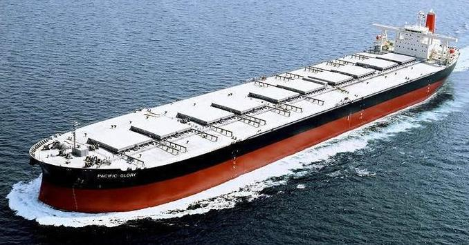

Figura 2: Uso de placas planas usadas en la fabricación de la cubierta de embarcaciones navieras.

Otra de las aplicaciones más frecuentes es la fabricación de embarcaciones navieras dedicadas al traslado de mercancías, aplicaciones militares o en general para embarcaciones con diferentes usos.

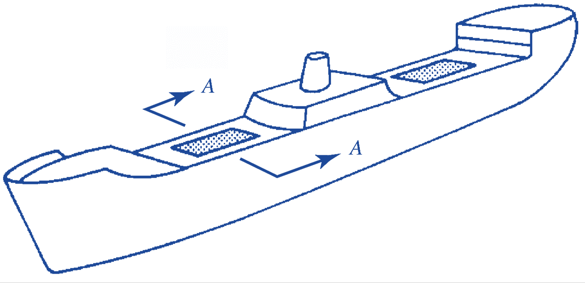

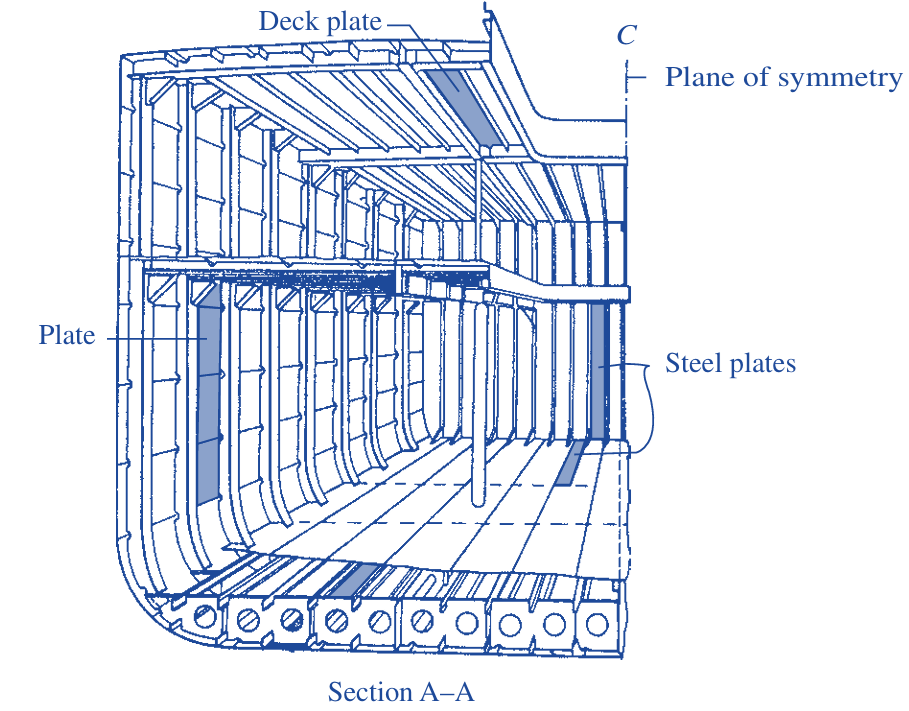

Figura 3: Sección transversal típica de una embarcación y las placas planas usadas para la construcción de cubierta y el casco.

En el corte transversal pueden distinguirse las láminas que forman el casco y los elementos de refuerzo que las acompañan. Las láminas reciben presiones y otras cargas; los refuerzos proporcionan líneas de apoyo. Así, una misma estructura combina el trabajo de placas con el de vigas y marcos. Las zonas curvas del casco requieren un tratamiento geométrico distinto al de una placa inicialmente plana.

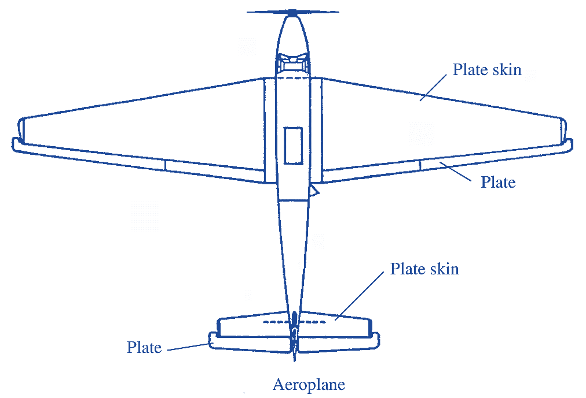

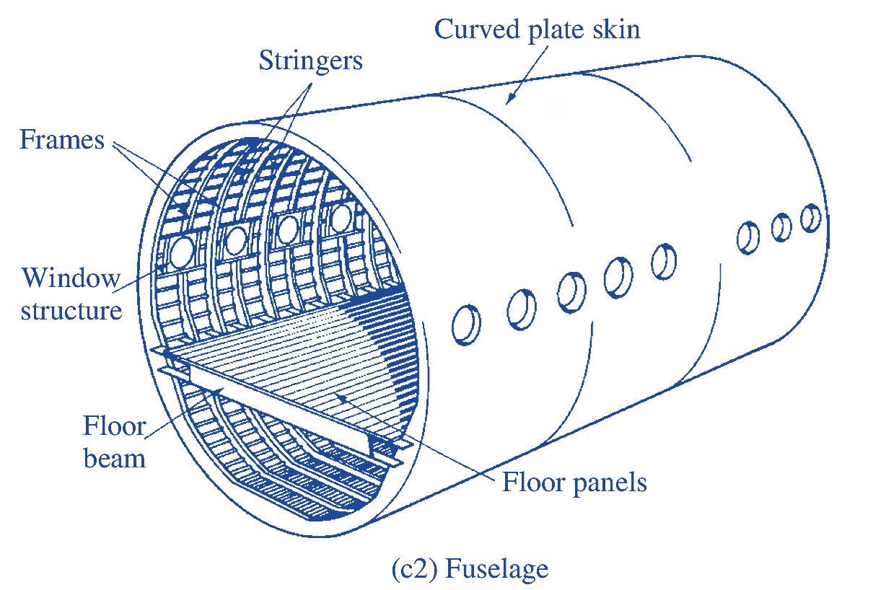

Figura 4: Construcción del chasis de un aeroplano usando placas curvas sobre pórticos curvos y sistema de placas planas como sistema de pisos.

En una aeronave se distinguen los paneles exteriores, que pueden ser curvos, y los paneles de piso, que pueden idealizarse como placas planas. En ambos casos, las piezas trabajan junto con los elementos longitudinales y transversales que las sostienen. El modelo de placa plana de este capítulo resulta apropiado para regiones que, antes de deformarse, pueden considerarse planas.

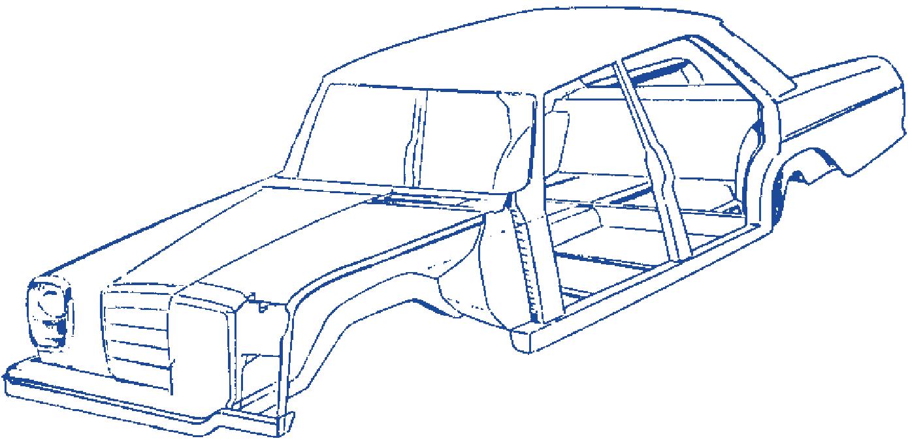

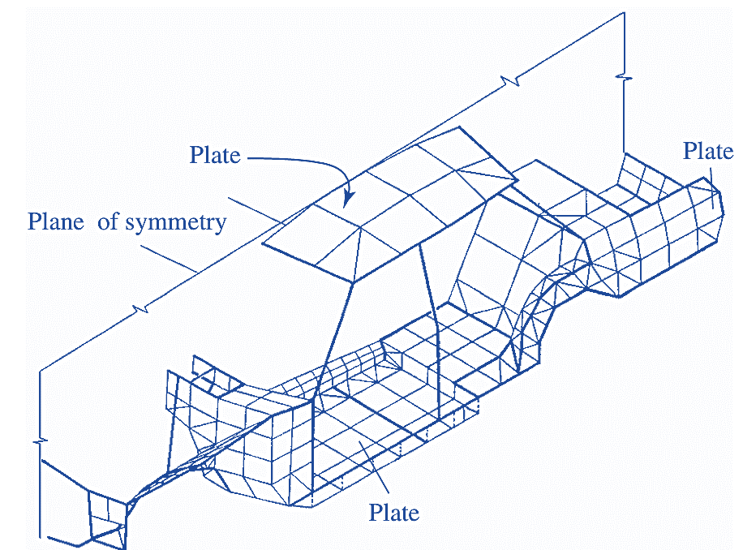

Figura 5: Chasis de automóvil y paneles que trabajan como placas.

En la figura también aparecen paneles de una carrocería y su relación con los miembros de soporte. La forma del panel y sus conexiones determinan qué partes se pueden estudiar mediante una idealización de placa. Conviene reconocer primero el elemento real y después elegir el modelo mecánico que represente su comportamiento.

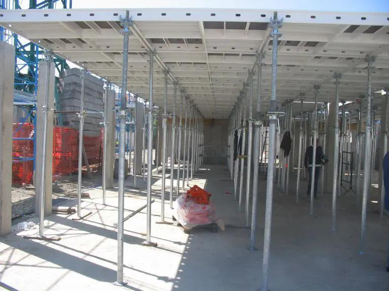

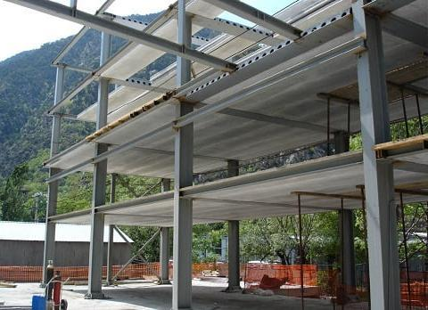

Figura 6: Encofrados planos para el colado de losas planas de concreto armado y sistemas de losas planas.

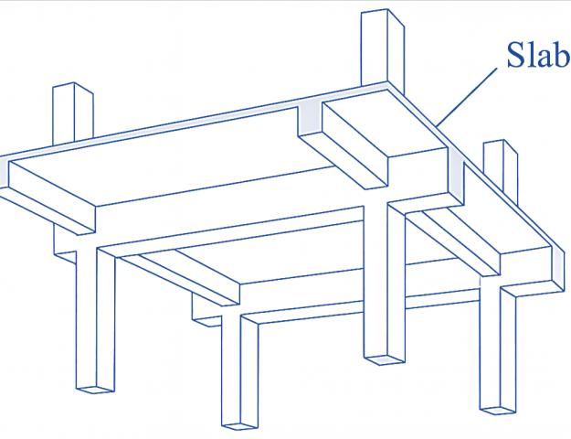

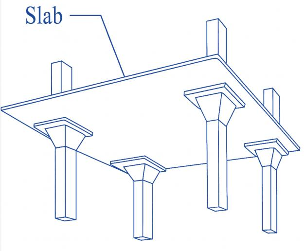

Figura 7: Placas planas usadas como sistemas de piso en edificaciones a) con sistemas de vigas y b) con sistemas de ábacos.

En la primera configuración de la figura 7, las vigas delimitan regiones de losa y aportan soporte a lo largo de sus bordes. En la segunda, los apoyos se conectan directamente con la losa a través de zonas ensanchadas, llamadas ábacos. Las dos configuraciones transmiten cargas hacia las columnas, pero no tienen las mismas condiciones de apoyo. Esa diferencia será importante cuando se establezcan las condiciones de contorno del problema.

---

## 2. Idealización de las Placas para el Análisis

Una placa plana es un elemento estructural que se caracteriza geométricamente porque dos de sus dimensiones (longitud y ancho) son considerablemente mayores que la tercera (espesor), lo que permite considerarla como un elemento bidimensional o de área.

Desde el punto de vista funcional, las placas están diseñadas para soportar cargas aplicadas perpendicularmente a su plano medio, tales como cargas puntuales, cargas distribuidas de forma arbitraria, momentos flectores aplicados en el borde, o incluso acciones indirectas como gradientes de temperatura entre sus caras, entre otras posibilidades.

Figura 8: Placa plana sujeta a la acción de cargas transversales y elección del plano medio como origen del sistema de coordenadas.

Para describir una placa se escogen normalmente las coordenadas $x$ e $y$ sobre su plano medio y la coordenada $z$ a través del espesor. El plano medio se encuentra a igual distancia de las dos caras cuando la placa tiene espesor constante. Trabajar con ese plano simplifica el problema: en lugar de describir el desplazamiento de cada punto del sólido, se busca principalmente la deflexión de una superficie.

Al igual que en el caso de las vigas, las placas están sometidas a un sistema de fuerzas internas, entre las cuales predominan los momentos flectores y las fuerzas cortantes. No obstante, en placas delgadas —aquellas cuyo espesor es pequeño en comparación con sus otras dimensiones— el comportamiento estructural está gobernado principalmente por los momentos flectores, siendo las fuerzas cortantes relativamente despreciables en el análisis clásico. En consecuencia, la deflexión observada en este tipo de placas se debe, en esencia, a los efectos de flexión inducidos por la carga transversal aplicada.

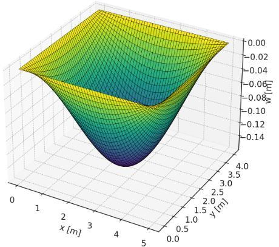

Figura 9: Deformada de una placa plana sometida a la acción de una carga uniformemente transversal.

La deformada muestra que los puntos de la placa no se desplazan todos la misma distancia. Cerca de los apoyos, la deflexión suele estar limitada; en el interior puede alcanzar valores mayores. Por eso se estudia la deflexión como una función de la posición. En el modelo clásico de placas delgadas se desprecia la contribución de la deformación por cortante a esa deflexión, pero no significa que las fuerzas cortantes internas sean siempre nulas.

---

## 3. Curvatura en Placas

La principal característica geométrica de una placa plana sujeta a la acción de cargas transversales a su plano es la curvatura de la misma. Esta propiedad se puede estudiar recordando que el caso unidimensional, la curvatura es el cambio instantáneo de la pendiente por unidad de cambio de la longitud de arco. En el caso mas general de las placas planas, la deflexión y por tanto la pendiente en un punto es una función de dos variables, si se usa un sistema de coordenadas cartesianos, se tiene que:

$$
\omega=\omega(x,y)
$$

Figura 10: Variación de la deflexión en una dirección específica $n$.

La figura representa una placa vista desde arriba. Las curvas cerradas permiten imaginar puntos que tienen un mismo valor de deflexión. Si partimos de un punto y avanzamos en distintas direcciones, la deflexión puede variar de forma diferente. Para medir esa variación se usa una dirección $n$ que forma un ángulo $\theta$ con el eje $x$.

La deflexión de una placa plana es una función de dos variables por lo que su variación en una dirección arbitraria tiene la siguiente forma:

$$ d\omega = \frac{\partial\omega}{\partial x}\,dx + \frac{\partial\omega}{\partial y}\,dy $$

Si se está interesado en medir el cambio que sufre una función en una dirección particular, esta puede ser medida de acuerdo con la siguiente expresión:

$$ \frac{\partial\omega}{\partial n} = \frac{\partial\omega}{\partial x}\frac{\partial x}{\partial n} + \frac{\partial\omega}{\partial y}\frac{\partial y}{\partial n} $$

Con el cambio de coordenadas:

$$ x = n\cos\theta, \qquad y = n\operatorname{sen}\theta $$

Por tanto:

$$ \frac{\partial x}{\partial n} = \cos\theta, \qquad \frac{\partial y}{\partial n} = \operatorname{sen}\theta $$

Luego:

$$ \frac{\partial\omega}{\partial n} = \cos\theta\frac{\partial\omega}{\partial x} + \operatorname{sen}\theta\frac{\partial\omega}{\partial y} $$

La última igualdad sale de sustituir las dos derivadas del cambio de coordenadas en la expresión anterior. En otras palabras, el cambio de deflexión que se mide siguiendo $n$ reúne las variaciones que tiene la placa en $x$ e $y$, según la orientación elegida.

El cambio de la deflexión en una dirección arbitraria puede ser interpretado como el ángulo que la superficie que define la deflexión gira en esa dirección particular, por lo que ahora se denominará a este giro en dirección $n$.

Además de medir el cambio de la deflexión en una dirección dada, es de interés medir el cambio del giro; en ese caso esta puede ser medida a partir de la siguiente expresión:

$$ \begin{aligned}
\frac{\partial}{\partial n}\left(\frac{\partial\omega}{\partial n}\right)
&= \cos\theta\left[\frac{\partial}{\partial x}\left(\frac{\partial\omega}{\partial n}\right)\frac{\partial x}{\partial n} + \frac{\partial}{\partial y}\left(\frac{\partial\omega}{\partial n}\right)\frac{\partial y}{\partial n}\right] \\[8pt]
&\quad + \operatorname{sen}\theta\left[\frac{\partial}{\partial x}\left(\frac{\partial\omega}{\partial n}\right)\frac{\partial x}{\partial n} + \frac{\partial}{\partial y}\left(\frac{\partial\omega}{\partial n}\right)\frac{\partial y}{\partial n}\right]
\end{aligned} $$

Finalmente:

$$ \begin{aligned}
\frac{\partial^2\omega}{\partial n^2}
&= \cos\theta\left(\cos\theta\frac{\partial^2\omega}{\partial x^2} + \operatorname{sen}\theta\frac{\partial^2\omega}{\partial x\partial y}\right) \\[8pt]
&\quad + \operatorname{sen}\theta\left(\cos\theta\frac{\partial^2\omega}{\partial y\partial x} + \operatorname{sen}\theta\frac{\partial^2\omega}{\partial y^2}\right)
\end{aligned} $$

Recordando las siguientes identidades trigonométricas de ángulo doble:

$$ \cos^2\theta = \frac{1+\cos(2\theta)}{2}, \qquad \operatorname{sen}^2\theta = \frac{1-\cos(2\theta)}{2}, \qquad \operatorname{sen}(2\theta) = 2\operatorname{sen}\theta\cos\theta $$

Sustituyendo en la expresión de la curvatura en dirección $n$, se tiene lo siguiente:

$$ \begin{aligned}
\frac{\partial^2\omega}{\partial n^2}
&= \left(\frac{1+\cos(2\theta)}{2}\right)\frac{\partial^2\omega}{\partial x^2} + \left(\frac{1-\cos(2\theta)}{2}\right)\frac{\partial^2\omega}{\partial y^2} \\[8pt]
&\quad + \operatorname{sen}(2\theta)\frac{\partial^2\omega}{\partial y\partial x}
\end{aligned} $$

$$ \begin{aligned}
\frac{\partial^2\omega}{\partial n^2}
&= \frac{1}{2}\left(\frac{\partial^2\omega}{\partial x^2} + \frac{\partial^2\omega}{\partial y^2}\right) + \frac{1}{2}\left(\frac{\partial^2\omega}{\partial x^2} - \frac{\partial^2\omega}{\partial y^2}\right)\cos(2\theta) \\[8pt]
&\quad + \frac{\partial^2\omega}{\partial y\partial x}\operatorname{sen}(2\theta)
\end{aligned} $$

Definiendo las curvaturas en direcciones $x$, $y$, $n$ y la curvatura torsional:

$$ \begin{aligned}
K_x &= \frac{\partial^2\omega}{\partial x^2}, \qquad K_y = \frac{\partial^2\omega}{\partial y^2}, \\[8pt]
K_{xy} &= \frac{\partial^2\omega}{\partial x\partial y} = \frac{\partial^2\omega}{\partial y\partial x}, \qquad K_n = \frac{\partial^2\omega}{\partial n^2}
\end{aligned} $$

Entonces:

$$ K_n = \left(\frac{K_x+K_y}{2}\right) + \left(\frac{K_x-K_y}{2}\right)\cos(2\theta) + K_{xy}\operatorname{sen}(2\theta) $$

Esta relación muestra claramente que las curvaturas se transforman de acuerdo con las leyes de transformación de los tensores, lo que demuestra su naturaleza tensorial.

Para comprender esta afirmación, fijémonos en que $K_x$, $K_y$ y $K_{xy}$ describen la curvatura de una **misma** superficie, pero respecto de direcciones concretas. Si elegimos otra dirección $n$, no cambia la forma física de la placa: cambia la componente de curvatura que estamos midiendo. La expresión anterior indica exactamente cómo combinar las tres componentes conocidas para obtenerla. Esta dependencia del ángulo, con términos en $\cos(2\theta)$ y $\operatorname{sen}(2\theta)$, es la misma forma de transformación que aparece al expresar un tensor de segundo orden en ejes girados. No es necesario memorizar aquí una matriz nueva: la transformación ya está contenida en la fórmula de $K_n$.

$$ \frac{\partial}{\partial t}\left(\frac{\partial w}{\partial n}\right) = -\cos\theta\frac{\partial}{\partial t}\left(\frac{\partial w}{\partial x}\right) + \operatorname{sen}\theta\frac{\partial}{\partial t}\left(\frac{\partial w}{\partial y}\right) $$

$$ \begin{aligned}
\frac{\partial^2 w}{\partial t\partial n}
&= \cos\theta\left[\frac{\partial}{\partial x}\left(\frac{\partial w}{\partial x}\right)\frac{\partial x}{\partial t} + \frac{\partial}{\partial y}\left(\frac{\partial w}{\partial x}\right)\frac{\partial y}{\partial t}\right] \\[8pt]
&\quad + \operatorname{sen}\theta\left[\frac{\partial}{\partial x}\left(\frac{\partial w}{\partial y}\right)\frac{\partial x}{\partial t} + \frac{\partial}{\partial y}\left(\frac{\partial w}{\partial y}\right)\frac{\partial y}{\partial t}\right]
\end{aligned} $$

$$ \begin{aligned}
\frac{\partial^2 w}{\partial t\partial n}
&= \cos\theta\left[\frac{\partial x}{\partial t}\frac{\partial^2 w}{\partial x^2} + \frac{\partial y}{\partial t}\frac{\partial^2 w}{\partial y\partial x}\right] \\[8pt]
&\quad + \operatorname{sen}\theta\left[\frac{\partial x}{\partial t}\frac{\partial^2 w}{\partial x\partial y} + \frac{\partial y}{\partial t}\frac{\partial^2 w}{\partial y^2}\right]
\end{aligned} $$

$$ x = t\operatorname{sen}\theta, \qquad y = -t\cos\theta $$

$$ \frac{\partial x}{\partial t} = \operatorname{sen}\theta, \qquad \frac{\partial y}{\partial t} = -\cos\theta $$

$$ \begin{aligned}
\frac{\partial^2 w}{\partial t\partial n}
&= \cos\theta\left(\operatorname{sen}\theta\frac{\partial^2 w}{\partial x^2} - \cos\theta\frac{\partial^2 w}{\partial y\partial t}\right) \\[8pt]
&\quad + \operatorname{sen}\theta\left(\operatorname{sen}\theta\frac{\partial^2 w}{\partial x\partial y} + \cos\theta\frac{\partial^2 w}{\partial y^2}\right)
\end{aligned} $$

$$ \frac{\partial^2 w}{\partial t\partial n} = \frac{1}{2}\frac{\partial^2 w}{\partial x^2}\operatorname{sen}(2\theta) - \frac{1}{2}\frac{\partial^2 w}{\partial y^2}\operatorname{sen}(2\theta) = \left(\frac{k_x-k_y}{2}\right)\operatorname{sen}(2\theta) $$

Aquí se están relacionando los cambios de pendiente medidos en dos direcciones distintas, $n$ y $t$. La derivada mixta indica cuánto varía la pendiente en una dirección cuando avanzamos en la otra. Al elegir una orientación diferente, las curvaturas que intervienen también cambian. Las operaciones se basan nuevamente en la regla de la cadena y en las relaciones trigonométricas del ángulo $\theta$.

---

## 4. Momentos y las Curvaturas

Figura 11: Elemento de la placa en la que se observa el eje neutro y un elemento ubicado a $z$ unidades de este.

En la figura se ha separado un elemento pequeño de la placa. La superficie situada a mitad del espesor se utiliza como referencia, mientras que un punto ubicado a la distancia $z$ puede experimentar desplazamientos distintos. Las capas que quedan a un lado y otro del plano medio se alargan o acortan por la flexión. Este es el mismo principio geométrico utilizado en vigas, ahora en dos direcciones.

$$ U_x = z\frac{\partial w}{\partial x}, \qquad U_y = z\frac{\partial w}{\partial y}, \qquad U_z = -w $$

$$ \varepsilon_x = \frac{\partial u_x}{\partial x} = z\frac{\partial^2 w}{\partial x^2}, \qquad \varepsilon_y = \frac{\partial u_y}{\partial y} = z\frac{\partial^2 w}{\partial y^2} $$

$$ \gamma_{xy} = \left(\frac{\partial u_x}{\partial y} + \frac{\partial u_y}{\partial x}\right) = 2z\frac{\partial^2 w}{\partial x\partial y} $$

$$ \gamma_{xz} = \frac{1}{2}\left(\frac{\partial u_x}{\partial z} + \frac{\partial u_z}{\partial x}\right) = \frac{1}{2}\left(\frac{\partial w}{\partial x} - \frac{\partial w}{\partial x}\right) = 0 $$

$$ \gamma_{yz} = \frac{1}{2}\left(\frac{\partial u_y}{\partial z} + \frac{\partial u_z}{\partial y}\right) = \frac{1}{2}\left(\frac{\partial w}{\partial y} - \frac{\partial w}{\partial y}\right) = 0 $$

Al sustituir los desplazamientos en las relaciones de deformación, aparecen derivadas segundas de $w$. Esto indica que las deformaciones de flexión dependen de la curvatura. También aparece el factor $z$: en el plano medio, donde $z=0$, esas deformaciones normales se anulan. Las dos últimas igualdades muestran la hipótesis cinemática de que no hay deformación transversal por cortante en esta teoría.

De la ley de Hooke generalizada se tiene:

$$ \varepsilon_x = \frac{\sigma_x}{E} - \nu\frac{\sigma_y}{E}, \qquad \varepsilon_y = \frac{\sigma_y}{E} - \nu\frac{\sigma_x}{E} $$

$$ \sigma_x - \nu\sigma_y = E\varepsilon_x, \qquad \sigma_y - \nu\sigma_x = E\varepsilon_y $$

$$ \sigma_x(1-\nu^2) = E(\varepsilon_x + \nu\varepsilon_y) \quad\Rightarrow\quad \sigma_x = \frac{E}{1-\nu^2}(\varepsilon_x + \nu\varepsilon_y) $$

$$ \sigma_y = \frac{E}{1-\nu^2}(\varepsilon_y + \nu\varepsilon_x) $$

Estas ecuaciones permiten calcular los esfuerzos cuando se conocen las deformaciones. El coeficiente $\nu$ aparece porque una deformación en una dirección influye también en la respuesta de la dirección perpendicular. Por eso, a diferencia de una relación uniaxial sencilla, cada esfuerzo normal depende de dos deformaciones.

En términos de las deflexiones:

$$ \sigma_x = \frac{E}{1-\nu^2}\left(\frac{\partial^2 w}{\partial x^2} + \nu\frac{\partial^2 w}{\partial y^2}\right)z $$

$$ \sigma_y = \frac{E}{1-\nu^2}\left(\frac{\partial^2 w}{\partial y^2} + \nu\frac{\partial^2 w}{\partial x^2}\right)z $$

Además:

$$ \tau_{xy} = G\gamma_{xy} $$

$$ \tau_{xy} = Gz\,2\frac{\partial^2 w}{\partial x\partial y} = \frac{E}{1+\nu}z\frac{\partial^2 w}{\partial x\partial y} $$

Esta última relación introduce el esfuerzo cortante que actúa dentro del plano de la placa. En la expresión, $G$ representa el módulo de rigidez al corte. La derivada mixta muestra que este esfuerzo aparece cuando la superficie presenta un cambio de pendiente combinado en $x$ e $y$.

Integrando a lo largo de la sección:

$$ M_x = \frac{E}{1-\nu^2}\left(\frac{\partial^2 w}{\partial x^2} + \nu\frac{\partial^2 w}{\partial y^2}\right)\int_{-h/2}^{h/2} z\,dz $$

$$ M_x = \frac{Eh^3}{12(1-\nu^2)}\left(\frac{\partial^2 w}{\partial x^2} + \nu\frac{\partial^2 w}{\partial y^2}\right) = D\left(\frac{\partial^2 w}{\partial x^2} + \nu\frac{\partial^2 w}{\partial y^2}\right) $$

$$ M_y = \int_{-h/2}^{h/2}\sigma_y z\,dz = \frac{E}{1-\nu^2}\left(\frac{\partial^2 w}{\partial y^2} + \nu\frac{\partial^2 w}{\partial x^2}\right)\int_{-h/2}^{h/2} z^2\,dz $$

$$ M_y = \frac{Eh^3}{12(1-\nu^2)}\left(\frac{\partial^2 w}{\partial y^2} + \nu\frac{\partial^2 w}{\partial x^2}\right) = D\left(\frac{\partial^2 w}{\partial y^2} + \nu\frac{\partial^2 w}{\partial x^2}\right) $$

$$ M_{xy} = \int_{-h/2}^{h/2}\tau_{xy} z\,dz = \frac{E}{1+\nu}\frac{\partial^2 w}{\partial x\partial y}\int_{-h/2}^{h/2} z^2\,dz $$

$$ M_{xy} = \frac{Eh^3}{12(1-\nu^2)}(1+\nu)\frac{\partial^2 w}{\partial x\partial y} = D(1+\nu)\frac{\partial^2 w}{\partial x\partial y} $$

Al integrar los esfuerzos a través del espesor se obtienen las resultantes que representan la flexión y la torsión. En estas expresiones aparece la rigidez flexional $D$, definida mediante $E$, $h$ y $\nu$. La presencia de $h^3$ significa que un aumento del espesor produce un cambio importante en la rigidez a flexión.

Figura 12: Esfuerzos actuantes en una superficie orientada sobre los ejes coordenados.

Figura 13: Distribución de esfuerzos normales y los momentos resultantes.

Los esfuerzos normales cambian con la distancia al plano medio, por lo que los esfuerzos de las capas superiores e inferiores producen un momento resultante. Los esquemas muestran el paso desde una distribución de esfuerzos sobre las caras laterales hasta una representación mediante momentos por unidad de longitud.

Figura 14: Efecto de los esfuerzos cortantes actuantes en el plano $xy$ como torsores.

Los esfuerzos cortantes dibujados sobre las caras laterales tienen direcciones que producen torsión. Por ello se representan mediante los momentos torsores correspondientes. Al analizar un elemento pequeño de placa es necesario incluir tanto estos momentos como los de flexión.

Figura 15: Distribución de esfuerzos de corte producidos por la fuerza cortante.

La figura 15 separa los esfuerzos cortantes distribuidos por el espesor de sus fuerzas resultantes $Q_x$ y $Q_y$. Estas fuerzas se utilizarán para escribir las ecuaciones de equilibrio del elemento de placa.

---

## 5. Ecuación de Equilibrio en Placas

Figura 16: Diagrama de cuerpo libre de un elemento de placa sujeta a fuerzas cortantes y momentos flectores.

En el diagrama se representa una porción muy pequeña de la placa, de lados $dx$ y $dy$. Sobre sus bordes actúan momentos y cortantes, mientras que la carga transversal distribuida actúa sobre su superficie. Las acciones en bordes opuestos son ligeramente distintas porque pueden variar de un punto a otro. Esa diferencia se expresa mediante derivadas.

El equilibrio en dirección $z$ brinda una relación entre las cortantes en $x$ e $y$ y la carga distribuida. Esta es una ecuación análoga a la obtenida en la teoría de vigas que relaciona la derivada de las cortantes y la carga distribuida.

$$ \frac{\partial Q_x}{\partial x}\,dx\,dy + \frac{\partial Q_y}{\partial y}\,dy\,dx + q\,dx\,dy = 0 $$

$$ \frac{\partial Q_x}{\partial x} + \frac{\partial Q_y}{\partial y} + q = 0 $$

La segunda expresión se obtiene dividiendo la primera entre el área diferencial $dx\,dy$. Su significado es que la variación conjunta de las fuerzas cortantes debe equilibrar la carga transversal que actúa sobre la placa.

Ya que cualquier elemento diferencial debe estar en equilibrio, los momentos flectores deben estar en equilibrio en cada una de las direcciones, esto nos lleva a las siguientes expresiones:

$$ \frac{\partial M_{xy}}{\partial x}\,dx\,dy - \frac{\partial M_y}{\partial y}\,dy\,dx + Q_y\,dx\,dy = 0 $$

$$ \frac{\partial M_{xy}}{\partial x} - \frac{\partial M_y}{\partial y} + Q_y = 0 $$

En dirección transversal, se obtiene lo siguiente:

$$ \frac{\partial M_{yx}}{\partial y} + \frac{\partial M_x}{\partial x} - Q_x = 0 $$

Derivando la primera expresión con respecto de $x$ y derivando la segunda expresión con respecto de $y$ sumando, se obtiene la siguiente expresión:

$$ \frac{\partial^2 M_x}{\partial x^2} - \frac{\partial^2 M_{xy}}{\partial x\partial y} + \frac{\partial Q_y}{\partial x} = 0 $$

$$ \frac{\partial^2 M_y}{\partial y^2} - \frac{\partial^2 M_{yx}}{\partial y\partial x} + \frac{\partial Q_x}{\partial y} = 0 $$

Dado que se cumple que $M_{xy} = M_{yx}$, como consecuencia de que los esfuerzos cortantes cruzados son iguales, es decir, $\tau_{xy} = \tau_{yx}$, se obtiene la siguiente expresión:

$$ \frac{\partial^2 M_x}{\partial x^2} - 2\frac{\partial^2 M_{xy}}{\partial x\partial y} + \frac{\partial^2 M_y}{\partial y^2} + \frac{\partial Q_y}{\partial x} + \frac{\partial Q_x}{\partial y} = 0 $$

Finalmente se obtiene una relación entre los momentos flectores actuantes en un punto del elemento y la carga transversal distribuida. Note que existe una similitud en la forma que existe entre los momentos flectores y la carga distribuida.

$$ \frac{\partial^2 M_x}{\partial x^2} + 2\frac{\partial^2 M_{xy}}{\partial x\partial y} + \frac{\partial^2 M_y}{\partial y^2} = -q $$

Ahora, recordando la relación que existe entre los momentos flectores y las curvaturas en el caso de placas, es posible expresar la ecuación anterior en función de las deflexiones, al estilo de la teoría de vigas de Bernoulli. Así, las relaciones entre los momentos en $x$ e $y$ y las curvaturas tienen las siguientes expresiones:

$$ M_x = -D\left(\frac{\partial^2 w}{\partial x^2} + \nu\frac{\partial^2 w}{\partial y^2}\right) $$

$$ M_y = -D\left(\frac{\partial^2 w}{\partial y^2} + \nu\frac{\partial^2 w}{\partial x^2}\right) $$

$$ M_{xy} = -M_{yx} = D(1-\nu)\frac{\partial^2 w}{\partial x\partial y} $$

Finalmente, sustituyendo estas relaciones en la ecuación de equilibrio obtenida, se tiene la ecuación diferencial de cuarto orden que relaciona las deflexiones de la losa y la carga uniformemente distribuida sobre la losa:

$$ \frac{\partial^4 w}{\partial x^4} + 2\frac{\partial^4 w}{\partial x^2\partial y^2} + \frac{\partial^4 w}{\partial y^4} = \frac{q}{D} $$

$$ \Delta\Delta w = \frac{q}{D} $$

$$ \Delta w = \frac{\partial^2 w}{\partial x^2} + \frac{\partial^2 w}{\partial y^2} $$

Para resolver un problema con esta ecuación no basta con conocer la carga $q$. También debemos saber cómo está sostenida la placa. Las condiciones de apoyo proporcionarán la información adicional necesaria para determinar la función $w(x,y)$. La expresión $\Delta\Delta w$ es una forma abreviada de la ecuación con derivadas de cuarto orden.

---

## 6. Momentos Internos

Una vez obtenida la deflexión como función de las coordenadas del plano medio de la placa analizada, los momentos flectores en las direcciones $x$ e $y$ pueden determinarse mediante las siguientes ecuaciones:

$$ M_x = -D\left(\frac{\partial^2 w}{\partial x^2} + \nu\frac{\partial^2 w}{\partial y^2}\right) $$

$$ M_y = -D\left(\frac{\partial^2 w}{\partial y^2} + \nu\frac{\partial^2 w}{\partial x^2}\right) $$

El momento flector de torsión actuante en los planos de corte $x$ e $y$ se puede obtener a través de las siguientes expresiones:

$$ M_{xy} = -M_{yx} = D(1-\nu)\frac{\partial^2 w}{\partial x\partial y} $$

Estas relaciones se aplican después de encontrar $w(x,y)$. Primero se deriva la deflexión respecto de las coordenadas indicadas y luego se multiplica por la rigidez flexional. Los momentos obtenidos son resultantes por unidad de longitud de la placa.

---

## 7. Cortantes Internos

Las fuerzas cortantes en placas pueden obtenerse a partir de las relaciones diferenciales entre los momentos flectores y las cortantes establecidas anteriormente para cada componente; a continuación, se muestran estas relaciones:

$$ \frac{\partial M_{yx}}{\partial y} + \frac{\partial M_x}{\partial x} - Q_x = 0 $$

$$ \frac{\partial M_{xy}}{\partial x} - \frac{\partial M_y}{\partial y} + Q_y = 0 $$

Sustituyendo las expresiones de los momentos flectores, se obtienen fórmulas que vinculan las fuerzas cortantes con las deflexiones de la placa:

$$ Q_x = \frac{\partial M_{yx}}{\partial y} + \frac{\partial M_x}{\partial x} = -D\frac{\partial}{\partial x}\left(\frac{\partial^2 w}{\partial x^2} + \frac{\partial^2 w}{\partial y^2}\right) $$

$$ Q_y = \frac{\partial M_y}{\partial y} - \frac{\partial M_{xy}}{\partial x} = -D\frac{\partial}{\partial y}\left(\frac{\partial^2 w}{\partial x^2} + \frac{\partial^2 w}{\partial y^2}\right) $$

Estas expresiones se pueden reescribir de forma compacta en función del laplaciano de las deflexiones y de la rigidez flexional:

$$ Q_x = -D\frac{\partial}{\partial x}(\Delta w), \qquad Q_y = -D\frac{\partial}{\partial y}(\Delta w) $$

La diferencia entre estas fórmulas y las de los momentos es el orden de derivación. Para calcular $Q_x$ y $Q_y$ a partir de la deflexión se requieren derivadas de tercer orden. Al igual que los momentos, estas fuerzas se expresan por unidad de longitud de borde.

Finalmente, debido a las hipótesis realizadas para el desarrollo de la teoría presentada, la distribución de esfuerzos cortantes en el peralte de la placa es parabólica, y el máximo esfuerzo cortante se obtiene en el eje de la losa. Las expresiones para el máximo cortante se muestran a continuación:

$$ (\tau_{xz})_{\max} = \frac{3Q_x}{2h}, \qquad (\tau_{yz})_{\max} = \frac{3Q_y}{2h} $$

El factor $3/2$ corresponde a la relación entre el valor máximo de una distribución parabólica y su valor medio a través del espesor. Aquí $h$ es el espesor de la placa. Por ello, una misma resultante cortante produce un mayor esfuerzo cuando actúa en una sección de menor espesor.

---

## 8. Reacciones Distribuidas y Reacciones Puntuales

Las condiciones de contorno para el caso de una losa con borde libre se han expresado en tres condiciones independientes, estas condiciones fueron inicialmente propuestas por Poisson; sin embargo, Kirchhoff, reformuló este conjunto de expresiones y estableció que estas son matemáticamente equivalentes a dos condiciones

Figura 17: Equivalencia entre los momentos torsores y las fuerzas cortantes equivalentes.

En el borde libre no basta con observar las fuerzas cortantes que aparecen directamente en las caras del elemento. Los momentos torsores también pueden representarse mediante pares de fuerzas verticales equivalentes. Al sumar las contribuciones de muchos elementos consecutivos, esas fuerzas generan una resultante adicional a lo largo del borde.

Considere un elemento infinitesimal de longitud $dy$ en el borde $x = a$. Sobre este elemento actúa un momento torsor $M_{xy}\,dy$ (donde $M_{xy}$ es el momento por unidad de longitud). Este momento torsor puede ser reemplazado por dos fuerzas verticales, una fuerza $+M_{xy}$ aplicada en un extremo del elemento ($y$) y una fuerza $-M_{xy}$ aplicada en el otro extremo ($y + dy$), como muestra la Figura 17. Estas fuerzas generan un par equivalente al momento torsor original:

$$ \mathrm{Par} = M_{xy} \times dy $$

Ahora considere dos elementos consecutivos a lo largo del borde: elemento 1 (en $y$), en su extremo derecho ($y + dy$) tiene una fuerza $-M_{xy}(y)$ (hacia abajo); elemento 2 (en $y + dy$), en su extremo izquierdo ($y + dy$) tiene una fuerza $+M_{xy}(y + dy)$ (hacia arriba). La fuerza neta vertical en el punto $y + dy$ es:

$$ M_{xy}(y + dy) - M_{xy}(y) $$

La fuerza por unidad de longitud en el borde analizado se puede obtener dividiendo la fuerza neta por la longitud diferencial $dy$; en el límite, se tiene la fuerza cortante transversal por unidad de longitud:

$$ Q'_x = \lim_{dy\to 0}\frac{M_{xy}(y + dy) - M_{xy}(y)}{dy} = \frac{\partial M_{xy}}{\partial y} $$

$$ Q'_x = -\frac{\partial M_{xy}}{\partial y} $$

La fuerza cortante distribuida en los apoyos viene dada por la superposición de la fuerza cortante $Q_x$ y la cortante distribuida equivalente producto del momento torsor evaluado en $x = a$. Es decir, viene dada por la siguiente suma:

$$ Q'_x = -\left(\frac{\partial M_{xy}}{\partial y}\right)_{x=a} $$

$$ V_x = \left(Q_x - \frac{\partial M_{xy}}{\partial y}\right)_{x=a} = 0 $$

El término $V_x$ reúne dos efectos: la cortante transversal $Q_x$ y la acción equivalente debida a la variación del momento torsor a lo largo del borde. Si el borde está libre de fuerzas aplicadas, esa resultante debe anularse. La orientación y el signo dependen de la convención empleada en los diagramas.

Sustituyendo las expresiones obtenidas anteriormente para la fuerza cortante y el momento torsor en función de las deflexiones, se tienen las siguientes expresiones:

$$ \left[\frac{\partial^3 w}{\partial x^3} + (2 - \nu)\frac{\partial^3 w}{\partial x\partial y^2}\right]_{x=a} = 0 $$

Además, el momento flector a lo largo de este eje también deberá ser igual a cero en el caso de borde libre, es decir:

$$ \left.\left(\frac{\partial^2 w}{\partial x^2} + \nu\frac{\partial^2 w}{\partial y^2}\right)\right|_{x=a} = 0 $$

Figura 18: Reacciones puntuales actuantes en las esquinas de una losa rectangular sometida a carga distribuida.

La figura muestra fuerzas concentradas en las esquinas. Aunque las acciones que se han estudiado a lo largo de los bordes se distribuyen por unidad de longitud, en un vértice se encuentran dos bordes y pueden aparecer contribuciones que no se compensan del mismo modo que en sus tramos interiores.

La reacción puntual ocurrida en las cuatro esquinas de la placa sometida a una carga distribuida transversal puede calcularse evaluando el momento torsor en las esquinas respectivas. Por simetría esta puede calcularse evaluando estos valores en $x = a$, $y = b$:

$$ R = 2(M_{xy})_{x=a,\,y=a} = 2D(1-\nu)\left(\frac{\partial^2 w}{\partial x\partial y}\right)_{x=a,\,y=a} $$

La expresión relaciona la reacción concentrada con el momento torsor evaluado en la esquina. Para usarla es necesario conocer previamente la deflexión $w(x,y)$ y obtener su derivada mixta en el punto indicado. La existencia y el sentido de la reacción dependen de las restricciones reales de esa esquina.

---

## 9. Condiciones de Contorno

Para que la ecuación diferencial que describe el comportamiento de la placa sea resoluble y admita una solución única, es necesario acompañarla con las condiciones de contorno correspondientes. De acuerdo con la teoría de placas, dichas condiciones pueden clasificarse en dos tipos fundamentales: condiciones de Dirichlet, que imponen el valor de la función (desplazamiento transversal), y condiciones de Neumann (o de von Neumann), que imponen valores sobre las derivadas de la función, es decir, sobre las razones de cambio (como pendientes o momentos).

Las condiciones de contorno que deben aplicarse al problema dependen de las condiciones físicas de apoyo de la placa que se desea modelar. En la teoría de losas, al igual que en la teoría de vigas, se reconocen tres tipos fundamentales de condiciones de contorno: empotramiento, apoyo simple y borde libre, tal como se ilustran en las figuras siguientes.

La misma carga y las mismas dimensiones pueden producir deflexiones distintas si cambia la forma en que está sujeta la placa. Por eso se identifica primero cada borde: algunos impiden el desplazamiento, otros impiden también el giro y otros no transmiten acciones de apoyo.

### 9.1. Apoyo empotrado

Un apoyo empotrado corresponde a una condición física en la que la losa se encuentra rígidamente confinada dentro de un soporte de elevada rigidez, el cual restringe por completo todos sus grados de libertad tanto traslacionales como rotacionales. Es decir, la losa no puede desplazarse ni girar en dicho borde, tal como se muestra en la imagen siguiente.

Bajo estas condiciones, si el borde empotrado está definido por la ecuación $x = a$, entonces la deflexión vertical $w(a,y)$ será necesariamente igual a cero, y el giro en dirección normal al borde, representado por $\partial w(a,y)/\partial x$, también será igual a cero:

$$ \left.\omega\right|_{x=a} = 0 $$

$$ \left.\frac{\partial\omega}{\partial x}\right|_{x=a} = 0 $$

Figura 19: Placa con borde empotrado.

En el empotramiento se imponen dos condiciones diferentes. La primera evita que la placa suba o baje en el borde; la segunda impide que allí cambie su inclinación normal. La restricción del giro es lo que diferencia este apoyo del simple.

---

### 9.2. Apoyo simple

Un apoyo simple es aquel que restringe únicamente la deflexión transversal del extremo de la losa, pero permite libremente el giro del elemento en ese borde. En la figura siguiente se presenta una representación idealizada de este tipo de condición de apoyo, aplicada al caso de losas planas.

Una característica fundamental de este tipo de apoyo es que el momento flector en el borde apoyado es igual a cero, debido a que el giro no está restringido. Es decir, al no existir impedimento rotacional, no se generan momentos resistentes en el borde. Las expresiones matemáticas que describen esta condición física se indican a continuación:

$$ \left.\omega\right|_{x=a} = 0 $$

$$ \left.\left(\frac{\partial^2 w}{\partial x^2} + \nu\frac{\partial^2 w}{\partial y^2}\right)\right|_{x=a} = 0 $$

Figura 20: Placa con apoyo simple.

Aquí la deflexión sigue siendo nula sobre el apoyo, pero la pendiente puede ser distinta de cero. La segunda ecuación corresponde al momento de flexión asociado al borde. De esta manera, la placa puede girar localmente sin que el apoyo aplique un momento resistente idealizado.

---

### 9.3. Borde libre

La tercera condición básica de apoyo en placas planas corresponde al borde libre. Esta condición no impone restricciones directas sobre los grados de libertad (desplazamientos), es decir, no existen condiciones de Dirichlet propiamente dichas. Sin embargo, sí establece condiciones sobre las fuerzas internas, específicamente los cortantes y momentos flectores, los cuales deben anularse a lo largo del borde libre. En este caso, dichas funciones toman valores iguales a cero, tal como se indica a continuación:

$$ \left.M_x\right|_{x=a} = 0 $$

$$ \left.M_{xy}\right|_{x=a} = 0 $$

$$ \left.Q_x\right|_{x=a} = 0 $$

Figura 21: Placa con borde libre.

Un borde libre puede desplazarse y girar sin una restricción directa impuesta por un apoyo. Las condiciones se expresan entonces mediante las acciones que actúan sobre él. Al estudiar un borde libre en la formulación de Kirchhoff también debe tenerse presente la cortante equivalente $V_x$ desarrollada en la sección 8, que reúne la cortante y la contribución del momento torsor.

---

## 10. Analogía entre la Teoría de Placas y la Teoría de Vigas

Como se ha señalado a lo largo del desarrollo de la teoría de placas, existen evidentes paralelismos entre la teoría de vigas de Bernoulli y la teoría de placas formulada por Kirchhoff. En efecto, esta última puede considerarse como una extensión o generalización natural de la teoría de vigas de Bernoulli, ya que ambas comparten hipótesis fundamentales en su formulación, tales como la suposición de secciones planas que permanecen planas y normales a la superficie media después de la deformación. A continuación, se muestran resumidas las ecuaciones más importantes:

| Función | Teoría de placas | Teoría de vigas |
| :--- | :--- | :--- |
| Cortantes | $\dfrac{\partial Q_x}{\partial x}+\dfrac{\partial Q_y}{\partial y}+q=0$ | $\dfrac{\partial Q}{\partial x}+q=0$ |
| Momentos y cortantes | $\dfrac{\partial M_x}{\partial x}+\dfrac{\partial M_{yx}}{\partial y}-Q_x=0$ | $\dfrac{\partial M}{\partial x}-Q=0$ |
| Relación de momentos y curvaturas | $M_x=-D\left(\dfrac{\partial^2 w}{\partial x^2}+\nu\dfrac{\partial^2 w}{\partial y^2}\right)$ $M_y=-D\left(\dfrac{\partial^2 w}{\partial y^2}+\nu\dfrac{\partial^2 w}{\partial x^2}\right)$ $M_{xy}=-M_{yx}=D(1-\nu)\dfrac{\partial^2 w}{\partial x\partial y}$ | $M=EI\dfrac{\partial^2 w}{\partial x^2}$ |
| Relación entre la deflexión y la carga distribuida | $\dfrac{\partial^4 w}{\partial x^4}+2\dfrac{\partial^4 w}{\partial x^2\partial y^2}+\dfrac{\partial^4 w}{\partial y^4}=\dfrac{q}{D}$ | $\dfrac{\partial^4 w}{\partial x^4}=\dfrac{q}{EI}$ |

En una viga, la deflexión se describe principalmente en función de una coordenada, mientras que en una placa intervienen dos. Por eso las ecuaciones de placas incluyen derivadas respecto de $x$ e $y$ y un momento torsor adicional. La relación entre carga, cortante, momento y deformación sigue el mismo razonamiento de equilibrio y flexión que se aprende en la teoría de vigas, pero extendido a una superficie.

---

## 11. Solución de Navier para Losas Apoyadas

Si la carga distribuida se puede expresar como una función de dos variables arbitraria, es posible realizar un tratamiento previo de esta función y aprovechar los resultados obtenidos anteriormente usando el principio de superposición. Siguiendo esa lógica, sea $q$ la carga distribuida sobre la losa:

$$ q = f(x,y) $$

Es posible representar esta función arbitraria como una combinación lineal del producto de senos en dirección $x$ y en dirección $y$, tal como se muestra a continuación:

$$ f(x,y) = \sum_{m=1}^{\infty}\sum_{n=1}^{\infty} a_{mn}\sin\left(\frac{m\pi x}{a}\right)\sin\left(\frac{n\pi y}{b}\right) $$

En una placa rectangular, $a$ y $b$ representan las longitudes de sus lados; $m$ y $n$ son índices enteros. Cada producto de senos describe una forma de variación de la carga sobre la superficie. Los coeficientes $a_{mn}$ indican cuánto participa cada una de esas formas en la carga que se quiere representar.

Esta expresión cumple de forma automática con las condiciones de contorno del problema analizado, pues es cero en los apoyos y también cumple con la condición de momentos cero en los apoyos; basta con realizar la diferenciación y sustituir los valores respectivos.

Como se puede apreciar, la única incógnita resultan ser los coeficientes de cada término, pero estos se pueden encontrar de forma práctica recordando las propiedades de las funciones ortogonales. A continuación, se presentan tales propiedades:

$$ \int_0^b \sin\left(\frac{n\pi y}{b}\right)\sin\left(\frac{n'\pi y}{b}\right)dy = \frac{b}{2} \quad\text{cuando } n = n' $$

$$ \int_0^b \sin\left(\frac{n\pi y}{b}\right)\sin\left(\frac{n'\pi y}{b}\right)dy = 0 \quad\text{cuando } n \ne n' $$

La ortogonalidad significa que, al multiplicar e integrar dos funciones seno de índices distintos, el resultado se anula. Esto permite separar un coeficiente concreto de todos los demás: al integrar, desaparecen los términos que no comparten su índice.

Multiplicando la ecuación de interés por la función $\sin(n'\pi y / b)$ a ambos lados e integrando de $0$ a $b$, se tiene la siguiente expresión:

$$ \int_0^b f(x,y)\sin\left(\frac{n'\pi y}{b}\right)dy = \sum_{m=1}^{\infty} a_{mn'}\frac{b}{2}\sin\left(\frac{m\pi x}{a}\right) $$

Si esta expresión se multiplica ahora por la función $\sin(m'\pi y / b)$, se obtiene una expresión que brinda los coeficientes buscados en función de una integral doble:

$$ \int_0^a\int_0^b f(x,y)\sin\left(\frac{m'\pi x}{a}\right)\sin\left(\frac{n'\pi y}{b}\right)dx\,dy = \frac{ab}{4}a_{m'n'} $$

Finalmente, despejando se tiene la expresión general de los coeficientes del desarrollo en series trigonométricas:

$$ a_{m'n'} = \frac{4}{ab}\int_0^a\int_0^b f(x,y)\sin\left(\frac{m'\pi x}{a}\right)\sin\left(\frac{n'\pi y}{b}\right)dx\,dy $$

El proceso consta de dos integraciones: una recorre la longitud de la placa y la otra su ancho. La carga aparece dentro de la integral, de modo que la expresión sirve para cargas que varíen con la posición. Con los coeficientes calculados se puede reconstruir la carga en forma de serie.

El problema puede reducirse a resolver infinitas ecuaciones diferenciales de segundo orden, de la siguiente forma:

$$ \frac{\partial^4 w}{\partial x^4} + 2\frac{\partial^4 w}{\partial x^2\partial y^2} + \frac{\partial^4 w}{\partial y^4} = \frac{q_0}{D}\sin\!\left(\tfrac{m\pi x}{a}\right)\sin\!\left(\tfrac{n\pi y}{b}\right), \qquad \forall m,n \in \mathbb{N} $$

Y debido a la linealidad de la ecuación diferencial analizada, la solución del problema será la sumatoria de las soluciones parciales de cada una de las ecuaciones diferenciales. Sea $w_{m,n}$ la solución asociada a la ecuación diferencial correspondiente a estos enteros; entonces, la solución general será la sumatoria de estas, es decir:

$$ w = \sum_{m=1}^{\infty}\sum_{n=1}^{\infty} w_{m,n} $$

La superposición puede utilizarse porque la ecuación es lineal respecto de $w$. Si se encuentra la respuesta de la placa a cada término de la carga, la suma de esas respuestas permite obtener la respuesta a la carga representada por la serie completa.

Pero la solución de la ecuación diferencial analizada fue resuelta anteriormente para el caso más general, y tiene la siguiente forma:

$$ w_{m,n} = \frac{q_0}{\pi^4 D\left(\frac{m^2}{a^2}+\frac{n^2}{b^2}\right)^2}\sin\left(\frac{m\pi x}{a}\right)\sin\left(\frac{n\pi y}{b}\right) $$

Finalmente, la solución general de la deflexión de una placa plana con apoyos simples sometida a una carga distribuida arbitraria se puede expresar de la siguiente forma:

$$ w = \frac{1}{\pi^4 D}\sum_{m=1}^{\infty}\sum_{n=1}^{\infty}\frac{a_{mn}}{\left(\frac{m^2}{a^2}+\frac{n^2}{b^2}\right)^2}\sin\left(\frac{m\pi x}{a}\right)\sin\left(\frac{n\pi y}{b}\right) $$

Así, el problema se reduce al cálculo de ciertas integrales que dependen de la función de carga y de funciones senoidales, algo que siempre es posible, incluso mediante el uso de métodos numéricos.

---

### 11.1. Ejemplo: Caso de una carga uniformemente distribuida

Sea una placa rectangular simplemente apoyada en sus cuatro extremos sometida a una carga distribuida uniformemente de intensidad $q_0$:

$$ f(x,y) = q_0 $$

Con la finalidad de aplicar el método de Navier, se deben calcular los coeficientes de la serie trigonométrica de acuerdo con las expresiones deducidas anteriormente. Estos coeficientes se obtienen de la siguiente integral:

$$ A_{mn} = \frac{1}{ab}\int_0^a\int_0^b q_0\sin\left(\frac{m\pi x}{a}\right)\sin\left(\frac{n\pi y}{b}\right)dx\,dy $$

La intensidad $q_0$ es constante en toda la superficie y puede sacarse fuera de la integral. Esto permite separar el cálculo en una integral respecto de $x$ y otra respecto de $y$:

$$ A_{mn} = \frac{4q_0}{ab}\int_0^a\int_0^b \sin\left(\frac{m\pi x}{a}\right)\sin\left(\frac{n\pi y}{b}\right)dx\,dy $$

$$ A_{mn} = \frac{4q_0}{ab}\int_0^a \sin\left(\frac{m\pi x}{a}\right)dx \int_0^b \sin\left(\frac{n\pi y}{b}\right)dy $$

$$ A_{mn} = \frac{4q_0}{ab}\left[\cos\left(\frac{m\pi x}{a}\right)\frac{a}{m\pi}\right]_0^a \left[\cos\left(\frac{n\pi y}{b}\right)\frac{b}{n\pi}\right]_0^b $$

$$ A_{mn} = \frac{4q_0 ab}{abmn\pi^2}\left.\cos\left(\frac{m\pi x}{a}\right)\right|_0^a \left.\cos\left(\frac{n\pi y}{b}\right)\right|_0^b $$

$$ A_{mn} = \frac{4q_0}{mn\pi^2}[\cos(m\pi) - 1][\cos(n\pi) - 1] $$

$$ A_{mn} = \frac{169q_0}{mn\pi^2},\quad m,n\text{ impares}; \qquad A_{mn} = 0,\quad m\text{ o }n\text{ pares} $$

La deflexión de la placa rectangular se puede obtener sustituyendo estos coeficientes en la serie trigonométrica, obteniendo:

$$ \omega = \frac{1}{\pi^4 D}\cdot\frac{16q_0}{\pi^2}\sum_m\sum_n \frac{1}{\left(\frac{m^2}{a^2}+\frac{n^2}{b^2}\right)^2}\sin\left(\frac{m\pi x}{a}\right)\sin\left(\frac{n\pi y}{b}\right) $$

$$ \omega = \frac{16q_0}{\pi^6 D}\sum_{m=1}^{\infty}\sum_{n=1}^{\infty}\frac{1}{mn\left(\frac{m^2}{a^2}+\frac{n^2}{b^2}\right)^2}\sin\left(\frac{m\pi x}{a}\right)\sin\left(\frac{n\pi y}{b}\right) $$

$$ x = \frac{a}{2}, \qquad y = \frac{b}{2} $$

$$ \omega = \frac{16q_0}{\pi^6 D}\sum_{m=1}^{\infty}\sum_{n=1}^{\infty}\frac{1}{mn\left(\frac{m^2}{a^2}+\frac{n^2}{b^2}\right)^2}\sin\left(\frac{m\pi}{2}\right)\sin\left(\frac{n\pi}{2}\right) $$

Las dos últimas expresiones corresponden a evaluar la serie en el centro geométrico de la placa. En ese punto se reemplazan $x$ por $a/2$ e $y$ por $b/2$; por eso los argumentos de los senos pasan a ser múltiplos de $\pi/2$.

#### Cálculo de los momentos flectores en dirección X

$$ \frac{\partial^2\omega}{\partial x^2} = \frac{16q_0}{\pi^6 D}\sum_m\sum_n \left(\frac{m\pi}{a}\right)^2\frac{1}{mn\left(\frac{m^2}{a^2}+\frac{n^2}{b^2}\right)^2}\sin\!\left(\tfrac{m\pi x}{a}\right)\sin\!\left(\tfrac{n\pi y}{b}\right) $$

$$ \frac{\partial^2\omega}{\partial y^2} = \frac{16q_0}{\pi^6 D}\sum_m\sum_n \left(\frac{n\pi}{b}\right)^2\frac{1}{mn\left(\frac{m^2}{a^2}+\frac{n^2}{b^2}\right)^2}\sin\!\left(\tfrac{m\pi x}{a}\right)\sin\!\left(\tfrac{n\pi y}{b}\right) $$

$$ \frac{\partial^2\omega}{\partial x^2} + \nu\frac{\partial^2\omega}{\partial y^2} = \frac{16q_0}{\pi^6 D}\sum_m\sum_n \frac{\pi^2}{mn}\frac{\left(\frac{m^2}{a^2}+\nu\frac{n^2}{b^2}\right)}{\left(\frac{m^2}{a^2}+\frac{n^2}{b^2}\right)^2}\sin\!\left(\tfrac{m\pi x}{a}\right)\sin\!\left(\tfrac{n\pi y}{b}\right) $$

$$ M_x = -\frac{16q_0}{\pi^4}\sum_m\sum_n \frac{\left(\frac{m^2}{a^2}+\nu\frac{n^2}{b^2}\right)}{mn\left(\frac{m^2}{a^2}+\frac{n^2}{b^2}\right)^2}\sin\!\left(\tfrac{m\pi x}{a}\right)\sin\!\left(\tfrac{n\pi y}{b}\right) $$

$$ x = \frac{a}{2}, \qquad y = \frac{b}{2} $$

$$ (M_x)_{\max} = -\frac{16q_0}{\pi^4}\sum_m\sum_n \frac{\left(\frac{m^2}{a^2}+\nu\frac{n^2}{b^2}\right)}{mn\left(\frac{m^2}{a^2}+\frac{n^2}{b^2}\right)^2}\sin\!\left(\tfrac{m\pi}{2}\right)\sin\!\left(\tfrac{n\pi}{2}\right) $$

#### Cálculo de los momentos flectores en dirección Y

$$ M_y = D\left(\frac{\partial^2\omega}{\partial y^2} + \nu\frac{\partial^2\omega}{\partial x^2}\right) $$

$$ M_y = -\frac{16q_0}{\pi^4 D}\sum_m\sum_n \frac{\left(\nu\frac{m^2}{a^2}+\frac{n^2}{b^2}\right)}{mn\left(\frac{m^2}{a^2}+\frac{n^2}{b^2}\right)^2}\sin\left(\frac{m\pi}{2}\right)\sin\left(\frac{n\pi}{2}\right) $$

Las expresiones de los momentos se obtienen a partir de las curvaturas de la placa, de modo que el cálculo exige derivar la serie de deflexión. Cuando se trabaja con una serie truncada, cada término incluido aporta una parte de la respuesta. Cuantos más términos se conserven, mejor puede representarse la distribución, siempre que la serie converja en la región evaluada.

---

## 12. Método Solución de Levy

El método de Levy es aplicable a losas rectangulares que tienen apoyos simples en dos caras opuestas, mientras que las caras restantes pueden estar sometidas a diferentes condiciones de contorno.

En el método de Navier se utilizaron funciones seno en las dos direcciones, lo cual resulta adecuado cuando los cuatro lados tienen apoyos simples. Aquí se aprovechan los apoyos simples de dos lados opuestos y se deja una función por determinar en la otra dirección. Así pueden estudiarse otras combinaciones de condiciones de borde.

Sea la ecuación diferencial que gobierna el comportamiento de una placa con las condiciones dadas:

$$ \frac{\partial^4 w}{\partial x^4} + 2\frac{\partial^4 w}{\partial x^2\partial y^2} + \frac{\partial^4 w}{\partial y^4} = \frac{q}{D} $$

El método parte de la suposición de que la deflexión $w$ puede ser descompuesta en dos partes $w_1$ y $w_2$:

$$ w = w_1 + w_2 $$

La primera parte es una solución particular que representa la deflexión de una franja de losa paralela al eje $x$; esta solución particular tiene la forma:

$$ w_1 = \frac{q}{24D}(x^4 - 2ax^3 + a^3 x) $$

El término $w_1$ depende solamente de $x$ y representa una solución particular de la ecuación con carga. Al añadir $w_2$ se puede ajustar la respuesta para satisfacer las condiciones que faltan en los bordes. La descomposición no significa que la placa se divida físicamente en dos partes: se trata de dos funciones que, al sumarse, forman la deflexión buscada.

Una vez que se tiene una solución particular, la solución complementaria debe satisfacer la siguiente ecuación homogénea:

$$ \frac{\partial^4 w_2}{\partial x^4} + 2\frac{\partial^4 w_2}{\partial x^2\partial y^2} + \frac{\partial^4 w_2}{\partial y^4} = 0 $$

La carga ya está incluida en $w_1$. Por eso, en la ecuación de $w_2$ el miembro derecho es cero. El objetivo de la solución complementaria es completar la forma de la deflexión sin agregar una carga distinta a la que se está analizando.

La solución complementaria puede suponerse como la superposición de funciones seno que se anulan en los apoyos multiplicadas por funciones de $y$, tal como se muestra a continuación:

$$ w_2 = \sum_{m=1}^{\infty} Y_m(y)\sin\left(\frac{m\pi x}{a}\right) \qquad\text{con } m = 1, 3, 5, \ldots $$

Cada seno se anula en los dos lados donde $x = 0$ y $x = a$. La función $Y_m(y)$ queda por determinar y permite adaptar la deflexión a las condiciones de los otros bordes. Esta es la diferencia práctica respecto de la serie doble de Navier.

Sustituyendo esta expresión en la ecuación diferencial homogénea, se obtiene:

$$ \sum_{m=1}^{\infty}\left(Y_m^{IV} - 2\frac{m^2\pi^2}{a^2}Y_m'' + \frac{m^4\pi^4}{a^4}Y_m\right)\sin\left(\frac{m\pi x}{a}\right) = 0 $$

Esto implica que el término dentro del paréntesis debe ser igual a cero, es decir:

$$ Y_m^{IV} - 2\frac{m^2\pi^2}{a^2}Y_m'' + \frac{m^4\pi^4}{a^4}Y_m = 0 $$

La ecuación de la placa se convierte así en una ecuación diferencial para cada función $Y_m$. Las derivadas indicadas con primas corresponden a derivadas respecto de $y$. Se resuelve una ecuación para cada valor del índice $m$ y luego se reúnen los resultados mediante la suma.

La solución general de esta ecuación se obtiene como una combinación lineal de funciones seno y coseno, además del producto de funciones lineales por el seno y el coseno, tal como se muestra a continuación:

$$ \begin{aligned}
Y_m = \frac{qa^4}{D}\Bigl[
&\phantom{+\;} A_m\cosh\!\left(\tfrac{m\pi y}{a}\right) + B_m\tfrac{m\pi y}{a}\sinh\!\left(\tfrac{m\pi y}{a}\right) \\[8pt]
&+\; C_m\sinh\!\left(\tfrac{m\pi y}{a}\right) + D_m\tfrac{m\pi y}{a}\cosh\!\left(\tfrac{m\pi y}{a}\right)
\Bigr]
\end{aligned} $$

Las funciones $\cosh$ y $\sinh$ se llaman coseno hiperbólico y seno hiperbólico. Aparecen al resolver la ecuación diferencial correspondiente a $Y_m$; su forma es distinta de la de los senos que se utilizaron para satisfacer los apoyos en la dirección $x$. Los coeficientes $A_m$, $B_m$, $C_m$ y $D_m$ deben determinarse con las condiciones del problema.

Debido a que el problema analizado es simétrico con respecto al eje $y$, y a que se está estudiando una losa simplemente apoyada, los términos impares de la solución deben desaparecer, es decir, $C_m = 0$ y $D_m = 0$. Así, la solución general del problema es:

$$ \begin{aligned}
w &= \frac{q}{24D}(x^4 - 2ax^3 + a^3 x) \\[8pt]
&\quad + \frac{qa^4}{D}\sum_{m=1}^{\infty}\left[A_m\cosh\!\left(\tfrac{m\pi y}{a}\right) + B_m\tfrac{m\pi y}{a}\sinh\!\left(\tfrac{m\pi y}{a}\right)\right]\sin\!\left(\tfrac{m\pi x}{a}\right)
\end{aligned} $$

Las otras dos constantes de integración se pueden obtener aplicando las condiciones de contorno para los extremos siguientes, es decir:

$$ w = 0, \qquad \frac{\partial^2 w}{\partial y^2} = 0 $$

Estas condiciones expresan que, en los bordes considerados, la deflexión es nula y también se anula la curvatura que interviene en la relación con el momento de apoyo. Al sustituirlas se obtienen ecuaciones para los coeficientes de cada término de la serie.

Para poder hacer esto, es conveniente expresar la solución particular del problema como una serie de senos. Esto da como resultado la siguiente expresión:

$$ \frac{q}{24D}(x^4 - 2ax^3 + a^3 x) = \frac{4qa^4}{\pi^5 D}\sum_{m=1}^{\infty}\frac{1}{m^5}\sin\left(\frac{m\pi x}{a}\right) $$

Sustituyendo esta expresión en la deflexión se tiene:

$$ w = \frac{qa^4}{D}\sum_{m=1}^{\infty}\left[\frac{4}{\pi^5 m^5} + A_m\cosh\!\left(\tfrac{m\pi y}{a}\right) + B_m\tfrac{m\pi y}{a}\sinh\!\left(\tfrac{m\pi y}{a}\right)\right]\sin\!\left(\tfrac{m\pi x}{a}\right) $$

Expresar todos los términos mediante los mismos senos permite aplicar una condición de borde a cada modo por separado. Es la misma idea de ortogonalidad utilizada antes, ahora para calcular las constantes que aparecen en la solución complementaria.

Al aplicar las condiciones de contorno cuando $y = b$, se requerirá darle el siguiente nombre a esta expresión:

$$ \frac{m\pi b}{2a} = \alpha_m $$

Sustituyendo las expresiones dadas se obtiene un sistema de ecuaciones algebraicas en el que las variables son los coeficientes $A_m$ y $B_m$:

$$ \frac{4}{\pi^5 m^5} + A_m\cosh(\alpha_m) + \alpha_m B_m\sinh(\alpha_m) = 0 $$

$$ (A_m + 2B_m)\cosh(\alpha_m) + \alpha_m B_m\sinh(\alpha_m) = 0 $$

El parámetro $\alpha_m$ reúne el índice $m$ y las dimensiones $a$ y $b$. Así se evita repetir la misma fracción en cada término del sistema. Las dos ecuaciones proporcionan la información necesaria para determinar $A_m$ y $B_m$ en cada modo.

Resolviendo este sistema se obtienen los coeficientes:

$$ A_m = -\frac{2(\alpha_m\tanh\alpha_m + 2)}{\pi^5 m^5\cosh\alpha_m} $$

$$ B_m = \frac{2}{\pi^5 m^5\cosh\alpha_m} $$

Sustituyendo estos resultados en la serie se obtiene lo siguiente:

$$ \begin{aligned}
w = \frac{4qa^4}{\pi^5 D}\sum_{m=1,3,5,\ldots}^{\infty}\frac{1}{m^5}\Biggl[
&\phantom{+\;} 1 - \frac{\alpha_m\tanh\alpha_m + 2}{2\cosh\alpha_m}\cosh\!\left(\tfrac{2\alpha_m y}{b}\right) \\[8pt]
&+\; \frac{\alpha_m}{2\cosh\alpha_m}\frac{2y}{b}\sinh\!\left(\tfrac{2\alpha_m y}{b}\right)
\Biggr]\sin\!\left(\tfrac{m\pi x}{a}\right)
\end{aligned} $$

La deflexión máxima se da en el centro de la placa, es decir cuando $x = a/2$ y $y = 0$:

$$ w_{\max} = \frac{4qa^4}{\pi^5 D}\sum_{m=1,3,5,\ldots}^{\infty}\frac{(-1)^{(m-1)/2}}{m^5}\left(1 - \frac{\alpha_m\tanh\alpha_m + 2}{2\cosh\alpha_m}\right) $$

Para evaluar la serie en el centro se sustituye $x = a/2$ e $y = 0$. En particular, la función seno de la dirección $x$ alterna de signo cuando se consideran índices impares sucesivos. La deflexión máxima se obtiene sumando las contribuciones de esos términos.

Separando el segundo término de la expresión obtenemos una serie que nos da la deflexión máxima en el centro de la placa:

$$ w_{\max} = \frac{5}{384}\frac{qa^4}{D} - \frac{4qa^4}{\pi^5 D}\sum_{m=1,3,5,\ldots}^{\infty}\frac{(-1)^{(m-1)/2}}{m^5}\cdot\frac{\alpha_m\tanh\alpha_m + 2}{2\cosh\alpha_m} $$

La primera parte de esta expresión depende de $qa^4/D$. La segunda contiene una serie que modifica esa contribución de acuerdo con las dimensiones de la placa y la forma en que se satisfacen sus condiciones de borde.

Para el caso de una placa cuadrada y tomando los siguientes términos, se tiene que:

$$ \alpha_1 = \frac{\pi}{2}, \qquad \alpha_3 = \frac{3\pi}{2} $$

$$ w_{\max} = \frac{5}{384}\frac{qa^4}{D} - \frac{4qa^4}{\pi^5 D}(0.68562 - 0.00025 + \cdots) = 0.00406\frac{qa^4}{D} $$

El resultado está expresado mediante un coeficiente numérico multiplicado por $qa^4/D$. Para una placa con dimensiones, material, espesor y carga conocidos, basta evaluar esa relación con unidades coherentes.
