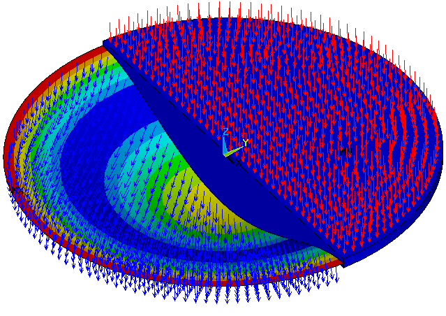
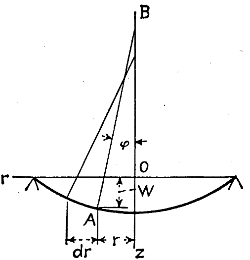
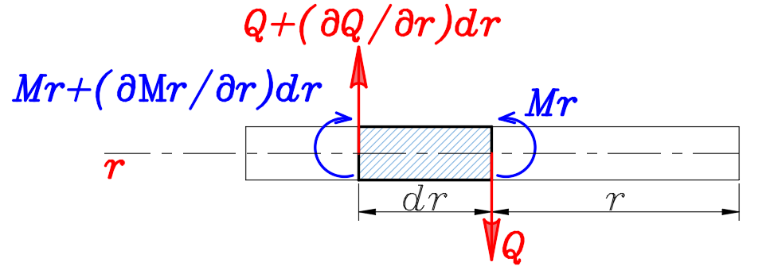
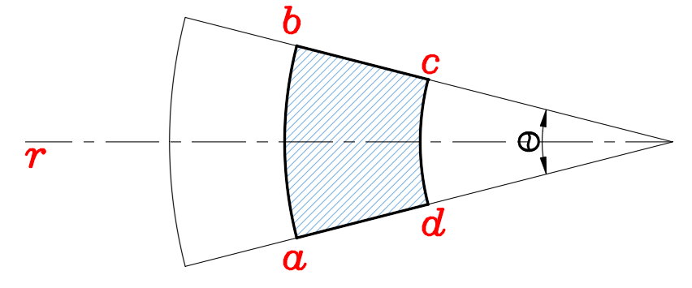
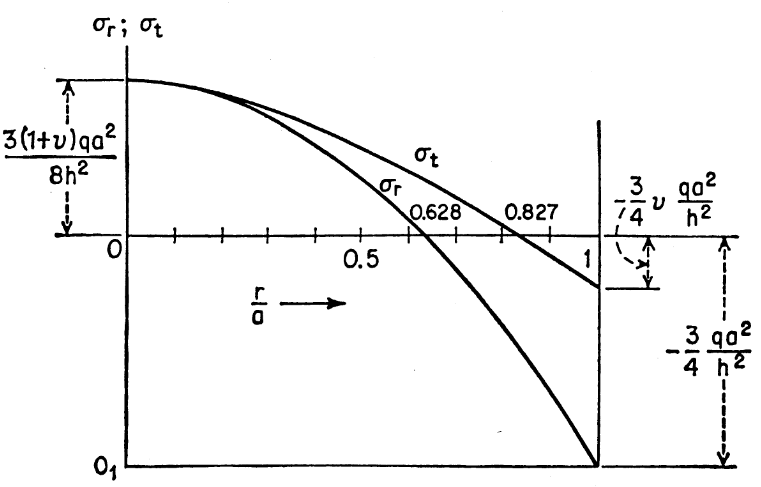

*Figura N°1. Placa circular con carga axisimetrica modelada calculada usando el método del elemento finito.*

Una carga es **axisimétrica** cuando su distribución no cambia al girar alrededor del centro de la placa. Por ejemplo, una presión uniforme aplicada a toda la superficie es axisimétrica. Bajo esta condición, y siempre que la placa y sus apoyos también presenten simetría de revolución, basta con conocer la distancia al centro para describir la deformación. En lugar de estudiar la deflexión en función de dos coordenadas, se estudia cómo varía al avanzar desde el centro hacia el borde.

La imagen muestra el resultado de un modelo de elementos finitos. Las flechas representan la acción transversal sobre la superficie y la geometría deformada permite observar que la placa se curva bajo la carga. El análisis que sigue busca describir ese mismo comportamiento mediante ecuaciones de equilibrio, curvatura y flexión.

### Curvaturas en una placa circular

$$
\frac{1}{r_n}=-\frac{d^2w}{dr^2}=\frac{d\varphi}{dr}
$$

$$
\frac{1}{r_t}=-\frac{1}{r}\frac{dw}{dr}=\frac{\varphi}{r}
$$

*Figura N°2. Esquema de la deflexión y del giro de una sección radial de la placa circular.*

En estas relaciones, $w$ representa la deflexión transversal, $r$ es la distancia medida desde el centro de la placa y $\varphi$ es el giro de una sección radial. Los símbolos $r_n$ y $r_t$ representan los radios de curvatura en las direcciones radial y tangencial, respectivamente; no deben confundirse con la coordenada radial $r$.

La primera relación mide cómo cambia la pendiente de la superficie cuando nos desplazamos radialmente. Si dos puntos cercanos tienen pendientes distintas, la superficie presenta curvatura en esa dirección. Por eso aparece la segunda derivada de la deflexión. La segunda relación describe la curvatura en la dirección circunferencial: a una misma distancia del centro, el giro de la superficie también influye en cómo se curva la placa alrededor de la circunferencia.

El signo negativo que aparece delante de las derivadas de $w$ responde a la convención de giro adoptada. En particular, el giro se relaciona con el cambio de deflexión mediante $\varphi=-dw/dr$. Así se pueden expresar las curvaturas directamente en función del giro, tal como indican las igualdades anteriores.

### Relación entre los momentos radiales y circunferenciales

$$
M_r=-D\left(\frac{d^2w}{dr^2}+\frac{\nu}{r}\frac{dw}{dr}\right)=D\left(\frac{d\varphi}{dr}+\frac{\nu}{r}\varphi\right)
$$

$$
M_t=-D\left(\frac{1}{r}\frac{dw}{dr}+\nu\frac{d^2w}{dr^2}\right)=D\left(\frac{\varphi}{r}+\nu\frac{d\varphi}{dr}\right)
$$

Los momentos $M_r$ y $M_t$ se denominan, respectivamente, **momento radial** y **momento tangencial o circunferencial**. El primero describe la flexión asociada a una sección orientada radialmente; el segundo, la flexión vinculada con la dirección que rodea el centro de la placa. Ambos son momentos por unidad de longitud.

La letra $D$ representa la rigidez flexional de la placa y $\nu$ es el coeficiente de Poisson del material. En cada ecuación aparecen dos términos de curvatura porque la deformación en una dirección también influye en el momento de la otra. Esa relación entre direcciones se incorpora mediante $\nu$.

Obsérvese que las fórmulas ofrecen dos formas de trabajar: mediante derivadas de la deflexión $w$ o mediante el giro $\varphi$. Más adelante se utilizarán ambas expresiones para llegar a la ecuación de equilibrio.

*Figura N°3. Equilibrio entre momentos radiales y fuerza cortante en un elemento diferencial de la placa circular.*

*Figura N°4. Sector anular diferencial utilizado para establecer el equilibrio de una placa circular.*

Los dos esquemas representan pequeñas porciones de la placa. En el primero se comparan los momentos y la fuerza cortante que actúan en secciones radiales vecinas, separadas por una distancia $dr$. En el segundo se muestra un sector de forma anular, que permite visualizar cómo cambian esas acciones al considerar un elemento curvo. El ángulo dibujado para representar la apertura del sector es un ángulo geométrico; no debe confundirse con el giro de la superficie utilizado en las ecuaciones de curvatura.

Del equilibrio entre momentos y fuerzas cortantes no brinda la ecuación diferencial de equilibrio:

$$
M_r+\frac{dM_r}{dr}\cdot r-M_t+Qr=0
$$

Esta expresión se obtiene al exigir que la suma de los momentos sobre el pequeño elemento sea nula. El término que contiene $dM_r/dr$ tiene en cuenta que el momento radial puede variar de un radio a otro. El momento circunferencial $M_t$ interviene porque el elemento pertenece a una superficie curva, y $Q$ representa la fuerza cortante transversal por unidad de longitud de circunferencia. La distancia $r$ aparece como parte de la geometría y de los brazos de las acciones consideradas.

Sustituyendo los momentos flectores radiales y transversales en función del giro de las secciones se tiene:

$$
\frac{d^2\varphi}{dr^2}+\frac{1}{r}\frac{d\varphi}{dr}-\frac{\varphi}{r^2}=-\frac{Q}{D}
$$

La sustitución consiste en reemplazar $M_r$ y $M_t$ por las relaciones obtenidas anteriormente y después reunir los términos que contienen $\varphi$, su primera derivada y su segunda derivada. De ese modo, los momentos dejan de ser incógnitas independientes: todo queda expresado mediante el giro radial y la fuerza cortante.

Esta expresión es equivalente a la siguiente ecuación diferencial

$$
\frac{d}{dr}\left[\frac{1}{r}\frac{d}{dr}(r\varphi)\right]=-\frac{Q}{D}
$$

La forma con derivadas agrupadas resulta especialmente útil cuando se necesita integrar. No representa una ecuación distinta: al desarrollar las derivadas del miembro izquierdo se recuperan los mismos términos de la ecuación anterior.

También es posible colocar los momentos flectores en función de las deflexiones transversales de la placa.

$$
\frac{d^3w}{dr^3}+\frac{1}{r}\frac{d^2w}{dr^2}-\frac{1}{r^2}\frac{dw}{dr}=\frac{Q}{D}
$$

En esta expresión ya no aparece el giro $\varphi$. Se ha utilizado su relación con la pendiente de la superficie para que la ecuación dependa únicamente de $w$. Esto es importante porque, al resolver un problema de placas, normalmente se busca primero la deflexión y luego se calculan los giros, los momentos y los esfuerzos.

De forma parecida al caso anterior, esta ecuación diferencial se puede escribir en la siguiente forma:

$$
\frac{d}{dr}\left[\frac{1}{r}\frac{d}{dr}\left(r\frac{dw}{dr}\right)\right]=\frac{Q}{D}
$$

Además, si se considera una carga distribuida de forma axisimetrica, la cortante a una distancia r del centro de la placa puede encontrarse de la siguiente forma:

$$
Q\,2\pi r=\int_0^r q\,2\pi r\,dr
$$

Para entender esta igualdad, imaginemos que aislamos la parte de la placa comprendida entre el centro y una circunferencia de radio $r$. La carga distribuida actúa sobre toda esa superficie. La fuerza cortante $Q$ aparece alrededor del contorno, cuya longitud es $2\pi r$. La integral permite sumar las cargas que actúan desde el centro hasta la circunferencia considerada. Esta forma de equilibrio vincula la carga aplicada con la cortante interna que debe transmitir la placa.

Sustituyendo esta expresión se obtiene una ecuación que vincula la deflexión en función de la carga distribuida transversal sobre la placa.

$$
r\frac{d}{dr}\left[\frac{1}{r}\frac{d}{dr}\left(r\frac{dw}{dr}\right)\right]=\frac{1}{D}\int_0^r q\,s\,ds
$$

La letra $s$ representa aquí la distancia radial que se utiliza dentro de la integral. Se integra desde el centro hasta el valor de $r$ que se desea estudiar. Esta manera de escribir la ecuación es útil porque la carga puede depender de la posición radial.

Derivando y usando el teorema fundamental del cálculo se obtiene la siguiente ecuación diferencial cuarto orden que vincula las derivadas radiales de la deflexión de la placa con la carga distribuida uniformemente.

$$
\frac{1}{r}\frac{d}{dr}\left\{r\frac{d}{dr}\left[\frac{1}{r}\frac{d}{dr}\left(r\frac{dw}{dr}\right)\right]\right\}=\frac{q}{D}
$$

El miembro izquierdo contiene derivadas sucesivas de la deflexión radial. Aunque la expresión se vea extensa, su finalidad es reunir en una sola ecuación la geometría de la placa, su rigidez y la carga transversal. Una vez conocida la distribución de $q$, todavía deben establecerse las condiciones del centro y del borde para obtener una solución concreta.

La integración de esta ecuación diferencial junto con las condiciones de contorno apropiadas nos permitirá encontrar la deflexión como una función del radio.

### CASO DE PLACAS CIRCULARES UNIFORMEMENTE CARGADAS

Si la carga distribuida sobre la placa circular es uniforme se puede obtener el cortante a una distancia radial r como:

$$
2\pi rQ=\pi r^2q
$$

$$
Q=\frac{qr}{2}
$$

Aquí $q$ es una intensidad de carga constante por unidad de superficie. La resultante que actúa dentro del círculo de radio $r$ se obtiene multiplicando $q$ por el área $\pi r^2$. Esa resultante se equilibra con la cortante que se distribuye sobre la circunferencia de longitud $2\pi r$. Por eso la cortante crece proporcionalmente con el radio: cuanto mayor sea el círculo que aislamos, mayor será la carga total contenida en él.

Sustituyendo esta en la ecuación de tercer grado, se tiene:

$$
\frac{d}{dr}\left[\frac{1}{r}\frac{d}{dr}\left(r\frac{dw}{dr}\right)\right]=\frac{qr}{2D}
$$

Integrando con respecto del radio, se tiene lo siguiente:

$$
\frac{1}{r}\frac{d}{dr}\left(r\frac{dw}{dr}\right)=\frac{qr^2}{4D}+C_1
$$

La constante $C_1$ aparece porque se ha realizado una integración. Su valor no se conoce todavía; dependerá de las condiciones que deba cumplir la placa. La carga $q$ y la rigidez $D$ son constantes en este caso, por lo que pueden mantenerse fuera de las operaciones de derivación e integración.

Multiplicando por r e integrando, se tiene la siguiente expresión:

$$
r\frac{dw}{dr}=\frac{qr^4}{16D}+C_1r^2+C_2
$$

$$
\frac{dw}{dr}=\frac{qr^3}{16D}+\frac{C_1r}{2}+\frac{C_2}{r}
$$

Al multiplicar por $r$ se elimina el denominador que acompaña a la derivada agrupada. Después de integrar vuelve a aparecer una constante, $C_2$. La segunda igualdad permite reconocer la pendiente radial de la placa: cada término contribuye a la variación de la deflexión con respecto a $r$.

Finalmente, integrando se obtiene la ecuación de las deflexiones radiales para una placa circular.

$$
w=\frac{qr^4}{64D}+\frac{C_1r^2}{4}+C_2\log\frac{r}{a}+C_3
$$

Esta es una solución general para el caso de carga uniforme antes de imponer las restricciones particulares. Las constantes $C_1$, $C_2$ y $C_3$ quedan por determinar. El término logarítmico aparece al integrar $1/r$ y se escribe con el cociente $r/a$, que no tiene unidades. El símbolo $a$ representa el radio exterior de la placa.

Ahora se estudiarán distintas condiciones de contorno. Se empezará con el caso de placa circular con bordes empotrados.

#### Placas circulares con bordes empotrados

En una placa empotrada, el borde exterior no puede desplazarse transversalmente ni girar. Además, para una placa circular completa y una carga axisimétrica, el comportamiento debe ser regular en el centro: allí no puede aparecer una pendiente infinita ni una dirección radial privilegiada. Estas condiciones permitirán hallar las constantes de integración sin cambiar la solución general obtenida.

Empezaremos imponiendo una condición sobre los giros de la placa, es decir, sobre la primera derivada radia de la deflexión. En este caso, los giros en los extremos de la placa deberán ser iguales a cero, es decir:

$$
\left(\frac{qr^3}{16D}+\frac{C_1r}{2}+\frac{C_2}{r}\right)_{r=0}=0
$$

$$
\left(\frac{qr^3}{16D}+\frac{C_1r}{2}+\frac{C_2}{r}\right)_{r=a}=0
$$

Es importante distinguir las dos posiciones. En $r=a$ se encuentra el borde empotrado y, por tanto, se impone que su giro sea nulo. En $r=0$ se encuentra el centro de la placa, que no es otro empotramiento: la condición expresa que la deformada debe ser simétrica y mantenerse finita allí. Esto explica por qué se consideran ambas posiciones al resolver las constantes.

La primera ecuación no deja opción:

$$
C_2=0
$$

El término $C_2/r$ no puede mantenerse en el centro, porque crecería sin límite cuando $r$ se aproxima a cero, salvo que su coeficiente sea nulo. Al establecer $C_2=0$ desaparece también el término logarítmico de la deflexión.

La segunda ecuación nos muestra que:

$$
C_1=-\frac{qa^2}{8D}
$$

Esta constante se obtiene sustituyendo $r=a$ y $C_2=0$ en la condición de giro del borde. Una vez encontrado su valor, la pendiente radial queda completamente determinada.

Finalmente, se tienen lo giros:

$$
\varphi=-\frac{dw}{dr}=\frac{qr}{16D}(a^2-r^2)
$$

La expresión muestra que el giro es nulo en el centro, donde $r=0$, y también en el borde, donde $r=a$. Entre esas dos posiciones sí puede haber giro. Es una consecuencia de la forma que adopta la superficie al deformarse sin perder la simetría circular.

La deflexión tiene una constante de integración aun por determinar. Esta se determina recordando que la deflexión en el borde es igual a cero, es decir:

$$
w=\frac{qr^4}{64D}-\frac{qa^2r^2}{32D}+C_3
$$

$$
\frac{qa^4}{64D}-\frac{qa^4}{32D}+C_3=0
$$

$$
C_3=\frac{qa^4}{64D}
$$

Hasta este punto se había impuesto que el borde no girase, pero faltaba exigir que tampoco se desplazara. Al sustituir $r=a$ en la ecuación de deflexión y hacer $w=0$, se obtiene el valor de $C_3$. Con ello se satisfacen las dos restricciones del empotramiento.

Finalmente, se tiene que la deflexión es:

$$
w=\frac{q}{64D}(a^2-r^2)^2
$$

La deflexión depende de la posición radial. El factor $(a^2-r^2)^2$ vale cero en el borde y aumenta hacia el centro. Para una carga y una rigidez dadas, la placa tiene así una deformada que depende únicamente de la distancia al centro. El resultado también muestra que una mayor rigidez flexional $D$ reduce las deflexiones, mientras que una mayor carga $q$ las aumenta.

La deflexión máxima se da cuando r=0, es decir:

$$
w_{\max}=\frac{qa^4}{64D}
$$

El valor máximo se encuentra en el centro porque allí el término geométrico alcanza su mayor valor. El radio aparece elevado a la cuarta potencia en el resultado, de modo que una placa de mayor tamaño puede presentar una deflexión considerablemente más grande si la carga y la rigidez permanecen iguales.

Finalmente, los momentos en dirección radial y tangencial pueden calcularse sustituyendo la deflexión en las ecuaciones del momento radial y tangencial.

$$
M_r=\frac{q}{16}\left[a^2(1+\nu)-r^2(3+\nu)\right]
$$

$$
M_t=\frac{q}{16}\left[a^2(1+\nu)-r^2(1+3\nu)\right]
$$

Para llegar a estas relaciones se utilizan las derivadas primera y segunda de la deflexión en las fórmulas de los momentos. Los dos resultados comparten un término que depende de $a^2(1+\nu)$, pero los términos que contienen $r^2$ no son iguales. Por ello, los momentos radial y tangencial cambian de distinta manera al avanzar desde el centro hasta el borde.

Los momentos de empotramiento tangencial y radial se obtiene cuando r=a, es decir:

$$
(M_r)_{r=a}=-\frac{qa^2}{8}\qquad(M_t)_{r=a}=-\frac{\nu qa^2}{8}
$$

Estos valores corresponden al borde exterior de la placa. El signo negativo, de acuerdo con la convención utilizada, indica que los momentos allí actúan en sentido opuesto a los valores positivos representados en otras zonas de la superficie. El momento tangencial depende además del coeficiente de Poisson $\nu$.

Mientras que los momentos radial y tangencial en el dentro de la placa circular se pueden encontrar asi:

$$
M_r=M_t=\frac{qa^2}{16}(1+\nu)
$$

En el centro, $r=0$, desaparecen los términos que contienen $r^2$. Por eso ambos momentos toman el mismo valor. Esta igualdad es coherente con la simetría: exactamente en el centro no existe una dirección radial que se distinga mecánicamente de otra dirección del plano.

Los esfuerzos radiales máximos se pueden encontrar a partir de estas expresiones, encontrado que:

$$
(\sigma_r)_{\max}=-\frac{6M_r}{h^2}=\frac{3}{4}\frac{qa^2}{h^2}
$$

En esta relación, $h$ es el espesor de la placa. El esfuerzo de flexión se relaciona con el momento mediante el factor $6/h^2$, habitual cuando se considera la distribución lineal de esfuerzos normales a través de una sección rectangular de ancho unitario. El valor mostrado utiliza el momento radial correspondiente al borde empotrado. El resultado permite ver que, para las mismas cargas y dimensiones en planta, el esfuerzo aumenta cuando disminuye el espesor.

Finalmente, se muestra la variación del esfuerzo radial y tangencial

*Figura N°5. Variación de los esfuerzos radial y tangencial a lo largo del radio de una placa circular empotrada.*

El eje horizontal del gráfico corresponde al cociente $r/a$: en $r/a=0$ estamos en el centro y en $r/a=1$ se encuentra el borde. Las curvas $\sigma_r$ y $\sigma_t$ representan los esfuerzos radial y tangencial. Ambas comienzan con el mismo valor en el centro, pero disminuyen a ritmos distintos a medida que aumenta el radio. Los valores señalados aproximadamente como $0.628$ y $0.827$ indican dónde cada curva cruza el eje horizontal para el caso representado. Al llegar al empotramiento, los esfuerzos asociados a la flexión son negativos según la convención del gráfico.

### Referencias

1) Timoshenko, S., & Woinowsky-Krieger, S. (1959). Theory of plates and shells (2nd ed.). McGraw-Hill.

2) Ugural, A. C. (2018). Stresses in plates and shells (3rd ed.). CRC Press.