## 1. Tabla 18-16. Deflexiones y fuerzas internas en placas rectangulares

La Tabla 18-16 reúne expresiones para placas rectangulares sometidas a distintas cargas y condiciones de borde. Se conservan los números de caso, la notación, los coeficientes y las restricciones de aplicación de la fuente original (páginas 1073 a 1084). Los esquemas son recortes de las ilustraciones originales.

### 1.1. Notación

- $w$: deflexión de la placa.
- $E$: módulo de elasticidad.
- $\nu$: coeficiente de Poisson.
- $h$: espesor de la placa.
- $D$: rigidez a flexión.
- $W_T$: carga concentrada total.
- $p_1$: carga uniformemente distribuida.
- $L, L_y$: dimensiones de la placa en las direcciones $x$ e $y$.
- $M_x,M_y$: momentos flectores por unidad de longitud.
- $Q_x,Q_y$: fuerzas cortantes por unidad de longitud.
- $V_x,V_y$: fuerzas cortantes equivalentes por unidad de longitud.

$$
D=\frac{Eh^3}{12(1-\nu^2)},\qquad
\alpha=\frac{L_y}{L},\qquad
\beta=\frac{L}{L_y}.
$$

Figura 1: Geometría de la placa y convenciones de flexión y cortante utilizadas en la Tabla 18-16.

### 1.2. Casos de apoyo y carga

TABLA 18-16Selecciona un caso o utiliza las flechas

<button type="button" role="tab" id="pcr16-tab1" aria-controls="pcr16-panel1" aria-selected="true" tabindex="0" class="pcr-tab is-active" data-case="0" title="Caso 1. Cuatro bordes simplemente apoyados; carga uniforme">Caso 1</button>
<button type="button" role="tab" id="pcr16-tab2" aria-controls="pcr16-panel2" aria-selected="false" tabindex="-1" class="pcr-tab" data-case="1" title="Caso 2. Cuatro bordes simplemente apoyados; carga concentrada">Caso 2</button>
<button type="button" role="tab" id="pcr16-tab3" aria-controls="pcr16-panel3" aria-selected="false" tabindex="-1" class="pcr-tab" data-case="2" title="Caso 3. Cuatro bordes simplemente apoyados; carga en un pequeño círculo central">Caso 3</button>
<button type="button" role="tab" id="pcr16-tab4" aria-controls="pcr16-panel4" aria-selected="false" tabindex="-1" class="pcr-tab" data-case="3" title="Caso 4. Tres bordes simplemente apoyados y uno libre; carga uniforme">Caso 4</button>
<button type="button" role="tab" id="pcr16-tab5" aria-controls="pcr16-panel5" aria-selected="false" tabindex="-1" class="pcr-tab" data-case="4" title="Caso 5. Tres bordes empotrados y uno libre; carga uniforme">Caso 5</button>
<button type="button" role="tab" id="pcr16-tab6" aria-controls="pcr16-panel6" aria-selected="false" tabindex="-1" class="pcr-tab" data-case="5" title="Caso 6. Cuatro bordes simplemente apoyados; carga linealmente variable">Caso 6</button>
<button type="button" role="tab" id="pcr16-tab7" aria-controls="pcr16-panel7" aria-selected="false" tabindex="-1" class="pcr-tab" data-case="6" title="Caso 7. Dos bordes simplemente apoyados y dos empotrados; carga linealmente variable">Caso 7</button>
<button type="button" role="tab" id="pcr16-tab8" aria-controls="pcr16-panel8" aria-selected="false" tabindex="-1" class="pcr-tab" data-case="7" title="Caso 8. Cuatro bordes empotrados; carga linealmente variable">Caso 8</button>
<button type="button" role="tab" id="pcr16-tab9" aria-controls="pcr16-panel9" aria-selected="false" tabindex="-1" class="pcr-tab" data-case="8" title="Caso 9. Dos bordes simplemente apoyados y dos con apoyos flexibles; carga uniforme">Caso 9</button>
<button type="button" role="tab" id="pcr16-tab10" aria-controls="pcr16-panel10" aria-selected="false" tabindex="-1" class="pcr-tab" data-case="9" title="Caso 10. Cuatro bordes empotrados; carga uniforme">Caso 10</button>
<button type="button" role="tab" id="pcr16-tab11" aria-controls="pcr16-panel11" aria-selected="false" tabindex="-1" class="pcr-tab" data-case="10" title="Caso 11. Dos bordes simplemente apoyados y dos libres; carga uniforme">Caso 11</button>

<section role="tabpanel" id="pcr16-panel1" aria-labelledby="pcr16-tab1" aria-hidden="false" class="pcr-panel is-active" data-case-panel="0">
Caso 1. Cuatro bordes simplemente apoyados; carga uniforme
<figure class="pcr-figure"><figcaption>Figura 2: Caso 1, placa simplemente apoyada con carga uniformemente distribuida $p_1$.</figcaption></figure>

La deflexión y los momentos flectores se determinan mediante las series:

$$
w=\frac{16p_1L^4}{\pi^6 D}
\sum_{m=1,3,5,\ldots}\sum_{n=1,3,5,\ldots}
\frac{\sin(n\pi x/L)\sin(m\pi y/L_y)}{mn(n^2/L^2+m^2/L_y^2)^2}.
$$

$$
M_x=\frac{16p_1L^2}{\pi^4}
\sum_{m=1,3,5,\ldots}\sum_{n=1,3,5,\ldots}
\gamma_1\frac{\sin(n\pi x/L)\sin(m\pi y/L_y)}{mn(n^2+m^2/\alpha^2)^2}.
$$

$$
M_y=\frac{16p_1L^2}{\pi^4}
\sum_{m=1,3,5,\ldots}\sum_{n=1,3,5,\ldots}
\gamma_2\frac{\sin(n\pi x/L)\sin(m\pi y/L_y)}{mn(n^2+m^2/\alpha^2)^2}.
$$

$$
\gamma_1=n^2+\nu\frac{m^2}{\alpha^2},\qquad
\gamma_2=\frac{m^2}{\alpha^2}+\nu n^2.
$$

Los valores máximos tabulados son:

$$
\begin{aligned}
w_{\max}=w_{\mathrm{centro}}&=c_1\frac{p_1L^4}{Eh^3},\\
(M_x)_{\max}&=c_2p_1L^2\quad(\mathrm{centro}),\\
(M_y)_{\max}&=c_3p_1L^2\quad(\mathrm{centro}),\\
(Q_x)_{\max}&=c_4p_1L\quad(x=0,L),\\
(Q_y)_{\max}&=c_5p_1L_y\quad(y=0,L_y),\\
(V_x)_{\max}&=c_6p_1L,\\
(V_y)_{\max}&=c_7p_1L_y,\\
R_0&=c_8p_1LL_y\quad(\mathrm{esquinas}).
\end{aligned}
$$

Para $\nu=0.3$, los coeficientes de la tabla son:

$$
\begin{aligned}
c_1&=0.1421+0.08204\beta-0.3985\beta^2+0.219\beta^3,\\
c_2&=0.1247+0.05524\beta-0.2762\beta^2+0.1441\beta^3,\\
c_3&=0.03726-0.01504\beta+0.1028\beta^2-0.07756\beta^3,\\
c_4&=0.4967+0.1686\beta-0.6849\beta^2+0.3976\beta^3,\\
c_5&=-0.0007805+0.3679\beta+0.04574\beta^2-0.07488\beta^3,\\
c_6&=0.4983+0.02879\beta+0.004425\beta^2-0.1137\beta^3,\\
c_7&=-0.003591+0.5091\beta+0.05874\beta^2-0.1445\beta^3,\\
c_8&=-0.003545+0.1179\beta-0.02755\beta^2-0.02202\beta^3.
\end{aligned}
$$

</section>
<section role="tabpanel" id="pcr16-panel2" aria-labelledby="pcr16-tab2" aria-hidden="true" class="pcr-panel" data-case-panel="1">
Caso 2. Cuatro bordes simplemente apoyados; carga concentrada
<figure class="pcr-figure"><figcaption>Figura 3: Caso 2, carga $W_T$ aplicada en $(a,b)$.</figcaption></figure>

$$
w=\frac{4W_T}{D\pi^4LL_y}
\sum_{m=1}^{\infty}\sum_{n=1}^{\infty}
\frac{\sin(n\pi a/L)\sin(m\pi b/L_y)\sin(n\pi x/L)\sin(m\pi y/L_y)}{(n^2/L^2+m^2/L_y^2)^2}.
$$

La tabla incluye también la siguiente expresión alternativa:

$$
\begin{aligned}
w={}&\frac{W_TL^2}{D\pi^3}\sum_{n=1}^{\infty}
\Bigg(1+\beta_n\coth\beta_n
-\frac{\beta_n y_1}{L_y}\coth\frac{\beta_n y_1}{L_y}
-\frac{\beta_n b_1}{L_y}\coth\frac{\beta_n b_1}{L_y}\Bigg)\\
&\times\frac{\sinh(\beta_n b_1/L_y)\sinh(\beta_n y_1/L_y)
\sin(n\pi a/L)\sin(n\pi x/L)}{n^3\sinh\beta_n},
\qquad \beta_n=\frac{n\pi L_y}{L}.
\end{aligned}
$$

Las variables auxiliares dependen de la posición del punto de observación:

$$
\begin{cases}
y_1=L_y-y,\quad b_1=b,& y\geq b,\\
y_1=y,\quad b_1=L_y-b,& y<b.
\end{cases}
$$

</section>
<section role="tabpanel" id="pcr16-panel3" aria-labelledby="pcr16-tab3" aria-hidden="true" class="pcr-panel" data-case-panel="2">
Caso 3. Cuatro bordes simplemente apoyados; carga en un pequeño círculo central
<figure class="pcr-figure"><figcaption>Figura 4: Caso 3, carga total $W_T$ distribuida en un círculo de radio $r_0$.</figcaption></figure>

En el centro de la placa:

$$
w_{\max}=k_1\frac{W_TL_y^2}{Eh^3},\qquad
\sigma_{\max}=\frac{3W_T}{2\pi h^2}\left[(1+\nu)\ln\frac{2L_y}{\pi r_e}+k_2\right].
$$

$$
r_e=\begin{cases}
\sqrt{1.6r_0^2+h^2}-0.675h,&r_0<0.5h,\\
r_0,&r_0>0.5h.
\end{cases}
$$

$$
\begin{aligned}
k_1&=0.1851+0.06342\alpha-0.1643\alpha^2+0.04232\alpha^3,\\
k_2&=0.9998+0.5195\alpha-1.29\alpha^2+0.2042\alpha^3.
\end{aligned}
$$

</section>
<section role="tabpanel" id="pcr16-panel4" aria-labelledby="pcr16-tab4" aria-hidden="true" class="pcr-panel" data-case-panel="3">
Caso 4. Tres bordes simplemente apoyados y uno libre; carga uniforme
<figure class="pcr-figure"><figcaption>Figura 5: Caso 4, placa con un borde libre y tres simplemente apoyados.</figcaption></figure>

Para $\nu=0.15$:

$$
\begin{aligned}
(M_x)_{x=L/2,\;y=L_y/2}&=c_1p_1L_y^2,\\
(M_y)_{x=L/2,\;y=L_y/2}&=c_2p_1L_y^2,\\
(M_y)_{x=0,\;y=L_y/2}&=c_3p_1L_y^2.
\end{aligned}
$$

$$
c_1=\begin{cases}
-2.7975+16.537\beta^{1/2}-36.423\beta+35.523\beta^{3/2}-12.913\beta^2,&0.3\le\beta<0.8,\\
-0.2714+0.6371\beta^{1/2}-0.4533\beta+0.1021\beta^{3/2},&0.8\le\beta\le2.0.
\end{cases}
$$

$$
\begin{aligned}
c_2&=0.1448-0.7829\beta^{1/2}+1.415\beta-0.9113\beta^{3/2}+0.2039\beta^2,\\
c_3&=0.2558-1.3186\beta^{1/2}+2.6532\beta-1.9313\beta^{3/2}+0.4817\beta^2.
\end{aligned}
$$

Los ajustes de $c_2$ y $c_3$ corresponden a $0.3\leq\beta\leq2.0$.

</section>
<section role="tabpanel" id="pcr16-panel5" aria-labelledby="pcr16-tab5" aria-hidden="true" class="pcr-panel" data-case-panel="4">
Caso 5. Tres bordes empotrados y uno libre; carga uniforme
<figure class="pcr-figure"><figcaption>Figura 6: Caso 5, placa con tres bordes empotrados y uno libre.</figcaption></figure>

Con $\nu=0.15$:

$$
\begin{aligned}
(M_x)_{L/2,\;L_y/2}&=c_1p_1L_y^2,\\
(M_y)_{L/2,\;L_y/2}&=c_2p_1L_y^2,\\
(M_y)_{0,\;L_y/2}&=c_3p_1L_y^2,\\
(M_x)_{L,\;L_y/2}&=c_4p_1L^2,\\
(M_y)_{L/2,\;0,L_y}&=c_5p_1L_y^2,\\
(M_y)_{0,\;0,L_y}&=c_6p_1L_y^2.
\end{aligned}
$$

$$
c_1=\begin{cases}
-0.01247+0.05532\alpha-0.04778\alpha^2+0.01519\alpha^3-0.001687\alpha^4,&1.25<\alpha\leq3.3,\\
-0.006967+0.01615\alpha+0.01147\alpha^2-0.01205\alpha^3,&0.5\leq\alpha\leq1.25.
\end{cases}
$$

$$
\begin{aligned}
c_2&=0.05474-0.03243\alpha+0.006359\alpha^2-0.0003985\alpha^3,\\
c_3&=0.03724+0.02528\alpha-0.02263\alpha^2+0.003719\alpha^3,\\
c_4&=-0.006349+0.02708\alpha-0.09165\alpha^2+0.01488\alpha^3,\\
c_5&=-0.1062+0.04391\alpha-0.00235\alpha^2-0.0007418\alpha^3,\\
c_6&=-0.06827-0.04205\alpha+0.02756\alpha^2-0.003528\alpha^3.
\end{aligned}
$$

Los coeficientes $c_2,\ldots,c_6$ están tabulados para $0.5\leq\alpha\leq3.3$.

</section>
<section role="tabpanel" id="pcr16-panel6" aria-labelledby="pcr16-tab6" aria-hidden="true" class="pcr-panel" data-case-panel="5">
Caso 6. Cuatro bordes simplemente apoyados; carga linealmente variable
<figure class="pcr-figure"><figcaption>Figura 7: Caso 6, carga triangular $p_1$.</figcaption></figure>

Si $L/L_y<1$:

$$
\begin{aligned}
(M_x)_{L/2,\;L_y/2}&=c_1p_1L^2,\\
(M_x)_{\max}&=c_2p_1L^2,\\
(M_y)_{L/2,\;L_y/2}&=c_3p_1L^2,\\
(M_y)_{\max}&=c_4p_1L^2.
\end{aligned}
$$

Si $L/L_y\geq1$, se reemplaza $p_1L^2$ por $p_1L_y^2$. El caso está tabulado con $\nu=0.15$.

Para $0.5\leq\beta\leq1.0$:

$$
\begin{aligned}
c_1&=0.08438-0.06242\beta-0.03592\beta^2+0.03239\beta^3,\\
c_2&=0.085096-0.0635\beta-0.02495\beta^2+0.02498\beta^3,\\
c_3&=0.01873+0.07069\beta-0.02985\beta^2+0.003716\beta^3,\\
c_4&=0.01756-0.05004\beta-0.1028\beta^2+0.05186\beta^3.
\end{aligned}
$$

Para $1.0<\beta\leq2.0$:

$$
\begin{aligned}
c_1&=-0.003636+0.05639\beta-0.04352\beta^2+0.009206\beta^3,\\
c_2&=-0.01872+0.07831\beta-0.04657\beta^2+0.008649\beta^3,\\
c_3&=-0.04394+0.08744\beta-0.03008\beta^2+0.004946\beta^3,\\
c_4&=-0.01646+0.02599\beta+0.01385\beta^2+0.004938\beta^3.
\end{aligned}
$$

</section>
<section role="tabpanel" id="pcr16-panel7" aria-labelledby="pcr16-tab7" aria-hidden="true" class="pcr-panel" data-case-panel="6">
Caso 7. Dos bordes simplemente apoyados y dos empotrados; carga linealmente variable
<figure class="pcr-figure"><figcaption>Figura 8: Caso 7, combinación de apoyos simples y empotramientos.</figcaption></figure>

Si $\beta=L/L_y<1$:

$$
\begin{aligned}
-(M_y)_{\max}&=c_1p_1L^2,\\
(M_x)_{L/2,\;0,L_y}&=c_2p_1L^2,\\
(M_x)_{\max}&=c_3p_1L^2,\\
(M_x)_{L/2,\;L_y/2}&=c_4p_1L^2,\\
(M_y)_{\max}&=c_5p_1L^2,\\
(M_y)_{L/2,\;L_y/2}&=c_6p_1L^2.
\end{aligned}
$$

Si $\beta\geq1$, se sustituye $p_1L^2$ por $p_1L_y^2$. Se considera $\nu=0.15$.

Para $0.5\leq\beta\leq1.0$:

$$
\begin{aligned}
c_1&=-0.0947+0.09607\beta-0.0758\beta^2+0.03702\beta^3,\\
c_2&=-0.07833+0.01816\beta+0.04384\beta^2-0.01853\beta^3,\\
c_3&=0.147-0.3292\beta+0.286\beta^2-0.09076\beta^3,\\
c_4&=0.120-0.218\beta+0.1254\beta^2-0.01945\beta^3,\\
c_5&=-0.04249+0.196\beta-0.2114\beta^2+0.07222\beta^3,\\
c_6&=-0.04249+0.196\beta-0.2114\beta^2+0.07222\beta^3.
\end{aligned}
$$

Para $1.0<\beta\leq2.0$:

$$
\begin{aligned}
c_1&=-0.001352-0.04739\beta+0.01262\beta^2-0.001445\beta^3,\\
c_2&=0.01942-0.09533\beta+0.04973\beta^2-0.008762\beta^3,\\
c_3&=-0.005903+0.04346\beta-0.03065\beta^2+0.00615\beta^3,\\
c_4&=0.02255-0.01713\beta+0.001814\beta^2+0.0006693\beta^3,\\
c_5&=-0.0156+0.04088\beta-0.01164\beta^2+0.00638\beta^3,\\
c_6&=-0.02249+0.06271\beta-0.03123\beta^2+0.005338\beta^3.
\end{aligned}
$$

</section>
<section role="tabpanel" id="pcr16-panel8" aria-labelledby="pcr16-tab8" aria-hidden="true" class="pcr-panel" data-case-panel="7">
Caso 8. Cuatro bordes empotrados; carga linealmente variable
<figure class="pcr-figure"><figcaption>Figura 9: Caso 8, carga linealmente variable con los cuatro bordes empotrados.</figcaption></figure>

Si $\beta=L/L_y<1$:

$$
\begin{aligned}
(M_x)_{0,\;L_y/2}&=c_1p_1L^2,\\
(M_x)_{L,\;L_y/2}&=c_2p_1L^2,\\
-(M_y)_{\max}&=c_3p_1L^2,\\
(M_y)_{L/2,\;0,L_y}&=c_4p_1L^2,\\
(M_x)_{\max}&=c_5p_1L^2,\\
(M_x)_{L/2,\;L_y/2}&=c_6p_1L^2,\\
(M_y)_{\max}&=c_7p_1L^2,\\
(M_y)_{L/2,\;L_y/2}&=c_8p_1L^2.
\end{aligned}
$$

Si $\beta\geq1$, se sustituye $p_1L^2$ por $p_1L_y^2$. Se considera $\nu=0.15$.

Para $0.5\leq\beta\leq1.0$:

$$
\begin{aligned}
c_1&=-0.03596-0.08083\beta+0.1319\beta^2-0.04816\beta^3,\\
c_2&=-0.01030-0.116\beta+0.1791\beta^2-0.07038\beta^3,\\
c_3&=-0.02636-0.004588\beta-0.009978\beta^2+0.01388\beta^3,\\
c_4&=-0.02993+0.01295\beta-0.02866\beta^2+0.02036\beta^3,\\
c_5&=0.0261-0.00459\beta-0.01879\beta^2+0.007399\beta^3,\\
c_6&=0.01218+0.05503\beta-0.09913\beta^2+0.04073\beta^3,\\
c_7&=0.03321-0.1267\beta+0.1792\beta^2-0.07687\beta^3,\\
c_8&=-0.005465+0.003079\beta+0.03526\beta^2-0.02409\beta^3.
\end{aligned}
$$

Para $1.0<\beta\leq2.0$:

$$
\begin{aligned}
c_1&=0.02841-0.1064\beta+0.0549\beta^2-0.01001\beta^3,\\
c_2&=0.005924-0.05511\beta+0.03986\beta^2-0.00827\beta^3,\\
c_3&=0.03386-0.08143\beta+0.02145\beta^2-0.0008475\beta^3,\\
c_4&=0.04529-0.1128\beta+0.04949\beta^2-0.007329\beta^3,\\
c_5&=-0.00482+0.03546\beta-0.02663\beta^2+0.006204\beta^3,\\
c_6&=-0.00233+0.03325\beta-0.02862\beta^2+0.006528\beta^3,\\
c_7&=-0.01682+0.02965\beta-0.002959\beta^2-0.001043\beta^3,\\
c_8&=-0.03277+0.06381\beta-0.02579\beta^2+0.003542\beta^3.
\end{aligned}
$$

</section>
<section role="tabpanel" id="pcr16-panel9" aria-labelledby="pcr16-tab9" aria-hidden="true" class="pcr-panel" data-case-panel="8">
Caso 9. Dos bordes simplemente apoyados y dos con apoyos flexibles; carga uniforme
<figure class="pcr-figure"><figcaption>Figura 10: Caso 9, apoyos de borde mediante vigas de rigidez $EI$.</figcaption></figure>

La tabla corresponde a $L_y=L$, $\nu=0.3$ y $EI$ igual a la rigidez de las vigas de apoyo:

$$
\begin{aligned}
w_{\max}=w_{\mathrm{centro}}&=c_1\frac{p_1L^4}{D},\\
(M_x)_{\max}&=c_2p_1L^2\quad(\mathrm{centro}),\\
(M_y)_{\max}&=c_3p_1L^2\quad(\mathrm{centro}),\\
\eta&=\frac{EI}{LD}\geq0.
\end{aligned}
$$

$$
\begin{aligned}
c_1&=0.004037+\frac{0.003975}{1+\eta}-\frac{0.003862}{(1+\eta)^2}+\frac{0.008931}{(1+\eta)^3},\\
c_2&=0.04756+\frac{0.0356}{1+\eta}-\frac{0.05788}{(1+\eta)^2}+\frac{0.1001}{(1+\eta)^3},\\
c_3&=0.04759-\frac{0.00504}{1+\eta}-\frac{0.05026}{(1+\eta)^2}+\frac{0.03471}{(1+\eta)^3}.
\end{aligned}
$$

</section>
<section role="tabpanel" id="pcr16-panel10" aria-labelledby="pcr16-tab10" aria-hidden="true" class="pcr-panel" data-case-panel="9">
Caso 10. Cuatro bordes empotrados; carga uniforme
<figure class="pcr-figure"><figcaption>Figura 11: Caso 10, placa con cuatro bordes empotrados.</figcaption></figure>

Con $\nu=0.3$ y $1.0\leq\alpha\leq2.0$:

$$
\begin{aligned}
w_{\max}=w_{\mathrm{centro}}&=c_1\frac{p_1L^4}{Eh^3},\\
(M_x)_{x=0,\;y=0}&=c_2p_1L^2,\\
(M_y)_{x=0,\;y=0}&=c_3p_1L^2,\\
(M_x)_{x=L/2,\;y=0}&=-c_4p_1L^2,\\
(M_y)_{x=0,\;y=L_y/2}&=-c_5p_1L^2.
\end{aligned}
$$

$$
\begin{aligned}
c_1&=-0.06479+0.1327\alpha-0.0665\alpha^2+0.01162\alpha^3,\\
c_2&=-0.07859+0.1748\alpha-0.09038\alpha^2+0.01652\alpha^3,\\
c_3&=0.0009449+0.04083\alpha-0.0212\alpha^2+0.001949\alpha^3,\\
c_4&=-0.03425+0.1083\alpha-0.02085\alpha^2-0.002018\alpha^3,\\
c_5&=0.4247+0.002192\alpha+0.01065\alpha^2-0.003921\alpha^3.
\end{aligned}
$$

</section>
<section role="tabpanel" id="pcr16-panel11" aria-labelledby="pcr16-tab11" aria-hidden="true" class="pcr-panel" data-case-panel="10">
Caso 11. Dos bordes simplemente apoyados y dos libres; carga uniforme
<figure class="pcr-figure"><figcaption>Figura 12: Caso 11, dos bordes simplemente apoyados y dos libres.</figcaption></figure>

Con $\nu=0.3$ y $0\leq\beta\leq2.0$:

$$
\begin{aligned}
w_{L/2,\;L_y/2}&=c_1\frac{p_1L^4}{D},\\
w_{L/2,\;0,L_y}&=c_2\frac{p_1L^4}{D},\\
(M_x)_{L/2,\;L_y/2}&=c_3p_1L^2,\\
(M_y)_{L/2,\;L_y/2}&=c_4p_1L^2,\\
(M_x)_{L/2,\;0,L_y}&=c_5p_1L^2.
\end{aligned}
$$

$$
\begin{aligned}
c_1&=0.01302-0.0007094\beta+0.001017\beta^2-0.0002372\beta^3,\\
c_2&=0.01522+0.0000742\beta-0.0001711\beta^2-0.000033\beta^3,\\
c_3&=0.125-0.003249\beta+0.0002489\beta^2+0.0005003\beta^3,\\
c_4&=0.0375+0.01038\beta-0.02955\beta^2+0.008767\beta^3,\\
c_5&=0.133+0.0006847\beta-0.001652\beta^2-0.0002326\beta^3.
\end{aligned}
$$

</section>

<button type="button" class="pcr-arrow" data-placas-step="-1" disabled aria-label="Ir al caso anterior">← Anterior</button>1 de 11<button type="button" class="pcr-arrow" data-placas-step="1" aria-label="Ir al caso siguiente">Siguiente →</button>

## 2. Tabla 18-17. Respuesta de placas rectangulares con cuatro lados simplemente apoyados

Esta tabla establece primero las ecuaciones de respuesta general de una placa rectangular simplemente apoyada en sus cuatro bordes y, después, los parámetros $a_{mn}$ para 13 distribuciones de carga (páginas 1085 a 1087 de la fuente). Se mantiene la nomenclatura empleada en la tabla.

### 2.1. Notación y rigidez de la placa

- $w$: deflexión.
- $\theta,\theta_y$: giros respecto de líneas paralelas a las direcciones $y$ y $x$.
- $M_x,M_y,M_{xy}$: momentos flectores y momento torsor por unidad de longitud.
- $V_x,V_y$: fuerzas cortantes equivalentes por unidad de longitud.
- $L,L_y$: dimensiones de la placa.
- $h$: espesor; $E$: módulo de elasticidad; $\nu$: coeficiente de Poisson.
- $a_{mn}$: parámetro correspondiente al tipo de carga aplicado.

$$
D=\frac{Eh^3}{12(1-\nu^2)},\qquad
K_{mn}=\frac{a_{mn}}{D\pi^4\left[(n^2/L^2)+(m^2/L_y^2)\right]^2},
\qquad n,m=1,2,3,\ldots
$$

### 2.2. Expresiones generales de respuesta

**Deflexión**

$$
w=\sum_{n=1}^{\infty}\sum_{m=1}^{\infty}
K_{mn}\sin\frac{n\pi x}{L}\sin\frac{m\pi y}{L_y}.
$$

**Giros**

$$
\begin{aligned}
\theta&=-\sum_{n=1}^{\infty}\sum_{m=1}^{\infty}
K_{mn}\frac{n\pi}{L}\cos\frac{n\pi x}{L}\sin\frac{m\pi y}{L_y},\\
\theta_y&=\sum_{n=1}^{\infty}\sum_{m=1}^{\infty}
K_{mn}\frac{m\pi}{L_y}\sin\frac{n\pi x}{L}\cos\frac{m\pi y}{L_y}.
\end{aligned}
$$

**Momentos flectores**

$$
\begin{aligned}
M_x&=\pi^2D\sum_{n=1}^{\infty}\sum_{m=1}^{\infty}
K_{mn}\left[\left(\frac{n}{L}\right)^2+\nu\left(\frac{m}{L_y}\right)^2\right]
\sin\frac{n\pi x}{L}\sin\frac{m\pi y}{L_y},\\
M_y&=\pi^2D\sum_{n=1}^{\infty}\sum_{m=1}^{\infty}
K_{mn}\left[\left(\frac{m}{L_y}\right)^2+\nu\left(\frac{n}{L}\right)^2\right]
\sin\frac{n\pi x}{L}\sin\frac{m\pi y}{L_y}.
\end{aligned}
$$

**Momento torsor**

$$
M_{xy}=\pi^2D(1-\nu)\sum_{n=1}^{\infty}\sum_{m=1}^{\infty}
K_{mn}\frac{mn}{LL_y}
\cos\frac{n\pi x}{L}\cos\frac{m\pi y}{L_y}.
$$

**Fuerzas cortantes equivalentes**

$$
\begin{aligned}
V_x={}&\pi^3D\sum_{n=1}^{\infty}\sum_{m=1}^{\infty}K_{mn}
\left[\left(\frac{n}{L}\right)^3+(2-\nu)\frac{n}{L}\left(\frac{m}{L_y}\right)^2\right]
\cos\frac{n\pi x}{L}\sin\frac{m\pi y}{L_y},\\
V_y={}&\pi^3D\sum_{n=1}^{\infty}\sum_{m=1}^{\infty}K_{mn}
\left[\left(\frac{m}{L_y}\right)^3+(2-\nu)\frac{m}{L_y}\left(\frac{n}{L}\right)^2\right]
\sin\frac{n\pi x}{L}\cos\frac{m\pi y}{L_y}.
\end{aligned}
$$

### 2.3. Distribuciones de carga

TABLA 18-17Selecciona un caso o utiliza las flechas

<button type="button" role="tab" id="pcr17-tab1" aria-controls="pcr17-panel1" aria-selected="true" tabindex="0" class="pcr-tab is-active" data-case="0" title="Carga 1. Carga uniforme en toda la placa">Carga 1</button>
<button type="button" role="tab" id="pcr17-tab2" aria-controls="pcr17-panel2" aria-selected="false" tabindex="-1" class="pcr-tab" data-case="1" title="Carga 2. Carga linealmente variable">Carga 2</button>
<button type="button" role="tab" id="pcr17-tab3" aria-controls="pcr17-panel3" aria-selected="false" tabindex="-1" class="pcr-tab" data-case="2" title="Carga 3. Carga uniforme sobre una región rectangular">Carga 3</button>
<button type="button" role="tab" id="pcr17-tab4" aria-controls="pcr17-panel4" aria-selected="false" tabindex="-1" class="pcr-tab" data-case="3" title="Carga 4. Carga variable sobre una región rectangular">Carga 4</button>
<button type="button" role="tab" id="pcr17-tab5" aria-controls="pcr17-panel5" aria-selected="false" tabindex="-1" class="pcr-tab" data-case="4" title="Carga 5. Fuerza lineal por unidad de longitud">Carga 5</button>
<button type="button" role="tab" id="pcr17-tab6" aria-controls="pcr17-panel6" aria-selected="false" tabindex="-1" class="pcr-tab" data-case="5" title="Carga 6. Fuerza lineal sobre un segmento rectangular">Carga 6</button>
<button type="button" role="tab" id="pcr17-tab7" aria-controls="pcr17-panel7" aria-selected="false" tabindex="-1" class="pcr-tab" data-case="6" title="Carga 7. Fuerza lineal sobre una trayectoria inclinada">Carga 7</button>
<button type="button" role="tab" id="pcr17-tab8" aria-controls="pcr17-panel8" aria-selected="false" tabindex="-1" class="pcr-tab" data-case="7" title="Carga 8. Fuerza concentrada en un punto">Carga 8</button>
<button type="button" role="tab" id="pcr17-tab9" aria-controls="pcr17-panel9" aria-selected="false" tabindex="-1" class="pcr-tab" data-case="8" title="Carga 9. Cuatro fuerzas concentradas">Carga 9</button>
<button type="button" role="tab" id="pcr17-tab10" aria-controls="pcr17-panel10" aria-selected="false" tabindex="-1" class="pcr-tab" data-case="9" title="Carga 10. Momento lineal distribuido">Carga 10</button>
<button type="button" role="tab" id="pcr17-tab11" aria-controls="pcr17-panel11" aria-selected="false" tabindex="-1" class="pcr-tab" data-case="10" title="Carga 11. Momento concentrado">Carga 11</button>
<button type="button" role="tab" id="pcr17-tab12" aria-controls="pcr17-panel12" aria-selected="false" tabindex="-1" class="pcr-tab" data-case="11" title="Carga 12. Momento concentrado en una dirección inclinada">Carga 12</button>
<button type="button" role="tab" id="pcr17-tab13" aria-controls="pcr17-panel13" aria-selected="false" tabindex="-1" class="pcr-tab" data-case="12" title="Carga 13. Distribución arbitraria de carga transversal">Carga 13</button>

<section role="tabpanel" id="pcr17-panel1" aria-labelledby="pcr17-tab1" aria-hidden="false" class="pcr-panel is-active" data-case-panel="0">
Carga 1. Carga uniforme en toda la placa

$$
a_{mn}=\frac{16p_1}{\pi^2mn},\qquad m,n=1,3,5,\ldots
$$

</section>
<section role="tabpanel" id="pcr17-panel2" aria-labelledby="pcr17-tab2" aria-hidden="true" class="pcr-panel" data-case-panel="1">
Carga 2. Carga linealmente variable
<figure class="pcr-figure">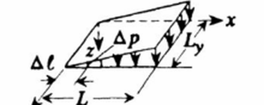<figcaption>Figura 13: Carga 2, distribución linealmente variable.</figcaption></figure>

$$
a_{mn}=(-1)^n\frac{8L}{mn\pi}\frac{\Delta p}{\Delta\ell},
\qquad m=1,3,5,\ldots,\quad n=1,2,3,\ldots
$$

</section>
<section role="tabpanel" id="pcr17-panel3" aria-labelledby="pcr17-tab3" aria-hidden="true" class="pcr-panel" data-case-panel="2">
Carga 3. Carga uniforme sobre una región rectangular
<figure class="pcr-figure">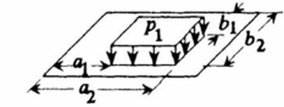<figcaption>Figura 14: Carga 3, región cargada delimitada por $a_1,a_2,b_1,b_2$.</figcaption></figure>

$$
a_{mn}=\frac{4p_1}{mn\pi^2}
\left(\cos\frac{n\pi a_1}{L}-\cos\frac{n\pi a_2}{L}\right)
\left(\cos\frac{m\pi b_1}{L_y}-\cos\frac{m\pi b_2}{L_y}\right).
$$

</section>
<section role="tabpanel" id="pcr17-panel4" aria-labelledby="pcr17-tab4" aria-hidden="true" class="pcr-panel" data-case-panel="3">
Carga 4. Carga variable sobre una región rectangular
<figure class="pcr-figure">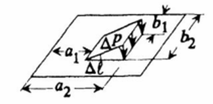<figcaption>Figura 15: Carga 4, distribución variable en la región indicada.</figcaption></figure>

$$
\begin{aligned}
a_{mn}={}&\frac{4}{nm\pi^2}\frac{\Delta p}{\Delta\ell}
\left(\cos\frac{m\pi b_1}{L_y}-\cos\frac{m\pi b_2}{L_y}\right)\\
&\times\left[(a_1-a_2)\cos\frac{n\pi a_2}{L}
+\frac{L}{n\pi}\left(\sin\frac{n\pi a_2}{L}-\sin\frac{n\pi a_1}{L}\right)\right].
\end{aligned}
$$

</section>
<section role="tabpanel" id="pcr17-panel5" aria-labelledby="pcr17-tab5" aria-hidden="true" class="pcr-panel" data-case-panel="4">
Carga 5. Fuerza lineal por unidad de longitud
<figure class="pcr-figure">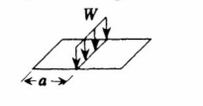<figcaption>Figura 16: Carga 5, fuerza lineal $W$ localizada en $x=a$.</figcaption></figure>

$$
a_{mn}=\frac{8W}{\pi Lm}\sin\frac{n\pi a}{L},
\qquad m=1,3,5,\ldots,\quad n=1,2,3,\ldots
$$

Si la fuerza lineal se extiende entre $y=b_1$ y $y=b_2$, se emplea:

$$
a_{mn}=\frac{4W}{m\pi L}\sin\frac{n\pi a}{L}
\left(\cos\frac{m\pi b_1}{L_y}-\cos\frac{m\pi b_2}{L_y}\right).
$$

</section>
<section role="tabpanel" id="pcr17-panel6" aria-labelledby="pcr17-tab6" aria-hidden="true" class="pcr-panel" data-case-panel="5">
Carga 6. Fuerza lineal sobre un segmento rectangular
<figure class="pcr-figure">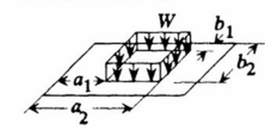<figcaption>Figura 17: Carga 6, carga lineal distribuida según los límites $a_1,a_2,b_1,b_2$.</figcaption></figure>

$$
\begin{aligned}
a_{mn}={}&\frac{4W}{LL_y}\Bigg[
\frac{L_y}{m\pi}\left(\sin\frac{n\pi a_1}{L}+\sin\frac{n\pi a_2}{L}\right)
\left(\cos\frac{m\pi b_1}{L_y}-\cos\frac{m\pi b_2}{L_y}\right)\\
&+\frac{L}{n\pi}\left(\cos\frac{n\pi a_1}{L}-\cos\frac{n\pi a_2}{L}\right)
\left(\sin\frac{m\pi b_1}{L_y}+\sin\frac{m\pi b_2}{L_y}\right)
\Bigg].
\end{aligned}
$$

</section>
<section role="tabpanel" id="pcr17-panel7" aria-labelledby="pcr17-tab7" aria-hidden="true" class="pcr-panel" data-case-panel="6">
Carga 7. Fuerza lineal sobre una trayectoria inclinada
<figure class="pcr-figure">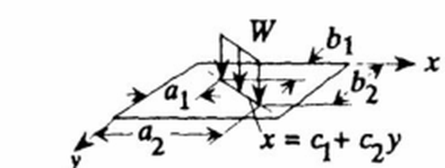<figcaption>Figura 18: Carga 7, fuerza lineal sobre $x=c_1+c_2y$.</figcaption></figure>

$$
\begin{aligned}
a_{mn}={}&\frac{2W}{LL_yc_3}
\Bigg\{\left[\sin\left(c_3b_2-\frac{n\pi c_1}{L}\right)-\sin\left(c_3b_1-\frac{n\pi c_1}{L}\right)\right]\\
&-\left[\sin\left(c_4b_2+\frac{n\pi c_1}{L}\right)-\sin\left(c_4b_1+\frac{n\pi c_1}{L}\right)\right]\Bigg\},
\end{aligned}
$$

$$
c_3=\frac{m\pi L-n\pi c_2L_y}{LL_y},\qquad
c_4=\frac{m\pi L+n\pi c_2L_y}{LL_y}.
$$

</section>
<section role="tabpanel" id="pcr17-panel8" aria-labelledby="pcr17-tab8" aria-hidden="true" class="pcr-panel" data-case-panel="7">
Carga 8. Fuerza concentrada en un punto
<figure class="pcr-figure">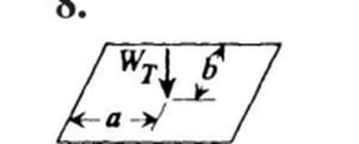<figcaption>Figura 19: Carga 8, fuerza puntual $W_T$ en $(a,b)$.</figcaption></figure>

$$
a_{mn}=\frac{4W_T}{LL_y}\sin\frac{n\pi a}{L}\sin\frac{m\pi b}{L_y}.
$$

</section>
<section role="tabpanel" id="pcr17-panel9" aria-labelledby="pcr17-tab9" aria-hidden="true" class="pcr-panel" data-case-panel="8">
Carga 9. Cuatro fuerzas concentradas
<figure class="pcr-figure">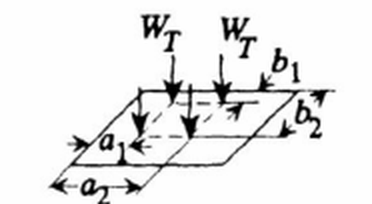<figcaption>Figura 20: Carga 9, fuerzas puntuales $W_T$ ubicadas simétricamente.</figcaption></figure>

$$
a_{mn}=\frac{4W_T}{LL_y}
\left(\sin\frac{n\pi a_1}{L}+\sin\frac{n\pi a_2}{L}\right)
\left(\sin\frac{m\pi b_1}{L_y}+\sin\frac{m\pi b_2}{L_y}\right).
$$

</section>
<section role="tabpanel" id="pcr17-panel10" aria-labelledby="pcr17-tab10" aria-hidden="true" class="pcr-panel" data-case-panel="9">
Carga 10. Momento lineal distribuido
<figure class="pcr-figure">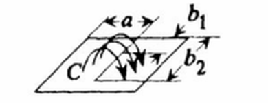<figcaption>Figura 21: Carga 10, momento lineal $C$ por unidad de longitud.</figcaption></figure>

$$
a_{mn}=-\frac{4nC}{mL^2}\cos\frac{n\pi a}{L}
\left(\cos\frac{m\pi b_1}{L_y}-\cos\frac{m\pi b_2}{L_y}\right).
$$

</section>
<section role="tabpanel" id="pcr17-panel11" aria-labelledby="pcr17-tab11" aria-hidden="true" class="pcr-panel" data-case-panel="10">
Carga 11. Momento concentrado
<figure class="pcr-figure">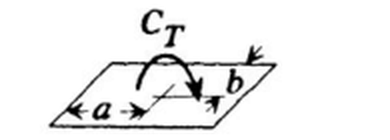<figcaption>Figura 22: Carga 11, momento concentrado $C_T$ en $(a,b)$.</figcaption></figure>

$$
a_{mn}=-\frac{4nC_T}{L^2L_y}\cos\frac{n\pi a}{L}\sin\frac{m\pi b}{L_y}.
$$

</section>
<section role="tabpanel" id="pcr17-panel12" aria-labelledby="pcr17-tab12" aria-hidden="true" class="pcr-panel" data-case-panel="11">
Carga 12. Momento concentrado en una dirección inclinada
<figure class="pcr-figure">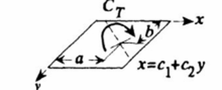<figcaption>Figura 23: Carga 12, momento $C_T$ orientado según la dirección indicada en el esquema.</figcaption></figure>

$$
a_{mn}=\frac{4\pi C_T}{LL_y}
\frac{\displaystyle \frac{c_2m}{L_y}\cos\frac{m\pi b}{L_y}\sin\frac{n\pi a}{L}
+\frac{n}{L}\sin\frac{m\pi b}{L_y}\cos\frac{n\pi a}{L}}
{(1+c_2^2)^{1/2}}.
$$

</section>
<section role="tabpanel" id="pcr17-panel13" aria-labelledby="pcr17-tab13" aria-hidden="true" class="pcr-panel" data-case-panel="12">
Carga 13. Distribución arbitraria de carga transversal
<figure class="pcr-figure">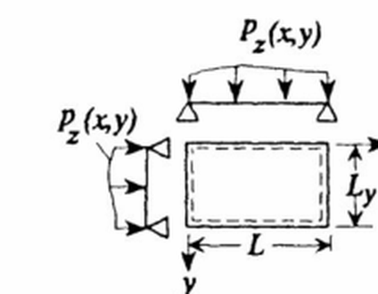<figcaption>Figura 24: Carga 13, distribución transversal general $p_z(x,y)$.</figcaption></figure>

$$
a_{mn}=\frac{4}{LL_y}\int_0^L\int_0^{L_y}
p_z(x,y)\sin\frac{n\pi x}{L}\sin\frac{m\pi y}{L_y}\,dx\,dy.
$$

</section>

<button type="button" class="pcr-arrow" data-placas-step="-1" disabled aria-label="Ir al caso anterior">← Anterior</button>1 de 13<button type="button" class="pcr-arrow" data-placas-step="1" aria-label="Ir al caso siguiente">Siguiente →</button>

**Fuente de las tablas:** *Table 18-16, Deflections and Internal Forces of Rectangular Plates*, páginas 1073–1084, y *Table 18-17, Response of Rectangular Plates with Four Sides Simply Supported*, páginas 1085–1087, según el documento proporcionado. Las expresiones y los esquemas corresponden a esa fuente.

